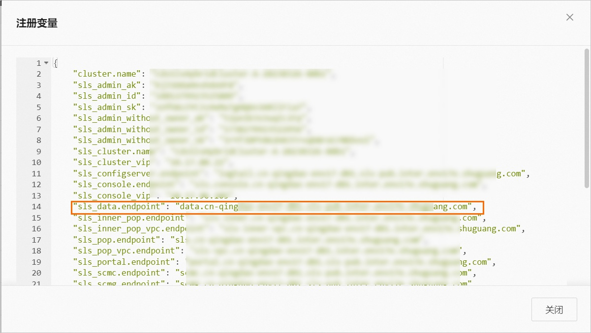
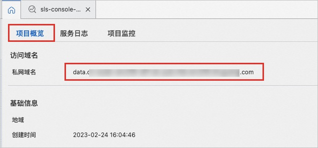
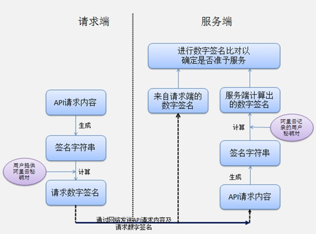
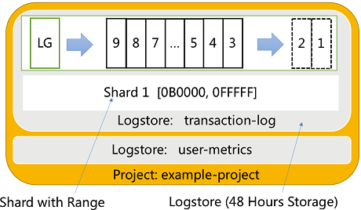
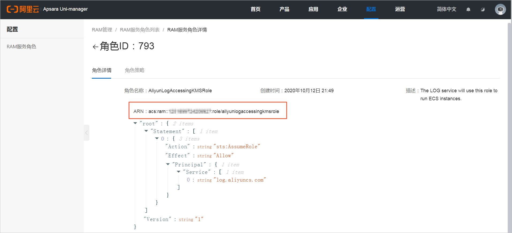
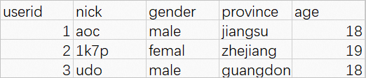
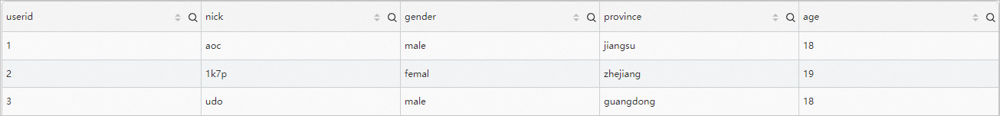
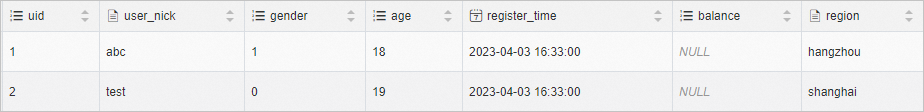
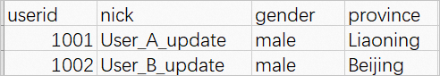

阿里云  
专有云  
日志服务  
开发指南  
产品版本：V3.18.3  
文档版本：20241030

**目录**

- [1.准备工作](#section-1)
    - [1.1. 获取AccessKey](#section-1-1)
    - [1.2. 获取日志服务的Endpoint](#section-1-2)
    - [1.3. 获取日志服务的SDK包](#section-1-3)
- [2.SDK参考](#section-2)
    - [2.1. 基本介绍](#section-2-1)
        - [2.1.1. 概述](#section-2-1-1)
        - [2.1.2. 配置](#section-2-1-2)
        - [2.1.3. 错误处理](#section-2-1-3)
        - [2.1.4. 接口规范](#section-2-1-4)
    - [2.2. Java SDK](#section-2-2)
    - [2.3. 使用日志服务Java SDK管理旧版告警](#section-2-3)
    - [2.4. .NET SDK](#section-2-4)
    - [2.5. .NET Core SDK](#section-2-5)
    - [2.6. PHP SDK](#section-2-6)
    - [2.7. Python SDK](#section-2-7)
    - [2.8. 使用日志服务Python SDK管理旧版告警](#section-2-8)
    - [2.9. Android SDK](#section-2-9)
    - [2.10. C SDK](#section-2-10)
    - [2.11. GO SDK](#section-2-11)
    - [2.12. iOS SDK](#section-2-12)
    - [2.13. C++ SDK](#section-2-13)
    - [2.14. Node.js SDK](#section-2-14)
- [3.API参考](#section-3)
    - [3.1. 概览](#section-3-1)
    - [3.2. 公共请求头](#section-3-2)
    - [3.3. 公共响应头](#section-3-3)
    - [3.4. 请求签名](#section-3-4)
    - [3.5. 通用数据结构](#section-3-5)
    - [3.6. 通用错误码](#section-3-6)
    - [3.7. 日志项目接口](#section-3-7)
        - [3.7.1. CreateProject](#section-3-7-1)
        - [3.7.2. DeleteProject](#section-3-7-2)
        - [3.7.3. UpdateProject](#section-3-7-3)
        - [3.7.4. GetProject](#section-3-7-4)
        - [3.7.5. ListProject](#section-3-7-5)
        - [3.7.6. GetProjectLogs](#section-3-7-6)
    - [3.8. 日志库相关接口](#section-3-8)
        - [3.8.1. CreateLogstore](#section-3-8-1)
        - [3.8.2. DeleteLogstore](#section-3-8-2)
        - [3.8.3. UpdateLogstore](#section-3-8-3)
        - [3.8.4. GetLogstore](#section-3-8-4)
        - [3.8.5. ListLogstore](#section-3-8-5)
        - [3.8.6. ListShards](#section-3-8-6)
        - [3.8.7. SplitShard](#section-3-8-7)
        - [3.8.8. MergeShards](#section-3-8-8)
        - [3.8.9. GetCursor](#section-3-8-9)
        - [3.8.10. GetCursorTime](#section-3-8-10)
        - [3.8.11. PullLogs](#section-3-8-11)
        - [3.8.12. PostLog](#section-3-8-12)
        - [3.8.13. GetShipperStatus](#section-3-8-13)
        - [3.8.14. RetryShipperTask](#section-3-8-14)
        - [3.8.15. GetLogs](#section-3-8-15)
        - [3.8.16. GetHistograms](#section-3-8-16)
        - [3.8.17. UpdateIndex](#section-3-8-17)
        - [3.8.18. CreateIndex](#section-3-8-18)
        - [3.8.19. DeleteIndex](#section-3-8-19)
        - [3.8.20. GetIndex](#section-3-8-20)
        - [3.8.21. PutWebtracking](#section-3-8-21)
    - [3.9. Logtail 机器组相关接口](#section-3-9)
        - [3.9.1. CreateMachineGroup](#section-3-9-1)
        - [3.9.2. DeleteMachineGroup](#section-3-9-2)
        - [3.9.3. UpdateMachineGroup](#section-3-9-3)
        - [3.9.4. ListMachineGroup](#section-3-9-4)
        - [3.9.5. GetMachineGroup](#section-3-9-5)
        - [3.9.6. ApplyConfigToMachineGroup](#section-3-9-6)
        - [3.9.7. RemoveConfigFromMachineGroup](#section-3-9-7)
        - [3.9.8. ListMachines](#section-3-9-8)
        - [3.9.9. GetAppliedConfigs](#section-3-9-9)
    - [3.10. Logtail 配置相关接口](#section-3-10)
        - [3.10.1. CreateConfig](#section-3-10-1)
        - [3.10.2. ListConfig](#section-3-10-2)
        - [3.10.3. GetAppliedMachineGroups](#section-3-10-3)
        - [3.10.4. GetConfig](#section-3-10-4)
        - [3.10.5. DeleteConfig](#section-3-10-5)
        - [3.10.6. UpdateConfig](#section-3-10-6)
    - [3.11. 消费组接口](#section-3-11)
        - [3.11.1. CreateConsumerGroup](#section-3-11-1)
        - [3.11.2. DeleteConsumerGroup](#section-3-11-2)
        - [3.11.3. GetCheckPoint](#section-3-11-3)
        - [3.11.4. HeartBeat](#section-3-11-4)
        - [3.11.5. ListConsumerGroup](#section-3-11-5)
        - [3.11.6. UpdateCheckPoint](#section-3-11-6)
        - [3.11.7. UpdateConsumerGroup](#section-3-11-7)
    - [3.12. 外部存储](#section-3-12)
        - [3.12.1. 概述](#section-3-12-1)
        - [3.12.2. CreateExternalStore](#section-3-12-2)
        - [3.12.3. DeleteExternalStore](#section-3-12-3)
        - [3.12.4. GetExternalStore](#section-3-12-4)
        - [3.12.5. ListExternalStore](#section-3-12-5)
        - [3.12.6. UpdateExternalStore](#section-3-12-6)
    - [3.13. 快速查询接口](#section-3-13)
        - [3.13.1. CreateSavedSearch](#section-3-13-1)
        - [3.13.2. DeleteSavedSearch](#section-3-13-2)
        - [3.13.3. GetSavedSearch](#section-3-13-3)
        - [3.13.4. ListSavedSearch](#section-3-13-4)
        - [3.13.5. UpdateSavedSearch](#section-3-13-5)
    - [3.14. RAM/STS](#section-3-14)
        - [3.14.1. 概览](#section-3-14-1)
        - [3.14.2. 资源列表](#section-3-14-2)
        - [3.14.3. 动作列表](#section-3-14-3)
        - [3.14.4. 鉴权规则](#section-3-14-4)
    - [3.15. 公共资源说明](#section-3-15)
        - [3.15.1. 数据加密](#section-3-15-1)
        - [3.15.2. 数据模型](#section-3-15-2)
        - [3.15.3. 数据编码方式](#section-3-15-3)
        - [3.15.4. 日志库](#section-3-15-4)
        - [3.15.5. 分区](#section-3-15-5)
        - [3.15.6. Logtail 配置](#section-3-15-6)
        - [3.15.7. Logtail 机器组](#section-3-15-7)
- [4.CLI参考](#section-4)
    - [4.1. CLI概述](#section-4-1)
    - [4.2. 安装CLI](#section-4-2)
    - [4.3. 配置CLI](#section-4-3)
    - [4.4. 请求语法](#section-4-4)
    - [4.5. 全局参数](#section-4-5)
    - [4.6. 使用CLI](#section-4-6)
        - [4.6.1. Project管理](#section-4-6-1)
            - [4.6.1.1. copy_project](#section-4-6-1-1)
            - [4.6.1.2. create_project](#section-4-6-1-2)
            - [4.6.1.3. delete_project](#section-4-6-1-3)
            - [4.6.1.4. get_project](#section-4-6-1-4)
            - [4.6.1.5. list_project](#section-4-6-1-5)
        - [4.6.2. Logstore管理](#section-4-6-2)
            - [4.6.2.1. copy_logstore](#section-4-6-2-1)
            - [4.6.2.2. create_logstore](#section-4-6-2-2)
            - [4.6.2.3. delete_logstore](#section-4-6-2-3)
            - [4.6.2.4. get_logstore](#section-4-6-2-4)
            - [4.6.2.5. list_logstore](#section-4-6-2-5)
            - [4.6.2.6. update_logstore](#section-4-6-2-6)
        - [4.6.3. Shard管理](#section-4-6-3)
            - [4.6.3.1. list_shards](#section-4-6-3-1)
            - [4.6.3.2. merge_shard](#section-4-6-3-2)
            - [4.6.3.3. split_shard](#section-4-6-3-3)
        - [4.6.4. Logtail机器组管理](#section-4-6-4)
            - [4.6.4.1. create_machine_group](#section-4-6-4-1)
            - [4.6.4.2. delete_machine_group](#section-4-6-4-2)
            - [4.6.4.3. get_machine_group](#section-4-6-4-3)
            - [4.6.4.4. list_machine_group](#section-4-6-4-4)
            - [4.6.4.5. list_machines](#section-4-6-4-5)
            - [4.6.4.6. update_machine_group](#section-4-6-4-6)
        - [4.6.5. Logtail配置管理](#section-4-6-5)
            - [4.6.5.1. create_logtail_config](#section-4-6-5-1)
            - [4.6.5.2. delete_logtail_config](#section-4-6-5-2)
            - [4.6.5.3. get_logtail_config](#section-4-6-5-3)
            - [4.6.5.4. list_logtail_config](#section-4-6-5-4)
            - [4.6.5.5. update_logtail_config](#section-4-6-5-5)
        - [4.6.6. 机器组与Logtail配置关联](#section-4-6-6)
            - [4.6.6.1. apply_config_to_machine_group](#section-4-6-6-1)
            - [4.6.6.2. get_config_applied_machine_groups](#section-4-6-6-2)
            - [4.6.6.3. get_machine_group_applied_configs](#section-4-6-6-3)
            - [4.6.6.4. remove_config_to_machine_group](#section-4-6-6-4)
        - [4.6.7. 索引管理](#section-4-6-7)
            - [4.6.7.1. create_index](#section-4-6-7-1)
            - [4.6.7.2. delete_index](#section-4-6-7-2)
            - [4.6.7.3. get_index_config](#section-4-6-7-3)
            - [4.6.7.4. update_index](#section-4-6-7-4)
        - [4.6.8. 游标管理](#section-4-6-8)
            - [4.6.8.1. get_begin_cursor](#section-4-6-8-1)
            - [4.6.8.2. get_cursor](#section-4-6-8-2)
            - [4.6.8.3. get_cursor_time](#section-4-6-8-3)
            - [4.6.8.4. get_end_cursor](#section-4-6-8-4)
            - [4.6.8.5. get_previous_cursor_time](#section-4-6-8-5)
        - [4.6.9. 日志管理](#section-4-6-9)
            - [4.6.9.1. get_histograms](#section-4-6-9-1)
            - [4.6.9.2. get_logs](#section-4-6-9-2)
            - [4.6.9.3. get_log](#section-4-6-9-3)
            - [4.6.9.4. get_log_all](#section-4-6-9-4)
            - [4.6.9.5. pull_log](#section-4-6-9-5)
            - [4.6.9.6. pull_logs](#section-4-6-9-6)
            - [4.6.9.7. pull_log_dump](#section-4-6-9-7)
        - [4.6.10. 消费组管理](#section-4-6-10)
            - [4.6.10.1. create_consumer_group](#section-4-6-10-1)
            - [4.6.10.2. delete_consumer_group](#section-4-6-10-2)
            - [4.6.10.3. get_check_point](#section-4-6-10-3)
            - [4.6.10.4. list_consumer_group](#section-4-6-10-4)
            - [4.6.10.5. update_check_point](#section-4-6-10-5)
            - [4.6.10.6. update_consumer_group](#section-4-6-10-6)
        - [4.6.11. 关联外部数据源](#section-4-6-11)
            - [4.6.11.1. create_external_store](#section-4-6-11-1)
            - [4.6.11.2. delete_external_store](#section-4-6-11-2)
            - [4.6.11.3. get_external_store](#section-4-6-11-3)
            - [4.6.11.4. list_external_store](#section-4-6-11-4)
            - [4.6.11.5. update_external_store](#section-4-6-11-5)
    - [4.7. 最佳实践](#section-4-7)
    - [4.8. 常见问题](#section-4-8)

<a id="section-1"></a>

# 1.准备工作

<a id="section-1-1"></a>

## 1.1. 获取AccessKey

AccessKey支持RAM授权模式，在发起调用时需要使用AccessKey。本文将为您介绍如何获取通过RAM授权的AccessKey。

**背景信息**

AccessKey通过使用AccessKey ID和AccessKey Secret对称加密，实现验证某个请求发送者的身份的功能。其中AccessKey ID用于标识用户，AccessKey Secret是用户用于加密签名的字符串。

AccessKey的RAM授权模式，通过RAM授权给第三方请求者的AccessKey ID和AccessKey Secret。

> 个人账号AccessKey是由Apsara Uni-manager运营控制台权限体系管控的受限
>
> **警告**
>
> AccessKey，组织AccessKey相对权限较大，需要管理员确认操作的安全性。

**获取个人账号AccessKey**

获取个人账号AccessKey的方法如下：

1. 登录Apsara Uni-manager运营控制台。

2. 在系统界面右上角，单击当前登录用户头像，单击**个人信息**。

3. 在**AccessKey**区域，您可以查看个人账户的AccessKey信息。

   

   > AccessKey ID和AccessKey Secret是您访问云资源时的密钥，具有该账号完整的权
   >
   > **说明**
   >
   > 限，请您妥善保管。

**获取组织AccessKey**

获取组织AccessKey的方法如下：

1. 管理员登录Apsara Uni-manager运营控制台。

2. 在顶部菜单栏，单击**企业**。

3. 在左侧导航栏中，选择**资源管理 > 组织管理**。

4. 在组织结构中，单击目标一级组织名称。

5. 单击**管理Accesskey**。

6. 在弹出的对话框中，查看组织AccessKey信息。

<a id="section-1-2"></a>

## 1.2. 获取日志服务的Endpoint

本文介绍如何获取日志服务Endpoint。

**背景信息**

调用专有云API时需要使用云产品业务域的Endpoint。您可以在阿里云驻场运维工程师处获取。您也可以通过如下方法自行获取Endpoint。

**方式一：通过飞天基础运维平台获取产品的Endpoint**

1. 登录Apsara Uni-manager运维控制台。

2. 在顶部菜单栏选择**平台运维 > 飞天基础运维平台 > 运维工具**。

3. 在左侧导航栏，选择**运维工具**>**基础数据管理**。

4. 在**基础数据管理**页面，单击**服务注册变量大盘**。

5. 在**服务注册变量大盘**页面，输入sls。

6. 在搜索结果中，找到sls-backend-server，单击Service Registration的值。

7. 在**注册变量**对话框，获取Endpoint的值。

   查看的**sls_data.endpoint**值，即 `Endpoint` 。一般情况，日志服务的Endpoint地址样式为 `data.${global:region}.sls-pub.${global:internet-domain}` 。

   

**方式二：通过产品控制台获取Endpoint**

创建Project后，您可以在Project的概览页面，获取访问域名。

1. 登录日志服务控制台。

2. 在Project列表区域，单击目标Project。

3. 在**项目概览**页面，查看Project的访问域名。



私网域名即为Endpoint。日志服务的Endpoint地址样式为 `data.${global:region}.sls-pub.${global:internet-domain}` 。

<a id="section-1-3"></a>

## 1.3. 获取日志服务的SDK包

调用专有云API时，需使用相应云产品的SDK。本文为您介绍如何获取阿里云开发工具包（SDK）。

软件开发工具包（SDK）包括代码以及示例，用户可以自行选择语言创建云应用。

目前SDK的语言支持：Java、Python、Go等，您可以前往阿里云开发工具包（SDK）中进行选择。

> **说明**
>
> 推荐使用 Java、Python、Go三种语言的SDK包，使用其他语言的SDK包可能发生不兼容情况。

SDK核心库推荐使用阿里云官网的SDK核心库，其内容所有云产品共用，且适用于专有云。

下表列举了日志服务常用语言的SDK的GitHub源码地址。

| SDK语言 | GitHub源码 |
| --- | --- |
| Java | Log Service Java SDK |
| Python | Log Service Python SDK |
| Go | Log Service Go SDK |
| PHP | Log Service PHP SDK |

<a id="section-2"></a>

# 2.SDK参考

<a id="section-2-1"></a>

## 2.1. 基本介绍

<a id="section-2-1-1"></a>

### 2.1.1. 概述

为了能让您更高效地使用日志服务，日志服务提供了多个语言版本（.NET、Java、Python、PHP、C等）的SDK（Software Development Kit），您可以根据业务需求选择合适的SDK语言版本采集日志、查询和分析日志等。

日志服务SDK基于日志服务API实现，且提供和日志服务API同样的能力。如果您需要了解日志服务API的更多细节，参见API概览。

类似于使用日志服务API，您首先需要拥有一个处于Active状态的访问密钥。如何获取，请参见获取AccessKey。

为使用日志服务SDK，您需要了解日志服务的服务入口。更多信息，请参见获取日志服务的Endpoint和配置。

不同语言的日志服务SDK具体实现细节会有所不同，但是它们都是日志服务API在不同语言上的封装，实现的功能也基本一致。具体包括如下几个方面：

- 实现对日志服务API接口的统一封装 ，让您不需要关心具体的API请求构建和响应解析。而且各个不同语言的接口使用也非常接近，方便您在不同语言间切换。更多信息，请参见接口规范。

- 实现日志服务API的数字签名逻辑，让您不需要关心API的签名逻辑细节，降低使用日志服务API的难度。更多信息，请参见请求签名。

- 实现日志服务日志的 ProtoBuffer 格式封装，让您在写入日志时不需要关心 ProtoBuffer格式的具体细节。

- 实现日志服务 API 中定义的压缩方法，让您不用关心压缩实现的细节。部分语言的 SDK 可以让您指定是否启用压缩模式写入日志（默认为使用压缩方式）。

- 提供统一的错误处理机制，让您可以使用语言所熟悉的方式处理请求异常。更多信息，请参见错误处理机制。

- 目前所有语言实现的SDK仅提供同步请求方式。

如下表所示，各个不同语言的 SDK 的下载地址、详细使用说明及完整的编程参考如下。

表 1. SDK相关文档及源码

| SDK 语言 | 相关文档 | 源码 |
| --- | --- | --- |
| Java | Java SDK，接口参考 | GitHub |
| .NET | .NET SDK，接口参考 | GitHub |
| PHP | PHP SDK，接口参考 | GitHub |
| Node.js | Node.js SDK | GitHub |
| Python | Python SDK，接口参考 | GitHub |
| C | C SDK | GitHub |
| GO | GO SDK | GitHub |
| iOS | iOS SDK | GitHub |
| Android | Android SDK | GitHub |
| C++ | C++ SDK | GitHub |

<a id="section-2-1-2"></a>

### 2.1.2. 配置

与使用API和日志服务服务端进行交互相同，使用SDK也需要指定一些基本配置。本文介绍SDK的基本配置信息。

具体包括如下几项：

- 服务入口（Endpoint）：确认 Client 需要访问的服务入口。

- 访问密钥（AccessKeyId/AccessKeySecret）：指定 Client 访问日志服务时使用的访问密钥。

下面详细说明这两个配置的使用方式。

**服务入口（Endpoint）**

当使用 SDK 时，首先需要确认您的接入方式和服务入口。

1. 当选择 Client 的 Endpoint 时，请根据您的部署按照正确的方式接入服务，否则 SDK 将无法访问您的项目。

2. 目前，所有 API 的服务入口仅支持 HTTP 协议。

**访问密钥（AccessKey）**

正如 API 参考文档中的访问密钥所述，所有和日志服务端交互的请求都必须经过安全验证，而访问密钥就是用来对请求进行安全验证的关键因子，且以 AccessKeyId 和 AccessKeySecret 方式成对出现。在 Client构造时需要指定两个参数（AccessKeyId，AccessKeySecret）即为该访问密钥对。所以，在使用 SDK前，请在云控制台获取合适的密钥对。

> **说明**
>
> - 您的账号下可以拥有多组访问密钥对，但在构造 Client 时指定的 AccessKeyId 和AccessKeySecret 必须成对，否则无法通过服务端的安全验证。
>
> - 指定的访问密钥对必须处于“启用”状态，否则会被服务端拒绝请求。同样，您也可以到云控制台查看访问密钥的状态。

**示例**

如果您需要访问某个 Project，且当前已经拥有一对处于“启用”状态的访问密钥对。如下：

```text
AccessKeyId = "<yourAccessKeyId>"
AccessKeySecret = "<yourAccessKeySecret>"
```

则可以用如下方式创建 Client 实例：

- Java

  ```text
  String endpoint = "regionid.example.com";       //在实际使⽤中，请按照您实际的服务入⼝和接入
  ⽅式编写。
  String accessKeyId = "<youraccessKeyId>";        //⽤户访问密钥对中的 AccessKeyId。
  String accessKeySecret = "<youraccessKeySecret>";//⽤户访问密钥对中的 AccessKeySecret。
  Client client = new Client(endpoint, accessKeyId, acccessKeySecret);
  //use client to operate log service project......
  ```

- .NET(C#)

  ```text
  String endpoint = "regionid.example.com";       // 在实际使⽤中，请按照您实际的服务入⼝和接入
  ⽅式编写。
  String accessKeyId = "<youraccessKeyId>";        //⽤户访问密钥对中的 AccessKeyId。
  String accessKeySecret = "<youraccessKeySecret>";//⽤户访问密钥对中的 AccessKeySecret。
  SLSClient client = new SLSClient(endpoint, accessKeyId, accessKeySecret);
  //use client to operate sls project......
  ```

- PHP

  ```text
  $endpoint = 'regionid.example.com'; //此处以hangzhou Region为例，在实际使⽤中，请按照您实际
  的服务入⼝和接入⽅式编写。
  $accessKeyId = '<youraccessKeyId>';  //⽤户访问密钥对中的 AccessKeyId。
  $accessKey = '<youraccessKey>';//⽤户访问密钥对中的 AccessKeySecret。
  $client = new Aliyun_Sls_Client($endpoint, $accessKeyId, $accessKey);
  //use client to operate sls project......
  ```

- Python

  ```text
  # // 在实际使⽤中，请按照您实际的服务入⼝和接入⽅式编写。
  endpoint = 'regionid.example.com'
  # ⽤户访问密钥对中的 AccessKeyId。
  accessKeyId = '<youraccessKeyId>'
  # ⽤户访问密钥对中的 AccessKeySecret。
  accessKey = '<youraccessKey>'  
  client = LogClient(endpoint, accessKeyId, accessKey)
  #use client to operate log project......
  ```

<a id="section-2-1-3"></a>

### 2.1.3. 错误处理

SDK 可能出现的异常错误可以分成如下几类：

- 由日志服务端返回的错误。这类错误由日志服务端返回并由 SDK 处理。关于这类错误的详细细节可以参考日志服务 API 的通用错误码和各个 API 接口的具体说明。

- 由 SDK 在向服务端发出请求时出现的网络错误。这类错误包括网络连接不通，服务端返回超时等。

- 由 SDK 自身产生的、与平台及语言相关的错误，如内存溢出等。

目前，各个语言 SDK 的实现都采取抛出异常的方式处理错误。具体原则如下：

- 由如上第一或者第二类错误将会被 SDK 处理并包装在统一的 LogException 类抛出给用户处理。

- 由如上第三类错误不会被 SDK 处理，而是直接抛出平台及语言的 Native Exception 类给用户处理。

**LogException**

LogException 类是 SDK 定义的、用于处理日志服务自身逻辑错误的异常类。它继承自各个语言的异常基类，提供如下异常信息：

- 错误代码（Error Code）：标示错误类型。如果是来自服务端的返回错误，则这个错误代码与 API 返回的错误代码一致。如果是 SDK 网络请求错误，则其错误代码为 “RequestError”。具体请参考各个语言的完整 API 参考。

- 错误消息（Error Message）：标示错误消息。如果是来自服务端的响应错误，则这个错误消息 API 返回的错误消息一致。如果是 SDK 网络请求错误，则其错误消息为“request is failed.”。具体请参考各个语言的完整 API 参考。

- 错误请求 ID（Request Id）：标示当前错误对应于服务端的请求 ID。该 ID 只有在服务端返回错误消息时有效，否则为空字符串。用户可以在遇到错误请求时记下该请求 ID 并提供给日志服务团队进行问题追踪和定位。

**请求失败与重试**

在使用 SDK 访问日志服务端时，有可能会因为网络临时中断、传输延时过程、服务端处理过慢等一系列原因导致请求失败。目前，这类错误都直接以异常抛出，日志服务内部并未对此做任何重试逻辑。所以，您在使用 SDK 时需要自己定义相应的处理逻辑（重试请求或者直接报错等）。

**示例**

假设您需要访问名字为 **big-game** 的 Project，且在出现网络异常时主动重试指定次数。各语言的代码片段如下：

- Java

  ```java
  //其他代码......
  String accessId = "<youraccessId>";   //TODO：⽤您的真实阿⾥云 AccessKeyId 替代。
  String accessKey = "<youraccessKey>"; //TODO：⽤您的真实阿⾥云 AccessKeySecret 替代。
  String project = "big-game";
  String endpoint = "regionid.example.com";
  int max_retries = 3;
  /*
   * 构建⼀个 client
   */
  Client client = new Client(accessId, accessKey, endpoint);
  ListLogStoresRequest lsRequest = new ListLogStoresRequest(project);
  for (int i = 0; i < max_retries; i++)
  {
      try
      {
          ListLogStoresResponse res = client.ListLogStores(lsRequest)
          //TODO: 处理返回的 response......
          break;
      }
      catch(LogException ex)
      {
          if (e.GetErrorCode() == "RequestError")
          {
              if ( i == max_retries - 1)
              {
                  System.out.println("request is still failed after all retries.");
                  break;
              }
              else
                  System.out.println("request error happens, retry it!");
          }
          else
          {
              System.out.println("error code :" + e.GetErrorCode());
              System.out.println("error message :" + e.GetErrorMessage());
              System.out.println("error requestId :" + e.GetRequestId());
              break;
          }
      }
      catch(...)
      {
          System.out.println("unrecoverable exception when listing logstores.");
          break;
      }
  }
  //其他代码......
  ```

- .NET（C#）

  ```csharp
  //其他代码......
  String accessId = "<youraccessId>";     //TODO：⽤您的真实阿⾥云 AccessKeyId 替代。
  String accessKey = "<youraccessKey>";    //TODO：⽤您的真实阿⾥云 AccessKeySecret 替代。
  String project = "big-game";
  String endpoint = "regionid.example.com";
  int max_retries = 3;
  //创建⼀个 Client
  SLSClient client = new SLSClient(endpoint, accessId, accessKey);
  ListLogstoresRequest request = new ListLogstoresRequest();
  request.Project = project;
  for (int i = 0; i < max_retries; i++)
  {
      try
      {
          ListLogstoresResponse response = client.ListLogstores(request);
          //TODO: 处理返回的 response......
          break;
      }
      catch(LogException ex)
      {
          if (e.errorCode == "SLSRequestError")
          {
              if ( i == max_retries - 1)
              {
                  Console.Writeline(“request is still failed after all retries.”);
                  break;
              }
              else
              {
                  Console.Writeline("request error happens, retry it!");
              }
          }
          else
          {
              Console.Writeline("error code :" + e.errorCode;
              Console.Writeline("error message :" + e.Message;
              Console.Writeline("error requestId :" + e.RequestId;
              break;
          }
      }
      catch(...)
      {
          Console.Writeline("unrecoverable exception when listing logstores.");
          break;
      }
  }
  //其他代码......
  ```

- PHP

  ```php
  <?php
  //其他代码......
  $endpoint = 'regionid.example.com';
  $accessId = '<youraccessId>'; // TODO：⽤你的真实阿⾥云 AccessKeyId 替代
  $accessKey = '<youraccessKey>'; //TODO：⽤你的真实阿⾥云 AccessKeySecret 替代
  $maxRetries = 3;
  // 构建⼀个 sls client
  $client = new Aliyun_Sls_Client($endpoint, $accessId, $accessKey);
  $project = 'big-game';
  $request = new Aliyun_Sls_Models_ListLogstoresRequest($project);
  for($i = 0; $i < $maxRetries; ++$i)
  {
      try
      {
          $response = $client->ListLogstores($request);
          //TODO: 处理返回的 response......
          break;
      }
      catch (Aliyun_Sls_Exception $e)
      {
          if ($e->getErrorCode()=='RequestError')
          {
              if ($i+1 == $maxRetries)
              {
                  echo "error code :" . $e->getErrorCode() . PHP_EOL;
                  echo "error message :" . $e->getErrorMessage() . PHP_EOL;
                  break;
              }
              echo 'request error happens, retry it!' . PHP_EOL;
          }
          else
          {
              echo "error code :" . $e->getErrorCode() . PHP_EOL;
              echo "error message :" . $e->getErrorMessage() . PHP_EOL;
              echo "error requestId :" . $e->getRequestId() . PHP_EOL;
              break;
          }
      }
      catch (Exception $ex)
      {
          echo 'unrecoverable exception when listing logstores.' . PHP_EOL;
          var_dump($ex);
          break;
      }
  }
  //其他代码......
  ```

- Python

  ```text
  //其他代码......
  endpoint = 'regionid.example.com'
  accessId = '<youraccessId>' # TODO：⽤你的真实阿⾥云 AccessKeyId 替代
  accessKey = '<youraccessKey>' # TODO：⽤你的真实阿⾥云 AccessKeySecret 替代
  maxRetries = 3
  # 构建⼀个 client
  client = Client(endpoint, accessId, accessKey)
  project = 'big-game'
  lsRequest = ListLogstoresRequest(project)
  for i in xrange(maxRetries):
      try:
          res = client.ListLogstores(lsRequest)
          # TODO: 处理返回的 response......
          break
      except LogException as e:
          if e.getErrorCode() == "RequestError":
              if i+1 == maxRetries:
                  print "error code :" + e.getErrorCode()
                  print "error message :" + e.getErrorMessage()
                  break
              else:
                  print "request error happens, retry it!"
          else:
              print "error code :" + e.getErrorCode()
              print "error message :" + e.getErrorMessage()
              print "error requestId :" + e.getRequestId()
              break
      except Exception as e:
          print 'unrecoverable exception when listing logstores.'
          break
  //其他代码......
  ```

<a id="section-2-1-4"></a>

### 2.1.4. 接口规范

尽管不同语言的 SDK 实现有所不同，但其接口都遵循 Request-Response 原则，即对 API 的调用按照如下方式进行：

1. 利用请求参数构建相应的 Request 实例。

2. 调用 SDK 中的相应接口并传入上一步的 Request 实例。

3. SDK 接口的返回结果以相应的 Response 实例返回给用户。

如下代码片段解释如何按照上面流程获取一个 Project 下的所有 Logstore 的名称。

**Java**

```text
// 其他代码......
String accessId = "<youraccessId>";     //TODO：⽤您的真实阿⾥云 AccessKeyId 替代。
String accessKey = "<youraccessKey>";   //TODO：⽤您的真实阿⾥云 AccessKeySecret 替代。
String project = "your_project";        //TODO: ⽤您的真实 project 名称替代。
String endpoint = "region_endpoint";//TODO: 此处以hangzhou Region为例，在实际使⽤中，请按照您
实际的服务入⼝和接入⽅式编写。
//构建⼀个 Client 实例。
Client client = new Client(endpoint, accessId, accessKey);
//⽤请求参数“project”初始化 ListLogstores 的请求类。
ListLogStoresRequest lsRequest = new ListLogStoresRequest(project);
//使⽤ request 实例调⽤ ListLogstores 接⼝，且返回参数为对应的 Response 实例
ListLogStoresResponse res = client.ListLogStores(lsRequest);
//访问 Response 实例获取请求结果
ArrayList<String> names = res.GetLogStores();
// 其他代码......
```

**.NET(C#)**

```text
// 其他代码......
String accessId = "<youraccessId>";     //TODO：⽤您的真实阿⾥云 AccessKeyId 替代。
String accessKey = "<youraccessKey>";   //TODO：⽤您的真实阿⾥云 AccessKeySecret 替代。
String project = "your_project";        //TODO: ⽤您的真实 project 名称替代。
String endpoint = "region_endpoint";////TODO: 此处以hangzhou Region为例，在实际使⽤中，请按照
您实际的服务入⼝和接入⽅式编写。
//构建⼀个 Client 实例。
SLSClient client = new SLSClient(endpoint, accessId, accessKey);
//⽤请求参数“project”初始化 ListLogstores 的请求类。
ListLogStoresRequest lsRequest = new ListLogStoresRequest();
lsRequest.Project = project;
//使⽤ request 实例调⽤ ListLogstores 接⼝，且返回参数为对应的 Response 实例
ListLogStoresResponse res = client.ListLogStores(lsRequest);
//访问 Response 实例获取请求结果
List<String> names = res.Logstores;
// 其他代码......
```

**PHP**

```text
// 其他代码......
$accessId = "<youraccessId>";     //TODO：⽤您的真实阿⾥云 AccessKeyId 替代。
$accessKey = "<youraccessKey>";   //TODO：⽤您的真实阿⾥云 AccessKeySecret 替代。
$project = "your_project";        //TODO: ⽤您的真实 project 名称替代。
$endpoint = "region_endpoint";////TODO: 此处以hangzhou Region为例，在实际使⽤中，请按照您实际
的服务入⼝和接入⽅式编写。
//构建⼀个 SLS Client 实例。
$client = new Aliyun_Sls_Client($endpoint, $accessId, $accessKey);
//⽤请求参数“project”初始化 ListLogstores 的请求类。
$request = new Aliyun_Sls_Models_ListLogstoresRequest($project);
//使⽤ request 实例调⽤ ListLogstores 接⼝，且返回参数为对应的 Response 实例
$response = $client->listLogstores($request);
//访问 Response 实例获取请求结果
$names = $response->getLogstores();
// 其他代码......
```

**Python**

```text
// 其他代码......
accessId = '<youraccessId>';     //TODO：⽤您的真实阿⾥云 AccessKeyId 替代。
accessKey = '<youraccessKey>';   //TODO：⽤您的真实阿⾥云 AccessKeySecret 替代。
project = 'your_project';        //TODO: ⽤您的真实 project 名称替代。
endpoint = 'region_endpoint';////TODO: 此处以hangzhou Region为例，在实际使⽤中，请按照您实际的
服务入⼝和接入⽅式编写。
# 构建⼀个 client
client = LogClient(endpoint, accessId, accessKey)
# ⽤请求参数 “project” 初始化 ListLogstores 的请求类。
lsRequest = ListLogstoresRequest(project)
# 使⽤ request 实例调⽤ ListLogstores 接⼝，且返回参数为对应的 Response 实例
res = client.list_logstores(lsRequest)
# 访问 Response 实例获取请求结果
names = res.get_logstores();
// 其他代码......
```

SDK 实现了多组类似 ListLogStores 的接口，也定义了相应的 Request 和 Response 类。除去Request-Response 风格的基础接口外，各个不同语言的 SDK 还会提供一些包装了这些基础接口的辅助接口，让您无需自己构建 Request 及解析最终 Reponse 内容。这类接口的细节请见各 SDK 的 API 参考。

<a id="section-2-2"></a>

## 2.2. Java SDK

Log Service的Java SDK让Java开发人员可以非常方便地使用Java程序操作阿里云日志服务。开发者可以直接使用Maven依赖添加SDK，也可以下载包到本地。

**下载地址**

- SDK支持J2SE 6.0及以上版本。

- 下载最新版日志服务Java SDK

**步骤1 创建账号**

为了访问日志服务，您需要有一个控制台账号。

**步骤2 获取访问密钥**

为了使用Log Service Java SDK，您必须有一对访问密钥。如何获取，请参见获取AccessKey。

该密钥对会在下面的步骤使用，且需要保管好，不能对外泄露。另外，您可以参配置了解更多SDK如何使用访问密钥的信息。更多信息，清参见配置。

**步骤3 创建一个日志服务项目和日志库**

使用Log Service Java SDK创建日志项目（Project）和日志库（Logstore）。

> **说明**
>
> - 请确保使用同一账号获取访问密钥和创建日志项目及日志库。
>
> - Log的Project名称为日志服务全局唯一，而Logstore名称在一个Project下面唯一。
>
> - Log的Project一旦创建则无法更改它的所属区域。目前也不支持在不同Region间迁移Log Project。

**步骤4 安装 Java 开发环境**

目前，Log Java SDK 支持 J2SE 6.0 及以上的Java运行环境，您可以从 Java 官方网站下载并按说明安装Java开发环境。

**步骤5 安装 Log Service Java SDK**

在安装完Java开发环境后，您需要安装 Log Service Java SDK。目前，我们提供两种方式安装日志服务的Java SDK：

建议使用Apache Maven 获取最新版本的 SDK，您可以添加如下配置到您的Maven项目。

```xml
<dependency>
         <groupId>com.google.protobuf</groupId>
         <artifactId>protobuf-java</artifactId>
         <version>2.5.0</version>
</dependency>
<dependency>
<groupId>com.aliyun.openservices</groupId>
<artifactId>aliyun-log</artifactId>
<version>0.6.7</version>
<exclusions>
        <exclusion>
            <groupId>com.google.protobuf</groupId>
            <artifactId>protobuf-java</artifactId>
       </exclusion>
</exclusions>
</dependency>
```

您也可以完整下载Java SDK软件包，然后在自己的Java项目中直接引用本地软件包。

1. 下载Java SDK包（版本会定期更新，如需使用最新版本请使用 Maven）。

2. 解压完整下载的包到指定的目录即可。Java SDK是一个软件开发包，不需要额外的安装操作。

3. 把SDK 包中的所有Jar包（包括依赖的第三方包）添加到您的 Java 工程（具体操作请参照不同的 IDE 文档）。

**步骤6 开始一个新的 Java 项目**

现在，您可以开始使用Java SDK。使用任何文本编辑器或者Java IDE，运行如下示例代码即可与Log Service服务端交互并得到相应输出。

```java
package sdksample;
import java.util.ArrayList;
import java.util.List;
import java.util.Vector;
import java.util.Date;
import com.aliyun.openservices.log.Client;
import com.aliyun.openservices.log.common.*;
import com.aliyun.openservices.log.exception.*;
import com.aliyun.openservices.log.request.*;
import com.aliyun.openservices.log.response.*;
import com.aliyun.openservices.log.common.LogGroupData;
import com.aliyun.openservices.log.common.LogItem;
import com.aliyun.openservices.log.common.Logs.Log;
import com.aliyun.openservices.log.common.Logs.Log.Content;
import com.aliyun.openservices.log.common.Logs.LogGroup;
import com.aliyun.openservices.log.common.Consts.CursorMode;
public class sdksample {
    public static void main(String args[]) throws LogException, InterruptedException {
        String endpoint = "<log_service_endpoint>"; // 选择与上⾯步骤创建 project 所属区域匹
配的
        // Endpoint
        String accessKeyId = "<youraccessKeyId>"; // 使⽤您的访问密钥 AccessKeyId
        String accessKeySecret = "<youraccessKeySecret>"; // 使⽤您的访问密钥AccessKey Secr
et
        // AccessKeySecret
        String project = "<project_name>"; // 上⾯步骤创建的项⽬名称
        String logstore = "<logstore_name>"; // 上⾯步骤创建的⽇志库名称
        // 构建⼀个客户端实例
        Client client = new Client(endpoint, accessKeyId, accessKeySecret);
        // 列出当前 project 下的所有⽇志库名称
        int offset = 0;
        int size = 100;
        String logStoreSubName = "";
        ListLogStoresRequest req1 = new ListLogStoresRequest(project, offset, size, logStoreSubName);
        ArrayList<String> logStores = client.ListLogStores(req1).GetLogStores();
        System.out.println("ListLogs:" + logStores.toString() + "\n");
        // 写入⽇志
        String topic = "";
        String source = "";
        // 连续发送 10 个数据包，每个数据包有 10 条⽇志
        for (int i = 0; i < 10; i++) {
            Vector<LogItem> logGroup = new Vector<LogItem>();
            for (int j = 0; j < 10; j++) {
                LogItem logItem = new LogItem((int) (new Date().getTime() / 1000));
                logItem.PushBack("index"+String.valueOf(j), String.valueOf(i * 10 + j));
                logGroup.add(logItem);
            }
            PutLogsRequest req2 = new PutLogsRequest(project, logstore, topic, source, logGroup);
            client.PutLogs(req2);
            /*
             * 发送的时候也可以指定将数据发送⾄有⼀个特定的 shard，只要设置 shard 的 hashkey，则数
据会写入包含该
             * hashkey 的 range 所对应的 shard，具体 API 参考以下接⼝：PutLogsResponse
             * PutLogs( String project, String logStore, String topic,
             * List<LogItem> logItems, String source, String shardHash // 根据
             * hashkey 确定写入 shard，hashkey 可以是 MD5(ip) 或 MD5(id) 等 );
             */
        }
        // 把 0 号 shard 中，最近 1 分钟写入的数据都读取出来。
        int shard_id = 0;
        long curTimeInSec = System.currentTimeMillis() / 1000;
        GetCursorResponse cursorRes = client.GetCursor(project, logstore, shard_id, curTimeInSec - 60);
        String beginCursor = cursorRes.GetCursor();
        cursorRes = client.GetCursor(project, logstore, shard_id, CursorMode.END);
        String endCursor = cursorRes.GetCursor();
        String curCursor = beginCursor;
        while (curCursor.equals(endCursor) == false) {
            int loggroup_count = 2; // 每次读取两个 loggroup
            BatchGetLogResponse logDataRes = client.BatchGetLog(project, logstore, shard_id, loggroup_count, curCursor,
                    endCursor);
            // 读取LogGroup的List
            List<LogGroupData> logGroups = logDataRes.GetLogGroups();
            for(LogGroupData logGroup: logGroups){
                FastLogGroup flg = logGroup.GetFastLogGroup();
                
```

```java
System.out.println(String.format("\tcategory\t:\t%s\n\tsource\t:\t%s\n\ttopic\t:\t%s\n\tma
```

```java
ineUUID\t:\t%s",
                        flg.getCategory(), flg.getSource(), flg.getTopic(), flg.getMachin
eUUID()));
                System.out.println("Tags");
                for (int tagIdx = 0; tagIdx < flg.getLogTagsCount(); ++tagIdx) {
                    FastLogTag logtag = flg.getLogTags(tagIdx);
                    System.out.println(String.format("\t%s\t:\t%s", logtag.getKey(), 
logtag.getValue()));
                }
                for (int lIdx = 0; lIdx < flg.getLogsCount(); ++lIdx) {
                    FastLog log = flg.getLogs(lIdx);
                    System.out.println("--------\nLog: " + lIdx + ", time: " + log.getTim
e() + ", GetContentCount: " + log.getContentsCount());
                    for (int cIdx = 0; cIdx < log.getContentsCount(); ++cIdx) {
                        FastLogContent content = log.getContents(cIdx);
                        System.out.println(content.getKey() + "\t:\t" + 
content.getValue());
                    }
                }
            }
            String next_cursor = logDataRes.GetNextCursor();
            System.out.println("The Next cursor:" + next_cursor);
            curCursor = next_cursor;
        }
        // ！！！重要提示 : 只有打开索引功能，才能调⽤以下接⼝ ！！！
        // 等待 1 分钟让⽇志可查询
        try {
            Thread.sleep(60 * 1000);
        } catch (InterruptedException e) {
            e.printStackTrace();
        }
        // 查询⽇志分布情况
        String query = "<此处为需要查询的关键词，如果查询全部内容设置为空字符串即可>";
        int from = (int) (new Date().getTime() / 1000 - 300);
        int to = (int) (new Date().getTime() / 1000);
        GetHistogramsResponse res3 = null;
        while (true) {
            GetHistogramsRequest req3 = new GetHistogramsRequest(project, logstore, topic, query, from, to);
            res3 = client.GetHistograms(req3);
            if (res3 != null && res3.IsCompleted()) // IsCompleted() 返回
            // true，表示查询结果是准确的，如果返回
            // false，则重复查询
            {
                break;
            }
            Thread.sleep(200);
        }
        System.out.println("Total count of logs is " + res3.GetTotalCount());
        for (Histogram ht : res3.GetHistograms()) {
            System.out.printf("from %d, to %d, count %d.\n", ht.GetFrom(), ht.GetTo(), ht.GetCount());
        }
        // 查询⽇志数据
        long total_log_lines = res3.GetTotalCount();
        int log_offset = 0;
        int log_line = 10;
        while (log_offset <= total_log_lines) {
            GetLogsResponse res4 = null;
            // 对于每个 log offset,⼀次读取 10 ⾏ log，如果读取失败，最多重复读取 3 次。
            for (int retry_time = 0; retry_time < 3; retry_time++) {
                GetLogsRequest req4 = new GetLogsRequest(project, logstore, from, to, topic, query, log_offset,
                        log_line, false);
                res4 = client.GetLogs(req4);
                if (res4 != null && res4.IsCompleted()) {
                    break;
                }
                Thread.sleep(200);
            }
            System.out.println("Read log count:" + String.valueOf(res4.GetCount()));
            log_offset += log_line;
        }
        //打开分析功能,只有打开分析功能，才能使⽤SQL 功能。 可以在控制台开通分析功能，也可以使⽤SDK开
启分析功能
        IndexKeys indexKeys = new IndexKeys();
        ArrayList<String> tokens = new ArrayList<String>();
        tokens.add(",");
        tokens.add(".");
        tokens.add("#");
        IndexKey keyContent = new IndexKey(tokens,false,"text");
        indexKeys.AddKey("index0",keyContent);
        keyContent = new IndexKey(new ArrayList<String>(),false,"long");
        indexKeys.AddKey("index1",keyContent);
        keyContent = new IndexKey(new ArrayList<String>(),false,"double");
        indexKeys.AddKey("index2",keyContent);
        IndexLine indexLine = new IndexLine(new ArrayList<String>(),false);
        Index index = new Index(7,indexKeys,indexLine);
        CreateIndexRequest createIndexRequest = new 
CreateIndexRequest(project,logstore,index);
        client.CreateIndex(createIndexRequest);
        //使⽤分析功能
        GetLogsRequest req4 = new GetLogsRequest(project, logstore, from, to, "", " index0:value | select avg(index1) as v1,sum(index2) as v2, index0 group by index0");
        GetLogsResponse res4 = client.GetLogs(req4);
        if(res4 != null && res4.IsCompleted()){
            for (QueriedLog log : res4.GetLogs()){
                LogItem item = log.GetLogItem();
                for(LogContent content : item.GetLogContents()){
                    System.out.print(content.GetKey()+":"+content.GetValue());
                }
                System.out.println();
            }
        }
    }
}
```

**注意事项**

- 为了提高您的系统的IO效率，请尽量不要直接使用SDK往日志服务中写数据，写数据标准做法参考 <strong>《日志服务用户指南数据采集》</strong>中<strong>《Producer Library》</strong>章节。

- 要消费日志服务中的数据，请尽量不要直接使用SDK的拉数据接口，我们提供了一个高级消费库，该库屏蔽了日志服务的实现细节，并且提供了负载均衡、按序消费等高级功能。关于该消费库的详细信息，请参考<strong>《日志服务用户指南实时消费》</strong>中<strong>《通过消费组消费日志数据》</strong>章节。

<a id="section-2-3"></a>

## 2.3. 使用日志服务Java SDK管理旧版告警

本文介绍通过日志服务Java SDK使用旧版告警的代码示例。

**前提条件**

- 已安装0.6.71及以上版本的日志服务Java SDK。更多信息，请参见步骤5 安装 Log Service Java SDK。

- 已获取AccessKey和日志服务Endpoint。具体操作，请参见获取AccessKey和获取日志服务的Endpoint。

**告警监控规则管理**

代码示例如下。具体的参数说明，请参见*日志服务用户指南告警*中*设置告警章节*。

```java
import com.alibaba.fastjson.JSON;
import com.aliyun.openservices.log.Client;
import com.aliyun.openservices.log.common.*;
import com.aliyun.openservices.log.exception.LogException;
import com.aliyun.openservices.log.http.client.HttpMethod;
import com.aliyun.openservices.log.request.*;
import com.aliyun.openservices.log.response.*;

import java.util.*;

public class App {
    private static final String ENDPOINT = "data.*.com";
    private static final String ACCESS_KEY_ID = "**********";
    private static final String ACCESS_KEY_SECRET = "**********";
    private static final Client client = new Client(ENDPOINT, ACCESS_KEY_ID, ACCESS_KEY_
SECRET);
    private static final String PROJECT = "my-project";
    private static final String ALERT_ID = "nginx-status-error";

    /**
     * 由于旧版告警强制要关联仪表盘，因此这⾥可以创建出来⼀个仪表盘，⽤于告警规则的关联。
     * 该操作只做⼀次即可，然后告警规则可以都以此作为关联。
     **/
    private static void createDashboard() throws LogException {
        Chart chart = new Chart();
        chart.setTitle("chart-sample");
        chart.setDisplayName("示例图表");

        ArrayList<Chart> chartList = new ArrayList<>();
        chartList.add(chart);

        Dashboard dashboard = new Dashboard();
        dashboard.setDashboardName("dashboard-sample");
        dashboard.setDisplayName("示例仪表盘");
        dashboard.setChartList(chartList);

        CreateDashboardRequest request = new CreateDashboardRequest(PROJECT, dashboard);
        CreateDashboardResponse response = client.createDashboard(request);
        System.out.println("CreateDashboard: " + JSON.toJSONString(response));
    }

    private static void createAlert() throws LogException {
        JobSchedule schedule = new JobSchedule();
        schedule.setType(JobScheduleType.FIXED_RATE);
        schedule.setInterval("5m");
        schedule.setRunImmediately(true);

        //告警对应的查询分析语句，查询分析时间范围等配置。
        Query query = new Query();
        query.setLogStore("alert");
        query.setStart("-300s");
        query.setEnd("now");
        query.setTimeSpanType(TimeSpanType.RELATIVE);
        query.setChartTitle("chart-sample");
        query.setQuery("status >= 400 | select count(*) as cnt");

        //告警的通知渠道配置。下⾯分别是语⾳、短信、邮件、钉钉和⾃定义Webhook。
        VoiceNotification voice = new VoiceNotification();
        voice.setType(NotificationType.VOICE);
        voice.setMobileList(Collections.singletonList("18800000000"));

        SmsNotification sms = new SmsNotification();
        sms.setType(NotificationType.SMS);
        sms.setMobileList(Collections.singletonList("18800000000"));

        EmailNotification email = new EmailNotification();
        email.setType(NotificationType.EMAIL);
        email.setEmailList(Collections.singletonList("xxx@example.com"));
        email.setSubject("⽇志服务告警");

        DingTalkNotification dingtalk = new DingTalkNotification();
        dingtalk.setType(NotificationType.DING_TALK);
        dingtalk.setServiceUri("https://oapi.dingtalk.com/robot/send?
access_token=******");
        dingtalk.setAtMobiles(Collections.singletonList("18800000000"));
        dingtalk.setAtAll(false);
        dingtalk.setTitle("⽇志服务告警");
        dingtalk.setContent("- [Uid] ${aliuid}\n" +
                "- [Project] [${project}]
(sls.console.aliyun.com/#/project/${project}/categoryList)\n" +
                "- [Trigger] ${AlertDisplayName}\n" +
                "- [Condition] ${condition}\n" +
                "- [Message] 通知内容\n" +
                "- [Context] ${Results[0].RawResultsAsKv}\n" +
                "@18800000000");

        WebhookNotification webhook = new WebhookNotification();
        webhook.setType(NotificationType.WEBHOOK);
        webhook.setServiceUri("https://example.com/xxx");
        webhook.setMethod(HttpMethod.POST);
        webhook.setHeaders(Collections.singletonMap("Content-Type", 
"application/json"));
        webhook.setContent("{\n" +
                "    \"uid\": \"${aliuid}\",\n" +
                "    \"project\": \"${project}\",\n" +
                "    \"trigger\": \"${AlertDisplayName}\",\n" +
                "    \"condition\": \"${condition}\",\n" +
                "    \"context\": \"${Results[0].RawResultsAsKv}\"\n" +
                "  }");

        List<Notification> notificationList = new ArrayList<>();
        notificationList.add(voice);
        notificationList.add(sms);
        notificationList.add(email);
        notificationList.add(dingtalk);
        notificationList.add(webhook);

        AlertConfiguration configuration = new AlertConfiguration();
        configuration.setQueryList(Collections.singletonList(query));
        configuration.setDashboard("dashboard-sample");
        configuration.setCondition("cnt > 0");
        configuration.setNotificationList(notificationList);
        configuration.setNotifyThreshold(1); // ⾼级选项-触发通知阈值。
        configuration.setThrottling("15m");  // ⾼级选项-通知间隔。

        Alert alert = new Alert();
        alert.setName(ALERT_ID);
        alert.setDisplayName("Nginx Status Error");
        alert.setState(JobState.ENABLED);
        alert.setSchedule(schedule);
        alert.setConfiguration(configuration);

        CreateAlertRequest request = new CreateAlertRequest(PROJECT, alert);
        CreateAlertResponse response = client.createAlert(request);
        System.out.println("CreateAlert: " + JSON.toJSONString(response));
    }

    public static void getAndUpdateAlert() throws LogException {
        GetAlertRequest getAlertRequest = new GetAlertRequest(PROJECT, ALERT_ID);
        GetAlertResponse getAlertResponse = client.getAlert(getAlertRequest);
        System.out.println("[get alert] " + JSON.toJSONString(getAlertResponse));

        Alert alert = getAlertResponse.getAlert();
        alert.getConfiguration().getQueryList().get(0).setQuery("status >= 500 | select count(*) as cnt");

        UpdateAlertRequest updateAlertRequest = new UpdateAlertRequest(PROJECT, alert);
        UpdateAlertResponse updateAlertResponse = 
client.updateAlert(updateAlertRequest);
        System.out.println("[update alert] " + JSON.toJSONString(updateAlertResponse));
    }

    public static void disableAndEnableAlert() throws LogException {
        DisableAlertRequest disableAlertRequest = new DisableAlertRequest(PROJECT, ALERT_ID);
        DisableAlertResponse disableAlertResponse = 
client.disableAlert(disableAlertRequest);
        System.out.println("[disable alert] " + 
JSON.toJSONString(disableAlertResponse));

        EnableAlertRequest enableAlertRequest = new EnableAlertRequest(PROJECT, ALERT_ID
);
        EnableAlertResponse enableAlertResponse = 
client.enableAlert(enableAlertRequest);
        System.out.println("[enable alert] " + JSON.toJSONString(enableAlertResponse));
    }

    public static void listAlerts() throws LogException {
        ListAlertRequest request = new ListAlertRequest(PROJECT);
        request.setOffset(0);
        request.setSize(100);
        ListAlertResponse response = client.listAlert(request);
        System.out.println("[list alerts] " + JSON.toJSONString(response));
    }

    public static void deleteAlert() throws LogException {
        DeleteAlertRequest request = new DeleteAlertRequest(PROJECT, ALERT_ID);
        DeleteAlertResponse response = client.deleteAlert(request);
        System.out.println("[delete alert] " + JSON.toJSONString(response));
    }


    public static void main(String[] args) throws LogException {
        createDashboard();
        createAlert();
        getAndUpdateAlert();
        disableAndEnableAlert();
        listAlerts();
        deleteAlert();
    }
}
```

**相关文档**

- 在调用API接口过程中，若服务端返回结果中包含错误信息，则表示调用API接口失败。您可以参考API错误码对照表查找对应的解决方法。更多信息，请参见通用错误码。

- 为满足越来越多的自动化日志服务配置需求，日志服务提供命令行工具CLI（Command Line Interface）。更多信息，请参见日志服务命令行工具CLI。

- 更多示例代码，请参见Aliyun Log Java SDK on GitHub。

<a id="section-2-4"></a>

## 2.4. .NET SDK

为方便开发人员更高效地使用日志服务，日志服务提供了.NET SDK。

**下载地址**

日志服务的.NET SDK让Windows平台上的开发人员可以非常方便地使用 .NET 平台操作日志服务。目前，SDK 支持 .NET Framework 3.5/4.0/4.5 版本。尽管针对不同 .NET Framework 版本的 SDK 文件不同，但是其接口和实现功能完全一致。

该SDK GitHub地址请参见GitHub。

**步骤1 创建账号**

为了访问日志服务，您需要有一个控制台账号。

**步骤2 获取访问密钥**

为了使用Log Service .NET SDK，您必须有一对访问密钥。

登录云控制台，选择一对用于SDK的访问密钥对。

该密钥对会在下面的步骤使用，且需要保管好，不能对外泄露。另外，您可以参考配置 了解更多SDK如何使用访问密钥的信息。

**步骤3 创建一个日志服务项目和日志库**

使用Log Service Java SDK创建日志项目（Project）和日志库（Logstore）。

> **说明**
>
> - 请确保使用同一账号获取访问密钥和创建日志项目及日志库。
>
> - Log的Project名称为日志服务全局唯一，而Logstore名称在一个 Project 下面唯一。
>
> - Log的Project一旦创建则无法更改它的所属区域。目前也不支持在不同 Region 间迁移 Log project。

**步骤4 安装 .NET 开发环境**

目前，日志服务SDK支持.NET 3.5和.NET 4.0/4.5 运行环境。为支持日志服务SDK开发，建议安装：

- Microsoft .NET Framework 3.5/4.0/4.5（具体版本依赖于您的程序需要运行的目标环境）

- Visual Studio 2010及其以后版本

**步骤5 下载并安装日志服务 .NET SDK**

搭建好.NET开发环境后，您需要安装日志服务的.NET SDK。具体如下：

1. 下载。

   - ：通过Github下载最新的日志服务.NET SDK。

   - 下载历史版本的日志服务 .NET SDK 包。

2. 解压完整下载的包到指定的目录即可。日志服务.NET SDK是一个软件开发包，不需要额外的安装操作。您可以按照下面的步骤直接在自己的 Visual Studio项目中使用。

**步骤6 开始一个新的日志服务 .NET 项目**

安装好.NET开发环境及日志服务.NET SDK后，您就可以开始创建日志服务的.NET项目。具体请参见SLS SDK 40解决方案中的LOG SDK Sample项目。

<a id="section-2-5"></a>

## 2.5. .NET Core SDK

为方便开发人员更高效地使用日志服务，日志服务提供了.NET Core SDK。

**背景信息**

日志服务的 .NET Core SDK让跨平台的开发人员可以非常方便地使用.NET Core框架操作阿里云日志服务。

.NET Core SDK GitHub地址请参见GitHub。

**操作步骤**

1. 创建账号。为了访问日志服务，您需要有一个控制台账号。

2. 获取访问密钥。

   为了使用Log Service .NET Core SDK，您必须拥有一对访问密钥。

   登录控制台，选择一对用于SDK的访问密钥对。

   该密钥对会在下面的步骤使用，且需要保管好，不能对外泄露。关于SDK如何使用访问密钥的信息，请参见配置。

3. 创建日志服务项目和日志库。

在进行SDK操作之前，请先在控制台上创建Project和Logstore。

1. 登录日志服务控制台。

2. 单击右上角的**创建Project**。

3. 填写**Project名称**和**所属区域**，单击**确认**。

4. 在**Project列表**页面，单击项目的名称，然后单击**创建** 。

   或者在创建完项目后，根据系统提示创建日志库，单击**创建**。

5. 填写日志库的配置信息并单击**确认**。

   您需要在此处填写Logstore名称、数据保存时间、Shard数目等。请按照您的需求合理设置Shard数目，例如本文实例中，您需要设置4个Shard。

> **说明**
>
> - 请确保使用同一账号获取访问密钥和创建日志项目及日志库。
>
> - Log的Project名称为日志服务全局唯一，而Logstore名称在一个Project下面唯一。
>
> - Log的Project一旦创建则无法更改它的所属区域。目前也不支持在不同Region间迁移Log project。

4. 安装.NET Core开发环境。目前，日志服务.NET Core SDK支持以下平台版本：

   - .NET Core 2.0

   - .NET Framework (with .NET Core 1.x SDK) 4.6.2

   - .NET Framework (with .NET Core 2.0 SDK) 4.6.1

   支持的全部版本请参见GitHub。

5. 下载并安装日志服务.NET Core SDK。搭建好.NET Core开发环境后，您需要安装日志服务的.NET Core SDK。

   <ol type="i">

   <li>

   下载.NET Core SDK。

   </li>

   <li>

   解压安装包到指定的目录。日志服务.NET Core SDK是一个软件开发包，不需要额外的安装操作。您可以直接在自己的Visual Studio项目中使用。

   </li>

   </ol>

6. 开始一个新的日志服务.NET Core项目。安装好.NET开发环境及日志服务.NET Core SDK后，您就可以开始创建日志服务的.NET Core项目。更多信息，请参见Github Wiki。

<a id="section-2-6"></a>

## 2.6. PHP SDK

为方便开发人员更高效地使用日志服务，日志服务提供了 PHP SDK。

**下载地址**

该 SDK GitHub 地址如下：GitHub。

**步骤 1 创建账号**

为了访问日志服务，您需要有一个控制台账号。

**步骤 2 获取访问密钥**

为了使用 Log Service PHP SDK，您必须申请访问密钥。

登录控制台，选择一对用于SDK 的访问密钥对。

该密钥对会在下面的步骤使用，且需要保管好，不能对外泄露。另外，您可以参考配置了解更多 SDK 如何使用访问密钥的信息。

**步骤 3 创建一个日志服务项目和日志库**

使用 Log Service PHP SDK 创建日志项目（Project）和日志库（Logstore）。

> **说明**
>
> - 请确保使用同一账号获取访问密钥和创建日志项目及日志库。
>
> - Log 的 Project 名称为日志服务全局唯一，而 Logstore 名称在一个 Project 下面唯一。
>
> - Log 的 Project 一旦创建则无法更改它的所属区域。目前也不支持在不同 Region 间迁移 Log Project。

**步骤 4 安装 PHP 开发环境**

PHP SDK 支持 PHP 5.2.1 及以上版本，您可以在本地安装 SDK 所支持的任何 PHP 版本并搭建好相应的PHP 开发环境。

**步骤 5 下载并安装 PHP SDK**

搭建好 PHP 开发环境后，您需要安装 PHP SDK。具体如下：

1. 从 GitHub 下载最新的 PHP SDK 包。

2. 解压完整下载的包到指定的目录即可。PHP SDK 是一个软件开发包，不需要额外的安装操作。这个软件开发包除了包括 SDK 自身的代码外，还有一组第三方依赖包和一个 autoloader 类帮助你简化使用流程。您可以按照下面的步骤直接在自己的 PHP 项目中使用。

**步骤 6 开始一个新的 PHP 项目**

使用任何文本编辑器或者 PHP IDE，运行如下示例代码即可与日志服务端交互并得到相应输出。

```php
<?php
/* 使⽤ autoloader 类⾃动加载所有需要的 PHP 模块。注意使⽤合适的路径指向 autoloader 类所在⽂件*/
require_once realpath(dirname(__FILE__) . '/../Log_Autoload.php');
$endpoint = 'regionid.example.com'; // //此处以hangzhou Region为例，在实际使⽤中，请按照您实际
的服务入⼝和接入⽅式编写。
$accessKeyId = '<youraccessKeyId>';        // 使⽤你的访问秘钥 AccessKeyId
$accessKey = '<youraccessKey>';             // 使⽤你的访问秘钥 AccessKeySecret
$project = 'your_project';                  // 上⾯步骤创建的项⽬名称
$logstore = 'your_logstore';                // 上⾯步骤创建的⽇志库名称
$client = new Aliyun_Log_Client($endpoint, $accessKeyId, $accessKey);
#列出当前 project 下的所有⽇志库名称
$req1 = new Aliyun_Log_Models_ListLogstoresRequest($project);
$res1 = $client->listLogstores($req1);
var_dump($res1);
#创建 logstore
$req2 = new Aliyun_Log_Models_CreateLogstoreRequest($project,$logstore,3,2);
$res2 = $client -> createLogstore($req2);
#等待 logstore ⽣效
sleep(60);
#写入⽇志
$topic = "";
$source = "";
$logitems = array();
for ($i = 0; $i < 5; $i++)
{
    $contents = array('index1'=> strval($i));
    $logItem = new Aliyun_Log_Models_LogItem();
    $logItem->setTime(time());
    $logItem->setContents($contents);
    array_push($logitems, $logItem);
}
$req2 = new Aliyun_Log_Models_PutLogsRequest($project, $logstore, $topic, $source, $logitems);
$res2 = $client->putLogs($req2);
var_dump($res2);
#不必等待，立即拖数据
#⾸先遍历有哪些 shardId
$listShardRequest = new Aliyun_Log_Models_ListShardsRequest($project,$logstore);
$listShardResponse = $client -> listShards($listShardRequest);
foreach($listShardResponse-> getShardIds()  as $shardId)
{
    #对每⼀个 ShardId，先获取 Cursor
    $getCursorRequest = new 
Aliyun_Log_Models_GetCursorRequest($project,$logstore,$shardId,null, time() - 60);
    $response = $client -> getCursor($getCursorRequest);
    $cursor = $response-> getCursor();
    $count = 100;
    while(true)
    {
        #从 cursor 开始读数据
        $batchGetDataRequest = new 
Aliyun_Log_Models_BatchGetLogsRequest($project,$logstore,$shardId,$count,$cursor);
        var_dump($batchGetDataRequest);
        $response = $client -> batchGetLogs($batchGetDataRequest);
        if($cursor == $response -> getNextCursor())
        {
            break;
        }
        $logGroupList = $response -> getLogGroupList();
        foreach($logGroupList as $logGroup)
        {
            print ($logGroup->getCategory());
            foreach($logGroup -> getLogsArray() as $log)
            {
                foreach($log -> getContentsArray() as $content)
                {
                    print($content-> getKey().":".$content->getValue()."\t");
                }
                print("\n");
            }
        }
        $cursor = $response -> getNextCursor();
    }
}
#等待 1 分钟让⽇志可查询
sleep(60);
#查询⽇志分布情况询（注意，要查询⽇志，必须保证已经创建了索引，PHP SDK 不提供该接⼝，请在控制台创建）
$topic = "";
$query='';
$from = time()-3600;
$to = time();
$res3 = NULL;
while (is_null($res3) || (! $res3->isCompleted()))
{
    $req3 = new Aliyun_Log_Models_GetHistogramsRequest($project, $logstore, $from, $to, 
$topic, $query);
    $res3 = $client->getHistograms($req3);
}
var_dump($res3);
#查询⽇志数据
$res4 = NULL;
while (is_null($res4) || (! $res4->isCompleted()))
{
    $req4 = new Aliyun_Log_Models_GetLogsRequest($project, $logstore, $from, $to, $topic, $query, 5, 0, False);
    $res4 = $client->getLogs($req4);
}
var_dump($res4);
```

<a id="section-2-7"></a>

## 2.7. Python SDK

为方便开发人员更高效地使用日志服务，日志服务提供了Python SDK。

**下载地址**

下载日志服务Python SDK包。

该SDK GitHub地址如下：

https://github.com/aliyun/aliyun-log-python-sdk

**步骤1 创建账号**

为了访问日志服务，您需要有一个控制台账号。

**步骤2 获取访问密钥**

为了使用Log Service Python SDK，您必须拥有一对访问密钥。

登录控制台，选择一对用于SDK的访问密钥对。如何获取，请参见获取AccessKey。

该密钥对会在下面的步骤使用，且需要保管好，不能对外泄露。另外，您可以参考配置了解更多 SDK 如何使用访问密钥的信息。

**步骤3 创建一个日志服务项目和日志库**

在进行SDK操作之前，请先在控制台上创建Project和Logstore。

1. 登录日志服务控制台。

2. 单击右上角的**创建Project**。

3. 填写**Project名称**和**所属区域**，单击 **确认**。

4. 在**Project列表**页面，单击项目的名称，然后单击**创建** 。

   或者在创建完项目后，根据系统提示创建日志库，单击**创建**。

5. 填写日志库的配置信息并单击**确认**。

   您需要在此处填写Logstore名称、数据保存时间、Shard数目等。请按照您的需求合理设置Shard数目，例如本文实例中，您需要设置4个Shard。

> **说明**
>
> - 请确保使用同一账号获取访问密钥和创建日志项目及日志库。
>
> - Log的Project名称为日志服务全局唯一，而Logstore名称在一个Project下面唯一。
>
> - Log的Project一旦创建则无法更改它的所属区域。目前也不支持在不同Region间迁移Log project。

**步骤4 安装 Python 环境**

Python SDK是一个纯Python的库，支持在所有运行Python的操作系统。目前主要为Linux、Mac OS X和Windows。请如下安装Python：

1. 下载并安装最新的Python安装包。更多信息，请参见安装包。

   > **说明**
   >
   > - 目前，Python SDK支持Python 2.6/2.7和Python 3.3/3.4/3.5/3.6环境。您可以运行 `python -V` 查询当前的Python运行版本。
   >
   > - Python官方不再支持Python 2.6和Python 3.3，推荐您使用Python 2.7、Python 3.4及以后版本。

2. 下载并安装Python的包管理工具pip。更多信息，请参见pip。

   完成pip安装后，你可以运行  `pip -V`  确认pip是否安装成功，并查看当前pip版本。

**步骤5 安装Python SDK**

Shell下以管理员权限执以下命令，安装Python SDK。

```bash
pip install -U aliyun-log-python-sdk
```

**步骤6 开始一个 Python 程序**

现在，你可以开始使用Python SDK。使用任何文本编辑器或者Python IDE，运行如下示例代码即可与服务端交互并得到相应输出。

更多信息，请参见Github 项目地址以及更多详细说明。

```python
# encoding: utf-8
import time
from aliyun.log.logitem import LogItem
from aliyun.log.logclient import LogClient
from aliyun.log.getlogsrequest import GetLogsRequest
from aliyun.log.putlogsrequest import PutLogsRequest
from aliyun.log.listlogstoresrequest import ListLogstoresRequest
from aliyun.log.gethistogramsrequest import GetHistogramsRequest
def main():
    endpoint = ''       # 选择与上⾯步骤创建Project所属区域匹配的Endpoint
    accessKeyId = ''    # 使⽤您的访问密钥AccessKeyId
    accessKey = ''      # 使⽤您的访问密钥AccessKeySecret
    project = ''        # 上⾯步骤创建的项⽬名称
    logstore = ''       # 上⾯步骤创建的⽇志库名称
    # 重要提示：创建的logstore请配置为4个shard以便于后⾯测试通过
    # 构建⼀个client
    client = LogClient(endpoint, accessKeyId, accessKey)
    # list 所有的logstore
    req1 = ListLogstoresRequest(project)
    res1 = client.list_logstores(req1)
    res1.log_print()
    topic = ""
    source = ""
    # 发送10个数据包，每个数据包有10条log
    for i in range(10):
        logitemList = []  # LogItem list
        for j in range(10):
            contents = [('index', str(i * 10 + j))]
            logItem = LogItem()
            logItem.set_time(int(time.time()))
            logItem.set_contents(contents)
            logitemList.append(logItem)
        req2 = PutLogsRequest(project, logstore, topic, source, logitemList)
        res2 = client.put_logs(req2)
        res2.log_print()
    # list所有的shard，读取上1分钟写入的数据全部读取出来
    listShardRes = client.list_shards(project, logstore)
    for shard in listShardRes.get_shards_info():
        shard_id = shard["shardID"]
        start_time = int(time.time() - 60)
        end_time = start_time + 60
        res = client.get_cursor(project, logstore, shard_id, start_time)
        res.log_print()
        start_cursor = res.get_cursor()
        res = client.get_cursor(project, logstore, shard_id, end_time)
        end_cursor = res.get_cursor()
        while True:
            loggroup_count = 100  # 每次读取100个包
            res = client.pull_logs(project, logstore, shard_id, start_cursor, 
loggroup_count, end_cursor)
            res.log_print()
            next_cursor = res.get_next_cursor()
            if next_cursor == start_cursor:
                break
            start_cursor = next_cursor
    # 重要提示： 只有打开索引功能，才可以使⽤以下接⼝来查询数据
    time.sleep(60)
    topic = ""
    query = "index"
    From = int(time.time()) - 600
    To = int(time.time())
    res3 = None
    # 查询最近10分钟内，满⾜query条件的⽇志条数，如果执⾏结果不是完全正确，则进⾏重试
    while (res3 is None) or (not res3.is_completed()):
        req3 = GetHistogramsRequest(project, logstore, From, To, topic, query)
        res3 = client.get_histograms(req3)
    res3.log_print()
    # 获取满⾜query的⽇志条数
    total_log_count = res3.get_total_count()
    log_line = 10
    # 每次读取10条⽇志，将⽇志数据查询完，对于每⼀次查询，如果查询结果不是完全准确，则重试3次
    for offset in range(0, total_log_count, log_line):
        res4 = None
        for retry_time in range(0, 3):
            req4 = GetLogsRequest(project, logstore, From, To, topic, query, log_line, offset, False)
            res4 = client.get_logs(req4)
            if res4 is not None and res4.is_completed():
                break
            time.sleep(1)
        if res4 is not None:
            res4.log_print()
    listShardRes = client.list_shards(project, logstore)
    shard = listShardRes.get_shards_info()[0]
    # 分裂shard
    if shard["status"] == "readwrite":
        shard_id = shard["shardID"]
        inclusiveBeginKey = shard["inclusiveBeginKey"]
        midKey = inclusiveBeginKey[:-1] + str((int(inclusiveBeginKey[-1:])) + 1)
        client.split_shard(project, logstore, shard_id, midKey)
    # 合并shard
    shard = listShardRes.get_shards_info()[1]
    if shard["status"] == "readwrite":
        shard_id = shard["shardID"]
        client.merge_shard(project, logstore, shard_id)
    # 删除shard
    shard = listShardRes.get_shards_info()[-1]
    if shard["status"] == "readonly":
        shard_id = shard["shardID"]
        client.delete_shard(project, logstore, shard_id)
 # 创建外部数据源 def sample_external_store(client,project): res = 
client.create_external_store(project,ExternalStoreConfig("rds_store","cn-qingdao","rds-vpc","vpc-m5eq4irc1pucpk85frr5j","i-
```

```text
m5eeo2whsnfg4kzq54ah","47.104.78.128","3306","root","sfdsfldsfksflsdfs","meta","join_meta"
```

```text
; res.log_print() res = 
client.update_external_store(project,ExternalStoreConfig("rds_store","cn-qingdao","rds-vpc","vpc-m5eq4irc1pucpk85frr5j","i-
```

```text
m5eeo2whsnfg4kzq54ah","47.104.78.128","3306","root","sfdsfldsfksflsdfs","meta","join_meta"
```

```python
; res.log_print() res = client.get_external_store(project,"rds_store"); res.log_print() res = client.list_external_store(project,""); res.log_print(); res = 
client.delete_external_store(project,"rds_store") res.log_print(); # 使⽤python sdk进⾏查
询分析 req4 = GetLogsRequest(project, logstore, From, To, topic, "* | select count(1)", 10,0, False) res4 = client.get_logs(req4) # 使⽤python sdk进⾏join rds查询 req4 = 
GetLogsRequest(project, logstore, From, To, topic, "* | select count(1) from "+logstore 
+" l join rds_store r on l.ikey =r.ekey", 10,0, False) res4 = client.get_logs(req4) # 使
⽤python sdk把查询结果写入rds req4 = GetLogsRequest(project, logstore, From, To, topic, "*
| insert into rds_store select count(1) ", 10,0, False) res4 = client.get_logs(req4)
if __name__ == '__main__':
    main()
```

<a id="section-2-8"></a>

## 2.8. 使用日志服务Python SDK管理旧版告警

本文介绍通过日志服务Python SDK使用旧版告警的代码示例。

**前提条件**

- 已安装0.7.9及以上版本的日志服务Python SDK。更多信息，请参见步骤5 安装Python SDK。

- 已获取AccessKey和日志服务Endpoint。具体操作，请参见获取AccessKey和获取日志服务的Endpoint。

**告警监控规则管理**

代码示例如下。具体的参数说明，请参见*日志服务用户指南告警*中*设置告警章节*。

```python
from aliyun.log import LogClient
#⽇志服务的服务入⼝。更多信息，请参⻅服务入⼝。
endpoint = 'data.*.com'
#阿⾥云访问密钥AccessKey。更多信息，请参⻅访问密钥。阿⾥云账号AccessKey拥有所有API的访问权限，⻛险很
⾼。强烈建议您创建并使⽤RAM⽤户进⾏API访问或⽇常运维。
accesskey_id = '**********'
accesskey_secret = '**********'
#创建⽇志服务Client。
client = LogClient(endpoint, accesskey_id, accesskey_secret)

project = 'my-project'
alert_id = 'nginx-status-error'

#由于旧版告警强制要关联仪表盘，因此这⾥可以创建出来⼀个仪表盘，⽤于告警规则的关联。
#该操作只做⼀次即可，然后告警规则可以都以此作为关联。
def create_dashboard():
    dasboard = {
        "dashboardName": "dashboard-sample",
        "displayName": "示例仪表盘",
        "charts": [
            {
                "title": "chart-sample",
                "type": "",
                "search": {
                    "logstore": "",
                    "topic": "",
                    "query": "",
                    "start": "",
                    "end": ""
                },
                "display": {
                    "displayName": "示例图表",
                    "xPos": 0,
                    "yPos": 0,
                    "width": 0,
                    "height": 0
                }
            }
        ]
    }
    res = client.create_dashboard(project, dasboard)
    res.log_print()

def create_alert():
    alert = {
        "name": alert_id,
        "displayName": "Nginx Status Error",
        "description": "",
        "type": "Alert",
        "state": "Enabled",
        "schedule": {
            "type": "FixedRate",
            "interval": "5m",
            "runImmediately": True
        },
        "configuration": {
        "condition": "cnt > 0",
        "dashboard": "dashboard-sample",
        "queryList": [
            {
                "logStore": "alert",
                "start": "-300s",
                "end": "now",
                "timeSpanType": "Relative",
                "chartTitle": "chart-sample",
                "query": "status >= 400 | select count(*) as cnt",
            }
        ],
        "notificationList": [
            {
                "type": "Voice",
                "mobileList": ["18800000000"],
            },
            {
                "type": "SMS",
                "mobileList": ["18800000000"],
            },
            {
                "type": "Email",
                "emailList": ["xxx@example.com"],
                "subject": "⽇志服务告警",
            },
            {
                "type": "DingTalk",
                "atMobiles": ["18800000000"],
                "serviceUri": "https://oapi.dingtalk.com/robot/send?
access_token=******",
                "content": "- [Uid] ${aliuid}\n" +
                "- [Project] [${project}]
(sls.console.aliyun.com/#/project/${project}/categoryList)\n" +
                - [Trigger] ${AlertDisplayName}\n +
                "- [Condition] ${condition}\n" +
                "- [Message] 通知内容\n" +
                "- [Context] ${Results[0].RawResultsAsKv}\n" +
                "@18800000000",
            },
            {
                "type": "Webhook",
                "serviceUri": "https://example.com/xxx",
                "method": "POST",
                "headers": {
                    "Content-Type": "application/json"
                },
                "content": "{\n" +
                "    \"uid\": \"${aliuid}\",\n" +
                "    \"project\": \"${project}\",\n" +
                "    \"trigger\": \"${AlertDisplayName}\",\n" +
                "    \"condition\": \"${condition}\",\n" +
                "    \"context\": \"${Results[0].RawResultsAsKv}\"\n" +
                "  }",
            },
        ],
        "notifyThreshold": 1,
        "throttling": "15m",
    }
    }    
    res = client.create_alert(project, alert)
    res.log_print()


def get_and_update_alert():
    res = client.get_alert(project, alert_id)
    res.log_print()

    alert = res.get_body()
    alert['configuration']['queryList'][0]['query'] = 'status >= 500 | select count(*) as cnt'
    res = client.update_alert(project, alert)
    res.log_print()


def enable_and_disable_alert():
    res = client.disable_alert(project, alert_id)
    res.log_print()

    res = client.enable_alert(project, alert_id)
    res.log_print()


def list_alerts():
    res = client.list_alert(project, offset=0, size=100)
    res.log_print()


def delete_alert():
    res = client.delete_alert(project, alert_id)
    res.log_print()


if __name__ == '__main__':
    create_dashboard()
    create_alert()
    get_and_update_alert()
    enable_and_disable_alert()
    list_alerts()
    delete_alert()
```

**相关文档**

- 在调用API接口过程中，若服务端返回结果中包含错误信息，则表示调用API接口失败。您可以参考API错误码对照表查找对应的解决方法。更多信息，请参见通用错误码。

- 为满足越来越多的自动化日志服务配置需求，日志服务提供命令行工具CLI（Command Line Interface）。更多信息，请参见日志服务命令行工具CLI。

- 更多示例代码，请参见Aliyun Log Python SDK on GitHub。

<a id="section-2-9"></a>

## 2.9. Android SDK

日志服务 Android SDK 主要解决 Android 平台用户数据采集问题，目前提供以下功能：写入日志数据。

**下载地址**

https://github.com/aliyun/aliyun-log-android-sdk

<a id="section-2-10"></a>

## 2.10. C SDK

日志服务C SDK主要解决各种平台的日志接入问题，比如兼容MIPS芯片、OpenWrt系统等。

C SDK使用libCurl作为网络库，apr/apr-util库解决内存管理以及跨平台问题。您只需要基于源码进行简单编译便可以使用。

此外提供C版本的Producer Library和Producer Lite Library，为您提供跨平台、简洁、高性能、低资源消耗的一站式日志采集方案。

Github项目地址以及更多详细说明参见：

- C Producer Library（推荐服务端使用）

- C Producer Lite Library（推荐IOT、智能设备使用）

<a id="section-2-11"></a>

## 2.11. GO SDK

为方便开发人员更高效地使用日志服务，日志服务提供了Go SDK。

日志服务Go SDK支持以下功能：

- 批量写入、消费数据

- 通过关键词查询索引

- 操作Logtail采集配置、机器组

GitHub地址：https://github.com/aliyun/aliyun-log-go-sdk

使用帮助与代码示例请参考项目README。

<a id="section-2-12"></a>

## 2.12. iOS SDK

日志服务 IOS SDK 基于 API 实现，目前提供写入日志的功能。

GitHub 地址：

- Swift：https://github.com/aliyun/aliyun-log-ios-sdk

- Object-C：https://github.com/lujiajing1126/AliyunLogObjc （经过测试/生产考验第三方 SDK。可以给作者提 Issue，响应很快）

**基于Swift的iOS SDK示例**

```javascript
/*
    通过EndPoint、accessKeyID、accessKeySecret 构建⽇志服务客户端
    @endPoint: 服务访问入⼝，参⻅ https://help.aliyun.com/document_detail/29008.html
 */
let myClient = try! LOGClient(endPoint: "",
                              accessKeyID: "",
                              accessKeySecret: "",
                              projectName:"")
/* 创建logGroup */
let logGroup = try! LogGroup(topic: "mTopic",source: "mSource")
   /* 存入⼀条log */
    let log1 = Log()
          try! log1.PutContent("K11", value: "V11")
         try! log1.PutContent("K12", value: "V12")
         try! log1.PutContent("K13", value: "V13")
    logGroup.PutLog(log1)
   /* 存入⼀条log */
    let log2 = Log()
          try! log2.PutContent("K21", value: "V21")
         try! log2.PutContent("K22", value: "V22")
         try! log2.PutContent("K23", value: "V23")
    logGroup.PutLog(log2)
 /* 发送 log */
 myClient.PostLog(logGroup,logStoreName: ""){ response, error in
        // handle response however you want
        if error?.domain == NSURLErrorDomain && error?.code == NSURLErrorTimedOut {
            print("timed out") // note, `response` is likely `nil` if it timed out
        }
    }
```

**Objective-C**

参见 Github：Objective-C

<a id="section-2-13"></a>

## 2.13. C++ SDK

阿里云日志服务C++ SDK帮助您在C++ 程序中调用日志服务的API接口，仅用于Linux平台。

日志服务C++ SDK支持日志服务全量API接口，提供资源创建、数据读写等多种功能。

GitHub地址：https://github.com/aliyun/aliyun-log-cpp-sdk

<a id="section-2-14"></a>

## 2.14. Node.js SDK

Node.js SDK使开发人员可以非常方便地使用Node.js程序操作阿里云日志服务。本文档通过一个示例来介绍如何使用Node.js SDK将日志数据写入到日志服务。

**操作步骤**

1. 创建控制台账号。

2. 获取阿里云访问密钥。

   该密钥对会在下面的步骤使用，且需要保管好，不能对外泄露。另外，您可以参考配置 了解更多SDK如何使用访问密钥的信息。

3. 搭建项目。

   <ol type="i">

   <li>

   使用基于Node.js的web开发框架Express搭建项目。关于搭建项目的详细操作步骤请参见installing。

   </li>

   <li>

   安装morgan。

   </li>

   <li>

   在搭建好的项目中创建app.js。app.js代码如下：

   ```javascript
   var express = require('express')
   var morgan = require('morgan')
   var app = express()
   const logger = morgan(function (tokens, req, res) {
     return [
       tokens.method(req, res),
       tokens.url(req, res),
       tokens.status(req, res),
       tokens.res(req, res, 'content-length'), '-',
       tokens['response-time'](req, res), 'ms'
     ].join(' ')
   })
   app.use(logger)
   app.get('/', (req, res) => res.send('Hello World!'))
   app.listen(3000, () => console.log('Example app listening on port 3000!'))
   ```

   </li>

   <li>

   执行**node app.js**启动项目。

   </li>

   </ol>

   打开 `http://localhost:3000` ，访问后产生访问日志。

   

4. 将日志写入到日志服务。

   <ol type="i">

   <li>

   安装aliyun-sdk。下载aliyun-sdk安装包。执行**npm install aliyun-sdk**命令进行安装。

   </li>

   <li>

   在日志服务控制台创建Project和Logstore。

   </li>

   <li>

   将Node.js SDK引用到项目。代码如下：

   ```javascript
   var express = require('express')
   var morgan = require('morgan')
   var ALY = require('aliyun-sdk') // 引入aliyun-sdk
   var app = express()
   const logger = morgan(function (tokens, req, res) {
     // 获取到⽇志信息
     const log = [
       tokens.method(req, res),
       tokens.url(req, res),
       tokens.status(req, res),
       tokens.res(req, res, 'content-length'), '-',
       tokens['response-time'](req, res), 'ms'
     ]

     var sls = new ALY.SLS({
       "accessKeyId": "LTAI******G9", // 步骤2获取的密钥
       "secretAccessKey": "MMf******o1", // 步骤2获取的密钥值
       endpoint: 'http://cn-hangzhou.sls.aliyuncs.com',
       apiVersion: '2015-06-01'
     })
     var logGroup = {
       logs: [
         {
           time:  Math.floor(new Date().getTime()/1000), //单位秒
           contents: [ //key-value对
             {
               key: 'method',
               value: log[0]
             },
             {
               key: 'url',
               value: log[1]
             },
             {
               key: 'status',
               value: log[2]
             },
             {
               key: 'time',
               value: log[5]
             }
           ]
       }],
       topic: 'topicName', //optional
       source: '127.0.0.1' //optional
     };
     var opt = {
       projectName: 'wangdan-test',
       logStoreName: 'test',
       logGroup
     }
     sls.putLogs(opt,function(error, data) {
       console.log(error, data)
     })

     return [
       tokens.method(req, res),
       tokens.url(req, res),
       tokens.status(req, res),
       tokens.res(req, res, 'content-length'), '-',
       tokens[responsetime](req, res), msms'
     ].join(' ')
   })
   app.use(logger)
   app.get('/', (req, res) => res.send('Hello World!'))
   app.listen(3000, () => console.log('Example app listening on port 3000!'))
   ```

   </li>

   </ol>

5. 查看日志。在日志服务控制台，找到对应Project下面的Logstore，单击Logstore名称，在**查询/分析**界面输入查询语句，查看日志数据。通过对时间段的限制，可以看到在9月12日18:30到19点之间的访问量是最多的，从而可以把这段时间的访问量做成仪表图记录下来。

   

<a id="section-3"></a>

# 3.API参考

<a id="section-3-1"></a>

## 3.1. 概览

除了通过专有云控制台进行操作外，LOG 还提供了 API（Application Programming Interface）方式写入、查询日志数据，管理自己的项目及日志库等。

<table>
  <tr>
    <th>对象</th>
    <th>方法</th>
  </tr>
  <tr>
    <td>Log（日志）</td>
    <td>日志、日志组表示等基本概念</td>
  </tr>
  <tr>
    <td rowspan="2">Project（项目）</td>
    <td>ListProject、CreateProject、DeleteProject、GetProject、UpdateProject</td>
  </tr>
  <tr>
    <td>GetProjectLogs（统计Project下所有日志）</td>
  </tr>
  <tr>
    <td rowspan="2">Config （配置）</td>
    <td>ListConfig、CreateConfig、DeleteConfig、GetConfig、UpdateConfig</td>
  </tr>
  <tr>
    <td>GetAppliedMachineGroups（查询应用到的机器组）</td>
  </tr>
  <tr>
    <td rowspan="3">MachineGroup （机器组）</td>
    <td>ListMachineGroup、CreateMachineGroup、Delete MachineGroup、GetMachineGroup、UpdateMachi neGroup</td>
  </tr>
  <tr>
    <td>ApplyConfigToMachineGroup、RemoveConfigFro mMachineGroup（删除配置）</td>
  </tr>
  <tr>
    <td>GetAppliedConfigs（查询已应用配置列表）</td>
  </tr>
  <tr>
    <td rowspan="2">Logstore（日志库）</td>
    <td>ListLogstore、CreateLogstore、DeleteLogstore、GetLogstore、UpdateLogstore</td>
  </tr>
  <tr>
    <td>GetLogs（查询日志）、GetHistograms（查询日志分布）</td>
  </tr>
  <tr>
    <td>Index（索引）</td>
    <td>GetIndex、CreateIndex、DeleteIndex、UpdateInd ex</td>
  </tr>
  <tr>
    <td rowspan="4">Shard （分区）</td>
    <td>ListShards、SplitShard、MergeShards</td>
  </tr>
  <tr>
    <td>PostLog（写入日志）</td>
  </tr>
  <tr>
    <td>GetCursor（定位日志位置）</td>
  </tr>
  <tr>
    <td>PullLogs（消费日志）</td>
  </tr>
  <tr>
    <td rowspan="2">ConsumerGroup（消费组）</td>
    <td>CreateConsumerGroup、DeleteConsumerGroup、ListConsumerGroup、UpdateConsumerGroup</td>
  </tr>
  <tr>
    <td>HeartBeat（发送心跳）、GetCheckPoint、UpdateCheckPoint</td>
  </tr>
</table>

通过 API 可以操作下列服务：

- 根据Logtail 配置和Logtail 机器组 信息收集日志。

- 创建日志库 、向日志库写入、读取日志。

> **说明**
>
> - API 目前提供 Rest 风格。
>
> - API 所有请求都需要做安全验证，请参见请求签名 解释了具体的 API 请求签名机制及流程。

<a id="section-3-2"></a>

## 3.2. 公共请求头

Log Service API是基于HTTP协议的Rest风格接口。它支持一组可以在所有API请求中使用的公共请求头（除特别说明，每个 Log Service API 请求都必须提供这些公共请求头）。

| Header 名称 | 类型 | 说明 |
| --- | --- | --- |
| Accept | 字符串 | 客户端希望服务端返回的类型，目前支持 application/json、application/x-protobuf 两种，该字段为非必选参数，仅对 GET 请求有效。具体取值以各个接口定义为准。 |
| Accept-Encoding | 字符串 | 客户端希望服务端返回的压缩算法，目前支持 lz4、 deflate 或空（不压缩）。该字段为非必选参数，仅对 GET 类请求有效。具体取值以各个接口定义为准。 |
| Authorizatio n | 字符串 | 签名内容，更多细节请参见请求签名。 |
| Content-Length | 数值 | RFC 2616 中定义的 HTTP 请求 Body 长度。如果请求无 Body 部分，则不需要提供该字段。 |
| Content-MD5 | 字符串 | 请求 Body 经过 MD5 计算后的字符串，计算结果为大写。如果没有 Body 部分，则不需要提供该字段。 |
| Content-Type | 字符串 | RFC 2616 中定义的 HTTP 请求 Body 类型。目前 Log Service API 请求只支持application/x-protobuf。如果没有 Body 部分，则不需要提供该字段。具体取值以各个接口定义为准。 |
| Date | 字符串 | 当前发送时刻的时间，参数目前只支持 RFC 822 格式，使用 GMT 标准时间。格式化字符串如下：%a, %d %b %Y %H:%M:%S GMT (如：Mon, 3 Jan 2010 08:33:47 GMT)。 |
| Host | 字符串 | HTTP 请求的完整 HOST 名字（不包括如 <code> http:// </code> 这样的协议头）。例如，<code> big-</code><code>game.regionid.example.com </code>。 |
| x-log-apiversion | 字符串 | API 的版本号，当前版本为 0.6.0。 |
| x-log-bodyrawsiz e | 数值 | 请求的 Body 原始大小。当无 Body 时，该字段为 0；当 Body 是压缩数据，则为压缩前的原始数据大小。该域取值范围为 0~3x1024x1024。该字段为非必选字段，只在压缩时需要。 |
| x-log-compressty pe | 字符串 | API 请求中 Body 部分使用的压缩方式。目前支持 lz4 压缩类型和 deflate 压缩类型，请参见 RFC 1951。如果使用 zlib 格式，请参见 RFC 1950。如果不压缩可以不提供该字段。 |
| x-log-date | 字符串 | 当前发送时刻的时间，格式和 Date 头一致。该请求头为可选项。如果请求中包含该公共请求头，它的值会取代 Date 标准头的值用于服务端请求验证。无论是否有 x-log-date头，HTTP 标准 Date 头都必须提供。 |
| x-log-signaturem ethod | 字符串 | 签名计算方式，目前仅支持 <code> hmac-sha1 </code>。 |

> **说明**
>
> - 请求中 Date 所表示的时间与服务器接收到该请求的时间最大可接受误差为 15 分钟，如果超过15 分钟服务器端会拒绝该请求。如果请求中设置了 x-log-date 头部，则该时间误差计算基于x-log-date 头的值。
>
> - 如果请求指明了压缩算法（在 x-log-compresstype 中指定），则需要把原始数据压缩后放到HTTP Body 部分，而对应的 Content-Length、Content-MD5 头部也是按照压缩后的 Body部分计算。
>
> - 由于某些平台上发送 HTTP 请求时无法指定 Date 头（由平台自身的库内部自动指定为发送当前时间），造成无法使用正确的 Date 值计算请求签名。在这种情况下，请指定 x-log-date 头并用该请求头的值参与请求签名计算。Log Service 服务端在接收到 API 请求后会首先判断是否有x-log-date 头。如果有，则用它的值来做签名验证，否则就用 HTTP 的标准头 Date 做签名验证。

<a id="section-3-3"></a>

## 3.3. 公共响应头

Log Service API是基于HTTP协议的Rest风格接口。所有的Log Service API响应都提供一组公共响应头。

| Header 名称 | 类型 | 说明 |
| --- | --- | --- |
| Content-Length | 数值 | RFC 2616中定义的HTTP响应内容长度。 |
| Content-MD5 | 字符串 | RFC 2616中定义的HTTP响应内容的MD5值。Body经过MD5计算后的字符串，为大写字符串。 |
| Content-Type | 字符串 | RFC 2616中定义的HTTP响应内容类型。目前Log Service服务端响应类型支持application/json，application/x-protobuf 两种类型。 |
| Date | 字符串 | 当前返回时刻的时间，参数目前只支持RFC 822格式，使用GMT标准时间。格式化字符串如下：%a, %d %b %Y %H:%M:%S GMT，例如：Mon, 3 Jan 2010 08:33:47 GMT。 |
| x-log-requestid | 字符串 | 服务端产生的标示该请求的唯一ID。该响应头与具体应用无关，主要用于跟踪和调查问题。如果用户希望调查出现问题的API请求，可以向Log Service团队提供该ID。 |

<a id="section-3-4"></a>

## 3.4. 请求签名

为保证用户日志数据的安全，Log Service API的所有HTTP请求都必须经过安全验证。目前，该安全验证基于访问密钥，使用对称加密算法完成的。

其工作流程如下：

1. 请求端根据API请求内容（包括 HTTP Header 和 Body）生成签名字符串。

2. 请求端使用访问密钥对（AccessKeyID和AccessKeySecret）对第一步生成的签名字符串进行签名，形成该 API 请求的数字签名。

3. 请求端把API请求内容和数字签名一同发送给服务端。

4. 服务端在接到请求后会重复如上的第一、二步工作。

   > 服务端会在后台取得该请求使用的用户访问密钥对，并在服务端计算出该请求期望的数字
   >
   > **说明**
   >
   > 签名。

5. 服务端用期望的数字签名和请求端发送过来的数字签名做比对，如果完全一致则认为该请求通过安全验证。否则直接拒绝该请求。

如下图所示，上面的整个流程也可以直观描述。

图 1. 安全验证流程



上面的安全验证流程可以达到如下目的：

- 确认哪位用户在做API请求。因为在发送请求前需要用户指定生成数字签名的密钥对，在服务端即可通过该密钥对确定用户身份，进而可做访问权限管理。

- 确认用户请求在网络传输过程中有无被篡改。因为服务端会对接收到的请求内容重新计算数字签名，一旦请求内容在网络上被篡改，则无法通过数字签名比对。

**签名API请求**

为了通过API请求的安全验证，您需要在请求端对其API请求进行签名（即生成正确的数字签名），并且使用HTTP头Authorization在网络上传输该请求的数字签名。Authorization头的具体格式如下：

```text
Authorization:LOG <AccessKeyId>:<Signature>
```

如上格式所示，Authorization头的值包含用户访问密钥对中的AccessKeyId，且与之对应的AccessKeySecret将用于Signature的构造。下面将详细解释如何构造该Signature。

1. 准备合适的访问密钥

   如上所述，给API请求生成签名，需使用一对访问密钥（AccessKeyId/AccessKeySecret)。

2. 生成请求的签名字符串Log Service API的签名字符串由HTTP请求中的Method，Header和Body信息一同生成，具体方式如下：

   ```text
   SignString = VERB + "\n"
                + CONTENT-MD5 + "\n"
                + CONTENT-TYPE + "\n"
                + DATE + "\n"
                + CanonicalizedLOGHeaders + "\n"
                + CanonicalizedResource
   ```

   上面公式中的 `\n` 表示换行转义字符， `+` （加号）表示字符串连接操作，其他各个部分定义如下表所示。

   表 1. 签名字符串定义

   | 名称 | 定义 | 示例 |
   | --- | --- | --- |
   | VERB | HTTP请求的方法名称 | PUT、GET、POST等 |
   | CONTENT-MD5 | HTTP请求中Body部分的MD5值（必须为大写字符串） | 875264590688CA6171F6228AF5BBB3 D2 |
   | CONTENT-TYPE | HTTP请求中Body部分的类型 | application/x-protobuf |
   | DATE | HTTP请求中的标准时间戳头（遵循RFC 1123格式，使用GMT标准时间） | Mon, 3 Jan 2010 08:33:47 GMT |
   | CanonicalizedLOGH eaders | 由HTTP请求中以 <code> x-log </code> 和<code> x-</code><code>acs </code> 为前缀的自定义头构造的字符串（具体构造方法见下面详述） | x-log-apiversion:0.6.0\\nx-log-bodyrawsize:50\\nx-log-signaturemethod:hmac-sha1 |
   | CanonicalizedResou rce | 由HTTP请求资源构造的字符串（具体构造方法见下面详述） | /logstores/app_log |

   对于部分无Body的HTTP请求，其CONTENT-MD5和CONTENT-TYPE两个域为空字符串，这时整个签名字符串的生成方式如下：

   ```text
   SignString = VERB + "\n"
                + "\n"
                + "\n"
                + DATE + "\n"
                + CanonicalizedLOGHeaders + "\n"
                + CanonicalizedResource
   ```

   正如公共请求头中描述，Log Service API中引入了一个自定义请求头  `x-log-date` 。如果您在请求中指定了该请求头，则其值会替代HTTP标准请求头Date加入签名计算。

   CanonicalizedLOGHeaders的构造方式如下：

   <ol type="i">

   <li>

   将所有以 `x-log` 和 `x-acs` 为前缀的HTTP请求头的名字转换成小写字母。

   </li>

   <li>

   将上一步得到的所有LOG自定义请求头按照字典序进行升序排序。

   </li>

   <li>

   删除请求头和内容之间分隔符两端出现的任何空格。

   </li>

   <li>

   将所有的头和内容用 `\n` 分隔符组合成最后的CanonicalizedLOGHeader。

   </li>

   </ol>

   CanonicalizedResource的构造方式如下：

   <ol type="i">

   <li>

   将CanonicalizedResource设置为空字符串（””）。

   </li>

   <li>

   放入要访问的LOG资源，如 /logstores/logstorename（无  `logstorename`  则不填）。

   </li>

   <li>

   如请求包含查询字符串（ `QUERY_STRING` ），则在CanonicalizedResource字符串尾部添加  `?`  和查询字符串。

   </li>

   </ol>

   其中， `QUERY_STRING` 是URL中请求参数按字典序排序后的字符串，其中参数名和值之间用  `=`  相隔组成字符串，并对参数名-值对按照字典序升序排序，然后以  `&`  符号连接构成字符串。其公式化描述如下：

   ```text
   QUERY_STRING = "KEY1=VALUE1" + "&" + "KEY2=VALUE2"
   ```

3. 生成请求的数字签名目前，Log Service API只支持一种数字签名算法，即默认签名算法  `hmac-sha1` 。其完整签名公式如下：

   ```text
   Signature = base64(hmac-sha1(UTF8-Encoding-Of(SignString),AccessKeySecret))
   ```

   签名的方法用 RFC 2104 中定义的HMAC-SHA1方法。如上公式用的AccessKeySecret必须和最终的Authorization头中使用的AccessKeyId相对应。否则，请求将无法通过服务端验证。

   在计算出数字签名后，使用该值按本节最前面描述的Authorization头格式构建完整的Log Service API请求安全验证头，并填入HTTP请求中即可发送。

**请求签名过程示例**

为更好地理解整个请求签名的流程，我们用两个示例来演示整个过程。首先，假设您用做Log Service API签名的访问密钥对如下：

```text
AccessKeyId = "<yourAccessKeyId>"
AccessKeySecret = "<yourAccessKeySecret>"
```

- 您需要发送如下GET请求列出ali-test-project项目下的所有Logstores，其HTTP请求如下：

  ```text
  GET /logstores HTTP 1.1
  Mon, 09 Nov 2015 06:11:16 GMT
  Host: ali-test-project.regionid.example.com
  x-log-apiversion: 0.6.0
  x-log-signaturemethod: hmac-sha1
  ```

  如上Log Service API请求生成的签名字符串为：

  ```text
  GET\n\n\nMon, 09 Nov 2015 06:11:16 GMT\nx-log-apiversion:0.6.0\nx-log-
  signaturemethod:hmac-sha1\n/logstores?logstoreName=&offset=0&size=1000
  ```

  由于是GET请求，该请求无任何HTTP Body，所以生成的签名字符串中CONTENT-TYPE与CONTENT-MD5域为空字符串。如果以前面指定的 AccessKeySecret做签名运算后得到的签名为：

  ```text
  jEYOTCJs2e88o+y5F4/S5IsnBJQ=
  ```

  最后发送经数字签名的HTTP请求内容如下：

  ```text
  GET /logstores HTTP 1.1
  Mon, 09 Nov 2015 06:11:16 GMT
  Host: ali-test-project.regionid.example.com
  x-log-apiversion: 0.6.0
  x-log-signaturemethod: hmac-sha1
  Authorization: LOG <yourAccessKeyId>:<yourSignature>
  ```

- 您需要给同上例ali-test-project项目中名为test-logstore的Logstore写入下面的日志：

  ```text
  topic=""
  time=1447048976
  source="10.10.10.1"
  "TestKey": "TestContent"
  ```

  为此，按照Log Service API定义需要构建如下HTTP请求：

  ```http
  POST /logstores/test-logstore HTTP/1.1
  Date: Mon, 09 Nov 2015 06:03:03 GMT
  Host: test-project.regionid.example.com
  x-log-apiversion: 0.6.0
  x-log-signaturemethod: hmac-sha1
  Content-MD5: 1DD45FA4A70A9300CC9FE7305AF2C494
  Content-Length: 52
  x-log-apiversion:0.6.0
  x-log-bodyrawsize:50
  x-log-compresstype:lz4
  x-log-signaturemethod:hmac-sha1
  <⽇志内容序列化成 ProtoBuffer 格式的字节流>
  ```

  在这个HTTP请求中，写入的日志内容首先被序列化成 ProtoBuffer 格式（请参见 数据编码方式 了解该格式的更多细节）后作为请求Body。所以该请求的Content-Type头的值指定为application/x-protobuf。类似，Content-MD5头的值是请求body对应的MD5值。按照上面的签名字符串构造方式，这个请求对应的签名字符串为：

  ```text
  POST\n1DD45FA4A70A9300CC9FE7305AF2C494\napplication/x-protobuf\nMon, 09 Nov 2015 06:03:03 GMT\nx-log-apiversion:0.6.0\nx-log-bodyrawsize:50\nx-log-compresstype:lz4\nx-log-signaturemethod:hmac-sha1\n/logstores/test-logstore
  ```

  同样，以前面示例中的AccessKeySecret做签名运算，得到的最终签名为：

  ```text
  XWLGYHGg2F2hcfxWxMLiNkGki6g=
  ```

  最后发送经数字签名的HTTP请求内容如下：

  ```http
  POST /logstores/test-logstore HTTP/1.1
  Date: Mon, 09 Nov 2015 06:03:03 GMT
  Host: test-project.regionid.example.com
  x-log-apiversion: 0.6.0
  x-log-signaturemethod: hmac-sha1
  Content-MD5: 1DD45FA4A70A9300CC9FE7305AF2C494
  Content-Length: 52
  x-log-apiversion:0.6.0
  x-log-bodyrawsize:50
  x-log-compresstype:lz4
  x-log-signaturemethod:hmac-sha1
  Authorization: LOG <yourAccessKeyId>:<yourSignature>
  <⽇志内容序列化成 ProtoBuffer 格式的字节流>
  ```

<a id="section-3-5"></a>

## 3.5. 通用数据结构

**ConsumerGroup**

消费组数据结构。

| 参数名称 | 类型 | 示例值 | 描述 |
| --- | --- | --- | --- |
| name | String | test-consumer-group | 消费组名称。 |
| timeout | Integer | 300 | 超时时间。在超时时间段内没有收到心跳，消费者将被删除。单位：秒。 |
| order | Boolean | false | 是否按顺序消费。<br>• true：在Shard中按顺序消费。Shard分裂后，先消费原Shard中数据，然后同时消费由该Shard分裂的Shard中数据。Shard合并后，先消费原Shard中数据，然后消费由原Shard合并后的新Shard中数据。<br>• false：不按顺序消费。即所有同时开始消费，Shard分裂或者合并后产生的新Shard，也会立即消费。 |

**EncryptConf**

加密配置数据结构。

| 参数名称 | 类型 | 示例值 | 描述 |
| --- | --- | --- | --- |
| enable | Boolean | true | 是否启用数据加密。<br>• true：是<br>• false：否 |
| encrypt_type | String | default | 加密算法，只支持default和sm4。当enable为true时，此项必选。 |
| user_cmk_info | EncryptUserCmk Conf | { "cmk_key_id" : "f5136b95-2420-ab31-xxxxxxxxx" "arn" : "acs:ram::13234: role/logsource" "region_id" : "cn-hangzhou" } | 可选字段。如果设置该字段，则表示使用自带密钥（BYOK），否则使用日志服务的服务密钥。 |

**EncryptUserCmkConf**

用户加密配置数据结构。

| 参数名称 | 类型 | 示例值 | 描述 |
| --- | --- | --- | --- |
| cmk_key_id | String | f5136b95-2420-ab31-xxxxxxxxx | BYOK的主密钥ID。 |
| arn | String | acs:ram::13234:r ole/logsource | RAM角色的ARN。 |
| region_id | String | cn-hangzhou | 主密钥所在的地域ID。 |

**Histogram**

日志分布情况数据结构。

| 参数名称 | 类型 | 示例值 | 描述 |
| --- | --- | --- | --- |
| from | Integer | 1409529600 | 子时间区间的开始时间点。UNIX时间戳格式，表示从1970-1-1 00:00:00 UTC计算起的秒数。 |
| to | Integer | 1409569200 | 子时间区间的结束时间点。UNIX时间戳格式，表示从1970-1-1 00:00:00 UTC计算起的秒数。 |
| count | Long | 2 | 该子时间区间内查询到的日志条数。 |
| progress | String | Complete | 当前查询结果在该子时间区间内的结果是否完整。<br>• Complete：查询已经完成，返回结果为完整结果。<br>• Incomplete：查询已经完成，返回结果为不完整结果，需要重复请求以获得完整结果。 |

**LogtailConfig**

Logtail配置数据结构。

| 参数名称 | 类型 | 示例值 | 描述 |
| --- | --- | --- | --- |
| configName | String | test-config | Logtail配置名称。必须满足以下条件：<br>• 同一日志项目下唯一。<br>• 由大小写字母、数字、下划线（_）、连字符（-）组成。<br>• 长度在<code> [2,64] </code>之间。<br>• 必须以大小写字母或数字开头与结尾。 |
| logSample | String | 2022-06-14 11:13:29.796 \| DEBUG \| __main__: &lt;module&gt;:1 -hello world | Logtail需要采集的日志样例。 |
| inputType | String | file | Logtail采集日志输入的类型。 |
| inputDetail | Map |  | Logtail采集输入的详细配置。 |
| outputType | String | LogService | Logtail采集日志输出的类型，固定填写为LogService。 |
| outputDetail | Object |  | Logtail采集输出的详细配置。 |
| endpoint | String | cn-hangzhou-intranet.log.aliyu ncs.com | 当前日志项目的Endpoint。 |
| logstoreName | String | test-logstore | 日志采集输出的目标Logstore名称。 |
| region | String | cn-hangzhou | 地域。 |
| createTime | Long | 1655176807 | 创建时间，Unix时间戳。 |
| lastModifyTime | Long | 1655176807 | 最后修改时间，Unix时间戳。 |

**SavedSearch**

快速查询数据结构。

| 参数名称 | 类型 | 示例值 | 描述 |
| --- | --- | --- | --- |
| savedsearchName | String | savedsearch-name | 快速查询名称。 |
| searchQuery | String | status: 401 \| SELECT remote_addr,COU NT(\*) as pv GROUP by remote_addr ORDER by pv desc limit 5 | 查询语句或者分析语句。 |
| logstore | String | aliyun-test-logstore | Logstore名称。 |
| topic | String | topic | 日志主题。默认值为空字符串（""）。 |
| displayName | String | Method统计 | 快速查询显示名称。 |

**chart**

图表数据结构。

| 参数名称 | 类型 | 示例值 | 描述 |
| --- | --- | --- | --- |
| title | String | my-chart | 图表标题。 |
| type | String | linepro | 图表类型。 |
| search | Map | (\*)\| SELECT date_format(__ti me__ - __time__% 60, '%H:%i:%s') as time, count(1) as count GROUP BY time ORDER BY time | 查询配置。 |
| display | Map |  | 图表的显示配置。 |
| action | Map |  | action |

**dashboard**

仪表盘数据结构。

| 参数名称 | 类型 | 示例值 | 描述 |
| --- | --- | --- | --- |
| dashboardName | String | dashboard-1609294922657-434834 | 仪表盘的内部显示名称。 |
| displayName | String | test-alert | 仪表盘的展示名称。 |
| description | String | 这是一个仪表盘。 | 仪表盘的描述信息。 |
| attribute | Map |  | 仪表盘的属性值。 |
| charts | Array of chart |  | 仪表盘包含的图表。 |

**etlJob**

数据加工任务数据结构。

| 参数名称 | 类型 | 示例值 | 描述 |
| --- | --- | --- | --- |
| etlJobName | String | etl-name | 数据加工任务名称。 |
| sourceConfig | Object |  | 配置数据来源。 |
| logstoreName | String | my-logstore | Logstore名称。 |
| triggerConfig | Object |  | 加工任务触发器配置。 |
| roleArn | String | acs:ram::13791\*\* \*\*\*\*44:role/aliyun logetlrole | 角色授权配置，例如角色ARN为<code> acs:ram::13791******4</code> <code>4:role/aliyunlogetlrole</code><code> </code>。 |
| triggerInterval | Integer | 5 | 触发间隔。 |
| maxRetryTime | Integer | 10 | 最大重试次数。 |
| startingPosition | String | at-unixtime | 开始位置。 |
| startingUnixtime | Long | 1655176807 | 开始时间。当startingPosition为at-unixtime时生效。 |
| functionConfig | Object |  | 运行函数配置。 |
| functionProvider | String | FunctionCompute | 函数provider。 |
| endpoint | String | cn-hangzhou.log.aliy uncs.com | 服务入口Endpoint。 |
| accountId | String | 13791\*\*\*\*\*\*44 | 阿里云账号ID。 |


<table>
  <tr>
    <td>regionName</td>
    <td>String</td>
    <td>cn-hangzhou</td>
    <td>地域。</td>
  </tr>
  <tr>
    <td>serviceName</td>
    <td>String</td>
    <td>my-service</td>
    <td>服务名。</td>
  </tr>
  <tr>
    <td>functionName</td>
    <td>String</td>
    <td>hello-world</td>
    <td>函数名。</td>
  </tr>
  <tr>
    <td>roleArn</td>
    <td>String</td>
    <td>acs:ram::13791** ****44:role/aliyun logetlrole</td>
    <td>角色授权配置，例如角色ARN为<code> acs:ram::13791******4</code> <code>4:role/aliyunlogetlrole</code><code> </code>。</td>
  </tr>
  <tr>
    <td>functionParameter</td>
    <td>Map</td>
    <td></td>
    <td>参数列表。</td>
  </tr>
  <tr>
    <td>enable</td>
    <td>Boolean</td>
    <td>true</td>
    <td>是否启用。</td>
  </tr>
  <tr>
    <td>logConfig</td>
    <td>Object</td>
    <td></td>
    <td>日志配置。</td>
  </tr>
  <tr>
    <td>endpoint</td>
    <td>String</td>
    <td>cn-hangzhou.log.aliy uncs.com</td>
    <td>服务入口Endpoint。</td>
  </tr>
  <tr>
    <td>projectName</td>
    <td>String</td>
    <td>ali-test-project</td>
    <td>Project名称。</td>
  </tr>
  <tr>
    <td>logstoreName</td>
    <td>String</td>
    <td>ali-test-logstore</td>
    <td>Logstore名称。</td>
  </tr>
</table>


**etlMeta**

etlMeta数据结构。

| 参数名称 | 类型 | 示例值 | 描述 |
| --- | --- | --- | --- |
| etlMetaName | String | MetaName | MetaName |
| etlMetaKey | String | MetaKey | MetaKey |
| etlMetaTag | String | MetaTag | MetaTag |
| enable | Boolean | true | Enable |
| etlMetaValue | String | MetaValue | MetaValue |

**externalStore**

外部存储数据结构。

| 参数名称 | 类型 | 示例值 | 描述 |
| --- | --- | --- | --- |
| externalStoreName | String | rds_store | 外部存储名称，在同一Project中名称不能重复，且和Logstore名称不能重复。 |
| storeType | String | rds-vpc | 存储类型。固定取值为rds-vpc，表示VPC下的RDS MySQL数据库。 |
| parameter | Map | { "vpc-id": "vpc-bp1aevy8sofi8mh 1q\*\*\*\*", "instance-id": "i-bp1b6c719dfa08 exf\*\*\*\*", "host": "192.168.XX.XX", "port": "3306", "username": "root", "password": "sfdsfldsfksfls\*\*\*\* ", "db": "meta", "table": "join_meta", "region": "cn-qingdao" } | 外部存储的配置参数。 |

**index**

索引配置数据结构。

| 参数名称 | 类型 | 示例值 | 描述 |
| --- | --- | --- | --- |
| ttl | Integer | 30 | 日志保存时间，单位为天。 |
| max_text_len | Integer | 2048 | 日志服务默认字段值的最大长度为2048字节，即2 KB。如果您需要修改字段值的最大长度，可设置统计字段（text）最大长度，取值范围为64~16384字节。 |
| log_reduce_white_list | Array of String | name | 白名单字段。 |
| log_reduce_black_list | Array of String | time | 黑名单字段。 |
| line | Object |  | 全文索引配置。该参数和keys必须至少指定一个，更多示例，请参见示例。 |
| chn | Boolean | false | 是否包含中文。<br>• true：包含中文。<br>• false（默认值）：不包含中文。 |
| caseSensitive | Boolean | true | 是否大小写敏感。<br>• true：大小写敏感。<br>• false（默认值）：大小写不敏感。 |
| token | Array of String | , | 分词符。例如 "," "." "\\r" "\\n"等。 |
| include_keys | Array of String | includeField | 包含字段列表。 |
| exclude_keys | Array of String | excludeField | 排除字段列表。 |
| keys | Map |  | 字段索引配置，key为字段名称，value为字段索引配置。该参数和line必须至少指定一个，更多示例，请参见示例。 |
| log_reduce | Boolean | true | 是否开启日志聚类。开启后白名单与黑名单至多生效其中一个。<br>• true：开启日志聚类。<br>• false（默认值）：不开启日志聚类。 |
| lastModifyTime | Long | 1622186280 | 上次修改时间，unix 时间戳，记录从 1970年1月1日0时0分0秒以来的所经过的秒数。 |

**logging**

项目的服务日志数据结构。

| 参数名称 | 类型 | 示例值 | 描述 |
| --- | --- | --- | --- |
| loggingProject | String | my-project | 服务日志要保存到的Project名称。 |
| loggingDetails | Array |  | 服务日志配置列表。 |
| type | String | consumergroup_l og | 服务日志的种类。取值包括：<br>• consumergroup_log：消费组延迟日志<br>• logtail_alarm：Logtail告警日志<br>• operation_log：操作日志（此项服务收费）<br>• logtail_profile：Logtail采集日志<br>• metering：计量日志<br>• logtail_status：Logtail状态日志<br>• scheduledsqlalert：Scheduled SQL任务运行日志<br>• etl_alert：数据加工任务的运行日志 |
| logstore | String | my-logstore | Logstore名称。 |

**logstore**

日志库Logstore数据结构。

| 参数名称 | 类型 | 示例值 | 描述 |
| --- | --- | --- | --- |
| logstoreName | String | my-logstore | Logstore名称。 |
| ttl | Integer | 1 | 数据的保存时间，单位为天。取值范围为1~3650。如果配置为3650，表示永久保存。 |
| shardCount | Integer | 2 | Shard分区个数。 |
| enable_tracking | Boolean | false | 是否开启WebTracking功能。默认值为false。<br>• true：开启WebTracking。<br>• false：不开启WebTracking。 |
| autoSplit | Boolean | true | 是否自动分裂Shard。<br>• true：自动分裂Shard。<br>• false：不自动分裂Shard。 |
| maxSplitShard | Integer | 6 | 自动分裂时最大的Shard个数，最小值是1，最大值是64。 |
| appendMeta | Boolean | false | 是否记录外网IP地址功能。默认值为false。<br>• true：记录外网IP地址。<br>• false：不记录外网IP地址。 |
| telemetryType | String | Metrics | 要查询的日志类型。取值：<br>• Metrics：时序存储。<br>• None：非时序存储。 |
| createTime | Integer | 1453949705 | 日志库创建时间。UNIX时间戳格式，表示从1970-1-1 00:00:00 UTC计算起的秒数。 |
| lastModifyTime | Integer | 1524155379 | 日志库最后一次更新时间。UNIX时间戳格式，表示从1970-1-1 00:00:00 UTC计算起的秒数。 |
| encrypt_conf | EncryptConf |  | 数据加密配置。 |
| hot_ttl | Integer | 60 | 数据在Logstore热存储层中的存储时间，最少为30天。单位：天。 |
| mode | String | standard | 日志服务提供标准型（Standard）和查询型（Query）两种类型的Logstore。<br>• <strong>standard</strong>：支持日志服务一站式数据分析功能，适用于实时监控、交互式分析以及构建完整的可观测性系统等场景。<br>• <strong>query</strong>：支持高性能查询，索引流量费用约为Standard的一半，但不支持SQL分析，适用于数据量大、存储周期长（周、月级别以上）、无日志分析的场景。 |
| productType | String | aliyun | 日志所属产品类型。 |

**machine**

机器数据结构。

| 参数名称 | 类型 | 示例值 | 描述 |
| --- | --- | --- | --- |
| ip | String | 192.168.xx.x | 机器的IP地址。 |
| machine-uniqueid | String | 3B70F4F1-80F7-46C4-A6C1-100\*\*\*CEE647 | 机器的唯一标识。 |
| lastHeartbeatTime | Long | 1447182247 | 最后一次心跳时间。Unix时间戳格式，表示从1970-1-1 00:00:00 UTC计算起的秒数。 |
| userdefined-id | String | 无 | 机器的用户自定义标识，当机器组标识类型为用户自定义类型时有效。 |

**machineGroup**

机器组数据结构。

| 参数名称 | 类型 | 示例值 | 描述 |
| --- | --- | --- | --- |
| groupName | String | machineGroup-1 | 机器组名称。 |
| groupType | String | “” | 机器组类型，目前固定为空字符串。 |
| machineIdentifyType | String | ip | 机器标识类型。<br>• ip：IP地址机器组。<br>• userdefined：用户自定义标识机器组。 |
| groupAttribute | Object |  | 机器组属性。 |
| groupTopic | String | testtopic | 机器组的日志主题。 |
| externalName | String | testgroup | 机器组所依赖的外部管理系统标识。 |
| machineList | Array of String | 47.100.XX.XX | 机器的IP地址或自定义标识。 |

**project**

日志项目Project数据结构。

| 参数名称 | 类型 | 示例值 | 描述 |
| --- | --- | --- | --- |
| createTime | String | 2021-07-07 14:08:09 | 创建Project的时间。 |
| lastModifyTime | String | 2022-04-18 13:30:19 | 最后一次更新Project时间。 |
| projectDesc | String | Description of my-project-test | Project描述信息。 |
| projectOwner | String | “” | 创建人的阿里云账号。 |
| projectName | String | ali-test-project | Project名称，作为Host的一部分。Project名称在阿里云地域内全局唯一，创建后不可修改。 |
| region | String | cn-hangzhou | Project所属地域。 |
| projectStatus | String | Noraml | Project状态。<br>• Normal：正常<br>• Disable：禁用 |
| resourceGroupId | String | rg-acf\*\*\*\*\*\*sq | Project所属的资源组ID。 |

**shard**

Shard数据结构。

| 参数名称 | 类型 | 示例值 | 描述 |
| --- | --- | --- | --- |
| shardID | Integer | 0 | shard id |
| status | String | readwrite | Shard状态。创建Shard时，所有Shard状态均为readwrite状态。执行分裂或合并操作后，Shard状态变更为readonly，并生成新的readwrite状态的Shard。Shard状态不影响其数据读取的性能。readwrite状态的Shard可保证数据写入性能，readonly状态的Shard不提供数据写入服务。取值包括：<br>• readwrite（读写）<br>• readonly（只读） |
| inclusiveBeginKey | String | 00000000000000 00000000000000 0000 | Shard起始的Key值，在Shard MD5范围中包含该值。 |
| exclusiveEndKey | String | 80000000000000 00000000000000 000 | 分区结束的Key值。 |
| createTime | Integer | 1524222931 | 分区的创建时间。UNIX时间戳格式，表示从1970-1-1 00:00:00 UTC计算起的秒数。 |

<a id="section-3-6"></a>

## 3.6. 通用错误码

本文介绍日志服务API的通用错误码。

当API请求发生错误的时候，服务端会返回错误信息，包括HTTP的Status Code和响应Body中的具体错误细节。其中响应Body中的错误细节为如下格式。

```json
{
"errorCode" : <ErrorCode>,
"errorMessage" : <ErrorMessage>
}
```

在日志服务可能返回的错误消息中，有些消息适用于大多数API，这部分消息被定义为通用错误码。其他消息仅适用于某些API，这部分消息则被定义为独有错误码。

表 1. 通用错误码

| HTTP状态码（Status Code） | 错误码（Error Code） | 错误消息（Error Message） | 描述（Description） |
| --- | --- | --- | --- |
| 411 | MissingContentLen gth | Content-Length does not exist in http header when it is necessary. | 没有提供必须的Content-Length请求头。 |
| 415 | InvalidContentType | Content-Type {type} is unsupported. | 不支持Content-Type指定的类型。 |
| 400 | MissingContentTyp e | Content-Type does not exist in http header when body is not empty. | 没有为Body不为空的HTTP请求指定Content-Type头。 |
| 400 | MissingBodyRawSiz e | x-log-bodyrawsize does not exist in header when it is necessary. | 压缩场景下没有提供必须的x-log-bodyrawsize请求头。 |
| 400 | InvalidBodyRawSize | x-log-bodyrawsize is invalid. | x-log-bodyrawsize的值无效。 |
| 400 | InvalidCompressTy pe | x-log-compresstype {type} is unsupported. | x-log-compresstype指定的压缩方式不支持。 |
| 400 | MissingHost | Host does not exist in http header. | 没有提供HTTP标准请求头Host。 |
| 400 | MissingDate | Date does not exist in http header. | 没有提供HTTP标准请求头Date。 |
| 400 | InvalidDateFormat | Date {date} must follow RFC822. | Date请求头的值不符合RFC822标准。 |
| 400 | MissingAPIVersion | x-log-apiversion does not exist in http header. | 没有提供HTTP请求头x-log-apiversion。 |
| 400 | InvalidAPIVersion | x-log-apiversion {version} is unsupported. | HTTP请求头x-log-apiversion的值不支持。 |
| 400 | MissAccessKeyId | x-log-accesskeyid does not exist in header. | 没有在Authorization头部提供AccessKeyId。 |
| 401 | Unauthorized | The AccessKeyId is unauthorized. | 提供的AccessKeyId值未授权。 |
| 400 | MissingSignatureM ethod | x-log-signaturemethod does not exist in http header. | 没有提供HTTP请求头x-log-signaturemethod。 |
| 400 | InvalidSignatureMet hod | signature method {method} is unsupported. | x-log-signaturemethod头部指定的签名方法不支持。 |
| 400 | RequestTimeTooSk ewed | Request time exceeds server time more than 15 minutes. | 请求的发送时间超过当前服务处理时间前后15分钟的范围。 |
| 404 | ProjectNotExist | Project {name} does not exist. | 日志项目（Project）不存在。 |
| 401 | SignatureNotMatch | Signature {signature} is not matched. | 请求的数字签名不匹配。 |
| 403 | WriteQuotaExceed | Write quota is exceeded. | 超过写入日志限额。 |
| 403 | ReadQuotaExceed | Read quota is exceeded. | 超过读取日志限额。 |
| 500 | InternalServerError | Internal server error message. | 服务器内部错误。 |
| 503 | ServerBusy | The server is busy, please try again later. | 服务器正忙，请稍后再试。 |

错误消息中包括 {…} 部分为出错相关的具体信息。例如，ProjectNotExist的错误消息中包括{name}，表示错误消息中该部分会被具体的Project Name来替换。

<a id="section-3-7"></a>

## 3.7. 日志项目接口

<a id="section-3-7-1"></a>

### 3.7.1. CreateProject

调用CreateProjec创建Project。

**请求语法**

```http
POST / HTTP/1.1
Authorization: <AuthorizationString> 
x-log-bodyrawsize: 0
User-Agent: <UserAgent>
x-log-apiversion: 0.6.0
Host: <Project Endpoint>
x-log-signaturemethod: hmac-sha1
Date: <GMT Date>
Content-Type: application/json
Content-MD5: <Content-MD5>
Content-Length: <ContentLength>
Connection: Keep-Alive
{
  "projectName": <ProjectName>,
  "description": <Description>
}
```

**请求元素**

- 请求头

  CreateProject接口无特有请求头，关于Log Service API的公共请求头，请参见公共请求头。

- 请求参数

  | 属性名称 | 类型 | 是否必须 | 描述 |
  | --- | --- | --- | --- |
  | projectName | string | 是 | Project 名称。 |
  | description | string | 是 | Project 描述。 |

**响应元素**

- 响应头

  CreateProject接口无特有响应头，关于Log Service API的公共响应头，请参见公共响应头。

- 响应元素

  HTTP状态码返回200。

**错误码**

除了返回Log Service API的通用错误码，还可能返回如下特有错误码。

| HTTP状态码 | ErrorCode | ErrorMessage |
| --- | --- | --- |
| 400 | ProjectAlreadyExist | Project {project} already exist |
| 400 | ParameterInvalid | The body is not valid json string |
| 500 | InternalServerError | Specified Server Error Message |

**示例**

- 请求示例

  ```http
  POST / HTTP/1.1
  Authorization: LOG <yourAccessKeyId>:<yourSignature>
  x-log-bodyrawsize: 0
  User-Agent: sls-java-sdk-v-0.6.1
  x-log-apiversion: 0.6.0
  Host: my-project-test.cn-shanghai.log.aliyuncs.com
  x-log-signaturemethod: hmac-sha1
  Date: Sun, 27 May 2018 07:43:26 GMT
  Content-Type: application/json
  Content-MD5: A7967D81EFF5E3CD447FB6D8DF294E20
  Content-Length: 80
  Connection: Keep-Alive
  {
    "projectName": "my-project-test",
    "description": "Description of my-project-test"
  }
  ```

- 响应示例

  ```text
  HTTP/1.1 200
  Server: nginx
  Content-Length: 0
  Connection: close
  Access-Control-Allow-Origin: *
  Date: Sun, 27 May 2018 07:43:27 GMT
  x-log-requestid: 5B0A619F205DC3F30EDA9322
  ```

<a id="section-3-7-2"></a>

### 3.7.2. DeleteProject

调用DeleteProject删除一个指定的Project。

**请求语法**

```http
DELETE / HTTP/1.1
Authorization: <AuthorizationString>
x-log-bodyrawsize: 0
User-Agent: <UserAgent>
x-log-apiversion: 0.6.0
Host: <Project Endpoint>
x-log-signaturemethod: hmac-sha1
Date: <GMT Date>
Content-Type: application/x-protobuf
Connection: Keep-Alive
```

**请求元素**

- 请求头

  DeleteProject接口无特有请求头，关于Log Service API的公共请求头，请参见公共请求头。

- 请求参数

  | 属性名称 | 类型 | 是否必须 | 描述 |
  | --- | --- | --- | --- |
  | projectName | string | 是 | Project的名称，作为Header中Host的一部分。 |

**响应元素**

- 响应头

  DeleteProject接口无特有响应头，关于Log Service API的公共响应头，请参见公共响应头。

- 响应元素

  HTTP状态码返回200。

**错误码**

除了返回Log Service API的通用错误码，还可能返回如下特有错误码。

| HTTP状态码 | ErrorCode | ErrorMessage |
| --- | --- | --- |
| 404 | ProjectNotExist | The Project does not exist : {Project} |
| 500 | InternalServerError | Specified Server Error Message |

**示例**

- 请求示例

  ```http
  DELETE / HTTP/1.1
  Authorization: LOG <yourAccessKeyId>:<yourSignature>
  x-log-bodyrawsize: 0
  User-Agent: sls-java-sdk-v-0.6.1
  x-log-apiversion: 0.6.0
  Host: my-project-test.cn-shanghai.log.aliyuncs.com
  x-log-signaturemethod: hmac-sha1
  Date: Sun, 27 May 2018 08:25:04 GMT
  Content-Type: application/x-protobuf
  Connection: Keep-Alive
  ```

- 响应示例

  ```text
  HTTP/1.1 200
  Server: nginx
  Content-Length: 0
  Connection: close
  Access-Control-Allow-Origin: *
  Date: Sun, 27 May 2018 08:25:04 GMT
  x-log-requestid: 5B0A6B60BB6EE39764D458B5
  ```

<a id="section-3-7-3"></a>

### 3.7.3. UpdateProject

调用UpdateProject修改指定的Project。

**请求语法**

```http
PUT / HTTP/1.1 
Authorization:  <AuthorizationString>
x-log-bodyrawsize: 0 
User-Agent:  <UserAgent>
x-log-apiversion: 0.6.0 
Host:  <Project Endpoint>
x-log-signaturemethod: hmac-sha1 
Date:  <GMT Date>
Content-Type: application/json 
Content-MD5:  <Content-MD5>
Content-Length:  <ContentLength>
Connection: Keep-Alive
```

**请求元素**

- 请求头

  UpdateProject接口无特有请求头，关于Log Service API的公共请求头，请参考公共请求头。

- 请求参数

  | 属性名称 | 类型 | 是否必须 | 描述 |
  | --- | --- | --- | --- |
  | projectName | String | 是 | Project名称，作为Header中Host的一部分。 |
  | description | String | 否 | Project描述，默认为空字符串。 |

**响应元素**

- 响应头

  UpdateProject接口无特有响应头，关于Log Service API的公共响应头，请参考公共响应头。

- 响应元素

  HTTP状态码返回200。

**错误码**

除了返回Log Service API的通用错误码，还可能返回如下特有错误码。

| HTTP状态码 | ErrorCode | ErrorMessage |
| --- | --- | --- |
| 404 | ProjectNotExist | The Project does not exist : &lt;Project&gt; |
| 400 | ParameterInvalid | The body is not valid json string |
| 500 | InternalServerError | Specified Server Error Message |

**示例**

- 请求示例

  ```http
  PUT / HTTP/1.1 
  Authorization: LOG <yourAccessKeyId>:<yourSignature> 
  x-log-bodyrawsize: 0 
  User-Agent: sls-java-sdk-v-0.6.1 
  x-log-apiversion: 0.6.0 
  Host: my-project-test.cn-shanghai.log.aliyuncs.com 
  x-log-signaturemethod: hmac-sha1 
  Date: Sun, 27 May 2018 07:43:26 GMT 
  Content-Type: application/json 
  Content-MD5: A7967D81EFF5E3CD447FB6D8DF294E20 
  Content-Length: 40 
  Connection: Keep-Alive 
  { 
    "description": "Description of my-project-test" 
  }
  ```

- 响应示例

  ```text
  HTTP/1.1 200 
  Server: nginx 
  Content-Length: 0 
  Connection: close 
  Access-Control-Allow-Origin: * 
  Date: Sun, 27 May 2018 07:43:27 GMT 
  x-log-requestid: 5B0A619F205DC3F30EDA9322
  ```

<a id="section-3-7-4"></a>

### 3.7.4. GetProject

调用GetProject根据Project名称查询Project。

**请求语法**

```http
GET / HTTP/1.1
Authorization: <AuthorizationString>
x-log-bodyrawsize: 0
User-Agent: <UserAgent>
x-log-apiversion: 0.6.0
Host: <Project Endpoint>
x-log-signaturemethod: hmac-sha1
Date: <GMT Date>
Content-Type: application/x-protobuf
Connection: Keep-Alive
```

**请求元素**

- 请求头

  GetProject接口无特有请求头，关于Log Service API的公共请求头，请参见公共请求头。

- 请求参数

  | 属性名称 | 类型 | 是否必须 | 描述 |
  | --- | --- | --- | --- |
  | projectName | string | 是 | Project 的名称，作为Header中Host的一部分。 |

**响应元素**

- 响应头

  GetProject接口无特有响应头，关于Log Service API的公共响应头，请参见公共响应头。

- 响应参数

  GetProject请求成功，其响应Body中包含Project的详细信息，具体格式如下所示。

  | 属性名称 | 类型 | 描述 |
  | --- | --- | --- |
  | createTime | string | 创建时间。 |
  | description | string | Project描述 |
  | lastModifyTime | string | 最后一次更新时间。 |
  | owner | string | 创建人的账户ID。 |
  | projectName | string | Project名称。 |
  | status | string | Project状态。 |
  | region | string | Project所属的区域。 |

**错误码**

除了返回Log Service API的通用错误码，还可能返回如下特有错误码。

| HTTP状态码 | ErrorCode | ErrorMessage |
| --- | --- | --- |
| 404 | ProjectNotExist | The Project does not exist : {Project} |
| 500 | InternalServerError | Specified Server Error Message |

**示例**

- 请求示例

  ```http
  GET / HTTP/1.1
  Authorization: LOG <yourAccessKeyId>:<yourSignature>
  x-log-bodyrawsize: 0
  User-Agent: sls-java-sdk-v-0.6.1
  x-log-apiversion: 0.6.0
  Host: my-project-test.cn-shanghai.log.aliyuncs.com
  x-log-signaturemethod: hmac-sha1
  Date: Sun, 27 May 2018 08:25:04 GMT
  Content-Type: application/x-protobuf
  Connection: Keep-Alive
  ```

- 响应示例

  ```text
  HTTP/1.1 200
  Server: nginx
  Content-Length: 0
  Connection: close
  Access-Control-Allow-Origin: *
  Date: Sun, 27 May 2018 08:25:04 GMT
  x-log-requestid: 5B0A6B60BB6EE39764D458B5
  ```

<a id="section-3-7-5"></a>

### 3.7.5. ListProject

调用ListProject查询所有的Project列表。

**请求语法**

```http
GET /?offset={offset}&size={size} HTTP/1.1
Authorization: <AuthorizationString>
x-log-bodyrawsize: 0
User-Agent: <UserAgent>
x-log-apiversion: 0.6.0
Host: <Endpoint>
x-log-signaturemethod: hmac-sha1
Date: <GMT Date>
Content-Type: application/x-protobuf
Connection: Keep-Alive
```

**请求元素**

- 请求头

  ListProject接口无特有请求头，关于Log Service API的公共请求头，请参考公共请求头。

- 请求参数

  | 属性名称 | 类型 | 是否必须 | 描述 |
  | --- | --- | --- | --- |
  | offset | integer | 否 | 返回记录的起始位置，默认值：0。 |
  | size | integer | 否 | 每页返回最大条目，默认值：500（最大值）。 |

**响应元素**

- 响应头

  ListProject接口无特有响应头，关于Log Service API的公共响应头，请参考公共响应头。

- 响应参数

  ListProject请求成功，其响应Body中包含Project表，具体格式如下所示。

  | 属性名称 | 类型 | 描述 |
  | --- | --- | --- |
  | count | integer | 返回的Project个数。 |
  | total | integer | Project总数。 |
  | projects | array | Project列表。 |

  projects中每个元素的格式如下所示。

  | 属性名称 | 类型 | 描述 |
  | --- | --- | --- |
  | createTime | string | 创建时间。 |
  | description | string | Project描述 |
  | lastModifyTime | string | 最后一次更新时间。 |
  | owner | string | 创建人的账户ID。 |
  | projectName | string | Project名称。 |
  | status | string | Project状态。 |
  | region | string | Project所属的区域。 |

**错误码**

除了返回Log Service API的通用错误码，还可能返回如下特有错误码。

| HTTP状态码 | ErrorCode | ErrorMessage |
| --- | --- | --- |
| 500 | InternalServerError | Specified Server Error Message |

**示例**

- 请求示例

  ```http
  GET /?offset=0&size=2&projectName= HTTP/1.1
  Authorization: LOG <yourAccessKeyId>:<yourSignature>
  x-log-bodyrawsize: 0
  User-Agent: sls-java-sdk-v-0.6.1
  x-log-apiversion: 0.6.0
  Host: cn-shanghai.log.aliyuncs.com
  x-log-signaturemethod: hmac-sha1
  Date: Sun, 27 May 2018 09:03:33 GMT
  Content-Type: application/x-protobuf
  Connection: Keep-Alive
  ```

- 响应示例

  ```text
  HTTP/1.1 200
  Server: nginx
  Content-Type: application/json
  Content-Length: 345
  Connection: close
  Access-Control-Allow-Origin: *
  Date: Sun, 27 May 2018 09:03:33 GMT
  x-log-requestid: 5B0A7465AAEA20CA70DE3064
  {
    "count": 2,
    "total": 11,
    "projects": [
      {
        "projectName": "project1",
        "status": "Normal",
        "owner": "",
        "description": "",
        "region": "cn-shanghai",
        "createTime": "1524222931",
        "lastModifyTime": "1524539357"
      },
      {
        "projectName": "project123456",
        "status": "Normal",
        "owner": "",
        "description": "",
        "region": "cn-shanghai",
        "createTime": "1471963876",
        "lastModifyTime": "1524539357"
      }
    ]
  }
  ```

<a id="section-3-7-6"></a>

### 3.7.6. GetProjectLogs

GetProjectLogs是Project级别的SQL查询接口。

**请求语法**

GetProjectLogs接口请求语法如下所示。

```text
GET /logs query=SELECT avg(latency) as avg_latency FROM  where __date__ >'2017-09-01 00:00:00' and __date__ < '2017-09-02 00:00:00'
Authorization: <AuthorizationString>
Date: Wed, 3 Sept. 2014 08:33:46 GMT
Host: big-game.cn-hangzhou.log.aliyuncs.com
x-log-bodyrawsize: 0
x-log-apiversion: 0.6.0
x-log-signaturemethod: hmac-sha1
```

**请求元素**

- 请求头

  GetProjectLogs接口无特有请求头。关于Log Service API的公共请求头，请参见公共请求头。

- 请求参数

  | 属性名称 | 类型 | 是否必须 | 描述 |
  | --- | --- | --- | --- |
  | query | string | 是 | 查询SQL条件。 |

**响应元素**

- 响应头

  关于Log Service API的公共响应头，请参见公共响应头。该API特有的响应头如下所示。

  | 名称 | 类型 | 描述 |
  | --- | --- | --- |
  | x-log-progress | 字符串 | 查询结果的状态。可以有Incomplete 和 Complete两个选值，表示本次是否完整。 |
  | x-log-count | 整型 | 当前查询结果的日志总数。 |
  | x-log-processed-rows | 整型 | 本次查询处理的行数。 |
  | x-log-elapsed-millisecond | 整型 | 本次查询消耗的毫秒时间。 |

- 响应参数GetProjectLogs的响应body是一个数组，数组中每个元素是一条日志结果。

  | 名称 | 类型 | 描述 |
  | --- | --- | --- |
  | __time__ | 整型 | 日志的时间戳，精度为秒，从1970-1-1 00:00:00 UTC开始计算的秒数。 |
  | __source__ | 字符串 | 日志的来源，写入日志时指定。 |
  | \[content\] | Key-Value对 | 日志原始内容。 |

**细节描述**

- 该接口的query是一个标准的SQL查询语句。

- 查询的Project在请求的域名中指定。

- 查询的Logstore在查询语句的from条件中指定。可以将Logstore看做是SQL中的表。

- 在查询的SQL条件中必须指定要查询的时间范围，时间范围由__date__（timestamp类型）或__time__（int类型，单位是unix_time）来指定。

- 当查询涉及的日志数量变化非常大时，日志服务API无法预测需要调用多少次该接口来获取完整结果。所以需要您查看每次请求返回结果中的x-log-progress成员状态值，根据成员状态值来确定是否需要重复调用该接口来获取最终完整结果。

  > 每次重复调用该接口都会重新消耗相同数量的查询CU。
  >
  > **说明**

**错误码**

GetProjectLogs接口除了返回Log Service API的通用错误码，还可能返回如下特有错误码。

| HTTP状态码（Status Code） | 错误码（Error Code） | 错误消息（Error Message） | 描述（Description） |
| --- | --- | --- | --- |
| 400 | ParameterInvalid | parameter is invalid | 请求的参数错误，详情请参见具体的错误message。 |

**示例**

以杭州地域内名为big-game的Project为例，查询该Project内名为app_log的Logstore中，主题为groupA的日志数据。查询区间为2014-09-01 00:00:00到2014-09-01 22:00:00，查询关键字为error，且从时间区间头开始查询，最多返回20条日志数据。

- 请求示例

  ```text
  GET /logs/?query=SELECT * FROM <logStoreName> where __line__ = 'abc' and __date__ 
  >'2017-09-01 00:00:00' and __date__ < '2017-09-02 00:00:00'&line=20&offset=0 HTTP/1.1
  Authorization: <AuthorizationString>
  Date: Wed, 3 Sept. 2014 08:33:46 GMT
  Host: big-game.cn-hangzhou.log.aliyuncs.com
  x-log-bodyrawsize: 0
  x-log-apiversion: 0.4.0
  x-log-signaturemethod: hmac-sha1
  ```

- 响应示例

  ```text
  HTTP/1.1 200 OK
  Content-MD5: 36F9F7F0339BEAF571581AF1B0AAAFB5
  Content-Type: application/json
  Content-Length: 269
  Date: Wed, 3 Sept. 2014 08:33:47 GMT
  x-log-requestid: efag01234-12341-15432f
  x-log-progress : Complete
  x-log-count : 10000
  x-log-processed-rows: 10000
  x-log-elapsed-millisecond:5
  {
      "progress": "Complete",
      "count": 2,
      "logs": [
          {
              "__time__": 1409529660,
              "__source__": "10.237.0.17",
              "Key1": "error",
              "Key2": "Value2"
          },
          {
              "__time__": 1409529680,
              "__source__": "10.237.0.18",
              "Key3": "error",
              "Key4": "Value4"
          }
      ]
  }
  ```

  响应示例中，x-log-progress的值为Complete，表明整个日志查询已经完成，返回结果为完整结果。本次请求共查询到2条符合条件的日志数据。如果响应结果中的x-log-progress的值为Incomplete，则需要重复请求以获得完整结果。

<a id="section-3-8"></a>

## 3.8. 日志库相关接口

<a id="section-3-8-1"></a>

### 3.8.1. CreateLogstore

CreateLogstore接口用于创建Logstore。

**请求语法**

CreateLogstore接口请求语法如下。

```http
POST /logstores HTTP/1.1
Authorization: <AuthorizationString> 
Date: <GMT Date>
Host: <Project Endpoint>
x-log-apiversion: 0.6.0
x-log-signaturemethod: hmac-sha1
{
    "logstoreName" : <logStoreName>,
    "ttl": <ttl>,
    "shardCount": <shardCount>,
    "autoSplit": <autoSplit>,
    "maxSplitShard": <maxSplitShard>
}
```

**请求元素**

- 请求头

  CreateLogstore接口无特有请求头，关于Log Service API的公共请求头，请参见公共请求头。

- 请求参数

  | 属性名称 | 类型 | 是否必须 | 描述 |
  | --- | --- | --- | --- |
  | logstoreName | string | 是 | Logstore的名称，在Project下必须唯一。 |
  | ttl | integer | 是 | 数据的保存时间，单位为天，范围1~3600。 |
  | shardCount | integer | 是 | Shard个数，单位为个，范围为1~100。 |
  | enable_tracking | bool | 否 | 是否开启WebTracking，默认为false。 |
  | autoSplit | bool | 否 | 是否自动分裂shard，默认为false。 |
  | maxSplitShard | int | 否 | 自动分裂时shard最大个数 ，范围为1~64，默认为64。当autoSplit为true时必须设置。 |

**响应元素**

- 响应头

  CreateLogstore接口无特有响应头，关于Log Service API的公共响应头，请参见公共请求头。

- 响应元素

  HTTP状态码返回200。

**错误码**

除了返回Log Service API的通用错误码，还会返回该接口的特有错误码。

| HTTP状态码 | ErrorCode | ErrorMessage |
| --- | --- | --- |
| 400 | LogstoreAlreadyExist | logstore {logstoreName} already exists |
| 500 | InternalServerError | Specified Server Error Message |
| 400 | LogstoreInfoInvalid | logstore info is invalid |
| 400 | ProjectQuotaExceed | Project Quota Exceed |

**示例**

- 请求示例

  ```http
  POST /logstores HTTP/1.1
  Header :
  {
  x-log-apiversion=0.6.0, 
  Authorization=LOG <yourAccessKeyId>:<yourSignature>, 
  Host=ali-test-project.cn-hangzhou-devcommon-intranet.sls.aliyuncs.com, 
  Date=Wed, 11 Nov 2015 07:35:00 GMT, 
  Content-Length=55,
  x-log-signaturemethod=hmac-sha1, 
  Content-MD5=7EF43D0B8F4A807B95E775048C911C72, 
  User-Agent=sls-java-sdk-v-0.6.0, 
  Content-Type=application/json
  }
  Body : 
  {
      "logstoreName": "test-logstore",
      "ttl": 1,
      "shardCount": 2,
      "autoSplit": true,
      "maxSplitShard": 64
  }
  ```

- 响应示例

  ```text
  HTTP/1.1 200 OK
  Header:
  {
  Date=Wed, 11 Nov 2015 07:35:00 GMT, 
  Content-Length=0, 
  x-log-requestid=5642EFA499248C827B012B39, 
  Connection=close, 
  Server=nginx/1.6.1
  }
  ```

<a id="section-3-8-2"></a>

### 3.8.2. DeleteLogstore

调用DeleteLogstore删除Logstore，包括所有的Shard数据、索引等。

**请求语法**

```http
DELETE /logstores/{logstoreName} HTTP/1.1
Authorization: <AuthorizationString> 
Date: <GMT Date>
Host: <Project Endpoint>
x-log-apiversion: 0.6.0
x-log-signaturemethod: hmac-sha1
```

**请求参数**

- 请求头

  DeleteLogstore接口无特有请求头，关于Log Service API的公共请求头，请参考 公共请求头。

- 请求参数

  | 参数名称 | 类型 | 是否必须 | 描述 |
  | --- | --- | --- | --- |
  | logstoreName | string | 是 | 日志库名称，同一Project下唯一。 |

**响应参数**

- 响应头

  DeleteLogstore接口无特有响应头，关于Log Service API的公共响应头，请参考公共响应头。

- 响应元素

  HTTP状态码返回200。

**错误码**

除了返回Log Service API的 通用错误码，还可能返回如下特有错误码。

| HTTP 状态码 | ErrorCode | ErrorMessage |
| --- | --- | --- |
| 404 | LogStoreNotExist | logstore {logstoreName} does not exist |
| 500 | InternalServerError | Specified Server Error Message |

**示例**

- 请求示例

  ```http
  DELETE /logstores/test_logstore HTTP/1.1
  Header :
  {
  x-log-apiversion=0.6.0, 
  Authorization=LOG <yourAccessKeyId>:<yourSignature>, 
  Host=ali-test-project.cn-hangzhou-devcommon-intranet.sls.aliyuncs.com, 
  Date=Wed, 11 Nov 2015 08:09:38 GMT, 
  Content-Length=0, 
  x-log-signaturemethod=hmac-sha1, 
  User-Agent=sls-java-sdk-v-0.6.0, 
  Content-Type=application/json
  }
  ```

- 响应示例

  ```text
  HTTP/1.1 200 OK
  Header:
  {
  Date=Wed, 11 Nov 2015 08:09:39 GMT, 
  Content-Length=0, 
  x-log-requestid=5642F7C399248C817B013A07, 
  Connection=close, 
  Server=nginx/1.6.1
  }
  ```

<a id="section-3-8-3"></a>

### 3.8.3. UpdateLogstore

更新Logstore的属性。目前只支持更新TTL和Shard属性。

**请求语法**

```http
PUT /logstores/{logstoreName} HTTP/1.1
Authorization: <AuthorizationString> 
Date: <GMT Date>
Host: <Project Endpoint>
x-log-apiversion: 0.6.0
x-log-signaturemethod: hmac-sha1
{
    "logstoreName": <logstoreName>,
    "ttl": <ttl>,
    "shardCount": <shardCount>,
    "autoSplit": <autoSplit>,
    "maxSplitShard": <maxSplitShard>
}
```

**请求元素**

- 请求头

  UpdateLogstore接口无特有请求头。关于Log Service API的公共请求头，请参见公共请求头。

- 请求参数

  | 参数名称 | 类型 | 是否必须 | 描述 |
  | --- | --- | --- | --- |
  | logstoreName | string | 是 | 日志库名称，同一Project下唯一。 |
  | ttl | integer | 是 | 日志数据生命周期（TTL），单位为天，范围1~3600。 |
  | shardCount | integer | 是 | 查看Shard的个数。更新Logstore的属性后，Shard的个数不变。Shard个数的修改只能通过SplitShard或MergeShards完成。 |
  | enable_tracking | bool | 否 | 是否开启WebTracking。 |
  | autoSplit | bool | 否 | 是否自动分裂shard。 |
  | maxSplitShard | int | 否 | 自动分裂时最大的shard个数 ，范围为1~64。当autoSplit为true时必须指定。 |

**响应元素**

- 响应头

  UpdateLogstore接口无特有响应头。关于Log Service API的公共响应头，请参见公共响应头。

- 响应元素

  HTTP 状态码返回 200。

**错误吗**

除了返回Log Service API的通用错误码，还可能返回如下特有错误码。

| HTTP 状态码 | ErrorCode | ErrorMessage |
| --- | --- | --- |
| 404 | ProjectNotExist | Project {ProjectName} does not exist |
| 404 | LogStoreNotExist | logstore {logstoreName} does not exist |
| 400 | LogStoreAlreadyExist | logstore {logstoreName} already exists |
| 500 | InternalServerError | Specified Server Error Message |
| 400 | ParameterInvalid | invalid shard count,you can only modify shardCount by split&amp; merge shard |

**细节描述**

目前，Shard的数量只能通过SplitShard或MergeShards操作进行调整。

**示例**

- 请求示例

  ```http
  PUT /logstores/test-logstore HTTP/1.1
  Header:
  {
  x-log-apiversion=0.6.0, 
  Authorization=LOG <yourAccessKeyId>:<yourSignature>, 
  Host=ali-test-project.cn-hangzhou-devcommon-intranet.sls.aliyuncs.com, 
  Date=Wed, 11 Nov 2015 08:28:19 GMT, 
  Content-Length=55, 
  x-log-signaturemethod=hmac-sha1, 
  Content-MD5=757C60FC41CC7D3F60B88E0D916D051E, 
  User-Agent=sls-java-sdk-v-0.6.0, 
  Content-Type=application/json
  }
  Body : 
  {
      "logstoreName": "test-logstore",
      "ttl": 1,
      "shardCount": 2,
      "autoSplit": true,
      "maxSplitShard": 64
  }
  ```

- 响应示例

  ```text
  HTTP/1.1 200 OK
  Header:
  {
  Date=Wed, 11 Nov 2015 08:28:20 GMT, 
  Content-Length=0, 
  x-log-requestid=5642FC2399248C8F7B0145FD, 
  Connection=close, 
  Server=nginx/1.6.1
  }
  ```

<a id="section-3-8-4"></a>

### 3.8.4. GetLogstore

调用GetLogstore查看Logstore属性。

**请求语法**

```http
GET /logstores/{logstoreName} HTTP/1.1
Authorization: <AuthorizationString> 
Date: <GMT Date>
Host: <Project Endpoint>
x-log-apiversion: 0.6.0
x-log-signaturemethod: hmac-sha1
```

**请求元素**

- 请求头

  GetLogstore接口无特有请求头。关于Log Service API的公共请求头，请参见 公共请求头。

- 请求参数

  | 参数名称 | 类型 | 是否必须 | 描述 |
  | --- | --- | --- | --- |
  | logstoreName | string | 是 | 日志库名称，同一 Project 下唯一。 |

**响应元素**

- 响应头

  GetLogstore接口无特有响应头。关于Log Service API的公共响应头，请参考 公共响应头。

- 响应元素HTTP状态码返回200。

  ```json
  {
      "logstoreName" : <logstoreName>,
      "ttl": <ttl>,
      "shardCount": <shardCount>,
      "createTime": <createTime>,
      "lastModifyTime": <lastModifyTime>
  }
  ```

**错误码**

除了返回Log Service API的通用错误码，还可能返回如下特有错误码。

| HTTP 状态码 | ErrorCode | ErrorMessage |
| --- | --- | --- |
| 404 | ProjectNotExist | Project {ProjectName} does not exist |
| 404 | LogstoreNotExist | logstore {logstoreName} does not exist |
| 500 | InternalServerError | Specified Server Error Message |

**示例**

- 请求示例

  ```http
  GET /logstores/test-logstore HTTP/1.1
  Header :
  {
  x-log-apiversion=0.6.0,
  Authorization=LOG <yourAccessKeyId>:<yourSignature>,
  Host=ali-test-project.cn-hangzhou-devcommon-intranet.sls.aliyuncs.com,
  Date=Wed, 11 Nov 2015 07:53:29 GMT,
  Content-Length=0,
  x-log-signaturemethod=hmac-sha1,
  User-Agent=sls-java-sdk-v-0.6.0,
  Content-Type=application/json
  }
  ```

- 响应示例

  ```text
  HTTP/1.1 200 OK
  Header :
  {
  Date=Wed, 11 Nov 2015 07:53:30 GMT,
  Content-Length=107,
  x-log-requestid=5642F3FA99248C817B01352D,
  Connection=close,
  Content-Type=application/json,
  Server=nginx/1.6.1
  }
  Body :
  {
      "logstoreName": test-logstore,
      "ttl": 1,
      "shardCount": 2,
      "createTime": 1447833064,
      "lastModifyTime": 1447833064
  }
  ```

<a id="section-3-8-5"></a>

### 3.8.5. ListLogstore

调用ListLogstores接口列出指定Project下的所有Logstore。

**请求语法**

```http
GET /logstores HTTP/1.1
Authorization: <AuthorizationString> 
Date: <GMT Date>
Host: <Project Endpoint>
x-log-apiversion: 0.6.0
x-log-signaturemethod: hmac-sha1
```

**请求元素**

- 请求头

  无特有请求头。关于 Log Service API 的公共请求头，请参考 公共请求头。

- 请求参数

  | 参数名称 | 类型 | 是否必须 | 描述 |
  | --- | --- | --- | --- |
  | offset | int | 否 | 返回记录的起始位置，从0开始。 |
  | size | int | 否 | 每页返回最大条目，默认500（最大值）。 |
  | logstoreName | string | 是 | 用于请求的Logstore名称（支持部分匹配）。 |

**响应元素**

- 响应头

  无特有响应头。关于Log Service API的公共响应头，请参考公共响应头。

- 响应元素

  ListLogStores请求成功，其响应Body会包括指定Project下的所有Logstore名称列表。

  | 名称 | 类型 | 描述 |
  | --- | --- | --- |
  | count | 整型 | 返回的Logstore数目。 |
  | total | 整型 | Logstore总数。 |
  | logstores | 字符串数组 | 返回的 Logstore名称列表。 |

**错误码**

除了返回Log Service API的通用错误码，还可能返回如下特有错误码。

| HTTP状态码 | ErrorCode | ErrorMessage |
| --- | --- | --- |
| 404 | ProjectNotExist | Project {ProjectName} does not exist |
| 500 | InternalServerError | Specified Server Error Message |
| 400 | ParameterInvalid | Invalid parameter size, (0.6.0\] |
| 400 | InvalidLogStoreQuery | logstore Query is invalid |

**示例**

- 请求示例

  ```http
  GET /logstores HTTP/1.1
  Header: 
  {
  x-log-apiversion=0.6.0, 
  Authorization=LOG <yourAccessKeyId>:<yourSignature>, 
  Host=ali-test-project.cn-hangzhou-devcommon-intranet.sls.aliyuncs.com, 
  Date=Wed, 11 Nov 2015 08:09:39 GMT, 
  Content-Length=0, 
  x-log-signaturemethod=hmac-sha1, 
  User-Agent=sls-java-sdk-v-0.6.0, 
  Content-Type=application/json
  }
  ```

- 响应示例

  ```text
  HTTP/1.1 200 OK
  Header: 
  {
  Date=Wed, 11 Nov 2015 08:09:39 GMT, 
  Content-Length=52, 
  x-log-requestid=5642F7C399248C8D7B01342F, 
  Connection=close, 
  Content-Type=application/json, 
  Server=nginx/1.6.1
  }
  Body:
  {
  "count":1,
  "logstores":["test-logstore"],
  "total":1
  }
  ```

<a id="section-3-8-6"></a>

### 3.8.6. ListShards

列出Logstore下当前所有可用的Shard。

**请求语法**

```http
GET /logstores/<logstorename>/shards HTTP/1.1
Authorization: <AuthorizationString>
Date: <GMT Date>
Host: <Project Endpoint>
x-log-apiversion: 0.6.0
x-log-signaturemethod: hmac-sha1
```

**请求元素**

- 请求头

  ListShards接口无特有请求头。关于Log Service API的公共请求头，请参见公共请求头。

- 请求参数

  | 参数名称 | 类型 | 是否必须 | 描述 |
  | --- | --- | --- | --- |
  | logstoreName | string | 是 | 日志库名称 |

**响应元素**

- 响应头

  ListShards接口无特有响应头。关于Log Service API的公共响应头，请参考公共响应头。

- 响应元素shard元素组成的数组。

  ```json
  [
      {
          "shardID": 0,
          "status": "readwrite",
          "inclusiveBeginKey": "00000000000000000000000000000000",
          "exclusiveEndKey": "8000000000000000000000000000000",
          "createTime": 1453949705
      },
      {
          ...
      },
      {
          ...
      }
  ]
  ```

**错误码**

除了返回Log Service API的通用错误码，还可能返回如下特有错误码。

| HTTP 状态码 | ErrorCode | ErrorMessage |
| --- | --- | --- |
| 404 | LogStoreNotExist | logstore {logstoreName} does not exist |
| 500 | InternalServerError | Specified Server Error Message |
| 400 | LogStoreWithoutShard | logstore has no shard |

> 上表错误消息中 {name} 表示该部分会被具体的LogstoreName来替换。
>
> **说明**

**示例**

- 请求示例

  ```text
  GET /logstores/sls-test-logstore/shards
  Header :
  {
      "Content-Length": 0, 
      "x-log-signaturemethod": "hmac-sha1", 
      "x-log-bodyrawsize": 0, 
      "User-Agent": "log-python-sdk-v-0.6.0", 
      "Host": "ali-test-project.cn-hangzhou-devcommon-intranet.sls.aliyuncs.com", 
      "Date": "Thu, 12 Nov 2015 03:40:31 GMT", 
      "x-log-apiversion": "0.6.0", 
      "Authorization": "LOG <yourAccessKeyId>:<yourSignature>"
  }
  ```

- 响应示例

  ```text
  Header:
  {
      "content-length": "57", 
      "server": "nginx/1.6.1", 
      "connection": "close", 
      "date": "Thu, 12 Nov 2015 03:40:31 GMT", 
      "content-type": "application/json", 
      "x-log-requestid": "56440A2F99248C050600C74C"
  }
  Body :
  [
      {
          "shardID": 1,
          "status": "readwrite",
          "inclusiveBeginKey": "00000000000000000000000000000000",
          "exclusiveEndKey": "8000000000000000000000000000000",
          "createTime": 1453949705
      },
      {
          "shardID": 2,
          "status": "readwrite",
          "inclusiveBeginKey": "80000000000000000000000000000000",
          "exclusiveEndKey": "ffffffffffffffffffffffffffffffff",
          "createTime": 1453949705
      },
      {
          "shardID": 0,
          "status": "readonly",
          "inclusiveBeginKey": "00000000000000000000000000000000",
          "exclusiveEndKey": "ffffffffffffffffffffffffffffffff",
          "createTime": 1453949705
      }
  ]
  ```

<a id="section-3-8-7"></a>

### 3.8.7. SplitShard

分裂一个指定readwrite状态的Shard。

**请求语法**

```http
POST /logstores/<logstorename>/shards/<shardid>?action=split&key=<splitkey> HTTP/1.1
Authorization: <AuthorizationString>
Date: <GMT Date>
Host: <Project Endpoint>
x-log-apiversion: 0.6.0
x-log-signaturemethod: hmac-sha1
```

**请求元素**

- 请求头

  SplitShard接口无特有请求头。关于 Log Service API 的公共请求头，请参考 公共请求头。

- 请求参数

  | 参数名称 | 类型 | 是否必须 | 描述 |
  | --- | --- | --- | --- |
  | logstoreName | string | 是 | 日志库名称 |
  | shardid | int | 是 | Shard ID |
  | splitkey | string | 是 | split切分位置 |

**响应元素**

- 响应头

  Content-Type: application/json

  SplitShard接口无特有响应头。关于Log Service API的公共响应头，请参考公共响应头。

- 响应参数3个Shard元素组成的数组，第一个Shard为分裂之前的Shard，后两个为分裂的结果。

  ```json
  [
      {
          "shardID": 33,
          "status": "readonly",
          "inclusiveBeginKey": "ee000000000000000000000000000000",
          "exclusiveEndKey": "ffffffffffffffffffffffffffffffff",
          "createTime": 1453949705
      },
      {
          "shardID": 163,
          "status": "readwrite",
          "inclusiveBeginKey": "ee000000000000000000000000000000",
          "exclusiveEndKey": "ef000000000000000000000000000000",
          "createTime": 1453949705
      },
      {
          "shardID": 164,
          "status": "readwrite",
          "inclusiveBeginKey": "ef000000000000000000000000000000",
          "exclusiveEndKey": "ffffffffffffffffffffffffffffffff",
          "createTime": 1453949705
      }
  ]
  ```

**错误码**

除了返回Log Service API的通用错误码，还可能返回如下特有错误码。

| HTTP状态码 | ErrorCode | ErrorMessage |
| --- | --- | --- |
| 404 | LogStoreNotExist | logstore {logstoreName} does not exist |
| 400 | ParameterInvalid | invalid shard id |
| 400 | ParameterInvalid | invalid mid hash |
| 500 | InternalServerError | Specified Server Error Message |
| 400 | LogStoreWithoutShard | logstore has no shard |

> 上表错误消息中 {name} 表示该部分会被具体的LogstoreName来替换。
>
> **说明**

**示例**

- 请求示例

  ```text
  POST /logstores/logstorename/shards/33?
  action=split&key=ef000000000000000000000000000000
  Header :
  {
      "Content-Length": 0, 
      "x-log-signaturemethod": "hmac-sha1", 
      "x-log-bodyrawsize": 0, 
      "User-Agent": "log-python-sdk-v-0.6.0", 
      "Host": "ali-test-project.cn-hangzhou.sls.aliyuncs.com", 
      "Date": "Thu, 12 Nov 2015 03:40:31 GMT", 
      "x-log-apiversion": "0.6.0", 
      "Authorization": "LOG <yourAccessKeyId>:<yourSignature>"
  }
  ```

- 响应示例

  ```text
  Header:
  {
      "content-length": "57", 
      "server": "nginx/1.6.1", 
      "connection": "close", 
      "date": "Thu, 12 Nov 2015 03:40:31 GMT", 
      "content-type": "application/json", 
      "x-log-requestid": "56440A2F99248C050600C74C"
  }
  Body :
  [
      {
          "shardID": 33,
          "status": "readonly",
          "inclusiveBeginKey": "ee000000000000000000000000000000",
          "exclusiveEndKey": "ffffffffffffffffffffffffffffffff",
          "createTime": 1453949705
      },
      {
          "shardID": 163,
          "status": "readwrite",
          "inclusiveBeginKey": "ee000000000000000000000000000000",
          "exclusiveEndKey": "ef000000000000000000000000000000",
          "createTime": 1453949705
      },
      {
          "shardID": 164,
          "status": "readwrite",
          "inclusiveBeginKey": "ef000000000000000000000000000000",
          "exclusiveEndKey": "ffffffffffffffffffffffffffffffff",
          "createTime": 1453949705
      }
  ]
  ```

<a id="section-3-8-8"></a>

### 3.8.8. MergeShards

合并两个相邻的状态为readwrite的Shards。在参数中指定一个ShardId，服务端自动查找相邻的下一个Shard。

**请求语法**

```http
POST /logstores/<logstorename>/shards/<shardid>?action=merge HTTP/1.1
Authorization: <AuthorizationString>
Date: <GMT Date>
Host: <Project Endpoint>
x-log-apiversion: 0.6.0
x-log-signaturemethod: hmac-sha1
```

**请求元素**

- 请求头

  MergeShards接口无特有请求头。关于Log Service API的公共请求头，请参考公共请求头。

- 请求参数

  | 参数名称 | 类型 | 是否必须 | 描述 |
  | --- | --- | --- | --- |
  | logstoreName | string | 是 | 日志库名称 |
  | shardid | int | 是 | shard ID |

**响应元素**

- 响应头

  Content-Type: application/json

  MergeShards接口无特有响应头。关于Log Service API的公共响应头，请参见公共响应头。

- 响应元素

  3个Shard元素组成的数组，第一个shard为合并之后的Shard，后两个为合并之前的Shard。

  ```text
  [
      {
          'shardID': 167, 
          'status': 'readwrite', 
          'inclusiveBeginKey': 'e0000000000000000000000000000000',
          'createTime': 1453953105,
          'exclusiveEndKey': 'ffffffffffffffffffffffffffffffff'
      }, 
      {
          'shardID': 30, 
          'status': 'readonly', 
          'inclusiveBeginKey': 'e0000000000000000000000000000000', 
          'createTime': 0, 
          'exclusiveEndKey': 
          'e7000000000000000000000000000000'
      },
      {
          'shardID': 166, 
          'status': 'readonly', 
          'inclusiveBeginKey': 'e7000000000000000000000000000000', 
          'createTime': 1453953073, 
          'exclusiveEndKey': 'ffffffffffffffffffffffffffffffff'
      }
  ]
  ```

**错误码**

除了返回Log Service API的 通用错误码，还可能返回如下特有错误码。

| HTTP 状态码 | ErrorCode | ErrorMessage |
| --- | --- | --- |
| 404 | LogStoreNotExist | logstore {logstoreName} does not exist |
| 400 | ParameterInvalid | invalid shard id |
| 400 | ParameterInvalid | can not merge the last shard |
| 500 | InternalServerError | Specified Server Error Message |
| 400 | LogStoreWithoutShard | logstore has no shard |

> 上表错误消息中 {name} 表示该部分会被具体的LogstoreName来替换。
>
> **说明**

**示例**

- 请求示例

  ```text
  POST /logstores/logstorename/shards/30?action=merge
  Header :
  {
      "Content-Length": 0, 
      "x-log-signaturemethod": "hmac-sha1", 
      "x-log-bodyrawsize": 0, 
      "User-Agent": "log-python-sdk-v-0.6.0", 
      "Host": "ali-test-project.cn-hangzhou.sls.aliyuncs.com", 
      "Date": "Thu, 12 Nov 2015 03:40:31 GMT", 
      "x-log-apiversion": "0.6.0", 
      "Authorization": "LOG <yourAccessKeyId>:<yourSignature>"
  }
  ```

- 响应示例

  ```text
  Header:
  {
      "content-length": "57", 
      "server": "nginx/1.6.1", 
      "connection": "close", 
      "date": "Thu, 12 Nov 2015 03:40:31 GMT", 
      "content-type": "application/json", 
      "x-log-requestid": "56440A2F99248C050600C74C"
  }
  Body :
  [
      {
          'shardID': 167, 
          'status': 'readwrite', 
          'inclusiveBeginKey': 'e0000000000000000000000000000000',
          'createTime': 1453953105,
          'exclusiveEndKey': 'ffffffffffffffffffffffffffffffff'
      }, 
      {
          'shardID': 30, 
          'status': 'readonly', 
          'inclusiveBeginKey': 'e0000000000000000000000000000000', 
          'createTime': 0, 
          'exclusiveEndKey': 
          'e7000000000000000000000000000000'
      },
      {
          'shardID': 166, 
          'status': 'readonly', 
          'inclusiveBeginKey': 'e7000000000000000000000000000000', 
          'createTime': 1453953073, 
          'exclusiveEndKey': 'ffffffffffffffffffffffffffffffff'
      }
  ]
  ```

<a id="section-3-8-9"></a>

### 3.8.9. GetCursor

GetCursor接口用于根据时间获取对应的游标（cursor）。

通过游标（cursor）可以获取特定日志对应的位置。关于cursor与Project、Logstore、Shard的关系如下图所示。



- Project下有多个Logstore。

- 每个Logstore会有多个Shard。

- 通过cursor可以获得特定日志对应的位置。

**请求语法**

GetCursor接口的请求语法如下所示。

```http
GET /logstores/ay42/shards/2?type=cursor&from=1402341900 HTTP/1.1
Authorization: <AuthorizationString>
Date: <GMT Date>
Host: <Project Endpoint>
x-log-apiversion: 0.6.0
```

**请求元素**

- 请求头

  GetCursor接口无特有请求头。关于Log Service API的公共请求头，请参见公共请求头。

- 请求参数

  | 参数名称 | 类型 | 是否必须 | 描述 |
  | --- | --- | --- | --- |
  | shard | string | 是 | Shard名称。 |
  | type | string | 是 | 此处为cursor。 |
  | from | string | 是 | 时间点（Unix时间戳）或者字符串<code> begin </code>、<code> end </code>。 |

  通过from可以在Shard中定位生命周期内的日志，假设Logstore的生命周期为 `[begin_time,end_time)` ，from=from_time，那么：

  - 当 `from_time ≤ begin_time or from_time = "begin"` 时：返回时间点为begin_time对应的cursor位置。

  - 当 `from_time ≥ end_time or from_time = "end"` 时：返回当前时间点下一条将被写入的cursor位置（当前该 cursor 位置上无数据）。

  - 当 `from_time > begin_time and from_time < end_time` 时：返回第一个服务端接收时间大于等于from_time的数据包对应的 cursor。

  > Logstore生命周期由属性中TTL字段指定。例如，当前时间为2018-11-11
  >
  > **说明**
  >
  > 09:00:00，TTL=5。则每个Shard中可以消费的数据时间段为  `[2018-11-05 09:00:00,2018-11-11 09:00:00)` ，这里的时间指的是Server端时间。

**响应元素**

- 响应头

  GetCursor接口无特有响应头。关于Log Service API的公共响应头，请参见公共响应头。

- 响应元素

  ```json
  {
      "cursor": "MTQ0NzI5OTYwNjg5NjYzMjM1Ng=="
  }
  ```

**错误码**

GetCursor接口除了返回Log Service API的通用错误码，还可能返回如下特有错误码。

| HTTP 状态码 | ErrorCode | ErrorMessage |
| --- | --- | --- |
| 404 | LogStoreNotExist | Logstore {Name} does not exist |
| 400 | ParameterInvalid | Parameter From is not valid |
| 400 | ShardNotExist | Shard {ShardID} does not exist |
| 500 | InternalServerError | Specified Server Error Message |
| 400 | LogStoreWithoutShard | the logstore has no shard |

**示例**

- 请求示例

  ```text
  GET /logstores/sls-test-logstore/shards/0?type=cursor&from=begin
  Header:
  {
      "Content-Length": 0, 
      "x-log-signaturemethod": "hmac-sha1", 
      "x-log-bodyrawsize": 0, 
      "User-Agent": "log-python-sdk-v-0.6.0", 
      "Host": "ali-test-project.cn-hangzhou-devcommon-intranet.sls.aliyuncs.com", 
      "Date": "Thu, 12 Nov 2015 03:56:57 GMT", 
      "x-log-apiversion": "0.6.0", 
      "Content-Type": "application/json", 
      "Authorization": "LOG <yourAccessKeyId>:<yourSignature>"
  }
  ```

- 响应示例

  ```text
  Header:
  {
      "content-length": "41", 
      "server": "nginx/1.6.1", 
      "connection": "close", 
      "date": "Thu, 12 Nov 2015 03:56:57 GMT", 
      "content-type": "application/json", 
      "x-log-requestid": "56440E0999248C070600C6AA"
  }
  Body:
  {
      "cursor": "MTQ0NzI5OTYwNjg5NjYzMjM1Ng=="
  }
  ```

<a id="section-3-8-10"></a>

### 3.8.10. GetCursorTime

GetCursorTime API根据Cursor获取服务端时间。

**请求语法**

```http
GET /logstores/{logstoreName}/shards/{shard}?cursor={cursor}&type=cursor_time HTTP/1.1 

Authorization: <AuthorizationString>
Date: <GMT Date> 
Host: <Project Endpoint> 
x-log-apiversion: 0.6.0 
x-log-signaturemethod: hmac-sha1
```

**请求参数**

- 请求头

  GetCursorTime接口无特有请求头。关于Log Service API的公共请求头，请参见公共请求头。

- 请求参数

  | 参数名称 | 类型 | 是否必须 | 描述 |
  | --- | --- | --- | --- |
  | logstoreName | string | 是 | Logstore名称 |
  | shard | int | 是 | shard ID |
  | cursor | string | 是 | 获取时间戳的Cursor。 |
  | type | string | 是 | 固定为cursor_time |

**响应参数**

- 响应头

  GetCursorTime接口无特有响应头。关于Log Service API的公共响应头，请参见公共响应头。

- 响应元素

  ```json
  { 
     "cursor_time": 1554260243 
  }
  ```

**错误码**

除了返回Log Service API的通用错误码，还可能返回如下特有错误码。

| HTTP 状态码 | ErrorCode | ErrorMessage |
| --- | --- | --- |
| 404 | LogStoreNotExist | Logstore {Name} does not exist |
| 400 | ParameterInvalid | Parameter From is not valid |
| 400 | ShardNotExist | Shard {ShardID} does not exist |
| 500 | InternalServerError | Specified Server Error Message |
| 400 | LogStoreWithoutShard | the logstore has no shard |

**示例**

- 请求示例

  ```text
  GET /logstores/internal-operation_log/shards/0?
  cursor=MTU0NzQ3MDY4MjM3NjUxMzQ0Ng%3D%3D&type=cursor_time HTTP/1.1 

  Authorization: LOG <yourAccessKeyId>:<yourSignature> 
  x-log-bodyrawsize: 0 
  User-Agent: sls-java-sdk-v-0.6.1 
  x-log-apiversion: 0.6.0 
  Host: my-project.cn-hangzhou.sls.aliyuncs.com 
  x-log-signaturemethod: hmac-sha1 
  Date: Wed, 03 Apr 2019 02:57:23 GMT 
  Content-Type: application/x-protobuf 
  Connection: Keep-Alive
  ```

- 响应示例

  ```text
  HTTP/1.1 200 
  Server: nginx 
  Content-Type: application/json 
  Content-Length: 26 
  Connection: close 
  Access-Control-Allow-Origin: * 
  Date: Wed, 03 Apr 2019 02:57:23 GMT 
  x-log-requestid: 5CA42113D2F00378A74B9051 
  { 
    "cursor_time": 1554260243 
  }
  ```

<a id="section-3-8-11"></a>

### 3.8.11. PullLogs

根据游标、数量获取日志，获得日志时必须指定shard。

目前仅支持读取PB格式数据。

在storm等情况下可以通过LoghubClientLib进行选举与协同消费。

**请求语法**

```text
GET /logstores/ay42/shards/0?type=logs&cursor=MTQ0NzMyOTQwMTEwMjEzMDkwNA==&count=100 HTT
P/1.1
Accept: application/x-protobuf
Accept-Encoding: lz4
Authorization: <AuthorizationString>
Date: <GMT Date>
Host: <Project Endpoint>
x-log-apiversion: 0.6.0
x-log-signaturemethod: hmac-sha1
```

**请求参数**

- 请求头

  - Accept: application/x-protobuf

  - Accept-Encoding: lz4或deflate或“”

  - Log Service API的公共请求头，请参见公共请求头。

- 请求参数

  | 参数名称 | 类型 | 是否必须 | 描述 |
  | --- | --- | --- | --- |
  | type | string | 是 | 此处为logs。 |
  | cursor | string | 是 | 游标，用以表示从什么位置开始读取数据，相当于起点。 |
  | count | int | 是 | 返回的loggroup数目，范围为 1~1000。 |

**响应参数**

- 响应头

  - x-log-cursor：当前读取数据下一条 cursor

  - x-log-count：当前返回数量

  - Log Service API的公共响应头，请参见公共响应头。

- 响应元素

  protobuf 格式序列化后的数据（可能经过压缩）。

**错误码**

除了返回Log Service API的通用错误码，还可能返回如下特有错误码。

| HTTP 状态码 | ErrorCode | ErrorMessage |
| --- | --- | --- |
| 404 | LogStoreNotExist | Logstore {Name} does not exist |
| 400 | ParameterInvalid | Parameter Cursor is not valid |
| 400 | ParameterInvalid | ParameterCount should be in \[0-1000\] |
| 400 | ShardNotExist | Shard {ShardID} does not exist |
| 400 | InvalidCursor | this cursor is invalid |
| 500 | InternalServerError | Specified Server Error Message |

**示例**

- 请求示例

  ```text
  读取 0 号 shard 上的数据
  GET /logstores/sls-test-logstore/shards/0?
  cursor=MTQ0NzMyOTQwMTEwMjEzMDkwNA==&count=1000&type=log  
  Header:
  {
      "Authorization"="LOG <yourAccessKeyId>:<yourSignature>", 
      "x-log-bodyrawsize"=0, 
      "User-Agent" : "sls-java-sdk-v-0.6.0", 
      "x-log-apiversion" : "0.6.0", 
      "Host" : "ali-test-project.cn-hangzhou-failover-intranet.sls.aliyuncs.com", 
      "x-log-signaturemethod" : "hmac-sha1", 
      "Accept-Encoding" : "lz4", 
      "Content-Length": 0,
      "Date" : "Thu, 12 Nov 2015 12:03:17 GMT",
      "Content-Type" : "application/x-protobuf", 
      "accept" : "application/x-protobuf"
  }
  ```

- 响应示例

  ```xml
  Header:
  {
      "x-log-count" : "1000", 
      "x-log-requestid" : "56447FB20351626D7C000874", 
      "Server" : "nginx/1.6.1", 
      "x-log-bodyrawsize" : "34121", 
      "Connection" : "close", 
      "Content-Length" : "4231", 
      "x-log-cursor" : "MTQ0NzMyOTQwMTEwMjEzMDkwNA==", 
      "Date" : "Thu, 12 Nov 2015 12:01:54 GMT", 
      "x-log-compresstype" : "lz4", 
      "Content-Type" : "application/x-protobuf"
  }
  Body:
  <protobuf 格式 loggrouplist 内容> 压缩后结果
  ```

- 翻页

  如果只为了翻页（拿到下一组 Token），不返回数据，可以通过HTTP HEAD方式进行请求。

<a id="section-3-8-12"></a>

### 3.8.12. PostLog

PutLogs接口用于向指定的Logstore中写入日志数据。

目前仅支持写入PB格式的日志数据。

> 日志数据以LogGroup的形式写入。
>
> **说明**

写入时有两种模式：

- 负载均衡模式（LoadBalance）：自动根据Logstore下所有可写的Shard进行负载均衡写入。该方法写入可用性较高（SLA：99.95%），适合写入消费数据与Shard无关的场景，例如不保序。

- Key路由Shard 模式（KeyHash）：在URL参数中增加key字段，用来判断数据写入哪个Shard的range中。该参数为可选参数，不设置时自动切换负载均衡写入模式。 例如：可以将某个生产者（例如instance）根据名称Hash到固定Shard上，这样就能保证写入与消费在该Shard上的数据是严格有序的（在Merge/Split过程中能够严格保证对于Key在一个时间点只会出现在一个Shard上，请参见分区）。

**PB数据**

PB格式日志压缩数据字段描述如下所示，详情请参见数据模型和数据编码方式。

- Log

  | 字段名称 | 类型 | 是否必须 | 描述 |
  | --- | --- | --- | --- |
  | Time | Int | 是 | 日志时间。 |
  | Contents | List | 是，至少包含一个元素 | 日志字段列表，每个元素类型请参见Content字段表格。 |

- Content

  | 字段名称 | 类型 | 是否必须 | 描述 |
  | --- | --- | --- | --- |
  | Key | String | 是 | 自定义key名称。 |
  | Value | String | 是 | 自定义key对应的值。 |

- LogTag

  | 字段名称 | 类型 | 是否必须 | 描述 |
  | --- | --- | --- | --- |
  | Key | String | 是 | 自定义key名称。 |
  | Value | String | 是 | 自定义key对应的值。 |

- LogGroup

  | 字段名称 | 类型 | 是否必须 | 描述 |
  | --- | --- | --- | --- |
  | Logs | List | 是 | 日志列表，每个元素请参见Log字段表格。 |
  | Topic | String | 否 | 用户自定义字段，用以标记一批日志。 |
  | Source | String | 否 | 日志的来源。例如产生该日志机器的IP地址。 |
  | LogTags | List | 是 | 日志的标签列表，每个元素请参见LogTag。 |

**请求语法**

- 负载均衡模式

  ```xml
  POST /logstores/<logstorename>/shards/lb HTTP/1.1
  Authorization: <AuthorizationString>
  Content-Type: application/x-protobuf
  Content-Length: <Content Length>
  Content-MD5: <Content MD5>
  Date: <GMT Date>
  Host: <Project Endpoint>
  x-log-apiversion: 0.6.0
  x-log-bodyrawsize: <BodyRawSize>
  x-log-compresstype: lz4
  x-log-signaturemethod: hmac-sha1
  <PB 格式⽇志压缩数据>
  ```

- Key路由Shard模式

  ```xml
  POST /logstores/<logstorename>/shards/route?key=14d2f850ad6ea48e46e4547edbbb27e0
  Authorization: <AuthorizationString>
  Content-Type: application/x-protobuf
  Content-Length: <Content Length>
  Content-MD5: <Content MD5>
  Date: <GMT Date>
  Host: <Project Endpoint>
  x-log-apiversion: 0.6.0
  x-log-bodyrawsize: <BodyRawSize>
  x-log-compresstype: lz4
  x-log-signaturemethod: hmac-sha1
  <PB 格式⽇志压缩数据>
  ```

**请求元素**

- 请求头

  关于Log Service API 的公共请求头，请参见公共请求头。

- 请求参数

  | 名称 | 类型 | 必选 | 描述 |
  | --- | --- | --- | --- |
  | logstorename | string | 是 | 需要写入日志的Logstore名称。 |

**响应元素**

- 响应头

  PutLogs接口无特有响应头。关于Log Service API 的公共响应头，请参见公共响应头。

- 响应元素

  成功后无任何响应元素。

**细节描述**

- PutLogs接口每次可以写入的日志组数据量上限为3MB或者4096条，日志组中每条日志下的Value部分不超过1MB大小。只要日志数据量超过这两条上限中的任意一条则整个请求失败，且无任何日志数据成功写入。

- 服务端会对每次PutLogs写入的日志数据做格式检查，只要日志数据中有任何一条日志不符合规范，则整个请求失败且无任何日志数据成功写入。

**错误码**

除了返回Log Service API的通用错误码，还可能返回如下特有错误码。

| HTTP 状态码（Status Code） | 错误码（Error Code） | 错误消息（Error Message） | 描述（Description） |
| --- | --- | --- | --- |
| 400 | PostBodyInvalid | Protobuffer content cannot be parsed. | Protobuffer内容不能够解析。 |
| 400 | InvalidTimestamp | Invalid timestamps are in logs. | 日志内容中有无效的日志时间戳。 |
| 400 | InvalidEncoding | Non-UTF8 characters are in logs. | 日志内容中有非UTF8字符。 |
| 400 | InvalidKey | Invalid keys are in logs. | 日志内容中有无效的key。 |
| 400 | PostBodyTooLarge | Logs must be less than or equal to 3 MB and 4096 entries. | 日志内容包含的日志必须小于3MB和4096条。 |
| 400 | PostBodyUncompressE rror | Failed to decompress logs. | 日志内容解压失败。 |
| 499 | PostBodyInvalid | The post data time is out of range | 日志中时间范围不在 \[-7\*24Hour, +15Min\] 有效范围内。 |
| 404 | LogStoreNotExist | logstore {Name} does not exist. | 日志库（Logstore）不存在。 |

> 上表错误消息中 {name} 表示该部分会被具体的LogstoreName来替换。
>
> **说明**

**示例**

- 请求示例

  ```xml
  POST /logstores/sls-test-logstore
  {
      "Content-Length": 118,
      "Content-Type":"application/x-protobuf",
      "x-log-bodyrawsize":1356,
      "Host": "ali-test-project.cn-hangzhou-devcommon-intranet.sls.aliyuncs.com",
      "Content-MD5":"6554BD042149C844761C2C094A8FECCE",
      "Date":"Thu, 12 Nov 2015 06:54:26 GMT",
      "x-log-apiversion": "0.6.0",
      "x-log-compresstype":"lz4"
      "x-log-signaturemethod": "hmac-sha1",
      "Authorization":"LOG <yourAccessKeyId>:<yourSignature>"
  }
  <PB 格式⽇志使⽤ Lz4 压缩后的⼆进制数据>
  ```

- 响应示例

  ```text
  Header
  {   
      "date": "Thu, 12 Nov 2015 06:53:03 GMT",
      "connection": "close",
      "x-log-requestid": "5644160399248C060600D216",
      "content-length": "0",
      "server": "nginx/1.6.1"
  }
  ```

<a id="section-3-8-13"></a>

### 3.8.13. GetShipperStatus

查询日志投递任务状态。

**请求语法**

```text
GET /logstores/{logstoreName}/shipper/{shipperName}/tasks?
from=1448748198&to=1448948198&status=success&offset=0&size=100 HTTP/1.1
Authorization: <AuthorizationString> 
Date: <GMT Date>
Host: <Project Endpoint>
x-log-apiversion: 0.6.0
x-log-signaturemethod: hmac-sha1
```

**请求参数**

请求参数如GetShipperStatus请求参数所示。表 1. GetShipperStatus请求参数

| 参数名称 | 类型 | 是否必须 | 描述 |
| --- | --- | --- | --- |
| logstoreName | string | 是 | 日志库名称，同一 Project 下唯一 |
| shipperName | string | 是 | 日志投递规则名称，同一Logstore 下唯一 |
| from | integer | 是 | 日志投递任务创建时间区间 |
| to | integer | 是 | 日志投递任务创建时间区间 |
| status | string | 否 | 默认为空，表示返回所有状态的任务，目前支持successful/running/failed 等状态 |
| offset | integer | 否 | 返回指定时间区间内投递任务的起始数目，默认值为 0 |
| size | integer | 否 | 返回指定时间区间内投递任务的数目，默认值为 100，最大为500 |

**请求头**

GetShipperStatus 接口无特有请求头。关于 Log Service API 的公共请求头，请参考 公共请求头。

**响应头**

GetShipperStatus 接口无特有响应头。关于 Log Service API 的公共响应头，请参考 公共响应头。

**响应元素**

请求成功，其响应 Body 会包括指定的日志投递任务列表：

```json
{
    "count" : 10,
    "total" : 20,
    "statistics" : {
        "running" : 0,
        "success" : 20,
        "fail" : 0 
    }
    "tasks" : [
        {
            "id" : "abcdefghijk",
            "taskStatus" : "success",
            "taskMessage" : "",
            "taskCreateTime" : 1448925013,
            "taskLastDataReceiveTime" : 1448915013,
            "taskFinishTime" : 1448926013
        }
    ]
}
```

GetShipperStatus响应元素如GetShipperStatus响应元素所示。表 2. GetShipperStatus响应元素

| 名称 | 类型 | 描述 |
| --- | --- | --- |
| count | integer | 返回的任务个数。 |
| total | integer | 指定范围内任务总数。 |
| statistics | json | 指定范围内任务汇总状态，具体请参考下表。 |
| tasks | array | 指定范围内投递任务具体详情，具体请参考下表。 |

**statistics内容请参考statistics参数详情。**

表 3. statistics参数详情

| 名称 | 类型 | 描述 |
| --- | --- | --- |
| running | integer | 指定范围内状态为 running 的任务个数。 |
| successful | integer | 指定范围内状态为 success 的任务个数。 |
| failed | integer | 指定范围内状态为 fail 的任务个数。 |

**tasks内容请参考tasks参数详情。**

表 4. tasks参数详情

| 名称 | 类型 | 描述 |
| --- | --- | --- |
| id | string | 具体投递任务的任务唯一 ID。 |
| taskStatus | string | 投递任务的具体状态，可能为running/success/fail 中的一种。 |
| taskMessage | string | 投递任务失败时的具体错误信息。 |
| taskCreateTime | integer | 投递任务创建时间。 |
| taskLastDataReceiveTime | integer | 投递任务中的最新日志数据时间。 |
| taskFinishTime | integer | 投递任务结束时间。 |

**错误码**

如GetShipperStatus特有错误码所示，除了返回 Log Service API 的 通用错误码，还可能返回如下特有错误码：

表 5. GetShipperStatus特有错误码

| HTTP 状态码 | ErrorCode | ErrorMessage |
| --- | --- | --- |
| 404 | ProjectNotExist | Project {ProjectName} does not exist |
| 404 | LogStoreNotExist | logstore {logstoreName} does not exist |
| 400 | ShipperNotExist | shipper {logstoreName} does not exist |
| 500 | InternalServerError | internal server error |
| 400 | ParameterInvalid | start time must be earlier than end time |
| 400 | ParameterInvalid | only support query last 48 hours task status |
| 400 | ParameterInvalid | status only contains success/running/fail |

**细节描述**

投递任务状态查询时间区间只能指定为最近 24 小时之内。

**示例**

**请求示例：**

```text
GET /logstores/test-logstore/shipper/test-shipper/tasks?
from=1448748198&to=1448948198&status=success&offset=0&size=100 HTTP/1.1
Header:
{
x-log-apiversion=0.6.0, 
Authorization=LOG <yourAccessKeyId>:<yourSignature>, 
Host=ali-test-project.regionid.example.com, 
Date=Wed, 11 Nov 2015 08:28:19 GMT, 
Content-Length=55, 
x-log-signaturemethod=hmac-sha1, 
Content-MD5=757C60FC41CC7D3F60B88E0D916D051E, 
User-Agent=sls-java-sdk-v-0.6.0, 
Content-Type=application/json
}
```

**响应示例：**

```text
HTTP/1.1 200 OK
Header:
{
Date=Wed, 11 Nov 2015 08:28:20 GMT, 
Content-Length=0, 
x-log-requestid=5642FC2399248C8F7B0145FD, 
Connection=close, 
Server=nginx/1.6.1
}
Body:
{
    "count" : 10,
    "total" : 20,
    "statistics" : {
        "running" : 0,
        "success" : 20,
        "fail" : 0 
    }
    "tasks" : [
        {
            "id" : "abcdefghijk",
            "taskStatus" : "success",
            "taskMessage" : "",
            "taskCreateTime" : 1448925013,
            "taskLastDataReceiveTime" : 1448915013,
            "taskFinishTime" : 1448926013
        }
    ]
}
```

<a id="section-3-8-14"></a>

### 3.8.14. RetryShipperTask

重新执行失败的日志投递任务。

**请求语法**

```http
PUT /logstores/{logstoreName}/shipper/{shipperName}/tasks HTTP/1.1
Authorization: <AuthorizationString> 
Date: <GMT Date>
Host: <Project Endpoint>
x-log-apiversion: 0.6.0
x-log-signaturemethod: hmac-sha1
["task-id-1", "task-id-2", "task-id-2"]
```

**请求参数**

请求参数如RetryShipperTask请求参数所示。表 1. RetryShipperTask请求参数

| 参数名称 | 类型 | 是否必须 | 描述 |
| --- | --- | --- | --- |
| logstoreName | string | 是 | 日志库名称，同一 Project 下唯一 |
| shipperName | string | 是 | 日志投递规则名称，同一Logstore 下唯一 |

**请求头**

RetryShipperTask 接口无特有请求头。关于 Log Service API 的公共请求头，请参考 公共请求头。

**响应头**

RetryShipperTask 接口无特有响应头。关于 Log Service API 的公共响应头，请参考 公共响应头。

**响应元素**

HTTP 状态码返回 200。

**错误码**

如RetryShipperTask特有错误码所示，除了返回 Log Service API 的 通用错误码，还可能返回如下特有错误码：

表 2. RetryShipperTask特有错误码

| HTTP 状态码 | ErrorCode | ErrorMessage |
| --- | --- | --- |
| 404 | ProjectNotExist | Project {ProjectName} does not exist |
| 404 | LogStoreNotExist | logstore {logstoreName} does not exist |
| 400 | ShipperNotExist | shipper {logstoreName} does not exist |
| 500 | InternalServerError | Specified Server Error Message |
| 400 | ParameterInvalid | only allow retry 10 tasks every time |

**细节描述**

每次最多只能重新执行 10 个失败的投递任务。

**示例**

**请求示例：**

```http
PUT /logstores/test-logstore/shipper/test-shipper/tasks HTTP/1.1
Header:
{
x-log-apiversion=0.6.0, 
Authorization=LOG <yourAccessKeyId>:<yourSignature>, 
Host=ali-test-project.regionid.example.com, 
Date=Wed, 11 Nov 2015 08:28:19 GMT, 
Content-Length=55, 
x-log-signaturemethod=hmac-sha1, 
Content-MD5=757C60FC41CC7D3F60B88E0D916D051E, 
User-Agent=sls-java-sdk-v-0.6.0, 
Content-Type=application/json
}
Body : 
["task-id-1", "task-id-2", "task-id-2"]
```

**响应示例：**

```text
HTTP/1.1 200 OK
Header:
{
Date=Wed, 11 Nov 2015 08:28:20 GMT, 
Content-Length=0, 
x-log-requestid=5642FC2399248C8F7B0145FD, 
Connection=close, 
Server=nginx/1.6.1
}
```

<a id="section-3-8-15"></a>

### 3.8.15. GetLogs

GetLogs接口查询指定Project下某个Logstore中的日志数据。还可以通过指定相关参数仅查询符合指定条件的日志数据。

**接口说明**

当日志写入到Logstore中，日志服务的查询接口（GetHistograms 和 GetLogs）能够查到该日志的延时因写入日志类型不同而异。日志服务按日志时间戳把日志分为如下两类：

- 实时数据：日志中时间点为服务器当前时间点 （-180秒，900秒]。例如，日志时间为UTC 2014-09-25 12:03:00，服务器收到时为UTC 2014-09-25 12:05:00，则该日志被作为实时数据处理，一般出现在正常场景下。

- 历史数据：日志中时间点为服务器当前时间点 [-7 x 86400秒，-180秒）。例如，日志时间为UTC 2014-09-25 12:00:00，服务器收到时为UTC 2014-09-25 12:05:00，则该日志被作为历史数据处理，一般出现在补数据场景下。

其中，实时数据写入至可查询的最大延时为3秒（99.9%情况下1秒内即可查询）。

**请求语法**

GetLogs 接口的请求语法如下所示。

```http
GET /logstores/<logstorename>?type=log&topic=<logtopic>&from=<starttime>&to=<endtime>&query=<querystring>&line=<linenum>&offset=<startindex>&reverse=<ture|false> HTTP/1.1
Authorization: <AuthorizationString>
Date: <GMT Date>
Host: <Project Endpoint>
x-log-bodyrawsize: 0
x-log-apiversion: 0.6.0
x-log-signaturemethod: hmac-sha1
```

**请求元素**

- 请求头

  GetLogs接口无特有请求头。关于Log Service API的公共请求头，请参见公共请求头。

- 请求参数

  <table>
    <tr>
      <td>project</td>
      <td>String</td>
      <td>是</td>
      <td>ali-test-project</td>
      <td>Project名称。</td>
    </tr>
    <tr>
      <td>logstore</td>
      <td>String</td>
      <td>是</td>
      <td>example-logstore</td>
      <td>查询Logstore中的数据。</td>
    </tr>
    <tr>
      <td>from</td>
      <td>Integer</td>
      <td>是</td>
      <td>1627268185</td>
      <td>查询开始时间点。该时间是指写入日志数据时指定的日志时间。<br>• 请求参数<strong>from</strong>和<strong>to</strong>定义的时间区间遵循左闭右开原则，即该时间区间包括区间开始时间点，但不包括区间结束时间点。如果<strong>from</strong>和<strong>to</strong>的值相同，则为无效区间，函数直接返回错误。<br>• Unix时间戳格式，表示从1970-1-1 00:00:00 UTC计算起的秒数。<br>说明如果您要确保不漏查数据，请将查询时间对齐到分钟级别。如果您在分析语句中设置了时间范围，则查询分析时以该时间范围为准。<br>如果您需要精确到秒，需要在分析语句中指定时间时，使用from_unixtime函数或to_unixtime函数转换下时间格式。例如：<br><code>* &#124; SELECT * FROM log WHERE</code><br><code>from_unixtime(__time__) &gt;</code><br><code>from_unixtime(1664186624)</code><br><code>AND from_unixtime(__time__)</code><br><code>&lt; now()</code><br><code>* &#124; SELECT * FROM log WHERE</code><br><code>__time__ &gt;</code><br><code>to_unixtime(date_parse('2022-</code><br><code>10-19 15:46:05', '%Y-%m-%d</code><br><code>%H:%i:%s')) AND __time__ &lt;</code><br><code>to_unixtime(now())</code></td>
    </tr>
    <tr>
      <td>to</td>
      <td>Integer</td>
      <td>是</td>
      <td>1627269085</td>
      <td>查询结束时间点。该时间是指写入日志数据时指定的日志时间。<br>• 请求参数<strong>from</strong>和<strong>to</strong>定义的时间区间遵循左闭右开原则，即该时间区间包括区间开始时间点，但不包括区间结束时间点。如果<strong>from</strong>和<strong>to</strong>的值相同，则为无效区间，函数直接返回错误。<br>• Unix时间戳格式，表示从1970-1-1 00:00:00 UTC计算起的秒数。<br>说明如果您要确保不漏查数据，请将查询时间对齐到分钟级别。如果您在分析语句中设置了时间范围，则查询分析时以该时间范围为准。<br>如果您需要精确到秒，需要在分析语句中指定时间时，from_unixtime函数或to_unixtime函数转换下时间格式。例如：<br><code>* &#124; SELECT * FROM log WHERE</code><br><code>from_unixtime(__time__) &gt;</code><br><code>from_unixtime(1664186624)</code><br><code>AND from_unixtime(__time__)</code><br><code>&lt; now()</code><br><code>* &#124; SELECT * FROM log WHERE</code><br><code>__time__ &gt;</code><br><code>to_unixtime(date_parse('2022-</code><br><code>10-19 15:46:05', '%Y-%m-%d</code><br><code>%H:%i:%s')) AND __time__ &lt;</code><br><code>to_unixtime(now())</code></td>
    </tr>
    <tr>
      <td>query</td>
      <td>String</td>
      <td>否</td>
      <td>status: 401 | SELECT remote_addr,CO UNT(*) as pv GROUP by remote_addr ORDER by pv desc limit 5</td>
      <td>查询语句或者分析语句。更多信息，请参见<strong>《日志服务用户指南查询与分</strong><strong>析》</strong>的<strong>《查询简介》</strong>和<strong>《日志服务用户指</strong><strong>南查询与分析》</strong>的<strong>《分析简介》</strong>。<br>在query参数的分析语句中加上<code> set </code> <code>session parallel_sql=true; </code>，表示使用SQL独享版。例如<code> * &#124; set </code> <code>session parallel_sql=true;</code> <code>select count(*) as pv </code> 。<br>说明当query参数中有分析语句（SQL语句）时，该接口的line参数和offset参数无效，建议设置该接口的参数为0，需通过SQL语句的LIMIT语法实现翻页。</td>
    </tr>
    <tr>
      <td>topic</td>
      <td>String</td>
      <td>否</td>
      <td>topic</td>
      <td>日志主题。默认值为双引号（""）。</td>
    </tr>
    <tr>
      <td>line</td>
      <td>Long</td>
      <td>否</td>
      <td>100</td>
      <td>仅当query参数为查询语句时，该参数有效，表示请求返回的最大日志条数。最小值为0，最大值为100，默认值为100。</td>
    </tr>
    <tr>
      <td>offset</td>
      <td>Long</td>
      <td>否</td>
      <td>0</td>
      <td>仅当query参数为查询语句时，该参数有效，表示查询开始行。默认值为0。</td>
    </tr>
    <tr>
      <td>reverse</td>
      <td>Boolean</td>
      <td>否</td>
      <td>false</td>
      <td>用于指定返回结果是否按日志时间戳降序返回日志，精确到分钟级别。<br>• true：按照日志时间戳降序返回日志。<br>• false（默认值）：按照日志时间戳升序返回日志。<br>重要<br>• 当query参数为查询语句时，参数reverse有效，用于指定返回日志排序方式。<br>• 当query参数为查询和分析语句时，参数reverse无效，由SQL分析语句中order by语法指定排序方式。如果order by为asc（默认），则为升序；如果order by为desc，则为降序。</td>
    </tr>
  </table>

**响应元素**

- 响应头

  GetLogs接口无特有响应头。关于Log Service API的公共响应头，请参见公共响应头。

  响应头中有专门成员表示请求返回结果是否完整。具体响应元素格式如下所示。

  | 名称 | 类型 | 描述 |
  | --- | --- | --- |
  | x-log-progress | string | 查询结果的状态。可以有Incomplete和Complete两个选值，表示本次是否完整。 |
  | x-log-count | int | 当前查询结果的日志总数。 |

- 响应元素GetLogs请求成功，其响应Body会包括查询命中的日志数据。当需要查询的日志数据量非常大（T级别）的时候，该接口的响应结果可能并不完整，GetLogs的响应body是一个数组，数组中每个元素是一条日志结果。数组中的每个元素结构如下。

  | 名称 | 类型 | 描述 |
  | --- | --- | --- |
  | __time__ | int | 日志的时间戳（精度为秒，从 1970-1-1 00:00:00 UTC 计算起的秒数）。 |
  | __source__ | string | 日志的来源，写入日志时指定。 |
  | \[content\] | Key-Value对 | 日志原始内容。 |

**细节描述**

- 该接口中由请求参数from和to定义的时间区间遵循“左闭右开”原则，即该时间区间包括区间开始时间点，但不包括区间结束时间点。如果from和to的值相同，则为无效区间，函数直接返回错误。

- 当查询涉及的日志数量变化非常大时，日志服务API无法预测需要调用多少次该接口来获取完整结果。所以需要您查看每次请求返回结果中的x-log-progress成员状态值，根据成员状态值来确定是否需要重复调用该接口来获取最终完整结果。

  > 每次重复调用该接口都会重新消耗相同数量的查询CU。
  >
  > **说明**

**错误码**

除了返回Log Service API的 通用错误码，还可能返回如下特有错误码。

| HTTP状态码（Status Code） | 错误码（Error Code） | 错误消息（Error Message） | 描述（Description） |
| --- | --- | --- | --- |
| 404 | LogStoreNotExist | logstore {Name} does not exist | 日志库（logstore）不存在。 |
| 400 | InvalidTimeRange | request time range is invalid | 请求的时间区间无效。 |
| 400 | InvalidQueryString | query string is invalid | 请求的查询字符串无效。 |
| 400 | InvalidOffset | offset is invalid | 请求的offset参数无效。 |
| 400 | InvalidLine | line is invalid | 请求的line参数无效。 |
| 400 | InvalidReverse | Reverse value is invalid | Reverse参数的值无效。 |
| 400 | IndexConfigNotExist | logstore without index config | 日志库（logstore）未开启索引。 |

> 上表错误消息中 {name} 表示该部分会被具体的LogstoreName来替换。
>
> **说明**

**示例**

以杭州地域内名为big-game的Project为例，查询该project内名为app_log的Logstore中，主题为groupA的日志数据。查询区间为 2014-09-01 00:00:00到2014-09-01 22:00:00，查询关键字为error，且从时间区间头开始查询，最多返回20条日志数据。

- 请求示例：

  ```text
  GET 
  /logstores/app_log？type=log&topic=groupA&from=1409529600&to=1409608800&query=error&line
  0&offset=0 HTTP/1.1
  Authorization: <AuthorizationString>
  Date: Wed, 3 Sept. 2014 08:33:46 GMT
  Host: big-game.cn-hangzhou.log.aliyuncs.com
  x-log-bodyrawsize: 0
  x-log-apiversion: 0.4.0
  x-log-signaturemethod: hmac-sha1
  ```

- 响应示例：

  ```text
  HTTP/1.1 200 OK
  Content-MD5: 36F9F7F0339BEAF571581AF1B0AAAFB5
  Content-Type: application/json
  Content-Length: 269
  Date: Wed, 3 Sept. 2014 08:33:47 GMT
  x-log-requestid: efag01234-12341-15432f
  x-log-progress : Complete
  x-log-count : 10000
  x-log-processed-rows: 10000
  x-log-elapsed-millisecond:5
  {
      "progress": "Complete",
      "count": 2,
      "logs": [
          {
              "__time__": 1409529660,
              "__source__": "10.237.0.17",
              "Key1": "error",
              "Key2": "Value2"
          },
          {
              "__time__": 1409529680,
              "__source__": "10.237.0.18",
              "Key3": "error",
              "Key4": "Value4"
          }
      ]
  }
  ```

在这个响应示例中，x-log-progress成员的状态为Complete，表明整个日志查询已经完成，返回结果为完整结果。在这次请求中共查询到2条符合条件的日志，且日志数据在logs成员中。如果响应结果中的x-log-progress成员的状态为Incomplete，则需要重复相同请求以获得完整结果。

<a id="section-3-8-16"></a>

### 3.8.16. GetHistograms

GetHistograms接口查询指定的Project下某个Logstore中日志的分布情况。还可以通过指定相关参数仅查询符合指定条件的日志分布情况。

从日志写入日志库到查询接口（GetHistograms 和 GetLogs）查到该日志，延时时长因写入日志类型不同而异。日志服务按日志时间戳把日志分为如下两类：

- 实时数据：日志中时间点为服务器当前时间点（ -180秒，900秒]。例如，日志时间为UTC 2014-09-25 12:03:00，服务器收到时为UTC 2014-09-25 12:05:00，则该日志被视作实时数据处理。实时数据从写入到在日志查询界面查询到该数据的延迟为3秒。

- 历史数据：日志中时间点为服务器当前时间点 [-7 x 86400秒，-180秒）。例如，日志时间为UTC 2014-09-25 12:00:00，服务器收到时为UTC 2014-09-25 12:05:00，则该日志被作为历史数据处理，一般出现在补数据场景下。

**请求语法**

GetHistograms接口请求语法如下。

```http
GET /logstores/<logstorename>?type=histogram&topic=<logtopic>&from=<starttime>&to=<endtime>&query=<querystring> HTTP/1.1
Authorization: <AuthorizationString>
Date: <GMT Date>
Host: <Project Endpoint>
x-log-bodyrawsize: 0
x-log-apiversion: 0.6.0
x-log-signaturemethod: hmac-sha1
```

**请求元素**

- 请求头

  GetHistograms接口无特有请求头。关于Log Service API的公共请求头，请参见公共请求头。

- 请求参数

  | 名称 | 类型 | 必选 | 描述 |
  | --- | --- | --- | --- |
  | logstorename | string | 是 | 需要查询日志的Logstore名称。 |
  | type | string | 是 | 查询Logstore数据的类型，在GetHistograms 接口中该参数必须为histogram。 |
  | from | int | 是 | 查询开始时间点。精度为秒，从1970-1-1 00:00:00 UTC计算起的秒数。 |
  | to | int | 是 | 查询结束时间点。精度为秒，从1970-1-1 00:00:00 UTC计算起的秒数。 |
  | topic | string | 否 | 查询日志主题。 |
  | query | string | 否 | 查询表达式。关于查询表达式的详细语法，请参见 <strong>《用户指南》</strong> 中的<strong>查询与分析 &gt; 查</strong><strong>询语法与功能 &gt; 查询语法</strong>。 |

**响应元素**

- 响应头

  GetHistograms接口无特有响应头。关于Log Service API的公共响应头，请参见公共响应头。

- 响应参数GetHistograms请求成功，其响应Body会包括查询命中的日志数量在时间轴上的分布情况。响应结果会把您查询的时间范围均匀分割成若干个子时间区间，并返回每个子时间区间内命中的日志条数。具体响应元素格式如下：

  | 名称 | 类型 | 描述 |
  | --- | --- | --- |
  | progress | string | 查询结果的状态。可以有Incomplete和Complete两个选值，表示结果是否完整。 |
  | count | int | 当前查询结果中所有日志总数。 |
  | histograms | array | 当前查询结果在划分的子时间区间上的分布状况，具体结构见下面的描述。 |

  上表中的histograms数组中的每个元素结构如下。

  | 名称 | 类型 | 描述 |
  | --- | --- | --- |
  | from | int | 子时间区间的开始时间点。精度为秒，从1970-1-1 00:00:00 UTC计算起的秒数。 |
  | to | int | 子时间区间的结束时间点。精度为秒，从1970-1-1 00:00:00 UTC计算起的秒数。 |
  | count | int | 当前查询结果在该子时间区间内命中的日志条数。 |
  | progress | string | 当前查询结果在该子时间区间内的结果是否完整，可以有Incomplete和Complete两个选值。 |

**细节描述**

- 该接口中涉及的时间区间（无论是请求参数from和to定义的时间区间，还是返回结果中各个子时间区间）都遵循“左闭右开”原则，即该时间区间包括区间开始时间点，但不包括区间结束时间点。如果from和to的值相同，则为无效区间，函数直接返回错误。

- 该接口的响应中子区间划分方式是一致稳定的。如果您在请求查询的时间区间不变，则响应中子区间划分结果也不会改变。

- 当查询涉及的日志数量变化非常大时，日志服务API无法预测需要调用多少次该接口来获取完整结果。所以需要您查看每次请求返回结果中的progress成员状态值，根据成员状态值来确定是否需要重复调用该接口来获取最终完整结果。

  > 每次重复调用该接口都会重新消耗相同数量的查询CU。
  >
  > **说明**

**错误码**

除了返回 Log Service API 的 通用错误码，还可能返回如下特有错误码。

| HTTP 状态码（Status Code） | 错误码（Error Code） | 错误消息（Error Message） | 描述（Description） |
| --- | --- | --- | --- |
| 404 | LogStoreNotExist | logstore {Name} does not exist | 日志库（logstore）不存在。 |
| 400 | InvalidTimeRange | request time range is invalid | 请求的时间区间无效。 |
| 400 | InvalidQueryString | query string is invalid | 请求的查询字符串无效。 |

> 上表错误消息中 {name} 表示该部分会被具体的LogstoreName替换。
>
> **说明**

**示例**

以杭州地域内名为big-game的project为例，查询该project内名为app_log的Logstore中，主题为groupA的日志分布情况。查询区间为2014-09-01 00:00:00到2014-09-01 22:00:00，查询关键字是error。

- 请求示例

  ```text
  GET /logstores/app_log?
  type=histogram&topic=groupA&from=1409529600&to=1409608800&query=error HTTP/1.1
  Authorization: LOG <yourAccessKeyId>:<yourSignature>
  Date: Wed, 3 Sept. 2014 08:33:46 GMT
  Host: big-game.cn-hangzhou.log.aliyuncs.com
  x-log-bodyrawsize: 0
  x-log-apiversion: 0.6.0
  x-log-signaturemethod: hmac-sha1
  ```

- 响应示例

  ```text
  HTTP/1.1 200 OK
  Content-Type: application/json
  Content-MD5: E6AD9C21204868C2DE84EE3808AAA8C8
  Content-Type: application/json
  Date: Wed, 3 Sept. 2014 08:33:47 GMT
  Content-Length: 232
  x-log-requestid: efag01234-12341-15432f
  [
          {
              "from": 1409529600,
              "to": 1409569200,
              "count": 2,
              "progress": "Complete"
          },
          {
              "from": 1409569200,
              "to": 1409608800,
              "count": 1,
              "progress": "Incomplete"
          }
  ]
  ```

在这个响应示例中，服务端把整个 Histogram 划分到两个均等的时间区间，分别为[2014-09-01 00:00:00，2014-09-01 11:00:00）和[2014-09-01 11:00:00，2014-09-01 22:00:00）。由于您的数据量过大，第一次查询会返回不完整数据。响应结果告知您命中日志条数为3，但整体结果不完整，仅在时间段[2014-09-01 00:00:00，2014-09-01 11:00:00）结果完整且命中2条，而在另外一个时间段结果不完整但已经命中1条。在这个情况下，如果您希望得到完整结果，则需要重复调用上面的请求示例若干次直到整个响应中的progress成员值变成Complete。响应示例如下。

```text
HTTP/1.1 200 OK
Content-Type: application/json
Content-MD5: E6AD9C21204868C2DE84EE3808AAA8C8
Content-Type: application/json
Date: Wed, 3 Sept. 2014 08:33:48 GMT
Content-Length: 232
x-log-requestid: afag01322-1e241-25432e
[
        {
            "from": 1409529600,
            "to": 1409569200,
            "count": 2,
            "progress": "Complete"
        },
        {
            "from": 1409569200,
            "to": 1409608800,
            "count": 2,
            "progress": "complete"
        }
]
```

<a id="section-3-8-17"></a>

### 3.8.17. UpdateIndex

更新指定Logstore的索引。

**请求语法**

```http
PUT /logstores/<logstoreName>/index HTTP/1.1
Authorization: <AuthorizationString>
x-log-bodyrawsize: 0
User-Agent: <UserAgent>
x-log-apiversion: 0.6.0
Host: <Project Endpoint>
x-log-signaturemethod: hmac-sha1
Date: <GMT Date>
Content-Type: application/json
Content-MD5: <Content-MD5>
Content-Length: <ContentLength>
{
  "line": <full text index>,
  "keys": <key-value index>,
  "ttl": <ttl>
}
```

**请求元素**

- 请求头

  UpdateIndex接口无特有请求头，关于Log Service API的公共请求头请参见公共请求头。

- 请求参数

  | 属性名称 | 类型 | 是否必须 | 描述 |
  | --- | --- | --- | --- |
  | logstoreName | string | 是 | Logstore名称。 |
  | ttl | integer | 否 | 索引文件生命周期，支持7天，30天和90天。 |
  | keys | object | 否 | 键值索引配置，key为字段名称，value为字段索引配置。 |
  | line | object | 否 | 全文索引配置。 |

  属性keys和line必须至少指定一个。全文索引配置包含如下属性。

  | 属性名称 | 类型 | 是否必须 | 描述 |
  | --- | --- | --- | --- |
  | token | array | 是 | 分词符列表。 |
  | caseSensitive | bool | 否 | 是否大小写敏感。 |
  | chn | bool | 否 | 是否包含中文。 |
  | include_keys | array | 否 | 包含的字段列表，不能与exclude_keys同时指定。 |
  | exclude_keys | array | 否 | 排除的字段列表，不能与include_keys同时指定。 |

  字段索引配置包含如下属性。

  | 属性名称 | 类型 | 是否必须 | 描述 |
  | --- | --- | --- | --- |
  | type | string | 是 | 字段类型。 |
  | alias | string | 否 | 别名。 |
  | chn | bool | 否 | 是否包含中文，只有type为text时才有意义。 |
  | token | array | 否，当type为text时必须 | 分词符列表，只有type为text时才有意义。 |
  | caseSensitive | bool | 否 | 是否大小写敏感，只有type为text时有意义。 |
  | doc_value | bool | 否 | 是否开启统计。 |

**响应元素**

- 响应头

  UpdateIndex 接口无特有响应头，关于Log Service API的公共响应头请参见公共响应头。

- 响应元素

  HTTP 状态码返回200。

**错误码**

除了返回 Log Service API 的通用错误码，还可能返回如下特有错误码：

| HTTP状态码 | ErrorCode | ErrorMessage |
| --- | --- | --- |
| 400 | ParameterInvalid | log store index is not created |
| 400 | ParameterInvalid | key config must has type |
| 400 | IndexInfoInvalid | required field token is lacking or of error format |
| 400 | IndexInfoInvalid | required fields line/keys are lacking or of error format |
| 404 | ProjectNotExist | The Project does not exist : {Project} |
| 404 | LogStoreNotExist | logstore {logstoreName} dose not exist |
| 500 | InternalServerError | Specified Server Error Message |

**示例**

- 请求示例

  ```http
  PUT /logstores/logstore-4/index HTTP/1.1
  Header:
  Authorization: LOG <yourAccessKeyId>:<yourSignature>
  x-log-bodyrawsize: 0
  User-Agent: sls-java-sdk-v-0.6.1
  x-log-apiversion: 0.6.0
  Host: my-project.cn-shanghai.log.aliyuncs.com
  x-log-signaturemethod: hmac-sha1
  Date: Mon, 07 May 2018 09:47:20 GMT
  Content-Type: application/json
  Content-MD5: 1860B805A6AA5288B97B32CF3B519112
  Content-Length: 316
  Connection: Keep-Alive
  Body:
  {
    "line": {
      "token": [
        ",",
        " ",
        "'",
        "\"",
        ";",
        "=",
        "(",
        ")",
        "[",
        "]",
        "{",
        "}",
        "?",
        "@",
        "&",
        "<",
        ">",
        "/",
        ":",
        "\n",
        "\t",
        "\r"
      ]
    },
    "keys": {
      "agent": {
        "doc_value": true,
        "caseSensitive": true,
        "alias": "agent_alias",
        "type": "text",
        "token": [
          ",",
          " ",
          "'",
          "\"",
          ";",
          "=",
          "(",
          ")",
          "[",
          "]",
          "{",
          "}",
          "?",
          "@",
          "&",
          "<",
          ">",
          "/",
          ":",
          "\n",
          "\t",
          "\r"
        ]
      }
    },
    "ttl": 90
  }
  ```

- 响应示例

  ```text
  HTTP/1.1 200
  Server: nginx/1.12.1
  Content-Length: 0
  Connection: close
  Access-Control-Allow-Origin: *
  Date: Mon, 07 May 2018 09:47:21 GMT
  x-log-requestid: 5AF020A98CBAA2EF52AB66C9
  ```

<a id="section-3-8-18"></a>

### 3.8.18. CreateIndex

为指定的Logstore创建索引。

**请求语法**

```http
POST /logstores/<logstoreName>/index HTTP/1.1
Authorization: <AuthorizationString>
x-log-bodyrawsize: <x-log-bodyrawsize>
User-Agent: <User-Agent>
x-log-apiversion: <APIVersion>
Host: <Project Endpoint>
x-log-signaturemethod: hmac-sha1
Date: <GMT Date>
Content-Type: application/json
Content-MD5: <Content-MD5>
Content-Length: <Content-Length>
{
  "line": <full text index>,
  "keys": <key-value index>
}
```

**请求元素**

- 请求头

  CreateIndex接口无特有请求头，关于Log Service API的公共请求头，请参考公共请求头。

- 请求参数

  | 属性名称 | 类型 | 是否必须 | 描述 |
  | --- | --- | --- | --- |
  | logstoreName | string | 是 | Logstore名称。 |
  | keys | object | 否 | 字段索引配置，key为字段名称，value为字段索引配置。 |
  | line | object | 否 | 全文索引配置。 |

  属性keys和line必须至少指定一个。全文索引配置包含如下属性。

  | 属性名称 | 类型 | 是否必须 | 描述 |
  | --- | --- | --- | --- |
  | caseSensitive | bool | 否 | 是否大小写敏感。 |
  | chn | bool | 否 | 是否包含中文。 |
  | token | array | 是 | 分词符列表。 |
  | include_keys | array | 否 | 包含的字段列表，不能与exclude_keys同时指定。 |
  | exclude_keys | array | 否 | 排除的字段列表，不能与include_keys同时指定。 |

  字段索引配置包含如下属性。

  | 属性名称 | 类型 | 是否必须 | 描述 |
  | --- | --- | --- | --- |
  | type | string | 是 | 字段类型。 |
  | alias | string | 否 | 字段别名。 |
  | chn | bool | 否 | 是否包含中文，只有type为text时才有意义。 |
  | token | array | 仅当type为text时必须 | 分词符列表，只有type为text时才有意义。 |
  | caseSensitive | bool | 否 | 是否大小写敏感，只有type为text时有意义。 |
  | doc_value | bool | 否 | 该字段是否开启统计。 |

**响应元素**

- 响应头

  CreateIndex接口无特有响应头，关于Log Service API的公共响应头，请参考公共响应头。

- 响应元素

  HTTP状态码返回200。

**错误码**

除了返回Log Service API的通用错误码，还可能返回如下特有错误码。

| HTTP状态码 | ErrorCode | ErrorMessage |
| --- | --- | --- |
| 400 | IndexInfoInvalid | required field token is lacking or of error format |
| 400 | IndexAlreadyExist | log store index is already created |
| 404 | ProjectNotExist | The Project does not exist : {Project} |
| 404 | LogStoreNotExist | logstore {logstoreName} dose not exist |
| 500 | InternalServerError | Specified Server Error Message |

> 上表错误消息中 {Project} 和 {logstoreName} 表示该部分会被具体的ProjectName和
>
> **说明**
>
> LogstoreName来替换。

**示例**

请求示例

```http
POST /logstores/my-logstore/index HTTP/1.1
Authorization: LOG <yourAccessKeyId>:<yourSignature>
x-log-bodyrawsize: 0
User-Agent: sls-java-sdk-v-0.6.1
x-log-apiversion:060
Host: my-project.cn-shanghai.log.aliyuncs.com
x-log-signaturemethod: hmac-sha1
Date: Mon, 07 May 2018 09:43:16 GMT
Content-Type: application/json
Content-MD5: 22876515FC311F857AD6C7902F6A0148
Content-Length: 316
Connection: Keep-Alive
{
  "line": {
    "token": [
      ",",
      " ",
      "'",
      "\"",
      ";",
      "=",
      "(",
      ")",
      "[",
      "]",
      "{",
      "}",
      "?",
      "@",
      "&",
      "<",
      ">",
      "/",
      ":",
      "\n",
      "\t",
      "\r"
    ]
  },
  "keys": {
    "agent": {
      "doc_value": true,
      "caseSensitive": true,
      "alias": "agent_alias",
      "type": "text",
      "token": [
        ",",
        " ",
        "'",
        "\"",
        ";",
        "=",
        "(",
        ")",
        "[",
        "]",
        "{",
        "}",
        "?",
        "@",
        "&",
        "<",
        ">",
        "/",
        ":",
        "\n",
        "\t",
        "\r"
      ]
    }
  }
}
```

<a id="section-3-8-19"></a>

### 3.8.19. DeleteIndex

调用DeleteIndex删除指定Logstore的索引。

**请求语法**

```http
DELETE /logstores/<logstoreName>/index HTTP/1.1

Authorization: <AuthorizationString>
x-log-bodyrawsize: 0
User-Agent: <UserAgent>
x-log-apiversion: 0.6.0
Host: <Project Endpoint>
x-log-signaturemethod: hmac-sha1
Date: <GMT Date>
Content-Type: application/x-protobuf
Connection: Keep-Alive
```

**请求参数**

- 请求头

  DeleteIndex接口无特有请求头，关于Log Service API的公共请求头，请参见公共请求头。

- 请求参数

  | 属性名称 | 类型 | 是否必须 | 描述 |
  | --- | --- | --- | --- |
  | logstoreName | string | 是 | Logstore名称。 |

**响应元素**

- 响应头

  DeleteIndex接口无特有响应头，关于Log Service API的公共响应头，请参见公共响应头。

- 响应元素

  HTTP状态码返回200。

**错误码**

除了返回Log Service API的通用错误码，还可能返回如下特有错误码。

| HTTP状态码 | ErrorCode | ErrorMessage |
| --- | --- | --- |
| 400 | ParameterInvalid | log store index not created |
| 404 | ProjectNotExist | The Project does not exist : {Project} |
| 404 | LogStoreNotExist | logstore {logstoreName} does not exist |
| 500 | InternalServerError | Specified Server Error Message |

**示例**

- 请求示例

  ```http
  DELETE /logstores/my-logstore/index HTTP/1.1

  Authorization: LOG <yourAccessKeyId>:<yourSignature>
  x-log-bodyrawsize: 0
  User-Agent: sls-java-sdk-v-0.6.1
  x-log-apiversion: 0.6.0
  Host: my-project.cn-shanghai.log.aliyuncs.com
  x-log-signaturemethod: hmac-sha1
  Date: Sun, 06 May 2018 13:22:57 GMT
  Content-Type: application/x-protobuf
  Connection: Keep-Alive
  ```

- 响应示例

  ```text
  HTTP/1.1 200

  Server: nginx/1.12.1
  Content-Length: 0
  Connection: close
  Access-Control-Allow-Origin: *
  Date: Sun, 06 May 2018 13:22:57 GMT
  x-log-requestid: 5AEF01B1A458E41C2F8326A8
  ```

<a id="section-3-8-20"></a>

### 3.8.20. GetIndex

调用GetIndex查询指定Logstore的索引。

**请求语法**

GetIndex接口的请求语法如下所示。

```http
GET /logstores/<logstoreName>/index HTTP/1.1
Authorization: <AuthorizationString>
x-log-bodyrawsize: 0
User-Agent: <UserAgent>
x-log-apiversion: 0.6.0
Host: <Project Endpoint>
x-log-signaturemethod: hmac-sha1
Date: <GMT Date>
Content-Type: application/x-protobuf
Connection: Keep-Alive
```

**请求元素**

- 请求头

  GetIndex接口无特有请求头，关于Log Service API的公共请求头，请参见公共响应头。

- 请求参数

  | 属性名称 | 类型 | 是否必须 | 描述 |
  | --- | --- | --- | --- |
  | logstoreName | string | 是 | Logstore名称。 |

**响应元素**

- 响应头

  GetIndex接口无特有响应头，关于Log Service API的公共响应头，请参见公共响应头。

- 响应元素GetIndex请求成功，其响应Body会包括指定Project和Logstore的索引，具体格式如下所示。

  | 属性名称 | 类型 | 描述 |
  | --- | --- | --- |
  | index_mode | string | 索引类型。 |
  | keys | dict | 字段索引配置。key为字段名称，value为索引配置。 |
  | line | object | 全文索引配置。 |
  | storage | string | 存储类型，目前为pg。 |
  | ttl | int | 索引文件生命周期，支持7天、30天、90天。 |
  | lastModifyTime | int | 索引最后更新时间。UNIX时间戳。 |

  - 全文索引配置属性

    | 属性名称 | 类型 | 描述 |
    | --- | --- | --- |
    | caseSensitive | bool | 大小写是否敏感。 |
    | chn | bool | 是否包含中文。 |
    | token | array | 分词符列表。 |
    | include_keys | array | 包含的字段列表。 |
    | exclude_keys | array | 排除的字段列表。 |

  - 字段索引配置属性

    | 属性名称 | 类型 | 描述 |
    | --- | --- | --- |
    | type | string | 字段类型。 |
    | alias | string | 字段别名。 |
    | chn | bool | 是否包含中文，只有type为text时才存在。 |
    | token | array | 分词符列表，只有type为text时才存在。 |
    | caseSensitive | bool | 大小写是否敏感，只有type为text时才存在。 |
    | doc_value | bool | 是否开启字段统计。 |

**错误码**

GetIndex接口除了返回Log Service API的通用错误码，还可能返回如下特有错误码。

| HTTP状态码 | ErrorCode | ErrorMessage | 描述 |
| --- | --- | --- | --- |
| 400 | IndexConfigNotExist | index config doesn’t exist | 查询的索引不存在。 |
| 404 | ProjectNotExist | The Project does not exist : {Project} | Project不存在。 |
| 404 | LogStoreNotExist | logstore {logstoreName} dose not exist | Logstore不存在。 |
| 500 | InternalServerError | Specified Server Error Message | 服务器错误信息。 |

**示例**

- 请求示例

  ```http
  GET /logstores/logstore-4/index HTTP/1.1
  Authorization: LOG <yourAccessKeyId>:<yourSignature>
  x-log-bodyrawsize: 0
  User-Agent: sls-java-sdk-v-0.6.1
  x-log-apiversion: 0.6.0
  Host: my-project.cn-shanghai.log.aliyuncs.com
  x-log-signaturemethod: hmac-sha1
  Date: Sun, 06 May 2018 13:08:42 GMT
  Content-Type: application/x-protobuf
  Connection: Keep-Alive
  ```

- 响应示例

  ```text
  HTTP/1.1 200
  Server: nginx/1.12.1
  Content-Type: application/json
  Content-Length: 712
  Connection: close
  Access-Control-Allow-Origin: *
  Date: Sun, 06 May 2018 13:08:42 GMT
  x-log-requestid: 5AEEFE5A8B8AEB5E6C82B395
  {
    "index_mode": "v2",
    "keys": {
      "agent": {
        "alias": "",
        "caseSensitive": false,
        "chn": false,
        "doc_value": true,
        "token": [
          ",",
          " ",
          "'",
          "\"",
          ";",
          "=",
          "(",
          ")",
          "[",
          "]",
          "{",
          "}",
          "?",
          "@",
          "&",
          "<",
          ">",
          "/",
          ":",
          "\n",
          "\t",
          "\r"
        ],
        "type": "text"
      },
      "bytes": {
        "alias": "",
        "doc_value": true,
        "type": "long"
      },
      "remote_ip": {
        "alias": "",
        "caseSensitive": false,
        "chn": false,
        "doc_value": true,
        "token": [
          ",",
          " ",
          "'",
          "\"",
          ";",
          "=",
          "(",
          ")",
          "[",
          "]",
          "{",
          "}",
          "?",
          "@",
          "&",
          "<",
          ">",
          "/",
          ":",
          "\n",
          "\t",
          "\r"
        ],
        "type": "text"
      },
      "response": {
        "alias": "",
        "doc_value": true,
        "type": "long"
      }
    },
    "line": {
      "caseSensitive": false,
      "chn": false,
      "token": [
        ",",
        " ",
        "'",
        "\"",
        ";",
        "=",
        "(",
        ")",
        "[",
        "]",
        "{",
        "}",
        "?",
        "@",
        "&",
        "<",
        ">",
        "/",
        ":",
        "\n",
        "\t",
        "\r"
      ]
    },
    "storage": "pg",
    "ttl": 30,
    "lastModifyTime": 1524155379
  }
  ```

<a id="section-3-8-21"></a>

### 3.8.21. PutWebtracking

Web Tracking采集方式，单个请求只能写入一条日志，针对日志量较大的场景，可以使用PutWebTracking API将多条日志合并为一次请求。使用PutWebtracking接口写入日志需要为Logstore打开Web Tracking开关。适用于在网页或者客户端采集日志的场景。

**请求语法**

```http
POST {project}.{endpoint}/logstores/{logstoreName}/track HTTP/1.1

x-log-apiversion: 0.6.0
x-log-bodyrawsize: 1234
x-log-compresstype: gzip

{
  "__topic__": "topic",
  "__source__": "source",
  "__logs__": [
    {
      "key1": "value1",
      "key2": "value2"
    },
    {
      "key1": "value1",
      "key2": "value2"
    }
  ],
  "__tags__": {
    "tag1": "value1",
    "tag2": "value2"
  }
}
```

**请求元素**

- 请求头仅需要如下三个请求头：

  - x-log-apiversion: 0.6.0

  - x-log-bodyrawsize: 1234

  - x-log-compresstype: gzip

  前两个为必选，第三个是可选，格式和含义请参见公共请求头。

- 请求参数

  - URL参数

    | 参数名称 | 类型 | 是否必须 | 描述 |
    | --- | --- | --- | --- |
    | logstoreName | string | 是 | Logstore名称。 |
    | endpoint | string | 是 | 日志服务的Endpoint，请参考获取日志服务的Endpoint。 |
    | project | string | 是 | Project名称。 |

  - 请求Body

    | 参数名称 | 类型 | 是否必须 | 描述 |
    | --- | --- | --- | --- |
    | __topic__ | string | 否 | 日志主题。 |
    | __source__ | string | 否 | 日志来源。 |
    | __logs__ | list | 是 | 日志内容列表。每个元素为一个 JSON 对象，表示一条日志。<br>说明WebTracking采集的日志时间为日志到达服务端的时间，每条日志中无需设置__time__字段，如果存在该字段，将被服务端使用日志到达的时间覆盖。 |
    | __tags__ | object | 否 | 日志标签。 |

**响应元素**

- 响应头

  PutWebtracking接口无特有响应头。关于Log Service API的公共响应头，请参见公共响应头。

- 响应元素

  成功后无任何响应元素。

**示例**

- 请求示例

  ```http
  POST my-project.cn-hangzhou.log.aliyuncs.com/logstores/logstore-test/track HTTP/1.1

  x-log-apiversion: 0.6.0
  x-log-bodyrawsize: 1234
  x-log-compresstype: gzip

  {
    "__topic__": "topic",
    "__source__": "source",
    "__logs__": [
      {
        "foo": "bar",
        "foo1": "bar1"
      },
      {
        "bar": "foo",
        "bar1": "foo1"
      }
    ],
    "__tags__": {
      "tag1": "value1",
      "tag2": "value2"
    }
  }
  ```

- 响应示例

  ```text
  HTTP/1.1 200 OK
  Header:
  {
  Date=Wed, 20 May 2019 07:35:00 GMT, 
  Content-Length=0, 
  x-log-requestid=5642EFA499248C827B012B39, 
  Connection=close, 
  Server=nginx/1.6.1
  }
  ```

<a id="section-3-9"></a>

## 3.9. Logtail 机器组相关接口

<a id="section-3-9-1"></a>

### 3.9.1. CreateMachineGroup

您可以根据需求创建一组机器，用于日志采集时下发采集配置。

**请求语法**

```http
POST /machinegroups HTTP/1.1
Authorization: <AuthorizationString> 
Content-Type:application/json
Content-Length:<Content Length>
Content-MD5<:<Content MD5>
Date: <GMT Date>
Host: <Project Endpoint>
x-log-apiversion: 0.6.0
x-log-signaturemethod: hmac-sha1
{
    "groupName" : "testgroup",
    "groupType" : "",
    "groupAttribute" : {
        "externalName" : "testgroup",
        "groupTopic": "testgrouptopic"
    },
    "machineIdentifyType" : "ip",
    "machineList" : [
        "test-ip1",
        "test-ip2"
    ]
}
```

**请求元素**

- 请求头

  CreateMachineGroup接口无特有请求头。关于Log Service API的公共请求头，请参见公共请求头。

- 请求参数Body参数

  | 属性名称 | 类型 | 是否必须 | 描述 |
  | --- | --- | --- | --- |
  | groupName | string | 是 | 机器分组名称，Project下唯一 |
  | groupType | string | 否 | 机器分组类型，默认为空 |
  | machineIdentifyType | string | 是 | 机器标识类型，分为IP和userdefined两种 |
  | groupAttribute | object | 是 | 机器分组的属性，默认为空 |
  | machineList | array | 是 | 具体的机器标识，可以是IP或userdefined-id |

  groupAttribute说明如下所示。

  | 属性名称 | 类型 | 是否必须 | 描述 |
  | --- | --- | --- | --- |
  | groupTopic | string | 否 | 机器分组的topic，默认为空 |
  | externalName | string | 否 | 机器分组所依赖的外部管理标识，默认为空 |

**响应元素**

- 响应头

  CreateMachineGroup接口无特有响应头。关于Log Service API的公共响应头，请参见公共响应头。

- 响应参数

  HTTP 状态码返回200。

**错误码**

除了返回Log Service API的通用错误码，还可能返回如下特有错误码。

| HTTP 状态码 | ErrorCode | ErrorMessage |
| --- | --- | --- |
| 400 | MachineGroupAlreadyExist | group {GroupName} already exists |
| 400 | InvalidParameter | invalid group resource json |
| 500 | InternalServerError | Internal server error |

**示例**

- 请求示例

  ```http
  POST /machinegroups HTTP/1.1
  Header :
  {
      "x-log-apiversion": "0.6.0",
      "Authorization": "LOG <yourAccessKeyId>:<yourSignature>",
      "Host": "ali-test-project.cn-hangzhou-devcommon-intranet.sls.aliyuncs.com",
      "Date": "Tue, 10 Nov 2015 17:57:33 GMT",
      "Content-Length": "187",
      "x-log-signaturemethod": "hmac-sha1",
      "Content-MD5": "82033D507DEAAD72067BB58DFDCB590D",
      "User-Agent": "sls-java-sdk-v-0.6.0",
      "Content-Type": "application/json",
      "x-log-bodyrawsize": "0"
  }
  Body :
  {
      "groupName": "test-machine-group",
      "groupType": "",
      "machineIdentifyType": "ip",
      "groupAttribute":     {
          "groupTopic": "testtopic",
          "externalName": "testgroup"
      },
      "machineList":     [
          "127.0.0.1",
          "127.0.0.2"
      ]
  }
  ```

- 响应示例

  ```text
  HTTP/1.1 200 OK
  Header :
  {
      "Date": "Tue, 10 Nov 2015 17:57:33 GMT",
      "Content-Length": "0",
      "x-log-requestid": "5642300D99248CB76D005D36",
      "Connection": "close",
      "Server": "nginx/1.6.1"
  }
  ```

<a id="section-3-9-2"></a>

### 3.9.2. DeleteMachineGroup

调用DeleteMachineGroup删除机器组。如果机器组上有配置，则Logtail上对应的配置也会被删除。

**请求语法**

```http
DELETE /machinegroups/{groupName} HTTP/1.1
Authorization: <AuthorizationString> 
Date: <GMT Date>
Host: <Project Endpoint>
x-log-apiversion: 0.6.0
x-log-signaturemethod: hmac-sha1
```

**请求元素**

- 请求头

  DeleteMachineGroup接口无特有请求头。关于Log Service API的公共请求头，请参见公共请求头。

- 请求参数

  | 参数名称 | 类型 | 是否必须 | 描述 |
  | --- | --- | --- | --- |
  | groupName | string | 是 | 机器分组名称 |

**响应元素**

- 响应头

  DeleteMachineGroup接口无特有响应头。关于Log Service API的公共响应头，请参见公共响应头。

- 响应参数

  HTTP状态码返回200。

**错误码**

除了返回Log Service API的通用错误码，还可能返回如下特有错误码。

| HTTP 状态码 | ErrorCode | ErrorMessage |
| --- | --- | --- |
| 404 | GroupNotExist | group {GroupName} does not exist |
| 500 | InternalServerError | internal server error |

**示例**

- 请求示例

  ```http
  DELETE /machinegroups/test-machine-group-4 HTTP/1.1
  Header :
  {
      "x-log-apiversion": "0.6.0",
      "Authorization": "LOG <yourAccessKeyId>:<yourSignature>",
      "Host": "ali-test-project.cn-hangzhou-devcommon-intranet.sls.aliyuncs.com",
      "Date": "Tue, 10 Nov 2015 19:13:28 GMT",
      "Content-Length": "0",
      "x-log-signaturemethod": "hmac-sha1",
      "User-Agent": "sls-java-sdk-v-0.6.0",
      "Content-Type": "application/x-protobuf",
      "x-log-bodyrawsize": "0"
  }
  ```

- 响应示例

  ```text
  HTTP/1.1 200 OK
  Header :
  {
      "Date": "Tue, 10 Nov 2015 19:13:28 GMT",
      "Content-Length": "0",
      "x-log-requestid": "564241D899248C827B000CFE",
      "Connection": "close",
      "Server": "nginx/1.6.1"
  }
  ```

<a id="section-3-9-3"></a>

### 3.9.3. UpdateMachineGroup

调用UpdateMachineGroup更新机器组信息。如果机器组已应用配置，则新加入、减少机器会自动增加、移除配置。

**请求语法**

```http
PUT /machinegroups/{groupName} HTTP/1.1
Authorization: <AuthorizationString> 
Content-Type:application/json
Content-Length:<Content Length>
Content-MD5<:<Content MD5>
Date: <GMT Date>
Host: <Project Endpoint>
x-log-apiversion: 0.6.0
x-log-signaturemethod: hmac-sha1
{
    "groupName": "test-machine-group",
    "groupType" : "",
    "groupAttribute" : {
        "externalName" : "testgroup",
        "groupTopic": "testgrouptopic"
    },
    "machineIdentifyType" : "ip",
    "machineList" : [
        "test-ip1",
        "test-ip2"
    ]
}
```

**请求元素**

- 请求头

  UpdateMachineGroup接口无特有请求头。关于Log Service API的公共请求头，请参见公共请求头。

- 请求参数

  - URL 参数

    | 参数名称 | 类型 | 是否必须 | 描述 |
    | --- | --- | --- | --- |
    | groupName | string | 是 | 机器分组名称 |

    | 属性名称 | 类型 | 是否必须 | 描述 |
    | --- | --- | --- | --- |
    | groupName | string | 是 | 机器分组名称，Project下唯一 |
    | groupType | string | 否 | 机器分组类型，默认为空 |
    | machineIdentifyType | string | 是 | 机器标识类型，分为IP和userdefined两种 |
    | groupAttribute | object | 是 | 机器分组的属性，默认为空 |
    | machineList | array | 是 | 具体的机器标识，可以是IP或userdefined-id |

    groupAttribute 说明如下所示。

    | 属性名称 | 类型 | 是否必须 | 描述 |
    | --- | --- | --- | --- |
    | groupTopic | string | 否 | 机器分组的topic，默认为空 |
    | externalName | string | 否 | 机器分组所依赖的外部管理系统标识，默认为空 |

**响应元素**

- 响应头

  UpdateMachineGroup接口无特有响应头。关于Log Service API的公共响应头，请参见公共响应头。

- 响应元素

  HTTP状态码返回200。

**错误码**

除了返回Log Service API的通用错误码，还可能返回如下特有错误码。

| HTTP 状态码 | ErrorCode | ErrorMessage |
| --- | --- | --- |
| 404 | GroupNotExist | group {GroupName} does not exist |
| 400 | InvalidParameter | invalid group resource json |
| 500 | InternalServerError | internal server error |

**示例**

- 请求示例

  ```http
  PUT /machinegroups/test-machine-group HTTP/1.1
  Header :
  {
      "x-log-apiversion": "0.6.0",
      "Authorization": "LOG <yourAccessKeyId>:<yourSignature>",
      "Host": "ali-test-project.cn-hangzhou-devcommon-intranet.sls.aliyuncs.com",
      "Date": "Tue, 10 Nov 2015 18:41:43 GMT",
      "Content-Length": "194",
      "x-log-signaturemethod": "hmac-sha1",
      "Content-MD5": "2CEBAEBE53C078891527CB70A855BAF4",
      "User-Agent": "sls-java-sdk-v-0.6.0",
      "Content-Type": "application/json",
      "x-log-bodyrawsize": "0"
  }
  Body :
  {
      "groupName": "test-machine-group",
      "groupType": "",
      "machineIdentifyType": "userdefined",
      "groupAttribute":     {
          "groupTopic": "testtopic2",
          "externalName": "testgroup2"
      },
      "machineList":     [
          "uu_id_1",
          "uu_id_2"
      ]
  }
  ```

- 响应示例

  ```text
  HTTP/1.1 200 OK
  Header :
  {
      "Date": "Tue, 10 Nov 2015 18:41:43 GMT",
      "Content-Length": "0",
      "x-log-requestid": "56423A6799248CA57B00035C",
      "Connection": "close",
      "Server": "nginx/1.6.1"
  }
  ```

<a id="section-3-9-4"></a>

### 3.9.4. ListMachineGroup

调用ListMachineGroup查看机器组列表。

**请求语法**

```http
GET /machinegroups?offset=1&size=100 HTTP/1.1
Authorization: <AuthorizationString> 
Date: <GMT Date>
Host: <Project Endpoint>
x-log-apiversion: 0.6.0
x-log-signaturemethod: hmac-sha1
```

**请求元素**

- 请求头

  ListMachineGroup接口无特有请求头，关于Log Service API的公共请求头，请参见公共请求头。

- 请求参数

  | 参数名称 | 类型 | 是否必须 | 描述 |
  | --- | --- | --- | --- |
  | offset | int | 否 | 返回记录的起始位置，默认为 0 |
  | size | int | 否 | 每页返回最大条目，默认500（最大值） |
  | groupName | string | 否 | 用于过滤的机器组名称（支持部分匹配） |

**响应元素**

- 响应头

  ListMachineGroup接口无特有响应头，关于Log Service API的公共响应头，请参见公共响应头。

- 响应元素

  请求成功，其响应Body会包括指定Project下的所有机器组列表。具体格式如下所示。

  | 名称 | 类型 | 描述 |
  | --- | --- | --- |
  | count | int | 返回的机器组数目 |
  | total | int | 返回的机器组总数 |
  | machinegroups | json array | 返回的机器组列表 |

  ```json
  {
      "machinegroups":     [
          "test-machine-group",
          "test-machine-group-2"
      ],
      "count": 2,
      "total": 2
  }
  ```

**错误码**

除了返回Log Service API的通用错误码，还会返回该接口的特有错误码。

| HTTP 状态码 | ErrorCode | ErrorMessage |
| --- | --- | --- |
| 500 | InternalServerError | internal server error |

**示例**

- 请求示例

  ```http
  GET /machinegroups?groupName=test-machine-group&offset=0&size=3 HTTP/1.1
  Header :
  {
      "x-log-apiversion": "0.6.0",
      "Authorization": "LOG <yourAccessKeyId>:<yourSignature>",
      "Host": "ali-test-project.cn-hangzhou-devcommon-intranet.sls.aliyuncs.com",
      "Date": "Tue, 10 Nov 2015 18:34:44 GMT",
      "Content-Length": "0",
      "x-log-signaturemethod": "hmac-sha1",
      "User-Agent": "sls-java-sdk-v-0.6.0",
      "Content-Type": "application/x-protobuf",
      "x-log-bodyrawsize": "0"
  }
  ```

- 响应示例

  ```text
  HTTP/1.1 200 OK
  Header :
  {
      "Date": "Tue, 10 Nov 2015 18:34:44 GMT",
      "Content-Length": "83",
      "x-log-requestid": "564238C499248C8F7B0001DE",
      "Connection": "close",
      "Content-Type": "application/json",
      "Server": "nginx/1.6.1"
  }
  Body :
  {
      "machinegroups":     [
          "test-machine-group",
          "test-machine-group-2"
      ],
      "count": 2,
      "total": 2
  }
  ```

<a id="section-3-9-5"></a>

### 3.9.5. GetMachineGroup

调用GetMachineGroup查看具体的机器组信息。

**请求语法**

```http
GET /machinegroups/{groupName} HTTP/1.1
Authorization: <AuthorizationString> 
Date: <GMT Date>
Host: <Project Endpoint>
x-log-apiversion: 0.6.0
x-log-signaturemethod: hmac-sha1
```

**请求元素**

- 请求头

  GetMachineGroup接口无特有请求头，关于Log Service API的公共请求头，请参见公共请求头。

- 请求参数

  | 参数名称 | 类型 | 是否必须 | 描述 |
  | --- | --- | --- | --- |
  | groupName | string | 是 | 机器分组名称 |

**响应元素**

- 响应头

  GetMachineGroup接口无特有响应头，关于Log Service API的公共响应头，请参见公共响应头。

- 响应参数

  | 属性名称 | 类型 | 描述 |
  | --- | --- | --- |
  | groupName | string | 机器分组名称，Project 下唯一 |
  | groupType | string | 分组类型（空或者 Armory)，默认为空 |
  | machineIdentifyType | string | 机器标识类型，分为IP和userdefined两种 |
  | groupAttribute | json object | 机器分组的属性，默认为空 |
  | machineList | json array | 具体的机器标识，可以是IP或userdefined-id |
  | createTime | int | 机器分组创建时间 |
  | lastModifyTime | int | 机器分组最近更新时间 |

  groupAttribute说明如下：

  | 属性名称 | 类型 | 是否必须 | 描述 |
  | --- | --- | --- | --- |
  | groupTopic | string | 否 | 机器分组的topic，一般不设置 |
  | externalName | string | 否 | 机器分组所依赖的外部管理系统（Armory）标识 |

**错误码**

除了返回Log Service API的通用错误码，还会返回该接口的特有错误码。

| HTTP 状态码 | ErrorCode | ErrorMessage |
| --- | --- | --- |
| 404 | MachineGroupNotExist | group {GroupName} does not exist |
| 500 | InternalServerError | internal server error |

**示例**

- 请求示例

  ```http
  GET /machinegroups/test-machine-group HTTP/1.1
  Header :
  {
      "x-log-apiversion": "0.6.0",
      "Authorization": "LOG <yourAccessKeyId>:<yourSignature>",
      "Host": "ali-test-project.cn-hangzhou-devcommon-intranet.sls.aliyuncs.com",
      "Date": "Tue, 10 Nov 2015 18:15:24 GMT",
      "Content-Length": "0",
      "x-log-signaturemethod": "hmac-sha1",
      "User-Agent": "sls-java-sdk-v-0.6.0",
      "Content-Type": "application/x-protobuf",
      "x-log-bodyrawsize": "0"
  }
  ```

- 响应示例

  ```text
  HTTP/1.1 200 OK
  Header :
  {
      "Date": "Tue, 10 Nov 2015 18:15:23 GMT",
      "Content-Length": "239",
      "x-log-requestid": "5642343B99248CB36D0060B8",
      "Connection": "close",
      "Content-Type": "application/json",
      "Server": "nginx/1.6.1"
  }
  Body :
  {
      "groupName": "test-machine-group",
      "groupType": "",
      "groupAttribute":     {
          "externalName": "testgroup",
          "groupTopic": "testtopic"
      },
      "machineIdentifyType": "ip",
      "machineList":     [
          "127.0.0.1",
          "127.0.0.2"
      ],
      "createTime": 1447178253,
      "lastModifyTime": 1447178253
  }
  ```

<a id="section-3-9-6"></a>

### 3.9.6. ApplyConfigToMachineGroup

调用ApplyConfigToMachineGroup将配置应用到机器组。

**请求语法**

```http
GET /machinegroups/{groupName} HTTP/1.1
Authorization: <AuthorizationString> 
Date: <GMT Date>
Host: <Project Endpoint>
x-log-apiversion: 0.6.0
x-log-signaturemethod: hmac-sha1
```

**请求元素**

- 请求头

  ApplyConfigToMachineGroup接口无特有请求头，关于Log Service API的公共请求头，请参见公共请求头。

- 请求参数

  | 参数名称 | 类型 | 是否必须 | 描述 |
  | --- | --- | --- | --- |
  | GroupName | string | 是 | 机器分组名称 |
  | ConfigName | string | 是 | 日志配置名称 |

**响应元素**

- 响应头

  ApplyConfigToMachineGroup接口无特有响应头，关于Log Service API的公共响应头，请参见公共响应头。

- 响应元素

  HTTP状态码返回200。

**错误码**

除了返回Log Service API的通用错误码，还会返回该接口的特有错误码。

| HTTP 状态码 | ErrorCode | ErrorMessage |
| --- | --- | --- |
| 404 | GroupNotExist | group {GroupName} does not exist |
| 404 | ConfigNotExist | config {ConfigName} does not exist |
| 500 | InternalServerError | internal server error |

**示例**

- 请求示例

  ```text
  PUT /machinegroups/sample-group/configs/logtail-config-sample
  Header :
  {
      "Content-Length": 0, 
      "x-log-signaturemethod": "hmac-sha1", 
      "x-log-bodyrawsize": 0, 
      "User-Agent": "log-python-sdk-v-0.6.0", 
      "Host": "ali-test-project.cn-hangzhou-devcommon-intranet.sls.aliyuncs.com", 
      "Date": "Mon, 09 Nov 2015 09:44:43 GMT", 
      "x-log-apiversion": "0.6.0", 
      "Authorization": "LOG <yourAccessKeyId>:<yourSignature>"
  }
  ```

- 响应示例

  ```json
  {
      "date": "Mon, 09 Nov 2015 09:44:43 GMT", 
      "connection": "close", 
      "x-log-requestid": "56406B0B99248CAA230BA094", 
      "content-length": "0", 
      "server": "nginx/1.6.1"
  }
  ```

<a id="section-3-9-7"></a>

### 3.9.7. RemoveConfigFromMachineGroup

调用RemoveConfigFromMachineGroup删除机器组中的配置。

**请求语法**

```http
GET /machinegroups/{groupName} HTTP/1.1
Authorization: <AuthorizationString> 
Date: <GMT Date>
Host: <Project Endpoint>
x-log-apiversion: 0.6.0
x-log-signaturemethod: hmac-sha1
```

**请求元素**

- 请求头

  RemoveConfigFromMachineGroup接口无特有请求头，关于Log Service API的公共请求头，请参见公共请求头。

- 请求参数

  | 参数名称 | 类型 | 是否必须 | 描述 |
  | --- | --- | --- | --- |
  | GroupName | string | 是 | 机器分组名称 |
  | ConfigName | string | 是 | 日志配置名称 |

**响应元素**

- 响应头

  RemoveConfigFromMachineGroup接口无特有响应头，关于Log Service API的公共响应头，请参见公共响应头。

- 响应元素

  HTTP状态码返回200。

**错误码**

除了返回Log Service API的通用错误码，还会返回该接口的特有错误码。

| HTTP 状态码 | ErrorCode | ErrorMessage |
| --- | --- | --- |
| 404 | GroupNotExist | group {GroupName} does not exist |
| 404 | ConfigNotExist | config {ConfigName} does not exist |
| 500 | InternalServerError | internal server error |

**示例**

- 请求示例

  ```text
  DELETE /machinegroups/sample-group/configs/logtail-config-sample
  {
      "Content-Length": 0, 
      "x-log-signaturemethod": "hmac-sha1", 
      "x-log-bodyrawsize": 0, 
      "User-Agent": "log-python-sdk-v-0.6.0", 
      "Host": "ali-test-project.cn-hangzhou-devcommon-intranet.sls.aliyuncs.com", 
      "Date": "Mon, 09 Nov 2015 09:48:48 GMT", 
      "x-log-apiversion": "0.6.0", 
      "Authorization": "LOG <yourAccessKeyId>:<yourSignature>"
  }
  ```

- 响应示例

  ```json
  {
      "date": "Mon, 09 Nov 2015 09:48:48 GMT", 
      "connection": "close", 
      "x-log-requestid": "56406C0099248CAA230BE135", 
      "content-length": "0", 
      "server": "nginx/1.6.1"
  }
  ```

<a id="section-3-9-8"></a>

### 3.9.8. ListMachines

调用ListMachines获得机器组下属于用户并与服务器端连接的机器状态信息。

**请求语法**

```http
GET /machinegroups/{groupName}/machines HTTP/1.1
Authorization: <AuthorizationString> 
Date: <GMT Date>
Host: <Project Endpoint>
x-log-apiversion: 0.6.0
x-log-signaturemethod: hmac-sha1
```

**请求元素**

- 请求头

  ListMachines接口无特有请求头，关于Log Service API的公共请求头，请参见公共请求头。

- 请求参数

  | 名称 | 类型 | 必须 | 描述 |
  | --- | --- | --- | --- |
  | groupName | string | 是 | 机器分组名称 |
  | offset | int | 否 | 返回记录的起始位置，默认为0 |
  | size | int | 否 | 每页返回最大条目，默认500（最大值） |

**响应元素**

- 响应头

  ListMachines接口无特有响应头，关于Log Service API的公共响应头，请参见公共响应头。

- 响应参数

  | 名称 | 类型 | 描述 |
  | --- | --- | --- |
  | count | int | 返回的机器数目 |
  | total | int | 机器总数 |
  | machines | json array | 返回的机器列表 |

  machines说明如下：

  | 名称 | 类型 | 描述 |
  | --- | --- | --- |
  | ip | string | 机器的IP地址 |
  | machine-uniqueid | string | 机器的DMI UUID |
  | userdefined-id | string | 机器的用户自定义标识 |

**错误码**

除了返回Log Service API的通用错误码，还会返回该接口的特有错误码。

| HTTP 状态码 | ErrorCode | ErrorMessage |
| --- | --- | --- |
| 404 | GroupNotExist | group {GroupName} does not exist |
| 500 | InternalServerError | internal server error |

**细节描述**

该接口只获取与服务器端连接正常的机器列表。

**示例**

- 请求示例

  ```http
  GET /machinegroups/test-machine-group-5/machines?offset=0&size=3 HTTP/1.1
  Header :
  {
      "x-log-apiversion": "0.6.0",
      "Authorization": "LOG <yourAccessKeyId>:<yourSignature>",
      "Host": "ali-test-project.cn-hangzhou-devcommon-intranet.sls.aliyuncs.com",
      "Date": "Tue, 10 Nov 2015 19:04:57 GMT",
      "Content-Length": "0",
      "x-log-signaturemethod": "hmac-sha1",
      "User-Agent": "sls-java-sdk-v-0.6.0",
      "Content-Type": "application/x-protobuf",
      "x-log-bodyrawsize": "0"
  }
  ```

- 响应示例

  ```text
  HTTP/1.1 200 OK
  Header :
  {
      "Date": "Tue, 10 Nov 2015 19:04:58 GMT",
      "Content-Length": "324",
      "x-log-requestid": "56423FD999248C827B000A57",
      "Connection": "close",
      "Content-Type": "application/json",
      "Server": "nginx/1.6.1"
  }
  Body :
  {
      "machines":     [
          {
              "ip": "10.101.166.116",
              "machine-uniqueid": "",
              "userdefined-id": "",
              "lastHeartbeatTime": 1447182247
          },
          {
              "ip": "10.101.165.193",
              "machine-uniqueid": "",
              "userdefined-id": "",
              "lastHeartbeatTime": 1447182246
          },
          {
              "ip": "10.101.166.91",
              "machine-uniqueid": "",
              "userdefined-id": "",
              "lastHeartbeatTime": 1447182248
          }
      ],
      "count": 3,
      "total": 8
  }
  ```

<a id="section-3-9-9"></a>

### 3.9.9. GetAppliedConfigs

调用GetAppliedConfigs获得机器组上已经被应用的配置名称。

**请求语法**

```http
GET /machinegroups/{groupName}/configs HTTP/1.1
Authorization: <AuthorizationString> 
Date: <GMT Date>
Host: <Project Endpoint>
x-log-apiversion: 0.6.0
x-log-signaturemethod: hmac-sha1
```

**请求元素**

- 请求头

  GetAppliedConfigs接口无特有请求头，关于Log Service API的公共请求头，请参见公共请求头。

- 请求参数

  | 参数名称 | 类型 | 是否必须 | 描述 |
  | --- | --- | --- | --- |
  | groupName | string | 是 | 机器分组名称 |

**响应元素**

- 响应头

  GetAppliedConfigs接口无特有响应头，关于Log Service API的公共响应头，请参见公共响应头。

- 响应元素

  请求成功后，其响应Body会包括指定机器组下的所有机器列表，具体格式如下所示。

  | 名称 | 类型 | 描述 |
  | --- | --- | --- |
  | count | 整型 | 返回的配置数目。 |
  | configs | 字符串数组 | 返回的配置列表。 |

**错误码**

除了返回Log Service API的通用错误码，还会返回该接口的特有错误码。

| HTTP 状态码 | ErrorCode | ErrorMessage |
| --- | --- | --- |
| 404 | GroupNotExist | group {GroupName} does not exist |
| 500 | InternalServerError | internal server error |

**示例**

- 请求示例

  ```http
  GET /machinegroups/test-machine-group/configs HTTP/1.1
  Header :
  {
      "x-log-apiversion": "0.6.0",
      "Authorization": "LOG <yourAccessKeyId>:<yourSignature>",
      "Host": "ali-test-project.cn-hangzhou-devcommon-intranet.sls.aliyuncs.com",
      "Date": "Tue, 10 Nov 2015 19:45:48 GMT",
      "Content-Length": "0",
      "x-log-signaturemethod": "hmac-sha1",
      "User-Agent": "sls-java-sdk-v-0.6.0",
      "Content-Type": "application/x-protobuf",
      "x-log-bodyrawsize": "0"
  }
  ```

- 响应示例

  ```text
  HTTP/1.1 200 OK
  Header :
  {
      "Date": "Tue, 10 Nov 2015 19:45:48 GMT",
      "Content-Length": "53",
      "x-log-requestid": "5642496C99248C8C7B00173F",
      "Connection": "close",
      "Content-Type": "application/json",
      "Server": "nginx/1.6.1"
  }
  Body :
  {
      "configs":     [
          "two",
          "three",
          "test_logstore"
      ],
      "count": 3
  }
  ```

<a id="section-3-10"></a>

## 3.10. Logtail 配置相关接口

<a id="section-3-10-1"></a>

### 3.10.1. CreateConfig

调用CreateConfig接口用于创建日志采集配置。

**请求语法**

```http
POST /configs HTTP/1.1
Authorization: <AuthorizationString> 
Content-Type:application/json
Content-Length:<Content Length>
Content-MD5<:<Content MD5>
Date: <GMT Date>
Host: <Project Endpoint>
x-log-apiversion: 0.6.0
x-log-signaturemethod: hmac-sha1
{
    "configName": "testcategory1",
    "inputType": "file",
    "inputDetail": {
        "logType": "common_reg_log",
        "logPath": "/var/log/httpd/",
        "filePattern": "access*.log",
        "localStorage": true,
        "timeFormat": "%Y/%m/%d %H:%M:%S",
        "logBeginRegex": ".*",
        "regex": "(\w+)(\s+)",
        "key" :["key1", "key2"],
        "filterKey":["key1"],
        "filterRegex":["regex1"],
        "fileEncoding":"utf8",
        "topicFormat": "none"
    },
    "outputType": "LogService",
    "outputDetail": 
    {
        "logstoreName": "perfcounter"
    }
}
```

**请求元素**

- 请求头

  CreateConfig接口无特有请求头，关于Log Service API的公共请求头，请参见公共请求头。

- 请求参数

  关于请求参数和各种模式的Logtail配置样例，请参见Logtail 配置。

**响应元素**

- 响应头

  CreateConfig接口无特有响应头，关于Log Service API的公共响应头，请参见公共响应头。

- 响应元素

  HTTP状态码返回200。

**错误码**

除了返回Log Service API的通用错误码，还会返回该接口的特有错误码。

| HTTP 状态码 | ErrorCode | ErrorMessage |
| --- | --- | --- |
| 400 | ConfigAlreadyExist | config {Configname} already exists |
| 400 | InvalidParameter | invalid config resource json |
| 500 | InternalServerError | internal server error |

创建过程中遇到配置已经存在、格式错误、必要参数遗失或者quota超过限制等错误，则会创建失败。

**示例**

- 请求示例

  ```http
  POST /configs HTTP/1.1
  Header :
  {
      'Content-Length': 737, 
      'Host': 'ali-test-project.cn-hangzhou-devcommon-intranet.sls.aliyuncs.com', 
      'x-log-bodyrawsize': 737, 
      'Content-MD5': 'FBA01ECF7255BE143379BC70C56BBF68', 
      'x-log-signaturemethod': 'hmac-sha1', 
      'Date': 'Mon, 09 Nov 2015 07:45:30 GMT', 
      'x-log-apiversion': '0.6.0', 
      'User-Agent': 'log-python-sdk-v-0.6.0', 
      'Content-Type': 'application/json', 
      'Authorization': 'LOG <yourAccessKeyId>:<yourSignature>'
  }
  Body:
  {
      "configName": "sample-logtail-config",
      "inputType": "file",
      "inputDetail": {
          "logType": "common_reg_log", 
          "logPath": "/var/log/httpd/",
          "filePattern": "access*.log",
          "localStorage": true, 
          "timeFormat": "%d/%b/%Y:%H:%M:%S", 
          "logBeginRegex": "\\d+\\.\\d+\\.\\d+\\.\\d+ - .*", 
          "regex": "([\\d\\.]+) \\S+ \\S+ \\[(\\S+) \\S+\\] \"(\\w+) ([^\"]*)\" ([\\d\\.
  ]+) (\\d+) (\\d+) (\\d+|-) \"([^\"]*)\" \"([^\"]*)\".*", 
          "key": ["ip", "time", "method", "url", "request_time", "request_length", "status", "length", "ref_url", "browser"], 
          "filterKey": [], 
          "filterRegex": [],
          "topicFormat": "none", 
          "fileEncoding": "utf8"
      }, 
      "outputType": "LogService", 
      "outputDetail": 
      {
          "logstoreName": "sls-test-logstore"
      }
  }
  ```

- 响应示例

  ```text
  HTTP/1.1 200 OK
  Header
  {
      'date': 'Mon, 09 Nov 2015 07:45:30 GMT',
      'connection': 'close',
      'x-log-requestid': '56404F1A99248CA26C002180',
      'content-length': '0',
      'server': 'nginx/1.6.1'
  }
  ```

<a id="section-3-10-2"></a>

### 3.10.2. ListConfig

调用ListConfig接口列出Project下所有的配置信息，支持通过参数进行翻页显示 。

**请求语法**

```http
GET /configs?offset=0&size=100 HTTP/1.1
Authorization: <AuthorizationString> 
Date: <GMT Date>
Host: <Project Endpoint>
x-log-apiversion: 0.6.0
x-log-signaturemethod: hmac-sha1
```

**请求元素**

- 请求头

  ListConfig接口无特有请求头，关于Log Service API的公共请求头，请参见公共请求头。

- 请求参数

  | 参数名称 | 类型 | 是否必须 | 描述 |
  | --- | --- | --- | --- |
  | offset | integer | 否 | 返回记录的起始位置，默认为0。 |
  | size | integer | 否 | 每页返回最大条目，默认为最大值500。 |

**响应元素**

- 响应头

  ListConfig接口无特有响应头，关于Log Service API的公共响应头，请参见公共响应头。

- 响应参数ListConfig接口的响应Body会包含该project下所有的config列表，具体格式如下所示。

  | 名称 | 类型 | 描述 |
  | --- | --- | --- |
  | count | 整型 | 每页返回的配置数目。 |
  | total | 整型 | 返回的配置总数。 |
  | configs | 字符串数组 | 返回的配置列表。 |

**错误码**

除了返回Log Service API的通用错误码，还会返回该接口的特有错误码。

| HTTP 状态码 | ErrorCode | ErrorMessage |
| --- | --- | --- |
| 404 | ConfigNotExist | config {Configname} does not exist |
| 500 | InternalServerError | internal server error |

**示例**

- 请求示例

  ```http
  GET /configs?offset=0&size=10 HTTP/1.1
  Header :
  {
      "Content-Length": 0, 
      "x-log-signaturemethod": "hmac-sha1", 
      "x-log-bodyrawsize": 0, 
      "User-Agent": "log-python-sdk-v-0.6.0", 
      "Host": "ali-test-project.cn-hangzhou-devcommon-intranet.sls.aliyuncs.com", 
      "Date": "Mon, 09 Nov 2015 09:19:13 GMT", 
      "x-log-apiversion": "0.6.0", 
      "Authorization": "LOG <yourAccessKeyId>:<yourSignature>"
  }
  ```

- 响应示例

  ```text
  Header :
  {
      "content-length": "103", 
      "server": "nginx/1.6.1", 
      "connection": "close", 
      "date": "Mon, 09 Nov 2015 09:19:13 GMT", 
      "content-type": "application/json", 
      "x-log-requestid": "5640651199248CAA2300C2BA"
  }
  Body:
  {
      "count": 3, 
      "configs": 
      [
          "logtail-config-sample", 
          "logtail-config-sample-2", 
          "logtail-config-sample-3"
      ], 
      "total": 3
  }
  ```

<a id="section-3-10-3"></a>

### 3.10.3. GetAppliedMachineGroups

调用GetAppliedMachineGroups接口获取应用到日志采集配置的机器列表。

**请求语法**

```http
GET /configs/{configName}/machinegroups HTTP/1.1
Authorization: <AuthorizationString> 
Date: <GMT Date>
Host: <Project Endpoint>
x-log-apiversion: 0.6.0
x-log-signaturemethod: hmac-sha1
```

**请求元素**

- 请求头

  GetAppliedMachineGroups接口无特有请求头，关于Log Service API的公共请求头，请参见公共请求头。

- 请求参数

  | 参数名称 | 类型 | 是否必须 | 描述 |
  | --- | --- | --- | --- |
  | ConfigName | string | 是 | 配置名称。 |

**响应元素**

- 响应头

  GetAppliedMachineGroups接口无特有响应头，关于Log Service API的公共响应头，请参见公共响应头。

- 响应参数请求成功后其响应Body会包含指定机器组下的所有机器列表，具体格式如下所示。

  | 名称 | 类型 | 描述 |
  | --- | --- | --- |
  | count | 整型 | 返回的机器组数目。 |
  | machinegroups | 字符串数组 | 返回的机器组列表。 |

**错误码**

除了返回Log Service API的通用错误码，还会返回该接口的特有错误码。

| HTTP 状态码 | ErrorCode | ErrorMessage |
| --- | --- | --- |
| 404 | GroupNotExist | group {GroupName} does not exist |
| 500 | InternalServerError | internal server error |

**示例**

- 请求示例

  ```text
  GET /configs/logtail-config-sample/machinegroups
  Header:
  {
      "Content-Length": 0, 
      "x-log-signaturemethod": "hmac-sha1", 
      "x-log-bodyrawsize": 0, 
      "User-Agent": "log-python-sdk-v-0.6.0", 
      "Host": "ali-test-project.cn-hangzhou-devcommon-intranet.sls.aliyuncs.com", 
      "Date": "Mon, 09 Nov 2015 09:51:38 GMT", 
      "x-log-apiversion": "0.6.0", 
      "Authorization": "LOG <yourAccessKeyId>:<yourSignature>"
  }
  ```

- 响应示例

  ```text
  Header : 
  {
      "content-length": "44", 
      "server": "nginx/1.6.1", 
      "connection": "close", 
      "date": "Mon, 09 Nov 2015 09:51:38 GMT", 
      "content-type": "application/json", 
      "x-log-requestid": "56406CAA99248CAA230BE828"
  }
  Body:
  {
      "count": 1, 
      "machinegroups": 
      [
          "sample-group"
      ]
  }
  ```

<a id="section-3-10-4"></a>

### 3.10.4. GetConfig

调用GetConfig接口获取采集配置的详细信息。

**请求语法**

```http
GET /configs/<configName> HTTP/1.1
Authorization: <AuthorizationString> 
Date: <GMT Date>
Host: <Project Endpoint>
x-log-apiversion: 0.6.0
x-log-signaturemethod: hmac-sha1
```

**请求元素**

- 请求头

  GetConfig接口无特有请求头，关于Log Service API的公共请求头，请参见公共请求头。

- 请求参数

  | 参数名称 | 类型 | 是否必须 | 描述 |
  | --- | --- | --- | --- |
  | ConfigName | String | 是 | 日志配置名称。 |

**响应元素**

- 响应头

  GetConfig接口无特有响应头，关于Log Service API的公共响应头，请参见公共响应头。

- 响应参数

  响应内容中包含的参数信息和各种模式的Logtail配置样例，请参见Logtail 配置。

**错误码**

除了返回Log Service API的通用错误码，还会返回该接口的特有错误码。

| HTTP 状态码 | ErrorCode | ErrorMessage |
| --- | --- | --- |
| 404 | ConfigNotExist | Config {Configname} does not exist |
| 500 | InternalServerError | Specified Server Error Message |

**示例**

- 请求示例

  ```text
  GET /configs/logtail-config-sample 
  Header :
  {
      "Content-Length": 0,
      "x-log-signaturemethod": "hmac-sha1",
      "x-log-bodyrawsize": 0,
      "User-Agent": "log-python-sdk-v-0.6.0",
      "Host": "ali-test-project.cn-hangzhou-devcommon-intranet.sls.aliyuncs.com",
      "Date": "Mon, 09 Nov 2015 08:29:15 GMT",
      "x-log-apiversion": "0.6.0",
      "Authorization": "LOG <yourAccessKeyId>:<yourSignature>"
  }
  ```

- 响应示例

  ```text
  Header :
  {   
      "content-length": "730",
      "server": "nginx/1.6.1",
      "connection": "close",
      "date": "Mon, 09 Nov 2015 08:29:15 GMT",
      "content-type": "application/json",
      "x-log-requestid": "5640595B99248CAA23004A59"
  }
  Body :
  {   
      "configName": "logtail-config-sample",
      "outputDetail": {
          "endpoint": "http://cn-hangzhou-devcommon-intranet.sls.aliyuncs.com",
          "logstoreName": "sls-test-logstore"
      },
      "outputType": "LogService",
      "inputType": "file",
      "inputDetail": {
          "regex": "([\\d\\.]+) \\S+ \\S+ \\[(\\S+) \\S+\\] \"(\\w+) ([^\"]*)\" ([\\d\\.
  ]+) (\\d+) (\\d+) (\\d+|-) \"([^\"]*)\" \"([^\"]*)\".*",
          "filterKey": [],
          "logPath": "/var/log/httpd/",
          "logBeginRegex": "\\d+\\.\\d+\\.\\d+\\.\\d+ - .*",
          "logType": "common_reg_log",
          "topicFormat": "none",
          "localStorage": true,
          "key": [
              "ip",
              "time",
              "method",
              "url",
              "request_time",
              "request_length",
              "status",
              "length",
              "ref_url",
              "browser"
          ],
          "filePattern": "access*.log",
          "timeFormat": "%d/%b/%Y:%H:%M:%S",
          "filterRegex": []
      },
      "createTime": 1447040456,
      "lastModifyTime": 1447050456
  }
  ```

<a id="section-3-10-5"></a>

### 3.10.5. DeleteConfig

调用DeleteConfig接口删除指定的日志采集配置。如果该配置已经被应用到机器组，则Logtail配置也会被删除。

**请求语法**

```http
DELETE /configs/<configName> HTTP/1.1
Authorization: <AuthorizationString> 
Date: <GMT Date>
Host: <Project Endpoint>
x-log-apiversion: 0.6.0
x-log-signaturemethod: hmac-sha1
```

**请求元素**

- 请求头

  DeleteConfig接口无特有请求头，关于Log Service API的公共请求头，请参见公共请求头。

- 请求参数

  | 参数名称 | 类型 | 是否必须 | 描述 |
  | --- | --- | --- | --- |
  | ConfigName | String | 是 | Logtail采集配置名称 |

**响应元素**

- 响应头

  DeleteConfig接口无特有响应头，关于Log Service API的公共响应头，请参见公共响应头。

- 响应参数

  HTTP状态码返回200。

**错误码**

除了返回Log Service API的通用错误码，还会返回该接口的特有错误码。

| HTTP 状态码 | ErrorCode | ErrorMessage |
| --- | --- | --- |
| 404 | ConfigNotExist | config {Configname} does not exist |
| 400 | InvalidParameter | invalid config resource json |
| 500 | InternalServerError | internal server error |

**示例**

- 请求示例

  ```text
  DELETE /configs/logtail-config-sample
  Header :
  {
      "Content-Length": 0, 
      "x-log-signaturemethod": "hmac-sha1", 
      "x-log-bodyrawsize": 0, 
      "User-Agent": "log-python-sdk-v-0.6.0", 
      "Host": "ali-test-project.cn-hangzhou-devcommon-intranet.sls.aliyuncs.com", 
      "Date": "Mon, 09 Nov 2015 09:28:21 GMT", 
      "x-log-apiversion": "0.6.0", 
      "Authorization": "LOG <yourAccessKeyId>:<yourSignature>"
  }
  ```

- 响应示例

  ```text
  Header : 
  {
      "date": "Mon, 09 Nov 2015 09:28:21 GMT", 
      "connection": "close", 
      "x-log-requestid": "5640673599248CAA230836C6", 
      "content-length": "0", 
      "server": "nginx/1.6.1"
  }
  ```

<a id="section-3-10-6"></a>

### 3.10.6. UpdateConfig

调用UpdateConfig接口更新配置内容。如果配置被应用到机器组，则对应机器组也会同时更新。

**请求语法**

```http
PUT /configs/<configName> HTTP/1.1
Authorization: <AuthorizationString> 
Content-Type:application/json
Content-Length:<Content Length>
Content-MD5<:<Content MD5>
Date: <GMT Date>
Host: <Project Endpoint>
x-log-apiversion: 0.6.0
x-log-signaturemethod: hmac-sha1
{
    "configName": "testcategory1",
    "inputType": "file",
    "inputDetail": {
        "logType": "common_reg_log",
        "logPath": "/var/log/httpd/",
        "filePattern": "access.log",
        "localStorage": true,
        "timeFormat": "%Y/%m/%d %H:%M:%S",
        "logBeginRegex": ".*",
        "regex": "(\w+)(\s+)",
        "key" :["key1", "key2"],
        "filterKey":["key1"],
        "filterRegex":["regex1"],
        "topicFormat": "none"
    },
    "outputType": "LogService",
    "outputDetail": 
    {
        "logstoreName": "perfcounter"
    }
}
```

**请求元素**

- 请求头

  UpdateConfig接口无特有请求头，关于Log Service API的公共请求头，请参见公共请求头。

- 请求参数请求参数和各种模式的Logtail配置样例，请参见Logtail 配置。

**响应元素**

- 响应头

  UpdateConfig接口无特有响应头，关于Log Service API的公共响应头，请参见公共响应头。

- 响应参数

  成功后返回200状态码。

**错误码**

除了返回Log Service API的通用错误码，还会返回该接口的特有错误码。

| HTTP 状态码 | ErrorCode | ErrorMessage |
| --- | --- | --- |
| 404 | ConfigNotExist | config {Configname} does not exist |
| 400 | InvalidParameter | invalid config resource json |
| 400 | BadRequest | config resource configname does not match with request |
| 500 | InternalServerError | internal server error |

创建过程中遇到格式错误、必要参数遗失、quota超过限制等，则会创建失败。

**示例**

- 请求示例

  ```text
  PUT /configs/logtail-config-sample
  Header : 
  {
      "Content-Length": 737,
      "Host": "ali-test-project.cn-hangzhou-devcommon-intranet.sls.aliyuncs.com",
      "x-log-bodyrawsize": 737,
      "Content-MD5": "431263EB105D584A5555762A81E869C0",
      "x-log-signaturemethod": "hmac-sha1",
      "Date": "Mon, 09 Nov 2015 09:14:32 GMT",
      "x-log-apiversion": "0.6.0",
      "User-Agent": "log-python-sdk-v-0.6.0",
      "Content-Type": "application/json", 
      "Authorization": "LOG <yourAccessKeyId>:<yourSignature>"
  }
  Body :
  {
      "outputDetail": {
          "logstoreName": "sls-test-logstore"
      }, 
      "inputType": "file", 
      "inputDetail": {
          "regex": "([\\d\\.]+) \\S+ \\S+ \\[(\\S+) \\S+\\] \"(\\w+) ([^\"]*)\" ([\\d\\.
  ]+) (\\d+) (\\d+) (\\d+|-) \"([^\"]*)\" \"([^\"]*)\".*", 
          "filterKey": [], 
          "logPath": "/var/log/nginx/", 
          "logBeginRegex": "\\d+\\.\\d+\\.\\d+\\.\\d+ - .*", 
          "logType": "common_reg_log", 
          "topicFormat": "none", 
          "localStorage": true, 
          "key": [
              "ip", 
              "time", 
              "method", 
              "url", 
              "request_time", 
              "request_length", 
              "status", 
              "length", 
              "ref_url", 
              "browser"
          ], 
          "filePattern": "access*.log", 
          "timeFormat": "%d/%b/%Y:%H:%M:%S",
          "filterRegex": []
      },
      "outputType": "LogService",
      "configName": "logtail-config-sample"
  }
  ```

- 响应示例

  ```json
  {
      "date": "Mon, 09 Nov 2015 09:14:32 GMT",
      "connection": "close",
      "x-log-requestid": "564063F899248CAA2300B778",
      "content-length": "0",
      "server": "nginx/1.6.1"
  }
  ```

<a id="section-3-11"></a>

## 3.11. 消费组接口

<a id="section-3-11-1"></a>

### 3.11.1. CreateConsumerGroup

调用CreateConsumerGroup接口在指定的Logstore上创建一个消费组。

**请求语法**

```http
POST /logstores/<logstoreName>/consumergroups HTTP/1.1
Authorization: <AuthorizationString>
x-log-bodyrawsize: 0
User-Agent: <UserAgent>
x-log-apiversion: 0.6.0
Host: <Project Endpoint>
x-log-signaturemethod: hmac-sha1
Date: <GMT Date>
Content-Type: application/json
Content-MD5: F58544E4D022CC28A93D0B7CC208A5AA
Content-Length: <ContentLength>
{
  "consumerGroup": <consumerGroup>,
  "timeout": <timeout>,
  "order": <order>
}
```

**请求元素**

- 请求头

  CreateConsumerGroup接口无特有请求头，关于Log Service API的公共请求头，请参见公共请求头。

- 请求参数

  | 属性名称 | 类型 | 是否必须 | 描述 |
  | --- | --- | --- | --- |
  | logstoreName | string | 是 | Logstore名称。 |
  | consumerGroup | string | 是 | 消费组名称，在Project下必须唯一。 |
  | timeout | integer | 是 | 超时时间，在超时时间段内没有收到心跳，消费者将被删除。 |
  | order | bool | 是 | 在单个shard中是否按顺序消费。<br>• true：表示在单个shard中按顺序消费。shard分裂后，先消费原shard数据，然后并列消费两个新shard的数据。<br>• false：表示不按顺序消费。 |

**响应元素**

- 响应头

  CreateConsumerGroup接口无特有响应头，关于Log Service API的公共响应头，请参见公共响应头。

- 响应参数

  HTTP状态码返回200。

**错误码**

除了返回Log Service API的通用错误码，还会返回该接口的特有错误码。

| HTTP状态码 | ErrorCode | ErrorMessage |
| --- | --- | --- |
| 400 | ConsumerGroupAlreadyExist | consumer group already exist |
| 400 | JsonInfoInvalid | consumerGroup or timeout is of error format |
| 404 | ProjectNotExist | The Project does not exist : {Project} |
| 404 | LogStoreNotExist | logstore {logstoreName} dose not exist |
| 500 | InternalServerError | Specified Server Error Message |

**示例**

- 请求示例

  ```http
  POST /logstores/my-logstore/consumergroups HTTP/1.1
  Header:
  Authorization: LOG <yourAccessKeyId>:<yourSignature>
  x-log-bodyrawsize: 0
  User-Agent: sls-java-sdk-v-0.6.1
  x-log-apiversion: 0.6.0
  Host: my-project.cn-shanghai.log.aliyuncs.com
  x-log-signaturemethod: hmac-sha1
  Date: Fri, 04 May 2018 08:02:22 GMT
  Content-Type: application/json
  Content-MD5: F58544E4D022CC28A93D0B7CC208A5AA
  Content-Length: 65
  Connection: Keep-Alive
  Body:
  {
    "consumerGroup": "consumer-group-1",
    "timeout": 300,
    "order": true
  }
  ```

- 响应示例

  ```text
  HTTP/1.1 200
  Server: nginx/1.12.1
  Content-Length: 0
  Connection: close
  Access-Control-Allow-Origin: *
  Date: Fri, 04 May 2018 08:15:11 GMT
  x-log-requestid: 5AEC168FA796F4195BF404CB
  ```

<a id="section-3-11-2"></a>

### 3.11.2. DeleteConsumerGroup

调用DeleteConsumerGroup接口删除一个指定的消费组。

**请求语法**

```http
DELETE /logstores/<logstoreName>/consumergroups/<consumerGroupName> HTTP/1.1
Authorization: <AuthorizationString>
x-log-bodyrawsize: 0
User-Agent: <UserAgent>
x-log-apiversion: 0.6.0
Host: <Project Endpoint>
x-log-signaturemethod: hmac-sha1
Date: <GMT Date>
Content-Type:  application/x-protobuf
Content-MD5: F58544E4D022CC28A93D0B7CC208A5AA
```

**请求元素**

- 请求头

  DeleteConsumerGroup接口无特有请求头，关于Log Service API的公共请求头，请参见公共请求头。

- 请求参数

  | 属性名称 | 类型 | 是否必须 | 描述 |
  | --- | --- | --- | --- |
  | logstoreName | string | 是 | 消费组所属Logstore的名称。 |
  | consumerGroup | string | 是 | 待删除的消费组。 |

**响应元素**

- 响应头

  DeleteConsumerGroup接口无特有响应头，关于Log Service API的公共响应头，请参见公共响应头。

- 响应参数

  HTTP状态码返回200。

**错误码**

除了返回Log Service API的通用错误码，还会返回该接口的特有错误码。

| HTTP状态码 | ErrorCode | ErrorMessage |
| --- | --- | --- |
| 404 | ProjectNotExist | The Project does not exist : {Project} |
| 404 | LogStoreNotExist | logstore {logstoreName} dose not exist |
| 500 | InternalServerError | Specified Server Error Message |

**细节描述**

删除一个不存在的消费组时，返回成功。

**示例**

- 请求示例

  ```http
  DELETE /logstores/logstore-test/consumergroups/consumer-group-1 HTTP/1.1
  Header:
  Authorization: LOG <yourAccessKeyId>:<yourSignature>
  x-log-bodyrawsize: 0
  User-Agent: sls-java-sdk-v-0.6.1
  x-log-apiversion: 0.6.0
  Host: my-project.cn-shanghai.log.aliyuncs.com
  x-log-signaturemethod: hmac-sha1
  Date: Fri, 04 May 2018 08:02:22 GMT
  Content-Type: application/json
  Content-MD5: F58544E4D022CC28A93D0B7CC208A5AA
  Content-Length: 65
  Connection: Keep-Alive
  ```

- 响应示例

  ```text
  HTTP/1.1 200
  Server: nginx/1.12.1
  Content-Length: 0
  Connection: close
  Access-Control-Allow-Origin: *
  Date: Fri, 04 May 2018 08:15:11 GMT
  x-log-requestid: 5AEC168FA796F4195BF404CB
  ```

<a id="section-3-11-3"></a>

### 3.11.3. GetCheckPoint

调用GetCheckPoint接口获取指定消费组消费某个或者所有Shard的checkpoint。

**请求语法**

```http
GET /logstores/<logstoreName>/consumergroups/<consumerGroup>?shard=<shardId> HTTP/1.1
Authorization: <AuthorizationString> 
x-log-bodyrawsize: 0
User-Agent: <UserAgent>
x-log-apiversion: 0.6.0
Host: <Project Endpoint>
x-log-signaturemethod: hmac-sha1
Date: <GMT Date>
Content-Type: application/json
Connection: Keep-Alive
```

**请求元素**

- 请求头

  GetCheckPoint接口无特有请求头，关于Log Service API的公共请求头，请参见公共请求头。

- 请求参数

  | 属性名称 | 类型 | 是否必须 | 描述 |
  | --- | --- | --- | --- |
  | logstoreName | string | 是 | 消费组所属Logstore的名称。 |
  | consumerGroup | string | 是 | 消费组名称。 |
  | shardId | integer | 否 | Shard ID。<br>• 如果指定的Shard不存在则返回空列表。<br>• 如果不指定Shard则返回所有Shard的checkpoint。 |

**响应元素**

- 响应头

  GetCheckPoint接口无特有响应头，关于Log Service API的公共响应头，请参见公共响应头。

- 响应参数GetCheckPoint请求成功，其响应Body会包含指定消费组消费的Shard的checkpoint，具体格式如下。

  | 属性名称 | 类型 | 描述 |
  | --- | --- | --- |
  | shard | integer | Shard ID。 |
  | checkpoint | string | checkpoint的值。 |
  | updateTime | integer | checkpoint最后的更新时间。 |
  | consumer | string | Shard所属的消费者。 |

**错误码**

除了返回Log Service API的通用错误码，还会返回该接口的特有错误码。

| HTTP状态码 | ErrorCode | ErrorMessage |
| --- | --- | --- |
| 404 | ProjectNotExist | The Project does not exist : {Project} |
| 404 | LogStoreNotExist | logstore {logstoreName} dose not exist |
| 404 | ConsumerGroupNotExi st | consumer group not exist |
| 500 | InternalServerError | Specified Server Error Message |

**示例**

- 请求示例

  ```text
  GET /logstores/my-logstore/consumergroups/consumer_group_test?shard=0
  Authorization: LOG <yourAccessKeyId>:<yourSignature>
  x-log-bodyrawsize: 0
  User-Agent: sls-java-sdk-v-0.6.1
  x-log-apiversion: 0.6.0
  Host: my-project.cn-shanghai.log.aliyuncs.com
  x-log-signaturemethod: hmac-sha1
  Date: Fri, 04 May 2018 09:26:53 GMT
  Content-Type: application/x-protobuf
  Connection: Keep-Alive
  ```

- 响应示例

  ```text
  HTTP/1.1 200
  Server: nginx/1.12.1
  Content-Type: application/json
  Content-Length: 111
  Connection: close
  Access-Control-Allow-Origin: *
  Date: Fri, 04 May 2018 09:26:53 GMT
  x-log-requestid: 5AEC275D1FFC036AB254B20C
  [
    {
      "shard": 0,
      "checkpoint": "MTUyNDE1NTM3OTM3MzkwODQ5Ng==",
      "updateTime": 1524224984800922,
      "consumer": "consumer_1"
    }
  ]
  ```

<a id="section-3-11-4"></a>

### 3.11.4. HeartBeat

调用HeartBeat接口为指定消费者发送心跳到服务端。

**请求语法**

```xml
POST /logstores/<logstoreName>/consumergroups/<consumerGroup>?type=heartbeat&consumer=<consumer> HTTP/1.1
Authorization: <AuthorizationString>
x-log-bodyrawsize: 0
User-Agent: <UserAgent>
x-log-apiversion: 0.6.0
Host: <Project Endpoint>
x-log-signaturemethod: hmac-sha1
Date: <GMT Date>
Content-Type: application/json
Content-MD5: F58544E4D022CC28A93D0B7CC208A5AA
Content-Length: <ContentLength>
<shard ID list>
```

**请求元素**

- 请求头HeartBeat接口无特有请求头，关于Log Service API的公共请求头，请参见公共请求头。

- 请求参数

  | 属性名称 | 类型 | 是否必须 | 描述 |
  | --- | --- | --- | --- |
  | logstoreName | string | 是 | Logstore 的名称，在Project 下必须唯一。 |
  | consumerGroup | string | 是 | 消费组名称，在Project下必须唯一。 |
  | consumer | string | 是 | 消费者。 |
  | {Shard ID List} | array | 是 | 正在消费的Shard Id列表。 |

**响应元素**

- 响应头

  HeartBeat接口无特有响应头，关于Log Service API的公共响应头，请参见公共响应头。

- 响应参数

  HeartBeat请求成功，HTTP状态码返回200，同时返回消费者负责消费的所有Shard ID列表。

**错误码**

除了返回Log Service API的通用错误码，还会返回该接口的特有错误码。

| HTTP状态码 | ErrorCode | ErrorMessage |
| --- | --- | --- |
| 400 | NotExistConsumerWithBody | non-exist consumer with non-empty body of heartbeat message |
| 404 | ProjectNotExist | The Project does not exist : {Project} |
| 404 | LogStoreNotExist | logstore {logstoreName} dose not exist |
| 404 | ConsumerGroupNotExist | consumer group not exist |
| 500 | InternalServerError | Specified Server Error Message |

**细节描述**

只有消费者和服务端建立连接之后才能发送心跳。

**示例**

- 请求示例

  ```text
  POST /logstores/my-logstore/consumergroups/consumer_group_test?
  type=heartbeat&consumer=consumer_1 HTTP/1.1
  Authorization: LOG <yourAccessKeyId>:<yourSignature>
  x-log-bodyrawsize: 0
  User-Agent: sls-java-sdk-v-0.6.1
  x-log-apiversion: 0.6.0
  Host: my-project.cn-shanghai.log.aliyuncs.com
  x-log-signaturemethod: hmac-sha1
  Date: Sun, 06 May 2018 09:44:10 GMT
  Content-Type: application/json
  Content-MD5: 8D5162CA104FA7E79FE80FD92BB657FB
  Content-Length: 3
  Connection: Keep-Alive
  [0]
  ```

- 响应示例

  ```text
  HTTP/1.1 200
  Server: nginx/1.12.1
  Content-Type: application/json
  Content-Length: 5
  Connection: close
  Access-Control-Allow-Origin: *
  Date: Sun, 06 May 2018 09:44:11 GMT
  x-log-requestid: 5AEECE6B1FFC0366B2553FB5
  [0,1]
  ```

<a id="section-3-11-5"></a>

### 3.11.5. ListConsumerGroup

调用ListConsumerGroup接口查询指定Logstore的所有消费组。

**请求语法**

```http
GET /logstores/<logstoreName>/consumergroups HTTP/1.1
Authorization: <AuthorizationString>
x-log-bodyrawsize: 0
User-Agent: <UserAgent>
x-log-apiversion: 0.6.0
Host: <Project Endpoint>
x-log-signaturemethod: hmac-sha1
Date: <GMT Date>
Content-Type: application/x-protobuf
Connection: Keep-Alive
```

**请求元素**

- 请求头

  ListConsumerGroup接口无特有请求头，关于Log Service API的公共请求头，请参见公共请求头。

- 请求参数

  | 属性名称 | 类型 | 是否必须 | 描述 |
  | --- | --- | --- | --- |
  | logstoreName | string | 是 | Logstore 的名称。 |

**响应元素**

- 响应头

  ListConsumerGroup接口无特有响应头，关于Log Service API的公共响应头，请参见公共响应头。

- 响应参数

  ListConsumerGroup请求成功，其响应body包含从指定Logstore中读取日志数据的所有消费组，具体格式如下所示。

  | 属性名称 | 类型 | 描述 |
  | --- | --- | --- |
  | consumerGroup | string | 消费组名称。 |
  | timeout | integer | 超时时间，在超时时间段内没有收到心跳，消费组将被删除。 |
  | order | bool | 是否按顺序消费。 |

**错误码**

除了返回Log Service API的通用错误码，还会返回该接口的特有错误码。

| HTTP状态码 | ErrorCode | ErrorMessage |
| --- | --- | --- |
| 404 | ProjectNotExist | The Project does not exist : {Project} |
| 404 | LogStoreNotExist | logstore {logstoreName} dose not exist |
| 500 | InternalServerError | Specified Server Error Message |

**示例**

- 请求示例

  ```http
  GET /logstores/my-logstore/consumergroups HTTP/1.1
  Authorization: LOG <yourAccessKeyId>:<yourSignature>
  x-log-bodyrawsize: 0
  User-Agent: sls-java-sdk-v-0.6.1
  x-log-apiversion: 0.6.0
  Host: my-project.cn-shanghai.log.aliyuncs.com
  x-log-signaturemethod: hmac-sha1
  Date: Fri, 04 May 2018 08:47:30 GMT
  Content-Type: application/x-protobuf
  Connection: Keep-Alive
  ```

- 响应示例

  ```text
  HTTP/1.1 200
  Server: nginx/1.12.1
  Content-Type: application/json
  Connection: close
  Access-Control-Allow-Origin: *
  Date: Fri, 04 May 2018 08:47:31 GMT
  x-log-requestid: 5AEC1E23048191954B42EAB9
  [
    {
      "name": "test-consumer-group",
      "timeout": 30,
      "order": true
    }
  ]
  ```

<a id="section-3-11-6"></a>

### 3.11.6. UpdateCheckPoint

调用UpdateCheckpoint接口更新指定Project和Logstore下的Consumer Group的某个Shard的checkpoint。

**请求语法**

```http
POST /logstores/<logstoreName>/consumergroups/<consumerGroupName>?forceSuccess=<forceSuccess>&type=checkpoint&consumer=<consumer> HTTP/1.1
Authorization: <AuthorizationString>
x-log-bodyrawsize: 0
User-Agent: <UserAgent>
x-log-apiversion: 0.6.0
Host: <Project Endpoint>
x-log-signaturemethod: hmac-sha1
Date: <GMT Date>
Content-Type: application/json
Content-Length: <ContentLength>
Connection: Keep-Alive
{
  "shard": <shardID>,
  "checkpoint": <checkpoint>
}
```

**请求元素**

- 请求头

  UpdateCheckPoint接口无特有请求头，关于Log Service API的公共请求头，请参见公共请求头。

- 请求参数

  | 名称 | 类型 | 是否必须 | 描述 |
  | --- | --- | --- | --- |
  | logstoreName | string | 是 | 消费组所属Logstore 的名称。 |
  | consumerGroup | string | 是 | 消费组名称。 |
  | forceSuccess | bool | 否 | 是否强制更新。 |
  | consumer | string | 否 | 消费者。 |
  | shard | integer | 是 | Shard ID。 |
  | checkpoint | string | 是 | checkpoint值。 |

**响应元素**

- 响应头

  UpdateCheckPoint接口无特有响应头，关于Log Service API的公共响应头，请参见公共响应头。

- 响应参数

  HTTP状态码返回200。

**错误码**

除了返回Log Service API的通用错误码，还会返回该接口的特有错误码。

| HTTP状态码 | ErrorCode | ErrorMessage |
| --- | --- | --- |
| 400 | InvalidShardCheckPoint | shard checkpoint not encoded by base64 |
| 404 | ProjectNotExist | The Project does not exist : {Project} |
| 404 | LogStoreNotExist | logstore {logstoreName} dose not exist |
| 404 | ConsumerGroupNotExist | consumer group not exist |
| 404 | ShardNotExist | shard not exist |
| 500 | InternalServerError | Specified Server Error Message |

**细节描述**

当不指定消费者时，必须指定forceSuccess为true才能更新checkpoint。

**示例**

- 请求示例

  ```text
  POST /logstores/logstore-4/consumergroups/consumer_group_test?
  forceSuccess=false&type=checkpoint&consumer=consumer_1 HTTP/1.1
  Authorization: LOG <yourAccessKeyId>:<yourSignature>
  x-log-bodyrawsize: 0
  User-Agent: sls-java-sdk-v-0.6.1
  x-log-apiversion: 0.6.0
  Host: my-project.cn-shanghai.log.aliyuncs.com
  x-log-signaturemethod: hmac-sha1
  Date: Sun, 06 May 2018 09:14:53 GMT
  Content-Type: application/json
  Content-MD5: 59457BAFB3F85A5117BDE243947583B0
  Content-Length: 55
  Connection: Keep-Alive
  {
    "shard": 0,
    "checkpoint": "MTUyNDE1NTM3OTM3MzkwODQ5Ng=="
  }
  ```

- 响应示例

  ```text
  HTTP/1.1 200
  Server: nginx/1.12.1
  Content-Length: 0
  Connection: close
  Access-Control-Allow-Origin: *
  Date: Sun, 06 May 2018 09:14:54 GMT
  x-log-requestid: 5AEEC78E1FFC0366B24F1C63
  ```

<a id="section-3-11-7"></a>

### 3.11.7. UpdateConsumerGroup

调用UpdateConsumerGroup接口修改指定消费组的属性。

**请求语法**

```http
PUT /logstores/<logstoreName>/consumergroups/<consumerGroupName> HTTP/1.1
Authorization: <AuthorizationString> 
x-log-bodyrawsize: 0
User-Agent: <UserAgent>
x-log-apiversion: 0.6.0
Host: <Project Endpoint>
x-log-signaturemethod: hmac-sha1
Date: <GMT Date>
Content-Type: application/json
Content-MD5: F58544E4D022CC28A93D0B7CC208A5AA
Content-Length: <ContentLength>
{
  "timeout": <timeout>,
  "order": <order>
}
```

**请求元素**

- 请求头UpdateConsumerGroup接口无特有请求头，关于Log Service API的公共请求头，请参见公共请求头。

- 请求参数

  | 属性名称 | 类型 | 是否必须 | 描述 |
  | --- | --- | --- | --- |
  | logstoreName | string | 是 | 消费组所属 Logstore 的名称。 |
  | consumerGroup | string | 是 | 消费组名称。 |
  | timeout | integer | 否 | 超时时间，在超时时间段内没有收到心跳，消费组将被删除。 |
  | order | bool | 否 | 在单个shard中是否按顺序消费。<br>• true：表示在单个shard中按顺序消费。shard分裂后，先消费原shard数据，然后并列消费两个新shard的数据。<br>• false：表示不按顺序消费。 |

  > `timeout` 和 `order` 需要至少指定一个。
  >
  > **说明**

**响应元素**

- 响应头

  UpdateConsumerGroup接口无特有响应头，关于Log Service API的公共响应头，请参见公共响应头。

- 响应参数

  HTTP状态码返回200。

**错误码**

除了返回Log Service API的通用错误码，还会返回该接口的特有错误码。

| HTTP状态码 | ErrorCode | ErrorMessage |
| --- | --- | --- |
| 400 | JsonInfoInvalid | timout is of error value type |
| 404 | ProjectNotExist | The Project does not exist : {Project} |
| 404 | ConsumerGroupNotExist | consumer group not exist |
| 404 | LogStoreNotExist | logstore {logstoreName} dose not exist |
| 500 | InternalServerError | Specified Server Error Message |

**示例**

- 请求示例

  ```http
  PUT /logstores/logstore-test/consumergroups/consumer-group-1 HTTP/1.1
  Header:
  Authorization: LOG <yourAccessKeyId>:<yourSignature>
  x-log-bodyrawsize: 0
  User-Agent: sls-java-sdk-v-0.6.1
  x-log-apiversion: 0.6.0
  Host: my-project.cn-shanghai.log.aliyuncs.com
  x-log-signaturemethod: hmac-sha1
  Date: Fri, 04 May 2018 08:02:22 GMT
  Content-Type: application/json
  Content-MD5: F58544E4D022CC28A93D0B7CC208A5AA
  Content-Length: 65
  Connection: Keep-Alive
  Body:
  {
    "order": false,
    "timeout": 100
  }
  ```

- 响应示例

  ```text
  HTTP/1.1 200
  Server: nginx/1.12.1
  Content-Length: 0
  Connection: close
  Access-Control-Allow-Origin: *
  Date: Fri, 04 May 2018 08:15:11 GMT
  x-log-requestid: 5AEC168FA796F4195BF404CB
  ```

<a id="section-3-12"></a>

## 3.12. 外部存储

<a id="section-3-12-1"></a>

### 3.12.1. 概述

在进行日志数据查询分析时，日志中的部分信息需要和外部存储（ExternalStore）的信息进行关联查询，从而进一步丰富日志服务中的日志数据。

**外部存储简介**

- 外部存储和Logstore的区别

  | 项目 | 外部存储（ExternalStore） | Logstore |
  | --- | --- | --- |
  | 数据存储 | 日志保存在ExternalStore中，与日志相关联的、静态的meta信息。 | 日志保存在Logstore中，日志数据源源不断且持续更新。 |

- 使用场景

  - Logstore和ExternalStore进行关联查询分析。

  - 将Logstore的查询分析结果写入到外部存储中。

- 存储类型

  目前支持OSS数据源、本地文件和VPC下的RDS MySQL数据库作为外部存储数据。更多信息，请参见<strong>《日志服务用户指南查询与分析》</strong>的<strong>《关联外部数据源》</strong>章节。

<a id="section-3-12-2"></a>

### 3.12.2. CreateExternalStore

调用CreateExternalStore接口创建外部存储数据。

**接口说明**

目前支持OSS数据源、本地文件和VPC下的RDS MySQL数据库作为外部存储数据。本文以RDS MySQL为例，其他数据源作为外部存储数据时其参数配置请参见<strong>《日志服务用户指南查询与分析》</strong>的<strong>《关联外部数据源》</strong>章节。

**请求语法**

```http
POST /externalstores HTTP/1.1
x-log-bodyrawsize: 0
Content-Type: application/json 
x-log-apiversion: 0.6.0
x-log-signaturemethod: hmac-sha1 
Host: ProjectName.Endpoint 
Date: GMT Date
Authorization: LOG yourAccessKeyId:yourSignature 
{
    "externalStoreName": "externalStoreName",
    "storeType": "rds-vpc",
    "parameter": {
        "vpc-id": "vpc-id",
        "instance-id": "instance-id",
        "host": "host",
        "port": "port",
        "username": "username",
        "password": "password",
        "db": "db",
        "table": "table",
        "region": "region"
    }
}
```

其中，**Host**由Project名称和日志服务Endpoint构成，您需要在**Host**中指定Project。

**请求参数**

- 请求头

  CreateExternalStore接口无特有请求头，关于Log Service API的公共请求头请参见公共请求头。

- 参数列表

  | 参数名称 | 数据类型 | 是否必填 | 示例值 | 描述 |
  | --- | --- | --- | --- | --- |
  | projectName | String | 是 | ali-test-project | Project名称。 |
  | externalStore Name | String | 是 | rds_store | 外部存储名称，在同一Project中名称不能重复，且和Logstore名称不能重复。 |
  | storeType | String | 是 | rds-vpc | 存储类型。固定取值为rds-vpc，表示VPC下的RDS MySQL数据库。 |
  | vpc-id | String | 否 | vpc-bp1aevy8sofi 8mh1q\*\*\*\* | RDS MySQL实例所属的VPC ID。 |
  | instance-id | String | 否 | i-bp1b6c719df a08exf\*\*\*\* | RDS MySQL实例ID。 |
  | host | String | 否 | 192.168.XX.X X | RDS MySQL实例的内网地址或外网地址。 |
  | port | String | 是 | 3306 | RDS MySQL实例的内网或者外网端口。 |
  | username | String | 是 | user | RDS MySQL实例中的账号名称。 |
  | password | String | 是 | sfdsfldsfksfls\* \*\*\* | RDS MySQL实例中账号对应的密码。 |
  | db | String | 是 | meta | RDS MySQL实例的数据库名称。 |
  | table | String | 是 | join_meta | RDS MySQL实例的数据库表名称。 |
  | region | String | 是 | cn-qingdao | RDS MySQL实例所在地域，目前仅支持cn-qingdao、cn-beijing、cn-hangzhou。 |

**返回数据**

- 响应头

  CreateExternalStore接口无特有响应头。关于Log Service API的公共响应头，请参见公共响应头。

- 响应元素

  返回HTTP状态码200，则表示请求成功。该接口调用成功后无任何响应元素。

**示例**

- 请求示例

  ```http
  POST /externalstores HTTP/1.1
  Header ：
  {
  x-log-bodyrawsize: 0
  Content-Type: application/json
  Content-Length: 307
  Content-MD5: 7C1D14659C0BBBA7C7BFF9E5A1A46705
  x-log-apiversion: 0.6.0
  x-log-signaturemethod: hmac-sha1
  Host: ali-test-project.cn-chengdu.log.aliyuncs.com
  Date: Thu, 19 Apr 2018 02:15:41 GMT
  Authorization: LOG yourAccessKeyId:yourSignature
  }
  Body ：
  {
      "externalStoreName": "rds_store",
      "storeType": "rds-vpc",
      "parameter": {
          "vpc-id": "vpc-bp1aevy8sofi8mh1q****",
          "instance-id": "i-bp1b6c719dfa08exf****",
          "host": "192.168.XX.XX",
          "port": "3306",
          "username": "user",
          "password": "sfdsfldsfksfls****",
          "db": "meta",
          "table": "join_meta",
          "region": "cn-qingdao"
      }
  }
  ```

- 正常返回示例

  ```text
  HTTP/1.1 200 OK
  Header
  {
  date: Mon, 09 Nov 2015 07:45:30 GMT
  connection: close
  x-log-requestid: 56404F1A99248CA26C002180
  content-length: 0
  server: nginx/1.6.1
  }
  ```

**错误码**

| HTTP状态码 | 错误码 | 错误信息 | 描述 |
| --- | --- | --- | --- |
| 404 | ProjectNotExist | The Project does not exist : <em>projectName</em> | Project不存在。 |
| 400 | ParameterInvalid | The body is not valid json string. | 外部存储配置中存在无效的参数。 |
| 500 | InternalServerError | Specified Server Error Message. | 内部服务调用错误。 |

更多错误码，请参见通用错误码。

<a id="section-3-12-3"></a>

### 3.12.3. DeleteExternalStore

调用DeleteExternalStore接口删除指定外部存储。

**请求语法**

```text
DELETE /externalstores/externalStoreName
Content-Length: 0
x-log-bodyrawsize: 0
x-log-apiversion: 0.6.0
x-log-signaturemethod: hmac-sha1
Host: ProjectName.Endpoint 
Date: GMT Date 
Authorization: LOG yourAccessKeyId:yourSignature
```

其中，**Host**由Project名称和日志服务Endpoint构成，您需要在**Host**中指定Project。

**请求参数**

- 请求头

  DeleteExternalStore接口无特有请求头，关于Log Service API的公共请求头请参见公共请求头。

- 参数列表

  | 参数名称 | 数据类型 | 是否必填 | 示例值 | 描述 |
  | --- | --- | --- | --- | --- |
  | projectName | String | 是 | ali-test-project | Project名称。 |
  | externalStoreNa me | String | 是 | rds_store | 外部存储名称。 |

**返回数据**

- 响应头

  DeleteExternalStore接口无特有响应头。关于Log Service API的公共响应头，请参见公共响应头。

- 响应元素

  返回HTTP状态码200，则表示请求成功。该接口调用成功后无任何响应元素。

**示例**

- 请求示例

  ```text
  DELETE /externalstores/rds_store
  Header :
  {
  Content-Length: 0
  x-log-bodyrawsize: 0
  x-log-apiversion: 0.6.0
  x-log-signaturemethod: hmac-sha1
  Host: ali-test-project.cn-chengdu.log.aliyuncs.com 
  Date: Thu, 19 Apr 2018 03:32:49 GMT
  Authorization: LOG yourAccessKeyId:yourSignature
  }
  ```

- 正常返回示例

  ```text
  HTTP/1.1 200 OK
  Header
  {
      date: Mon, 09 Nov 2015 07:45:30 GMT
      connection: close
      x-log-requestid: 56404F1A99248CA26C002180
      content-length: 0
      server: nginx/1.6.1
  }
  ```

**错误码**

| HTTP状态码 | 错误码 | 错误信息 | 描述 |
| --- | --- | --- | --- |
| 404 | ProjectNotExist | The Project does not exist : <em>projectName</em> | Project不存在。 |
| 400 | ParameterInvalid | External store does not exist | 外部存储不存在。 |
| 500 | InternalServerError | Specified Server Error Message. | 内部服务调用错误。 |

更多错误码，请参见通用错误码。

<a id="section-3-12-4"></a>

### 3.12.4. GetExternalStore

调用GetExternalStore接口获取指定外部存储数据的详细信息。

**请求语法**

```text
GET /externalstores/externalStoreName 
Content-Length: 0 
x-log-bodyrawsize: 0 
x-log-apiversion: 0.6.0 
x-log-signaturemethod: hmac-sha1
Host: ProjectName.Endpoint
Date: GMT Date
Authorization: LOG yourAccessKeyId:yourSignature
```

其中，**Host**由Project名称和日志服务Endpoint构成，您需要在**Host**中指定Project。

**请求参数**

- 请求头

  GetExternalStore接口无特有请求头，关于Log Service API的公共请求头请参见公共请求头。

- 参数列表

  | 参数名称 | 数据类型 | 是否必填 | 示例值 | 描述 |
  | --- | --- | --- | --- | --- |
  | projectName | String | 是 | ali-test-project | Project名称。 |
  | externalStoreNa me | String | 是 | rds_store | 外部存储名称。 |

**返回数据**

- 响应头

  GetExternalStore接口无特有响应头。关于Log Service API的公共响应头，请参见公共响应头。

- 响应元素返回HTTP状态码200，则表示请求成功。响应Body中包含该Project下指定外部存储详细信息，具体如下：

  | 参数名称 | 数据类型 | 示例值 | 描述 |
  | --- | --- | --- | --- |
  | storeType | String | rds-vpc | 存储类型。固定取值为rds-vpc，表示VPC下的RDS MySQL数据库。 |
  | vpc-id | String | vpc-bp1aevy8sofi8m h1q\*\*\*\* | RDS MySQL实例所属的VPC ID。 |
  | instance-id | String | i-bp1b6c719dfa08 exf\*\*\*\* | RDS MySQL的实例ID。 |
  | host | String | 192.\*\*\*.\*\*\*.\*\*\* | RDS MySQL实例的内网地址或外网地址。 |
  | port | String | 3306 | RDS MySQL实例的内网或者外网端口。 |
  | username | String | user | RDS MySQL实例中创建的账号名称。 |
  | db | String | meta | RDS MySQL实例的数据库名称。 |
  | table | String | join_meta | RDS MySQL实例的数据库表名称。 |
  | region | String | cn-qingdao | RDS MySQL实例所在地域，目前仅支持cn-qingdao、cn-beijing、cn-hangzhou。 |

**示例**

- 请求示例

  ```text
  GET /externalstores/rds_store
  Header :
  {
  Content-Length: 0 
  x-log-bodyrawsize: 0
  x-log-apiversion: 0.6.0
  x-log-signaturemethod: hmac-sha1
  Host: ali-test-project.cn-chengdu.log.aliyuncs.com 
  Date: Thu, 19 Apr 2018 03:26:49 GMT
  Authorization: LOG yourAccessKeyId:yourSignature
  }
  ```

- 正常返回示例

  ```text
  HTTP/1.1 200 OK
  Header :
  {   
  content-length: 730
  server: nginx/1.6.1
  connection: close
  date: Mon, 09 Nov 2015 08:29:15 GMT
  content-type: application/json
  x-log-requestid: 5640595B99248CAA23004A59
  }
  Body :
  {
    'storeType': 'rds-vpc', 
    'parameter': {
                 'region': 'cn-qingdao', 
                 'vpc-id': 'vpc-p1aevy8sofi8mh1q****', 
                 'instance-id': 'i-bp1b6c719dfa08exf****', 
                 'host': '192.168.XX.XX', 
                 'port': '3306', 
                 'username': 'user', 
                 'db': 'meta', 
                 'table': 'join_meta'
                 }
  }
  ```

**错误码**

| HTTP状态码 | 错误码 | 错误信息 | 描述 |
| --- | --- | --- | --- |
| 404 | ProjectNotExist | The Project does not exist : <em>projectName</em> | Project不存在。 |
| 404 | LogStoreNotExist | Logstore <em>externalStoreName</em> does not exist | 外部存储不存在。 |
| 500 | InternalServerError | Specified Server Error Message. | 内部服务调用错误。 |

更多错误码，请参见通用错误码。

<a id="section-3-12-5"></a>

### 3.12.5. ListExternalStore

调用ListExternalStore接口查询外部存储数据列表。支持查询指定Project下所有外部存储列表，也支持查询指定Project下具体外部存储信息。

**请求语法**

```text
GET /externalstores?externalStoreName=externalStoreName&offset=offset&sizes=sizes
Content-Length: 0 
x-log-bodyrawsize: 0 
x-log-apiversion: 0.6.0
x-log-signaturemethod: hmac-sha1
Host: ProjectName.Endpoint
Date: GMT Date
Authorization: LOG yourAccessKeyId:yourSignature
```

其中，**Host**由Project名称和日志服务Endpoint构成，您需要在**Host**中指定Project。

**请求参数**

- 请求头

  ListExternalStore接口无特有请求头，关于Log Service API的公共请求头请参见公共请求头。

- 参数列表

  | 参数名称 | 数据类型 | 是否必填 | 示例值 | 描述 |
  | --- | --- | --- | --- | --- |
  | projectName | String | 是 | ali-test-project | Project名称。 |
  | externalStoreNa me | String | 否 | store | 外部存储名称。支持查询出包含该字符串的外部存储。 |
  | offset | Integer | 否 | 0 | 查询开始行。默认值为0。 |
  | sizes | Integer | 否 | 10 | 分页查询时，设置的每页行数。最大值为500。 |

**返回数据**

- 响应头

  ListExternalStore接口无特有响应头。关于Log Service API的公共响应头，请参见公共响应头。

- 响应元素返回HTTP状态码200，表示请求成功。响应Body中包括外部存储名称，具体格式如下：

  | 参数名称 | 数据类型 | 示例值 | 描述 |
  | --- | --- | --- | --- |
  | count | Integer | 3 | 当前页返回的外部存储数量。 |
  | total | Integer | 3 | 符合查询条件的外部存储总数。 |
  | externalstores | Array | \["ecs_store", "rds_store", "ecs_store1"\] | 返回的外部存储名称列表。 |

**示例**

- 请求示例

  ```text
  GET http://ali-test-project.cn-chengdu.log.aliyuncs.com:80/externalstores?externalStoreName=store&offset=0&sizes=10
  Header ：
  {
  Content-Length: 0 
  x-log-bodyrawsize: 0 
  x-log-apiversion: 0.6.0 
  x-log-signaturemethod':hmac-sha1
  Host: ali-test-project.cn-chengdu.log.aliyuncs.com
  Date: Thu, 19 Apr 2018 03:03:16 GMT 
  Authorization: LOG yourAccessKeyId:yourSignature
  }
  ```

- 正常返回示例

  ```text
  HTTP/1.1 200 OK
  Header :
  {
  content-length: 103 
  server: nginx/1.6.1
  connection: close
  date: Mon, 09 Nov 2015 09:19:13 GMT
  content-type: application/json
  x-log-requestid: 5640651199248CAA2300C2BA
  }
  Body:
  {
      "count": 3, 
      "total": 3,
      "externalstores": 
      [
          "ecs_store", 
          "rds_store", 
          "ecs_store1"
      ]

  }
  ```

**错误码**

| HTTP状态码 | 错误码 | 错误信息 | 描述 |
| --- | --- | --- | --- |
| 404 | ProjectNotExist | The Project does not exist : <em>projectName</em> | Project不存在。 |
| 500 | InternalServerError | Specified Server Error Message. | 内部服务调用错误。 |

更多错误码，请参见通用错误码。

<a id="section-3-12-6"></a>

### 3.12.6. UpdateExternalStore

调用UpdateExternalStore接口修改外部存储的配置信息。

**接口说明**

目前支持OSS数据源、本地文件和VPC下的RDS MySQL数据库作为外部存储数据。本文以RDS MySQL为例，其他数据源作为外部存储数据时其参数配置请参见<strong>《日志服务用户指南查询与分析》</strong>的<strong>《关联外部数据源》</strong>章节。

**请求语法**

```http
PUT /externalstores/externalStoreName HTTP/1.1
x-log-bodyrawsize: 0
Content-Type: application/json
x-log-apiversion: 0.6.0
x-log-signaturemethod: hmac-sha1
Host: ProjectName.Endpoint
Date: GMT Date 
Authorization: LOG yourAccessKeyId:yourSignature 
{"externalStoreName": "externalStoreName",
  "storeType": "rds-vpc", 
  "parameter": {
               "vpc-id": "vpc-id", 
               "instance-id": "instance-id", 
               "host": "host", 
               "port": "port", 
               "username": "username", 
               "password": "password", 
               "db": "db", 
               "table": "table", 
               "region": "region"
               }
}
```

其中，**Host**由Project名称和日志服务Endpoint构成，您需要在**Host**中指定Project。

**请求参数**

- 请求头

  UpdateExternalStore接口无特有请求头，关于Log Service API的公共请求头请参见公共请求头。

- 请求参数

  | 参数名称 | 数据类型 | 是否必填 | 示例值 | 描述 |
  | --- | --- | --- | --- | --- |
  | projectName | String | 是 | ali-test-project | Project名称。 |
  | externalStore Name | String | 是 | rds_store | 外部存储名称。 |
  | storeType | String | 是 | rds-vpc | 存储类型。固定取值为rds-vpc，表示VPC下的RDS MySQL数据库。 |
  | vpc-id | String | 否 | vpc-bp1aevy8sofi 8mh1q\*\*\*\* | RDS MySQL实例所属的VPC ID。 |
  | intance-id | String | 否 | i-bp1b6c719df a08exf\*\*\*\* | RDS MySQL实例ID。 |
  | host | String | 否 | 192.168.XX.X X | RDS MySQL实例的内网地址或外网地址。 |
  | port | String | 是 | 3306 | RDS MySQL实例的内网或者外网端口。 |
  | username | String | 是 | user | RDS MySQL实例中的账号名称。 |
  | password | String | 是 | sfdsfldsfksfl\*\* \*\* | RDS MySQL实例中账号对应的密码。 |
  | db | String | 是 | meta | RDS MySQL实例的数据库名称。 |
  | table | String | 是 | join_meta | RDS MySQL实例的数据库表名称。 |
  | region | String | 是 | cn-qingdao | RDS MySQL实例所在地域，目前仅支持cn-qingdao、cn-beijing、cn-hangzhou。 |

**返回数据**

- 响应头

  UpdateExternalStore接口无特有响应头。关于Log Service API的公共响应头，请参见公共响应头。

- 响应元素

  返回HTTP状态码200，则表示请求成功。该接口调用成功后无任何响应元素。

**示例**

- 请求示例

  ```text
  PUT /externalstores/rds_store  HTTP/1.1
  Header :
  {
  x-log-bodyrawsize: 0
  Content-Type: application/json 
  Content-Length: 307 
  Content-MD5: 7C1D14659C0BBBA7C7BFF9E5A1A46705 
  x-log-apiversion: 0.6.0
  x-log-signaturemethod: hmac-sha1 
  Host: ali-test-project.cn-chengdu.log.aliyuncs.com 
  Date: Thu, 19 Apr 2018 02:15:41 GMT
  Authorization: LOG yourAccessKeyId:yourSignature
  }
  Body :
  {"externalStoreName": "rds_store", 
    "storeType": "rds-vpc", 
    "parameter": {
                 "vpc-id": "vpc-p1aevy8sofi8mh1q****", 
                 "instance-id": "i-bp1b6c719dfa08exf****", 
                 "host": "192.168.XX.XX", 
                 "port": "3306", 
                 "username": "user", 
                 "password": "sfdsfldsfksfl****", 
                 "db": "meta", 
                 "table": "join_meta", 
                 "region": "cn-qingdao"
                 }
  }
  ```

- 正常返回示例

  ```text
  HTTP/1.1 200 OK
  Header
  {
  date: Mon, 09 Nov 2015 07:45:30 GMT
  connection: close
  x-log-requestid: 56404F1A99248CA26C002180
  content-length: 0
  server: nginx/1.6.1
  }
  ```

**错误码**

| HTTP状态码 | 错误码 | 错误信息 | 描述 |
| --- | --- | --- | --- |
| 404 | ProjectNotExist | The Project does not exist : <em>projectName</em> | Project不存在。 |
| 400 | ParameterInvalid | The body is not valid json string. | 外部存储配置中存在无效的参数。 |
| 500 | InternalServerError | Specified Server Error Message. | 内部服务调用错误。 |

更多错误码，请参见通用错误码。

<a id="section-3-13"></a>

## 3.13. 快速查询接口

<a id="section-3-13-1"></a>

### 3.13.1. CreateSavedSearch

调用CreateSavedSearch接口创建一个快速查询。

**接口说明**

Host由Project名称和日志服务Endpoint构成，您需要在Host中指定Project。

**请求头**

该接口使用公共请求头，无特殊请求头。请参见公共请求头文档。

**请求语法**

```http
POST /savedsearches HTTP/1.1
```

**请求参数**

| 名称 | 类型 | 位置 | 是否必选 | 示例值 | 描述 |
| --- | --- | --- | --- | --- | --- |
|  | Object | Body | 否 |  | 快速查询结构体。 |
| savedsearchNa me | String | Body | 是 | pv in minutes | 快速查询的名称。名称长度为3~63个字符。 |
| searchQuery | String | Body | 是 | \*\|select date_format(__time__-__time__%60, '%H:%i:%s') as time, COUNT(\*) as pv group by time | 快速查询的查询和分析语句。由查询语句和分析语句构成，格式为<code> </code>查询语句<code>&#124;</code>分析语句<code> </code>。 |
| logstore | String | Body | 是 | aliyun-test-logstore | 快速查询所属的Logstore名称。 |
| topic | String | Body | 否 | theme | 日志主题。 |
| displayName | String | Body | 是 | displayname | 显示名称。 |


**返回数据**

| 名称 | 类型 | 示例值 | 描述 |
| --- | --- | --- | --- |
| Server | String | nginx | 服务器名称。 |
| Content-Length | String | 0 | 响应内容长度。 |
| Connection | String | close | 是否长连接。取值包括：<br>• close：不是长连接，则每个HTTP请求都会重新建立TCP连接。<br>• keep-alive：长连接，TCP连接建立后保持连接状态，节省连接所需时间和带宽。 |
| Date | String | Sun, 27 May 2018 08:25:04 GMT | 返回响应的时间。 |
| x-log-requestid | String | 5B0A6B60BB6EE39 764D458B5 | 服务端产生的标识，该请求的唯一ID。 |

**示例**

请求示例

```http
POST /savedsearches HTTP/1.1
Host:<project_name>.<endpoint>
Content-Type:application/json

{
  "savedsearchName" : "pv in minutes",
  "searchQuery" : "*|select date_format(__time__-__time__%60, '%H:%i:%s') as time, COUNT
(*) as pv group by time",
  "logstore" : "aliyun-test-logstore",
  "topic" : "theme",
  "displayName" : "displayname"
}
```

正常返回示例

`JSON` 格式

```text
HTTP/1.1 200 OK
```

<a id="section-3-13-2"></a>

### 3.13.2. DeleteSavedSearch

调用DeleteSavedSearch接口删除一个快速查询。

**接口说明**

Host由Project名称和日志服务Endpoint构成，您需要在Host中指定Project。

**请求头**

该接口使用公共请求头，无特殊请求头。请参见公共请求参数文档。

**请求语法**

```http
DELETE /savedsearches/{savedsearchName} HTTP/1.1
```

**请求参数**

| 名称 | 类型 | 位置 | 是否必选 | 示例值 | 描述 |
| --- | --- | --- | --- | --- | --- |
| project | String | Host | 是 | ali-test-project | Project名称。 |
| savedsearchNa me | String | Path | 是 | test-savedsearch-name | 待删除的快速查询名称。 |

**返回数据**

| 名称 | 类型 | 示例值 | 描述 |
| --- | --- | --- | --- |
| Server | String | nginx | 服务器名称。 |
| Content-Type | String | application/json | 返回的响应体的内容格式。 |
| Content-Length | String | 0 | 响应内容长度。 |
| Connection | String | close | 是否长链接。取值包括：<br>• close：不是长链接，则每个HTTP请求都会重新建立TCP连接。<br>• keep-alive：长链接，TCP连接建立后保持连接状态，节省连接所需时间和带宽。 |
| Date | String | Sun, 27 May 2018 08:25:04 GMT | 返回响应的时间。 |
| x-log-requestid | String | 5B0A6B60BB6EE39 764D458B5 | 服务端产生的标识，该请求的唯一ID。 |

**示例**

请求示例

```http
DELETE /savedsearches/name HTTP/1.1
Host:<project_name>.<Endpoint>
Content-Type:application/json
```

正常返回示例

`JSON` 格式

```text
HTTP/1.1 200 OK
```

<a id="section-3-13-3"></a>

### 3.13.3. GetSavedSearch

调用GetSavedSearch接口获取指定的快速查询。

**接口说明**

Host由Project名称和日志服务Endpoint构成，您需要在Host中指定Project。

**请求头**

该接口使用公共请求头，无特殊请求头。请参见公共请求参数文档。

**请求语法**

```http
GET /savedsearches/{savedsearchName} HTTP/1.1
```

**请求参数**

| 名称 | 类型 | 位置 | 是否必选 | 示例值 | 描述 |
| --- | --- | --- | --- | --- | --- |
| project | String | Host | 是 | aliyun-test-project | Project名称。 |
| savedsearchNa me | String | Path | 是 | savedsearch-name | 快速查询名称。 |

**返回数据**

| 名称 | 类型 | 示例值 | 描述 |
| --- | --- | --- | --- |
| Server | String | nginx | 服务器名称。 |
| Content-Length | String | 0 | 响应内容长度。 |
| Connection | String | close | 是否长链接。取值包括：<br>• close：不是长链接，则每个HTTP请求都会重新建立TCP连接。<br>• keep-alive：长链接，TCP连接建立后保持连接状态，节省连接所需时间和带宽。 |
| Date | String | Sun, 27 May 2018 08:25:04 GMT | 返回响应的时间。 |
| x-log-requestid | String | 5B0A6B60BB6EE39 764D458B5 | 服务端产生的标识，该请求的唯一ID。 |
|  | SavedSearch |  | 快速查询结构体。 |

**示例**

请求示例

```http
GET /savedsearches/savedsearch-name HTTP/1.1
Host:<project_name>.<Endpoint>
Content-Type:application/json
```

正常返回示例

`JSON` 格式

```text
HTTP/1.1 200 OK
Content-Type:application/json

{
  "displayName" : "savedsearchtest0",
  "logstore" : "logstore-1",
  "savedsearchName" : "savedsearchtest0",
  "searchQuery" : "*",
  "topic" : ""
}
```

<a id="section-3-13-4"></a>

### 3.13.4. ListSavedSearch

调用ListSavedSearch接口查询快速查询。

**接口说明**

Host由Project名称和日志服务Endpoint构成，您需要在Host中指定Project。

**请求头**

该接口使用公共请求头，无特殊请求头。请参见公共请求头文档。

**请求语法**

```http
GET /savedsearches HTTP/1.1
```

**请求参数**

| 名称 | 类型 | 位置 | 是否必选 | 示例值 | 描述 |
| --- | --- | --- | --- | --- | --- |
| project | String | Host | 是 | aliyun-test-project | Project名称。 |
| offset | Integer | Quer y | 否 | 0 | 查询开始行。默认值为0。 |
| size | Integer | Quer y | 否 | 10 | 分页查询时，设置的每页行数。最大值为500。 |

**返回数据**

| 名称 | 类型 | 示例值 | 描述 |
| --- | --- | --- | --- |
| Server | String | nginx | 服务器名称。 |
| Content-Length | String | 0 | 响应内容长度。 |
| Connection | String | close | 是否长连接。取值包括：<br>• close：不是长连接，则每个HTTP请求都会重新建立TCP连接。<br>• keep-alive：长连接，TCP连接建立后保持连接状态，节省连接所需时间和带宽。 |
| Date | String | Sun, 27 May 2018 08:25:04 GMT | 返回响应的时间。 |
| x-log-requestid | String | 5B0A6B60BB6EE39 764D458B5 | 服务端产生的标识，该请求的唯一ID。 |
| total | Integer | 4 | 符合查询条件的快速查询总数。 |
| count | Integer | 4 | 当前页返回的快速查询个数。 |
| savedsearchIt ems | Array of SavedSearch |  | 快速查询列表。 |

**示例**

请求示例

```http
GET /savedsearches?offset=0&size=10 HTTP/1.1
Host:<project_name>.<Endpoint>
Content-Type:application/json
```

正常返回示例

`JSON` 格式

```text
HTTP/1.1 200 OK
Content-Type:application/json

{
  "total" : 4,
  "count" : 4,
  "savedsearchItems" : [ {
    "savedsearchName" : "savedsearchtest9",
    "displayName" : "savedsearchtest9"
  }, {
    "savedsearchName" : "savedsearchtest10",
    "displayName" : "savedsearchtest10"
  }, {
    "savedsearchName" : "savedsearchtest11",
    "displayName" : "savedsearchtest11"
  }, {
    "savedsearchName" : "savedsearchtest12",
    "displayName" : "savedsearchtest12"
  } ]
}
```

<a id="section-3-13-5"></a>

### 3.13.5. UpdateSavedSearch

调用UpdateSavedSearch接口更新快速查询。

**请求头**

该接口使用公共请求头，无特殊请求头。请参见公共请求头文档。

**请求语法**

```http
PUT /savedsearches/{savedsearchName} HTTP/1.1
```

**请求参数**

| 名称 | 类型 | 位置 | 是否必选 | 示例值 | 描述 |
| --- | --- | --- | --- | --- | --- |
| project | String | Host | 是 | my-project | Project 名称。 |
| savedsearchNa me | String | Path | 是 | savedsearch-name | 要更新的快速查询的名称。 |
|  | Object | Body | 否 |  | 快速查询结构体。 |
| savedsearchNa me | String | Body | 是 | savedsearch-name | 快速查询的名称。名称长度为3~63个字符。 |
| searchQuery | String | Body | 是 | \*\|select date_format(__time__-__time__%60, '%H:%i:%s') as time, COUNT(\*) as pv group by time | 快速查询的查询和分析语句。由查询语句和分析语句构成，格式为查询语句\|分析语句。查询语句或者分析语句。更多信息，请参见查询语法和分析语法。 |
| logstore | String | Body | 是 | aliyun-test-logstore | 快速查询所属的Logstore名称。 |
| topic | String | Body | 否 | theme | 日志主题。 |
| displayName | String | Body | 是 | displayname | 显示名称。 |

**返回数据**

| 名称 | 类型 | 示例值 | 描述 |
| --- | --- | --- | --- |
| Server | String | nginx | 服务器名称。 |
| Content-Type | String | application/json | 返回的响应体的内容格式。 |
| Content-Length | String | 0 | 响应内容长度。 |
| Connection | String | close | 是否长连接。取值包括：<br>• close：不是长连接，则每个HTTP请求都会重新建立TCP连接。<br>• keep-alive：长连接，TCP连接建立后保持连接状态，节省连接所需时间和带宽。 |
| Date | String | Sun, 27 May 2018 08:25:04 GMT | 返回响应的时间。 |
| x-log-requestid | String | 5B0A6B60BB6EE39 764D458B5 | 服务端产生的标识，该请求的唯一ID。 |

**示例**

请求示例

```http
PUT /savedsearches/savedsearch-name HTTP/1.1
Host:<project_name>.<Endpoint>
Content-Type:application/json

{
  "savedsearchName" : "savedsearch-name",
  "searchQuery" : "*|select date_format(__time__-__time__%60, '%H:%i:%s') as time, COUNT
(*) as pv group by time",
  "logstore" : "aliyun-test-logstore",
  "topic" : "theme",
  "displayName" : "displayname"
}
```

正常返回示例

`JSON` 格式

```text
HTTP/1.1 200 OK
```

<a id="section-3-14"></a>

## 3.14. RAM/STS

<a id="section-3-14-1"></a>

### 3.14.1. 概览

本文介绍通过RAM实现RAM用户对阿里云账号日志服务资源的访问。

**背景信息**

您创建的Project、Logstore、采集配置、机器组，都是您自己拥有的资源。默认情况下，您对自己的资源拥有完整的操作权限，可以使用本文档中列举的所有API对资源进行操作。

但在RAM用户场景下，刚创建的RAM用户无权限操作阿里云账号资源，需要通过RAM授权方式，授予RAM用户操作阿里云账号资源的权限。

> RAM相关操作，请参见<strong>《统一云管平台>用户指南>企业中心>权限管理>角色授权》</strong>。
>
> **说明**

如果您不需要跨账户进行日志服务资源的授权和访问，您可以跳过此章节。跳过这些部分并不影响您对文档中其余部分的理解和使用。

**授权策略**

RAM和日志服务相关的授权策略：

- AliyunLogFullAccess给RAM用户授予该权限后，RAM用户将对阿里云账号拥有的日志服务资源具备访问权限。授权策略描述如下：

  ```json
    {
      "Version": "1",
      "Statement": [
        {
          "Action": "log:*",
          "Resource": "*",
          "Effect": "Allow"
        }
      ]
    }
  ```

- AliyunLogReadOnlyAccess给RAM用户授予该权限后，RAM用户将对阿里云账号拥有的日志服务资源具备只读权限。授权策略描述如下：

  ```json
   {
      "Version": "1",
      "Statement": [
        {
          "Action": [
            "log:Get*",
            "log:List*"
          ],
          "Resource": "*",
          "Effect": "Allow"
        }
      ]
    }
  ```

- 向指定日志库（Logstore）上传数据

  给RAM用户授予该权限后，RAM用户可以通过API、SDK直接向指定日志库上传数据，授权策略描述如下：

  ```json
    {
      "Version": "1",
      "Statement": [
        {
          "Action": [
            "log:Post*",
            "log:BatchPost*"
          ],
          "Resource": ["acs:log:*:*:project/<指定的Project名称>/logstore/<指定的Logstore名
  称>"],
          "Effect": "Allow"
        }
      ]
    }
  ```

- 控制台查询指定日志库（Logstore）数据给RAM用户授予该权限后，RAM用户在控制台上拥有指定日志库资源的只读访问权限（查询日志、拖取日志、查看日志库列表）。授权策略描述如下：

  ```json
    {
      "Version": "1",
      "Statement": [
        {
          "Action": ["log:List*"],
          "Resource": ["acs:log:*:*:project/<指定的Project名称>/*"],
          "Effect": "Allow"
        },
        {
          "Action": ["log:Get*"],
          "Resource": ["acs:log:*:*:project/<指定的Project名称>/logstore/<指定的Logstore名
  称>"],
          "Effect": "Allow"
        }
      ]
    }
  ```

更多信息：

- 资源列表

- 动作列表

- 鉴权规则

<a id="section-3-14-2"></a>

### 3.14.2. 资源列表

日志服务支持通过阿里云账号为RAM用户授予相关资源权限，方便RAM用户对部分资源进行操作。本文档主要介绍为RAM用户授权的资源类型。

目前可以授予RAM用户的资源类型及其描述方式如下表所示。

<table>
  <tr>
    <th>资源类型</th>
    <th>授权策略中的资源描述方式</th>
  </tr>
  <tr>
    <td>Project、Logstore</td>
    <td><code>acs:log:${regionName}:${projectOwnerAliUid}:project/${proj</code><br><code>ectName}/logstore/${logstoreName}</code></td>
  </tr>
  <tr>
    <td rowspan="2">Project、Logstore、Shipper</td>
    <td><code>acs:log:${regionName}:${projectOwnerAliUid}:project/${proj</code><br><code>ectName}/logstore/${logstoreName}/shipper/${shipperName}</code></td>
  </tr>
  <tr>
    <td><code>acs:log:${regionName}:${projectOwnerAliUid}:project/${proj</code><br><code>ectName}/logstore/*</code></td>
  </tr>
  <tr>
    <td rowspan="2">Project、Config</td>
    <td><code>acs:log:${regionName}:${projectOwnerAliUid}:project/${proj</code><br><code>ectName}/logtailconfig/${logtailConfigName}</code></td>
  </tr>
  <tr>
    <td><code>acs:log:${regionName}:${projectOwnerAliUid}:project/${proj</code><br><code>ectName}/logtailconfig/*</code></td>
  </tr>
  <tr>
    <td rowspan="2">Project、MachineGroup</td>
    <td><code>acs:log:${regionName}:${projectOwnerAliUid}:project/${proj</code><br><code>ectName}/machinegroup/${machineGroupName}</code></td>
  </tr>
  <tr>
    <td><code>acs:log:${regionName}:${projectOwnerAliUid}:project/${proj</code><br><code>ectName}/machinegroup/*</code></td>
  </tr>
  <tr>
    <td rowspan="2">Project、ConsumerGroup</td>
    <td><code>acs:log:${regionName}:${projectOwnerAliUid}:project/${proj</code><br><code>ectName}/logstore/${logstoreName}/consumergroup/${consumerGr</code><br><code>oupName}</code></td>
  </tr>
  <tr>
    <td><code>acs:log:${regionName}:${projectOwnerAliUid}:project/${proj</code><br><code>ectName}/logstore/${logstoreName}/consumergroup/*</code></td>
  </tr>
  <tr>
    <td rowspan="2">Project、SavedSearch</td>
    <td><code>acs:log:${regionName}:${projectOwnerAliUid}:project/${proj</code><br><code>ectName}/savedsearch/${savedSearchName}</code></td>
  </tr>
  <tr>
    <td><code>acs:log:${regionName}:${projectOwnerAliUid}:project/${proj</code><br><code>ectName}/savedsearch/*</code></td>
  </tr>
  <tr>
    <td rowspan="2">Project、Dashboard</td>
    <td><code>acs:log:${regionName}:${projectOwnerAliUid}:project/${proj</code><br><code>ectName}/dashboard/${dashboardName}</code></td>
  </tr>
  <tr>
    <td><code>acs:log:${regionName}:${projectOwnerAliUid}:project/${proj</code><br><code>ectName}/dashboard/*</code></td>
  </tr>
  <tr>
    <td rowspan="2">Project、Alarm</td>
    <td><code>acs:log:${regionName}:${projectOwnerAliUid}:project/${proj</code><br><code>ectName}/alert/${alarmName}</code></td>
  </tr>
  <tr>
    <td><code>acs:log:${regionName}:${projectOwnerAliUid}:project/${proj</code><br><code>ectName}/alert/*</code></td>
  </tr>
  <tr>
    <td rowspan="2">泛指模式</td>
    <td><code>acs:log:${regionName}:${projectOwnerAliUid}:*</code></td>
  </tr>
  <tr>
    <td><code>acs:log:*:${projectOwnerAliUid}:*</code></td>
  </tr>
</table>

> 日志服务中的资源具有层级关系。Project是根资源，Logstore、config、machinegroup
>
> **说明**
>
> 是Project的子资源且相互之间平级，shipper和consumergroup是Logstore的子资源。

授权策略中各个参数的说明如下。

| 参数 | 说明 |
| --- | --- |
| <code>${regionName}</code> | 某个region的名称。 |
| <code>${projectOwnerAliUid}</code> | 阿里云账号ID。 |
| <code>${projectName}</code> | Project的名称。 |
| <code>${logstoreName}</code> | Logstore的名称。 |
| <code>${logtailconfig}</code> | Logtail配置的名称。 |
| <code>${machineGroupName}</code> | 机器组的名称。 |
| <code>${shipperName}</code> | 日志投递规则的名称。 |
| <code>${consumerGroupName}</code> | 消费组的名称。 |
| <code>${savedSearchName}</code> | 快速查询的名称。 |
| <code>${dashboardName}</code> | 仪表盘的名称。 |
| <code>${alarmName}</code> | 报警规则的名称。 |

<a id="section-3-14-3"></a>

### 3.14.3. 动作列表

本文介绍RAM中对日志服务资源进行授权的动作列表及说明。

**RAM中可对Log Service资源进行授权的Action**

在RAM中，可以对一个日志服务资源进行以下Action的授权。 主要包括读操作、写操作和列表操作。

- 读操作：您可以对日志服务资源进行读取操作。

- 写操作：您可以对日志服务资源进行写入操作。

- 列表操作：您可以对日志服务资源进行查看操作。

  **资源类型**

  **动作（Action）**

  **说明**

  创建Project。

  log:CreateProject

  删除Project。

  log:DeleteProject

  查看Project属性。

  Project

  log:GetProject

  列出Project信息。

  log:ListProject

  更新Project信息。

  log:UpdateProject

  在Project下创建Logstore。

  log:CreateLogStore

  查看Logstore属性。

  log:GetLogStore

  查询指定日志前（上文）后（下文）的若干

  log:GetLogStoreContextLogs

  条日志。

  查询指定的Project下某个Logstore中日志的

  log:GetLogStoreHistogram

  分布情况。

  查询指定Project下某个Logstore中的日志数

  log:GetLogStoreLogs

  据。

  清除Logstore数据。

  log:ClearLogStoreStorage

  删除Logstore，包括所有Shard数据以及索

  log:DeleteLogStore

  引等。

  向指定的Logstore写入日志数据。

  log:PostLogStoreLogs

  更新Logstore的属性。

  log:UpdateLogStore

  Logstore

  列出指定Project下的所有Logstore的名称。

  log:ListLogStores

  根据时间获得游标（cursor）；根据游标获

  log:GetCursorOrData（GetCursor，Pull

  取指定Shard的日志数据；根据游标获取对

  Logs，GetCursorTime）

  应服务端时间。

  合并Shard。

  log:MergeShard

  分裂Shard。

  log:SplitShard

  列出Logstore下当前所有可用Shard。

  log:ListShards

  查询日志投递任务状态。

  log:GetShipperStatus

  重新执行失败的日志投递任务。

  log:RetryShipperTask

  为指定Logstore创建索引。

  log:CreateIndex

  删除指定Logstore的索引。

  log:DeleteIndex

  查询指定Logstore的索引。

  log:GetIndex

  更新指定Logstore的索引。

  log:UpdateIndex

  在Project下创建日志Logtail配置。

  log:CreateConfig

  更新Logtail配置内容。

  log:UpdateConfig

  删除指定Logtail配置。

  log:DeleteConfig

  Config

  获得一个Logtail配置的详细信息。

  log:GetConfig

  列出Project下所有Logtail配置信息，可以通

  log:ListConfig

  过参数进行翻页。

  创建机器组，用以指定需要收集日志的服务

  log:CreateMachineGroup

  器。

  更新机器组信息。

  log:UpdateMachineGroup

  删除机器组。

  log:DeleteMachineGroup

  查看具体的机器组信息。

  log:GetMachineGroup

  查看机器组名称列表。

  log:ListMachineGroup

  MachineGroup MachineGroup

  获得机器组下属于用户并与Server端连接的

  log:ListMachines

  机器状态信息。

  将配置应用到机器组。

  log:ApplyConfigToGroup

  从机器组中删除配置。

  log:RemoveConfigFromGroup

  获得机器组上已经被应用的机器列表。

  log:GetAppliedMachineGroups

  获得机器组上已经被应用的配置名称。

  log:GetAppliedConfigs

  在指定的Logstore上创建一个消费组。

  log:CreateConsumerGroup

  修改指定消费组属性。

  log:UpdateConsumerGroup

  删除一个指定的消费组。

  log:DeleteConsumerGroup

  查询指定Logstore的所有消费组。

  log:ListConsumerGroup

  ConsumerGroup

  更新指定消费组的某个Shard的

  log:UpdateCheckPoint

  checkpoint。

  为指定消费组的消费者发送心跳到服务端。

  log:ConsumerGroupHeartBeat

  获取指定消费组消费的某个或者所有Shard

  log:GetConsumerGroupCheckPoint

  的checkpoint。

  创建快速查询。

  log:CreateSavedSearch

  更新快速查询。

  log:UpdateSavedSearch

  查看指定快速查询。

  SavedSearch

  log:GetSavedSearch

  删除快速查询。

  log:DeleteSavedSearch

  查看快速查询列表。

  log:ListSavedSearch

  为指定的资源创建与绑定标签。

  log:TagResources

  为指定的资源解绑标签。

  Tag

  log:UntagResources

  列出所查询资源的标签列表。

  log:ListTagResource

  创建仪表盘。

  log:CreateDashboard

  更新仪表盘。

  log:UpdateDashboard

  查看指定仪表盘。

  Dashboard

  log:GetDashboard

  删除仪表盘。

  log:DeleteDashboard

  查看仪表盘列表。

  log:ListDashboard

  创建任务。例如创建告警、订阅。

  log:CreateJob

  更新任务。

  log:UpdateJob

  Job

  查看任务。

  log:ListJobs

  删除任务。

  log:DeleteJob

  创建统计图表。

  log:CreateChart

  更新统计图表。

  log:UpdateChart

  Chart

  删除统计图表。

  log:DeleteChart

  查看统计图表。

  log:GetChart

<a id="section-3-14-4"></a>

### 3.14.4. 鉴权规则

当通过Log Service OpenAPI对阿里云账号的资源进行访问时，Log Service后台对RAM进行权限检查，以确保资源拥有者的确将相关资源的相关权限授予了调用者。本文列举RAM用户通过Log Service API访问阿里云账号资源时的鉴权规则。

**Logstore**

每个不同的 Log Service API 会根据涉及到的资源以及 API 的语义来确定需要检查哪些资源的权限。具体各类 API 的鉴权规则见下表。

| Action | Resource |
| --- | --- |
| log:GetLogStore | acs:log:<strong>${regionName}</strong>:<strong>${projectOwnerAliUi</strong> <strong>d}</strong>:project/<strong>${projectName}</strong>/logstore/<strong>${logstor</strong> eName} |
| log:ListLogStores | acs:log:<strong>${regionName}</strong>:<strong>${projectOwnerAliUi</strong> <strong>d}</strong>:project/<strong>${projectName}</strong>/logstore/\* |
| log:CreateLogStore | acs:log:<strong>${regionName}</strong>:<strong>${projectOwnerAliUi</strong> <strong>d}</strong>:project/<strong>${projectName}</strong>/logstore/\* |
| log:DeleteLogStore | <code>acs:log:${regionName}:${projectOwnerAliUid</code><br><code>}:project/${projectName}/logstore/${logstore</code><br><code>Name}</code> |
| log:UpdateLogStore | <code>acs:log:${regionName}:${projectOwnerAliUid</code><br><code>}:project/${projectName}/logstore/${logstore</code><br><code>Name}</code> |

**loghub**

数据写入以及消费类 API，其中获取数据游标 API GetCursor 以及获取数据 API GetLogs 共用同一个Action（log:GetCursorOrData）。

| Action | Resource |
| --- | --- |
| log:GetCursorOrData | acs:log:<strong>${regionName}</strong>:<strong>${projectOwnerAliUi</strong> <strong>d}</strong>:project/<strong>${projectName}</strong>/logstore/<strong>${logstor</strong> eName} |
| log:ListShards | <code>acs:log:${regionName}:${projectOwnerAliUid</code><br><code>}:project/${projectName}/logstore/${logstore</code><br><code>Name}</code> |
| log:PostLogStoreLogs | <code>acs:log:${regionName}:${projectOwnerAliUid</code><br><code>}:project/${projectName}/logstore/${logstore</code><br><code>Name}</code> |

**config**

| Action | Resource |
| --- | --- |
| log:CreateConfig | <code>acs:log:${regionName}:${projectOwnerAliUid</code><br><code>}:project/${projectName}/logtailconfig/*</code> |
| log:UpdateConfig | <code>acs:log:${regionName}:${projectOwnerAliUid</code><br><code>}:project/${projectName}/logtailconfig/${log</code><br><code>tailConfigName}</code> |
| log:DeleteConfig | <code>acs:log:${regionName}:${projectOwnerAliUid</code><br><code>}:project/${projectName}/logtailconfig/${log</code><br><code>tailConfigName}</code> |
| log:GetConfig | <code>acs:log:${regionName}:${projectOwnerAliUid</code><br><code>}:project/${projectName}/logtailconfig/${log</code><br><code>tailConfigName}</code> |
| log:ListConfig | <code>acs:log:${regionName}:${projectOwnerAliUid</code><br><code>}:project/${projectName}/logtailconfig/*</code> |

**machinegroup**

| Actions | Resources |
| --- | --- |
| log:CreateMachineGroup | <code>acs:log:${regionName}:${projectOwnerAliUid</code><br><code>}:project/${projectName}/machinegroup/*</code> |
| log:UpdateMachineGroup | <code>acs:log:${regionName}:${projectOwnerAliUid</code><br><code>}:project/${projectName}/machinegroup/${mach</code><br><code>ineGroupName}</code> |
| log:DeleteMachineGroup | acs:log:<strong>${regionName}</strong>:<strong>${projectOwnerAliUi</strong> <strong>d}</strong>:project/<strong>${projectName}</strong>/machinegroup/<strong>${m</strong> achineGroupName} |
| log:GetMachineGroup | <code>acs:log:${regionName}:${projectOwnerAliUid</code><br><code>}:project/${projectName}/machinegroup/${mach</code><br><code>ineGroupName}</code> |
| log:ListMachineGroup | <code>acs:log:${regionName}:${projectOwnerAliUid</code><br><code>}:project/${projectName}/machinegroup/*</code> |
| log:ListMachines | acs:log:<strong>${regionName}</strong>:<strong>${projectOwnerAliUi</strong> <strong>d}</strong>:project/<strong>${projectName}</strong>/machinegroup/<strong>${m</strong> achineGroupName} |

**config 和 machinegroup 交互类 API**

| Actions | Resources |
| --- | --- |
| log:ApplyConfigToGroup | <code>acs:log:${regionName}:${projectOwnerAliUid</code><br><code>}:project/${projectName}/logtailconfig/${log</code><br><code>tailConfigName}</code><br><code>acs:log:${regionName}:${projectOwnerAliUid}:</code><br><code>project/${projectName}/machinegroup/${machin</code><br><code>eGroupName}</code> |
| log:RemoveConfigFromGroup | <code>acs:log:${regionName}:${projectOwnerAliUid</code><br><code>}:project/${projectName}/logtailconfig/${log</code><br><code>tailConfigName}</code><br><code>acs:log:${regionName}:${projectOwnerAliUid}:</code><br><code>project/${projectName}/machinegroup/${machin</code><br><code>eGroupName}</code> |
| log:GetAppliedMachineGroups | <code>acs:log:${regionName}:${projectOwnerAliUid</code><br><code>}:project/${projectName}/logtailconfig/${log</code><br><code>tailConfigName}</code> |
| log:GetAppliedConfigs | <code>acs:log:${regionName}:${projectOwnerAliUid</code><br><code>}:project/${projectName}/machinegroup/${mach</code><br><code>ineGroupName}</code> |

<a id="section-3-15"></a>

## 3.15. 公共资源说明

<a id="section-3-15-1"></a>

### 3.15.1. 数据加密

日志服务支持通过密钥管理服务KMS（Key Management Service）对数据进行加密存储，提供数据静态保护能力。本文主要介绍日志服务的数据加密机制以及使用KMS进行数据加密的操作步骤。

**数据加密机制**

日志服务通过KMS托管密钥，实现数据加密功能。数据加密机制如下：

- 日志服务支持的数据加密算法为AES算法和国密算法SM4。

- KMS生成和管理您的主密钥CMK（Customer Master Key），并保障密钥的安全性。

- 日志服务支持如下两种加密类型：

  - 通过日志服务的服务密钥加密：日志服务为每个Logstore生成独立的数据加密密钥，用于数据加密。该加密密钥永不过期。

  - 通过用户自带密钥（BYOK）加密：您可以在KMS控制台上创建主密钥CMK，并授权日志服务相应的权限。日志服务调用KMS接口时，使用该CMK创建用于数据加密的密钥。当您的主密钥CMK被删除或禁用后，BYOK密钥失效。

> **重要**
>
> - 仅调用CreateProject API创建Logstore时，可设置数据加密，即可配置加密算法和加密类型。配置后，不支持修改。
>
> - 由KMS BYOK生成的主密钥（CMK）失效后，Logstore上的所有读写请求都会失败。
>
> - 由日志服务的服务密钥生成的主密钥（CMK）不会进行轮转。

**使用日志服务的服务密钥加密数据**

调用CreateProject API创建Logstore，添加如下**encrypt_conf**节点完成加密设置。

```text
encrypt_conf = {
    "enable": True,             # 配置为True，启⽤加密。
    "encrypt_type": "aes_gcm",  # 加密算法，⽀持配置为sm4_gcm或aes_gcm。
}
```

**使用BYOK加密数据**

1. 在KMS控制台，创建BYOK密钥。如何创建BYOK密钥，请参见<strong>《用户指南》</strong>中**密钥管理服务KMS > 创建密钥**章节中的描述。

2. 创建一级组织。

   <ol type="i">

   <li>

   登录Apsara Uni-manager控制台。如何登录，请参见<strong>《用户指南》</strong>中**Apsara Uni-manager用户指南 > 登录Apsara Uni-manager控制台**章节中的描述。

   </li>

   <li>

   创建组织。如何创建，请参见<strong>《用户指南》</strong>中**Apsara Uni-manager用户指南 > 企业中心 > 组织管理 > 创建组织**章节中的描述。

   </li>

   </ol>

3. 为一级组织创建服务角色。

   <ol type="i">

   <li>

   在Apsara Uni-manager控制台顶部菜单栏上，单击**配置**。

   </li>

   <li>

   在**RAM服务角色**页面，单击**创建RAM服务角色**。

   </li>

   <li>

   在**组织**下拉列表中，选择您已创建的组织，在**服务**下拉列表中，选择**日志服务**，然后单击**确定**。

   </li>

   <li>

   在**RAM服务角色列表**中页面，找到服务角色AliyunLogAccessingKMSRole，单击**详情**，获取该服务角色的ARN。

   

   </li>

   </ol>

4. 调用CreateProject API创建Logstore，添加如下**encrypt_conf**节点完成加密设置。

   ```text
   encrypt_conf = {
       "enable": True,             # 配置为True，启⽤加密。
       "encrypt_type": "aes_gcm",  # 加密算法，⽀持配置为sm4_gcm或aes_gcm。
       "user_cmk_info":
           {
               "cmk_key_id": "",   # BYOK的主密钥ID，即步骤1中创建的密钥ID。
               "arn": "",          # RAM⾓⾊的ARN，即步骤3中创建的服务⾓⾊的ARN。
               "region_id": "",    # 主密钥所在的地域ID。
           }
   }
   ```

<a id="section-3-15-2"></a>

### 3.15.2. 数据模型

为方便理解整个 Log Service 服务并顺利使用，这里首先介绍其中的几个基本概念。

**项目（Project）**

项目为 Log Service 中的基本管理单元，用于资源隔离和控制。用户可以通过项目来管理某一个应用的所有日志及相关的日志源。

**日志库（Logstore）**

日志库为 Log Service 中日志数据的收集、存储和消费单元。每个日志库隶属于一个项目，每个项目可以创建多个日志库。您可以根据实际需求为某一个项目生成多个日志库，其中常见的做法是为一个应用中的每类日志创建一个独立的日志库。例如，假如用户有一个 big-game 游戏应用，服务器上有三种日志：操作日志（operation_log）、应用程序日志（application_log）以及访问日志（access_log），您可以首先创建名为 big-game 的项目，然后在该项目下面为这三种日志创建三个日志库，分别用于它们的收集、存储和消费。

**日志（Log）**

日志为 Log Service 中处理的最小数据单元。Log Service 采用半结构数据模式定义一条日志，具体数据模型如下：

- 主题（Topic）：用户自定义字段，用以标记一批日志（例如：访问日志根据不同的站点进行标记）。默认该字段为空字符串（空字符串也为一个有效的主题）。

- 时间（Time）：日志中保留字段，用以表示日志产生的时间（精度为秒，从 1970-1-1 00:00:00 UTC计算起的秒数），一般由日志中的时间直接生成。

- 内容（Content）：用以记录日志的具体内容。内容部分由一个或多个内容项组成，每一个内容项由Key、Value 对组成。

- 来源（Source）：日志的来源地，例如产生该日志机器的 IP 地址。默认该字段为空。

与此同时，Log Service 对日志各字段的取值有不同要求，具体如下表所示。 表 1. 日志字段

<table>
  <tr>
    <th width="88">数据域</th>
    <th>要求</th>
  </tr>
  <tr>
    <td>time</td>
    <td>整型，Unix 标准时间格式，最小单位为秒。</td>
  </tr>
  <tr>
    <td>topic</td>
    <td>任意不超过 128 个字符的UTF-8编码字符串。</td>
  </tr>
  <tr>
    <td>source</td>
    <td>任意不超过 128 个字符的UTF-8编码字符串。</td>
  </tr>
  <tr>
    <td>content</td>
    <td>一个或多个 Key-Value 对。其中，Key 为仅包含字母、下划线、数字，不以数字开头，不超过128个字符的UTF-8编码字符串。Value 为不超过1024*1024字节的任意UTF-8编码字符串。</td>
  </tr>
</table>

> 上表 content 中的 Key 不可以使用如下关键
>
> **说明**

字： `__time__` 、 `__source__` 、 `__topic__` 、 `__partition_time__` 、 `_extract_others_` 。

**日志主题（Topic）**

一个日志库内的日志可以通过日志主题（Topic）来划分。用户可以在写入时指定日志主题。例如，一个平台用户可以使用用户编号作为日志主题写入日志。如果不需要划分一个日志库内的日志，让所有日志使用相同的日志主题即可。

> 空字符串是一个有效的日志主题（Topic），默认的日志主题都是空字符串。
>
> **说明**

实际使用场景中，日志的格式多样。为了帮助理解，以下以一条 Nginx 原始访问日志如何映射到 Log Service 日志数据模型为例说明。假设用户 Nginx 服务器的 IP 地址为 10.10.10.1，下面为其上的一条原始日志：

```text
10.1.1.1 - - [01/Mar/2012:16:12:07 +0800] "GET /Send?AccessKeyId=<yourAccessKeyId> 
HTTP/1.1" 200 5 "-" "Mozilla/5.0 (X11; Linux i686 on x86_64; rv:10.0.2) Gecko/20100101 Firefox/10.0.2"
```

把该条原始日志映射到 Log Service 日志数据模型，如下表所示。 表 2. 日志服务日志数据模型

| 数据域 | 内容 | 说明 |
| --- | --- | --- |
| topic | “” | 沿用默认值（空字符串）。 |
| time | 1330589527 | 日志产生的精确时间（精确到秒），从原始日志中的时间戳转换而来。 |
| source | “10.10.10.1” | 使用服务器 IP 地址作为日志源。 |
| content | Key-Value 对 | 日志具体内容。 |

用户可以自己决定如何提取日志原始内容并组合成 Key-Value 对，如下表所示。 表 3. 自定义Key-Value对

| key | value |
| --- | --- |
| ip | “10.1.1.1” |
| method | “GET” |
| status | “200” |
| length | “5” |
| ref_url | “-“ |
| browser | “Mozilla/5.0 (X11; Linux i686 on x86_64; rv:10.0.2) Gecko/20100101 Firef |

**LogGroup**

一组日志的集合。

**Logs**

由多条日志产生的集合。

**LogGroupList**

一组 LogGroup 集合，用于结果返回。

**编码方式**

如下表所示，系统目前支持以下内容编码方式（将来可扩展），Restful API 层通过 Content-Type 表示。表 4. 支持的编码方式

| 编码方式 | Content-Type | 说明 |
| --- | --- | --- |
| ProtoBuf | ProtoBuf 对数据模型进行编码 | application/x-protobuf |

以下 PB 定义了数据模型中的对象：

```text
message Log
{
    required uint32 Time = 1;// UNIX Time Format
    message Content
    {
        required string Key = 1;
        required string Value = 2;
    }  
    repeated Content Contents= 2;
}
message LogGroup
{
    repeated Log Logs= 1;
    optional string Reserved = 2; // reserved fields
    optional string Topic = 3;
    optional string Source = 4;
}
message LogGroupList
{
    repeated LogGroup logGroupList = 1;
}
```

> 在使用Protocol Buffer时要保证Key-Value对的唯一性，否则会出现行为未定义的错误。
>
> **说明**

<a id="section-3-15-3"></a>

### 3.15.3. 数据编码方式

日志服务支持使用 Protocol Buffer 格式作为标准的日志写入格式。

Protocol Buffer 用于结构化数据交换格式，当用户需要写入日志时，需要把原始日志数据序列化成如下格式的 Protocol Buffer 数据流，然后才能通过 API 写入服务端：

```text
message Log
{
    required uint32 time = 1; // UNIX Time Format
    message Content
    {
        required string key = 1;
        required string value = 2;
    }
    repeated Content contents= 2;
}
message LogGroup
{
    repeated Log logs= 1;
    optional string reserved =2; // 内部字段，不需要填写
    optional string topic = 3;
    optional string source = 4;
}
message LogGroupList
{
    repeated LogGroup logGroupList = 1;
}
```

> **说明**
>
> - 由于 PB 对 Key-Value 对不要求唯一性，因此需要避免出现该情况，否则行为为未定义。
>
> - 关于 Protocol Buffer 格式的更多信息请参考其 Github 首页。
>
> - 关于日志服务写入日志的 API 的详细描述，请参考 PostLog。

<a id="section-3-15-4"></a>

### 3.15.4. 日志库

数据存储单元叫做日志库（logstore），每个 Project 默认可以创建 10 个日志库（Logstore）。Logstore 名称在 Project 下具备唯一性。Logstore 是所有日志数据的入口，可以对日志库进行读写操作。

Logstore 命名规范：

- 只能包括小写字母、数字、连字符（-）和下划线（_）

- 必须以小写字母或者数字开头和结尾

- 长度必须在 2~63 字符以内

完整资源示例：

```text
{
    “logstoreName" : "access_log",
    "ttl": 1,
    "shardCount": 2,
    "createTime":1439538649,
    "lastModifyTime":1439538649
}
```

各参数含义如下表所示。 表 1. 参数含义

| 参数名称 | 类型 | 必须 | 描述 |
| --- | --- | --- | --- |
| logstoreName | string | 是 | Logstore 的名称，在该 Project 下唯一 |
| ttl | integer | 是 | 日志数据生命周期（TTL），单位为天，最小为 1 天 |
| shardCount | integer | 是 | Logstore中的分区数 |
| createTime | integer | 否 | 该资源服务端创建时间（输出可见） |
| lastModifyTime | integer | 否 | 该资源服务端更新时间（输出可见） |

<a id="section-3-15-5"></a>

### 3.15.5. 分区

分区（shard）是每个 Logstore 下读写基本单元，每个 Logstore 会指定分区数目。

在向 Shard 读写数据过程中，读必须指定对应的 Shard，而写的过程中可以使用 Load-Balance 方式。Load-Balance 会根据后台系统负载，自动均衡，保证写入高可用性。

完整资源示例如下表所示。

表 1. 完整资源示例

| 参数名称 | 类型 | 必须 | 描述 |
| --- | --- | --- | --- |
| shardID | int | 是 | Logstore 下 Shard 的唯一 ID，由系统自动生成，类型为整型。 |

<a id="section-3-15-6"></a>

### 3.15.6. Logtail 配置

Logtail 配置叫做 config，每个 Project 默认可以创建 100 个配置（config）。Config 名称在 Project 下具备唯一性。

您可以通过 config 指定日志收集的位置、方式和参数。

config 命名规范：

- 只能包括小写字母、数字、连字符（-）和下划线（_）

- 必须以小写字母或者数字开头和结尾

- 长度必须在 2~128 字符以内

完整资源示例：

```json
{
    "configName": "testcategory1",
    "inputType": "file",
    "inputDetail": {
        "logType": "common_reg_log",
        "logPath": "/var/log/httpd/",
        "filePattern": "access.log",
        "localStorage": true,
        "timeFormat": "%Y/%m/%d %H:%M:%S",
        "logBeginRegex": ".*",
        "regex": "(\w+)(\s+)",
        "key" :[“key1", “key2"],
        "filterKey":["key1"],
        "filterRegex":[“regex1"],
        "topicFormat": “none"
    },
    "outputType": "sls",
    "outputDetail": 
    {
        "logstoreName": "perfcounter"
    },
    "createTime": 1400123456,
    "lastModifyTime": 1400123456
}
```

配置参数及描述如下表所示。 表 1. 配置详情

| 属性名称 | 类型 | 是否必须 | 描述 |
| --- | --- | --- | --- |
| configName | string | 是 | 日志配置名称， Project 下唯一 |
| inputType | string | 是 | 输入类型，默认为 file |
| inputDetail | json | 是 | 见下表格说明 |
| outputType | string | 是 | 输出类型，目前只支持LogService |
| outputDetail | string | 是 | 见下表格说明 |
| createTime(output-only) | integer | 否 | 配置创建时间 |
| lastModifyTime(out put-only) | integer | 否 | 该资源服务端更新时间 |

inputDetail 类型及描述如下表所示。 表 2. inputDetail详情

| 属性名称 | 类型 | 必须 | 描述 |
| --- | --- | --- | --- |
| logType | string | 是 | 日志类型，现在只支持common_reg_log。 |
| logPath | string | 是 | 日志所在的父目录，例如<code> /var/logs/ </code>。 |
| filePattern | string | 是 | 日志文件的 Pattern，例如<code> access*.log </code>。 |
| localStorage | boolean | 是 | 是否打开本地缓存，在服务端之间链路断开的情况下，本地可以缓存 1GB 日志。 |
| timeFormat | string | 是 | 日志时间格式，如 <code> %Y/%m/%d </code> <code>%H:%M:%S </code>。 |
| logBeginRegex | string | 是 | 日志首行特征（正则表达式），由于匹配多行日志组成一条 log的情况。 |
| regex | string | 是 | 日志对提取正则表达式。 |
| key | array | 是 | 日志提取后所生成的 Key。 |
| filterKey | array | 是 | 用于过滤日志所用到的 Key，只有 Key 的值满足对应filterRegex 列中设定的正则表达式日志才是符合要求的。 |
| filterRegex | array | 是 | 每个 filterKey 对应的正正则表达式， filterRegex 的长度和filterKey 的长度必须相同。 |
| topicFormat | string | 否 | 用于将日志文件路径的某部分作为 topic，如<code> /var/log/(.*).log </code>，默认为 none，表示 topic 为空。 |
| preserve | boolean | 否 | true 代表监控目录永不超时，false 代表监控目录 30 分钟超时，默认值为 true。 |
| preserveDepth | integer | 否 | 当设置 preserve 为 false 时，指定监控不超时目录的深度，最大深度支持 3。 |

outputDetail 类型及描述如下表所示。 表 3. outputDetail详情

| 属性名称 | 类型 | 必须 | 描述 |
| --- | --- | --- | --- |
| logstoreName | string | 是 | 对应 Logstore 名称 |

<a id="section-3-15-7"></a>

### 3.15.7. Logtail 机器组

机器：当机器安装 Logtail 并正常启动后，会根据 Logtail 配置中的用户信息自动关联到当前用户。目前machine 有三种标示的方式，分别为：

- IP: hostname 对应 IP 地址。最容易理解，但在 VPC 等环境下可能会有重复。

- UUID (machine-uniqueid)：DMI 设备中 UUID，参见 RFC4122。

- Userdefined-id: 用户在 Logtail 目录下自定义该机器标识。

每台机器属性如下：

```json
{
    "ip" : "testip1",
    "machine-uniqueid" : "testuuid1",
    "userdefined-id" : "testuserdefinedid1",
    "lastHeartbeatTime”:1397781420
 }
```

机器属性参数说明如下表所示。 表 1. 参数说明

| 参数名称 | 类型 | 描述 |
| --- | --- | --- |
| ip | string | 机器 hostname 对应 IP 地址 |
| uuid | string | 机器标示的唯一主键，由 Logtail 上传 |
| userdefined-id | string | 用户自定义机器标示，由 Logtail 上传 |
| lastHeartbeatTime(output-only) | integer | 机器的最后心跳时间（从 epoch 时间开始的秒数） |

**machinegroup**

project 下当前用户拥有的机器分组。机器分组可以通过两种方式来标示（IP 与 userdefined）。IP 较为容易辨识，userdefined 可以解决 VPC 下 IP 相同的问题，用户可以选任意一种方式进行机器标识。

machinegroup 命名规范：

- 只能包括小写字母、数字、连字符（-）和下划线（_）

- 必须以小写字母或者数字开头和结尾

- 长度必须在 2~128 字节以内

**完整资源示例**

```json
{
    "groupName" : "testgroup",
    "groupType" : "",
    "groupAttribute" : {
        "externalName" : "testgroup",
        “groupTopic”: “testgrouptopic”
    },
    “machineIdentifyType”: "ip",
    "machineList" : [
        "ip1",
        "ip2"
        …
    ],
    “createTime”: 1431705075,
    "lastModifyTime" : 1431705075
}
```

machinegroup参数如下表所示。 表 2. machinegroup参数说明

| 属性名称 | 类型 | 必须 | 描述 |
| --- | --- | --- | --- |
| groupName | string | 是 | 机器分组名称， Project 下唯一 |
| groupType | string | 否 | 机器分组类型，默认为空 |
| machineIdentifyTyp e | string | 是 | 机器标识类型，分为 IP 和userdefined 两种 |
| groupAttribute | object | 是 | 机器分组的属性，默认为空 |
| machineList | array | 是 | 具体的机器标识，可以是 IP 或userdefined-id |
| createTime(output-only) | int | 否 | 该资源创建时间 |
| lastModifyTime(out put-only) | int | 否 | 该资源服务端更新时间 |

groupAttribute 类型及描述如下表所示。 表 3. groupAttribute 详情

| 属性名称 | 类型 | 是否必须 | 描述 |
| --- | --- | --- | --- |
| groupTopic | string | 否 | 机器分组的 Topic，默认为空 |
| externalName | string | 否 | 机器分组所依赖的外部管理标识，默认为空 |

<a id="section-4"></a>

# 4.CLI参考

<a id="section-4-1"></a>

## 4.1. CLI概述

为满足越来越多的自动化日志服务配置需求，日志服务提供命令行工具CLI（Command Line Interface）。

**主要功能**

日志服务命令行工具CLI的主要功能包括：

- 支持大部分的日志服务REST接口。例如管理Project、Logstore、机器组、消费组和Logtail配置等。

- 支持多账号，便于跨地域操作日志。

- 支持基本查询和拉取日志。

- 支持Elasticsearch数据迁移。

- 支持灵活的时间配置。

- 支持高速跨域日志复制，历史数据重新索引与数仓投递。

**子命令列表**

日志服务CLI工具支持大部分日志服务API的功能，其支持的常用子命令列表如下。

**资源分类**

**子命令**

**描述**

创建Project。

create_project

删除Project。

delete_project

获取指定Project信息。

get_project

Project管理

查询所有Project信息。

list_project

复制源Project的所有Logstore、Logtail、

copy_project

机器组和索引配置等到目标Project中。

创建Logstore。

create_logstore

删除Logstore。

delete_logstore

Logstore管理

获取指定Logstore信息。

get_logstore

查询所有Logstore信息。

list_logstore

更新Logstore信息。

update_logstore

获取Shard信息。

list_shards

Shard管理

分裂Shard。

split_shard

合并Shard。

merge_shard

创建机器组。

create_machine_group

删除机器组。

delete_machine_group

更新机器组信息。

update_machine_group

Logtail机器组管理

获取指定机器组信息。

get_machine_group

查询所有机器组信息。

list_machine_group

查询指定机器组内的机器信息。

list_machines

创建Logtail配置。

create_logtail_config

更新Logtail配置。

update_logtail_config

Logtail配置管理

删除Logtail配置。

delete_logtail_config

获取指定Logtail配置信息。

get_logtail_config

查询所有Logtail配置信息。

list_logtail_config

将Logtail配置应用到机器组。

apply_config_to_machine_group

从机器组中移除Logtail配置。

remove_config_to_machine_group

机器组与Logtail配置关联

获取目标机器组上已经被应用的Logtail配置

get_machine_group_applied_configs

列表。

获取已应用Logtail配置的机器组列表。

get_config_applied_machine_groups

为指定Logstore创建索引。

create_index

删除指定Logstore的索引。

delete_index

索引管理

更新指定Logstore的索引。

update_index

查询指定Logstore的索引。

get_index_config

根据时间获取对应的游标。

get_cursor

根据游标获取服务端时间。

get_cursor_time

游标管理

根据前一个游标获取服务端时间。

get_previous_cursor_time

获取BEGIN游标。

get_begin_cursor

获取END游标。

get_end_cursor

查询日志。通过JSON文件配置查询请求，适

get_logs

用于精确查询场景。

查询指定数量日志。

get_log

查询大批量日志。

get_log_all

日志管理

获取日志分布情况。

get_histograms

获取日志。

pull_log

获取大量的日志。

pull_logs

并发下载大量日志到本地文件。

pull_log_dump

在指定的Logstore上创建一个消费组。

create_consumer_group

删除一个指定的消费组。

delete_consumer_group

修改指定消费组信息。

update_consumer_group

消费组管理

查询指定Logstore的所有消费组。

list_consumer_group

更新指定消费组消费数据时的Checkpoint。

update_check_point

获取指定消费组消费数据时的Checkpoint。

get_check_point

关联外部数据源。当前支持关联RDS MySQL、OSS、本地CSV文件作为外部数据

create_external_store

源。

删除外部数据源。

delete_external_store

关联外部数据源

查询指定外部数据源的详细配置。

get_external_store

查询已关联的外部数据源。

list_external_store

修改关联的外部数据源。

update_external_store

**参考信息**

更多信息，请参见日志服务CLI。

<a id="section-4-2"></a>

## 4.2. 安装CLI

日志服务命令行工具CLI支持大部分日志服务功能操作，包括Project管理、Logstore管理、日志查询、自动分页和多账户跨域复制等场景。本文介绍如何安装日志服务命令行工具CLI。

**安装之前必读**

日志服务CLI工具基于Python开发，需要安装Python。安装方法，请参见Python官网。

| 说明项 | 说明 |
| --- | --- |
| 当前CLI版本 | 0.2.5<br>说明您可以执行安装命令完成CLI工具的升级。建议您升级到最新版本。 |
| 工具源码 | Aliyun Log CLI |
| 支持Python版本 | Python 2.6、2.7、3.3、3.4、3.5、3.6、3.7、3.8和3.9。 |
| 支持操作系统 | Windows、Linux和macOS。 |

<table>
  <tr>
    <td>依赖组件</td>
    <td>安装Python完成后，建议您使用<code> pip install package_name </code>命令优先安装以下依赖组件。如果安装过程出错，请执行<code> pip install </code> <code>package_name </code>命令重试。<br>• docopt<br>• aliyun-log-python-sdk<br>• jmespath<br>• aliyun-python-sdk-core<br>• aliyun-python-sdk-sts<br>• requests</td>
  </tr>
</table>

**在Linux系统安装CLI**

1. 登录Linux服务器。

2. 执行如下命令安装CLI。

   ```bash
   pip3 install aliyun-log-python-sdk aliyun-log-cli -U --no-cache
   ```

3. 验证安装结果。运行命令如下：

   ```text
   aliyunlog --version
   ```

   如果返回如下类似结果，表示安装完成。

   ```text
   Successfully installed aliyun-log-cli-0.2.5 aliyun-log-python-sdk-0.8.6 
   backports.zoneinfo-0.2.1 ...
   ```

**在Windows系统安装CLI**

1. 登录Windows服务器。

2. 打开Windows命令行。如果您已经设置Python环境变量，可以直接执行后续命令进行安装。若提示pip3命令无法识别，则说明您未配置Python环境变量，此时您可以使用**cd**进入Python安装路径后，再执行安装命令。

3. 执行如下命令安装CLI。

   ```bash
   pip3 install aliyun-log-python-sdk aliyun-log-cli -U --no-cache
   ```

4. 验证安装结果。运行命令如下：

   ```text
   aliyunlog --version
   ```

   如果返回如下类似结果，表示安装完成。

   ```text
   log-cli-v-0.2.5, log-python-sdk-v-0.8.6, sys.version_info(major=3, minor=7, micro=0, releaselevel='final', serial=0), win32
   ```

**在mac OS系统安装CLI**

推荐使用pip3安装日志服务命令工具CLI，参考命令如下：

```bash
brew install python3
pip3 install -U aliyun-log-cli --no-cache
```

其他操作和Linux系统安装相似，请参见在Linux系统安装CLI。

**如何升级CLI**

您可以执行安装命令完成CLI工具的升级。建议您升级到最新版本。

**如何卸载CLI**

如果您不需要继续使用CLI，您可以将其卸载。执行命令如下：

```bash
pip3 uninstall aliyun-log-cli
```

如果返回如下类似结果，表示卸载完成。

```text
Successfully uninstalled aliyun-log-cli
```

**后续步骤**

配置CLI

<a id="section-4-3"></a>

## 4.3. 配置CLI

配置CLI后，您无需在每次执行命令时指定所需的访问密钥、服务入口和输出格式等全局参数。本文介绍配置CLI账号和全局参数的操作方法。

**前提条件**

已安装CLI。更多信息，请参见安装CLI。

**使用阿里云CLI凭证**

日志服务CLI工具支持使用阿里云CLI凭证作为账号校验凭证。如果您已安装阿里云CLI工具，则可以无需配置账号信息。

在使用CLI过程中，日志服务CLI可以通过具体子命令、日志服务CLI配置文件、阿里云CLI配置文件和环境变量读取凭证信息，其读取优先级从上到下逐次递减。

| 凭证来源（优先级由高到低） | 描述 |
| --- | --- |
| 日志服务CLI子命令传入的AK、Region等全局参数 | 在执行具体命令时，优先使用参数传入的凭证做校验。该种方式指定凭证优先级最高。 |
| 日志服务CLI的<em>profile</em>参数 | 执行具体子命令时通过<code> --profile=</code>阿里云<code>CLI config.json</code>中具体的<code>name</code>的取值<code> </code>指定具体凭证。使用方法，请参见全局参数。 |
| 日志服务CLI ALIYUN_LOG_CLI环境变量 | 在系统中配置的环境变量ALIYUN_LOG_CLI。 |
| 日志服务CLI配置文件 | 名称为.aliyunlogcli。具体如何配置，请参见配置默认账号的服务入口和访问密钥和配置多个账号的服务入口和访问密钥。 |
| 阿里云CLI ALIBABACLOUD环境变量 | 在系统中配置的环境变量ALIBABACLOUD。 |
| 阿里云CLI ALICLOUD环境变量 | 在系统中配置的环境变量ALICLOUD。 |


<table>
  <tr>
    <td>阿里云CLI配置文件</td>
    <td>由阿里云CLI定义的配置凭证文件。<br>说明该配置文件在不同系统其所在位置不同，您可以参考如下路径找到配置文件。<br>• Linux：~/.aliyun/config.json<br>• Windows：C:\Users\<em>UserName</em>\.aliyun\config.json</td>
  </tr>
</table>

**配置默认账号的服务入口和访问密钥**

日志服务CLI默认使用配置的**main**账号执行所有操作，您必须在使用CLI前配置**main**账号的AccessKey和服务入口，同时该账号必须具备操作Project的相关权限。

1. 登录安装CLI的服务器。

2. 配置默认账号的访问密钥和服务入口。执行命令如下：

   ```text
   aliyunlog configure "AccessKey ID" "AccessKey Secret" Endpoint
   ```

   - *AccessKey ID*和*AccessKey Secret*替换为拥有操作日志服务权限的AccessKey ID和AccessKey Secret。更多信息，请参见获取AccessKey和<strong>《统一云管平台>用户指南>企业中心>权限管理>角色授权》</strong>章节。

   - *Endpoint*为Project的访问域名。更多信息，请参见获取日志服务的Endpoint。

3. 验证配置结果。编辑.aliyunlogcli文件，如果配置文件中显示如下类似结果，则说明配置默认账号成功。

   ```text
   [main]
   access-id = LTAI******pLMZ
   access-key = XjAsP******eRqax
   region-endpoint = cn-hangzhou.log.aliyuncs.com
   sts-token =
   ```

   > 配置文件.aliyunlogcli在不同系统其所在位置不同，您可以参考如下路径找到配置文件。
   >
   > **说明**
   >
   > - Linux：~/.aliyunlogcli
   >
   > - Windows：C:\\Users\\*UserName*\\.aliyunlogcli

   如果配置不成功，请根据返回错误码提示进行处理。

**配置多个账号的服务入口和访问密钥**

如果您需要跨账号操作日志数据，则需要配置多个账号的AccessKey和服务入口信息。

1. 登录安装CLI的服务器。

2. 配置多个账号的访问密钥和服务入口。执行命令如下：

   ```text
   aliyunlog configure "AccessKey ID" "AccessKey Secret" Endpoint testName
   ```

   - *AccessKey ID*和*AccessKey Secret*替换为拥有操作日志服务权限的AccessKey ID和AccessKey Secret。更多信息，请参见获取AccessKey和<strong>《统一云管平台>用户指南>企业中心>权限管理>角色授权》</strong>章节。

   - *Endpoint*为Project的访问域名。更多信息，请参见获取日志服务的Endpoint。

   - *testName*为您配置的其他账号名称。

3. 验证配置结果。编辑~/.aliyunlogcli文件，如果配置文件中显示如下类似结果，则说明配置账号成功。

   ```text
   [main]
   access-id = LTAI******pLMZ
   access-key = XjAsP******eRqax
   region-endpoint = cn-hangzhou.log.aliyuncs.com
   sts-token =

   [test]
   access-id = As******sPzvb
   access-key = FtagJeR******bQqax
   region-endpoint = cn-shanghai.log.aliyuncs.com
   sts-token =
   ```

   > 配置文件.aliyunlogcli在不同系统其所在位置不同，您可以参考如下路径找到配置文件。
   >
   > **说明**
   >
   > - Linux：~/.aliyunlogcli
   >
   > - Windows：C:\\Users\\*UserName*\\.aliyunlogcli

   如果配置不成功，请根据返回错误码提示进行处理。

   在使用CLI执行命令时，您可以通过 `--client-name=testName` 方式来使用指定的账号。例如 `aliyunlog log create_project ..... --client-name=test` ，表示使用test账号创建Project。

**配置输出格式**

日志服务CLI支持对输出结果进行格式化和字符转义处理。当您需要对输出结果格式化、设置转义字符时，可参考如下配置。

- JSON格式化日志服务CLI返回结果默认以JSON形式输出，并且显示为一行，可读性差。为便于查看，您可以使用如下方法对输出JSON结果进行格式化。

  - 对特定命令的输出结果进行格式化。

    例如， `aliyunlog log get_log .... --format-output=json` 表示对get_log的输出结果进行JSON格式化。

  - 对所有命令的输出结果进行格式化。

    直接执行 `aliyunlog configure --format-output=json` ，则表示对所有输出结果进行JSON格式化。

- 转义字符

  日志服务CLI返回结果中，非英文字符默认都是转义字符串。如果您需要返回原始字符（例如中文字符串），可以在 `--format-output` 添加 `no_escape` 。

  直接执行 `aliyunlog configure --format-output=no_escape` ，则日志服务CLI所有命令的输出结果都不转义，按照原始字符返回。

**转义特殊字符**

通过日志服务CLI执行操作命令时，若查询语句中包含美元符号（$）、反引号（\`）、反斜线（\\）、感叹号（!）特殊字符，会导致执行报错或者查询结果不准确。

您需要使用反斜线（\\）转义或者单引号（'）强制引用。

- 通过转义字符（\\）对query中的参数进行转义，示例命令如下：

  ```text
   aliyunlog log get_log_all --project="my-project" --logstore="my-logstore" --
  ```

```text
query="event_name:\$_enter" --from_time="2021-06-24 15:00:00+08:00" --to_time="2021-06-24 
```

```text
16:00:00+08:00" 
```

- 通过单引号（'）对query中的参数进行引用，示例命令如下：

  ```text
   aliyunlog log get_log_all --project="my-project" --logstore="my-logstore" --
  ```

```text
query='event_name:$_enter' --from_time="2021-06-24 15:00:00+08:00" --to_time="2021-06-24 
```

```text
16:00:00+08:00" 
```

更多信息，请参见Quoting。

<a id="section-4-4"></a>

## 4.4. 请求语法

日志服务CLI提供三种语法格式，用于执行子命令、配置CLI和获取帮助等。本文介绍日志服务CLI的三种语法格式。

**CLI子命令**

支持的日志服务CLI子命令，例如创建Project、Logstore等基本操作。

- 语法格式

  ```text
  aliyunlog log <subcommand> [parameters | global options]
  ```

  - subcommand：支持的子命令。更多信息，请参见子命令列表。

  - parameters：支持的参数，每个子命令支持的参数列表请参见具体子命令描述。

  - global options：支持的全局参数。更多信息，请参见全局参数。

- 示例例如，创建一个Project的用法示例如下：

  ```text
  aliyunlog log create_project --project_name="project-a" --project_des="project 
  created from cli"
  ```

**configure命令**

用于配置访问密钥、服务入口和账号等基本信息。

- 语法格式

  ```text
  aliyunlog configure <access_id> <access-key> <endpoint> [<client-name>]
  ```

  在使用时，将 `<access_id>` 、 `<access-key>` 和  `<endpoint>` 替换为拥有操作日志服务权限的AccessKey ID、AccessKey Secret和Endpoint， `<client-name>` 为执行该命令的账号名称。更多信息，请参见获取AccessKey和获取日志服务的Endpoint。

- 示例例如，创建一个test账号的用法示例如下：

  ```text
  aliyunlog configure LTAI4G24******dYKSpLMZ XjAsPzvbK******tagJeRqax cn-
  hangzhou.log.aliyuncs.com test
  ```

**获取帮助和版本**

获取联机帮助和版本信息。

- 语法格式

  ```text
  aliyunlog [--help | --version]
  ```

- 示例例如，获取CLI版本信息示例如下：

  ```text
  aliyunlog --version
  ```

<a id="section-4-5"></a>

## 4.5. 全局参数

在使用日志服务CLI工具执行命令时，不需要每次都输入全局参数。日志服务CLI默认使用全局参数进行请求处理。本文介绍日志服务CLI的常用全局参数。

| 参数名称 | 数值类型 | 是否必选 | 示例值 | 描述 |
| --- | --- | --- | --- | --- |
| --access-id | String | 否 | LTAI4G243ui\*\*\*\*\* \*pLMZ | 阿里云访问密钥中的AccessKey ID，请根据实际情况替换。如何获取AccessKey ID，请参见获取AccessKey。 |
| --access-key | String | 否 | XjAsPzvbK\*\*\*\*\*\*Q FRqax | 阿里云访问密钥中的AccessKey Secret，请根据实际情况替换。如何获取AccessKey Secret，请参见获取AccessKey。 |
| --sts-token | String | 否 | 无。 | STS Token。 |
| --region-endpoint | String | 否 | cn-hangzhou.log.aliy uncs.com | 访问日志服务的服务入口。如何获取，请参见获取日志服务的Endpoint。 |
| --client-name | String | 否 | test | 指定发送请求的客户端名称，即使用哪个账号进行操作。 |
| --format-output | String | 否 | json | 输出格式。包括：<br>• json：JSON格式化输出结果。<br>• no_escape：非英文字符不进行转义，以原始字符输出结果。例如，全局参数设置为<code> --format-</code><code>output=json,no_</code><code>escape </code>，表示不转义非英文，以原始字符输出结果，并进行JSON格式化。 |
| --jmes-filter | String | 否 | <code>--jmes-</code><br><code>filter="join('\</code><br><code>n',</code><br><code>map(&amp;to_string(</code><br><code>@), @))"</code> | JMES语法表达式，用于过滤返回的日志数据。更多信息，请参见JMES语法表达式。 |
| --decode-output | String | 否 | utf8 | 当存储的日志数据的是二进制数据时，指定数据的编码方式，用于解析数据。支持的编码方式包括：<br>• utf8：使用utf8解析数据，默认值。<br>• lartin1：使用lartin1解析数据。<br>• gbk：使用gbk解析数据。 |
| --profile | String | 否 | akProfile | 使用阿里云CLI配置文件.aliyun/config.js on中配置的凭证进行账号校验。 |

如何配置全局参数，请参见配置CLI。

<a id="section-4-6"></a>

## 4.6. 使用CLI

<a id="section-4-6-1"></a>

### 4.6.1. Project管理

<a id="section-4-6-1-1"></a>

#### 4.6.1.1. copy_project

调用CLI命令将源Project相关资源复制到目标Project。

该命令支持将日志服务的如下资源复制到其他Project：

- Logstore

- 索引配置

- Logtail配置

- 机器组

- 机器组和Logtail关联配置

更多操作，请参考示例。

**请求语法**

```text
aliyunlog log copy_project --from_project=<value> --to_project=<value> [--to_client=<value>] [--copy_machine_group=<value>] [--access-id=<value>] [--access-key=<value>] [--sts-token=<value>] [--region-endpoint=<value>] [--client-name=<value>] [--jmes-filter=<value
>] [--format-output=<value>] [--decode-output=<value>]
```

**请求参数**

该命令的必选和特有参数描述如下。

| 参数名称 | 数值类型 | 是否必选 | 示例值 | 描述 |
| --- | --- | --- | --- | --- |
| --from_project | String | 是 | project-a | 源Project名称。 |
| --to_project | String | 是 | project-b | 目标Project名称。 |
| --to_client | String | 否 | test | 具备操作Project权限的账号。如何配置该账号信息，请参见配置CLI。 |
| --copy_machine_group | Boolean | 否 | false | 是否复制机器组相关资源。取值包括：<br>• true：复制机器组资源至目标Project。<br>• false（默认值）：不复制。 |

关于该命令的全局参数，请参见全局参数。

**示例**

- 请求示例

  - （同一个地域复制Project）使用默认账号，将源project-a复制到project-b。

    ```text
    aliyunlog log copy_project --from_project="project-a" --to_project="project-b"
    ```

  - （跨地域复制Project）将默认账号下的源project-a复制到test账号的project-b。

    ```text
    aliyunlog log copy_project --from_project="project-a" --to_project="project-b" --
    client-name="test"
    ```

  - （跨地域复制Project所有配置）将默认账号下的源project-a复制到test账号的project-b，并复制Logtail配置和机器组相关资源。

    ```text
    aliyunlog log copy_project --from_project="project-a" --to_project="project-b" --
    copy_machine_group=true --client-name="test"
    ```

- 返回示例

  命令执行成功后，无响应消息。

<a id="section-4-6-1-2"></a>

#### 4.6.1.2. create_project

调用CLI命令创建Project。

**注意事项**

在使用CLI命令之前，您需要已安装日志服务CLI，并完成配置。具体操作，请参见安装CLI和配置CLI。

**命令格式**

```text
aliyunlog log create_project --project_name=<value> --project_des=<value> [--access-id=<value>] [--access-key=<value>] [--sts-token=<value>] [--region-endpoint=<value>] [--client-name=<value>] [--jmes-filter=<value>] [--format-output=<value>] [--decode-output=<value>]
```

**命令参数**

该命令的必选和特有参数描述如下。

| 参数名称 | 数值类型 | 是否必选 | 示例值 | 描述 |
| --- | --- | --- | --- | --- |
| --project_name | String | 是 | project-a | Project名称。其命名规则如下：<br>• 必须全局唯一。<br>• 只能包括小写字母、数字和短划线（-）。<br>• 必须以小写字母或者数字开头和结尾。<br>• 长度为3~63字符。 |
| --project_des | String | 是 | project created from cli | Project描述信息。 |

关于该命令的全局参数，请参见全局参数。

**命令示例**

- 使用默认账号创建一个名为project-a的Project。

  - 命令示例

    ```text
    aliyunlog log create_project --project_name="project-a" --project_des="project 
    created from cli"
    ```

  - 返回示例

    命令执行成功后，无响应消息。您可以执行 `aliyunlog log get_project --project_name="project-a" --format-output=json` 查询Project详细信息。

- 使用指定账号的AccessKey信息，创建一个名为project-b的Project。

  - 命令示例

    ```text
    aliyunlog log create_project --project_name="project-b" --project_des="project 
    created from cli" --access-id="your_accesskey_id" --access-
    key="your_accesskey_secret"
    ```

  - 返回示例

    命令执行成功后，无响应消息。您可以执行 `aliyunlog log get_project --`

```text
project_name="project-b" --access-id="your_accesskey_id" --access-
```

`key="your_accesskey_secret" --format-output=json` 查询Project详细信息。

- 使用指定账号的AccessKey信息，在上海地域创建一个名为project-c的Project。

  - 命令示例

    ```text
    aliyunlog log create_project --project_name="project-c" --project_des="project 
    created from cli" --access-id="your_accesskey_id" --access-
    key="your_accesskey_secret" --region-endpoint="cn-shanghai.log.aliyuncs.com"
    ```

  - 返回示例

    命令执行成功后，无响应消息。您可以执行 `aliyunlog log get_project --`

```text
project_name="project-c" --access-id="your_accesskey_id" --access-
```

```text
key="your_accesskey_secret" --region-endpoint="cn-shanghai.log.aliyuncs.com" --format-
```

`output=json` 查询Project详细信息。

**相关文档**

- 在调用API接口过程中，若服务端返回结果中包含错误信息，则表示调用API接口失败。您可以参考API错误码对照表查找对应的解决方法。更多信息，请参见通用错误码。

- 关于该API接口的详细信息，请参见CreateProject。

<a id="section-4-6-1-3"></a>

#### 4.6.1.3. delete_project

调用CLI命令删除Project。

**请求语法**

> 删除Project后，其管理的所有日志数据及配置信息都会被释放，不可恢复。请谨慎操作。
>
> **警告**

```xml
aliyunlog log delete_project --project_name=<value> [--access-id=<value>] [--access-key=
<value>] [--sts-token=<value>] [--region-endpoint=<value>] [--client-name=<value>] [--jmes-filter=<value>] [--format-output=<value>] [--decode-output=<value>]
```

**请求参数**

该命令的必选和特有参数描述如下。

| 参数名称 | 数值类型 | 是否必选 | 示例值 | 描述 |
| --- | --- | --- | --- | --- |
| --project_name | String | 是 | project-a | Project名称。 |

关于该命令的全局参数，请参见全局参数。

**示例**

- 请求示例使用默认账号删除一个名为project-a的Project。

  ```text
  aliyunlog log delete_project --project_name="project-a"
  ```

- 返回示例

  命令执行成功后，无响应消息。

**错误码**

如果返回报错信息，请参见具体接口的错误码处理。更多信息，请参见DeleteProject。

**API参考**

DeleteProject

<a id="section-4-6-1-4"></a>

#### 4.6.1.4. get_project

调用CLI命令获取Project信息。

**请求语法**

```text
aliyunlog log get_project --project_name=<value> [--access-id=<value>] [--access-key=<value>] [--sts-token=<value>] [--region-endpoint=<value>] [--client-name=<value>] [--jmes-filter=<value>] [--format-output=<value>] [--decode-output=<value>]
```

**请求参数**

该命令的必选和特有参数描述如下。

| 参数名称 | 数值类型 | 是否必选 | 示例值 | 描述 |
| --- | --- | --- | --- | --- |
| --project_name | String | 是 | project-a | Project名称。 |

关于该命令的全局参数，请参见全局参数。

**示例**

- 请求示例使用默认账号获取一个名为project-a的Project信息。

  ```text
  aliyunlog log get_project --project_name="project-a"
  ```

- 返回示例

  ```json
  {
    "createTime": "2022-11-01 16:26:52",
    "description": "This is the new project description",
    "lastModifyTime": "2022-11-07 15:12:46",
    "owner": "******",
    "projectName": "ali-test-project",
    "quota": {
      "ETL": 100,
      "alert": 100,
      "chart": 200,
      "config": 200,
      "dashboard": 100,
      "export": 100,
      "ingestion": 100,
      "logstore": 200,
      "machineGroup": 200,
      "readQpsPerMin": 600000,
      "report": 100,
      "savedsearch": 100,
      "scheduledSQL": 100,
      "shard": 400,
      "writeQpsPerMin": 600000,
      "writeSizePerMin": 30000000000
    },
    "region": "cn-hangzhou",
    "status": "Normal"
  }
  ```

**错误码**

如果返回报错信息，请参见具体接口的错误码处理。更多信息，请参见GetProject。

**API参考**

GetProject

<a id="section-4-6-1-5"></a>

#### 4.6.1.5. list_project

调用CLI命令查询所有Project信息。

**请求语法**

```text
aliyunlog log list_project [--offset=<value>] [--size=<value>] [--access-id=<value>] [--access-key=<value>] [--sts-token=<value>] [--region-endpoint=<value>] [--client-name=<value>] [--jmes-filter=<value>] [--format-output=<value>] [--decode-output=<value>]
```

**请求参数**

该命令无需输入特有参数。关于该命令的全局参数，请参见全局参数。

**示例**

- 请求示例查询默认账号所属地域的所有Project。

  ```text
  aliyunlog log list_project
  ```

- 返回示例

  ```json
  {
    "count": 2,
    "projects": [
      {
        "createTime": "1614075057",
        "description": "",
        "lastModifyTime": "1614075057",
        "owner": "",
        "projectName": "datalab-174649******745-cn-hangzhou",
        "region": "cn-hangzhou",
        "status": "Disable"
      },
      {
        "createTime": "1621930740",
        "description": "create project from cli",
        "lastModifyTime": "1621930740",
        "owner": "",
        "projectName": "project-ba",
        "region": "cn-hangzhou",
        "status": "Disable"
      }
    ],
    "total": 2
  }
  ```

**错误码**

如果返回报错信息，请参见具体接口的错误码处理。更多信息，请参见ListProject。

**API参考**

ListProject。

<a id="section-4-6-2"></a>

### 4.6.2. Logstore管理

<a id="section-4-6-2-1"></a>

#### 4.6.2.1. copy_logstore

调用CLI命令将源Logstore及相关配置复制到目标Logstore。

该命令支持将日志服务的如下配置复制到其他日志库：

- 日志库

- 索引配置

- Logtail配置

**请求语法**

```text
aliyunlog log copy_logstore --from_project=<value> --from_logstore=<value> --to_logstore=<value> [--to_project=<value>] [--to_client=<value>] [--to_region_endpoint=<value>] [--access-id=<value>] [--access-key=<value>] [--sts-token=<value>] [--region-endpoint=<value>] [--client-name=<value>] [--jmes-filter=<value>] [--format-output=<value>] [--decode-output=<value>]
```

**请求参数**

该命令的必选和特有参数描述如下。

| 参数名称 | 数值类型 | 是否必选 | 示例值 | 描述 |
| --- | --- | --- | --- | --- |
| --from_project | String | 是 | project-a | 源Project名称。 |
| --from_logstore | String | 是 | logstore-a | 源Logstore名称。 |
| --to_logstore | String | 是 | logstore-b | 目标Logstore名称。 |
| --to_project | String | 是 | project-b | 目标Project名称。 |
| --to_client | String | 否 | test | 拥有操作目标Project的账号信息。如何配置该账号信息，请参见配置CLI。 |

关于该命令的全局参数，请参见全局参数。

**示例**

- 请求示例将默认账号下的源logstore-a复制到test账号的logstore-b。

  ```text
  aliyunlog log copy_logstore --from_project="project-a" --from_logstore="logstore-a" --to_logstore="logstore-b" --to_project="project-b " --to_client="test"
  ```

- 返回示例

  命令执行成功后，无响应消息。

<a id="section-4-6-2-2"></a>

#### 4.6.2.2. create_logstore

调用CLI命令创建Logstore。

**注意事项**

在使用CLI命令之前，您需要注意以下事项：

- 已安装日志服务CLI，并完成配置。具体操作，请参见安装CLI和配置CLI。

- 已创建日志服务Project。具体操作，请参见create_project。

**命令格式**

```text
aliyunlog log create_logstore --project_name=<value> --logstore_name=<value> [--ttl=<value>] [--shard_count=<value>] [--enable_tracking=<value>] [--append_meta=<value>] [--auto_split=<value>] [--max_split_shard=<value>] [--preserve_storage=<value>] [--encrypt_conf=<value>] [--telemetry_type=<value>] [--hot_ttl=<value>] [--mode=<value>] [--access-id=<value>] [--access-key=<value>] [--sts-token=<value>] [--region-endpoint=<value>] [--client-name=<value>] [--jmes-filter=<value>] [--format-output=<value>] [--decode-output=<value>] [--profile=<value>]
```

**命令参数**

该命令的必选和特有参数描述如下。

| 参数名称 | 数值类型 | 是否必选 | 示例值 | 描述 |
| --- | --- | --- | --- | --- |
| --project_name | String | 是 | aliyun-test-project | Project名称。 |
| --logstore_name | String | 是 | logstore-a | Logstore名称。其命名规则如下：<br>• 同一个Project下，不可重复。<br>• 只能包含小写字母、数字、短划线（-）和下划线（_）。<br>• 必须以小写字母或者数字开头和结尾。<br>• 长度为3~63字符。 |
| --ttl | Integer | 否 | 30 | 数据的保存时间，单位为天。取值范围为1~3650。如果配置为3650，表示永久保存。 |
| --shard_count | Integer | 否 | 2 | Shard个数。取值范围为1~10。 |
| --enable_tracking | Boolean | 否 | true | 是否开启WebTracking功能。默认值为false。<br>• true：开启WebTracking。<br>• false：不开启WebTracking。 |
| --append_meta | Boolean | 否 | false | 是否开启记录外网IP地址功能。默认值为false。<br>• true：开启记录外网IP地址。<br>• false：不开启记录外网IP地址。 |
| --auto_split | Boolean | 否 | true | 是否自动分裂Shard功能。默认值为false，表示不自动分裂Shard。<br>• true：自动分裂Shard。<br>• false：不自动分裂Shard。 |
| --max_split_shard | Integer | 否 | 64 | 自动分裂Shard时的最大分裂数。取值范围为1~64。当<strong>--</strong><strong>autoSplit</strong>参数为true时必须设置。 |
| --encrypt_conf | String | 否 | 无 | 加密配置数据结构。更多信息，请参见EncryptConf。 |
| --telemetry_type | String | 否 | None | 要查询的日志类型。取值包括：<br>• None：查询所有日志类型。<br>• Metrics：查询Metrics类型。 |
| --hot_ttl | Integer | 否 | 60 | 数据在Logstore热存储层中的存储时间，最少为30天。单位：天，取值范围为30到您设置的ttl之间。当数据的存储时间超过您所配置的热存储层数据保存时间后，数据将转为冷存储。更多信息，请参见开启智能存储分层。 |
| --mode | String | 否 | standard | 日志服务提供标准型（Standard）和查询型（Query）两种类型的Logstore。<br>• standard：支持日志服务一站式数据分析功能，适用于实时监控、交互式分析以及构建完整的可观测性系统等场景。<br>• query：支持高性能查询，索引流量费用约为Standard的一半，但不支持SQL分析，适用于数据量大、存储周期长（周、月级别以上）、无日志分析的场景。 |

关于该命令的全局参数，请参见全局参数。

**命令示例**

- 使用默认账号创建logstore-a。

  - 命令示例

    ```text
    aliyunlog log create_logstore --project_name="aliyun-test-project" --logstore_name="logstore-a"
    ```

  - 返回示例命令执行成功后，无响应消息。您可以执行如下命令查询Logstore详细信息。

    ```text
    aliyunlog log get_logstore --project_name="aliyun-test-project" --logstore_name="logstore-a" --format-output=json
    ```

- 使用指定账号的AccessKey信息，创建一个名为logstore-b的Logstore。

  - 命令示例

    ```text
    aliyunlog log create_logstore --project_name="aliyun-test-project" --logstore_name="logstore-b" --access-id="your_accesskey_id" --access-key="your_accesskey_secret"
    ```

  - 返回示例命令执行成功后，无响应消息。您可以执行如下命令查询Logstore详细信息。

    ```text
    aliyunlog log get_logstore --project_name="aliyun-test-project" --logstore_name="logstore-b" --access-id="your_accesskey_id" --access-key="your_accesskey_secret" --
    format-output=json
    ```

**相关文档**

- 在调用API接口过程中，若服务端返回结果中包含错误信息，则表示调用API接口失败。您可以参考API错误码对照表查找对应的解决方法。更多信息，请参见API错误处理对照表。

- 关于该API接口的详细信息，请参见CreateLogstore。

<a id="section-4-6-2-3"></a>

#### 4.6.2.3. delete_logstore

调用CLI命令删除指定Logstore。

**请求语法**

```text
aliyunlog log delete_logstore --project_name=<value> --logstore_name=<value> [--access-id=<value>] [--access-key=<value>] [--sts-token=<value>] [--region-endpoint=<value>] [--client-name=<value>] [--jmes-filter=<value>] [--format-output=<value>] [--decode-output=<value>]
```

**请求参数**

该命令的必选和特有参数描述如下。

| 参数名称 | 数值类型 | 是否必选 | 示例值 | 描述 |
| --- | --- | --- | --- | --- |
| --project_name | String | 是 | aliyun-test-project | Project名称。 |
| --logstore_name | String | 是 | logstore-a | Logstore名称。 |

关于该命令的全局参数，请参见全局参数。

**示例**

- 请求示例使用默认账号删除logstore-a。

  ```text
  aliyunlog log delete_logstore --project_name="aliyun-test-project" --logstore_name="logstore-a"
  ```

- 返回示例

  命令执行成功后，无响应消息。

**错误码**

如果返回报错信息，请参见具体接口的错误码处理。更多信息，请参见DeleteLogstore错误码处理。

**API参考**

DeleteLogstore

<a id="section-4-6-2-4"></a>

#### 4.6.2.4. get_logstore

调用CLI命令获取指定Logstore信息。

**请求语法**

```text
aliyunlog log get_logstore --project_name=<value> --logstore_name=<value> [--access-id=<value>] [--access-key=<value>] [--sts-token=<value>] [--region-endpoint=<value>] [--client-name=<value>] [--jmes-filter=<value>] [--format-output=<value>] [--decode-output=<value>]
```

**请求参数**

该命令的必选和特有参数描述如下。

| 参数名称 | 数值类型 | 是否必选 | 示例值 | 描述 |
| --- | --- | --- | --- | --- |
| --project_name | String | 是 | aliyun-test-project | Project名称。 |
| --logstore_name | String | 是 | moni-nginx | Logstore名称。 |

关于该命令的全局参数，请参见全局参数。

**示例**

- 请求示例查询默认账号下的名称为moni-nginx的Logstore信息。

  ```text
  aliyunlog log get_logstore --project_name="aliyun-test-project" --logstore_name="moni-nginx"
  ```

- 返回示例

  ```json
  {
    "appendMeta": true,
    "archiveSeconds": 0,
    "autoSplit": true,
    "createTime": 1619493098,
    "enable_tracking": false,
    "lastModifyTime": 1620814389,
    "logstoreName": "moni-nginx",
    "maxSplitShard": 64,
    "resourceQuota": {
      "storage": {
        "preserved": -1,
        "used": 0
      }
    },
    "shardCount": 2,
    "telemetryType": "",
    "ttl": 30
  }
  ```

**错误码**

如果返回报错信息，请参见具体接口的错误码处理。更多信息，请参见GetLogstore错误码处理。

**API参考**

GetLogstore

<a id="section-4-6-2-5"></a>

#### 4.6.2.5. list_logstore

调用CLI命令查询指定Project下所有Logstore信息。

**请求语法**

```text
aliyunlog log list_logstore --project_name=<value> [--logstore_name_pattern=<value>] [--offset=<value>] [--size=<value>] [--access-id=<value>] [--access-key=<value>] [--sts-token=<value>] [--region-endpoint=<value>] [--client-name=<value>] [--jmes-filter=<value>] 
[--format-output=<value>] [--decode-output=<value>]
```

**请求参数**

该命令的必选和特有参数描述如下。

| 参数名称 | 数值类型 | 是否必选 | 示例值 | 描述 |
| --- | --- | --- | --- | --- |
| --project_name | String | 是 | aliyun-test-project | Project名称。 |
| --logstore_name_pattern | String | 否 | ali-test-logstore | Logstore名称。支持模糊匹配，例如输入logstore，则返回名称包含logstore的所有Logstore列表。 |
| --offset | Integer | 否 | 0 | 指定从某一行开始读取查询结果。默认值为0。 |
| --size | Integer | 否 | 10 | 分页查询时，设置的每页行数。最大值为500。 |

关于该命令的全局参数，请参见全局参数。

**示例**

- 请求示例查询默认账号下指定Project的Logstore信息。

  ```text
  aliyunlog log list_logstore --project_name="aliyun-test-project"
  ```

- 返回示例

  ```json
  {
    "count": 8,
    "logstores": [
      "internal-alert-history",
      "internal-etl-log",
      "logstore-a",
      "metricstore-dsw",
      "metricstore-dsw2",
      "metricstore-dsw3",
      "moni-nginx",
      "python-api-logstore2"
    ],
    "total": 8
  }
  ```

**错误码**

如果返回报错信息，请参见具体接口的错误码处理。更多信息，请参见ListLogstore错误码处理。

**API参考**

ListLogstore

<a id="section-4-6-2-6"></a>

#### 4.6.2.6. update_logstore

调用CLI命令修改Logstore基本信息。

**请求语法**

```text
aliyunlog log update_logstore --project_name=<value> --logstore_name=<value> [--ttl=<value>] [--enable_tracking=<value>] [--shard_count=<value>] [--append_meta=<value>] [--auto_split=<value>] [--max_split_shard=<value>] [--access-id=<value>] [--access-key=<value>]
[--sts-token=<value>] [--region-endpoint=<value>] [--client-name=<value>] [--jmes-filter=<value>] [--format-output=<value>] [--decode-output=<value>]
```

**请求参数**

该命令的必选和特有参数描述如下。

| 参数名称 | 数值类型 | 是否必选 | 示例值 | 描述 |
| --- | --- | --- | --- | --- |
| --project_name | String | 是 | aliyun-test-project | Project名称。 |
| --logstore_name | String | 是 | logstore-a | Logstore名称。 |
| --ttl | Integer | 否 | 30 | 数据的保存时间，单位为天。取值范围为1~3650。如果配置为3650，表示永久保存。 |
| --shard_count | Integer | 否 | 2 | Shard分区个数。<br>重要不支持通过update_logst ore修改分区个数，只能通过SplitShard增加或MergeShar ds减少。 |
| --enable_tracking | Boolean | 否 | true | 是否开启WebTracking。<br>• true：开启WebTracking。<br>• false：不开启WebTracking。 |
| --append_meta | Boolean | 否 | false | 是否开启记录外网IP地址。<br>• true：开启记录外网IP地址。<br>• false：不开启记录外网IP地址。 |
| --auto_split | Boolean | 否 | true | 是否自动分裂Shard。<br>• true：自动分裂Shard。<br>• false：不自动分裂Shard。 |
| --max_split_shard | Integer | 否 | 64 | 自动分裂Shard时的最大分裂数。取值范围为1~64。当<strong>--</strong><strong>autoSplit</strong>参数为true时必须设置。 |

关于该命令的全局参数，请参见全局参数。

**示例**

- 请求示例使用默认账号修改logstore-a信息。

  ```text
  aliyunlog log update_logstore --project_name="aliyun-test-project" --logstore_name="logstore-a" --ttl=30 --enable_tracking=true 
  ```

- 返回示例

  命令执行成功后，无响应消息。

**错误码**

如果返回报错信息，请参见具体接口的错误码处理。更多信息，请参见UpdateLogstore错误码处理。

**API参考**

UpdateLogstore

<a id="section-4-6-3"></a>

### 4.6.3. Shard管理

<a id="section-4-6-3-1"></a>

#### 4.6.3.1. list_shards

调用CLI命令查询指定Logstore的Shard信息。

**请求语法**

```text
aliyunlog log list_shards --project_name=<value> --logstore_name=<value> [--access-id=<value>] [--access-key=<value>] [--sts-token=<value>] [--region-endpoint=<value>] [--client-name=<value>] [--jmes-filter=<value>] [--format-output=<value>] [--decode-output=<value>]
```

**请求参数**

该命令的必选和特有参数描述如下。

| 参数名称 | 数值类型 | 是否必选 | 示例值 | 描述 |
| --- | --- | --- | --- | --- |
| --project_name | String | 是 | project-a | Project名称。 |
| --logstore_name | String | 是 | logstore-a | Logstore名称。 |

关于该命令的全局参数，请参见全局参数。

**示例**

- 请求示例查询默认账号下logstore-b的Shard信息。

  ```text
  aliyunlog log list_shards --project_name="project-a" --logstore_name="logstore-a"
  ```

- 返回示例

  ```json
  [
    {
      "createTime": 1619493098,
      "exclusiveEndKey": "80000000000000000000000000000000",
      "inclusiveBeginKey": "00000000000000000000000000000000",
      "shardID": 0,
      "status": "readwrite"
    },
    {
      "createTime": 1619493098,
      "exclusiveEndKey": "ffffffffffffffffffffffffffffffff",
      "inclusiveBeginKey": "80000000000000000000000000000000",
      "shardID": 1,
      "status": "readwrite"
    }
  ]
  ```

**错误码**

如果返回报错信息，请参见具体接口的错误码处理。更多信息，请参见ListShards错误码处理。

**API参考**

ListShards

<a id="section-4-6-3-2"></a>

#### 4.6.3.2. merge_shard

调用CLI命令合并两个相邻的readwrite状态的Shard。

**请求语法**

```text
aliyunlog log merge_shard --project_name=<value> --logstore_name=<value> --shardId=<value> [--access-id=<value>] [--access-key=<value>] [--sts-token=<value>] [--region-endpoint=<value>] [--client-name=<value>] [--jmes-filter=<value>] [--format-output=<value>] [--decode-output=<value>]
```

**请求参数**

该命令的必选和特有参数描述如下。

| 参数名称 | 数值类型 | 是否必选 | 示例值 | 描述 |
| --- | --- | --- | --- | --- |
| --project_name | String | 是 | aliyun-test-project | Project名称。 |
| --logstore_name | String | 是 | logstore-a | Logstore名称。 |
| --shardId | Integer | 是 | 2 | Shard ID。 |

关于该命令的全局参数，请参见全局参数。

**示例**

- 请求示例将默认账号下logstore-a的Shard进行合并。

  ```text
  aliyunlog log merge_shard --project_name="aliyun-test-project" --
  logstore_name="logstore-a" --shardId=2
  ```

- 返回示例

  ```json
  [{
      "createTime": 1622095017,
      "exclusiveEndKey": "80000000000000000000000000000000",
      "inclusiveBeginKey": "00000000000000000000000000000000",
      "shardID": 4,
      "status": "readwrite"
  }, {
      "createTime": 1622087815,
      "exclusiveEndKey": "40000000000000000000000000000000",
      "inclusiveBeginKey": "00000000000000000000000000000000",
      "shardID": 2,
      "status": "readonly"
  }, {
      "createTime": 1622087815,
      "exclusiveEndKey": "80000000000000000000000000000000",
      "inclusiveBeginKey": "40000000000000000000000000000000",
      "shardID": 3,
      "status": "readonly"
  }]
  ```

**错误码**

如果返回报错信息，请参见具体接口的错误码处理。更多信息，请参见MergeShards错误码处理。

**API参考**

MergeShards

<a id="section-4-6-3-3"></a>

#### 4.6.3.3. split_shard

调用CLI命令分裂指定Logstore的Shard。

**请求语法**

```text
aliyunlog log split_shard --project_name=<value> --logstore_name=<value> --shardId=<value> --split_hash=<value> [--access-id=<value>] [--access-key=<value>] [--sts-token=<value
>] [--region-endpoint=<value>] [--client-name=<value>] [--jmes-filter=<value>] [--format-output=<value>] [--decode-output=<value>]
```

**请求参数**

该命令的必选和特有参数描述如下。

| 参数名称 | 数值类型 | 是否必选 | 示例值 | 描述 |
| --- | --- | --- | --- | --- |
| --project_name | String | 是 | aliyun-test-project | Project名称。 |
| --logstore_name | String | 是 | logstore-b | Logstore名称。 |
| --shardId | Integer | 是 | 0 | Shard ID。 |
| --split_hash | String | 是 | 40000000000000 00000000000000 0000 | 分裂位置。 |

关于该命令的全局参数，请参见全局参数。

**示例**

- 请求示例将默认账号下logstore-b的Shard进行分裂。

  ```text
  aliyunlog log split_shard --project_name="aliyun-test-project" --
  logstore_name="logstore-b" --shardId=0 --split_hash=40000000000000000000000000000000
  ```

- 返回示例

  ```json
  [{
      "createTime": 1614750027,
      "exclusiveEndKey": "80000000000000000000000000000000",
      "inclusiveBeginKey": "00000000000000000000000000000000",
      "shardID": 0,
      "status": "readonly"
  }, {
      "createTime": 1622087815,
      "exclusiveEndKey": "40000000000000000000000000000000",
      "inclusiveBeginKey": "00000000000000000000000000000000",
      "shardID": 2,
      "status": "readwrite"
  }, {
      "createTime": 1622087815,
      "exclusiveEndKey": "80000000000000000000000000000000",
      "inclusiveBeginKey": "40000000000000000000000000000000",
      "shardID": 3,
      "status": "readwrite"
  }]
  ```

**错误码**

如果返回报错信息，请参见具体接口的错误码处理。更多信息，请参见SplitShard错误码处理。

**API参考**

SplitShard

<a id="section-4-6-4"></a>

### 4.6.4. Logtail机器组管理

<a id="section-4-6-4-1"></a>

#### 4.6.4.1. create_machine_group

调用CLI命令创建机器组。

**请求语法**

```text
aliyunlog log create_machine_group --project_name=<value> --group_detail=<value> [--access-id=<value>] [--access-key=<value>] [--sts-token=<value>] [--region-endpoint=<value>] 
[--client-name=<value>] [--jmes-filter=<value>] [--format-output=<value>] [--decode-output=<value>]
```

**请求参数**

该命令的必选和特有参数描述如下。

| 参数名称 | 数值类型 | 是否必选 | 示例值 | 描述 |
| --- | --- | --- | --- | --- |
| --project_name | String | 是 | aliyun-test-project | Project名称。 |
| --group_detail | JSON Object | 是 | file://./machinegr oup.json | 机器组配置文件路径。 |

关于该命令的全局参数，请参见全局参数。

**示例**

1. 创建machinegroup.json文件，其中机器组名称为group_name2。其内容示例如下：

   ```json
   {
     "machine_list": [
       "machine1",
       "machine2"
     ],
     "machine_type": "userdefined",
     "group_name": "group_name2",
     "group_type": "",
     "group_attribute": {
       "groupTopic": "topic x"
     }
   }
   ```

   各参数说明如下：

   <table>
     <tr>
       <th width="151">参数名称</th>
       <th>说明</th>
     </tr>
     <tr>
       <td>machine_list</td>
       <td>机器组的标识信息。<br>• 如果<strong>machine_type</strong>配置为<strong>ip</strong>，则此处填写服务器的IP地址。<br>• 如果<strong>machine_type</strong>配置为<strong>userdefined</strong>，则此处填写自定义的标识。</td>
     </tr>
     <tr>
       <td>machine_type</td>
       <td>机器标识类型。<br>• ip：IP地址机器组。<br>• userdefined：用户自定义标识机器组。</td>
     </tr>
     <tr>
       <td>group_name</td>
       <td>机器组名称。其命名规则如下：<br>• 同一个Project下，不可重复。<br>• 只能包含小写字母、数字、短划线（-）和下划线（_）。<br>• 必须以小写字母或者数字开头和结尾。<br>• 长度为3~128字符。</td>
     </tr>
     <tr>
       <td>group_type</td>
       <td>机器组类型，取值为空字符串。</td>
     </tr>
     <tr>
       <td>group_attribute</td>
       <td>机器组的属性。详细请参考下表group_attribute参数说明。</td>
     </tr>
   </table>

   其中group_attribute参数说明如下表所示：

   | 参数名称 | 说明 |
   | --- | --- |
   | groupTopic | 机器组的日志主题。 |

2. 使用默认账号创建名称为group_name2的机器组。

   ```text
   aliyunlog log create_machine_group --project_name="aliyun-test-project" --group_detail="file://./machinegroup.json"
   ```

   命令执行成功后，无响应消息。

3. 查询已创建的机器组。命令示例如下：

   ```text
   aliyunlog log get_machine_group --project_name="aliyun-test-project" --group_name="group_name2"
   ```

   返回结果如下：

   ```json
   {
     "createTime": 1622104319,
     "groupAttribute": {
       "groupTopic": "topic x"
     },
     "groupName": "group_name2",
     "groupType": "",
     "lastModifyTime": 1622104319,
     "machineIdentifyType": "userdefined",
     "machineList": [
       "machine1",
       "machine2"
     ]
   }
   ```

**错误码**

如果返回报错信息，请参见具体接口的错误码处理。更多信息，请参见CreateMachineGroup错误码处理。

**API参考**

CreateMachineGroup

<a id="section-4-6-4-2"></a>

#### 4.6.4.2. delete_machine_group

调用CLI命令删除指定机器组。

**请求语法**

```text
aliyunlog log delete_machine_group --project_name=<value> --group_name=<value> [--access-id=<value>] [--access-key=<value>] [--sts-token=<value>] [--region-endpoint=<value>] [--client-name=<value>] [--jmes-filter=<value>] [--format-output=<value>] [--decode-output=<value>]
```

**请求参数**

该命令的必选和特有参数描述如下。

| 参数名称 | 数值类型 | 是否必选 | 示例值 | 描述 |
| --- | --- | --- | --- | --- |
| --project_name | String | 是 | aliyun-test-project | Project名称。 |
| --group_name | String | 是 | group_name2 | 机器组名称。 |

关于该命令的全局参数，请参见全局参数。

**示例**

- 请求示例删除默认账号下名称为group_name2的机器组。

  ```text
  aliyunlog log delete_machine_group --project_name="aliyun-test-project" --group_name="group_name2"
  ```

- 返回示例

  命令执行成功后，无响应消息。

**错误码**

如果返回报错信息，请参见具体接口的错误码处理。更多信息，请参见DeleteMachineGroup错误码处理。

**API参考**

DeleteMachineGroup

<a id="section-4-6-4-3"></a>

#### 4.6.4.3. get_machine_group

调用CLI命令获取指定机器组信息。

**请求语法**

```text
aliyunlog log get_machine_group --project_name=<value> --group_name=<value> [--access-id=<value>] [--access-key=<value>] [--sts-token=<value>] [--region-endpoint=<value>] [--client-name=<value>] [--jmes-filter=<value>] [--format-output=<value>] [--decode-output=<value>]
```

**请求参数**

该命令的必选和特有参数描述如下。

| 参数名称 | 数值类型 | 是否必选 | 示例值 | 描述 |
| --- | --- | --- | --- | --- |
| --project_name | String | 是 | aliyun-test-project | Project名称。 |
| --group_name | String | 是 | group_name | 机器组名称。 |

关于该命令的全局参数，请参见全局参数。

**示例**

- 请求示例使用默认账号获取名称为group_name的机器组信息。

  ```text
  aliyunlog log get_machine_group --project_name="aliyun-test-project" --group_name="group_name"
  ```

- 返回示例

  ```json
  {
    "createTime": 1622105480,
    "groupAttribute": {
      "externalName": "ex name",
      "groupTopic": "topic x"
    },
    "groupName": "group_name",
    "groupType": "",
    "lastModifyTime": 1622105480,
    "machineIdentifyType": "userdefined",
    "machineList": [
      "machine1",
      "machine2"
    ]
  }
  ```

**错误码**

如果返回报错信息，请参见具体接口的错误码处理。更多信息，请参见GetMachineGroup错误码处理。

**API参考**

GetMachineGroup

<a id="section-4-6-4-4"></a>

#### 4.6.4.4. list_machine_group

调用CLI命令查询所有机器组信息。

**请求语法**

```text
aliyunlog log list_machine_group --project_name=<value> [--offset=<value>] [--size=<value>] [--access-id=<value>] [--access-key=<value>] [--sts-token=<value>] [--region-endpoint=<value>] [--client-name=<value>] [--jmes-filter=<value>] [--format-output=<value>] [--decode-output=<value>]
```

**请求参数**

该命令的必选和特有参数描述如下。

| 参数名称 | 数值类型 | 是否必选 | 示例值 | 描述 |
| --- | --- | --- | --- | --- |
| --project_name | String | 是 | aliyun-test-project | Project名称。 |
| --offset | Integer | 否 | 0 | 指定从某一行开始读取查询结果。默认值为0。 |
| --size | Integer | 否 | 3 | 分页查询时，设置的每页行数。最大值为500。 |

关于该命令的全局参数，请参见全局参数。

**示例**

- 请求示例查询默认账号下前3条机器组信息。

  ```text
  aliyunlog log list_machine_group --project_name="aliyun-test-project" --offset=0 --size=3
  ```

- 返回示例

  ```json
  {
    "count": 3,
    "machinegroups": [
      "2021042-doctestecs",
      "apache-log",
      "doctest"
    ],
    "total": 10
  }
  ```

**错误码**

如果返回报错信息，请参见具体接口的错误码处理。更多信息，请参见ListMachineGroup错误码处理。

**API参考**

ListMachineGroup

<a id="section-4-6-4-5"></a>

#### 4.6.4.5. list_machines

调用CLI命令查询指定机器组中的机器信息。

**请求语法**

```text
aliyunlog log list_machines --project_name=<value> --group_name=<value> [--offset=<value
>] [--size=<value>] [--access-id=<value>] [--access-key=<value>] [--sts-token=<value>] [--region-endpoint=<value>] [--client-name=<value>] [--jmes-filter=<value>] [--format-output=<value>] [--decode-output=<value>]
```

**请求参数**

该命令的必选和特有参数描述如下。

| 参数名称 | 数值类型 | 是否必选 | 示例值 | 描述 |
| --- | --- | --- | --- | --- |
| --project_name | String | 是 | aliyun-test-project | Project名称。 |
| --group_name | String | 是 | test-group | 机器组名称。 |
| --offset | Integer | 否 | 0 | 指定从某一行开始读取查询结果。默认值为0。 |
| --size | Integer | 否 | 5 | 分页查询时，设置的每页行数。最大值为500。 |

关于该命令的全局参数，请参见全局参数。

**示例**

- 请求示例查询默认账号下机器组test-group的机器信息。

  ```text
  aliyunlog log list_machines --project_name="aliyun-test-project" --group_name="test-group" --offset=0 --size=5
  ```

- 返回示例

  ```json
  {
    "count": 1,
    "machines": [
      {
        "ip": "203.0.113.10",
        "lastHeartbeatTime": 1622106889,
        "machine-uniqueid": "26964724-6767-443c-a5fc-5d7b8e4fd06c",
        "userdefined-id": ""
      }
    ],
    "total": 1
  }
  ```

**错误码**

如果返回报错信息，请参见具体接口的错误码处理。更多信息，请参见ListMachines错误码处理。

**API参考**

ListMachines

<a id="section-4-6-4-6"></a>

#### 4.6.4.6. update_machine_group

调用CLI命令修改机器组信息。

**请求语法**

```text
aliyunlog log update_machine_group --project_name=<value> --group_detail=<value> [--access-id=<value>] [--access-key=<value>] [--sts-token=<value>] [--region-endpoint=<value>] 
[--client-name=<value>] [--jmes-filter=<value>] [--format-output=<value>] [--decode-output=<value>]
```

**请求参数**

该命令的必选和特有参数描述如下。

| 参数名称 | 数值类型 | 是否必选 | 示例值 | 描述 |
| --- | --- | --- | --- | --- |
| --project_name | String | 是 | aliyun-test-project | Project名称。 |
| --group_detail | JSON Object | 是 | file://./machinegr oup.json | 修改后的机器组配置文件。 |

关于该命令的全局参数，请参见全局参数。

**示例**

1. 修改machinegroup.json文件，其中机器组名称为group_name2。其内容示例如下：

   ```json
   {
     "machine_list": [
       "machine1",
       "machine2"
     ],
     "machine_type": "userdefined",
     "group_name": "group_name2",
     "group_type": "",
     "group_attribute": {
       "groupTopic": "topic x"
     }
   }
   ```

   各参数说明如下：

   <table>
     <tr>
       <th width="151">参数名称</th>
       <th>说明</th>
     </tr>
     <tr>
       <td>machine_list</td>
       <td>机器组的标识信息。<br>• 如果<strong>machine_type</strong>配置为<strong>ip</strong>，则此处填写服务器的IP地址。<br>• 如果<strong>machine_type</strong>配置为<strong>userdefined</strong>，则此处填写自定义的标识。</td>
     </tr>
     <tr>
       <td>machine_type</td>
       <td>机器标识类型。<br>• ip：IP地址机器组。<br>• userdefined：用户自定义标识机器组。</td>
     </tr>
     <tr>
       <td>group_name</td>
       <td>机器组名称。其命名规则如下：<br>• 同一个Project下，不可重复。<br>• 只能包含小写字母、数字、短划线（-）和下划线（_）。<br>• 必须以小写字母或者数字开头和结尾。<br>• 长度为3~128字符。</td>
     </tr>
     <tr>
       <td>group_type</td>
       <td>机器组类型，取值为空字符串。</td>
     </tr>
     <tr>
       <td>group_attribute</td>
       <td>机器组的属性。详细请参考下表group_attribute参数说明。</td>
     </tr>
   </table>

   其中group_attribute参数说明如下表所示：

   | 参数名称 | 说明 |
   | --- | --- |
   | groupTopic | 机器组的日志主题。 |

2. 使用默认账号修改名称为group_name2的机器组。

   ```text
   aliyunlog log update_machine_group --project_name="aliyun-test-project" --group_detail="file://./machinegroup.json"
   ```

3. 查询已修改的机器组。命令示例如下：

   ```text
   aliyunlog log get_machine_group --project_name="aliyun-test-project" --group_name="group_name2"
   ```

   返回结果如下：

   ```json
   {
     "createTime": 1622105480,
     "groupAttribute": {
       "groupTopic": "topic x"
     },
     "groupName": "group_name2",
     "groupType": "",
     "lastModifyTime": 1622105480,
     "machineIdentifyType": "userdefined",
     "machineList": [
       "machine1",
       "machine2"
     ]
   }
   ```

**错误码**

如果返回报错信息，请参见具体接口的错误码处理。更多信息，请参见错误码。

**API参考**

UpdateMachineGroup

<a id="section-4-6-5"></a>

### 4.6.5. Logtail配置管理

<a id="section-4-6-5-1"></a>

#### 4.6.5.1. create_logtail_config

调用CLI命令创建Logtail配置。

**请求语法**

```text
aliyunlog log create_logtail_config --project_name=<value> --config_detail=<value> [--access-id=<value>] [--access-key=<value>] [--sts-token=<value>] [--region-endpoint=<value>
] [--client-name=<value>] [--jmes-filter=<value>] [--format-output=<value>] [--decode-output=<value>]
```

**请求参数**

该命令的必选和特有参数描述如下。

| 参数名称 | 数值类型 | 是否必选 | 示例值 | 描述 |
| --- | --- | --- | --- | --- |
| --project_name | String | 是 | test | Project名称。 |
| --config_detail | String | 是 | file://./logtailconfi g.json | Logtail配置文件路径。更多信息，请参见Logtail 配置。 |

关于该命令的全局参数，请参见全局参数。

**示例**

1. 创建logtailconfig.json文件，其中配置名称为config_name2。其内容示例如下：

   ```json
   {
     "config_name": "config_name2",
     "logstore_name": "logstore-a",
     "file_pattern": "file_pattern",
     "time_format": "time_format",
     "log_path": "/log_path",
     "endpoint": "endpoint",
     "log_parse_regex": "xxx ([\\w\\-]+\\s[\\d\\:]+)\\s+(.*)",
     "log_begin_regex": "xxx.*",
     "reg_keys": [
       "time",
       "value"
     ],
     "topic_format": "none",
     "filter_keys": [
       "time",
       "value"
     ],
     "filter_keys_reg": [
       "time",
       "value"
     ],
     "logSample": "xxx 2017-11-11 11:11:11 hello alicloud."
   }
   ```

2. 使用默认账号创建名称为config_name2的Logtail配置。

   ```text
   aliyunlog log create_logtail_config --project_name="aliyun-test-project" --config_detail="file://./logtailconfig.json"
   ```

3. 查询已创建的Logtail配置。命令示例如下：

   ```text
   aliyunlog log get_logtail_config --project_name="aliyun-test-project" --config_name="config_name2"
   ```

   返回结果如下：

   ```json
   { "configName": "config_name2",
     "createTime": 1622118681,
     "inputDetail": {
       "adjustTimezone": false,
       "delayAlarmBytes": 0,
       "delaySkipBytes": 0,
       "discardNonUtf8": false,
       "discardUnmatch": true,
       "dockerFile": false,
       "enableRawLog": false,
       "enableTag": false,
       "fileEncoding": "utf8",
       "filePattern": "file_pattern",
       "filterKey": [
         "time",
         "value"
       ],
       "filterRegex": [
         "time",
         "value"
       ],
       "key": [
         "time",
         "value"
       ],
       "localStorage": true,
       "logBeginRegex": "xxx.*",
       "logPath": "/log_path",
       "logTimezone": "",
       "logType": "common_reg_log",
       "maxDepth": 1000,
       "maxSendRate": -1,
       "mergeType": "topic",
       "preserve": true,
       "preserveDepth": 0,
       "priority": 0,
       "regex": "xxx ([\\w\\-]+\\s[\\d\\:]+)\\s+(.*)",
       "sendRateExpire": 0,
       "sensitive_keys": [],
       "tailExisted": false,
       "timeFormat": "time_format",
       "topicFormat": "none"
     },
     "inputType": "file",
     "lastModifyTime": 1622118681,
     "logSample": "xxx 2017-11-11 11:11:11 hello alicloud.",
     "outputDetail": {
       "endpoint": "cn-hangzhou-b-intranet.log.aliyuncs.com",
       "logstoreName": "logstore-a",
       "region": "cn-hangzhou-b"
     },
     "outputType": "LogService"
   }
   ```

**错误码**

如果返回报错信息，请参见具体接口的错误码处理。更多信息，请参见CreateConfig错误码处理。

**API参考**

CreateConfig

<a id="section-4-6-5-2"></a>

#### 4.6.5.2. delete_logtail_config

调用CLI命令删除Logtail配置。

**请求语法**

```text
aliyunlog log delete_logtail_config --project_name=<value> --config_name=<value> [--
access-id=<value>] [--access-key=<value>] [--sts-token=<value>] [--region-endpoint=<value>] [--client-name=<value>] [--jmes-filter=<value>] [--format-output=<value>] [--decode-output=<value>]
```

**请求参数**

该命令的必选和特有参数描述如下。

| 参数名称 | 数值类型 | 是否必选 | 示例值 | 描述 |
| --- | --- | --- | --- | --- |
| --project_name | String | 是 | aliyun-test-project | Project名称。 |
| --config_name | String | 是 | config_name2 | Logtail配置名称。 |

关于该命令的全局参数，请参见全局参数。

**示例**

- 请求示例使用默认账号删除名称为config_name2的Logtail配置。

  ```text
  aliyunlog log delete_logtail_config --project_name="aliyun-test-project" --config_name="config_name2"
  ```

- 返回示例

  命令执行成功后，无响应消息。

**错误码**

如果返回报错信息，请参见具体接口的错误码处理。更多信息，请参见DeleteConfig错误码处理。

**API参考**

DeleteConfig

<a id="section-4-6-5-3"></a>

#### 4.6.5.3. get_logtail_config

调用CLI命令获取指定Logtail配置。

**请求语法**

```xml
aliyunlog log get_logtail_config --project_name=<value> --config_name=<value> [--access-id=<value>] [--access-key=<value>] [--sts-token=<value>] [--region-endpoint=<value>] [--client-name=<value>] [--jmes-filter=<value>] [--format-output=<value>] [--decode-output=
<value>]
```

**请求参数**

该命令的必选和特有参数描述如下。

| 参数名称 | 数值类型 | 是否必选 | 示例值 | 描述 |
| --- | --- | --- | --- | --- |
| --project_name | String | 是 | aliyun-test-project | Project名称。 |
| --config_name | String | 是 | config_name2 | Logtail配置名称。 |

关于该命令的全局参数，请参见全局参数。

**示例**

- 请求示例使用默认账号获取名称为config_name2的Logtail配置。

  ```text
  aliyunlog log get_logtail_config --project_name="aliyun-test-project" --config_name="config_name2"
  ```

  如果您需要将查询到的Logtail配置保存到指定文件，可参考如下示例：

  ```text
  aliyunlog log get_logtail_config --project_name="aliyun-test-project" --config_name="config_name2" >>export_logtail_config.json
  ```

- 返回示例

  ```json
  {
    "configName": "config_name2",
    "createTime": 1622119397,
    "inputDetail": {
      "adjustTimezone": false,
      "delayAlarmBytes": 0,
      "delaySkipBytes": 0,
      "discardNonUtf8": false,
      "discardUnmatch": true,
      "dockerFile": false,
      "enableRawLog": false,
      "enableTag": false,
      "fileEncoding": "utf8",
      "filePattern": "file_pattern",
      "filterKey": [
        "time",
        "value"
      ],
      "filterRegex": [
        "time",
        "value"
      ],
      "key": [
        "time",
        "value"
      ],
      "localStorage": true,
      "logBeginRegex": "xxx.*",
      "logPath": "/log_path",
      "logTimezone": "",
      "logType": "common_reg_log",
      "maxDepth": 1000,
      "maxSendRate": -1,
      "mergeType": "topic",
      "preserve": true,
      "preserveDepth": 0,
      "priority": 0,
      "regex": "xxx ([\\w\\-]+\\s[\\d\\:]+)\\s+(.*)",
      "sendRateExpire": 0,
      "sensitive_keys": [],
      "tailExisted": false,
      "timeFormat": "time_format",
      "topicFormat": "none"
    },
    "inputType": "file",
    "lastModifyTime": 1622119416,
    "logSample": "xxx 2017-11-11 11:11:11 hello alicloud.",
    "outputDetail": {
      "endpoint": "cn-hangzhou-b-intranet.log.aliyuncs.com",
      "logstoreName": "logstore-a",
      "region": "cn-hangzhou-b"
    },
    "outputType": "LogService"
  }
  ```

**错误码**

如果返回报错信息，请参见具体接口的错误码处理。更多信息，请参见GetConfig错误码处理。

**API参考**

GetConfig

<a id="section-4-6-5-4"></a>

#### 4.6.5.4. list_logtail_config

调用CLI命令查询指定Project下所有的Logtail配置列表。

**请求语法**

```text
aliyunlog log list_logtail_config --project_name=<value> [--offset=<value>] [--size=<value>] [--logstore=<value>] [--config=<value>] [--access-id=<value>] [--access-key=<value>
] [--sts-token=<value>] [--region-endpoint=<value>] [--client-name=<value>] [--jmes-filter=<value>] [--format-output=<value>] [--decode-output=<value>]
```

**请求参数**

该命令的必选和特有参数描述如下。

| 参数名称 | 数值类型 | 是否必选 | 示例值 | 描述 |
| --- | --- | --- | --- | --- |
| --project_name | String | 是 | aliyun-test-project | Project名称。 |
| --offset | Integer | 否 | 0 | 指定从某一行开始读取查询结果。默认值为0。 |
| --size | Integer | 否 | 10 | 分页查询时，设置的每页行数。最大值为500。 |
| --logstore | String | 否 | logstore-a | Logstore名称。 |
| --config | String | 否 | config_name | Logtail配置名称。 |

关于该命令的全局参数，请参见全局参数。

**示例**

- 请求示例使用默认账号查询logstore-a中的Logtail配置列表。

  ```text
  aliyunlog log list_logtail_config --project_name="aliyun-test-project" --logstore="logstore-a"
  ```

- 返回示例

  ```json
  {
    "configs": [
      "windows_event_log"
    ],
    "count": 1,
    "total": 1
  }
  ```

**错误码**

如果返回报错信息，请参见具体接口的错误码处理。更多信息，请参见ListConfig错误码处理。

**API参考**

ListConfig

<a id="section-4-6-5-5"></a>

#### 4.6.5.5. update_logtail_config

调用CLI命令修改Logtail配置信息。

**请求语法**

```text
aliyunlog log update_logtail_config --project_name=<value> --config_detail=<value> [--access-id=<value>] [--access-key=<value>] [--sts-token=<value>] [--region-endpoint=<value>
] [--client-name=<value>] [--jmes-filter=<value>] [--format-output=<value>] [--decode-output=<value>]
```

**请求参数**

该命令的必选和特有参数描述如下。

| 参数名称 | 数值类型 | 是否必选 | 示例值 | 描述 |
| --- | --- | --- | --- | --- |
| --project_name | String | 是 | aliyun-test-project | Project名称。 |
| --config_detail | String | 是 | file://./logtailconfi g.json | Logtail配置文件路径。更多信息，请参见Logtail 配置。 |

关于该命令的全局参数，请参见全局参数。

**示例**

1. 修改logtailconfig.json文件，其中配置名称为config_name2。其内容示例如下：

   ```json
   {
     "config_name": "config_name2",
     "logstore_name": "logstore-a",
     "file_pattern": "file_pattern",
     "time_format": "time_format",
     "log_path": "/log_path",
     "endpoint": "endpoint",
     "log_parse_regex": "xxx ([\\w\\-]+\\s[\\d\\:]+)\\s+(.*)",
     "log_begin_regex": "xxx.*",
     "reg_keys": [
       "time",
       "value"
     ],
     "topic_format": "none",
     "filter_keys": [
       "time",
       "value"
     ],
     "filter_keys_reg": [
       "time",
       "value"
     ],
     "logSample": "xxx 2017-11-11 11:11:11 hello alicloud."
   }
   ```

2. 使用默认账号修改名称为config_name2的Logtail配置。

   ```text
   aliyunlog log update_logtail_config --project_name="aliyun-test-project" --config_detail="file://./logtailconfig.json"
   ```

   命令执行成功后，无响应消息。

3. 查询已修改的Logtail配置。命令示例如下：

   ```text
   aliyunlog log get_logtail_config --project_name="aliyun-test-project" --config_name="config_name2"
   ```

   返回结果如下：

   ```json
   {
     "configName": "config_name2",
     "createTime": 1622119397,
     "inputDetail": {
       "adjustTimezone": false,
       "delayAlarmBytes": 0,
       "delaySkipBytes": 0,
       "discardNonUtf8": false,
       "discardUnmatch": true,
       "dockerFile": false,
       "enableRawLog": false,
       "enableTag": false,
       "fileEncoding": "utf8",
       "filePattern": "file_pattern",
       "filterKey": [
         "time",
         "value"
       ],
       "filterRegex": [
         "time",
         "value"
       ],
       "key": [
         "time",
         "value"
       ],
       "localStorage": true,
       "logBeginRegex": "xxx.*",
       "logPath": "/log_path",
       "logTimezone": "",
       "logType": "common_reg_log",
       "maxDepth": 1000,
       "maxSendRate": -1,
       "mergeType": "topic",
       "preserve": true,
       "preserveDepth": 0,
       "priority": 0,
       "regex": "xxx ([\\w\\-]+\\s[\\d\\:]+)\\s+(.*)",
       "sendRateExpire": 0,
       "sensitive_keys": [],
       "tailExisted": false,
       "timeFormat": "time_format",
       "topicFormat": "none"
     },
     "inputType": "file",
     "lastModifyTime": 1622119416,
     "logSample": "xxx 2017-11-11 11:11:11 hello alicloud.",
     "outputDetail": {
       "endpoint": "cn-hangzhou-b-intranet.log.aliyuncs.com",
       "logstoreName": "logstore-a",
       "region": "cn-hangzhou-b"
     },
     "outputType": "LogService"
   }
   ```

**错误码**

如果返回报错信息，请参见具体接口的错误码处理。更多信息，请参见UpdateConfig错误码处理。

**API参考**

UpdateConfig

<a id="section-4-6-6"></a>

### 4.6.6. 机器组与Logtail配置关联

<a id="section-4-6-6-1"></a>

#### 4.6.6.1. apply_config_to_machine_group

调用CLI命令将Logtail配置应用到机器组。

**请求语法**

```xml
aliyunlog log apply_config_to_machine_group --project_name=<value> --config_name=
<value> --group_name=<value> [--access-id=<value>] [--access-key=<value>] [--sts-token=<value>] [--region-endpoint=<value>] [--client-name=<value>] [--jmes-filter=<value>] [--format-output=<value>] [--decode-output=<value>]
```

**请求参数**

该命令的必选和特有参数描述如下。

| 参数名称 | 数值类型 | 是否必选 | 示例值 | 描述 |
| --- | --- | --- | --- | --- |
| --project_name | String | 是 | aliyun-test-project | Project名称。 |
| --config_name | String | 是 | config_name2 | Logtail配置名称。 |
| --group_name | String | 是 | group_name2 | 机器组名称。 |

关于该命令的全局参数，请参见全局参数。

**示例**

1. 查询已存在的Logtail配置。命令示例如下：

   ```text
   aliyunlog log list_logtail_config --project_name="aliyun-test-project"
   ```

   其返回结果如下：

   ```json
   {
     "configs": [
       "windows_event_log",
       "test-zhengze4",
       "config_name2",
       "metric_system"
     ],
     "count": 4,
     "total": 4
   }
   ```

2. 查询已存在的机器组。命令示例如下：

   ```text
   aliyunlog log list_machine_group --project_name="aliyun-test-project"
   ```

   其返回结果如下：

   ```json
   {
     "count": 3,
     "machinegroups": [
       "group_name",
       "group_name2",
       "host_metric"
     ],
     "total": 3
   }
   ```

3. 使用默认账号将Logtail配置应用到机器组。命令示例如下：

   ```text
   aliyunlog log apply_config_to_machine_group --project_name="aliyun-test-project" --config_name="config_name2" --group_name="group_name2"
   ```

4. 查询已应用Logtail配置的机器组group_name2。命令示例如下：

   ```text
   aliyunlog log get_machine_group_applied_configs --project_name="aliyun-test-project" --group_name="group_name2"
   ```

   返回结果如下：

   ```json
   {
     "configs": [
       "config_name2"
     ],
     "count": 1
   }
   ```

**错误码**

如果返回报错信息，请参见具体接口的错误码处理。更多信息，请参见ApplyConfigToMachineGroup错误码处理。

**API参考**

ApplyConfigToMachineGroup

<a id="section-4-6-6-2"></a>

#### 4.6.6.2. get_config_applied_machine_groups

调用CLI命令获取已应用指定Logtail配置的机器组列表。

**请求语法**

```text
aliyunlog log get_config_applied_machine_groups --project_name=<value> --config_name=<value> [--access-id=<value>] [--access-key=<value>] [--sts-token=<value>] [--region-endpoint=<value>] [--client-name=<value>] [--jmes-filter=<value>] [--format-output=<value>] [--decode-output=<value>]
```

**请求参数**

该命令的必选和特有参数描述如下。

| 参数名称 | 数值类型 | 是否必选 | 示例值 | 描述 |
| --- | --- | --- | --- | --- |
| --project_name | String | 是 | aliyun-test-project | Project名称。 |
| --config_name | String | 是 | config_name2 | Logtail配置名称。 |

关于该命令的全局参数，请参见全局参数。

**示例**

- 请求示例获取已应用指定Logtail配置的机器组列表。命令示例如下：

  ```text
  aliyunlog log get_config_applied_machine_groups --project_name="aliyun-test-project" --config_name="config_name2"
  ```

- 返回示例

  ```json
  {
    "count": 1,
    "machinegroups": [
      "group_name2"
    ]
  }
  ```

**错误码**

如果返回报错信息，请参见具体接口的错误码处理。更多信息，请参见GetMachineGroup错误码处理。

**API参考**

GetMachineGroup

<a id="section-4-6-6-3"></a>

#### 4.6.6.3. get_machine_group_applied_configs

调用CLI命令获取目标机器组已绑定的Logtail配置列表。

**请求语法**

```text
aliyunlog log get_machine_group_applied_configs --project_name=<value> --group_name=<value> [--access-id=<value>] [--access-key=<value>] [--sts-token=<value>] [--region-endpoint=<value>] [--client-name=<value>] [--jmes-filter=<value>] [--format-output=<value>] [--decode-output=<value>]
```

**请求参数**

该命令的必选和特有参数描述如下。

| 参数名称 | 数值类型 | 是否必选 | 示例值 | 描述 |
| --- | --- | --- | --- | --- |
| --project_name | String | 是 | aliyun-test-project | Project名称。 |
| --group_name | String | 是 | group_name2 | 机器组名称。 |

关于该命令的全局参数，请参见全局参数。

**示例**

- 请求示例获取目标机器组已绑定的Logtail配置列表。命令示例如下：

  ```text
  aliyunlog log get_machine_group_applied_configs --project_name="aliyun-test-project" --group_name="group_name2"
  ```

- 返回示例

  ```json
  {
    "configs": [
      "windows_event_log",
      "config_name2"
    ],
    "count": 2
  }
  ```

**错误码**

如果返回报错信息，请参见具体接口的错误码处理。更多信息，请参见GetAppliedConfigs错误码处理。

**API参考**

GetAppliedConfigs

<a id="section-4-6-6-4"></a>

#### 4.6.6.4. remove_config_to_machine_group

调用CLI命令将Logtail配置与机器组解除关联。

**请求语法**

```text
aliyunlog log remove_config_to_machine_group --project_name=<value> --config_name=<value
> --group_name=<value> [--access-id=<value>] [--access-key=<value>] [--sts-token=<value>
] [--region-endpoint=<value>] [--client-name=<value>] [--jmes-filter=<value>] [--format-output=<value>] [--decode-output=<value>]
```

**请求参数**

该命令的必选和特有参数描述如下。

| 参数名称 | 数值类型 | 是否必选 | 示例值 | 描述 |
| --- | --- | --- | --- | --- |
| --project_name | String | 是 | aliyun-test-project | Project名称。 |
| --config_name | String | 是 | config_name2 | Logtail配置名称。 |
| --group_name | String | 是 | group_name2 | 机器组名称。 |

关于该命令的全局参数，请参见全局参数。

**示例**

- 请求示例使用默认账号将Logtail配置与机器组解除关联。

  ```text
  aliyunlog log remove_config_to_machine_group --project_name="aliyun-test-project" --config_name="config_name2" --group_name="group_name2"
  ```

- 返回示例

  命令执行成功后，无响应消息。

**错误码**

如果返回报错信息，请参见具体接口的错误码处理。更多信息，请参见RemoveConfigFromMachineGroup错误码处理。

**API参考**

RemoveConfigFromMachineGroup

<a id="section-4-6-7"></a>

### 4.6.7. 索引管理

<a id="section-4-6-7-1"></a>

#### 4.6.7.1. create_index

调用CLI命令为指定Logstore创建索引。

**请求语法**

```text
aliyunlog log create_index --project_name=<value> --logstore_name=<value> --index_detail=<value> [--access-id=<value>] [--access-key=<value>] [--sts-token=<value>] [--region-endpoint=<value>] [--client-name=<value>] [--jmes-filter=<value>] [--format-output=<value>
] [--decode-output=<value>]
```

**请求参数**

该命令的必选和特有参数描述如下。

| 参数名称 | 数值类型 | 是否必选 | 示例值 | 描述 |
| --- | --- | --- | --- | --- |
| --project_name | String | 是 | aliyun-test-project | Project名称。 |
| --logstore_name | String | 是 | logstroe-a | Logstore名称。 |
| --index_detail | JSON Object | 是 | file://./indexdetail.json | 索引配置文件路径。更多信息，请参见<strong>《日志服务用</strong>户指南查询与分<strong>析》</strong>的<strong>《配置索</strong><strong>引》</strong>章节和GitHub。 |

关于该命令的全局参数，请参见全局参数。

**示例**

1. 创建indexdetail.json文件。其内容示例如下：

   ```json
   {
     "keys": {
       "key1": {
         "caseSensitive": false,
         "token": [
           ",",
           " ",
           "'",
           "\"",
           ";",
           "=",
           "(",
           ")",
           "[",
           "]",
           "{",
           "}",
           "?",
           "@",
           "&",
           "<",
           ">",
           "/",
           ":",
           "\n",
           "\t"
         ],
         "type": "text",
         "doc_value": true
       },
       "key2": {
         "caseSensitive": false,
         "token": [
           ",",
           " ",
           "'",
           "\"",
           ";",
           "=",
           "(",
           ")",
           "[",
           "]",
           "{",
           "}",
           "?",
           "@",
           "&",
           "<",
           ">",
           "/",
           ":",
           "\n",
           "\t"
         ],
         "type": "text",
         "doc_value": true
       },
       "key3": {
         "caseSensitive": false,
         "token": [
           ",",
           " ",
           "'",
           "\"",
           ";",
           "=",
           "(",
           ")",
           "[",
           "]",
           "{",
           "}",
           "?",
           "@",
           "&",
           "<",
           ">",
           "/",
           ":",
           "\n",
           "\t"
         ],
         "type": "text",
         "doc_value": true
       },
       "key4": {
         "caseSensitive": false,
         "token": [
           ",",
           " ",
           "'",
           "\"",
           ";",
           "=",
           "(",
           ")",
           "[",
           "]",
           "{",
           "}",
           "?",
           "@",
           "&",
           "<",
           ">",
           "/",
           ":",
           "\n",
           "\t"
         ],
         "type": "text",
         "doc_value": true
       }
     },
     "storage": "pg",
     ttl: 2,
     "index_mode": "v2",
     "line": {
       "caseSensitive": false,
       "token": [
         ",",
         " ",
         "'",
         "\"",
         ";",
         "=",
         "(",
         ")",
         "[",
         "]",
         "{",
         "}",
         "?",
         "@",
         "&",
         "<",
         ">",
         "/",
         ":",
         "\n",
         "\t"
       ]
     }
   }
   ```

2. 使用默认账号为logstore-a创建索引。命令示例如下：

   ```text
   aliyunlog log create_index --project_name="aliyun-test-project" --
   logstore_name="logstore-a" --index_detail="file://./indexdetail.json"
   ```

3. 查询已配置的索引。命令示例如下：

   ```text
   aliyunlog log get_index_config --project_name="aliyun-test-project" --logstore_name="logstore-a" --format-output=json
   ```

   返回结果如下：

   ```json
   {
     "index_mode": "v2",
     "keys": {
       "key1": {
         "caseSensitive": false,
         "doc_value": true,
         "token": [
           ",",
           " ",
           "'",
           "\"",
           ";",
           "=",
           "(",
           ")",
           "[",
           "]",
           "{",
           "}",
           "?",
           "@",
           "&",
           "<",
           ">",
           "/",
           ":",
           "\n",
           "\t"
         ],
         "type": "text"
       },
       "key2": {
         "caseSensitive": false,
         "doc_value": true,
         "token": [
           ",",
           " ",
           "'",
           "\"",
           ";",
           "=",
           "(",
           ")",
           "[",
           "]",
           "{",
           "}",
           "?",
           "@",
           "&",
           "<",
           ">",
           "/",
           ":",
           "\n",
           "\t"
         ],
         "type": "text"
       },
       "key3": {
         "caseSensitive": false,
         "doc_value": true,
         "token": [
           ",",
           " ",
           "'",
           "\"",
           ";",
           "=",
           "(",
           ")",
           "[",
           "]",
           "{",
           "}",
           "?",
           "@",
           "&",
           "<",
           ">",
           "/",
           ":",
           "\n",
           "\t"
         ],
         "type": "text"
       },
       "key4": {
         "caseSensitive": false,
         "doc_value": true,
         "token": [
           ",",
           " ",
           "'",
           "\"",
           ";",
           "=",
           "(",
           ")",
           "[",
           "]",
           "{",
           "}",
           "?",
           "@",
           "&",
           "<",
           ">",
           "/",
           ":",
           "\n",
           "\t"
         ],
         "type": "text"
       }
     },
     "lastModifyTime": 0,
     "line": {
       "caseSensitive": false,
       "chn": false,
       "token": [
         ",",
         " ",
         "'",
         "\"",
         ";",
         "=",
         "(",
         ")",
         "[",
         "]",
         "{",
         "}",
         "?",
         "@",
         "&",
         "<",
         ">",
         "/",
         ":",
         "\n",
         "\t"
       ]
     },
     "storage": "pg",
     "ttl": 30
   }
   ```

**错误码**

如果返回报错信息，请参见具体接口的错误码处理。更多信息，请参见错误码。

**API参考**

CreateIndex

<a id="section-4-6-7-2"></a>

#### 4.6.7.2. delete_index

调用CLI命令删除指定Logstore的索引。

**请求语法**

```text
aliyunlog log delete_index --project_name=<value> --logstore_name=<value> [--access-id=<value>] [--access-key=<value>] [--sts-token=<value>] [--region-endpoint=<value>] [--client-name=<value>] [--jmes-filter=<value>] [--format-output=<value>] [--decode-output=<value>]
```

**请求参数**

该命令的必选和特有参数描述如下。

| 参数名称 | 数值类型 | 是否必选 | 示例值 | 描述 |
| --- | --- | --- | --- | --- |
| --project_name | String | 是 | aliyun-test-project | Project名称。 |
| --logstore_name | String | 是 | logstroe-a | Logstore名称。 |

关于该命令的全局参数，请参见全局参数。

**示例**

- 请求示例使用默认账号删除logstore-a的索引配置。

  ```text
  aliyunlog log delete_index --project_name="aliyun-test-project" --
  logstore_name="logstore-a"
  ```

- 返回示例

  命令执行成功后，无响应消息。

**错误码**

如果返回报错信息，请参见具体接口的错误码处理。更多信息，请参见错误码。

**API参考**

DeleteIndex

<a id="section-4-6-7-3"></a>

#### 4.6.7.3. get_index_config

调用CLI命令获取指定Logstore的索引。

**请求语法**

```xml
aliyunlog log get_index_config --project_name=<value> --logstore_name=<value> [--access-id=<value>] [--access-key=<value>] [--sts-token=<value>] [--region-endpoint=<value>] [--client-name=<value>] [--jmes-filter=<value>] [--format-output=<value>] [--decode-output=
<value>]
```

**请求参数**

该命令的必选和特有参数描述如下。

| 参数名称 | 数值类型 | 是否必选 | 示例值 | 描述 |
| --- | --- | --- | --- | --- |
| --project_name | String | 是 | aliyun-test-project | Project名称。 |
| --logstore_name | String | 是 | logstroe-a | Logstore名称。 |

关于该命令的全局参数，请参见全局参数。

**示例**

- 请求示例使用默认账号获取logstore-a的索引配置。

  ```text
  aliyunlog log get_index_config --project_name="aliyun-test-project" --logstore_name="logstore-a"
  ```

  如果您需要将查询到的索引配置保存到指定文件，可参考如下示例：

  ```text
  aliyunlog log get_index_config --project_name="aliyun-test-project" --logstore_name="logstore-a" >>export_index_config.json
  ```

- 返回示例

  ```json
  {
    "index_mode": "v2",
    "keys": {
      "key1": {
        "caseSensitive": false,
        "doc_value": true,
        "token": [
          ",",
          " ",
          "'",
          "\"",
          ";",
          "=",
          "(",
          ")",
          "[",
          "]",
          "{",
          "}",
          "?",
          "@",
          "&",
          "<",
          ">",
          "/",
          ":",
          "\n",
          "\t"
        ],
        "type": "text"
      },
      "key2": {
        "caseSensitive": false,
        "doc_value": true,
        "token": [
          ",",
          " ",
          "'",
          "\"",
          ";",
          "=",
          "(",
          ")",
          "[",
          "]",
          "{",
          "}",
          "?",
          "@",
          "&",
          "<",
          ">",
          "/",
          ":",
          "\n",
          "\t"
        ],
        "type": "text"
      },
      "key3": {
        "caseSensitive": false,
        "doc_value": true,
        "token": [
          ",",
          " ",
          "'",
          "\"",
          ";",
          "=",
          "(",
          ")",
          "[",
          "]",
          "{",
          "}",
          "?",
          "@",
          "&",
          "<",
          ">",
          "/",
          ":",
          "\n",
          "\t"
        ],
        "type": "text"
      },
      "key4": {
        "caseSensitive": false,
        "doc_value": true,
        "token": [
          ",",
          " ",
          "'",
          "\"",
          ";",
          "=",
          "(",
          ")",
          "[",
          "]",
          "{",
          "}",
          "?",
          "@",
          "&",
          "<",
          ">",
          "/",
          ":",
          "\n",
          "\t"
        ],
        "type": "text"
      }
    },
    "lastModifyTime": 0,
    "line": {
      "caseSensitive": false,
      "chn": false,
      "token": [
        ",",
        " ",
        "'",
        "\"",
        ";",
        "=",
        "(",
        ")",
        "[",
        "]",
        "{",
        "}",
        "?",
        "@",
        "&",
        "<",
        ">",
        "/",
        ":",
        "\n",
        "\t"
      ]
    },
    "storage": "pg",
    "ttl": 30
  }
  ```

**错误码**

如果返回报错信息，请参见具体接口的错误码处理。更多信息，请参见错误码。

**API参考**

GetIndex

<a id="section-4-6-7-4"></a>

#### 4.6.7.4. update_index

调用CLI命令修改指定Logstore的索引。

**请求语法**

```text
aliyunlog log update_index --project_name=<value> --logstore_name=<value> --index_detail=<value> [--access-id=<value>] [--access-key=<value>] [--sts-token=<value>] [--region-endpoint=<value>] [--client-name=<value>] [--jmes-filter=<value>] [--format-output=<value>
] [--decode-output=<value>]
```

**请求参数**

该命令的必选和特有参数描述如下。

| 参数名称 | 数值类型 | 是否必选 | 示例值 | 描述 |
| --- | --- | --- | --- | --- |
| --project_name | String | 是 | aliyun-test-project | Project名称。 |
| --logstore_name | String | 是 | logstroe-a | Logstore名称。 |
| --index_detail | JSON Object | 是 | file://./indexdetail.json | 索引配置文件路径。更多信息，请参见<strong>《日志服务用</strong>户指南查询与分<strong>析》</strong>的<strong>《配置索</strong><strong>引》</strong>章节和GitHub。 |

关于该命令的全局参数，请参见全局参数。

**示例**

1. 修改后的indexdetail.json文件。其内容示例如下：

   ```json
   {
     "keys": {
       "key1": {
         "caseSensitive": false,
         "token": [
           ",",
           " ",
           "'",
           "\"",
           ";",
           "=",
           "(",
           ")",
           "[",
           "]",
           "{",
           "}",
           "?",
           "@",
           "&",
           "<",
           ">",
           "/",
           ":",
           "\n",
           "\t"
         ],
         "type": "text",
         "doc_value": true
       },
       "key2": {
         "caseSensitive": false,
         "token": [
           ",",
           " ",
           "'",
           "\"",
           ";",
           "=",
           "(",
           ")",
           "[",
           "]",
           "{",
           "}",
           "?",
           "@",
           "&",
           "<",
           ">",
           "/",
           ":",
           "\n",
           "\t"
         ],
         "type": "text",
         "doc_value": true
       },
       "key3": {
         "caseSensitive": false,
         "token": [
           ",",
           " ",
           "'",
           "\"",
           ";",
           "=",
           "(",
           ")",
           "[",
           "]",
           "{",
           "}",
           "?",
           "@",
           "&",
           "<",
           ">",
           "/",
           ":",
           "\n",
           "\t"
         ],
         "type": "text",
         "doc_value": true
       },
       "key4": {
         "caseSensitive": false,
         "token": [
           ",",
           " ",
           "'",
           "\"",
           ";",
           "=",
           "(",
           ")",
           "[",
           "]",
           "{",
           "}",
           "?",
           "@",
           "&",
           "<",
           ">",
           "/",
           ":",
           "\n",
           "\t"
         ],
         "type": "text",
         "doc_value": true
       }
     },
     "storage": "pg",
     "ttl": 2,
     "index_mode": "v2",
     "line": {
       "caseSensitive": false,
       "token": [
         ",",
         " ",
         "'",
         "\"",
         ";",
         "=",
         "(",
         ")",
         "[",
         "]",
         "{",
         "}",
         "?",
         "@",
         "&",
         "<",
         ">",
         "/",
         ":",
         "\n",
         "\t"
       ]
     }
   }
   ```

2. 使用默认账号修改logstore-a的索引配置。命令示例如下：

   ```text
   aliyunlog log update_index --project_name="aliyun-test-project" --
   logstore_name="logstore-a" --index_detail="file://./indexdetail.json"
   ```

3. 查询修改后的索引配置。命令示例如下：

   ```text
   aliyunlog log get_index_config --project_name="aliyun-test-project" --logstore_name="logstore-a"
   ```

   返回结果如下：

   ```json
   {
     "index_mode": "v2",
     "keys": {
       "key1": {
         "caseSensitive": false,
         "doc_value": true,
         "token": [
           ",",
           " ",
           "'",
           "\"",
           ";",
           "=",
           "(",
           ")",
           "[",
           "]",
           "{",
           "}",
           "?",
           "@",
           "&",
           "<",
           ">",
           "/",
           ":",
           "\n",
           "\t"
         ],
         "type": "text"
       },
       "key2": {
         "caseSensitive": false,
         doc_value: true,
         "token": [
           ",",
           " ",
           "'",
           "\"",
           ";",
           "=",
           "(",
           ")",
           "[",
           "]",
           "{",
           "}",
           "?",
           "@",
           "&",
           "<",
           ">",
           "/",
           ":",
           "\n",
           "\t"
         ],
         "type": "text"
       },
       "key3": {
         "caseSensitive": false,
         "doc_value": true,
         "token": [
           ",",
           " ",
           "'",
           "\"",
           ";",
           "=",
           "(",
           ")",
           "[",
           "]",
           "{",
           "}",
           "?",
           "@",
           "&",
           "<",
           ">",
           "/",
           ":",
           "\n",
           "\t"
         ],
         "type": "text"
       },
       "key4": {
         "caseSensitive": false,
         "doc_value": true,
         "token": [
           ",",
           " ",
           "'",
           "\"",
           ";",
           "=",
           "(",
           ")",
           "[",
           "]",
           "{",
           "}",
           "?",
           "@",
           "&",
           "<",
           ">",
           "/",
           ":",
           "\n",
           "\t"
         ],
         "type": "text"
       }
     },
     "lastModifyTime": 0,
     "line": {
       "caseSensitive": false,
       "chn": false,
       "token": [
         ",",
         " ",
         "'",
         "\"",
         ";",
         "=",
         "(",
         ")",
         "[",
         "]",
         "{",
         "}",
         "?",
         "@",
         "&",
         "<",
         ">",
         "/",
         ":",
         "\n",
         "\t"
       ]
     },
     "storage": "pg",
     "ttl": 30
   }
   ```

**错误码**

如果返回报错信息，请参见具体接口的错误码处理。更多信息，请参见错误码。

**API参考**

UpdateIndex

<a id="section-4-6-8"></a>

### 4.6.8. 游标管理

<a id="section-4-6-8-1"></a>

#### 4.6.8.1. get_begin_cursor

调用CLI命令获取Logstore中Shard ID的开始游标。

**请求语法**

```text
aliyunlog log get_begin_cursor --project_name=<value> --logstore_name=<value> --shard_id=<value> [--access-id=<value>] [--access-key=<value>] [--sts-token=<value>] [--region-endpoint=<value>] [--client-name=<value>] [--jmes-filter=<value>] [--format-output=<value>
] [--decode-output=<value>]
```

**请求参数**

该命令的必选和特有参数描述如下。

| 参数名称 | 数值类型 | 是否必选 | 示例值 | 描述 |
| --- | --- | --- | --- | --- |
| --project_name | String | 是 | aliyun-test-project | Project名称。 |
| --logstore_name | String | 是 | logstroe-a | Logstore名称。 |
| --shard_id | String | 是 | 0 | Shard ID。 |

关于该命令的全局参数，请参见全局参数。

**示例**

- 请求示例使用默认账号查询logstore-a中Shard ID为0的开始游标。命令示例如下：

  ```text
  aliyunlog log get_begin_cursor --project_name="aliyun-test-project" --logstore_name="logstore-a" --shard_id=0
  ```

- 返回示例

  ```json
  {"cursor": "MTYxNDc1MDAyNzM3MzIwNTcxNA=="}
  ```

<a id="section-4-6-8-2"></a>

#### 4.6.8.2. get_cursor

调用CLI命令根据时间获取对应的游标（Cursor）。

**请求语法**

```text
aliyunlog log get_cursor --project_name=<value> --logstore_name=<value> --shard_id=<value> --start_time=<value> [--access-id=<value>] [--access-key=<value>] [--sts-token=<value
>] [--region-endpoint=<value>] [--client-name=<value>] [--jmes-filter=<value>] [--format-output=<value>] [--decode-output=<value>]
```

**请求参数**

该命令的必选和特有参数描述如下。

| 参数名称 | 数值类型 | 是否必选 | 示例值 | 描述 |
| --- | --- | --- | --- | --- |
| --project_name | String | 是 | aliyun-test-project | Project名称。 |
| --logstore_name | String | 是 | logstroe-a | Logstore名称。 |
| --shard_id | String | 是 | 0 | Shard ID。 |
| --start_time | String | 是 | begin | 开始时间点。取值：<br>• 时间点：Unix时间戳。<br>• begin：从开始位置开始。<br>• end：从结束位置开始。 |

关于该命令的全局参数，请参见全局参数。

**示例**

- 请求示例使用默认账号查询logstore-a中Shard ID为0的开始游标。命令示例如下：

  ```text
  aliyunlog log get_cursor --project_name="aliyun-test-project" --
  logstore_name="logstore-a" --shard_id=0 --start_time="begin"
  ```

- 返回示例

  ```json
  {"cursor": "MTYxNDc1MDAyNzM3MzIwNTcxNA=="}
  ```

**错误码**

如果返回报错信息，请参见具体接口的错误码处理。更多信息，请参见错误码。

**API参考**

GetCursor

<a id="section-4-6-8-3"></a>

#### 4.6.8.3. get_cursor_time

调用CLI命令根据游标（Cursor）获取服务端时间。

**请求语法**

```xml
aliyunlog log get_cursor_time --project_name=<value> --logstore_name=<value> --shard_id=
<value> --cursor=<value> [--access-id=<value>] [--access-key=<value>] [--sts-token=<value>] [--region-endpoint=<value>] [--client-name=<value>] [--jmes-filter=<value>] [--format-output=<value>] [--decode-output=<value>]
```

**请求参数**

该命令的必选和特有参数描述如下。

| 参数名称 | 数值类型 | 是否必选 | 示例值 | 描述 |
| --- | --- | --- | --- | --- |
| --project_name | String | 是 | aliyun-test-project | Project名称。 |
| --logstore_name | String | 是 | logstroe-a | Logstore名称。 |
| --shard_id | String | 是 | 0 | Shard ID。 |
| --cursor | String | 是 | MTYxNDc1MDAy NzM3MzIwNTcxN A== | 获取时间戳的游标。 |

关于该命令的全局参数，请参见全局参数。

**示例**

- 请求示例根据游标查询服务端时间。命令示例如下：

  ```text
  aliyunlog log get_cursor_time --project_name="aliyun-test-project" --logstore_name="logstore-a" --shard_id=0 --cursor="MTYxNDc1MDAyNzM3MzIwNTcxNA=="
  ```

- 返回示例

  ```json
  {"cursor_time": 1620037252}
  ```

**错误码**

如果返回报错信息，请参见具体接口的错误码处理。更多信息，请参见错误码。

**API参考**

GetCursorTime

<a id="section-4-6-8-4"></a>

#### 4.6.8.4. get_end_cursor

调用CLI命令获取Logstore中Shard ID的结束游标。

**请求语法**

```text
aliyunlog log get_end_cursor --project_name=<value> --logstore_name=<value> --shard_id=<value> [--access-id=<value>] [--access-key=<value>] [--sts-token=<value>] [--region-endpoint=<value>] [--client-name=<value>] [--jmes-filter=<value>] [--format-output=<value>] 
[--decode-output=<value>]
```

**请求参数**

该命令的必选和特有参数描述如下。

| 参数名称 | 数值类型 | 是否必选 | 示例值 | 描述 |
| --- | --- | --- | --- | --- |
| --project_name | String | 是 | aliyun-test-project | Project名称。 |
| --logstore_name | String | 是 | logstroe-a | Logstore名称。 |
| --shard_id | String | 是 | 0 | Shard ID。 |

关于该命令的全局参数，请参见全局参数。

**示例**

- 请求示例使用默认账号查询logstore-a中Shard ID为0的结束游标。命令示例如下：

  ```text
  aliyunlog log get_end_cursor --project_name="aliyun-test-project" --logstore_name="logstore-a" --shard_id=0
  ```

- 返回示例

  ```json
  {"cursor": "MTYxNDc1MDAyNzM3MzIwNzE1Ng=="}
  ```

<a id="section-4-6-8-5"></a>

#### 4.6.8.5. get_previous_cursor_time

调用CLI命令根据游标（Cursor）获取前一个游标的服务端时间。

**请求语法**

```text
aliyunlog log get_previous_cursor_time --project_name=<value> --logstore_name=<value> --shard_id=<value> --cursor=<value> [--normalize=<value>] [--access-id=<value>] [--access-key=<value>] [--sts-token=<value>] [--region-endpoint=<value>] [--client-name=<value>] [--jmes-filter=<value>] [--format-output=<value>] [--decode-output=<value>]
```

**请求参数**

该命令的必选和特有参数描述如下。

| 参数名称 | 数值类型 | 是否必选 | 示例值 | 描述 |
| --- | --- | --- | --- | --- |
| --project_name | String | 是 | aliyun-test-project | Project名称。 |
| --logstore_name | String | 是 | logstroe-a | Logstore名称。 |
| --shard_id | String | 是 | 0 | Shard ID。 |
| --cursor | String | 是 | MTYxNDc1MDAy NzM3MzIwNTcxN A== | 希望获取时间戳的游标。 |
| --normalize | Boolean | 否 | false | 游标超出范围时，是否纠正游标为最近的游标。<br>• true：纠正为最近位置的游标。<br>• false：不纠正。 |

关于该命令的全局参数，请参见全局参数。

**示例**

- 请求示例获取前一个游标的服务端时间。命令示例如下：

  ```text
  aliyunlog log get_previous_cursor_time --project_name="aliyun-test-project" --logstore_name="logstore-a" --shard_id=1 --cursor="MTYxNDc1MDAyNzM3MzI1ODg3MQ=="
  ```

- 返回示例

  ```json
  {"cursor_time": 1620037252}
  ```

<a id="section-4-6-9"></a>

### 4.6.9. 日志管理

<a id="section-4-6-9-1"></a>

#### 4.6.9.1. get_histograms

调用CLI命令查询指定Logstore中满足查询语法条件的日志分布情况，返回结果显示某时间区间中的日志条数（数量）。

**命令格式**

```text
aliyunlog log get_histograms --request=<value> [--access-id=<value>] [--access-key=<value>] [--sts-token=<value>] [--region-endpoint=<value>] [--client-name=<value>] [--jmes-filter=<value>] [--format-output=<value>] [--decode-output=<value>]
```

**命令参数**

该命令的必选和特有参数描述如下。

| 参数名称 | 数值类型 | 是否必选 | 示例值 | 描述 |
| --- | --- | --- | --- | --- |
| --request | JSON Object | 是 | file://./gethistogra ms.json | 查询日志的配置文件路径。 |

关于该命令的全局参数，请参见全局参数。

**命令示例**

该示例中，先给出本次示例的原始日志样例，然后编写gethistograms.json文件，用于查询指定区间内request_method为PUT且status状态为200的日志分布情况。

1. 原始日志样例

   ```text
   body_bytes_sent:1750
   host:www.example.com
   http_referer:www.example.com
   http_user_agent:Mozilla/5.0 (Macintosh; U; Intel Mac OS X 10_6_6; it-it) AppleWebKit/533.20.25 (KHTML, like Gecko) Version/5.0.4 Safari/533.20.27
   http_x_forwarded_for:203.0.103.10
   remote_addr:203.0.103.10
   remote_user:p288
   request_length:13741
   request_method:GET
   request_time:71
   request_uri:/request/path-1/file-1
   status:200
   time_local:11/Aug/2021:06:52:27
   upstream_response_time:0.66
   ```

2. 创建gethistograms.json文件，用于查询15分钟内request_method为PUT且status状态为200的日志分布情况。其内容示例如下：

   ```json
   {
   "topic": "",
   "logstore": "logstore-a",
   "project": "aliyun-test-project",
   "toTime": "2023-03-03 14:30:41",
   "query": "request_method:PUT and status:200",
   "fromTime": "2023-03-03 14:15:41"
   }
   ```

   各参数说明如下：

   <table>
     <tr>
       <th width="104">参数名称</th>
       <th>描述</th>
     </tr>
     <tr>
       <td>topic</td>
       <td>日志主题。</td>
     </tr>
     <tr>
       <td>logstore</td>
       <td>Logstore名称。</td>
     </tr>
     <tr>
       <td>project</td>
       <td>Project名称。</td>
     </tr>
     <tr>
       <td>toTime</td>
       <td>查询结束时间点。例如2023-03-03 14:30:41。</td>
     </tr>
     <tr>
       <td>query</td>
       <td><br><br>查询语句。仅支持<code> </code>查询语句<code> </code>，不支持<code> </code>分析语句<code> </code>。关于查询语句的详细语法，请参见<strong>《日志服务用户指南查询与分析》</strong>的<strong>《查询简介》</strong>章节。</td>
     </tr>
     <tr>
       <td>fromTime</td>
       <td>查询开始时间点。例如2023-03-03 14:15:41。</td>
     </tr>
   </table>

3. 执行命令示例如下：

   ```text
   aliyunlog log get_histograms --request="file://./gethistograms.json" --format-output=json
   ```

   15分钟内各区间中满足条件的日志分布情况，返回结果如下：

   ```json
   [
     {
       "count": 18,
       "from": 1677824141,
       "progress": "Complete",
       "to": 1677824160
     },
     {
       "count": 37,
       "from": 1677824160,
       "progress": "Complete",
       "to": 1677824190
     },
    ......
     {
       "count": 30,
       "from": 1677825000,
       "progress": "Complete",
       "to": 1677825030
     },
     {
       "count": 0,
       "from": 1677825030,
       "progress": "Complete",
       "to": 1677825041
     }
   ]
   ```

**相关文档**

- 在调用API接口过程中，若服务端返回结果中包含错误信息，则表示调用API接口失败。您可以参考API错误码对照表查找对应的解决方法。更多信息，请参见通用错误码。

- 关于该API接口的详细信息，请参见GetHistograms。

<a id="section-4-6-9-2"></a>

#### 4.6.9.2. get_logs

调用CLI命令查询指定Project下某个Logstore中的日志。该命令适用于精确查询场景。在使用该命令时，您需要构造JSON格式的请求配置文件。

**命令格式**

```text
aliyunlog log get_logs --request=<value> [--access-id=<value>] [--access-key=<value>] [--sts-token=<value>] [--region-endpoint=<value>] [--client-name=<value>] [--jmes-filter=<value>] [--format-output=<value>] [--decode-output=<value>]
```

**命令参数**

该命令的必选和特有参数描述如下。

| 参数名称 | 数值类型 | 是否必选 | 示例值 | 描述 |
| --- | --- | --- | --- | --- |
| --request | JSON Object | 是 | file://./getlogs.jso n | 查询日志的配置文件路径。您需要在执行该命令前，创建该文件，指定待查询的Project、Logstore、时间区段和查询分析语句等。 |

关于该命令的全局参数，请参见全局参数。

**命令示例**

查询logstore-a中TOP3的状态码分布情况，操作过程如下。

1. 创建getlogs.json文件，用于指定待查询的Project、Logstore、时间区段和查询分析语句等，其内容示例如下：

   ```json
   {
   "topic": "",
   "logstore": "logstore-a",
   "project": "aliyun-test-project",
   "toTime": "2021-05-28 15:33:00",
   "offset": "0",
   "query": "*|select status,COUNT(*) as pv group by status order by pv desc limit 3",
   "line": "2",
   "fromTime": "2021-05-28 15:18:00",
   "reverse": "true"
   }
   ```

   建议query参数使用控制台可正常查询的查询语句或者分析语句。更多信息，请参见<strong>《日志服务用户指南查询与分析》</strong>的<strong>《查询简介》</strong>和<strong>《分析简介》</strong>章节。

2. 使用默认账号查日志。命令示例如下：

   ```text
   aliyunlog log get_logs --request="file://./getlogs.json" --format-output=json
   ```

   返回结果如下：

   ```json
   [
     {
       "__source__": "",
       "__time__": "1622186280",
       "pv": "7928",
       "status": "200"
     },
     {
       "__source__": "",
       "__time__": "1622186280",
       "pv": "87",
       "status": "204"
     },
     {
       "__source__": "",
       "__time__": "1622186280",
       "pv": "67",
       "status": "301"
     }
   ]
   ```

**相关文档**

- 为便于查询日志，CLI提供以下命令。您可以根据场景选择合适命令。

  | 命令 | 使用场景 |
  | --- | --- |
  | get_log | 查询指定数量的日志。 |
  | get_log_all | 查询大批量日志数据。 |

- 在调用API接口过程中，若服务端返回结果中包含错误信息，则表示调用API接口失败。您可以参考API错误码对照表查找对应的解决方法。更多信息，请参见错误码。

- 关于该API接口的详细信息，请参见GetLogs。

<a id="section-4-6-9-3"></a>

#### 4.6.9.3. get_log

调用CLI命令查询指定数量日志。

**请求语法**

```xml
aliyunlog log get_log --project=<value> --logstore=<value> --from_time=<value> --
to_time=<value> [--topic=<value>] [--query=<value>] [--reverse=<value>] [--offset=<value
>] [--size=<value>] [--power_sql=<value>] [--access-id=<value>] [--access-key=<value>] [--sts-token=<value>] [--region-endpoint=<value>] [--client-name=<value>] [--jmes-filter=
<value>] [--format-output=<value>] [--decode-output=<value>] [--profile=<value>]
```

**请求参数**

该命令的必选和特有参数描述如下。

| 参数名称 | 数值类型 | 是否必选 | 示例值 | 描述 |
| --- | --- | --- | --- | --- |
| --project | String | 是 | aliyun-test-project | Project名称。 |
| --logstore | String | 是 | logstore-a | Logstore名称。 |
| --from_time | String | 是 | 2021-05-28 15:33:00+8:00 | 开始时间，Unix时间戳格式或者<code> “%Y-%m-%d </code> <code>%H:%M:%S&lt;time_z</code> <code>one&gt;”  </code>格式，例如<code> “2018-01-02 </code> <code>12:12:10+8:00”</code><code> </code>。 |
| --to_time | String | 是 | 2021-05-28 15:40:00+8:00 | 结束时间，Unix时间戳格式或者<code> “%Y-%m-%d </code> <code>%H:%M:%S&lt;time_z</code> <code>one&gt;”  </code>，例如<code> “2018-01-02 </code> <code>12:12:10+8:00”</code><code> </code>。 |
| --topic | String | 否 | "" | 日志主题。默认值为双引号（""）。更多信息，请参见<strong>《日志服务用户</strong>指南快速入<strong>门》</strong>的<strong>《日志主题</strong><strong>（Topic）》</strong>章节。 |


<table>
  <tr>
    <td>--query</td>
    <td>String</td>
    <td>否</td>
    <td><code>level:Informat</code><br><code>ion&#124;select</code><br><code>event_id as</code><br><code>Key1,COUNT(*)</code><br><code>as Key2 group</code><br><code>by Key1</code></td>
    <td>查询语句或者分析语句。更多信息，请参见<strong>《日志服务</strong>用户指南查询与分<strong>析》</strong>的<strong>《查询简</strong><strong>介》</strong>和<strong>《分析简</strong><strong>介》</strong>章节。在query参数的分析语句中加上<code> set </code> <code>session</code><br><code>parallel_sql=tr</code> <code>ue; </code>，表示使用SQL独享版。例如<code> * &#124; set </code> <code>session</code><br><code>parallel_sql=tr</code><br><code>ue; select</code><br><code>count(*) as</code> <code>pv </code> 。<br>重要当<strong>query</strong>参数中有分析语句（SQL语句）时，<strong>size</strong>参数和<strong>offset</strong>参数需要设置为0，需通过SQL语句的LIMIT语法实现翻页。</td>
  </tr>
  <tr>
    <td></td>
    <td></td>
    <td></td>
    <td></td>
    <td>用于指定返回结果是否按日志时间戳降序返回日志，精确到分钟级别。<br>• true：按照日志时间戳降序返回日志。<br>• false（默认值）：按照日志时间戳升序返回日志。<br>重要<br>• 当query参数为查询语句时，r evers e参数有效，用于指定返回日志</td>
  </tr>
</table>

<table>
  <tr>
    <td>--reverse</td>
    <td>Boolean</td>
    <td>否</td>
    <td>true</td>
    <td></td>
    <td>排序方式。<br>• 当query参数为查询和分析语句时，r evers e参数无效，由SQL分析语句中order by语法指定排序方式。如果order by为asc（默认），则为升序；如果order by为desc，则为降序。</td>
  </tr>
  <tr>
    <td>--offset</td>
    <td>Integer</td>
    <td>否</td>
    <td>0</td>
    <td colspan="2">仅当query参数为查询语句时，该参数有效，表示查询开始行。默认值为0。</td>
  </tr>
  <tr>
    <td>--size</td>
    <td>Integer</td>
    <td>否</td>
    <td>10</td>
    <td colspan="2">仅当query参数为查询语句时，该参数有效，表示请求返回的最大日志条数。最小值为0，最大值为100，默认值为100。</td>
  </tr>
</table>

<table>
  <tr>
    <td>--power_sql</td>
    <td>Boolean</td>
    <td>否</td>
    <td>false</td>
    <td>是否使用SQL独享版。更多信息，请参见<strong>《日志服务用</strong>户指南查询与分<strong>析》</strong>的<strong>《开启SQL</strong><strong>独享版》</strong>章节。<br>• true：使用SQL独享版。<br>• false（默认值）：使用SQL普通版。除通过powerSql参数配置SQL独享版外，您还可以使用query参数指定。</td>
  </tr>
</table>

关于该命令的全局参数，请参见全局参数。

**示例**

- 请求示例使用默认账号查询Information级别的5条事件日志。命令示例如下：

  ```text
  aliyunlog log get_log --project="aliyun-test-project" --logstore="logstore-a" --from_time="2021-05-28 15:33:00+8:00" --to_time="2021-05-28 15:40:00+8:00" --query="level:Information|select event_id as Key1,COUNT(*) as Key2 group by Key1 limit 5" --reverse=true
  ```

- 返回示例

  ```json
  [
    {
      "Key1": "16394",
      "Key2": "1",
      "__source__": "",
      "__time__": "1622186400"
    },
    {
      "Key1": "44",
      "Key2": "1",
      "__source__": "",
      "__time__": "1622186400"
    },
    {
      "Key1": "7036",
      "Key2": "7",
      "__source__": "",
      "__time__": "1622186400"
    },
    {
      "Key1": "16384",
      "Key2": "1",
      "__source__": "",
      "__time__": "1622186400"
    },
    {
      "Key1": "43",
      "Key2": "1",
      "__source__": "",
      "__time__": "1622186400"
    }
  ]
  ```

**更多参考**

| 命令 | 使用场景 |
| --- | --- |
| get_logs | 使用JSON配置文件精确查询日志数据。 |
| get_log_all | 查询大批量日志数据。 |

<a id="section-4-6-9-4"></a>

#### 4.6.9.4. get_log_all

调用CLI命令获取大量日志。

**请求语法**

```text
aliyunlog log get_log_all --project=<value> --logstore=<value> --from_time=<value> --
to_time=<value> [--topic=<value>] [--query=<value>] [--reverse=<value>] [--offset=<value
>] [--access-id=<value>] [--access-key=<value>] [--sts-token=<value>] [--region-endpoint=<value>] [--client-name=<value>] [--jmes-filter=<value>] [--format-output=<value>] [--decode-output=<value>]
```

**请求参数**

该命令的必选和特有参数描述如下。

| 参数名称 | 数值类型 | 是否必选 | 示例值 | 描述 |
| --- | --- | --- | --- | --- |
| --project | String | 是 | aliyun-test-project | Project名称。 |
| --logstore | String | 是 | logstore-a | Logstore名称。 |
| --from_time | String | 是 | 2021-05-28 15:33:00+8:00 | 开始时间，Unix时间戳格式或者<code> “%Y-%m-%d </code> <code>%H:%M:%S&lt;time_z</code> <code>one&gt;”  </code>格式，例如<code> “2018-01-02 </code> <code>12:12:10+8:00”</code><code> </code>。 |
| --to_time | String | 是 | 2021-05-28 15:40:00+8:00 | 结束时间，Unix时间戳格式或者<code> “%Y-%m-%d </code> <code>%H:%M:%S&lt;time_z</code> <code>one&gt;”  </code>，例如<code> “2018-01-02 </code> <code>12:12:10+8:00”</code><code> </code>。 |
| --topic | String | 否 | "" | 日志主题。更多信息，请参见<strong>《日志</strong>服务用户指南快速<strong>入门》</strong>的<strong>《日志主</strong><strong>题（Topic）》</strong>章节。 |
| --query | String | 否 | <code>level:Informat</code><br><code>ion&#124;select</code><br><code>event_id as</code><br><code>Key1,COUNT(*)</code><br><code>as Key2 group</code><br><code>by Key1</code> | 查询和分析语句。更多信息，请参见<strong>《日志服务用户</strong>指南查询与分<strong>析》</strong>的<strong>《查询简</strong><strong>介》</strong>和<strong>《分析简</strong><strong>介》</strong>章节。<br>重要当<strong>query</strong>参数中有分析语句（SQL语句）时，<strong>line</strong>参数和<strong>offset</strong>参数需要设置为0，通过LIMIT语法翻页。 |


<table>
  <tr>
    <td>--reverse</td>
    <td>Boolean</td>
    <td>否</td>
    <td>true</td>
    <td>是否按日志时间戳逆序返回日志，精确到分钟级别。<br>• true：按照逆序返回日志。则优先返回最新的日志<br>• false（默认值）：按照顺序返回日志。</td>
  </tr>
  <tr>
    <td>--offset</td>
    <td>Integer</td>
    <td>否</td>
    <td>0</td>
    <td>指定从某一行开始读取查询结果。默认值为0。</td>
  </tr>
</table>

关于该命令的全局参数，请参见全局参数。

**示例**

- 请求示例使用默认账号查询Information级别的事件数量。命令示例如下：

  ```text
  aliyunlog log get_log_all --project="aliyun-test-project" --logstore="logstore-a" --from_time="2021-05-28 15:33:00+8:00" --to_time="2021-05-28 15:40:00+8:00" --query="level:Information|select event_id as Key1,COUNT(*) as Key2 group by Key1" --reverse=true
  ```

- 返回示例

  ```json
  [
    {
      "Key1": "16394",
      "Key2": "1",
      "__source__": "",
      "__time__": "1622186400"
    },
    {
      "Key1": "44",
      "Key2": "1",
      "__source__": "",
      "__time__": "1622186400"
    },
    {
      "Key1": "7036",
      "Key2": "7",
      "__source__": "",
      "__time__": "1622186400"
    },
    {
      "Key1": "16384",
      "Key2": "1",
      "__source__": "",
      "__time__": "1622186400"
    },
    {
      "Key1": "43",
      "Key2": "1",
      "__source__": "",
      "__time__": "1622186400"
    },
    {
      "Key1": "19",
      "Key2": "1",
      "__source__": "",
      "__time__": "1622186400"
    }
  ]
  ```

- 下载示例使用get_log_all将日志下载至本地。命令示例如下：

  ```text
  aliyunlog log get_log_all --project="aliyun-test-project" --logstore="logstore-a" --from_time="2022-12-29 15:54:31" --to_time="2022-12-29 16:09:31" --
  query="status:200|select request_method as method,COUNT(*) as pv group by method orderby pv" --format-output=json >>download_data.txt
  ```

- 下载说明该命令执行成功后，会在执行该命令的根目录下生成一个download_data.txt文件，您可以在该文件下查看到日志信息。

  ```json
  [
    {
      "__source__": "",
      "__time__": "1672905271",
      "method": "HEAD",
      "pv": "21"
    },
    {
      "__source__": "",
      "__time__": "1672905271",
      "method": "DELETE",
      "pv": "502"
    },
    {
      "__source__": "",
      "__time__": "1672905271",
      "method": "PUT",
      "pv": "1275"
    },
    {
      "__source__": "",
      "__time__": "1672905271",
      "method": "POST",
      "pv": "1279"
    },
    {
      "__source__": "",
      "__time__": "1672905271",
      "method": "GET",
      "pv": "5226"
    }
  ]
  ```

**更多参考**

| 命令 | 使用场景 |
| --- | --- |
| get_logs | 使用JSON配置文件精确查询日志数据。 |
| get_log | 查询指定数量日志数据。 |

<a id="section-4-6-9-5"></a>

#### 4.6.9.5. pull_log

调用CLI命令获取指定时间段的日志详细信息。

**请求语法**

```xml
aliyunlog log pull_log --project_name=<value> --logstore_name=<value> --shard_id=
<value> --from_time=<value> --to_time=<value> [--batch_size=<value>] [--compress=<value>
] [--access-id=<value>] [--access-key=<value>] [--sts-token=<value>] [--region-endpoint=
<value>] [--client-name=<value>] [--jmes-filter=<value>] [--format-output=<value>] [--decode-output=<value>]
```

**请求参数**

该命令的必选和特有参数描述如下。

| 参数名称 | 数值类型 | 是否必选 | 示例值 | 描述 |
| --- | --- | --- | --- | --- |
| --project_name | String | 是 | aliyun-test-project | Project名称。 |
| --logstore_name | String | 是 | logstore-a | Logstore名称。 |
| --shard_id | Integer | 是 | 0 | Shard ID。 |
| --from_time | String | 是 | 2021-06-01 18:15:00+8:00 | 开始时间，Unix时间戳格式或者<code> “%Y-%m-%d </code> <code>%H:%M:%S&lt;time_z</code> <code>one&gt;”  </code>格式，例如<code> “2018-01-02 </code> <code>12:12:10+8:00”</code><code> </code>。 |
| --to_time | String | 是 | 2021-06-01 18:18:00+8:00 | 结束时间，Unix时间戳格式或者<code> “%Y-%m-%d </code> <code>%H:%M:%S&lt;time_z</code> <code>one&gt;”  </code>，例如<code> “2018-01-02 </code> <code>12:12:10+8:00”</code><code> </code>。 |
| --batch_size | String | 否 | 1000 | 每个查询迭代获取的日志数量。 |
| --compress | Boolean | 否 | true | 是否压缩返回日志数据。<br>• true（默认值）：压缩后返回日志数据。<br>• false：不压缩直接返回。 |


关于该命令的全局参数，请参见全局参数。

**示例**

- 请求示例使用默认账号查询指定时间段内的日志数据。命令示例如下：

  ```text
  aliyunlog log pull_log --project_name="ali-test-project" --logstore_name="nginx-moni" 
  --shard_id=0 --from_time="2023-03-02 10:05:54" --to_time="2023-03-02 10:20:54" --format-output=json,no_escape
  ```

- 返回示例

  ```json
   {
    "count": 2,
    "logs": [
      {
        "__source__": "127.0.0.1",
        "__tag__:__receive_time__": "1677723529",
        "__time__": 1677723524,
        "__topic__": "nginx_access_log",
        "body_bytes_sent": "1977",
        "host": "www.example.com",
        "http_referer": "www.example.com",
        "http_user_agent": "Mozilla/4.0 (Windows NT 6.3; Win64; x64) AppleWebKit/537.36 
  (KHTML, like Gecko) Chrome/11.0.1245.0 Safari/537.36",
        "http_x_forwarded_for": "47.100.XX.XX",
        "remote_addr": "47.100.XX.XX",
        "remote_user": "_s0z",
        "request_length": "2275",
        "request_method": "POST",
        "request_time": "39",
        "request_uri": "/request/path-1/file-2",
        "status": "200",
        "time_local": "02/Mar/2023:02:18:44",
        "upstream_response_time": "0.08"
      },
      {
        "__source__": "127.0.0.1",
        "__tag__:__receive_time__": "1677723529",
        "__time__": 1677723524,
        "__topic__": "nginx_access_log",
        "body_bytes_sent": "1315",
        "host": "www.example.com",
        "http_referer": "www.example.com",
        "http_user_agent": "Mozilla/5.0 (Windows NT 6.1; WOW64) AppleWebKit/535.1 (KHTML, like Gecko) Chrome/14.0.814.0 Safari/535.1",
        "http_x_forwarded_for": "47.100.XX.XX",
        "remote_addr": "47.100.XX.XX",
        "remote_user": "6be",
        "request_length": "2851",
        "request_method": "POST",
        "request_time": "16",
        "request_uri": "/request/path-3/file-7",
        "status": "200",
        "time_local": "02/Mar/2023:02:18:44",
        "upstream_response_time": "0.54"
      }
    ],
    "next_cursor": "MTY3Mzg2Mzc2OTk0MDQyNDc5NA=="
  }
  {
    "count": 0,
    "logs": [],
    "next_cursor": "MTY3Mzg2Mzc2OTk0MDQyNDc5NA=="
  }
  ```

更多信息，请参见常见问题。

<a id="section-4-6-9-6"></a>

#### 4.6.9.6. pull_logs

调用CLI命令获取指定游标（Cursor）位置的日志数据。该命令迭代式获取日志数据并返回输出结果，适用于获取大量日志数据的场景。

**请求语法**

```text
aliyunlog log pull_logs --project_name=<value> --logstore_name=<value> --shard_id=<value
> --cursor=<value> [--count=<value>] [--end_cursor=<value>] [--compress=<value>] [--access-id=<value>] [--access-key=<value>] [--sts-token=<value>] [--region-endpoint=<value>] 
[--client-name=<value>] [--jmes-filter=<value>] [--format-output=<value>] [--decode-output=<value>]
```

**请求参数**

该命令的必选和特有参数描述如下。

| 参数名称 | 数值类型 | 是否必选 | 示例值 | 描述 |
| --- | --- | --- | --- | --- |
| --project_name | String | 是 | aliyun-test-project | Project名称。 |
| --logstore_name | String | 是 | logstore-a | Logstore名称。 |
| --shard_id | Integer | 是 | 0 | Shard ID。 |
| --cursor | String | 是 | MTYxNDc1MDAy NzM3MzIwNTcxN A== | 开始游标，表示从什么位置开始读取数据，相当于起点。 |
| --count | Integer | 否 | 2 | 获取日志数量。 |
| --end_cursor | String | 否 | MTYxNDc1MDAy NzM3MzIwNTcxN g== | 结束游标，相当于结束点。 |
| --compress | Boolean | 否 | true | 是否压缩返回日志数据。<br>• true（默认值）：压缩后返回日志数据。<br>• false：不压缩直接返回。 |

关于该命令的全局参数，请参见全局参数。

**示例**

- 请求示例使用默认账号查询游标开始的2条日志。命令示例如下：

  ```text
  aliyunlog log pull_logs --project_name="aliyun-test-project" --
  logstore_name="logstroe-a" --shard_id=0 --cursor="MTYxNDc1MDAyNzM3MzIwNTcxNA==" --count="2"
  ```

- 返回示例

  ```json
  {
    "count": 2,
    "logs": [
      {
        "__source__": "203.0.113.10",
        "__tag__:__hostname__": "iZ3s******Z",
        "__tag__:__pack_id__": "81C4812927C6B529-15DA",
        "__tag__:__receive_time__": "1619597641",
        "__time__": 1619597638,
        "__topic__": "",
        "activity_id": "",
        "computer_name": "iZ3stckpfjj7wvZ",
        "event_id": "7036",
        "kernel_time": "0",
        "keywords": "[Classic]",
        "level": "Information",
        "log_name": "System",
        "message": "The Network Setup Service service entered the stopped state.",
        "message_error": "[]",
        "opcode": "",
        "process_id": "544",
        "processor_id": "0",
        "processor_time": "0",
        "provider_guid": "{555908d1-a6d7-4695-8e1e-26931d2012f4}",
        "record_number": "8623",
        "related_activity_id": "",
        "session_id": "0",
        "source_name": "Service Control Manager",
        "task": "",
        "thread_id": "3176",
        "type": "wineventlog",
        "user_data": "{\"xml_name\":\"\"}",
        "user_time": "0",
        "version": "0"
      },
      {
        "__source__": "203.0.113.10",
        "__tag__:__hostname__": "iZ3******vZ",
        "__tag__:__pack_id__": "81C4812927C6B529-15DB",
        "__tag__:__receive_time__": "1619598347",
        "__time__": 1619598344,
        "__topic__": "",
        "activity_id": "",
        "computer_name": "iZ3stckpfjj7wvZ",
        "event_id": "7036",
        "kernel_time": "0",
        "keywords": "[Classic]",
        "level": "Information",
        "log_name": "System",
        "message": "The Windows Update service entered the running state.",
        "message_error": "[]",
        "opcode": "",
        "process_id": "544",
        "processor_id": "0",
        "processor_time": "0",
        "provider_guid": "{555908d1-a6d7-4695-8e1e-26931d2012f4}",
        "record_number": "8624",
        "related_activity_id": "",
        "session_id": "0",
        "source_name": "Service Control Manager",
        "task": "",
        "thread_id": "6868",
        "type": "wineventlog",
        "user_data": "{\"xml_name\":\"\"}",
        "user_time": "0",
        "version": "0"
      }
    ],
    "next_cursor": "MTYxNDc1MDAyNzM3MzIwNTcxNg=="
  }
  ```

**错误码**

如果返回报错信息，请参见具体接口的错误码处理。更多信息，请参见错误码。

**API参考**

PullLogs

<a id="section-4-6-9-7"></a>

#### 4.6.9.7. pull_log_dump

调用CLI命令并发下载大量日志到本地文件。

**请求语法**

```xml
aliyunlog log pull_log_dump --project_name=<value> --logstore_name=<value> --from_time=<value> --to_time=<value> --file_path=<value> [--batch_size=<value>] [--compress=<value>]
[--encodings=<value>] [--shard_list=<value>] [--no_escape=<value>] [--access-id=<value>]
[--access-key=<value>] [--sts-token=<value>] [--region-endpoint=<value>] [--client-name=
<value>] [--jmes-filter=<value>] [--format-output=<value>] [--decode-output=<value>]
```

**请求参数**

该命令的必选和特有参数描述如下。

| 参数名称 | 数值类型 | 是否必选 | 示例值 | 描述 |
| --- | --- | --- | --- | --- |
| --project_name | String | 是 | aliyun-test-project | Project名称。 |
| --logstore_name | String | 是 | logstore-a | Logstore名称。 |
| --from_time | String | 是 | 2021-06-01 18:00:00+8:00 | 开始时间，Unix时间戳格式或者<code> “%Y-%m-%d </code> <code>%H:%M:%S&lt;time_z</code> <code>one&gt;”  </code>格式，例如<code> “2018-01-02 </code> <code>12:12:10+8:00”</code><code> </code>。 |
| --to_time | String | 是 | 2021-06-01 18:25:00+8:00 | 结束时间，Unix时间戳格式或者<code> “%Y-%m-%d </code> <code>%H:%M:%S&lt;time_z</code> <code>one&gt;”  </code>，例如<code> “2018-01-02 </code> <code>12:12:10+8:00”</code><code> </code>。 |
| --file_path | String | 是 | /home/dump_{}.j son | 保存日志数据的路径。例如/home/dump_{}.json，<code> {} </code>会被替换为Shard ID。 |
| --batch_size | String | 否 | 1000 | 每个查询迭代获取的日志数量。 |
| --compress | Boolean | 否 | true | 是否压缩返回日志。<br>• true（默认值）：压缩后返回日志数据。<br>• false：不压缩直接返回。 |


关于该命令的全局参数，请参见全局参数。

**示例**

- 请求示例使用默认账号查询指定时间段内的日志，保存至/home目录下。命令示例如下：

  ```text
  aliyunlog log pull_log_dump --project_name="aliyun-test-project" --
  logstore_name="logstore-a" --from_time="2021-06-01 18:00:00+8:00" --to_time="2021-06-01 18:25:00+8:00" --file_path="/home/dump_{}.json" --batch_size=1000 --compress=true
  ```

- 返回示例

  ```json
  {
    "files": {
      "/home/dump_1.json": 1,
      "/home/dump_4.json": 1
    },
    "total_count": 2
  }                  
  ```

<a id="section-4-6-10"></a>

### 4.6.10. 消费组管理

<a id="section-4-6-10-1"></a>

#### 4.6.10.1. create_consumer_group

调用CLI命令在指定的Logstore上创建一个消费组。

**请求语法**

```text
aliyunlog log create_consumer_group --project=<value> --logstore=<value> --
consumer_group=<value> --timeout=<value> [--in_order=<value>] [--access-id=<value>] [--access-key=<value>] [--sts-token=<value>] [--region-endpoint=<value>] [--client-name=<value>] [--jmes-filter=<value>] [--format-output=<value>] [--decode-output=<value>]
```

**请求参数**

该命令的必选和特有参数描述如下。

| 参数名称 | 数值类型 | 是否必选 | 示例值 | 描述 |
| --- | --- | --- | --- | --- |
| --project | String | 是 | aliyun-test-project | Project名称。 |
| --logstore | String | 是 | logstore-a | Logstore名称。 |
| --consumer_grou p | String | 是 | consumer-group-1 | 消费组名称，在Project下必须唯一。 |
| --timeout | Integer | 是 | 300 | 超时时间。单位：秒。消费者定期向日志服务的服务端发送心跳消息，用于建立联系。若服务端在超时时间段内没有收到消费者发送的心跳消息，则服务端删除该消费者占用相关资源。 |
| --in_order | Boolean | 否 | true | 在单个Shard中是否按顺序消费。<br>• true：表示在单个Shard中按顺序消费。Shard分裂后，先消费原Shard数据，然后并列消费两个新Shard的数据。<br>• false（默认值）：表示不按顺序消费。 |

关于该命令的全局参数，请参见全局参数。

**示例**

- 请求示例在日志库logstore-a中创建一个消费组。

  ```text
  aliyunlog log create_consumer_group --project="aliyun-test-project" --logstore="logstore-a" --consumer_group="consumer-group-1" --timeout="300" --in_order=true
  ```

- 返回示例

  命令执行成功后，无响应消息。

**错误码**

如果返回报错信息，请参见具体接口的错误码处理。更多信息，请参见错误码。

**API参考**

CreateConsumerGroup

<a id="section-4-6-10-2"></a>

#### 4.6.10.2. delete_consumer_group

调用CLI命令删除一个指定的消费组。

**请求语法**

```text
aliyunlog log delete_consumer_group --project=<value> --logstore=<value> --
consumer_group=<value> [--access-id=<value>] [--access-key=<value>] [--sts-token=<value>
] [--region-endpoint=<value>] [--client-name=<value>] [--jmes-filter=<value>] [--format-output=<value>] [--decode-output=<value>]
```

**请求参数**

该命令的必选和特有参数描述如下。

| 参数名称 | 数值类型 | 是否必选 | 示例值 | 描述 |
| --- | --- | --- | --- | --- |
| --project | String | 是 | aliyun-test-project | Project名称。 |
| --logstore | String | 是 | logstore-a | Logstore名称。 |
| --consumer_grou p | String | 是 | consumer-group-1 | 消费组名称。 |

关于该命令的全局参数，请参见全局参数。

**示例**

- 请求示例使用默认账号为logstore-a删除一个消费组。

  ```text
  aliyunlog log delete_consumer_group --project="aliyun-test-project" --logstore="logstore-a" --consumer_group="consumer-group-1"
  ```

- 返回示例

  命令执行成功后，无响应消息。

**错误码**

如果返回报错信息，请参见具体接口的错误码处理。更多信息，请参见DeleteConsumerGroup错误码处理。

**API参考**

DeleteConsumerGroup

<a id="section-4-6-10-3"></a>

#### 4.6.10.3. get_check_point

调用CLI命令获取指定消费组的Checkpoint。

**请求语法**

```xml
aliyunlog log get_check_point --project=<value> --logstore=<value> --consumer_group=
<value> [--shard=<value>] [--access-id=<value>] [--access-key=<value>] [--sts-token=<value>] [--region-endpoint=<value>] [--client-name=<value>] [--jmes-filter=<value>] [--format-output=<value>] [--decode-output=<value>]
```

**请求参数**

该命令的必选和特有参数描述如下。

| 参数名称 | 数值类型 | 是否必选 | 示例值 | 描述 |
| --- | --- | --- | --- | --- |
| --project | String | 是 | aliyun-test-project | Project名称。 |
| --logstore | String | 是 | logstore-a | Logstore名称。 |
| --consumer_grou p | String | 是 | consumer-group-1 | 消费组名称。 |
| --shard | Integer | 否 | 1 | Shard ID。<br>• 如果指定的Shard不存在，则返回空列表。<br>• 如果不指定Shard，则返回所有Shard的Checkpoint。 |

关于该命令的全局参数，请参见全局参数。

**示例**

- 请求示例使用获取消费组的Checkpoint。

  ```text
  aliyunlog log get_check_point --project="aliyun-test-project" --logstore="logstore-a" 
  --consumer_group="consumer-group-1" --shard_id=1
  ```

- 返回示例

  ```json
  [
    {
      "checkpoint": "MTUyNDE1NTM3OTM3MzkwODQ5Ng==",
      "consumer": "consumer-group-1",
      "shard": 1,
      "updateTime": 1622636965080584
    }
  ]
  ```

**错误码**

如果返回报错信息，请参见具体接口的错误码处理。更多信息，请参见错误码。

**API参考**

GetCheckPoint

<a id="section-4-6-10-4"></a>

#### 4.6.10.4. list_consumer_group

调用CLI命令查询指定Logstore的所有消费组。

**请求语法**

```xml
aliyunlog log list_consumer_group --project=<value> --logstore=<value> [--access-id=
<value>] [--access-key=<value>] [--sts-token=<value>] [--region-endpoint=<value>] [--client-name=<value>] [--jmes-filter=<value>] [--format-output=<value>] [--decode-output=<value>]
```

**请求参数**

该命令的必选和特有参数描述如下。

| 参数名称 | 数值类型 | 是否必选 | 示例值 | 描述 |
| --- | --- | --- | --- | --- |
| --project | String | 是 | aliyun-test-project | Project名称。 |
| --logstore | String | 是 | logstore-a | Logstore名称。 |

关于该命令的全局参数，请参见全局参数。

**示例**

- 请求示例查询logstore-a的消费组列表。

  ```text
  aliyunlog log list_consumer_group --project="aliyun-test-project" --logstore="logstore-a"
  ```

- 返回示例

  ```json
  [
    {
      "name": "consumer-group-1",
      "order": true,
      "timeout": 360
    }
  ]
  ```

**错误码**

如果返回报错信息，请参见具体接口的错误码处理。更多信息，请参见错误码。

**API参考**

ListConsumerGroup

<a id="section-4-6-10-5"></a>

#### 4.6.10.5. update_check_point

调用CLI命令修改消费组消费数据时Shard的Checkpoint。

**请求语法**

```text
aliyunlog log update_check_point --project=<value> --logstore=<value> --consumer_group=<value> --shard=<value> --check_point=<value> [--consumer=<value>] [--force_success=<value>] [--access-id=<value>] [--access-key=<value>] [--sts-token=<value>] [--region-endpoint=<value>] [--client-name=<value>] [--jmes-filter=<value>] [--format-output=<value>] [--decode-output=<value>]
```

**请求参数**

该命令的必选和特有参数描述如下。

| 参数名称 | 数值类型 | 是否必选 | 示例值 | 描述 |
| --- | --- | --- | --- | --- |
| --project | String | 是 | aliyun-test-project | Project名称。 |
| --logstore | String | 是 | logstore-a | Logstore名称。 |
| --consumer_grou p | String | 是 | consumer-group-1 | 消费组名称。 |
| --shard | Integer | 是 | 1 | Shard ID。 |
| --check_point | String | 是 | MTUyNDE1NTM3 OTM3MzkwODQ5 Ng== | Checkpoint值。 |
| --consumer | String | 否 | consumer_1 | 消费者。 |
| --force_success | Boolean | 否 | true | 是否强制更新。<br>• true：强制更新。<br>• false：不强制更新。 |

关于该命令的全局参数，请参见全局参数。

**示例**

- 请求示例修改指定消费组消费数据时Shard的Checkpoint。

  ```text
  aliyunlog log update_check_point --project="aliyun-test-project" --logstore="logstore-a" --consumer_group="consumer-group-1" --shard=1 --
  check_point="MTUyNDE1NTM3OTM3MzkwODQ5Ng==" --consumer="consumer_1" --
  force_success=true
  ```

- 返回示例

  命令执行成功后，无响应消息。

**错误码**

如果返回报错信息，请参见具体接口的错误码处理。更多信息，请参见错误码。

**API参考**

UpdateCheckPoint

<a id="section-4-6-10-6"></a>

#### 4.6.10.6. update_consumer_group

调用CLI命令修改指定消费组信息。

**请求语法**

```text
aliyunlog log update_consumer_group --project=<value> --logstore=<value> --
consumer_group=<value> [--timeout=<value>] [--in_order=<value>] [--access-id=<value>] [--access-key=<value>] [--sts-token=<value>] [--region-endpoint=<value>] [--client-name=<value>] [--jmes-filter=<value>] [--format-output=<value>] [--decode-output=<value>
```

**请求参数**

该命令的必选和特有参数描述如下。

| 参数名称 | 数值类型 | 是否必选 | 示例值 | 描述 |
| --- | --- | --- | --- | --- |
| --project | String | 是 | aliyun-test-project | Project名称。 |
| --logstore | String | 是 | logstore-a | Logstore名称。 |
| --consumer_grou p | String | 是 | consumer-group-1 | 消费组名称。 |
| --timeout | Integer | 否 | 360 | 超时时间。单位：秒。消费者定期向日志服务的服务端发送心跳消息，用于建立联系。若服务端在超时时间段内没有收到消费者发送的心跳消息，则服务端删除该消费者占用相关资源。 |
| --in_order | Boolean | 否 | true | 在单个Shard中是否按顺序消费。<br>• true：表示在单个Shard中按顺序消费。Shard分裂后，先消费原Shard数据，然后并列消费两个新Shard的数据。<br>• false：表示不按顺序消费。 |

关于该命令的全局参数，请参见全局参数。

**示例**

- 请求示例使用默认账号修改消费组consumer-group-1的超时时间。

  ```text
  aliyunlog log update_consumer_group --project="aliyun-test-project" --logstore="logstore-a" --consumer_group="consumer-group-1" --timeout="360" --in_order=true
  ```

- 返回示例

  命令执行成功后，无响应消息。

**错误码**

如果返回报错信息，请参见具体接口的错误码处理。更多信息，请参见UpdateConsumerGroup。

**API参考**

UpdateConsumerGroup

<a id="section-4-6-11"></a>

### 4.6.11. 关联外部数据源

<a id="section-4-6-11-1"></a>

#### 4.6.11.1. create_external_store

调用CLI命令关联外部数据源。当前支持关联RDS MySQL、OSS、本地CSV文件作为外部数据源。

**注意事项**

> 在进行日志数据查询分析时，日志中的部分信息需要和外部存储（ExternalStore）的信息
>
> **说明**
>
> 进行关联查询，从而进一步丰富日志服务中的日志数据。更多信息，请参见<strong>《日志服务用户指南》</strong>的<strong>《关联外部数据源》</strong>章节。

在使用CLI命令之前，您需要注意以下事项：

- 已采集日志。更多信息，请参见<strong>《日志服务用户指南》</strong>的<strong>《数据采集》</strong>章节。

- 已开启并配置索引。更多信息，请参见<strong>《日志服务用户指南查询与分析》</strong>的<strong>《配置索引》</strong>章节。

- 确定关联的外部数据源。

  - 若是关联OSS数据源，则已经上传CSV格式文件到OSS Bucket。更多信息，请参见<strong>《对象存储用户指南》</strong>的<strong>《上传文件》</strong>章节。

  - 若是关联RDS MySQL数据源，则已经存储数据到RDS MySQL数据库，并已获取RDS MySQL的实例ID、访问域名、端口、数据库账号和密码等。更多信息，请参见<strong>《云数据库RDS用户指南（RDS MySQL）》</strong>的<strong>《创建数据库》</strong>和<strong>《创建账号》</strong>章节。

  - 若是关联本地CSV数据源，则已经创建本地CSV文件。

- 已安装日志服务CLI，并完成配置。具体操作，请参见安装CLI和配置CLI。

**命令格式**

```xml
aliyunlog log create_external_store --project_name=<value> --config=<value> [--access-
id=<value>] [--access-key=<value>] [--sts-token=<value>] [--region-endpoint=<value>] [--client-name=<value>] [--jmes-filter=<value>] [--format-output=<value>] [--decode-output=
<value>] [--profile=<value>]
```

**命令参数**

该命令的必选和特有参数描述如下。

| 参数名称 | 数值类型 | 是否必选 | 示例值 | 描述 |
| --- | --- | --- | --- | --- |
| --project_name | String | 是 | ali-test-project | Project名称。 |
| --config | String | 是 | file://./external_st ore_config.json | 关联外部数据源的配置文件路径。您需要在执行该命令前，创建该文件，指定外部存储名称、表的Schema、OSS访问信息或者RDS MySQL等信息。您可以参考命令示例中说明创建该文件。 |

关于该命令的全局参数，请参见全局参数。

**命令示例**

- **通过CLI创建OSS外部数据源**

  <ol type="i">

  <li>

  创建external_store_config.json文件，用于指定关联OSS外部数据源，其内容示例如下：

  ```json
  {
      "externalStoreName": "oss-store-demo",
      "storeType": "oss",
      "parameter": {
          "endpoint": "oss-cn-hangzhou.aliyuncs.com",
          "accessid": "your_accesskey_id",
          "accesskey": "your_accesskey_secret",
          "bucket": "doc-test",
          "objects": ["external-store-test/user.csv"],
          "columns": [
              {"name": "userid", "type" : "bigint"},
              {"name": "nick", "type" : "varchar"},
              {"name": "gender", "type" : "varchar"},
              {"name": "province", "type" : "varchar"},
              {"name": "age", "type" : "bigint"}]
      }
  }
  ```

  该CSV文件的内容示例如下：

  

  更多信息，请参见<strong>《日志服务用户指南》</strong>的<strong>《关联外部数据源》</strong>章节。

  </li>

  <li>

  使用默认账号关联一个名为oss-store-demo的外部数据源。

  - 命令示例

    ```text
    aliyunlog log create_external_store --project_name="ali-test-project" --
    config="file://./external_store_config.json"
    ```

  - 返回示例命令执行成功后，无响应消息。您可以执行 `aliyunlog log get_external_store --`

  </li>

  </ol>

```text
project_name="ali-test-project" --store_name="oss-store-demo" --format-
```

`output=json` 查询OSS外部数据源详细信息。

```json
{
    "externalStoreName": "oss-store-demo",
    "parameter": {
        "accessid": "your_accesskey_id",
        "accesskey": "your_accesskey_secret",
        "bucket": "doc-test",
        "columns": [{
                "name": "userid",
                "type": "bigint"
            },
            {
                "name": "nick",
                "type": "varchar"
            },
            {
                "name": "gender",
                "type": "varchar"
            },
            {
                "name": "province",
                "type": "varchar"
            },
            {
                "name": "age",
                "type": "bigint"
            }
        ],
        "endpoint": "oss-cn-hangzhou.aliyuncs.com",
        "objects": [
            "external-store-test/user.csv"
        ]
    },
    "storeType": "oss"
}
```

关联外部数据源后，您可以在日志服务控制台通过查询分析语句 `*|select * from oss-store-demo` 查询关联的OSS外部数据源数据。



- **通过CLI关联RDS MySQL外部数据源**

  <ol type="i">

  <li>

  创建rds-mysql-external-store.json文件，用于指定关联RDS MySQL外部数据源，其内容示例如下：

  ```json
  {
      "externalStoreName": "rds-vpc-mysql-store",
      "storeType": "rds-vpc",
      "parameter": {
          "region": "cn-hangzhou",
          "vpc-id": "vpc-bp1c******p6kgvv",
          "instance-id": "rm-bp1t4******rm76",
          "host": "rm-bp1******rm76.mysql.rds.aliyuncs.com",
          "port": "3306",
          "username": "testuser",
          "password": "******",
          "db": "dbtest",
          "table": "chiji_user"
      }
  }
  ```

  该table表的内容示例如下：

  

  更多信息，请参见<strong>《日志服务用户指南》</strong>的<strong>《关联外部数据源》</strong>章节。

  </li>

  <li>

  使用默认账号关联一个名为rds-vpc-mysql-store的外部数据源。

  - 命令示例

    ```text
    aliyunlog log create_external_store --project_name="ali-test-project" --
    config="file://./rds-mysql-external-store.json"
    ```

  - 返回示例命令执行成功后，无响应消息。您可以执行 `aliyunlog log get_external_store --`

  </li>

  </ol>

```text
project_name="ali-test-project" --store_name="rds-vpc-mysql-store" --format-
```

`output=json` 查询RDS MySQL外部数据源详细信息。

```json
{
    "externalStoreName": "rds-vpc-mysql-store",
    "parameter": {
        "db": "dbtest",
        "host": "rm-bp1******rm76.mysql.rds.aliyuncs.com",
        "instance-id": "rm-bp1t4******rm76",
        "port": "3306",
        "region": "cn-hangzhou",
        "table": "chiji_user",
        "timezone": "",
        "username": "testuser",
        "vpc-id": "vpc-bp1c******p6kgvv"
    },
    "storeType": "rds-vpc"
}
```

关联外部数据源后，您可以在日志服务控制台通过查询分析语句 `*|select * from rds-vpc-mysql-store` 查询关联的RDS MySQL外部数据源数据。


- **通过CLI关联本地CSV文件外部数据源**

  <ol type="i">

  <li>

  创建external_store_config_local.json文件，用于指定关联本地CSV外部数据源，其内容示例如下：

  ```json
  {
      "externalStoreName": "doctest-local-csvfile",
      "storeType": "csv",
      "parameter": {
          "endpoint": "cn-hangzhou.aliyuncs.com",
          "externalStoreCsvFile": "./user2.csv",
          "columns": [
              {"name": "userid", "type" : "bigint"},
              {"name": "nick", "type" : "varchar"},
              {"name": "gender", "type" : "varchar"},
              {"name": "province", "type" : "varchar"},
              {"name": "age", "type" : "bigint"}],
          "objects": "./user2.csv"
      }
  }
  ```

  该CSV文件的内容示例如下：

  

  更多信息，请参见<strong>《日志服务用户指南》</strong>的<strong>《关联外部数据源》</strong>章节。

  </li>

  <li>

  使用默认账号关联一个名为doctest-local-csvfile的外部数据源。

  - 命令示例

    ```text
    aliyunlog log create_external_store --project_name="ali-test-project" --
    config="file://./external_store_config_local.json"
    ```

  - 返回示例命令执行成功后，无响应消息。您可以执行 `aliyunlog log get_external_store --`

  </li>

  </ol>

```text
project_name="ali-test-project" --store_name="doctest-local-csvfile" --format-
```

`output=json` 查询本地CSV文件外部数据源详细信息。

```json
{
  "externalStoreName": "doctest-local-csvfile",
  "parameter": {
    "accessid": "",
    "accesskey": "",
    "bucket": "",
    "columns": [
      {
        "name": "userid",
        "type": "bigint"
      },
      {
        "name": "nick",
        "type": "varchar"
      },
      {
        "name": "gender",
        "type": "varchar"
      },
      {
        "name": "province",
        "type": "varchar"
      },
      {
        "name": "age",
        "type": "bigint"
      }
    ],
    "endpoint": "",
    "objects": [
      "table.csv"
    ]
  },
  "storeType": "csv"
}
```

关联外部数据源后，您可以在日志服务控制台通过查询分析语句 `*|select * from doctest-local-csvfile` 查询关联的本地CSV文件外部数据源数据。


**相关文档**

- 在调用API接口过程中，若服务端返回结果中包含错误信息，则表示调用API接口失败。您可以参考API错误码对照表查找对应的解决方法。更多信息，请参见通用错误码。

- 关于该API接口的详细信息，请参见CreateExternalStore。

- 更多信息，请参见<strong>《日志服务用户指南》</strong>的<strong>《关联外部数据源》</strong>章节。

<a id="section-4-6-11-2"></a>

#### 4.6.11.2. delete_external_store

调用CLI命令删除外部数据源。

**命令格式**

> 删除外部数据源后，您无法关联RDS MySQL、OSS、本地CSV文件数据源进行查询和日志
>
> **重要**
>
> 分析。请谨慎操作。

```text
aliyunlog log delete_external_store --project_name=<value> --store_name=<value> [--access-id=<value>] [--access-key=<value>] [--sts-token=<value>] [--region-endpoint=<value>] [--client-name=<value>] [--jmes-filter=<value>] [--format-output=<value>] [--decode-output=<value>] [--profile=<value>]
```

**命令参数**

该命令的必选和特有参数描述如下。

| 参数名称 | 数值类型 | 是否必选 | 示例值 | 描述 |
| --- | --- | --- | --- | --- |
| --project_name | String | 是 | ali-test-project | Project名称。 |
| --store_name | String | 是 | oss-store-demo | 外部数据源名称，即虚拟表的名称，例如<strong>user_meta1</strong>。您可以使用<code> aliyunlog </code> <code>log</code><br><code>list_external_s</code><br><code>tore --</code><br><code>project_name="a</code><br><code>li-test-</code><br><code>project" --</code><br><code>format-</code><code>output=json </code>命令查询已关联的所有外部数据源名称。 |

关于该命令的全局参数，请参见全局参数。

**命令示例**

删除一个名为oss-store-demo的外部数据源，其中Project名称为ali-test-project。

- 命令示例

  ```text
  aliyunlog log delete_external_store --project_name="ali-test-project" --store_name="oss-store-demo"
  ```

- 返回示例命令执行成功后，无响应消息。您可以执行 `aliyunlog log list_external_store --project_name="ali-test-project" --format-output=json` 查询外部数据源列表。

  ```json
  {
    "count": 4,
    "externalstores": [
      "doctest",
      "oss_external",
      "rds-vpc-mysql-store",
      "user_meta1"
    ],
    "total": 4
  }
  ```

**相关文档**

- 在调用API接口过程中，若服务端返回结果中包含错误信息，则表示调用API接口失败。您可以参考API错误码对照表查找对应的解决方法。更多信息，请参见通用错误码。

- 关于该API接口的详细信息，请参见DeleteExternalStore。

- 更多信息，请参见<strong>《日志服务用户指南》</strong>的<strong>《关联外部数据源》</strong>章节。

<a id="section-4-6-11-3"></a>

#### 4.6.11.3. get_external_store

调用CLI命令查询指定外部数据源的详细配置。

**命令格式**

```text
aliyunlog log get_external_store --project_name=<value> --store_name=<value> [--access-id=<value>] [--access-key=<value>] [--sts-token=<value>] [--region-endpoint=<value>] [--client-name=<value>] [--jmes-filter=<value>] [--format-output=<value>] [--decode-output=<value>] [--profile=<value>]
```

**命令参数**

该命令的必选和特有参数描述如下。

| 参数名称 | 数值类型 | 是否必选 | 示例值 | 描述 |
| --- | --- | --- | --- | --- |
| --project_name | String | 是 | ali-test-project | Project名称。 |

<table>
  <tr>
    <td>--store_name</td>
    <td>String</td>
    <td>是</td>
    <td>oss-store-demo</td>
    <td>外部数据源名称，即虚拟表的名称，例如<strong>user_meta1</strong>。您可以使用<code> aliyunlog </code> <code>log</code><br><code>list_external_s</code><br><code>tore --</code><br><code>project_name="a</code><br><code>li-test-</code><br><code>project" --</code><br><code>format-</code><code>output=json </code>命令查询已关联的所有外部数据源名称。</td>
  </tr>
</table>

关于该命令的全局参数，请参见全局参数。

**命令示例**

查询一个名为oss-store-demo的外部数据源详细配置，其中Project名称为ali-test-project。

- 命令示例

  ```text
  aliyunlog log get_external_store --project_name="ali-test-project" --store_name="oss-store-demo" --format-output=json
  ```

- 返回示例

  ```json
  {
    "externalStoreName": "oss-store-demo",
    "parameter": {
      "accessid": "your_accesskey_id",
      "accesskey": "your_accesskey_secret",
      "bucket": "doc-test",
      "columns": [
        {
          "name": "userid",
          "type": "bigint"
        },
        {
          "name": "nick",
          "type": "varchar"
        },
        {
          "name": "gender",
          "type": "varchar"
        },
        {
          "name": "province",
          "type": "varchar"
        },
        {
          "name": "age",
          "type": "bigint"
        }
      ],
      "endpoint": "oss-cn-hangzhou.aliyuncs.com",
      "objects": [
        "external-store-test/user.csv"
      ]
    },
    "storeType": "oss"
  }
  ```

**相关文档**

- 在调用API接口过程中，若服务端返回结果中包含错误信息，则表示调用API接口失败。您可以参考API错误码对照表查找对应的解决方法。更多信息，请参见通用错误码。

- 关于该API接口的详细信息，请参见GetExternalStore。

- 更多信息，请参见<strong>《日志服务用户指南》</strong>的<strong>《关联外部数据源》</strong>章节。

<a id="section-4-6-11-4"></a>

#### 4.6.11.4. list_external_store

调用CLI命令查询已关联的外部数据源。

**命令格式**

```xml
aliyunlog log list_external_store --project_name=<value> [--external_store_name_pattern=
<value>] [--offset=<value>] [--size=<value>] [--access-id=<value>] [--access-key=<value>
] [--sts-token=<value>] [--region-endpoint=<value>] [--client-name=<value>] [--jmes-filter=<value>] [--format-output=<value>] [--decode-output=<value>] [--profile=<value>]
```

**命令参数**

该命令的必选和特有参数描述如下。

| 参数名称 | 数值类型 | 是否必选 | 示例值 | 描述 |
| --- | --- | --- | --- | --- |
| --project_name | String | 是 | ali-test-project | Project名称。 |

关于该命令的全局参数，请参见全局参数。

**命令示例**

查询Project中已关联的所有外部数据源，其中Project名称为ali-test-project。

- 命令示例

  ```text
  aliyunlog log list_external_store --project_name="ali-test-project" --format-
  output=json
  ```

- 返回示例

  ```json
  {
    "count": 4,
    "externalstores": [
      "doctest",
      "oss_external",
      "rds-vpc-mysql-store",
      "user_meta1"
    ],
    "total": 4
  }
  ```

**相关文档**

- 在调用API接口过程中，若服务端返回结果中包含错误信息，则表示调用API接口失败。您可以参考API错误码对照表查找对应的解决方法。更多信息，请参见通用错误码。

- 关于该API接口的详细信息，请参见ListExternalStore。

- 更多信息，请参见<strong>《日志服务用户指南》</strong>的<strong>《关联外部数据源》</strong>章节。

<a id="section-4-6-11-5"></a>

#### 4.6.11.5. update_external_store

调用CLI命令修改关联的外部数据源。

**命令格式**

```xml
aliyunlog log update_external_store --project_name=<value> --config=<value> [--access-
id=<value>] [--access-key=<value>] [--sts-token=<value>] [--region-endpoint=<value>] [--client-name=<value>] [--jmes-filter=<value>] [--format-output=<value>] [--decode-output=
<value>] [--profile=<value>]
```

**命令参数**

该命令的必选和特有参数描述如下。

| 参数名称 | 数值类型 | 是否必选 | 示例值 | 描述 |
| --- | --- | --- | --- | --- |
| --project_name | String | 是 | ali-test-project | Project名称。 |
| --config | String | 是 | file://./external_st ore_config.json | 修改后的外部数据源的配置文件路径。您需要在执行该命令前，创建该文件，指定外部存储名称、表的Schema、OSS访问信息或者RDS MySQL等信息。您可以参考create_external _store命令示例，创建该文件。 |

关于该命令的全局参数，请参见全局参数。

**命令示例**

1. 创建external_store_config_update.json文件。其内容示例如下：

   ```json
   {
       "externalStoreName": "oss-store-demo",
       "storeType": "oss",
       "parameter": {
           "endpoint": "oss-cn-hangzhou.aliyuncs.com",
           "accessid": "your_accesskey_id",
           "accesskey": "your_accesskey_secret",
           "bucket": "doc-test",
           "objects": ["external-store-test/user.csv"],
           "columns": [{"name": "userid", "type": "bigint"}, {"name": "nick", "type": "varchar"}, {"name": "gender", "type": "varchar"}, {"name": "province", "type": 
   "varchar"}]
       }
   }
   ```

   该CSV文件的内容示例如下：

   

   更多信息，请参见<strong>《日志服务用户指南》</strong>的<strong>《关联外部数据源》</strong>章节。

2. 使用默认账号修改一个名为oss-store-demo的外部数据源。

   - 命令示例

     ```text
     aliyunlog log update_external_store --project_name="ali-test-project" --
     config="file://./external_store_config_update.json"
     ```

   - 返回示例命令执行成功后，无响应消息。您可以执行 `aliyunlog log get_external_store --project_name="ali-test-project" --store_name="oss-store-demo" --format-output=json` 查询OSS外部数据源详细信息。

     ```json
     {
         "externalStoreName": "oss-store-demo",
         "parameter": {
             "accessid": "your_accesskey_id",
             "accesskey": "your_accesskey_secret",
             "bucket": "doc-test",
             "columns": [{
                     "name": "userid",
                     "type": "bigint"
                 },
                 {
                     "name": "nick",
                     "type": "varchar"
                 },
                 {
                     "name": "gender",
                     "type": "varchar"
                 },
                 {
                     "name": "province",
                     "type": "varchar"
                 }
             ],
             "endpoint": "oss-cn-hangzhou.aliyuncs.com",
             "objects": [
                 "external-store-test/user.csv"
             ]
         },
         "storeType": "oss"
     }
     ```

     修改外部数据源后，您可以在日志服务控制台通过查询分析语句 `*|select * from oss-store-demo` 查询关联的OSS外部数据源数据。

     

**相关文档**

- 在调用API接口过程中，若服务端返回结果中包含错误信息，则表示调用API接口失败。您可以参考API错误码对照表查找对应的解决方法。更多信息，请参见通用错误码。

- 关于该API接口的详细信息，请参见UpdateExternalStore。

- 更多信息，请参见<strong>《日志服务用户指南》</strong>的<strong>《关联外部数据源》</strong>章节。

<a id="section-4-7"></a>

## 4.7. 最佳实践

本文罗列了日志服务命令行工具CLI相关的最佳实践。

- 查看日志服务基础资源使用状况

- 配置更多的Shard

- 配置多个CLI操作账号

- 创建Logtail配置

- 跨地域复制Project配置

- 拉取日志

- 查询日志

- 跨地域复制日志、重新历史数据索引与数仓投递

- 自建ELK迁移至日志服务

<a id="section-4-8"></a>

## 4.8. 常见问题

本文介绍日志服务CLI工具使用过程中的常见问题。

**安装时报TLSV1_ALERT_PROTOCOL_VERSION错误**

请执行以下命令升级pip后重试。

```bash
pip3 install pip -U
```

**如何查看CLI使用过程中的日志？**

生成的警告和错误信息默认保存在~/aliyunlogcli.log文件。您可以查看该文件浏览日志。

**找不到命令aliyunlog?**

Linux和Mac系统下, 因为某种原因创建脚本aliyunlog链接时未成功。以Linux为例，您可以按照如下步骤手工创建aliyunlog链接。

1. 执行如下命令确认Python安装路径。

   ```text
   which python
   ```

   Linux系统返回如下结果：

   ```text
   /usr/bin/python
   ```

2. 在/usr/bin目录下，创建aliyunlog文件，并写入如下信息。

   ```python
   #!/usr/bin/python
   import re
   import sys
   from pkg_resources import load_entry_point

   if __name__ == '__main__':
       sys.argv[0] = re.sub(r'(-script\.pyw?|\.exe)?$', '', sys.argv[0])
       sys.exit(
           load_entry_point('aliyun-log-cli', 'console_scripts', 'aliyunlog')()
       )
   ```

3. 执行 `aliyunlog --version` 命令。若返回类似如下信息，则表示创建aliyunlog链接成功。

   ```text
   log-cli-v-0.1.17, log-python-sdk-v-0.6.53, sys.version_info(major=3, minor=6, 
   micro=8, releaselevel='final', serial=0), linux
   ```

**执行CLI命令后返回数据格式混乱，如何格式化？**

日志服务CLI命令提供全局参数<strong>--format-output</strong>用于对返回结果进行格式化。例如，全局参数设置为<strong>--format-output=json</strong>，表示将结果JSON格式化后返回。更多信息，请参见全局参数。
