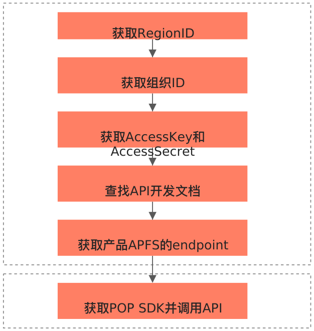
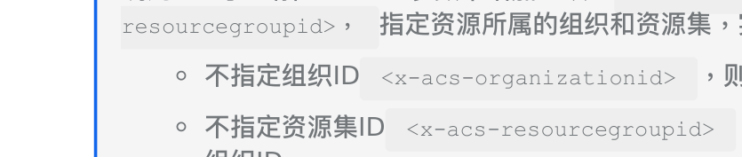
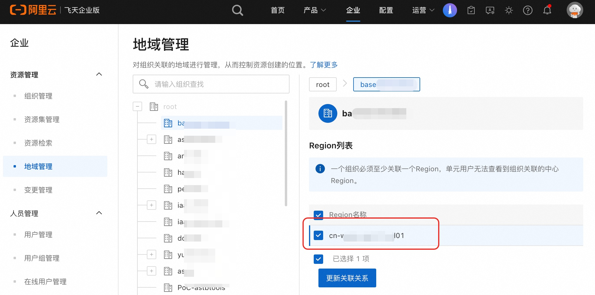
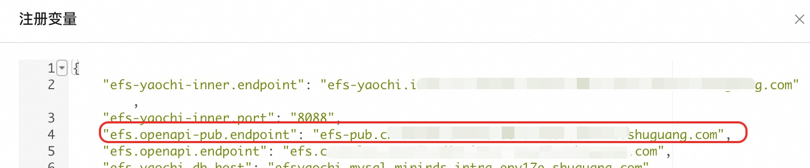

阿里云  
专有云  
高性能并行文件存储APFS 开发指  
南  
产品版本：V3.18.6  
文档版本：20251205

**目录**

- [1.使用前须知](#section-1)
- [2.快速入门](#section-2)
    - [2.1. API调用流程说明](#section-2-1)
- [3.准备工作](#section-3)
    - [3.1. 获取AccessKey](#section-3-1)
    - [3.2. 获取STS AccessKey](#section-3-2)
    - [3.3. 获取RegionID和Endpoint信息](#section-3-3)
    - [3.4. 通过POP网关调用专有云API](#section-3-4)
- [4.Java SDK调用示例](#section-4)
    - [4.1. 快速开始](#section-4-1)
    - [4.2. 使用手册](#section-4-2)
        - [4.2.1. 安装Java SDK](#section-4-2-1)
        - [4.2.2. 设置身份验证凭证](#section-4-2-2)
        - [4.2.3. 请求连接配置](#section-4-2-3)
        - [4.2.4. 使用CommonRequest进行调用](#section-4-2-4)
        - [4.2.5. 错误处理](#section-4-2-5)
- [5.Python SDK调用示例](#section-5)
    - [5.1. 快速开始](#section-5-1)
    - [5.2. 使用手册](#section-5-2)
        - [5.2.1. 安装Python SDK](#section-5-2-1)
        - [5.2.2. 设置身份验证凭证](#section-5-2-2)
        - [5.2.3. 设置HTTPS请求](#section-5-2-3)
        - [5.2.4. 使用CommonRequest进行调用](#section-5-2-4)
        - [5.2.5. 错误处理](#section-5-2-5)
- [6.Go SDK调用示例](#section-6)
    - [6.1. 快速开始](#section-6-1)
    - [6.2. 使用手册](#section-6-2)
        - [6.2.1. 安装Go SDK核心包](#section-6-2-1)
        - [6.2.2. 设置身份验证凭证](#section-6-2-2)
        - [6.2.3. 使用CommonRequest进行调用](#section-6-2-3)
        - [6.2.4. 错误处理](#section-6-2-4)
- [7.API参考](#section-7)
    - [7.1. 调用API](#section-7-1)
        - [7.1.1. 概述](#section-7-1-1)
        - [7.1.2. 请求结构](#section-7-1-2)
        - [7.1.3. API授权](#section-7-1-3)
        - [7.1.4. 返回结果](#section-7-1-4)
    - [7.2. RAM鉴权](#section-7-2)
    - [7.3. 公共参数](#section-7-3)
    - [7.4. 文件系统](#section-7-4)
        - [7.4.1. CreateFileSystem](#section-7-4-1)
        - [7.4.2. DeleteFileSystem](#section-7-4-2)
        - [7.4.3. DescribeFileSystems](#section-7-4-3)
        - [7.4.4. ModifyFileSystem](#section-7-4-4)
        - [7.4.5. DescribeZones](#section-7-4-5)

<a id="section-1"></a>

# 1.使用前须知

使用APFS API实现具体功能前，开发人员需要了解调用APFS API时使用的产品名称和API版本。

当使用APFS的文件系统功能时，请通过POP SDK调用对应API来实现。使用POP SDK调用API时，请设置产品名称为EFS，API版本为2017-06-26。

具体调用流程如下图所示。


准备工


正式调

<a id="section-2"></a>

# 2.快速入门

<a id="section-2-1"></a>

## 2.1. API调用流程说明

阿里云专有云支持通过POP网关或ASAPI网关调用专有云API，为了使您拥有与公有云更一致的体验，自企业版V3.16.0开始，专有云API默认使用POP网关方式调用。本文介绍通过POP网关调用专有云API的流程。

> **说明**
>
> 历史版本使用ASAPI网关调用专有云API的方式仍然有效。

**流程图**




准备工


正式调

**调用步骤**

1. 获取AccessKey。

   获取调用时所需要的AccessKey参数，具体操作，请参见获取AccessKey或获取STS AccessKey。

   > **说明**
   >
   > 推荐使用个人AccessKey或STS AccessKey调用Apsara Uni-manager运营控制台及云产品接口。

2. 获取RegionID。

   获取调用时所需要的RegionID参数。具体操作，请参见获取RegionID和Endpoint信息。

3. 获取组织ID与资源集ID。

   组织ID需要通过API进行获取，获取方式请参见*Apsara Uni-manager运营控制台开发指南*中的*GetOrga nizationList章节*。

   资源集ID需要通过API进行获取，获取方式请参见*Apsara Uni-manager运营控制台开发指南*中的*ListRe sourceGroup章节*。

   > **说明**
   >
   > 调用API时，请在Header参数中增加组织ID `<x-acs-organizationid>` 和资源集ID `<x-acs-`



> `resourcegroupid>`， 指定资源所属的组织和资源集，实现实例资源的隔离查询。
>
> - 不指定组织ID `<x-acs-organizationid>` ，则默认获取当前用户所属的组织。
>
> - 不指定资源集ID `<x-acs-resourcegroupid>` ，则默认为空，如果指定资源集需要同时指定组织ID。

4. 获取对应的API参考文档。

   您需要查看目标云产品的开发指南，了解API的功能与使用方式。

5. 获取云产品Endpoint。

   关于如何获取Endpoint的更多信息，请参见获取RegionID和Endpoint信息。

6. 获取云产品SDK并调用云产品API。

<a id="section-3"></a>

# 3.准备工作

<a id="section-3-1"></a>

## 3.1. 获取AccessKey

AccessKey支持RAM和STS两种授权模式，在发起调用时选择使用其中一种AccessKey即可。本文将为您描述如何获取通过RAM授权的AccessKey。

**背景信息**

AccessKey通过使用AccessKey ID和AccessKey Secret对称加密，以验证某个请求发送者的身份。其中AccessKey ID用于标识用户，AccessKey Secret是用户用于加密签名的字符串。

AccessKey的两种授权模式如下：

- 通过RAM授权给第三方请求者的AccessKey ID和AccessKey Secret。

- 通过STS授权给第三方请求者的AccessKey ID、AccessKey Secret和Security Token。获取方式，请参见获取STS AccessKey。

Apsara Uni-manager运营控制台提供了个人AccessKey和组织AccessKey（只有运营管理员和一级组织管理员可以获取组织AccessKey），推荐使用个人账号AccessKey调用Apsara Uni-manager运营控制台及云产品相关接口。如果使用个人账号AccessKey，需要在Header中添加以下限制性参数，否则可能提示权限不足：

> **警告**
>
> 个人账号AccessKey是由Apsara Uni-manager运营控制台权限体系管控的受限AccessKey，组织AccessKey相对权限较大，需要管理员确认操作的安全性。

<table>
  <tr>
    <th width="206">参数名称</th>
    <th>描述</th>
  </tr>
  <tr>
    <td>x-acs-regionid</td>
    <td>地域，如：cn-hangzhou-*。</td>
  </tr>
  <tr>
    <td>x-acs-organizationid</td>
    <td>Apsara Uni-manager运营控制台中对应的组织ID。获取方式，请参见<em>Apsara Uni-manager运营控制台开发</em><em>指南</em>中的<em>GetOrganizationList</em>章节。</td>
  </tr>
  <tr>
    <td>x-acs-resourcegroupid</td>
    <td>Apsara Uni-manager运营控制台中对应的资源集ID。获取方式，请参见<em>Apsara Uni-manager运营控制台开</em><em>发指南</em>中的<em>ListResourceGroup</em>章节。</td>
  </tr>
  <tr>
    <td>x-acs-instanceid</td>
    <td>进行操作的实例ID，例如，ECS的实例ID可以从ECS列表中查询到。</td>
  </tr>
</table>

**获取个人账号AccessKey**

获取个人账号AccessKey的方法如下：

1. 登录Apsara Uni-manager运营控制台。

2. 在系统界面右上角，单击当前登录用户头像，单击**个人信息**。

3. 在**AccessKey**区域，您可以查看个人账户的AccessKey信息。

   > **说明**
   >
   > Accesskey ID和AccessKey Secret是您访问云资源时的密钥，具有该账号完整的权限，请您妥善保管。

**获取组织AccessKey**

获取组织AccessKey的方法如下：

1. 管理员登录Apsara Uni-manager运营控制台。

2. 在顶部菜单栏，单击**企业**。

3. 在左侧导航栏中，选择。

4. 在组织结构中，单击目标一级组织名称。

5. 单击**管理Accesskey**。

6. 在弹出的对话框中，查看组织AccessKey信息。

<a id="section-3-2"></a>

## 3.2. 获取STS AccessKey

本文为您介绍如何利用STS方式，调用专有云APFS的API。

**背景信息**

阿里云临时安全令牌STS（Security Token Service）是阿里云提供的一种临时访问权限管理服务。您可以选择使用STS方式，调用专有云的产品API。

STS AccessKey由AccessKey ID、AccessKey Secret及SecurityToken三元组组成，使用STS方式调用云产品API时，三元组缺一不可。。

**操作步骤**

1. 获取用户角色的 `RAM Role` 。

   <ol type="i">

   <li>

   登录Apsara Uni-manager运营控制台。

   </li>

   <li>

   单击页面右上角的用户头像，选择**个人信息**。

   </li>

   <li>

   单击**查看当前角色策略**。

   在**当前选择角色策略**对话框中查看 `RAM Role` 。

   </li>

   </ol>

2. 获取STS Accesskey三元组。

   > **说明**
   >
   > 以下代码示例中可变参数均需替换为您实际的相关信息，尖括号（<>）在最终代码中不保留。
   >
   > 涉及替换的可变参数如下：
   >
   > - &lt;yourRegionID>，请替换为您实际的地域ID。
   >
   > - &lt;yourAccessKeyID>，请替换为您实际的AccessKey ID。
   >
   > - &lt;yourAccessKeySecret>，请替换为您实际的AccessKey Secret。
   >
   > - &lt;yourRoleSessionName>，请替换为您当前实际的会话名称。
   >
   > - &lt;yourRoleArn>，请替换为您实际的RAM Role。
   >
   > - &lt;sts.aliyuns.com> ，请替换为实际的STS Endpoint。

   ```xml
   public static void main(String[] args) {
       // 创建DefaultAcsClient实例并初始化。
       // <yourRegionID>、<yourAccessKeyID>和<yourAccessKeySecret>请分别替换为您实际的地域ID
   、AccessKey ID和AccessKey Secret。
       DefaultProfile profile = DefaultProfile.getProfile("<yourRegionID>", "
   <yourAccessKeyID>", "<yourAccessKeySecret>");
       HttpClientConfig clientConfig = HttpClientConfig.getDefault();
       clientConfig.setIgnoreSSLCerts(true);
       clientConfig.setProtocolType(ProtocolType.HTTPS);
       profile.setHttpClientConfig(clientConfig);
       IAcsClient client = new DefaultAcsClient(profile);
       String assumeRole = callAssumeRole(client);
       if (StringUtils.isEmpty(assumeRole)) return;
       JSONObject assumeRoleJson = JSONObject.parseObject(assumeRole);
       JSONObject credentials = assumeRoleJson.getJSONObject("Credentials");
       // 获取到STS三元组。
       String stsAK = credentials.getString("AccessKeyId");
       String stsSK = credentials.getString("AccessKeySecret");
       String stsToken = credentials.getString("SecurityToken");
   }

   private static String callAssumeRole(IAcsClient client) {
       CommonRequest request = new CommonRequest();
       // sts.aliyuns.com请替换为实际的STS Endpoint，⼀般格式为sts-
   vpc.${global:region}.${global:internet-domain}。
       request.setSysDomain("sts.aliyuns.com");
       request.setSysProduct("Sts");
       request.setSysAction("AssumeRole");
       request.setSysVersion("2015-04-01");
       request.setSysMethod(MethodType.POST);
       request.setHttpContentType(FormatType.FORM);
       // 业务参数，设置本次调⽤Session的别名，<yourRoleSessionName>请您替换为实际值。
       request.putQueryParameter("RoleSessionName", "<yourRoleSessionName>");
       // 扮演的Role⾓⾊ARN，<yourRoleArn>请替换为上⼀步获取到的实际RAM Role ARN。
       request.putQueryParameter("RoleArn", "<yourRoleArn>");
       try {
           CommonResponse response = client.getCommonResponse(request);
           return response.getData();
       } catch (ServerException e) {
           System.out.println(e.getErrCode());
           System.out.println(e.getErrMsg());
       } catch (ClientException e) {
           System.out.println(e.getErrCode());
           System.out.println(e.getErrMsg());
       }
       return null;
   }
   ```

3. 通过STS AccessKey三元组调用云产品的接口。

   > **说明**
   >
   > 以下代码示例中可变参数均需替换为您实际的相关信息，尖括号（<>）在最终代码中不保留。

<a id="section-3-3"></a>

## 3.3. 获取RegionID和Endpoint信息

本文介绍获取RegionID和Endpoint信息的操作步骤。

**获取RegionID**

1. 登录Apsara Uni-manager运营控制台。

2. 在顶部菜单栏选择**企业**。

3. 在左侧导航栏选择**资源管理 > 地域管理**。

4. 在搜索栏输入组织名称，并单击组织名称，可查看该组织的RegionID信息。

   

**获取Endpoint**

1. 登录Apsara Uni-manager运维控制台。

2. 在顶部菜单栏选择**平台运维 > 飞天基础运维平台 > 运维工具**。

3. 在**服务注册变量大盘**页面，选择**服务**并输入**efs-yaochi**。

4. 单击**Service Registration**列  图标，单击显示的信息。

5. 在**注册变量**对话框，查看**efs.openapi-pub.endpoint**的值即为APFS文件系统的Endpoint。

   

<a id="section-3-4"></a>

## 3.4. 通过POP网关调用专有云API

通过POP Java SDK访问产品域名，需要了解该产品调用方式（RPC或ROA）。

**前提条件**

目前专有云推荐使用CommonRequest进行调用，您可以从SDK中心下载V1.0版本的SDK。

**CommonRequest调用示例**

RPC调用，示例接口信息：产品名（EFS）、接口（DescribeFileSystems）、版本（2017-06-26）。

调用示例如下：

```java
import com.aliyuncs.CommonRequest;
import com.aliyuncs.CommonResponse;
import com.aliyuncs.DefaultAcsClient;
import com.aliyuncs.IAcsClient;
import com.aliyuncs.exceptions.ClientException;
import com.aliyuncs.exceptions.ServerException;
import com.aliyuncs.http.HttpClientConfig;
import com.aliyuncs.http.ProtocolType;
import com.aliyuncs.profile.DefaultProfile;
public class Sample {
    public static void main(String[] args) {
        // 创建DefaultAcsClient实例并初始化。
        DefaultProfile profile = DefaultProfile.getProfile(
            "<yourRegionID>",          // 请替换为您实际的地域ID。
            "<yourAccessKeyID>",      // 请替换为您实际的AccessKey ID。
            "<yourAccessKeySecret>"); // 请替换为您实际的AccessKey Secret。
        // 设置当前产品的Endpoint，可变参数请替换为您的实际值。 
        profile.addEndpoint("<Endpoint>");
        HttpClientConfig clientConfig = HttpClientConfig.getDefault();        
        clientConfig.setProtocolType(ProtocolType.HTTP); 
        /** 设置代理(可选),替换为代理IP+Port
        clientConfig.setHttpProxy("<http://192.168.XX.XX:33XX>");
        或
        clientConfig.setHttpsProxy("<https://192.168.XX:33XX>");
        请替换为实际代理IP+端⼝。
        */
        profile.setHttpClientConfig(clientConfig);
        IAcsClient client = new DefaultAcsClient(profile);
        // 创建API请求并设置参数。
        CommonRequest request = new CommonRequest();
        // 替换为真实的产品域名。
        request.setDomain("<Endpoint>");
        request.setSysProduct("EFS");
        request.setVersion("2017-06-26");
        request.setAction("CreateFileSystem");
        request.putQueryParameter("PageNumber", "1");
        request.putQueryParameter("PageSize", "30");
        request.putHeadParameter("x-acs-resourcegroupid", "<yourResourceGroupID>");// 非
必填，请替换为您实际的资源集ID。
        request.putHeadParameter("x-acs-organizationid", "<yourOrganizationID>");// 必填
，请替换为您实际的组织ID。
        request.putHeadParameter("x-acs-caller-sdk-source","ApiTestDemo");// 必填，调⽤来
源说明。
        request.putHeadParameter("x-acs-regionid", "<yourRegionID>");// 非必填（企业版V3.1
5.0及之前历史版本必填）,请替换为您实际的地域ID。
        // request.putHeadParameter("x-acs-instanceid", "<yourInstanceID>");// 非必填（修
改、删除、查询单实例详情时必填）,请替换为您实际的实例ID。
        /** 
        当使⽤STS AccessKey调⽤接⼝时，需要在参数中加上SecurityToken字段。
        调⽤⽅法如下：
        request.putQueryParameter("SecurityToken", "<yourSecurityToken>");
        请替换为实际的Token
        */
        try {
            CommonResponse response = client.getCommonResponse(request);
            System.out.println(response.getData());
        } catch (ServerException e) {
            // TODO Auto-generated catch block
            e.printStackTrace();
        } catch (ClientException e) {
            // TODO Auto-generated catch block
            e.printStackTrace();
        }
    }
}
```

> **重要**
>
> 使用HTTPS协议访问OpenAPI时，SDK会默认开启校验SSL/TLS 证书有效性，若您代码环境没有证书环境，则会报错证书校验失败。
>
> 为保障生产环境通信安全，建议您保持开启，若在测试环境必须忽略证书校验，可以通过以下参数设置：
>
> ```text
> HttpClientConfig clientConfig = HttpClientConfig.getDefault();
> // 设置不校验服务端证书
> clientConfig.setIgnoreSSLCerts(true)
> ```

<a id="section-4"></a>

# 4.Java SDK调用示例

本文介绍如何获取Java SDK并开始调用。

<a id="section-4-1"></a>

## 4.1. 快速开始

本文介绍如何获取Java SDK并开始调用。

**环境准备**

- 使用阿里云专有云Java SDK，您需要一个授权账号以及一对AccessKey ID和AccessKey Secret。具体操作，请参见获取AccessKey。

- 根据所用功能获取相应产品的Endpoint。具体操作，请参见获取RegionID和Endpoint信息。

- 阿里云专有云Java SDK需要1.8及以上的JDK。

**安装阿里云专有云Java SDK**

如果您使用Apache Maven来管理Java项目，只需在项目的pom.xml中导入JAR文件。

要使用产品的开发工具包，必须安装SDK核心库以及产品的SDK。其中，SDK核心库推荐使用4.5.17及以上版本。 具体操作，请参见安装Java SDK。

**使用Java SDK**

调用阿里云专有云Java SDK的主要操作步骤如下：

1. 创建并初始化DefaultAcsClient实例。

2. 创建API请求并设置参数。

3. 发起请求并处理应答或异常。

<a id="section-4-2"></a>

## 4.2. 使用手册

<a id="section-4-2-1"></a>

### 4.2.1. 安装Java SDK

本文介绍如何安装及调用Java SDK

阿里云专有云Java SDK支持1.8及以上版本的JDK，可以通过添加Maven依赖或下载阿里云开发工具包（SDK）的方式安装专有云Java SDK。

要使用APFS功能，必须安装阿里云Java SDK核心库，SDK核心库推荐使用4.5.17及以上版本

```xml
<!-- Alibaba Cloud SDK for Java -->
<dependency>
    <groupId>com.aliyun</groupId>
    <artifactId>aliyun-java-sdk-core</artifactId>
    <version>4.5.17</version>
</dependency>
```

<a id="section-4-2-2"></a>

### 4.2.2. 设置身份验证凭证

当使用阿里云专有云SDK访问阿里云专有云服务时，您需要提供授权的账号进行身份验证。本文介绍了如何设置身份验证凭证。

目前，Java SDK支持通过AccessKey进行身份验证，具体获取AccessKey的方法，请参见获取AccessKey。

使用AccessKey作为访问凭据时，需要在初始化Client时设置凭证。

> **说明**
>
> 确保包含AccessKey的代码不会泄漏（例如提交到外部公开的GitHub项目），否则将会危害您的信息安全。

```text
DefaultProfile profile = DefaultProfile.getProfile(
    "<yourRegionID>",          // 请替换为您实际的地域ID
    "<yourAccessKeyID>",      // 请替换为您实际的AccessKey ID
    "<yourAccessKeySecret>"); // 请替换为您实际的AccessKey Secret
```

> **说明**
>
> 以上代码示例中可变参数均需替换为您实际的相关信息，尖括号（<>）在最终代码中不保留。

<a id="section-4-2-3"></a>

### 4.2.3. 请求连接配置

本文介绍了如何配置请求连接（HttpClientConfig）。

您可通过以下代码配置HttpClientConfig，具体请根据自身服务能力自行选择配置项并做相应配置。

> **说明**
>
> 以下代码示例中可变参数均需替换为您实际的相关信息，尖括号（<>）在最终代码中不保留。
>
> 涉及替换的可变参数如下：
>
> - &lt;readTimeout>，请您根据自身服务的能力，配置读取超时时间，单位为毫秒（ms）。
>
> - &lt;connectionTimeout>，请您根据自身服务的能力，配置连接超时时间，单位为毫秒（ms）。
>
> - &lt;maxRequestsPerHost>，请您根据自身服务的能力，配置每台服务器的最大请求数，数据类型为INT。
>
> - &lt;maxRequests>，请您根据自身服务的能力，配置最大请求数，数据类型为INT。
>
> - &lt;http://192.168.XX.XX:33XX>，请替换为您实际的代理IP+端口。

```text
// 获取HttpClientConfig对象
HttpClientConfig clientConfig = HttpClientConfig.getDefault();
// 设置是否忽略证书
clientConfig.setIgnoreSSLCerts(true);
// (可选)设置读取超时时间，单位毫秒（ms）
clientConfig.setReadTimeoutMillis(<readTimeout>);
// (可选)设置创建连接超时时间，单位毫秒（ms）
clientConfig.setConnectionTimeoutMillis(<connectionTimeout>);
// (可选)设置每个主机的最⼤请求数，数据类型为INT
clientConfig.setMaxRequestsPerHost(<maxRequestsPerHost>);
// (可选)设置最⼤请求数，数据类型为INT
clientConfig.setMaxRequests(<maxRequests>);
// (可选)设置协议类型
clientConfig.setProtocolType(ProtocolType.HTTP);
/** （可选）请根据实际情况判断是否设置代理，设置⽅法如下：
clientConfig.setHttpProxy("<http://192.168.XX.XX:33XX>");
或
clientConfig.setHttpsProxy("<https://192.168.XX.XX:33XX>");
请替换为您实际的代理IP+端⼝
*/
profile.setHttpClientConfig(clientConfig);
```

<a id="section-4-2-4"></a>

### 4.2.4. 使用CommonRequest进行调用

当您要调用某个API没有提供SDK时，或者提供的SDK中的请求Request参数和返回Response值不符合需求时，可以采用泛用型的API调用方式（CommonRequest）。使用CommonRequest调用方式可实现任意OpenAPI接口的调用。

**CommonRequest调用特点**

CommonRequest的特点如下：

- 轻量：只需Core包即可发起调用，无需下载安装各产品的SDK。

- 简便：无需更新SDK即可调用最新发布的API。

- 快速迭代。

**使用CommonRequest**

发起一次CommonRequest请求，您需要获取以下几个参数的值。您可以在ECS的API文档中获取以下参数的值。

- 域名(domain)：该产品的服务地址。

- API版本(version)：该API的版本号，格式为YYYY-MM-DD。

  您可以在各产品的API文档的公共参数部分获取API版本。

- 接口信息：要调用的接口名称。

  您需要获取 `Action` 参数，使用 `request.setSysAction("<Action>")` 的方式来指定API名称。

  例如 `RunInstances` 接口，在发起 `CommonRequest` 请求时，需要使用 `request.setSysAction("RunInstances")` 来指定API名称。

**示例：调用RPC风格的API**

使用APFS的DescribeFileSystems接口获取文件系统信息的示例代码如下：

> **说明**
>
> 以下代码示例中可变参数均需替换为您实际的相关信息，尖括号（<>）在最终代码中不保留。
>
> 涉及替换的可变参数如下：
>
> - &lt;yourRegionID>，请替换为您实际的地域ID。
>
> - &lt;yourAccessKeyID>，请替换为您实际的AccessKey ID。
>
> - &lt;yourAccessKeySecret>，请替换为您实际的AccessKey Secret。
>
> - &lt;Endpoint>，请替换为您当前产品实际的Endpoint。
>
> - &lt;yourSecurityToken>，请替换为您实际的SecurityToken。
>
> - &lt;yourResourceGroupID>，请替换为您实际的资源集ID。
>
> - &lt;yourOrganizationID>，请替换为您实际的组织ID。
>
> - &lt;yourInstanceID>，请替换为您实际的实例ID。
>
> - &lt;http://192.168.XX.XX:33XX>，请替换为您实际的代理IP和端口。

```java
import com.aliyuncs.CommonRequest;
import com.aliyuncs.CommonResponse;
import com.aliyuncs.DefaultAcsClient;
import com.aliyuncs.IAcsClient;
import com.aliyuncs.exceptions.ClientException;
import com.aliyuncs.exceptions.ServerException;
import com.aliyuncs.http.HttpClientConfig;
import com.aliyuncs.http.ProtocolType;
import com.aliyuncs.profile.DefaultProfile;
public class Sample {
    public static void main(String[] args) {
        // 创建DefaultAcsClient实例并初始化。
        DefaultProfile profile = DefaultProfile.getProfile(
            "<yourRegionID>",          // 请替换为您实际的地域ID。
            "<yourAccessKeyID>",      // 请替换为您实际的AccessKey ID。
            "<yourAccessKeySecret>"); // 请替换为您实际的AccessKey Secret。
        // 设置当前产品的Endpoint，可变参数请替换为您的实际值。 
        profile.addEndpoint("<Endpoint>");
        HttpClientConfig clientConfig = HttpClientConfig.getDefault();        
        clientConfig.setProtocolType(ProtocolType.HTTP); 
        /** 设置代理(可选),替换为代理IP+Port
        clientConfig.setHttpProxy("<http://192.168.XX.XX:33XX>");
        或
        clientConfig.setHttpsProxy("<https://192.168.XX:33XX>");
        请替换为实际代理IP+端⼝。
        */
        profile.setHttpClientConfig(clientConfig);
        IAcsClient client = new DefaultAcsClient(profile);
        // 创建API请求并设置参数。
        CommonRequest request = new CommonRequest();
        // 替换为真实的产品域名。
        request.setDomain("<Endpoint>");
        request.setSysProduct("EFS");
        request.setVersion("2017-06-26");
        request.setAction("CreateFileSystem");
        request.putQueryParameter("PageNumber", "1");
        request.putQueryParameter("PageSize", "30");
        request.putHeadParameter("x-acs-resourcegroupid", "<yourResourceGroupID>");// 非
必填，请替换为您实际的资源集ID。
        request.putHeadParameter("x-acs-organizationid", "<yourOrganizationID>");// 必填
，请替换为您实际的组织ID。
        request.putHeadParameter("x-acs-caller-sdk-source","ApiTestDemo");// 必填，调⽤来
源说明。
        request.putHeadParameter("x-acs-regionid", "<yourRegionID>");// 非必填（企业版V3.1
5.0及之前历史版本必填）,请替换为您实际的地域ID。
        // request.putHeadParameter("x-acs-instanceid", "<yourInstanceID>");// 非必填（修
改、删除、查询单实例详情时必填）,请替换为您实际的实例ID。
        /** 
        当使⽤STS AccessKey调⽤接⼝时 需要在参数中加上SecurityToken字段。
        调⽤⽅法如下：
        request.putQueryParameter("SecurityToken", "<yourSecurityToken>");
        请替换为实际的Token
        */
        try {
            CommonResponse response = client.getCommonResponse(request);
            System.out.println(response.getData());
        } catch (ServerException e) {
            // TODO Auto-generated catch block
            e.printStackTrace();
        } catch (ClientException e) {
            // TODO Auto-generated catch block
            e.printStackTrace();
        }
    }
}
```

<a id="section-4-2-5"></a>

### 4.2.5. 错误处理

在使用Java SDK时，当服务端或者SDK端出错时，SDK会返回相应的异常信息。这些异常信息中会包含具体的错误信息，包括错误码（Error Code）和错误消息（Error Message）。

一般情况下，您不需要Java SDK返回的错误进行处理。您只需要根据服务端的错误提示处理服务端错误即可。

- `ServerException` 是服务端错误信息。

- `ClientException` 是SDK端错误信息。

例如，当出现如下错误时，您可以根据具体的错误信息，修改AccessKey的ID即可。

```text
com.aliyuncs.exceptions.ClientException: InvalidAccessKeyId.NotFound : Specified accesskey is not found.
```

如果您需要对SDK的错误进行处理，可以参考如下示例编写代码：

```java
try {
    FooResponse response = client.getAcsResponse(request);
    // 处理Response
    // ...
}catch (ServerException e){
    // 这⾥可以添加您⾃⼰的错误处理逻辑
    // 例如，打印具体的错误信息
    System.out.println("ErrorCode=" + e.getErrCode());
    System.out.println("ErrorMessage=" + e.getErrMsg());
    // 如果遇上棘⼿问题，可以提交⼯单，并将RequestId提供给我们
    System.out.println("ResponseId=" + e.getRequestId());
}catch (ClientException e){
    // 这⾥可以添加您⾃⼰的错误处理逻辑
    // 例如，打印具体的错误信息
    System.out.println("ErrorCode=" + e.getErrCode());
    System.out.println("ErrorMessage=" + e.getErrMsg());
}
```

<a id="section-5"></a>

# 5.Python SDK调用示例

<a id="section-5-1"></a>

## 5.1. 快速开始

本文介绍如何获取SDK并开始调用。

**环境准备**

- 使用阿里云专有云Python SDK，您需要一个授权账号以及一对AccessKey ID和AccessKey Secret。具体操作，请参见获取AccessKey。

- 根据所用功能获取相应产品的Endpoint。具体操作，请参见获取RegionID和Endpoint信息。

**安装Python SDK核心库**

要使用APFS功能，您必须安装阿里云Java SDK核心库。

具体安装步骤如下：

- 如果您使用的是Python 2.x，执行以下命令，安装阿里云SDK核心库：

  ```bash
  pip install aliyun-python-sdk-core
  ```

- 如果您使用的是Python 3.x，执行以下命令，安装阿里云SDK核心库：

  ```bash
  pip3 install aliyun-python-sdk-core-v3
  ```

**使用Python SDK**

调用Python SDK的3个主要步骤如下：

1. 创建Client实例。在创建Client实例时，您需要获取Region ID、AccessKey ID和AccessKey Secret。

2. 创建API请求并设置参数。

3. 发起请求并处理应答或异常。

<a id="section-5-2"></a>

## 5.2. 使用手册

<a id="section-5-2-1"></a>

### 5.2.1. 安装Python SDK

本文介绍如何安装及调用Python SDK。

**背景信息**

阿里云专有云Python SDK支持Python 2.6.x、2.7.x和3.x及以上环境，您可以通过pip安装专有云Python SDK。

> **说明**
>
> 使用产品的开发工具包，都必须安装阿里云Python SDK核心库。

**安装Python SDK核心库**

要使用APFS功能，您必须安装阿里云Java SDK核心库。

具体安装步骤如下：

- 如果您使用的是Python 2.x，执行以下命令，安装阿里云SDK核心库：

  ```bash
  pip install aliyun-python-sdk-core
  ```

- 如果您使用的是Python 3.x，执行以下命令，安装阿里云SDK核心库：

  ```bash
  pip3 install aliyun-python-sdk-core-v3
  ```

<a id="section-5-2-2"></a>

### 5.2.2. 设置身份验证凭证

当使用阿里云专有云SDK访问阿里云专有云服务时，您需要提供授权的账号进行身份验证。本文介绍了如何设置身份验证凭证。

目前，Python SDK支持通过AccessKey进行身份验证，具体获取AccessKey的方法，请参见获取AccessKey。

使用AccessKey作为访问凭据时，需要在初始化Client时设置凭证。

> **说明**
>
> 确保包含AccessKey的代码不会泄漏（例如提交到外部公开的GitHub项目），否则将会危害您的信息安全。

```python
from aliyunsdkcore import client
clt = client.AcsClient(access_key, acces_secret, region_id)
```

<a id="section-5-2-3"></a>

### 5.2.3. 设置HTTPS请求

Python SDK支持使用HTTP和HTTPS协议发起 API 请求。

使用Python SDK时，您可以为某个请求指定使用HTTP或HTTPS协议，您也可以设置全局默认协议。

> **说明**
>
> 产品的默认协议（HTTP/HTTPS）优先于设置的全局默认协议。

**添加OpenSSL依赖**

Python SDK的HTTPS协议依赖Python的OpenSSL支持。要使用阿里云SDK通过HTTPS协议发送请求，您需要在Python中添加OpenSSL 支持。Open SSL支持TLS1.2及以上版本。

运行 `python -c "import ssl"` 检查Python环境是否支持OpenSSL。运行后，如果没有出现

`ImportError: No module named ssl` 的错误信息，说明已经支持OpenSSL。

若没有OpenSSL，运行以下命令安装：

```bash
pip install pyopenssl
```

**设置单个请求的HTTP/HTTPS协议**

参考以下代码示例为一个接口设置HTTPS调用：

```text
request = DescribeInstancesRequest()
request.set_protocol_type("https")
# 取值："https" 或 "http"
```

**设置全局默认协议**

参考以下代码示例设置全局默认协议：

```python
import aliyunsdkcore.request
aliyunsdkcore.request.set_default_protocol_type("https")
# 创建请求并调⽤ client.do_action_with_exception() 来发送请求
```

<a id="section-5-2-4"></a>

### 5.2.4. 使用CommonRequest进行调用

当您要调用的APFS的某个API没有提供SDK时，或者提供的SDK中的请求Request参数和返回Response值不符合需求时，可以采用泛用型的API调用方式（CommonRequest）。使用CommonRequest调用方式可实现任意OpenAPI接口的调用。

**CommonRequest调用特点**

CommonRequest的特点如下：

- 轻量：只需Core包即可发起调用，无需下载安装各产品的SDK。

- 简便：无需更新SDK即可调用最新发布的API。

- 快速迭代。

**使用CommonRequest**

发起一次CommonRequest请求，您需要获取以下几个参数的值。您可以在各产品的API文档中获取以下参数的值。

- 域名(domain)：该产品的服务地址。

- API版本(version)：该API的版本号，格式为YYYY-MM-DD。

  您可以在各产品的API文档的公共参数部分获取API版本。

- 接口信息：要调用的接口名称。

  您需要获取 `Action` 参数，使用 `request.set_action_name('Action')` 的方式来指定API名称。

  例如 `RunInstances` 接口，在发起 `CommonRequest` 请求时，需要使用 `request.set_action_name('RunInstances')` 来指定API名称。

**示例：调用RPC风格的API**

使用文件系统的DescribeFileSystems接口获取文件系统信息的示例代码如下：

> **说明**
>
> 以下代码示例中可变参数均需替换为您实际的相关信息，尖括号（<>）在最终代码中不保留。
>
> 涉及替换的可变参数如下：
>
> - &lt;yourRegionID>，请替换为您实际的地域ID。
>
> - &lt;yourAccessKeyID>，请替换为您实际的AccessKey ID。
>
> - &lt;yourAccessKeySecret>，请替换为您实际的AccessKey Secret。
>
> - &lt;yourSecurityToken>，请替换为您实际的SecurityToken。
>
> - &lt;yourResourceGroupID>，请替换为您实际的资源集ID。
>
> - &lt;yourOrganizationID>，请替换为您实际的组织ID。
>
> - &lt;yourInstanceID>，请替换为您实际的实例ID。
>
> - &lt;Endpoint>，请替换为您当前产品实际的Endpoint。

```python
#!/usr/bin/env python
# coding=utf-8
from aliyunsdkcore.client import AcsClient
from aliyunsdkcore.request import CommonRequest
# 请替换为您实际的AccessKey ID、AccessKey Secret、地域ID。
client = AcsClient('{<yourAccessKeyID>}', '{<yourAccessKeySecret>}', 
'{<yourRegionID>}')
request = CommonRequest()
request.set_product('EFS')
request.set_action_name('DescribeFileSystems')
request.set_version('2017-06-26')
request.set_domain('<Endpoint>') #产品访问域名，当前为示例值，请替换为您实际的产品访问地址。
# or:
# request = = CommonRequest(product='EFS', 
action_name='DescribeFileSystems',version='2017-06-26',domain='<Endpoint>')
######
# 设置请求协议类型，⽀持https或http，默认为http。
# 设置https⽅法如下：
# request.set_protocol_type('https') 
######
request.set_accept_format('json')
request.set_method('POST')
request.add_query_param('PageNumber', '1')
request.add_query_param('PageSize', '30')
######
# 当使⽤STS AccessKey调⽤接⼝时，需要在参数中加上SecurityToken字段。
# 调⽤⽅法如下：
# request.add_query_param("SecurityToken", "<yourSecurityToken>");
# 请替换为您实际的SecurityToken。
######
# 非必填，请替换为您实际的资源集ID。
request.add_header("x-acs-resourcegroupid", "<yourResourceGroupID>")
# 必填，请替换为您实际的组织ID。
request.add_header("x-acs-organizationid", "<yourOrganizationID>")
# 必填，调⽤来源说明。
request.add_header("x-acs-caller-sdk-source","ApiTestDemo")
# 非必填（企业版V3.15.0及之前历史版本必填），请替换为您实际的地域ID。
request.add_header("x-acs-regionid", "<yourRegionID>")
# 非必填（修改、删除、查询单实例详情时必填），请替换为您实际的实例ID。
# request.add_header("x-acs-instanceid", "<yourInstanceID>")

response = client.do_action_with_exception(request)
# python2:  print(response) 
print(str(response, encoding = 'utf-8'))
```

<a id="section-5-2-5"></a>

### 5.2.5. 错误处理

在使用Python SDK时，当服务端或者SDK端出错时，SDK会返回相应的异常信息。这些异常信息中会包含具体的错误信息包括错误码（Error Code）和错误消息（Error Message）。

一般情况下，您不需要对Python SDK返回的错误进行处理。您只需要根据服务端的错误提示处理服务端错误即可。

- `ServerException` 是服务端错误信息。

- `ClientException` 是SDK端错误信息。

例如，当出现如下错误时，您可以根据具体的错误信息，修改AccessKey的ID即可。

```text
aliyunsdkcore.acs\_exception.exceptions.ServerException: HTTP Status: 404 
Error:InvalidAccessKeyId.NotFound Specified access key is not found.
```

如果您需要对SDK的错误进行处理，可以参考如下示例编写代码：

```text
try:
    response = client.do_action_with_exception(request)
except ServerException as e:
    # 这⾥可以添加您⾃⼰的错误处理逻辑
    # 例如，打印具体的错误信息
    print e.get_http_status()
    print e.get_error_code()
    print e.get_error_msg()
```

<a id="section-6"></a>

# 6.Go SDK调用示例

<a id="section-6-1"></a>

## 6.1. 快速开始

阿里云Go SDK让您不用复杂编程即可访问云产品。本操作介绍如何获取阿里云Go SDK并开始调用。

**环境准备**

- 使用Go SDK前，您需要一个授权账号以及一对AccessKey ID和AccessKey Secret。具体操作，请参见获取AccessKey。

- 根据所用功能获取相应产品的Endpoint。具体操作，请参见获取RegionID和Endpoint信息。

**安装阿里云Go SDK核心包**

阿里云Go SDK支持Go 1.10.x及更高版本，您可以通过执行以下命令安装Go SDK核心包。

```text
go get -u github.com/aliyun/alibaba-cloud-sdk-go/sdk
```

**使用Go SDK**

使用Go SDK的主要步骤如下：

1. 初始化Client实例。

2. 创建API请求并设置参数。

3. 发起请求并处理应答或异常。

<a id="section-6-2"></a>

## 6.2. 使用手册

<a id="section-6-2-1"></a>

### 6.2.1. 安装Go SDK核心包

本文档介绍如何安装 Go SDK核心包。

阿里云Go SDK支持Go 1.10.x及以上版本，您可以通过执行以下命令安装Go SDK核心包。

```text
go get -u github.com/aliyun/alibaba-cloud-sdk-go/sdk
```

<a id="section-6-2-2"></a>

### 6.2.2. 设置身份验证凭证

当使用阿里云专有云SDK访问阿里云专有云服务时，您需要提供授权的账号进行身份验证。本文介绍了如何设置身份验证凭证。

目前，Go SDK支持通过AccessKey进行身份验证，具体获取AccessKey的方法，请参见获取AccessKey。

使用AccessKey作为访问凭据时，需要在初始化Client时设置凭证。

> **说明**
>
> - 确保包含AccessKey的代码不会泄漏（例如提交到外部公开的GitHub项目），否则将会危害您的信息安全。
>
> - 代码示例中可变参数均需替换为您实际的相关信息，尖括号（<>）在最终代码中不保留。

**初始化Client实例**

```text
   client, err := sdk.NewClientWithAccessKey(
        "<yourRegionID>",        //请替换为您实际的地域ID，
        "<yourAccessKeyID>",     //请替换为您实际的AccessKey ID，
        "<yourAccessKeySecret>") //请替换为您实际的AccessKey Secret，
```

<a id="section-6-2-3"></a>

### 6.2.3. 使用CommonRequest进行调用

当您要调用的某个产品的API没有提供SDK时，或者提供的SDK中的请求Request参数和返回Response值不符合需求时，可以采用泛用型的API调用方式（CommonRequest）。使用CommonRequest调用方式可实现任意OpenAPI接口的调用。

**CommonRequest调用特点**

CommonRequest的特点如下：

- 轻量：只需Core包即可发起调用，无需下载安装各产品的SDK。

- 简便：无需更新SDK即可调用最新发布的API。

- 快速迭代。

**使用CommonRequest**

发起一次CommonRequest请求，您需要获取以下几个参数的值。您可以在ECS的API文档中获取以下参数的值。

- 域名(domain)：该产品的服务地址。

- API版本(version)：该API的版本号，格式为YYYY-MM-DD。

  您可以在各产品的API文档的公共参数部分获取API版本。

- 接口信息：要调用的接口名称。

  您需要获取 `Action` 参数，使用 `request.setSysAction("<Action>")` 的方式来指定API名称。

  例如 `RunInstances` 接口，在发起 `CommonRequest` 请求时，需要使用 `request.setSysAction("RunInstances")` 来指定API名称。

**示例：调用RPC风格的API**

使用云盘的DescribeDisks接口获取云盘信息的示例代码如下：

> **说明**
>
> 以下代码示例中可变参数均需替换为您实际的相关信息，尖括号（<>）在最终代码中不保留。
>
> 涉及替换的可变参数如下：
>
> - &lt;yourRegionID>，请替换为您实际的地域ID。
>
> - &lt;yourAccessKeyID>，请替换为您实际的AccessKey ID。
>
> - &lt;yourAccessKeySecret>，请替换为您实际的AccessKey Secret。
>
> - &lt;yourSecurityToken>，请替换为您实际的SecurityToken。
>
> - &lt;yourResourceGroupID>，请替换为您实际的资源集ID。
>
> - &lt;yourOrganizationID>，请替换为您实际的组织ID。
>
> - &lt;yourInstanceID>，请替换为您实际的实例ID。
>
> - &lt;Endpoint>，请替换为您当前产品实际的Endpoint。

```go
package main
import (
    "github.com/aliyun/alibaba-cloud-sdk-go/sdk/requests"
    "github.com/aliyun/alibaba-cloud-sdk-go/sdk"
    "fmt"
)
func main() {
    client, err := sdk.NewClientWithAccessKey(
        "<yourRegionID>",        //请替换为您实际的地域ID，
        "<yourAccessKeyID>",     //请替换为您实际的AccessKey ID，
        "<yourAccessKeySecret>") //请替换为您实际的AccessKey Secret，
    if err != nil {
        panic(err)
    }
    request := requests.NewCommonRequest()
    request.Method = "POST"
    request.Domain = "<endpoint>" // 请求访问地址，当前为示例值，请根据实际请求地址替换，
    request.Product = "EFS"
    request.Version = "2017-06-26"
    // 因为是RPC接⼝，因此需指定APIName(Action)，
    request.ApiName = "DescribeFileSystems"
    // 业务参数
    request.QueryParams["PageNumber"] = "1"
    request.QueryParams["PageSize"] = "30"
    /* 
     当使⽤STS AccessKey调⽤RPC接⼝时，需要在参数中加上SecurityToken字段。
     调⽤⽅式如下：
     request.QueryParams["SecurityToken"]="<yourSecurityToken>"
     请替换为您实际的SecurityToken。
     */
    request.Headers["x-acs-caller-sdk-source"] = "ApiTestDemo" // 必填，调⽤来源说明。
    request.Headers["x-acs-regionid"] = "<yourRegionID>" // 非必填（企业版V3.15.0及之前历史
版本必填），请替换为您实际的地域ID。
    request.Headers["x-acs-resourcegroupid"] = "<yourResourceGroupID>" // 非必填，请替换为
您实际的资源集ID。
    request.Headers["x-acs-organizationid"] = "<yourOrganizationID>" // 必填，请替换为您实
际的组织ID。
    // request.Headers["x-acs-instanceid"] = "<yourInstanceID>" // 非必填（修改、删除、查看
单实例详情时必填），请替换为您实际的实例ID
。    response, err := client.ProcessCommonRequest(request)
    if err != nil {
        panic(err)
    }
    fmt.Print(response.GetHttpContentString())
}
```

<a id="section-6-2-4"></a>

### 6.2.4. 错误处理

阿里云Go SDK在服务端或者SDK端出错时，会返回相应的错误信息，即 `sdk.errors` 包下的 `ClientError` 和 `ServerError` 。这些错误是基于Go的标准Error接口实现的，您可以像处理Go标准错误一样来处理阿里云Go SDK返回的错误。

**简单处理异常**

您可以通过以下代码来简单处理错误。

```text
response,err  := ecsClient.DescribeDisks(request)
if err != nil {
    //获取异常信息
   err.Error()
}
```

**ClientError**

当SDK内部的任意调用出现error，并无法自动化处理时，SDK会返回一个 `ClientError` 。

以下以ECS为例，您可以通过以下代码来判断并获取 `ClientError` 中的错误信息：

> **说明**
>
> 使用具体异常结构时需要引入异常结构包github.com/aliyun/alibaba-cloud-sdk-go/sdk/errors，引入方法请参考：
>
> ```go
> package main
> import (
>     "github.com/aliyun/alibaba-cloud-sdk-go/services/ecs" //ecs请替换为您实际的产品名称
>     "github.com/aliyun/alibaba-cloud-sdk-go/sdk/requests"
>     // 新增的错误包
>     "github.com/aliyun/alibaba-cloud-sdk-go/sdk/errors"
>     "fmt"
> )
> ```

```text
response, err := ecsClient.DescribeDisks(request)
if clientError, ok := err.(*errors.ClientError); ok{
    // 获取错误码，
    clientError.ErrorCode()
    // 获取错误描述，
    clientError.Message()
    // 获取原始错误（可能为nil），
    clientError.OriginError()
}
```

**ServerError**

当服务端返回错误的应答时，SDK会将该应答封装成 `ServerError` 返回。在这种情况下，您依然可以从Response中获得原始的HTTP应答。

以下以ECS为例，您可以通过以下代码来判断并获取 `ServerError` 以及 `Response` 中的错误信息：

> **说明**
>
> 使用具体异常结构时需要引入异常结构包 `github.com/aliyun/alibaba-cloud-sdk-go/sdk/errors` ，引入方法请参考：
>
> ```text
> import (
>     "github.com/aliyun/alibaba-cloud-sdk-go/services/ecs" //ecs请替换为您实际的产品名称
> 。
>     "github.com/aliyun/alibaba-cloud-sdk-go/sdk/requests"
>     // 新增的错误包。
>     "github.com/aliyun/alibaba-cloud-sdk-go/sdk/errors"
>     "fmt"
> )
> ```

```text
response, err := ecsClient.DescribeDisks(request)    
if serverError, ok := err.(*errors.ServerError); ok{
    // 获取错误码。
    serverError.ErrorCode()
    // 获取错误描述。
    serverError.Message()
    // 获取原始http应答。
    response.GetOriginHttpResponse()
}
```

<a id="section-7"></a>

# 7.API参考

<a id="section-7-1"></a>

## 7.1. 调用API

<a id="section-7-1-1"></a>

### 7.1.1. 概述

API接口调用是向产品的服务端地址发送HTTP GET请求。您需要按照接口描述在请求中加入相应请求参数。调用后系统会返回处理结果。请求及返回结果都使用UTF-8字符集编码。

<a id="section-7-1-2"></a>

### 7.1.2. 请求结构

**服务地址**

如何获取产品的endpoint，请参见获取RegionID和Endpoint信息。

**请求方法**

支持HTTP GET方法发送请求，这种方式下请求参数需要包含在请求的URL中。

**通信协议**

支持通过HTTP或HTTPS通道进行请求通信。为了获得更高的安全性，推荐您使用HTTPS通道发送请求。

**请求参数**

每个请求都需要指定要执行的操作，即Action参数（例如CreateFileSystem），以及每个操作都需要包含的公共请求参数和指定操作所特有的请求参数。

**字符编码**

请求及返回结果都使用UTF-8字符集进行编码。

<a id="section-7-1-3"></a>

### 7.1.3. API授权

为了确保您的账号安全，建议您使用RAM用户的身份凭证调用API。如果使用RAM用户调用块存储API，则您需要为该RAM用户创建并附加相应的授权策略。

在RAM中，可以对一个APFS资源进行以下Action的授权。

<table>
  <tr>
    <th width="90">分类</th>
    <th>Action名称列表</th>
  </tr>
  <tr>
    <td>文件系统</td>
    <td>• CreateFileSystem<br>• DeleteFileSystem<br>• DescribeFileSystems<br>• ModifyFileSystem<br>• DescribeZones</td>
  </tr>
</table>

<a id="section-7-1-4"></a>

### 7.1.4. 返回结果

调用API服务后返回数据采用统一格式，返回的HTTP状态码为2xx，代表调用成功；返回4xx或5xx的HTTP状态码代表调用失败。

<a id="section-7-2"></a>

## 7.2. RAM鉴权

当RAM用户通过OpenAPI对阿里云账号的资源进行访问时，系统会向RAM进行权限检查，以确保资源拥有者的确将相关资源的相关权限授予了调用者。

**背景信息**

默认情况下，阿里云账号或者RAM用户均能使用APFS控制台或APFS API操作自己创建的资源。在以下场景中，会涉及到操作授权问题：

- RAM用户刚创建时没有权限操作阿里云账号的资源时。

- 从其他阿里云服务访问APFS资源，或者APFS访问其他阿里云服务时。

- 操作具有权限控制的APFS资源前，需要资源拥有者授权目标资源和目标API行为权限。

当其他账号通过APFS API访问阿里云账号资源时，阿里云APFS首先向RAM发起权限检查，以确保资源拥有者已经将相关权限授予调用者。不同的APFS API会根据涉及的资源以及API语义确定需要检查哪些资源的权限。

**规则详情**

每个不同的APFS API， 会根据涉及到的资源以及API的语义，确定需要检查的资源的权限。

<a id="section-7-3"></a>

## 7.3. 公共参数

公共参数分为公共请求参数、公共Header参数和公共返回参数。

**公共请求参数**

公共请求参数是指每个接口都需要使用到的请求参数。

表 1. 公共请求参数表

| 名称 | 类型 | 是否必须 | 描述 |
| --- | --- | --- | --- |
| Format | String | 否 | 返回值的类型，仅支持JSON。 |
| Version | String | 是 | API版本号，以日期形式YYYY-MM-DD输入。根据使用不同的功能API版本取值不同。<br>• 当要使用云盘、快照功能时，API版本取值为<strong>2014-</strong><strong>05-26</strong>。<br>• 当要使用异步复制、一致性复制组功能时，API版本取值为<strong>2021-07-30</strong>。 |
| AccessKeyId | String | 是 | 访问服务使用的密钥ID。 |
| AccessKeySecret | String | 是 | 访问服务使用的密钥值。 |
| RegionId | String | 是 | 访问服务所使用的地域ID。 |
| Product | String | 是 | 接口对应的产品名称，产品名称取值为EFS。 |

**公共Header参数**

| 名称 | 描述 |
| --- | --- |
| x-acs-organizationid | Apsara Uni-manager运营控制台上的组织ID。具体获取方式，请参见获取组织ID。 |
| x-acs-resourcegroupid | Apsara Uni-manager运营控制台上的资源集ID。具体获取方式，请参见获取资源集ID。 |
| x-acs-instanceid | 进行操作的实例ID。具体获取方式，请参见获取实例ID。 |

> **说明**
>
> 在调用各云产品接口调用时，您需要在调用代码的请求头Header中添加**x-acs-instanceid**、**x-acs-organizationid**、**x-acs-resourcegroupid**等参数的实际值，用于指定当前实例的实例ID（在创建实例和查询实例列表的场景下，实例ID不存在），及其所属的组织和资源集。若未添加相关Header参数实际值，调用时则会默认指向root组织和root资源集。

**公共返回参数**

API返回结果采用统一格式，通过返回HTTP状态码来表示状态：

- 返回2xx HTTP状态码代表调用成功。

- 返回4xx或5xx HTTP状态码代表调用失败。

调用成功返回的数据格式为JSON，每次接口调用，无论成功与否，系统都会返回一个唯一识别码RequestId。

<a id="section-7-4"></a>

## 7.4. 文件系统

<a id="section-7-4-1"></a>

### 7.4.1. CreateFileSystem

调用CreateFileSystem创建一个APFS文件系统

**请求参数**

| 名称 | 类型 | 是否必选 | 示例值 | 描述 |
| --- | --- | --- | --- | --- |
| Action | String | 是 | CreateFileSyste m | 系统规定参数，对于您自行拼凑HTTP/HTTPS URL发起的API请求，<code> Action </code>为必选参数。取值：CreateFileSystem。 |
| RegionId | String | 是 | cn-qingdao-env38-d01 | 所属的地域ID。您可以调用DescribeRegions查看最新的阿里云地域列表。 |
| ZoneId | String | 否 | cn-qingdao-env38-amtest11001-a | 可用区ID。必填参数。 |
| FileSystemType | String | 是 | efs | 文件系统类型, 目前只支持<code> efs </code> |
| Capacity | Long | 是 | 20480 | 容量(GB), 1024以上, 1024的倍数。 |
| StorageType | String | 是 | parastor_advanc e_300 | 文件系统规格, 对应fscd的fsSpec, 目前只支持: parastor_advance_300(性能型) |
| ZoneId | String | 是 | cn-wulan-env38-amtest38001-a | ZoneId |
| ClusterId | String | 是 | EfsStorageClust er-A-20250401-03ee | 天基集群id, 调用DescribeZones即可获取 |
| ProtocolType | String | 是 | EFS | 文件传输协议类型, 目前只支持<code> EFS </code> |
| EncryptType | String | 是 | 0 | 0表示不加密, 1表示加密, 专有云场景不支持加密 |
| Description | String | 否 | - | 描述信息, 传入字符串信息, 要求:<br>1. 长度为2~128个英文或中文字符。<br>2. 必须以大小字母或中文开头，不能以http:// 和 https:// 开头。<br>3. 可以包含数字、半角冒号（:）、下划线（_）或者连字符（-） |

**返回数据**

| 名称 | 类型 | 示例值 | 描述 |
| --- | --- | --- | --- |
| RequestId | String | 473469C7-AA6F-4DC5-B3DB-A3DC0DE3C83E | 请求ID。 |

**示例**

正常返回示例

```json
{"RequestId":"7EA4C27A-7EB5-47FD-89DE-EB274970CF87","FileSystemId":"efs-01b06fa3"}
```

<a id="section-7-4-2"></a>

### 7.4.2. DeleteFileSystem

调用DeleteFileSystem删除一个APFS文件系统

**请求参数**

| 名称 | 类型 | 是否必选 | 示例值 | 描述 |
| --- | --- | --- | --- | --- |
| Action | String | 是 | DeleteFileSyste m | 系统规定参数，对于您自行拼凑HTTP/HTTPS URL发起的API请求，<code> Action </code>为必选参数。取值：DeleteFileSystem。 |
| RegionId | String | 是 | cn-qingdao-env38-d01 | 所属的地域ID。您可以调用DescribeRegions查看最新的阿里云地域列表。 |
| ZoneId | String | 否 | cn-qingdao-env38-amtest11001-a | 可用区ID。必填参数。 |
| FileSystemId | String | 是 | efs-0156ec1d | 文件系统id |

**返回数据**

| 名称 | 类型 | 示例值 | 描述 |
| --- | --- | --- | --- |
| RequestId | String | 473469C7-AA6F-4DC5-B3DB-A3DC0DE3C83E | 请求ID。 |

**示例**

正常返回示例

```json
{"RequestId":"7EA4C27A-7EB5-47FD-89DE-EB274970CF87","FileSystemId":"efs-01b06fa3"}
```

<a id="section-7-4-3"></a>

### 7.4.3. DescribeFileSystems

调用DescribeFileSystems查询已经创建的APFS文件系统

**请求参数**

| 名称 | 类型 | 是否必选 | 示例值 | 描述 |
| --- | --- | --- | --- | --- |
| Action | String | 是 | DescribeFileSyst ems | 系统规定参数，对于您自行拼凑HTTP/HTTPS URL发起的API请求，<code> Action </code>为必选参数。取值：DescribeFileSystems。 |
| RegionId | String | 是 | cn-qingdao-env38-d01 | 所属的地域ID。您可以调用DescribeRegions查看最新的阿里云地域列表。 |
| ZoneId | String | 否 | cn-qingdao-env38-amtest11001-a | 可用区ID。必填参数。 |
| FileSystemId | String | 否 | efs-0156ec1d | 文件系统id |
| Description | String | 否 | - | 描述 |
| FileSystemType | String | 是 | efs |  |
| PageSize | Integer | 否 | 10(默认值) | 每页多少数据 |
| PageNumber | Integer | 否 | 1(默认值) | 第几页 |

**返回数据**

| 名称 | 类型 | 示例值 | 描述 |
| --- | --- | --- | --- |
| FileSystemId | String | efs-0156ec1d | 文件系统id |
| Status | String | Running | <strong>文件系统状态</strong>, 所有状态如下:<br>• Pending 初始化中<br>• Running 运行中<br>• Deleting 删除中<br>• Extending 扩容中<br>• Shrinking 缩容中<br>• Starting 启动中<br>• Stopping 停止中<br>• Stopped 已停止 |
| MeteredSize | Integer | 1000 | 已使用容量, 单位GB |
| Capacity | Integer | 1000 | 总容量, 单位GB |
| MountTarget | String |  | 挂载点信息 |
| MountTargetDomain | String |  | 挂载点名称 |

**示例**

正常返回示例

```json
{
    "FileSystems": {
        "FileSystem": [
            {
                "Status": "Running",
                "Description": "efs",
                "StorageType": "performance",
                "MountTargetCountLimit": 100,
                "ZoneId": "cn-wulan-env38-amtest38001-a",
                "CreateTime": "2024-03-26T19:22:47CST",
                "MeteredIASize": 0,
                "SupportedFeatures": {
                    "SupportedFeature": [

                    ]
                },
                "MountTargets": {
                    "MountTarget": [

                    ]
                },
                "MeteredSize": 0,
                "QuotaSize": 40960,
                "EncryptType": 0,
                "ProtocolType": "EFS",
                "Packages": {
                    "Package": [

                    ]
                },
                "FileSystemType": "efs",
                "FileSystemId": "efs-0156ec1d",
                "RegionId": "cn-wulan-env38-d01",
                "VolumeSize": 40960
            }
        ]
    },
    "TotalCount": 1,
    "RequestId": "4306B744-C87D-45C7-8083-64C4E153F46C",
    "PageSize": 10,
    "PageNumber": 1
}
```

<a id="section-7-4-4"></a>

### 7.4.4. ModifyFileSystem

调用ModifyFileSystem修改一个APFS文件系统（注意：每次调用仅支持修改**文件系统容量**或者**描述**）。

**请求参数**

| 名称 | 类型 | 是否必选 | 示例值 | 描述 |
| --- | --- | --- | --- | --- |
| Action | String | 是 | ModifyFileSyste m | 系统规定参数，对于您自行拼凑HTTP/HTTPS URL发起的API请求，<code> Action </code>为必选参数。取值：ModifyFileSystem。 |
| RegionId | String | 是 | cn-qingdao-env38-d01 | 所属的地域ID。您可以调用DescribeRegions查看最新的阿里云地域列表。 |
| ZoneId | String | 否 | cn-qingdao-env38-amtest11001-a | 可用区ID。必填参数。 |
| FileSystemId | String | 是 | efs-0156ec1d | 文件系统id |
| Description | String | 否 | - | 描述 |
| Capacity | Long | 否 | 20480 | 容量, 1024以上1024的倍数, 目前只支持扩容 |

**返回数据**

| 名称 | 类型 | 示例值 | 描述 |
| --- | --- | --- | --- |
| RequestId | String | 473469C7-AA6F-4DC5-B3DB-A3DC0DE3C83E | 请求ID。 |

**示例**

正常返回示例

```json
{
    "RequestId": "7EA4C27A-7EB5-47FD-89DE-EB274970CF87",
    "FileSystemId": "efs-01b06fa3"
}
```

<a id="section-7-4-5"></a>

### 7.4.5. DescribeZones

调用DescribeZones查询当前区域内APFS的集群信息

**请求参数**

| 名称 | 类型 | 是否必选 | 示例值 | 描述 |
| --- | --- | --- | --- | --- |
| Action | String | 是 | DescribeZones | 系统规定参数，对于您自行拼凑HTTP/HTTPS URL发起的API请求，<code> Action </code>为必选参数。取值：DescribeZones。 |
| FileSystemType | String | 是 | efs |  |

**返回数据**

| 名称 | 类型 | 示例值 | 描述 |
| --- | --- | --- | --- |
| RequestId | String | 3E966328-66F0-458D-B9C8-02ADB59D7E53 | 请求id |
| ZoneId | String | cn-wulan-env38-amtest38001-a | 区域id |
| ClusterId | String | EfsStorageCluster-A-20250401-03ee | 天基集群id |
| StorageType | String | efs | 支持的文件系统规格 |

**示例**

正常返回示例

```json
{
    "RequestId": "2400D634-8E18-4E9E-B516-39081731B09A",
    "Zones": {
        "Zone": [
            {
                "ZoneId": "cn-wulan-env38-amtest38001-a",
                "Clusters": {
                    "Cluster": [
                        {
                            "ClusterId": "EfsStorageCluster-A-20250401-03ee",
                            "InstanceTypes": {
                                "InstanceType": [
                                    {
                                        "StorageType": "parastor_advance_300"
                                    }
                                ]
                            }
                        }
                    ]
                }
            }
        ]
    }
}
```
