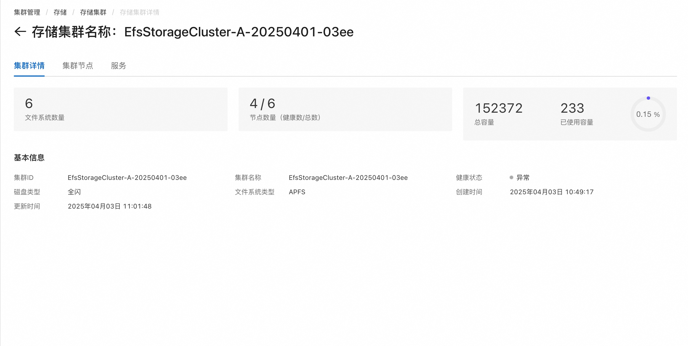
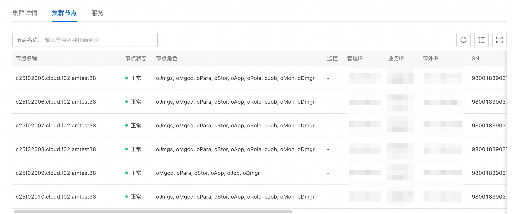
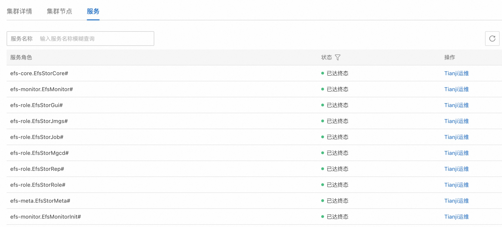
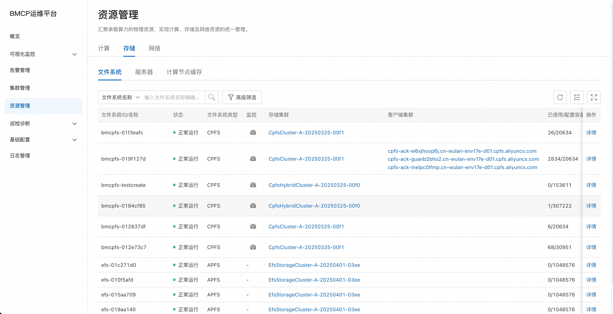
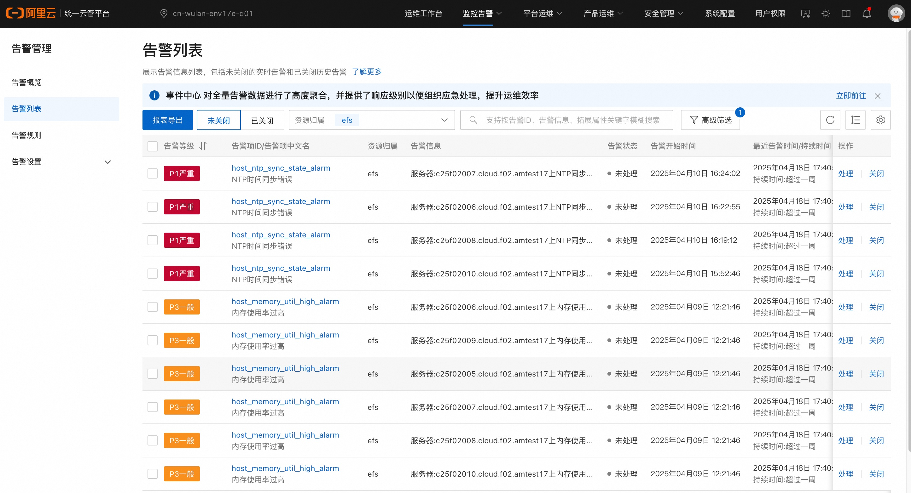
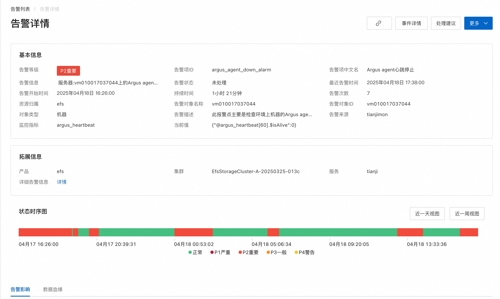

阿里云  
专有云  
高性能并行文件存储APFS 运维指  
南  
产品版本：V3.18.6  
文档版本：20251011

**目录**

- [1.概述](#section-1)
- [2.登录Apsara Uni-manager运维控制台](#section-2)
- [3.查看集群运维信息](#section-3)
- [4.查看资源运维信息](#section-4)
- [5.查看告警信息](#section-5)

# 1.概述

本文介绍文件存储APFS运维的目的、要求、注意事项、以及寻求帮助的方式。

**目的**

本手册指导维护人员对APFS进行预防性地维护，确保系统长期稳定运行。维护人员可以根据本手册的指导，处理维护过程中发现的系统问题。如果根据本手册无法解决系统问题，请寻求阿里云APFS工程师的技术支持。

**要求**

- 维护人员必须拥有IT行业技能，包括计算机网络知识、分布式存储操作知识、问题分析排查能力。

- 维护人员必须经过阿里云系统岗前培训，学习必要的阿里云APFS知识，包括但不限于系统原理、组网、特性使用和维护工具的使用。

> **重要**
>
> 在维护操作过程中，维护人员务必遵守操作规章，确保人身安全和系统安全。对用户数据严格保密，未经用户书面许可，禁止复制、传播用户数据。

**注意事项**

为了系统的稳定运行，避免意外事故的发生，维护人员需遵循以下事项：

- 分层分权管理：

  对网络、设备、系统、数据实行分层分权管理，相应业务的维护人员仅拥有完成自身角色任务相对应的权限，防止越权操作而引起系统故障。

- 系统安全：

  - 在对系统进行任何操作前，需清楚地了解操作的结果，避免危险操作影响系统运行。

  - 在操作过程中遇到的问题，需清楚记录以便问题排查和故障处理。

- 人身和数据安全：

  - 操作电气设备时，必须根据设备要求做好安全措施。

  - 需使用安全的设备接入业务网络。

  - 未经授权，严禁对数据进行复制和传播。

**寻求帮助**

维护人员在系统维护过程中，需要相关帮助，可以联系阿里云APFS技术支持获取帮助。

# 2.登录Apsara Uni-manager运维控制台

本文介绍运维工程师等相关用户如何登录到Apsara Uni-manager运维控制台。

**前提条件**

- 已从部署人员或管理员处获取Apsara Uni-manager运维控制台的访问地址、用户名和密码。

  Apsara Uni-manager运维控制台访问地址格式为*region-id*.ops.console.*intranet-domain-id*。

- 推荐使用Chrome浏览器。

**操作步骤**

1. 打开浏览器。

2. 在地址栏中，输入Apsara Uni-manager运维控制台的访问地址，按回车键。

   

   > **说明**
   >
   > 您可以单击右上角的当前语言切换其它语言。当前支持简体中文、English、繁體中文三种语言切换。

3. 输入正确的账户名及密码。

   > **说明**
   >
   > - 登录Apsara Uni-manager运维控制台的用户名和密码请从部署人员或管理员处获取。
   >
   > - 若连续输入密码错误三次，系统将启动图片验证码登录功能；若连续输入错误五次，账户将被锁定，请联系管理员进行激活。
   >
   > - 首次登录Apsara Uni-manager运维控制台时，需要修改登录用户名的密码，请按照提示完成密码修改。
   >
   >   为提高安全性，密码必须满足以下要求：
   >
   >   - 必须包含英文大小写字母。
   >
   >   - 必须包含阿拉伯数字（0~9）。
   >
   >   - 必须包含特殊符号，包括感叹号（!）、at（@）、井号（#）、美元符号（$）、百分号（%）等。
   >
   >   - 密码长度为10~20个字符。

4. 单击**同意协议并登录**。

# 3.查看集群运维信息

APFS集群运维信息指的是集群信息以及其包含的节点信息，其中集群包含存储端集群和客户端集群。集群信息是重要的运维信息，可在运维场景下提供重要参考。

**登录BMCP运维控制台**

1. 登录Apsara Uni-manager运维控制台。

2. 在顶部导航栏，选择**产品运维 > BMCP运维控制台**。

**查看存储集群信息**

1. 在左侧导航栏，选择**集群管理**，单击**存储**页签。

2. 单击**存储集群**页签，在集群列表中查看文件系统类型为**APFS**的集群信息，包含集群ID/名称、健康状态、磁盘类型、文件系统类型、容量（已使用/总量）(GiB)、节点数量（健康数/总数）、文件系统数量信息。

3. 单击集群ID/名称或者操作列的**详情**可进入集群的详情页面，查看集群详情、集群节点和服务信息。

   - 在集群详情页面，单击**集群详情**页签，可查看集群基本信息，包括文件系统数量、节点数量（健康数/总数）以及总容量、已使用容量和已使用容量占比信息。

     

   - 在集群详情页面，单击**集群节点**页签，可查看该集群的节点信息，包括节点状态、角色、机型、操作系统等信息。

     

   - 在集群详情页面，单击**服务**页签，可查看该集群中部署的存储管控服务的信息。

     

**查看客户端集群信息**

1. 在左侧导航栏，选择**集群管理 > 存储**。

2. 单击**客户端集群**页签，可在列表中查看客户端集群的信息，包括集群名称、集群状态、节点数量（健康数/总数）、Quorum节点数量（健康数/总数）、挂载文件系统、创建时间信息。

3. 单击集群名称或者操作列的**详情**可进入集群的详情页面，查看集群详情、集群节点和服务信息。

   - 在集群详情页面，单击**集群详情**页签，可查看该客户端集群的基本信息和配置信息，基本信息包括状态、类型、挂载文件系统、挂载文件系统路径等，配置信息包括缓存的最大文件数量、最大状态缓存、页面池等信息。

   - 在集群详情页面，单击**集群节点**页签，可查看该集群的节点信息，包括节点类型、节点状态等信息。

# 4.查看资源运维信息

APFS资源运维信息包含文件系统和服务器的运维信息。

**登录BMCP运维控制台**

1. 登录Apsara Uni-manager运维控制台。

2. 在顶部导航栏，选择**产品运维 > BMCP运维控制台**。

**查看文件系统信息**

1. 在左侧导航栏，选择**资源管理 > 存储**，单击**文件系统**页签，在列表中可查看APFS文件系统的文件系统ID/名称、状态、文件系统类型、存储集群、客户端集群、已使用配置容量(GiB)、规格、创建时间信息。

   

2. 单击**操作**列的详情，可查看文件系统详情，包括文件系统ID、文件系统名称、状态、类型等信息。

   > **说明**
   >
   > APFS暂不支持查看监控信息。

3. 单击**存储集群**列的集群名称，可查看存储集群信息，请参见查看存储集群信息。

4. 单击**客户端集群**列的集群名称，可查看客户端集群信息，请参见查看客户端集群信息。

**查看服务器信息**

服务器列表展示了部署在天基底座上的服务器列表信息。

1. 在左侧导航栏，选择**资源管理 > 存储**，单击**服务器**页签，在列表中可查看服务器的信息，包括SN、主机名、存储集群ID、状态、IP、机型、CPU架构、CPU核数、内存（GiB）、存储（GiB）、操作系统、IDC、机房、机柜信息。

2. 单击**存储集群ID**列的集群名称，可查看存储集群信息，请参见查看存储集群信息。

# 5.查看告警信息

APFS文件系统定义了若干告警事件，涵盖了集群、节点、文件系统、磁盘的主要异常场景。当环境出现了定义的异常场景，会触发告警事件。告警事件可通过登录Apsara Uni-manager运维控制台的告警管理进行查看。

**查看APFS文件系统告警信息**

1. 登录Apsara Uni-manager运维控制台。

2. 在顶部导航栏选择**监控告警 > 告警管理 > 告警列表**。

3. 在告警列表上方的**资源归属**搜索框中输入“efs”，可搜索查看APFS文件系统的告警信息。告警分为两类。一类是APFS产品定义的告警，另一类是天基定义的告警。具体告警项请参见APFS定义的告警规则。

   

4. 单击告警项ID名称，可查看告警详情信息，包括告警等级、告警项ID/告警项中文名、资源归属、告警信息、告警状态、告警开始时间、最近告警时间/持续时间、告警次数、拓展属性、告警对象名称/告警对象ID、对象类型、告警来源信息。

   

5. 单击右上角**更多**，根据实际情况对告警事件进行处理或关闭。

**APFS定义的告警规则**

| 告警项/中文名称 | 级别 | 条件 | 告警对象（label） | 说明 |
| --- | --- | --- | --- | --- |
| efs_reachable_alarm 集群不可用 | P1 | efs_reachable{product="efs"} == 0 持续1分钟 | cluster | 节点全宕机，集群无法提供服务 |
| efs_cluster_health_stat e_alarm 集群健康状态异常, | P1 | efs_cluster_hea lth_healthy_stat e{product="efs "} == 2 持续1分钟 | cluster | 集群健康状态异常，无法提供服务 |
| efs_cluster_health_stat e_warn_alarm 集群健康状态未知 | P2 | efs_cluster_hea lth_healthy_stat e{product="efs "} == 3 持续一分钟 | cluster | 集群健康状态未知，存在隐患 |
| efs_cluster_data_state _alarm 集群数据状态异常 | P1 | efs_cluster_hea lth_data_state{product="efs"} == 3 持续一分钟 | cluster | 集群数据状态异常，数据存在丢失风险 |
| efs_cluster_data_state _warn_alarm 集群数据状态降级 | P2 | efs_cluster_hea lth_data_state{product="efs"} == 2 持续一分钟 | cluster | 集群健康状态降级，再有节点或磁盘故障可能出现数据丢失风险 |
| efs_node_health_state _alarm 节点状态异常 | P1 | efs_node_healt h_state{produc t="efs"} != 1 持续一分钟 | hostname | 节点处于非NORMAL状态 |
| efs_disk_health_state_alarm 磁盘状态异常 | P1 | efs_disk_health _state{product ="efs"} != 1 持续一分钟 | hostname、 dev_name | 磁盘健康状态不为HEALTHY，提示磁盘可能故障或性能异常 |
| efs_fs_data_used_util_alarm 文件系统容量使用率过高 | P1 | efs_filesystem_used_util{prod uct="efs"} &gt; 90 持续一分钟 | fs_name | 文件系统使用量超过 90%，容量耗尽会导致 IO 异常 |
| efs_filesystemio_quota _state_alarm 文件系统配额状态异常 | P2 | efs_filesystemi o_quota_state_alarm{product ="efs"} == 5 持续一分钟 | fs_name、 path | 文件系统目录配额状态错误，会导致相关指标配置失效 |
