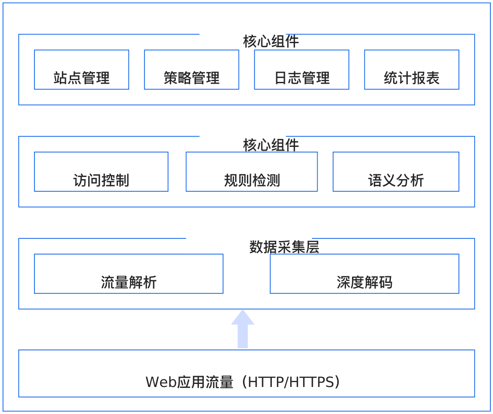

阿里云  
专有云  
云盾-Web应用防火墙-企业版  
实例型 产品简介  
产品版本：V3.18.6  
文档版本：20251212

**目录**

- [1.什么是Web应用防火墙-实例型](#section-1)
- [2.功能特性](#section-2)
- [3.产品架构](#section-3)
- [4.应用场景](#section-4)

# 1.什么是Web应用防火墙-实例型

Web应用防火墙-实例型是在原有物理机架构形态上衍生的一种新的WAF架构，实例型WAF采用ON ECS 资源部署，能基于已有ECS资源实现快速弹性伸缩，满足不同客户对于WAF的使用场景诉求，实例WAF和原物理机形态WAF功能一致，主要功能都是防御SQL注入、XSS跨站脚本、常见Web服务器插件漏洞、木马上传、非授权核心资源访问等OWASP攻击，过滤海量恶意访问，避免网站资产数据泄露，保障网站的安全与可用性。

专有云WAF以算法的革新重构了WAF类产品的能力，创新性地提出以“智能语义分析”解决Web攻击识别问题，给WAF内置“智能大脑”，使其具备自主识别攻击行为的能力，同时结合学习模型，不断增强和完善“大脑”的分析能力，不依赖传统的规则库即可满足用户的日常安全防护需求。其核心特性包括：

- **攻击行为智能检测**

  具有覆盖OWASP安全风险的智能检测引擎，不依靠传统规则匹配模型，通过智能识别HTTP/HTTPS，发现和阻断安全威胁。

- **Web访问控制**

  支持灵活的访问控制机制，内置访问控制引擎，根据源IP和Session来统计客户端访问行为，用户可通过针对特定域名、URL的访问频率和IP黑/白名单策略，限制相关源的访问行为。

# 2.功能特性

通过Web应用防火墙防护恶意应用攻击，保障移动、PC等互联网用户的接入安全。

**一级特性**

**二级特性**

**特性描述**

提供最近24小时，以及最近30天的防护统计信息，包括：

- 中国/世界维度的攻击者地理位置分布图

- WAF代理的总请求次数

- 总攻击次数

统计信息

防护总览

- 总拦截次数

- 发起攻击最多的IP（请求量/攻击量/拦截量三个维度的统计）

- 攻击类型分布TOP5

- 被攻击最多的站点TOP5

- 提供CC防护日志。日志列表显示匹配中CC规则的日志记录，包括请求URL，命中的CC规则名称及命中时间。

CC防护日志

- 提供CC防护日志的条件查询功能，可根据事件生成时间和CC规则名称进行日志筛选。

提供攻击检测日志。攻击检测日志列表显示攻击的处理结果、被攻击地址、攻击类型、攻击者IP及攻击时间针对每条攻击日志，可进一步查看日志详情。详情信息包括攻击风险等级、解码方式、精准显示解码后的攻击payload及HTTP请求各

攻击检测日志

字段信息等若判断为误报，可通过点击”消除误报“按钮一键生成白名单提供攻击检测日志的条件查询功能，可根据攻击类型、源IP、事件生成时间等各种条件及条件组合进行日志筛选，支持创建选定日志的Json或cvs类型的本地导出任务，可在日志下载管理中，下载日志文件至本地。

防护日志

日志下载管理

管理攻击检测日志的异步日志下载任务。

系统操作日志

提供系统的操作日志，内容包括用户名、具体操作行为以及IP等信息。

用户指定IP后查询该IP命中规则的情况，比如命中的规则的类型（CC攻击或者攻

IP查询

击检测日志）以及攻击详情。

提供业务的访问日志，包括请求访问地址、目的IP、源IP、请求方法、响应码等

访问日志

信息。

支持设定针对域名和URL的访问频次控制规则，实现对违规IP和SESSION的访问控制，对满足条件的IP/SESSION进行访问频率限制或者封禁对已知的

CC防护

IP/SESSION进行访问频率限制或者封禁，支持CC白名单功能，CC白名单中的用户（IP或SESSION）将不过CC防护规则。

- 支持URL解码、JSON解析、Base64解码、十六进制转换、斜杠反转义、XML解析、PHP序列化对象解析、UTF-7解码等多种解码方式。

- 支持SQL注入检测、XSS检测、情报、CSRF检测、SSRF检测、PHP反序列化检测、Java反序列化检测、ASP代码注入检测、文件包含攻击检测、文件上传攻击检测、PHP代码注入检测、命令注入检测，机器人爬虫检测和服务器响应检测模块。

- 内置5种模式防护模板:

  - 默认防护策略

  - 观察模式

攻击防护策略

- 高防模式

- 金融类客户

- 互联网客户

针对模板中的解码算法可自定义，攻击检测模块可单独开关或设置检测粒度。

- 支持自定义拦截响应状态码。

- 支持开启HTTP响应检测并设置响应BODY检测长度。

- 支持设置HTTP请求BODY的检测长度。

- 支持开启/关闭检测超时限制。

支持新增/删除/启用/禁用自定义规则自定义规则支持放行、拦截、观察、检测模块控制四种动作，其中”检测模块控制“动作可对特定的HTTP请求进行细粒度的WAF防护模块的配置可对站点进行HTTP细粒度的访问控制：包括URI，GET参

自定义规则

数，解码后路径，HOST头部，完整COOKIE，POST参数，完整BODY，HTTP状态码，响应内容，用户IP等条件及条件组合，其中用户IP支持基于地域来源匹配规则，支持自定义拦截状态码和攻击类型支持设置自定义规则的存活时间。

证书管理

支持对SSL证书的管理，包括上传证书文件以及SSL私钥。

防护配置

支持网页防篡改功能，通过配置网页防篡改规则，实现指定站点网页的保护，防止关键站点网页内容被非法篡改或误操作篡改。支持

防篡改规则

html/shtml/txt/js/css/jpg/png等静态网页资源缓存，由WAF直接返回缓存页面，同时进行周期性网页篡改检测，发现网页被篡改后主动告警。

- 可防护面向互联网开放的站点和面向VPC内网的站点。

- 支持HTTP和HTTPS协议的转发和防护，支持基于域名和IP的转发，支持任意非标端口。

- 回源方式：可选转发到业务服务器、重定向、响应指定内容三种。

- 转发到业务服务器：支持加权轮询、最小连接数、源地址哈希。

- 三种负载均衡算法源站保护：配置站点直接回源到VPC内SLB和ECS实例，业务服务器无需挂载外网IP，避免攻击者获取到业务服务器真实IP后绕过WAF。

防护站点管理

- 健康检查：支持配置业务服务器健康检查路径、响应码、响应超时时间等。

- 访问日志：可开启站点对应的访问日志记录，支持记录请求头、请求体，响应头，payload。

- 防护策略：内置默认防护模板、观察模板、高防模板、针对金融行业和互联网行业的防护模板。

- 支持对回源站点的状态监控，在回源站点健康检查失败情况下有状态提示。

- 支持对HTTP请求中X-Forwarded-For头部取值的配置。

- 支持在HTTP请求响应头部中插入自定义头部字段。

在线备份

支持对防护站点及相关的防护策略、自定义规则、证书等信息进行备份操作。

系统设置

配置实例WAF的参数，包括引擎状态、防篡改开关、端口监听、日志下载等信

实例系统设置

息。

- 负载状态：支持展示WAF节点CPU使用率和内存使用率。

- 网络状态：支持展示WAF节点读网络和写网络速率。

- 检测状态：支持展示WAF节点每秒检测请求数和平均检测耗时。

节点状态

- 转发状态：支持展示WAF节每秒新建连接数和平均处理延迟。

系统信息

- 磁盘状态：支持展示WAF节点磁盘使用率和磁盘的总量。

- 历史数据查询：支持查询WAF目标节点的系统性能历史数据，包括CPU使用率、内存使用率、磁盘使用率和流量监测历史数据。

系统固件信息

显示当前实例WAF节点名称与攻击检测引擎版本。

# 3.产品架构

专有云WAF通过接入Web访问流量，进行协议解析和深度解码，调动语义分析，访问控制，等进行分析，根据预设策略允许或阻断访问流量。

传统基于规则匹配的攻击识别方式存在先天不足，基于正则的规则描述无法完全覆盖基于程序语言的攻击载荷，导致传统WAF防护效果低于预期。专有云WAF通过对Web请求和返回内容进行智能分析，使WAF具备智能判断攻击威胁的能力，智能语义分析算法由词法分析、语法分析、语义分析和威胁模型匹配4个步骤组成。

WAF内置涵盖常用编程语言的编译器，通过对HTTP/HTTPS载荷内容进行深度解码后，按照其语言类型匹配相应语法编译器，进而匹配威胁模型得到威胁评级，阻断或允许访问请求。与规则匹配型威胁检测方式相比，智能语义分析技术具有准确率高，误报率低的特点。

# 4.应用场景

WAF可以针对政府、金融、保险、电商、O2O、互联网+、游戏等各类网站提供全方位的Web应用安全防护， 例如：

- 使用WAF防御敏感信息泄露，提高数据安全性，例如避免数据库被黑客的注入攻击拖库泄露，阻止URL未授权访问和越权访问等。

- 针对金融类客户，实现对门户网站、网上营业厅、在线客服等业务系统的实时防护，帮助用户满足等保2.0的技术评测，符合监管要求。

- 针对电商类客户，高效识别Web攻击行为，通过CC防护功能在重大活动期间防御“薅羊毛”等异常访问行为，同时保障网站的可用性。

- 在关键时期使用高防模式提升系统安全性，或针对0 day漏洞制定自定义规则提前一步进行防御。
