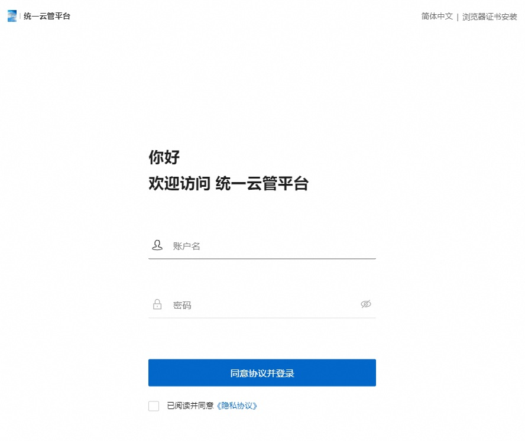
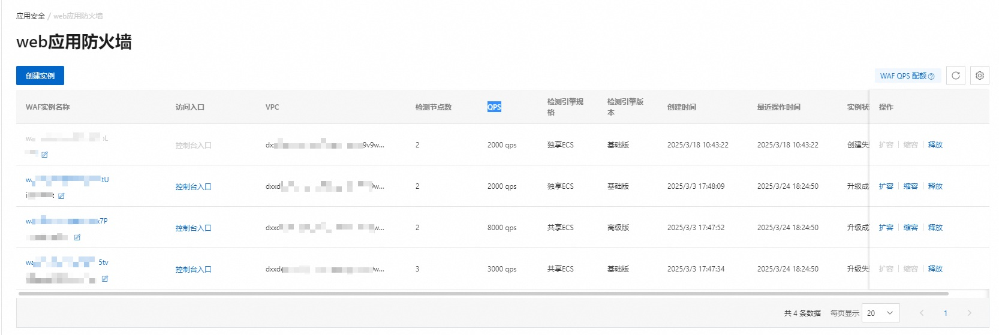
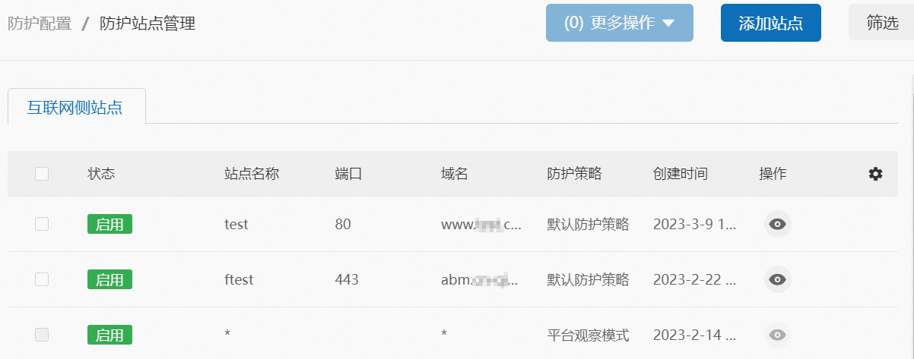
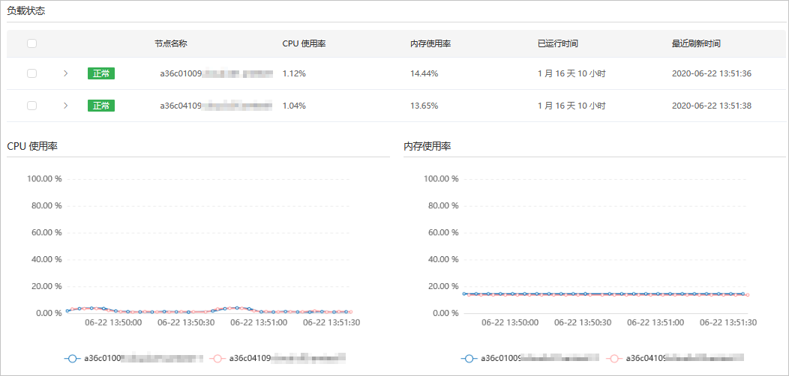
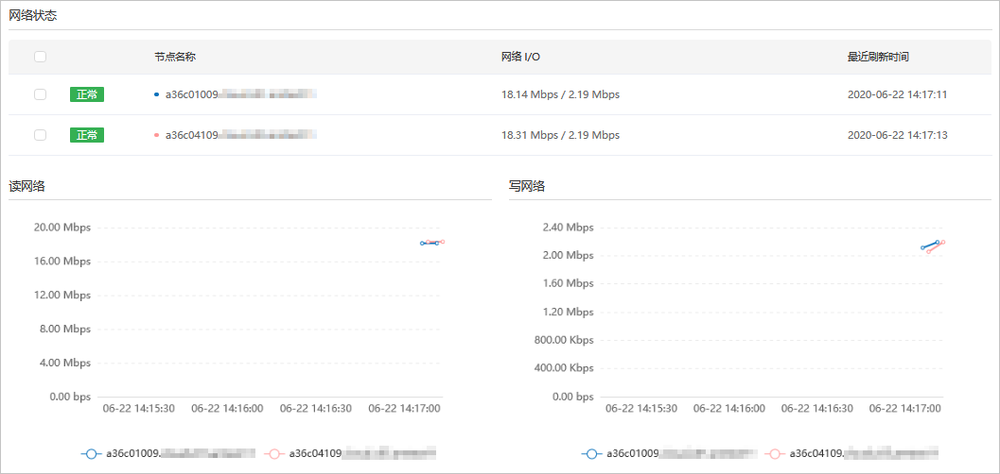
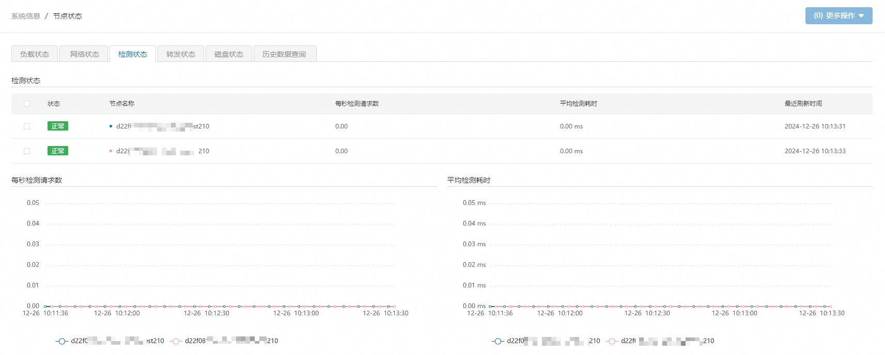
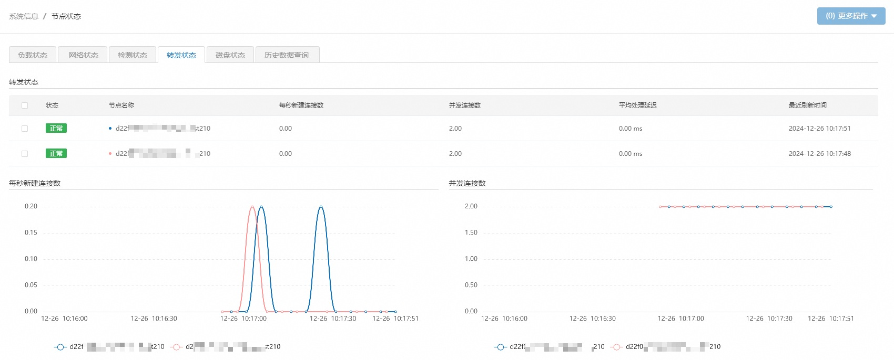
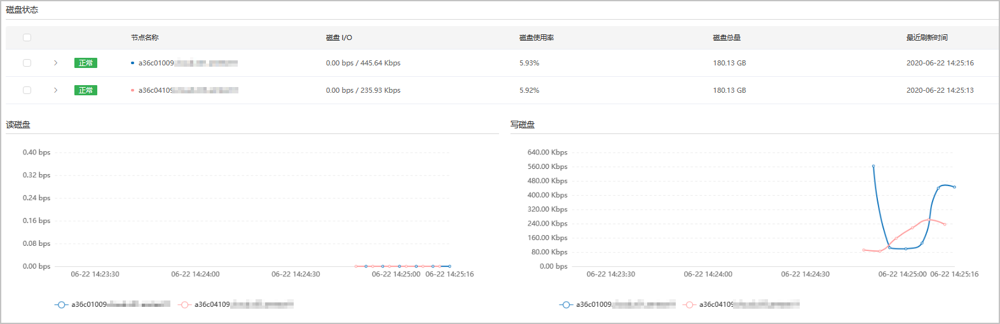

阿里云  
专有云  
云盾-Web应用防火墙-企业版  
实例型 用户指南  
产品版本：V3.18.6  
文档版本：20251212

**目录**

- [1.使用须知](#section-1)
- [2.快速入门](#section-2)
    - [2.1. 登录Apsara Uni-manager运营控制台](#section-2-1)
    - [2.2. 用户权限说明](#section-2-2)
    - [2.3. 登录Apsara Uni-manager运维控制台](#section-2-3)
    - [2.4. 快速入门](#section-2-4)
- [3.创建实例](#section-3)
- [4.统计信息](#section-4)
    - [4.1. 防护总览](#section-4-1)
- [5.防护日志](#section-5)
    - [5.1. 攻击检测日志](#section-5-1)
    - [5.2. CC 防护日志](#section-5-2)
    - [5.3. 系统操作日志](#section-5-3)
    - [5.4. 访问日志](#section-5-4)
    - [5.5. 日志下载管理](#section-5-5)
    - [5.6. IP 查询](#section-5-6)
- [6.防护配置](#section-6)
    - [6.1. 防护站点管理](#section-6-1)
        - [6.1.1. 站点管理](#section-6-1-1)
        - [6.1.2. 虚拟IP管理](#section-6-1-2)
    - [6.2. 攻击防护策略](#section-6-2)
    - [6.3. 自定义规则](#section-6-3)
    - [6.4. 防篡改规则](#section-6-4)
    - [6.5. CC 防护](#section-6-5)
        - [6.5.1. CC防护规则](#section-6-5-1)
        - [6.5.2. CC白名单](#section-6-5-2)
    - [6.6. 证书管理](#section-6-6)
    - [6.7. 数据脱敏](#section-6-7)
- [7.系统设置](#section-7)
    - [7.1. 在线备份](#section-7-1)
    - [7.2. 实例系统设置](#section-7-2)
- [8.系统信息](#section-8)
    - [8.1. 节点状态](#section-8-1)
        - [8.1.1. 负载状态](#section-8-1-1)
        - [8.1.2. 网络状态](#section-8-1-2)
        - [8.1.3. 检测状态](#section-8-1-3)
        - [8.1.4. 转发状态](#section-8-1-4)
        - [8.1.5. 磁盘状态](#section-8-1-5)
        - [8.1.6. 历史数据查询](#section-8-1-6)
    - [8.2. 系统固件信息](#section-8-2)

# 1.使用须知

在登录云盾控制台前，您需要确认本地PC符合以下配置。

本地PC需要满足如**配置要求表**中配置要求，才可以正常登录云盾控制台。

表 1. 配置要求表

<table>
  <tr>
    <th width="90">内容</th>
    <th>要求</th>
  </tr>
  <tr>
    <td>浏览器</td>
    <td>• Internet Explorer浏览器：11及以上版本 • Chrome浏览器（推荐）：42.0.0及以上版本 • Firefox浏览器：30及以上版本 • Safari浏览器：9.0.2版本及以上版本</td>
  </tr>
  <tr>
    <td>操作系统</td>
    <td>• Windows XP版本 • Windows 7及以上版本 • Mac系统</td>
  </tr>
</table>

# 2.快速入门

## 2.1. 登录Apsara Uni-manager运营控制台

本文主要向您介绍如何登录Apsara Uni-manager运营控制台。

**前提条件**

- 登录Apsara Uni-manager运营控制台前，确认您已从部署人员处获取Apsara Uni-manager运营控制台的服务域名地址。

- 推荐使用Chrome浏览器。

**操作步骤**

1. 在浏览器地址栏中，输入Apsara Uni-manager运营控制台的服务域名地址，按回车键。

2. 输入正确的用户名及密码。

   请向运营管理员获取登录控制台的用户名和密码。

   > **说明**
   >
   > 首次登录Apsara Uni-manager运营控制台时，需要修改登录用户名的密码，请按照提示完成密码修改。为提高安全性，密码长度必须为8~20位，且至少包含以下两种类型：
   >
   > - 英文大写或小写字母（A~Z、a~z）
   >
   > - 阿拉伯数字（0~9）
   >
   > - 特殊符号（感叹号（！）、at（@）、井号（#）、美元符号（$）、百分号（%）等）

3. 单击**登录**。

4. 如果账号已激活MFA多因素认证，请根据以下两种情况进行操作：

   - 管理员强制开启MFA后的首次登录：

     <ol type="a">

     <li>

     在绑定虚拟MFA设备页面中，按页面提示步骤绑定MFA设备。

     </li>

     <li>

     按照步骤2重新输入账号和密码，单击**登录**。

     </li>

     </ol>

     <ol type="i" start="100">

     <li>

     输入6位MFA码后单击**认证**。

     </li>

     </ol>

   - 您已开启并绑定MFA：

     输入6位MFA码后单击**认证**。

     > **说明**
     >
     > 绑定并开启MFA的操作请参见<strong>《Apsara Uni-manager运营控制台用户指南》</strong>中的章节<strong>《管理多因素认证》</strong>。

## 2.2. 用户权限说明

Web应用防火墙（Web Application Firewall，简称WAF）权限为使用独立的WAF需要开通的权限。本文介绍WAF涉及的用户角色。

所有角色均为默认角色，无法自定义添加。在登录WAF实例型前，您需要确认自己的账号已经分配相关的角色。

租户侧WAF默认角色

<table>
  <tr>
    <th width="170">角色名称</th>
    <th>角色说明</th>
  </tr>
  <tr>
    <td>组织安全管理员</td>
    <td>负责单个组织内的安全管理工作，包括云安全管理中心SOC、主机安全、应用安全、网络安全等，以及ECS类安全产品的管理工作。</td>
  </tr>
  <tr>
    <td>全局组织安全管理员</td>
    <td>负责通过云安全管理中心SOC，进行云平台及所有租户的安全管理工作和ECS类安全产品的管理工作。</td>
  </tr>
</table>

如果您没有相关账号和角色，请联系管理员创建用户及授予角色，具体步骤，请参见<strong>《Apsara Uni-manager运营控制台用户指南》</strong>中**创建用户**。

## 2.3. 登录Apsara Uni-manager运维控制台

本文介绍如何登录Apsara Uni-manager运维控制台。

**前提条件**

- 已从部署人员或管理员处获取Apsara Uni-manager运维控制台的访问地址、用户名和密码。

  Apsara Uni-manager运维控制台访问地址格式为*region-id*.ops.console.*intranet-domain-id*。

- 推荐使用Chrome浏览器。

**操作步骤**

1. 打开浏览器。

2. 在地址栏中，输入Apsara Uni-manager运维控制台的访问地址，按回车键。

   

   > **说明**
   >
   > 您可以单击右上角的当前语言切换其它语言。当前支持简体中文、English语言切换。

3. 输入正确的用户名及密码。

   > **说明**
   >
   > - 登录Apsara Uni-manager运维控制台的用户名和密码请从部署人员或管理员处获取。
   >
   > - 若连续输入密码错误三次，系统将启动图片验证码登录功能；若连续输入错误五次，账户将被锁定，请联系管理员进行激活。
   >
   > - 首次登录Apsara Uni-manager运维控制台时，需要修改登录用户名的密码，请按照提示完成密码修改。
   >
   >   为提高安全性，密码必须满足以下要求：
   >
   >   - 必须包含英文大小写字母。
   >
   >   - 必须包含阿拉伯数字（0~9）。
   >
   >   - 必须包含特殊符号，包括感叹号（!）、at（@）、井号（#）、美元符号（$）、百分号（%）等。
   >
   >   - 密码长度为10~20个字符。

4. 单击**同意协议并登录**。

## 2.4. 快速入门

本文介绍如何快速使用Web应用防火墙（Web Application Firewall）实例型的功能。

WAF提出以智能语义分析算法解决Web攻击识别问题。通过WAF的智能分析算法，自主识别Web的攻击行为；同时结合学习模型，不断增强和完善分析能力，使其不依赖传统的规则库，即可满足用户日常安全防护需求。

WAF的使用流程如下：

1. 创建Web应用防火墙实例，请参见创建实例。

2. 定制WAF的防护规则。

   WAF提供默认的防护策略，同时用户也可以根据自身的业务特点，灵活定制防护策略。

   - 配置攻击防护策略，请参见攻击防护策略。

   - 配置自定义规则，请参见自定义规则。

   - 配置CC防护规则，请参见CC 防护。

3. 添加防护的网站。

   WAF支持防护面向互联网的网站和面向内网的网站，请参见站点管理。

4. 查看WAF防护结果。

   - 查看防护的整体信息，请参见防护总览。

   - 查看Web攻击检测日志，请参见攻击检测日志。

   - 查看CC攻击防护日志，请参见CC 防护日志。

# 3.创建实例

本文将为您介绍如何创建Web应用防火墙实例。

**操作步骤**

1. 登录Apsara Uni-manager运营控制台。

2. 在控制台右上方，单击**安全**，选择**应用安全 > Web应用防火墙-实例型**。在**Web应用防火墙**授权页面，选择**地域**并单击**角色授权访问**。

3. 单击**创建实例**，完成以下配置，单击**确认**。

   <table>
     <tr>
       <th width="168">配置项</th>
       <th>说明</th>
     </tr>
     <tr>
       <td>组织</td>
       <td>组织。</td>
     </tr>
     <tr>
       <td>资源集</td>
       <td>资源集。</td>
     </tr>
     <tr>
       <td>可用区</td>
       <td>可用区。</td>
     </tr>
     <tr>
       <td>实例名称</td>
       <td>实例名称。</td>
     </tr>
     <tr>
       <td>检测引擎规格</td>
       <td>可选<strong>共享ECS</strong>或<strong>独享ECS</strong>。</td>
     </tr>
     <tr>
       <td>检测引擎版本</td>
       <td>可选<strong>基础版</strong>、<strong>高级版</strong>或<strong>企业版</strong>。</td>
     </tr>
     <tr>
       <td>CPU</td>
       <td>默认<strong>x86</strong>，不可选择。</td>
     </tr>
     <tr>
       <td>检测引擎资源</td>
       <td>根据检测引擎版本的不同，有不同规则的检测引擎资源： • 基础版提供2c 4G。 • 高级版提供4c 8G。 • 企业版提供24c 48G。</td>
     </tr>
     <tr>
       <td>单可用区检测引擎数</td>
       <td>单可用区检测引擎规格数量，最小数量为2，最大数量为16。</td>
     </tr>
     <tr>
       <td>VPC</td>
       <td>WAF防护的VPC，一个实例WAF默认防护一个VPC下的WEB业务。</td>
     </tr>
   </table>

**后续操作**

成功添加实例后，您可以在防护实例列表执行如下操作：

- 查看创建的实例信息您可以在Web应用防火墙列表查看已创建实例的WAF实例名称、访问入口、VPC、检测节点数、QPS等信息。

  

- 设置防护实例列表显示项

  单击列表右上角的  图标，选择要在防护实例列表呈现的项目。

- 扩容、缩容实例

  单击目标实例**操作**列的**扩容**或**缩容**可对实例单可用区检测引擎数进行修改。

  > **说明**
  >
  > 单可用区检测引擎规格数量，最小数量为2，最大数量为16。

- 释放实例

  单击目标实例**操作**列的**释放**，在**温馨提示**对话框中输入**确认释放**即可释放实例。

  > **警告**
  >
  > 释放该实例后无法恢复。
  >
  > 请您确认实例WAF上已无业务防护，并已删除相应的实例数据。

- 控制台入口

  单击目标**实例名称**或**控制台入口**，可以查看实例的统计信息、防护日志、防护配置、系统设置和系统信息等内容。

# 4.统计信息

## 4.1. 防护总览

防护总览展示WAF对历史攻击数据的统计信息，攻击源IP地理信息分布和防护状态等情况。管理者通过总览，快速了解Web防护情况，并制定相应的规则和措施保护Web安全。本文介绍如何查看WAF的防护总览。

**操作步骤**

1. 登录Apsara Uni-manager运营控制台。

2. 在控制台右上方，单击**安全**，选择**应用安全 > Web应用防火墙-实例型**。在**Web应用防火墙**授权页面，选择**地域**并单击**角色授权访问**。单击目标**实例名称**或**控制台入口**。

3. 在左侧导航栏，单击**防护总览**。

4. 在**防护总览**页面，查看**最近24小时统计**和**最近30天统计**的WAF防护情况。

   - 请求次数：显示总的请求次数。

   - 攻击次数：显示总的攻击次数。

   - 拦截次数：显示总的拦截次数。

   - 攻击者地理位置分布（地图形式）：在地图上展示攻击者的分布情况，支持查看中国和世界地图。

   - 发起攻击最多的IP（仅显示Top 5）：以条形图展示发起攻击次数Top 5的IP地址。横坐标为请求次数，纵坐标为IP地址。

   - 攻击类型分布（仅显示Top 5）：以条形图展示Top 5的攻击类型的分布占比和各攻击类型的次数。

   - 被攻击最多站点（仅显示Top 5）：以条形图展示Top 5被攻击站点和各站点的次数。

# 5.防护日志

## 5.1. 攻击检测日志

通过攻击检测日志，分析Web服务的受攻击情况，根据分析结果更新防护策略和自定义规则、处理Web服务漏洞等，提升Web服务的安全性。本文介绍如何查看攻击检测日志。

**操作步骤**

1. 登录Apsara Uni-manager运营控制台。

2. 在控制台右上方，单击**安全**，选择**应用安全 > Web应用防火墙-实例型**。在**Web应用防火墙**授权页面，选择**地域**并单击**角色授权访问**。单击目标**实例名称**或**控制台入口**。

3. 在左侧导航栏，选择**防护日志 > 攻击检测日志**。

   您可以在日志列表中查看所有的攻击日志信息。

   您也可以在日志列表，执行如下操作：

   - 筛选日志

     单击**筛选**，设置筛选条件，单击**确定**。

     > **说明**
     >
     > 筛选条件中的多个条件为“与”的关系，即需要满足所有条件才能生效。

   - 导出日志

     <ol type="a">

     <li>

     选中一条或多条攻击检测日志，选择**更多操作 > 下载选中日志**（.json或.csv），在提示对话框，单击**确认**。

     </li>

     <li>

     在左侧导航栏，选择**防护日志 > 日志下载管理**。单击日志下载任务**操作**列的  图标。

     </li>

     </ol>

   - 切换日志显示方式

     单击  图标，切换日志显示方式为**列表**或**详细视图**。

## 5.2. CC 防护日志

通过CC防护日志，分析Web服务的受到的CC攻击情况，根据分析结果更新CC防护规则和CC白名单、处理Web服务漏洞等，提升Web服务的安全性。本文介绍如何查看CC防护日志。

**操作步骤**

1. 登录Apsara Uni-manager运营控制台。

2. 在控制台右上方，单击**安全**，选择**应用安全 > Web应用防火墙-实例型**。在**Web应用防火墙**授权页面，选择**地域**并单击**角色授权访问**。单击目标**实例名称**或**控制台入口**。

3. 在左侧导航栏，选择**防护日志 > CC防护日志**。

   您可以在日志列表中查看所有攻击日志信息。

   您也可以在日志列表，执行如下操作：

   - 筛选日志

     单击**筛选**，设置筛选条件，单击**确定**。

     > **说明**
     >
     > 筛选条件中的多个条件为“与”的关系，即需要满足所有条件才能生效。

   - 一键加黑CC攻击

     单击CC攻击**操作**列的  图标，在**添加黑名单**面板，配置选择规则名称后，单击**确认**。

## 5.3. 系统操作日志

本文介绍如何查看系统操作日志。

**操作步骤**

1. 登录Apsara Uni-manager运营控制台。

2. 在控制台右上方，单击**安全**，选择**应用安全 > Web应用防火墙-实例型**。在**Web应用防火墙**授权页面，选择**地域**并单击**角色授权访问**。单击目标**实例名称**或**控制台入口**。

3. 在左侧导航栏，选择**防护日志 > 系统操作日志**。

   您可以在日志列表中查看所有的攻击日志信息。

   您也可以在日志列表，执行如下操作：

   - 筛选日志

     单击**筛选**，设置筛选条件，单击**确定**。

     > **说明**
     >
     > 筛选条件中的多个条件为“与”的关系，即需要满足所有条件才能生效。

   - 导出日志

     <ol type="a">

     <li>

     选中一条或多条攻击检测日志，选择**更多操作 > 下载选中日志**（.json或.csv），在提示对话框，单击**确认**。

     </li>

     <li>

     在左侧导航栏，选择**防护日志 > 日志下载管理**。单击日志下载任务**操作**列的  图标。

     </li>

     </ol>

## 5.4. 访问日志

本文介绍如何查看访问日志。

**操作步骤**

1. 登录Apsara Uni-manager运营控制台。

2. 在控制台右上方，单击**安全**，选择**应用安全 > Web应用防火墙-实例型**。在**Web应用防火墙**授权页面，选择**地域**并单击**角色授权访问**。单击目标**实例名称**或**控制台入口**。

3. 在左侧导航栏，选择**防护日志 > 访问日志**。

   您可以在日志列表中查看所有的攻击日志信息。

   您也可以在日志列表，执行如下操作：

   - 筛选日志

     单击**筛选**，设置筛选条件，单击**确定**。

     > **说明**
     >
     > 筛选条件中的多个条件为“与”的关系，即需要满足所有条件才能生效。

   - 导出日志

     <ol type="a">

     <li>

     选中一条或多条攻击检测日志，选择**更多操作 > 下载选中日志**（.json或.csv），在提示对话框，单击**确认**。

     </li>

     <li>

     在左侧导航栏，选择**防护日志 > 日志下载管理**。单击日志下载任务**操作**列的  图标。

     </li>

     </ol>

## 5.5. 日志下载管理

**操作步骤**

1. 登录Apsara Uni-manager运营控制台。

2. 在控制台右上方，单击**安全**，选择**应用安全 > Web应用防火墙-实例型**。在**Web应用防火墙**授权页面，选择**地域**并单击**角色授权访问**。单击目标**实例名称**或**控制台入口**。

3. 在左侧导航栏，选择**防护日志 > 日志下载管理**。

   您可以在日志下载管理列表中执行以下操作：

   - 下载日志

     

     选中一条或多条已完成日志，单击下载图标

     。

   - 删除日志

     选中一条或多条已完成日志，选择**更多操作 > 删除选中任务**

## 5.6. IP 查询

如果您想确认某个IP地址是否会命中某个策略，需要多方查询检索，本文将为您介绍如何快速指定IP后自动判断该IP命中哪些规则。

**操作步骤**

1. 登录Apsara Uni-manager运营控制台。

2. 在控制台右上方，单击**安全**，选择**应用安全 > Web应用防火墙-实例型**。在**Web应用防火墙**授权页面，选择**地域**并单击**角色授权访问**。单击目标**实例名称**或**控制台入口**。

3. 在左侧导航栏，选择**防护日志 > IP查询**

4. 在**IP查询**页面，选择**日志类型**，在IP搜索框中输入想要查询的IP地址。

5. 单击目标对象**操作**列  图标查看详情。

# 6.防护配置

## 6.1. 防护站点管理

### 6.1.1. 站点管理

本文介绍如何在WAF上添加面向互联网的防护站点。

**操作步骤**

1. 登录Apsara Uni-manager运营控制台。

2. 在控制台右上方，单击**安全**，选择**应用安全 > Web应用防火墙-实例型**。在**Web应用防火墙**授权页面，选择**地域**并单击**角色授权访问**。单击目标**实例名称**或**控制台入口**。

3. 在左侧导航栏，选择**防护配置 > 防护站点管理**。

4. 在**站点管理**页签，单击**添加站点**。

5. 在**添加被防护的站点**面板的**监听信息**区域，完成参数配置，单击**下一步**。

   设置需要WAF进行防护的网站地址，WAF支持HTTP和HTTPS类型网站。

   <table>
     <tr>
       <th width="123">配置项</th>
       <th>说明</th>
     </tr>
     <tr>
       <td>防护站点名称</td>
       <td>设置防护站点名称。</td>
     </tr>
     <tr>
       <td>绑定域名</td>
       <td>设置防护站点域名。 • 可使用星号（*）作通配符。 • 多个域名可使用逗号（,）分隔。</td>
     </tr>
     <tr>
       <td>备注信息</td>
       <td>设置防护站点的备注信息。</td>
     </tr>
     <tr>
       <td>端口设置</td>
       <td>设置WAF监听防护的端口。如果站点支持多个端口访问，单击<strong>添加一组端口</strong>新增其他端口。 • 如果站点仅支持HTTP访问，可跳过证书设置，直接配置下游。 • 如果站点支持HTTPS访问，选中<strong>启用SSL后</strong>，并继续设置后续配置项。 • 如果站点支持HTTP 2.0访问，选中<strong>启用 HTTP2</strong>。仅在选中<strong>启用SSL</strong>时，才支持该选项。</td>
     </tr>
     <tr>
       <td>证书方案</td>
       <td>设置网站的证书方案。默认选中<strong>SSL证书</strong>。</td>
     </tr>
     <tr>
       <td>SSL证书设置</td>
       <td>设置网站的HTTPS证书，可选上传一个新证书或选择一个已有的证书。 • 上传一个新证书：如果网站使用的HTTPS证书以前没有上传到WAF，选择此选项。默认情况下HTTPS证书和私钥分开上传，如果选中<strong>证书文件中包含私钥</strong>，则只需要上传一个文件。 • 选择一个已有的证书：如果网站使用的HTTPS证书以前有上传到WAF，选择此选项，并在下拉菜单中输入证书关键字，搜索并选择网站HTTPS证书。</td>
     </tr>
     <tr>
       <td>证书名称</td>
       <td>设置证书名称。</td>
     </tr>
     <tr>
       <td>SSL证书文件</td>
       <td>上传HTTPS证书和密钥。默认情况下HTTPS证书和私钥分开上传，如果<strong>HTTPS证书</strong>中选中<strong>证书文件中包含私</strong><strong>钥</strong>，则只需要上传一个包含了HTTPS证书和私钥的文件。</td>
     </tr>
     <tr>
       <td>SSL证书密码</td>
       <td>设置证书密码。</td>
     </tr>
     <tr>
       <td>双向认证</td>
       <td>单击图标，开启双向认证，并配置相关信息。 • <strong>CA 证书设置</strong>：设置CA 证书，请选择<strong>上传一个新证书</strong>或<strong>选择一个已有的证书</strong>： • <strong>上传一个新证书</strong>：如果CA证书以前没有上传到WAF，选择此选项。设置<strong>CA证书名称</strong>、上传<strong>CA证书文件</strong>。 • <strong>选择一个已有的证书</strong>：如果CA证书以前有上传到WAF，选择此选项，并在下拉菜单中输入证书关键字，搜索并选择CA证书。 • <strong>检测深度</strong>：设置双向认证检测深度。 • <strong>客户端检测</strong>：支持开启、关闭或可选。 • 如果提供客户端证书，则选择<strong>可选</strong>，进行校验。 • 如果客户端证书可由非可信CA签发，则选择<strong>可选 (no_ca)</strong>。</td>
     </tr>
   </table>

6. 在**添加被防护的站点**面板的**配置VPC**区域，完成参数配置，单击**下一步**。

   <table>
     <tr>
       <th width="121">配置项</th>
       <th>说明</th>
     </tr>
     <tr>
       <td>被防护VPC</td>
       <td>选择防护站点所属的VP，支持在下拉菜单中输入关键字，搜索并选择要防护的VPC。</td>
     </tr>
     <tr>
       <td>下游</td>
       <td>可选择以下方式： • 选择现有虚拟IP • 创建虚拟 IP • 创建指定虚拟IP</td>
     </tr>
     <tr>
       <td>交换机选择</td>
       <td>选择防护站点所属的虚拟交换机。</td>
     </tr>
     <tr>
       <td>VPC虚拟IP</td>
       <td>• 当<strong>下游</strong>选择<strong>选择现有虚拟IP</strong>时，在<strong>VPC虚拟IP</strong>中选择已有的虚拟IP地址。 重要默认最多选择8个虚拟IP地址。 • 当<strong>下游</strong>选择<strong>创建虚拟IP</strong>时，在<strong>VPC虚拟IP</strong>中单击<strong>点击生成虚拟IP</strong>。 • 当<strong>下游</strong>选择<strong>创建指定虚拟IP</strong>时，在<strong>VPC虚拟IP</strong>中输入虚拟IP。</td>
     </tr>
     <tr>
       <td>备注信息</td>
       <td>输入备注信息。</td>
     </tr>
     <tr>
       <td>是否指定机房</td>
       <td>可选择是否选择机房。</td>
     </tr>
     <tr>
       <td>所属机房名称</td>
       <td>选择机房名称。</td>
     </tr>
     <tr>
       <td>运行模式</td>
       <td>选择多活或单活： • 多活：支持将流量从 VIP 分发到后端所有机房下的多个 WAF 检测引擎。相对单活模式，WAF 具有更高的可用性。 • 单活：支持将流量从 VIP 分发到指定机房下的多个 WAF 检测引擎，如果设定VIP、WAF 引擎在同一个机房，在单活模式下可以避免机房横向访问，降低网络延迟。</td>
     </tr>
   </table>

7. 在**添加被防护的站点**面板的**响应方式**区域，完成参数配置，单击**下一步**。

   **响应方式**

   **配置项**

   **说明**

   选择负载均衡算法，支持**加权轮询法**、**源地址哈希法**、**最小连**

   **负载调度算法**

   **接数法**。

   流量经过WAF后转发到业务服务器。

   **业务服务器地址**

   设置源IP透传方式。

   **转发到业务服务器**

   X-Forwarded-For位于HTTP协议的请求头，用来表示HTTP请求端真实IP。一般用于HTTP代理、负载均衡等转发服务。可选项：

   **X-Forwarded-For**

   - **在X-Forwarded-For末尾追加上一跳的IP地址**

   - **用上一跳X-Forwarded-For的IP地址覆盖原有内容**

   - **原封不动**

   流量经过WAF后重定向到指定地址。

   重定向响应状态码可选择**301**、**302**、**307**和**308**。

   - **301**：表示请求的网页已永久移动到新位置。

   - **302**：表示服务器目前从不同位置的网页响应请求，但请求

   **响应状态码**

   者应继续使用原有位置来进行以后的请求。

   - **307**：服务器目前从不同位置的网页响应请求，但请求者应继续使用原有位置来进行以后的请求。

   **重定向**

   - **308**：永久重定向。

   输入重定向后的URL地址。

   **重定向地址**

   <table>
     <tr>
       <td rowspan="2">响应指定内容</td>
       <td>响应状态码</td>
       <td>流量经过WAF后响应指定内容。响应状态码可选择<strong>200</strong>、<strong>400</strong>、<strong>401</strong>、<strong>402</strong>、<strong>404</strong>、<strong>405</strong>、<strong>500</strong>、<strong>503</strong>、<strong>50</strong> <strong>4</strong>等。</td>
     </tr>
     <tr>
       <td>响应内容</td>
       <td>上传响应的内容。例如设置为<strong>响应指定内容</strong>，并在此上传一张图片。如果用户访问该网站后，会返回此图片。</td>
     </tr>
   </table>

8. 在**添加被防护的站点**面板的**防护策略**区域，完成参数配置，单击**下一步**完成配置，单击**完成**。

   > **重要**
   >
   > **响应方式**只有设置为**转发到业务服务器**模式，才能设置防护策略。

   <table>
     <tr>
       <th width="89">配置项</th>
       <th>说明</th>
     </tr>
     <tr>
       <td>防护策略</td>
       <td>选择WAF的防护策略，默认选择<strong>默认防护策略</strong>。可选项： • 不使用防护策略 • 系统默认的防护策略 • 默认防护策略 • 高防模式 • 观察模式 • 金融类客户 • 互联网客户 • 自定义防护策略关于上述防护策略的具体信息，请参见攻击防护策略。</td>
     </tr>
     <tr>
       <td>用户识别</td>
       <td>设置是否使用用户识别功能。 说明如果此被防护站点启用了CC防护，而且CC防护规则中<strong>受限制目标的类型</strong>选择<strong>SESSION</strong>，则<strong>用户识别</strong>需要选择<strong>WAF用户系统</strong>。</td>
     </tr>
   </table>

   成功添加站点后，您可以在防护站点列表执行如下操作：

   - 查看已添加的防护站点

     您可以在防护站点列表查看已添加站点的状态、站点名称、端口、域名、下游等信息。

     

   - 设置防护站点列表显示项

     单击**操作**列的  图标，选择要在防护站点列表呈现的项目。

   - 筛选防护站点

     单击页面右上角的**筛选**，根据名称、站点域名、防护策略、防篡改状态、创建时间、最后修改时间，筛选防护站点。

   - 更多操作

     选中多个防护站点，选择**更多操作 > 启用选中站点**、**禁用选中站点**、**导出选中站点**或**删除选中站点**。

   - 修改防护站点基本信息

     单击**操作**列的  图标，在**基本信息**页签，单击配置项信息后的  图标，修改已配置的站点名称、监听端

     口、域名、备注信息或下游等信息。

   - 修改防护站点请求处理方式

     单击**操作**列的  图标，在**请求处理方式**页签，单击配置项信息后的  图标，修改防护站点的**响应方**

     **式**、**调度算法**、**X-Forwarded-For**、**业务服务器健康检查**、**记录访问日志**、**业务服务器地址**、**HTTP头设置**、**回源IP配置**等请求处理方式。

   - 查看并修改站点防护方式

     单击**操作**列的  图标，在**站点防护方式**页签

     - 攻击防护策略：

       - 查看已配置的攻击防护策略的解码方式、攻击检测模块、拦截方式、HTTP响应处理、HTTP请求Body检测、检测超时限制等信息。

       - 单击**默认防护策略**后的  图标，设置站点防护策略。关于防护策略类型的更多信息，请参见攻击防

         护策略。

     - 自定义规则：支持添加自定义规则，具体操作，请参见自定义规则。

     - 防篡改规则：可选择**使用已存在的规则**或**添加一条新的规则**。

     - 源IP获取方式：设置源IP的获取方式，支持从X-Forwarded-For连接中获取、从HTTP头获取。

       - 用户识别：单击  图标，可选择**不使用**、**WAF用户系统**或**从请求中提取用户ID**。

       - 敏感信息过滤：单击  图标，敏感信息过滤可选择**身份证**、**银行卡**、**手机号**。

### 6.1.2. 虚拟IP管理

Web应用防火墙实例型支持添加虚拟IP、VPC虚拟IP或EIP。完成添加后，您可以在添加VPC防护站点时，选择已添加的对象作为下游。本文介绍如何添加和管理虚拟IP、VPC虚拟IP或EIP。

**操作步骤**

1. 登录Apsara Uni-manager运营控制台。

2. 在控制台右上方，单击**安全**，选择**应用安全 > Web应用防火墙-实例型**。在**Web应用防火墙**授权页面，选择**地域**并单击**角色授权访问**。单击目标**实例名称**或**控制台入口**。

3. 在左侧导航栏，选择**防护配置 > 防护站点管理**。

4. 在**虚拟IP管理**页签，添加VPC虚拟IP。

   - 添加VPC 虚拟IP。

     <ol type="a">

     <li>

     在**VPC虚拟IP**分页，单击**添加虚拟IP**。

     </li>

     <li>

     在**添加虚拟IP**面板，配置虚拟IP信息后，单击**确定**。

     - 若**下游**选择**创建虚拟 IP**，配置**被防护的VPC**、**交换机选择**、**备注信息**。

     - 若**下游**选择**创建指定虚拟 IP**，配置**被防护的VPC**、**交换机选择**、**备注信息**、**VPC 虚拟 IP**和**是否指定机房**。

     </li>

     </ol>

   完成后，您可以执行如下操作：

   - 在**VPC虚拟IP**分页，查看已添加的对象，或单击目标对象**操作**列  图标，查看详情。

## 6.2. 攻击防护策略

WAF提供默认的防护策略，同时用户也可以根据自身的业务特点，灵活配置防护策略。本文介绍如何配置WAF的防护策略。

**背景信息**

WAF默认支持五种类型的防护策略。

| 防护策略 | 应用场景 | 描述 |
| --- | --- | --- |
| 默认防护策略 | 适用于防护要求不高的场景 | 不对服务器响应、机器人请求进行防护，拦截其他高危攻击。 |
| 高防模式 | 适用于防护要求严格的场景 | 拦截所有攻击。 |
| 互联网模式 | 适用于互联网网站业务 | 不对ASP代码注入、模块注入防护，拦截其他高危攻击。 |
| 金融类客户 | 适用于金融类网站业务 | 不对ASP代码注入、模块注入防护的同时，放行并记录命令注入攻击，拦截其他高危攻击。 |
| 观察模式 | 适用于仅需要记录攻击的场景 | 放行并记录所有攻击。 |

**操作步骤**

用户可以根据业务需求，参考以下步骤，自定义防护策略。

1. 登录Apsara Uni-manager运营控制台。

2. 在控制台右上方，单击**安全**，选择**应用安全 > Web应用防火墙-实例型**。在**Web应用防火墙**授权页面，选择**地域**并单击**角色授权访问**。单击目标**实例名称**或**控制台入口**。

3. 在左侧导航栏，选择**防护配置 > 攻击防护策略**。

4. 单击**添加防护策略**，在文本框中输入**策略名称**，单击**确定**。

5. 单击新增的防护策略**操作**列的

   图标，查看防护策略规则。

   

   | 配置项 | 说明 |
   | --- | --- |
   | 解码方式 | 选择解码的算法类型。 |
   | 攻击检测模块 | 设置该防护策略启动哪些攻击检测类型及其阈值。 |
   | 拦截方式 | 设置拦截时显示的错误码和图片。 |
   | HTTP响应检测 | 设置<strong>启用HTTP响应检测</strong>开启状态和<strong>允许检测的Body长度上限</strong>的阈值。 |
   | HTTP 请求检测 | 设置<strong>允许检测的Body长度上限</strong>的阈值。 |
   | 检测超时限制 | 设置<strong>启用超时检测</strong>开启状态，并设置<strong>检测超时时间</strong>的阈值。 |
   | 大包绕过防护 | 大包绕过防护。 |

   以修改**攻击检测模块**为例，设置步骤如下：

   <ol type="i">

   <li>

   鼠标移动到**攻击检测模块**的具体模块上（以**SQL注入检测模块**为例），单击**修改**图标。

   </li>

   <li>

   在**SQL注入检测模块**对话框中，设置检测参数后，单击**确定**。

   | 配置项 | 说明 |
   | --- | --- |
   | 是否启用 | 是否使用该模块提供检测功能。 |
   | 阻断阈值 | 提供<strong>不阻断</strong>、<strong>仅阻断高危</strong>、<strong>阻断中危及高危</strong>、<strong>阻断全部</strong>选项。 |
   | 记录日志阈值 | 提供<strong>不记录</strong>、<strong>仅记录高危</strong>、<strong>记录中危及高危</strong>、<strong>记录全部</strong>选项。 |
   | 检测非注入型SQL | 是否开启检测非注入型SQL攻击。 |

   </li>

   <li>

   单击**确定**。

   </li>

   </ol>

6. <strong>可选：</strong>删除防护策略。

   如果某个防护策略已经不需要保留，可以选中该防护策略，选择**更多操作 > 删除选中防护策略**并在提示框中单击**确定**删除该策略。

   > **说明**
   >
   > 系统默认策略不能删除。

## 6.3. 自定义规则

自定义规则便于满足不同场景下用户定制入侵检测规则的需求，灵活过滤部分特定请求。本文介绍如何配置WAF的自定义规则。

**添加自定义规则**

1. 登录Apsara Uni-manager运营控制台。

2. 在控制台右上方，单击**安全**，选择**应用安全 > Web应用防火墙-实例型**。在**Web应用防火墙**授权页面，选择**地域**并单击**角色授权访问**。单击目标**实例名称**或**控制台入口**。

3. 在左侧导航栏，选择**防护配置 > 自定义规则**

4. 根据要添加的规则类型，单击**添加规则**，完成以下配置后，单击**确定**。

   > **重要**
   >
   > 新创建的自定义规则，建议先设置成观察模式, 观察一段时间发现没有误报，再开启拦截模式。

   - 添加规则

     <table>
       <tr>
         <th width="89">配置项</th>
         <th>说明</th>
       </tr>
       <tr>
         <td>模式</td>
         <td>设置自定义规则的工作模式，支持<strong>拦截</strong>、<strong>放行</strong>、<strong>观察</strong>、<strong>检查模块控制</strong>四种模式。 • <strong>拦截</strong>：拦截命中规则的请求。 • <strong>放行</strong>：放行命中规则的请求。 • <strong>观察</strong>：记录并放行命中规则的请求。 • 检查模块控制</td>
       </tr>
       <tr>
         <td>备注</td>
         <td>设置自定义规则的备注信息，一般说明该规则的防护目的。</td>
       </tr>
       <tr>
         <td>威胁等级</td>
         <td>包含<strong>无威胁</strong>、<strong>低危</strong>、<strong>中危</strong>、<strong>高危</strong>。 说明仅<strong>模式</strong>为<strong>拦截</strong>、<strong>放行</strong>、<strong>观察</strong>时，需要配置威胁等级。</td>
       </tr>
     </table>

     <table>
       <tr>
         <td colspan="2">匹配条件</td>
         <td>设置自定义规则的匹配条件。单击<strong>添加一个匹配目标</strong>，可以设置多个匹配条件。多个匹配条件间是<strong>与</strong>的关系，即需要满足所有匹配条件，自定义规则才能生效。 说明如需同时匹配多个「用户 IP」，请使用正则或选择完全匹配，多个 IP 间使用逗号分隔。示例： • 「用户 IP」「完全匹配」「0.0.0.0,127.0.0.1」 • 「用户 IP」「正则匹配」「0.0.0.0|127.0.0.1」</td>
       </tr>
       <tr>
         <td colspan="2">规则动作</td>
         <td>开启或关闭防护检测模块。</td>
       </tr>
       <tr>
         <td colspan="2">使用范围</td>
         <td>选择自定义规则保护的站点，不支持选择星号(*)站点。</td>
       </tr>
       <tr>
         <td rowspan="4">高级选项</td>
         <td>是否记录日志</td>
         <td>命中时是否记录日志，默认处于开启状态。开启后，拦截记录均会记录在入侵检测日志中。</td>
       </tr>
       <tr>
         <td>攻击类型</td>
         <td>选中要防御的攻击类型。</td>
       </tr>
       <tr>
         <td>阻断状态码</td>
         <td>填写要阻断的状态码。</td>
       </tr>
       <tr>
         <td>过期时间</td>
         <td>设置该自定义规则过期时间。</td>
       </tr>
     </table>

   > **重要**
   >
   > 您填写完毕自定义规则，单击**确认**创建规则时，系统判断如果是疑似  `deny all`  的规则并且不是观察模式，则会进行弹窗提醒，需要您将**模式**改为**观察**模式，再次创建自定义规则。

5. （可选）用户也可在离线表格中创建自定义规则，单击**导入规则**，批量导入自定义规则。

   多条自定义规则之间是**或**的关系。如果存在两条自定义规则，其触发条件一致，但拦截、放行等动作不同，则系统按照**规则ID**从小到大的排列顺序匹配上方的规则。

**管理自定义规则**

用户可以在自定义规则列表，查看和管理自定义规则。

- 查看自定义规则

  在自定义规则列表，查看自定义规则信息。

- 查看日志信息

  单击目标规则**操作**列的  图标，查看日志信息。

- 编辑自定义规则单击目标规则**操作**列的  图标，修改自定义规则。

- 筛选自定义规则

  单击页面右上角的**筛选**，根据ID、备注、最后修改时间、创建时间或过期时间，筛选自定义规则。

- 更多操作

  选中多个自定义规则，选择**更多操作 > 启用选中规则**、**禁用选中规则**、**导出选中规则**或**删除选中规则**。

## 6.4. 防篡改规则

配置防篡改规则，可帮助您预防源站页面内容被恶意篡改。本文介绍如何配置防篡改规则。

**添加防篡改规则**

1. 登录Apsara Uni-manager运营控制台。

2. 在控制台右上方，单击**安全**，选择**应用安全 > Web应用防火墙-实例型**。在**Web应用防火墙**授权页面，选择**地域**并单击**角色授权访问**。单击目标**实例名称**或**控制台入口**。

3. 在左侧导航栏，选择**系统设置 > 实例系统设置**。将**防篡改**开关设置为**开**。

   > **说明**
   >
   > 防篡改功能默认关闭。仅将**防篡改**开关设置为**开**时，防篡改功能才可在左侧导航栏呈现。

4. 在左侧导航栏，选择**防护配置 > 防篡改规则**。

5. 单击**添加规则**，在**添加防篡改规则**中，设置规则参数，单击**确定**。

   <table>
     <tr>
       <th width="89">参数</th>
       <th>说明</th>
     </tr>
     <tr>
       <td>状态</td>
       <td>设置防篡改规则的状态，可选择<strong>启用</strong>或<strong>禁用</strong>。</td>
     </tr>
     <tr>
       <td>备注</td>
       <td>设置防篡改规则的备注信息，一般说明该规则的防护目的。</td>
     </tr>
     <tr>
       <td>协议</td>
       <td>设置防篡改规则的协议，可选择<strong>http</strong>或<strong>https</strong>。</td>
     </tr>
     <tr>
       <td>域名</td>
       <td>设置防篡改规则生效的域名。如果业务服务器限定域名，需要填写域名才能防护文件。</td>
     </tr>
     <tr>
       <td>匹配条件</td>
       <td>选择防篡改规则生效的匹配条件。 • 匹配条件类型支持<strong>文件路径</strong>或<strong>正则表达式</strong>。 • 匹配条件页面路径以/开头，以html、shtml、txt、js、css、jpg、png结尾。字符长度不能超过128个字符。</td>
     </tr>
     <tr>
       <td>使用范围</td>
       <td>选择防篡改规则生效的站点。</td>
     </tr>
   </table>

**管理防篡改规则**

用户可以在防篡改规则列表，查看和管理防篡改规则。

- 查看防篡改规则

  在防篡改规则列表，查看防篡改规则信息。

- 编辑防篡改规则

  单击目标规则**操作**列的  图标，修改防篡改规则。

- 筛选防篡改规则

  单击页面右上角的**筛选**，根据ID、备注、最后修改时间、创建时间，筛选防篡改规则。

- 更多操作

  选中多个防篡改规则，选择**更多操作 > 启用选中规则**、**禁用选中规则**或**删除选中规则**。

## 6.5. CC 防护

### 6.5.1. CC防护规则

CC（HTTP Flood）攻击，是一种专门针对于Web应用层的FLOOD攻击，是DDoS的一种。攻击者通过代理服务器或者肉鸡，对目标Web服务器进行海量http request攻击，造成对方服务器资源耗尽。用户可以通过配置CC防护规则防御该攻击。本文介绍如何配置CC防护规则。

**创建CC防护规则**

1. 登录Apsara Uni-manager运营控制台。

2. 在控制台右上方，单击**安全**，选择**应用安全 > Web应用防火墙-实例型**。在**Web应用防火墙**授权页面，选择**地域**并单击**角色授权访问**。单击目标**实例名称**或**控制台入口**。

3. 在左侧导航栏，选择**防护配置 > CC防护**。

4. 单击**添加规则**，在**添加CC防护规则**页面，设置CC防护规则，单击**确定**。

   | 参数 | 说明 |
   | --- | --- |
   | 规则模式 | 设置CC防护规则的工作模式，可选项： • <strong>阻断模式</strong>：限制满足访问控制规则的请求。 • <strong>观察模式</strong>：对满足访问控制规则的请求信息进行日志记录，不生效限制动作。 |
   | 规则类型 | 设置CC防护规则的类型，包含<strong>限制满足条件的用户</strong>、<strong>限制已知的用</strong><strong>户</strong>，两者区别在于是否为确定的IP、SESSION 。 • <strong>限制满足条件的用户</strong>：访问控制规则为设置触发的条件对满足条件的用户进行限制生效。可配置项包含：<strong>触发限制的条件</strong>、<strong>访问</strong><strong>次数的统计范围</strong>、<strong>限制方式</strong>、<strong>限制时间</strong>以及<strong>访问数据统计范</strong><strong>围</strong>（高级选项）。 • <strong>限制已知的用户</strong>：按照设置的限制规则来限制已知的用户，需要配置对应的限制的IP、SESSION列表以及限制的方式，配置完成后按照对应的限制规则生效。 |
   | 规则名称 | 设置CC防护规则的名称。 |
   | 受限制目标的类型 | 设置限制的访问来源类型：<strong>IP</strong>、<strong>SESSION</strong>。 说明如果<strong>受限制目标的类型</strong>选择<strong>SESSION</strong>，则启用该CC规则的防护站点，需要在<strong>用户识别</strong>中选择<strong>WAF用户系统</strong>，具体操作，请参见站点管理。 |
   | 触发限制的条件 | 当<strong>受限制目标的类型</strong>选择<strong>限制满足条件的用户</strong>时，需要设置CC防护规则的触发条件。 |
   | 访问次数的统计范围 | 当<strong>受限制目标的类型</strong>选择<strong>限制满足条件的用户</strong>时，需要设置CC防护规则保护的访问目的地址。 • 限制用户访问以某个地址为前缀的地址 • 限制用户访问某个地址 • 统计用户访问所有地址 |
   | <strong>要限制的IP列表</strong>、<strong>要限制的SESSION列表</strong> | 当<strong>受限制目标的类型</strong>选择<strong>限制已知的用户</strong>时，根据<strong>受限制目标的类</strong><strong>型</strong>，设置需要限制的IP或者SESSION列表，每行设置一个。 |
   | 限制访问的地址 | 当<strong>受限制目标的类型</strong>选择<strong>限制已知的用户</strong>时，设置CC防护规则保护的访问目的地址。 • 限制用户访问以某个地址为前缀的地址 • 限制用户访问某个地址 • 限制用户访问所有地址 |
   | 限制方式 | 如果访问来源触发了限制条件，采取的限制方式。 • <strong>封禁</strong>：禁止访问来源访问目的地址。 • <strong>限制频率</strong>：限制访问来源访问目的地址的频率。 |
   | 限制时间 | 设置限制行为生效的时间。 |
   | 访问数据统计范围 | 当<strong>受限制目标的类型</strong>选择<strong>限制满足条件的用户</strong>时，高级选项下表示配置访问统计数据源的范围： • 统计全量访问数据：配置全量访问数据后，对于所有经由WAF的满足频率限制条件的用户都会触发限频动作，但对系统性能有一定的消耗。 • 统计TOP访问数据：配置TOP访问数据范围后，限频生效范围仅限于统计信息中的TOP数据（生效范围是实时访问监控中显示的TOP 100数据 ），默认为该配置项对于性能消耗相对较小（当全量数据范围大于TOP 100时）。 |

### 6.5.2. CC白名单

您可以将安全的访问用户添加到CC白名单中，避免CC防护规则拦截。本文介绍如何配置CC白名单。

**添加CC白名单**

1. 登录Apsara Uni-manager运营控制台。

2. 在控制台右上方，单击**安全**，选择**应用安全 > Web应用防火墙-实例型**。在**Web应用防火墙**授权页面，选择**地域**并单击**角色授权访问**。单击目标**实例名称**或**控制台入口**。

3. 在左侧导航栏，选择**防护配置 > CC防护**。

4. 在**CC白名单**页签，单击**添加一个不受限制的用户**，添加白名单用户，单击**确定**。

   <table>
     <tr>
       <th width="138">参数</th>
       <th>说明</th>
     </tr>
     <tr>
       <td>类型</td>
       <td>设置白名单用户的类型：<strong>IP</strong>、<strong>SESSION</strong>。</td>
     </tr>
     <tr>
       <td><strong>IP</strong>或<strong>SESSION</strong></td>
       <td>根据<strong>类型</strong>，将IP或SESSION添加到白名单列表中。支持一次性输入多个，每行一个IP或SESSION。</td>
     </tr>
     <tr>
       <td>备注</td>
       <td>白名单说明。</td>
     </tr>
   </table>

**管理CC白名单**

- 搜索CC白名单

  在白名单列表上方的筛选框，选择**筛选**＞**添加一个筛选条件**，添加过滤条件，可用于快速定位CC白名单。

- 删除CC白名单

  如果某个CC白名单不再需要使用，则在规则列表选中该规则，选择**更多操作**＞**删除选中的用户**。

## 6.6. 证书管理

上传证书后，您可以在配置站点时，选择已上传的证书。本文介绍如何上传证书。

> **说明**
>
> 证书和域名具有对应关系，在**防护站点列表**中配置SSL时，域名需要选择对应的证书。

**上传证书**

1. 登录Apsara Uni-manager运营控制台。

2. 在控制台右上方，单击**安全**，选择**应用安全 > Web应用防火墙-实例型**。在**Web应用防火墙**授权页面，选择**地域**并单击**角色授权访问**。单击目标**实例名称**或**控制台入口**。

3. 在左侧导航栏，选择**防护配置 > 证书管理**。

4. 在**证书管理**页面，上传新的证书。

   <ol type="i">

   <li>

   在**SSL证书**、**CA证书**页签，单击上传证书。

   </li>

   <li>

   在**添加文件**面板，完成如下配置，单击**确定**。

   <table>
     <tr>
       <th width="128">配置项</th>
       <th>说明</th>
     </tr>
     <tr>
       <td>证书名称</td>
       <td>填写证书名称。 重要如果您在上传SSL证书时，证书和私钥在同一个文件中，请选中<strong>证书文件中包</strong><strong>含私钥</strong>。</td>
     </tr>
     <tr>
       <td>文件</td>
       <td>上传证书文件和私钥文件。 • SSL证书 a. 将证书文件和私钥文件拖到相应位置。若填写<strong>证书名称</strong>时，选中<strong>证书文件中包</strong><strong>含私钥</strong>，则无需上传私钥文件。 b. 输入<strong>SSL证书密码</strong>。 重要只有当您在上传SSL证书且未选中<strong>证书文件中包含私钥</strong>，才需要配置该参数。 • CA证书证书将证书文件拖到相应位置。</td>
     </tr>
     <tr>
       <td>SSL 证书密码</td>
       <td>填写SSL 证书密码。</td>
     </tr>
   </table>

   </li>

   </ol>

## 6.7. 数据脱敏

支持用户配置脱敏策略，对日志中存在的敏感数据（身份证、生日、银行卡号、密码、以及用户自定义的其他敏感数据）进行脱敏展示。

**操作步骤**

1. 登录Apsara Uni-manager运营控制台。

2. 在控制台右上方，单击**安全**，选择**应用安全 > Web应用防火墙-实例型**。在**Web应用防火墙**授权页面，选择**地域**并单击**角色授权访问**。单击目标**实例名称**或**控制台入口**。

3. 在左侧导航栏，选择**防护配置 > 数据脱敏**

4. 在**日志数据脱敏**页面单击**禁用**右侧  ，在**编辑日志脱敏**页面，单击**日志脱敏**开关按钮  。

5. 根据业务配置**内置参数**、**自定义参数**。

# 7.系统设置

## 7.1. 在线备份

**操作步骤**

1. 登录Apsara Uni-manager运营控制台。

2. 在控制台右上方，单击**安全**，选择**应用安全 > Web应用防火墙-实例型**。在**Web应用防火墙**授权页面，选择**地域**并单击**角色授权访问**。单击目标**实例名称**或**控制台入口**。

3. 在左侧导航栏，选择**系统设置 > 在线备份**。

4. 单击**创建一个新的备份**，在**添加备份**面板中输入被追信息。

   > **说明**
   >
   > 对防护站点及相关的防护策略、在线备份规则、证书等信息进行备份操作。

**管理在线备份**

用户可以在在线备份规则列表，查看和管理在线备份规则。

选中多个在线备份规则，选择**更多操作 > 下载选中的备份**、**删除选中的备份**。

## 7.2. 实例系统设置

全局系统支持设置Web应用防火墙（Web Application Firewall，简称WAF）实例型全局防护引擎、私有SLB作为站点下游、共享虚拟IP等。本文介绍如何配置全局系统设置。

**操作步骤**

1. 登录Apsara Uni-manager运营控制台。

2. 在控制台右上方，单击**安全**，选择**应用安全 > Web应用防火墙-实例型**。在**Web应用防火墙**授权页面，选择**地域**并单击**角色授权访问**。单击目标**实例名称**或**控制台入口**。

3. 在左侧导航栏，选择**系统设置 > 实例系统设置**。

4. 在**实例系统设置**页面，设置如下系统配置项。

   | 配置项 | 说明 | 相关操作 |
   | --- | --- | --- |
   | WAF全局防护引擎 | 控制平台管理侧以及业务组管理侧的全部入侵防护配置状态，关闭后系统将放行所有经由WAF的请求流量，不进行任何入侵检测及请求处理动作。 | 单击配置项右侧的图标，打开或关闭 该功能后，单击<strong>确定</strong>。 |
   | SSL 过期时间提醒 | SSL 过期时间提醒。 | 单击配置项右侧的图标，修改时间， 单击<strong>确定</strong>。 |
   | 日志下载数量上限 | 支持设置日志下载数量上限。 | 单击配置项右侧的图标，设置日志下 载数量上限后，单击<strong>确定</strong>。 |
   | 防篡改 | 支持锁定需要保护的网站页面。被锁定的页面在收到请求时，返回已设置的缓存页面，预防源站页面内容被恶意篡改。 | 单击配置项右侧的图标，打开或关闭 该功能后，单击<strong>确定</strong>。 |
   | 未匹配域名时指定响应状态码 | 未匹配域名时指定响应状态码。 | 单击配置项右侧的图标，编辑未匹配 域名时指定响应状态码。 |
   | 最大监听端口数 | 最大监听端口数。 | 单击配置项右侧的图标，编辑最大监 听端口数。 |

# 8.系统信息

## 8.1. 节点状态

### 8.1.1. 负载状态

本文介绍如何查看WAF节点的CPU和内存的负载情况。通过查看结果，识别问题故障或判断是否需要进行扩容。

**操作步骤**

1. 登录Apsara Uni-manager运营控制台。

2. 在控制台右上方，单击**安全**，选择**应用安全 > Web应用防火墙-实例型**。在**Web应用防火墙**授权页面，选择**地域**并单击**角色授权访问**。单击目标**实例名称**或**控制台入口**。

3. 在**Web应用防护**界面左侧导航栏中，选择**系统信息 > 节点状态**。

4. 在**负载状态**页签，查看WAF各节点的负载状态。

   

   在该页面可以查看各节点的CPU和内存使用率，并在页面下方以图表形式展示一段时间内的使用率变化情况。

### 8.1.2. 网络状态

本文介绍如何查看WAF节点的网络状态，包括网络I/O、流量检测和流量转发状态。

**节点网络状态**

1. 登录Apsara Uni-manager运营控制台。

2. 在控制台右上方，单击**安全**，选择**应用安全 > Web应用防火墙-实例型**。在**Web应用防火墙**授权页面，选择**地域**并单击**角色授权访问**。单击目标**实例名称**或**控制台入口**。

3. 在左侧导航栏，选择**系统信息 > 节点状态**。

4. 在**节点状态**页面，单击**网络状态**页签。

5. 查看WAF节点的网络I/O情况。

   

### 8.1.3. 检测状态

本文介绍如何查看WAF节点的每秒检测请求数和平均检测耗时的检测情况。

**操作步骤**

1. 登录Apsara Uni-manager运营控制台。

2. 在控制台右上方，单击**安全**，选择**应用安全 > Web应用防火墙-实例型**。在**Web应用防火墙**授权页面，选择**地域**并单击**角色授权访问**。单击目标**实例名称**或**控制台入口**。

3. 在**Web应用防护**界面左侧导航栏中，选择**系统信息 > 节点状态**。

4. 在**检测状态**页签，查看WAF各节点的检测状态。

   

   在该页面可以查看各节点每秒检测请求数和平均检测耗时，并在页面下方以图表形式展示一段时间内的变化情况。

### 8.1.4. 转发状态

**操作步骤**

1. 登录Apsara Uni-manager运营控制台。

2. 在控制台右上方，单击**安全**，选择**应用安全 > Web应用防火墙-实例型**。在**Web应用防火墙**授权页面，选择**地域**并单击**角色授权访问**。单击目标**实例名称**或**控制台入口**。

3. 在**Web应用防护**界面左侧导航栏中，选择**系统信息 > 节点状态**。

4. 在**转发状态**页签，查看WAF各节点的转发状态。

   

   在该页面可以查看各节点每秒新建连接数、并发连接数和平均处理延迟，并在页面下方以图表形式展示一段时间内的变化情况。

### 8.1.5. 磁盘状态

本文介绍如何查看WAF的节点的磁盘状态。通过查看结果，识别问题故障或判断是否需要进行扩容。

**操作步骤**

1. 登录Apsara Uni-manager运营控制台。

2. 在控制台右上方，单击**安全**，选择**应用安全 > Web应用防火墙-实例型**。在**Web应用防火墙**授权页面，选择**地域**并单击**角色授权访问**。单击目标**实例名称**或**控制台入口**。

3. 在左侧导航栏，选择**系统信息 > 节点状态**。

4. 单击**磁盘状态**页签，查看WAF各节点的磁盘状态。

   在该页面可以查看各节点的磁盘I/O和磁盘使用率，并在**读磁盘**和**写磁盘**区域以图表形式展示一段时间内磁盘的读写变化情况。

   

### 8.1.6. 历史数据查询

本文介绍如何查询WAF的节点的历史数据。

**操作步骤操作步骤**

1. 登录Apsara Uni-manager运营控制台。

2. 在控制台右上方，单击**安全**，选择**应用安全 > Web应用防火墙-实例型**。在**Web应用防火墙**授权页面，选择**地域**并单击**角色授权访问**。单击目标**实例名称**或**控制台入口**。

3. 在左侧导航栏，选择**系统信息 > 节点状态**。

4. 单击**历史数据查询**页签，查看WAF目标节点的历史数据。

   单击**查询信息**右侧的  图标，在**编辑查询信息**对话框中选择要查询的**节点**和**时间**，单击**查询**。

5. 在**系统性能历史数据**中可查看CPU使用率、内存使用率和磁盘使用率的情况，在**流量监测历史数据**中可查看读网络、写网络、每秒新建连接数和每秒检测请求数的情况。

## 8.2. 系统固件信息

本文介绍如何查询WAF的系统固件信息。

**操作步骤**

1. 登录Apsara Uni-manager运营控制台。

2. 在控制台右上方，单击**安全**，选择**应用安全 > Web应用防火墙-实例型**。在**Web应用防火墙**授权页面，选择**地域**并单击**角色授权访问**。单击目标**实例名称**或**控制台入口**。

3. 在左侧导航栏，选择**系统信息 > 系统固件信息**。

4. 单击**系统固件信息**中查看当前固件版本，其中包括**节点名称**和**攻击检测引擎**。
