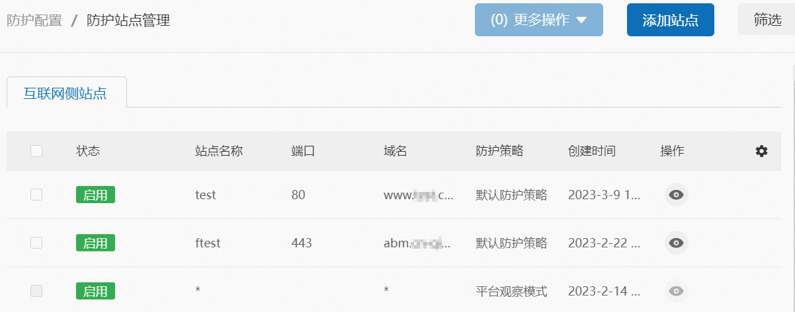
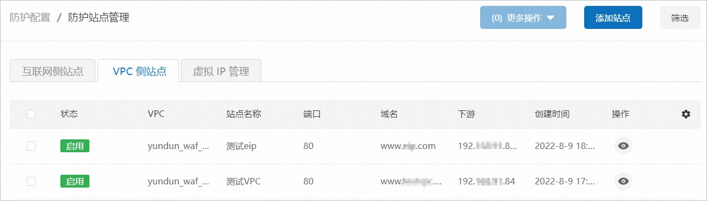
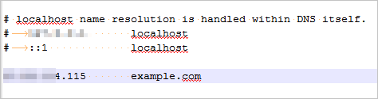
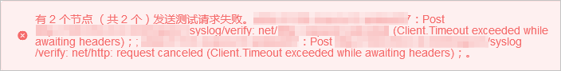
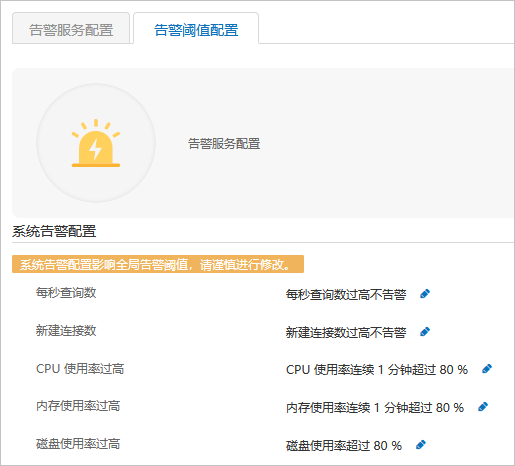
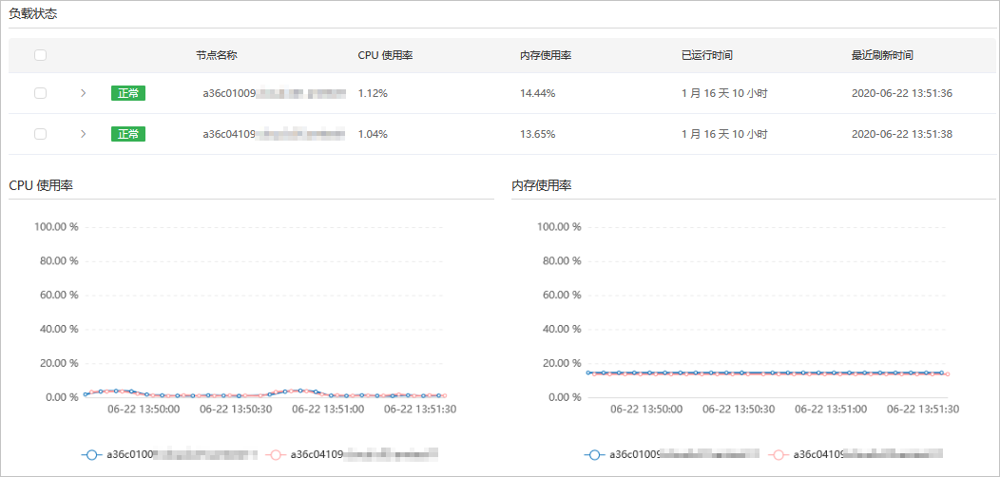
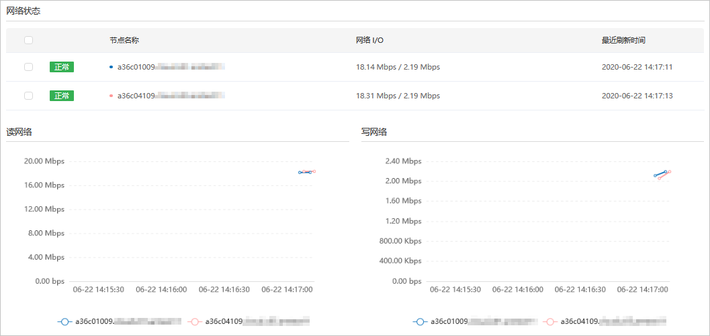
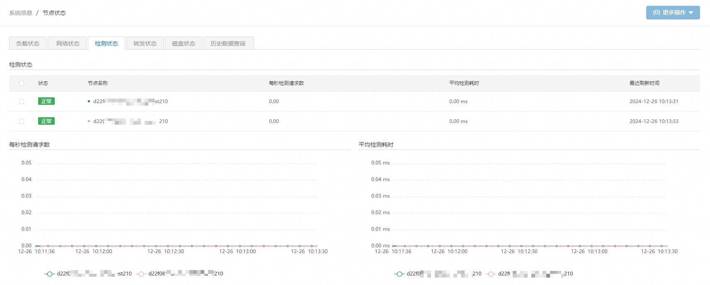
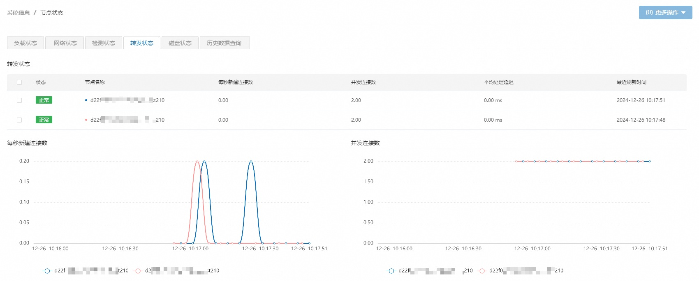
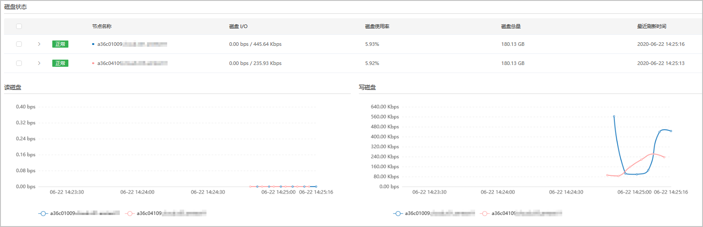

阿里云  
专有云  
云盾-Web应用防火墙-企业版  
用户指南  
产品版本：V3.18.6  
文档版本：20251212

**目录**

- [1.使用须知](#section-1)
- [2.快速入门](#section-2)
    - [2.1. 用户权限说明](#section-2-1)
    - [2.2. 登录Apsara Uni-manager运营控制台](#section-2-2)
    - [2.3. 快速入门](#section-2-3)
- [3.统计信息](#section-3)
    - [3.1. 防护总览](#section-3-1)
    - [3.2. 访问状态监控](#section-3-2)
    - [3.3. 防护报告导出](#section-3-3)
    - [3.4. 攻击检测统计](#section-3-4)
    - [3.5. 流量趋势图](#section-3-5)
- [4.防护日志](#section-4)
    - [4.1. 攻击检测日志](#section-4-1)
    - [4.2. CC防护日志](#section-4-2)
    - [4.3. 系统操作日志](#section-4-3)
    - [4.4. 访问日志](#section-4-4)
    - [4.5. IP 查询](#section-4-5)
    - [4.6. 日志下载管理](#section-4-6)
- [5.防护配置](#section-5)
    - [5.1. 防护站点管理](#section-5-1)
        - [5.1.1. 互联网侧站点](#section-5-1-1)
        - [5.1.2. VPC侧站点](#section-5-1-2)
        - [5.1.3. 虚拟IP管理](#section-5-1-3)
    - [5.2. 攻击防护策略](#section-5-2)
    - [5.3. 全局自定义规则](#section-5-3)
    - [5.4. 自定义规则](#section-5-4)
    - [5.5. 防篡改规则](#section-5-5)
    - [5.6. CC防护](#section-5-6)
        - [5.6.1. CC防护规则](#section-5-6-1)
        - [5.6.2. CC白名单](#section-5-6-2)
    - [5.7. 威胁情报](#section-5-7)
    - [5.8. 证书管理](#section-5-8)
    - [5.9. 数据脱敏](#section-5-9)
    - [5.10. 本地验证域名接入配置](#section-5-10)
    - [5.11. 修改DNS解析](#section-5-11)
- [6.系统设置](#section-6)
    - [6.1. 告警配置](#section-6-1)
        - [6.1.1. 告警服务配置](#section-6-1-1)
        - [6.1.2. 告警阈值配置](#section-6-1-2)
    - [6.2. 其他系统设置](#section-6-2)
    - [6.3. 全局系统设置](#section-6-3)
- [7.系统信息](#section-7)
    - [7.1. 节点状态](#section-7-1)
        - [7.1.1. 负载状态](#section-7-1-1)
        - [7.1.2. 网络状态](#section-7-1-2)
        - [7.1.3. 检测状态](#section-7-1-3)
        - [7.1.4. 转发状态](#section-7-1-4)
        - [7.1.5. 磁盘状态](#section-7-1-5)
        - [7.1.6. 历史数据查询](#section-7-1-6)
    - [7.2. 回源IP信息](#section-7-2)
    - [7.3. 系统固件信息](#section-7-3)
- [8.网络诊断工具](#section-8)
    - [8.1. Ping](#section-8-1)
    - [8.2. cURL](#section-8-2)
    - [8.3. TCPDump](#section-8-3)
    - [8.4. 系统诊断信息](#section-8-4)

# 1.使用须知

在登录云盾控制台前，您需要确认本地PC符合以下配置。

本地PC需要满足如配置要求表中配置要求，才可以正常登录云盾控制台。

表 1. 配置要求表

<table>
  <tr>
    <th width="90">内容</th>
    <th>要求</th>
  </tr>
  <tr>
    <td>浏览器</td>
    <td>• Internet Explorer浏览器：11及以上版本 • Chrome浏览器（推荐）：42.0.0及以上版本 • Firefox浏览器：30及以上版本 • Safari浏览器：9.0.2版本及以上版本</td>
  </tr>
  <tr>
    <td>操作系统</td>
    <td>• Windows XP版本 • Windows 7及以上版本 • Mac系统</td>
  </tr>
</table>

# 2.快速入门

## 2.1. 用户权限说明

Web应用防火墙（Web Application Firewall，简称WAF）租户侧权限为使用独立的WAF需要开通的权限。本文介绍WAF涉及的用户角色。

所有角色均为默认角色，无法自定义添加。在登录租户侧WAF前，您需要确认自己的账号已经分配相关的角色。

租户侧WAF默认角色

<table>
  <tr>
    <th width="170">角色名称</th>
    <th>角色说明</th>
  </tr>
  <tr>
    <td>组织安全管理员</td>
    <td>负责单个组织内的安全管理工作，包括云安全管理中心SOC、主机安全、应用安全、网络安全等，以及ECS类安全产品的管理工作。</td>
  </tr>
  <tr>
    <td>全局组织安全管理员</td>
    <td>负责通过云安全管理中心SOC，进行云平台及所有租户的安全管理工作和ECS类安全产品的管理工作。</td>
  </tr>
</table>

如果您没有相关账号和角色，请联系管理员创建用户及授予角色，具体步骤，请参见<strong>《Apsara Uni-manager运营控制台用户指南》</strong>中**创建用户**。

## 2.2. 登录Apsara Uni-manager运营控制台

本文主要向您介绍如何登录Apsara Uni-manager运营控制台。

**前提条件**

- 登录Apsara Uni-manager运营控制台前，确认您已从部署人员处获取Apsara Uni-manager运营控制台的服务域名地址。

- 推荐使用Chrome浏览器。

**操作步骤**

1. 在浏览器地址栏中，输入Apsara Uni-manager运营控制台的服务域名地址，按回车键。

   

   > **说明**
   >
   > - 单击页面右上角的当前语言可以切换其它语言。
   >
   > - 授权登录是第三方认证中配置了全局IdP设置才会显示，且“授权登录”名称用户可按需自定义。

2. 输入正确的用户名及密码。

   > **说明**
   >
   > - 请向运营管理员获取登录控制台的用户名和密码。
   >
   > - 首次登录Apsara Uni-manager运营控制台时，需要修改登录用户名的密码，请按照提示完成密码修改。为提高安全性，密码长度必须为10~32位，且包含英文字母大小写、阿拉伯数字和特殊符号（感叹号（!）、at（@）、井号（#）、美元符号（$）、百分号（%）等）。

3. 单击**账号登录**。

4. 如果账号已激活MFA多因素认证，请根据以下两种情况进行操作：

   - **管理员强制开启MFA后的首次登录**

     <ol type="a">

     <li>

     在绑定虚拟MFA设备页面中，按页面提示步骤绑定MFA设备。

     </li>

     <li>

     按照步骤2重新输入账号和密码，单击**账号登录**。

     </li>

     </ol>

     <ol type="i" start="100">

     <li>

     输入6位MFA码后单击**认证**。

     </li>

     </ol>

   - **您已开启并绑定MFA**

     输入6位MFA码后单击**认证**。

     > **说明**
     >
     > 绑定并开启MFA的操作请参见管理多因素认证。

**相关操作**

**忘记密码**

1. 用户忘记登录密码时，单击密码输入框下方的**忘记密码**。

2. 在忘记密码页面，输入**账户名**、**邮箱**和验证码后，单击**确认**。

   

   > **说明**
   >
   > - 账户名请输入当前账号的用户名，邮箱请输入注册账号的Email地址。
   >
   > - 重置密码的链接将发至邮箱，进入链接后用户可输入新密码。

## 2.3. 快速入门

本文介绍如何快速使用Web应用防火墙WAF（Web Application Firewall）的功能。

WAF提出以智能语义分析算法解决Web攻击识别问题。通过WAF的智能分析算法，自主识别Web的攻击行为；同时结合学习模型，不断增强和完善分析能力，使其不依赖传统的规则库，即可满足用户日常安全防护需求。

WAF的使用流程如下：

1. 定制WAF的防护规则。

   WAF提供默认的防护策略，同时用户也可以根据自身的业务特点，灵活定制防护策略。

   - 配置防护策略，请参见攻击防护策略。

   - 配置自定义规则，请参见自定义规则。

   - 配置CC防护规则，请参见CC防护规则。

2. 添加防护的网站。

   WAF支持防护面向互联网的网站和面向内网的网站。

   - 添加面向互联网提供服务的网站，请参见互联网侧站点。

   - 添加面向内网提供服务的网站，请参见VPC侧站点。

3. 设置DNS解析。

   将原来DNS解析的网站源IP修改为WAF的虚拟IP，请参见修改DNS解析。

4. 查看WAF防护结果。

   - 查看防护的整体信息，请参见防护总览。

   - 查看访问状态信息，请参见访问状态监控。

   - 查看Web攻击检测日志，请参见攻击检测日志。

   - 查看CC攻击防护日志，请参见CC防护日志。

# 3.统计信息

## 3.1. 防护总览

防护总览展示WAF对历史攻击数据的统计信息，攻击源IP地理信息分布和防护状态等情况。管理者通过总览，快速了解Web防护情况，并制定相应的规则和措施保护Web安全。本文介绍如何查看WAF的防护总览。

**操作步骤**

1. 登录Apsara Uni-manager运营控制台。

2. 在控制台顶部菜单栏，单击**安全**，选择**应用安全 > Web应用防火墙**。在**Web应用防火墙**授权页面，选择**地域**并单击**角色授权访问**。

3. 在左侧导航栏，单击**防护总览**。

4. 在**防护总览**页面，查看**最近24小时统计**和**最近30天统计**的WAF防护情况。

   - 请求次数：显示总的请求次数。

   - 攻击次数：显示总的攻击次数。

   - 拦截次数：显示总的拦截次数。

   - 攻击者地理位置分布（地图形式）：在地图上展示攻击者的分布情况，支持查看中国和世界地图。

   - 发起攻击最多的IP（仅显示Top 5）：以条形图展示发起攻击次数Top 5的IP地址。横坐标为请求次数，纵坐标为IP地址。

   - 攻击类型分布（仅显示Top 5）：以条形图展示Top 5的攻击类型的分布占比和各攻击类型的次数。

   - 被攻击最多的站点（仅显示Top 5）：以条形图展示Top 5被攻击站点和各站点的次数。

## 3.2. 访问状态监控

通过访问状态监控，了解Web服务的访问情况，分析业务访问情况，帮助安全管理员及时发现业务漏洞，提升防御能力。本文介绍如何查看访问状态的监控信息。

**操作步骤**

1. 登录Apsara Uni-manager运营控制台。

2. 在控制台顶部菜单栏，单击**安全**，选择**应用安全 > Web应用防火墙**。在**Web应用防火墙**授权页面，选择**地域**并单击**角色授权访问**。

3. 在左侧导航栏，选择**统计信息 > 访问状态监控**。

4. 在**访问状态监控**页面，查看访问详情。

   您可以通过如下方式，筛选访问详情：

   - **IP**、**SESSION**

   - **不筛选**、**站点**或**URL**

   - **30秒内请求次数**、**平均响应时间**

   > **说明**
   >
   > 筛选出的数据仅显示TOP 100的实时访问监控信息。

## 3.3. 防护报告导出

WAF支持手动导出防护报告和自动导出防护报告。本文介绍如何导出防护报告。

**导出防护报告**

1. 登录Apsara Uni-manager运营控制台。

2. 在控制台顶部菜单栏，单击**安全**，选择**应用安全 > Web应用防火墙**。在**Web应用防火墙**授权页面，选择**地域**并单击**角色授权访问**。

3. 在左侧导航栏，选择**统计信息 > 防护报告导出**。

4. 在**防护报告导出**页面，导出防护报告。

   > **说明**
   >
   > 无论是手动导出的防护报告，还是通过定时报告任务自动导出的防护报告，均可在**防护报告**页签的列表查看。

   - 手动导出防护报告

     在**防护报告**页签，单击**手动生成一个报告**。完成配置后，单击**确定**。

     <table>
       <tr>
         <th width="105">配置项</th>
         <th>说明</th>
       </tr>
       <tr>
         <td>报告名称</td>
         <td>设置导出的防护报告的名称。</td>
       </tr>
       <tr>
         <td>报告类型</td>
         <td>设置防护报告的类型。可选：<strong>周报</strong>、<strong>日报</strong>或<strong>自定义</strong>。</td>
       </tr>
       <tr>
         <td>统计周期</td>
         <td>设置防护报告的统计周期。根据选择的<strong>报告类型</strong>，设置<strong>周报</strong>、<strong>日报</strong>或<strong>自定义</strong>防护报告的统计时间。</td>
       </tr>
       <tr>
         <td>统计范围</td>
         <td>设置防护报告的统计范围。可选：<strong>所有站点</strong>或<strong>指定统计站点</strong>。</td>
       </tr>
       <tr>
         <td>站点根路径</td>
         <td>说明仅统计范围选择<strong>指定统计站点</strong>时需要配置此项。 选择并填写导出的站点根路径。可选： • <strong>http://</strong>：表示仅导出http路径下的防护报告。 • <strong>https://</strong>：表示仅导出https路径下的防护报告。 • <strong>http(s)://</strong>：表示同时导出http和https路径下的防护报告。</td>
       </tr>
     </table>

   - 自动导出防护报告

     在**定时报告任务**页签，单击**添加定时报告任务**。完成配置后，单击**确定**。

     | 配置项 | 说明 |
     | --- | --- |
     | 报告名称 | 设置导出的防护报告的名称。 |

     <table>
       <tr>
         <th width="105">报告类型</th>
         <th>设置防护报告的类型。可选：<strong>周报</strong>或<strong>日报</strong>。</th>
       </tr>
       <tr>
         <td>统计范围</td>
         <td>设置防护报告的统计范围。可选：<strong>所有站点</strong>或<strong>指定统计站点</strong>。</td>
       </tr>
       <tr>
         <td>站点根路径</td>
         <td>说明仅统计范围选择<strong>指定统计站点</strong>时需要配置此项。 选择并填写导出的站点根路径。可选： • <strong>http://</strong>：表示仅导出http路径下的防护报告。 • <strong>https://</strong>：表示仅导出https路径下的防护报告。 • <strong>http(s)://</strong>：表示同时导出http和https路径下的防护报告。</td>
       </tr>
     </table>

**管理防护报告**

在**防护报告**页签，您可以查看和管理导出的防护报告。

- 筛选防护报告

  单击**筛选**，设置筛选条件，单击**确定**。

  > **说明**
  >
  > 筛选条件中的多个条件为“与”的关系，即需要满足所有条件才能生效。

- 查看报告详情

  单击目标防护报告**操作**列的  图标。

- 下载防护报告

  选中目标防护报告，选择**更多操作 > 下载选中报告**。

- 删除防护报告

  选中目标防护报告，选择**更多操作 > 删除选中报告**。

## 3.4. 攻击检测统计

通过攻击检测统计，您可以了解您网站被攻击的情况，并对攻击源IP进行处置。本文介绍如何查看开启并查看攻击检测统计信息。

1. 登录Apsara Uni-manager运营控制台。

2. 在控制台右上方，单击**安全**，选择**应用安全 > Web应用防火墙**。在**Web应用防火墙**授权页面，选择**地域**并单击**角色授权访问**。

3. 在左侧导航栏，选择**统计信息** ＞ **攻击检测统计**。

4. 在**攻击检测统计**页面，单击**统计配置**。

5. 在**统计配置**面板，单击  图标，然后单击**确定**。

   完成以上配置后，攻击检测统计功能开启。如果您的网站被攻击，您可以在**攻击检测溯源**页签和**攻击目标**

   **分析**页签，查看攻击次数Top 100的攻击源IP和攻击目标详细信息，也可以单击目标攻击信息**操作**列的 

   图标，在**攻击检测日志**作出相应处置。具体操作，请参见攻击检测日志。

## 3.5. 流量趋势图

通过查看流量趋势，您可以了解您网站在指定时间范围内的流量趋势。本文介绍如何查看站点的流量趋势。

1. 登录Apsara Uni-manager运营控制台。

2. 在控制台右上方，单击**安全**，选择**应用安全 > Web应用防火墙**。在**Web应用防火墙**授权页面，选择**地域**并单击**角色授权访问**。

3. 在左侧导航栏，选择**统计信息** ＞ **流量趋势图**。

4. 在**流量趋势图**页面，单击**查询信息**后的  图标。

5. 在**编辑查询信息**面板，选择目标**站点**，并设置**时间**后，单击**查询**。

   完成以上配置后，您可以查看指定时间范围内，您的网站流量趋势图。

# 4.防护日志

## 4.1. 攻击检测日志

通过攻击检测日志，分析Web服务的受攻击情况，根据分析结果更新防护策略和自定义规则、处理Web服务漏洞等，提升Web服务的安全性。本文介绍如何查看攻击检测日志。

**操作步骤**

1. 登录Apsara Uni-manager运营控制台。

2. 在控制台顶部菜单栏，单击**安全**，选择**应用安全 > Web应用防火墙**。在**Web应用防火墙**授权页面，选择**地域**并单击**角色授权访问**。

3. 在左侧导航栏，选择**防护日志 > 攻击检测日志**。

   您可以在日志列表中查看所有的攻击日志信息。

   您也可以在日志列表，执行如下操作：

   - 筛选日志

     单击**筛选**，设置筛选条件，单击**确定**。

     > **说明**
     >
     > 筛选条件中的多个条件为“与”的关系，即需要满足所有条件才能生效。

   - 导出日志

     <ol type="a">

     <li>

     选中一条或多条攻击检测日志，选择**更多操作 > 下载选中日志**（.json或.csv），在提示对话框，单击**确认**。

     </li>

     <li>

     在左侧导航栏，选择**防护日志 > 日志下载管理**。单击日志下载任务**操作**列的  图标。

     </li>

     </ol>

   - 切换日志显示方式

     单击  图标，切换日志显示方式为**列表**或**详细视图**。

## 4.2. CC防护日志

通过CC防护日志，分析Web服务的受到的CC攻击情况，根据分析结果更新CC防护规则和CC白名单、处理Web服务漏洞等，提升Web服务的安全性。本文介绍如何查看CC防护日志。

**操作步骤**

1. 登录Apsara Uni-manager运营控制台。

2. 在控制台顶部菜单栏，单击**安全**，选择**应用安全 > Web应用防火墙**。在**Web应用防火墙**授权页面，选择**地域**并单击**角色授权访问**。

3. 在左侧导航栏，选择**防护日志 > CC防护日志**。

   您可以在日志列表中查看所有攻击日志信息。

   您也可以在日志列表，执行如下操作：

   - 筛选日志

     单击**筛选**，设置筛选条件，单击**确定**。

     > **说明**
     >
     > 筛选条件中的多个条件为“与”的关系，即需要满足所有条件才能生效。

   - 一键加黑CC攻击

     单击CC攻击**操作**列的  图标，在**添加黑名单**面板，配置选择规则名称后，单击**确认**。

## 4.3. 系统操作日志

本文介绍如何查看系统操作日志。

**操作步骤**

1. 登录Apsara Uni-manager运营控制台。

2. 在控制台顶部菜单栏，单击**安全**，选择**应用安全 > Web应用防火墙**。在**Web应用防火墙**授权页面，选择**地域**并单击**角色授权访问**。

3. 在左侧导航栏，选择**防护日志 > 系统操作日志**。

   您可以在日志列表中查看所有的攻击日志信息。

   您也可以在日志列表，执行如下操作：

   - 筛选日志

     单击**筛选**，设置筛选条件，单击**确定**。

     > **说明**
     >
     > 筛选条件中的多个条件为“与”的关系，即需要满足所有条件才能生效。

   - 导出日志

     <ol type="a">

     <li>

     选中一条或多条攻击检测日志，选择**更多操作 > 下载选中日志**（.json或.csv），在提示对话框，单击**确认**。

     </li>

     <li>

     在左侧导航栏，选择**防护日志 > 日志下载管理**。单击日志下载任务**操作**列的  图标。

     </li>

     </ol>

## 4.4. 访问日志

本文介绍如何查看访问日志。

**操作步骤**

1. 登录Apsara Uni-manager运营控制台。

2. 在控制台顶部菜单栏，单击**安全**，选择**应用安全 > Web应用防火墙**。在**Web应用防火墙**授权页面，选择**地域**并单击**角色授权访问**。

3. 在左侧导航栏，选择**防护日志 > 访问日志**。

   您可以在日志列表中查看所有的攻击日志信息。

   您也可以在日志列表，执行如下操作：

   - 筛选日志

     单击**筛选**，设置筛选条件，单击**确定**。

     > **说明**
     >
     > 筛选条件中的多个条件为“与”的关系，即需要满足所有条件才能生效。

   - 导出日志

     <ol type="a">

     <li>

     选中一条或多条攻击检测日志，选择**更多操作 > 下载选中日志**（.json或.csv），在提示对话框，单击**确认**。

     </li>

     <li>

     在左侧导航栏，选择**防护日志 > 日志下载管理**。单击日志下载任务**操作**列的  图标。

     </li>

     </ol>

## 4.5. IP 查询

如果您想确认某个IP地址是否会命中某个策略，需要多方查询检索，效率很低指定，本文将为您介绍如何快速指定IP后自动判断该IP命中哪些规则。

1. 登录Apsara Uni-manager运营控制台。

2. 在控制台右上方，单击**安全**，选择**应用安全 > Web应用防火墙**。在**Web应用防火墙**授权页面，选择**地域**并单击**角色授权访问**。

3. 在左侧导航栏，选择**防护日志 > IP查询**

4. 在**IP查询**页面，选择**日志类型**，在IP搜索框中输入想要查询的IP地址。

5. 单击目标对象**操作**列  图标查看详情。

## 4.6. 日志下载管理

**操作步骤**

1. 登录Apsara Uni-manager运营控制台。

2. 在控制台顶部菜单栏，单击**安全**，选择**应用安全 > Web应用防火墙**。在**Web应用防火墙**授权页面，选择**地域**并单击**角色授权访问**。

3. 在左侧导航栏，选择**防护日志 > 日志下载管理**。

   您可以在日志下载管理列表中执行以下操作：

   - 下载日志

     

     选中一条或多条已完成日志，单击下载图标

     。

   - 删除日志

     选中一条或多条已完成日志，选择**更多操作 > 删除选中任务**

# 5.防护配置

## 5.1. 防护站点管理

### 5.1.1. 互联网侧站点

租户侧WAF用于防护用户站点的Web流量，支持防护面向互联网的站点和面向内部网络的站点。本文介绍如何在WAF上添加面向互联网的防护站点。

**背景信息**

- 关于如何设置面向互联网的站点，请参见本章节。

- 关于如何设置面向内部网络的站点，请参见VPC侧站点。

**操作步骤**

1. 登录Apsara Uni-manager运营控制台。

2. 在控制台右上方，单击**安全**，选择**应用安全 > Web应用防火墙**。在**Web应用防火墙**授权页面，选择**地域**并单击**角色授权访问**。

3. 在左侧导航栏，选择**防护配置 > 防护站点管理**。

4. 在**互联网侧站点**页签，单击**添加站点**。

5. 在**添加被防护的站点**面板的**监听信息**区域，完成参数配置，单击**下一步**。

   设置需要WAF进行防护的网站地址，WAF支持HTTP和HTTPS类型网站。

   <table>
     <tr>
       <th width="123">配置项</th>
       <th>说明</th>
     </tr>
     <tr>
       <td>防护站点名称</td>
       <td>设置防护站点名称。</td>
     </tr>
     <tr>
       <td>绑定域名</td>
       <td>设置防护站点域名。 • 可使用星号（*）作通配符。 • 多个域名可使用逗号（,）分隔。</td>
     </tr>
     <tr>
       <td>备注信息</td>
       <td>设置防护站点的备注信息。</td>
     </tr>
     <tr>
       <td>端口设置</td>
       <td>设置WAF监听防护的端口。如果站点支持多个端口访问，单击<strong>添加一组端口</strong>新增其他端口。 • 如果站点仅支持HTTP访问，可跳过证书设置，直接配置下游。 • 如果站点支持HTTPS访问，选中<strong>启用SSL后</strong>，并继续设置后续配置项。 • 如果站点支持HTTP 2.0访问，选中<strong>启用 HTTP2</strong>。 说明仅在选中<strong>启用SSL</strong>时，才支持该选项。</td>
     </tr>
     <tr>
       <td>证书方案</td>
       <td>设置网站的证书方案。默认选中<strong>SSL证书</strong>。</td>
     </tr>
     <tr>
       <td>SSL证书设置</td>
       <td>设置网站的HTTPS证书，可选上传一个新证书或选择一个已有的证书。 • 上传一个新证书：如果网站使用的HTTPS证书以前没有上传到WAF，选择此选项。默认情况下HTTPS证书和私钥分开上传，如果选中<strong>证书文件中包含私钥</strong>，则只需要上传一个文件。 • 选择一个已有的证书：如果网站使用的HTTPS证书以前有上传到WAF，选择此选项，并在下拉菜单中输入证书关键字，搜索并选择网站HTTPS证书。</td>
     </tr>
     <tr>
       <td>证书名称</td>
       <td>设置证书名称。</td>
     </tr>
     <tr>
       <td>SSL证书文件</td>
       <td>上传HTTPS证书和密钥。默认情况下HTTPS证书和私钥分开上传，如果<strong>HTTPS证书</strong>中选中<strong>证书文件中包含私钥</strong>，则只需要上传一个包含了HTTPS证书和私钥的文件。</td>
     </tr>
     <tr>
       <td>SSL证书密码</td>
       <td>设置证书密码。</td>
     </tr>
     <tr>
       <td>双向认证</td>
       <td>单击图标，开启双向认证，并配置相关信息。 • <strong>CA 证书设置</strong>：设置CA 证书，请选择<strong>上传一个新证书</strong>或<strong>选择一个已有的证书</strong>： • <strong>上传一个新证书</strong>：如果CA证书以前没有上传到WAF，选择此选项。设置<strong>CA证书名称</strong>、上传<strong>CA证书文件</strong>。 • <strong>选择一个已有的证书</strong>：如果CA证书以前有上传到WAF，选择此选项，并在下拉菜单中输入证书关键字，搜索并选择CA证书。 • <strong>检测深度</strong>：设置双向认证检测深度。 • <strong>客户端检测</strong>：支持开启、关闭、可选或可选（no_ca）。 • 如果提供客户端证书，则选择<strong>可选</strong>，进行校验。 • 如果客户端证书可由非可信CA签发，则选择<strong>可选 (no_ca)</strong>。</td>
     </tr>
     <tr>
       <td>下游</td>
       <td>选择下游的虚拟IP是现有虚拟IP或是需创建虚拟IP。可选项： • 选择现有虚拟IP • 创建虚拟IP • 创建指定虚拟IP</td>
     </tr>
     <tr>
       <td>虚拟IP</td>
       <td>选择具体的虚拟IP。 重要默认最多选择8个虚拟IP地址，只有在<strong>下游</strong>中选择<strong>选择现有虚拟IP</strong>，才需设置本参数。</td>
     </tr>
     <tr>
       <td>虚拟IP类型</td>
       <td>选择虚拟IP类型。可选项： • 外网经典网络IP • 内网经典网络IP 重要只有在<strong>下游</strong>中选择<strong>创建虚拟IP</strong>或<strong>创建指定虚拟IP</strong>，才需设置本参数。</td>
     </tr>
     <tr>
       <td>虚拟IP协议</td>
       <td>选择虚拟IP协议。可选项： • ipv4 • ipv6 重要只有在<strong>下游</strong>中选择<strong>创建虚拟IP</strong>或<strong>创建指定虚拟IP</strong>，才需设置本参数。</td>
     </tr>
     <tr>
       <td>是否指定机房</td>
       <td>设置指定的虚拟IP是否有指定的机房。可选项： • 是 • 否 重要只有在<strong>下游</strong>中选择<strong>创建指定虚拟IP</strong>，才需设置本参数。</td>
     </tr>
     <tr>
       <td>自定义IP</td>
       <td>自定义虚拟IP地址。 重要只有在<strong>下游</strong>中选择<strong>创建指定虚拟IP</strong>且在<strong>是否指定机房</strong>中选择<strong>否</strong>，才需设置本参数。</td>
     </tr>
     <tr>
       <td>所属机房名称</td>
       <td>选择虚拟IP指定机房的名称。 重要只有在<strong>下游</strong>中选择<strong>创建指定虚拟IP</strong>且在<strong>是否指定机房</strong>中选择<strong>是</strong>，才需设置本参数。</td>
     </tr>
     <tr>
       <td>运行模式</td>
       <td>选择运行模式。可选： • 多活 • 单活 重要只有在<strong>下游</strong>中选择<strong>创建指定虚拟IP</strong>且在<strong>是否指定机房</strong>中选择<strong>是</strong>，才需设置本参数。</td>
     </tr>
   </table>

6. 在**添加被防护的站点**面板的**响应方式**区域，完成参数配置，单击**下一步**。

   <table>
     <tr>
       <th>响应方式</th>
       <th>配置项</th>
       <th>说明</th>
     </tr>
     <tr>
       <td rowspan="3">转发到业务服务器</td>
       <td>负载调度算法</td>
       <td>选择负载均衡算法，支持<strong>加权轮询法</strong>、<strong>源地址哈希法</strong>、<strong>最小连接数</strong><strong>法</strong>。</td>
     </tr>
     <tr>
       <td>业务服务器地址</td>
       <td>流量经过WAF后转发到业务服务器，支持<strong>填写回源地址</strong>和<strong>回源到指</strong><strong>定实例</strong>。 • <strong>填写回源地址</strong>：直接填写回源的业务服务器地址，如果有多个业务服务器，则根据<strong>负载调度算法</strong>做负载均衡。 • <strong>回源到指定实例</strong>：回源到指定的ECS或SLB，如果有多个业务服务器，则根据<strong>负载调度算法</strong>做负载均衡。</td>
     </tr>
     <tr>
       <td>X-Forwarded-For</td>
       <td>设置源IP透传方式。X-Forwarded-For位于HTTP协议的请求头，用来表示HTTP请求端真实IP。一般用于HTTP代理、负载均衡等转发服务。可选项： • 在X-Forwarded-For末尾追加上一跳的IP地址 • 用上一跳X-Forwarded-For的IP地址覆盖原有内容 • 原封不动</td>
     </tr>
     <tr>
       <td rowspan="2">重定向</td>
       <td>响应状态码</td>
       <td>流量经过WAF后重定向到指定地址。重定向响应状态码可选择<strong>301</strong>、<strong>302</strong>、<strong>307</strong>和<strong>308</strong>。 • <strong>301</strong>：表示请求的网页已永久移动到新位置。 • <strong>302</strong>：表示服务器目前从不同位置的网页响应请求，但请求者应继续使用原有位置来进行以后的请求。 • <strong>307</strong>：服务器目前从不同位置的网页响应请求，但请求者应继续使用原有位置来进行以后的请求。 • <strong>308</strong>：永久重定向。</td>
     </tr>
     <tr>
       <td>重定向地址</td>
       <td>输入重定向后的URL地址。</td>
     </tr>
     <tr>
       <td rowspan="2">响应指定内容</td>
       <td>响应状态码</td>
       <td>流量经过WAF后响应指定内容。响应状态码可选择<strong>200</strong>、<strong>400</strong>、<strong>401</strong>、<strong>402</strong>、<strong>404</strong>、<strong>405</strong>、<strong>500</strong>、<strong>503</strong>、<strong>504</strong>等。</td>
     </tr>
     <tr>
       <td>响应内容</td>
       <td>上传响应的内容。例如设置为<strong>响应指定内容</strong>，并在此上传一张图片。如果用户访问该网站后，会返回此图片。</td>
     </tr>
   </table>

7. 在**添加被防护的站点**面板的**防护策略**区域，完成参数配置，单击**下一步**完成配置，单击**完成**。

   > **重要**
   >
   > **响应方式**只有设置为**转发到业务服务器**模式，才能设置防护策略。

   <table>
     <tr>
       <th width="89">配置项</th>
       <th>说明</th>
     </tr>
     <tr>
       <td>防护策略</td>
       <td>选择WAF的防护策略，默认选择<strong>默认防护策略</strong>。可选项： • 不使用防护策略 • 系统默认的防护策略 • 默认防护策略 • 高防模式 • 互联网客户 • 金融类客户 • 观察模式 • 自定义防护策略关于上述防护策略的具体信息，请参见攻击防护策略。</td>
     </tr>
     <tr>
       <td>用户识别</td>
       <td>设置是否使用用户识别功能。 可选： • 不使用 • WAF用户系统 • 从请求中提取用户ID 说明如果此被防护站点启用了CC防护，而且CC防护规则中<strong>受限制目标的类型</strong>选择<strong>SESSION</strong>，则<strong>用户识别</strong>需要选择<strong>WAF用户系统</strong>。</td>
     </tr>
   </table>

   成功添加站点后，您可以在防护站点列表执行如下操作：

   - 查看已添加的防护站点

     您可以在防护站点列表查看已添加站点的状态、站点名称、端口、域名、下游等信息。

     

   - 设置防护站点列表显示项

     单击**操作**列的  图标，选择要在防护站点列表呈现的项目。

   - 筛选防护站点

     单击页面右上角的**筛选**，根据名称、站点域名、防护策略、防篡改状态、创建时间、最后修改时间，筛选防护站点。

   - 更多操作

     选中多个防护站点，选择**更多操作 > 启用选中站点**、**禁用选中站点**、**导出选中站点**或**删除选中站点**。

   - 修改防护站点基本信息

     单击**操作**列的  图标，在**基本信息**页签，单击配置项信息后的  图标，修改已配置的站点名称、站点状

     态、监听端口、域名、备注信息或下游等信息。

   - 修改防护站点请求处理方式

     单击**操作**列的  图标，在**请求处理方式**页签，单击配置项信息后的  图标，修改防护站点的响应方式、

     调度算法、X-Forwarded-For、业务服务器健康检查、记录访问日志、业务服务器地址、HTTP头设置、回源IP配置等请求处理方式。

   - 查看并修改站点防护方式

     - 攻击防护策略：

       - 查看已配置的攻击防护策略的解码方式、攻击检测模块、拦截方式、HTTP响应处理、HTTP请求Body检测、检测超时限制等信息。

       - 单击**默认防护策略**后的  图标，设置站点防护策略。关于防护策略类型的更多信息，请参见攻击防

         护策略。

     - 自定义规则：支持添加自定义规则，具体操作，请参见自定义规则。

     - 防篡改规则：支持添加防篡改规则，具体操作，请参见防篡改规则。

     - 源IP获取方式：设置源IP的获取方式，支持从X-Forwarded-For连接中获取、从HTTP头获取。

### 5.1.2. VPC侧站点

WAF支持防护面向互联网的站点和面向内部网络的站点。本文介绍如何在WAF上添加专有云的VPC防护站点。

**背景信息**

- 关于如何设置面向互联网的站点，请参见互联网侧站点。

- 关于如何设置面向内部网络的站点，请参见本章节。

**操作步骤**

1. 登录Apsara Uni-manager运营控制台。

2. 在控制台右上方，单击**安全**，选择**应用安全 > Web应用防火墙**。在**Web应用防火墙**授权页面，选择**地域**并单击**角色授权访问**。

3. 在左侧导航栏，选择**防护配置 > 防护站点管理**。

4. 在**防护站点管理**页面，单击**VPC侧站点**。

5. 在**VPC侧站点**页签，单击**添加站点**。

6. 在**添加被防护的站点**面板的**监听信息**区域，完成参数配置，单击**下一步**。

   设置需要WAF进行防护的VPC站点，WAF支持HTTP和HTTPS类型网站。

   | 配置项 | 说明 |
   | --- | --- |
   | 防护站点名称 | 设置防护站点名称。 |
   | 绑定域名 | 设置防护站点域名： • 可使用星号（\*）作通配。 • 多个域名可使用半角逗号（,）分隔。 |
   | 备注 | 设置防护站点的备注信息。 |
   | 端口设置 | 设置WAF监听防护的端口。如果站点支持多个端口访问，单击<strong>添加一组端口</strong>新增其他端口。 • 如果站点仅支持HTTP访问，单击<strong>下一步</strong>，配置VPC。具体操作，请参见步骤7。 • 如果站点支持HTTPS访问，选中<strong>启用SSL</strong>，并继续设置后续配置项。 • 如果站点支持HTTP 2.0访问，选中<strong>启用 HTTP2</strong>。 说明仅在选中<strong>启用SSL</strong>时，才支持该选项。 |
   | 证书方案 | 设置网站的证书方案。默认勾选<strong>SSL证书</strong>。 |
   | SSL证书设置 | 设置网站的SSL证书，请选择<strong>上传一个新证书</strong>或<strong>选择一个已有的证书</strong>： • <strong>上传一个新证书</strong>：如果网站使用的HTTPS证书以前没有上传到WAF，选择此选项。默认情况下HTTPS证书和私钥分开上传，如果选中<strong>证书文件中包含私钥</strong>，则只需要上传一个文件。 • <strong>选择一个已有的证书</strong>：如果网站使用的HTTPS证书以前有上传到WAF，选择此选项，并在下拉菜单中输入证书关键字，搜索并选择网站HTTPS证书。 |
   | 证书名称 | 设置证书名称。 |
   | SSL证书文件 | 上传SSL证书和密钥。默认情况下SSL证书和私钥分开上传，如果在<strong>证书名称</strong>中选中<strong>证书文件中包含私钥</strong>，则只需要上传一个包含了SSL证书和私钥的文件。 |
   | SSL证书密码 | 设置证书密码。 |
   | 双向认证 | 单击图标，开启双向认证，并配置相关信息。 • <strong>CA 证书设置</strong>：设置CA 证书，请选择<strong>上传一个新证书</strong>或<strong>选择一个已有的证书</strong>： • <strong>上传一个新证书</strong>：如果CA证书以前没有上传到WAF，选择此选项。设置<strong>CA证书名称</strong>、上传<strong>CA证书文件</strong>。 • <strong>选择一个已有的证书</strong>：如果CA证书以前有上传到WAF，选择此选项，并在下拉菜单中输入证书关键字，搜索并选择CA证书。 • <strong>检测深度</strong>：设置双向认证检测深度。 • <strong>客户端检测</strong>：支持开启、关闭、可选或可选（no_ca）。 • 如果提供客户端证书，则选择<strong>可选</strong>，进行校验。 • 如果客户端证书可由非可信CA签发，则选择<strong>可选 (no_ca)</strong>。 |

7. 在**配置VPC**区域，完成参数配置，单击**下一步**。

   | 配置项 | 说明 |
   | --- | --- |
   | 被防护VPC | 选择防护站点所属的VPC，支持在下拉菜单中输入关键字，搜索并选择要防护的VPC。 |
   | 下游 | 可选择以下方式： • 选择现有虚拟IP • 负载均衡 SLB • 创建虚拟 IP • 创建指定虚拟IP • EIP 重要如果需要选择负载均衡SLB选项，请确保在<strong>系统设置 &gt; 全局系统设置</strong>页面，已打开<strong>私有SLB作</strong><strong>为站点下游</strong>开关。只有打开<strong>私有SLB作为站点下游</strong>开关，才支持<strong>负载均衡SLB</strong>选项。 |
   | 交换机选择 | 选择防护站点所属的虚拟交换机。 重要只有在下游中选择<strong>创建虚拟IP</strong>或<strong>创建指定虚拟IP</strong>，才需设置本参数。 |
   | 负载均衡SLB | 选择防护站点所属的SLB。 重要只有在下游中选择<strong>负载均衡 SLB</strong>，才需设置本参数。 |
   | VPC虚拟IP | • 当<strong>下游</strong>选择<strong>选择现有虚拟IP</strong>时，在<strong>VPC虚拟IP</strong>中选择已有的虚拟IP地址。 重要默认最多选择8个虚拟IP地址。 • 当<strong>下游</strong>选择<strong>创建虚拟IP</strong>时，在<strong>VPC虚拟IP</strong>中单击<strong>点击生成虚拟IP</strong>。 • 当<strong>下游</strong>选择<strong>创建指定虚拟IP</strong>时，在<strong>VPC虚拟IP</strong>中输入虚拟IP地址。 |
   | 是否指定机房 | 选择防护站点是否需要指定的机房。 重要只有在下游中选择<strong>创建指定虚拟IP</strong>，才需设置本参数。 |
   | EIP | 选择防护站点所属的EIP。 重要只有在下游中选择<strong>EIP</strong>，才需设置本参数。 |

8. 设置负载调度的响应方式，单击**下一步**。

   **响应方式**

   **配置项**

   **说明**

   选择负载均衡算法，支持**加权轮询法**、**源地址哈希法**、**最小连接数法**。

   **负载调度算法**

   输入业务服务器地址，流量经过WAF后转发到业务服务器。

   **业务服务器地址**

   **转发到业务服务**

   设置源IP透传方式。

   **器**

   X-Forwarded-For位于HTTP协议的请求头，用来表示HTTP请求端真实IP。一般用于HTTP代理、负载均衡等转发服务。可选项：

   **X-Forwarded-**

   - **在X-Forwarded-For末尾追加上一跳的IP地址**

   **For**

   - **用上一跳X-Forwarded-For的IP地址覆盖原有内容**

   - **原封不动**

   流量经过WAF后重定向到指定地址。

   重定向响应状态码可选择**301**、**302**、**307**和**308**。

   - **301**：表示请求的网页已永久移动到新位置。

   **响应状态码**

   - **302**：表示服务器目前从不同位置的网页响应请求，但请求者应继续使用原有位置来进行以后的请求。

   **重定向**

   - **307**：服务器目前从不同位置的网页响应请求，但请求者应继续使用原有位置来进行以后的请求。

   - **308**：永久重定向。

   输入重定向后的URL地址。

   **重定向地址**

   流量经过WAF后响应指定内容。

   **响应状态码**

   响应状态码可选择**200**、**400**、**401**、**402**、**404**、**405**、**500**、**503**、**504**等。

   **响应指定内容**

   上传响应的内容。

   **响应内容**

   例如设置为**响应指定内容**，并在此上传一张图片。如果用户访问该网站后，会返回此图片。

9. 设置防护策略，单击**完成**。

   <table>
     <tr>
       <th width="89">参数</th>
       <th>说明</th>
     </tr>
     <tr>
       <td>防护策略</td>
       <td>选择WAF的防护策略，默认选择<strong>默认防护策略</strong>。可选项： • 不使用防护策略系统 • 系统防护策略 • 默认防护策略 • 高防模式 • 互联网客户 • 金融类客户 • 观察模式 • 自定义防护策略关于上述防护策略的具体信息，请参见攻击防护策略。</td>
     </tr>
     <tr>
       <td>用户识别</td>
       <td>设置是否使用用户识别功能。 可选： • 不使用 • WAF用户系统 • 从请求中提取用户ID 说明如果此被防护站点启用了CC防护，而且CC防护规则中<strong>受限制目标的类型</strong>选择<strong>SESSION</strong>，则<strong>用户识别</strong>需要选择<strong>WAF用户系统</strong>。</td>
     </tr>
   </table>

   成功添加站点后，您可以在防护站点列表执行如下操作：

   - 查看已添加的防护站点

     您可以在防护站点列表查看已添加站点的状态、VPC、站点名称、端口、域名、下游等信息。

     

   - 设置防护站点列表显示项

     单击**操作**列的  图标，选择要在防护站点列表呈现的项目。

   - 筛选防护站点

     单击页面右上角的**筛选**，根据名称、站点域名、防护策略、防篡改状态、创建时间、最后修改时间，筛选防护站点。

   - 更多操作

     选中多个防护站点，选择**更多操作 > 启用选中站点**、**禁用选中站点**、<strong>导出选中站点（.csv）</strong>或**删除选中站点**。

   - 修改防护站点基本信息

     单击**操作**列的  图标，在**基本信息**页签，单击配置项信息后的  图标，修改已配置的站点名称、站点状

     态、监听端口、域名、备注信息或下游等信息。

   - 修改防护站点请求处理方式

     单击**操作**列的  图标，在**请求处理方式**页签，单击配置项信息后的  图标，修改防护站点的响应方式、

     调度算法、X-Forwarded-For、业务服务器健康检查、记录访问日志、业务服务器地址、HTTP头设置、回源IP配置等请求处理方式。

   - 查看并修改站点防护方式

     - 攻击防护策略：

       - 查看已配置的攻击防护策略的解码方式、攻击检测模块、拦截方式、HTTP响应处理、HTTP请求Body检测、检测超时限制等信息。

       - 单击**默认防护策略**后的  图标，设置站点防护策略。关于防护策略类型的更多信息，请参见攻击防

         护策略。

     - 自定义规则：支持添加自定义规则，具体操作，请参见自定义规则。

     - 防篡改规则：支持添加防篡改规则，具体操作，请参见防篡改规则。

     - 源IP获取方式

### 5.1.3. 虚拟IP管理

Web应用防火墙支持添加虚拟IP、VPC虚拟IP或EIP。完成添加后，您可以在添加VPC防护站点时，选择已添加的对象作为下游。本文介绍如何添加和管理虚拟IP、VPC虚拟IP或EIP。

1. 登录Apsara Uni-manager运营控制台。

2. 在控制台右上方，单击**安全**，选择**应用安全 > Web应用防火墙**。在**Web应用防火墙**授权页面，选择**地域**并单击**角色授权访问**。

3. 在左侧导航栏，选择**防护配置 > 防护站点管理**。

4. 在**虚拟IP管理**页签，添加虚拟IP、VPC虚拟IP或EIP。

   - 添加虚拟 IP。

     <ol type="a">

     <li>

     在**虚拟IP**分页，单击**添加虚拟IP**。

     </li>

     <li>

     在**添加虚拟IP**面板，配置虚拟IP信息后，单击**确定**。

     - 若**下游**选择**创建虚拟 IP**，配置**虚拟IP类型**、**备注信息**、**虚拟IP协议**。

     - 若**下游**选择**创建指定虚拟 IP**，配置**虚拟IP类型**、**备注信息**、**是否指定机房**、**虚拟IP协议**、**自定义IP**。

     </li>

     </ol>

   - 添加VPC 虚拟IP。

     <ol type="a">

     <li>

     在**VPC虚拟IP**分页，单击**添加虚拟IP**。

     </li>

     <li>

     在**添加虚拟IP**面板，配置虚拟IP信息后，单击**确定**。

     - 若**下游**选择**创建虚拟 IP**，配置**被防护的VPC**、**交换机选择**、**备注信息**。

     - 若**下游**选择**创建指定虚拟 IP**，配置**被防护的VPC**、**交换机选择**、**备注信息**、**VPC 虚拟 IP**、**是否指定机房**。

     </li>

     </ol>

   - 在**EIP管理**分页，单击**添加EIP**。在**添加EIP**面板，配置**EIP ID**、**EIP**、**被防护的VPC**、**VPC虚拟IP**、**回源SLB实例**后，单击**确定**。

   完成后，您可以执行如下操作：

   - 在**虚拟IP**、**VPC虚拟IP**或**EIP管理**分页，查看已添加的对象，或单击目标对象**操作**列  图标，查看详

     情。

   - 在**EIP详情**页面，单击**回源 SLB 实例**项信息后的  ，修改回源 SLB 实例，或单击**开启bypass**并输入

     EIP，开启bypass功能。

## 5.2. 攻击防护策略

WAF提供默认的防护策略，同时用户也可以根据自身的业务特点，灵活配置防护策略。本文介绍如何配置WAF的防护策略。

**背景信息**

WAF默认支持五种类型的防护策略。

| 防护策略 | 应用场景 | 描述 |
| --- | --- | --- |
| 默认防护策略 | 适用于防护要求不高的场景 | 不对服务器响应、机器人请求进行防护，拦截其他高危攻击。 |
| 高防模式 | 适用于防护要求严格的场景 | 拦截所有攻击。 |
| 互联网模式 | 适用于互联网网站业务 | 不对ASP代码注入、模块注入防护，拦截其他高危攻击。 |
| 金融类客户 | 适用于金融类网站业务 | 不对ASP代码注入、模块注入防护的同时，放行并记录命令注入攻击，拦截其他高危攻击。 |
| 观察模式 | 适用于仅需要记录攻击的场景 | 放行并记录所有攻击。 |

**操作步骤**

用户可以根据业务需求，参考以下步骤，自定义防护策略。

1. 登录Apsara Uni-manager运营控制台。

2. 在控制台顶部菜单栏，单击**安全**，选择**应用安全 > Web应用防火墙**。在**Web应用防火墙**授权页面，选择**地域**并单击**角色授权访问**。

3. 在左侧导航栏，选择**防护配置 > 攻击防护策略**。

4. 单击**添加防护策略**，在文本框中输入**策略名称**，单击**确定**。

5. 单击新增的防护策略**操作**列的

   图标，查看防护策略规则。

   

   | 配置项 | 说明 |
   | --- | --- |
   | 解码方式 | 选择解码的算法类型。 |
   | 攻击检测模块 | 设置该防护策略启动哪些攻击检测类型，及其阈值。 |
   | 其他模块 | 其他模块内容显示。 |
   | 拦截方式 | 设置拦截时显示的错误码和图片。 |
   | HTTP响应检测 | 设置<strong>启用 HTTP 响应处理</strong>开启状态和<strong>允许检测的Body长度上限</strong>的阈值。 |
   | HTTP请求检测 | 设置<strong>HTTP请求Body检测</strong>的阈值。 |
   | 检测超时限制 | 设置<strong>启用超时检测</strong>开启状态，并设置<strong>检测超时时间</strong>的阈值。 |
   | 大包绕过防护 | 大包绕过防护。 |

   以修改**攻击检测模块**为例，设置步骤如下：

   <ol type="i">

   <li>

   鼠标移动到**攻击检测模块**的具体模块上（以**SQL注入检测模块**为例），单击**修改**图标。

   </li>

   <li>

   在**SQL注入检测模块**对话框中，设置检测参数后，单击**确定**。

   | 配置项 | 说明 |
   | --- | --- |
   | 是否启用 | 是否使用该模块提供检测功能。 |
   | 阻断阈值 | 提供<strong>不阻断</strong>、<strong>仅阻断高危</strong>、<strong>阻断中危及高危</strong>、<strong>阻断全部</strong>选项。 |
   | 记录日志阈值 | 提供<strong>不记录</strong>、<strong>仅记录高危</strong>、<strong>记录中危及高危</strong>、<strong>记录全部</strong>选项。 |
   | 检测非注入型SQL | 是否开启检测非注入型SQL攻击。 |

   </li>

   <li>

   单击**确定**。

   </li>

   </ol>

6. <strong>可选：</strong>删除防护策略。

   如果某个防护策略已经不需要保留，可以选中该防护策略，选择**更多操作 > 删除选中防护策略**并在提示框中单击**确定**删除该策略。

   > **说明**
   >
   > 系统默认策略不能删除。

## 5.3. 全局自定义规则

**创建全局自定义规则**

全局自定义规则需要在系统配置中创建。具体操作步骤请参考《云盾系统配置》中**规则运营** > **WAF规则运营**章节。

**查看全局自定义规则**

1. 登录Apsara Uni-manager运营控制台。

2. 在控制台右上方，单击**安全**，选择**应用安全 > Web应用防火墙**。在**Web应用防火墙**授权页面，选择**地域**并单击**角色授权访问**。

3. 在左侧导航栏，选择**防护配置** > **全局自定义规则**。

4. 在全局自定义规则页面，查看全局自定义规则信息。

   列表展示全局自定义规则的**状态**、**规则ID**、**备注**、**过期时间**、**创建时间**和**最后修改时间**。

   - 查看全局自定义规则详情。

     单击目标规则**操作**列的  图标，查看全局自定义规则详情。

   - 查看日志信息

     单击目标规则**操作**列的  图标，跳转到攻击检测日志页面，查看日志信息。

   - 筛选全局自定义规则

     单击页面右上角的**筛选**，根据ID、备注、最后修改时间、创建时间或过期时间，筛选自定义规则。可添加筛选条件，单击**添加一个筛选条件**。

## 5.4. 自定义规则

自定义规则便于满足不同场景下用户定制入侵检测规则的需求，灵活过滤部分特定请求。本文介绍如何配置WAF的自定义规则。

**添加自定义规则**

1. 登录Apsara Uni-manager运营控制台。

2. 在控制台右上方，单击**安全**，选择**应用安全 > Web应用防火墙**。在**Web应用防火墙**授权页面，选择**地域**并单击**角色授权访问**。

3. 在左侧导航栏，选择**防护配置 > 自定义规则**

4. 根据要添加的规则类型，单击**添加规则**或**添加情报规则**，完成以下配置后，单击**确定**。

   > **重要**
   >
   > 新创建的自定义规则，建议先设置成观察模式，观察一段时间发现没有误报，再开启拦截模式。

   - 添加规则

     <table>
       <tr>
         <th width="89">配置项</th>
         <th>说明</th>
       </tr>
       <tr>
         <td>模式</td>
         <td>设置自定义规则的工作模式，支持<strong>拦截</strong>、<strong>放行</strong>、<strong>观察</strong>、<strong>检测模块控制</strong>四种模式。 • <strong>拦截</strong>：拦截命中规则的请求。 • <strong>放行</strong>：放行命中规则的请求。 • <strong>观察</strong>：记录并放行命中规则的请求。 • 检测模块控制</td>
       </tr>
       <tr>
         <td>备注</td>
         <td>设置自定义规则的备注信息，一般说明该规则的防护目的。</td>
       </tr>
       <tr>
         <td>威胁等级</td>
         <td>包含<strong>无威胁</strong>、<strong>低危</strong>、<strong>中危</strong>、<strong>高危</strong>。 说明仅<strong>模式</strong>为<strong>拦截</strong>、<strong>放行</strong>、<strong>观察</strong>时，需要配置威胁等级。</td>
       </tr>
       <tr>
         <td>匹配条件</td>
         <td>设置自定义规则的匹配条件。单击<strong>添加一个匹配目标</strong>，可以设置多个匹配条件。多个匹配条件间是<strong>与</strong>的关系，即需要满足所有匹配条件，自定义规则才能生效。</td>
       </tr>
       <tr>
         <td>规则动作</td>
         <td>开启或关闭防护检测模块。 说明仅<strong>模式</strong>为<strong>检测模块控制</strong>时，需要配置规则动作。</td>
       </tr>
     </table>

     <table>
       <tr>
         <td colspan="2">使用范围</td>
         <td>选择自定义规则保护的站点，不支持选择星号(*)站点。</td>
       </tr>
       <tr>
         <td rowspan="4">高级选项</td>
         <td>是否记录日志</td>
         <td>命中时是否记录日志，默认处于开启状态。开启后，拦截记录均会记录在入侵检测日志中。</td>
       </tr>
       <tr>
         <td>攻击类型</td>
         <td>选中要防御的攻击类型。</td>
       </tr>
       <tr>
         <td>阻断状态码</td>
         <td>填写要阻断的状态码。</td>
       </tr>
       <tr>
         <td>过期时间</td>
         <td>设置该自定义规则过期时间。</td>
       </tr>
     </table>

   - 添加情报规则

     <table>
       <tr>
         <th colspan="2">配置项</th>
         <th>说明</th>
       </tr>
       <tr>
         <td colspan="2">模式</td>
         <td>设置自定义规则的工作模式，支持<strong>观察</strong>、<strong>拦截</strong>模式。 • <strong>观察</strong>：记录并放行命中规则的请求。 • <strong>拦截</strong>：拦截命中规则的请求。</td>
       </tr>
       <tr>
         <td colspan="2">备注</td>
         <td>设置情报规则的备注信息，一般说明该规则的防护目的。</td>
       </tr>
       <tr>
         <td colspan="2">威胁等级</td>
         <td>包含<strong>无威胁</strong>、<strong>低危</strong>、<strong>中危</strong>、<strong>高危</strong>。</td>
       </tr>
       <tr>
         <td colspan="2">匹配条件</td>
         <td>设置自定义规则的匹配条件。单击<strong>添加一个匹配目标</strong>，可以设置多个匹配条件。多个匹配条件间是<strong>与</strong>的关系，即需要满足所有匹配条件，自定义规则才能生效。</td>
       </tr>
       <tr>
         <td colspan="2">使用范围</td>
         <td>选择自定义规则保护的站点。</td>
       </tr>
       <tr>
         <td rowspan="4">高级选项</td>
         <td>是否记录日志</td>
         <td>命中时是否记录日志，默认处于开启状态。开启后，拦截记录均会记录在入侵检测日志中。</td>
       </tr>
       <tr>
         <td>攻击类型</td>
         <td>选择需要防御的攻击类型。</td>
       </tr>
       <tr>
         <td>阻断状态码</td>
         <td>设置需要阻断的状态码。</td>
       </tr>
       <tr>
         <td>过期时间</td>
         <td>设置该自定义规则过期时间。</td>
       </tr>
     </table>

   > **重要**
   >
   > 您填写完毕自定义规则，单击**确认**创建规则时，系统判断如果是疑似  `deny all`  的规则并且不是观察模式，则会进行弹窗提醒，需要您将**模式**改为**观察**模式，再次创建自定义规则。

5. （可选）用户也在离线表格中创建自定义规则，单击**导入规则**，批量导入自定义规则。

   多条自定义规则之间是**或**的关系。如果存在两条自定义规则，其触发条件一致，但拦截、放行等动作不同，则系统按照**规则ID**从小到大的排列顺序匹配上方的规则。

**管理自定义规则**

用户可以在自定义规则列表，查看和管理自定义规则。

- 查看自定义规则

  在自定义规则列表，查看自定义规则信息。

- 查看日志信息

  单击目标规则**操作**列的  图标，查看日志信息。

- 编辑自定义规则

  单击目标规则**操作**列的  图标，修改自定义规则。

- 筛选自定义规则

  单击页面右上角的**筛选**，根据ID、备注、最后修改时间、创建时间或过期时间，筛选自定义规则。

- 更多操作

  选中多个自定义规则，选择**更多操作 > 启用选中规则**、**禁用选中规则**、**导出选中规则**或**删除选中规则**。

## 5.5. 防篡改规则

配置防篡改规则，可帮助您预防源站页面内容被恶意篡改。本文介绍如何配置防篡改规则。

**添加防篡改规则**

1. 登录Apsara Uni-manager运营控制台。

2. 在控制台右上方，单击**安全**，选择**应用安全 > Web应用防火墙**。在**Web应用防火墙**授权页面，选择**地域**并单击**角色授权访问**。

3. 在左侧导航栏，选择**系统设置 > 全局系统设置**。将**防篡改**开关设置为**开**。

   > **说明**
   >
   > 防篡改功能默认关闭。仅将**防篡改**开关设置为**开**时，防篡改功能才可在左侧导航栏呈现。

4. 在左侧导航栏，选择**防护配置 > 防篡改规则**。

5. 单击**添加规则**，在**添加防篡改规则**中，设置规则参数，单击**确定**。

   | 参数 | 说明 |
   | --- | --- |
   | 状态 | 设置防篡改规则的状态，可选择<strong>启用</strong>或<strong>禁用</strong>。 |
   | 备注 | 设置防篡改规则的备注信息，一般说明该规则的防护目的。 |

   <table>
     <tr>
       <th width="89">协议</th>
       <th>设置防篡改规则的协议，可选择<strong>http</strong>或<strong>https</strong>。</th>
     </tr>
     <tr>
       <td>域名</td>
       <td>设置防篡改规则生效的域名。如果业务服务器限定域名，需要填写域名才能防护文件。</td>
     </tr>
     <tr>
       <td>匹配条件</td>
       <td>选择防篡改规则生效的匹配条件。 • 匹配条件类型支持<strong>文件路径</strong>或<strong>正则表达式</strong>。 • 匹配条件页面路径以/开头，以html、shtml、txt、js、css、jpg、png结尾。字符长度不能超过128个字符。</td>
     </tr>
     <tr>
       <td>使用范围</td>
       <td>选择防篡改规则生效的站点。</td>
     </tr>
   </table>

**管理防篡改规则**

您可以在防篡改规则列表，查看和管理防篡改规则。

- 查看防篡改规则

  在防篡改规则列表，查看防篡改规则防护路径、创建时间、最后修改时间等信息。

- 编辑防篡改规则

  单击目标规则**操作**列的  图标，修改防篡改规则。

- 筛选防篡改规则

  单击页面右上角的**筛选**，根据ID、备注、最后修改时间、创建时间，筛选防篡改规则。

- 更多操作

  选中多个防篡改规则，选择**更多操作 > 启用选中规则**、**禁用选中规则**或**删除选中规则**。

## 5.6. CC防护

### 5.6.1. CC防护规则

CC（HTTP Flood）攻击，是一种专门针对于Web应用层的FLOOD攻击，是DDoS的一种。攻击者通过代理服务器或者肉鸡，对目标Web服务器进行海量http request攻击，造成对方服务器资源耗尽。用户可以通过配置CC防护规则防御该攻击。本文介绍如何配置CC防护规则。

**创建CC防护规则**

1. 登录Apsara Uni-manager运营控制台。

2. 在控制台右上方，单击**安全**，选择**应用安全 > Web应用防火墙**。在**Web应用防火墙**授权页面，选择**地域**并单击**角色授权访问**。

3. 在左侧导航栏，选择**防护配置 > CC防护**。

4. 单击**添加规则**，在**添加CC防护规则**页面，设置CC防护规则，单击**确定**。

   | 参数 | 说明 |
   | --- | --- |
   | 规则模式 | 设置CC防护规则的工作模式，可选项： • <strong>阻断模式</strong>：限制满足访问控制规则的请求。 • <strong>观察模式</strong>：对满足访问控制规则的请求信息进行日志记录，不生效限制动作。 |
   | 规则类型 | 设置CC防护规则的类型，包含<strong>限制满足条件的用户</strong>、<strong>限制已知的用户</strong>，两者区别在于是否为确定的IP、SESSION 。 • <strong>限制满足条件的用户</strong>：访问控制规则为设置触发的条件对满足条件的用户进行限制生效。可配置项包含：<strong>触发限制的条件</strong>、<strong>访问次数的统计范围</strong>、<strong>限制方式</strong>、<strong>限制时</strong><strong>间</strong>以及<strong>访问次数统计范围</strong>（高级选项）。 • <strong>限制已知的用户</strong>：按照设置的限制规则来限制已知的用户，需要配置受限制目标的类型、要限制的IP、SESSION列表、限制方式、限制访问的地址以及限制时间，配置完成后按照对应的限制规则生效。 |
   | 规则名称 | 设置CC防护规则的名称。 |
   | 受限制目标的类型 | 设置限制的访问来源类型：<strong>IP</strong>、<strong>SESSION</strong>。 说明如果<strong>受限制目标的类型</strong>选择<strong>SESSION</strong>，则启用该CC规则的防护站点，需要在<strong>用</strong><strong>户识别</strong>中选择<strong>WAF用户系统</strong>，具体操作，请参见互联网侧站点。 |
   | 触发限制的条件 | 当<strong>规则类型</strong>选择<strong>限制满足条件的用户</strong>时，需要设置CC防护规则的触发条件。 |
   | 访问次数的统计范围 | 当<strong>规则类型</strong>选择<strong>限制满足条件的用户</strong>时，需要设置CC防护规则保护的访问目的地址。 • 限制用户访问以某个地址为前缀的地址 • 限制用户访问某个地址 • 统计用户访问所有地址 |
   | <strong>要限制的IP列表</strong>、<strong>要限</strong>制的SESSION列表 | 当<strong>规则类型</strong>选择<strong>限制已知的用户</strong>时，根据<strong>受限制目标的类型</strong>，设置需要限制的IP或者SESSION列表，每行设置一个。 |
   | 限制访问的地址 | 当<strong>规则类型</strong>选择<strong>限制已知的用户</strong>时，设置CC防护规则保护的访问目的地址。 • 限制用户访问以某个地址为前缀的地址 • 限制用户访问某个地址 • 限制用户访问所有地址 |
   | 限制方式 | 如果访问来源触发了限制条件，采取的限制方式。 • <strong>封禁</strong>：禁止访问来源访问目的地址。 • <strong>限制频率</strong>：限制访问来源访问目的地址的频率。 |
   | 限制时间 | 设置限制行为生效的时间。 |
   | 访问次数统计范围 | 当<strong>规则类型</strong>选择<strong>限制满足条件的用户</strong>时，高级选项下表示配置访问统计数据源的范围： • 统计全量访问数据：配置全量访问数据后，对于所有经由WAF的满足频率限制条件的用户都会触发限频动作，但对系统性能有一定的消耗。 • 统计TOP访问数据：配置TOP访问数据范围后，限频生效范围仅限于统计信息中的TOP数据（生效范围是实时访问监控中显示的TOP 100数据 ），默认为该配置项对于性能消耗相对较小（当全量数据范围大于TOP 100时）。 |

**管理CC防护规则**

您可以在CC防护规则列表，查看和管理CC防护规则。

- 查看CC防护规则

  在CC防护规则列表，查看CC防护规则ID、规则类型、名称、限制方式、创建时间等信息。

- 编辑CC防护规则

  单击目标规则**操作**列的  图标，修改CC防护规则。

- 筛选CC防护规则

  单击页面右上角的**筛选**，根据ID、名称、目标类型、创建时间，筛选CC防护规则。

- 更多操作

  选中多个CC防护规则，选择**更多操作 > 启用选中规则**、**禁用选中规则**、**删除选中规则**。

### 5.6.2. CC白名单

您可以将安全的访问用户添加到CC白名单中，避免CC防护规则拦截。本文介绍如何配置CC白名单。

**添加CC白名单**

1. 登录Apsara Uni-manager运营控制台。

2. 在控制台右上方，单击**安全**，选择**应用安全 > Web应用防火墙**。在**Web应用防火墙**授权页面，选择**地域**并单击**角色授权访问**。

3. 在左侧导航栏，选择**防护配置 > CC防护**。

4. 在**CC白名单**页签，单击**添加一个不受限制的用户**，添加白名单用户，单击**确定**。

   <table>
     <tr>
       <th width="138">参数</th>
       <th>说明</th>
     </tr>
     <tr>
       <td>类型</td>
       <td>设置白名单用户的类型：<strong>IP</strong>、<strong>SESSION</strong>。</td>
     </tr>
     <tr>
       <td><strong>IP</strong>或<strong>SESSION</strong></td>
       <td>根据<strong>类型</strong>，将IP或SESSION添加到白名单列表中。支持一次性输入多个，每行一个IP或SESSION。</td>
     </tr>
     <tr>
       <td>备注</td>
       <td>白名单说明。</td>
     </tr>
   </table>

**管理CC白名单**

- 搜索CC白名单

  在白名单列表上方的筛选框，选择**筛选**＞**添加一个筛选条件**，添加过滤条件，可用于快速定位CC白名单。

- 删除CC白名单

  如果某个CC白名单不再需要使用，则在规则列表选中该规则，选择**更多操作**＞**删除选中的用户**。

## 5.7. 威胁情报

**查看威胁情报**

1. 登录Apsara Uni-manager运营控制台。

2. 在控制台右上方，单击**安全**，选择**应用安全 > Web应用防火墙**。在**Web应用防火墙**授权页面，选择**地域**并单击**角色授权访问**。

3. 在左侧导航栏，选择**防护配置 > 威胁情报**。

4. 在**威胁情报**页签，您可以根据**情报同步状态**，查看不同时间内的威胁情报内容。

## 5.8. 证书管理

上传证书后，您可以在配置站点时，选择已上传的证书。本文介绍如何上传证书。

> **说明**
>
> 证书和域名具有对应关系，在**防护站点管理**中配置SSL时，域名需要选择对应的证书。

**上传证书**

1. 登录Apsara Uni-manager运营控制台。

2. 在控制台顶部菜单栏，单击**安全**，选择**应用安全 > Web应用防火墙**。在**Web应用防火墙**授权页面，选择**地域**并单击**角色授权访问**。

3. 在左侧导航栏，选择**防护配置 > 证书管理**。

4. 在**证书管理**页面，上传新的证书。

   <ol type="i">

   <li>

   在**SSL证书**、**CA证书**页签，单击上传证书。

   </li>

   <li>

   在**添加文件**面板，完成如下配置，单击**确定**。

   <table>
     <tr>
       <th width="128">配置项</th>
       <th>说明</th>
     </tr>
     <tr>
       <td>证书名称</td>
       <td>填写证书名称。 重要如果您在上传SSL证书时，证书和私钥在同一个文件中，请选中<strong>证书文件中包含私</strong><strong>钥</strong>。</td>
     </tr>
     <tr>
       <td>文件</td>
       <td>上传证书文件和私钥文件。 • SSL证书将证书文件和私钥文件拖到相应位置。若填写<strong>证书名称</strong>时，选中<strong>证书文件中包含私钥</strong>，则无需上传私钥文件。 • CA证书证书将证书文件拖到相应位置。</td>
     </tr>
     <tr>
       <td>SSL 证书密码</td>
       <td>填写SSL 证书密码。</td>
     </tr>
   </table>

   </li>

   </ol>

**管理证书**

您可以在**SSL证书**、**CA证书**列表，管理证书。

- 查看证书

  在证书列表，查看证书名称、使用情况、域名或有效期等。

- 查看证书详情

  单击目标证书**操作**列的  图标，在**查看详情**页面，查看名称、上传时间、签发者、序列号、有效期、域

  名、站点。

- 替换证书

  单击目标证书**操作**列的  图标，在**编辑文件**面板，替换证书。

- 删除证书（以删除SSL证书为例）

  在证书列表，选中需要删除的证书，选择**更多操作 > 删除选中的证书**，并单击**确定**。

## 5.9. 数据脱敏

支持用户配置脱敏策略，对日志中存在的敏感数据（身份证、生日、银行卡号、密码以及用户自定义的其他敏感数据）进行脱敏展示。

1. 登录Apsara Uni-manager运营控制台。

2. 在控制台右上方，单击**安全**，选择**应用安全 > Web应用防火墙**。在**Web应用防火墙**授权页面，选择**地域**并单击**角色授权访问**。

3. 在左侧导航栏，选择**防护配置 > 数据脱敏**

4. 在**日志数据脱敏**页面单击**禁用**右侧  ，在**编辑日志脱敏**页面，单击**日志脱敏**开关按钮  。

5. 根据业务配置**内置参数**、**自定义参数**。

## 5.10. 本地验证域名接入配置

本文介绍了如何本地验证域名接入配置结果。

**背景信息**

在把业务流量切到WAF之前，建议先通过本地验证的方式确保配置正常，WAF转发正常。在本地hosts文件中添加虚拟IP和域名后，本地在使用浏览器访问被防护域名时，访问请求会先经过WAF。

**操作步骤**

1. 在本地PC的hosts文件中添加虚拟IP和域名。以Windows 7为例，hosts文件路径为C:\\Windows\\System32\\drivers\\etc\\hosts。

   <ol type="i">

   <li>

   使用记事本等文本编辑器打开hosts文件。

   </li>

   <li>

   在最后一行添加 `<WAF`的虚拟`IP><`被防护站点`>` 。

   

   > 域名前面的IP为WAF分配的虚拟IP。
   >
   > **说明**

   </li>

   </ol>

2. 在本地Ping被防护的域名。解析到的IP应该为在hosts文件中绑定的WAF的虚拟IP，如果依然解析到源站IP，可尝试刷新本地的DNS缓存。

3. 在浏览器中输入该域名进行访问。如果WAF的接入配置正确，则能够正常访问网站。

4. 验证WAF保护功能。模拟一个测试的Web攻击请求，确认WAF是否能够阻断访问。

   例如，在域名的URL后添加 `/?alert(xss)` ，如 `www.example.com/?alert(xss)` 。此时，WAF应能弹出阻拦页面。

## 5.11. 修改DNS解析

完成本地验证，确认没有问题之后，则可以修改DNS解析，把业务流量切到WAF。本文介绍通过修改DNS解析到WAF，完成业务正式接入。

如果防护的站点域名不是通过域名解析服务商进行解析，例如站点是通过SLB实例连接公网，也可以参考以下步骤，将所对应的SLB实例的回源IP修改为WAF的虚拟IP，实现WAF防护接入。

1. 登录Apsara Uni-manager运营控制台。

2. 在控制台顶部菜单栏，单击**安全**，选择**应用安全 > Web应用防火墙**。在**Web应用防火墙**授权页面，选择**地域**并单击**角色授权访问**。

3. 在左侧导航栏，选择**防护配置 > 防护站点管理**。

4. 单击防护站点**操作**列的

   图标。

   

5. 在**基本信息**页签中，记录下防护站点的虚拟IP。

6. 登录域名解析服务商的控制台，定位到对应域名的域名解析设置，将A记录的值改为防护站点的虚拟IP。

   > **说明**
   >
   > 域名解析的TTL值一般建议设置为600秒。TTL值越大，DNS记录的同步和更新越慢。

# 6.系统设置

## 6.1. 告警配置

### 6.1.1. 告警服务配置

添加告警服务后，WAF的告警日志可以通过Syslog协议推送到Syslog服务器。本文介绍如何在WAF添加Syslog服务器。

**操作步骤**

1. 登录Apsara Uni-manager运营控制台。

2. 在控制台顶部菜单栏，单击**安全**，选择**应用安全 > Web应用防火墙**。在**Web应用防火墙**授权页面，选择**地域**并单击**角色授权访问**。

3. 在左侧导航栏，选择**系统设置 > 告警配置**。

4. 在**告警服务配置**页签，单击**添加告警服务**。

5. 在**添加告警服务**对话框，完成Syslog服务器配置，单击**确定**。

   | 配置项 | 说明 |
   | --- | --- |
   | SYSLOG服务器 | 设置Syslog服务器的地址和端口号。 |
   | RFC | 选择Syslog协议标准，支持<strong>RFC3164</strong>和<strong>RFC5424</strong>。 |
   | 协议 | 选择传输协议，支持<strong>TCP</strong>和<strong>UDP</strong>。 |
   | 备注 | 设置Syslog说明信息，方便后续的识别和管理。 |
   | 通用 | 设置告警类型，支持<strong>系统管理</strong>和<strong>系统监控和告警</strong>。 |
   | 安全 | 选择需要发送Syslog日志的模块。支持<strong>站点管理</strong>、<strong>防护策略管理</strong>、<strong>访问频率控制管理</strong>、<strong>攻击检测</strong><strong>日志</strong>、<strong>访问日志</strong>、<strong>访问频率控制规则执行日志</strong>。 |

6. 在新添加Syslog服务器的**操作**列，单击

   图标，测试是否能够正常发送告警。

   

   - 如果显示**发送告警测试成功**，则表示添加Syslog服务器成功。

   - 如果显示报错信息，则表示WAF与Syslog服务器无法连接。您可以根据返回的失败提示进行修复，然

     后再单击  图标，重新测试告警是否能够正常发送。

     

### 6.1.2. 告警阈值配置

本文介绍如何配置告警阈值。

**操作步骤**

1. 登录Apsara Uni-manager运营控制台。

2. 在控制台顶部菜单栏，单击**安全**，选择**应用安全 > Web应用防火墙**。在**Web应用防火墙**授权页面，选择**地域**并单击**角色授权访问**。

3. 在左侧导航栏，选择**系统设置 > 告警配置**。

4. 在**告警阈值配置**页签，单击需要修改的阈值后面的

   图标。

   

5. 在编辑对话框中，设置对应的告警阈值。

   

   | 阈值 | 说明 |
   | --- | --- |
   | 每秒查询数 | 当每秒查询数超过设置的阈值上报告警，当每秒查询数设置为0不上报告警。 |
   | 新建连接数 | 新建连接数在一定时间内超过一定次数发送告警，次数为0时不告警。 |
   | CPU使用率过高 | CPU使用率连续一段时间内超过一定百分比发送告警信息。 |
   | 内存使用率过高 | 内存使用率连续一段时间内超过一定百分比发送告警信息。 |
   | 磁盘使用率过高 | 磁盘使用率超过一定百分比发送告警信息。 |

6. 单击**确定**，完成告警阈值设置。

## 6.2. 其他系统设置

**操作步骤**

1. 登录Apsara Uni-manager运营控制台。

2. 在控制台顶部菜单栏，单击**安全**，选择**应用安全 > Web应用防火墙**。在**Web应用防火墙**授权页面，选择**地域**并单击**角色授权访问**。

3. 在左侧导航栏，选择**系统设置 > 其他系统设置**。

4. 在**其他系统设置**页面，单击配置项右侧的  图标，在**编辑SSL 过期时间提醒**面板中设置提前天数，单

   击**确定**。

   > **说明**
   >
   > 提前天数只能设置1~180天。

## 6.3. 全局系统设置

全局系统支持设置Web应用防火墙（Web Application Firewall，简称WAF）全局防护引擎、私有SLB作为站点下游、共享虚拟IP等。本文介绍如何配置全局系统设置。

1. 登录Apsara Uni-manager运营控制台。

2. 在控制台顶部菜单栏，单击**安全**，选择**应用安全 > Web应用防火墙**。在**Web应用防火墙**授权页面，选择**地域**并单击**角色授权访问**。

3. 在左侧导航栏，选择**系统设置 > 全局系统设置**。

4. 在**全局系统设置**页面，设置如下系统配置项。

   | 配置项 | 说明 | 相关操作 |
   | --- | --- | --- |
   | WAF全局防护引擎 | 控制平台管理侧以及业务组管理侧的全部入侵防护配置状态，关闭后系统将放行所有经由WAF的请求流量，不进行任何入侵检测及请求处理动作。 | 单击配置项右侧的图标，打开或关闭 该功能后，单击<strong>确定</strong>。 |
   | 情报开关 | 情报开关。 | 单击配置项右侧的图标，打开或关闭 该功能后，单击<strong>确定</strong>。 |
   | 私有SLB作为站点下游 | 弹性公网IP可通过绑定负载均衡SLB接入Web应用防火墙。 | 单击配置项右侧的图标，打开或关闭 该功能后，单击<strong>确定</strong>。 |
   | 共享虚拟IP | 支持共享虚拟IP。 | 单击配置项右侧的图标，打开或关闭 该功能后，单击<strong>确定</strong>。 |
   | 创建外网共享虚拟IP | 支持创建外网共享虚拟IP。 | 单击配置项右侧的<strong>点击创建</strong>。 说明此操作会创建 5 个外网共享虚拟IP，确认谨慎操作。 |
   | nginx日志转存到OSS | 支持将Nginx日志转存到OSS。 | 单击配置项右侧的图标，在编 辑<strong>nginx日志转存到OSS</strong>面板，单击 图标后，填写<strong>Endpoint</strong>、<strong>AccessKeyId</strong>、<strong>Acc</strong> <strong>essKeySecret</strong>和<strong>预设OSS路径</strong>，单击<strong>确定</strong>。 |
   | 导出报表时展示阿里云Logo | 导出报表时，支持展示阿里云Logo。 | 单击配置项右侧的图标，打开或关闭 该功能后，单击<strong>确定</strong>。 |
   | 日志下载数量上限 | 支持设置日志下载数量上限。 | 单击配置项右侧的图标，设置日志下 载数量上限后，单击<strong>确定</strong>。 |
   | 防篡改 | 支持锁定需要保护的网站页面。被锁定的页面在收到请求时，返回已设置的缓存页面，预防源站页面内容被恶意篡改。 | 单击配置项右侧的图标，设置日志下载数量上限后，单击<strong>确定</strong>。 |
   | EIP | 支持弹性公网IP接入WAF。 | 单击配置项右侧的图标，设置日志下 载数量上限后，单击<strong>确定</strong>。 |
   | 未匹配域名时指定响应状态码 | 未匹配域名时指定响应状态码 | 单击配置项右侧的图标，编辑未匹配 域名时指定响应状态码。 |
   | 最大监听端口数 | 最大监听端口数 | 单击配置项右侧的图标，编辑最大监 听端口数。 |

# 7.系统信息

## 7.1. 节点状态

### 7.1.1. 负载状态

本文介绍如何查看WAF节点的CPU和内存的负载情况。通过查看结果，识别问题故障或判断是否需要进行扩容。

**操作步骤**

1. 登录Apsara Uni-manager运营控制台。

2. 在控制台顶部菜单栏，单击**安全**，选择**应用安全 > Web应用防火墙**。在**Web应用防火墙**授权页面，选择**地域**并单击**角色授权访问**。

3. 在**Web应用防护**界面左侧导航栏中，选择**系统信息 > 节点状态**。

4. 在**负载状态**页签，查看WAF各节点的负载状态。

   

   在该页面可以查看各节点的CPU和内存使用率，并在页面下方以图表形式展示一段时间内的使用率变化情况。

### 7.1.2. 网络状态

本文介绍如何查看WAF节点的网络状态，包括网络I/O、流量检测和流量转发状态。

**操作步骤**

1. 登录Apsara Uni-manager运营控制台。

2. 在控制台顶部菜单栏，单击**安全**，选择**应用安全 > Web应用防火墙**。在**Web应用防火墙**授权页面，选择**地域**并单击**角色授权访问**。

3. 在左侧导航栏，选择**系统信息 > 节点状态**。

4. 在**节点状态**页面，单击**网络状态**页签。

5. 查看WAF节点的网络I/O情况。

   

### 7.1.3. 检测状态

本文介绍如何查看WAF节点的每秒检测请求数和平均检测耗时的检测情况

**操作步骤**

1. 登录Apsara Uni-manager运营控制台。

2. 在控制台顶部菜单栏，单击**安全**，选择**应用安全 > Web应用防火墙**。在**Web应用防火墙**授权页面，选择**地域**并单击**角色授权访问**。

3. 在**Web应用防护**界面左侧导航栏中，选择**系统信息 > 节点状态**。

4. 在**检测状态**页签，查看WAF各节点的检测状态。

   

   在该页面可以查看各节点每秒检测请求数和平均检测耗时，并在页面下方以图表形式展示一段时间内的变化情况。

### 7.1.4. 转发状态

**操作步骤**

1. 登录Apsara Uni-manager运营控制台。

2. 在控制台顶部菜单栏，单击**安全**，选择**应用安全 > Web应用防火墙**。在**Web应用防火墙**授权页面，选择**地域**并单击**角色授权访问**。

3. 在**Web应用防护**界面左侧导航栏中，选择**系统信息 > 节点状态**。

4. 在**转发状态**页签，查看WAF各节点的转发状态。

   

   在该页面可以查看各节点每秒新建连接数、并发连接数和平均处理延迟，并在页面下方以图表形式展示一段时间内的变化情况。

### 7.1.5. 磁盘状态

本文介绍如何查看WAF的节点的磁盘状态。通过查看结果，识别问题故障或判断是否需要进行扩容。

**操作步骤**

1. 登录Apsara Uni-manager运营控制台。

2. 在控制台顶部菜单栏，单击**安全**，选择**应用安全 > Web应用防火墙**。在**Web应用防火墙**授权页面，选择**地域**并单击**角色授权访问**。

3. 在左侧导航栏，选择**系统信息 > 节点状态**。

4. 单击**磁盘状态**页签，查看WAF各节点的磁盘状态。

   在该页面可以查看各节点的磁盘I/O和磁盘使用率，并在**读磁盘**和**写磁盘**区域以图表形式展示一段时间内磁盘的读写变化情况。

   

### 7.1.6. 历史数据查询

**操作步骤**

1. 登录Apsara Uni-manager运营控制台。

2. 在控制台顶部菜单栏，单击**安全**，选择**应用安全 > Web应用防火墙**。在**Web应用防火墙**授权页面，选择**地域**并单击**角色授权访问**。

3. 在左侧导航栏，选择**系统信息 > 节点状态**。

4. 单击**历史数据查询**页签，查看WAF目标节点的历史数据。

   单击**查询信息**右侧的  图标，在**编辑查询信息**对话框中选择要查询的**节点**和**时间**，单击**查询**。

5. 在**系统性能历史数据**中可查看CPU使用率、内存使用率和磁盘使用率的情况，在**流量监测历史数据**中可查看读网络、写网络、每秒新建连接数和每秒检测请求数的情况。

## 7.2. 回源IP信息

**操作步骤**

1. 登录Apsara Uni-manager运营控制台。

2. 在控制台顶部菜单栏，单击**安全**，选择**应用安全 > Web应用防火墙**。在**Web应用防火墙**授权页面，选择**地域**并单击**角色授权访问**。

3. 在左侧导航栏，选择**系统信息 > 回源IP信息**。

4. 单击**回源IP信息**中查看**经典网络配置物理机回源 IP 信息**和**VPC 网络配置 SLB 回源 IP 信息**。

## 7.3. 系统固件信息

**操作步骤**

1. 登录Apsara Uni-manager运营控制台。

2. 在控制台顶部菜单栏，单击**安全**，选择**应用安全 > Web应用防火墙**。在**Web应用防火墙**授权页面，选择**地域**并单击**角色授权访问**。

3. 在左侧导航栏，选择**系统信息 > 系统固件信息**。

4. 在**系统固件信息**中查看当前固件版本，其中包括**节点名称**和**攻击检测引擎**。

# 8.网络诊断工具

## 8.1. Ping

**操作步骤**

1. 登录Apsara Uni-manager运营控制台。

2. 在控制台顶部菜单栏，单击**安全**，选择**应用安全 > Web应用防火墙**。在**Web应用防火墙**授权页面，选择**地域**并单击**角色授权访问**。

3. 在左侧导航栏，选择**网络诊断工具 > Ping**。

4. 填入Ping的地址以及次数，单击**Ping**。

## 8.2. cURL

**操作步骤**

1. 登录Apsara Uni-manager运营控制台。

2. 在控制台顶部菜单栏，单击**安全**，选择**应用安全 > Web应用防火墙**。在**Web应用防火墙**授权页面，选择**地域**并单击**角色授权访问**。

3. 在左侧导航栏，选择**网络诊断工具 > cURL**。

4. 填入cURL的地址以及次数，单击**cURL**。

   > **说明**
   >
   > 支持http和https协议。

## 8.3. TCPDump

**操作步骤**

1. 登录Apsara Uni-manager运营控制台。

2. 在控制台顶部菜单栏，单击**安全**，选择**应用安全 > Web应用防火墙**。在**Web应用防火墙**授权页面，选择**地域**并单击**角色授权访问**。

3. 在左侧导航栏，选择**网络诊断工具 > TCPDump**。

4. 选择要抓包的站点已经时间，单击**启动**。

   > **重要**
   >
   > 不支持对使用共享 VIP 或回源到指定地址的互联网侧站点进行抓包。

## 8.4. 系统诊断信息

**操作步骤**

1. 登录Apsara Uni-manager运营控制台。

2. 在控制台顶部菜单栏，单击**安全**，选择**应用安全 > Web应用防火墙**。在**Web应用防火墙**授权页面，选择**地域**并单击**角色授权访问**。

3. 在左侧导航栏，选择**网络诊断工具 > 系统诊断信息**，查看系统诊断信息，您也可以点击**一键复制**，复制诊断信息。
