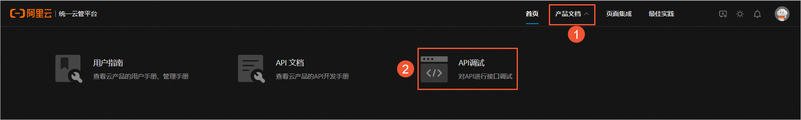
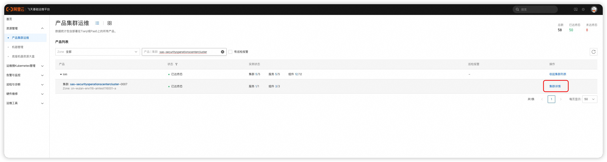
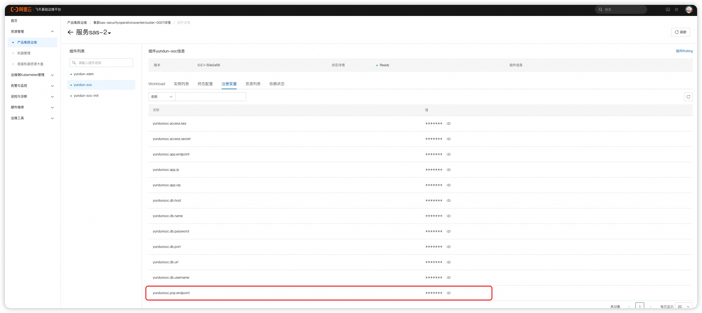

阿里云  
专有云  
云盾-态势感知  
云安全管理中心 开发指南  
产品版本：V3.18.6  
文档版本：20251218

**目录**

- [1.准备工作](#section-1)
    - [1.1. 登录开发者门户控制台](#section-1-1)
    - [1.2. 查看API信息](#section-1-2)
    - [1.3. 获取AccessKey](#section-1-3)
    - [1.4. 获取STS AccessKey](#section-1-4)
    - [1.5. 获取Endpoint](#section-1-5)
- [2.调用示例](#section-2)
    - [2.1. Java SDK调用示例](#section-2-1)
        - [2.1.1. 快速开始](#section-2-1-1)
        - [2.1.2. 使用手册](#section-2-1-2)
            - [2.1.2.1. 安装Java SDK](#section-2-1-2-1)
            - [2.1.2.2. 使用CommonRequest进行调用](#section-2-1-2-2)
    - [2.2. Python SDK调用示例](#section-2-2)
        - [2.2.1. 快速开始](#section-2-2-1)
        - [2.2.2. 使用手册](#section-2-2-2)
            - [2.2.2.1. 安装Python SDK](#section-2-2-2-1)
            - [2.2.2.2. 使用CommonRequest进行调用](#section-2-2-2-2)
    - [2.3. Go SDK调用示例](#section-2-3)
        - [2.3.1. 快速开始](#section-2-3-1)
        - [2.3.2. 使用手册](#section-2-3-2)
            - [2.3.2.1. 安装Go SDK核心包](#section-2-3-2-1)
            - [2.3.2.2. 使用CommonRequest进行调用](#section-2-3-2-2)
- [3.API公共参数](#section-3)
- [4.云安全管理中心（SOC）](#section-4)
    - [4.1. 调用方式](#section-4-1)
        - [4.1.1. 请求结构](#section-4-1-1)
        - [4.1.2. 签名机制](#section-4-1-2)
        - [4.1.3. 公共参数](#section-4-1-3)
        - [4.1.4. 返回结构](#section-4-1-4)
    - [4.2. 安全监控](#section-4-2)
        - [4.2.1. DescribeAttacks](#section-4-2-1)
        - [4.2.2. DescribeAlarms](#section-4-2-2)
        - [4.2.3. DescribeVulFrangs](#section-4-2-3)
        - [4.2.4. DescribeHcFrangs](#section-4-2-4)
    - [4.3. 运营大屏](#section-4-3)
        - [4.3.1. QueryThreats](#section-4-3-1)
        - [4.3.2. QueryThreatChartData](#section-4-3-2)
    - [4.4. 弱点分析](#section-4-4)
        - [4.4.1. ValidateHcWarnings](#section-4-4-1)
        - [4.4.2. IgnoreHcCheckWarnings](#section-4-4-2)
        - [4.4.3. FixCheckWarnings](#section-4-4-3)
        - [4.4.4. DescribeCheckWarnings](#section-4-4-4)
        - [4.4.5. DescribeCheckWarningDetail](#section-4-4-5)
        - [4.4.6. OperateVuls](#section-4-4-6)
        - [4.4.7. DescribeVulNewDetail](#section-4-4-7)
        - [4.4.8. DescribeVulDetails](#section-4-4-8)
        - [4.4.9. DescribeUuidsByVulNames](#section-4-4-9)
    - [4.5. 运营中心](#section-4-5)
        - [4.5.1. HandleSimilarSecurityEvents](#section-4-5-1)
        - [4.5.2. HandleSecurityEvents](#section-4-5-2)
        - [4.5.3. DescribeSimilarSecurityEvents](#section-4-5-3)
        - [4.5.4. DescribeSimilarEventScenarios](#section-4-5-4)
        - [4.5.5. DescribeSecurityEventOperationStatus](#section-4-5-5)
        - [4.5.6. DescribeSecurityEventOperations](#section-4-5-6)
        - [4.5.7. CreateSimilarSecurityEventsQueryTask](#section-4-5-7)
    - [4.6. 资产管理](#section-4-6)
        - [4.6.1. DescribeCloudCenterInstances](#section-4-6-1)
        - [4.6.2. DescribePropertyUserItem](#section-4-6-2)
        - [4.6.3. DescribePropertyUserDetail](#section-4-6-3)
        - [4.6.4. DescribePropertySoftwareItem](#section-4-6-4)
        - [4.6.5. DescribePropertySoftwareDetail](#section-4-6-5)
        - [4.6.6. DescribePropertyScaDetail](#section-4-6-6)
        - [4.6.7. DescribePropertyProcItem](#section-4-6-7)
        - [4.6.8. DescribePropertyProcDetail](#section-4-6-8)
        - [4.6.9. DescribePropertyPortItem](#section-4-6-9)
        - [4.6.10. DescribePropertyPortDetail](#section-4-6-10)
        - [4.6.11. DescribePropertyCronDetail](#section-4-6-11)
        - [4.6.12. DescribeExportInfo](#section-4-6-12)
        - [4.6.13. AegisExportRecord](#section-4-6-13)
- [5.安全审计](#section-5)
    - [5.1. CreateEventType](#section-5-1)
    - [5.2. DescribeEventType](#section-5-2)
    - [5.3. DeleteEventType](#section-5-3)
    - [5.4. CreateLogFilter](#section-5-4)
    - [5.5. DescribeLogFilter](#section-5-5)
    - [5.6. DeleteLogFilter](#section-5-6)
    - [5.7. CreateReceiver](#section-5-7)
    - [5.8. DescribeReceiver](#section-5-8)
    - [5.9. DeleteReceiver](#section-5-9)
    - [5.10. CreateRule](#section-5-10)
    - [5.11. DescribeRule](#section-5-11)
    - [5.12. EnableRule](#section-5-12)
    - [5.13. DisableRule](#section-5-13)
    - [5.14. DeleteRule](#section-5-14)
    - [5.15. CreateTask](#section-5-15)
    - [5.16. DescribeTask](#section-5-16)
    - [5.17. DescribeSetting](#section-5-17)
    - [5.18. ModifySetting](#section-5-18)
    - [5.19. DescribeLogType](#section-5-19)
    - [5.20. DescribeLogSource](#section-5-20)
    - [5.21. DescribeLogCountStat](#section-5-21)
    - [5.22. DescribeLog](#section-5-22)
    - [5.23. DescribeEventRisk](#section-5-23)
    - [5.24. DescribeEventRiskStat](#section-5-24)
    - [5.25. DescribeEventTypeStat](#section-5-25)
    - [5.26. DescribeEventCountStat](#section-5-26)
    - [5.27. DescribeEvent](#section-5-27)
    - [5.28. DescribeArchiveCountStat](#section-5-28)
    - [5.29. DeleteTask](#section-5-29)
    - [5.30. DescribeArchive](#section-5-30)
- [6.态势感知](#section-6)
    - [6.1. 资产管理](#section-6-1)
        - [6.1.1. DescribeFieldStatistics](#section-6-1-1)
        - [6.1.2. DescribeGroupedTags](#section-6-1-2)
        - [6.1.3. DescribeAllGroups](#section-6-1-3)
        - [6.1.4. DescribeInstanceStatistics](#section-6-1-4)
        - [6.1.5. DescribeCloudProductFieldStatistics](#section-6-1-5)
        - [6.1.6. DescribeCloudCenterInstances](#section-6-1-6)
        - [6.1.7. DescribeSummaryInfo](#section-6-1-7)
    - [6.2. 安全评分](#section-6-2)
        - [6.2.1. DescribeSecureSuggestion](#section-6-2-1)
    - [6.3. 获取告警数据](#section-6-3)
        - [6.3.1. DescribeAlarmEventList](#section-6-3-1)
        - [6.3.2. DescribeAlarmEventDetail](#section-6-3-2)
        - [6.3.3. DescribeSuspEvents](#section-6-3-3)
        - [6.3.4. DescribeSuspEventDetail](#section-6-3-4)
    - [6.4. 云产品配置检查](#section-6-4)
        - [6.4.1. DescribeRiskItemType](#section-6-4-1)
        - [6.4.2. StartBaselineSecurityCheck](#section-6-4-2)
        - [6.4.3. DescribeRiskCheckSummary](#section-6-4-3)
        - [6.4.4. DescribeRiskCheckResult](#section-6-4-4)
        - [6.4.5. DescribeSecurityCheckScheduleConfig](#section-6-4-5)
    - [6.5. 漏洞管理](#section-6-5)
        - [6.5.1. DescribeVulList](#section-6-5-1)
        - [6.5.2. DescribeVulWhitelist](#section-6-5-2)
        - [6.5.3. DescribeConcernNecessity](#section-6-5-3)
        - [6.5.4. DescribeGroupedVul](#section-6-5-4)
        - [6.5.5. DescribeAutoDelConfig](#section-6-5-5)
    - [6.6. 基线](#section-6-6)
        - [6.6.1. DescribeCheckWarningSummary](#section-6-6-1)
        - [6.6.2. DescribeStratety](#section-6-6-2)
        - [6.6.3. DescribeStrategyExecDetail](#section-6-6-3)
        - [6.6.4. DescribeCheckWarnings](#section-6-6-4)
        - [6.6.5. DescribeCheckWarningDetail](#section-6-6-5)
        - [6.6.6. DescribeWarningMachines](#section-6-6-6)
    - [6.7. 资产指纹](#section-6-7)
        - [6.7.1. DescribePropertyCount](#section-6-7-1)
        - [6.7.2. DescribePropertyPortDetail](#section-6-7-2)
        - [6.7.3. DescribePropertyProcDetail](#section-6-7-3)
        - [6.7.4. DescribePropertyPortItem](#section-6-7-4)
        - [6.7.5. DescribePropertyProcItem](#section-6-7-5)
        - [6.7.6. DescribePropertySoftwareDetail](#section-6-7-6)
        - [6.7.7. DescribePropertySoftwareItem](#section-6-7-7)
        - [6.7.8. DescribePropertyUserDetail](#section-6-7-8)
        - [6.7.9. DescribePropertyUserItem](#section-6-7-9)
        - [6.7.10. DescribeModuleConfig](#section-6-7-10)
    - [6.8. 资产暴露](#section-6-8)
        - [6.8.1. DescribeExposedInstanceList](#section-6-8-1)

<a id="section-1"></a>

# 1.准备工作

<a id="section-1-1"></a>

## 1.1. 登录开发者门户控制台

您可以通过Apsara Uni-manager运营控制台登录开发者门户控制台。

**前提条件**

- 登录Apsara Uni-manager运营控制台前，确认您已从部署人员处获取Apsara Uni-manager运营控制台的服务域名地址。

- 推荐使用Chrome浏览器

**操作步骤**

1. 在浏览器地址栏中，输入Apsara Uni-manager运营控制台的服务域名地址，按回车键。

2. 输入正确的用户名及密码。

   请向运营管理员获取登录控制台的用户名和密码。

   > **说明**
   >
   > 首次登录Apsara Uni-manager运营控制台时，需要修改登录用户名的密码，请按照提示完成密码修改。为提高安全性，密码长度必须为10~32位，且至少包含以下两种类型：
   >
   > - 英文大写或小写字母（A~Z、a~z）
   >
   > - 阿拉伯数字（0~9）
   >
   > - 特殊符号（感叹号（!）、at（@）、井号（#）、美元符号（$）、百分号（%）等）

3. 单击**登录**。

4. 如果账号已激活MFA多因素认证，请根据以下两种情况进行操作：

   - 管理员强制开启MFA后的首次登录：

     <ol type="a">

     <li>

     在绑定虚拟MFA设备页面中，按页面提示步骤绑定MFA设备。

     </li>

     <li>

     按照步骤2重新输入账号和密码，单击**登录**。

     </li>

     </ol>

     <ol type="i" start="100">

     <li>

     输入6位MFA码后单击**认证**。

     </li>

     </ol>

   - 您已开启并绑定MFA：

     输入6位MFA码后单击**认证**。

     > **说明**
     >
     > 绑定并开启MFA的操作请参见<strong>《Apsara Uni-manager运营控制台用户指南》</strong>中的<strong>《绑定并开启虚拟MFA设备》</strong>章节。

5. 在页面顶部的菜单栏中，选择**产品 > 应用服务 > 开发者门户**。

<a id="section-1-2"></a>

## 1.2. 查看API信息

首先，您需要了解产品开放API接口的相关信息，包括产品名称（code）、开放API接口名称、API版本，在通过SDK调用API接口时需要填写上述信息。

**背景信息**

Apsara Uni-manager运营控制台API目录中的API信息仅供调用参考，具体API的使用方式需要参见云产品的开发指南。如果发生不一致情况，以开发指南支持情况为准。

**操作步骤**

1. 登录Apsara Uni-manager运营控制台。

2. 在顶部菜单栏单击

   图标，进入**帮助与开放平台**。

   

3. 在顶部菜单栏**产品文档**的下拉列表中，选择**API调试**。

   

4. 在左侧导航栏中选择目标云产品。在下方API列表中可浏览当前API版本中的所有API接口名称。若当前云产品存在多个API版本，可在**版本**下拉列表中，选择目标API版本。

<a id="section-1-3"></a>

## 1.3. 获取AccessKey

AccessKey支持RAM和STS两种授权模式，在发起调用时选择使用其中一种AccessKey即可。本文将为您介绍如何获取通过RAM授权的AccessKey。

**背景信息**

AccessKey通过使用AccessKey ID和AccessKey Secret对称加密，实现验证某个请求发送者的身份的功能。其中AccessKey ID用于标示用户，AccessKey Secret是用户用于加密签名的字符串。

AccessKey的两种授权模式如下：

- 通过RAM授权给第三方请求者的AccessKey ID和AccessKey Secret。

- 通过STS授权给第三方请求者的AccessKey ID、AccessKey Secret和Security Token。获取方式请参见获取STS AccessKey。

Apsara Uni-manager运营控制台提供了个人AccessKey和组织AccessKey（只有运营管理员和一级组织管理员可以获取组织AccessKey），推荐使用个人账号AccessKey调用Apsara Uni-manager运营控制台及云产品相关接口。如果使用个人账号AccessKey，需要在Header中添加以下限制性参数，否则可能提示权限不足：

> **警告**
>
> 个人账号AccessKey是由Apsara Uni-manager运营控制台权限体系管控的受限AccessKey，组织AccessKey相对权限较大，需要管理员确认操作的安全性。

<table>
  <tr>
    <th width="206">参数名称</th>
    <th>描述</th>
  </tr>
  <tr>
    <td>x-acs-regionid</td>
    <td>地域，如：cn-hangzhou-*。</td>
  </tr>
  <tr>
    <td>x-acs-organizationid</td>
    <td>Apsara Uni-manager运营控制台中对应的组织ID。获取方法可参见<strong>《Apsara Uni-manager运营控制台开</strong><strong>发指南》</strong>中的<strong>《GetOrganizationList》</strong>文档。</td>
  </tr>
  <tr>
    <td>x-acs-resourcegroupid</td>
    <td>Apsara Uni-manager运营控制台中对应的资源集ID。获取方法可参见<strong>《Apsara Uni-manager运营控制台</strong><strong>开发指南》</strong>中的<strong>《ListResourceGroup》</strong>文档。</td>
  </tr>
  <tr>
    <td>x-acs-instanceid</td>
    <td>进行操作的实例ID，例如，ECS的实例ID可以从ECS列表中查询到。</td>
  </tr>
</table>

**获取个人账号AccessKey**

获取个人账号AccessKey的方法如下：

1. 登录Apsara Uni-manager运营控制台。

2. 在系统界面右上角，单击当前登录用户头像，单击**个人信息**。

3. 在**阿里云AccessKey**区域，您可以查看个人账户的AccessKey信息。

   

   > **说明**
   >
   > Accesskey ID和AccessKey Secret是您访问云资源时的密钥，具有该账号完整的权限，请您妥善保管。

**获取组织AccessKey**

获取组织AccessKey的方法如下：

1. 管理员登录Apsara Uni-manager运营控制台。

2. 在顶部菜单栏，单击**企业**。

3. 在左侧导航栏中，选择**资源管理 > 组织管理**。

4. 在组织结构中，单击目标一级组织名称。

5. 单击**管理Accesskey**。

6. 在弹出的对话框中，查看组织AccessKey信息。

<a id="section-1-4"></a>

## 1.4. 获取STS AccessKey

本文为您介绍如何利用STS方式，调用专有云的产品API。

**背景信息**

阿里云临时安全令牌STS（Security Token Service）是阿里云提供的一种临时访问权限管理服务。您可以选择使用STS方式，调用专有云的产品API。

STS AccessKey由AccessKey ID、AccessKey Secret及Security Token三元组组成，使用STS方式调用云产品API时，三元组缺一不可。

**操作步骤**

1. 获取用户角色的 `RAM Role` 。

   <ol type="i">

   <li>

   登录Apsara Uni-manager运营控制台。

   </li>

   <li>

   单击页面右上角的用户头像，单击**个人信息**。

   </li>

   <li>

   单击**查看当前角色策略**。

   在**当前选择角色策略**对话框中查看 `RAM Role` 。

   </li>

   </ol>

2. 获取STS Accesskey三元组。

   > **说明**
   >
   > 以下代码示例中可变参数均需替换为您实际的相关信息，尖括号（<>）在最终代码中不保留。
   >
   > 涉及替换的可变参数如下：
   >
   > - &lt;yourRegionID>：请替换为您实际的地域ID。
   >
   > - &lt;yourAccessKeyID>：请替换为您实际的AccessKey ID。
   >
   > - &lt;yourAccessKeySecret>：请替换为您实际的AccessKey Secret。
   >
   > - &lt;yourRoleSessionName>：请替换为您当前实际的会话名称。
   >
   >   该名称为用户自定义，通常设置为调用该API的用户身份，例如：用户名。在同一个RAM角色执行的操作中，可以根据不同的 `RoleSessionName` 来区分实际操作者，以实现用户级别的访问审计。长度为2~64个字符，可包含英文字母、数字、半角句号（.）、at（@）、短划线（-）和下划线（_）。
   >
   > - &lt;yourRoleArn>：请替换为您实际的RAM Role。
   >
   > - "sts.aliyuns.com" ：请替换为实际的STS Endpoint。

   ```xml
   public static void main(String[] args) {
       // 创建DefaultAcsClient实例并初始化。
       // 请替换为您实际的地域ID、AccessKey ID、AccessKey Secret。
       DefaultProfile profile = DefaultProfile.getProfile("<yourRegionID>", "
   <yourAccessKeyID>", "<yourAccessKeySecret>");
       HttpClientConfig clientConfig = HttpClientConfig.getDefault();
       clientConfig.setIgnoreSSLCerts(true);
       clientConfig.setProtocolType(ProtocolType.HTTPS);
       profile.setHttpClientConfig(clientConfig);
       IAcsClient client = new DefaultAcsClient(profile);
       String assumeRole = callAssumeRole(client);
       if (StringUtils.isEmpty(assumeRole)) return;
       JSONObject assumeRoleJson = JSONObject.parseObject(assumeRole);
       JSONObject credentials = assumeRoleJson.getJSONObject("Credentials");
       // 获取到STS三元组。
       String stsAK = credentials.getString("AccessKeyId");
       String stsSK = credentials.getString("AccessKeySecret");
       String stsToken = credentials.getString("SecurityToken");
   }

   private static String callAssumeRole(IAcsClient client) {
       CommonRequest request = new CommonRequest();
       // "sts.aliyuns.com" 请替换为实际的STS Endpoint，⼀般格式为sts-
   vpc.${global:region}.${global:internet-domain}。
       request.setSysDomain("sts.aliyuns.com");
       request.setSysProduct("Sts");
       request.setSysAction("AssumeRole");
       request.setSysVersion("2015-04-01");
       request.setSysMethod(MethodType.POST);
       request.setHttpContentType(FormatType.FORM);
       // 业务参数，设置本次调⽤Session的别名，"<yourRoleSessionName>"请您替换为实际值。
       request.putQueryParameter("RoleSessionName", "<yourRoleSessionName>");
       // 扮演的Role⾓⾊ARN，"<yourRoleArn>"请替换为上⼀步获取到的实际Ram Role ARN。
       request.putQueryParameter("RoleArn", "<yourRoleArn>");
       try {
           CommonResponse response = client.getCommonResponse(request);
           return response.getData();
       } catch (ServerException e) {
           System.out.println(e.getErrCode());
           System.out.println(e.getErrMsg());
       } catch (ClientException e) {
           System.out.println(e.getErrCode());
           System.out.println(e.getErrMsg());
       }
       return null;
   }
   ```

3. 通过STS AccessKey三元组调用云产品的接口，下列代码以ECS的 `DescribeZones` 接口为示例。

   > **说明**
   >
   > 以下代码示例中可变参数均需替换为您实际的相关信息，尖括号（<>）在最终代码中不保留。
   >
   > 涉及替换的可变参数如下：
   >
   > - &lt;yourRegionID>：请替换为您实际的地域ID。
   >
   > - &lt;yourStsAccesskeyID>：请替换为您实际的STS Accesskey ID。
   >
   > - &lt;yourStsAccessKeySecret>：请替换为您实际的STS Accesskey Secret。
   >
   > - &lt;yourStsToken>：请替换为实际STS三元组中的SecurityToken。
   >
   > - &lt;yourResourceGroupID>：请替换为您实际的资源集ID。
   >
   > - &lt;yourOrganizationID>：请替换为您实际的组织ID。

   ```xml
   public static void main(String[] args) {
       // "<yourRegionID>"请替换为您实际的地域ID。
       // "<yourStsAccessKeyID>"、"<yourStsAccessKeySecret>"请替换为前⼀步获取到的STS三元组中
   AccessKeyID、AccessKeySecret。
       DefaultProfile profile = DefaultProfile.getProfile("<yourRegionID>", "
   <yourStsAccesskey>", "<yourStsAccessSecret>");
       HttpClientConfig clientConfig = HttpClientConfig.getDefault();
       clientConfig.setIgnoreSSLCerts(true);
       clientConfig.setProtocolType(ProtocolType.HTTPS);
       profile.setHttpClientConfig(clientConfig);
       IAcsClient client = new DefaultAcsClient(profile);
       CommonRequest request = new CommonRequest();
       request.setSysDomain("ecs.aliyuns.com");
       request.setSysProduct("Ecs");
       request.setSysAction("DescribeZones");
       request.setSysVersion("2014-05-26");
       request.setSysMethod(MethodType.POST);
       request.setHttpContentType(FormatType.FORM);
       //"<yourRegionID>" 请替换为您实际的地域ID。
       request.putHeadParameter("x-acs-regionid", "<yourRegionID>");
       // "<yourStsToken>" 请替换为您前⼀步获取到的STS三元组中SecurityToken。
       request.putQueryParameter("SecurityToken", "<yourStsToken>");
       // 非必填，请替换为您实际的资源集ID。
       // request.putHeadParameter("x-acs-resourcegroupid", "<yourResourceGroupID>");
       // 非必填，请替换为您实际的组织ID。
       request.putHeadParameter("x-acs-organizationid", "<yourOrganizationID>");
       try {
           CommonResponse response = client.getCommonResponse(request);
           System.out.println(response.getData());
       } catch (ServerException e) {
           System.out.println(e.getErrCode());
           System.out.println(e.getErrMsg());
       } catch (ClientException e) {
           System.out.println(e.getErrCode());
           System.out.println(e.getErrMsg());
       }
   }
   ```

<a id="section-1-5"></a>

## 1.5. 获取Endpoint

本文介绍如何获取云盾各产品的Endpoint。

**背景信息**

通过POP网关调用API时需要使用云产品业务域的Endpoint。您可以在阿里云驻场运维工程师处获取。您也可以通过如下方法自行获取Endpoint。

**操作步骤**

1. 登录飞天基础运维平台。

2. 在顶部菜单栏，选择**产品运维 > 飞天基础运维平台**。

3. 在左侧导航栏，单击**产品集群运维**。

4. 在**产品 | 集群**搜索框输入sas-securityoperationscentercluster，单击**集群详情**。

   

5. 在**服务列表**页签，单击服务名称。

6. 在**组件列表** 页点击 **yundun-soc** 组件，单击**注册变量**，搜索yundunsoc.pop.endpoint，对应的值即为业务域的Endpoint。

   

7. 云产品的Endpoint构成格式为：

   ```text
   ${EndpointPre}.${global:region}.${global:internet-domain}
   ```

<a id="section-2"></a>

# 2.调用示例

<a id="section-2-1"></a>

## 2.1. Java SDK调用示例

<a id="section-2-1-1"></a>

### 2.1.1. 快速开始

本节介绍如何获取产品名Java SDK并开始调用。

**环境准备**

- 使用阿里云专有云Java SDK，您需要一个授权账号以及一对AccessKey ID和AccessKey Secret。具体信息，请参见获取AccessKey，并在Apsara Uni-manager运营控制台上获取和查看您的AccessKey。

- 获取Endpoint，具体操作，请参见获取Endpoint。

- 阿里云专有云Java SDK需要1.8及以上的JDK。

**安装阿里云专有云Java SDK**

如果您使用Apache Maven来管理Java项目，只需在项目的pom.xml中导入JAR文件。

要使用云盾的开发工具包，必须安装SDK核心库。其中，SDK核心库推荐使用4.5.17及以上版本。

**使用Java SDK**

调用阿里云专有云Java SDK的主要操作步骤如下：

1. 创建并初始化DefaultAcsClient实例。

2. 创建API请求并设置参数。

3. 发起请求并处理应答或异常。

   > **说明**
   >
   > 以下代码示例中可变参数均需替换为您实际的相关信息，尖括号（<>）在最终代码中不保留。
   >
   > 涉及替换的可变参数如下：
   >
   > - &lt;your-region-id>，请替换为您实际的地域ID。
   >
   > - &lt;your-access-key-id>，请替换为您实际的AccessKey ID。
   >
   > - &lt;your-access-key-secret>>，请替换为您实际的AccessKey Secret。
   >
   > - &lt;your-endpoint>，请替换为您当前产品实际的Endpoint。
   >
   > - &lt;API-version>，请替换成接口的版本。
   >
   > - &lt;your-action>，请替换成接口的名称。

```java
import com.aliyuncs.CommonRequest;
import com.aliyuncs.CommonResponse;
import com.aliyuncs.DefaultAcsClient;
import com.aliyuncs.IAcsClient;
import com.aliyuncs.exceptions.ClientException;
import com.aliyuncs.exceptions.ServerException;
import com.aliyuncs.profile.DefaultProfile;
public class Sample {
    public static void main(String[] args) {
        // 创建DefaultAcsClient实例并初始化
        DefaultProfile profile = DefaultProfile.getProfile(
            "<your-region-id>",          // 您的地域ID
            "<your-access-key-id>",      // 您的AccessKey ID
            "<your-access-key-secret>"); // 您的AccessKey Secret
        IAcsClient client = new DefaultAcsClient(profile);
        // 创建API请求并设置参数
        CommonRequest request = new CommonRequest();
        request.setDomain("<your-endpooint>");// 当前产品的服务地址
        request.setVersion("<API-version>");// 接⼝的版本
        request.setAction("<your-action>");// 接⼝的名称
        request.putQueryParameter("PageNumber", "1");
        request.putQueryParameter("PageSize", "30");
        try {
            CommonResponse response = client.getCommonResponse(request);
            System.out.println(response.getData());
        } catch (ServerException e) {
            // TODO Auto-generated catch block
            e.printStackTrace();
        } catch (ClientException e) {
            // TODO Auto-generated catch block
            e.printStackTrace();
        }
    }
}
```

<a id="section-2-1-2"></a>

### 2.1.2. 使用手册

<a id="section-2-1-2-1"></a>

#### 2.1.2.1. 安装Java SDK

本文介绍如何安装及调用云盾Java SDK。

阿里云专有云Java SDK支持1.8及以上版本的JDK，可以通过添加Maven依赖或下载阿里云开发工具包（SDK）的方式安装专有云Java SDK。

要使用云盾的开发工具包，必须安装阿里云Java SDK核心库。SDK核心库推荐使用4.5.17及以上版本。

您在安装阿里云Java SDK核心库时，需要在pom.xml文件中添加以下依赖。关于准确的SDK版本号，请参见阿里云开发工具包（SDK）。

```xml
<!-- Alibaba Cloud SDK for Java -->
<dependency>
    <groupId>com.aliyun</groupId>
    <artifactId>aliyun-java-sdk-core</artifactId>
    <version>4.5.17</version>
</dependency>
```

<a id="section-2-1-2-2"></a>

#### 2.1.2.2. 使用CommonRequest进行调用

> **说明**
>
> 当您要调用的某个产品的API没有提供SDK时，可以采用泛用型的API调用方式（CommonRequest）。使用CommonRequest调用方式可实现任意OpenAPI接口的调用。

**CommonRequest调用特点**

CommonRequest的特点如下：

1. 轻量：只需Core包即可发起调用，无需下载安装各产品的SDK。

2. 简便：无需更新SDK即可调用最新发布的API。

3. 快速迭代。

**使用CommonRequest**

阿里云产品的API有RPC和RESTful两种风格，不同风格的API的CommonRequest的调用方法也不同。

通常API参数中包含Action参数的是RPC风格，包含PathPattern参数的是RESTful风格。一般情况下，每个产品内，所有API的调用风格是统一的。每个API仅支持特定的一种风格调用，传入错误的标识，可能会调用到其他API，或收到 `ApiNotFound` 的错误信息。

发起一次CommonRequest请求，您需要获取以下几个参数的值。关于以下参数的更多说明，请参见API公共参数。

- 接入点（endpoint）：该产品的服务地址。

- API版本（version）：该API的版本号，格式为YYYY-MM-DD。

- 接口信息：要调用的接口名称。

  - 当调用的API为RPC风格（大部分阿里云产品API为RPC风格，如Sas）时，需要获取Action参数，使用 `request.ApiName = "<Action>"` 的方式来指定API名称。

  - 当调用的API为RESTful风格（如容器服务）时，需要获取PathPattern参数，使用 `request.PathPattern = "<PathPattern>"` 的方式来指定RESTful路径。

**示例：调用RPC风格的API**

以下代码展示了如何使用CommonRequest的方式调用云盾的接口：

```java
import com.aliyuncs.CommonRequest;
import com.aliyuncs.CommonResponse;
import com.aliyuncs.DefaultAcsClient;
import com.aliyuncs.IAcsClient;
import com.aliyuncs.exceptions.ClientException;
import com.aliyuncs.exceptions.ServerException;
import com.aliyuncs.profile.DefaultProfile;
public class Sample {
    public static void main(String[] args) {
        // 创建DefaultAcsClient实例并初始化
        DefaultProfile profile = DefaultProfile.getProfile(
            "<your-region-id>",          // 您的地域ID
            "<YOUR-ACCESS-KEY-ID>",      // 您的AccessKey ID
            "<YOUR-ACCESS-KEY-SECRET>"); // 您的AccessKey Secret
        IAcsClient client = new DefaultAcsClient(profile);
        // 创建API请求并设置参数
        CommonRequest request = new CommonRequest();
        request.setDomain("<YOUR-ENDPOINT>");// 当前产品实际的Endpoint
        request.setVersion("<API-version>");// 接⼝的版本
        request.setAction("<YOUR-ACTION>");// 接⼝的名称
        request.putQueryParameter("PageNumber", "1");
        request.putQueryParameter("PageSize", "30");
        try {
            CommonResponse response = client.getCommonResponse(request);
            System.out.println(response.getData());
        } catch (ServerException e) {
            // TODO Auto-generated catch block
            e.printStackTrace();
        } catch (ClientException e) {
            // TODO Auto-generated catch block
            e.printStackTrace();
        }
    }
}
```

<a id="section-2-2"></a>

## 2.2. Python SDK调用示例

<a id="section-2-2-1"></a>

### 2.2.1. 快速开始

本节介绍如何获取Python SDK并开始调用。

**环境准备**

- 使用Python SDK前，您需要一个授权账号以及一对AccessKey ID和AccessKey Secret。具体信息，请参见获取AccessKey。

- 获取到Endpoint。具体操作，请参见获取Endpoint。

**安装Python SDK核心库**

- 如果您使用的是Python 2.x，执行以下命令，安装阿里云SDK核心库：

  ```bash
  pip install aliyun-python-sdk-core
  ```

- 如果您使用的是Python 3.x，执行以下命令，安装阿里云SDK核心库：

  ```bash
  pip3 install aliyun-python-sdk-core-v3
  ```

**使用Python SDK**

以下示例展示调用Python SDK的3个主要步骤：

1. 创建Client实例。

   在创建Client实例时，您需要获取Region ID、AccessKey ID和AccessKey Secret。

2. 创建API请求并设置参数。

3. 发起请求并处理应答或异常。

   > **说明**
   >
   > 以下代码示例中可变参数均需替换为您实际的相关信息，尖括号（<>）在最终代码中不保留。
   >
   > 涉及替换的可变参数如下：
   >
   > - &lt;your_region_id>，请替换为您实际的地域ID。
   >
   > - &lt;your_access_key_id>，请替换为您实际的AccessKey ID。
   >
   > - &lt;your_access_key_secret>，请替换为您实际的AccessKey Secret。
   >
   > - &lt;your-endpoint>，请替换为您实际的产品访问地址。
   >
   > - &lt;API-version>，请替换成接口的版本。
   >
   > - &lt;your-action>，请替换成接口的名称。

   ```python
   from aliyunsdkcore.client import AcsClient
   from aliyunsdkcore.request import
   CommonRequest
   client = AcsClient('{your_access_key_id}',
   '{your_access_key_secret}', '{your_region_id}')
   request = CommonRequest()
   request.set_domain('<your-endpoint>')// 当前产品的服务地址
   request.set_version('<API-version>')// 接⼝的版本
   request.set_action_name('<your-action>')// 接⼝的名称
   # or:
   # request =
   CommonRequest(domain='<your-endpoint>', version='<API-version>',
   action_name='<your-action>')
   request.add_query_param('PageNumber', '1')
   request.add_query_param('PageSize', '30')
   response =
   client.do_action_with_exception(request)

                       
   ```

<a id="section-2-2-2"></a>

### 2.2.2. 使用手册

<a id="section-2-2-2-1"></a>

#### 2.2.2.1. 安装Python SDK

本文档介绍如何安装及调用Python SDK。

阿里云专有云Python SDK支持Python 2.6.x、2.7.x和3.x及以上环境，您可以通过pip安装专有云Python SDK。

> 使用产品的开发工具包，都必须安装阿里云Python SDK核心库。
>
> **说明**

- 如果您使用的是Python 2.x，执行以下命令，安装阿里云SDK核心库：

  ```bash
  pip install aliyun-python-sdk-core
  ```

- 如果您使用的是Python 3.x，执行以下命令，安装阿里云SDK核心库：

  ```bash
  pip3 install aliyun-python-sdk-core-v3
  ```

<a id="section-2-2-2-2"></a>

#### 2.2.2.2. 使用CommonRequest进行调用

> **说明**
>
> 当您要调用的某个产品的API没有提供SDK时，可以采用泛用型的API调用方式（CommonRequest）。使用CommonRequest调用方式可实现任意OpenAPI接口的调用。

**CommonRequest调用特点**

CommonRequest的特点如下：

1. 轻量：只需Core包即可发起调用，无需下载安装各产品的SDK。

2. 简便：无需更新SDK即可调用最新发布的API。

3. 快速迭代。

**使用CommonRequest**

阿里云产品的API有RPC和RESTful两种风格，不同风格的API的CommonRequest的调用方法也不同。

通常API参数中包含Action参数的是RPC风格，包含PathPattern参数的是RESTful风格。一般情况下，每个产品内，所有API的调用风格是统一的。每个API仅支持特定的一种风格调用，传入错误的标识，可能会调用到其他API，或收到 `ApiNotFound` 的错误信息。

发起一次CommonRequest请求，您需要获取以下几个参数的值。关于以下参数的更多说明，请参见API公共参数。

- 接入点（endpoint）：该产品的服务地址。

- API版本（version）：该API的版本号，格式为YYYY-MM-DD。

- 接口信息：要调用的接口名称。

  - 当调用的API为RPC风格（大部分阿里云产品API为RPC风格，如Sas）时，需要获取Action参数，使用 `request.ApiName = "<Action>"` 的方式来指定API名称。

  - 当调用的API为RESTful风格（如容器服务）时，需要获取PathPattern参数，使用 `request.PathPattern = "<PathPattern>"` 的方式来指定RESTful路径。

**示例：调用RPC风格的API**

以下代码展示了如何使用CommonRequest的方式调用接口：

```python
from aliyunsdkcore.client import AcsClient
from aliyunsdkcore.request import CommonRequest
client = AcsClient('{your_access_key_id}', '{your_access_key_secret}', 
'{your_region_id}') 
request = CommonRequest()
request.set_domain('<YOUR-ENDPOINT>') //当前产品实际的Endpoint
request.set_version('<API-version>') //接⼝的版本
request.set_action_name('<YOUR-ACTION>')//接⼝的名称
# or: 
# request = CommonRequest(domain='<your-endpoint>', version='<API-version>', 
action_name='your-action')
request.add_query_param('PageNumber', '1')
request.add_query_param('PageSize', '30')
response = client.do_action_with_exception(request)
```

<a id="section-2-3"></a>

## 2.3. Go SDK调用示例

<a id="section-2-3-1"></a>

### 2.3.1. 快速开始

阿里云Go SDK让您不用复杂编程即可访问。本文介绍如何获取阿里云Go SDK并开始调用。

**环境准备**

- 使用Python SDK前，您需要一个授权账号以及一对AccessKey ID和AccessKey Secret。具体信息，请参见获取AccessKey，并在Apsara Uni-manager运营控制台上获取和查看您的AccessKey。

- 获取到Endpoint。具体操作，请参见获取Endpoint。

**安装阿里云Go SDK核心包**

阿里云Go SDK支持Go 1.10.x及更高版本，您可以通过执行以下命令安装Go SDK核心包。

```text
go get -u github.com/aliyun/alibaba-cloud-sdk-go/sdk
```

**使用Go SDK**

以下这个代码示例展示了调用阿里云Go SDK的3个主要步骤：

1. 初始化Client实例。

2. 创建API请求并设置参数。

3. 发起请求并处理应答或异常。

   > **说明**
   >
   > 以下代码示例中可变参数均需替换为您实际的相关信息，尖括号（<>）在最终代码中不保留。
   >
   > 涉及替换的可变参数如下：
   >
   > - &lt;your_region_id>，请替换为您实际的地域ID。
   >
   > - &lt;your_access_key_id>，请替换为您实际的AccessKey ID。
   >
   > - &lt;your_access_key_secret>，请替换为您实际的AccessKey Secret。
   >
   > - &lt;your-endpoint>，请替换为您实际的产品访问地址。
   >
   > - &lt;API-version>，请替换成接口的版本。
   >
   > - &lt;your-action>，请替换成接口的名称。

   ```go
   package main
   import (
   "github.com/aliyun/alibaba-cloud-sdk-go/sdk/requests"
   "github.com/aliyun/alibaba-cloud-sdk-go/sdk"
   "fmt"
   )
   func main() {
   client, err := sdk.NewClientWithAccessKey("<your_region_id>",
   "{your_access_key_id}", "{your_access_key_secret}")
   if err != nil {
   panic(err)
    }
    request
   := requests.NewCommonRequest()
   request.Domain = "<your-endpoint>"// 当前产品实际的Endpoint
   request.Version = "<API-version>"// 接⼝的版本
   request.ApiName = "<your-action>" // 接⼝的名称
   request.QueryParams["PageNumber"] = "1"
   request.QueryParams["PageSize"] = "30"
   response, err := client.ProcessCommonRequest(request)
   if err != nil {
   panic(err)
    }
   fmt.Print(response.GetHttpContentString())
   }
   ```

<a id="section-2-3-2"></a>

### 2.3.2. 使用手册

<a id="section-2-3-2-1"></a>

#### 2.3.2.1. 安装Go SDK核心包

本文档介绍如何安装 Go SDK核心包。

阿里云Go SDK支持Go 1.10.x及以上版本，您可以通过执行以下命令安装Go SDK核心包。

```text
go get -u github.com/aliyun/alibaba-cloud-sdk-go/sdk
```

<a id="section-2-3-2-2"></a>

#### 2.3.2.2. 使用CommonRequest进行调用

> **说明**
>
> 当您要调用的某个产品的API没有提供SDK时，可以采用泛用型的API调用方式（CommonRequest）。使用CommonRequest调用方式可实现任意OpenAPI接口的调用。

**CommonRequest调用特点**

CommonRequest的特点如下：

1. 轻量：只需Core包即可发起调用，无需下载安装各产品的SDK。

2. 简便：无需更新SDK即可调用最新发布的API。

3. 快速迭代。

**使用CommonRequest**

阿里云产品的API有RPC和RESTful两种风格，不同风格的API的CommonRequest的调用方法也不同。

通常API参数中包含Action参数的是RPC风格，包含PathPattern参数的是RESTful风格。一般情况下，每个产品内，所有API的调用风格是统一的。每个API仅支持特定的一种风格调用，传入错误的标识，可能会调用到其他API，或收到 `ApiNotFound` 的错误信息。

发起一次CommonRequest请求，您需要获取以下几个参数的值。关于以下参数的更多说明，请参见API公共参数。

- 接入点（endpoint）：该产品的服务地址。

- API版本（version）：该API的版本号，格式为YYYY-MM-DD。

- 接口信息：要调用的接口名称。

  - 当调用的API为RPC风格（大部分阿里云产品API为RPC风格，如Sas）时，需要获取Action参数，使用 `request.ApiName = "<Action>"` 的方式来指定API名称。

  - 当调用的API为RESTful风格（如容器服务）时，需要获取PathPattern参数，使用 `request.PathPattern = "<PathPattern>"` 的方式来指定RESTful路径。

**示例：使用RPC风格的API**

以下代码展示了如何使用CommonRequest的方式调用接口：

```go
package main
import (
    "github.com/aliyun/alibaba-cloud-sdk-go/sdk/requests"
    "github.com/aliyun/alibaba-cloud-sdk-go/sdk"
    "fmt"
)
func main() {
    client, err := sdk.NewClientWithAccessKey("cn-hangzhou", "{your_access_key_id}", "{
your_access_key_secret}")
    if err != nil {
        panic(err)
    }
    request := requests.NewCommonRequest()
    request.Domain = "<YOUR-ENDPOINT>"// 当前产品实际的Endpoint
    request.Version = "<API-version>"// 接⼝的版本
    request.ApiName = "<YOUR-ACTION>"// 接⼝的名称
    request.QueryParams["PageNumber"] = "1"
    request.QueryParams["PageSize"] = "30"
    response, err := client.ProcessCommonRequest(request)
    if err != nil {
        panic(err)
    }
    fmt.Print(response.GetHttpContentString())
}
```

<a id="section-3"></a>

# 3.API公共参数

**公共请求参数**

公共请求参数是每个接口调用都需要提供的请求参数。

表 1. 公共请求参数表

| 名称 | 类型 | 是否必须 | 描述 |
| --- | --- | --- | --- |
| Format | Strin g | 否 | 返回值的类型，仅支持JSON。 |
| Version | Strin g | 是 | API版本号，以日期形式YYYY-MM-DD输入，取值：<br>• <strong>2018-01-16：</strong>Auditprivate。<br>• <strong>2019-07-23：</strong>yundunnextsoc。<br>• <strong>2018-12-03：</strong>Sas。<br>• <strong>2016-11-11：</strong>aegis。<br>• <strong>2021-10-11：</strong>yundun-css。<br>• <strong>2019-08-05：</strong>secspy。<br>• <strong>2018-01-16：</strong>Ddosprivate。<br>• <strong>2018-06-30：</strong>hsm-private。<br>• <strong>2017-12-07：</strong>Cloudfw。<br>• <strong>2019-01-03：</strong>Sddp。<br>• <strong>2020-07-01：</strong>semawaf。<br>• <strong>2018-12-03：</strong>soar。 |
| AccessKeyId | Strin g | 是 | 访问服务使用的密钥ID。 |
| AccessKeySe cret | Strin g | 是 | 访问服务使用的密钥值。 |
| RegionId | Strin g | 是 | 服务所使用的地域ID。 |

<table>
  <tr>
    <td>Product</td>
    <td>Strin g</td>
    <td>是</td>
    <td>接口对应的产品名称。取值：<br>• <strong>Auditprivate</strong>：云盾基础组件。<br>• <strong>yundunnextsoc</strong>：云安全管理中心（SOC）。<br>• <strong>Sas</strong>：态势感知。<br>• <strong>aegis</strong>：安骑士。<br>• <strong>yundun-css</strong>：容器防护。<br>• <strong>secspy</strong>：网络流量检测与响应。<br>• <strong>Ddosprivate</strong>：DDos 清洗。<br>• <strong>hsm-private</strong>：加密服务。<br>• <strong>Cloudfw</strong>：云防火墙。<br>• <strong>Sddp</strong>：敏感数据保护。<br>• <strong>semawaf</strong>：Web应用防火墙。<br>• <strong>soar</strong>：云安全管理中心（SOC）-编排响应。</td>
  </tr>
  <tr>
    <td>EndpointPre</td>
    <td>Strin g</td>
    <td>是</td>
    <td>接口对应的域名前缀。取值：<br>• <strong>auditprivate</strong>：云盾基础组件。<br>• <strong>yundunnextsoc-pop</strong>：云安全管理中心（SOC）。<br>• <strong>tds</strong>：态势感知。<br>• <strong>aegis</strong>：安骑士。<br>• <strong>yundun-css</strong>：容器防护。<br>• <strong>secspy-share</strong>：网络流量检测与响应。<br>• <strong>ddosprivate</strong>：DDos 清洗。<br>• <strong>hsmprivate</strong>：加密服务。<br>• <strong>cloudfw</strong>：云防火墙。<br>• <strong>sddp-api</strong>：敏感数据保护。<br>• <strong>semawaf</strong>：Web应用防火墙。<br>• <strong>soar</strong>：云安全管理中心（SOC）-编排响应。</td>
  </tr>
</table>

**公共返回参数**

API返回结果采用统一格式，通过返回HTTP状态码来表示状态：

- 返回2xx HTTP状态码代表调用成功。

- 返回4xx或5xx HTTP状态码代表调用失败。

调用成功返回的数据格式为JSON，每次接口调用，无论成功与否，系统都会返回一个唯一识别码RequestId。

<a id="section-4"></a>

# 4.云安全管理中心（SOC）

<a id="section-4-1"></a>

## 4.1. 调用方式

<a id="section-4-1-1"></a>

### 4.1.1. 请求结构

**请求结构说明**

其中：

- `endpoint` ，表示调用的云服务接入点，云安全管理中心（SoC）的接入点为 `yundunnewsoc-pop. [RegionId].example.com` 。

  > **说明**

- `Action` ，表示要执行的操作，即接口名。

  例如， `Action=GetEcsProtectCount` 表示通过GetEcsProtectCount接口查询ECS保护状态的在线数及异常离线数。

<a id="section-4-1-2"></a>

### 4.1.2. 签名机制

云盾服务会对每个访问的请求进行身份验证，所以无论使用HTTP还是HTTPS协议提交请求，都需要在请求中包含签名（Signature）信息。

**API签名**

为保证API的安全调用，在调用API时阿里云会对每个API请求通过签名（Signature）进行身份验证。当您手动发起API请求时，需要按照RFC 2104的定义，使用AccessSecret对编码、排序后的整个请求串计算HMAC值作为签名。

本章节以如下原始访问参数为例，说明API签名制作的流程：

| 参数 | 内容 |
| --- | --- |
| 接入点 | <code>http://yundunnewsoc-pop.[RegionId].example.com/?</code> |
| API自定义参数 | <code>Action=GetEcsProtectCount</code> |
| 公共参数（不包含<strong>Signature</strong>） | <code>&amp;Timestamp=2016-02-23T12:46:24Z</code><br><code>&amp;Format=JSON</code><br><code>&amp;AccessKeyId=&lt;yourAccessKeyId&gt;</code><br><code>&amp;SignatureMethod=HMAC-SHA1</code><br><code>&amp;SignatureNonce=3ee8c1b8-83d3-44af-a94f-4e0ad82fd6cf</code><br><code>&amp;Version=2019-07-23</code><br><code>&amp;SignatureVersion=1.0</code> |
| Access Key Secret | <code>&lt;yourAccessKeySecret&gt;</code> |

1. 使用请求参数构造规范化的请求字符串（Canonicalized Query String）。

   > **说明**
   >
   > 请求参数由公共请求参数（不包括Signature参数自身）和接口自定义参数。

   <ol type="i">

   <li>

   参数排序。

   按照参数名称的字典顺序对请求参数进行排序。

   </li>

   <li>

   参数编码。

   对排序之后请求参数的名称和值分别用UTF-8字符集进行URL编码。编码的规则如下：

   - 对于字符 A-Z、a-z、0-9 以及字符“-”、“_”、“.”、“~”不编码。

   - 对于其他字符编码成“%XY”的格式，其中 XY 是字符对应 ASCII 码的 16 进制表示。比如英文的双引号（”）对应的编码就是 %22。

   - 对于扩展的 UTF-8 字符，编码成“%XY%ZA…”的格式。

   - 需要说明的是英文空格（ ）要被编码是 %20，而不是加号（+）。

   </li>

   <li>

   将编码后的参数名称和值用英文等号（=）进行连接。

   </li>

   <li>

   将等号连接得到的参数组合按步骤(a)排好的顺序依次使用&符号连接，即得到规范化请求字符串。

   </li>

   </ol>

2. 将上一步构造的规范化字符串按照下面的规则构造成待签名的字符串。

   ```text
   StringToSign=HTTPMethod + “&” + percentEncode(“/”) + ”&” +
   percentEncode(CanonicalizedQueryString)
   ```

3. 按照RFC 2104的定义，计算待签名字符串 StringToSign 的 HMAC 值。

   > **说明**
   >
   > 计算签名时使用的 Key 就是用户持有的 Access Key Secret 并加上一个 & 字符(ASCII:38)，使用的哈希算法是 SHA1。

4. 按照 Base64 编码规则把上面的 HMAC 值编码成字符串，即得到签名值（Signature）。

   ```text
   LEW8N4y7Uasop******
   ```

5. 将得到的签名值作为 Signature 参数添加到请求参数中，即完成对请求签名的过程。

<a id="section-4-1-3"></a>

### 4.1.3. 公共参数

公共参数是指每个API接口都需要使用到的请求参数，包含API版本号、身份验证等信息。

| 名称 | 类型 | 是否必须 | 描述 |
| --- | --- | --- | --- |
| Version | String | 是 | API版本号，为日期形式：YYYY-MM-DD。取值：2019-07-23 |
| AccessKeyId | String | 是 | 阿里云颁发给用户的访问服务所用的密钥ID。 |
| Signature | String | 是 | 签名结果串。 |
| SignatureMethod | String | 是 | 签名方式。取值：HMAC-SHA1 |
| Timestamp | String | 是 | 请求的时间戳。日期格式按照ISO8601标准表示，并需要使用UTC时间。格式为：<code> YYYY-MM-DDThh:mm:ssZ </code><br>例如，2014-05-26T12:00:00Z（为北京时间 2014年5月26日20点0分0秒）。 |
| SignatureVersion | String | 是 | 签名算法版本。取值：1.0 |
| SignatureNonce | String | 是 | 唯一随机数，用于防止网络重放攻击。用户在不同请求间要使用不同的随机数值。 |
| ResourceOwnerA ccount | String | 否 | 本次API请求访问到的资源拥有者账户，即登录用户名。 |
| Format | String | 否 | 返回响应的格式。取值：JSON \| XML<br>说明默认值为XML。 |

<a id="section-4-1-4"></a>

### 4.1.4. 返回结构

云盾API返回结构支持XML和JSON两种格式。用户发送的每次接口调用请求，无论成功与否，系统都会返回一个唯一识别码**RequestId**。

**XML返回结构示例**

```xml
<?xml version="1.0" encoding="UTF-8"?>
<!--结果的根结点-->
<接⼝名称+Response>
    <!--返回请求标签-->
    <RequestId>4C467B38-3910-447D-87BC-AC049166F216</RequestId>
    <!--返回结果数据-->
</接⼝名称+Response>
```

**JSON返回结构示例**

```json
{
"RequestId": "4C467B38-3910-447D-87BC-AC049166F216",
/* 返回结果数据 */
}
```

<a id="section-4-2"></a>

## 4.2. 安全监控

<a id="section-4-2-1"></a>

### 4.2.1. DescribeAttacks

通过DescribeAttacks接口，指定条件查询用户侧和平台侧攻击防护列表。

**请求头**

该接口使用公共请求头，无特殊请求头。请参见公共请求参数文档。

**请求参数**

| 参数名称 | 类型 | 位置 | 是否必选 | 示例 | 说明 |
| --- | --- | --- | --- | --- | --- |
| Action | Strin g | Query | 是 | DescribeAttacks | 系统规定参数。取值：DescribeAttacks。 |
| DataScop e | Integ er | Query | 否 | 1 | 区分平台侧或用户侧，取值：<br>• 0：表示平台侧。<br>• 1：表示用户侧。 |
| PageSize | Integ er | Query | 否 | 10 | 分页查询时，指定每页最多显示的数据条数。 |
| PageNo | Integ er | Query | 否 | 1 | 分页查询时，设置当前页面的页码。 |
| SourceFro m | Integ er | Query | 否 | 41 | 攻击防护的数据来源。取值：<br>• 40：Web应用防火墙。<br>• 41：云防火墙。<br>• 42：DDoS防护（aliguard）。<br>• 44：流量安全监控（IDS）。<br>• 46：态势感知（暴力破解防护）。 |
| UserId | Long | Query | 否 | 2956140888888888 | 组织ID。 |
| AttackTyp e | Strin g | Query | 否 | 暴力破解 | 攻击类型。取值：<strong>暴力破</strong>解、<strong>非 Web 攻</strong>击、<strong>SQL 注入</strong>等。 |
| ProcessSt ate | Integ er | Query | 否 | 1 | 处理状态。取值：<br>• 2：已告警。<br>• 1：已防御。<br>• 3：清洗中。<br>• 4：清洗结束。 |
| StartTime | Long | Query | 否 | 1641398400000 | 攻击开始时间的最小值，单位为毫秒。 |
| EndTime | Long | Query | 否 | 1643644800000 | 攻击开始时间的最大值，单位为毫秒。 |
| Keyword | Strin g | Query | 否 | 192.168.XX.XX | 攻击名称或资产名称，资产IP。 |
| Asset | Strin g | Query | 否 | ae3ef6ef-8888-4aee-8bac-19879e68\*\*\*\* | 资产ID。 |
| Lang | Strin g | Query | 否 | zh_CN | 请求和接收消息的语言类型。取值：<br>• zh_CN：简体中文。<br>• zh_TW：繁体中文。<br>• en_US：英文。 |
| AssetType | Strin g | Query | 否 | ECS | 受影响资产类型。如：<strong>ECS</strong>，<strong>SLB</strong>，<strong>OS</strong>，<strong>EIP</strong>，<strong>RDS</strong>。S |

**返回数据**

| 参数名称 | 类型 | 示例 | 说明 |
| --- | --- | --- | --- |
| RequestId | String | 8010791A-3154-4154-ACB2-866E56A6\*\*\*\* | 本次调用请求的ID。 |
| Data | Struct |  | 数据集合。 |
| -Items | Array |  | 数据列表。 |
| --AttackerIp | String | 10.0.X.X | 攻击者IP。 |
| --AttackType | Integer | 1 | 攻击类型。 |
| --AttackId | Integer | 10154212 | 攻击ID。 |
| --ProcessState | Integer | 1 | 处理状态。取值：<br>• 2：已告警。<br>• 1：已防御。<br>• 3：清洗中。<br>• 4：清洗结束。 |
| --AttackTrait | String | 1 | 此参数已废弃。 |
| --SourceFrom | String |  | 攻击防护的数据来源。取值：<br>• 40：Web应用防火墙。<br>• 41：云防火墙。<br>• 42：DDoS防护（aliguard）。<br>• 44：流量安全监控（IDS）。<br>• 46：态势感知（暴力破解防护）。 |
| --UserId | Long | 295614088888888 8 | 组织ID。 |
| --UserName | String | 组织A | 组织名称。 |
| --RaisedTime | Long | 1641548505000 | 攻击时间。 |
| --AssetType | Integer | 1 | 受影响资产类型。 |
| --AttackName | String | zz_78\*\*\*\* | 攻击名称。 |
| --Asset | String | ae3ef6ef-8888-4aee-8bac-19879e68\*\*\*\* | 被攻击资产ID。 |
| --SourceFromIp | String | 10.0.X.X | 数据来源IP。 |
| --TargetIp | String | 10.0.X.X | 攻击目标IP。 |
| --AssetName | String | SSH暴力\*\*\*\* | 被攻击资产名称。 |
| --AssetPublicIps | String | 192.168.XX.XX | 受影响资产公网IP。 |
| --AssetPrivateIp s | String | 192.168.XX.XX | 受影响资产私网IP。 |
| -Total | Integer | 20 | 符合条件的记录总数。 |
| -PageNo | Integer | 1 | 分页查询时，设置当前页面的页码。 |
| -PageSize | Integer | 10 | 分页查询时，指定每页最多显示的数据条数。 |

**示例**

请求示例

```text
http(s)://yundunnewsoc-pop.[RegionId].example.com/?Action=DescribeAttacks
&DataScope=1
&PageSize=20
&PageNo=1
&<公共请求参数>
```

正常返回示例

`JSON`  格式

```json
{"RequestId":"8010791A-3154-4154-ACB2-866E56A6****","Data":
{"PageSize":"10","Total":"20","PageNo":"1","Items":[{"UserName":"组织
A","AttackTrait":"1","SourceFrom":"1","AttackType":"1","AttackerIp":"10.0.X.X","AssetName
"SSH暴⼒
****","SourceFromIp":"10.0.X.X","AssetPrivateIps":"192.168.XX.XX","ProcessState":"1","Ass
Type":"1","AttackId":"10154212","AttackName":"zz_78****","UserId":"2956140888888888","Ass
PublicIps":"172.12.XX.XX","Asset":"ae3ef6ef-8888-4aee-8bac-
19879e68****","TargetIp":"10.0.X.X","RaisedTime":"1641548505000"}]}}
```

`XML`  格式

```xml
<RequestId>8010791A-3154-4154-ACB2-866E56A6****</RequestId>
<Data>
    <PageSize>10</PageSize>
    <Total>20</Total>
    <PageNo>1</PageNo>
    <Items>
        <UserName>组织A</UserName>
        <AttackTrait>1</AttackTrait>
        <SourceFrom>1</SourceFrom>
        <AttackType>1</AttackType>
        <AttackerIp>10.0.X.X</AttackerIp>
        <AssetName>SSH暴⼒****</AssetName>
        <SourceFromIp>10.0.X.X</SourceFromIp>
        <AssetPrivateIps>192.168.XX.XX</AssetPrivateIps>
        <ProcessState>1</ProcessState>
        <AssetType>1</AssetType>
        <AttackId>10154212</AttackId>
        <AttackName>zz_78****</AttackName>
        <UserId>2956140888888888</UserId>
        <AssetPublicIps>172.12.XX.XX</AssetPublicIps>
        <Asset>ae3ef6ef-8888-4aee-8bac-19879e68****</Asset>
        <TargetIp>10.0.X.X</TargetIp>
        <RaisedTime>1641548505000</RaisedTime>
    </Items>
</Data>
```

<a id="section-4-2-2"></a>

### 4.2.2. DescribeAlarms

通过DescribeAlarms接口，指定条件查询用户侧和平台侧安全监控中安全告警列表。

**请求参数**

| 名称 | 类型 | 是否必选 | 示例值 | 描述 |
| --- | --- | --- | --- | --- |
| Action | String | 是 | DescribeAlarms | 系统规定参数。取值：<strong>DescribeAlarms</strong>。 |
| DataScope | Integer | 否 | 1 | 区分平台侧或租户侧，取值：<br>• <strong>0</strong>：表示平台侧。<br>• <strong>1</strong>：表示租户侧。 |
| PageSize | Integer | 否 | 10 | 分页查询时，指定每页最多显示的数据条数。 |
| PageNo | Integer | 否 | 1 | 分页查询时，设置当前页面的页码。 |
| StartTime | Long | 否 | 1609430400000 | 告警开始发生时间最小值，单位为毫秒。 |
| EndTime | Long | 否 | 1645977600000 | 告警开始发生时间最大值，单位为毫秒。 |
| ProcessState | Integer | 否 | 1 | 处理状态。取值：<br>• <strong>1</strong>：未处理。<br>• <strong>2</strong>：已处理。<br>• <strong>3</strong>：已忽略。 |
| RiskLevels.N | RepeatL ist | 否 | 1 | 风险等级范围。取值：<br>• <strong>0</strong>：提醒。<br>• <strong>1</strong>：可疑。<br>• <strong>2</strong>：紧急，可以传多值，数组逗号分割如0，1，2。 |
| Keyword | String | 否 | 192.168.XX.XX | 搜索告警涉及的告警名称或资产名称、资产IP。 |
| SourceFrom | Integer | 否 | 20 | 数据来源标识。取值：<br>• <strong>20</strong>：态势感知/安骑士。 |
| UserId | Long | 否 | 2956140888888 888 | 组织ID。 |
| AlarmType | String | 否 | 异常网络连接 | 告警类型，如：<strong>其他</strong>、<strong>异常网络连接</strong>、<strong>网</strong><strong>站后门</strong>、<strong>进程异常行为</strong>、<strong>异常登录</strong>。 |
| Asset | String | 否 | ae3ef6ef-8888-4aee-8bac-19879e68\*\*\*\* | 资产ID。 |
| Lang | String | 否 | zh_CN | 请求和接收消息的语言类型。取值：<br>• <strong>zh_CN</strong>：简体中文。<br>• <strong>zh_TW</strong>：繁体中文。<br>• <strong>en_US</strong>：英文。 |
| AssetType | String | 否 | ECS | 受影响资产类型。如：<strong>ECS</strong>，<strong>SLB</strong>，<strong>OSS</strong>，<strong>EIP</strong>，<strong>RDS</strong>。 |

**返回数据**

| 名称 | 类型 | 示例值 | 描述 |
| --- | --- | --- | --- |
| Data | Struct |  | 数据集合。 |
| Items | Array of Item |  | 数据列表。 |
| AlarmId | Integer | 4008888 | 告警ID。 |
| AlarmName | String | 反弹\*\* | 告警名称。 |
| AlarmType | String | 进程异常行为 | 告警类型，如：<strong>其他</strong>，<strong>异常网络连接</strong>，<strong>网站后</strong><strong>门</strong>，<strong>进程异常行为</strong>，<strong>异常登录</strong>。 |
| AlarmUniqueIn fo | String | eeee98dd0c4cd5cc 61c016b2bdcf\*\*\*\* | 告警唯一键。 |
| Asset | String | ae3ef6ef-8888-4aee-8bac-19879e68\*\*\*\* | 受影响资产ID。 |
| AssetName | String | zzzz_88\*\*\*\* | 受影响资产名称。 |
| AssetPrivateIp s | String | 192.168.XX.XX | 受影响资产私网IP。 |
| AssetPublicIps | String | 172.12.XX.XX | 受影响资产公网IP。 |
| AssetType | String | ECS | 受影响资产类型。如：<strong>ECS</strong>，<strong>SLB</strong>，<strong>OSS</strong>，<strong>EIP</strong>，<strong>RDS</strong>。 |
| Detail | String | {"lastTime": 1641536460051,"a ssetsType": 0,"modifiedTime": "2022-01-07 14:21:00"} | 详情。 |
| LastTime | Integer | 1641537619 | 告警最近发生时间。单位为毫秒。 |
| ProcessState | Integer | 1 | 处理状态。取值：<br>• <strong>1</strong>：未处理。<br>• <strong>2</strong>：已处理。<br>• <strong>3</strong>：已忽略。 |
| RaisedTime | Long | 1640931449000 | 告警首次发生时间。单位为毫秒。 |
| RiskLevel | Integer | 2 | 风险等级范围。取值：<br>• <strong>0</strong>：提醒。<br>• <strong>1</strong>：可疑。<br>• <strong>2</strong>：紧急。 |
| SourceFrom | Integer | 20 | 数据来源标识。取值：<br>• <strong>20</strong>：态势感知/安骑士。 |
| UserId | Integer | 295614088 | 组织ID。 |
| UserName | String | 组织A | 组织名称。 |
| PageNo | Integer | 1 | 分页查询时，设置当前页面的页码。 |
| PageSize | Integer | 20 | 分页查询时，指定每页最多显示的数据条数。 |
| Total | Integer | 200 | 符合条件的记录总数。 |
| RequestId | String | 8010791A-3154-4154-ACB2-866E56A6\*\*\*\* | 本次调用请求的ID。 |

**示例**

请求示例

```text
http(s)://yundunnewsoc-pop.[RegionId].example.com/?Action=DescribeAlarms
&RiskLevels=[0,1,2]
&DataScope=1
&PageSize=20
&PageNo=1
&<公共请求参数>
```

正常返回示例

`XML` 格式

```xml
<RequestId>8010791A-3154-4154-ACB2-866E56A6****</RequestId>
<Data>
    <PageSize>20</PageSize>
    <Total>200</Total>
    <PageNo>1</PageNo>
    <Items>
        <AlarmId>4008888</AlarmId>
        <UserName>组织A</UserName>
        <AlarmType>进程异常⾏为</AlarmType>
        <SourceFrom>20</SourceFrom>
        <AssetName>zzzz_88****</AssetName>
        <AssetPrivateIps>192.168.XX.XX</AssetPrivateIps>
        <ProcessState>1</ProcessState>
        <AssetType>ECS</AssetType>
        <AlarmName>反弹**</AlarmName>
        <UserId>295614088</UserId>
        <AlarmUniqueInfo>eeee98dd0c4cd5cc61c016b2bdcf****</AlarmUniqueInfo>
        <AssetPublicIps>172.12.XX.XX</AssetPublicIps>
        <Asset>ae3ef6ef-8888-4aee-8bac-19879e68****</Asset>
        <RaisedTime>1640931449000</RaisedTime>
        <RiskLevel>2</RiskLevel>
        <Detail>{"lastTime": 1641536460051,"assetsType": 0,"modifiedTime": "2022-01-07 
14:21:00"}</Detail>
        <LastTime>1641537619</LastTime>
    </Items>
</Data>
```

`JSON` 格式

```json
{"RequestId":"8010791A-3154-4154-ACB2-866E56A6****","Data":
{"PageSize":"20","Total":"200","PageNo":"1","Items":
[{"AlarmId":"4008888","UserName":"组织A","AlarmType":"进程异常⾏
为","SourceFrom":"20","AssetName":"zzzz_88****","AssetPrivateIps":"192.168.XX.XX","Proces
tate":"1","AssetType":"ECS","AlarmName":"反弹
**","UserId":"295614088","AlarmUniqueInfo":"eeee98dd0c4cd5cc61c016b2bdcf****","AssetPubli
ps":"172.12.XX.XX","Asset":"ae3ef6ef-8888-4aee-8bac-
19879e68****","RaisedTime":"1640931449000","RiskLevel":"2","Detail":"{\"lastTime\": 1641536460051,\"assetsType\": 0,\"modifiedTime\": \"2022-01-07 
14:21:00\"}","LastTime":"1641537619"}]}}
```

<a id="section-4-2-3"></a>

### 4.2.3. DescribeVulFrangs

通过DescribeVulFrangs接口，根据指定条件查询漏洞。

**请求参数**

| 名称 | 类型 | 是否必选 | 示例值 | 描述 |
| --- | --- | --- | --- | --- |
| Action | String | 是 | DescribeVulFran gs | 系统规定参数。取值：<strong>DescribeVulFrangs</strong>。 |
| RiskLevel | Integer | 否 | 1 | 漏洞等级,取值：<br>• <strong>0</strong>：低危。<br>• <strong>1</strong>：中危。<br>• <strong>2</strong>：高危。 |
| ProcessState | Integer | 否 | 1 | 处理状态。取值：<br>• <strong>1</strong>：未处理。<br>• <strong>2</strong>：已处理。 |
| VulType | String | 否 | cve | 漏洞类型。取值：<strong>cve</strong>、<strong>sys</strong>、<strong>sca</strong>、<strong>emg</strong>等。 |
| PocFlag | Integer | 否 | 1 | 是否有POC。取值：<br>• <strong>0</strong>：否。<br>• <strong>1</strong>：是。 |
| PageSize | Integer | 否 | 10 | 分页查询时，指定每页最多显示的数据条数。 |
| DataScope | Integer | 否 | 1 | 区分平台侧或用户侧。取值：<br>• <strong>0</strong>：表示平台侧。<br>• <strong>1</strong>：表示用户侧。 |
| UserId | Long | 否 | 2956140888888 888 | 组织ID。 |
| UsageLevel | String | 否 | LOW | 利用难度。如：<strong>LOW</strong>，<strong>HIGH</strong>，<strong>MEDIUM</strong>，<strong>INSUF</strong> <strong>FICIENT_INFO</strong>，<strong>NONE</strong>。 |
| StartTime | Long | 否 | 1641484800000 | 漏洞开始时间最小值，单位为毫秒。 |
| EndTime | Long | 否 | 1643644800000 | 漏洞开始时间最大值，单位为毫秒。 |
| Page | Integer | 否 | 1 | 分页查询时，设置当前页面的页码。 |
| NeedFix | String | 否 | necessity | 修复必要性。 |
| Keyword | String | 否 | 192.168.XX.XX | 漏洞名称或资产名称、资产IP。 |
| SourceFrom | Integer | 否 | 1 | 数据来源。取值：<br>• <strong>1</strong>：安骑士主机漏洞。 |
| Asset | String | 否 | ae3ef6ef-8888-4aee-8bac-19879e68\*\*\*\* | 漏洞涉及的资产ID。 |
| AssetType | String | 否 | ECS | 漏洞受影响资产类型。如：<strong>ECS</strong>，<strong>SLB</strong>，<strong>OSS</strong>，<strong>EIP</strong>，<strong>RDS</strong>。 |

**返回数据**

| 名称 | 类型 | 示例值 | 描述 |
| --- | --- | --- | --- |
| Data | Struct |  | 数据集合。 |
| Items | Array of Item |  | 数据列表。 |
| Asset | String | ae3ef6ef-8888-4aee-8bac-19879e68\*\*\*\* | 漏洞涉及的资产ID。 |
| AssetName | String | zzz_75\*\*\*\* | 漏洞影响的资产名称 |
| AssetPrivateIp s | String | 192.168.XX.XX | 受漏洞影响的资产私网IP。 |
| AssetPublicIps | String | 172.12.XX.XX | 受漏洞影响的资产公网IP。 |
| AssetType | String | ECS | 漏洞受影响资产类型。如：<strong>ECS</strong>，<strong>SLB</strong>，<strong>OSS</strong>，<strong>EIP</strong>，<strong>RDS</strong>。 |
| Id | Long | 75489 | 数据ID。 |
| LastTime | String | 1642025151000 | 最近发现漏洞时间。单位为毫秒。 |
| NeedFix | String | necessity | 漏洞修复的必要性。 |
| ProcessState | Integer | 1 | 处理状态。取值：<br>• <strong>1</strong>：未处理。<br>• <strong>2</strong>：已处理。 |
| RaisedTime | Integer | 2022 | 发生时间。使用yyyy格式。 |
| RiskLevel | Integer | 1 | 漏洞等级。取值：<br>• <strong>0</strong>：低危。<br>• <strong>1</strong>：中危。<br>• <strong>2</strong>：高危。 |
| SourceFrom | Integer | 1 | 数据来源。取值：<br>• <strong>1</strong>：安骑士主机漏洞。 |
| SrcInnerName | String | oval:com.redhat.rh sa:def:2021\*\*\*\* | 漏洞名称。 |
| UsageLevel | String | LOW | 利用难度。如：<strong>LOW</strong>，<strong>HIGH</strong>，<strong>MEDIUM</strong>，<strong>INSUFFICIE</strong> <strong>NT_INFO</strong>，<strong>NONE</strong>。 |
| UserName | String | 组织A | 组织名称。 |
| VulName | String | RHSA-2021:1180-Mode\*\*\*\* | 漏洞名称。 |
| VulRelated | String | CVE-2017-100\*\*\*\* | 漏洞详情关联ID。 |
| VulType | String | cve | 漏洞类型。取值：<strong>cve</strong>、<strong>sys</strong>、<strong>sca</strong>、<strong>emg</strong>等。 |
| PageNo | Integer | 1 | 分页查询时，设置当前页面的页码。 |
| PageSize | Integer | 10 | 分页查询时，指定每页最多显示的数据条数。 |
| Total | Integer | 200 | 符合条件的记录总数。 |
| RequestId | String | 8010791A-3154-4154-ACB2-866E56A6\*\*\*\* | 本次调用请求的ID。 |

**示例**

请求示例

```text
http(s)://yundunnewsoc-pop.[RegionId].example.com/?Action=DescribeVulFrangs
&DataScope=1
&PageSize=20
&Page=1
&<公共请求参数>
```

正常返回示例

`XML` 格式

```xml
<RequestId>8010791A-3154-4154-ACB2-866E56A6****</RequestId>
<Data>
    <PageSize>10</PageSize>
    <Total>200</Total>
    <PageNo>1</PageNo>
    <Items>
        <NeedFix>necessity</NeedFix>
        <UserName>组织A</UserName>
        <SourceFrom>1</SourceFrom>
        <VulName>RHSA-2021:1180-Mode****</VulName>
        <AssetName>zzz_75****</AssetName>
        <UsageLevel>LOW</UsageLevel>
        <AssetPrivateIps>192.168.XX.XX</AssetPrivateIps>
        <ProcessState>1</ProcessState>
        <AssetType>ECS</AssetType>
        <SrcInnerName>oval:com.redhat.rhsa:def:2021****</SrcInnerName>
        <VulRelated>CVE-2017-100****</VulRelated>
        <AssetPublicIps>172.12.XX.XX</AssetPublicIps>
        <Asset>ae3ef6ef-8888-4aee-8bac-19879e68****</Asset>
        <Id>75489</Id>
        <RaisedTime>2022</RaisedTime>
        <RiskLevel>1</RiskLevel>
        <LastTime>1642025151000</LastTime>
        <VulType>cve</VulType>
    </Items>
</Data>
```

`JSON` 格式

```json
{"RequestId":"8010791A-3154-4154-ACB2-866E56A6****","Data":
{"PageSize":"10","Total":"200","PageNo":"1","Items":
[{"NeedFix":"necessity","UserName":"组织A","SourceFrom":"1","VulName":"RHSA-2021:1180-Mode****","AssetName":"zzz_75****","UsageLevel":"LOW","AssetPrivateIps":"192.168.XX.XX","Pr
essState":"1","AssetType":"ECS","SrcInnerName":"oval:com.redhat.rhsa:def:2021****","VulRe
ted":"CVE-2017-100****","AssetPublicIps":"172.12.XX.XX","Asset":"ae3ef6ef-8888-4aee-8bac-
19879e68****","Id":"75489","RaisedTime":"2022","RiskLevel":"1","LastTime":"1642025151000"
VulType":"cve"}]}}
```

<a id="section-4-2-4"></a>

### 4.2.4. DescribeHcFrangs

通过DescribeHcFrangs接口，根据指定条件查询用户侧安全监控的脆弱性风险（主机配置列表）。

**请求参数**

| 名称 | 类型 | 是否必选 | 示例值 | 描述 |
| --- | --- | --- | --- | --- |
| Action | String | 是 | DescribeHcFran gs | 系统规定参数。取值：<strong>DescribeHcFrangs</strong>。 |
| RiskLevel | Integer | 否 | 1 | 风险等级，取值如下：<br>• <strong>0</strong>：低危。<br>• <strong>1</strong>：中危。<br>• <strong>2</strong>：高危。 |
| ProcessState | Integer | 否 | 1 | 处理状态。取值：<br>• <strong>1</strong>：未处理。<br>• <strong>2</strong>：已处理。 |
| HcType | String | 否 | 阿里云标准-Windows 2016/2019 安全基线检查 | 主机配置风险的类型。取值：<strong>阿里云标准-</strong>Windows 2016/2019 安全基线检<strong>查</strong>、<strong>阿里云标准-Apache Tomcat 安全</strong><strong>基线检查</strong>、<strong>阿里云标准-CentOS Linux</strong> <strong>7/8安全基线检查</strong>等。 |
| PageSize | Integer | 否 | 10 | 分页查询时，指定每页最多显示的数据条数。 |
| StartTime | Long | 否 | 1641484800000 | 查询开始时间的最小值，单位为毫秒。 |
| EndTime | Long | 否 | 1643731200000 | 查询开始时间的最大值，单位为毫秒。 |
| Page | Integer | 否 | 1 | 分页查询时，设置当前页面的页码。 |
| Keyword | String | 否 | 192.168.XX.XX | 资产名称、资产IP。 |
| DataScope | Integer | 否 | 1 | 区分平台侧或租户侧。取值：<br>• <strong>0</strong>：表示平台侧。<br>• <strong>1</strong>：表示租户侧。 |
| UserId | Long | 否 | 2956140888888 888 | 组织ID。 |
| SourceFrom | Integer | 否 | 2 | 数据来源。取值：<br>• <strong>2</strong>：主机配置核查。 |
| Asset | String | 否 | ae3ef6ef-8888-4aee-8bac-19879e68\*\*\*\* | 资产ID。 |
| AssetType | String | 否 | ECS | 资产类型。如：<strong>ECS</strong>，<strong>SLB</strong>，<strong>OSS</strong>，<strong>EIP</strong>，<strong>RDS</strong>。 |
| Lang | String | 否 | zh_CN | 请求和接收消息的语言类型。取值：<br>• <strong>zh_CN</strong>：简体中文。<br>• <strong>zh_TW</strong>：繁体中文。<br>• <strong>en_US</strong>：英文。 |

**返回数据**

| 名称 | 类型 | 示例值 | 描述 |
| --- | --- | --- | --- |
| Data | Struct |  | 数据集合。 |
| Items | Array of Item |  | 数据列表。 |
| Asset | String | ae3ef6ef-8888-4aee-8bac-19879e68\*\*\*\* | 风险影响的资产ID。 |
| AssetName | String | zz_78\*\*\*\* | 风险影响的资产名称。 |
| AssetPrivateIp s | String | 192.168.XX.XX | 风险影响的资产私网IP。 |
| AssetPublicIps | String | 172.12.XX.XX | 风险影响的资产公网IP。 |
| AssetType | String | ECS | 风险影响的资产类型。如：<strong>ECS</strong>，<strong>SLB</strong>，<strong>OSS</strong>，<strong>EIP</strong>，<strong>RDS</strong>。 |
| HcAsset | String | ae3ef6ef-8888-4aee-8bac-19879e68\*\*\*\* | 资产ID。 |
| HcName | String | CIS标准\*\*\* | 主机配置风险名称。 |
| HcType | String | 阿里云标准-Windows 2016/2019 安全基线检查 | 主机配置风险的类型。取值：<strong>阿里云标准-</strong><strong>Windows 2016/2019 安全基线检查</strong>、<strong>阿里</strong><strong>云标准-Apache Tomcat 安全基线检查</strong>、<strong>阿里</strong><strong>云标准-CentOS Linux 7/8安全基线检查</strong>等。 |
| Id | Long | 65357 | 记录ID。 |
| LastFoundTim e | String | 1642042910000 | 最近发现风险时间。单位为毫秒。 |
| ProcessState | Integer | 2 | 风险处理状态。 取值：<br>• <strong>1</strong>：已处理。<br>• <strong>2</strong>：未处理。 |
| RiskLevel | Integer | 1 | 风险等级。取值如下：<br>• <strong>0</strong>：低危。<br>• <strong>1</strong>：中危。<br>• <strong>2</strong>：高危。 |
| SourceFrom | String | 2 | 数据来源。取值：<br>• <strong>2</strong>：主机配置核查。 |
| UserId | Long | 295614088888888 8 | 组织ID。 |
| UserName | String | 组织A | 组织名称。 |
| PageNo | Integer | 1 | 分页查询时，设置当前页面的页码。 |
| PageSize | Integer | 10 | 分页查询时，指定每页最多显示的数据条数。 |
| Total | Integer | 200 | 符合条件的记录总数。 |
| RequestId | String | 8010791A-3154-4154-ACB2-866E56A6\*\*\*\* | 本次调用请求的ID。 |

**示例**

请求示例

```text
http(s)://yundunnewsoc-pop.[RegionId].example.com/?Action=DescribeVulFrangs
&DataScope=1
&PageSize=20
&Page=1
&<公共请求参数>
```

正常返回示例

`XML` 格式

```xml
<RequestId>8010791A-3154-4154-ACB2-866E56A6****</RequestId>
<Data>
    <PageSize>10</PageSize>
    <Total>200</Total>
    <PageNo>1</PageNo>
    <Items>
        <UserName>组织A</UserName>
        <SourceFrom>2</SourceFrom>
        <HcType>阿⾥云标准-Windows 2016/2019 安全基线检查</HcType>
        <AssetName>zz_78****</AssetName>
        <HcAsset>ae3ef6ef-8888-4aee-8bac-19879e68****</HcAsset>
        <AssetPrivateIps>192.168.XX.XX</AssetPrivateIps>
        <ProcessState>2</ProcessState>
        <LastFoundTime>1642042910000</LastFoundTime>
        <AssetType>ECS</AssetType>
        <HcName>CIS标准***</HcName>
        <UserId>2956140888888888</UserId>
        <AssetPublicIps>172.12.XX.XX</AssetPublicIps>
        <Asset>ae3ef6ef-8888-4aee-8bac-19879e68****</Asset>
        <Id>65357</Id>
        <RiskLevel>1</RiskLevel>
    </Items>
</Data>
```

`JSON` 格式

```json
{"RequestId":"8010791A-3154-4154-ACB2-866E56A6****","Data":
{"PageSize":"10","Total":"200","PageNo":"1","Items":[{"UserName":"组织
A","SourceFrom":"2","HcType":"阿⾥云标准-Windows 2016/2019 安全基线检
查","AssetName":"zz_78****","HcAsset":"ae3ef6ef-8888-4aee-8bac-
19879e68****","AssetPrivateIps":"192.168.XX.XX","ProcessState":"2","LastFoundTime":"16420
910000","AssetType":"ECS","HcName":"CIS标准
***","UserId":"2956140888888888","AssetPublicIps":"172.12.XX.XX","Asset":"ae3ef6ef-8888-4aee-8bac-19879e68****","Id":"65357","RiskLevel":"1"}]}}
```

<a id="section-4-3"></a>

## 4.3. 运营大屏

<a id="section-4-3-1"></a>

### 4.3.1. QueryThreats

查询运营大屏威胁数据列表。

**请求参数**

| 名称 | 类型 | 是否必选 | 示例值 | 描述 |
| --- | --- | --- | --- | --- |
| Action | String | 是 | QueryThreats | 系统规定参数。取值：<strong>QueryThreats</strong>。 |
| FromTime | Long | 否 | 1640944798076 | 威胁开始时间的最小值，单位为毫秒。 |
| ToTime | Long | 否 | 1641549603697 | 威胁开始时间的最大值，单位为毫秒。 |
| CurrentPage | Integer | 否 | 1 | 分页查询时，设置当前页面的页码。 |
| PageSize | Integer | 否 | 10 | 分页查询时，指定每页最多显示的数据条数。 |
| Index | String | 否 | threat | 数据index，固定为<strong>threat</strong>。 |
| UserIds | String | 否 | -1,29561408888 8\*\*\*\* | 部门ID。支持平台值（固定取值为<strong>-1</strong>）、租户组织ID。多个取值之间需用半角逗号分隔。 |
| Aliuid | Long | 否 | 1 | 此参数已废弃。 |
| Query | String | 否 | 192.168.XX.XX | 告警资产/攻击IP。 |
| ProcessStatus | String | 否 | 1 | 处置状态。取值：<br>• <strong>1</strong>： 未处置。<br>• <strong>2</strong> ：已处置。 |
| ThreatLevel | String | 否 | 1 | 威胁级别。取值：<br>• <strong>1</strong>：低。<br>• <strong>2</strong>：中。<br>• <strong>3</strong>：高。 |
| SrcFrom | String | 否 | 20,40 | 数据来源。可以多值，逗号分割。取值：<br>• <strong>20</strong>：安骑士。<br>• <strong>40</strong>：WAF。<br>• <strong>41</strong>：云防火墙。<br>• <strong>44</strong>：NDR。 |
| ThreatType | String | 否 | 进程异常行为 | 告警类型（攻击类型）。取值：<strong>非 Web</strong><strong>攻击</strong>、<strong>精准防御</strong>、<strong>web攻击</strong>、<strong>其他</strong>、<strong>进程</strong><strong>异常行为</strong>等。 |
| ThreatName | String | 否 | 可疑编码命令 | 攻击名称。 |
| ProcessWay | String | 否 | 1 | 处置方式。取值：<br>• <strong>0</strong>：放行。<br>• <strong>1</strong>：拦截。<br>• <strong>2</strong>：无动作。<br>• <strong>3</strong>：手动处置。<br>• <strong>4</strong>：一键封禁。<br>• <strong>5</strong>：自动处置。<br>• <strong>6</strong>：告警。<br>• <strong>7</strong>：丢弃。<br>• <strong>8</strong>：阻断。 |
| ThreatInoutside | String | 否 | 1 | 事件来源。取值：<br>• <strong>1</strong>：内部攻击。<br>• <strong>2</strong>：外部攻击。 |
| ThreatResult | String | 否 | 成功 | 攻击结果。如：<strong>企图</strong>，<strong>成功</strong>，<strong>失败</strong>。 |
| Lang | String | 否 | zh_CN | 请求和接收消息的语言类型。取值：<br>• <strong>zh_CN</strong>：简体中文。<br>• <strong>zh_TW</strong>：繁体中文。<br>• <strong>en_US</strong>：英文。 |
| Tag | String | 否 | 121 | 标签。 |
| DestinationIp | String | 否 | 192.168.XX.XX | 被攻击IP。 |
| ThreatSourceIp | String | 否 | 172.12.XX.XX | 攻击者来源（攻击者IP）。 |
| UrlHost | String | 否 | www.ecs\*\*\*\*.co m | Web站点。 |

**返回数据**

| 名称 | 类型 | 示例值 | 描述 |
| --- | --- | --- | --- |
| CurrentPage | Integer | 1 | 分页查询时，设置当前页面的页码。 |
| Datas | List | {"lastTime":16415 49724000,"__logTi me":16415497242 87,"process_way":" "} | 数组存储从Elasticsearch查出来的所有数据。每个元素是一组数据。 |
| FromTime | Long | 1641484800000 | 威胁开始时间的最小值，单位为毫秒。 |
| HistogramInter val | Long | 0 | 直方图区间。 |
| PageSize | Integer | 10 | 分页查询时，指定每页最多显示的数据条数。 |
| RequestId | String | 8010791A-3154-4154-ACB2-866E56A6\*\*\*\* | 本次调用请求的ID。 |
| ToTime | Long | 1641550177290 | 威胁开始时间的最大值，单位为毫秒。 |
| Total | Integer | 200 | 符合条件的总记录数。 |

**示例**

请求示例

```text
http(s)://[Endpoint]/?Action=QueryThreats
&CurrentPage=1
&PageSize=10
&FromTime=1641484800000
&ToTime=1641550177290
&<公共请求参数>
```

正常返回示例

`XML` 格式

```xml
<ToTime>1641550177290</ToTime>
<PageSize>10</PageSize>
<RequestId>8010791A-3154-4154-ACB2-866E56A6****</RequestId>
<HistogramInterval>0</HistogramInterval>
<CurrentPage>1</CurrentPage>
<Datas>{"lastTime":1641549724000,"__logTime":1641549724287,"process_way":""}</Datas>
<Total>200</Total>
<FromTime>1641484800000</FromTime>
```

`JSON` 格式

```json
{"ToTime":"1641550177290","PageSize":"10","RequestId":"8010791A-3154-4154-ACB2-866E56A6
****","HistogramInterval":"0","CurrentPage":"1","Datas":"
{\"lastTime\":1641549724000,\"__logTime\":1641549724287,\"process_way\":\"\"}","Total":"2
","FromTime":"1641484800000"}
```

<a id="section-4-3-2"></a>

### 4.3.2. QueryThreatChartData

查询运营大屏相关图表数据。

**请求参数**

| 名称 | 类型 | 是否必选 | 示例值 | 描述 |
| --- | --- | --- | --- | --- |
| Action | String | 是 | QueryThreatCha rtData | 系统规定参数。取值：<strong>QueryThreatChartData</strong>。 |
| FromTime | Long | 否 | 1640944798076 | 查询开始时间的最小值，单位为毫秒。 |
| ToTime | Long | 否 | 1641549603697 | 查询开始时间的最大值，单位为毫秒。 |
| CurrentPage | Integer | 否 | 1 | 分页查询时，设置当前页面的页码。 |
| PageSize | Integer | 否 | 10 | 分页查询时，指定每页最多显示的数据条数。 |
| Index | String | 否 | threat | 数据index，固定为<strong>threat</strong>。 |
| Aliuid | Long | 否 | 1 | 此参数已废弃。 |
| UserIds | String | 否 | -1,29561408888 8\*\*\*\* | 部门ID。支持平台值（固定取值为<strong>-1</strong>）、租户组织ID。多个取值之间需用半角逗号分隔。 |
| Query | String | 否 | 192.168.XX.XX | 告警资产/攻击IP。 |
| ProcessStatus | String | 否 | 1 | 处置状态。取值：<br>• <strong>1</strong>：未处置。<br>• <strong>2</strong>：已处置。 |
| ThreatLevel | String | 否 | 1 | 威胁级别。取值：<br>• <strong>1</strong>：低。<br>• <strong>2</strong>：中。<br>• <strong>3</strong>：高。 |
| SrcFrom | String | 否 | 20,40 | 数据来源。可以多值，逗号分割。取值：<br>• <strong>20</strong>：安骑士。<br>• <strong>40</strong>：WAF。<br>• <strong>41</strong>：云防火墙。<br>• <strong>44</strong>：NDR。 |
| ThreatType | String | 否 | 进程异常行为 | 告警类型（攻击类型）。取值：<strong>非 Web</strong><strong>攻击</strong>、<strong>精准防御</strong>、<strong>web攻击</strong>、<strong>其他</strong>、<strong>进程</strong><strong>异常行为</strong>等。 |
| ThreatName | String | 否 | 可疑编码命令 | 攻击名称。 |
| ProcessWay | String | 否 | 1 | 处置方式。取值：<br>• <strong>0</strong>：放行。<br>• <strong>1</strong>：拦截。<br>• <strong>2</strong>：无动作。<br>• <strong>3</strong>：手动处置。<br>• <strong>4</strong>：一键封禁。<br>• <strong>5</strong>：自动处置。<br>• <strong>6</strong>：告警。<br>• <strong>7</strong>：丢弃。<br>• <strong>8</strong>：阻断。 |
| ThreatInoutside | String | 否 | 1 | 事件来源。取值：<br>• <strong>1</strong>：内部攻击。<br>• <strong>2</strong>：外部攻击。 |
| ThreatResult | String | 否 | 成功 | 攻击结果。如：<strong>企图</strong>，<strong>成功</strong>，<strong>失败</strong>。 |
| Properties | String | 否 | {"x_type":"term","y_config_1":"sr c_from,count"} | JSON。查询图表的规则，JSON结构，格式{"x_type":"term"（横坐标）,"y_config_1":"src_from（纵坐标）,count（统计数量）"}。 |
| ChartType | String | 否 | pie | 图表类型。如：<strong>histogram</strong>，<strong>bar</strong>，<strong>line</strong>，<strong>pie</strong>，<strong>ta</strong> <strong>ble</strong>，<strong>value</strong>。 |
| Lang | String | 否 | zh_CN | 请求和接收消息的语言类型。取值：<br>• <strong>zh_CN</strong>：简体中文。<br>• <strong>zh_TW</strong>：繁体中文。<br>• <strong>en_US</strong>：英文。 |
| Tag | String | 否 | tem | 标签。 |
| Size | String | 否 | 10 | 返回统计数据的条数。 |

**返回数据**

| 名称 | 类型 | 示例值 | 描述 |
| --- | --- | --- | --- |
| Data | List | {"20": {"src_from,count":" 23507"}} | 数组存储从Elasticsearch查出来的所有数据。每个元素是一组数据。 |
| RequestId | String | 8010791A-3154-4154-ACB2-866E56A6\*\*\*\* | 本次调用请求的ID。 |

**示例**

请求示例

```text
http(s)://[Endpoint]/?Action=QueryThreatChartData
&CurrentPage=1
&PageSize=10
&FromTime=1641484800000
&ToTime=1641550177290
&<公共请求参数>
```

正常返回示例

`XML` 格式

```xml
<RequestId>8010791A-3154-4154-ACB2-866E56A6****</RequestId>
<Data>{"20":{"src_from,count":"23507"}}</Data>
```

`JSON` 格式

```json
{"RequestId":"8010791A-3154-4154-ACB2-866E56A6****","Data":"{\"20\":
{\"src_from,count\":\"23507\"}}"}
```

<a id="section-4-4"></a>

## 4.4. 弱点分析

<a id="section-4-4-1"></a>

### 4.4.1. ValidateHcWarnings

调用ValidateHcWarnings接口验证操作是对存在的基线问题进行验证，如果验证通过，风险项状态将更新为已通过。

**授权信息**

| 操作 | 访问级别 | 资源类型 |
| --- | --- | --- |
| yundunnextsoc:ValidateHcWarn ings | Write | acs:yundunnextsoc:\*: {#accountId}:\* |

**流量控制**

- 单用户调用频率：10QPS。

- API调用频率：100QPS。

**请求头**

该接口使用公共请求头，无特殊请求头。请参见公共请求参数文档。

**请求参数**

| 参数名称 | 类型 | 位置 | 是否必选 | 示例 | 说明 |
| --- | --- | --- | --- | --- | --- |
| SourceIp | Strin g | Query | 否 | 219.133.XX.XX | 访问源IP地址。 |
| RiskIds | Strin g | Query | 是 | 43 | 需要进行验证操作的风险项ID列表。如果有多个风险项ID，使用英文逗号（,）隔开。<strong><em>说明</em></strong><em> 您可以调用</em><em>DescribeCheckWar</em> <em>nings接口获取该参</em><em>数。</em> |
| Uuids | Strin g | Query | 是 | 78645c8e-2e89-441b-8eb\*\*\*,a9622a6b-adb5-4dd3-929e,0136460a-1cb5-44e8-\*\*\*\* | 需要进行验证操作的服务器的UUID。如果有多个UUID，使用半角逗号（,）隔开。<strong><em>说明</em></strong><em> 您可以调用</em><em>DescribeCloudCent</em> <em>erInstances接口获取</em><em>服务器的UUID。</em> |

**返回数据**

| 参数名称 | 类型 | 示例 | 说明 |
| --- | --- | --- | --- |
| RequestId | String | F0A8A039-930D-5EC1-97C8-\*\*\*\*\*\*\*\*\*\*\*\* | 本次调用请求的ID，是由阿里云为该请求生成的唯一标识符，可用于排查和定位问题。 |

**示例**

请求示例

```text
https://[Endpoint]/?Action=ValidateHcWarnings&RegionId=cn-
hangzhou&SourceIp=219.133.XX.XX&RiskIds=43&Uuids=78645c8e-2e89-441b-8eb***,a9622a6b-adb5-4dd3-929e,0136460a-1cb5-44e8-****
```

正常返回示例

`JSON`  格式

```text
HTTP/1.1 200 OK
Content-Type:application/json

{
    "RequestId":"F0A8A039-930D-5EC1-97C8-************"
}
```

`XML`  格式

```xml
HTTP/1.1 200 OK
Content-Type:application/xml

<ValidateHcWarningsResponse>
    <RequestId>F0A8A039-930D-5EC1-97C8-************</RequestId>
</ValidateHcWarningsResponse>
```

**错误码**

| HttpCo de | 错误码 | 错误信息 | 描述 |
| --- | --- | --- | --- |
| 400 | -101 | -101 | %s %s |

<a id="section-4-4-2"></a>

### 4.4.2. IgnoreHcCheckWarnings

调用IgnoreHcCheckWarnings接口对基线的风险项批量执行忽略或取消忽略。

**授权信息**

| 操作 | 访问级别 | 资源类型 |
| --- | --- | --- |
| yundunnextsoc:IgnoreHcCheck Warnings | Write | acs:yundunnextsoc:\*: {#accountId}:\* |

**流量控制**

- 单用户调用频率：10QPS。

- API调用频率：100QPS。

**请求头**

该接口使用公共请求头，无特殊请求头。请参见公共请求参数文档。

**请求参数**

| 参数名称 | 类型 | 位置 | 是否必选 | 示例 | 说明 |
| --- | --- | --- | --- | --- | --- |
| SourceIp | Strin g | Query | 否 | 219.133.XX.XX | 访问源IP地址。 |
| CheckWar ningIds | Strin g | Query | 否 | 98146905,98146907 | 检查项告警ID ，有多个检查项告警ID时使用英文逗号（,）分隔。<strong><em>说明</em></strong><em> 检查项告警ID</em><em>可调用</em><em>DescribeCheckWar</em> <em>nings接口获取。</em> |
| CheckIds | Strin g | Query | 否 | 21313 | 基线检查项ID。<strong><em>说明</em></strong><em> 基线检查项ID</em><em>可调用</em><em>DescribeCheckWar</em> <em>nings接口获取。</em> |
| RiskId | Strin g | Query | 是 | 51 | 指定要执行忽略或取消忽略操作的风险项ID。<strong><em>说明</em></strong><em> 风险项ID可调</em><em>用</em><em>DescribeCheckWar</em> <em>ningSummary接口获</em><em>取。</em> |
| Type | Long | Query | 是 | 1 | 指定需要执行的操作类型。取值： \*1：忽略。<br>• 2：取消忽略。 |
| Reason | Strin g | Query | 否 | ignore | 执行当前操作的原因。 |

**返回数据**

| 参数名称 | 类型 | 示例 | 说明 |
| --- | --- | --- | --- |
| RequestId | String | F0A8A039-930D-5EC1-97C8-\*\*\*\*\*\*\*\*\*\*\*\* | 本次调用请求的ID，是由阿里云为该请求生成的唯一标识符，可用于排查和定位问题。 |

**示例**

请求示例

```text
https://[Endpoint]/?Action=IgnoreHcCheckWarnings&RegionId=cn-
hangzhou&SourceIp=219.133.XX.XX&CheckWarningIds=98146905,98146907&CheckIds=21313&RiskId=5
Type=1&Reason=ignore
```

正常返回示例

`JSON`  格式

```text
HTTP/1.1 200 OK
Content-Type:application/json

{
    "RequestId":"F0A8A039-930D-5EC1-97C8-************"
}
```

`XML`  格式

```xml
HTTP/1.1 200 OK
Content-Type:application/xml

<IgnoreHcCheckWarningsResponse>
    <RequestId>F0A8A039-930D-5EC1-97C8-************</RequestId>
</IgnoreHcCheckWarningsResponse>
```

**错误码**

| HttpCo de | 错误码 | 错误信息 | 描述 |
| --- | --- | --- | --- |
| 400 | -101 | -101 | %s %s |

<a id="section-4-4-3"></a>

### 4.4.3. FixCheckWarnings

调用FixCheckWarnings接口修复基线检查风险项。

**授权信息**

| 操作 | 访问级别 | 资源类型 |
| --- | --- | --- |
| yundunnextsoc:FixCheckWarnin gs | Write | acs:yundunnextsoc:\*: {#accountId}:\* |

**流量控制**

- 单用户调用频率：10QPS。

- API调用频率：100QPS。

**请求头**

该接口使用公共请求头，无特殊请求头。请参见公共请求参数文档。

**请求参数**

| 参数名称 | 类型 | 位置 | 是否必选 | 示例 | 说明 |
| --- | --- | --- | --- | --- | --- |
| SourceIp | Strin g | Query | 否 | 219.133.XX.XX | 访问源IP地址。 |
| Lang | Strin g | Query | 否 | zh | 语言。 |
| RiskId | Long | Query | 是 | 10354 | 风险项ID。<strong><em>说明</em></strong><em> 查询指定风险</em><em>项和指定服务器下的检</em><em>查项信息，需要提供风</em><em>险项ID，该ID可调用</em><em>DescribeCheckWar</em> <em>ningSummary接口获</em><em>取。</em> |
| CheckPara ms | Strin g | Query | 是 | \[{"checkId":8,"rules": \[{"ruleId":"rule.ssh_Idle.i nterval","value":1,"para mList": \[{"paramName":"range_val","value":"600"}, {"paramName":"range_val","value":"600"}\]}, {"ruleId":"rule.ssh_Idle.c ount","value":1,"paramLi st": \[{"paramName":"range_val","value":"3"}\]}\]}\] | 设置需要修复的基线检查项参数。以下是参数解释：<br>• checkId： 检查项ID。<br>• rules：修复规则（数组格式）。<br>• value ：设置是否选中修复方式。取值：0（未选中）、1（选中）。<br>• ruleId ：设置修复方式的ID。<br>• paramList ：修复方式列表（数组格式）。<br>• paramName ：修复方式名称。<br>• value ：修复方式的具体取值。 |
| Uuids | Strin g | Query | 是 | 75a417dda5f25edb5bed 8f208a9a\*\*\*\*,c7e10fd79 4262a1510d5648f9e5d\* \*\*\* | 指定待修复的资产实例的唯一标识ID，可调用DescribeWarningMachin es接口获取。 |

**返回数据**

| 参数名称 | 类型 | 示例 | 说明 |
| --- | --- | --- | --- |
| RequestId | String | F0A8A039-930D-5EC1-97C8-\*\*\*\*\*\*\*\*\*\*\*\* | 本次调用请求的ID，是由阿里云为该请求生成的唯一标识符，可用于排查和定位问题。 |
| BatchId | Long | 52370 | 返回的批量修复风险项的ID。 |

**示例**

请求示例

```text
https://[Endpoint]/?Action=FixCheckWarnings&RegionId=cn-
hangzhou&SourceIp=219.133.XX.XX&Lang=zh&RiskId=10354&CheckParams=[{"checkId":8,"rules":
[{"ruleId":"rule.ssh_Idle.interval","value":1,"paramList":
[{"paramName":"range_val","value":"600"},{"paramName":"range_val","value":"600"}]},{"ruleId":"rule.ssh_Idle.count","value":1,"paramList":
[{"paramName":"range_val","value":"3"}]}]}]&Uuids=75a417dda5f25edb5bed8f208a9a****,c7e10f
94262a1510d5648f9e5d****
```

正常返回示例

`JSON`  格式

```text
HTTP/1.1 200 OK
Content-Type:application/json

{
    "RequestId":"F0A8A039-930D-5EC1-97C8-************",
    "BatchId":52370
}
```

`XML`  格式

```xml
HTTP/1.1 200 OK
Content-Type:application/xml

<FixCheckWarningsResponse>
    <RequestId>F0A8A039-930D-5EC1-97C8-************</RequestId>
    <BatchId>52370</BatchId>
</FixCheckWarningsResponse>
```

**错误码**

| HttpCo de | 错误码 | 错误信息 | 描述 |
| --- | --- | --- | --- |
| 400 | -101 | -101 | %s %s |

<a id="section-4-4-4"></a>

### 4.4.4. DescribeCheckWarnings

调用DescribeCheckWarnings接口查询指定风险项和指定服务器下的检查项信息。

**授权信息**

| 操作 | 访问级别 | 资源类型 |
| --- | --- | --- |
| yundunnextsoc:DescribeCheck Warnings | Read | acs:yundunnextsoc:\*: {#accountId}:\* |

**流量控制**

- 单用户调用频率：10QPS。

- API调用频率：100QPS。

**请求头**

该接口使用公共请求头，无特殊请求头。请参见公共请求参数文档。

**请求参数**

| 参数名称 | 类型 | 位置 | 是否必选 | 示例 | 说明 |
| --- | --- | --- | --- | --- | --- |
| SourceIp | Strin g | Query | 否 | 219.133.XX.XX | 访问源IP地址。 |
| Lang | Strin g | Query | 否 | zh | 语言。 |
| Uuid | Strin g | Query | 是 | d42f938c-d962-48a0-90f9-05\*\*\*\* | 执行基线检查的服务器的ID。<strong><em>说明</em></strong><em> 查询指定风险</em><em>项和指定服务器下的检</em><em>查项信息，需要提供执</em><em>行基线检查的服务器的</em><em>ID，该ID可调用</em><em>DescribeWarningM</em> <em>achines接口获取。</em> |
| RiskId | Long | Query | 是 | 10354 | 风险项ID。该参数为必填参数。<strong><em>说明</em></strong><em> 查询指定风险</em><em>项和指定服务器下的检</em><em>查项信息，需要提供风</em><em>险项ID，该ID可调用</em><em>DescribeCheckWar</em> <em>ningSummary接口获</em><em>取。</em> |
| PageSize | Integ er | Query | 否 | 20 | 设置分页查询时，每页显示的检查项信息的数量。默认值为20，表示每页显示20条检查项信息。 |
| CurrentPa ge | Integ er | Query | 否 | 1 | 设置从返回结果的第几页开始显示查询结果。默认值为1，表示从第1页开始显示。 |
| CheckTyp e | Strin g | Query | 否 | hc.check.type.attack_def ense | 检查项类型。 取值：<br>• hc.check.type.identity _auth：身份鉴别。<br>• hc.check.type.access_control：访问控制。<br>• hc.check.type.networ k_service：网络及服务。<br>• hc.check.type.service _conf：服务配置。<br>• hc.check.type.file_rig hts：文件权限。<br>• hc.check.type.securit y_audit：安全审计。<br>• hc.check.type.attack_defense：入侵防范。hc.check.type.others：其他。 |
| RiskStatus | Integ er | Query | 否 | 1 | 风险检测状态。 取值：<br>• 1：未通过。<br>• 2：验证中。<br>• 3：已通过。<br>• 5：已失效。<br>• 6：已忽略。 |

**返回数据**

| 参数名称 | 类型 | 示例 | 说明 |
| --- | --- | --- | --- |
| CheckWarning s | Array |  | 查询到的检查项信息的详情。 |
| -Uuid | String | d42f938c-d962-48a0-90f9-\*\*\*\* | 执行基线检查的服务器的ID。 |
| -CheckId | Long | 2546 | 检查项的ID。 |
| -CheckWarning Id | Long | 212251441 | 基线检查的告警数据ID。 |
| -Level | String | high | 基线检查风险项的危险等级。 取值：<br>• high：高危。<br>• medium：中危。<br>• low：低危。 |
| -Item | String | passwordExpire | 检查项名称。 |
| -Type | String | hc.check.type.iden tity_auth | 检查项类型。 |
| -Status | Integer | 1 | 检查项的状态。 取值：<br>• 1：基线检查未通过。<br>• 2：基线修复验证中。<br>• 3：基线检查已通过。<br>• 5：基线检查状态已失效。<br>• 6：基线检查项已忽略。 |
| -Reason | String | ignore | 备注。 |
| -FixStatus | String | 0 | 是否支持修复。 取值：<br>• 0：不支持。<br>• 1：支持。 |
| -LastHandleTim e | Long | 1713340438000 | 最新处理时间。 |
| -FirstFoundTim e | Long | 1713340438000 | 首次发现时间。 |
| -LastFoundTim e | Long | 1713340438000 | 最后发现时间。 |
| RequestId | String | F0A8A039-930D-5EC1-97C8-\*\*\*\*\*\*\*\*\*\*\*\* | 本次调用请求的ID，是由阿里云为该请求生成的唯一标识符，可用于排查和定位问题。 |
| Count | Integer | 10 | 当前页显示检查项信息的数量。 |
| PageSize | Integer | 20 | 分页查询时，每页显示的检查项信息的数量。默认值为20，表示每页显示20条检查项信息。 |
| TotalCount | Integer | 100 | 查询到的检查项信息的总数量。 |
| CurrentPage | Integer | 1 | 分页查询时，当前页的页码。 |

**示例**

请求示例

```text
https://[Endpoint]/?Action=DescribeCheckWarnings&RegionId=cn-
hangzhou&SourceIp=219.133.XX.XX&Lang=zh&Uuid=d42f938c-d962-48a0-90f9-
05****&RiskId=10354&PageSize=20&CurrentPage=1&CheckType=hc.check.type.attack_defense&Risk
atus=1
```

正常返回示例

`JSON`  格式

```text
HTTP/1.1 200 OK
Content-Type:application/json

{
    "RequestId":"F0A8A039-930D-5EC1-97C8-************",
    "Count":10,
    "PageSize":20,
    "TotalCount":100,
    "CurrentPage":1,
    "CheckWarnings":[
        {
            "Status":1,
            "LastFoundTime":1713340438000,
            "Item":"passwordExpire",
            "Type":"hc.check.type.identity_auth",
            "Uuid":"d42f938c-d962-48a0-90f9-****",
            "CheckId":2546,
            "CheckWarningId":212251441,
            "FixStatus":"0",
            "Level":"high",
            "Reason":"ignore",
            "FirstFoundTime":1713340438000,
            "LastHandleTime":1713340438000
        }
    ]
}
```

`XML`  格式

```xml
HTTP/1.1 200 OK
Content-Type:application/xml

<DescribeCheckWarningsResponse>
    <RequestId>F0A8A039-930D-5EC1-97C8-************</RequestId>
    <Count>10</Count>
    <PageSize>20</PageSize>
    <TotalCount>100</TotalCount>
    <CurrentPage>1</CurrentPage>
    <CheckWarnings>
        <Uuid>d42f938c-d962-48a0-90f9-****</Uuid>
        <CheckId>2546</CheckId>
        <CheckWarningId>212251441</CheckWarningId>
        <Level>high</Level>
        <Item>passwordExpire</Item>
        <Type>hc.check.type.identity_auth</Type>
        <Status>1</Status>
        <Reason>ignore</Reason>
        <FixStatus>0</FixStatus>
        <LastHandleTime>1713340438000</LastHandleTime>
        <FirstFoundTime>1713340438000</FirstFoundTime>
        <LastFoundTime>1713340438000</LastFoundTime>
    </CheckWarnings>
</DescribeCheckWarningsResponse>
```

**错误码**

| HttpCo de | 错误码 | 错误信息 | 描述 |
| --- | --- | --- | --- |
| 400 | -101 | -101 | %s %s |

<a id="section-4-4-5"></a>

### 4.4.5. DescribeCheckWarningDetail

调用DescribeCheckWarningDetail接口查询指定检查项的详情列表。

**授权信息**

| 操作 | 访问级别 | 资源类型 |
| --- | --- | --- |
| yundunnextsoc:DescribeCheck WarningDetail | Read | acs:yundunnextsoc:\*: {#accountId}:\* |

**流量控制**

- 单用户调用频率：10QPS。

- API调用频率：100QPS。

**请求头**

该接口使用公共请求头，无特殊请求头。请参见公共请求参数文档。

**请求参数**

| 参数名称 | 类型 | 位置 | 是否必选 | 示例 | 说明 |
| --- | --- | --- | --- | --- | --- |
| SourceIp | Strin g | Query | 否 | 219.133.XX.XX | 访问源IP地址。 |
| Lang | Strin g | Query | 否 | zh | 语言。 |
| CheckWar ningId | Long | Query | 是 | 98675301 | 检查项告警ID。<strong><em>说明</em></strong><em> 查询指定检查</em><em>项的详细信息，需要提</em><em>供检查项告警ID，该</em><em>ID可调用</em><em>DescribeCheckWar</em> <em>nings接口获取。</em> |

**返回数据**

| 参数名称 | 类型 | 示例 | 说明 |
| --- | --- | --- | --- |
| RequestId | String | F0A8A039-930D-5EC1-97C8-\*\*\*\*\*\*\*\*\*\*\*\* | 本次调用请求的ID，是由阿里云为该请求生成的唯一标识符，可用于排查和定位问题。 |
| CheckId | Long | 946 | 检查项ID。 |
| Level | String | high | 检查项的风险等级。<br>• high：高，红色高亮显示，表示风险等级高。<br>• medium：中，橙色高亮显示，表示风险等级为中等。<br>• low：低，灰色高亮显示，表示风险等级低。 |
| Item | String | Redis unauthorized access | 检查项名称。 |
| Prompt | String | weak passwords (username@host/p assword):root@\*\*\* \*/12\*\*\* | 基线检查风险项的检查提示。 |
| Type | String | Security audit | 基线检查项的类型。<strong><em>说明</em></strong><em> 您可以调用DescribeRiskType查</em><em>看所有基线类型。</em> |
| Advice | String | You can fix it in the following ways:↵1.To configure authentication for redis service, click the redis.conf Configure complex password in requirepass, and then restart redis.↵2. In redis configuration file redis.conf The configuration is as follows: bind 127.0.0.1, only allow local access, and then restart redis | 基线检查风险项的加固建议。 |
| Description | String | The redis port is open to the outside world and there is no authentication option configured.In addition to directly obtaining all the information in the database, unauthorized users can also attack the system through unauthorized access vulnerability. | 基线检查风险项的补充描述内容。 |

**示例**

请求示例

```text
https://[Endpoint]/?Action=DescribeCheckWarningDetail&RegionId=cn-
hangzhou&SourceIp=219.133.XX.XX&Lang=zh&CheckWarningId=98675301
```

正常返回示例

`JSON`  格式

```text
HTTP/1.1 200 OK
Content-Type:application/json

{
    "RequestId":"F0A8A039-930D-5EC1-97C8-************",
    "CheckId":946,
    "Level":"high",
    "Item":"Redis unauthorized access",
    "Prompt":"weak passwords (username@host/password):root@****/12***",
    "Type":"Security audit",
    "Advice":"You can fix it in the following ways:↵1. To configure authentication for redis service, click the redis.conf Configure complex password in requirepass, and thenrestart redis.↵2. In redis configuration file redis.conf The configuration is as follows: bind 127.0.0.1, only allow local access, and then restart redis",
    "Description":"The redis port is open to the outside world and there is no 
authentication option configured. In addition to directly obtaining all the informationin the database, unauthorized users can also attack the system through unauthorized access vulnerability."
}
```

`XML`  格式

```xml
HTTP/1.1 200 OK
Content-Type:application/xml

<DescribeCheckWarningDetailResponse>
    <RequestId>F0A8A039-930D-5EC1-97C8-************</RequestId>
    <CheckId>946</CheckId>
    <Level>high</Level>
    <Item>Redis unauthorized access</Item>
    <Prompt>weak passwords (username@host/password):root@****/12***</Prompt>
    <Type>Security audit</Type>
    <Advice>You can fix it in the following ways:↵1. To configure authentication for redis service, click the redis.conf Configure complex password in requirepass, and then restart redis.↵2. In redis configuration file redis.conf The configuration is as 
follows: bind 127.0.0.1, only allow local access, and then restart redis</Advice>
    <Description>The redis port is open to the outside world and there is no 
authentication option configured. In addition to directly obtaining all the informationin the database, unauthorized users can also attack the system through unauthorized access vulnerability.</Description>
</DescribeCheckWarningDetailResponse>
```

**错误码**

| HttpCo de | 错误码 | 错误信息 | 描述 |
| --- | --- | --- | --- |
| 400 | -101 | -101 | %s %s |

<a id="section-4-4-6"></a>

### 4.4.6. OperateVuls

调用OperateVuls接口修复Linux软件漏洞。

**授权信息**

| 操作 | 访问级别 | 资源类型 |
| --- | --- | --- |
| yundunnextsoc:OperateVuls | Write | acs:yundunnextsoc:\*: {#accountId}:\* |

**流量控制**

- 单用户调用频率：10QPS。

- API调用频率：100QPS。

**请求头**

该接口使用公共请求头，无特殊请求头。请参见公共请求参数文档。

**请求参数**

| 参数名称 | 类型 | 位置 | 是否必选 | 示例 | 说明 |
| --- | --- | --- | --- | --- | --- |
| Type | Strin g | Query | 是 | cve | 要修复的漏洞的类型。固定值：cve，表示Linux软件漏洞。 |
| VulNames | Repe atList | Query | 是 |  | 要修复的漏洞的名称列表。 |
| Uuids | Repe atList | Query | 是 |  | 要修复漏洞的服务器的UUID列表。 |
| OperateTy pe | Strin g | Query | 是 | vul_fix | 漏洞的处理方式。固定值：vul_fix，表示修复漏洞。 |
| Reason | Strin g | Query | 否 | not operate | 处理漏洞的方式为忽略时的原因。<strong><em>说明</em></strong><em> 仅漏洞的处理</em><em>方式为忽略（即</em><em>OperateType配置为</em><em>vul_ignore）时，需</em><em>要设置该参数。</em> |
| Preconditi on | Integ er | Query | 是 | 无 | 已废弃。 |

**返回数据**

| 参数名称 | 类型 | 示例 | 说明 |
| --- | --- | --- | --- |
| RequestId | String | F0A8A039-930D-5EC1-97C8-\*\*\*\*\*\*\*\*\*\*\*\* | 本次调用请求的ID，是由阿里云为该请求生成的唯一标识符，可用于排查和定位问题。 |

**示例**

请求示例

```text
https://[Endpoint]/?Action=OperateVuls&RegionId=cn-
hangzhou&Type=cve&VulNames.1=&Uuids.1=&OperateType=vul_fix&Reason=not 
operate&Precondition=无
```

正常返回示例

`JSON`  格式

```text
HTTP/1.1 200 OK
Content-Type:application/json

{
    "RequestId":"F0A8A039-930D-5EC1-97C8-************"
}
```

`XML`  格式

```xml
HTTP/1.1 200 OK
Content-Type:application/xml

<OperateVulsResponse>
    <RequestId>F0A8A039-930D-5EC1-97C8-************</RequestId>
</OperateVulsResponse>
```

<a id="section-4-4-7"></a>

### 4.4.7. DescribeVulNewDetail

调用DescribeVulNewDetail接口获取新版漏洞详情信息。

**授权信息**

| 操作 | 访问级别 | 资源类型 |
| --- | --- | --- |
| yundunnextsoc:DescribeVulNe wDetail | Read | acs:yundunnextsoc:\*: {#accountId}:\* |

**流量控制**

- 单用户调用频率：10QPS。

- API调用频率：100QPS。

**请求头**

该接口使用公共请求头，无特殊请求头。请参见公共请求参数文档。

**请求参数**

| 参数名称 | 类型 | 位置 | 是否必选 | 示例 | 说明 |
| --- | --- | --- | --- | --- | --- |
| CveId | Strin g | Query | 否 | CVE-2017-15420 | 漏洞的CVE编号。 |
| Lang | Strin g | Query | 否 | zh_CN | 语言。 |

**返回数据**

| 参数名称 | 类型 | 示例 | 说明 |
| --- | --- | --- | --- |
| Reference | List | 无 | 引用信息列表。 |
| RequestId | String | F0A8A039-930D-5EC1-97C8-\*\*\*\*\*\*\*\*\*\*\*\* | 本次调用请求的ID，是由阿里云为该请求生成的唯一标识符，可用于排查和定位问题。。 |
| Authentication | String | 无 | 已废弃。 |
| AvdId | String | CVE-2017-1000112 | AVD ID。 |
| CveId | String | CVE-2017-1000112 | 漏洞CVE ID。 |
| Cvss3 | String | 0.0 | 漏洞CVSS3分数。 |
| Cvss3Vector | String | 0.0 | 漏洞CVSS3分数。 |
| Detail | String | CVSS:3.1/AV:N/AC: L/PR:N/UI:N/S:U/C: N/I:N/A:N | 漏洞cvss3Vector数据详情。 |
| GainedPrivileg e | String | 无 | 已废弃。 |
| Poc | String | 无 | 已废弃。 |
| Product | String | openssl | 漏洞所属产品。 |
| ReleaseTime | Long | 1519677041000 | 漏洞披露时间，格式：时间戳，单位：毫秒。 |
| Solution | String | 无 | 解决方法。 |
| Title | String | Linux kernel内存破坏漏洞（CNVD-2017-27466） | 漏洞标题。 |
| VulLevel | String | high | 漏洞等级。 high：高等级漏洞。 middle：中等级漏洞。 low：低等级漏洞。 |
| VulType | String | cve | 漏洞类型。 |

**示例**

请求示例

```text
https://[Endpoint]/?Action=DescribeVulNewDetail&RegionId=cn-hangzhou&CveId=CVE-2017-15420&Lang=zh_CN
```

正常返回示例

`JSON`  格式

```text
HTTP/1.1 200 OK
Content-Type:application/json

{
    "RequestId":"F0A8A039-930D-5EC1-97C8-************",
    "Authentication":"无",
    "AvdId":"CVE-2017-1000112",
    "CveId":"CVE-2017-1000112",
    "Cvss3":"0.0",
    "Cvss3Vector":"0.0",
    "Detail":"CVSS:3.1/AV:N/AC:L/PR:N/UI:N/S:U/C:N/I:N/A:N",
    "GainedPrivilege":"无",
    "Poc":"无",
    "Product":"openssl",
    "ReleaseTime":1519677041000,
    "Solution":"无",
    "Title":"Linux kernel内存破坏漏洞（CNVD-2017-27466）",
    "VulLevel":"high",
    "VulType":"cve",
    "Reference":"无"
}
```

`XML`  格式

```xml
HTTP/1.1 200 OK
Content-Type:application/xml

<DescribeVulNewDetailResponse>
    <RequestId>F0A8A039-930D-5EC1-97C8-************</RequestId>
    <Authentication>无</Authentication>
    <AvdId>CVE-2017-1000112</AvdId>
    <CveId>CVE-2017-1000112</CveId>
    <Cvss3>0.0</Cvss3>
    <Cvss3Vector>0.0</Cvss3Vector>
    <Detail>CVSS:3.1/AV:N/AC:L/PR:N/UI:N/S:U/C:N/I:N/A:N</Detail>
    <GainedPrivilege>无</GainedPrivilege>
    <Poc>无</Poc>
    <Product>openssl</Product>
    <ReleaseTime>1519677041000</ReleaseTime>
    <Solution>无</Solution>
    <Title>Linux kernel内存破坏漏洞（CNVD-2017-27466）</Title>
    <VulLevel>high</VulLevel>
    <VulType>cve</VulType>
    <Reference>
        <reference>无</reference>
    </Reference>
</DescribeVulNewDetailResponse>
```

<a id="section-4-4-8"></a>

### 4.4.8. DescribeVulDetails

调用DescribeVulDetails接口获取漏洞的详情，需要传入漏洞的名称及类型。

**授权信息**

| 操作 | 访问级别 | 资源类型 |
| --- | --- | --- |
| yundunnextsoc:DescribeVulDet ails | Read | acs:yundunnextsoc:\*: {#accountId}:\* |

**流量控制**

- 单用户调用频率：10QPS。

- API调用频率：100QPS。

**请求头**

该接口使用公共请求头，无特殊请求头。请参见公共请求参数文档。

**请求参数**

| 参数名称 | 类型 | 位置 | 是否必选 | 示例 | 说明 |
| --- | --- | --- | --- | --- | --- |
| Lang | Strin g | Query | 否 | zh | 设置请求和接收消息的语言类型。取值： zh：中文。en：英文。 |
| Type | Strin g | Query | 是 | cve | 要查询的漏洞类型。取值：<br>• cve：Linux漏洞。<br>• sys：Windows漏洞。<br>• cms：WebCMS漏洞。<br>• app：应用漏洞。<br>• emg：应急漏洞。<br>• sca：软件成分分析。 |
| Name | Strin g | Query | 是 | oval:com.redhat.rhsa:de f:20170036 | 漏洞名称。 |
| AliasName | Strin g | Query | 否 | oval:com.redhat.rhsa:de f:20170036 | 漏洞别名。 |

**返回数据**

| 参数名称 | 类型 | 示例 | 说明 |
| --- | --- | --- | --- |
| Cves | Array |  | 关联的CVE信息。 |
| -Classifys | Array |  | 分类详情列表。 |
| --Classify | String | local_elevation_of_privilege | 漏洞分类。 |
| --Description | String | 本地提权漏洞 | 漏洞分类描述。 |
| --DemoVideoUrl | String | http://cloud.video.t aobao.com//play/u/\*\*\*/p/1/e/6/t/1/500 75276363.mp4 | 演示视频地址。 |
| -CveId | String | CVE-2017-1000112 | 漏洞CVE ID。 |
| -CnvdId | String | CNVD-2017-27466 | 漏洞CNVD ID。 |
| -Title | String | Linux kernel内存破坏漏洞（CNVD-2017-27466） | 漏洞标题。 |
| -CvssScore | String | 7.0 | CVSS分数。CVSS打分范围： 9.0~10.0：严重的。 7.0~8.9：高危的。 4.0~6.9：中危的。0.1~3.9：低位的。 0.0：无危险。 |
| -CvssVector | String | CVSS:3.0/AV:L/AC: H/PR:L/UI:\*\*\*\*\*N/S: U/C:H/I:H/A:H | CVSS打分串。 |
| -ReleaseTime | Long | 1519677041000 | 漏洞披露时间，格式：时间戳，单位：毫秒。 |
| -Complexity | String | 无 | 已废弃。 |
| -Poc | String | 无 | 已废弃。 |
| -PocCreateTim e | Long | 1519677041000 | POC创建时间，格式：时间戳。单位：毫秒。 |
| -PocDisclosure Time | Long | 1519677041000 | POC披露时间，格式：时间戳。单位：毫秒。 |
| -Summary | String | 无 | 漏洞概述。 |
| -Solution | String | 无 | 解决方法。 |
| -Content | String | Apache Tomcat是由Apache软件基金会属下Jakarta项目开发的Servlet容器。Tomcat官方于7月份修复了CVE-2020-13935 websocket拒绝服务漏洞。近日，国外某安全团队公开了相关poc代码，在受影响版本内的Tomcat开启websocket的情况下将会导致拒绝服务。 | 漏洞详情。 |
| -Vendor | String | Linux | 影响厂商。 |
| -Product | String | openssl | 漏洞所属产品。 |
| -VulLevel | String | high | 漏洞等级。 high：高等级漏洞。 middle：中等级漏洞。 low：低等级漏洞。 |
| -Reference | String | 无 | 引用信息。 |
| -Classify | String | local_elevation_of_privilege | 漏洞分类。 |
| RequestId | String | F0A8A039-930D-5EC1-97C8-\*\*\*\*\*\*\*\*\*\*\*\* | 本次调用请求的ID，是由阿里云为该请求生成的唯一标识符，可用于排查和定位问题。 |

**示例**

请求示例

```text
https://[Endpoint]/?Action=DescribeVulDetails&RegionId=cn-
hangzhou&Lang=zh&Type=cve&Name=oval:com.redhat.rhsa:def:20170036&AliasName=oval:com.redha
rhsa:def:20170036
```

正常返回示例

`JSON`  格式

```text
HTTP/1.1 200 OK
Content-Type:application/json

{
    "RequestId":"F0A8A039-930D-5EC1-97C8-************",
    "Cves":[
        {
            "CvssVector":"CVSS:3.0/AV:L/AC:H/PR:L/UI:*****N/S:U/C:H/I:H/A:H",
            "CvssScore":"7.0",
            "Classify":"local_elevation_of_privilege",
            "Poc":"无",
            "PocDisclosureTime":1519677041000,
            "Reference":"无",
            "Classifys":[
                {
                    
"DemoVideoUrl":"http://cloud.video.taobao.com//play/u/***/p/1/e/6/t/1/50075276363.mp4",
                    "Description":"本地提权漏洞",
                    "Classify":"local_elevation_of_privilege"
                }
            ],
            "Title":"Linux kernel内存破坏漏洞（CNVD-2017-27466）",
            "Product":"openssl",
            "CveId":"CVE-2017-1000112",
            "Vendor":"Linux",
            "CnvdId":"CNVD-2017-27466",
            "Complexity":"无",
            "ReleaseTime":1519677041000,
            "PocCreateTime":1519677041000,
            "Content":"Apache Tomcat是由Apache软件基⾦会属下Jakarta项⽬开发的Servlet容器。Tomcat官⽅于7⽉份修复了CVE-2020-13935 websocket 拒绝服务漏洞。近⽇，国外某安全团队公开了相关poc代码，
在受影响版本内的Tomcat开启websocket的情况下将会导致拒绝服务。",
            "Summary":"无",
            "Solution":"无",
            "VulLevel":"high"
        }
    ]
}
```

`XML`  格式

```xml
HTTP/1.1 200 OK
Content-Type:application/xml

<DescribeVulDetailsResponse>
    <RequestId>F0A8A039-930D-5EC1-97C8-************</RequestId>
    <Cves>
        <CveId>CVE-2017-1000112</CveId>
        <CnvdId>CNVD-2017-27466</CnvdId>
        <Title>Linux kernel内存破坏漏洞（CNVD-2017-27466）</Title>
        <CvssScore>7.0</CvssScore>
        <CvssVector>CVSS:3.0/AV:L/AC:H/PR:L/UI:*****N/S:U/C:H/I:H/A:H</CvssVector>
        <ReleaseTime>1519677041000</ReleaseTime>
        <Complexity>无</Complexity>
        <Poc>无</Poc>
        <PocCreateTime>1519677041000</PocCreateTime>
        <PocDisclosureTime>1519677041000</PocDisclosureTime>
        <Summary>无</Summary>
        <Solution>无</Solution>
        <Content>Apache Tomcat是由Apache软件基⾦会属下Jakarta项⽬开发的Servlet容器。Tomcat官⽅
于7⽉份修复了CVE-2020-13935 websocket 拒绝服务漏洞。近⽇，国外某安全团队公开了相关poc代码，在受影响
版本内的Tomcat开启websocket的情况下将会导致拒绝服务。</Content>
        <Vendor>Linux</Vendor>
        <Product>openssl</Product>
        <VulLevel>high</VulLevel>
        <Reference>无</Reference>
        <Classify>local_elevation_of_privilege</Classify>
        <Classifys>
            <Classify>local_elevation_of_privilege</Classify>
            <Description>本地提权漏洞</Description>
            
<DemoVideoUrl>http://cloud.video.taobao.com//play/u/***/p/1/e/6/t/1/50075276363.mp4</Demo
deoUrl>
        </Classifys>
    </Cves>
</DescribeVulDetailsResponse>
```

<a id="section-4-4-9"></a>

### 4.4.9. DescribeUuidsByVulNames

调用DescribeUuidsByVulNames接口根据漏洞名称获取支持修复的机器列表。

**授权信息**

| 操作 | 访问级别 | 资源类型 |
| --- | --- | --- |
| yundunnextsoc:DescribeUuidsB yVulNames | Read | acs:yundunnextsoc:\*: {#accountId}:\* |

**流量控制**

- 单用户调用频率：10QPS。

- API调用频率：100QPS。

**请求头**

该接口使用公共请求头，无特殊请求头。请参见公共请求参数文档。

**请求参数**

| 参数名称 | 类型 | 位置 | 是否必选 | 示例 | 说明 |
| --- | --- | --- | --- | --- | --- |
| Lang | Strin g | Query | 否 | zh | 指定请求和接收消息的语言类型，默认值为zh。取值：zh：中文 en：英文。 |
| Type | Strin g | Query | 是 | cve | 要查询的漏洞类型。取值：<br>• cve：Linux软件漏洞<br>• sys：Windows系统漏洞。 |
| VulNames | Repe atList | Query | 是 | Changjietong T + SetupAccount/Upload.as px file Upload vulnerability (CNVD-2022-60632) | 漏洞名称集合。<strong><em>说明</em></strong><em> 您可调用</em><em>DescribeGroupedVu</em> <em>l接口获取该参数。</em> |
| Status | Strin g | Query | 否 | 0 | 漏洞处理的状态。取值：<br>• 0：未处理<br>• 1：已处理<br>• 2：验证中<br>• 3：已加白。 |
| Tag | Strin g | Query | 否 | oval | 漏洞标签。 |
| Level | Strin g | Query | 否 | high,low | 漏洞等级。多个漏洞等级使用半角逗号（,）分隔。取值：<br>• high：高危<br>• medium：中危<br>• low：低危。 |
| Dealed | Strin g | Query | 否 | n | 漏洞是否处理。取值：<br>• y：已处理<br>• n：未处理。 |
| GroupId | Long | Query | 否 | 11286014 | 资产分组ID。 |
| VpcInstan ceIds | Strin g | Query | 否 | vpc-uf6ssrvbrwe37ekw\*\*\*\*,v pc-bp1aevy8sofi8mh1q\*\*\*\* | 要查询漏洞的VPC实例ID。多个ID使用半角逗号（,）分隔。 |
| Remark | Strin g | Query | 否 | 10.7. | 要查询漏洞的资产信息，可以设置为资产名称、公网IP或私网IP（支持模糊查询）。 |
| SearchTag s | Strin g | Query | 否 | oval | 查询漏洞的tag标签。 |
| FieldNam e | Strin g | Query | 否 | namespace | 容器检索字段名称。 |
| FieldValue | Strin g | Query | 否 | cas-adad-qeqwe | 容器检索字段值。 |
| TargetTyp e | Strin g | Query | 否 | uuid | 查询类型。取值：<br>• containerId：容器ID<br>• uuid：资产ID。 |
| Necessity | Strin g | Query | 否 | asap,later,nntf | 要查询的漏洞修复必要性等级。多个等级用半角逗号（,）分隔。取值：<br>• asap：高<br>• later：中<br>• nntf：低。 |

**返回数据**

| 参数名称 | 类型 | 示例 | 说明 |
| --- | --- | --- | --- |
| MachineInfoSt atistics | Array |  | 资产统计信息列表。 |
| -MachineIp | String | 192.168.XX.XX | 服务器机器IP。 |
| -MachineName | String | TestMachine | 服务器机器名称。 |
| -Os | String | windows | 服务器的操作系统名称。 |
| -MachineInstan ceId | String | i-wz9gd1os5talju\*\*\* \* | 服务器实例ID。 |
| -Uuid | String | 18375c64-eaa2-4702-92b0-4ee7\*\*\*\*\*\* | 服务器UUID。 |
| -RegionId | String | cn-hangzhou | 实例所在的地域的ID。 |
| RequestId | String | F0A8A039-930D-5EC1-97C8-\*\*\*\*\*\*\*\*\*\*\*\* | 本次调用请求的ID，是由阿里云为该请求生成的唯一标识符，可用于排查和定位问题。 |

**示例**

请求示例

```text
https://[Endpoint]/?Action=DescribeUuidsByVulNames&RegionId=cn-
hangzhou&Lang=zh&Type=cve&VulNames.1=Changjietong T + SetupAccount/Upload.aspx file Upload vulnerability (CNVD-2022-
60632)&Status=0&Tag=oval&Level=high,low&Dealed=n&GroupId=11286014&VpcInstanceIds=vpc-uf6ssrvbrwe37ekw****,vpc-
bp1aevy8sofi8mh1q****&Remark=10.7.&SearchTags=oval&FieldName=namespace&FieldValue=cas-adad-qeqwe&TargetType=uuid&Necessity=asap,later,nntf
```

正常返回示例

`JSON`  格式

```text
HTTP/1.1 200 OK
Content-Type:application/json

{
    "RequestId":"F0A8A039-930D-5EC1-97C8-************",
    "MachineInfoStatistics":[
        {
            "Uuid":"18375c64-eaa2-4702-92b0-4ee7******",
            "MachineName":"TestMachine",
            "Os":"windows",
            "MachineInstanceId":"i-wz9gd1os5talju****",
            "RegionId":"cn-hangzhou",
            "MachineIp":"192.168.XX.XX"
        }
    ]
}
```

`XML`  格式

```xml
HTTP/1.1 200 OK
Content-Type:application/xml

<DescribeUuidsByVulNamesResponse>
    <RequestId>F0A8A039-930D-5EC1-97C8-************</RequestId>
    <MachineInfoStatistics>
        <MachineIp>192.168.XX.XX</MachineIp>
        <MachineName>TestMachine</MachineName>
        <Os>windows</Os>
        <MachineInstanceId>i-wz9gd1os5talju****</MachineInstanceId>
        <Uuid>18375c64-eaa2-4702-92b0-4ee7******</Uuid>
        <RegionId>cn-hangzhou</RegionId>
    </MachineInfoStatistics>
</DescribeUuidsByVulNamesResponse>
```

<a id="section-4-5"></a>

## 4.5. 运营中心

<a id="section-4-5-1"></a>

### 4.5.1. HandleSimilarSecurityEvents

调用HandleSimilarSecurityEvents接口批量处理基于相同IP规则或类型的告警事件。

**授权信息**

| 操作 | 访问级别 | 资源类型 |
| --- | --- | --- |
| yundunnextsoc:HandleSimilarS ecurityEvents | Write | acs:yundunnextsoc:\*: {#accountId}:\* |

**流量控制**

- 单用户调用频率：10QPS。

- API调用频率：100QPS。

**请求头**

该接口使用公共请求头，无特殊请求头。请参见公共请求参数文档。

**请求参数**

| 参数名称 | 类型 | 位置 | 是否必选 | 示例 | 说明 |
| --- | --- | --- | --- | --- | --- |
| SourceIp | Strin g | Query | 否 | 219.133.XX.XX | 访问源IP地址。 |
| Resource OwnerId | Long | Query | 否 |  |  |
| TaskId | Long | Query | 否 | 666038 | 批量处理所有相同类型告警事件的任务的ID。<strong><em>说明</em></strong><em> 调用</em><em>CreateSimilarSecuri</em> <em>tyEventsQueryTask</em><em>接口可以获取该参数。</em> |
| Operation Code | Strin g | Query | 否 | offline_handled | 批量处理同类告警事件的操作类型。<strong><em>说明</em></strong><em> 调用</em><em>DescribeSecurityEv</em> <em>entOperations接口</em><em>可以获取该参数。</em> |
| Operation Params | Strin g | Query | 否 | {"expireTime":1646208 726195} | 告警事件处理方式子操作的配置。该值为JSON格式。<strong><em>说明</em></strong><em>OperationCode值为</em><em>kill_and_quara、</em><em>block_ip、</em><em>virus_quara此参数必</em><em>填</em><em>外，OperationCode</em><em>为其他值的情况下，该</em><em>参数值可为空。 </em><strong><em>说</em></strong><strong><em>明</em></strong><em> OperationCode</em><em>为block_ip时包含以</em><em>下字段：</em><em>expireTime：锁定截</em><em>至时间。单位：毫秒</em><em>OperationCode为</em><em>kill_and_quara时包</em><em>含以下字段：</em><em>subOperation：查杀</em><em>方式。取值如下</em><em>killAndQuaraFileBy</em> <em>Md5andPath：结束</em><em>进程并隔离文件</em><em>killByMd5andPath：</em><em>结束该运行进程</em><em>OperationCode为</em><em>virus_quara时包含以</em><em>下字段：</em><em>subOperation：查杀</em><em>方式。取值如下</em><em>quaraFileByMd5and</em> <em>Path：隔离该进程的</em><em>源文件。</em> |
| MarkMissP aram | Strin g | Query | 否 | {"field":"md5","operate":"contains","fieldValue":" aa"} | 设置加白名单的规则。例如要针对文件MD5进行加白，加白规则是文件中包含字符串a，则该加白的参数就是{"field":"md5","operate":"contains","fieldValue": "aa"}。 |

**返回数据**

| 参数名称 | 类型 | 示例 | 说明 |
| --- | --- | --- | --- |
| RequestId | String | F0A8A039-930D-5EC1-97C8-\*\*\*\*\*\*\*\*\*\*\*\* | 本次调用请求的ID，是由阿里云为该请求生成的唯一标识符，可用于排查和定位问题。 |

**示例**

请求示例

```text
https://[Endpoint]/?Action=HandleSimilarSecurityEvents&RegionId=cn-
hangzhou&SourceIp=219.133.XX.XX&ResourceOwnerId=&TaskId=666038&OperationCode=offline_hand
d&OperationParams={"expireTime":1646208726195}&MarkMissParam=
{"field":"md5","operate":"contains","fieldValue":"aa"}
```

正常返回示例

`JSON`  格式

```text
HTTP/1.1 200 OK
Content-Type:application/json

{
    "RequestId":"F0A8A039-930D-5EC1-97C8-************"
}
```

`XML`  格式

```xml
HTTP/1.1 200 OK
Content-Type:application/xml

<HandleSimilarSecurityEventsResponse>
    <RequestId>F0A8A039-930D-5EC1-97C8-************</RequestId>
</HandleSimilarSecurityEventsResponse>
```

<a id="section-4-5-2"></a>

### 4.5.2. HandleSecurityEvents

调用HandleSecurityEvents接口处理安全告警事件。

**授权信息**

| 操作 | 访问级别 | 资源类型 |
| --- | --- | --- |
| yundunnextsoc:HandleSecurity Events | Write | acs:yundunnextsoc:\*: {#accountId}:\* |

**流量控制**

- 单用户调用频率：10QPS。

- API调用频率：100QPS。

**请求头**

该接口使用公共请求头，无特殊请求头。请参见公共请求参数文档。

**请求参数**

| 参数名称 | 类型 | 位置 | 是否必选 | 示例 | 说明 |
| --- | --- | --- | --- | --- | --- |
| SourceIp | Strin g | Query | 否 | 219.133.XX.XX | 访问源IP地址。 |
| Resource OwnerId | Long | Query | 否 |  |  |
| SecurityE ventIds | Repe atList | Query | 否 |  | 要处理的安全告警事件的ID集合。 |
| Operation Code | Strin g | Query | 否 | block_ip | 告警事件的处理方式。取值：<br>• block_ip：阻断<br>• advance_mark_mis_in fo：加白名单<br>• ignore：忽略<br>• manual_handled：我已手工处理<br>• kill_process：结束进程<br>• kill_and_quara：病毒查杀<br>• disable_malicious_def ense：关闭恶意行为防御<br>• client_problem_check：问题排查<br>• quara：隔离。 |
| Operation Params | Strin g | Query | 否 | {} | 告警事件处理方式子操作的配置。<strong><em>说明</em></strong><em> 除了</em><em>OperationCode值为</em><em>kill_and_quara和</em><em>block_ip此参数必填</em><em>外，OperationCode</em><em>为其他值的情况下，该</em><em>参数值可为空。</em> |
| MarkMissP aram | Strin g | Query | 否 | \[{"uuid":"part","field":"g mtModified","operate":" contains","fieldValue":"a sd"}, {"uuid":"part","field":"lo ginUser","operate":"cont ains","fieldValue":"vff"}\] | 设置加白名单的规则。该字段为JSON格式，包含字段如下：<br>• field：加白字段。<br>• operate：加白方式，取值：<br>• notContains：不包含。<br>• contains：包含。<br>• regex：正则匹配。<br>• strEqual：等于。<br>• strNotEqual：不等于。<br>• fieldValue：匹配值。<br>• uuid：该加白规则作用范围，取值：<br>• part：仅对当前资产。<br>• ALL：对所有资产。<br><strong><em>说明</em></strong><em> 调用</em><em>DescribeSecurityEv</em> <em>entOperations 接口</em><em>获取field加白字段。"</em> |
| MarkBatc h | Strin g | Query | 否 | true | 否是批量加白。取值：<br>• true：是<br>• false：否。 |

**返回数据**

| 参数名称 | 类型 | 示例 | 说明 |
| --- | --- | --- | --- |
| RequestId | String | F0A8A039-930D-5EC1-97C8-\*\*\*\*\*\*\*\*\*\*\*\* | 本次调用请求的ID，是由阿里云为该请求生成的唯一标识符，可用于排查和定位问题。 |
| HandleSecurit yEventsRespo nse | Struct |  | 处理安全告警事件的结果返回。 |
| -TaskId | Long | 15411 | 处理安全告警事件的任务ID。 |

**示例**

请求示例

```text
https://[Endpoint]/?Action=HandleSecurityEvents&RegionId=cn-
hangzhou&SourceIp=219.133.XX.XX&ResourceOwnerId=&SecurityEventIds.1=&OperationCode=block_
&OperationParams={}&MarkMissParam=
[{"uuid":"part","field":"gmtModified","operate":"contains","fieldValue":"asd"},{"uuid":
"part","field":"loginUser","operate":"contains","fieldValue":"vff"}]&MarkBatch=true
```

正常返回示例

`JSON`  格式

```text
HTTP/1.1 200 OK
Content-Type:application/json

{
    "RequestId":"F0A8A039-930D-5EC1-97C8-************",
    "HandleSecurityEventsResponse":{
        "TaskId":15411
    }
}
```

`XML`  格式

```xml
HTTP/1.1 200 OK
Content-Type:application/xml

<HandleSecurityEventsResponse>
    <RequestId>F0A8A039-930D-5EC1-97C8-************</RequestId>
    <HandleSecurityEventsResponse>
        <TaskId>15411</TaskId>
    </HandleSecurityEventsResponse>
</HandleSecurityEventsResponse>
```

<a id="section-4-5-3"></a>

### 4.5.3. DescribeSimilarSecurityEvents

调用DescribeSimilarSecurityEvents接口对相同规则或类型触发的告警进行归并查询。

**授权信息**

| 操作 | 访问级别 | 资源类型 |
| --- | --- | --- |
| yundunnextsoc:DescribeSimilar SecurityEvents | Read | acs:yundunnextsoc:\*: {#accountId}:\* |

**流量控制**

- 单用户调用频率：10QPS。

- API调用频率：100QPS。

**请求头**

该接口使用公共请求头，无特殊请求头。请参见公共请求参数文档。

**请求参数**

| 参数名称 | 类型 | 位置 | 是否必选 | 示例 | 说明 |
| --- | --- | --- | --- | --- | --- |
| SourceIp | Strin g | Query | 否 | 219.133.XX.XX | 访问源IP地址。 |
| Resource OwnerId | Long | Query | 否 |  |  |
| Lang | Strin g | Query | 否 | zh_CN | 语言。 |
| TaskId | Long | Query | 否 | 1689135 | 查询任务的ID。您可以调用CreateSimilarSecurityEv entsQueryTask接口获取该参数。 |
| CurrentPa ge | Integ er | Query | 否 | 1 | 设置从返回结果的第几页开始显示查询结果。默认值为1，表示从第1页开始显示。 |
| PageSize | Integ er | Query | 否 | 20 | 设置分页查询时，每页显示的告警事件的数量。默认值为20，表示每页显示20条告警事件。 |

**返回数据**

| 参数名称 | 类型 | 示例 | 说明 |
| --- | --- | --- | --- |
| SecurityEvents Response | Array |  | 相同告警事件的列表信息。 |
| -SecurityEventI d | Long | 158661 | 告警事件的ID。 |
| -Uuid | String | qweeqq-13232-daweq-w\*\*\*\* | 受告警事件影响的服务器的UUID。 |
| -EventType | String | Malicious Software | 告警类型。取值：<br>• 进程异常行为<br>• 网站后门<br>• 异常事件<br>• 敏感文件篡改<br>• 恶意进程（云查杀）<br>• 异常网络连接<br>• 其他<br>• 异常账号<br>• 应用入侵事件<br>• 云产品威胁检测<br>• 应用入侵事件<br>• 精准防御<br>• 精准防御<br>• 应用入侵事件<br>• 持久化后门<br>• 应用入侵事件<br>• Web应用威胁检测<br>• 恶意脚本<br>• 威胁情报<br>• 容器集群异常<br>• 网站后门（本地查杀）<br>• 漏洞利用<br>• 恶意进程（本地查杀）<br>• 可信异常。 |
| -EventName | String | Trojan | 告警事件的名称。 |
| -OccurrenceTi me | Long | 1648457961000 | 告警事件首次发生时间戳，单位为毫秒。 |
| -LastTime | Long | 1648544361480 | 告警最新发生的时间戳，单位为毫秒。 |
| -InstanceName | String | sql-test-001 | 资产实例名称。 |
| -InternetIp | String | 1.2.XX.XX | 实例的公网IP地址。 |
| -IntranetIp | String | 172.25.XX.XX | 服务器的私网IP地址。 |
| RequestId | String | F0A8A039-930D-5EC1-97C8-\*\*\*\*\*\*\*\*\*\*\*\* | 本次调用请求的ID，是由阿里云为该请求生成的唯一标识符，可用于排查和定位问题。 |
| PageInfo | Struct |  | 查询结果页面显示的信息。 |
| -Count | Integer | 5 | 分页查询时，当前页显示的数据总数量。 |
| -PageSize | Integer | 20 | 分页查询时，每页显示的告警事件的数量。默认值为20，表示每页显示20条告警事件。 |
| -TotalCount | Integer | 5 | 查询到的告警事件的总数量。 |
| -CurrentPage | Integer | 1 | 分页查询时，当前页的页码。 |

**示例**

请求示例

```text
https://[Endpoint]/?Action=DescribeSimilarSecurityEvents&RegionId=cn-
hangzhou&SourceIp=219.133.XX.XX&ResourceOwnerId=&Lang=zh_CN&TaskId=1689135&CurrentPage=1&
geSize=20
```

正常返回示例

`JSON`  格式

```text
HTTP/1.1 200 OK
Content-Type:application/json

{
    "RequestId":"F0A8A039-930D-5EC1-97C8-************",
    "PageInfo":{
        "TotalCount":5,
        "PageSize":20,
        "CurrentPage":1,
        "Count":5
    },
    "SecurityEventsResponse":[
        {
            "OccurrenceTime":1648457961000,
            "InstanceName":"sql-test-001",
            "SecurityEventId":158661,
            "Uuid":"qweeqq-13232-daweq-w****",
            "InternetIp":"1.2.XX.XX",
            "EventType":"Malicious Software",
            "EventName":"Trojan",
            "IntranetIp":"172.25.XX.XX",
            "LastTime":1648544361480
        }
    ]
}
```

`XML`  格式

```xml
HTTP/1.1 200 OK
Content-Type:application/xml

<DescribeSimilarSecurityEventsResponse>
    <RequestId>F0A8A039-930D-5EC1-97C8-************</RequestId>
    <PageInfo>
        <Count>5</Count>
        <PageSize>20</PageSize>
        <TotalCount>5</TotalCount>
        <CurrentPage>1</CurrentPage>
    </PageInfo>
    <SecurityEventsResponse>
        <SecurityEventId>158661</SecurityEventId>
        <Uuid>qweeqq-13232-daweq-w****</Uuid>
        <EventType>Malicious Software</EventType>
        <EventName>Trojan</EventName>
        <OccurrenceTime>1648457961000</OccurrenceTime>
        <LastTime>1648544361480</LastTime>
        <InstanceName>sql-test-001</InstanceName>
        <InternetIp>1.2.XX.XX</InternetIp>
        <IntranetIp>172.25.XX.XX</IntranetIp>
    </SecurityEventsResponse>
</DescribeSimilarSecurityEventsResponse>
```

<a id="section-4-5-4"></a>

### 4.5.4. DescribeSimilarEventScenarios

调用DescribeSimilarEventScenarios接口查询相同规则或类型触发的告警的处理场景。

**授权信息**

| 操作 | 访问级别 | 资源类型 |
| --- | --- | --- |
| yundunnextsoc:DescribeSimilar EventScenarios | Read | acs:yundunnextsoc:\*: {#accountId}:\* |

**流量控制**

- 单用户调用频率：10QPS。

- API调用频率：100QPS。

**请求头**

该接口使用公共请求头，无特殊请求头。请参见公共请求参数文档。

**请求参数**

| 参数名称 | 类型 | 位置 | 是否必选 | 示例 | 说明 |
| --- | --- | --- | --- | --- | --- |
| SourceIp | Strin g | Query | 否 | 219.133.XX.XX | 访问源IP地址。 |
| Resource OwnerId | Long | Query | 否 |  |  |
| SecurityE ventId | Long | Query | 否 | 12321 | 要查询的安全告警事件的ID。 |

**返回数据**

| 参数名称 | 类型 | 示例 | 说明 |
| --- | --- | --- | --- |
| Scenarios | Array |  | 相同告警事件的处理场景列表。 |
| -Code | String | same_url | 处理场景的Code值。取值：<br>• default：相同告警类型<br>• same_file_content：相同文件内容规则<br>• same_ip：相同IP规则<br>• same_url：相同URL规则。 |
| RequestId | String | F0A8A039-930D-5EC1-97C8-\*\*\*\*\*\*\*\*\*\*\*\* | 本次调用请求的ID，是由阿里云为该请求生成的唯一标识符，可用于排查和定位问题。 |

**示例**

请求示例

```text
https://[Endpoint]/?Action=DescribeSimilarEventScenarios&RegionId=cn-
hangzhou&SourceIp=219.133.XX.XX&ResourceOwnerId=&SecurityEventId=12321
```

正常返回示例

`JSON`  格式

```text
HTTP/1.1 200 OK
Content-Type:application/json

{
    "RequestId":"F0A8A039-930D-5EC1-97C8-************",
    "Scenarios":[
        {
            "Code":"same_url"
        }
    ]
}
```

`XML`  格式

```xml
HTTP/1.1 200 OK
Content-Type:application/xml

<DescribeSimilarEventScenariosResponse>
    <RequestId>F0A8A039-930D-5EC1-97C8-************</RequestId>
    <Scenarios>
        <Code>same_url</Code>
    </Scenarios>
</DescribeSimilarEventScenariosResponse>
```

<a id="section-4-5-5"></a>

### 4.5.5. DescribeSecurityEventOperationStatus

调用DescribeSecurityEventOperationStatus接口查询处理告警事件选择批量处理（即同时处理相同告警）时，与该告警事件基于相同IP规则或相同告警类型的告警事件的列表。

**授权信息**

| 操作 | 访问级别 | 资源类型 |
| --- | --- | --- |
| yundunnextsoc:DescribeSecurit yEventOperationStatus | Read | acs:yundunnextsoc:\*: {#accountId}:\* |

**流量控制**

- 单用户调用频率：10QPS。

- API调用频率：100QPS。

**请求头**

该接口使用公共请求头，无特殊请求头。请参见公共请求参数文档。

**请求参数**

| 参数名称 | 类型 | 位置 | 是否必选 | 示例 | 说明 |
| --- | --- | --- | --- | --- | --- |
| SourceIp | Strin g | Query | 否 | 219.133.XX.XX | 访问源IP地址。 |
| Resource OwnerId | Long | Query | 否 |  |  |
| TaskId | Long | Query | 否 | 12121 | 处理安全告警事件的任务的ID。<strong><em>说明</em></strong><em> TaskId、</em><em>SecurityEventIds这</em><em>两个参数二选一，必选</em><em>要设置一个接口才能调</em><em>用成功。</em> |
| SecurityE ventIds | Repe atList | Query | 否 | 12 | 安全告警事件的ID列表。<strong><em>说明</em></strong><em> TaskId、</em><em>SecurityEventIds.N</em><em>这两个参数二选一，必</em><em>选要设置一个接口才能</em><em>调用成功。</em> |

**返回数据**

| 参数名称 | 类型 | 示例 | 说明 |
| --- | --- | --- | --- |
| RequestId | String | F0A8A039-930D-5EC1-97C8-\*\*\*\*\*\*\*\*\*\*\*\* | 本次调用请求的ID，是由阿里云为该请求生成的唯一标识符，可用于排查和定位问题。 |
| SecurityEvent OperationStat usResponse | Struct |  | 安全告警事件处理状态的结果返回。 |
| -SecurityEvent OperationStat uses | Array |  | 相同安全告警事件处理状态列表。 |
| --SecurityEventI d | String | 12321 | 安全告警事件的ID。 |
| --Status | String | Success | 安全告警的处理状态。取值：<br>• Processing：任务处理中<br>• Success：任务执行成功<br>• Failed：任务执行失败。 |
| --ErrorCode | String | ignore.Success | 处理安全告警事件的返回Code信息。 |
| -TaskStatus | String | Success | 处理安全告警事件的任务状态。取值：<br>• Processing：处理中<br>• Success：任务执行成功<br>• Failure：处理失败<br>• Pending：等待中。 |

**示例**

请求示例

```text
https://[Endpoint]/?Action=DescribeSecurityEventOperationStatus&RegionId=cn-hangzhou&SourceIp=219.133.XX.XX&ResourceOwnerId=&TaskId=12121&SecurityEventIds.1=12
```

正常返回示例 `JSON`  格式

```text
HTTP/1.1 200 OK
Content-Type:application/json

{
    "RequestId":"F0A8A039-930D-5EC1-97C8-************",
    "SecurityEventOperationStatusResponse":{
        "SecurityEventOperationStatuses":[
            {
                "Status":"Success",
                "SecurityEventId":"12321",
                "ErrorCode":"ignore.Success"
            }
        ],
        "TaskStatus":"Success"
    }
}
```

`XML`  格式

```xml
HTTP/1.1 200 OK
Content-Type:application/xml

<DescribeSecurityEventOperationStatusResponse>
    <RequestId>F0A8A039-930D-5EC1-97C8-************</RequestId>
    <SecurityEventOperationStatusResponse>
        <SecurityEventOperationStatuses>
            <SecurityEventId>12321</SecurityEventId>
            <Status>Success</Status>
            <ErrorCode>ignore.Success</ErrorCode>
        </SecurityEventOperationStatuses>
        <TaskStatus>Success</TaskStatus>
    </SecurityEventOperationStatusResponse>
</DescribeSecurityEventOperationStatusResponse>
```

<a id="section-4-5-6"></a>

### 4.5.6. DescribeSecurityEventOperations

调用DescribeSecurityEventOperations接口查看您可对告警事件进行处理的操作列表信息。

**授权信息**

| 操作 | 访问级别 | 资源类型 |
| --- | --- | --- |
| yundunnextsoc:DescribeSecurit yEventOperations | Read | acs:yundunnextsoc:\*: {#accountId}:\* |

**流量控制**

- 单用户调用频率：10QPS。

- API调用频率：100QPS。

**请求头**

该接口使用公共请求头，无特殊请求头。请参见公共请求参数文档。

**请求参数**

| 参数名称 | 类型 | 位置 | 是否必选 | 示例 | 说明 |
| --- | --- | --- | --- | --- | --- |
| SourceIp | Strin g | Query | 否 | 219.133.XX.XX | 访问源IP地址。 |
| Resource OwnerId | Long | Query | 否 |  |  |
| Lang | Strin g | Query | 否 | zh_CN | 语言。 |
| SecurityE ventId | Long | Query | 否 | 61352054 | 要处理的安全告警事件的ID。 |

**返回数据**

| 参数名称 | 类型 | 示例 | 说明 |
| --- | --- | --- | --- |
| SecurityEvent OperationsRes ponse | Array |  | 处理告警事件的处理方式的详细信息。 |
| -MarkField | Array |  | 当处理方式为advance_mark_mis_info时的配置信息。 |
| --SupportedMisT ype | List |  | 加入白名单方式包含的具体操作的信息。 |
| --FiledName | String | gmtModified | 已配置白名单规则的加白字段。 |
| --FiledAliasNam e | String | file path | 已配置白名单规则的加白字段的名称。 |
| --MarkMisType | String | contains | 已配置的白名单规则中的通配符。取值：<br>• contains：包含<br>• notContains：不包含<br>• regex：正则<br>• strEqual：等于<br>• strNotEqual：不等于。 |
| --MarkMisValue | String | 2022-04-25 10:11:04 | 已配置白名单规则的规则值。 |
| -MarkFieldsSou rce | Array |  | 加白名单操作可选择的配置类型的信息。 |
| --SupportedMisT ype | List | contains | 加入白名单方式包含的具体操作的信息。 |
| --FiledName | String | gmtModified | 已配置白名单规则的加白字段。 |
| --FiledAliasNam e | String | file path | 已配置白名单规则的加白字段的名称。 |
| --MarkMisValue | String | 2022-04-25 10:11:04 | 已配置白名单规则的规则值。 |
| -OperationCode | String | advance_mark_mis _info | 告警的处理方式。取值：<br>• block_ip：阻断<br>• advance_mark_mis_info：加白名单<br>• ignore：忽略<br>• manual_handled：我已手工处理<br>• kill_process：结束进程<br>• cleanup：深度查杀<br>• kill_and_quara：病毒查杀<br>• kill_process：结束进程<br>• disable_malicious_defense：关闭恶意行为防御<br>• client_problem_check：问题排查<br>• quara：隔离。 |
| -OperationPara ms | String | {"expireTime":164 1566807783} | 告警事件处理方式子操作的配置。<strong><em>说明</em></strong><em> 除了OperationCode值为</em><em>kill_and_quara和block_ip此参数必填</em><em>外，OperationCode为其他值的情况下，</em><em>该参数值可为空。</em> |
| -UserCanOpera te | Boolean | false | 当时的安骑士版本是否支持您对此告警进行处理。取值：<br>• true：允许<br>• false：不允许。 |
| RequestId | String | F0A8A039-930D-5EC1-97C8-\*\*\*\*\*\*\*\*\*\*\*\* | 本次调用请求的ID，是由阿里云为该请求生成的唯一标识符，可用于排查和定位问题。 |

**示例**

请求示例

```text
https://[Endpoint]/?Action=DescribeSecurityEventOperations&RegionId=cn-
hangzhou&SourceIp=219.133.XX.XX&ResourceOwnerId=&Lang=zh_CN&SecurityEventId=61352054
```

正常返回示例

`JSON`  格式

```text
HTTP/1.1 200 OK
Content-Type:application/json

{
    "RequestId":"F0A8A039-930D-5EC1-97C8-************",
    "SecurityEventOperationsResponse":[
        {
            "OperationParams":"{\"expireTime\":1641566807783}",
            "OperationCode":"advance_mark_mis_info",
            "UserCanOperate":false,
            "MarkFieldsSource":[
                {
                    "FiledName":"gmtModified",
                    "SupportedMisType":"contains",
                    "MarkMisValue":"2022-04-25 10:11:04",
                    "FiledAliasName":"file path"
                }
            ],
            "MarkField":[
                {
                    "FiledName":"gmtModified",
                    "MarkMisValue":"2022-04-25 10:11:04",
                    "MarkMisType":"contains",
                    "FiledAliasName":"file path"
                }
            ]
        }
    ]
}
```

`XML`  格式

```xml
HTTP/1.1 200 OK
Content-Type:application/xml

<DescribeSecurityEventOperationsResponse>
    <RequestId>F0A8A039-930D-5EC1-97C8-************</RequestId>
    <SecurityEventOperationsResponse>
        <OperationCode>advance_mark_mis_info</OperationCode>
        <OperationParams>{"expireTime":1641566807783}</OperationParams>
        <UserCanOperate>false</UserCanOperate>
        <MarkField>
            <FiledName>gmtModified</FiledName>
            <FiledAliasName>file path</FiledAliasName>
            <MarkMisType>contains</MarkMisType>
            <MarkMisValue>2022-04-25 10:11:04</MarkMisValue>
            <SupportedMisType>
                <StringItem></StringItem>
            </SupportedMisType>
        </MarkField>
        <MarkFieldsSource>
            <FiledName>gmtModified</FiledName>
            <FiledAliasName>file path</FiledAliasName>
            <MarkMisValue>2022-04-25 10:11:04</MarkMisValue>
            <SupportedMisType>
                <StringItem>contains</StringItem>
            </SupportedMisType>
        </MarkFieldsSource>
    </SecurityEventOperationsResponse>
</DescribeSecurityEventOperationsResponse>
```

<a id="section-4-5-7"></a>

### 4.5.7. CreateSimilarSecurityEventsQueryTask

调用CreateSimilarSecurityEventsQueryTask接口创建任务查询相同规则或告警类型触发的告警事件。

**授权信息**

| 操作 | 访问级别 | 资源类型 |
| --- | --- | --- |
| yundunnextsoc:CreateSimilarSe curityEventsQueryTask | Write | acs:yundunnextsoc:\*: {#accountId}:\* |

**流量控制**

- 单用户调用频率：10QPS。

- API调用频率：100QPS。

**请求头**

该接口使用公共请求头，无特殊请求头。请参见公共请求参数文档。

**请求参数**

| 参数名称 | 类型 | 位置 | 是否必选 | 示例 | 说明 |
| --- | --- | --- | --- | --- | --- |
| SourceIp | Strin g | Query | 否 | 219.133.XX.XX | 访问源IP地址。 |
| Resource OwnerId | Long | Query | 否 |  |  |
| From | Strin g | Query | 否 | aegis | 请求来源标识，固定为aegis。 |
| SecurityE ventId | Long | Query | 否 | 14323 | 告警事件的ID。 |
| SimilarEve ntScenari oCode | Strin g | Query | 否 | default | 相同类型或命中规则的告警事件的code值。 |

**返回数据**

| 参数名称 | 类型 | 示例 | 说明 |
| --- | --- | --- | --- |
| RequestId | String | F0A8A039-930D-5EC1-97C8-\*\*\*\*\*\*\*\*\*\*\*\* | 本次调用请求的ID，是由阿里云为该请求生成的唯一标识符，可用于排查和定位问题。 |
| CreateSimilarS ecurityEvents QueryTaskRes ponse | Struct |  | 创建查询同类告警事件任务的返回信息。 |
| -TaskId | Long | 2915 | 本次任务的ID。 |
| -Status | String | New | 任务状态。取值：<br>• New：新增<br>• RetrievingData：数据提取中<br>• DataRetrieved：数据提取成功<br>• Processing：任务处理中<br>• Success：任务执行成功<br>• Failed：任务执行失败<br>• PartialFailed：任务执行部分失败。 |

**示例**

请求示例

```text
https://[Endpoint]/?Action=CreateSimilarSecurityEventsQueryTask&RegionId=cn-hangzhou&SourceIp=219.133.XX.XX&ResourceOwnerId=&From=aegis&SecurityEventId=14323&SimilarEventScenar
Code=default
```

正常返回示例

`JSON`  格式

```text
HTTP/1.1 200 OK
Content-Type:application/json

{
    "RequestId":"F0A8A039-930D-5EC1-97C8-************",
    "CreateSimilarSecurityEventsQueryTaskResponse":{
        "Status":"New",
        "TaskId":2915
    }
}
```

`XML`  格式

```xml
HTTP/1.1 200 OK
Content-Type:application/xml

<CreateSimilarSecurityEventsQueryTaskResponse>
    <RequestId>F0A8A039-930D-5EC1-97C8-************</RequestId>
    <CreateSimilarSecurityEventsQueryTaskResponse>
        <TaskId>2915</TaskId>
        <Status>New</Status>
    </CreateSimilarSecurityEventsQueryTaskResponse>
</CreateSimilarSecurityEventsQueryTaskResponse>
```

<a id="section-4-6"></a>

## 4.6. 资产管理

<a id="section-4-6-1"></a>

### 4.6.1. DescribeCloudCenterInstances

调用DescribeCloudCenterInstances接口通过设置搜索条件查询符合条件的资产信息，例如通过资产实例名称、资产实例所属区域等条件搜索指定资产。目前提供分页和NextToken两种方式，推荐NextToken方式。

**授权信息**

| 操作 | 访问级别 | 资源类型 |
| --- | --- | --- |
| yundunnextsoc:DescribeCloudC enterInstances | Read | acs:yundunnextsoc:\*: {#accountId}:\* |

**流量控制**

- 单用户调用频率：10QPS。

- API调用频率：100QPS。

**请求头**

该接口使用公共请求头，无特殊请求头。请参见公共请求参数文档。

**请求参数**

| 参数名称 | 类型 | 位置 | 是否必选 | 示例 | 说明 |
| --- | --- | --- | --- | --- | --- |
| RegionId | Strin g | Query | 否 | cn-hangzhou | 要查询的实例所在地域的ID。 |
| Criteria | Strin g | Query | 否 | \[{"name":"riskStatus","v alue":"YES"}, {"name":"internetIp","va lue":"1.2.XX.XX"}\] | 设置搜索资产的条件。该参数JSON格式，输入参数时注意大小写。 说明支持使用资产的实例ID、实例名称、所属VPC ID、地域、公网IP地址等条件搜索资产。 您可以调用DescribeCriteria接口查询支持的搜索条件。 |
| MachineT ypes | Strin g | Query | 否 | ecs | 要查询的资产的类型。 取值：<br>• ecs：服务器<br>• cloud_product：云产品 |
| LogicalEx p | Strin g | Query | 否 |  |  |
| NoPage | Boole an | Query | 否 |  |  |
| PageSize | Integ er | Query | 否 | 100 | 设置分页查询时，每页显示的资产的数量。默认值为20，表示每页显示20条资产信息。 |
| CurrentPa ge | Integ er | Query | 否 | 1 | 设置从返回结果的第几页开始显示查询结果。默认值为1，表示从第1页开始显示。 |
| Importanc e | Integ er | Query | 否 | 2 | 设置资产重要性。 取值：<br>• 2：重要资产<br>• 1：一般资产<br>• 0：测试资产 |
| ResourceS etIds | Strin g | Query | 否 | 123,456 | 资源集ID列表，多个用逗号隔开。 |
| ResourceS tatus | Strin g | Query | 否 | NORMAL | 资源状态： 取值：<br>• NORMAL：正常<br>• DELETED：锁定 |

**返回数据**

| 参数名称 | 类型 | 示例 | 说明 |
| --- | --- | --- | --- |
| Instances | Array |  | 资产详细信息。 |
| -InternetIp | String | 1.2.XX.XX | 实例的公网IP地址。 |
| -Os | String | Linux | 实例的操作系统。 |
| -InstanceId | String | i-m5\*\*\* | 实例ID。 |
| -InstanceName | String | yztest-l\*\*\* | 实例名称。 |
| -RegionName | String | China (Hangzhou) | 资产的地域名称。 |
| -Ip | String | 1.2.XX.XX | 实例的公网IP地址。 |
| -ClientStatus | String | online | 实例的客户端在线状态。 取值：<br>• online：在线，表示资产的Agent客户端状态为开启<br>• offline：离线，表示资产的Agent客户端状态为关闭<br>• pause：暂停，表示资产的Agent客户端状态为暂停保护 |
| -Region | String | cn-hangzhou-cm\*\*\*-\*\*\* | 实例所属地域ID。 |
| -Uuid | String | c9107c04-942f-40c1-981a-f1c1\*\*\* | 实例的UUID。 |
| -IntranetIp | String | 1.2.XX.XX | 实例的私网IP地址。 |
| -AssetType | String | 0 | 资产的类型。 取值：<br>• 0：云服务器<br>• 1：负载均衡<br>• 2：NAT网关<br>• 3：RDS数据库<br>• 4：MongoDb数据库<br>• 5：REDIS数据库<br>• 6：容器镜像<br>• 7：容器 |
| -Status | String | Running | 实例的运行状态。 取值：<br>• Running：运行中<br>• notRunning：已关机 |
| -Tag | String | InternetIp,test | 资产实例的标签名称。 |
| -VpcInstanceId | String | vpc-uf60agqq65bs98zo o\*\*\*\* | 实例所属VPC的ID。 |
| -OsName | String | - | 实例的内核版本。 |
| -Flag | Integer | 0 | 实例是否为阿里云资产。 取值：<br>• 0：阿里云资产<br>• 1：非阿里云资产 |
| -HcStatus | String | YES | 实例是否检测出了基线风险项。 取值：<br>• YES：检测出了基线风险项<br>• NO：未检测出基线风险项 |
| -VulStatus | String | YES | 实例是否存在漏洞。 取值：<br>• YES：存在漏洞<br>• NO：不存在漏洞 |
| -AlarmStatus | String | NO | 资产是否存在安全告警。 取值：<br>• YES：存在安全告警<br>• NO：不存在安全告警 |
| -RiskStatus | String | NO | 资产是否存在安全风险。 取值：<br>• YES：存在<br>• NO：不存在 |
| -WeakPassword Status | String | NO | 是否存在弱口令。 取值：<br>• NO：无弱口令<br>• YES：有弱口令 |
| -HealthCheckC ount | Integer | 1 | 实例中存在的基线风险数量。 |
| -VulCount | Integer | 2 | 实例上存在的漏洞数量。 |
| -SafeEventCou nt | Integer | 5 | 资产存在的安全告警数量。 |
| -RegionId | String | cn-hanghzou | 资产所在的地域的ID。 |
| -GroupId | String | 4120080 | 实例所属分组ID。 |
| -Importance | Integer | 2 | 资产的重要性。 取值：<br>• 2：重要资产<br>• 1：一般资产<br>• 0：测试资产 |
| -ClientVersion | String | 00_31 | 客户端版本。 |
| -RiskCount | String | { "account": 0, "appNum": 0, "asapVulCount": 0, "baselineHigh": 0, "baselineLow": 0, "baselineMedium": 0, "baselineNum": 0, "cmsNum": 0, "containerAsap": 0, "containerLater": 0, "containerNntf": 0, "containerRemind": 0, "containerSerious": 0, "containerSuspicio us": 0, "cveNum": 0, "emgNum": 0, "health": 0, "imageBaselineHig h": 0, "imageBaselineLow ": 0, "imageBaselineMe dium": 0, "imageBaselineNu m": 0, "imageMaliciousFil eRemind": 0, "imageMaliciousFil eSerious": 0, "imageMaliciousFil eSuspicious": 0, "imageVulAsap": 0, "imageVulLater": 0, "imageVulNntf": 0, "laterVulCount": 0, "newSuspicious": 0, "nntfVulCount": 0, "remindNum": 0, "scaNum": 0, "seriousNum": 0, "suspNum": 0, "suspicious": 0, "sysNum": 0, "trojan": 0, "uuid": "inet-37316411-37fe-4b72-b245-346a2721\*\*\*\*", "vul": 0, "weakPWNum": 0 } | 资产存在的风险项统计。JSON格式，包含以下字段：<br>• account：异地登录和爆破成功的账号数量<br>• appNum：扫描器漏洞数量<br>• asapVulCount：高危漏洞总数量<br>• baselineHigh：高危基线风险数量<br>• baselineLow：低危基线风险数量<br>• baselineMedium：中危基线风险数量<br>• baselineNum： 云产品配置风险总数量<br>• cmsNum： WEB-CMS漏洞数量<br>• containerAsap： 容器高危漏洞数量<br>• containerLater：容器中危漏洞数量<br>• containerNntf： 容器低危漏洞数量<br>• containerRemind：容器提醒告警数量<br>• containerSerious：容器紧急告警数量<br>• containerSuspicious：容器可疑告警数量<br>• cveNum：Linux 漏洞数量<br>• emgNum：应急漏洞数量<br>• health：未处理的基线告警数量<br>• imageBaselineHigh：镜像高危基线风险数量<br>• imageBaselineLow：镜像低危基线风险数量<br>• imageBaselineMedium：镜像中危基线风险数量<br>• imageBaselineNum：镜像基线风险总数量<br>• imageMaliciousFileRemind：镜像提醒恶意文件数量<br>• imageMaliciousFileSerious：镜像紧急恶意文件数量<br>• imageMaliciousFileSuspicious：镜像可疑恶意文件数量<br>• imageVulAsap：镜像高危漏洞数量<br>• imageVulLater：镜像中危漏洞数量<br>• imageVulNntf：镜像低危漏洞数量<br>• laterVulCount：中危漏洞数量<br>• newSuspicious：告警数量<br>• nntfVulCount：低危漏洞数量<br>• remindNum：提醒告警数量<br>• scaNum：软件成分分析漏洞数量<br>• seriousNum：紧急告警数量<br>• suspNum：可疑告警数量<br>• suspicious：告警总数量<br>• sysNum：Windows漏洞数量<br>• trojan：木马数量<br>• uuid：资产UUID<br>• vul：漏洞数量<br>• weakPWNum：弱口令数量。 |
|  |  |  |  |
|  |  |  |  |
| 参数名称 | 类型 | 示例c690a0789419f428 | 说明 |
| -ClusterId | String | 4a4e0a29e12fe\*\*\* \* | 集群ID。 |
| -ClusterName | String | cluster1 | 集群名称。 |
| -CreatedTime | Long | 1607365213000 | 集群创建的时间戳，单位为毫秒。 |
| -PodCount | Integer | 1 | 容器组个数。 |
| -ExposedStatus | Integer | 0 | 资产暴露状态。 取值：<br>• 0： 未暴露<br>• 1： 已暴露 |
| -AutoSnapshots Level | Integer | 0 | 快照恢复安全状态。 取值：<br>• 0：未知<br>• 1：安全<br>• 2：中危<br>• 3：高危 |
| -ExposedCount | Integer | 1 | 云外暴露数。 |
| -WeakPassword Count | Integer | 2 | 弱口令数。 |
| -FirstLoginTime | Long | 2023-12-11 12:41:51 | 第一次登录时间。 |
| -LastLoginTime | Long | 2024-01-04 22:58:22 | 最后一次登录时间。 |
| -ProviderName | String | test | 供应商名称。 |
| -ProviderRegio nName | String | region_1 | 供应商名下区域名称。 |
| -ProviderAzNa me | String | az1 | 机房名称。 |
| -ProviderId | Long | 34 | 供应商Id。 |
| -ProviderRegio nId | Long | 12 | 供应商名下的区域id。 |
| -ProviderAzId | Long | 56 | 供应商名下的机房id。 |
| -OrgId | String | 9 | 组织id。 |
| -OrgFullId | String | \|1\|8\|9\| | 全组织ID(分隔符为\|)。 |
| -ResourceSetId | String | 11 | 资源集id。 |
| RequestId | String | F0A8A039-930D-5EC1-97C8-\*\*\*\*\*\*\*\*\*\*\*\* | 本次调用请求的ID，是由阿里云为该请求生成的唯一标识符，可用于排查和定位问题。 |
| Success | Boolean | true | 接口调用的结果状态。 取值：<br>• true：接口调用成功<br>• false：接口调用失败 |
| PageInfo | Struct |  | 页面显示信息。 |
| -Count | Integer | 10 | 当前页显示的资产的条数。 |
| -PageSize | Integer | 20 | 分页查询时，每页显示的资产的数量。默认值为20，表示每页显示20条资产信息。 |
| -TotalCount | Integer | 50 | 查询到的资产的总数量。 |
| -CurrentPage | Integer | 1 | 分页查询时，当前页的页码。 |

**示例**

请求示例

```text
https://[Endpoint]/?Action=DescribeCloudCenterInstances&RegionId=cn-hangzhou&Criteria=[
{"name":"riskStatus","value":"YES"},
{"name":"internetIp","value":"1.2.XX.XX"}]&MachineTypes=ecs&LogicalExp=&NoPage=&PageSize=
0&CurrentPage=1&Importance=2&ResourceSetIds=123,456&ResourceStatus=NORMAL
```

正常返回示例

`JSON`  格式

```text
HTTP/1.1 200 OK
Content-Type:application/json

{
    "RequestId":"F0A8A039-930D-5EC1-97C8-************",
    "Success":true,
    "PageInfo":{
        "TotalCount":50,
        "PageSize":20,
        "CurrentPage":1,
        "Count":10
    },
    "Instances":[
        {
            "ProviderId":34,
            "ProviderAzName":"az1",
            "CreatedTime":1607365213000,
            "Os":"Linux",
            "VulStatus":"YES",
            "Ip":"1.2.XX.XX",
            "ExposedCount":1,
            "ClientVersion":"00_31",
            "ProviderRegionName":"region_1",
            "IntranetIp":"1.2.XX.XX",
            "RiskCount":"{                    \"account\": 0,                    
\"appNum\": 0,                    \"asapVulCount\": 0,                    
\"baselineHigh\": 0,                    \"baselineLow\": 0,                    \"baseline
Medium\": 0,                    \"baselineNum\": 0,                    \"cmsNum\": 0,    
\"containerAsap\": 0,                    \"containerLater\": 0,                    \"cont
ainerNntf\": 0,                    \"containerRemind\": 0,                    \"container
Serious\": 0,                    \"containerSuspicious\": 0,                    \"cveNum\
": 0,                    \"emgNum\": 0,                    \"health\": 0,                
\"imageBaselineHigh\": 0,                    \"imageBaselineLow\": 0,                    
\"imageBaselineMedium\": 0,                    \"imageBaselineNum\": 0,                  
\"imageMaliciousFileRemind\": 0,                    \"imageMaliciousFileSerious\": 0,   
\"imageMaliciousFileSuspicious\": 0,                    \"imageVulAsap\": 0,            
\"imageVulLater\": 0,                    \"imageVulNntf\": 0,                    \"laterV
ulCount\": 0,                    \"newSuspicious\": 0,                    
\"nntfVulCount\": 0,                    \"remindNum\": 0,                    \"scaNum\": 
0,                    \"seriousNum\": 0,                    \"suspNum\": 0,              
\"suspicious\": 0,                    \"sysNum\": 0,                    \"trojan\": 0,   
\"uuid\": \"inet-37316411-37fe-4b72-b245-346a2721****\",                    \"vul\": 0, 
\"weakPWNum\": 0                    }",
            "Importance":2,
            "PodCount":1,
            "AutoSnapshotsLevel":0,
            "InternetIp":"1.2.XX.XX",
            "ProviderRegionId":12,
            "RegionName":"China (Hangzhou)",
            "ClusterName":"cluster1",
            "ResourceSetId":"11",
            "FirstLoginTime":"2023-12-11 12:41:51",
            "Status":"Running",
            "ExposedStatus":0,
            "ClientStatus":"online",
            "SafeEventCount":5,
            "InstanceId":"i-m5***",
            "ClusterId":"c690a0789419f4284a4e0a29e12fe****",
            "WeakPasswordCount":2,
            "OsName":"-",
            "HealthCheckCount":1,
            "Flag":0,
            "RiskStatus":"NO",
            "WeakPasswordStatus":"NO",
            "ProviderAzId":56,
            "VulCount":2,
            "GroupId":"4120080",
            "InstanceName":"yztest-l***",
            "LastLoginTime":"2024-01-04 22:58:22",
            "ProviderName":"test",
            "OrgId":"9",
            "AssetType":"0",
            "OrgFullId":"|1|8|9|",
            "Uuid":"c9107c04-942f-40c1-981a-f1c1***",
            "AlarmStatus":"NO",
            "Region":"cn-hangzhou-cm***-***",
            "VpcInstanceId":"vpc-uf60agqq65bs98zoo****",
            "Tag":"InternetIp,test",
            "RegionId":"cn-hanghzou",
            "HcStatus":"YES"
        }
    ]
}
```

`XML`  格式

```xml
HTTP/1.1 200 OK
Content-Type:application/xml

<DescribeCloudCenterInstancesResponse>
    <RequestId>F0A8A039-930D-5EC1-97C8-************</RequestId>
    <Success>true</Success>
    <PageInfo>
        <Count>10</Count>
        <PageSize>20</PageSize>
        <TotalCount>50</TotalCount>
        <CurrentPage>1</CurrentPage>
    </PageInfo>
    <Instances>
        <InternetIp>1.2.XX.XX</InternetIp>
        <Os>Linux</Os>
        <InstanceId>i-m5***</InstanceId>
        <InstanceName>yztest-l***</InstanceName>
        <RegionName>China (Hangzhou)</RegionName>
        <Ip>1.2.XX.XX</Ip>
        <ClientStatus>online</ClientStatus>
        <Region>cn-hangzhou-cm***-***</Region>
        <Uuid>c9107c04-942f-40c1-981a-f1c1***</Uuid>
        <IntranetIp>1.2.XX.XX</IntranetIp>
        <AssetType>0</AssetType>
        <Status>Running</Status>
        <Tag>InternetIp,test</Tag>
        <VpcInstanceId>vpc-uf60agqq65bs98zoo****</VpcInstanceId>
        <OsName>-</OsName>
        <Flag>0</Flag>
        <HcStatus>YES</HcStatus>
        <VulStatus>YES</VulStatus>
        <AlarmStatus>NO</AlarmStatus>
        <RiskStatus>NO</RiskStatus>
        <WeakPasswordStatus>NO</WeakPasswordStatus>
        <HealthCheckCount>1</HealthCheckCount>
        <VulCount>2</VulCount>
        <SafeEventCount>5</SafeEventCount>
        <RegionId>cn-hanghzou</RegionId>
        <GroupId>4120080</GroupId>
        <Importance>2</Importance>
        <ClientVersion>00_31</ClientVersion>
        <RiskCount>{ "account": 0, "appNum": 0, "asapVulCount": 0, "baselineHigh": 0, 
"baselineLow": 0, "baselineMedium": 0, "baselineNum": 0, "cmsNum": 0, "containerAsap": 
0, "containerLater": 0, "containerNntf": 0, "containerRemind": 0, "containerSerious": 0, "containerSuspicious": 0, "cveNum": 0, "emgNum": 0, "health": 0, "imageBaselineHigh": 
0, "imageBaselineLow": 0, "imageBaselineMedium": 0, "imageBaselineNum": 0, 
"imageMaliciousFileRemind": 0, "imageMaliciousFileSerious": 0, 
"imageMaliciousFileSuspicious": 0, "imageVulAsap": 0, "imageVulLater": 0, 
"imageVulNntf": 0, "laterVulCount": 0, "newSuspicious": 0, "nntfVulCount": 0, "remindNum": 0, "scaNum": 0, "seriousNum": 0, "suspNum": 0, "suspicious": 0, "sysNum": 0, 
"trojan": 0, "uuid": "inet-37316411-37fe-4b72-b245-346a2721****", "vul": 0, "weakPWNum": 0 }</RiskCount>
        <ClusterId>c690a0789419f4284a4e0a29e12fe****</ClusterId>
        <ClusterName>cluster1</ClusterName>
        <CreatedTime>1607365213000</CreatedTime>
        <PodCount>1</PodCount>
        <ExposedStatus>0</ExposedStatus>
        <AutoSnapshotsLevel>0</AutoSnapshotsLevel>
        <ExposedCount>1</ExposedCount>
        <WeakPasswordCount>2</WeakPasswordCount>
        <FirstLoginTime>2023-12-11 12:41:51</FirstLoginTime>
        <LastLoginTime>2024-01-04 22:58:22</LastLoginTime>
        <ProviderName>test</ProviderName>
        <ProviderRegionName>region_1</ProviderRegionName>
        <ProviderAzName>az1</ProviderAzName>
        <ProviderId>34</ProviderId>
        <ProviderRegionId>12</ProviderRegionId>
        <ProviderAzId>56</ProviderAzId>
        <OrgId>9</OrgId>
        <OrgFullId>|1|8|9|</OrgFullId>
        <ResourceSetId>11</ResourceSetId>
    </Instances>
</DescribeCloudCenterInstancesResponse>
```

<a id="section-4-6-2"></a>

### 4.6.2. DescribePropertyUserItem

调用DescribePropertyUserItem接口获取账户下服务器用户信息列表。

**授权信息**

| 操作 | 访问级别 | 资源类型 |
| --- | --- | --- |
| yundunnextsoc:DescribePropert yUserItem | Read | acs:yundunnextsoc:\*: {#accountId}:\* |

**流量控制**

- 单用户调用频率：10QPS。

- API调用频率：100QPS。

**请求头**

该接口使用公共请求头，无特殊请求头。请参见公共请求参数文档。

**请求参数**

| 参数名称 | 类型 | 位置 | 是否必选 | 示例 | 说明 |
| --- | --- | --- | --- | --- | --- |
| ForceFlus h | Boole an | Query | 否 | false | 设置是否强制刷新待查询数据。取值：: 强制刷新。<br>• true: 不强制刷新。<br>• false |
| User | Strin g | Query | 否 | root | 资产指纹的账号信息。 |
| CurrentPa ge | Integ er | Query | 否 | 1 | 当前页的页码。 |
| PageSize | Integ er | Query | 否 | 20 | 每页最多显示的数据条数。 |

**返回数据**

| 参数名称 | 类型 | 示例 | 说明 |
| --- | --- | --- | --- |
| PropertyItems | Array |  | 账户信息。 |
| -User | String | bin | 账户名称 |
| -Count | Integer | 2 | 数据条数。 |
| RequestId | String | F0A8A039-930D-5EC1-97C8-\*\*\*\*\*\*\*\*\*\*\*\* | 本次调用请求的ID，是由阿里云为该请求生成的唯一标识符，可用于排查和定位问题。 |
| PageInfo | Struct |  | 账户的分页信息 |
| -Count | Integer | 2 | 分页查询时，显示的当前页的数据条数。 |
| -PageSize | Integer | 20 | 每页最多显示的数据条数。 |
| -TotalCount | Integer | 20 | 数据的总条数。 |
| -CurrentPage | Integer | 1 | 当前页的页码。 |

**示例**

请求示例

```text
https://[Endpoint]/?Action=DescribePropertyUserItem&RegionId=cn-
hangzhou&ForceFlush=false&User=root&CurrentPage=1&PageSize=20
```

正常返回示例

`JSON`  格式

```text
HTTP/1.1 200 OK
Content-Type:application/json

{
    "RequestId":"F0A8A039-930D-5EC1-97C8-************",
    "PropertyItems":[
        {
            "User":"bin",
            "Count":2
        }
    ],
    "PageInfo":{
        "TotalCount":20,
        "PageSize":20,
        "CurrentPage":1,
        "Count":2
    }
}
```

`XML`  格式

```xml
HTTP/1.1 200 OK
Content-Type:application/xml

<DescribePropertyUserItemResponse>
    <RequestId>F0A8A039-930D-5EC1-97C8-************</RequestId>
    <PropertyItems>
        <User>bin</User>
        <Count>2</Count>
    </PropertyItems>
    <PageInfo>
        <Count>2</Count>
        <PageSize>20</PageSize>
        <TotalCount>20</TotalCount>
        <CurrentPage>1</CurrentPage>
    </PageInfo>
</DescribePropertyUserItemResponse>
```

<a id="section-4-6-3"></a>

### 4.6.3. DescribePropertyUserDetail

调用DescribePropertyUserDetail接口获取账户下服务器账户详情。

**授权信息**

| 操作 | 访问级别 | 资源类型 |
| --- | --- | --- |
| yundunnextsoc:DescribePropert yUserDetail | Read | acs:yundunnextsoc:\*: {#accountId}:\* |

**流量控制**

- 单用户调用频率：10QPS。

- API调用频率：100QPS。

**请求头**

该接口使用公共请求头，无特殊请求头。请参见公共请求参数文档。

**请求参数**

| 参数名称 | 类型 | 位置 | 是否必选 | 示例 | 说明 |
| --- | --- | --- | --- | --- | --- |
| Remark | Strin g | Query | 否 | 192.168.x.x | 服务器名称或IP。 |
| User | Strin g | Query | 否 | root | 用户名。 |
| IsRoot | Strin g | Query | 否 | 1 | 是否拥有ROOT权限。取值包括：<br>• 0：否<br>• 1：是。 |
| Extend | Strin g | Query | 否 | 1 | User是否使用模糊搜索 。<br>• 1：是<br>• 0：否。 |
| Uuid | Strin g | Query | 否 | inet-00f20b1a-e2dd-408b-b38e-\*\*\*\*\* | 返回结果中的资产UUID。 |
| CurrentPa ge | Integ er | Query | 否 | 1 | 当前页的页码。 |
| PageSize | Integ er | Query | 否 | 20 | 每页最多显示的数据条数。 |
| SelectTyp e | Strin g | Query | 否 | equals | 查询类型。默认，<strong>like</strong>。取值：:精确查询<br>• equals:模糊查询。<br>• like |
| Ip | Strin g | Query | 否 | 47.200.XX.XX | 服务器IP。 |
| GroupId | Strin g | Query | 否 | 1 | 分组ID。 |
| TagIdListS tring | Strin g | Query | 否 | 1 | 标签列表。 |

**返回数据**

| 参数名称 | 类型 | 示例 | 说明 |
| --- | --- | --- | --- |
| Propertys | Array |  | 账户的列表信息。 |
| -GroupNames | String | \[bin,admin\] | 用户组。 |
| -LastLoginTime | String | N/A | 最后登录时间。 |
| -LastLoginTime stamp | Long | 1704248304000 | 最后登录时间戳。 |
| -IsRoot | String | 0 | 是否是root权限。：是。<br>• 1：否。<br>• 0 |
| -InstanceName | String |  |  |
| -AccountsExpir ationDate | String | never | 账户过期时间。 |
| -PasswordExpir ationDate | String | never | 密码过期时间。 |
| -Ip | String | 192.168.176.124 | 机器ip。 |
| -Create | String | 1704248304000 | 最新扫描时间。 |
| -CreateTimesta mp | Long | 1704248304000 | 最新扫描时间。 |
| -User | String | root | 用户组。 |
| -Uuid | String |  |  |
| -LastLoginIp | String | N/A | 最后登录时间。 |
| -InstanceId | String |  |  |
| -IntranetIp | String | 172.25.XX.XX | 服务器的私网IP地址。 |
| -InternetIp | String | 1.2.XX.XX | 实例的公网IP地址。 |
| -Status | String | 0 | 账号登录状态。<br>• 0不可登录。<br>• 1可登录。 |
| -OrgId | String | 1 | OrgId。 |
| -ResourceSetId | String | 1 | 资源集id。 |
| -OrgName | String | test | 组织名称。 |
| -ResourceSetN ame | String | test | 资源集名称。 |
| RequestId | String | F0A8A039-930D-5EC1-97C8-\*\*\*\*\*\*\*\*\*\*\*\* | 本次调用请求的ID，是由阿里云为该请求生成的唯一标识符，可用于排查和定位问题。 |
| PageInfo | Struct |  | 账户分页信息。 |
| -Count | Integer | 2 | 当前页显示数据条数。 |
| -PageSize | Integer | 20 | 每页最多显示的数据条数。 |
| -TotalCount | Integer | 20 | 数据的总条数。 |
| -CurrentPage | Integer | 1 | 当前页的页码。 |

**示例**

请求示例

```text
https://[Endpoint]/?Action=DescribePropertyUserDetail&RegionId=cn-
hangzhou&Remark=192.168.x.x&User=root&IsRoot=1&Extend=1&Uuid=inet-00f20b1a-e2dd-408b-b38e-
*****&CurrentPage=1&PageSize=20&SelectType=equals&Ip=47.200.XX.XX&GroupId=1&TagIdListStri
=1
```

正常返回示例

`JSON`  格式

```text
HTTP/1.1 200 OK
Content-Type:application/json

{
    "RequestId":"F0A8A039-930D-5EC1-97C8-************",
    "PageInfo":{
        "TotalCount":20,
        "PageSize":20,
        "CurrentPage":1,
        "Count":2
    },
    "Propertys":[
        {
            "Status":"0",
            "IsRoot":"0",
            "GroupNames":"[bin,admin]",
            "User":"root",
            "LastLoginIp":"N/A",
            "InstanceId":"",
            "ResourceSetName":"test",
            "Ip":"192.168.176.124",
            "OrgName":"test",
            "AccountsExpirationDate":"never",
            "IntranetIp":"172.25.XX.XX",
            "InstanceName":"",
            "LastLoginTime":"N/A",
            "OrgId":"1",
            "Uuid":"",
            "LastLoginTimestamp":1704248304000,
            "InternetIp":"1.2.XX.XX",
            "Create":"1704248304000",
            "ResourceSetId":"1",
            "CreateTimestamp":1704248304000,
            "PasswordExpirationDate":"never"
        }
    ]
}
```

`XML`  格式

```xml
HTTP/1.1 200 OK
Content-Type:application/xml

<DescribePropertyUserDetailResponse>
    <RequestId>F0A8A039-930D-5EC1-97C8-************</RequestId>
    <PageInfo>
        <Count>2</Count>
        <PageSize>20</PageSize>
        <TotalCount>20</TotalCount>
        <CurrentPage>1</CurrentPage>
    </PageInfo>
    <Propertys>
        <LastLoginTime>N/A</LastLoginTime>
        <LastLoginTimestamp>1704248304000</LastLoginTimestamp>
        <GroupNames>
            <GroupName>[bin,admin]</GroupName>
        </GroupNames>
        <IsRoot>0</IsRoot>
        <InstanceName></InstanceName>
        <AccountsExpirationDate>never</AccountsExpirationDate>
        <PasswordExpirationDate>never</PasswordExpirationDate>
        <Ip>192.168.176.124</Ip>
        <Create>1704248304000</Create>
        <CreateTimestamp>1704248304000</CreateTimestamp>
        <User>root</User>
        <Uuid></Uuid>
        <LastLoginIp>N/A</LastLoginIp>
        <InstanceId></InstanceId>
        <IntranetIp>172.25.XX.XX</IntranetIp>
        <InternetIp>1.2.XX.XX</InternetIp>
        <Status>0</Status>
        <OrgId>1</OrgId>
        <ResourceSetId>1</ResourceSetId>
        <OrgName>test</OrgName>
        <ResourceSetName>test</ResourceSetName>
    </Propertys>
</DescribePropertyUserDetailResponse>
```

<a id="section-4-6-4"></a>

### 4.6.4. DescribePropertySoftwareItem

调用DescribePropertySoftwareItem接口获取账户下服务器软件安装列表。

**授权信息**

| 操作 | 访问级别 | 资源类型 |
| --- | --- | --- |
| yundunnextsoc:DescribePropert ySoftwareItem | Read | acs:yundunnextsoc:\*: {#accountId}:\* |

**流量控制**

- 单用户调用频率：10QPS。

- API调用频率：100QPS。

**请求头**

该接口使用公共请求头，无特殊请求头。请参见公共请求参数文档。

**请求参数**

| 参数名称 | 类型 | 位置 | 是否必选 | 示例 | 说明 |
| --- | --- | --- | --- | --- | --- |
| ForceFlus h | Boole an | Query | 否 | false | 设置是否刷新每个端口统计数据,默认为<strong>false</strong>。 取值：: 刷新端口的统计<br>• true数。: 从缓存里面获<br>• false取端口的统计数。 |
| Path | Strin g | Query | 否 | /etc/test | 软件路径。 |
| SoftwareV ersion | Strin g | Query | 否 | 11 | 软件版本。 |
| Name | Strin g | Query | 否 | test | 软件名。 |
| CurrentPa ge | Integ er | Query | 否 | 1 | 当前页的页码。 |
| PageSize | Integ er | Query | 否 | 20 | 每页最多显示的数据条数。 |

**返回数据**

| 参数名称 | 类型 | 示例 | 说明 |
| --- | --- | --- | --- |
| PropertyItems | Array |  | 软件列表。 |
| -Name | String | kernel | 软件名称 |
| -Count | Integer | 2 | 当前页面软件信息计数。 |
| RequestId | String | F0A8A039-930D-5EC1-97C8-\*\*\*\*\*\*\*\*\*\*\*\* | 本次调用请求的ID，是由阿里云为该请求生成的唯一标识符，可用于排查和定位问题。 |
| PageInfo | Struct |  | 软件的分页信息 |
| -Count | Integer | 2 | 当前页面软件信息计数。 |
| -PageSize | Integer | 20 | 每页最多显示的数据条数。 |
| -TotalCount | Integer | 30 | 数据总条数。 |
| -CurrentPage | Integer | 1 | 当前页的页码。 |

**示例**

请求示例

```text
https://[Endpoint]/?Action=DescribePropertySoftwareItem&RegionId=cn-
hangzhou&ForceFlush=false&Path=/etc/test&SoftwareVersion=11&Name=test&CurrentPage=1&PageS
e=20
```

正常返回示例

`JSON`  格式

```text
HTTP/1.1 200 OK
Content-Type:application/json

{
    "RequestId":"F0A8A039-930D-5EC1-97C8-************",
    "PropertyItems":[
        {
            "Count":2,
            "Name":"kernel"
        }
    ],
    "PageInfo":{
        "TotalCount":30,
        "PageSize":20,
        "CurrentPage":1,
        "Count":2
    }
}
```

`XML`  格式

```xml
HTTP/1.1 200 OK
Content-Type:application/xml

<DescribePropertySoftwareItemResponse>
    <RequestId>F0A8A039-930D-5EC1-97C8-************</RequestId>
    <PropertyItems>
        <Name>kernel</Name>
        <Count>2</Count>
    </PropertyItems>
    <PageInfo>
        <Count>2</Count>
        <PageSize>20</PageSize>
        <TotalCount>30</TotalCount>
        <CurrentPage>1</CurrentPage>
    </PageInfo>
</DescribePropertySoftwareItemResponse>
```

<a id="section-4-6-5"></a>

### 4.6.5. DescribePropertySoftwareDetail

调用DescribePropertySoftwareDetail接口获取软件资产详情。

**授权信息**

| 操作 | 访问级别 | 资源类型 |
| --- | --- | --- |
| yundunnextsoc:DescribePropert ySoftwareDetail | Read | acs:yundunnextsoc:\*: {#accountId}:\* |

**流量控制**

- 单用户调用频率：10QPS。

- API调用频率：100QPS。

**请求头**

该接口使用公共请求头，无特殊请求头。请参见公共请求参数文档。

**请求参数**

| 参数名称 | 类型 | 位置 | 是否必选 | 示例 | 说明 |
| --- | --- | --- | --- | --- | --- |
| Remark | Strin g | Query | 否 | 47.100.XX.XX | 服务器名称或IP。 |
| Name | Strin g | Query | 否 | sshd | 软件名。 |
| Path | Strin g | Query | 否 | /usr/xxx | 软件安装路径。 |
| SoftwareV ersion | Strin g | Query | 否 | 1.1.x.x | 软件版本。 |
| Extend | Strin g | Query | 否 | 1 | 软件名字段Name是否采用模糊搜索。<br>• 1：是<br>• 0：不是。 |
| Uuid | Strin g | Query | 否 | inet-f6ac9a93-xxx | 服务器UUID。 |
| CurrentPa ge | Integ er | Query | 否 | 1 | 分页查询时，当前页的页码。 |
| PageSize | Integ er | Query | 否 | 20 | 每页最多显示的数据条数。 |
| SelectTyp e | Strin g | Query | 否 | equals | 查询类型。默认，<strong>like</strong>。取值：:精确查询。<br>• equals:模糊查询<br>• like |
| Ip | Strin g | Query | 否 | 47.100.XX.XX | 服务器IP。 |
| GroupId | Strin g | Query | 否 | 1 | 分组ID。 |

**返回数据**

| 参数名称 | 类型 | 示例 | 说明 |
| --- | --- | --- | --- |
| Propertys | Array |  | 软件信息在机器上面的详细信息。 |
| -Name | String | kernel | 软件名称。 |
| -Path | String | /boot/.vmlinuz-3.10.0-514.el7.x86_64.hm ac | 软件路径。 |
| -InstanceName | String | test1 | 机器实例名称。 |
| -Ip | String | 192.168.176.124 | 机器的ip。 |
| -Create | Long | 1704248313000 | 最新扫描时间。 |
| -CreateTimesta mp | Long | 1704248313000 | 最新扫描时间。 |
| -InstallTime | String | 2017-06-25 15:17:08 | 软件安装时间。 |
| -InstallTimeSta mp | Long | 1498375028000 | 软件安装时间戳。 |
| -Version | String | 3.10.0 | 软件版本。 |
| -Uuid | String | 9d327322-895b-4ba4-9801-24411187b1e2 | 软件安装机器的uuid。 |
| -InstanceId | String | i-5fq05ua8z5cd1spu s1tw | 软件安装机器的实例id。 |
| -IntranetIp | String | 192.168.176.124 | 机器的内网ip。 |
| -InternetIp | String | 43.186.xx.xx | 机器的外网ip。 |
| -OrgId | String | 1 | OrgId。 |
| -ResourceSetId | String | 1 | 资源集id。 |
| -OrgName | String | test | 组织名称。 |
| -ResourceSetN ame | String | test | 资源集名称。 |
| RequestId | String | F0A8A039-930D-5EC1-97C8-\*\*\*\*\*\*\*\*\*\*\*\* | 本次调用请求的ID，是由阿里云为该请求生成的唯一标识符，可用于排查和定位问题。 |
| PageInfo | Struct |  | 分页信息。 |
| -Count | Integer | 2 | 当前页数据的条数。 |
| -PageSize | Integer | 20 | 每页最多显示的数据条数。 |
| -TotalCount | Integer | 2 | 软件信息总数。 |
| -CurrentPage | Integer | 1 | 当前页的页码。 |

**示例**

请求示例

```text
https://[Endpoint]/?Action=DescribePropertySoftwareDetail&RegionId=cn-
hangzhou&Remark=47.100.XX.XX&Name=sshd&Path=/usr/xxx&SoftwareVersion=1.1.x.x&Extend=1&Uui
inet-f6ac9a93-xxx&CurrentPage=1&PageSize=20&SelectType=equals&Ip=47.100.XX.XX&GroupId=1
```

正常返回示例

`JSON`  格式

```text
HTTP/1.1 200 OK
Content-Type:application/json

{
    "RequestId":"F0A8A039-930D-5EC1-97C8-************",
    "Propertys":[
        {
            "Path":"/boot/.vmlinuz-3.10.0-514.el7.x86_64.hmac",
            "InstallTimeStamp":1498375028000,
            "InstallTime":"2017-06-25 15:17:08",
            "InstanceId":"i-5fq05ua8z5cd1spus1tw",
            "ResourceSetName":"test",
            "Ip":"192.168.176.124",
            "OrgName":"test",
            "IntranetIp":"192.168.176.124",
            "Name":"kernel",
            "InstanceName":"test1",
            "OrgId":"1",
            "Uuid":"9d327322-895b-4ba4-9801-24411187b1e2",
            "InternetIp":"43.186.xx.xx",
            "Version":"3.10.0",
            "Create":1704248313000,
            "ResourceSetId":"1",
            "CreateTimestamp":1704248313000
        }
    ],
    "PageInfo":{
        "TotalCount":2,
        "PageSize":20,
        "CurrentPage":1,
        "Count":2
    }
}
```

`XML`  格式

```xml
HTTP/1.1 200 OK
Content-Type:application/xml

<DescribePropertySoftwareDetailResponse>
    <RequestId>F0A8A039-930D-5EC1-97C8-************</RequestId>
    <Propertys>
        <Name>kernel</Name>
        <Path>/boot/.vmlinuz-3.10.0-514.el7.x86_64.hmac</Path>
        <InstanceName>test1</InstanceName>
        <Ip>192.168.176.124</Ip>
        <Create>1704248313000</Create>
        <CreateTimestamp>1704248313000</CreateTimestamp>
        <InstallTime>2017-06-25 15:17:08</InstallTime>
        <InstallTimeStamp>1498375028000</InstallTimeStamp>
        <Version>3.10.0</Version>
        <Uuid>9d327322-895b-4ba4-9801-24411187b1e2</Uuid>
        <InstanceId>i-5fq05ua8z5cd1spus1tw</InstanceId>
        <IntranetIp>192.168.176.124</IntranetIp>
        <InternetIp>43.186.xx.xx</InternetIp>
        <OrgId>1</OrgId>
        <ResourceSetId>1</ResourceSetId>
        <OrgName>test</OrgName>
        <ResourceSetName>test</ResourceSetName>
    </Propertys>
    <PageInfo>
        <Count>2</Count>
        <PageSize>20</PageSize>
        <TotalCount>2</TotalCount>
        <CurrentPage>1</CurrentPage>
    </PageInfo>
</DescribePropertySoftwareDetailResponse>
```

<a id="section-4-6-6"></a>

### 4.6.6. DescribePropertyScaDetail

调用DescribePropertyScaDetail接口查询资产指纹调查页面中间件列表的详细信息。

**授权信息**

| 操作 | 访问级别 | 资源类型 |
| --- | --- | --- |
| yundunnextsoc:DescribePropert yScaDetail | Read | acs:yundunnextsoc:\*: {#accountId}:\* |

**流量控制**

- 单用户调用频率：10QPS。

- API调用频率：100QPS。

**请求头**

该接口使用公共请求头，无特殊请求头。请参见公共请求参数文档。

**请求参数**

| 参数名称 | 类型 | 位置 | 是否必选 | 示例 | 说明 |
| --- | --- | --- | --- | --- | --- |
| Lang | Strin g | Query | 否 | zh_CN | 语言。 |
| SearchIte m | Strin g | Query | 否 | name | 设置查询条件的类型。取值：：中间件、数据<br>• name库或Web服务的名称：中间件、数据<br>• type库或Web服务的类型。<em>说明</em><em>和</em><strong><em>Se</em></strong><strong><em>SearchItem</em></strong><em>这两个参</em><strong><em>archInfo</em></strong><em>数配合使用，通过同时</em><em>设置这两个参数（设置</em><em>一个无效）， 您可以</em><em>按照资产指纹的名称或</em><em>类型查看指定名称或类</em><em>型资产指纹的所有数</em><em>据。</em> |
| SearchInf o | Strin g | Query | 否 | openssl | 要查询的内容。根据<strong>SearchItem</strong>取值的不同，您需要输入不同的查询内容：<br>• SearchItem取值为<strong>name</strong>时，您需要输入的查询条件为资产指纹的名称取值<br>• SearchItem为<strong>type</strong>时，您需要选择要查询的资产指纹的类型。可选以下取值：<br>• system_service：系统服务<br>• software_librar：软件库y<br>• docker_compone nt：容器组件：数据<br>• database库<br>• web_container：Web容器：Jar包<br>• jar<br>• web_framework：Web框架<br><strong><em>说明</em></strong><em>和</em><strong><em>Se</em></strong><strong><em>SearchItem</em></strong><em>这两个参</em><strong><em>archInfo</em></strong><em>数配合使用，通过同时</em><em>设置这两个参数（设置</em><em>一个无效），您可以按</em><em>照资产指纹的名称或类</em><em>型查看指定名称或类型</em><em>资产指纹的所有数据。</em> |
| ScaName | Strin g | Query | 否 | openssl | 要查询的资产指纹的名称。 |
| BizType | Strin g | Query | 否 | system_service | 要查询的中间件、数据库或Web服务的类型。取值：：<br>• system_service系统服务：<br>• software_library软件库<br>• docker_componen t：容器组件：数据库<br>• database：<br>• web_container Web容器：Jar包<br>• jar：<br>• web_framework Web框架。 |
| SearchIte mSub | Strin g | Query | 否 | version | 子查询条件的类型。取值：<br>• port：端口<br>• pid：进程ID：版本<br>• version：用户。<br>• user |
| SearchInf oSub | Strin g | Query | 否 | 1.0.2k | 子查询条件的内容。根据<strong>SearchItemSub</strong>取值的不同，您需要输入不同的查询内容：取<br>• SearchItemSub值为<strong>port</strong>时，您需要输入的子查询条件为端口取<br>• SearchItemSub值为<strong>pid</strong>时，您需要输入的子查询条件为进程ID取<br>• SearchItemSub值为<strong>version</strong>时，您需要输入的子查询条件为中间件、数据库或Web服务版本<br>• SearchItemSub取值为<strong>user</strong>时，您需要输入的子查询条件为用户名称<strong><em>说明</em></strong><em> 子查询条件可</em><em>以帮助您搜索具体的中</em><em>间件、数据库或Web</em><em>服务的数据列表。</em> |
| Remark | Strin g | Query | 否 | 192.168 | 搜索条件（服务器名称或IP）。<strong><em>说明</em></strong><em> 支持模糊搜</em><em>索。</em> |
| Port | Strin g | Query | 否 | 68 | 进程监听端口。 |
| Pid | Strin g | Query | 否 | 756 | 进程ID。 |
| ScaVersio n | Strin g | Query | 否 | 1.0.2k | 中间件、数据库或Web服务版本。 |
| User | Strin g | Query | 否 | root | 运行用户。 |
| Name | Long | Query | 否 | 1 | 中间件、数据库或Web服务的名称。<strong><em>说明</em></strong><em> 此参数已废</em><em>弃，无需关注。</em> |
| Uuid | Strin g | Query | 否 | uuid-02ebabe7-1c19-ab\*\*\*\* | 中间件、数据库或Web服务所在服务器的UUID。 |
| CurrentPa ge | Integ er | Query | 否 | 1 | 设置从返回结果的第几页开始显示查询结果。默认值为1，表示从第1页开始显示。 |
| PageSize | Integ er | Query | 否 | 10 | 设置分页查询时，每页显示的资产指纹信息的数量。默认值为10，表示每页显示10条资产指纹信息。 说明建议PageSize取值不要为空。 |
| SelectTyp e | Strin g | Query | 否 | equals | 查询类型。默认，like。 取值：:精确查询<br>• equals:模糊查询。<br>• like |

**返回数据**

| 参数名称 | 类型 | 示例 | 说明 |
| --- | --- | --- | --- |
| Propertys | Array |  | 资产指纹的列表详情。 |
| -InstanceName | String | Test01 | 中间件、数据库或Web服务所在服务器的名称。 |
| -Ip | String | 47.42.XX.XX | 中间件、数据库或Web服务所在服务器的公网IP。 |
| -Create | String | 1597987834000 | 最新扫描的时间戳，即安骑士最近一次采集中间件、数据库或Web服务信息的时间戳，单位为毫秒。 |
| -CreateTimesta mp | Long | 1597987834000 | 最新扫描的时间戳，即安骑士最近一次采集中间件、数据库或Web服务信息的时间戳，单位为毫秒。 |
| -Uuid | String | uuid-02ebabe7-1c19-a\*\*\*\* | 中间件、数据库或Web服务所在服务器的UUID。 |
| -InstanceId | String | i-2zeclqj7ti\*\*\*\* | 中间件、数据库或Web服务所在服务器实例ID。 |
| -IntranetIp | String | 192.210.XX.XX | 中间件、数据库或Web服务所在服务器的私网IP。 |
| -InternetIp | String | 47.42.XX.XX | 中间件、数据库或Web服务所在服务器的公网IP。 |
| -Name | String | openssl | 中间件、数据库或Web服务的名称。 |
| -Type | String | library | 中间件、数据库或Web服务类型。 |
| -Version | String | 1.0.2k | 中间件、数据库或Web服务的版本。 |
| -Pid | String | 756 | 进程ID。 |
| -BizType | String | software_library | 中间件、数据库或Web服务的类型。 取值：：系统服务<br>• system_service：软件库<br>• software_library：容器组件<br>• docker_component：数据库<br>• database<br>• web_container：Web容器<br>• jar：Jar包<br>• web_framework：Web框架。 |
| -BizTypeDispal y | String | 软件库 | 中间件、数据库或Web服务类型的名称。取值：<br>• 系统服务<br>• 软件库<br>• 容器组件<br>• 数据库<br>• Web容器<br>• Jar包。<br>• Web框架 |
| -Port | String | 68 | 中间件、数据库或Web服务端口。 |
| -ContainerNam e | String | 5-rce_web_1 | 容器名称。 |
| -Path | String | /usr/lib64/libssl.so.1.0.2k | 中间件、数据库或Web服务的路径。 |
| -Ppid | String | 1 | 父进程ID。 |
| -ProcessUser | String | root | 运行进程的用户名。 |
| -ListenIp | String | 0.0.XX.XX | 进程监听IP。 |
| -ListenStatus | String | NONE | 进程监听状态。 取值：：未监听<br>• NONE：监听中。<br>• LISTEN |
| -ListenProtocol | String | UDP | 进程监听协议。取值：<br>• UDP。<br>• TCP |
| -ProcessStarted | Long | 1596539788 | 进程启动的时间戳，单位为毫秒。 |
| -Cmdline | String | /sbin/dhclient -H iz2zeflhhbtk8gtxzt0 87az -1 -q -lf/var/lib/dhclient/dh client--eth0.lease -pf/var/run/dhclient-eth0.pid eth0 | 进程命令行。 |
| -ConfigPath | String | /etc/my.cnf | 配置文件路径。 |
| -WebPath | String | /usr/share/nginx/ht ml | Web目录。 |
| -Proof | String | /usr/lib64/libssl.so.1.0.2k | 中间件、数据库或Web服务的版本验证信息。 |
| -ImageName | String | registry-vpc.cn-beijing.aliyuncs.co m/acs/aliyun-ingress-controller\*\*\*\* | 镜像名称。 |
| -OrgId | String | 1 | OrgId。 |
| -ResourceSetId | String | 1 | 资源集id。 |
| -OrgName | String | test | 组织名称。 |
| -ResourceSetN ame | String | test | 资源集名称。 |
| RequestId | String | F0A8A039-930D-5EC1-97C8-\*\*\*\*\*\*\*\*\*\*\*\* | 本次调用请求的ID，是由阿里云为该请求生成的唯一标识符，可用于排查和定位问题。 |
| PageInfo | Struct |  | 分页信息。 |
| -Count | Integer | 2 | 分页查询时，当前页显示的数据条数。 |
| -PageSize | Integer | 20 | 分页查询时，每页显示的资产指纹信息的数量。默认值为10，表示每页显示10条资产指纹信息。 |
| -TotalCount | Integer | 2 | 查询到的资产指纹数据的总数量。 |
| -CurrentPage | Integer | 1 | 分页查询时，当前页的页码。 |

**示例**

请求示例

```text
https://[Endpoint]/?Action=DescribePropertyScaDetail&RegionId=cn-
hangzhou&Lang=zh_CN&SearchItem=name&SearchInfo=openssl&ScaName=openssl&BizType=system_ser
ce&SearchItemSub=version&SearchInfoSub=1.0.2k&Remark=192.168&Port=68&Pid=756&ScaVersion=1
.2k&User=root&Name=1&Uuid=uuid-02ebabe7-1c19-
ab****&CurrentPage=1&PageSize=10&SelectType=equals
```

正常返回示例

`JSON`  格式

```text
HTTP/1.1 200 OK
Content-Type:application/json

{
    "RequestId":"F0A8A039-930D-5EC1-97C8-************",
    "Propertys":[
        {
            "BizTypeDispaly":"软件库",
            "ProcessUser":"root",
            "ResourceSetName":"test",
            "Ip":"47.42.XX.XX",
            "Port":"68",
            "OrgName":"test",
            "IntranetIp":"192.210.XX.XX",
            "Name":"openssl",
            "ProcessStarted":1596539788,
            "InternetIp":"47.42.XX.XX",
            "Version":"1.0.2k",
            "ContainerName":"5-rce_web_1",
            "ListenProtocol":"UDP",
            "Create":"1597987834000",
            "WebPath":"/usr/share/nginx/html",
            "ResourceSetId":"1",
            "CreateTimestamp":1597987834000,
            "Ppid":"1",
            "Path":"/usr/lib64/libssl.so.1.0.2k",
            "InstanceId":"i-2zeclqj7ti****",
            "Pid":"756",
            "BizType":"software_library",
            "InstanceName":"Test01",
            "ImageName":"registry-vpc.cn-beijing.aliyuncs.com/acs/aliyun-ingress-
controller****",
            "OrgId":"1",
            "Type":"library",
            "Uuid":"uuid-02ebabe7-1c19-a****",
            "ListenStatus":"NONE",
            "ConfigPath":"/etc/my.cnf",
            "Proof":"/usr/lib64/libssl.so.1.0.2k",
            "ListenIp":"0.0.XX.XX",
            "Cmdline":"/sbin/dhclient -H iz2zeflhhbtk8gtxzt087az -1 -q -lf /var/lib/dhcl
ient/dhclient--eth0.lease -pf /var/run/dhclient-eth0.pid eth0"
        }
    ],
    "PageInfo":{
        "TotalCount":2,
        "PageSize":20,
        "CurrentPage":1,
        "Count":2
    }
}
```

`XML`  格式

```xml
HTTP/1.1 200 OK
Content-Type:application/xml

<DescribePropertyScaDetailResponse>
    <RequestId>F0A8A039-930D-5EC1-97C8-************</RequestId>
    <Propertys>
        <InstanceName>Test01</InstanceName>
        <Ip>47.42.XX.XX</Ip>
        <Create>1597987834000</Create>
        <CreateTimestamp>1597987834000</CreateTimestamp>
        <Uuid>uuid-02ebabe7-1c19-a****</Uuid>
        <InstanceId>i-2zeclqj7ti****</InstanceId>
        <IntranetIp>192.210.XX.XX</IntranetIp>
        <InternetIp>47.42.XX.XX</InternetIp>
        <Name>openssl</Name>
        <Type>library</Type>
        <Version>1.0.2k</Version>
        <Pid>756</Pid>
        <BizType>software_library</BizType>
        <BizTypeDispaly>软件库</BizTypeDispaly>
        <Port>68</Port>
        <ContainerName>5-rce_web_1</ContainerName>
        <Path>/usr/lib64/libssl.so.1.0.2k</Path>
        <Ppid>1</Ppid>
        <ProcessUser>root</ProcessUser>
        <ListenIp>0.0.XX.XX</ListenIp>
        <ListenStatus>NONE</ListenStatus>
        <ListenProtocol>UDP</ListenProtocol>
        <ProcessStarted>1596539788</ProcessStarted>
        <Cmdline>/sbin/dhclient -H iz2zeflhhbtk8gtxzt087az -1 -q -lf 
/var/lib/dhclient/dhclient--eth0.lease -pf /var/run/dhclient-eth0.pid eth0</Cmdline>
        <ConfigPath>/etc/my.cnf</ConfigPath>
        <WebPath>/usr/share/nginx/html</WebPath>
        <Proof>/usr/lib64/libssl.so.1.0.2k</Proof>
        <ImageName>registry-vpc.cn-beijing.aliyuncs.com/acs/aliyun-ingress-
controller****</ImageName>
        <OrgId>1</OrgId>
        <ResourceSetId>1</ResourceSetId>
        <OrgName>test</OrgName>
        <ResourceSetName>test</ResourceSetName>
    </Propertys>
    <PageInfo>
        <Count>2</Count>
        <PageSize>20</PageSize>
        <TotalCount>2</TotalCount>
        <CurrentPage>1</CurrentPage>
    </PageInfo>
</DescribePropertyScaDetailResponse>
```

<a id="section-4-6-7"></a>

### 4.6.7. DescribePropertyProcItem

调用DescribePropertyProcItem接口获取所有进程信息。

**授权信息**

| 操作 | 访问级别 | 资源类型 |
| --- | --- | --- |
| yundunnextsoc:DescribePropert yProcItem | Read | acs:yundunnextsoc:\*: {#accountId}:\* |

**流量控制**

- 单用户调用频率：10QPS。

- API调用频率：100QPS。

**请求头**

该接口使用公共请求头，无特殊请求头。请参见公共请求参数文档。

**请求参数**

| 参数名称 | 类型 | 位置 | 是否必选 | 示例 | 说明 |
| --- | --- | --- | --- | --- | --- |
| ForceFlus h | Boole an | Query | 否 | true | 是否强制刷新待查询数据。 |
| User | Strin g | Query | 否 | root | 启动进程的用户名。 |
| Name | Strin g | Query | 否 | sshd | 进程名称。 |
| CurrentPa ge | Integ er | Query | 否 | 1 | 当前页的页码。 |
| PageSize | Integ er | Query | 否 | 20 | 每页最多显示的数据条数。 |

**返回数据**

| 参数名称 | 类型 | 示例 | 说明 |
| --- | --- | --- | --- |
| PropertyItems | Array |  | 进程的统计列表。 |
| -Name | String | pause | 进程的名称 |
| -Count | Integer | 3 | 进程数据条数。 |
| RequestId | String | F0A8A039-930D-5EC1-97C8-\*\*\*\*\*\*\*\*\*\*\*\* | 本次调用请求的ID，是由阿里云为该请求生成的唯一标识符，可用于排查和定位问题。 |
| PageInfo | Struct |  | 分页信息 |
| -Count | Integer | 3 | 显示的当前页的数据条数。 |
| -PageSize | Integer | 20 | 每页最多显示的数据条数。 |
| -TotalCount | Integer | 2 | 数据的总条数。 |
| -CurrentPage | Integer | 1 | 当前页的页码。 |

**示例**

请求示例

```text
https://[Endpoint]/?Action=DescribePropertyProcItem&RegionId=cn-
hangzhou&ForceFlush=true&User=root&Name=sshd&CurrentPage=1&PageSize=20
```

正常返回示例

`JSON`  格式

```text
HTTP/1.1 200 OK
Content-Type:application/json

{
    "RequestId":"F0A8A039-930D-5EC1-97C8-************",
    "PropertyItems":[
        {
            "Count":3,
            "Name":"pause"
        }
    ],
    "PageInfo":{
        "TotalCount":2,
        "PageSize":20,
        "CurrentPage":1,
        "Count":3
    }
}
```

`XML`  格式

```xml
HTTP/1.1 200 OK
Content-Type:application/xml

<DescribePropertyProcItemResponse>
    <RequestId>F0A8A039-930D-5EC1-97C8-************</RequestId>
    <PropertyItems>
        <Name>pause</Name>
        <Count>3</Count>
    </PropertyItems>
    <PageInfo>
        <Count>3</Count>
        <PageSize>20</PageSize>
        <TotalCount>2</TotalCount>
        <CurrentPage>1</CurrentPage>
    </PageInfo>
</DescribePropertyProcItemResponse>
```

<a id="section-4-6-8"></a>

### 4.6.8. DescribePropertyProcDetail

调用DescribePropertyProcDetail接口获取账户下服务器进程详情。

**授权信息**

| 操作 | 访问级别 | 资源类型 |
| --- | --- | --- |
| yundunnextsoc:DescribePropert yProcDetail | Read | acs:yundunnextsoc:\*: {#accountId}:\* |

**流量控制**

- 单用户调用频率：10QPS。

- API调用频率：100QPS。

**请求头**

该接口使用公共请求头，无特殊请求头。请参见公共请求参数文档。

**请求参数**

| 参数名称 | 类型 | 位置 | 是否必选 | 示例 | 说明 |
| --- | --- | --- | --- | --- | --- |
| Remark | Strin g | Query | 否 | 47.100.XX.XX | 服务器名称或IP。 |
| Name | Strin g | Query | 否 | udevd | 进程名。 |
| User | Strin g | Query | 否 | root | 进程的运行用户信息。 |
| Cmdline | Strin g | Query | 否 | /sbin/udevd -d | 进程参数。 |
| Extend | Strin g | Query | 否 | 1 | Name是否使用模糊搜索。<br>• 1：是<br>• 0：否。 |
| Uuid | Strin g | Query | 否 | inet-00f20b1a-e2dd-408b-b38e-xxx | 服务器UUID。 |
| CurrentPa ge | Integ er | Query | 否 | 1 | 当前页的页码。 |
| PageSize | Integ er | Query | 否 | 20 | 每页最多显示的数据条数。 |
| ProcTimeS tart | Long | Query | 否 | 1702543801000 | 进程启动时间戳。 |
| ProcTimeE nd | Long | Query | 否 | 1702543801000 | 进程结束时间戳。 |
| SelectTyp e | Strin g | Query | 否 | equals | 查询类型。默认，like。 取值：:精确查询<br>• equals:模糊查询。<br>• like |
| Ip | Strin g | Query | 否 | 47.100.XX.XX | 服务器IP。 |
| GroupId | Strin g | Query | 否 | 1 | 分组ID。 |
| TagIdListS tring | Strin g | Query | 否 | 1,2 | 标签筛选信息。 |

**返回数据**

| 参数名称 | 类型 | 示例 | 说明 |
| --- | --- | --- | --- |
| Propertys | Array |  | 进程机器的列表信息。 |
| -Pname | String | containerd | 父进程名称。 |
| -EuidName | String | root | 启动用户。 |
| -InstanceName | String |  |  |
| -Pid | String |  |  |
| -Path | String | /pause | 进程路径。 |
| -Cmdline | String | containerd-shim -namespace moby -workdir/var/lib/containerd/i o.containerd.runti me.v1.linux/moby/77480df7688f8a0c 142b3cfc94c6e82a c093ff6b4eb75e28 562c5c246bcd880 3 -address/run/containerd/co ntainerd.sock -containerd-binary/usr/bin/containerd -runtime-root/var/run/docker/run time-runc -systemd-cgroup | 启动参数。 |
| -Name | String | containerd-shim | 进程名称。 |
| -User | String | root | 运行用户。 |
| -Md5 | String | b9ddc32aa37379a 1f4752d9fd736a7c 0 | 文件md5。 |
| -Create | String | 1702543801000 | 最新扫描时间。 |
| -CreateTimesta mp | Long | 1702543801000 | 最新扫描时间。 |
| -StartTimestam p | Long | 1699518937000 | 启动时间戳。 |
| -StartTime | String | 2023-11-09 16:35:37 | 启动时间。 |
| -Uuid | String |  |  |
| -InstanceId | String |  |  |
| -IntranetIp | String | 172.25.XX.XX | 服务器的私网IP地址。 |
| -InternetIp | String | 1.2.XX.XX | 实例的公网IP地址。 |
| -OrgId | String | 1 | OrgId。 |
| -ResourceSetId | String | 1 | 资源集id。 |
| -OrgName | String | test | 组织名称。 |
| -ResourceSetN ame | String | test | 资源集名称。 |
| RequestId | String | F0A8A039-930D-5EC1-97C8-\*\*\*\*\*\*\*\*\*\*\*\* | 本次调用请求的ID，是由阿里云为该请求生成的唯一标识符，可用于排查和定位问题。 |
| PageInfo | Struct |  | 分页信息。 |
| -Count | Integer | 12 | 分页查询时，显示的当前页的数据条数。 |
| -PageSize | Integer | 20 | 每页最多显示的数据条数。 |
| -TotalCount | Integer | 12 | 数据的总条数。 |
| -CurrentPage | Integer | 1 | 当前页的页码。 |

**示例**

请求示例

```text
https://[Endpoint]/?Action=DescribePropertyProcDetail&RegionId=cn-
hangzhou&Remark=47.100.XX.XX&Name=udevd&User=root&Cmdline=/sbin/udevd -
d&Extend=1&Uuid=inet-00f20b1a-e2dd-408b-b38e-
xxx&CurrentPage=1&PageSize=20&ProcTimeStart=1702543801000&ProcTimeEnd=1702543801000&Selec
ype=equals&Ip=47.100.XX.XX&GroupId=1&TagIdListString=1,2
```

正常返回示例

`JSON`  格式

```text
HTTP/1.1 200 OK
Content-Type:application/json

{
    "RequestId":"F0A8A039-930D-5EC1-97C8-************",
    "PageInfo":{
        "TotalCount":12,
        "PageSize":20,
        "CurrentPage":1,
        "Count":12
    },
    "Propertys":[
        {
            "Path":"/pause",
            "Pname":"containerd",
            "User":"root",
            "StartTimestamp":1699518937000,
            "InstanceId":"",
            "ResourceSetName":"test",
            "StartTime":"2023-11-09 16:35:37",
            "Pid":"",
            "OrgName":"test",
            "EuidName":"root",
            "IntranetIp":"172.25.XX.XX",
            "Name":"containerd-shim",
            "InstanceName":"",
            "OrgId":"1",
            "Uuid":"",
            "InternetIp":"1.2.XX.XX",
            "Create":"1702543801000",
            "Cmdline":"containerd-shim -namespace moby -workdir 
/var/lib/containerd/io.containerd.runtime.v1.linux/moby/77480df7688f8a0c142b3cfc94c6e82ac
3ff6b4eb75e28562c5c246bcd8803 -address /run/containerd/containerd.sock -containerd-binary /usr/bin/containerd -runtime-root /var/run/docker/runtime-runc -systemd-cgroup",
            "ResourceSetId":"1",
            "CreateTimestamp":1702543801000,
            "Md5":"b9ddc32aa37379a1f4752d9fd736a7c0"
        }
    ]
}
```

`XML`  格式

```xml
HTTP/1.1 200 OK
Content-Type:application/xml

<DescribePropertyProcDetailResponse>
    <RequestId>F0A8A039-930D-5EC1-97C8-************</RequestId>
    <PageInfo>
        <Count>12</Count>
        <PageSize>20</PageSize>
        <TotalCount>12</TotalCount>
        <CurrentPage>1</CurrentPage>
    </PageInfo>
    <Propertys>
        <Pname>containerd</Pname>
        <EuidName>root</EuidName>
        <InstanceName></InstanceName>
        <Pid></Pid>
        <Path>/pause</Path>
        <Cmdline>containerd-shim -namespace moby -workdir 
/var/lib/containerd/io.containerd.runtime.v1.linux/moby/77480df7688f8a0c142b3cfc94c6e82ac
3ff6b4eb75e28562c5c246bcd8803 -address /run/containerd/containerd.sock -containerd-binary /usr/bin/containerd -runtime-root /var/run/docker/runtime-runc -systemd-cgroup</Cmdline>
        <Name>containerd-shim</Name>
        <User>root</User>
        <Md5>b9ddc32aa37379a1f4752d9fd736a7c0</Md5>
        <Create>1702543801000</Create>
        <CreateTimestamp>1702543801000</CreateTimestamp>
        <StartTimestamp>1699518937000</StartTimestamp>
        <StartTime>2023-11-09 16:35:37</StartTime>
        <Uuid></Uuid>
        <InstanceId></InstanceId>
        <IntranetIp>172.25.XX.XX</IntranetIp>
        <InternetIp>1.2.XX.XX</InternetIp>
        <OrgId>1</OrgId>
        <ResourceSetId>1</ResourceSetId>
        <OrgName>test</OrgName>
        <ResourceSetName>test</ResourceSetName>
    </Propertys>
</DescribePropertyProcDetailResponse>
```

<a id="section-4-6-9"></a>

### 4.6.9. DescribePropertyPortItem

调用DescribePropertyPortItem接口获取所有端口信息。

**授权信息**

| 操作 | 访问级别 | 资源类型 |
| --- | --- | --- |
| yundunnextsoc:DescribePropert yPortItem | Read | acs:yundunnextsoc:\*: {#accountId}:\* |

**流量控制**

- 单用户调用频率：10QPS。

- API调用频率：100QPS。

**请求头**

该接口使用公共请求头，无特殊请求头。请参见公共请求参数文档。

**请求参数**

| 参数名称 | 类型 | 位置 | 是否必选 | 示例 | 说明 |
| --- | --- | --- | --- | --- | --- |
| ForceFlus h | Boole an | Query | 否 | false | 设置是否刷新每个端口统计数据，默认为false。 取值：<br>• true: 刷新端口的统计数<br>• false: 从缓存里面获取端口的统计数。 |
| Port | Strin g | Query | 否 | 22 | 端口号。 |
| ProcName | Strin g | Query | 否 | sshd | 进程名。 |
| CurrentPa ge | Integ er | Query | 否 | 1 | 当前页的页码。 |
| PageSize | Integ er | Query | 否 | 20 | 每页最多显示的数据条数。 |

**返回数据**

| 参数名称 | 类型 | 示例 | 说明 |
| --- | --- | --- | --- |
| PropertyItems | Array |  | 端口统计分页。 |
| -Port | String | 22 | 端口 |
| -Proto | String | tcp4 | 网络协议 |
| -Count | Integer | 2 | 端口的数量 |
| RequestId | String | F0A8A039-930D-5EC1-97C8-\*\*\*\*\*\*\*\*\*\*\*\* | 本次调用请求的ID，是由阿里云为该请求生成的唯一标识符，可用于排查和定位问题。 |
| PageInfo | Struct |  |  |
| -Count | Integer | 2 | 分页查询时，显示的当前页的数据条数。 |
| -PageSize | Integer | 20 | 每页最多显示的数据条数。 |
| -TotalCount | Integer | 2 | 端口总数。 |
| -CurrentPage | Integer | 1 | 当前页的页码。 |

**示例**

请求示例

```text
https://[Endpoint]/?Action=DescribePropertyPortItem&RegionId=cn-
hangzhou&ForceFlush=false&Port=22&ProcName=sshd&CurrentPage=1&PageSize=20
```

正常返回示例

`JSON`  格式

```text
HTTP/1.1 200 OK
Content-Type:application/json

{
    "RequestId":"F0A8A039-930D-5EC1-97C8-************",
    "PageInfo":{
        "TotalCount":2,
        "PageSize":20,
        "CurrentPage":1,
        "Count":2
    },
    "PropertyItems":[
        {
            "Proto":"tcp4",
            "Port":"22",
            "Count":2
        }
    ]
}
```

`XML`  格式

```xml
HTTP/1.1 200 OK
Content-Type:application/xml

<DescribePropertyPortItemResponse>
    <RequestId>F0A8A039-930D-5EC1-97C8-************</RequestId>
    <PageInfo>
        <Count>2</Count>
        <PageSize>20</PageSize>
        <TotalCount>2</TotalCount>
        <CurrentPage>1</CurrentPage>
    </PageInfo>
    <PropertyItems>
        <Port>22</Port>
        <Proto>tcp4</Proto>
        <Count>2</Count>
    </PropertyItems>
</DescribePropertyPortItemResponse>
```

<a id="section-4-6-10"></a>

### 4.6.10. DescribePropertyPortDetail

调用DescribePropertyPortDetail接口查询端口列表中一个端口的详细信息。

**授权信息**

| 操作 | 访问级别 | 资源类型 |
| --- | --- | --- |
| yundunnextsoc:DescribePropert yPortDetail | Read | acs:yundunnextsoc:\*: {#accountId}:\* |

**流量控制**

- 单用户调用频率：10QPS。

- API调用频率：100QPS。

**请求头**

该接口使用公共请求头，无特殊请求头。请参见公共请求参数文档。

**请求参数**

| 参数名称 | 类型 | 位置 | 是否必选 | 示例 | 说明 |
| --- | --- | --- | --- | --- | --- |
| Remark | Strin g | Query | 否 | 47.100.XX.XX | 服务器名称或IP。 |
| Port | Strin g | Query | 否 | 22 | 端口号。 |
| ProcName | Strin g | Query | 否 | sshd | 进程名。 |
| Extend | Strin g | Query | 否 | 20 | 根据Port字段搜索是否使用模糊。<br>• 1：使用<br>• 0：不使用。 |
| Uuid | Strin g | Query | 否 | 46ef7c05-0c53-486c-b446-ef6ff9725xxx | 服务器UUID。 |
| CurrentPa ge | Integ er | Query | 否 | 1 | 当前页的页码。 |
| PageSize | Integ er | Query | 否 | 20 | 每页最多显示的数据条数。 |
| SelectTyp e | Strin g | Query | 否 | equals | 查询类型。默认，like。 取值：:精确查询。<br>• equals:模糊查询<br>• like |
| Ip | Strin g | Query | 否 | 47.100.XX.XX | 机器IP。 |
| GroupId | Strin g | Query | 否 | 1 | 分组ID。 |
| TagIdListS tring | Strin g | Query | 否 | 1,2 | 标签信息。多个标签信息之间需要用英文逗号分隔。 |

**返回数据**

| 参数名称 | 类型 | 示例 | 说明 |
| --- | --- | --- | --- |
| Propertys | Array |  | 端口详细信息。 |
| -BindIp | String | 192.168.XX.XX | 绑定的ip。 |
| -Port | String | 22 | 端口。 |
| -InstanceName | String | rockylinux_8_6_x86 _64_20G_alibase_2 0221028_1 | 机器的实例。 |
| -Proto | String | tcp4 | 网络协议。 |
| -Ip | String | 192.168.71.104 | 机器ip。 |
| -Create | String | 1702523381000 | 创建时间。 |
| -CreateTimesta mp | Long | 1702523381000 | 创建时间。 |
| -ProcName | String | sshd | 对应进程。 |
| -Uuid | String | 20e9987a-b76f-4a3e-9d9d-b503c1b9a3fe | 机器的唯一值uuid。 |
| -InstanceId | String | i-5fq05kacyytsywe2 q3es | 机器的实例id。 |
| -IntranetIp | String | 192.168.176.75 | 内网ip。 |
| -InternetIp | String | 43.116.5.5 | 外网ip。 |
| -pid | String | 1408 | 进程id。 |
| -OrgId | String | 1 | OrgId。 |
| -ResourceSetId | String | 1 | 资源集id。 |
| -OrgName | String | test | 组织名称。 |
| -ResourceSetN ame | String | test | 资源集名称。 |
| RequestId | String | F0A8A039-930D-5EC1-97C8-\*\*\*\*\*\*\*\*\*\*\*\* | 本次调用请求的ID，是由阿里云为该请求生成的唯一标识符，可用于排查和定位问题。 |
| PageInfo | Struct |  | 分页信息。 |
| -Count | Integer | 2 | 分页查询时，显示的当前页的数据条数。 |
| -PageSize | Integer | 20 | 每页最多显示的数据条数。 |
| -TotalCount | Integer | 199 | 数据的总条数。 |
| -CurrentPage | Integer | 1 | 当前页的页码。 |

**示例**

请求示例

```text
https://[Endpoint]/?Action=DescribePropertyPortDetail&RegionId=cn-
hangzhou&Remark=47.100.XX.XX&Port=22&ProcName=sshd&Extend=20&Uuid=46ef7c05-0c53-486c-b446-
ef6ff9725xxx&CurrentPage=1&PageSize=20&SelectType=equals&Ip=47.100.XX.XX&GroupId=1&TagIdL
tString=1,2
```

正常返回示例

`JSON`  格式

```text
HTTP/1.1 200 OK
Content-Type:application/json

{
    "RequestId":"F0A8A039-930D-5EC1-97C8-************",
    "Propertys":[
        {
            "InstanceId":"i-5fq05kacyytsywe2q3es",
            "ResourceSetName":"test",
            "Port":"22",
            "Ip":"192.168.71.104",
            "ProcName":"sshd",
            "pid":"1408",
            "OrgName":"test",
            "IntranetIp":"192.168.176.75",
            "InstanceName":"rockylinux_8_6_x86_64_20G_alibase_20221028_1",
            "OrgId":"1",
            "Uuid":"20e9987a-b76f-4a3e-9d9d-b503c1b9a3fe",
            "Proto":"tcp4",
            "InternetIp":"43.116.5.5",
            "Create":"1702523381000",
            "ResourceSetId":"1",
            "CreateTimestamp":1702523381000,
            "BindIp":"192.168.XX.XX"
        }
    ],
    "PageInfo":{
        "TotalCount":199,
        "PageSize":20,
        "CurrentPage":1,
        "Count":2
    }
}
```

`XML`  格式

```xml
HTTP/1.1 200 OK
Content-Type:application/xml

<DescribePropertyPortDetailResponse>
    <RequestId>F0A8A039-930D-5EC1-97C8-************</RequestId>
    <Propertys>
        <BindIp>192.168.XX.XX</BindIp>
        <Port>22</Port>
        <InstanceName>rockylinux_8_6_x86_64_20G_alibase_20221028_1</InstanceName>
        <Proto>tcp4</Proto>
        <Ip>192.168.71.104</Ip>
        <Create>1702523381000</Create>
        <CreateTimestamp>1702523381000</CreateTimestamp>
        <ProcName>sshd</ProcName>
        <Uuid>20e9987a-b76f-4a3e-9d9d-b503c1b9a3fe</Uuid>
        <InstanceId>i-5fq05kacyytsywe2q3es</InstanceId>
        <IntranetIp>192.168.176.75</IntranetIp>
        <InternetIp>43.116.5.5</InternetIp>
        <pid>1408</pid>
        <OrgId>1</OrgId>
        <ResourceSetId>1</ResourceSetId>
        <OrgName>test</OrgName>
        <ResourceSetName>test</ResourceSetName>
    </Propertys>
    <PageInfo>
        <Count>2</Count>
        <PageSize>20</PageSize>
        <TotalCount>199</TotalCount>
        <CurrentPage>1</CurrentPage>
    </PageInfo>
</DescribePropertyPortDetailResponse>
```

<a id="section-4-6-11"></a>

### 4.6.11. DescribePropertyCronDetail

调用DescribePropertyCronDetail接口查询主机资产中计划任务列表的详细信息。

**授权信息**

| 操作 | 访问级别 | 资源类型 |
| --- | --- | --- |
| yundunnextsoc:DescribePropert yCronDetail | Read | acs:yundunnextsoc:\*: {#accountId}:\* |

**流量控制**

- 单用户调用频率：10QPS。

- API调用频率：100QPS。

**请求头**

该接口使用公共请求头，无特殊请求头。请参见公共请求参数文档。

**请求参数请求参数**

| 参数名称 | 类型 | 位置 | 是否必选 | 示例 | 说明 |
| --- | --- | --- | --- | --- | --- |
| Remark | Strin g | Query | 否 | 192.168.XX.XX | 要查询的服务器的名称或IP地址。 |
| Source | Strin g | Query | 否 | /etc/cron.d/root | 要查询的任务路径。 |
| User | Strin g | Query | 否 | root | 要查询的计划任务的账户名称。 |
| Uuid | Strin g | Query | 否 | 50d213b4-3a35-427a-b8a5-04b0c7e1\*\*\*\* | 要查询的服务器的UUID。 |
| CurrentPa ge | Integ er | Query | 否 | 1 | 设置从返回结果的第几页开始显示查询结果。默认值为1，表示从第1页开始显示。 |
| PageSize | Integ er | Query | 否 | 10 | 设置分页查询时，每页显示的计划任务产的指纹信息的数量。默认值为10，表示每页显示10条计划任务资产的指纹信息。 |
| SelectTyp e | Strin g | Query | 否 | equals | 查询类型。默认，<strong>like</strong>。取值：<br>• equals:精确查询。:模糊查询<br>• like |

**返回数据**

| 参数名称 | 类型 | 示例 | 说明 |
| --- | --- | --- | --- |
| Propertys | Array |  | 查询到的计划任务资产的指纹信息的详情列表。 |
| -InstanceName | String | hc-host-\*\*\*\* | 服务器实例的名称。 |
| -Ip | String | 192.168.XX.XX | 服务器的IP列表。 |
| -Create | String | 1704248312000 | 最新扫描时间。 |
| -CreateTimesta mp | Long | 1649149566000 | 资产指纹的最新扫描的时间戳。单位为毫秒。 |
| -Uuid | String | 162eb349-c2d9-4f8b-805c-75b43d4c\*\*\*\* | 服务器的UUID。 |
| -InstanceId | String | i-hp35tftuh52wbp1g \*\*\*\* | 服务器的实例ID。 |
| -IntranetIp | String | 100.104.XX.XX | 服务器的私网IP地址。 |
| -InternetIp | String | 192.168.XX.XX | 服务器的公网IP地址。 |
| -Period | String | \*/10 \* \* \* \* | 计划任务执行的周期。 |
| -Source | String | /etc/cron.d/root | 计划任务的路径。 |
| -Cmd | String | /usr/lib64/sa/sa1 1 1 | 计划任务的执行命令。 |
| -User | String | root | 执行计划任务的账户名称。 |
| -Md5 | String | 4cc8f97c2bf9cbab b2c2be2erqw\*\*\*\* | 计划任务路径的MD5信息。 |
| -OrgId | String | 1 | OrgId。 |
| -ResourceSetId | String | 1 | 资源集id。 |
| -OrgName | String | test | 组织名称。 |
| -ResourceSetN ame | String | test | 资源集名称。 |
| RequestId | String | F0A8A039-930D-5EC1-97C8-\*\*\*\*\*\*\*\*\*\*\*\* | 本次调用请求的ID，是由阿里云为该请求生成的唯一标识符，可用于排查和定位问题。 |
| PageInfo | Struct |  | 查询结果页面显示的信息。 |
| -Count | Integer | 1 | 当前页面显示的计划任务资产的指纹信息的数量。 |
| -PageSize | Integer | 10 | 分页查询时，每页显示的计划任务资产的指纹信息的数量。默认值为10，表示每页显示10条计划任务资产的指纹信息。 |
| -TotalCount | Integer | 1 | 查询到的计划任务资产的指纹信息的总数量。 |
|  |  |  |  |
| 参数名称 | 类型 | 示例 | 说明 |

<table>
  <tr>
    <td>-CurrentPage</td>
    <td>Integer</td>
    <td>1</td>
    <td>分页查询时，当前页的页码。</td>
  </tr>
</table>

**示例**

请求示例

```text
https://[Endpoint]/?Action=DescribePropertyCronDetail&RegionId=cn-
hangzhou&Remark=192.168.XX.XX&Source=/etc/cron.d/root&User=root&Uuid=50d213b4-3a35-427a-b8a5-04b0c7e1****&CurrentPage=1&PageSize=10&SelectType=equals
```

正常返回示例

`JSON`  格式

```text
HTTP/1.1 200 OK
Content-Type:application/json

{
    "RequestId":"F0A8A039-930D-5EC1-97C8-************",
    "Propertys":[
        {
            "User":"root",
            "InstanceId":"i-hp35tftuh52wbp1g****",
            "ResourceSetName":"test",
            "Ip":"192.168.XX.XX",
            "Period":"*/10 * * * *",
            "OrgName":"test",
            "IntranetIp":"100.104.XX.XX",
            "Source":"/etc/cron.d/root",
            "InstanceName":"hc-host-****",
            "OrgId":"1",
            "Uuid":"162eb349-c2d9-4f8b-805c-75b43d4c****",
            "InternetIp":"192.168.XX.XX",
            "Create":"1704248312000",
            "Cmd":"/usr/lib64/sa/sa1 1 1",
            "ResourceSetId":"1",
            "CreateTimestamp":1649149566000,
            "Md5":"4cc8f97c2bf9cbabb2c2be2erqw****"
        }
    ],
    "PageInfo":{
        "TotalCount":1,
        "PageSize":10,
        "CurrentPage":1,
        "Count":1
    }
}
```

`XML`  格式

```xml
HTTP/1.1 200 OK
Content-Type:application/xml

<DescribePropertyCronDetailResponse>
    <RequestId>F0A8A039-930D-5EC1-97C8-************</RequestId>
    <Propertys>
        <InstanceName>hc-host-****</InstanceName>
        <Ip>192.168.XX.XX</Ip>
        <Create>1704248312000</Create>
        <CreateTimestamp>1649149566000</CreateTimestamp>
        <Uuid>162eb349-c2d9-4f8b-805c-75b43d4c****</Uuid>
        <InstanceId>i-hp35tftuh52wbp1g****</InstanceId>
        <IntranetIp>100.104.XX.XX</IntranetIp>
        <InternetIp>192.168.XX.XX</InternetIp>
        <Period>*/10 * * * *</Period>
        <Source>/etc/cron.d/root</Source>
        <Cmd>/usr/lib64/sa/sa1 1 1</Cmd>
        <User>root</User>
        <Md5>4cc8f97c2bf9cbabb2c2be2erqw****</Md5>
        <OrgId>1</OrgId>
        <ResourceSetId>1</ResourceSetId>
        <OrgName>test</OrgName>
        <ResourceSetName>test</ResourceSetName>
    </Propertys>
    <PageInfo>
        <Count>1</Count>
        <PageSize>10</PageSize>
        <TotalCount>1</TotalCount>
        <CurrentPage>1</CurrentPage>
    </PageInfo>
</DescribePropertyCronDetailResponse>
```

<a id="section-4-6-12"></a>

### 4.6.12. DescribeExportInfo

调用DescribeExportInfo接口查看资产列表的Excel文件导出任务的进度。

**授权信息**

| 操作 | 访问级别 | 资源类型 |
| --- | --- | --- |
| yundunnextsoc:DescribeExportI nfo | Read | acs:yundunnextsoc:\*: {#accountId}:\* |

**流量控制**

- 单用户调用频率：10QPS。

- API调用频率：100QPS。

**请求头**

该接口使用公共请求头，无特殊请求头。请参见公共请求参数文档。

**请求参数请求参数**

| 参数名称 | 类型 | 位置 | 是否必选 | 示例 | 说明 |
| --- | --- | --- | --- | --- | --- |
| ExportId | Long | Query | 否 | 111 | 导出任务的ID。<strong><em>说明</em></strong><em> 您可以调用</em><em>ExportRecord接口发</em><em>起导出后获取该参数。</em> |

**返回数据**

| 参数名称 | 类型 | 示例 | 说明 |
| --- | --- | --- | --- |
| RequestId | String | F0A8A039-930D-5EC1-97C8-\*\*\*\*\*\*\*\*\*\*\*\* | 本次调用请求的ID，是由阿里云为该请求生成的唯一标识符，可用于排查和定位问题。。 |
| Id | Long | 131231 | 导出任务的ID。 |
| FileName | String | health_check_expo rt_20171123 | 导出的Excel文件名称。 |
| CurrentCount | Integer | 20 | 当前已导出数据的条数。 |
| TotalCount | Integer | 100 | 导出的Excel表格中数据的总条数。 |
| Progress | Integer | 16 | 导出进度百分比（%）。 |
| ExportStatus | String | success | 导出任务的状态。 取值：<br>• init：导出初始化<br>• exporting：导出进行中：导出成功。<br>• success |
| Message | String | success | 导出结果提示信息。固定值：<br>• success。表示导出成功。 |
| Link | String | http://www.aliyun.c om | 导出后Excel的下载链接。 |

**示例**

请求示例

```text
https://[Endpoint]/?Action=DescribeExportInfo&RegionId=cn-hangzhou&ExportId=111
```

正常返回示例

`JSON`  格式

```text
HTTP/1.1 200 OK
Content-Type:application/json

{
    "RequestId":"F0A8A039-930D-5EC1-97C8-************",
    "Id":131231,
    "FileName":"health_check_export_20171123",
    "CurrentCount":20,
    "TotalCount":100,
    "Progress":16,
    "ExportStatus":"success",
    "Message":"success",
    "Link":"http://www.aliyun.com"
}
```

`XML`  格式

```xml
HTTP/1.1 200 OK
Content-Type:application/xml

<DescribeExportInfoResponse>
    <RequestId>F0A8A039-930D-5EC1-97C8-************</RequestId>
    <Id>131231</Id>
    <FileName>health_check_export_20171123</FileName>
    <CurrentCount>20</CurrentCount>
    <TotalCount>100</TotalCount>
    <Progress>16</Progress>
    <ExportStatus>success</ExportStatus>
    <Message>success</Message>
    <Link>http://www.aliyun.com</Link>
</DescribeExportInfoResponse>
```

<a id="section-4-6-13"></a>

### 4.6.13. AegisExportRecord

调用AegisExportRecord接口获取导出任务结果。

**授权信息**

| 操作 | 访问级别 | 资源类型 |
| --- | --- | --- |
| yundunnextsoc:ExportRecord | Write | acs:yundunnextsoc:\*: {#accountId}:\* |

**流量控制**

- 单用户调用频率：10QPS。

- API调用频率：100QPS。

**请求头**

该接口使用公共请求头，无特殊请求头。请参见公共请求参数文档。

**请求参数**

| 参数名称 | 类型 | 位置 | 是否必选 | 示例 | 说明 |
| --- | --- | --- | --- | --- | --- |
| Lang | Strin g | Query | 否 | zh_CN | 语言。 |
| Params | Strin g | Query | 否 | {id:1} | 参数信息。 |
| ExportTyp e | Strin g | Query | 是 | assets | 导出类型。 |

**返回数据**

| 参数名称 | 类型 | 示例 | 说明 |
| --- | --- | --- | --- |
| RequestId | String | F0A8A039-930D-5EC1-97C8-\*\*\*\*\*\*\*\*\*\*\*\* | 本次调用请求的ID，是由阿里云为该请求生成的唯一标识符，可用于排查和定位问题。。 |
| Id | Long | 1 | 记录ID。 |
| FileName | String | 1.zip | 文件名称。 |

**示例**

请求示例

```text
https://[Endpoint]/?Action=AegisExportRecord&RegionId=cn-hangzhou&Lang=zh_CN&Params={id:1}&ExportType=assets
```

正常返回示例

`JSON`  格式

```text
HTTP/1.1 200 OK
Content-Type:application/json

{
    "RequestId":"F0A8A039-930D-5EC1-97C8-************",
    "Id":1,
    "FileName":"1.zip"
}
```

`XML`  格式

```xml
HTTP/1.1 200 OK
Content-Type:application/xml

<AegisExportRecordResponse>
    <RequestId>F0A8A039-930D-5EC1-97C8-************</RequestId>
    <Id>1</Id>
    <FileName>1.zip</FileName>
</AegisExportRecordResponse>
```

<a id="section-5"></a>

# 5.安全审计

<a id="section-5-1"></a>

## 5.1. CreateEventType

创建审计事件类型。

**请求头**

该接口使用公共请求头，无特殊请求头。请参见公共请求参数文档。

**请求参数**

| 参数名称 | 类型 | 位置 | 是否必选 | 示例 | 说明 |
| --- | --- | --- | --- | --- | --- |
| Action | Strin g | System | 是 | CreateEventType | 系统规定参数。取值：<strong>CreateEventTyp</strong>。e |
| SourceIp | Strin g | Query | 否 | 192.168.XX.XX | 访问源IP地址。 |
| LogType | Integ er | Query | 是 | 5 | 日志类型编码。 |
| SourceId | Long | Query | 是 | 10000 | 日志源ID。 |
| Name | Strin g | Query | 是 | 高危查询 | 审计事件类型名称。 |
| Remark | Strin g | Query | 是 | 高危数据库查询操作 | 审计事件类型描述。 |

**返回数据**

| 参数名称 | 类型 | 示例 | 说明 |
| --- | --- | --- | --- |
| RequestId | String | 7E0618A9-D5EF-4220-9471-C42B5E92\*\*\*\* | 本次调用请求的ID。 |
| EventType | Struct | - | 已创建的审计事件类型。 |
| -LogType | Integer | 1 | 日志类型编码。 |
| -SourceId | Long | 1000 | 日志源ID。 |
| -CreateTime | Long | 1639236844747 | 创建时间。 |
| -Reserved | Boolean | true | 是否系统预留事件类型。 |
| -Name | String | EVENT_TYPE_NAME __host__account_cr eate | 审计事件类型名称。 |
| -Remark | String | EVENT_TYPE_NAME __host__account_cr eate | 审计事件类型描述。 |
| -Id | Integer | 10135 | 审计事件类型ID。 |
| -SourceName | String | rds-ss12222 | 日志数据源名称。 |

**示例**

请求示例

```text
http(s)://[Endpoint]/?Action=CreateEventType
&LogType=5
&Name=⾼危查询
&Remark=⾼危数据库查询操作
&SourceId=10000
&<公共请求参数>
```

正常返回示例

`JSON`  格式

```json
{
 "RequestId":"7E0618A9-D5EF-4220-9471-C42B5E92****",
 "EventType":{
  "SourceId":1000,
  "CreateTime":1639236844747,
  "LogType":1,
  "SourceName":"rds-ss12222",
  "Id":10135,
  "Reserved":true,
  "Name":"EVENT_TYPE_NAME__host__account_create",
  "Remark":"EVENT_TYPE_NAME__host__account_create"
 }
}
```

<a id="section-5-2"></a>

## 5.2. DescribeEventType

获取审计事件类型。

**请求头**

该接口使用公共请求头，无特殊请求头。请参见公共请求参数文档。

**请求参数**

| 参数名称 | 类型 | 位置 | 是否必选 | 示例 | 说明 |
| --- | --- | --- | --- | --- | --- |
| Action | Strin g | System | 是 | DescribeEventType | 系统规定参数。取值：<strong>DescribeEventTyp</strong> e。 |
| SourceIp | Strin g | Query | 否 | 192.168.XX.XX | 访问源IP地址。 |
| SourceId | Long | Query | 否 | 1000 | 日志源ID。 |
| LogType | Integ er | Query | 否 | 1 | 日志类型编码。 |
| PageSize | Integ er | Query | 否 | 20 | 每页最多显示的数据条数。 |
| CurrentPa ge | Integ er | Query | 否 | 1 | 当前页的页码。 |

**返回数据**

| 参数名称 | 类型 | 示例 | 说明 |
| --- | --- | --- | --- |
| EventTypeList | Array | - | 审计事件类型列表。 |
| -LogType | Integer | 1 | 日志类型编码。 |
| -SourceId | Long | 1000 | 日志源ID。 |
| -CreateTime | Long | 1639236844747 | 创建时间。 |
| -Reserved | Boolean | true | 是否系统预留事件类型。 |
| -Name | String | EVENT_TYPE_NAME __host__account_cr eate | 审计事件类型名称。 |
| -Remark | String | EVENT_TYPE_NAME __host__account_cr eate | 审计事件类型描述。 |
| -Code | String | account_create | 事件类型编码。 |
| -Id | Integer | 10135 | 审计事件类型ID。 |
| -SourceName | String | rds-ss12222 | 日志数据源名称。 |
| RequestId | String | 7E0618A9-D5EF-4220-9471-C42B5E92\*\*\*\* | 本次调用请求的ID。 |
| CurrentPage | Integer | 1 | 当前页的页码。 |
| PageSize | Integer | 20 | 每页最多显示的数据条数。 |
| TotalCount | Integer | 100 | 数据的总条数。 |

**示例**

请求示例

```text
http(s)://[Endpoint]/?Action=DescribeEventType
&<公共请求参数>
```

正常返回示例

`JSON`  格式

```json
{
 "TotalCount":100,
 "RequestId":"7E0618A9-D5EF-4220-9471-C42B5E92****",
 "PageSize":20,
 "CurrentPage":1,
 "EventTypeList":[
  {
   "SourceId":1000,
   "CreateTime":1639236844747,
   "LogType":1,
   "SourceName":"rds-ss12222",
   "Id":10135,
   "Code":"account_create",
   "Reserved":true,
   "Name":"EVENT_TYPE_NAME__host__account_create",
   "Remark":"EVENT_TYPE_NAME__host__account_create"
  }
 ]
}
```

<a id="section-5-3"></a>

## 5.3. DeleteEventType

删除审计事件类型。

**请求头**

该接口使用公共请求头，无特殊请求头。请参见公共请求参数文档。

**请求参数**

| 参数名称 | 类型 | 位置 | 是否必选 | 示例 | 说明 |
| --- | --- | --- | --- | --- | --- |
| Action | Strin g | System | 是 | DeleteEventType | 系统规定参数。取值：<strong>DeleteEventTyp</strong> e。 |
| SourceIp | Strin g | Query | 否 | 192.168.XX.XX | 访问源IP地址。 |
| Id | Integ er | Query | 是 | 10135 | 审计事件类型ID。 |

**返回数据**

| 参数名称 | 类型 | 示例 | 说明 |
| --- | --- | --- | --- |
| RequestId | String | 7E0618A9-D5EF-4220-9471-C42B5E92\*\*\*\* | 本次调用请求的ID。 |

**示例**

请求示例

```text
http(s)://[Endpoint]/?Action=DeleteEventType
&Id=10135
&<公共请求参数>
```

正常返回示例

`JSON`  格式

```json
{
 "RequestId":"7E0618A9-D5EF-4220-9471-C42B5E92****"
}
```

<a id="section-5-4"></a>

## 5.4. CreateLogFilter

创建审计日志查询过滤条件。

**请求头**

该接口使用公共请求头，无特殊请求头。请参见公共请求参数文档。

**请求参数**

| 参数名称 | 类型 | 位置 | 是否必选 | 示例 | 说明 |
| --- | --- | --- | --- | --- | --- |
| Action | Strin g | Syst em | 是 | CreateLogFilter | 系统规定参数。取值：<strong>CreateLogFilter</strong>。 |
| SourceIp | Strin g | Quer y | 否 | 192.168.XX.XX | 访问源IP地址。 |
| Type | Integ er | Quer y | 是 | 1 | 过滤条件类型，包含：1：表示日志过滤 2：表示审计事件过滤。 |
| LogType | Integ er | Quer y | 是 | 1 | 日志类型编码。 |
| SourceId | Long | Quer y | 否 | 1000 | 日志源ID。 |
| Name | Strin g | Quer y | 是 | RDS-scscsc | 过滤条件名称。 |
| Defaultabl e | Bool ean | Quer y | 否 | true | 是否默认过滤条件，包含：True：表示默认条件False：表示非默认条件。 |
| EventRiskL evel | Integ er | Quer y | 否 | 1 | 风险级别编码。 |
| EventType | Integ er | Quer y | 否 | 1 | 审计事件类型。 |
| Alertable | Bool ean | Quer y | 否 | true | 是否告警，包含：True：表示告警 False：表示不告警。 |
| Query | Strin g | Quer y | 否 | Get | 查询关键字。 |
| StartTime | Long | Quer y | 否 | 1519813584985 | 查询开始时间，以时间戳格式表述。 |
| EndTime | Long | Quer y | 否 | 1519813584985 | 查询结束时间，以时间戳格式表述。 |
| LogInitiatio r | Strin g | Quer y | 否 | EQ:Initiator | 发起者。 |
| LogTarget | Strin g | Quer y | 否 | EQ:target | 目标。 |
| LogAction | Strin g | Quer y | 否 | EQ:cmd | 操作行为。 |
| LogOutco me | Strin g | Quer y | 否 | EQ:result | 结果。 |
| LogReason | Strin g | Quer y | 否 | EQ:reason | 原因。 |

**返回数据**

| 参数名称 | 类型 | 示例 | 说明 |
| --- | --- | --- | --- |
| RequestId | String | 7E0618A9-D5EF-4220-9471-C42B5E92\*\*\*\* | 本次调用请求的ID。 |
| LogFilter | Struct | - | 已创建的查询过滤条件，具体子项说明参见以下参数描述。 |
| -LogType | Integer | 1 | 日志类型编码。 |
| -SourceId | Long | 1000 | 日志源ID。 |
| -Defaultable | Boolean | true | 是否默认过滤条件，包含：True：表示默认条件False：表示非默认条件。 |
| -CreateTime | Long | 1639236844747 | 创建时间。 |
| -Name | String | RDS-scscsc | 过滤条件名称。 |
| -Id | Integer | 1000 | 查询过滤条件ID。 |
| -Type | Integer | 1 | 过滤条件类型，包含：1：表示日志过滤 2：表示审计事件过滤。 |
| -UserId | String | 1000 | 创建人ID。 |
| -EventType | Integer | 1 | 审计事件类型。 |

**示例**

请求示例

```text
http(s)://[Endpoint]/?Action=CreateLogFilter
&LogType=1
&Name=RDS-scscsc
&Type=1
&<公共请求参数>
```

正常返回示例

`JSON`  格式

```json
{
 "RequestId":"7E0618A9-D5EF-4220-9471-C42B5E92****",
 "LogFilter":{
  "Type":1,
  "EventType":1,
  "UserId":"1000",
  "SourceId":1000,
  "CreateTime":1639236844747,
  "LogType":1,
  "Id":1000,
  "Defaultable":true,
  "Name":"RDS-scscsc"
 }
}
```

Auditprivate

2018-01-16

CreateLogFilter

<a id="section-5-5"></a>

## 5.5. DescribeLogFilter

获取审计日志查询过滤条件。

**请求头**

该接口使用公共请求头，无特殊请求头。请参见公共请求参数文档。

**请求参数**

| 参数名称 | 类型 | 位置 | 是否必选 | 示例 | 说明 |
| --- | --- | --- | --- | --- | --- |
| RequestId | Strin g | System | 是 | DescribeLogFilter | 系统规定参数。取值：<strong>DescribeLogFilte</strong> r。 |
| SourceIp | Strin g | Query | 否 | 192.168.XX.XX | 访问源IP地址。 |
| LogType | Strin g | Query | 否 | 1 | 日志类型编码。 |
| SourceId | Long | Query | 否 | 1001 | 日志源ID。 |
| Count | Integ er | Query | 否 | 1001 | 查询返回记录数。 |
| Type | Strin g | Query | 否 | 1 | 过滤条件类型，包含：1：表示日志过滤2：表示审计事件过滤 |

**返回数据**

| 参数名称 | 类型 | 示例 | 说明 |
| --- | --- | --- | --- |
| LogFilterList | Array | - | 查询过滤条件列表。 |
| -LogType | Integer | 1 | 日志类型编码。 |
| -SourceId | Long | 1000 | 日志源ID。 |
| -Defaultable | Boolean | true | 是否默认过滤条件，包含：True：表示默认条件False：表示非默认条件 |
| -CreateTime | Long | 1639236844747 | 创建时间。 |
| -Name | String | RDS-scscsc | 过滤条件名称。 |
| -Id | Integer | 1000 | 查询过滤条件ID。 |
| -Type | Integer | 1 | 过滤条件类型，包含：1：表示日志过滤2：表示审计事件过滤 |
| -UserId | String | 100000 | 创建人ID。 |
| -EventRiskLeve l | Integer | 1 | 风险级别编码。 |
| -EventType | Integer | 1 | 审计事件类型。 |
| -Alertable | Boolean | true | 是否告警。 |
| -StartTime | Long | 1519813584985 | 查询开始时间，以时间戳格式表述。 |
| -EndTime | Long | 1519813584985 | 查询结束时间，以时间戳格式表述。 |
| -Query | String | Get | 查询关键字。 |
| -LogTarget | String | EQ:target | 目标。 |
| -LogAction | String | EQ:cmd | 操作行为。 |
| -LogOutcome | String | EQ:result | 结果。 |
| -LogInitiatior | String | EQ:Initiator | 发起者。 |
| -LogReason | String | EQ:reason | 原因。 |
| RequestId | String | 7E0618A9-D5EF-4220-9471-C42B5E92\*\*\*\* | 本次调用请求的ID。 |

**示例**

请求示例

```text
http(s)://[Endpoint]/?Action=DescribeLogFilter
&<公共请求参数>
```

正常返回示例

`JSON`  格式

```json
{
 "RequestId":"7E0618A9-D5EF-4220-9471-C42B5E92****",
 "LogFilterList":[
  {
   "EndTime":1519813584985,
   "Query":"Get",
   "EventType":1,
   "SourceId":1000,
   "CreateTime":1639236844747,
   "LogType":1,
   "StartTime":1519813584985,
   "EventRiskLevel":1,
   "LogTarget":"EQ:target",
   "Name":"RDS-scscsc",
   "Type":1,
   "LogAction":"EQ:cmd",
   "LogInitiatior":"EQ:Initiator",
   "UserId":"100000",
   "LogReason":"EQ:reason",
   "LogOutcome":"EQ:result",
   "Id":1000,
   "Alertable":true,
   "Defaultable":true
  }
 ]
}
```

<a id="section-5-6"></a>

## 5.6. DeleteLogFilter

删除审计日志查询过滤条件。

**请求头**

该接口使用公共请求头，无特殊请求头。请参见公共请求参数文档。

**请求参数**

| 参数名称 | 类型 | 位置 | 是否必选 | 示例 | 说明 |
| --- | --- | --- | --- | --- | --- |
| Action | Strin g | System | 是 | DeleteLogFilter | 系统规定参数。取值：<strong>DeleteLogFilter</strong>。 |
| SourceIp | Strin g | Query | 否 | 192.168.XX.XX | 访问源IP地址。 |
| Id | Integ er | Query | 是 | 1000 | 查询过滤条件ID。 |

**返回数据**

| 参数名称 | 类型 | 示例 | 说明 |
| --- | --- | --- | --- |
| RequestId | String | 7E0618A9-D5EF-4220-9471-C42B5E92\*\*\*\* | 本次调用请求的ID。 |

**示例**

请求示例

```text
http(s)://[Endpoint]/?Action=DeleteLogFilter
&Id=1000
&<公共请求参数>
```

正常返回示例

`JSON`  格式

```json
{
 "RequestId":"7E0618A9-D5EF-4220-9471-C42B5E92****"
}
```

<a id="section-5-7"></a>

## 5.7. CreateReceiver

创建审计事件告警接收人。

**请求头**

该接口使用公共请求头，无特殊请求头。请参见公共请求参数文档。

**请求参数**

| 参数名称 | 类型 | 位置 | 是否必选 | 示例 | 说明 |
| --- | --- | --- | --- | --- | --- |
| Action | Strin g | System | 是 | CreateReceiver | 系统规定参数。取值：<strong>CreateReceiver</strong>。 |
| SourceIp | Strin g | Query | 否 | 192.168.XX.XX | 访问源IP地址。 |
| LogType | Integ er | Query | 否 | 1 | 日志类型编码。 |
| SourceId | Long | Query | 否 | 1000 | 日志源ID。 |
| EventRisk Level | Integ er | Query | 是 | 1 | 风险级别编码。 |
| Contact | Strin g | Query | 是 | \*\*\*\*\*@aliyun.com | 告警接收人人联系方式。 |
| Name | Strin g | Query | 是 | Jack | 告警接收人姓名。 |
| Type | Integ er | Query | 是 | 1 | 接收类型编码。取值：1，表示通过邮件方式告警。 |

**返回数据**

| 参数名称 | 类型 | 示例 | 说明 |
| --- | --- | --- | --- |
| RequestId | String | 7E0618A9-D5EF-4220-9471-C42B5E92\*\*\*\* | 本次调用请求的ID。 |
| Receiver | Struct | - | 已创建的告警接收人，具体子项说明参见以下参数描述。 |
| -LogType | Integer | 1 | 日志类型编码。 |
| -SourceId | Long | 1000 | 日志源ID。 |
| -EventRiskLeve l | Integer | 1 | 风险级别编码。 |
| -CreateTime | Long | 1639236844747 | 创建时间。 |
| -Contact | String | \*\*\*\*\*@aliyun.com | 告警接收人人联系方式。 |
| -Name | String | Jack | 告警接收人姓名。 |
| -Id | Integer | 10001 | 告警接收人ID。 |
| -SourceName | String | rds-ss12222 | 日志数据源名称。 |
| -Type | Integer | 1 | 接收类型编码。取值：1，表示通过邮件方式告警。 |

**示例**

请求示例

```text
http(s)://[Endpoint]/?Action=CreateReceiver
&Contact=*****@aliyun.com
&EventRiskLevel=1
&Name=Jack
&Type=1
&<公共请求参数>
```

正常返回示例

`JSON`  格式

```json
{
 "RequestId":"7E0618A9-D5EF-4220-9471-C42B5E92****",
 "Receiver":{
  "Type":1,
  "SourceId":1000,
  "CreateTime":1639236844747,
  "LogType":1,
  "SourceName":"rds-ss12222",
  "Id":10001,
  "EventRiskLevel":1,
  "Contact":"*****@aliyun.com",
  "Name":"Jack"
 }
}
```

<a id="section-5-8"></a>

## 5.8. DescribeReceiver

获取告警接收人。

**请求头**

该接口使用公共请求头，无特殊请求头。请参见公共请求参数文档。

**请求参数**

| 参数名称 | 类型 | 位置 | 是否必选 | 示例 | 说明 |
| --- | --- | --- | --- | --- | --- |
| Action | Strin g | System | 是 | DescribeReceiver | 系统规定参数。取值：<strong>DescribeReceive</strong> r。 |
| SourceIp | Strin g | Query | 否 | 192.168.XX.XX | 访问源IP地址。 |
| LogType | Strin g | Query | 否 | 1 | 日志类型编码。 |
| SourceId | Long | Query | 否 | 1000 | 日志源ID。 |
| EventRisk Level | Strin g | Query | 否 | 1 | 风险级别编码。 |
| Contact | Strin g | Query | 否 | 123@qq.com | 告警接收人人联系方式。 |
| Name | Strin g | Query | 否 | Jack | 告警接收人姓名。 |
| SourceNa me | Strin g | Query | 否 | rds-ss12222 | 日志数据源名称。 |
| PageSize | Integ er | Query | 否 | 20 | 每页最多显示的数据条数。 |
| CurrentPa ge | Integ er | Query | 否 | 1 | 当前页的页码。 |

**返回数据**

| 参数名称 | 类型 | 示例 | 说明 |
| --- | --- | --- | --- |
| ReceiverList | Array | - | 告警接收人列表。 |
| -LogType | Integer | 1 | 日志类型编码。 |
| -SourceId | Long | 1000 | 日志源ID。 |
| -EventRiskLeve l | Integer | 1 | 风险级别编码。 |
| -CreateTime | Long | 1639236844747 | 创建时间。 |
| -Contact | String | \*\*\*\*\*@aliyun.com | 告警接收人人联系方式。 |
| -Name | String | Jack | 告警接收人姓名。 |
| -Id | Integer | 10001 | 告警接收人ID。 |
| -SourceName | String | rds-ss12222 | 日志数据源名称。 |
| -Type | Integer | 1 | 接收类型编码。取值：1，表示通过邮件方式告警。 |
| RequestId | String | 7E0618A9-D5EF-4220-9471-C42B5E92\*\*\*\* | 本次调用请求的ID。 |
| CurrentPage | Integer | 1 | 当前页的页码。 |
| PageSize | Integer | 20 | 每页最多显示的数据条数。 |
| TotalCount | Integer | 100 | 数据的总条数。 |

**示例**

请求示例

```text
http(s)://[Endpoint]/?Action=DescribeReceiver
&<公共请求参数>
```

正常返回示例

`JSON`  格式

```json
{
 "TotalCount":100,
 "RequestId":"7E0618A9-D5EF-4220-9471-C42B5E92****",
 "PageSize":20,
 "CurrentPage":1,
 "ReceiverList":[
  {
   "Type":1,
   "SourceId":1000,
   "CreateTime":1639236844747,
   "LogType":1,
   "SourceName":"rds-ss12222",
   "Id":10001,
   "EventRiskLevel":1,
   "Contact":"*****@aliyun.com",
   "Name":"Jack"
  }
 ]
}
```

<a id="section-5-9"></a>

## 5.9. DeleteReceiver

删除审计事件告警接收人。

**请求头**

该接口使用公共请求头，无特殊请求头。请参见公共请求参数文档。

**请求参数**

| 参数名称 | 类型 | 位置 | 是否必选 | 示例 | 说明 |
| --- | --- | --- | --- | --- | --- |
| Action | Strin g | System | 是 | DeleteReceiver | 系统规定参数。取值：<strong>DeleteReceiver</strong>。 |
| SourceIp | Strin g | Query | 否 | 192.168.XX.XX | 访问源IP地址。 |
| Id | Integ er | Query | 是 | 1000 | 告警接收人ID。 |

**返回数据**

| 参数名称 | 类型 | 示例 | 说明 |
| --- | --- | --- | --- |
| RequestId | String | 7E0618A9-D5EF-4220-9471-C42B5E92\*\*\*\* | 本次调用请求的ID。 |

**示例**

请求示例

```text
http(s)://[Endpoint]/?Action=DeleteReceiver
&Id=1000
&<公共请求参数>
```

正常返回示例

`JSON`  格式

```json
{
 "RequestId":"7E0618A9-D5EF-4220-9471-C42B5E92****"
}
```

<a id="section-5-10"></a>

## 5.10. CreateRule

创建审计规则。

**请求头**

该接口使用公共请求头，无特殊请求头。请参见公共请求参数文档。

**请求参数**

| 参数名称 | 类型 | 位置 | 是否必选 | 示例 | 说明 |
| --- | --- | --- | --- | --- | --- |
| Action | Strin g | System | 是 | CreateRule | 系统规定参数。取值：<strong>CreateRule</strong> |
| SourceIp | Strin g | Query | 否 | 192.168.XX.XX | 访问源IP地址。 |
| LogType | Integ er | Query | 是 | 1 | 日志类型编码。 |
| SourceId | Long | Query | 否 | 1000 | 日志源ID。 |
| Expressio n | Strin g | Query | 否 | action INCLUDE "删除实例" OR action INCLUDE "删除集群" OR action INCLUDE "删除主机" | 审计规则表达式。 |
| EventRisk Level | Integ er | Query | 是 | 1 | 风险级别编码。 |
| Remark | Strin g | Query | 否 | remark | 备注。 |
| Alertable | Boole an | Query | 是 | true | 是否告警。 |
| EventType Id | Integ er | Query | 是 | 10001 | 审计事件类型编码。 |
| OperatorT ype | Integ er | Query | 否 |  |  |
| RuleName | Strin g | Query | 是 | 高危删除 | 审计规则名称。 |
| StartTime | Strin g | Query | 否 | 1640442436125 | 开始时间，以时间戳格式表述。 |
| EndTime | Strin g | Query | 否 | 1640442436125 | 结束时间，以时间戳格式表述。 |
| AlertActio nList | Strin g | Query | 否 | 1 | 规则告警对象，指定多个告警接收人以“,”隔开。 |
| LogInitiati or | Strin g | Query | 否 | EQ:Initiator | 发起者。 |
| LogTarget | Strin g | Query | 否 | EQ:target | 目标。 |
| LogAction | Strin g | Query | 否 | EQ:cmd | 审计对象。 |
| LogOutco me | Strin g | Query | 否 | EQ:result | 结果。 |
| LogReaso n | Strin g | Query | 否 | EQ:reason | 原因。 |

**返回数据**

| 参数名称 | 类型 | 示例 | 说明 |
| --- | --- | --- | --- |
| RequestId | String | 7E0618A9-D5EF-4220-9471-C42B5E92\*\*\*\* | 本次调用请求的ID。 |
| Rule | Struct | - | 已创建的审计规则，具体子项说明参见以下参数描述。 |
| -LogType | Integer | 1 | 日志类型编码。 |
| -SourceId | Long | 1000 | 日志源ID。 |
| -EventRiskLeve l | Integer | 1 | 风险级别编码。 |
| -Alertable | Boolean | true | 是否告警。 |
| -Enabled | Boolean | true | 是否启用。 |
| -EventTypeId | Integer | 10001 | 审计事件类型编码。 |
| -CreateTime | Long | 1639236844747 | 创建时间。 |
| -Reserved | Boolean | false | 是否预留。 |
| -Name | String | 高危删除 | 审计规则名称。 |
| -EventTypeNa me | String | 资源管理事件 | 事件类型名称。 |
| -Id | Integer | 1000 | 审计规则ID。 |
| -SourceName | String | rds-ss12222 | 日志数据源名称。 |
| -AlertActions | String | 1 | 规则告警对象。 |

**示例**

请求示例

```text
http(s)://[Endpoint]/?Action=CreateRule
&Alertable=true
&EventRiskLevel=1
&EventTypeId=10001
&LogType=1
&RuleName=⾼危删除
&<公共请求参数>
```

正常返回示例 `JSON`  格式

```json
{
 "RequestId":"7E0618A9-D5EF-4220-9471-C42B5E92****",
 "Rule":{
  "SourceId":1000,
  "CreateTime":1639236844747,
  "LogType":1,
  "Enabled":true,
  "EventTypeId":10001,
  "SourceName":"rds-ss12222",
  "AlertActions":"1",
  "EventRiskLevel":1,
  "Name":"⾼危删除",
  "EventTypeName":"资源管理事件",
  "Alertable":true,
  "Id":1000,
  "Reserved":false
 }
}
```

<a id="section-5-11"></a>

## 5.11. DescribeRule

获取审计规则。

**请求头**

该接口使用公共请求头，无特殊请求头。请参见公共请求参数文档。

**请求参数**

| 参数名称 | 类型 | 位置 | 是否必选 | 示例 | 说明 |
| --- | --- | --- | --- | --- | --- |
| Action | Strin g | System | 是 | DescribeRule | 系统规定参数。取值：<strong>DescribeRule</strong>。 |
| SourceIp | Strin g | Query | 否 | 192.168.XX.XX | 访问源IP地址。 |
| LogType | Integ er | Query | 否 | 1 | 日志类型编码。 |
| SourceId | Long | Query | 否 | 1000 | 日志源ID。 |
| EventType Id | Long | Query | 否 | 10001 | 审计事件类型编码。 |
| Expressio n | Strin g | Query | 否 | action INCLUDE "删除实例" OR action INCLUDE "删除集群" OR action INCLUDE "删除主机" | 审计规则表达式。 |
| EventRisk Level | Integ er | Query | 否 | 1 | 风险级别编码。 |
|  |  |  |  |  |  |
| 参数名称 | 类型 | 位置 | 是否必选 | 示例 | 说明 |

<table>
  <tr>
    <td>Alertable</td>
    <td>Boole an</td>
    <td>Query</td>
    <td>否</td>
    <td>true</td>
    <td>是否告警。</td>
  </tr>
  <tr>
    <td>Enabled</td>
    <td>Boole an</td>
    <td>Query</td>
    <td>否</td>
    <td>true</td>
    <td>是否启用。</td>
  </tr>
  <tr>
    <td>PageSize</td>
    <td>Integ er</td>
    <td>Query</td>
    <td>否</td>
    <td>20</td>
    <td>每页最多显示的数据条数。</td>
  </tr>
  <tr>
    <td>CurrentPa ge</td>
    <td>Integ er</td>
    <td>Query</td>
    <td>否</td>
    <td>1</td>
    <td>当前页的页码。</td>
  </tr>
</table>

**返回数据**

| 参数名称 | 类型 | 示例 | 说明 |
| --- | --- | --- | --- |
| RuleList | Array | - | 审计规则列表。 |
| -LogType | Integer | 1 | 日志类型编码。 |
| -EventTypeId | Integer | 10001 | 审计事件类型编码。 |
| -Expression | String | action INCLUDE "删除实例" OR action INCLUDE "删除集群" OR action INCLUDE "删除主机" | 审计规则表达式。 |
| -EventRiskLeve l | Integer | 1 | 风险级别编码。 |
| -CreateTime | Long | 1639236844747 | 创建时间。 |
| -Reserved | Boolean | true | 是否预留。 |
| -Name | String | 高危删除 | 审计规则名称。 |
| -EventTypeNa me | String | 资源管理事件 | 事件类型名称。 |
| -Id | Integer | 1000 | 审计规则ID。 |
| -Alertable | Boolean | true | 是否告警。 |
| -Enabled | Boolean | true | 是否启用。 |
| -AlertActions | String | 1 | 规则告警对象。 |
| -SourceName | String | rds-ss12222 | 日志数据源名称。 |
| RequestId | String | 7E0618A9-D5EF-4220-9471-C42B5E92\*\*\*\* | 本次调用请求的ID。 |
| CurrentPage | Integer | 1 | 当前页的页码。 |
| PageSize | Integer | 20 | 每页最多显示的数据条数。 |
| TotalCount | Integer | 100 | 数据的总条数。 |

**示例**

请求示例

```text
http(s)://[Endpoint]/?Action=DescribeRule
&<公共请求参数>
```

正常返回示例

`JSON`  格式

```json
{
 "RuleList":[
  {
   "CreateTime":1639236844747,
   "LogType":1,
   "EventTypeId":10001,
   "Enabled":true,
   "SourceName":"rds-ss12222",
   "AlertActions":"1",
   "EventRiskLevel":1,
   "Name":"⾼危删除",
   "Expression":"action INCLUDE \"删除实例\" OR action INCLUDE \"删除集群\" OR action INCL
UDE \"删除主机\"",
   "EventTypeName":"资源管理事件",
   "Id":1000,
   "Alertable":true,
   "Reserved":true
  }
 ],
 "TotalCount":100,
 "RequestId":"7E0618A9-D5EF-4220-9471-C42B5E92****",
 "PageSize":20,
 "CurrentPage":1
}
```

<a id="section-5-12"></a>

## 5.12. EnableRule

启用审计规则。

**请求头**

该接口使用公共请求头，无特殊请求头。请参见公共请求参数文档。

**请求参数**

| 参数名称 | 类型 | 位置 | 是否必选 | 示例 | 说明 |
| --- | --- | --- | --- | --- | --- |
| Action | Strin g | System | 是 | EnableRule | 系统规定参数。取值：<strong>EnableRule</strong>。 |
| SourceIp | Strin g | Query | 否 | 192.168.x.x | 访问源IP地址。 |

**返回数据**

| 参数名称 | 类型 | 示例 | 说明 |
| --- | --- | --- | --- |
| RequestId | String | 7E0618A9-D5EF-4220-9471-C42B5E92\*\*\*\* | 本次调用请求的ID。 |

**示例**

请求示例

```text
http(s)://[Endpoint]/?Action=EnableRule
&<公共请求参数>
```

正常返回示例

`JSON`  格式

```json
{
 "RequestId":"7E0618A9-D5EF-4220-9471-C42B5E92****"
}
```

<a id="section-5-13"></a>

## 5.13. DisableRule

禁用审计规则。

**请求头**

该接口使用公共请求头，无特殊请求头。请参见公共请求参数文档。

**请求参数**

| 参数名称 | 类型 | 位置 | 是否必选 | 示例 | 说明 |
| --- | --- | --- | --- | --- | --- |
| Action | Strin g | System | 是 | DisableRule | 系统规定参数。取值：<strong>DisableRule</strong>。 |
| SourceIp | Strin g | Query | 否 | 192.168.x.x | 访问源IP地址。 |
| Id | Integ er | Query | 否 | 1 | 审计规则ID。 |

**返回数据**

| 参数名称 | 类型 | 示例 | 说明 |
| --- | --- | --- | --- |
| RequestId | String | 7E0618A9-D5EF-4220-9471-C42B5E92\*\*\*\* | 本次调用请求的ID。 |

**示例**

`JSON`  格式

```json
{
 "RequestId":"7E0618A9-D5EF-4220-9471-C42B5E92****"
}
```

<a id="section-5-14"></a>

## 5.14. DeleteRule

删除审计规则。

**请求头**

该接口使用公共请求头，无特殊请求头。请参见公共请求参数文档。

**请求参数**

| 参数名称 | 类型 | 位置 | 是否必选 | 示例 | 说明 |
| --- | --- | --- | --- | --- | --- |
| Action | Strin g | System | 是 | DeleteRule | 系统规定参数。取值：<strong>DeleteRule</strong>。 |
| SourceIp | Strin g | Query | 否 | 192.168.x.x | 访问源IP地址。 |
| Id | Integ er | Query | 是 | 1000 | 审计规则ID。 |

**返回数据**

| 参数名称 | 类型 | 示例 | 说明 |
| --- | --- | --- | --- |
| RequestId | String | 7E0618A9-D5EF-4220-9471-C42B5E92\*\*\*\* | 本次调用请求的ID。 |

**示例**

请求示例

```text
http(s)://[Endpoint]/?Action=DeleteRule
&Id=1000
&<公共请求参数>
```

正常返回示例

`JSON`  格式

```json
{
 "RequestId":"7E0618A9-D5EF-4220-9471-C42B5E92****"
}
```

<a id="section-5-15"></a>

## 5.15. CreateTask

创建导出任务。

**请求头**

该接口使用公共请求头，无特殊请求头。请参见公共请求参数文档。

**请求参数**

| 参数名称 | 类型 | 位置 | 是否必选 | 示例 | 说明 |
| --- | --- | --- | --- | --- | --- |
| Action | Strin g | System | 是 | CreateTask | 系统规定参数。取值：<strong>CreateTask</strong>。 |
| SourceIp | Strin g | Query | 否 | 192.168.x.x | 访问源IP地址。 |
| Param | Strin g | Query | 是 | {"id":421711} | 查询参数，以JSON格式表述。 |
| Type | Integ er | Query | 是 | 1 | 导出任务类型。 |

**返回数据**

| 参数名称 | 类型 | 示例 | 说明 |
| --- | --- | --- | --- |
| RequestId | String | 7E0618A9-D5EF-4220-9471-C42B5E92\*\*\*\* | 本次调用请求的ID。 |
| Task | Struct | - | 已创建的导出任务，具体子项说明参见以下参数描述。 |
| -Result | String | {"url":"https://yund un-auditlog-archive.oss-\*\*\*.aliyun.com/OPS/20211224151432 914-e902e5b4/EVENT/O PS-\*\*\*\*\*\*.zip?} | 任务执行结果。 |
| -CreateTime | Long | 1639236844747 | 创建时间。 |
| -Param | String | {"id":421711} | 查询参数，以JSON格式表述。 |
| -Id | Integer | 1000 | 导出任务ID。 |
| -Type | Integer | 1 | 导出任务类型。 |
| -Status | Integer | 3 | 任务执行状态：1：准备中2：执行中3：任务成功4：任务失败。 |

**示例**

请求示例

```text
http(s)://[Endpoint]/?Action=CreateTask
&Param={"id":421711}
&Type=1
&<公共请求参数>
```

正常返回示例

`JSON`  格式

```json
{
 "Task":{
  "Status":3,
  "Type":1,
  "CreateTime":1639236844747,
  "Param":"{\"id\":421711}",
  "Id":1000,
  "Result":"{\"url\":\"https://yundun-auditlog-archive.oss-
***.aliyun.com/OPS/20211224151432914-e902e5b4/EVENT/OPS-******.zip?}"
 },
 "RequestId":"7E0618A9-D5EF-4220-9471-C42B5E92****"
}
```

<a id="section-5-16"></a>

## 5.16. DescribeTask

获取导出任务。

**请求头**

该接口使用公共请求头，无特殊请求头。请参见公共请求参数文档。

**请求参数**

| 参数名称 | 类型 | 位置 | 是否必选 | 示例 | 说明 |
| --- | --- | --- | --- | --- | --- |
| Action | Strin g | System | 是 | DescribeTask | 系统规定参数。取值：<strong>DescribeTask</strong>。 |
| SourceIp | Strin g | Query | 否 | 192.168.x.x | 访问源IP地址。 |
| Type | Integ er | Query | 否 | 1 | 导出任务类型。 |
| Status | Integ er | Query | 否 | 1 | 任务执行状态：1：准备中2：执行中3：任务成功4：任务失败。 |
| PageSize | Integ er | Query | 否 | 20 | 每页最多显示的数据条数。 |
| CurrentPa ge | Integ er | Query | 否 | 1 | 当前页的页码。 |

**返回数据**

| 参数名称 | 类型 | 示例 | 说明 |
| --- | --- | --- | --- |
| TaskList | Array | - | 导出任务列表。 |
| -Result | String | {"url":"https://yund un-auditlog-archive.oss-cn-neimeng-env30-d01-a.intra.env30.shug uang.com/OPS/202 11224151432914-e902e5b4/EVENT/O PS-20211224151432.z ip?} | 任务执行结果。 |
| -CreateTime | Long | 1639236844747 | 创建时间。 |
| -Param | String | {"id":421711} | 查询参数，以JSON格式表述。 |
| -StartTime | Long | 1639236844747 | 开始时间，以时间戳格式表述。 |
| -Id | Integer | 1000 | 导出任务ID。 |
| -EndTime | Long | 1639236844747 | 结束时间，以时间戳格式表述。 |
| -Type | Integer | 1 | 导出任务类型。 |
| -Status | Integer | 1 | 任务执行状态：1：准备中2：执行中3：任务成功4：任务失败。 |
| RequestId | String | 7E0618A9-D5EF-4220-9471-C42B5E92\*\*\*\* | 本次调用请求的ID。 |
| CurrentPage | Integer | 1 | 当前页的页码。 |
| PageSize | Integer | 20 | 每页最多显示的数据条数。 |
| TotalCount | Integer | 100 | 数据的总条数。 |

**示例**

请求示例

```text
http(s)://[Endpoint]/?Action=DescribeTask
&<公共请求参数>
```

正常返回示例

`JSON`  格式

```json
{
 "TotalCount":100,
 "RequestId":"7E0618A9-D5EF-4220-9471-C42B5E92****",
 "PageSize":20,
 "CurrentPage":1,
 "TaskList":[
  {
   "Status":1,
   "Type":1,
   "EndTime":1639236844747,
   "CreateTime":1639236844747,
   "Param":"{\"id\":421711}",
   "StartTime":1639236844747,
   "Id":1000,
   "Result":"{\"url\":\"https://yundun-auditlog-archive.oss-cn-neimeng-env30-d01-a.intra.env30.shuguang.com/OPS/20211224151432914-e902e5b4/EVENT/OPS-20211224151432.zip?}"
  }
 ]
}
```

<a id="section-5-17"></a>

## 5.17. DescribeSetting

获取安全审计系统设置参数信息。

**请求头**

该接口使用公共请求头，无特殊请求头。请参见公共请求参数文档。

**请求参数**

| 参数名称 | 类型 | 位置 | 是否必选 | 示例 | 说明 |
| --- | --- | --- | --- | --- | --- |
| Action | Strin g | System | 是 | DescribeSetting | 系统规定参数。取值：<strong>DescribeSetting</strong>。 |
| SourceIp | Strin g | Query | 否 | 192.168.x.x | 访问源IP地址。 |

**返回数据**

| 参数名称 | 类型 | 示例 | 说明 |
| --- | --- | --- | --- |
| SettingList | Array | - | 系统参数信息列表。 |
| -Name | String | max_day_alert_nu mber | 系统参数名称。 |
| -UpdateTime | Long | 1639236844747 | 上次更新时间。 |
| -Remark | String | 每天发送报警的最大次数 | 系统参数描述。 |
| -Id | Integer | 1 | 系统参数ID。 |
| -Type | Integer | 2 | 数据类型。 |
| -Value | String | -1 | 系统参数值。 |
| RequestId | String | 7E0618A9-D5EF-4220-9471-C42B5E92\*\*\*\* | 本次调用请求的ID。 |

**示例**

请求示例

```text
http(s)://[Endpoint]/?Action=DescribeSetting
&<公共请求参数>
```

正常返回示例

`JSON`  格式

```json
{
 "SettingList":[
  {
   "Type":2,
   "UpdateTime":1639236844747,
   "Value":"-1",
   "Id":1,
   "Name":"max_day_alert_number",
   "Remark":"每天发送报警的最⼤次数"
  }
 ],
 "RequestId":"7E0618A9-D5EF-4220-9471-C42B5E92****"
}
```

<a id="section-5-18"></a>

## 5.18. ModifySetting

修改安全审计系统设置参数信息。

**请求头**

该接口使用公共请求头，无特殊请求头。请参见公共请求参数文档。

**请求参数**

| 参数名称 | 类型 | 位置 | 是否必选 | 示例 | 说明 |
| --- | --- | --- | --- | --- | --- |
| Action | Strin g | System | 是 | ModifySetting | 系统规定参数。取值：<strong>ModifySetting</strong>。 |
| SourceIp | Strin g | Query | 否 | 192.168.x.x | 访问源IP地址。 |
| Name | Strin g | Query | 是 | max_day_alert_number | 系统参数名称。 |
| Value | Strin g | Query | 是 | -1 | 系统参数值。 |

**返回数据**

| 参数名称 | 类型 | 示例 | 说明 |
| --- | --- | --- | --- |
| RequestId | String | 7E0618A9-D5EF-4220-9471-C42B5E92\*\*\*\* | 本次调用请求的ID。 |

**示例**

请求示例

```text
http(s)://[Endpoint]/?Action=ModifySetting
&<公共请求参数>
```

正常返回示例

`JSON`  格式

```json
{
 "RequestId":"7E0618A9-D5EF-4220-9471-C42B5E92****"
}
```

<a id="section-5-19"></a>

## 5.19. DescribeLogType

获取日志类型。

**请求头**

该接口使用公共请求头，无特殊请求头。请参见公共请求参数文档。

**请求参数**

| 参数名称 | 类型 | 位置 | 是否必选 | 示例 | 说明 |
| --- | --- | --- | --- | --- | --- |
| Action | Strin g | System | 是 | DescribeLogType | 系统规定参数。取值：<strong>DescribeLogTyp</strong> e。 |
| SourceIp | Strin g | Query | 否 | 192.168.x.x | 访问源IP地址。 |

**返回数据**

| 参数名称 | 类型 | 示例 | 说明 |
| --- | --- | --- | --- |
| LogTypeList | Array | - | 日志类型列表。 |
| -Remark | String | 平台数据库 | 日志类型名称。 |
| -Type | Integer | 1 | 日志类型编码。 |
| RequestId | String | 7E0618A9-D5EF-4220-9471-C42B5E92\*\*\*\* | 本次调用请求的ID。 |

**示例**

请求示例

```text
http(s)://[Endpoint]/?Action=DescribeLogType
&<公共请求参数>
```

正常返回示例

`JSON`  格式

```json
{
 "LogTypeList":[
  {
   "Type":1,
   "Remark":"平台数据库"
  }
 ],
 "RequestId":"7E0618A9-D5EF-4220-9471-C42B5E92****"
}
```

<a id="section-5-20"></a>

## 5.20. DescribeLogSource

获取日志源信息。

**请求头**

该接口使用公共请求头，无特殊请求头。请参见公共请求参数文档。

**请求参数**

| 参数名称 | 类型 | 位置 | 是否必选 | 示例 | 说明 |
| --- | --- | --- | --- | --- | --- |
| Action | Strin g | System | 是 | DescribeLogSource | 系统规定参数。取值：<strong>DescribeLogSourc</strong> e。 |
| SourceIp | Strin g | Query | 否 | 192.168.XX.XX | 访问源IP地址。 |
| LogType | Integ er | Query | 否 | 1 | 日志类型编码。 |
| Enabled | Boole an | Query | 否 | true | 是否启用。 |
| PageSize | Integ er | Query | 否 | 20 | 每页最多显示的数据条数。 |
| CurrentPa ge | Integ er | Query | 否 | 1 | 当前页的页码。 |

**返回数据**

| 参数名称 | 类型 | 示例 | 说明 |
| --- | --- | --- | --- |
| LogSourceList | Array | - | 日志源列表。 |
| -LogType | Integer | 1 | 日志类型编码。 |
| -Code | String | RDS-scscsc | 日志源编码。 |
| -CreateTime | Long | 1639236844747 | 创建时间。 |
| -Name | String | RDS-scscsc | 日志源名称。 |
| -Id | Integer | 1000 | 日志源ID。 |
| -Alertable | Boolean | true | 是否告警。 |
| -Enabled | Boolean | true | 是否启用。 |
| RequestId | String | 7E0618A9-D5EF-4220-9471-C42B5E92\*\*\*\* | 本次调用请求的ID。 |
| CurrentPage | Integer | 1 | 当前页的页码。 |
| PageSize | Integer | 20 | 每页最多显示的数据条数。 |
| TotalCount | Integer | 1000 | 数据的总条数。 |

**示例**

请求示例

```text
http(s)://[Endpoint]/?Action=DescribeLogSource
&<公共请求参数>
```

正常返回示例

`JSON`  格式

```json
{
 "LogSourceList":[
  {
   "CreateTime":1639236844747,
   "LogType":1,
   "Enabled":true,
   "Id":1000,
   "Alertable":true,
   "Code":"RDS-scscsc",
   "Name":"RDS-scscsc"
  }
 ],
 "TotalCount":1000,
 "RequestId":"7E0618A9-D5EF-4220-9471-C42B5E92****",
 "PageSize":20,
 "CurrentPage":1
}
```

<a id="section-5-21"></a>

## 5.21. DescribeLogCountStat

获取原始日志统计信息。

**请求头**

该接口使用公共请求头，无特殊请求头。请参见公共请求参数文档。

**请求参数**

| 参数名称 | 类型 | 位置 | 是否必选 | 示例 | 说明 |
| --- | --- | --- | --- | --- | --- |
| Action | Strin g | System | 是 | DescribeLogCountStat | 系统规定参数。取值：<strong>DescribeLogCount</strong> Stat。 |
| SourceIp | Strin g | Query | 否 | 192.168.XX.XX | 访问源IP地址。 |
| StartTime | Strin g | Query | 否 | 1639725751259 | 开始时间，以时间戳格式表述。 |
| LogTypeLi st | Strin g | Query | 否 | 1,2,3,4,5 | 日志类型编码，指定多个日志类型以“，”隔开。 |
| EndTime | Strin g | Query | 否 | 1639725751259 | 结束时间，以时间戳格式表述。 |

**返回数据**

| 参数名称 | 类型 | 示例 | 说明 |
| --- | --- | --- | --- |
| StatList | Array | - | 原始日志统计数据列表。 |
| -StatItemList | Array | - | 原始日志数据。 |
| --Count | Long | 1000 | 原始日志数量。 |
| --Time | Long | 1640244151259 | 统计时间，以时间戳格式表述。 |
| --Capacity | Float | 1000.0 | 空间占用量。 |
| -LogType | Integer | 1 | 日志类型编码。 |
| RequestId | String | 7E0618A9-D5EF-4220-9471-C42B5E92\*\*\*\* | 本次调用请求的ID。 |

**示例**

请求示例

```text
http(s)://[Endpoint]/?Action=DescribeLogCountStat
&<公共请求参数>
```

正常返回示例

`JSON`  格式

```json
{
 "StatList":[
  {
   "LogType":1,
   "StatItemList":[
    {
     "Capacity":1000.0,
     "Time":1640244151259,
     "Count":1000
    }
   ]
  }
 ],
 "RequestId":"7E0618A9-D5EF-4220-9471-C42B5E92****"
}
```

<a id="section-5-22"></a>

## 5.22. DescribeLog

获取原始日志详细信息。

**请求头**

该接口使用公共请求头，无特殊请求头。请参见公共请求参数文档。

**请求参数**

| 参数名称 | 类型 | 位置 | 是否必选 | 示例 | 说明 |
| --- | --- | --- | --- | --- | --- |
| Action | Strin g | System | 是 | DescribeLog | 系统规定参数。取值：<strong>DescribeLog</strong>。 |
| SourceIp | Strin g | Query | 否 | 192.168.XX.XX | 访问源IP地址。 |
| LogType | Integ er | Query | 否 | 1 | 日志类型编码。 |
| SourceId | Long | Query | 否 | 1001 | 日志源ID。 |
| Query | Strin g | Query | 否 | Get | 查询关键字。 |
| StartTime | Long | Query | 否 | 1639236844747 | 开始时间，以时间戳格式表述。 |
| EndTime | Long | Query | 否 | 1639236844747 | 结束时间，以时间戳格式表述。 |
| PageSize | Integ er | Query | 否 | 20 | 每页最多显示的数据条数。 |
| CurrentPa ge | Integ er | Query | 否 | 1 | 当前页的页码。 |

**返回数据**

| 参数名称 | 类型 | 示例 | 说明 |
| --- | --- | --- | --- |
| HistogramList | Array | - | 原始日志数量图表信息。 |
| -Count | Integer | 1000 | 原始日志数量。 |
| -StartTime | Long | 1639236844747 | 开始时间，以时间戳格式表述。 |
| -EndTime | Long | 1639236844747 | 结束时间，以时间戳格式表述。 |
| -Completed | Boolean | true | 在该子时间区间内的原始日志结果是否完整，如果不完整则展示估算值。 |
| LogList | Array | - | 原始日志列表。 |
| -ColumnList | Array | - | 日志详情列表。 |
| --TokenList | Array | - | Token数据列表。 |
| ---Delimit | Boolean | false | Token是否限定。 |
| ---Word | String | 012 | 限定值。 |
| --Value | String | 012 | 列值。 |
| --Key | String | value | 列名称。 |
| -Source | String | 1 | 日志源名称。 |
| -LogTime | Long | 1640244151259 | 日志产生时间。 |
| RequestId | String | 7E0618A9-D5EF-4220-9471-C42B5E92\*\*\*\* | 本次调用请求的ID。 |
| PageSize | Integer | 20 | 每页最多显示的数据条数。 |
| TotalCount | Long | 100 | 数据的总条数。 |
| CurrentPage | Integer | 1 | 当前页的页码。 |

**示例**

请求示例

```text
http(s)://[Endpoint]/?Action=DescribeLog
&<公共请求参数>
```

正常返回示例

`JSON`  格式

```json
{
 "LogList":[
  {
   "ColumnList":[
    {
     "Value":"012",
     "TokenList":[
      {
       "Word":"012",
       "Delimit":false
      }
     ],
     "Key":"value"
    }
   ],
   "LogTime":1640244151259,
   "Source":"1"
  }
 ],
 "HistogramList":[
  {
   "EndTime":1639236844747,
   "StartTime":1639236844747,
   "Completed":true,
   "Count":1000
  }
 ],
 "TotalCount":100,
 "RequestId":"7E0618A9-D5EF-4220-9471-C42B5E92****",
 "PageSize":20,
 "CurrentPage":1
}
```

<a id="section-5-23"></a>

## 5.23. DescribeEventRisk

获取审计事件风险级别信息。

**请求头**

该接口使用公共请求头，无特殊请求头。请参见公共请求参数文档。

**请求参数**

| 参数名称 | 类型 | 位置 | 是否必选 | 示例 | 说明 |
| --- | --- | --- | --- | --- | --- |
| Action | Strin g | System | 是 | DescribeEventRisk | 系统规定参数。取值：<strong>DescribeEventRis</strong> k。 |
| SourceIp | Strin g | Query | 否 | 192.168.XX.XX | 访问源IP地址。 |

**返回数据**

| 参数名称 | 类型 | 示例 | 说明 |
| --- | --- | --- | --- |
| EventRiskList | Array | - | 事件风险级别列表。 |
| -Level | Integer | 0 | 风险级别编码。 |
| -Name | String | 全局风险 | 风险级别名称。 |
| RequestId | String | 7E0618A9-D5EF-4220-9471-C42B5E92\*\*\*\* | 本次调用请求的ID。 |

**示例**

请求示例

```text
http(s)://[Endpoint]/?Action=DescribeEventRisk
&<公共请求参数>
```

正常返回示例

`JSON`  格式

```json
{
 "RequestId":"7E0618A9-D5EF-4220-9471-C42B5E92****",
 "EventRiskList":[
  {
   "Level":0,
   "Name":"全局⻛险"
  }
 ]
}
```

<a id="section-5-24"></a>

## 5.24. DescribeEventRiskStat

按风险等级获取审计事件统计信息。

**请求头**

该接口使用公共请求头，无特殊请求头。请参见公共请求参数文档。

**请求参数**

| 参数名称 | 类型 | 位置 | 是否必选 | 示例 | 说明 |
| --- | --- | --- | --- | --- | --- |
| Action | Strin g | System | 是 | DescribeEventRiskStat | 系统规定参数。取值：<strong>DescribeEventRis</strong> kStat。 |
| SourceIp | Strin g | Query | 否 | 192.168.XX.XX | 访问源IP地址。 |
| StartTime | Strin g | Query | 否 | 1639725751259 | 开始时间，以时间戳格式表述。 |
| LogTypeLi st | Strin g | Query | 否 | 1,2,3 | 日志类型编码，指定多个日志类型以","隔开。 |
| EndTime | Strin g | Query | 否 | 1640244151259 | 结束时间，以时间戳格式表述。 |

**返回数据**

| 参数名称 | 类型 | 示例 | 说明 |
| --- | --- | --- | --- |
| StatList | Array | - | 统计数据列表。 |
| -StatItemList | Array | - | 统计数据。 |
| --EventRiskLeve l | Integer | 1 | 风险级别编码。 |
| --Count | Integer | 1 | 审计事件数量。 |
| --Capacity | Integer | 44 | 空间占用量。 |
| -LogType | Integer | 1 | 日志类型编码。 |
| RequestId | String | 7E0618A9-D5EF-4220-9471-C42B5E92\*\*\*\* | 本次调用请求的ID。 |

**示例**

请求示例

```text
http(s)://[Endpoint]/?Action=DescribeEventRiskStat
&<公共请求参数>
```

正常返回示例

`JSON`  格式

```json
{
 "StatList":[
  {
   "LogType":1,
   "StatItemList":[
    {
     "Capacity":44,
     "Count":1,
     "EventRiskLevel":1
    }
   ]
  }
 ],
 "RequestId":"7E0618A9-D5EF-4220-9471-C42B5E92****"
}
```

<a id="section-5-25"></a>

## 5.25. DescribeEventTypeStat

按审计事件类型获取审计事件统计信息。

**请求头**

该接口使用公共请求头，无特殊请求头。请参见公共请求参数文档。

**请求参数**

| 参数名称 | 类型 | 位置 | 是否必选 | 示例 | 说明 |
| --- | --- | --- | --- | --- | --- |
| RequestId | Strin g | System | 是 | DescribeEventTypeStat | 系统规定参数。取值：<strong>DescribeEventTyp</strong> eStat。 |
| SourceIp | Strin g | Query | 否 | 192.168.XX.XX | 访问源IP地址。 |
| StartTime | Strin g | Query | 否 | 1639725751259 | 开始时间，以时间戳格式表述。 |
| LogTypeLi st | Strin g | Query | 否 | 1,2,3,4,5 | 日志类型编码，指定多个日志类型以“,”隔开。 |
| EndTime | Strin g | Query | 否 | 1640244151259 | 结束时间，以时间戳格式表述。 |

**返回数据**

| 参数名称 | 类型 | 示例 | 说明 |
| --- | --- | --- | --- |
| StatList | Array | - | 统计数据列表。 |
| -Count | Integer | 10001 | 审计事件数量。 |
| -Name | String | EVENT_TYPE_NAME __host__account_cr eate | 审计事件类型名称。 |
| -Reserved | Boolean | true | 是否系统预留事件类型。 |
| -Id | Integer | 10135 | 审计事件类型ID。 |
| -Capacity | Float | 8991.659133 | 空间占用量。 |
| RequestId | String | 7E0618A9-D5EF-4220-9471-C42B5E92\*\*\*\* | 本次调用请求的ID。 |

**示例**

请求示例

```text
http(s)://[Endpoint]/?Action=DescribeEventTypeStat
&<公共请求参数>
```

正常返回示例 `JSON`  格式

```json
{
 "StatList":[
  {
   "Capacity":8991.659,
   "Count":10001,
   "Id":10135,
   "Name":"EVENT_TYPE_NAME__host__account_create",
   "Reserved":true
  }
 ],
 "RequestId":"7E0618A9-D5EF-4220-9471-C42B5E92****"
}
```

<a id="section-5-26"></a>

## 5.26. DescribeEventCountStat

获取审计事件统计信息。

**请求头**

该接口使用公共请求头，无特殊请求头。请参见公共请求参数文档。

**请求参数**

| 参数名称 | 类型 | 位置 | 是否必选 | 示例 | 说明 |
| --- | --- | --- | --- | --- | --- |
| Action | Strin g | System | 是 | DescribeEventCountStat | 系统规定参数。取值：<strong>DescribeEventCou</strong>。ntStat |
| SourceIp | Strin g | Query | 否 | 192.168.XX.XX | 访问源IP地址。 |
| StartTime | Strin g | Query | 否 | 1639725751259 | 开始时间，以时间戳格式表述。 |
| LogTypeLi st | Strin g | Query | 否 | 1,2,3 | 日志类型编码，指定多个日志类型以“，”隔开。 |
| EndTime | Strin g | Query | 否 | 1640244151259 | 结束时间，以时间戳格式表述。 |

**返回数据**

| 参数名称 | 类型 | 示例 | 说明 |
| --- | --- | --- | --- |
| StatList | Array | - | 审计事件统计数据列表，具体子项说明参见以下参数描述。 |
| -StatItemList | Array | - | 审计事件数据，具体子项说明参见以下参数描述。 |
| --Count | Integer | 10001 | 审计事件数量。 |
| --Time | Long | 1639929600000 | 日志产生时间。 |
| --Capacity | Integer | 8991 | 空间占用量统计。 |
| -LogType | Integer | 1 | 日志类型编码。 |
| RequestId | String | 7E0618A9-D5EF-4220-9471-C42B5E92\*\*\*\* | 本次调用请求的ID。 |

**示例**

请求示例

```text
http(s)://[Endpoint]/?Action=DescribeEventCountStat
&<公共请求参数>
```

正常返回示例

`JSON`  格式

```json
{
 "StatList":[
  {
   "LogType":1,
   "StatItemList":[
    {
     "Capacity":8991,
     "Time":1639929600000,
     "Count":10001
    }
   ]
  }
 ],
 "RequestId":"7E0618A9-D5EF-4220-9471-C42B5E92****"
}
```

<a id="section-5-27"></a>

## 5.27. DescribeEvent

获取审计事件详细信息。

**请求头**

该接口使用公共请求头，无特殊请求头。请参见公共请求参数文档。

**请求参数**

| 参数名称 | 类型 | 位置 | 是否必选 | 示例 | 说明 |
| --- | --- | --- | --- | --- | --- |
| Action | Strin g | System | 是 | DescribeEvent | 系统规定参数。取值：<strong>DescribeEvent</strong>。 |
| SourceIp | Strin g | Query | 否 | 192.168.XX.XX | 访问源IP地址。 |
| lang | Strin g | Query | 否 | zh | 请求和接收消息的语言类型。（zh：中文；en：英文） |
| LogType | Integ er | Query | 否 | 1 | 日志类型编码。 |
| SourceId | Long | Query | 否 | 1000 | 日志源ID。 |
| EventRisk Level | Integ er | Query | 否 | 1 | 风险级别编码。 |
| Alertable | Boole an | Query | 否 | true | 是否告警。 |
| EventType Id | Long | Query | 否 | 10001 | 审计事件类型ID。 |
| StartTime | Long | Query | 否 | 1639236844747 | 开始时间，以时间戳格式表述。 |
| EndTime | Long | Query | 否 | 1639236844747 | 结束时间，以时间戳格式表述。 |
| Keyword | Strin g | Query | 否 | Describe | 查询关键字。 |
| RuleId | Long | Query | 否 | 1000 | 审计规则ID。 |
| LogInitiati or | Strin g | Query | 否 | EQ:Initiator | 发起者。 |
| LogTarget | Strin g | Query | 否 | EQ:Target | 目标。 |
| LogAction | Strin g | Query | 否 | EQ:cmd | 操作行为。 |
| LogOutco me | Strin g | Query | 否 | EQ:result | 结果。 |
| LogReaso n | Strin g | Query | 否 | EQ:reason | 原因。 |
| PageSize | Integ er | Query | 否 | 20 | 每页最多显示的数据条数。 |
| CurrentPa ge | Integ er | Query | 否 | 1 | 当前页的页码。 |

**返回数据**

| 参数名称 | 类型 | 示例 | 说明 |
| --- | --- | --- | --- |
| HistogramList | Array | - | 审计事件数量图表信息。 |
| -Count | Integer | 1001 | 审计事件数量。 |
| -StartTime | Long | 1639236844747 | 开始时间，以时间戳格式表述。 |
| -EndTime | Long | 1639236844747 | 结束时间，以时间戳格式表述。 |
| -Completed | Boolean | true | 在该子时间区间内的审计事件结果是否完整，如果不完整则展示估算值。 |
| EventList | Array | - | 审计事件列表。 |
| -LogSha256 | String | 929724b41deb5ad c78764976f0a3971 09f2602ba5c7dcce d2cb26b8d37a97b 5d | 日志文件SHA256值。 |
| -SourceId | Long | 1000 | 日志源ID。 |
| -LogType | Integer | 1 | 日志类型编码。 |
| -EventRiskLeve l | Integer | 1 | 风险级别编码。 |
| -LogContent | String | 929724b41deb5ad c78764976f0a3971 09f2602ba5c7dcce d2cb26b8d37a97b 5d | 日志内容。 |
| -LogMd5 | String | 36c22c2020d4738 81f8b8bbf1c3eaf0 8 | 日志文件MD5值。 |
| -LogTime | Long | 1639929600000 | 日志产生时间。 |
| -EventTypeId | Integer | 1001 | 审计事件类型ID。 |
| -CreateTime | Long | 1639236844747 | 创建时间 |
| -Receivers | String | 123.qq.com | 告警接收对象。 |
| -EventTypeNa me | String | 资源管理事件 | 审计事件类型名称。 |
| -Id | Long | 1000 | 审计事件ID。 |
| -SourceName | String | rds-ss12222 | 日志数据源名称。 |
| -EventTypeRes erved | Boolean | true | 是否系统默认审计事件类型。 |
| -RuleId | Integer | 1000 | 审计规则ID。 |
| -LogInitiatior | String | EQ:Initiator | 发起者。 |
| -LogTarget | String | EQ:target | 目标。 |
| -LogAction | String | EQ:cmd | 操作行为。 |
| -LogOutcome | String | EQ:result | 结果。 |
| -LogReason | String | EQ:reason | 原因。 |
| RequestId | String | 7E0618A9-D5EF-4220-9471-C42B5E92\*\*\*\* | 本次调用请求的ID。 |
| TotalCount | Integer | 100 | 数据的总条数。 |
| CurrentPage | Integer | 1 | 当前页的页码。 |
|  |  |  |  |
| 参数名称 | 类型 | 示例 | 说明 |

<table>
  <tr>
    <td>PageSize</td>
    <td>Integer</td>
    <td>20</td>
    <td>每页最多显示的数据条数。</td>
  </tr>
</table>

**示例**

请求示例

```text
http(s)://[Endpoint]/?Action=DescribeEvent
&<公共请求参数>
```

正常返回示例

`JSON`  格式

```json
{
 "HistogramList":[
  {
   "EndTime":1639236844747,
   "StartTime":1639236844747,
   "Completed":true,
   "Count":1001
  }
 ],
 "TotalCount":100,
 "RequestId":"7E0618A9-D5EF-4220-9471-C42B5E92****",
 "PageSize":20,
 "EventList":[
  {
   "LogMd5":"36c22c2020d473881f8b8bbf1c3eaf08",
   "SourceId":1000,
   "LogTime":1639929600000,
   "RuleId":1000,
   "EventTypeId":1001,
   "LogAction":"EQ:cmd",
   "LogOutcome":"EQ:result",
   "EventTypeReserved":true,
   "CreateTime":1639236844747,
   "Receivers":"123.qq.com",
   "LogType":1,
   "SourceName":"rds-ss12222",
   "EventRiskLevel":1,
   "LogTarget":"EQ:target",
   "LogInitiatior":"EQ:Initiator",
   "LogSha256":"929724b41deb5adc78764976f0a397109f2602ba5c7dcced2cb26b8d37a97b5d",
   "LogContent":"929724b41deb5adc78764976f0a397109f2602ba5c7dcced2cb26b8d37a97b5d",
   "LogReason":"EQ:reason",
   "EventTypeName":"资源管理事件",
   "Id":1000
  }
 ],
 "CurrentPage":1
}
```

<a id="section-5-28"></a>

## 5.28. DescribeArchiveCountStat

获取日志、事件存档统计信息。

**请求头**

该接口使用公共请求头，无特殊请求头。请参见公共请求参数文档。

**请求参数**

| 参数名称 | 类型 | 位置 | 是否必选 | 示例 | 说明 |
| --- | --- | --- | --- | --- | --- |
| Action | Strin g | System | 是 | DescribeArchiveCountSt at | 系统规定参数。取值：<strong>DescribeArchiveC</strong> ountStat |
| SourceIp | Strin g | Query | 否 | 192.168.XX.XX | 访问源IP地址。 |
| StartTime | Strin g | Query | 否 | 1639725751259 | 开始时间，以时间戳格式表述。 |
| LogTypeLi st | Strin g | Query | 否 | 1,2,3 | 日志类型编码，指定多个日志类型以“，”隔开。 |
| EndTime | Strin g | Query | 否 | 1640244151259 | 结束时间，以时间戳格式表述。 |

**返回数据**

| 参数名称 | 类型 | 示例 | 说明 |
| --- | --- | --- | --- |
| StatList | Array | - | 存档统计数据列表，具体子项说明参见以下参数描述。 |
| -StatItemList | Array | - | 存档统计数据，具体子项说明参见以下参数描述。 |
| --Count | Integer | 3 | 数量。 |
| --Time | Long | 1639929600000 | 统计时间，以时间戳格式表述。 |
| --Capacity | Float | 6.6 | 存档占用空间。 |
| -LogType | Integer | 1 | 日志类型编码。 |
| RequestId | String | 7E0618A9-D5EF-4220-9471-C42B5E92\*\*\*\* | 本次调用请求的ID。 |

**示例**

请求示例

```text
http(s)://[Endpoint]/?Action=DescribeArchiveCountStat
&<公共请求参数>
```

正常返回示例 `JSON`  格式

```json
{
 "StatList":[
  {
   "LogType":1,
   "StatItemList":[
    {
     "Capacity":6.6,
     "Time":1639929600000,
     "Count":3
    }
   ]
  }
 ],
 "RequestId":"7E0618A9-D5EF-4220-9471-C42B5E92****"
}
```

<a id="section-5-29"></a>

## 5.29. DeleteTask

删除导出任务。

**请求头**

该接口使用公共请求头，无特殊请求头。请参见公共请求参数文档。

**请求参数**

| 参数名称 | 类型 | 位置 | 是否必选 | 示例 | 说明 |
| --- | --- | --- | --- | --- | --- |
| Action | Strin g | System | 是 | DeleteTask | 系统规定参数。取值：<strong>DeleteTask</strong>。 |
| SourceIp | Strin g | Query | 否 | 192.168.x.x | 访问源IP地址。 |
| Id | Integ er | Query | 是 | 1000 | 导出任务ID。 |

**返回数据**

| 参数名称 | 类型 | 示例 | 说明 |
| --- | --- | --- | --- |
| RequestId | String | 7E0618A9-D5EF-4220-9471-C42B5E92\*\*\*\* | 本次调用请求的ID。 |

**示例**

请求示例

```text
http(s)://[Endpoint]/?Action=DeleteTask
&Id=1000
&<公共请求参数>
```

正常返回示例

`JSON`  格式

```json
{
 "RequestId":"7E0618A9-D5EF-4220-9471-C42B5E92****"
}
```

<a id="section-5-30"></a>

## 5.30. DescribeArchive

获取日志、事件存档详细信息。

**请求头**

该接口使用公共请求头，无特殊请求头。请参见公共请求参数文档。

**请求参数**

| 参数名称 | 类型 | 位置 | 是否必选 | 示例 | 说明 |
| --- | --- | --- | --- | --- | --- |
| Action | Strin g | System | 是 | DescribeArchive | 系统规定参数。取值：<strong>DescribeArchive</strong>。 |
| SourceIp | Strin g | Query | 否 | 192.168.XX.XX | 访问源IP地址。 |
| LogType | Integ er | Query | 否 | 1 | 日志类型编码。 |
| StartTime | Strin g | Query | 否 | 1639725751259 | 开始时间，以时间戳格式表述。 |
| EndTime | Strin g | Query | 否 | 1640244151259 | 结束时间，以时间戳格式表述。 |
| Type | Integ er | Query | 否 | 1 | 归存档类型。 |
| PageSize | Integ er | Query | 否 | 20 | 每页最多显示的数据条数。 |
| CurrentPa ge | Integ er | Query | 否 | 1 | 当前页的页码。 |

**返回数据**

| 参数名称 | 类型 | 示例 | 说明 |
| --- | --- | --- | --- |
| ArchiveList | Array | - | 存档数据列表，具体子项说明参见以下参数描述。 |
| -LogType | Integer | 1 | 日志类型编码。 |
| -CompactAlg | Integer | 1 | 压缩算法类型。 |
| -Sha256 | String | 929724b41deb5ad c78764976f0a3971 09f2602ba5c7dcce d2cb26b8d37a97b 5d | 存档文件SHA256值。 |
| -CreateTime | Long | 1639236844747 | 创建时间 |
| -Count | Integer | 3 | 数量。 |
| -Name | String | NETWORK/202112 24153332996-44a9fc6e/EVENT/N ETWORK-20211224153332.z ip | 存档文件名称。 |
| -Id | Integer | 1000 | 存档ID。 |
| -Type | Integer | 1 | 归存档类型。 |
| -Md5 | String | 36c22c2020d4738 81f8b8bbf1c3eaf0 8 | 存档文件MD5值。 |
| RequestId | String | 7E0618A9-D5EF-4220-9471-C42B5E92\*\*\*\* | 本次调用请求的ID。 |
| CurrentPage | Integer | 1 | 当前页的页码。 |
| PageSize | Integer | 20 | 每页最多显示的数据条数。 |
| TotalCount | Integer | 100 | 数据的总条数。 |

**示例**

请求示例

```text
http(s)://[Endpoint]/?Action=DescribeArchive
&<公共请求参数>
```

正常返回示例 `JSON`  格式

```json
{
 "TotalCount":100,
 "ArchiveList":[
  {
   "Type":1,
   "CompactAlg":1,
   "CreateTime":1639236844747,
   "LogType":1,
   "Count":3,
   "Id":1000,
   "Sha256":"929724b41deb5adc78764976f0a397109f2602ba5c7dcced2cb26b8d37a97b5d",
   "Name":"NETWORK/20211224153332996-44a9fc6e/EVENT/NETWORK-20211224153332.zip",
   "Md5":"36c22c2020d473881f8b8bbf1c3eaf08"
  }
 ],
 "RequestId":"7E0618A9-D5EF-4220-9471-C42B5E92****",
 "PageSize":20,
 "CurrentPage":1
}
```

<a id="section-6"></a>

# 6.态势感知

<a id="section-6-1"></a>

## 6.1. 资产管理

<a id="section-6-1-1"></a>

### 6.1.1. DescribeFieldStatistics

调用该接口检索资产实例列表。

**请求参数**

| 名称 | 类型 | 是否必选 | 示例值 | 描述 |
| --- | --- | --- | --- | --- |
| Action | String | 是 | DescribeFieldSta tistics | 系统规定参数。取值：<strong>DescribeFieldStatistics</strong>。 |
| RegionId | String | 否 | cn-hangzhou | 所属地域ID。 |
| MachineTypes | String | 否 | ecs | 指定需要查询的机器类型。多个类型之间需要用英文逗号分隔。不指定资产类型，即查询所有类型资产的统计信息。取值：<br>• <strong>0</strong>：云服务器。<br>• <strong>1</strong>：负载均衡。<br>• <strong>2</strong>：NAT网关。<br>• <strong>3</strong>：RDS数据库。<br>• <strong>4</strong>：MongoDb数据库。<br>• <strong>6</strong>：容器镜像。<br>• <strong>7</strong>：容器资产类型。 |

**返回数据**

| 名称 | 类型 | 示例值 | 描述 |
| --- | --- | --- | --- |
| GroupedFields | Struct |  | 资产信息。 |
| AliYunInstance Count | Integer | 10 | 阿里云实例数量。 |
| ExposedInstan ceCount | Integer | 10 | 暴露实例数量。 |
| GeneralAssetC ount | Integer | 10 | 一般实例数量。 |
| GroupCount | Integer | 10 | 分组数量。 |
| IdcInstanceCo unt | Integer | 10 | 云外主机实例数量。 |
| ImportantAsse tCount | Integer | 10 | 重要实例数量。 |
| InstanceCount | Integer | 10 | 实例数量。 |
| InstanceSyncT askCount | Integer | 10 | 同步任务数量。 |
| NewInstanceC ount | Integer | 10 | 新实例数量。 |
| NotRunningSta tusCount | Integer | 10 | 非运行中机器数量。 |
| OfflineInstanc eCount | Integer | 10 | 离线实例数量。 |
| ProviderCount | Integer | 10 | 供应商数量。 |
| RegionCount | Integer | 10 | 区域数量。 |
| RiskInstanceC ount | Integer | 10 | 风险实例数量。 |
| TencentInstan ceCount | Integer | 10 | 腾讯主机实例数量。 |
| TestAssetCoun t | Integer | 10 | 测试实例数量。 |
| UnprotectedIn stanceCount | Integer | 10 | 不受保护实例数量。 |
| VpcCount | Integer | 10 | VPC数量。 |
| RequestId | String | 7E06\*\*\*\*9-D5EF-4220-9471-\*\*\*5E92719F | 本次调用请求的ID。 |

**示例**

请求示例

```text
http(s)://[Endpoint]/?Action=DescribeFieldStatistics
&<公共请求参数>
```

正常返回示例

`XML` 格式

```xml
<RequestId>7E06****9-D5EF-4220-9471-***5E92719F</RequestId>
<GroupedFields>
    <ProviderCount>10</ProviderCount>
    <ExposedInstanceCount>10</ExposedInstanceCount>
    <GroupCount>10</GroupCount>
    <InstanceSyncTaskCount>10</InstanceSyncTaskCount>
    <TencentInstanceCount>10</TencentInstanceCount>
    <RiskInstanceCount>10</RiskInstanceCount>
    <ImportantAssetCount>10</ImportantAssetCount>
    <IdcInstanceCount>10</IdcInstanceCount>
    <GeneralAssetCount>10</GeneralAssetCount>
    <TestAssetCount>10</TestAssetCount>
    <UnprotectedInstanceCount>10</UnprotectedInstanceCount>
    <InstanceCount>10</InstanceCount>
    <OfflineInstanceCount>10</OfflineInstanceCount>
    <VpcCount>10</VpcCount>
    <AliYunInstanceCount>10</AliYunInstanceCount>
    <RegionCount>10</RegionCount>
    <NotRunningStatusCount>10</NotRunningStatusCount>
    <NewInstanceCount>10</NewInstanceCount>
</GroupedFields>
```

`JSON` 格式

```json
{
    "RequestId": "7E06****9-D5EF-4220-9471-***5E92719F",
    "GroupedFields": {
        "ProviderCount": 10,
        "ExposedInstanceCount": 10,
        "GroupCount": 10,
        "InstanceSyncTaskCount": 10,
        "TencentInstanceCount": 10,
        "RiskInstanceCount": 10,
        "ImportantAssetCount": 10,
        "IdcInstanceCount": 10,
        "GeneralAssetCount": 10,
        "TestAssetCount": 10,
        "UnprotectedInstanceCount": 10,
        "InstanceCount": 10,
        "OfflineInstanceCount": 10,
        "VpcCount": 10,
        "AliYunInstanceCount": 10,
        "RegionCount": 10,
        "NotRunningStatusCount": 10,
        "NewInstanceCount": 10
    }
}
```

<a id="section-6-1-2"></a>

### 6.1.2. DescribeGroupedTags

调用DescribeGroupedTags接口查询资产标签的统计信息。

**请求参数**

| 名称 | 类型 | 是否必选 | 示例值 | 描述 |
| --- | --- | --- | --- | --- |
| Action | String | 是 | DescribeGroupe dTags | 系统规定参数。取值：<strong>DescribeGroupedTags</strong>。 |
| MachineTypes | String | 否 | 0 | 指定需要查询的机器类型。多个类型之间需要用英文逗号分隔。取值：<br>• <strong>0</strong>：云服务器。<br>• <strong>1</strong>：负载均衡。<br>• <strong>2</strong>：NAT网关。<br>• <strong>3</strong>：RDS数据库。<br>• <strong>4</strong>：MongoDb数据库。<br>• <strong>6</strong>：容器镜像。<br>• <strong>7</strong>：容器。 |

**返回数据**

| 名称 | 类型 | 示例值 | 描述 |
| --- | --- | --- | --- |
| Count | Integer | 2 | 当前页显示的数据条数。 |
| GroupedFileds | Array of GroupedFiled |  | 资产标签的统计信息。 |
| Count | String | 2 | 标签对应资产数量。 |
| Name | String | test | 标签名称。 |
| TagId | Integer | 5 | 标签ID。 |
| HttpStatusCod e | Integer | 1 | 已废弃。 |
| RequestId | String | 7E0618A9-D5EF-\*\*\*-9471-C42B5E92719F | 本次调用请求的ID。 |
| Success | Boolean | true | 已废弃。 |

**示例**

请求示例

```text
http(s)://[Endpoint]/?Action=DescribeGroupedTags
&<公共请求参数>
```

正常返回示例

`XML` 格式

```xml
<RequestId>7E0618A9-D5EF-***-9471-C42B5E92719F</RequestId>
<HttpStatusCode>1</HttpStatusCode>
<GroupedFileds>
    <TagId>5</TagId>
    <Count>2</Count>
    <Name>test</Name>
</GroupedFileds>
<Count>2</Count>
<Success>true</Success>
```

`JSON` 格式

```json
{
    "RequestId": "7E0618A9-D5EF-***-9471-C42B5E92719F",
    "HttpStatusCode": 1,
    "GroupedFileds": {
        "TagId": 5,
        "Count": 2,
        "Name": "test"
    },
    "Count": 2,
    "Success": true
}
```

<a id="section-6-1-3"></a>

### 6.1.3. DescribeAllGroups

调用DescribeAllGroups接口查询所有服务器分组信息。

**请求参数**

| 名称 | 类型 | 是否必选 | 示例值 | 描述 |
| --- | --- | --- | --- | --- |
| Action | String | 是 | DescribeAllGrou ps | 系统规定参数。取值：<strong>DescribeAllGroups</strong>。 |
| Lang | String | 否 | zh | 请求和接收消息的语言类型。取值：<br>• <strong>zh</strong>：中文。<br>• <strong>en</strong>：英文。 |

**返回数据**

| 名称 | 类型 | 示例值 | 描述 |
| --- | --- | --- | --- |
| Count | Integer | 1 | 当前页显示数据数量。 |
| Groups | Array of Group |  | 服务器分组信息。 |
| GroupFlag | Integer | 1 | 分组标识。取值：<br>• <strong>0</strong>：默认分组。<br>• <strong>1</strong>：其他分组。 |
| GroupId | Integer | 3 | 分组ID。 |
| GroupName | String | 分组名 | 分组名称。 |
| RequestId | String | 7E0618A9-\*\*\*\*-4220-9471-C42B5E92719F | 本次调用请求的ID。 |

**示例**

请求示例

```text
http(s)://[Endpoint]/?Action=DescribeAllGroups
&<公共请求参数>
```

正常返回示例

`XML` 格式

```xml
<RequestId>7E0618A9-****-4220-9471-C42B5E92719F</RequestId>
<Groups>
    <GroupName>分组名</GroupName>
    <GroupFlag>1</GroupFlag>
    <GroupId>3</GroupId>
</Groups>
<Count>1</Count>
```

`JSON` 格式

```json
{
    "RequestId": "7E0618A9-****-4220-9471-C42B5E92719F",
    "Groups": {
        "GroupName": "分组名",
        "GroupFlag": 1,
        "GroupId": 3
    },
    "Count": 1
}
```

<a id="section-6-1-4"></a>

### 6.1.4. DescribeInstanceStatistics

查询资产的风险统计信息。

**请求参数**

| 名称 | 类型 | 是否必选 | 示例值 | 描述 |
| --- | --- | --- | --- | --- |
| Action | String | 是 | DescribeInstanc eStatistics | 系统规定参数。取值：<strong>DescribeInstanceStatistics</strong>。 |
| From | String | 是 | sas | 数据请求来源。固定为<strong>sas</strong>。 |
| Uuid | String | 是 | a51cec37-ed73-4c53-b467-\*\*\* | 资产实例的唯一标识ID列表。 |
| SourceIp | String | 否 | 47.100.XX.XX | 访问源IP地址。 |
| Lang | String | 否 | zh | 请求和接收消息的语言类型。<br>• <strong>zh</strong>：中文。<br>• <strong>en</strong>：英文。 |

**返回数据**

| 名称 | 类型 | 示例值 | 描述 |
| --- | --- | --- | --- |
| Data | Array of Data |  | 资产风险的统计信息。 |
| Account | Integer | 1 | 登录账户数量。 |
| AppNum | Integer | 0 | 应用漏洞数量。 |
| CmsNum | Integer | 2 | CMS漏洞数量。 |
| CveNum | Integer | 1 | Linux漏洞数量。 |
| EmgNum | Integer | 0 | 应急漏洞数量。 |
| ExposedCount | Integer | 1 | 已废弃。 |
| Health | Integer | 1 | 基线检查风险数量。 |
| ScaNum | Integer | 5 | SCA漏洞数量。 |
| Suspicious | Integer | 2 | 告警数量。 |
| SysNum | Integer | 1 | Windows漏洞数量。 |
| Trojan | Integer | 1 | 木马数量。 |
| Uuid | String | us1233\*\*\*\*\*\* | 资产实例的唯一标识ID。 |
| Vul | Integer | 4 | 所有漏洞数量总和。<br>说明总和=CveNum+EmgNum+SysNum+CmsN um+AppNum。 |
| RequestId | String | 7E0618A9-D5EF-4220-9471-C42B5E92719F | 本次调用请求的ID。 |

**示例**

请求示例

```text
http(s)://[Endpoint]/?Action=DescribeInstanceStatistics
&From=sas
&Uuid=a51cec37-ed73-4c53-b467-***
&<公共请求参数>
```

正常返回示例

`XML` 格式

```xml
<RequestId>7E0618A9-D5EF-4220-9471-C42B5E92719F</RequestId>
<Data>
    <Account>1</Account>
    <Uuid>us1233******</Uuid>
    <Suspicious>2</Suspicious>
    <Health>1</Health>
    <CveNum>1</CveNum>
    <ExposedCount>1</ExposedCount>
    <ScaNum>5</ScaNum>
    <CmsNum>2</CmsNum>
    <Trojan>1</Trojan>
    <SysNum>1</SysNum>
    <EmgNum>0</EmgNum>
    <AppNum>0</AppNum>
    <Vul>4</Vul>
</Data>
```

`JSON` 格式

```json
{
    "RequestId": "7E0618A9-D5EF-4220-9471-C42B5E92719F",
    "Data": {
        "Account": 1,
        "Uuid": "us1233******",
        "Suspicious": 2,
        "Health": 1,
        "CveNum": 1,
        "ExposedCount": 1,
        "ScaNum": 5,
        "CmsNum": 2,
        "Trojan": 1,
        "SysNum": 1,
        "EmgNum": 0,
        "AppNum": 0,
        "Vul": 4
    }
}
```

<a id="section-6-1-5"></a>

### 6.1.5. DescribeCloudProductFieldStatistics

获取云产品统计信息。

**请求参数**

| 名称 | 类型 | 是否必选 | 示例值 | 描述 |
| --- | --- | --- | --- | --- |
| Action | String | 是 | DescribeCloudPr oductFieldStatist ics | 系统规定参数。取值：<strong>DescribeCloudProductFieldSt</strong> <strong>atistics</strong>。 |

**返回数据**

| 名称 | 类型 | 示例值 | 描述 |
| --- | --- | --- | --- |
| GroupedFields | Struct |  | 云产品统计信息。 |
| CategoryCount | String | \[{"MachineType":1,"Count":11}\] | 不同类型资产数量的统计信息。其中MachineType表示资产类型，Count表示资产类型对应的资产数量。以下为MachineType取值说明：<br>• <strong>1</strong>：负载均衡。<br>• <strong>2</strong>：NAT网关。<br>• <strong>3</strong>：RDS数据库。<br>• <strong>4</strong>：MongoDB数据库。 |
| InstanceCount | Integer | 100 | 实例数量。 |
| RiskInstanceC ount | Integer | 90 | 风险实例数量。 |
| RequestId | String | 7E0618A9-D5EF-4220-9471-C42B5E92719F | 本次调用请求的ID。 |

**示例**

请求示例

```text
http(s)://[Endpoint]/?Action=DescribeCloudProductFieldStatistics
&<公共请求参数>
```

正常返回示例

`XML` 格式

```xml
<RequestId>7E0618A9-D5EF-4220-9471-C42B5E92719F</RequestId>
<GroupedFields>
    <InstanceCount>100</InstanceCount>
    <CategoryCount>[{"MachineType":1,"Count":11}]</CategoryCount>
    <RiskInstanceCount>90</RiskInstanceCount>
</GroupedFields>
```

`JSON` 格式

```json
{
    "RequestId": "7E0618A9-D5EF-4220-9471-C42B5E92719F",
    "GroupedFields": {
        "InstanceCount": 100,
        "CategoryCount": "[{\"MachineType\":1,\"Count\":11}]",
        "RiskInstanceCount": 90
    }
}
```

<a id="section-6-1-6"></a>

### 6.1.6. DescribeCloudCenterInstances

查询资产中心页面中的资产信息，例如资产实例名称、资产实例所属区域等。

**请求参数**

| 名称 | 类型 | 是否必选 | 示例值 | 描述 |
| --- | --- | --- | --- | --- |
| Action | String | 是 | DescribeCloudC enterInstances | 系统规定参数。取值：<strong>DescribeCloudCenterInstance</strong> <strong>s</strong>。 |
| RegionId | String | 否 | cn-demo-\*\*\*-\*\*\* | 区域ID。 |
| Criteria | String | 否 | \[{\\"name\\":\\"risk Status\\",\\"value\\ ":\\"YES\\"}, {\\"name\\":\\"inte rnetIp\\",\\"value\\":\\"1.2.3.4\\"}\] | 设置搜索资产的条件。<br>说明支持使用实例ID、实例名称、所属VPC ID、地域、公网IP地址等条件搜索资产。您可以调用DescribeCriteria查询支持的搜索条件。<br>该参数格式为：<br><code>[{\"name\":\"</code>条件<code>1_</code>名称<code>\",\"value\":\"</code>条件<code>1_</code>值<code>\"},</code> <code>{\"name\":\"</code>条件<code>2_</code>名称<code>\",\"value\":\"</code>条件<code>2_</code>值<code>\"},</code> <code>{},...]</code> |
| MachineTypes | String | 否 | 0 | 指定需要查询的机器类型。取值：<br>• <strong>0</strong>：云服务器。<br>• <strong>1</strong>：负载均衡。<br>• <strong>2</strong>：NAT网关。<br>• <strong>3</strong>：RDS数据库。<br>• <strong>4</strong>：MongoDb数据库。<br>• <strong>6</strong>：容器镜像 。<br>• <strong>7</strong>：容器。 |
| LogicalExp | String | 否 | OR | 设置多个搜索条件间生效的逻辑关系。取值：<br>• <strong>OR</strong>：表示多个条件间为或的关系。<br>• <strong>AND</strong>：表示多个条件间为与的关系。 |
| NoPage | Boolean | 否 | true | 是否分页查询。取值：<br>• <strong>true</strong>：表示进行分页查询数据。<br>• <strong>false</strong>：表示不进行分页查询数据。 |
| PageSize | Integer | 否 | 20 | 进行分页查询时，每页显示的数据最大条数。 |
| CurrentPage | Integer | 否 | 1 | 进行分页查询时，当前页的页码。 |
| Importance | Integer | 否 | 1 | 已废弃。 |

**返回数据**

| 名称 | 类型 | 示例值 | 描述 |
| --- | --- | --- | --- |
| Instances | Array of Instance |  | 资产详细信息。 |
| AlarmStatus | String | NO | 是否有安全告警。取值：<br>• <strong>YES</strong>：有。<br>• <strong>NO</strong>：无。 |
| AssetType | String | ecs | 资产类型。 |
| AutoSnapshots Level | Integer | 1 | 已废弃。 |
| ClientStatus | String | online | 实例客户端是否在线。取值：<br>• <strong>online</strong>：在线，表示资产的安全防护状态为开启 。<br>• <strong>offline</strong>：离线，表示资产的安全防护状态为关闭 。<br>• <strong>pause</strong>：暂停，表示资产的安全防护状态为暂停保护。 |
| ClientVersion | String | 11_11 | 实例客户端版本。 |
| ClusterId | String | 16392368\*\*\*\*\* | 集群ID。 |
| ClusterName | String | demo-cluster | 集群名称。 |
| CreatedTime | Long | 1609988137000 | 创建时间。使用时间戳格式，单位：毫秒。 |
| ExposedCount | Integer | 5 | 暴露风险漏洞数量。 |
| ExposedStatus | Integer | 0 | 暴露状态。取值：<br>• <strong>0</strong>：未暴露。<br>• <strong>1</strong>：已暴露。 |
| Flag | Integer | 1 | 已废弃。 |
| GroupId | String | 3 | 分组ID。 |
| HcStatus | String | NO | 是否有基线问题。取值：<br>• <strong>YES</strong>：有。<br>• <strong>NO</strong>：无。 |
| HealthCheckC ount | Integer | 0 | 基线检查问题数。 |
| Importance | Integer | 1 | 已废弃。 |
| InstanceId | String | i-m5\*\*\* | 实例ID。 |
| InstanceName | String | yztest-l\*\*\* | 实例名称。 |
| InternetIp | String | 47.100.XX.XX | 公网IP。 |
| IntranetIp | String | 192.168.XX.XX | 内网IP。 |
| Ip | String | 192.168.XX.XX | 显示IP（有公网展示公网IP，无公网展示内网IP）。 |
| Os | String | Linux | 操作系统。 |
| OsName | String | CentOS 7.6 64位 | 操作系统名称。 |
| PodCount | Integer | 1 | 容器组数量。 |
| ProviderAzId | Long | 1 | 已废弃。 |
| ProviderAzNa me | String | 无 | 已废弃。 |
| ProviderId | Long | 1 | 已废弃。 |
| ProviderName | String | 无 | 已废弃。 |
| ProviderRegio nId | Long | 1 | 已废弃。 |
| ProviderRegio nName | String | 无 | 已废弃。 |
| Region | String | cn-demo-\*\*\*-\*\*\* | 区域。 |
| RegionId | String | cn-demo-\*\*\*-\*\*\* | 区域ID。 |
| RegionName | String | 杭州（中国） | 区域名称。 |
| RiskCount | String | {} | 风险详情。 |
| RiskStatus | String | NO | 资产实例是否存在风险。取值：<br>• <strong>YES</strong>：存在。<br>• <strong>NO</strong>：不存在。 |
| SafeEventCou nt | Integer | 5 | 资产实例的安全告警数量。 |
| Status | String | Running | 资产实例的开机状态。取值：<br>• <strong>Running</strong>：开机。<br>• <strong>notRunning</strong>：关机。 |
| Tag | String | InternetIp | 资产实例所属标签名称。 |
| Uuid | String | c9107c04-942f-40c1-981a-f1c1\*\*\* | 资产实例的唯一标识ID。 |
| VpcInstanceId | String | classic | 资产实例的所属VPC ID。 |
| VulCount | Integer | 2 | 资产实例的漏洞数量。 |
| VulStatus | String | YES | 资产实例是否有漏洞问题。取值：<br>• <strong>YES</strong>：有。<br>• <strong>NO</strong>：无。 |
| WeakPassword Count | Integer | 2 | 弱密码检测问题数量。 |
| WeakPassword Status | String | YES | 是否有弱密码问题。取值：<br>• <strong>YES</strong>：有。<br>• <strong>NO</strong>：无。 |
| PageInfo | Struct |  | 页面显示信息。 |
| Count | Integer | 10 | 当前页显示的数据条数。 |
| CurrentPage | Integer | 1 | 当前页的页码。 |
| PageSize | Integer | 20 | 每页显示数据条数。 |
| TotalCount | Integer | 50 | 数据的总条数。 |
| RequestId | String | 32A73759-4C0F-4801-\*\*\*\*-901223ACEE9A | 本次调用请求的ID。 |
| Success | Boolean | true | 结果的请求状态。取值：<br>• <strong>true</strong>：请求成功。<br>• <strong>false</strong>：请求失败。 |

**示例**

请求示例

```text
http(s)://[Endpoint]/?Action=DescribeCloudCenterInstances
&<公共请求参数>
```

正常返回示例

`XML` 格式

```xml
<Instances>
    <ProviderId>1</ProviderId>
    <ProviderAzName>无</ProviderAzName>
    <CreatedTime>1609988137000</CreatedTime>
    <Os>Linux</Os>
    <VulStatus>YES</VulStatus>
    <ExposedCount>5</ExposedCount>
    <Ip>192.168.XX.XX</Ip>
    <ProviderRegionName>无</ProviderRegionName>
    <ClientVersion>11_11</ClientVersion>
    <IntranetIp>192.168.XX.XX</IntranetIp>
    <RiskCount>{}</RiskCount>
    <PodCount>1</PodCount>
    <Importance>1</Importance>
    <AutoSnapshotsLevel>1</AutoSnapshotsLevel>
    <ProviderRegionId>1</ProviderRegionId>
    <InternetIp>47.100.XX.XX</InternetIp>
    <RegionName>杭州（中国）</RegionName>
    <ClusterName>demo-cluster</ClusterName>
    <ExposedStatus>0</ExposedStatus>
    <Status>Running</Status>
    <ClientStatus>online</ClientStatus>
    <SafeEventCount>5</SafeEventCount>
    <ClusterId>16392368*****</ClusterId>
    <InstanceId>i-m5***</InstanceId>
    <WeakPasswordCount>2</WeakPasswordCount>
    <OsName>CentOS  7.6 64位</OsName>
    <HealthCheckCount>0</HealthCheckCount>
    <ProviderAzId>1</ProviderAzId>
    <WeakPasswordStatus>YES</WeakPasswordStatus>
    <RiskStatus>NO</RiskStatus>
    <Flag>0</Flag>
    <GroupId>3</GroupId>
    <VulCount>2</VulCount>
    <InstanceName>yztest-l***</InstanceName>
    <ProviderName>无</ProviderName>
    <AssetType>ecs</AssetType>
    <Uuid>c9107c04-942f-40c1-981a-f1c1***</Uuid>
    <AlarmStatus>NO</AlarmStatus>
    <Region>cn-demo-***-***</Region>
    <VpcInstanceId>classic</VpcInstanceId>
    <RegionId>cn-demo-***-***</RegionId>
    <Tag>InternetIp</Tag>
    <HcStatus>NO</HcStatus>
</Instances>
<PageInfo>
    <TotalCount>50</TotalCount>
    <PageSize>20</PageSize>
    <CurrentPage>1</CurrentPage>
    <Count>10</Count>
</PageInfo>
<RequestId>32A73759-4C0F-4801-****-901223ACEE9A</RequestId>
<Success>true</Success>
```

`JSON` 格式

```json
{
    "Instances": {
        "ProviderId": 1,
        "ProviderAzName": "无",
        "CreatedTime": 1609988137000,
        "Os": "Linux",
        "VulStatus": "YES",
        "ExposedCount": 5,
        "Ip": "192.168.XX.XX",
        "ProviderRegionName": "无",
        "ClientVersion": "11_11",
        "IntranetIp": "192.168.XX.XX",
        "RiskCount": "{}",
        "PodCount": 1,
        "Importance": 1,
        "AutoSnapshotsLevel": 1,
        "ProviderRegionId": 1,
        "InternetIp": "47.100.XX.XX",
        "RegionName": "杭州（中国）",
        "ClusterName": "demo-cluster",
        "ExposedStatus": 0,
        "Status": "Running",
        "ClientStatus": "online",
        "SafeEventCount": 5,
        "ClusterId": "16392368*****",
        "InstanceId": "i-m5***",
        "WeakPasswordCount": 2,
        "OsName": "CentOS  7.6 64位",
        "HealthCheckCount": 0,
        "ProviderAzId": 1,
        "WeakPasswordStatus": "YES",
        "RiskStatus": "NO",
        "Flag": 0,
        "GroupId": 3,
        "VulCount": 2,
        "InstanceName": "yztest-l***",
        "ProviderName": "无",
        "AssetType": "ecs",
        "Uuid": "c9107c04-942f-40c1-981a-f1c1***",
        "AlarmStatus": "NO",
        "Region": "cn-demo-***-***",
        "VpcInstanceId": "classic",
        "RegionId": "cn-demo-***-***",
        "Tag": "InternetIp",
        "HcStatus": "NO"
    },
    "PageInfo": {
        "TotalCount": 50,
        "PageSize": 20,
        "CurrentPage": 1,
        "Count": 10
    },
    "RequestId": "32A73759-4C0F-4801-****-901223ACEE9A",
    "Success": true
}
```

<a id="section-6-1-7"></a>

### 6.1.7. DescribeSummaryInfo

调用本接口查询资产的安全评分信息，例如资产的安全分值、已防护资产数量、未防护资产数量。

**请求参数**

| 名称 | 类型 | 是否必选 | 示例值 | 描述 |
| --- | --- | --- | --- | --- |
| Action | String | 是 | DescribeSumma ryInfo | 系统规定参数。取值：<strong>DescribeSummaryInfo</strong>。 |
| SourceIp | String | 否 | 47.100.XX.XX | 访问源的IP地址。 |
| Lang | String | 否 | zh | 请求和接收消息的语言类型。取值：<br>• <strong>zh</strong>：中文。<br>• <strong>en</strong>：英文。 |
| ResourceDirecto ryAccountId | String | 否 | 无 | 已废弃。 |

**返回数据**

| 名称 | 类型 | 示例值 | 描述 |
| --- | --- | --- | --- |
| AegisClientOffl ineCount | Integer | 12 | 未防护资产的数量。 |
| AegisClientOnl ineCount | Integer | 127 | 已防护资产的数量。 |
| RequestId | String | D40198E1-6EA8-482E-\*\*\*\*-D9573D75C0CA | 本次调用请求的ID。 |
| SecurityScore | Integer | 44 | 资产的安全分值。分值说明如下：<br>• <strong>95-100</strong>：表示资产安全状态良好。<br>• <strong>85-94</strong>：表示资产存在安全隐患，建议尽快加固安全防护体系。<br>• <strong>70-84</strong>：表示资产存在较多安全隐患，建议及时加固安全防护体系。<br>• <strong>69分以下</strong>：表示资产防御黑客入侵的能力很弱，建议尽快加固安全防护体系。 |
| Success | Boolean | true | 已废弃。 |

**示例**

请求示例

```text
http(s)://[Endpoint]/?Action=DescribeSummaryInfo
&<公共请求参数>
```

正常返回示例

`XML` 格式

```xml
<AegisClientOnlineCount>127</AegisClientOnlineCount>
<RequestId>D40198E1-6EA8-482E-****-D9573D75C0CA</RequestId>
<AegisClientOfflineCount>12</AegisClientOfflineCount>
<SecurityScore>44</SecurityScore>
<Success>true</Success>
```

`JSON` 格式

```json
{
    "AegisClientOnlineCount": 127,
    "RequestId": "D40198E1-6EA8-482E-****-D9573D75C0CA",
    "AegisClientOfflineCount": 12,
    "SecurityScore": 44,
    "Success": true
}
```

<a id="section-6-2"></a>

## 6.2. 安全评分

<a id="section-6-2-1"></a>

### 6.2.1. DescribeSecureSuggestion

查询安全分相关的安全风险的处理建议详情。

**请求参数**

| 名称 | 类型 | 是否必选 | 示例值 | 描述 |
| --- | --- | --- | --- | --- |
| Action | String | 是 | DescribeSecure Suggestion | 需要执行的操作。取值：<strong>DescribeSecureSuggestion</strong>。 |
| SourceIp | String | 否 | 47.100.XX.XX | 访问源的IP地址。 |
| Lang | String | 否 | zh | 请求和接收消息的语言类型。取值包括：<br>• <strong>zh</strong>：中文。<br>• <strong>en</strong>：英文。 |

**返回数据**

| 名称 | 类型 | 示例值 | 描述 |
| --- | --- | --- | --- |
| RequestId | String | F35F45B0-5D6B-\*\*\*\*-BE02-A62D0760E840 | 阿里云为该请求生成的唯一标识符。 |
| Suggestions | Array of Suggestion |  | 安全风险处理列表。 |
| Detail | Array of Detail |  | 安全风险处理建议的详情。 |
| Description | String | 您有4台RDS受到影响 | 安全风险处理建议的描述。 |
| SubType | String | CLOUD_HC_RDS | 安全风险待处理项的类型。 |
| Title | String | RDS-数据库安全策略检查未通过，存在安全风险 | 安全风险待处理项的名称。 |
| Points | Integer | 40 | 单个扣分项的扣分值。 |
| SuggestType | String | SS_ALARM | 待处理的安全风险的类型。取值包括：<br>• <strong>SS_REINFORCE</strong>：关键功能未配置（例如：防病毒功能）。<br>• <strong>SS_ALARM</strong>：待处理告警。<br>• <strong>SS_VUL</strong>：待修复漏洞。<br>• <strong>SS_HC</strong>：基线问题。<br>• <strong>SS_AK</strong>：AK泄露问题。<br>• <strong>SS_CLOUD_HC</strong>：云平台配置风险。<br>• <strong>OTHER</strong>：其他。 |
| TotalCount | Integer | 15 | 总数据条数。 |

**示例**

请求示例

```text
http(s)://[Endpoint]/?Action=DescribeSecureSuggestion
&<公共请求参数>
```

正常返回示例

`XML` 格式

```xml
<Suggestions>
    <Points>40</Points>
    <SuggestType>SS_ALARM</SuggestType>
    <Detail>
        <SubType>CLOUD_HC_RDS</SubType>
        <Description>您有4台RDS受到影响</Description>
        <Title>RDS-数据库安全策略检查未通过，存在安全⻛险</Title>
    </Detail>
</Suggestions>
<TotalCount>15</TotalCount>
<RequestId>F35F45B0-5D6B-****-BE02-A62D0760E840</RequestId>
```

`JSON` 格式

```json
{
    "Suggestions": {
        "Points": 40,
        "SuggestType": "SS_ALARM",
        "Detail": {
            "SubType": "CLOUD_HC_RDS",
            "Description": "您有4台RDS受到影响",
            "Title": "RDS-数据库安全策略检查未通过，存在安全⻛险"
        }
    },
    "TotalCount": 15,
    "RequestId": "F35F45B0-5D6B-****-BE02-A62D0760E840"
}
```

<a id="section-6-3"></a>

## 6.3. 获取告警数据

<a id="section-6-3-1"></a>

### 6.3.1. DescribeAlarmEventList

获取安全告警处理页面的告警事件信息。告警事件分为告警与异常两个维度，一个告警事件包含多个异常事件。

**请求参数**

| 名称 | 类型 | 是否必选 | 示例值 | 描述 |
| --- | --- | --- | --- | --- |
| Action | String | 是 | DescribeAlarmE ventList | 要执行的操作。取值：<strong>DescribeAlarmEventList</strong>。 |
| CurrentPage | Integer | 是 | 1 | 当前页的页码。 |
| From | String | 是 | sas | 请求来源标识，固定为<strong>sas</strong>。 |
| PageSize | String | 是 | 20 | 每页最多显示的数据条数。 |
| SourceIp | String | 否 | 47.100.XX.XX | 访问源的IP地址。 |
| Lang | String | 否 | zh | 请求和接收消息的语言类型。取值：<br>• <strong>zh</strong>：中文。<br>• <strong>en</strong>：英文。 |
| Dealed | String | 否 | Y | 告警事件状态。取值：<br>• <strong>N</strong>：待处理告警。<br>• <strong>Y</strong>：已处理告警。 |
| Levels | String | 否 | serious | 告警事件的危险等级，多个严重等级用逗号分隔（严重等级递减）。取值：<br>• <strong>serious</strong>：紧急。<br>• <strong>suspicious</strong>：可疑。<br>• <strong>remind</strong>：提醒。 |
| Remark | String | 否 | database_server | 告警名称/资产信息。 |
| GroupId | String | 否 | tst\*\*\* | 告警事件受影响资产的分组ID。 |
| AlarmEventNam e | String | 否 | DDoS木马 | 告警事件名称。 |
| AlarmEventType | String | 否 | 恶意进程（云查杀） | 告警事件类型。 |
| UniqueInfo | String | 否 | asdasjhdk\*\*\*\* | 唯一标识。 |

<table>
  <tr>
    <td>OperateErrorCod eList.N</td>
    <td>RepeatL ist</td>
    <td>否</td>
    <td>ignore. Success</td>
    <td>告警事件处理结果码。格式为：操作类型.操作结果码。包括以下操作类型：<br>• <strong>Common</strong>：通用操作。<br>• <strong>deal</strong>：处理。<br>• <strong>ignore</strong>：忽略。<br>• <strong>offline_handled</strong>：告警已确认。<br>• <strong>mark_mis_info</strong>：加白名单。<br>• <strong>rm_mark_mis_info</strong>：取消加白名单。<br>• <strong>quara</strong>：隔离。<br>• <strong>kill_and_quara</strong>：普通查杀。<br>• <strong>kill_virus</strong>：深度清理。<br>• <strong>block_ip</strong>：阻断。<br>• <strong>manual_handled</strong>：手工处理。操作结果码：<br>• <strong>Success</strong>：成功。<br>• <strong>Failure</strong>：失败。<br>• <strong>AgentOffline</strong>：客户端离线。</td>
  </tr>
  <tr>
    <td>ClusterId</td>
    <td>String</td>
    <td>否</td>
    <td>dasdaS******</td>
    <td>容器防护：集群ID。</td>
  </tr>
  <tr>
    <td>ContainerFieldN ame</td>
    <td>String</td>
    <td>否</td>
    <td>containerId</td>
    <td>容器防护：容器查询key。</td>
  </tr>
  <tr>
    <td>ContainerFieldV alue</td>
    <td>String</td>
    <td>否</td>
    <td>sadskdjhaskjdha sd*****</td>
    <td>容器防护：容器查询value。</td>
  </tr>
  <tr>
    <td>TargetType</td>
    <td>String</td>
    <td>否</td>
    <td>containerId</td>
    <td>容器防护：<strong>ContainerFieldName</strong>和<strong>Contai</strong> <strong>nerFieldValue</strong>筛选目标内容。</td>
  </tr>
</table>

**返回数据**

| 名称 | 类型 | 示例值 | 描述 |
| --- | --- | --- | --- |
| PageInfo | Struct |  | 页面显示信息。 |
| Count | Integer | 1 | 总页码数。 |
| CurrentPage | Integer | 1 | 当前页的页码。 |
| PageSize | Integer | 20 | 每页最多显示的数据条数。 |
| TotalCount | Integer | 1 | 总数据条数。 |
| RequestId | String | 28267723-D857-4DD8-\*\*\*\*-013100000000 | 本次调用请求的ID。 |
| SuspEvents | Array of SuspEvents |  | 告警事件信息。 |
| AlarmEventNa me | String | 执行恶意命令 | 告警事件名称。 |
| AlarmEventNa meOriginal | String | 恶意命令执行精准防御 | 告警事件原始父名称。 |
| AlarmEventTy pe | String | 进程异常行为 | 告警事件类型。 |
| AlarmUniqueIn fo | String | 8df9\*\*\*\*\*\*f4211fbf 756ef\*\*\*\*\* | 告警事件的唯一标识ID。 |
| AppName | String | app1 | 应用名。 |
| CanBeDealOnL ine | Boolean | true | 是否能在线处理告警事件，例如阻断隔离、加白名单、忽略等。<br>• <strong>true</strong>：支持在线处理。<br>• <strong>false</strong>：不支持在线处理。 |
| CanCancelFaul t | Boolean | false | 能否取消标记为误报。<br>• <strong>true</strong>：能。<br>• <strong>false</strong>：不能。 |
| ContainHwMod e | Boolean | false | 是否开启护网模式。<br>• <strong>true</strong>：是。<br>• <strong>false</strong>：否。 |
| ContainerId | String | sadjadash\*\*\* | 容器ID。 |
| ContainerImag eId | String | cri-asdaks\*\*\*\*\* | 容器镜像ID。 |
| ContainerImag eName | String | centos1 | 容器镜像名。 |
| DataSource | String | aegis_\*\*\* | 数据来源。 |
| Dealed | Boolean | false | 告警是否已处理。<br>• <strong>true</strong>：已处理。<br>• <strong>false</strong>：待处理。 |
| Description | String | 黑客入侵服务器后，为了让恶意后门程序能持久化运行，黑客常常将恶意SHELL脚本写入crontab、systemd等计划任务。 | 告警事件的描述。 |
| EndTime | Long | 1543740301000 | 告警事件结束时间。使用时间戳格式，单位：毫秒。 |
| GmtModified | Long | 1569235879000 | 告警最新发生时间。使用时间戳格式，单位：毫秒。 |
| HasTraceInfo | Boolean | true | 告警是否有溯源信息。<br>• <strong>true</strong>：有溯源。<br>• <strong>false</strong>：无溯源。 |
| InstanceId | String | i-e\*\*\* | 受影响资产实例ID。 |
| InstanceName | String | 测试服务器 | 受影响资产实例的名称。 |
| InternetIp | String | 47.100.XX.XX | 受影响资产实例的公网IP。 |
| IntranetIp | String | 192.168.XX.XX | 受影响资产实例的私网IP。 |
| K8sClusterId | String | cb9218d50728c47 0fb7dfbc16\*\*\*\*\* | Kubernetes集群ID。 |
| K8sClusterNa me | String | cqqtesttest | Kubernetes集群名。 |
| K8sNamespac e | String | kube-system | Kubernetes命名空间。 |
| K8sNodeId | String | i-km100o6qy\*\*\*\*\*\* | Kubernetes节点ID。 |
| K8sNodeName | String | node1 | Kubernetes节点名。 |
| K8sPodName | String | podname1 | Kubernetes容器组名。 |
| Level | String | serious | 告警事件的危险等级。<br>• <strong>serious</strong>：紧急。<br>• <strong>suspicious</strong>：可疑。<br>• <strong>remind</strong>：提醒。 |
| OperateErrorC ode | String | kill_and_quara.Suc cess | 告警处理结果码。 |
| OperateTime | Long | 1234567890123 | 操作时间。 使用时间戳格式，单位：毫秒。 |
| SaleVersion | String | 1 | 告警事件检测支持的售卖版本。<br>• <strong>0</strong>：基础版本。<br>• <strong>1</strong>：企业版本。 |
| SecurityEventI ds | String | 1 | 关联异常的ID。 |
| Solution | String | 请及时排查告警中提示的恶意URL，以及所下载的目录下的恶意文件，并及时清理已运行的恶意进程。如果该指令是您自己主动执行的，您可以在控制台点击标记为误报。 | 告警事件的处理方法。 |
| Stages | String | \["attack_entrance"\] | 阶段。 |
| StartTime | Long | 1543740301000 | 告警事件的开始时间。使用时间戳格式，单位：毫秒。 |
| SuspiciousEve ntCount | Integer | 1 | 关联的异常事件的条数。 |
| Uuid | String | 47900178-885d-4fa4-9d77-\*\*\* | 关联实例的唯一标识。 |

**示例**

请求示例

```text
http(s)://[Endpoint]/?Action=DescribeAlarmEventList
&CurrentPage=1
&From=sas
&PageSize=20
&<公共请求参数>
```

正常返回示例

`XML` 格式

```xml
<PageInfo>
    <TotalCount>1</TotalCount>
    <PageSize>20</PageSize>
    <CurrentPage>1</CurrentPage>
    <Count>1</Count>
</PageInfo>
<RequestId>28267723-D857-4DD8-****-013100000000</RequestId>
<SuspEvents>
    <K8sNodeId>i-km100o6qy******</K8sNodeId>
    <Description>⿊客入侵服务器后，为了让恶意后⻔程序能持久化运⾏，⿊客常常将恶意SHELL脚本写入crontab、systemd等计划任务。</Description>
    <K8sNodeName>node1</K8sNodeName>
    <ContainHwMode>false</ContainHwMode>
    <EndTime>1543740301000</EndTime>
    <OperateErrorCode>kill_and_quara.Success</OperateErrorCode>
    <AlarmEventName>执⾏恶意命令</AlarmEventName>
    <SecurityEventIds>1</SecurityEventIds>
    <GmtModified>1569235879000</GmtModified>
    <HasTraceInfo>true</HasTraceInfo>
    <IntranetIp>192.168.XX.XX</IntranetIp>
    <K8sClusterId>cb9218d50728c470fb7dfbc16*****</K8sClusterId>
    <AppName>app1</AppName>
    <K8sNamespace>kube-system</K8sNamespace>
    <InternetIp>47.100.XX.XX</InternetIp>
    <ContainerId>sadjadash***</ContainerId>
    <AlarmEventType>进程异常⾏为</AlarmEventType>
    <Solution>请及时排查告警中提示的恶意URL，以及所下载的⽬录下的恶意⽂件，并及时清理已运⾏的恶意进程
。如果该指令是您⾃⼰主动执⾏的，您可以在控制台点击标记为误报。</Solution>
    <CanCancelFault>false</CanCancelFault>
    <AlarmEventNameOriginal>恶意命令执⾏精准防御</AlarmEventNameOriginal>
    <InstanceId>i-e***</InstanceId>
    <Stages>["attack_entrance"]</Stages>
    <StartTime>1543740301000</StartTime>
    <K8sPodName>podname1</K8sPodName>
    <SaleVersion>1</SaleVersion>
    <Dealed>false</Dealed>
    <ContainerImageId>cri-asdaks*****</ContainerImageId>
    <DataSource>aegis_***</DataSource>
    <InstanceName>测试服务器</InstanceName>
    <OperateTime>1234567890123</OperateTime>
    <CanBeDealOnLine>true</CanBeDealOnLine>
    <K8sClusterName>cqqtesttest</K8sClusterName>
    <Uuid>47900178-885d-4fa4-9d77-***</Uuid>
    <ContainerImageName>centos1</ContainerImageName>
    <SuspiciousEventCount>1</SuspiciousEventCount>
    <AlarmUniqueInfo>8df9******f4211fbf756ef*****</AlarmUniqueInfo>
    <Level>serious</Level>
</SuspEvents>
```

`JSON` 格式

```json
{
    "PageInfo": {
        "TotalCount": 1,
        "PageSize": 20,
        "CurrentPage": 1,
        "Count": 1
    },
    "RequestId": "28267723-D857-4DD8-****-013100000000",
    "SuspEvents": {
        "K8sNodeId": "i-km100o6qy******",
        "Description": "⿊客入侵服务器后，为了让恶意后⻔程序能持久化运⾏，⿊客常常将恶意SHELL脚本写
入crontab、systemd等计划任务。",
        "K8sNodeName": "node1",
        "ContainHwMode": false,
        "EndTime": 1543740301000,
        "OperateErrorCode": "kill_and_quara.Success",
        "AlarmEventName": "执⾏恶意命令",
        "SecurityEventIds": 1,
        "GmtModified": 1569235879000,
        "HasTraceInfo": true,
        "IntranetIp": "192.168.XX.XX",
        "K8sClusterId": "cb9218d50728c470fb7dfbc16*****",
        "AppName": "app1",
        "K8sNamespace": "kube-system",
        "InternetIp": "47.100.XX.XX",
        "ContainerId": "sadjadash***",
        "AlarmEventType": "进程异常⾏为",
        "Solution": "请及时排查告警中提示的恶意URL，以及所下载的⽬录下的恶意⽂件，并及时清理已运⾏的
恶意进程。如果该指令是您⾃⼰主动执⾏的，您可以在控制台点击标记为误报。",
        "CanCancelFault": false,
        "AlarmEventNameOriginal": "恶意命令执⾏精准防御",
        "InstanceId": "i-e***",
        "Stages": "[\"attack_entrance\"]",
        "StartTime": 1543740301000,
        "K8sPodName": "podname1",
        "SaleVersion": 1,
        "Dealed": false,
        "ContainerImageId": "cri-asdaks*****",
        "DataSource": "aegis_***",
        "InstanceName": "测试服务器",
        "OperateTime": 1234567890123,
        "CanBeDealOnLine": true,
        "K8sClusterName": "cqqtesttest",
        "Uuid": "47900178-885d-4fa4-9d77-***",
        "ContainerImageName": "centos1",
        "SuspiciousEventCount": 1,
        "AlarmUniqueInfo": "8df9******f4211fbf756ef*****",
        "Level": "serious"
    }
}
```

<a id="section-6-3-2"></a>

### 6.3.2. DescribeAlarmEventDetail

获取告警事件的详细信息。告警事件分为告警与异常两个维度，一个告警事件包含多个异常事件。

**请求参数**

| 名称 | 类型 | 是否必选 | 示例值 | 描述 |
| --- | --- | --- | --- | --- |
| Action | String | 是 | DescribeAlarmE ventDetail | 要执行的操作。取值：<strong>DescribeAlarmEventDetail</strong>。 |
| AlarmUniqueInfo | String | 是 | 8df\*\*\*\*\*\*\*\*\*\*\*\*\* \*\*\*\*\*\*\*\*\*\*\* | 告警事件的唯一标识。<br>说明查询警事件的详细信息，需要提供告警事件的唯一标识信息，该标识信息可调用DescribeAlarmEventList接口获取。 |
| From | String | 是 | sas | 请求来源标识，固定为<strong>sas</strong>。 |
| SourceIp | String | 否 | 47.100.XX.XX | 访问源的IP地址。 |
| Lang | String | 否 | zh | 请求和接收消息的语言类型。取值包括：<br>• <strong>zh</strong>：中文。<br>• <strong>en</strong>：英文。 |

**返回数据**

| 名称 | 类型 | 示例值 | 描述 |
| --- | --- | --- | --- |
| Data | Struct |  | 告警事件详情。 |
| AlarmEventAli asName | String | 网站后门-发现后门（Webshell）文件 | 告警类型别名。 |
| AlarmEventDe sc | String | 黑客入侵服务器后，为了让恶意后门程序能持久化运行，黑客常常将恶意SHELL脚本写入crontab、systemd等计划任务。 | 告警事件描述。 |
| AlarmUniqueIn fo | String | asds\*\*\*\*\*\*\*\*\*\*\*\* | 告警事件的唯一标识。 |
| AppName | String | demo-name | Kubernetes应用名。 |
| CanBeDealOnL ine | Boolean | false | 是否支持在线处理告警事件，例如阻断隔离、加白名单、忽略等。取值：<br>• <strong>true</strong>：支持在线处理。<br>• <strong>false</strong>：不支持在线处理。 |
| CanCancelFaul t | Boolean | false | 能否取消标记为误报。取值：<br>• <strong>true</strong>：可以取消标记为误报。<br>• <strong>false</strong>：不能取消标记为误报。 |
| CauseDetails | Array of CauseDetail |  | 告警事件发生的原因（溯源信息）。 |
| Key | String | item | 溯源信息字段的Key。 |
| Value | Array of Value |  | 溯源信息字段值。 |
| Name | String | 排查方案 | 溯源信息字段名。 |
| Type | String | html | 溯源信息字段展示的类型，取值：<br>• <strong>html</strong>。<br>• <strong>text</strong>。 |
| Value | String | 请根据上述信息排查您的WEB服务被利用的页面及参数是否存在漏洞，并及时修复。 | 溯源信息字段的值。 |
| ContainHwMod e | Boolean | false | 是否开启护网模式。取值：<br>• <strong>true</strong>：开启。<br>• <strong>false</strong>：关闭。 |
| ContainerId | String | B4\*\*\*\*\*-3\*\*\*-4\*\*\*-B\*\*\*-9F\*\*\*\*\*\*\*\* | 容器ID。 |
| ContainerImag eId | String | docker-pullable://registry.a cs.demo.com/acs/a liyun-demo-controller:demo | 容器镜像ID。 |
| ContainerImag eName | String | registry.acs.demo.com/acs/aliyun-demo-controller:demo | 容器镜像名。 |
| DataSource | String | demo_\*\*\* | 数据来源。 |
| EndTime | Long | 1542366542000 | 告警事件结束时间。使用时间戳格式，单位：毫秒。 |
| InstanceName | String | worker-k8s-for-cs-cb9\*\*\*\*\*\* | 实例名称。 |
| InternetIp | String | 47.100.XX.XX | 公网IP。 |
| IntranetIp | String | 192.168.XX.XX | 内网IP。 |
| K8sClusterId | String | cb9218\*\*\*\*\*\*\*\*\*\*\* | Kubernetes集群ID。 |
| K8sClusterNa me | String | demo\*\*\*\*\*\*\* | Kubernetes集群名。 |
| K8sNamespac e | String | kube-system | Kubernetes命名空间。 |
| K8sNodeId | String | i-km10\*\*\*\*\*\*\*\*\*\* | Kubernetes节点ID。 |
| K8sNodeName | String | cn-wulan-env116-d01.i-km10\*\*\*\*\*\*\*\*\*\*\* | Kubernetes节点名。 |
| K8sPodName | String | nginx-ingress-controller-5b\*\*\*\*\*\*-l4\*\*\* | Kubernetes容器组名。 |
| Level | String | serious | 告警事件的危险等级。取值：<br>• <strong>serious</strong>：紧急。<br>• <strong>suspicious</strong>：可疑。<br>• <strong>remind</strong>：提醒。 |
| Solution | String | 请及时排查告警中提示的恶意URL，以及所下载的目录下的恶意文件。并及时清理已运行的恶意进程。如果该指令是您自己主动执行，您可以在控制台点击标记为误报，并通过工单方式反馈给我们的安全工程师。 | 告警事件的处理方法。 |
| StartTime | Long | 1542378601000 | 告警事件开始时间。使用时间戳格式，单位：毫秒。 |
| Type | String | 异常网络连接 | 告警事件类型。 |
| Uuid | String | B41\*\*\*\*\*\*-3\*\*\*-4\*\*\*-B\*\*\*-9\*\*\*\*\*\*\*\*\* | 机器UUID。 |
| RequestId | String | B41\*\*\*\*\*\*-3\*\*\*-4\*\*\*-B\*\*\*-9\*\*\*\*\*\*\*\*\* | 本次调用请求的ID。 |

**示例**

请求示例

```text
http(s)://[Endpoint]/?Action=DescribeAlarmEventDetail
&AlarmUniqueInfo=8df914418f4211fbf756efe7a6f40cbc
&From=sas
&<公共请求参数>
```

正常返回示例

`XML` 格式

```xml
<RequestId>B41******-3***-4***-B***-9*********</RequestId>
<Data>
    <K8sNodeId>i-km10**********</K8sNodeId>
    <K8sNodeName>cn-wulan-env116-d01.i-km10***********</K8sNodeName>
    <ContainHwMode>false</ContainHwMode>
    <EndTime>1542366542000</EndTime>
    <IntranetIp>192.168.0.100</IntranetIp>
    <K8sClusterId>cb9218***********</K8sClusterId>
    <AppName>demo-name</AppName>
    <K8sNamespace>kube-system</K8sNamespace>
    <InternetIp>123.123.123.123</InternetIp>
    <ContainerId>B4*****-3***-4***-B***-9F********</ContainerId>
    <AlarmEventDesc>⿊客入侵服务器后，为了让恶意后⻔程序能持久化运⾏，⿊客常常将恶意SHELL脚本写入crontab、systemd等计划任务。</AlarmEventDesc>
    <Solution>请及时排查告警中提示的恶意URL，以及所下载的⽬录下的恶意⽂件。并及时清理已运⾏的恶意进程
。如果该指令是您⾃⼰主动执⾏，您可以在控制台点击标记为误报，并通过⼯单⽅式反馈给我们的安全⼯程师。</Solution>
    <CanCancelFault>false</CanCancelFault>
    <StartTime>1542378601000</StartTime>
    <K8sPodName>nginx-ingress-controller-5b******-l4***</K8sPodName>
    <ContainerImageId>docker-pullable://registry.acs.demo.com/acs/aliyun-demo-
controller:demo</ContainerImageId>
    <DataSource>demo_***</DataSource>
    <InstanceName>worker-k8s-for-cs-cb9******</InstanceName>
    <CanBeDealOnLine>false</CanBeDealOnLine>
    <Type>异常⽹络连接</Type>
    <K8sClusterName>demo*******</K8sClusterName>
    <Uuid>B41******-3***-4***-B***-9*********</Uuid>
    <ContainerImageName>registry.acs.demo.com/acs/aliyun-demo-
controller:demo</ContainerImageName>
    <AlarmUniqueInfo>asds************</AlarmUniqueInfo>
    <AlarmEventAliasName>⽹站后⻔-发现后⻔（Webshell）⽂件</AlarmEventAliasName>
    <Level>serious</Level>
    <CauseDetails>
        <Key>item</Key>
        <Value>
            <Type>html</Type>
            <Value>请根据上述信息排查您的WEB服务被利⽤的⻚⾯及参数是否存在漏洞，并及时修复。</Value
>
            <Name>排查⽅案</Name>
        </Value>
    </CauseDetails>
</Data>
```

`JSON` 格式

```json
{
    "RequestId": "B41******-3***-4***-B***-9*********",
    "Data": {
        "K8sNodeId": "i-km10**********",
        "K8sNodeName": "cn-wulan-env116-d01.i-km10***********",
        "ContainHwMode": false,
        "EndTime": 1542366542000,
        "IntranetIp": "192.168.0.100",
        "K8sClusterId": "cb9218***********",
        "AppName": "demo-name",
        "K8sNamespace": "kube-system",
        "InternetIp": "123.123.123.123",
        "ContainerId": "B4*****-3***-4***-B***-9F********",
        "AlarmEventDesc": "⿊客入侵服务器后，为了让恶意后⻔程序能持久化运⾏，⿊客常常将恶意SHELL脚
本写入crontab、systemd等计划任务。",
        "Solution": "请及时排查告警中提示的恶意URL，以及所下载的⽬录下的恶意⽂件。并及时清理已运⾏的
恶意进程。如果该指令是您⾃⼰主动执⾏，您可以在控制台点击标记为误报，并通过⼯单⽅式反馈给我们的安全⼯程师
。",
        "CanCancelFault": false,
        "StartTime": 1542378601000,
        "K8sPodName": "nginx-ingress-controller-5b******-l4***",
        "ContainerImageId": "docker-pullable://registry.acs.demo.com/acs/aliyun-demo-controller:demo",
        "DataSource": "demo_***",
        "InstanceName": "worker-k8s-for-cs-cb9******",
        "CanBeDealOnLine": false,
        "Type": "异常⽹络连接",
        "K8sClusterName": "demo*******",
        "Uuid": "B41******-3***-4***-B***-9*********",
        "ContainerImageName": "registry.acs.demo.com/acs/aliyun-demo-controller:demo",
        "AlarmUniqueInfo": "asds************",
        "AlarmEventAliasName": "⽹站后⻔-发现后⻔（Webshell）⽂件",
        "Level": "serious",
        "CauseDetails": {
            "Key": "item",
            "Value": {
                "Type": "html",
                "Value": "请根据上述信息排查您的WEB服务被利⽤的⻚⾯及参数是否存在漏洞，并及时修复。
",
                "Name": "排查⽅案"
            }
        }
    }
}
```

<a id="section-6-3-3"></a>

### 6.3.3. DescribeSuspEvents

查询异常事件信息。告警事件分为告警与异常两个维度，一个告警事件包含多个异常事件。

**请求参数**

| 名称 | 类型 | 是否必选 | 示例值 | 描述 |
| --- | --- | --- | --- | --- |
| Action | String | 是 | DescribeSuspEv ents | 需要执行的操作。取值：<strong>DescribeSuspEvents</strong>。 |
| SourceIp | String | 否 | 47.100.XX.XX | 访问源的IP地址。 |
| Dealed | String | 否 | N | 异常事件状态。取值包括：<br>• <strong>N</strong>：待处理。<br>• <strong>Y</strong>：已处理。 |
| Name | String | 否 | ecs-xxx | 异常事件名称或者是主机名称，支持模糊匹配。 |
| Levels | String | 否 | serious | 异常事件的危险等级，多个危险等级用英文逗号分隔。以下危险等级严重程度依次递减：<br>• <strong>serious</strong>：紧急。<br>• <strong>suspicious</strong>：可疑。<br>• <strong>remind</strong>：提醒。 |
| ParentEventTyp es | String | 否 | 网站后门 | 告警事件类型。取值：<br>• <strong>进程异常行为</strong>。<br>• <strong>网站后门</strong>。<br>• <strong>异常登录</strong>。<br>• <strong>异常事件</strong>。<br>• <strong>敏感文件篡改</strong>。<br>• <strong>恶意进程（云查杀）</strong>。<br>• <strong>异常网络连接</strong>。<br>• <strong>其他</strong>。<br>• <strong>异常账号</strong>。<br>• <strong>应用入侵事件</strong>。<br>• <strong>云产品威胁检测</strong>。<br>• <strong>精准防御</strong>。<br>• <strong>应用白名单</strong>。<br>• <strong>持久化后门</strong>。<br>• <strong>Web应用威胁检测</strong>。<br>• <strong>恶意脚本</strong>。<br>• <strong>威胁情报</strong>。<br>• <strong>恶意网络行为</strong>。 |
| Remark | String | 否 | 测试机器 | 主机IP或者名称。 |
| Status | String | 否 | 无 | 已废弃。 |
| PageSize | String | 否 | 20 | 每页最多显示的数据条数。 |
| CurrentPage | String | 否 | 1 | 当前页的页码。 |
| Lang | String | 否 | zh | 请求和接收消息的语言类型。取值包括：<br>• <strong>zh</strong>：中文。<br>• <strong>en</strong>：英文。 |
| AlarmUniqueInfo | String | 否 | 8df914418f4211 fbf\*\*\* | 异常事件所属告警事件的唯一标识ID。<br>说明如果查询单个告警事件的异常事件信息，需要提供告警事件的唯一标识<strong>ID</strong>，该ID可调用<strong>DescribeAlarmEventList</strong>接口获取。 |
| UniqueInfo | String | 否 | a0\*\*\*\*\*\*\*\*\*\*\*\*\*\* \*\*\*\*\*\*\* | 唯一信息。 |
| From | String | 否 | sas | 异常事件所属数据源标识，固定为<strong>sas</strong>。 |
| Source | String | 否 | 47.100.XX.XX | 访问源IP地址。 |
| GroupId | Long | 否 | 1 | 分组ID。 |
| Uuids | String | 否 | xxxx-xx-xxxx-xxxx-xxxx | 主机资产UUID，多个UUID之间需要用英文逗号分隔。 |
| OperateErrorCod eList.N | RepeatL ist | 否 | 无 | 已废弃。 |
| ClusterId | String | 否 | 1 | 容器防护：集群ID。 |
| ContainerFieldN ame | String | 否 | appName1 | 容器防护：容器查询key。 |
| ContainerFieldV alue | String | 否 | nginx-\*\*\*-controller | 容器防护：容器查询value。 |
| TargetType | String | 否 | containerId | 容器防护：<strong>ContainerFieldName</strong>条件和<strong>ContainerFieldValue</strong>条件查询目标类型。 |

**返回数据**

| 名称 | 类型 | 示例值 | 描述 |
| --- | --- | --- | --- |
| Count | Integer | 1 | 总页码数。 |
| CurrentPage | Integer | 1 | 当前页的页码。 |
| PageSize | Integer | 20 | 每页最多显示的数据条数。 |
| RequestId | String | 43F670F3-AB40-4E91-\*\*\*\*-C57400000000 | 本次调用请求的ID。 |
| SuspEvents | Array of WarningSumm ary |  | 异常事件信息。 |
| Advanced | Boolean | false | 是否是高级版。取值：<br>• <strong>true</strong>：是。<br>• <strong>false</strong>：否。 |
| AlarmEventNa me | String | DDoS木马 | 告警事件名称。 |
| AlarmEventNa meDisplay | String | 无 | 已废弃。 |
| AlarmEventTy pe | String | 恶意进程（云查杀） | 告警事件类型。 |
| AlarmEventTy peDisplay | String | 无 | 已废弃。 |
| AlarmUniqueIn fo | String | 8df914418f\*\*\* | 告警事件的唯一标识ID。 |
| AppName | String | demo-name | Kubernetes应用名。 |
| AutoBreaking | Boolean | false | 是否自动拦截。取值：<br>• <strong>true</strong>：是。<br>• <strong>false</strong>：否。 |
| CanBeDealOnL ine | Boolean | true | 是否支持在线处理异常事件，例如隔离。取值包括：<br>• <strong>true</strong>：支持在线处理。<br>• <strong>false</strong>：不支持在线处理。 |
| CanCancelFaul t | Boolean | false | 能否取消标记为误报。取值：<br>• <strong>true</strong>：可以取消标记为误报。<br>• <strong>false</strong>：不能取消标记为误报。 |
| ContainHwMod e | Boolean | false | 是否开启护网模式。取值：<br>• <strong>true</strong>：开启 。<br>• <strong>false</strong>：关闭。 |
| ContainerId | String | B4\*\*\*\*\*-3\*\*\*-4\*\*\*-B\*\*\*-9F\*\*\*\*\*\*\*\* | 容器ID。 |
| ContainerImag eId | String | docker-pullable://registry.a cs.\*\*\*.com/acs/aliy un-\*\*-controller:demo | 容器镜像ID。 |
| ContainerImag eName | String | registry.acs.demo.com/acs/aliyun-\*\*-controller:demo | 容器镜像名。 |
| DataSource | String | aegis_suspicious_\* \*\* | 数据来源。 |
| Desc | String | XorDDoS木马 | 异常事件详情。 |
| Details | Array of QuaraFile |  | 文案列表。 |
| InfoType | String | download_url | 图标展示的类型。 |
| Name | String | 告警描述 | 文案的标题。 |
| NameDisplay | String | 无 | 已废弃。 |
| Type | String | html | 文案展示的方式。取值包括：<br>• <strong>text</strong>：文本方式。<br>• <strong>html</strong>：富文本的方式。 |
| Value | String | 描述内容 | 文案的内容。 |
| ValueDisplay | String | 无 | 已废弃。 |
| EventNotes | Array of EventNote |  | 备注列表。 |
| Note | String | 备注内容 | 备注内容。 |
| NoteId | Long | 1 | 备注内容ID。 |
| NoteTime | String | 2018-12-12 12:00:00 | 备注时间。使用yyyy-MM-dd HH:mm:ss格式。 |
| EventStatus | Integer | 1 | 异常事件的状态。取值包括：<br>• <strong>1</strong>：PENDING（待处理）。<br>• <strong>2</strong>：IGNORE（已忽略）。<br>• <strong>4</strong>：HANDLED（已确认）。<br>• <strong>8</strong>：FAULT（已标记误报）。<br>• <strong>16</strong>：DEALING（处理中）。<br>• <strong>32</strong>：DONE（处理完毕）。<br>• <strong>64</strong>：EXPIRE（已经过期）。 |
| EventSubType | String | XorDDoS木马 | 异常事件名称。 |
| HasTraceInfo | Boolean | false | 已废弃。 |
| Id | Long | 1000 | 记录异常事件的唯一标识ID。 |
| InstanceId | String | i-km10\*\*\*\*\*\*\*\*\* | 实例ID。 |
| InstanceName | String | nginx | 关联实例的名称。 |
| InternetIp | String | 47.100.XX.XX | 关联实例的公网IP。 |
| IntranetIp | String | 192.168.XX.XX | 关联实例的私网IP。 |
| K8sClusterId | String | cb9218\*\*\*\*\*\*\*\*\*\*\* | Kubernetes集群ID。 |
| K8sClusterNa me | String | demo\*\*\*\*\*\*\* | Kubernetes集群名。 |
| K8sNamespac e | String | kube-\*\*\*\* | Kubernetes命名空间。 |
| K8sNodeId | String | i-km10\*\*\*\*\*\*\*\*\*\* | Kubernetes节点ID。 |
| K8sNodeName | String | cn-wulan-env116-d01.i-km10\*\*\*\*\*\*\*\*\*\*\* | Kubernetes节点名称。 |
| K8sPodName | String | nginx-ingress-controller-5b\*\*\*\*\*\*-l4\*\*\* | Kubernetes容器组名。 |
| LastTime | String | 2018-09-26 01:51:01 | 异常事件最新发生时间。使用yyyy-MM-dd HH:mm:ss格式。 |
| LastTimeStam p | Long | 1639236844747 | 最后一次发生时间。使用时间戳格式，单位：毫秒。 |
| Level | String | serious | 异常事件的危险等级。取值包括：<br>• <strong>serious</strong>：紧急。<br>• <strong>suspicious</strong>：可疑。<br>• <strong>remind</strong>：提醒。 |
| MarkMisRules | String | \*\*\*木马文件路径\*\*\*\*\*包含\*\*\*\* | 高级加白规则。 |
| Name | String | 恶意进程（云查杀）-XorDDoS木马 | 异常事件的完整名称。 |
| OccurrenceTi me | String | 2018-09-26 01:51:01 | 异常事件首次发生的时间。使用yyyy-MM-dd HH:mm:ss格式。 |
| OccurrenceTi meStamp | Long | 1639236844747 | 首次发生时间。使用时间戳格式，单位：毫秒。 |
| OperateErrorC ode | String | quara.Succes | 事件的处理结果。 |
| OperateMsg | String | success | 异常事件操作的备注信息。 |
| OperateTime | Long | 1639236844747 | 操作时间。使用时间戳格式，单位：毫秒。 |
| SaleVersion | String | 1 | 异常事件检测支持的产品售卖版本。取值包括：<br>• <strong>0</strong>：基础版本。<br>• <strong>1</strong>：企业版本。 |
| SecurityEventI ds | String | 无 | 已废弃。 |
| Stages | String | \[\] | 事件所处阶段。 |
| UniqueInfo | String | e17e\*\*\* | 异常事件的唯一标识ID。 |
| Uuid | String | bf6b30d3-eea8-4924-9f0a-\*\*\* | 关联实例的唯一标识。 |
| TotalCount | Integer | 100 | 总数据条数。 |

**示例**

请求示例

```text
http(s)://[Endpoint]/?Action=DescribeSuspEvents
&<公共请求参数>
```

正常返回示例

`XML` 格式

```xml
<TotalCount>100</TotalCount>
<PageSize>20</PageSize>
<RequestId>43F670F3-AB40-4E91-****-C57400000000</RequestId>
<CurrentPage>1</CurrentPage>
<Count>1</Count>
<SuspEvents>
    <K8sNodeId>i-km10**********</K8sNodeId>
    <Advanced>false</Advanced>
    <K8sNodeName>cn-wulan-env116-d01.i-km10***********</K8sNodeName>
    <ContainHwMode>false</ContainHwMode>
    <OperateErrorCode>quara.Succes</OperateErrorCode>
    <AlarmEventName>DDoS⽊⻢</AlarmEventName>
    <SecurityEventIds>无</SecurityEventIds>
    <EventStatus>1</EventStatus>
    <HasTraceInfo>false</HasTraceInfo>
    <IntranetIp>192.168.XX.XX</IntranetIp>
    <K8sClusterId>cb9218***********</K8sClusterId>
    <EventSubType>XorDDoS⽊⻢</EventSubType>
    <AppName>demo-name</AppName>
    <Name>恶意进程（云查杀）-XorDDoS⽊⻢</Name>
    <K8sNamespace>kube-****</K8sNamespace>
    <Desc>XorDDoS⽊⻢</Desc>
    <LastTimeStamp>1639236844747</LastTimeStamp>
    <InternetIp>47.100.XX.XX</InternetIp>
    <ContainerId>B4*****-3***-4***-B***-9F********</ContainerId>
    <AlarmEventType>恶意进程（云查杀）</AlarmEventType>
    <AlarmEventNameDisplay>无</AlarmEventNameDisplay>
    <UniqueInfo>e17e***</UniqueInfo>
    <CanCancelFault>false</CanCancelFault>
    <AlarmEventTypeDisplay>无</AlarmEventTypeDisplay>
    <InstanceId>i-km10*********</InstanceId>
    <Stages>[]</Stages>
    <MarkMisRules>***⽊⻢⽂件路径*****包含****</MarkMisRules>
    <K8sPodName>nginx-ingress-controller-5b******-l4***</K8sPodName>
    <SaleVersion>1</SaleVersion>
    <ContainerImageId>docker-pullable://registry.acs.***.com/acs/aliyun-**-
controller:demo</ContainerImageId>
    <DataSource>aegis_suspicious_***</DataSource>
    <InstanceName>nginx</InstanceName>
    <OccurrenceTime>2018-09-26 01:51:01</OccurrenceTime>
    <OperateTime>1639236844747</OperateTime>
    <CanBeDealOnLine>true</CanBeDealOnLine>
    <OperateMsg>success</OperateMsg>
    <K8sClusterName>demo*******</K8sClusterName>
    <Uuid>bf6b30d3-eea8-4924-9f0a-***</Uuid>
    <ContainerImageName>registry.acs.demo.com/acs/aliyun-
controller:demo</ContainerImageName>
    <AlarmUniqueInfo>8df914418f***</AlarmUniqueInfo>
    <AutoBreaking>false</AutoBreaking>
    <OccurrenceTimeStamp>1639236844747</OccurrenceTimeStamp>
    <Level>serious</Level>
    <Id>1000</Id>
    <LastTime>2018-09-26 01:51:01</LastTime>
    <Details>
        <Type>html</Type>
        <Value>描述内容</Value>
        <ValueDisplay>无</ValueDisplay>
        <InfoType>download_url</InfoType>
        <NameDisplay>无</NameDisplay>
        <Name>告警描述</Name>
    </Details>
    <EventNotes>
        <NoteId>1</NoteId>
        <Note>备注内容</Note>
        <NoteTime>2018-12-12 12:00:00</NoteTime>
    </EventNotes>
</SuspEvents>
```

`JSON` 格式

```json
{
    "TotalCount": 100,
    "PageSize": 20,
    "RequestId": "43F670F3-AB40-4E91-****-C57400000000",
    "CurrentPage": 1,
    "Count": 1,
    "SuspEvents": {
        "K8sNodeId": "i-km10**********",
        "Advanced": false,
        "K8sNodeName": "cn-wulan-env116-d01.i-km10***********",
        "ContainHwMode": false,
        "OperateErrorCode": "quara.Succes",
        "AlarmEventName": "DDoS⽊⻢",
        "SecurityEventIds": "无",
        "EventStatus": 1,
        "HasTraceInfo": false,
        "IntranetIp": "192.168.XX.XX",
        "K8sClusterId": "cb9218***********",
        "EventSubType": "XorDDoS⽊⻢",
        "AppName": "demo-name",
        "Name": "恶意进程（云查杀）-XorDDoS⽊⻢",
        "K8sNamespace": "kube-****",
        "Desc": "XorDDoS⽊⻢",
        "LastTimeStamp": 1639236844747,
        "InternetIp": "47.100.XX.XX",
        "ContainerId": "B4*****-3***-4***-B***-9F********",
        "AlarmEventType": "恶意进程（云查杀）",
        "AlarmEventNameDisplay": "无",
        "UniqueInfo": "e17e***",
        "CanCancelFault": false,
        "AlarmEventTypeDisplay": "无",
        "InstanceId": "i-km10*********",
        "Stages": "[]",
        "MarkMisRules": "***⽊⻢⽂件路径*****包含****",
        "K8sPodName": "nginx-ingress-controller-5b******-l4***",
        "SaleVersion": 1,
        "ContainerImageId": "docker-pullable://registry.acs.***.com/acs/aliyun-**-controller:demo",
        "DataSource": "aegis_suspicious_***",
        "InstanceName": "nginx",
        "OccurrenceTime": "2018-09-26 01:51:01",
        "OperateTime": 1639236844747,
        "CanBeDealOnLine": true,
        "OperateMsg": "success",
        "K8sClusterName": "demo*******",
        "Uuid": "bf6b30d3-eea8-4924-9f0a-***",
        "ContainerImageName": "registry.acs.demo.com/acs/aliyun-**-controller:demo",
        "AlarmUniqueInfo": "8df914418f***",
        "AutoBreaking": false,
        "OccurrenceTimeStamp": 1639236844747,
        "Level": "serious",
        "Id": 1000,
        "LastTime": "2018-09-26 01:51:01",
        "Details": {
            "Type": "html",
            "Value": "描述内容",
            "ValueDisplay": "无",
            "InfoType": "download_url",
            "NameDisplay": "无",
            "Name": "告警描述"
        },
        "EventNotes": {
            "NoteId": 1,
            "Note": "备注内容",
            "NoteTime": "2018-12-12 12:00:00"
        }
    }
}
```

<a id="section-6-3-4"></a>

### 6.3.4. DescribeSuspEventDetail

查询单个异常事件详情。告警事件分为告警与异常两个维度，一个告警事件包含多个异常事件。

**请求参数**

| 名称 | 类型 | 是否必选 | 示例值 | 描述 |
| --- | --- | --- | --- | --- |
| Action | String | 是 | DescribeSuspEv entDetail | 要执行的操作。取值：<strong>DescribeSuspEventDetail</strong>。 |
| From | String | 是 | sas | 异常事件数据的来源，固定为<strong>sas</strong>。 |
| SourceIp | String | 否 | 47.100.XX.XX | 访问源的IP地址。 |
| Lang | String | 否 | zh | 请求和接收消息的语言类型。取值包括：<br>• <strong>zh</strong>：中文。<br>• <strong>en</strong>：英文。 |
| SuspiciousEventI d | Integer | 否 | 1 | 记录异常事件的唯一标识ID。<br>说明查询单个异常事件信息，需要提供记录异常事件的唯一标识ID，该ID可调用DescribeSuspEvents接口获取。 |

**返回数据**

| 名称 | 类型 | 示例值 | 描述 |
| --- | --- | --- | --- |
| CanBeDealOnL ine | Boolean | true | 是否支持在线处理异常事件。取值包括：<br>• <strong>true</strong>：支持在线处理。<br>• <strong>false</strong>：不支持在线处理。 |
| DataSource | String | aegis_suspicious_\* \*\* | 异常事件的数据来源。 |
| Details | Array of QuaraFile |  | 异常事件的详情。 |
| InfoType | String | download_url | 图标展示的类型。 |
| Name | String | 告警描述 | 文案的标题。 |
| Type | String | html | 文案展示的方式。取值包括：<br>• <strong>text</strong>：文本方式。<br>• <strong>html</strong>：富文本的方式。 |
| Value | String | 描述内容 | 文案的内容。 |
| EventDesc | String | 该文件极有可能是黑客成功入侵网站后种植的，建议您先确认文件合法性并处理 | 异常事件描述。 |
| EventName | String | WEBSHELL | 异常事件的名称。 |
| EventStatus | String | 32 | 异常事件状态。取值包括：<br>• <strong>1</strong>：待处理。<br>• <strong>2</strong>：已忽略。<br>• <strong>4</strong>：已确认。<br>• <strong>8</strong>：已标记误报。<br>• <strong>16</strong>：处理中。<br>• <strong>32</strong>：处理完毕。<br>• <strong>64</strong>：已经过期。 |
| EventTypeDes c | String | 网站后门-发现后门(Webshell)文件 | 异常事件类型说明。 |
| Id | Integer | 1 | 告警事件ID。 |
| InstanceName | String | worker-k8s-for-cs-cb9\*\*\*\*\*\* | 实例的名称。 |
| InternetIp | String | 47.100.XX.XX | 公网IP。 |
| IntranetIp | String | 192.168.XX.XX | 内网IP。 |
| LastTime | String | 2018-10-30 11:43:46 | 最新时间。使用yyyy-MM-dd HH:mm:ss格式。 |
| Level | String | serious | 异常事件的危险等级。取值包括：<br>• <strong>serious</strong>：紧急。<br>• <strong>suspicious</strong>：可疑。<br>• <strong>remind</strong>：提醒。 |
| OperateErrorC ode | String | quara.Succes | 事件的处理结果。 |
| OperateMsg | String | success | 事件的处理结果的描述信息。 |
| RequestId | String | 1 | 本次调用请求的ID。 |
| SaleVersion | String | 无 | 已废弃。 |
| SasId | String | 无 | 已废弃。 |
| Uuid | String | B41\*\*\*\*\*\*-3\*\*\*-4\*\*\*-B\*\*\*-9\*\*\*\*\*\*\*\*\* | 机器UUID。 |

**示例**

请求示例

```text
http(s)://[Endpoint]/?Action=DescribeSuspEventDetail
&From=sas
&<公共请求参数>
```

正常返回示例

`XML` 格式

```xml
<EventDesc>该⽂件极有可能是⿊客成功入侵⽹站后种植的，建议您先确认⽂件合法性并处理</EventDesc>
<EventTypeDesc>⽹站后⻔-发现后⻔(Webshell)⽂件</EventTypeDesc>
<RequestId>1</RequestId>
<OperateErrorCode>quara.Succes</OperateErrorCode>
<EventStatus>32</EventStatus>
<EventName>WEBSHELL</EventName>
<SaleVersion>无</SaleVersion>
<IntranetIp>192.168.XX.XX</IntranetIp>
<DataSource>aegis_suspicious_***</DataSource>
<InstanceName>worker-k8s-for-cs-cb9******</InstanceName>
<CanBeDealOnLine>true</CanBeDealOnLine>
<OperateMsg>success</OperateMsg>
<Uuid>B41******-3***-4***-B***-9*********</Uuid>
<Details>
    <Type>html</Type>
    <Value>描述内容</Value>
    <InfoType>download_url</InfoType>
    <Name>告警描述</Name>
</Details>
<InternetIp>47.100.XX.XX</InternetIp>
<Level>serious</Level>
<Id>1</Id>
<LastTime> 2018-10-30 11:43:46 </LastTime>
<SasId>无</SasId>
```

`JSON` 格式

```json
{
    "EventDesc": "该⽂件极有可能是⿊客成功入侵⽹站后种植的，建议您先确认⽂件合法性并处理",
    "EventTypeDesc": "⽹站后⻔-发现后⻔(Webshell)⽂件",
    "RequestId": 1,
    "OperateErrorCode": "quara.Succes",
    "EventStatus": 32,
    "EventName": "WEBSHELL",
    "SaleVersion": "无",
    "IntranetIp": "192.168.XX.XX",
    "DataSource": "aegis_suspicious_***",
    "InstanceName": "worker-k8s-for-cs-cb9******",
    "CanBeDealOnLine": true,
    "OperateMsg": "success",
    "Uuid": "B41******-3***-4***-B***-9*********",
    "Details": {
        "Type": "html",
        "Value": "描述内容",
        "InfoType": "download_url",
        "Name": "告警描述"
    },
    "InternetIp": "47.100.XX.XX",
    "Level": "serious",
    "Id": 1,
    "LastTime": "2018-10-30 11:43:46",
    "SasId": "无"
}
```

<a id="section-6-4"></a>

## 6.4. 云产品配置检查

<a id="section-6-4-1"></a>

### 6.4.1. DescribeRiskItemType

查看所有云产品配置检测项的类型。每个检测项都对应一个类型。检查项类型包含：身份认证及权限、网络访问控制、日志审计、数据安全、监控告警和基础安全防护。

**请求参数**

| 名称 | 类型 | 是否必选 | 示例值 | 描述 |
| --- | --- | --- | --- | --- |
| Action | String | 是 | DescribeRiskIte mType | 要执行的操作。取值：<strong>DescribeRiskItemType</strong>。 |
| SourceIp | String | 否 | 47.100.XX.XX | 访问源的IP地址。 |
| Lang | String | 否 | zh | 请求和接收消息的语言类型。<br>• <strong>zh</strong>：中文。<br>• <strong>en</strong>：英文。 |

**返回数据**

| 名称 | 类型 | 示例值 | 描述 |
| --- | --- | --- | --- |
| List | Array of ItemType |  | 云产品配置检查项类型的信息。 |
| Id | Long | 1 | 云产品配置检查项的ID。 |
| Title | String | 身份认证及权限 | 检查类型标题。 |
| RequestId | String | 3B3F3A90-46A5-\*\*\*-A2D8-D68B14262F96 | 本次调用请求的ID。 |

**示例**

请求示例

```text
http(s)://[Endpoint]/?Action=DescribeRiskItemType
&<公共请求参数>
```

正常返回示例

`XML` 格式

```xml
<RequestId>3B3F3A90-46A5-***-A2D8-D68B14262F96</RequestId>
<List>
    <Title>⾝份认证及权限</Title>
    <Id>1</Id>
</List>
```

`JSON` 格式

```json
{
    "RequestId": "3B3F3A90-46A5-***-A2D8-D68B14262F96",
    "List": {
        "Title": "⾝份认证及权限",
        "Id": 1
    }
}
```

<a id="section-6-4-2"></a>

### 6.4.2. StartBaselineSecurityCheck

执行云产品配置检查任务，支持全量检测或对单个检查项进行检查或验证。

**请求参数**

| 名称 | 类型 | 是否必选 | 示例值 | 描述 |
| --- | --- | --- | --- | --- |
| Action | String | 是 | StartBaselineSe curityCheck | 要执行的操作。取值：<strong>StartBaselineSecurityCheck</strong>。 |
| Type | String | 是 | check | 检查的任务类型。取值包括：<br>• <strong>check</strong>：执行检测。<br>• <strong>verify</strong>：执行验证。 |
| SourceIp | String | 否 | 47.100.XX.XX | 访问源的IP地址。 |
| Lang | String | 否 | zh | 请求和接收消息的语言类型。取值包括：<br>• <strong>zh</strong>：中文。<br>• <strong>en</strong>：英文。 |
| ItemIds.N | RepeatL ist | 否 | 1 | 检查项ID。<br>说明执行云产品配置检查任务，需要提供检查项的ID，该ID可调用DescribeRiskItemType接口获取。 |

**返回数据**

| 名称 | 类型 | 示例值 | 描述 |
| --- | --- | --- | --- |
| RequestId | String | 48D2E9A9-A1B0-4295-\*\*\*-0995757C47E9 | 本次调用请求的ID。 |

**示例**

请求示例

```text
http(s)://[Endpoint]/?Action=StartBaselineSecurityCheck
&Type=check
&<公共请求参数>
```

正常返回示例

`XML` 格式

```xml
<RequestId>48D2E9A9-A1B0-4295-***-0995757C47E9</RequestId>
```

`JSON` 格式

```json
{
    "RequestId": "48D2E9A9-A1B0-4295-***-0995757C47E9"
}
```

<a id="section-6-4-3"></a>

### 6.4.3. DescribeRiskCheckSummary

查看云产品配置检查结果汇总信息，包括检测到的风险项数量、风险率、影响资产数量、上次检测时间以及检测项各个类型的统计数据等。

**请求参数**

| 名称 | 类型 | 是否必选 | 示例值 | 描述 |
| --- | --- | --- | --- | --- |
| Action | String | 是 | DescribeRiskChe ckSummary | 要执行的操作。取值：<strong>DescribeRiskCheckSummary</strong>。 |
| SourceIp | String | 否 | 47.100.XX.XX | 访问源的IP地址。 |
| Lang | String | 否 | zh | 请求和接收消息的语言类型。<br>• <strong>zh</strong>：中文。<br>• <strong>en</strong>：英文。 |
| ResourceDirecto ryAccountId | String | 否 | 无 | 已废弃。 |

**返回数据**

| 名称 | 类型 | 示例值 | 描述 |
| --- | --- | --- | --- |
| RequestId | String | 291B49F9-1685-4005-\*\*\*\*-606B6F78740F | 本次调用请求的ID。 |
| RiskCheckSum mary | Struct |  | 云产品配置检查的结果统计。 |
| AffectedAsset Count | Integer | 0 | 检查结果中风险项影响的资产数量。 |
| DisabledRiskC ount | Integer | 0 | 检查不通过的检查项数量。 |
| EnabledRiskCo unt | Integer | 3 | 检查通过的检查项数量。 |
| Groups | Array of group |  | 检查项类型的统计信息。 |
| CountByStatus | Array of statusCount |  | 检查项结果统计。 |
| Count | Integer | 2 | 检查到的风险项数量。 |
| Status | String | pass | 完成检查后，检查项的状态。取值：<br>• <strong>pass</strong>：检查通过，表示检查项正常。<br>• <strong>failed</strong>：检查不通过，表示检查项存在风险。 |
| Id | Long | 1 | 检查项类别ID。 |
| RemainingTim e | Integer | 0 | 预计检查时间。 |
| Sort | Integer | 1 | 检查项类型在控制台全部类型下拉列表中的排列顺序。 |
| Status | String | finish | 检查完成的状态。取值：<br>• <strong>finish</strong>：检查已完成。<br>• <strong>running</strong>：检查中。<br>• <strong>waiting</strong>：检查等待中。<br>• <strong>notStart</strong>：检查未开始。 |
| Title | String | 身份认证及权限 | 检查项类别的名称。 |
| ItemCount | Integer | 4 | 检查项的数量。 |
| PreviousCount | Integer | 0 | 上次检查到的风险项数量。 |
| PreviousTime | Long | 1545012926000 | 上次检查时间。使用时间戳格式，单位：毫秒。 |
| RiskCount | Integer | 1 | 检查到的风险项数量。 |
| RiskLevelCoun t | Array of levelCount |  | 检查项每类危险等级的数量。取值：<br>• <strong>high</strong>：高危。<br>• <strong>medium</strong>：中危。<br>• <strong>low</strong>：低危。 |
| Count | Integer | 1 | 数量。 |
| Key | String | medium | 检查项的危险等级。 |
| RiskRate | Float | 0.25 | 检查出的风险项数量在检查项总数中的占比。 |

**示例**

请求示例

```text
http(s)://[Endpoint]/?Action=DescribeRiskCheckSummary
&<公共请求参数>
```

正常返回示例

`XML` 格式

```xml
<RequestId>291B49F9-1685-4005-****-606B6F78740F</RequestId>
<RiskCheckSummary>
    <DisabledRiskCount>0</DisabledRiskCount>
    <PreviousTime>1545012926000</PreviousTime>
    <RiskRate>0.25</RiskRate>
    <ItemCount>4</ItemCount>
    <PreviousCount>0</PreviousCount>
    <EnabledRiskCount>3</EnabledRiskCount>
    <AffectedAssetCount>0</AffectedAssetCount>
    <RiskCount>1</RiskCount>
    <Groups>
        <Status>finish</Status>
        <RemainingTime>0</RemainingTime>
        <Sort>1</Sort>
        <Title>⾝份认证及权限</Title>
        <Id>1</Id>
        <CountByStatus>
            <Status>pass</Status>
            <Count>2</Count>
        </CountByStatus>
    </Groups>
    <RiskLevelCount>
        <Count>1</Count>
        <Key>medium</Key>
    </RiskLevelCount>
</RiskCheckSummary>
```

`JSON` 格式

```json
{
    "RequestId": "291B49F9-1685-4005-****-606B6F78740F",
    "RiskCheckSummary": {
        "DisabledRiskCount": 0,
        "PreviousTime": 1545012926000,
        "RiskRate": 0.25,
        "ItemCount": 4,
        "PreviousCount": 0,
        "EnabledRiskCount": 3,
        "AffectedAssetCount": 0,
        "RiskCount": 1,
        "Groups": {
            "Status": "finish",
            "RemainingTime": 0,
            "Sort": 1,
            "Title": "⾝份认证及权限",
            "Id": 1,
            "CountByStatus": {
                "Status": "pass",
                "Count": 2
            }
        },
        "RiskLevelCount": {
            "Count": 1,
            "Key": "medium"
        }
    }
}
```

<a id="section-6-4-4"></a>

### 6.4.4. DescribeRiskCheckResult

查询检查项的检测结果，可根据类别或名称进行筛选查询。

**请求参数**

| 名称 | 类型 | 是否必选 | 示例值 | 描述 |
| --- | --- | --- | --- | --- |
| Action | String | 是 | DescribeRiskChe ckResult | 系统规定参数。取值：<strong>DescribeRiskCheckResult</strong>。 |
| SourceIp | String | 否 | 47.100.XX.XX | 访问源的IP地址。 |
| Lang | String | 否 | zh | 请求和接收消息的语言类型。取值：<br>• <strong>zh</strong>：中文。<br>• <strong>en</strong>：英文。 |
| GroupId | Long | 否 | 21000 | 检测项类别ID。 |
| CurrentPage | Integer | 否 | 1 | 当前页的页码。 |
| RiskLevel | String | 否 | high | 检查项风险等级。可选：<br>• <strong>high</strong>：高危。<br>• <strong>medium</strong>：中危。<br>• <strong>low</strong>：低危。 |
| Status | String | 否 | pass | 检查结果的状态。取值：<br>• <strong>pass</strong>：通过。<br>• <strong>failed</strong>：失败。<br>• <strong>running</strong>：运行中。<br>• <strong>waiting</strong>：等待运行。<br>• <strong>ignored</strong>：已忽略。<br>• <strong>falsePositive</strong>：已标记误报。 |
| ItemIds.N | RepeatL ist | 否 | sde\*\*\* | 检查项ID。 |
| AssetType | String | 否 | RDS | 检查的云产品类型。取值：<br>• <strong>RDS</strong>：云数据库RDS。<br>• <strong>ECS</strong>：云服务器ECS。<br>• <strong>OSS</strong>：对象存储OSS。<br>• <strong>MongoDB</strong>：云数据库 MongoDB。<br>• <strong>Redis</strong>：云数据库 Redis。 |
| Name | String | 否 | 云平台-主账号双因素认证配置检查 | 检查项名称。 |
| PageSize | Integer | 否 | 10 | 每页最多显示的数据条数。 |
| QueryFlag | String | 否 | 无 | 已废弃。 |
| regionId | String | 否 | hangzhou\*\* | 区域ID。 |

**返回数据**

| 名称 | 类型 | 示例值 | 描述 |
| --- | --- | --- | --- |
| Count | Integer | 10 | 总页码数。 |
| CurrentPage | Integer | 1 | 当前页的页码。 |
| List | Array of RiskCheckRes ultForDisplay |  | 检查项信息。 |
| AffectedCount | Integer | 0 | 受影响资产数量。 |
| CheckTime | Long | 1543991525000 | 最新检测时间。使用时间戳格式，单位：毫秒。 |
| ItemId | Long | 1 | 检查项ID。 |
| RemainingTim e | Integer | 0 | 已废弃。 |
| RepairStatus | String | disabled | 配置检查项是否支持修复功能。<br>• <strong>enabled</strong>：支持修复。<br>• <strong>disabled</strong>：不支持修复。 |
| RiskAssertTyp e | String | ECS | 受影响的资产类型。 |
| RiskItemResou rces | Array of RiskItemResou rce |  | 检查项的详情数据。 |
| ContentResour ce | Json | { "type": "link", "value": "未开启多因素认证，存在风险\\n", "url": "https://\*\*\*.aliyun.c om/#/secure\\n" } | 详情项的内容。 |
| ResourceNam e | String | bestPractice | 详情项标题。取值：<br>• <strong>bestPractice</strong>：检查描述。<br>• <strong>influence</strong>：威胁影响。<br>• <strong>suggestion</strong>：指导方案。<br>• <strong>helpResource</strong>：帮助资源。 |
| RiskLevel | String | high | 检查项的风险等级。取值：<br>• <strong>high</strong>：高危。<br>• <strong>medium</strong>：中危。<br>• <strong>low</strong>：低危。 |
| Sort | Integer | 1 | 检查结果的排序序号。 |
| StartStatus | String | enabled | 检查项启用状态。取值：<br>• <strong>enabled</strong>：用户所用的产品版本支持检测该检查项。<br>• <strong>disable</strong>：用户所用的产品版本不支持检测该检查项。 |
| Status | String | pass | 检查项检查状态。取值：<br>• <strong>pass</strong>：通过。<br>• <strong>failed</strong>：失败。<br>• <strong>running</strong>：运行中。<br>• <strong>waiting</strong>：等待运行。<br>• <strong>ignored</strong>：已忽略。<br>• <strong>falsePositive</strong>：已标记误报。 |
| TaskId | Long | 7 | 检查任务的ID。 |
| Title | String | 云平台-主账号双因素认证配置检查 | 检查项标题。 |
| Type | String | 身份认证及权限 | 检查项类型。 |
| PageCount | Integer | 20 | 数据的总页数。 |
| PageSize | Integer | 10 | 分页查询时，显示的每页数据的最大条数。 |
| RequestId | String | AD271C07-4ACE-\*\*\*-AA9B-F14FD3B7717F | 本次调用请求的ID。 |
| TotalCount | Integer | 12 | 数据的总条数。 |

**示例**

请求示例

```text
http(s)://[Endpoint]/?Action=DescribeRiskCheckResult
&<公共请求参数>
```

正常返回示例

`XML` 格式

```xml
<TotalCount>12</TotalCount>
<PageSize>10</PageSize>
<PageCount>20</PageCount>
<RequestId>AD271C07-4ACE-***-AA9B-F14FD3B7717F</RequestId>
<CurrentPage>1</CurrentPage>
<List>
    <RiskAssertType>ECS</RiskAssertType>
    <Status>pass</Status>
    <CheckTime>1543991525000</CheckTime>
    <StartStatus>enabled</StartStatus>
    <Type>⾝份认证及权限</Type>
    <TaskId>7</TaskId>
    <RemainingTime>0</RemainingTime>
    <AffectedCount>0</AffectedCount>
    <Sort>1</Sort>
    <Title>云平台-主账号双因素认证配置检查</Title>
    <RepairStatus>disabled</RepairStatus>
    <RiskLevel>high</RiskLevel>
    <ItemId>1</ItemId>
    <RiskItemResources>
        <ContentResource>{   "type": "link",   "value": "未开启多因素认证，存在⻛险\n",   "u
rl": "https://***.aliyun.com/#/secure\n" }</ContentResource>
        <ResourceName>bestPractice</ResourceName>
    </RiskItemResources>
</List>
<Count>10</Count>
```

`JSON` 格式

```json
{
    "TotalCount": 12,
    "PageSize": 10,
    "PageCount": 20,
    "RequestId": "AD271C07-4ACE-***-AA9B-F14FD3B7717F",
    "CurrentPage": 1,
    "List": {
        "RiskAssertType": "ECS",
        "Status": "pass",
        "CheckTime": 1543991525000,
        "StartStatus": "enabled",
        "Type": "⾝份认证及权限",
        "TaskId": 7,
        "RemainingTime": 0,
        "AffectedCount": 0,
        "Sort": 1,
        "Title": "云平台-主账号双因素认证配置检查",
        "RepairStatus": "disabled",
        "RiskLevel": "high",
        "ItemId": 1,
        "RiskItemResources": {
            "ContentResource": "{   \"type\": \"link\",   \"value\": \"未开启多因素认证，存
在⻛险\\n\",   \"url\": \"https://***.aliyun.com/#/secure\\n\" }",
            "ResourceName": "bestPractice"
        }
    },
    "Count": 10
}
```

<a id="section-6-4-5"></a>

### 6.4.5. DescribeSecurityCheckScheduleConfig

查看用户自定义设置的检测周期以及时间段。

**请求参数**

| 名称 | 类型 | 是否必选 | 示例值 | 描述 |
| --- | --- | --- | --- | --- |
| Action | String | 是 | DescribeSecurit yCheckSchedule Config | 系统规定参数。取值：<strong>DescribeSecurityCheckSched</strong> <strong>uleConfig</strong>。 |
| SourceIp | String | 否 | 47.100.XX.XX | 访问源的IP地址。 |
| Lang | String | 否 | zh | 请求和接收消息的语言类型。<br>• <strong>zh</strong>：中文。<br>• <strong>en</strong>：英文。 |

**返回数据**

| 名称 | 类型 | 示例值 | 描述 |
| --- | --- | --- | --- |
| RequestId | String | 48D2E9A9-A1B0-4295-\*\*\*\*-0995757C47E9 | 本次调用请求的ID。 |
| RiskCheckJobC onfig | Struct |  | 周期检测任务的设置信息。 |
| DaysOfWeek | String | 1,2,3 | 检测周期。可取值周一至周日，支持设置多天。多天之间使用英文逗号隔开。取值：<br>• <strong>1</strong>：周一。<br>• <strong>2</strong>：周二。<br>• <strong>3</strong>：周三。<br>• <strong>4</strong>：周四。<br>• <strong>5</strong>：周五。<br>• <strong>6</strong>：周六。<br>• <strong>7</strong>：周日。 |
| EndTime | Integer | 12 | 检测结束时间。取值：<br>• <strong>6</strong>：在00:00-06:00结束检测。<br>• <strong>12</strong>：在06:00-12:00结束检测。<br>• <strong>18</strong>：在12:00-18:00结束检测。<br>• <strong>24</strong>：在18:00-24:00结束检测。 |
| StartTime | Integer | 6 | 检测开始时间。取值：<br>• <strong>6</strong>：在00:00-06:00结束检测。<br>• <strong>12</strong>：在06:00-12:00结束检测。<br>• <strong>18</strong>：在12:00-18:00结束检测。<br>• <strong>24</strong>：在18:00-24:00结束检测。 |

**示例**

请求示例

```text
http(s)://[Endpoint]/?Action=DescribeSecurityCheckScheduleConfig
&<公共请求参数>
```

正常返回示例

`XML` 格式

```xml
<RiskCheckJobConfig>
    <DaysOfWeek>1,2,3</DaysOfWeek>
    <EndTime>12</EndTime>
    <StartTime>6</StartTime>
</RiskCheckJobConfig>
<RequestId>48D2E9A9-A1B0-4295-****-0995757C47E9</RequestId>
```

`JSON` 格式

```json
{
    "RiskCheckJobConfig": {
        "DaysOfWeek": "1,2,3",
        "EndTime": 12,
        "StartTime": 6
    },
    "RequestId": "48D2E9A9-A1B0-4295-****-0995757C47E9"
}
```

<a id="section-6-5"></a>

## 6.5. 漏洞管理

<a id="section-6-5-1"></a>

### 6.5.1. DescribeVulList

调用本接口可以根据漏洞类型查询对应漏洞信息。

**请求参数**

| 名称 | 类型 | 是否必选 | 示例值 | 描述 |
| --- | --- | --- | --- | --- |
| Action | String | 是 | DescribeVulList | 要执行的操作。取值：<strong>DescribeVulList</strong>。 |
| Lang | String | 否 | zh | 请求和接收消息的语言类型。取值包括：<br>• <strong>zh</strong>：中文。<br>• <strong>en</strong>：英文。 |
| Remark | String | 否 | 47.200.XX.XX | 查询标记，可以为资产内网IP、外网IP或资产名称。 |
| GroupId | String | 否 | 9207613 | 要查询的资产分组ID。 |
| Type | String | 否 | cve | 漏洞类型。取值包括：<br>• <strong>cve</strong>：Linux软件漏洞。<br>• <strong>sys</strong>：Windows系统漏洞。<br>• <strong>cms</strong>：Web-CMS漏洞。<br>• <strong>app</strong>：应用漏洞。<br>• <strong>emg</strong>：应急漏洞。 |
| Uuids | String | 否 | 1587bedb-fdb4-48c4-9330-\*\*\*\*\*\*\*\*\*\*\*\* | 资产实例的唯一标识ID列表，多个ID用英文逗号分隔。 |
| AliasName | String | 否 | RHSA-2019:\*\*\*-Important: polkit security update | 漏洞别名。 |
| Level | String | 否 | serious | 漏洞等级，取值范围：<br>• <strong>serious</strong>：表示严重。<br>• <strong>high</strong>：表示高危。<br>• <strong>medium</strong>：表示中危。<br>• <strong>low</strong>：表示低危。 |
| Necessity | String | 否 | asap,later,nntf | 漏洞修复必要性等级。多个等级用英文逗号分隔。取值包括：<br>• <strong>asap</strong>：高。<br>• <strong>later</strong>：中。<br>• <strong>nntf</strong>：低。 |
| Dealed | String | 否 | n | 漏洞是否处理。取值包括：<br>• <strong>y</strong>：已处理。<br>• <strong>n</strong>：未处理。 |
| BatchName | String | 否 | 测试 | 批量名称。 |
| Resource | String | 否 | vulnerability | 批次来源(\*\*vulnerability\*\*，\*\*host\*\*)。 |
| CreateTsStart | Long | 否 | 1512949391000 | 创建开始时间。使用时间戳格式，单位：毫秒。 |
| CreateTsEnd | Long | 否 | 1512949392000 | 创建结束时间。使用时间戳格式，单位：毫秒。 |
| CurrentPage | Integer | 否 | 1 | 当前页的页码。 |
| PageSize | Integer | 否 | 20 | 每页最多显示的数据条数。 |
| ModifyTsStart | Long | 否 | 1512949391000 | 修改开始时间。使用时间戳格式，单位：毫秒。 |
| ModifyTsEnd | Long | 否 | 1512949392000 | 修改结束时间。使用时间戳格式，单位：毫秒。 |
| AttachTypes | String | 否 | sca | 查询应用漏洞时的附加漏洞类型。查询应用漏洞（即Type设置为<strong>app</strong>）时需要设置该参数。该参数固定取值为<strong>sca</strong>。 |
| ContainerFieldN ame | String | 否 | 无 | 已废弃。 |
| ContainerFieldV alue | String | 否 | 无 | 已废弃。 |
| TargetType | String | 否 | groupId | TargetType参数值的类型：<br>• <strong>groupId</strong>：表示资产分组ID。<br>• <strong>uuid</strong>：表示主机资产UUID。 |
| ClusterId | String | 否 | 测试集群1 | 集群ID。 |
| MinScore | Integer | 否 | 100 | 最小分数。 |
| VpcInstanceIds | String | 否 | vpc-xxx | VPC实例ID。 |

**返回数据**

| 名称 | 类型 | 示例值 | 描述 |
| --- | --- | --- | --- |
| RequestId | String | ECDE6715-6286-40E6-A32D-3094051FD74D | 本次调用请求的ID。 |
| CurrentPage | Integer | 1 | 当前页的页码。 |
| PageSize | Integer | 20 | 每页最多显示的数据条数。 |
| TotalCount | Integer | 2 | 查询结果总数。 |
| VulRecords | Array of VulRecord |  | 漏洞信息。 |
| AliasName | String | RHSA-2017:0574: gnutls security, bug fix, and enhancement update | 漏洞别名。 |
| ContainerId | String | 无 | 已废弃。 |
| ContainerImag eId | String | 无 | 已废弃。 |
| ContainerImag eName | String | 无 | 已废弃。 |
| ContainerInner Path | String | 无 | 已废弃。 |
| ContainerNam e | String | 无 | 已废弃。 |
| ExtendContent Json | Struct |  | 扩展信息。 |
| AbsolutePath | String | /roo/www/web | 绝对路径。 |
| AliasName | String | RHSA-2017:0574: gnutls security, bug fix, and enhancement update | 漏洞别名。 |
| Ip | String | 47.200.XX.XX | 漏洞关联资产的IP地址。优先展示公网IP，若公网IP不存在，则显示私网IP。 |
| LastTs | Long | 1554189334000 | 最后发现时间的时间戳，单位为毫秒。 |
| Necessity | Struct |  | 漏洞修复必要性。 |
| Assets_factor | String | 1 | 资产因子。 |
| Cvss_factor | String | 7.8 | CVSS因子。 |
| Enviroment_fa ctor | String | 1.0 | 环境因子。 |
| Is_calc | String | 1 | 是否计算出分数。<br>• <strong>0</strong>：未计算。<br>• <strong>1</strong>：已计算。 |
| Status | String | normal | 漏洞修复建议得分状态。<br>• <strong>none</strong>：未生成分数<br>• <strong>pending</strong>：等待计算中<br>• <strong>miss</strong>：未计算出分数<br>• <strong>normal</strong>：正常 |
| Time_factor | String | 1.0 | 时间因子。 |
| Total_score | String | 7.8 | 漏洞影响的总分。 |
| Os | String | centos | 操作系统。 |
| OsRelease | String | 7 | 操作系统描述。 |
| PrimaryId | Long | 111 | 漏洞ID。 |
| RpmEntityList | Array of RpmEntity |  | RPM包列表。 |
| FullVersion | String | 3.10.0-693.2.2.el7 | 完整版本号。 |
| MatchDetail | String | python-perf version less than 0:3.10.0-693.21.1.el7 | 匹配细节。 |
| Name | String | python-perf | RPM名称。 |
| Path | String | /usr/lib64/python2.7/site-packages | 路径。 |
| UpdateCmd | String | \*\*\* update python-perf | 修复命令。 |
| Version | String | 3.10.0 | 版本号。 |
| Status | String | 1 | 漏洞状态。<br>• <strong>1</strong>：未修复。<br>• <strong>2</strong>：修复失败。<br>• <strong>3</strong>：回滚失败。<br>• <strong>4</strong>：修复中。<br>• <strong>5</strong>：回滚中。<br>• <strong>6</strong>：验证中。<br>• <strong>7</strong>：修复成功。<br>• <strong>8</strong>：修复成功待重启。<br>• <strong>9</strong>：回滚成功。<br>• <strong>10</strong>：已忽略。<br>• <strong>11</strong>：回滚成功待重启。<br>• <strong>12</strong>：漏洞不存在。<br>• <strong>20</strong>：已失效。 |
| Tag | String | oval | 漏洞标签。 |
| cveList | List | \["CVE-2016-8610", "CVE-2017-5335" \] | 漏洞公告列表。 |
| FirstTs | Long | 1554189334000 | 首次发现时间的时间戳，单位为毫秒。 |
| GroupId | Integer | 281801 | 资产分组ID。 |
| InstanceId | String | i-bp18t\*\*\* | 资产实例ID。 |
| InstanceName | String | 测试ECS | 资产实例名称。 |
| InternetIp | String | 47.200.XX.XX | 资产外网IP。 |
| IntranetIp | String | 192.168.XX.XX | 资产内网IP。 |
| K8sClusterId | String | 无 | 已废弃。 |
| K8sNamespac e | String | 无 | 已废弃。 |
| K8sNodeId | String | 无 | 已废弃。 |
| K8sNodeName | String | 无 | 已废弃。 |
| K8sPodName | String | 无 | 已废弃。 |
| LastTs | Long | 1541207563000 | 最后发现时间的时间戳，单位为毫秒。 |
| ModifyTs | Long | 1541207563000 | 修改时间的时间戳，单位为毫秒。 |
| Name | String | oval:com.redhat.rh sa:def:20170574 | 漏洞名称。 |
| Necessity | String | asap | 漏洞修复必要性等级。取值包括：<br>• <strong>asap</strong>：高。<br>• <strong>later</strong>：中。<br>• <strong>nntf</strong>：低。 |
| Online | Boolean | true | 资产实例是否在线。取值包括：<br>• <strong>true</strong>：在线。<br>• <strong>false</strong>：离线。 |
| OsVersion | String | linux | 操作系统版本。 |
| PrimaryId | Long | 101162078 | 漏洞ID。 |
| Related | String | CVE-2017-7518,CVE-2017-12188 | 漏洞关联CVE列表，多个用英文逗号分隔。 |
| RepairTs | Long | 1541207563000 | 修复时间的时间戳，单位为毫秒。 |
| ResultCode | String | 0 | 修复返回码。 |
| ResultMessage | String | timeout | 修复返回消息。 |
| Status | Integer | 1 | 漏洞状态。取值包括：<br>• <strong>1</strong>：未修复。<br>• <strong>2</strong>：修复失败。<br>• <strong>3</strong>：回滚失败。<br>• <strong>4</strong>：修复中。<br>• <strong>5</strong>：回滚中。<br>• <strong>6</strong>：验证中。<br>• <strong>7</strong>：修复成功。<br>• <strong>8</strong>：修复成功待重启。<br>• <strong>9</strong>：回滚成功。<br>• <strong>10</strong>：已忽略。<br>• <strong>11</strong>：回滚成功待重启。<br>• <strong>12</strong>：漏洞不存在。<br>• <strong>20</strong>：已失效。 |
| Tag | String | oval | 漏洞标签。 |
| Type | String | cve | 漏洞类型。取值包括：<br>• <strong>cve</strong>：Linux漏洞。<br>• <strong>sys</strong>：Windows漏洞。<br>• <strong>cms</strong>：WebCMS漏洞。<br>• <strong>emg</strong>：应急漏洞。<br>• <strong>app</strong>：应用漏洞。 |
| Uuid | String | 04c56617-23fc-43a5-ab9b-\*\*\*\*\*\*\*\*\*\*\*\* | 资产实例的唯一标识ID。 |

**示例**

请求示例

```text
http(s)://[Endpoint]/?Action=DescribeVulList
&<公共请求参数>
```

正常返回示例

`XML` 格式

```xml
<TotalCount>2</TotalCount>
<PageSize>20</PageSize>
<RequestId>ECDE6715-6286-40E6-A32D-3094051FD74D</RequestId>
<VulRecords>
    <K8sNodeId>无</K8sNodeId>
    <K8sNodeName>无</K8sNodeName>
    <OsVersion>linux</OsVersion>
    <ContainerInnerPath>无</ContainerInnerPath>
    <IntranetIp>192.168.XX.XX</IntranetIp>
    <K8sClusterId>无</K8sClusterId>
    <Name>oval:com.redhat.rhsa:def:20170574</Name>
    <K8sNamespace>无</K8sNamespace>
    <RepairTs>1541207563000</RepairTs>
    <ModifyTs>1541207563000</ModifyTs>
    <InternetIp>47.200.XX.XX</InternetIp>
    <ContainerId>无</ContainerId>
    <ContainerName>无</ContainerName>
    <AliasName>RHSA-2017:0574: gnutls security, bug fix, and enhancement 
update</AliasName>
    <Status>1</Status>
    <InstanceId>i-bp18t***</InstanceId>
    <Necessity>asap</Necessity>
    <LastTs>1541207563000</LastTs>
    <K8sPodName>无</K8sPodName>
    <ResultMessage>timeout</ResultMessage>
    <ContainerImageId>无</ContainerImageId>
    <GroupId>281801</GroupId>
    <InstanceName>测试ECS</InstanceName>
    <FirstTs>1554189334000</FirstTs>
    <Type>cve</Type>
    <Related>CVE-2017-7518,CVE-2017-12188</Related>
    <Uuid>04c56617-23fc-43a5-ab9b-************</Uuid>
    <ContainerImageName>无</ContainerImageName>
    <Tag>oval</Tag>
    <Online>true</Online>
    <ResultCode>0</ResultCode>
    <PrimaryId>101162078</PrimaryId>
    <ExtendContentJson>
        <Status>1</Status>
        <Os>centos</Os>
        <Ip>47.200.XX.XX</Ip>
        <AliasName>RHSA-2017:0574: gnutls security, bug fix, and enhancement 
update</AliasName>
        <LastTs>1554189334000</LastTs>
        <Tag>oval</Tag>
        <AbsolutePath>/roo/www/web</AbsolutePath>
        <OsRelease>7</OsRelease>
        <PrimaryId>111</PrimaryId>
        <RpmEntityList>
            <Path>/usr/lib64/python2.7/site-packages</Path>
            <UpdateCmd>*** update python-perf</UpdateCmd>
            <Version>3.10.0</Version>
            <FullVersion>3.10.0-693.2.2.el7</FullVersion>
            <MatchDetail>python-perf version less than 0:3.10.0-
693.21.1.el7</MatchDetail>
            <Name>python-perf</Name>
        </RpmEntityList>
        <cveList>["CVE-2016-8610", "CVE-2017-5335" ]</cveList>
        <Necessity>
            <Total_score>7.8</Total_score>
            <Status>normal</Status>
            <Time_factor>1.0</Time_factor>
            <Cvss_factor>7.8</Cvss_factor>
            <Is_calc>1</Is_calc>
            <Enviroment_factor>1.0</Enviroment_factor>
            <Assets_factor>1</Assets_factor>
        </Necessity>
    </ExtendContentJson>
</VulRecords>
<CurrentPage>1</CurrentPage>
```

`JSON` 格式

```json
{
    "TotalCount": 2,
    "PageSize": 20,
    "RequestId": "ECDE6715-6286-40E6-A32D-3094051FD74D",
    "VulRecords": {
        "K8sNodeId": "无",
        "K8sNodeName": "无",
        "OsVersion": "linux",
        "ContainerInnerPath": "无",
        "IntranetIp": "192.168.XX.XX",
        "K8sClusterId": "无",
        "Name": "oval:com.redhat.rhsa:def:20170574",
        "K8sNamespace": "无",
        "RepairTs": 1541207563000,
        "ModifyTs": 1541207563000,
        "InternetIp": "47.200.XX.XX",
        "ContainerId": "无",
        "ContainerName": "无",
        "AliasName": "RHSA-2017:0574: gnutls security, bug fix, and enhancement update",
        "Status": 1,
        "InstanceId": "i-bp18t***",
        "Necessity": "asap",
        "LastTs": 1541207563000,
        "K8sPodName": "无",
        "ResultMessage": "timeout",
        "ContainerImageId": "无",
        "GroupId": 281801,
        "InstanceName": "测试ECS",
        "FirstTs": 1554189334000,
        "Type": "cve",
        "Related": "CVE-2017-7518,CVE-2017-12188",
        "Uuid": "04c56617-23fc-43a5-ab9b-************",
        "ContainerImageName": "无",
        "Tag": "oval",
        "Online": true,
        "ResultCode": 0,
        "PrimaryId": 101162078,
        "ExtendContentJson": {
            "Status": 1,
            "Os": "centos",
            "Ip": "47.200.XX.XX",
            "AliasName": "RHSA-2017:0574: gnutls security, bug fix, and enhancement update",
            "LastTs": 1554189334000,
            "Tag": "oval",
            "AbsolutePath": "/roo/www/web",
            "OsRelease": 7,
            "PrimaryId": 111,
            "RpmEntityList": {
                "Path": "/usr/lib64/python2.7/site-packages",
                "UpdateCmd": "*** update python-perf",
                "Version": "3.10.0",
                "FullVersion": "3.10.0-693.2.2.el7",
                "MatchDetail": "python-perf version less than 0:3.10.0-693.21.1.el7",
                "Name": "python-perf"
            },
            "cveList": "[\"CVE-2016-8610\", \"CVE-2017-5335\" ]",
            "Necessity": {
                "Total_score": 7.8,
                "Status": "normal",
                "Time_factor": 1,
                "Cvss_factor": 7.8,
                "Is_calc": 1,
                "Enviroment_factor": 1,
                "Assets_factor": 1
            }
        }
    },
    "CurrentPage": 1
}
```

<a id="section-6-5-2"></a>

### 6.5.2. DescribeVulWhitelist

分页查询漏洞白名单。

**请求参数**

| 名称 | 类型 | 是否必选 | 示例值 | 描述 |
| --- | --- | --- | --- | --- |
| Action | String | 是 | DescribeVulWhit elist | 需要执行的操作。取值：<strong>DescribeVulWhitelist</strong>。 |
| CurrentPage | Integer | 否 | 1 | 当前页的页码。 |
| PageSize | Integer | 否 | 10 | 每页最多显示的数据条数。 |

**返回数据**

| 名称 | 类型 | 示例值 | 描述 |
| --- | --- | --- | --- |
| CurrentPage | Integer | 1 | 当前页的页码。 |
| PageSize | Integer | 10 | 每页最多显示的数据条数。 |
| RequestId | String | 74F97EF7-B543-43FD-XXXX-18456731F9C5 | 本次调用请求的<strong>ID</strong>。 |
| TotalCount | Integer | 1 | 总数据条数。 |
| VulWhitelists | Array of VulWhitelist |  | 漏洞白名单信息。 |
| AliasName | String | RHSA-xxxx | 漏洞别名。 |
| Name | String | oval:com.redh.xxx xx | 漏洞名称。 |
| Reason | String | 暂不修复 | 加白原因。 |
| Type | String | cve | 漏洞类型。 |

**示例**

请求示例

```text
http(s)://[Endpoint]/?Action=DescribeVulWhitelist
&<公共请求参数>
```

正常返回示例

`XML` 格式

```xml
<TotalCount>1</TotalCount>
<PageSize>10</PageSize>
<RequestId>74F97EF7-B543-43FD-XXXX-18456731F9C5</RequestId>
<VulWhitelists>
    <Type>cve</Type>
    <AliasName>RHSA-xxxx</AliasName>
    <Reason>暂不修复</Reason>
    <Name>oval:com.redh.xxxxx</Name>
</VulWhitelists>
<CurrentPage>1</CurrentPage>
```

`JSON` 格式

```json
{
    "TotalCount": 1,
    "PageSize": 10,
    "RequestId": "74F97EF7-B543-43FD-XXXX-18456731F9C5",
    "VulWhitelists": {
        "Type": "cve",
        "AliasName": "RHSA-xxxx",
        "Reason": "暂不修复",
        "Name": "oval:com.redh.xxxxx"
    },
    "CurrentPage": 1
}
```

<a id="section-6-5-3"></a>

### 6.5.3. DescribeConcernNecessity

查询关注的漏洞修复必要性信息。

**请求参数**

| 名称 | 类型 | 是否必选 | 示例值 | 描述 |
| --- | --- | --- | --- | --- |
| Action | String | 是 | DescribeConcer nNecessity | 系统规定参数。取值：<strong>DescribeConcernNecessity</strong>。 |
| Lang | String | 否 | zh | 请求和接收消息的语言类型。取值：<br>• <strong>zh</strong>：中文。<br>• <strong>en</strong>：英文。 |

**返回数据**

| 名称 | 类型 | 示例值 | 描述 |
| --- | --- | --- | --- |
| ConcernNeces sity | List | \[ "asap", "later", "nntf"\] | 漏洞修复必要性列表。取值：<br>• <strong>asap</strong>：高。<br>• <strong>later</strong>：中。<br>• <strong>nntf</strong>：低。 |
| RequestId | String | 9139DAF6-5CE0-49A0-XXXX-07243A290F70 | 本次调用请求的ID。 |

**示例**

请求示例

```text
http(s)://[Endpoint]/?Action=DescribeConcernNecessity
&<公共请求参数>
```

正常返回示例 `XML` 格式

```xml
<RequestId>9139DAF6-5CE0-49A0-XXXX-07243A290F70</RequestId>
<ConcernNecessity>[ "asap", "later", "nntf"]</ConcernNecessity>
```

`JSON` 格式

```json
{
    "RequestId": "9139DAF6-5CE0-49A0-XXXX-07243A290F70",
    "ConcernNecessity": "[ \"asap\", \"later\", \"nntf\"]"
}
```

<a id="section-6-5-4"></a>

### 6.5.4. DescribeGroupedVul

分组查询漏洞信息。

**请求参数**

| 名称 | 类型 | 是否必选 | 示例值 | 描述 |
| --- | --- | --- | --- | --- |
| Action | String | 是 | DescribeGroupe dVul | 系统规定参数。取值：<strong>DescribeGroupedVul</strong>。 |
| Lang | String | 否 | zh | 请求和接收消息的语言类型。<br>• <strong>zh</strong>：中文。<br>• <strong>en</strong>：英文。 |
| Type | String | 否 | cve | 漏洞类型。包括以下几类：<br>• <strong>cve</strong>：Linux漏洞。<br>• <strong>sys</strong>：Windows漏洞。<br>• <strong>cms</strong>：WebCMS漏洞。<br>• <strong>app</strong>：应用漏洞。<br>• <strong>emg</strong>：应急漏洞。 |
| Uuids | String | 否 | d42f938c-d962-48a0-90f9-05e4ea\*\*\*\*\*\* | 资产实例唯一标识<strong>ID</strong>列表，多个用英文逗号分隔。 |
| AliasName | String | 否 | RHSA-2019:\*\*\*-Important: polkit security update | 漏洞别名。 |
| Necessity | String | 否 | asap,later,nntf | 漏洞修复必要性等级。多个等级用英文逗号分隔。可取值：<br>• <strong>asap</strong>：高。<br>• <strong>later</strong>：中。<br>• <strong>nntf</strong>：低。 |
| Dealed | String | 否 | n | 漏洞是否处理。取值：<br>• <strong>y</strong>：已处理。<br>• <strong>n</strong>：未处理。 |
| CurrentPage | Integer | 否 | 1 | 当前页的页码。 |
| PageSize | Integer | 否 | 20 | 每页最多显示的数据条数。 |
| GroupId | String | 否 | weds\*\*\*\* | 资产分组ID。 |
| ContainerFieldN ame | String | 否 | XXX | 容器字段名称。 |
| ContainerFieldV alue | String | 否 | XXX | 容器字段值。 |
| TargetType | String | 否 | groupId | Target参数值的类型：<br>• <strong>groupId</strong>：表示资产分组ID。<br>• <strong>uuid</strong>：表示主机资产UUID。 |
| ClusterId | String | 否 | 测试1 | 集群ID。 |
| MinScore | Integer | 否 | 100 | 最小分数。 |

**返回数据**

| 名称 | 类型 | 示例值 | 描述 |
| --- | --- | --- | --- |
| CurrentPage | Integer | 1 | 当前页的页码。 |
| PageSize | Integer | 20 | 每页最多显示的数据条数。 |
| RequestId | String | 0DFCADBA-7065-42DA-XXXX-6868B9C2A8CF | 本次调用请求的ID。 |
| TotalCount | Integer | 2 | 总数据条数。 |
| GroupedVulIte ms | Array of GroupedVulIte m |  | 分组漏洞信息。 |
| AliasName | String | RHSA-2019:\*\*\*-Important: polkit security update | 漏洞别名。 |
| AsapCount | Integer | 0 | 修复必要性等级<strong>高</strong>的漏洞数量。 |
| GmtLast | Long | 1554185744000 | 漏洞最后发现时间。使用时间戳格式，单位：毫秒。 |
| HandledCount | Integer | 0 | 已处理漏洞数量。 |
| LaterCount | Integer | 0 | 修复必要性等级<strong>中等</strong>的漏洞数量。 |
| Name | String | \*\*\*glibc 安全和BUG修复更新 | 漏洞名称。 |
| NntfCount | Integer | 59 | 修复必要性等级<strong>低</strong>的漏洞数量。 |
| Tags | String | 需要重启 | 漏洞标签。 |
| TotalFixCount | Long | 0 | 已修复漏洞的总数量。 |
| Type | String | cve | 漏洞类型。包括以下几类：<br>• <strong>cve</strong>：Linux漏洞。<br>• <strong>sys</strong>：Windows漏洞。<br>• <strong>cms</strong>：WebCMS漏洞。<br>• <strong>app</strong>：应用漏洞。<br>• <strong>emg</strong>：应急漏洞。 |

**示例**

请求示例

```text
http(s)://[Endpoint]/?Action=DescribeGroupedVul
&<公共请求参数>
```

正常返回示例

`XML` 格式

```xml
<TotalCount>2</TotalCount>
<PageSize>20</PageSize>
<RequestId>0DFCADBA-7065-42DA-XXXX-6868B9C2A8CF</RequestId>
<CurrentPage>1</CurrentPage>
<GroupedVulItems>
    <Type>cve</Type>
    <LaterCount>0</LaterCount>
    <GmtLast>1554185744000</GmtLast>
    <HandledCount>0</HandledCount>
    <AliasName>RHSA-2019:***-Important: polkit security update</AliasName>
    <AsapCount>0</AsapCount>
    <TotalFixCount>0</TotalFixCount>
    <NntfCount>59</NntfCount>
    <Tags>需要重启</Tags>
    <Name>***glibc 安全和BUG修复更新</Name>
</GroupedVulItems>
```

`JSON` 格式

```json
{
    "TotalCount": 2,
    "PageSize": 20,
    "RequestId": "0DFCADBA-7065-42DA-XXXX-6868B9C2A8CF",
    "CurrentPage": 1,
    "GroupedVulItems": {
        "Type": "cve",
        "LaterCount": 0,
        "GmtLast": 1554185744000,
        "HandledCount": 0,
        "AliasName": "RHSA-2019:***-Important: polkit security update",
        "AsapCount": 0,
        "TotalFixCount": 0,
        "NntfCount": 59,
        "Tags": "需要重启",
        "Name": "***glibc 安全和BUG修复更新"
    }
}
```

<a id="section-6-5-5"></a>

### 6.5.5. DescribeAutoDelConfig

获取漏洞管理设置中失效漏洞自动删除天数配置。

**请求参数**

| 名称 | 类型 | 是否必选 | 示例值 | 描述 |
| --- | --- | --- | --- | --- |
| Action | String | 是 | DescribeAutoDel Config | 要执行的操作。取值：<strong>DescribeAutoDelConfig</strong>。 |

**返回数据**

| 名称 | 类型 | 示例值 | 描述 |
| --- | --- | --- | --- |
| Days | Integer | 7 | 在自动删除漏洞前系统保存漏洞的天数。单位：天。 |
| RequestId | String | 43186B14-5A39-44E0-XXXX-8B24D1EF82CC | 本次调用请求的<strong>ID</strong>。 |

**示例**

请求示例

```text
/?Action=DescribeAutoDelConfig
&<公共请求参数>
```

正常返回示例

`XML` 格式

```xml
<RequestId>43186B14-5A39-44E0-XXXX-8B24D1EF82CC</RequestId>
<Days>7</Days>
```

`JSON` 格式

```json
{
    "RequestId": "43186B14-5A39-44E0-XXXX-8B24D1EF82CC",
    "Days": 7
}
```

<a id="section-6-6"></a>

## 6.6. 基线

<a id="section-6-6-1"></a>

### 6.6.1. DescribeCheckWarningSummary

查看基线检查的结果统计情况，例如基线检查的服务器数量、基线检查项数量、最近检查通过率等。

**请求参数**

| 名称 | 类型 | 是否必选 | 示例值 | 描述 |
| --- | --- | --- | --- | --- |
| Action | String | 是 | DescribeCheckW arningSummary | 取值：<strong>DescribeCheckWarningSumm</strong> <strong>ary</strong>。 |
| SourceIp | String | 否 | 1.2.XX.XX | 访问源的IP地址。 |
| Lang | String | 否 | zh | 请求和接收消息的语言类型。<br>• <strong>zh</strong>：中文<br>• <strong>en</strong>：英文 |
| TypeName | String | 否 | database | 基线检查项一级类型。 |
| Status | String | 否 | 1 | 基线检查项状态。<br>• <strong>1</strong>：未通过<br>• <strong>2</strong>：验证中<br>• <strong>3</strong>：已通过<br>• <strong>5</strong>：已失效<br>• <strong>6</strong>：已忽略 |
| RiskStatus | Integer | 否 | 1 | 基线检查项的状态。<br>• <strong>1</strong>：未通过<br>• <strong>3</strong>：已通过 |
| RiskName | String | 否 | Redis安全基线检查 | 基线检查风险项名称。 |
| StrategyId | Long | 否 | 1 | 基线检查策略ID。 |
| Uuids | String | 否 | f03259d8-1e81-4fae-bcbb-275fb5\*\*\*\*\*\* | 执行基线检查策略的服务器ID。 |
| PageSize | Integer | 否 | 10 | 分页查询时，显示的每页数据的最大条数。 |
| CurrentPage | Integer | 否 | 1 | 分页查询时，显示的当前页的页码。 |

**返回数据**

| 名称 | 类型 | 示例值 | 描述 |
| --- | --- | --- | --- |
| Count | Integer | 10 | 分页查询时，显示的当前页的数据条数。 |
| CurrentPage | Integer | 1 | 分页查询时，显示的当前页的页码。 |
| PageSize | Integer | 10 | 分页查询时，显示的每页数据的最大条数。 |
| RequestId | String | 00BD7CE2-284A-4534-BD09-\*\*\* | 本次调用请求的ID。 |
| TotalCount | Integer | 100 | 基线检查项的总数。 |
| WarningSumm arys | Array of WarningSumm ary |  | 检查项统计明细。 |
| CheckCount | Integer | 10 | 基线检查项个数。 |
| HighWarningC ount | Integer | 1 | 高危检查项个数。 |
| LastFoundTim e | String | 2019-01-01 12:23:00 | 最近执行基线检查的时间。 |
| Level | String | high | 基线检查风险项的危险等级。包含以下等级：<br>• <strong>high</strong>：高危<br>• <strong>medium</strong>：中危<br>• <strong>low</strong>：低危 |
| LowWarningCo unt | Integer | 3 | 低危检查项的个数。 |
| MediumWarni ngCount | Integer | 2 | 中危检查项的个数。 |
| RiskId | Long | 1 | 风险项ID。 |
| RiskName | String | Redis密码检查 | 基线检查风险项名称。 |
| SubTypeAlias | String | Redis检查 | 风险项二级分类。 |
| TypeAlias | String | 数据库 | 基线检查项的分类，例如：数据库、系统、弱密码检测和中间件。 |
| WarningMachi neCount | Integer | 11 | 检测出基线风险项的资产的数量。 |

**示例**

请求示例

```text
http(s)://[Endpoint]/?Action=DescribeCheckWarningSummary
&Lang=zh
&TypeName=database
&Status=1
&RiskStatus=1
&RiskName=Redis安全基线检查
&StrategyId=1
&Uuids=f03259d8-1e81-4fae-bcbb-275fb5******
&CurrentPage=1
&PageSize=20
&<公共请求参数>
```

正常返回示例 `XML` 格式

```xml
<DescribeCheckWarningSummary>
   <TotalCount>25</TotalCount>
   <PageSize>20</PageSize>
   <RequestId>DFA6CDC5-E826-4D18-A499-BEF9DA31F1AD</RequestId>
   <CurrentPage>1</CurrentPage>
   <Count>20</Count>
   <WarningSummarys>
      <RiskId>43</RiskId>
      <LastFoundTime>2019-04-10 00:33:00</LastFoundTime>
      <MediumWarningCount>0</MediumWarningCount>
      <WarningMachineCount>3</WarningMachineCount>
      <CheckCount>16</CheckCount>
      <HighWarningCount>8</HighWarningCount>
      <Level>high</Level>
      <TypeAlias>系统</TypeAlias>
      <SubTypeAlias>
   CentOS Linux 7安全基线检查
   
                              </SubTypeAlias>
      <LowWarningCount>0</LowWarningCount>
      <RiskName>
   CentOS Linux 7安全基线检查
   
                              </RiskName>
   </WarningSummarys>
   <WarningSummarys>
      <RiskId>47</RiskId>
      <LastFoundTime>2019-04-10 00:58:11</LastFoundTime>
      <MediumWarningCount>0</MediumWarningCount>
      <WarningMachineCount>2</WarningMachineCount>
      <CheckCount>15</CheckCount>
      <HighWarningCount>7</HighWarningCount>
      <Level>medium</Level>
      <TypeAlias>系统</TypeAlias>
      <SubTypeAlias>CentOS Linux 7合规基线检查-等保三级</SubTypeAlias>
      <LowWarningCount>0</LowWarningCount>
      <RiskName>CentOS Linux 7合规基线检查-等保三级</RiskName>
   </WarningSummarys>
   <WarningSummarys>
      <RiskId>48</RiskId>
      <LastFoundTime>2019-04-10 00:58:11</LastFoundTime>
      <MediumWarningCount>0</MediumWarningCount>
      <WarningMachineCount>2</WarningMachineCount>
      <CheckCount>12</CheckCount>
      <HighWarningCount>6</HighWarningCount>
      <Level>medium</Level>
      <TypeAlias>系统</TypeAlias>
      <SubTypeAlias>CentOS Linux 7合规基线检查-等保⼆级</SubTypeAlias>
      <LowWarningCount>0</LowWarningCount>
      <RiskName>CentOS Linux 7合规基线检查-等保⼆级</RiskName>
   </WarningSummarys>
   <WarningSummarys>
      <RiskId>3</RiskId>
      <LastFoundTime>2019-04-10 08:31:32</LastFoundTime>
      <MediumWarningCount>0</MediumWarningCount>
      <WarningMachineCount>1</WarningMachineCount>
      <CheckCount>1</CheckCount>
      <HighWarningCount>1</HighWarningCount>
      <Level>high</Level>
      <TypeAlias>数据库</TypeAlias>
      <SubTypeAlias>Redis安全基线检查</SubTypeAlias>
      <LowWarningCount>0</LowWarningCount>
      <RiskName>Redis安全基线检查</RiskName>
   </WarningSummarys>
   <WarningSummarys>
      <RiskId>19</RiskId>
      <LastFoundTime>2019-04-10 08:31:32</LastFoundTime>
      <MediumWarningCount>0</MediumWarningCount>
      <WarningMachineCount>1</WarningMachineCount>
      <CheckCount>1</CheckCount>
      <HighWarningCount>1</HighWarningCount>
      <Level>high</Level>
      <TypeAlias>弱密码检测</TypeAlias>
      <SubTypeAlias>Linux系统登录弱⼝令检测</SubTypeAlias>
      <LowWarningCount>0</LowWarningCount>
      <RiskName>Linux系统登录弱⼝令检测</RiskName>
   </WarningSummarys>
   <WarningSummarys>
      <RiskId>12</RiskId>
      <LastFoundTime>2019-04-10 08:31:32</LastFoundTime>
      <MediumWarningCount>0</MediumWarningCount>
      <WarningMachineCount>1</WarningMachineCount>
      <CheckCount>1</CheckCount>
      <HighWarningCount>1</HighWarningCount>
      <Level>high</Level>
      <TypeAlias>弱密码检测</TypeAlias>
      <SubTypeAlias>FTP匿名登录配置检测</SubTypeAlias>
      <LowWarningCount>0</LowWarningCount>
      <RiskName>FTP匿名登录配置检测</RiskName>
   </WarningSummarys>
   <WarningSummarys>
      <RiskId>13</RiskId>
      <LastFoundTime>2019-04-10 06:58:58</LastFoundTime>
      <MediumWarningCount>0</MediumWarningCount>
      <WarningMachineCount>1</WarningMachineCount>
      <CheckCount>1</CheckCount>
      <HighWarningCount>1</HighWarningCount>
      <Level>high</Level>
      <TypeAlias>弱密码检测</TypeAlias>
      <SubTypeAlias>Windows系统登录弱⼝令检测</SubTypeAlias>
      <LowWarningCount>0</LowWarningCount>
      <RiskName>Windows系统登录弱⼝令检测</RiskName>
   </WarningSummarys>
   <WarningSummarys>
      <RiskId>23</RiskId>
      <LastFoundTime>2019-04-10 14:00:17</LastFoundTime>
      <MediumWarningCount>0</MediumWarningCount>
      <WarningMachineCount>0</WarningMachineCount>
      <CheckCount>8</CheckCount>
      <HighWarningCount>0</HighWarningCount>
      <Level>medium</Level>
      <TypeAlias>中间件</TypeAlias>
      <SubTypeAlias>Apache Tomcat 安全基线检查</SubTypeAlias>
      <LowWarningCount>0</LowWarningCount>
      <RiskName>Apache Tomcat 安全基线检查</RiskName>
   </WarningSummarys>
   <WarningSummarys>
      <RiskId>2</RiskId>
      <LastFoundTime>2019-04-10 08:31:32</LastFoundTime>
      <MediumWarningCount>0</MediumWarningCount>
      <WarningMachineCount>0</WarningMachineCount>
      <CheckCount>1</CheckCount>
      <HighWarningCount>0</HighWarningCount>
      <Level>high</Level>
      <TypeAlias>弱密码检测</TypeAlias>
      <SubTypeAlias>PostgreSQL弱密码检测</SubTypeAlias>
      <LowWarningCount>0</LowWarningCount>
      <RiskName>PostgreSql登录弱⼝令检测</RiskName>
   </WarningSummarys>
   <WarningSummarys>
      <RiskId>11</RiskId>
      <LastFoundTime>2019-04-10 08:31:32</LastFoundTime>
      <MediumWarningCount>0</MediumWarningCount>
      <WarningMachineCount>0</WarningMachineCount>
      <CheckCount>1</CheckCount>
      <HighWarningCount>0</HighWarningCount>
      <Level>high</Level>
      <TypeAlias>弱密码检测</TypeAlias>
      <SubTypeAlias>MySQL弱密码检测</SubTypeAlias>
      <LowWarningCount>0</LowWarningCount>
      <RiskName>MySQL弱密码检测</RiskName>
   </WarningSummarys>
   <WarningSummarys>
      <RiskId>20</RiskId>
      <LastFoundTime>2019-04-10 08:31:32</LastFoundTime>
      <MediumWarningCount>0</MediumWarningCount>
      <WarningMachineCount>0</WarningMachineCount>
      <CheckCount>1</CheckCount>
      <HighWarningCount>0</HighWarningCount>
      <Level>high</Level>
      <TypeAlias>弱密码检测</TypeAlias>
      <SubTypeAlias>FTP登录弱⼝令检测</SubTypeAlias>
      <LowWarningCount>0</LowWarningCount>
      <RiskName>FTP登录弱⼝令检测</RiskName>
   </WarningSummarys>
   <WarningSummarys>
      <RiskId>17</RiskId>
      <LastFoundTime>2019-04-10 06:58:58</LastFoundTime>
      <MediumWarningCount>0</MediumWarningCount>
      <WarningMachineCount>0</WarningMachineCount>
      <CheckCount>1</CheckCount>
      <HighWarningCount>0</HighWarningCount>
      <Level>high</Level>
      <TypeAlias>弱密码检测</TypeAlias>
      <SubTypeAlias>Microsoft SQL Server弱密码检测</SubTypeAlias>
      <LowWarningCount>0</LowWarningCount>
      <RiskName>Microsoft SQL Server登录弱⼝令检测</RiskName>
   </WarningSummarys>
   <WarningSummarys>
      <RiskId>24</RiskId>
      <LastFoundTime>2019-04-10 06:52:05</LastFoundTime>
      <MediumWarningCount>0</MediumWarningCount>
      <WarningMachineCount>0</WarningMachineCount>
      <CheckCount>2</CheckCount>
      <HighWarningCount>0</HighWarningCount>
      <Level>medium</Level>
      <TypeAlias>数据库</TypeAlias>
      <SubTypeAlias>Memcached安全基线检查</SubTypeAlias>
      <LowWarningCount>0</LowWarningCount>
      <RiskName>Memcached安全基线检查</RiskName>
   </WarningSummarys>
   <WarningSummarys>
      <RiskId>42</RiskId>
      <LastFoundTime>2019-02-19 14:59:17</LastFoundTime>
      <MediumWarningCount>0</MediumWarningCount>
      <WarningMachineCount>0</WarningMachineCount>
      <CheckCount>16</CheckCount>
      <HighWarningCount>0</HighWarningCount>
      <Level>high</Level>
      <TypeAlias>系统</TypeAlias>
      <SubTypeAlias>CentOS Linux 6安全基线检查</SubTypeAlias>
      <LowWarningCount>0</LowWarningCount>
      <RiskName>CentOS Linux 6安全基线检查</RiskName>
   </WarningSummarys>
   <WarningSummarys>
      <RiskId>49</RiskId>
      <LastFoundTime>2019-02-19 14:59:17</LastFoundTime>
      <MediumWarningCount>0</MediumWarningCount>
      <WarningMachineCount>0</WarningMachineCount>
      <CheckCount>12</CheckCount>
      <HighWarningCount>0</HighWarningCount>
      <Level>medium</Level>
      <TypeAlias>系统</TypeAlias>
      <SubTypeAlias>CentOS Linux 6合规基线检查-等保⼆级</SubTypeAlias>
      <LowWarningCount>0</LowWarningCount>
      <RiskName>CentOS Linux 6合规基线检查-等保⼆级</RiskName>
   </WarningSummarys>
   <WarningSummarys>
      <RiskId>50</RiskId>
      <LastFoundTime>2019-02-19 14:59:17</LastFoundTime>
      <MediumWarningCount>0</MediumWarningCount>
      <WarningMachineCount>0</WarningMachineCount>
      <CheckCount>15</CheckCount>
      <HighWarningCount>0</HighWarningCount>
      <Level>medium</Level>
      <TypeAlias>系统</TypeAlias>
      <SubTypeAlias>CentOS Linux 6合规基线检查-等保三级</SubTypeAlias>
      <LowWarningCount>0</LowWarningCount>
      <RiskName>CentOS Linux 6合规基线检查-等保三级</RiskName>
   </WarningSummarys>
   <WarningSummarys>
      <RiskId>55</RiskId>
      <LastFoundTime>2019-02-19 12:57:23</LastFoundTime>
      <MediumWarningCount>0</MediumWarningCount>
      <WarningMachineCount>0</WarningMachineCount>
      <CheckCount>14</CheckCount>
      <HighWarningCount>0</HighWarningCount>
      <Level>medium</Level>
      <TypeAlias>系统</TypeAlias>
      <SubTypeAlias>Linux Ubuntu合规基线检查-等保⼆级</SubTypeAlias>
      <LowWarningCount>0</LowWarningCount>
      <RiskName>Linux Ubuntu合规基线检查-等保⼆级</RiskName>
   </WarningSummarys>
   <WarningSummarys>
      <RiskId>56</RiskId>
      <LastFoundTime>2019-02-19 12:57:23</LastFoundTime>
      <MediumWarningCount>0</MediumWarningCount>
      <WarningMachineCount>0</WarningMachineCount>
      <CheckCount>15</CheckCount>
      <HighWarningCount>0</HighWarningCount>
      <Level>medium</Level>
      <TypeAlias>系统</TypeAlias>
      <SubTypeAlias>Linux Ubuntu合规基线检查-等保三级</SubTypeAlias>
      <LowWarningCount>0</LowWarningCount>
      <RiskName>Linux Ubuntu合规基线检查-等保三级</RiskName>
   </WarningSummarys>
   <WarningSummarys>
      <RiskId>54</RiskId>
      <LastFoundTime>2019-02-19 12:57:23</LastFoundTime>
      <MediumWarningCount>0</MediumWarningCount>
      <WarningMachineCount>0</WarningMachineCount>
      <CheckCount>16</CheckCount>
      <HighWarningCount>0</HighWarningCount>
      <Level>high</Level>
      <TypeAlias>系统</TypeAlias>
      <SubTypeAlias>Linux Ubuntu 安全基线检查</SubTypeAlias>
      <LowWarningCount>0</LowWarningCount>
      <RiskName>Linux Ubuntu 安全基线检查</RiskName>
   </WarningSummarys>
   <WarningSummarys>
      <RiskId>51</RiskId>
      <LastFoundTime>2019-02-19 12:44:58</LastFoundTime>
      <MediumWarningCount>0</MediumWarningCount>
      <WarningMachineCount>0</WarningMachineCount>
      <CheckCount>12</CheckCount>
      <HighWarningCount>0</HighWarningCount>
      <Level>high</Level>
      <TypeAlias>系统</TypeAlias>
      <SubTypeAlias>Windows 2012 R2安全基线检查</SubTypeAlias>
      <LowWarningCount>0</LowWarningCount>
      <RiskName>Windows 2012 R2安全基线检查</RiskName>
   </WarningSummarys>
</DescribeCheckWarningSummary>
```

`JSON` 格式

```json
{
 "TotalCount":25,
 "PageSize":20,
 "RequestId":"DFA6CDC5-E826-4D18-A499-BEF9DA31F1AD",
 "CurrentPage":1,
 "Count":20,
 "WarningSummarys":[
  {
   "RiskId":43,
   "LastFoundTime":"2019-04-10 00:33:00",
   "MediumWarningCount":0,
   "WarningMachineCount":3,
   "CheckCount":16,
   "HighWarningCount":8,
   "Level":"high",
   "TypeAlias":"系统",
   "SubTypeAlias":"CentOS Linux 7安全基线检查\n                                \n          
",
   "LowWarningCount":0,
   "RiskName":"CentOS Linux 7安全基线检查\n                                \n              
"
  },
  {
   "RiskId":47,
   "LastFoundTime":"2019-04-10 00:58:11",
   "MediumWarningCount":0,
   "WarningMachineCount":2,
   "CheckCount":15,
   "HighWarningCount":7,
   "Level":"medium",
   "TypeAlias":"系统",
   "SubTypeAlias":"CentOS Linux 7合规基线检查-等保三级",
   "LowWarningCount":0,
   "RiskName":"CentOS Linux 7合规基线检查-等保三级"
  },
  {
   "RiskId":48,
   "LastFoundTime":"2019-04-10 00:58:11",
   "MediumWarningCount":0,
   "WarningMachineCount":2,
   "CheckCount":12,
   "HighWarningCount":6,
   "Level":"medium",
   "TypeAlias":"系统",
   "SubTypeAlias":"CentOS Linux 7合规基线检查-等保⼆级",
   "LowWarningCount":0,
   "RiskName":"CentOS Linux 7合规基线检查-等保⼆级"
  },
  {
   "RiskId":3,
   "LastFoundTime":"2019-04-10 08:31:32",
   "MediumWarningCount":0,
   "WarningMachineCount":1,
   "CheckCount":1,
   "HighWarningCount":1,
   "Level":"high",
   "TypeAlias":"数据库",
   "SubTypeAlias":"Redis安全基线检查",
   "LowWarningCount":0,
   "RiskName":"Redis安全基线检查"
  },
  {
   "RiskId":19,
   "LastFoundTime":"2019-04-10 08:31:32",
   "MediumWarningCount":0,
   "WarningMachineCount":1,
   "CheckCount":1,
   "HighWarningCount":1,
   "Level":"high",
   "TypeAlias":"弱密码检测",
   "SubTypeAlias":"Linux系统登录弱⼝令检测",
   "LowWarningCount":0,
   "RiskName":"Linux系统登录弱⼝令检测"
  },
  {
   "RiskId":12,
   "LastFoundTime":"2019-04-10 08:31:32",
   "MediumWarningCount":0,
   "WarningMachineCount":1,
   "CheckCount":1,
   "HighWarningCount":1,
   "Level":"high",
   "TypeAlias":"弱密码检测",
   "SubTypeAlias":"FTP匿名登录配置检测",
   "LowWarningCount":0,
   "RiskName":"FTP匿名登录配置检测"
  },
  {
   "RiskId":13,
   "LastFoundTime":"2019-04-10 06:58:58",
   "MediumWarningCount":0,
   "WarningMachineCount":1,
   "CheckCount":1,
   "HighWarningCount":1,
   "Level":"high",
   "TypeAlias":"弱密码检测",
   "SubTypeAlias":"Windows系统登录弱⼝令检测",
   "LowWarningCount":0,
   "RiskName":"Windows系统登录弱⼝令检测"
  },
  {
   "RiskId":23,
   "LastFoundTime":"2019-04-10 14:00:17",
   "MediumWarningCount":0,
   "WarningMachineCount":0,
   "CheckCount":8,
   "HighWarningCount":0,
   "Level":"medium",
   "TypeAlias":"中间件",
   "SubTypeAlias":"Apache Tomcat 安全基线检查",
   "LowWarningCount":0,
   "RiskName":"Apache Tomcat 安全基线检查"
  },
  {
   "RiskId":2,
   "LastFoundTime":"2019-04-10 08:31:32",
   "MediumWarningCount":0,
   "WarningMachineCount":0,
   "CheckCount":1,
   "HighWarningCount":0,
   "Level":"high",
   "TypeAlias":"弱密码检测",
   "SubTypeAlias":"PostgreSQL弱密码检测",
   "LowWarningCount":0,
   "RiskName":"PostgreSql登录弱⼝令检测"
  },
  {
   "RiskId":11,
   "LastFoundTime":"2019-04-10 08:31:32",
   "MediumWarningCount":0,
   "WarningMachineCount":0,
   "CheckCount":1,
   "HighWarningCount":0,
   "Level":"high",
   "TypeAlias":"弱密码检测",
   "SubTypeAlias":"MySQL弱密码检测",
   "LowWarningCount":0,
   "RiskName":"MySQL弱密码检测"
  },
  {
   "RiskId":20,
   "LastFoundTime":"2019-04-10 08:31:32",
   "MediumWarningCount":0,
   "WarningMachineCount":0,
   "CheckCount":1,
   "HighWarningCount":0,
   "Level":"high",
   "TypeAlias":"弱密码检测",
   "SubTypeAlias":"FTP登录弱⼝令检测",
   "LowWarningCount":0,
   "RiskName":"FTP登录弱⼝令检测"
  },
  {
   "RiskId":17,
   "LastFoundTime":"2019-04-10 06:58:58",
   "MediumWarningCount":0,
   "WarningMachineCount":0,
   "CheckCount":1,
   "HighWarningCount":0,
   "Level":"high",
   "TypeAlias":"弱密码检测",
   "SubTypeAlias":"Microsoft SQL Server弱密码检测",
   "LowWarningCount":0,
   "RiskName":"Microsoft SQL Server登录弱⼝令检测"
  },
  {
   "RiskId":24,
   "LastFoundTime":"2019-04-10 06:52:05",
   "MediumWarningCount":0,
   "WarningMachineCount":0,
   "CheckCount":2,
   "HighWarningCount":0,
   "Level":"medium",
   "TypeAlias":"数据库",
   "SubTypeAlias":"Memcached安全基线检查",
   "LowWarningCount":0,
   "RiskName":"Memcached安全基线检查"
  },
  {
   "RiskId":42,
   "LastFoundTime":"2019-02-19 14:59:17",
   "MediumWarningCount":0,
   "WarningMachineCount":0,
   "CheckCount":16,
   "HighWarningCount":0,
   "Level":"high",
   "TypeAlias":"系统",
   "SubTypeAlias":"CentOS Linux 6安全基线检查",
   "LowWarningCount":0,
   "RiskName":"CentOS Linux 6安全基线检查"
  },
  {
   "RiskId":49,
   "LastFoundTime":"2019-02-19 14:59:17",
   "MediumWarningCount":0,
   "WarningMachineCount":0,
   "CheckCount":12,
   "HighWarningCount":0,
   "Level":"medium",
   "TypeAlias":"系统",
   "SubTypeAlias":"CentOS Linux 6合规基线检查-等保⼆级",
   "LowWarningCount":0,
   "RiskName":"CentOS Linux 6合规基线检查-等保⼆级"
  },
  {
   "RiskId":50,
   "LastFoundTime":"2019-02-19 14:59:17",
   "MediumWarningCount":0,
   "WarningMachineCount":0,
   "CheckCount":15,
   "HighWarningCount":0,
   "Level":"medium",
   "TypeAlias":"系统",
   "SubTypeAlias":"CentOS Linux 6合规基线检查-等保三级",
   "LowWarningCount":0,
   "RiskName":"CentOS Linux 6合规基线检查-等保三级"
  },
  {
   "RiskId":55,
   "LastFoundTime":"2019-02-19 12:57:23",
   "MediumWarningCount":0,
   "WarningMachineCount":0,
   "CheckCount":14,
   "HighWarningCount":0,
   "Level":"medium",
   "TypeAlias":"系统",
   "SubTypeAlias":"Linux Ubuntu合规基线检查-等保⼆级",
   "LowWarningCount":0,
   "RiskName":"Linux Ubuntu合规基线检查-等保⼆级"
  },
  {
   "RiskId":56,
   "LastFoundTime":"2019-02-19 12:57:23",
   "MediumWarningCount":0,
   "WarningMachineCount":0,
   "CheckCount":15,
   "HighWarningCount":0,
   "Level":"medium",
   "TypeAlias":"系统",
   "SubTypeAlias":"Linux Ubuntu合规基线检查-等保三级",
   "LowWarningCount":0,
   "RiskName":"Linux Ubuntu合规基线检查-等保三级"
  },
  {
   "RiskId":54,
   "LastFoundTime":"2019-02-19 12:57:23",
   "MediumWarningCount":0,
   "WarningMachineCount":0,
   "CheckCount":16,
   "HighWarningCount":0,
   "Level":"high",
   "TypeAlias":"系统",
   "SubTypeAlias":"Linux Ubuntu 安全基线检查",
   "LowWarningCount":0,
   "RiskName":"Linux Ubuntu 安全基线检查"
  },
  {
   "RiskId":51,
   "LastFoundTime":"2019-02-19 12:44:58",
   "MediumWarningCount":0,
   "WarningMachineCount":0,
   "CheckCount":12,
   "HighWarningCount":0,
   Level:high,
   "TypeAlias":"系统",
   "SubTypeAlias":"Windows 2012 R2安全基线检查",
   "LowWarningCount":0,
   "RiskName":"Windows 2012 R2安全基线检查"
  }
 ]
}
```

<a id="section-6-6-2"></a>

### 6.6.2. DescribeStratety

调用DescribeStratety接口查询基线检查策略的设置详情。

**请求参数**

| 名称 | 类型 | 是否必选 | 示例值 | 描述 |
| --- | --- | --- | --- | --- |
| Action | String | 是 | DescribeStratety | 系统规定参数。取值：<strong>DescribeStratety</strong>。 |
| SourceIp | String | 否 | 1.2.x.x | 访问源IP地址。 |
| Lang | String | 否 | zh | 请求和接收消息的语言类型。<br>• <strong>zh</strong>：中文。<br>• <strong>en</strong>：英文。 |
| StrategyIds | String | 否 | test1,test2,test3 | 基线检查策略ID，多个用逗号分隔。 |

**返回数据**

| 名称 | 类型 | 示例值 | 描述 |
| --- | --- | --- | --- |
| RequestId | String | 16B9826C-B99F-4F8A-8048-EA81D6D3DE8B | 结果的请求ID。 |
| Strategies | Array of Strategy |  | 基线检查策略信息。 |
| ConfigTargets | Array of ConfigTarget |  | 基线检查策略关联分组信息。 |
| Flag | String | add | 关联标识。 |
| Target | String | 1xxx | 关联分组ID。 |
| TargetType | String | groupId | 关联类型。 |
| CycleDays | Integer | 1 | 基线检查周期。<br>• <strong>1</strong>：每隔1天。<br>• <strong>3</strong>：每隔3天。<br>• <strong>7</strong>：每隔7天。<br>• <strong>30</strong>：每隔30天。 |
| CycleStartTim e | Integer | 6 | 基线检查开始时间，可在0:00、06:00、12:00、18:00四个时间点开始执行基线检查。 |
| EcsCount | Integer | 5 | 该基线检查策略中执行基线检测的服务器数量。 |
| ExecStatus | Integer | 1 | 执行状态。<br>• <strong>1</strong>：未执行 。<br>• <strong>2</strong>：执行中。 |
| Id | Integer | 1 | 策略ID。 |
| Name | String | 测试 | 策略名称。 |
| PassRate | Integer | 80 | 上一次检测通过率。 |
| ProcessRate | Integer | 80 | 基线检查进度。 |
| RiskCount | Integer | 5 | 选择的基线检查项数量。 |
| Type | Integer | 1 | 基线检查策略的类型。<br>• <strong>1</strong>：默认策略 。<br>• <strong>2</strong>：用户自定义的策略。 |

**示例**

请求示例

```text
http(s)://[Endpoint]/?Action=DescribeStratety
&<公共请求参数>
```

正常返回示例

`XML` 格式

```xml
<RequestId>16B9826C-B99F-4F8A-8048-EA81D6D3DE8B</RequestId>
<Strategies>
    <CycleStartTime>6</CycleStartTime>
    <EcsCount>5</EcsCount>
    <PassRate>80</PassRate>
    <ExecStatus>1</ExecStatus>
    <Type>1</Type>
    <ProcessRate>80</ProcessRate>
    <CycleDays>1</CycleDays>
    <Id>1</Id>
    <RiskCount>5</RiskCount>
    <Name>测试</Name>
    <ConfigTargets>
        <Target>1xxx</Target>
        <TargetType>groupId</TargetType>
        <Flag>add</Flag>
    </ConfigTargets>
</Strategies>
```

`JSON` 格式

```json
{
    "RequestId": "16B9826C-B99F-4F8A-8048-EA81D6D3DE8B",
    "Strategies": {
        "CycleStartTime": 6,
        "EcsCount": 5,
        "PassRate": 80,
        "ExecStatus": 1,
        "Type": 1,
        "ProcessRate": 80,
        "CycleDays": 1,
        "Id": 1,
        "RiskCount": 5,
        "Name": "测试",
        "ConfigTargets": {
            "Target": "1xxx",
            "TargetType": "groupId",
            "Flag": "add"
        }
    }
}
```

<a id="section-6-6-3"></a>

### 6.6.3. DescribeStrategyExecDetail

查询单个基线检测策略执行最近一次检查的结果详情，包括最近一次执行检查的时间、检测出的风险项数量及基线配置风险详情等。

**请求参数**

| 名称 | 类型 | 是否必选 | 示例值 | 描述 |
| --- | --- | --- | --- | --- |
| Action | String | 是 | DescribeStrateg yExecDetail | 取值：<strong>DescribeStrategyExecDetail</strong>。 |
| StrategyId | Integer | 是 | 1 | 基线检测策略ID。<br>说明查询单个基线检测策略的检测结果，需要提供该基线策略的ID。 |
| SourceIp | String | 否 | 47.100.XX.XX | 访问源IP地址。 |

**返回数据**

| 名称 | 类型 | 示例值 | 描述 |
| --- | --- | --- | --- |
| EndTime | String | 2019-01-08 20:11:20 | 基线检查执行结束时间。使用yyyy-MM-dd HH:mm:ss格式。 |
| FailCount | Integer | 94 | 基线检查未通过的风险项数量。 |
| FailedEcsList | Array of FailedEcs |  | 检测出基线风险项的服务器列表。 |
| IP | String | 192.168.XX.XX | 执行基线检查的服务器实例IP地址。 |
| InstanceName | String | 测试-20180703 | 实例名。 |
| IntranetIp | String | 192.168.XX.XX | 内网IP。 |
| Reason | String | Detect timeout | 基线检查未通过的原因。 |
| InProcessCoun t | Integer | 0 | 状态为执行中的基线检查任务的个数。 |
| Percent | String | 100% | 执行进度。 |
| RequestId | String | 09322632-4668-4AD9-\*\*\*\*-32757DEFBBA6 | 本次调用请求的<strong>ID</strong>。 |
| Source | String | Manual | 基线检查执行类型。取值：<br>• <strong>Schedule</strong>：周期性自动检查。<br>• <strong>Manual</strong>：即时手动检查。 |
| StartTime | String | 2019-01-08 19:41:12 | 基线检查执行开始时间。使用yyyy-MM-dd HH:mm:ss格式。 |
| SuccessCount | Integer | 81 | 基线检查状态为<strong>已通过</strong>的风险项数量。 |

**示例**

请求示例

```text
http(s)://[Endpoint]/?Action=DescribeStrategyExecDetail
&StrategyId=1
&<公共请求参数>
```

正常返回示例

`XML` 格式

```xml
<EndTime>2019-01-08 20:11:20</EndTime>
<RequestId>09322632-4668-4AD9-BD0D-32757DEFBBA6</RequestId>
<Percent>100%</Percent>
<FailCount>94</FailCount>
<StartTime>2019-01-08 19:41:12</StartTime>
<SuccessCount>81</SuccessCount>
<Source>Manual</Source>
<FailedEcsList>
    <InstanceName>测试-20180703</InstanceName>
    <IP>192.168.XX.XX</IP>
    <IntranetIp>192.168.XX.XX</IntranetIp>
    <Reason>Detect timeout</Reason>
</FailedEcsList>
<InProcessCount>0</InProcessCount>
```

`JSON` 格式

```json
{
    "EndTime": "2019-01-08 20:11:20",
    "RequestId": "09322632-4668-4AD9-BD0D-32757DEFBBA6",
    "Percent": "100%",
    "FailCount": 94,
    "StartTime": "2019-01-08 19:41:12",
    "SuccessCount": 81,
    "Source": "Manual",
    "FailedEcsList": {
        "InstanceName": "测试-20180703",
        "IP": "192.168.XX.XX",
        "IntranetIp": "192.168.XX.XX",
        "Reason": "Detect timeout"
    },
    "InProcessCount": 0
}
```

<a id="section-6-6-4"></a>

### 6.6.4. DescribeCheckWarnings

调用DescribeCheckWarnings接口查询指定风险项和指定服务器下的检查项信息。

**请求参数**

| 名称 | 类型 | 是否必选 | 示例值 | 描述 |
| --- | --- | --- | --- | --- |
| Action | String | 是 | DescribeCheckW arnings | 取值：<strong>DescribeCheckWarnings</strong>。 |
| RiskId | Long | 是 | 1 | 风险项ID。<br>说明查询指定风险项和指定服务器下的检查项信息，需要提供风险项ID。 |
| Uuid | String | 是 | d42f938c-d962-48a0-90f9-05\*\*\*\*\*\*\*\*\*\* | 执行基线检查的服务器的ID。风险项ID。<br>说明查询指定风险项和指定服务器下的检查项信息，需要提供执行基线检查的服务器的ID。 |
| SourceIp | String | 否 | 192.168.XX.XX | 访问源IP地址。 |
| Lang | String | 否 | zh | 请求和接收消息的语言类型。<br>• <strong>zh</strong>：中文。<br>• <strong>en</strong>：英文。 |
| PageSize | Integer | 否 | 20 | 分页查询时，每页显示数据最大条数。默认值为20，代表系统默认每页显示20条数据。 |
| CurrentPage | Integer | 否 | 1 | 分页查询时，当前分页的页码。起始值为1，表示第1个分页。默认值为1，表示默认展示第1个分页。 |

**返回数据**

| 名称 | 类型 | 示例值 | 描述 |
| --- | --- | --- | --- |
| CheckWarning s | Array of CheckWarning |  | 检查项信息。 |
| CheckId | Long | 1 | 检查项ID。 |
| CheckWarning Id | Long | 10 | 告警数据ID。 |
| Item | String | 密码到期警告 | 检查项名称。 |
| Level | String | high | 基线检查风险项的危险等级。包含以下等级：<br>• <strong>high</strong>：高。<br>• <strong>medium</strong>：中危。<br>• <strong>low</strong>：低危。 |
| Status | Integer | 1 | 检查项状态。<br>• <strong>1</strong>：基线检查未通过。<br>• <strong>2</strong>：基线修复验证中。<br>• <strong>3</strong>：基线检查已通过。<br>• <strong>5</strong>：基线检查状态已失效。<br>• <strong>6</strong>：基线检查项已忽略。 |
| Type | String | 身份鉴别 | 检查项类型。 |
| Uuid | String | d42f938c-d962-48a0-90f9-\*\*\*\*\*\*\*\*\*\*\* | 执行基线检查的服务器的ID。 |
| Count | Integer | 10 | 当前页显示数据条数。 |
| CurrentPage | Integer | 1 | 当前分页的页码。 |
| PageSize | Integer | 20 | 每页显示数据条数。 |
| RequestId | String | 0DFCADBA-7065-42DA-AF17-6868B9C2A8CF | 结果的请求ID。 |
| TotalCount | Integer | 100 | 数据的总条数。 |

**示例**

请求示例

```text
http(s)://[Endpoint]/?Action=DescribeCheckWarnings
&RiskId=1
&Uuid=d42f938c-d962-48a0-90f9-05**********
&<公共请求参数>
```

正常返回示例

`XML` 格式

```xml
<TotalCount>100</TotalCount>
<CheckWarnings>
    <Status>1</Status>
    <Item>密码到期警告</Item>
    <Type>⾝份鉴别</Type>
    <Uuid>d42f938c-d962-48a0-90f9-***********</Uuid>
    <CheckId>1</CheckId>
    <CheckWarningId>10</CheckWarningId>
    <Level>high</Level>
</CheckWarnings>
<PageSize>20</PageSize>
<RequestId>0DFCADBA-7065-42DA-AF17-6868B9C2A8CF</RequestId>
<CurrentPage>1</CurrentPage>
<Count>10</Count>
```

`JSON` 格式

```json
{
    "TotalCount": 100,
    "CheckWarnings": {
        "Status": 1,
        "Item": "密码到期警告",
        "Type": "⾝份鉴别",
        "Uuid": "d42f938c-d962-48a0-90f9-***********",
        "CheckId": 1,
        "CheckWarningId": 10,
        "Level": "high"
    },
    "PageSize": 20,
    "RequestId": "0DFCADBA-7065-42DA-AF17-6868B9C2A8CF",
    "CurrentPage": 1,
    "Count": 10
}
```

<a id="section-6-6-5"></a>

### 6.6.5. DescribeCheckWarningDetail

调用DescribeCheckWarningDetail接口查询指定检查项的详细信息。

**请求参数**

| 名称 | 类型 | 是否必选 | 示例值 | 描述 |
| --- | --- | --- | --- | --- |
| Action | String | 是 | DescribeCheckW arningDetail | 取值：<strong>DescribeCheckWarningDetail</strong>。 |
| CheckWarningId | Long | 是 | 1 | 检查项告警ID。<br>说明查询指定检查项的详细信息，需要提供检查项告警ID。 |
| SourceIp | String | 否 | 192.168.x.x | 访问源IP地址。 |
| Lang | String | 否 | zh | 请求和接收消息的语言类型。<br>• <strong>zh</strong>：中文。<br>• <strong>en</strong>：英文。 |

**返回数据**

| 名称 | 类型 | 示例值 | 描述 |
| --- | --- | --- | --- |
| Advice | String | 立即修复 | 基线检查风险项的加固建议。 |
| CheckId | Long | 1 | 检查项ID。 |
| Description | String | 密码即将过期 | 基线检查风险项的补充描述内容。 |
| Item | String | 密码到期警告 | 检查项名称。 |
| Level | String | high | 检查项的风险等级。<br>• <strong>high</strong>：高，红色高亮显示，表示风险等级高。<br>• <strong>medium</strong>：中，橙色高亮显示，表示风险等级为中等。<br>• <strong>low</strong>：低，灰色高亮显示，表示风险等级低。 |
| Prompt | String | 密码到期警告 | 基线检查风险项的检查提示。 |
| RequestId | String | 09969D2C-4FAD-429E-BFBF-9A60DEF8BF6F | 本次调用的请求ID。 |
| Type | String | 身份鉴别 | 基线检查项的类型。 |

**示例**

请求示例

```text
http(s)://[Endpoint]/?Action=DescribeCheckWarningDetail
&CheckWarningId=1
&<公共请求参数>
```

正常返回示例

`XML` 格式

```xml
<Item>密码到期警告</Item>
<Type>⾝份鉴别</Type>
<Description>密码即将过期</Description>
<CheckId>1</CheckId>
<RequestId>09969D2C-4FAD-429E-BFBF-9A60DEF8BF6F</RequestId>
<Prompt>密码到期警告</Prompt>
<Level>high</Level>
<Advice>立即修复</Advice>
```

`JSON` 格式

```json
{
    "Item": "密码到期警告",
    "Type": "⾝份鉴别",
    "Description": "密码即将过期",
    "CheckId": 1,
    "RequestId": "09969D2C-4FAD-429E-BFBF-9A60DEF8BF6F",
    "Prompt": "密码到期警告",
    "Level": "high",
    "Advice": "立即修复"
}
```

<a id="section-6-6-6"></a>

### 6.6.6. DescribeWarningMachines

查询执行了基线检查的服务器的信息，包含服务器的ID、服务器名称、检测到的风险项统计数据和风险项状态等信息。

**请求参数**

| 名称 | 类型 | 是否必选 | 示例值 | 描述 |
| --- | --- | --- | --- | --- |
| Action | String | 是 | DescribeWarnin gMachines | 取值：<strong>DescribeWarningMachines</strong>。 |
| RiskId | Long | 是 | 1 | 风险项<strong>ID</strong>。<br>说明查询执行了基线检查的服务器的信息，需要提供基线检查处的风险项<strong>ID</strong>，该<strong>ID</strong>可调用<strong>DescribeCheckWarningSum</strong> <strong>mary</strong>接口获取。 |
| SourceIp | String | 否 | 47.100.XX.XX | 访问源<strong>IP</strong>地址。 |
| Lang | String | 否 | zh | 请求和接收消息的语言类型。取值：<br>• <strong>zh</strong>：中文。<br>• <strong>en</strong>：英文。 |
| MachineName | String | 否 | 基线测试服务器 | 执行基线检查的服务器的名称。 |
| Uuids | String | 否 | xxx-aaa-bbb-ccc | 执行基线检查的服务器ID。多个ID用英文逗号分隔。 |
| StrategyId | Long | 否 | 1 | 基线检查策略的ID。 |
| PageSize | Integer | 否 | 10 | 每页最多显示的数据条数。 |
| CurrentPage | Integer | 否 | 1 | 当前页的页码。 |

**返回数据**

| 名称 | 类型 | 示例值 | 描述 |
| --- | --- | --- | --- |
| Count | Integer | 10 | 总页码数。 |
| CurrentPage | Integer | 1 | 当前页的页码。 |
| PageSize | Integer | 10 | 每页最多显示的数据条数。 |
| RequestId | String | 00BD7CE2-284A-4534-BD09-FB69836DD750 | 本次调用请求的<strong>ID</strong>。 |
| TotalCount | Integer | 100 | 总数据条数。 |
| WarningMachi nes | Array of WarningMachi ne |  | 产生告警的服务器的信息。 |
| HighWarningC ount | Integer | 10 | 高危检查项的个数。 |
| InstanceId | String | i-m5ee8b9nr3h30m hb\*\*\*\* | 服务器的实例<strong>ID</strong>。 |
| InstanceName | String | aaawebtest | 实例名称。 |
| InternetIp | String | 47.100.XX.XX | 服务器外网<strong>IP</strong>。 |
| IntranetIp | String | 192.168.XX.XX | 服务器内网<strong>IP</strong>。 |
| LowWarningCo unt | Integer | 3 | 低危检查项的个数。 |
| MediumWarni ngCount | Integer | 2 | 中危检查项的个数。 |
| PassCount | Integer | 10 | 通过检测的检查项个数。 |
| RegionId | String | cn-qingdao\*\* | 服务器所在的地域ID。 |
| Status | Integer | 1 | 基线检查风险项修复完成后，风险项验证的状态。取值：<br>• <strong>1</strong>：已完成。<br>• <strong>2</strong>：验证中。 |
| Uuid | String | xxx-aaa-bbb-ccc | 执行基线检查的服务器的ID。 |

**示例**

请求示例

```text
http(s)://[Endpoint]/?Action=DescribeWarningMachines
&RiskId=1
&<公共请求参数>
```

正常返回示例

`XML` 格式

```xml
<TotalCount>100</TotalCount>
<PageSize>10</PageSize>
<RequestId>00BD7CE2-284A-4534-BD09-FB69836DD750</RequestId>
<CurrentPage>1</CurrentPage>
<WarningMachines>
    <Status>1</Status>
    <InstanceName>aaawebtest</InstanceName>
    <MediumWarningCount>2</MediumWarningCount>
    <Uuid>xxx-aaa-bbb-ccc</Uuid>
    <InternetIp>47.100.XX.XX</InternetIp>
    <InstanceId>i-m5ee8b9nr3h30mhb****</InstanceId>
    <HighWarningCount>10</HighWarningCount>
    <RegionId>cn-qingdao</RegionId>
    <PassCount>10</PassCount>
    <IntranetIp>192.168.XX.XX</IntranetIp>
    <LowWarningCount>3</LowWarningCount>
</WarningMachines>
<Count>10</Count>
```

`JSON` 格式

```json
{
    "TotalCount": 100,
    "PageSize": 10,
    "RequestId": "00BD7CE2-284A-4534-BD09-FB69836DD750",
    "CurrentPage": 1,
    "WarningMachines": {
        "Status": 1,
        "InstanceName": "aaawebtest",
        "MediumWarningCount": 2,
        "Uuid": "xxx-aaa-bbb-ccc",
        "InternetIp": "47.100.XX.XX",
        "InstanceId": "i-m5ee8b9nr3h30mhb****",
        "HighWarningCount": 10,
        "RegionId": "cn-qingdao",
        "PassCount": 10,
        "IntranetIp": "192.168.XX.XX",
        "LowWarningCount": 3
    },
    "Count": 10
}
```

<a id="section-6-7"></a>

## 6.7. 资产指纹

<a id="section-6-7-1"></a>

### 6.7.1. DescribePropertyCount

获取资产指纹的统计信息，即进程、端口、软件、账户和计划任务五种资产指纹的数量统计。

**请求参数**

| 名称 | 类型 | 是否必选 | 示例值 | 描述 |
| --- | --- | --- | --- | --- |
| Action | String | 是 | DescribePropert yCount | 系统规定参数。取值：<strong>DescribePropertyCount</strong>。 |
| Type | String | 否 | port | 资产指纹类型。取值：<br>• <strong>user</strong>：账户。<br>• <strong>software</strong>：软件。<br>• <strong>process</strong>：进程。<br>• <strong>port</strong>：端口。<br>• <strong>cron</strong>：计划任务。<br>说明类型不填表示查询所有类型资产指纹信息。 |
| UuidList | String | 否 | \[c4678332-ef3\*\*,c46\*\*\*\] | 资产实例的唯一标识ID列表。 |

**返回数据**

| 名称 | 类型 | 示例值 | 描述 |
| --- | --- | --- | --- |
| Autorun | Integer | 123 | 启动项的数量统计。 |
| Cron | Integer | 261 | 计划任务的数量统计。 |
| Port | Integer | 163 | 监听端口的数量统计。 |
| Process | Integer | 367 | 运行进程的数量统计。 |
| RequestId | String | 7E0618A9-D5EF-4220-9471-C42B5E92\*\*\*\* | 结果的请求ID。 |
| Sca | Integer | 125 | 中间件的数量统计。 |
| Software | Integer | 5073 | 软件资产的数量统计。 |
| User | Integer | 114 | 账户资产的数量统计。 |

**示例**

请求示例

```text
http(s)://[Endpoint]/?Action=DescribePropertyCount
&<公共请求参数>
```

正常返回示例

`XML` 格式

```xml
<Sca>125</Sca>
<User>114</User>
<RequestId>7E0618A9-D5EF-4220-9471-C42B5E92****</RequestId>
<Port>163</Port>
<Software>5073</Software>
<Process>367</Process>
<Autorun>123</Autorun>
<Cron>261</Cron>
```

`JSON` 格式

```json
{
    "Sca": 125,
    "User": 114,
    "RequestId": "7E0618A9-D5EF-4220-9471-C42B5E92****",
    "Port": 163,
    "Software": 5073,
    "Process": 367,
    "Autorun": 123,
    "Cron": 261
}
```

<a id="section-6-7-2"></a>

### 6.7.2. DescribePropertyPortDetail

查询端口列表中一个端口的详细信息。

**请求参数**

| 名称 | 类型 | 是否必选 | 示例值 | 描述 |
| --- | --- | --- | --- | --- |
| Action | String | 是 | DescribePropert yPortDetail | 要执行的操作。取值：<strong>DescribePropertyPortDetail</strong>。 |
| Remark | String | 否 | 47.100.XX.XX | 服务器名称或IP。 |
| Port | String | 否 | 22 | 端口信息。 |
| ProcName | String | 否 | sshd | 进程名称。 |
| Uuid | String | 否 | 50d213b4-3a35-427a-b8a5-\*\*\* | 资产实例的唯一标识ID。 |
| CurrentPage | Integer | 否 | 1 | 当前页的页码。 |
| PageSize | Integer | 否 | 6 | 每页最多显示的数据条数。 |

**返回数据**

| 名称 | 类型 | 示例值 | 描述 |
| --- | --- | --- | --- |
| PageInfo | Struct |  | 页面显示信息。 |
| Count | Integer | 5 | 当前页的数据条数。 |
| CurrentPage | Integer | 1 | 当前页的页码。 |
| PageSize | Integer | 5 | 每页最多显示的数据条数。 |
| TotalCount | Integer | 762 | 数据的总条数。 |
| Propertys | Array of PropertyPort |  | 端口信息。 |
| BindIp | String | 47.100.XX.XX | 端口绑定的IP地址信息。 |
| Create | String | 2019-05-13T10:39Z | 数据的最新采集时间。 |
| CreateTimesta mp | Long | 1557715141000 | 数据最新采集时间戳。格式：毫秒。 |
| InstanceId | String | 50d213b4-3a35-427a-b8a5-04b0c7e1fxxx | 端口关联资产的ID。 |
| InstanceName | String | test-\*\*\* | 端口关联资产的名称。 |
| InternetIp | String | 42.2.X.X | 资产对应公网IP地址。 |
| IntranetIp | String | 192.168.X.X | 资产对应私网IP地址。 |
| Ip | String | 42.2.X.X | 资产对应公网IP地址。 |
| Port | String | 22 | 端口值。 |
| ProcName | String | sshd | 端口对应的进程名称。 |
| Proto | String | tcp | 端口对应网络协议。 |
| Uuid | String | 50d213b4-3a35-427a-b8a5-04b0c7e1fXX | 端口关联的资产实例的唯一标识ID。 |
| pid | String | 1 | 父进程进程号。 |
| RequestId | String | FAA793EF-5B14-4CDD-B3E0-B14D4342C422 | 本次调用请求的ID。 |

**示例**

请求示例

```text
http(s)://[Endpoint]/?Action=DescribePropertyPortDetail
&<公共请求参数>
```

正常返回示例

`XML` 格式

```xml
<Propertys>
    <InstanceName>test-***</InstanceName>
    <Uuid>50d213b4-3a35-427a-b8a5-04b0c7e1fXX</Uuid>
    <InternetIp>42.2.X.X</InternetIp>
    <Proto>tcp</Proto>
    <InstanceId>50d213b4-3a35-427a-b8a5-04b0c7e1fxxx</InstanceId>
    <Create>2019-05-13T10:39Z</Create>
    <ProcName>sshd</ProcName>
    <Ip>42.2.X.X</Ip>
    <Port>22</Port>
    <pid>1</pid>
    <IntranetIp>192.168.X.X</IntranetIp>
    <CreateTimestamp>1557715141000</CreateTimestamp>
    <BindIp>47.100.XX.XX</BindIp>
</Propertys>
<PageInfo>
    <TotalCount>762</TotalCount>
    <PageSize>5</PageSize>
    <CurrentPage>1</CurrentPage>
    <Count>5</Count>
</PageInfo>
<RequestId> FAA793EF-5B14-4CDD-B3E0-B14D4342C422</RequestId>
```

`JSON` 格式

```json
{
    "Propertys": {
        "InstanceName": "test-***",
        "Uuid": "50d213b4-3a35-427a-b8a5-04b0c7e1fXX",
        "InternetIp": "42.2.X.X",
        "Proto": "tcp",
        "InstanceId": "50d213b4-3a35-427a-b8a5-04b0c7e1fxxx",
        "Create": "2019-05-13T10:39Z",
        "ProcName": "sshd",
        "Ip": "42.2.X.X",
        "Port": 22,
        "pid": 1,
        "IntranetIp": "192.168.X.X",
        "CreateTimestamp": 1557715141000,
        "BindIp": "47.100.XX.XX"
    },
    "PageInfo": {
        "TotalCount": 762,
        "PageSize": 5,
        "CurrentPage": 1,
        "Count": 5
    },
    "RequestId": "FAA793EF-5B14-4CDD-B3E0-B14D4342C422"
}
```

<a id="section-6-7-3"></a>

### 6.7.3. DescribePropertyProcDetail

获取进程列表中一个进程的详细信息。

**请求参数**

| 名称 | 类型 | 是否必选 | 示例值 | 描述 |
| --- | --- | --- | --- | --- |
| Action | String | 是 | DescribePropert yProcDetail | 系统规定参数。取值：<strong>DescribePropertyProcDetail</strong>。 |
| Remark | String | 否 | 47.100.XX.XX | 服务器名称或IP。 |
| Name | String | 否 | 8888 | 进程名称。 |
| User | String | 否 | root | 进程的运行用户信息。 |
| Cmdline | String | 否 | ./8888 | 进程的启动参数。 |
| Uuid | String | 否 | c4678332-ef35-4ad4-\*\*\* | 进程关联资产实例的唯一标识ID。 |
| CurrentPage | Integer | 否 | 1 | 当前页的页码。 |
| PageSize | Integer | 否 | 5 | 每页最多显示的数据条数。 |

**返回数据**

| 名称 | 类型 | 示例值 | 描述 |
| --- | --- | --- | --- |
| PageInfo | Struct |  | 页面显示信息。 |
| Count | Integer | 1 | 当前页的数据条数。 |
| CurrentPage | Integer | 1 | 当前页的页码。 |
| PageSize | Integer | 5 | 每页最多显示的数据条数。 |
| TotalCount | Integer | 1 | 数据的总条数。 |
| Propertys | Array of PropertyProc |  | 进程的信息。 |
| Cmdline | String | ./8888 | 进程对应启动参数。 |
| Create | String | 2019-05-15T11:08Z | 数据的最新采集时间。 |
| CreateTimesta mp | Long | 1565686951000 | 数据最新采集时间戳。单位：毫秒。 |
| EuidName | String | root | 进程对应的运行权限。 |
| InstanceId | String | c4678332-ef35-4ad4-8358-\*\*\* | 进程关联的资产ID。 |
| InstanceName | String | test-\*\*\* | 进程关联的资产名称。 |
| InternetIp | String | 40.2.x.x | 资产对应公网IP地址。 |
| IntranetIp | String | 192.168.x.x | 资产对应私网IP地址。 |
| Md5 | String | N/A | 进程对应的文件MD5信息。 |
| Name | String | 8888 | 进程名称。 |
| Path | String | /root/Oracle/Middle ware/\*\*\*/8888 | 进程所在路径。 |
| Pid | String | 12826 | 运行进程的身份标识。 |
| Pname | String | start\*\*\*.s | 进程所属父进程名称。 |
| StartTime | String | 2019-08-07 10:09:05 | 进程启动时间。格式：yyyy-MM-dd HH:mm:ss。 |
| User | String | root | 进程的运行用户。 |
| Uuid | String | c4678332-ef35-4ad4-8358-6\*\*\* | 进程关联资产实例的唯一标识ID。 |
| RequestId | String | 64388374-A309-4191-8606-3346CCA364B0 | 本次调用请求的ID。 |

**示例**

请求示例

```text
http(s)://[Endpoint]/?Action=DescribePropertyProcDetail
&<公共请求参数>
```

正常返回示例

`XML` 格式

```xml
<Propertys>
    <Path>/root/Oracle/Middleware/***/8888</Path>
    <Pname>start***.s</Pname>
    <User>root</User>
    <InstanceId>c4678332-ef35-4ad4-8358-***</InstanceId>
    <StartTime>2019-08-07 10:09:05</StartTime>
    <Pid>12826</Pid>
    <EuidName>root</EuidName>
    <IntranetIp>192.168.x.x</IntranetIp>
    <Name>8888</Name>
    <InstanceName>test-***</InstanceName>
    <Uuid>c4678332-ef35-4ad4-8358-6***</Uuid>
    <InternetIp>40.2.x.x</InternetIp>
    <Create>2019-05-15T11:08Z</Create>
    <Cmdline>./8888</Cmdline>
    <CreateTimestamp>1565686951000</CreateTimestamp>
    <Md5>N/A</Md5>
</Propertys>
<PageInfo>
    <TotalCount>1</TotalCount>
    <PageSize>5</PageSize>
    <CurrentPage>1</CurrentPage>
    <Count>1</Count>
</PageInfo>
<RequestId>64388374-A309-4191-8606-3346CCA364B0</RequestId>
```

`JSON` 格式

```json
{
    "Propertys": {
        "Path": "/root/Oracle/Middleware/***/8888",
        "Pname": "start***.s",
        "User": "root",
        "InstanceId": "c4678332-ef35-4ad4-8358-***",
        "StartTime": "2019-08-07 10:09:05",
        "Pid": 12826,
        "EuidName": "root",
        "IntranetIp": "192.168.x.x",
        "Name": 8888,
        "InstanceName": "test-***",
        "Uuid": "c4678332-ef35-4ad4-8358-6***",
        "InternetIp": "40.2.x.x",
        "Create": "2019-05-15T11:08Z",
        "Cmdline": "./8888",
        "CreateTimestamp": 1565686951000,
        "Md5": "N/A"
    },
    "PageInfo": {
        "TotalCount": 1,
        "PageSize": 5,
        "CurrentPage": 1,
        "Count": 1
    },
    "RequestId": "64388374-A309-4191-8606-3346CCA364B0"
}
```

<a id="section-6-7-4"></a>

### 6.7.4. DescribePropertyPortItem

获取所有端口信息。

**请求参数**

| 名称 | 类型 | 是否必选 | 示例值 | 描述 |
| --- | --- | --- | --- | --- |
| Action | String | 是 | DescribePropert yPortItem | 要执行的操作。取值：<strong>DescribePropertyPortItem</strong>。 |
| ForceFlush | Boolean | 否 | true | 是否强制刷新待查询数据。 |
| Port | String | 否 | 22 | 端口号。 |
| CurrentPage | Integer | 否 | 1 | 当前页的页码。 |
| PageSize | Integer | 否 | 5 | 每页最多显示的数据条数。 |

**返回数据**

| 名称 | 类型 | 示例值 | 描述 |
| --- | --- | --- | --- |
| PageInfo | Struct |  | 页面显示信息。 |
| Count | Integer | 5 | 当前页的数据条数。 |
| CurrentPage | Integer | 1 | 当前页的页码。 |
| PageSize | Integer | 5 | 每页最多显示的数据条数。 |
| TotalCount | Integer | 163 | 数据的总条数。 |
| PropertyItems | Array of PropertyItem |  | 端口信息。 |
| Count | Integer | 495 | 端口对应的服务器数量。 |
| Port | String | 22 | 监听端口号。 |
| Proto | String | tcp | 端口对应的网络协议。 |
| RequestId | String | 7E0618A9-D5EF-4220-9471-C42B5E92719F | 本次调用请求的ID。 |

**示例**

请求示例

```text
http(s)://[Endpoint]/?Action=DescribePropertyPortItem
&<公共请求参数>
```

正常返回示例

`XML` 格式

```xml
<DescribePropertyPortItemResponse>
        <RequestId>7E0618A9-D5EF-4220-9471-C42B5E92719F</RequestId>
        <PropertyItems>
       <Port>22</Port>
       <Proto>tcp</Proto>
       <Count>495</Count>
     </PropertyItems>
     <PropertyItems>
       <Port>111</Port>
       <Proto>tcp</Proto>
       <Count>43</Count>
     </PropertyItems>
     <PropertyItems>
       <Port>6000</Port>
       <Proto>tcp</Proto>
       <Count>2</Count>
     </PropertyItems>
     <PropertyItems>
       <Port>53</Port>
       <Proto>tcp</Proto>
       <Count>1</Count>
     </PropertyItems>
     <PropertyItems>
       <Port>80</Port>
       <Proto>tcp</Proto>
       <Count>38</Count>
     </PropertyItems>
        <PageInfo>
       <Count>5</Count>
       <PageSize>5</PageSize>
       <TotalCount>163</TotalCount>
       <CurrentPage>1</CurrentPage>
     </PageInfo>
</DescribePropertyPortItemResponse>
```

`JSON` 格式

```json
{
  "requestId": "7E0618A9-D5EF-4220-9471-C42B5E92719F", 
  "PropertyItems": [
      {
        "Port": "22",
        "Proto": "tcp",
        "Count": 495
      },
      {
        "Port": "111",
        "Proto": "tcp",
        "Count": 43
      },
      {
        "Port": "6000",
        "Proto": "tcp",
        "Count": 2
      },   
      {
        "Port": "53",
        "Proto": "tcp",
        "Count": 1
      },
      {
        "Port": "80",
        "Proto": "tcp",
        "Count": 38
      }
  ],
  "PageInfo": {
      "Count": 5,
      "PageSize": 5,
      "TotalCount": 163,
      "CurrentPage": 1
    }
}
```

<a id="section-6-7-5"></a>

### 6.7.5. DescribePropertyProcItem

获取所有进程信息。

**请求参数**

| 名称 | 类型 | 是否必选 | 示例值 | 描述 |
| --- | --- | --- | --- | --- |
| Action | String | 是 | DescribePropert yProcItem | 系统规定参数。取值：<strong>DescribePropertyProcItem</strong>。 |
| ForceFlush | Boolean | 否 | true | 是否强制刷新待查询数据。 |
| Name | String | 否 | test | 进程名称。 |
| CurrentPage | Integer | 否 | 1 | 当前页的页码。 |
| PageSize | Integer | 否 | 10 | 每页最多显示的数据条数。 |

**返回数据**

| 名称 | 类型 | 示例值 | 描述 |
| --- | --- | --- | --- |
| PageInfo | Struct |  | 页面显示信息。 |
| Count | Integer | 5 | 分页查询时，显示的当前页的数据条数。 |
| CurrentPage | Integer | 1 | 当前页的页码。 |
| PageSize | Integer | 5 | 每页最多显示的数据条数。 |
| TotalCount | Integer | 372 | 数据的总条数。 |
| PropertyItems | Array of PropertyProcIt em |  | 进程的信息。 |
| Count | Integer | 8888 | 进程名对应的服务器数量。 |
| Name | String | .ss | 进程名称。 |
| RequestId | String | BD8AD4C6-A169-4FA3-BA1F-ED40ED52973B | 本次调用请求的ID。 |

**示例**

请求示例

```text
http(s)://[Endpoint]/?Action=DescribePropertyProcItem
&<公共请求参数>
```

正常返回示例

`XML` 格式

```xml
<DescribePropertyProcItem>
  <PropertyItems>
        <Name>(sd-**)</Name>
        <Count>7</Count>
  </PropertyItems>
  <PropertyItems>
        <Name>6Cm***</Name>
        <Count>1</Count>
  </PropertyItems>
  <RequestId>BD8AD4C6-A169-4FA3-BA1F-ED40ED52973B</RequestId>
  <PageInfo>
        <Count>2</Count>
        <TotalCount>395</TotalCount>
        <PageSize>2</PageSize>
        <CurrentPage>1</CurrentPage>
  </PageInfo>
</DescribePropertyProcItem>
```

`JSON` 格式

```json
{
 "PropertyItems": [
  {
   "Name": "(sd-**)",
   "Count": 7
  },
  {
   "Name": "6Cm***",
   "Count": 1
  }
 ],
 "RequestId": "BD8AD4C6-A169-4FA3-BA1F-ED40ED52973B",
 "PageInfo": {
  "Count": 2,
  "TotalCount": 395,
  "PageSize": 2,
  "CurrentPage": 1
 }
}
```

<a id="section-6-7-6"></a>

### 6.7.6. DescribePropertySoftwareDetail

获取软件列表中一个软件的详细信息。

**请求参数**

| 名称 | 类型 | 是否必选 | 示例值 | 描述 |
| --- | --- | --- | --- | --- |
| Action | String | 是 | DescribePropert ySoftwareDetail | 系统规定参数。取值：<strong>DescribePropertySoftwareDe</strong> <strong>tail</strong>。 |
| Remark | String | 否 | 47.100.XX.XX | 服务器名称或IP。 |
| Name | String | 否 | tes\*\*\* | 软件名称。 |
| Path | String | 否 | /etc/test | 软件安装路径。 |
| SoftwareVersion | String | 否 | 11 | 软件版本信息。 |
| Uuid | String | 否 | 50d213b4-3a35-427a-b8a5-\*\*\* | 软件所属资产实例的唯一标识ID。 |
| CurrentPage | Integer | 否 | 1 | 当前页的页码。 |
| PageSize | Integer | 否 | 5 | 每页最多显示的数据条数。 |

**返回数据**

| 名称 | 类型 | 示例值 | 描述 |
| --- | --- | --- | --- |
| PageInfo | Struct |  | 页面的显示信息。 |
| Count | Integer | 2 | 显示的当前页的数据条数。 |
| CurrentPage | Integer | 1 | 当前页的页码。 |
| PageSize | Integer | 2 | 每页最多显示的数据条数。 |
| TotalCount | Integer | 23 | 数据的总条数。 |
| Propertys | Array of PropertySoftw are |  | 软件的信息。 |
| Create | Long | 1565539587000 | 数据的最新采集时间。单位：毫秒。 |
| CreateTimesta mp | Long | 1565539587000 | 数据的最新采集时间戳。单位：毫秒。 |
| InstallTime | String | 2017-09-07 10:54:49 | 返回的软件安装时间。格式：yyyy-MM-dd HH:mm:ss。 |
| InstallTimeSta mp | Long | 1565539587000 | 软件安装时间戳。单位：毫秒。 |
| InstanceId | String | i-uf\*\*\* | 资产实例ID。 |
| InstanceName | String | test | 资产名称。 |
| InternetIp | String | 47.100.XX.XX | 资产对应公网IP地址。 |
| IntranetIp | String | 192.168.0.1 | 资产对应私网IP地址。 |
| Ip | String | 47.100.XX.XX | 显示IP。<br>说明有公网展示公网IP，无公网展示内网IP。 |
| Name | String | aaa_base | 软件名称。 |
| Path | String | /etc/test | 软件资产的安装目录信息。 |
| Uuid | String | 4ef1115b-e423-4b4b-b930-\*\*\* | 返回的软件版本信息。 |
| Version | String | 11 | 软件资产对应的版本信息。 |
| RequestId | String | 9C5AE850-7140-4DE6-B892-055EB0D9F28A | 本次调用请求的ID。 |

**示例**

请求示例

```text
http(s)://[Endpoint]/?Action=DescribePropertySoftwareDetail
&<公共请求参数>
```

正常返回示例

`XML` 格式

```xml
<Propertys>
    <InstanceName>test</InstanceName>
    <Path>/etc/test</Path>
    <Uuid>4ef1115b-e423-4b4b-b930-***</Uuid>
    <InternetIp>47.100.XX.XX</InternetIp>
    <InstallTimeStamp>1565539587000</InstallTimeStamp>
    <InstanceId>i-uf***</InstanceId>
    <Version>11</Version>
    <InstallTime>2017-09-07 10:54:49</InstallTime>
    <Create>1565539587000</Create>
    <Ip>47.100.XX.XX</Ip>
    <IntranetIp>192.168.0.1</IntranetIp>
    <CreateTimestamp>1565539587000</CreateTimestamp>
    <Name>aaa_base</Name>
</Propertys>
<PageInfo>
    <TotalCount>23</TotalCount>
    <PageSize>2</PageSize>
    <CurrentPage>1</CurrentPage>
    <Count>2</Count>
</PageInfo>
<RequestId>9C5AE850-7140-4DE6-B892-055EB0D9F28A</RequestId>
```

`JSON` 格式

```json
{
    "Propertys": {
        "InstanceName": "test",
        "Path": "/etc/test",
        "Uuid": "4ef1115b-e423-4b4b-b930-***",
        "InternetIp": "47.100.XX.XX",
        "InstallTimeStamp": 1565539587000,
        "InstanceId": "i-uf***",
        "Version": 11,
        "InstallTime": "2017-09-07 10:54:49",
        "Create": 1565539587000,
        "Ip": "47.100.XX.XX",
        "IntranetIp": "192.168.0.1",
        "CreateTimestamp": 1565539587000,
        "Name": "aaa_base"
    },
    "PageInfo": {
        "TotalCount": 23,
        "PageSize": 2,
        "CurrentPage": 1,
        "Count": 2
    },
    "RequestId": "9C5AE850-7140-4DE6-B892-055EB0D9F28A"
}
```

<a id="section-6-7-7"></a>

### 6.7.7. DescribePropertySoftwareItem

获取所有软件列表信息.。

**请求参数**

| 名称 | 类型 | 是否必选 | 示例值 | 描述 |
| --- | --- | --- | --- | --- |
| Action | String | 是 | DescribePropert ySoftwareItem | 要执行的操作。取值：<strong>DescribePropertySoftwareIte</strong> <strong>m</strong>。 |
| ForceFlush | Boolean | 否 | true | 是否强制刷新待查询数据。 |
| Name | String | 否 | test | 指定待查询的软件名称。 |
| CurrentPage | Integer | 否 | 1 | 指定返回结果的当前页码。 |
| PageSize | Integer | 否 | 10 | 指定列表每页显示数据条数 。 |

**返回数据**

| 名称 | 类型 | 示例值 | 描述 |
| --- | --- | --- | --- |
| PageInfo | Struct |  | 返回结果的页面显示信息。 |
| Count | Integer | 2 | 返回结果的当前页显示数据条数。 |
| CurrentPage | Integer | 1 | 返回结果中显示的当前页码。 |
| PageSize | Integer | 2 | 返回结果中每页显示数据条数。 |
| TotalCount | Integer | 5037 | 返回数据的总条数。 |
| PropertyItems | Array of PropertySoftw areItem |  | 返回的软件列表。 |
| Count | Integer | 23 | 返回结果中软件资产对应的服务器数量。 |
| Name | String | aaa_base | 返回的软件资产名称。 |
| RequestId | String | 3A85CFCF-05C8-451A-9E41-C0D5E96BA407 | 本次调用请求的ID。 |

**示例**

请求示例

```text
http(s)://[Endpoint]/?Action=DescribePropertySoftwareItem
&<公共请求参数>
```

正常返回示例

`XML` 格式

```xml
<DescribePropertySoftwareItemResponse>
   <PageInfo>
       <Count>2</Count>
       <PageSize>2</PageSize>
       <TotalCount>5037</TotalCount>
       <CurrentPage>1</CurrentPage>
   </PageInfo>
   <PropertyItems>
       <Name>a11y-profile-manager-indicator</Name>
       <Count>1</Count>
   </PropertyItems>
   <PropertyItems>
       <Name>aaa_base</Name>
       <Count>23</Count>
   </PropertyItems>
   <requestId>3A85CFCF-05C8-451A-9E41-C0D5E96BA407</requestId>
</DescribePropertySoftwareItemResponse>
```

`JSON` 格式

```json
{
  "PageInfo": {
      "Count": 2,
      "PageSize": 2,
      "TotalCount": 5037,
      "CurrentPage": 1
    },
    "PropertyItems": [
      {
        "Name": "a11y-profile-manager-indicator",
        "Count": 1
      },
      {
        "Name": "aaa_base",
        "Count": 23
      }
    ],
     "requestId": "3A85CFCF-05C8-451A-9E41-C0D5E96BA407"
}
```

<a id="section-6-7-8"></a>

### 6.7.8. DescribePropertyUserDetail

获取账号列表中一个账号的详细信息。

**请求参数**

| 名称 | 类型 | 是否必选 | 示例值 | 描述 |
| --- | --- | --- | --- | --- |
| Action | String | 是 | DescribePropert yUserDetail | 要执行的操作。取值：<strong>DescribePropertyUserDetail</strong>。 |
| Remark | String | 否 | 47.100.XX.XX | 服务器名称或IP。 |
| User | String | 否 | tes\*\*\* | 指定待查询的账户名称。 |
| IsRoot | String | 否 | 0 | 是否拥有ROOT权限。取值包括：<br>• <strong>0</strong>：否。<br>• <strong>1</strong>：是。 |
| Uuid | String | 否 | 50d213b4-\*\*\*\*\*-427a-b8a5-04b0c7\*\*\*\*\*\* | 指定待查询的资产UUID。 |
| CurrentPage | Integer | 否 | 1 | 指定返回结果的当前页码。 |
| PageSize | Integer | 否 | 2 | 指定列表每页显示数据条数。 |

**返回数据**

| 名称 | 类型 | 示例值 | 描述 |
| --- | --- | --- | --- |
| PageInfo | Struct |  | 返回结果的页面显示信息。 |
| Count | Integer | 2 | 返回结果的当前页显示数据条数。 |
| CurrentPage | Integer | 1 | 返回结果中显示的当前页码。 |
| PageSize | Integer | 2 | 返回结果中每页显示数据条数。 |
| TotalCount | Integer | 384 | 返回数据的总条数。 |
| Propertys | Array of PropertyUser |  | 返回的账号详情列表。 |
| AccountsExpir ationDate | String | 无 | 已废弃。 |
| Create | String | 2022-01-03T06:43Z | 返回结果中的最新采集时间。使用yyyy-MM-ddTHH:mmZ格式。 |
| CreateTimesta mp | Long | 1565644643000 | 返回结果中的采集时间戳。单位：毫秒。 |
| GroupNames | List | adm | 用户组。 |
| InstanceId | String | 02c4a5dc-\*\*\*\*-483a-9015-f972b\*\*\*\*\*\* | 返回结果中的资产ID。 |
| InstanceName | String | e21g06001.cloud.g 06.xxx | 返回结果中的资产名称。 |
| InternetIp | String | 47.100.XX.XX | 返回结果中资产对应公网IP地址。 |
| IntranetIp | String | 192.168.0.1 | 返回结果中资产对应私网IP地址。 |
| Ip | String | 47.100.XX.XX | 返回结果中的IP地址。 |
| IsRoot | String | 0 | 返回账号是否为ROOT权限。<br>• <strong>0</strong>：否。<br>• <strong>1</strong>：是。 |
| LastLoginIp | String | 47.100.XX.XX | 上次登录来源。 |
| LastLoginTime | String | 2022-01-03 06:33:33 | 上次登录时间。使用yyyy-MM-dd HH:mm:ss格式。 |
| LastLoginTime stamp | Long | 1565644643000 | 上次登录时间戳。单位：毫秒。 |
| PasswordExpir ationDate | String | 无 | 已废弃。 |
| Status | String | 0 | 返回账号的登录状态。 取值包括：<br>• <strong>0</strong>：不可登录。<br>• <strong>1</strong>：可登录。 |
| User | String | adm | 账户名称。 |
| Uuid | String | 02c4a5dc-c2d2-483a-9015-f972b4\*\*\*\*\*\* | 返回结果中的资产UUID。 |
| RequestId | String | FAA793EF-5B14-4CDD-B3E0-B14D4342C422 | 本次调用请求的ID。 |

**示例**

请求示例

```text
http(s)://[Endpoint]/?Action=DescribePropertyUserDetail
&<公共请求参数>
```

正常返回示例

`XML` 格式

```xml
<Propertys>
    <Status>0</Status>
    <IsRoot>0</IsRoot>
    <User>adm</User>
    <InstanceId>02c4a5dc-****-483a-9015-f972b******</InstanceId>
    <LastLoginIp>47.100.XX.XX</LastLoginIp>
    <Ip>47.100.XX.XX</Ip>
    <IntranetIp>192.168.0.1</IntranetIp>
    <AccountsExpirationDate>无</AccountsExpirationDate>
    <InstanceName>e21g06001.cloud.g06.xxx</InstanceName>
    <LastLoginTime>2022-01-03 06:33:33</LastLoginTime>
    <Uuid>02c4a5dc-c2d2-483a-9015-f972b4******</Uuid>
    <InternetIp>47.100.XX.XX</InternetIp>
    <LastLoginTimestamp>1565644643000</LastLoginTimestamp>
    <Create>2022-01-03T06:43Z</Create>
    <CreateTimestamp>1565644643000</CreateTimestamp>
    <PasswordExpirationDate>无</PasswordExpirationDate>
    <GroupNames>adm</GroupNames>
</Propertys>
<PageInfo>
    <TotalCount>384</TotalCount>
    <PageSize>2</PageSize>
    <CurrentPage>1</CurrentPage>
    <Count>2</Count>
</PageInfo>
<RequestId>FAA793EF-5B14-4CDD-B3E0-B14D4342C422</RequestId>
```

`JSON` 格式

```json
{
    "Propertys": {
        "Status": 0,
        "IsRoot": 0,
        "User": "adm",
        "InstanceId": "02c4a5dc-****-483a-9015-f972b******",
        "LastLoginIp": "47.100.XX.XX",
        "Ip": "47.100.XX.XX",
        "IntranetIp": "192.168.0.1",
        "AccountsExpirationDate": "无",
        "InstanceName": "e21g06001.cloud.g06.xxx",
        "LastLoginTime": "2022-01-03 06:33:33",
        "Uuid": "02c4a5dc-c2d2-483a-9015-f972b4******",
        "InternetIp": "47.100.XX.XX",
        "LastLoginTimestamp": 1565644643000,
        "Create": "2022-01-03T06:43Z",
        "CreateTimestamp": 1565644643000,
        "PasswordExpirationDate": "无",
        "GroupNames": "adm"
    },
    "PageInfo": {
        "TotalCount": 384,
        "PageSize": 2,
        "CurrentPage": 1,
        "Count": 2
    },
    "RequestId": "FAA793EF-5B14-4CDD-B3E0-B14D4342C422"
}
```

<a id="section-6-7-9"></a>

### 6.7.9. DescribePropertyUserItem

获取资产的账号信息。

**请求参数**

| 名称 | 类型 | 是否必选 | 示例值 | 描述 |
| --- | --- | --- | --- | --- |
| Action | String | 是 | DescribePropert yUserItem | 系统规定参数。取值：<strong>DescribePropertyUserItem</strong>。 |
| ForceFlush | Boolean | 否 | true | 是否强制刷新待查询数据。 |
| User | String | 否 | adm | 资产指纹的账号信息。 |
| CurrentPage | Integer | 否 | 1 | 当前页的页码。 |
| PageSize | Integer | 否 | 2 | 每页最多显示的数据条数。 |

**返回数据**

| 名称 | 类型 | 示例值 | 描述 |
| --- | --- | --- | --- |
| PageInfo | Struct |  | 页面显示信息。 |
| Count | Integer | 2 | 显示的当前页的数据条数。 |
| CurrentPage | Integer | 1 | 当前页的页码。 |
| PageSize | Integer | 2 | 每页最多显示的数据条数。 |
| TotalCount | Integer | 114 | 总数据条数。 |
| PropertyItems | Array of PropertyUserIt em |  | 账号信息。 |
| Count | Integer | 384 | 账号对应的服务器数量。 |
| User | String | adm | 账号名称。 |
| RequestId | String | 76068BE2-F9C4-4EDD-967B-F503B8CCXXXX | 本次调用请求的ID。 |

**示例**

请求示例

```text
http(s)://[Endpoint]/?Action=DescribePropertyUserItem
&<公共请求参数>
```

正常返回示例

`XML` 格式

```xml
<PageInfo>
    <TotalCount>114</TotalCount>
    <PageSize>2</PageSize>
    <CurrentPage>1</CurrentPage>
    <Count>2</Count>
</PageInfo>
<RequestId>76068BE2-F9C4-4EDD-967B-F503B8CCXXXX</RequestId>
<PropertyItems>
    <User>adm</User>
    <Count>384</Count>
</PropertyItems>
```

`JSON` 格式

```json
{
    "PageInfo": {
        "TotalCount": 114,
        "PageSize": 2,
        "CurrentPage": 1,
        "Count": 2
    },
    "RequestId": "76068BE2-F9C4-4EDD-967B-F503B8CCXXXX",
    "PropertyItems": {
        "User": "adm",
        "Count": 384
    }
}
```

<a id="section-6-7-10"></a>

### 6.7.10. DescribeModuleConfig

调用DescribeModuleConfig获取资产指纹模块设置信息。

**请求参数**

| 名称 | 类型 | 是否必选 | 示例值 | 描述 |
| --- | --- | --- | --- | --- |
| Action | String | 是 | DescribeModule Config | 需要执行的操作。取值：DescribeModuleConfig |

**返回数据**

| 名称 | 类型 | 示例值 | 描述 |
| --- | --- | --- | --- |
| RequestId | String | 7E0618A9-D5EF-4220-9471-C42B5E92719F | 结果的请求ID。 |
| Success | Boolean | true | 请求是否成功。 |
| Count | Integer | 2 | 模块设置信息个数。 |
| HttpStatusCod e | Integer | 200 | 响应码。 |
| ModuleConfigL ist | Array |  | 模块设置信息列表。 |
| ConfigName | String | timescan | 设置名称。 |
| ModuleName | String | alihids | 模板名称。 |
| Items | Array |  | 设置项列表。 |
| InstanceId | String | lb-xxx | 机器实例ID。 |
| InstanceName | String | ssxxxxxxxx | 机器实例名称。 |
| GroupId | Integer | 173 | 分组ID。 |
| Ip | String | 2.2.2.2 | 机器IP。 |
| Region | String | outside-of-aliyun | 地域。 |
| Uuid | String | lb-xxxx-xxxx-xxxx-xxxx | 服务器uuid。 |

**示例**

请求示例

```text
http(s)://[Endpoint]/?Action=DescribeModuleConfig
&<公共请求参数>
```

正常返回示例

`XML`  格式

```xml
<code>200</code>
<data>
    <Count>2</Count>
    <ModuleConfigList>
        <ConfigName>timescan</ConfigName>
        <ModuleName>alihids</ModuleName>
        <Items>
            <InstanceName>ssxxxxxxxx</InstanceName>
            <Uuid>lb-xxxx-xxxx-xxxx-xxxx</Uuid>
            <InstanceId>lb-xxx</InstanceId>
            <Ip>2.2.2.2</Ip>
            <Region>cn-qingdao</Region>
            <GroupId>173</GroupId>
        </Items>
        <Items>
            <InstanceName>3a04702ca5a0</InstanceName>
            <Uuid>inet-db626549-870c-4d3e-b0b5-4d8a5c7268a6</Uuid>
            <Ip>192.1.2.3</Ip>
            <Region>outside-of-aliyun</Region>
            <GroupId>343</GroupId>
        </Items>
    </ModuleConfigList>
    <ModuleConfigList>
        <ConfigName>sysvulfix</ConfigName>
        <ModuleName>alihids</ModuleName>
        <Items>
            <InstanceName>xx</InstanceName>
            <Uuid>lb-xxx</Uuid>
            <InstanceId>lb-xxx</InstanceId>
            <Ip>2.2.2.2</Ip>
            <Region>cn-qingdao</Region>
            <GroupId>173</GroupId>
        </Items>
        <Items>
            <InstanceName>3a04702ca5a0</InstanceName>
            <Uuid>inet-db626549-870c-4d3e-b0b5-4d8a5c7268a6</Uuid>
            <Ip>192.168.5.3</Ip>
            <Region>outside-of-aliyun</Region>
            <GroupId>343</GroupId>
        </Items>
    </ModuleConfigList>
</data>
<requestId>7E0618A9-D5EF-4220-9471-C42B5E92719F</requestId>
<success>true</success>
```

`JSON`  格式

```json
{
  "code": 200,
  "data": {
    "Count": 2,
    "ModuleConfigList": [{
        "ConfigName": "timescan",
        "ModuleName": "alihids",
        "Items": [{
            "InstanceName": "ssxxxxxxxx",
            "Uuid": "lb-xxxx-xxxx-xxxx-xxxx",
            "InstanceId": "lb-xxx",
            "Ip": "2.2.2.2",
            "Region": "cn-qingdao",
            "GroupId": 173
          },
          {
            "InstanceName": "3a04702ca5a0",
            "Uuid": "inet-db626549-870c-4d3e-b0b5-4d8a5c7268a6",
            "Ip": "192.1.2.3",
            "Region": "outside-of-aliyun",
            "GroupId": 343
          }
        ]
      },
      {
        "ConfigName": "sysvulfix",
        "ModuleName": "alihids",
        "Items": [{
            "InstanceName": "xx",
            "Uuid": "lb-xxx",
            "InstanceId": "lb-xxx",
            "Ip": "2.2.2.2",
            "Region": "cn-qingdao",
            "GroupId": 173
          },
          {
            "InstanceName": "3a04702ca5a0",
            "Uuid": "inet-db626549-870c-4d3e-b0b5-4d8a5c7268a6",
            "Ip": "192.168.5.3",
            "Region": "outside-of-aliyun",
            "GroupId": 343
          }
        ]
      }
    ]
  },
  "requestId": "7E0618A9-D5EF-4220-9471-C42B5E92719F",
  "success": true
}
```

**错误码**

关于本接口的错误码的详细解释，请查看错误代码表。

<a id="section-6-8"></a>

## 6.8. 资产暴露

<a id="section-6-8-1"></a>

### 6.8.1. DescribeExposedInstanceList

获取资产暴露列表。

**请求参数**

| 名称 | 类型 | 是否必选 | 示例值 | 描述 |
| --- | --- | --- | --- | --- |
| Action | String | 是 | DescribeExpose dInstanceList | 系统规定参数。取值：<strong>DescribeExposedInstanceList</strong>。 |
| PageSize | Integer | 否 | 20 | 分页查询时，每页最多显示的数据条数。 |
| CurrentPage | Integer | 否 | 1 | 分页查询时，当前页的页码。 |
| GroupId | Long | 否 | 9469268 | 服务器分组ID。 |
| VulStatus | Boolean | 否 | true | 指定要查询的服务器是否存在漏洞。取值：<br>• <strong>true</strong>：存在。<br>• <strong>false</strong>：不存在。 |
| HealthStatus | Boolean | 否 | true | 可被利用基线数量。 |
| ExposureCompo nent | String | 否 | openssl | 指定要查询的暴露在互联网中的系统组件名称。 |
| ExposurePort | String | 否 | 22 | 指定要查询的暴露端口。 |
| ExposureIp | String | 否 | 116.12.XX.XX | 指定要查询的服务器公网IP。 |
| InstanceId | String | 否 | i-bp1g6wxdwps7s 9dz\*\*\*\* | 指定要查询的服务器实例ID。 |
| InstanceName | String | 否 | abc_centos7.2_0 05 | 指定要查询的服务器名称。 |

**返回数据**

| 名称 | 类型 | 示例值 | 描述 |
| --- | --- | --- | --- |
| ExposedInstan ces | Array of ExposedInstan ce |  | 资产暴露分析的列表信息。 |
| AsapVulCount | Integer | 0 | 暴露在互联网上可被黑客利用的高危漏洞数量。 |
| ExploitHealthC ount | Integer | 0 | 可被利用基线数量。 |
| ExposureCom ponent | String | openssl,openssh | 暴露在互联网上的系统组件。 |
| ExposureIp | String | 116.12.XX.XX | 暴露在互联网上的公网IP。 |
| ExposurePort | String | 22 | 暴露在互联网上的端口。 |
| ExposureType | String | INTERNET_IP | 暴露方式。取值：<br>• <strong>INTERNET_IP</strong>：ECS公网IP。<br>• <strong>SLB</strong>：负载均衡SLB公网IP。<br>• <strong>EIP</strong>：弹性公网IP。<br>• <strong>DNAT</strong>：使用DNAT功能连接互联网的NAT网关。 |
| ExposureTypeI d | String | i-ew11313a\*\*\*\* | 暴露方式对应的实例ID，不同暴露方式对应不同的实例ID。<br>• 当ExposureType为<strong>INTERNET_IP</strong>时：取值为空。<br>• 当ExposureType为<strong>SLB</strong>时：取值为负载均衡公网实例ID。<br>• 当ExposureType为<strong>EIP</strong>时：取值为弹性公网IP的实例ID。<br>• 当ExposureType为<strong>DNAT</strong>时：取值为NAT网关实例ID。 |
| GroupId | Long | 9469268 | 服务器分组ID。 |
| GroupName | String | 未分组 | 服务器分组名称。 |
| InstanceId | String | i-bp1g6wxdwps7s9d z\*\*\*\* | 服务器实例ID。 |
| InstanceName | String | abc_centos7.2_005 | 服务器名称。 |
| InternetIp | String | 116.12.XX.XX | 服务器公网IP。 |
| IntranetIp | String | 192.168.XX.XX | 服务器私网IP。 |
| LaterVulCount | Integer | 0 | 暴露在互联网上可被黑客利用的中危漏洞数量。 |
| NntfVulCount | Integer | 0 | 暴露在互联网上可被黑客利用的低危漏洞数量。 |
| RegionId | String | cn-hangzhou | 服务器所在区域的ID。 |
| TotalVulCount | Integer | 0 | 暴露在互联网上可被黑客利用的漏洞总数量。 |
| Uuid | String | dd803d9e-a337-4add-9c5b-7d503e08\*\*\*\* | 服务器UUID。 |
| PageInfo | Struct |  | 分页信息。 |
| Count | Integer | 2 | 当前页显示的数据条数。 |
| CurrentPage | Integer | 1 | 当前页的页码。 |
| PageSize | Integer | 20 | 每页最多显示的数据条数。 |
| TotalCount | Integer | 2 | 总数居条数。 |
| RequestId | String | 598A4A61-ABA7-456B-8725-7378258276D9 | 本次调用请求的ID。 |

**示例**

请求示例

```text
http(s)://[Endpoint]/?Action=DescribeExposedInstanceList
&<公共请求参数>
```

正常返回示例

`XML` 格式

```xml
<PageInfo>
    <TotalCount>2</TotalCount>
    <PageSize>20</PageSize>
    <CurrentPage>1</CurrentPage>
    <Count>2</Count>
</PageInfo>
<RequestId>598A4A61-ABA7-456B-8725-7378258276D9</RequestId>
<ExposedInstances>
    <GroupName>未分组</GroupName>
    <TotalVulCount>0</TotalVulCount>
    <ExposureType>INTERNET_IP</ExposureType>
    <InstanceId>i-bp1g6wxdwps7s9dz****</InstanceId>
    <ExposureComponent>openssl,openssh</ExposureComponent>
    <ExposurePort>22</ExposurePort>
    <NntfVulCount>0</NntfVulCount>
    <AsapVulCount>0</AsapVulCount>
    <ExploitHealthCount>0</ExploitHealthCount>
    <IntranetIp>192.168.XX.XX </IntranetIp>
    <GroupId>9469268</GroupId>
    <InstanceName>abc_centos7.2_005 </InstanceName>
    <Uuid>dd803d9e-a337-4add-9c5b-7d503e08****</Uuid>
    <ExposureIp>116.12.XX.XX </ExposureIp>
    <ExposureTypeId>i-ew11313a****</ExposureTypeId>
    <InternetIp>116.12.XX.XX</InternetIp>
    <LaterVulCount>0</LaterVulCount>
    <RegionId>cn-hangzhou</RegionId>
</ExposedInstances>
```

`JSON` 格式

```json
{"PageInfo":
{"TotalCount":"2","PageSize":"20","CurrentPage":"1","Count":"2"},"RequestId":"598A4A61-
ABA7-456B-8725-7378258276D9","ExposedInstances":[{"GroupName":"未分
组","TotalVulCount":"0","ExposureType":"INTERNET_IP","InstanceId":"i-
bp1g6wxdwps7s9dz****","ExposureComponent":"openssl,openssh","ExposurePort":"22","NntfVulC
nt":"0","AsapVulCount":"0","ExploitHealthCount":"0","IntranetIp":"192.168.XX.XX\t","Group
":"9469268","InstanceName":"abc_centos7.2_005\t","Uuid":"dd803d9e-a337-4add-9c5b-7d503e08****","ExposureIp":"116.12.XX.XX\t","ExposureTypeId":"i-
ew11313a****","InternetIp":"116.12.XX.XX","LaterVulCount":"0","RegionId":"cn-hangzhou"}
]}
```
