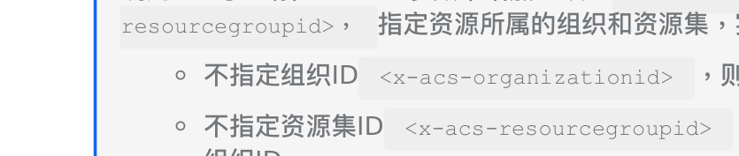
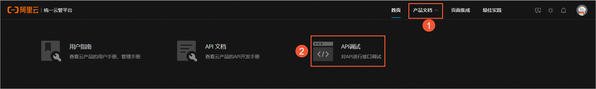
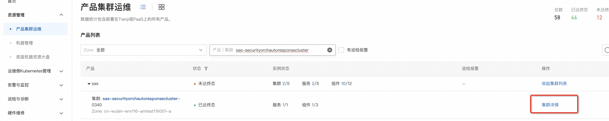
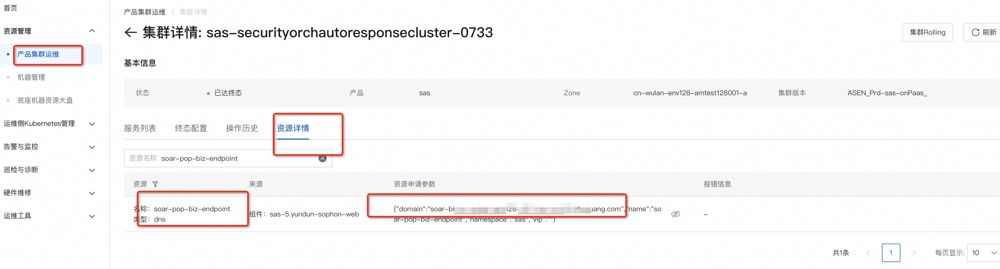

阿里云  
专有云  
云盾-态势感知  
安全编排自动化响应 开发指南  
产品版本：V3.18.6  
文档版本：20250613

**目录**

- [1.快速入门](#section-1)
    - [1.1. API调用流程说明](#section-1-1)
- [2.准备工作](#section-2)
    - [2.1. 登录开发者门户控制台](#section-2-1)
    - [2.2. 查看API信息](#section-2-2)
    - [2.3. 获取AccessKey](#section-2-3)
    - [2.4. 获取STS AccessKey](#section-2-4)
    - [2.5. 获取Endpoint](#section-2-5)
- [3.调用示例](#section-3)
    - [3.1. Java SDK调用示例](#section-3-1)
        - [3.1.1. 快速开始](#section-3-1-1)
        - [3.1.2. 使用手册](#section-3-1-2)
            - [3.1.2.1. 安装Java SDK](#section-3-1-2-1)
            - [3.1.2.2. 使用CommonRequest进行调用](#section-3-1-2-2)
    - [3.2. Python SDK调用示例](#section-3-2)
        - [3.2.1. 快速开始](#section-3-2-1)
        - [3.2.2. 使用手册](#section-3-2-2)
            - [3.2.2.1. 安装Python SDK](#section-3-2-2-1)
            - [3.2.2.2. 使用CommonRequest进行调用](#section-3-2-2-2)
    - [3.3. Go SDK调用示例](#section-3-3)
        - [3.3.1. 快速开始](#section-3-3-1)
        - [3.3.2. 使用手册](#section-3-3-2)
            - [3.3.2.1. 安装Go SDK核心包](#section-3-3-2-1)
            - [3.3.2.2. 使用CommonRequest进行调用](#section-3-3-2-2)
- [4.API公共参数](#section-4)
- [5.错误代码表](#section-5)

<a id="section-1"></a>

# 1.快速入门

<a id="section-1-1"></a>

## 1.1. API调用流程说明

阿里云专有云支持通过POP网关调用专有云API，为了使您拥有与公有云一致的体验，自企业版V3.16.0开始，专有云API默认使用POP网关方式调用。本文介绍如何通过POP网关调用专有云API。

**流程图**


**调用步骤**

1. 获取AccessKey。

   获取调用时所需要的AccessKey参数，请参见获取AccessKey或获取STS AccessKey。

   > **说明**
   >
   > 推荐使用个人AccessKey或STS AccessKey调用Apsara Uni-manager运营控制台及云产品接口。

2. 获取RegionID。

3. 获取组织ID与资源集ID。

   组织ID需要通过API进行获取，获取方式请参见*Apsara Uni-manager运营控制台开发指南*中的*GetOrga nizationList章节*。

   资源集ID需要通过API进行获取，获取方式请参见*Apsara Uni-manager运营控制台开发指南*中的*ListRe sourceGroup章节*。

   > **说明**
   >
   > 调用API时，请在Header参数中增加组织ID `<x-acs-organizationid>` 和资源集ID `<x-acs-`



> `resourcegroupid>`， 指定资源所属的组织和资源集，实现实例资源的隔离查询。
>
> - 不指定组织ID `<x-acs-organizationid>` ，则默认获取当前用户所属的组织。
>
> - 不指定资源集ID `<x-acs-resourcegroupid>` ，则默认为空，如果指定资源集需要同时指定组织ID。

4. 获取对应的API参考文档。

   您需要查看目标云产品的开发指南，了解API的功能与使用方式，开发指南的使用流程及获取方法请参见开发文档使用说明。

5. 获取云产品Endpoint。

6. 获取云产品SDK并调用云产品API。

<a id="section-2"></a>

# 2.准备工作

<a id="section-2-1"></a>

## 2.1. 登录开发者门户控制台

您可以通过Apsara Uni-manager运营控制台登录开发者门户控制台。

**前提条件**

- 登录Apsara Uni-manager运营控制台前，确认您已从部署人员处获取Apsara Uni-manager运营控制台的服务域名地址。

- 推荐使用Chrome浏览器

**操作步骤**

1. 在浏览器地址栏中，输入Apsara Uni-manager运营控制台的服务域名地址，按回车键。

2. 输入正确的用户名及密码。

   请向运营管理员获取登录控制台的用户名和密码。

   > **说明**
   >
   > 首次登录Apsara Uni-manager运营控制台时，需要修改登录用户名的密码，请按照提示完成密码修改。为提高安全性，密码长度必须为10~32位，且至少包含以下两种类型：
   >
   > - 英文大写或小写字母（A~Z、a~z）
   >
   > - 阿拉伯数字（0~9）
   >
   > - 特殊符号（感叹号（!）、at（@）、井号（#）、美元符号（$）、百分号（%）等）

3. 单击**登录**。

4. 如果账号已激活MFA多因素认证，请根据以下两种情况进行操作：

   - 管理员强制开启MFA后的首次登录：

     <ol type="a">

     <li>

     在绑定虚拟MFA设备页面中，按页面提示步骤绑定MFA设备。

     </li>

     <li>

     按照步骤2重新输入账号和密码，单击**登录**。

     </li>

     </ol>

     <ol type="i" start="100">

     <li>

     输入6位MFA码后单击**认证**。

     </li>

     </ol>

   - 您已开启并绑定MFA：

     输入6位MFA码后单击**认证**。

     > **说明**
     >
     > 绑定并开启MFA的操作请参见<strong>《Apsara Uni-manager运营控制台用户指南》</strong>中的<strong>《绑定并开启虚拟MFA设备》</strong>章节。

5. 在页面顶部的菜单栏中，选择**产品 > 应用服务 > 开发者门户**。

<a id="section-2-2"></a>

## 2.2. 查看API信息

首先，您需要了解产品开放API接口的相关信息，包括产品名称（code）、开放API接口名称、API版本，在通过SDK调用API接口时需要填写上述信息。

**背景信息**

Apsara Uni-manager运营控制台API目录中的API信息仅供调用参考，具体API的使用方式需要参见云产品的开发指南。如果发生不一致情况，以开发指南支持情况为准。

**操作步骤**

1. 登录Apsara Uni-manager运营控制台。

2. 在顶部菜单栏单击

   图标，进入**帮助与开放平台**。

   

3. 在顶部菜单栏**产品文档**的下拉列表中，选择**API调试**。

   

4. 在左侧导航栏中选择目标云产品。在下方API列表中可浏览当前API版本中的所有API接口名称。若当前云产品存在多个API版本，可在**版本**下拉列表中，选择目标API版本。

<a id="section-2-3"></a>

## 2.3. 获取AccessKey

AccessKey支持RAM和STS两种授权模式，在发起调用时选择使用其中一种AccessKey即可。本文将为您介绍如何获取通过RAM授权的AccessKey。

**背景信息**

AccessKey通过使用AccessKey ID和AccessKey Secret对称加密，实现验证某个请求发送者的身份的功能。其中AccessKey ID用于标示用户，AccessKey Secret是用户用于加密签名的字符串。

AccessKey的两种授权模式如下：

- 通过RAM授权给第三方请求者的AccessKey ID和AccessKey Secret。

- 通过STS授权给第三方请求者的AccessKey ID、AccessKey Secret和Security Token。获取方式请参见获取STS AccessKey。

Apsara Uni-manager运营控制台提供了个人AccessKey和组织AccessKey（只有运营管理员和一级组织管理员可以获取组织AccessKey），推荐使用个人账号AccessKey调用Apsara Uni-manager运营控制台及云产品相关接口。如果使用个人账号AccessKey，需要在Header中添加以下限制性参数，否则可能提示权限不足：

> **警告**
>
> 个人账号AccessKey是由Apsara Uni-manager运营控制台权限体系管控的受限AccessKey，组织AccessKey相对权限较大，需要管理员确认操作的安全性。

<table>
  <tr>
    <th width="206">参数名称</th>
    <th>描述</th>
  </tr>
  <tr>
    <td>x-acs-regionid</td>
    <td>地域，如：cn-hangzhou-*。</td>
  </tr>
  <tr>
    <td>x-acs-organizationid</td>
    <td>Apsara Uni-manager运营控制台中对应的组织ID。获取方法可参见<strong>《Apsara Uni-manager运营控制台开</strong><strong>发指南》</strong>中的<strong>《GetOrganizationList》</strong>文档。</td>
  </tr>
  <tr>
    <td>x-acs-resourcegroupid</td>
    <td>Apsara Uni-manager运营控制台中对应的资源集ID。获取方法可参见<strong>《Apsara Uni-manager运营控制台</strong><strong>开发指南》</strong>中的<strong>《ListResourceGroup》</strong>文档。</td>
  </tr>
  <tr>
    <td>x-acs-instanceid</td>
    <td>进行操作的实例ID，例如，ECS的实例ID可以从ECS列表中查询到。</td>
  </tr>
</table>

**获取个人账号AccessKey**

获取个人账号AccessKey的方法如下：

1. 登录Apsara Uni-manager运营控制台。

2. 在系统界面右上角，单击当前登录用户头像，单击**个人信息**。

3. 在**阿里云AccessKey**区域，您可以查看个人账户的AccessKey信息。

   

   > **说明**
   >
   > Accesskey ID和AccessKey Secret是您访问云资源时的密钥，具有该账号完整的权限，请您妥善保管。

**获取组织AccessKey**

获取组织AccessKey的方法如下：

1. 管理员登录Apsara Uni-manager运营控制台。

2. 在顶部菜单栏，单击**企业**。

3. 在左侧导航栏中，选择**资源管理 > 组织管理**。

4. 在组织结构中，单击目标一级组织名称。

5. 单击**管理Accesskey**。

6. 在弹出的对话框中，查看组织AccessKey信息。

<a id="section-2-4"></a>

## 2.4. 获取STS AccessKey

本文为您介绍如何利用STS方式，调用专有云的产品API。

**背景信息**

阿里云临时安全令牌STS（Security Token Service）是阿里云提供的一种临时访问权限管理服务。您可以选择使用STS方式，调用专有云的产品API。

STS AccessKey由AccessKey ID、AccessKey Secret及Security Token三元组组成，使用STS方式调用云产品API时，三元组缺一不可。

**操作步骤**

1. 获取用户角色的 `RAM Role` 。

   <ol type="i">

   <li>

   登录Apsara Uni-manager运营控制台。

   </li>

   <li>

   单击页面右上角的用户头像，单击**个人信息**。

   </li>

   <li>

   单击**查看当前角色策略**。

   在**当前选择角色策略**对话框中查看 `RAM Role` 。

   </li>

   </ol>

2. 获取STS Accesskey三元组。

   > **说明**
   >
   > 以下代码示例中可变参数均需替换为您实际的相关信息，尖括号（<>）在最终代码中不保留。
   >
   > 涉及替换的可变参数如下：
   >
   > - &lt;yourRegionID>：请替换为您实际的地域ID。
   >
   > - &lt;yourAccessKeyID>：请替换为您实际的AccessKey ID。
   >
   > - &lt;yourAccessKeySecret>：请替换为您实际的AccessKey Secret。
   >
   > - &lt;yourRoleSessionName>：请替换为您当前实际的会话名称。
   >
   >   该名称为用户自定义，通常设置为调用该API的用户身份，例如：用户名。在同一个RAM角色执行的操作中，可以根据不同的 `RoleSessionName` 来区分实际操作者，以实现用户级别的访问审计。长度为2~64个字符，可包含英文字母、数字、半角句号（.）、at（@）、短划线（-）和下划线（_）。
   >
   > - &lt;yourRoleArn>：请替换为您实际的RAM Role。
   >
   > - "sts.aliyuns.com" ：请替换为实际的STS Endpoint。

   ```xml
   public static void main(String[] args) {
       // 创建DefaultAcsClient实例并初始化。
       // 请替换为您实际的地域ID、AccessKey ID、AccessKey Secret。
       DefaultProfile profile = DefaultProfile.getProfile("<yourRegionID>", "
   <yourAccessKeyID>", "<yourAccessKeySecret>");
       HttpClientConfig clientConfig = HttpClientConfig.getDefault();
       clientConfig.setIgnoreSSLCerts(true);
       clientConfig.setProtocolType(ProtocolType.HTTPS);
       profile.setHttpClientConfig(clientConfig);
       IAcsClient client = new DefaultAcsClient(profile);
       String assumeRole = callAssumeRole(client);
       if (StringUtils.isEmpty(assumeRole)) return;
       JSONObject assumeRoleJson = JSONObject.parseObject(assumeRole);
       JSONObject credentials = assumeRoleJson.getJSONObject("Credentials");
       // 获取到STS三元组。
       String stsAK = credentials.getString("AccessKeyId");
       String stsSK = credentials.getString("AccessKeySecret");
       String stsToken = credentials.getString("SecurityToken");
   }

   private static String callAssumeRole(IAcsClient client) {
       CommonRequest request = new CommonRequest();
       // "sts.aliyuns.com" 请替换为实际的STS Endpoint，⼀般格式为sts-
   vpc.${global:region}.${global:internet-domain}。
       request.setSysDomain("sts.aliyuns.com");
       request.setSysProduct("Sts");
       request.setSysAction("AssumeRole");
       request.setSysVersion("2015-04-01");
       request.setSysMethod(MethodType.POST);
       request.setHttpContentType(FormatType.FORM);
       // 业务参数，设置本次调⽤Session的别名，"<yourRoleSessionName>"请您替换为实际值。
       request.putQueryParameter("RoleSessionName", "<yourRoleSessionName>");
       // 扮演的Role⾓⾊ARN，"<yourRoleArn>"请替换为上⼀步获取到的实际Ram Role ARN。
       request.putQueryParameter("RoleArn", "<yourRoleArn>");
       try {
           CommonResponse response = client.getCommonResponse(request);
           return response.getData();
       } catch (ServerException e) {
           System.out.println(e.getErrCode());
           System.out.println(e.getErrMsg());
       } catch (ClientException e) {
           System.out.println(e.getErrCode());
           System.out.println(e.getErrMsg());
       }
       return null;
   }
   ```

3. 通过STS AccessKey三元组调用云产品的接口，下列代码以ECS的 `DescribeZones` 接口为示例。

   > **说明**
   >
   > 以下代码示例中可变参数均需替换为您实际的相关信息，尖括号（<>）在最终代码中不保留。
   >
   > 涉及替换的可变参数如下：
   >
   > - &lt;yourRegionID>：请替换为您实际的地域ID。
   >
   > - &lt;yourStsAccesskeyID>：请替换为您实际的STS Accesskey ID。
   >
   > - &lt;yourStsAccessKeySecret>：请替换为您实际的STS Accesskey Secret。
   >
   > - &lt;yourStsToken>：请替换为实际STS三元组中的SecurityToken。
   >
   > - &lt;yourResourceGroupID>：请替换为您实际的资源集ID。
   >
   > - &lt;yourOrganizationID>：请替换为您实际的组织ID。

   ```xml
   public static void main(String[] args) {
       // "<yourRegionID>"请替换为您实际的地域ID。
       // "<yourStsAccessKeyID>"、"<yourStsAccessKeySecret>"请替换为前⼀步获取到的STS三元组中
   AccessKeyID、AccessKeySecret。
       DefaultProfile profile = DefaultProfile.getProfile("<yourRegionID>", "
   <yourStsAccesskey>", "<yourStsAccessSecret>");
       HttpClientConfig clientConfig = HttpClientConfig.getDefault();
       clientConfig.setIgnoreSSLCerts(true);
       clientConfig.setProtocolType(ProtocolType.HTTPS);
       profile.setHttpClientConfig(clientConfig);
       IAcsClient client = new DefaultAcsClient(profile);
       CommonRequest request = new CommonRequest();
       request.setSysDomain("ecs.aliyuns.com");
       request.setSysProduct("Ecs");
       request.setSysAction("DescribeZones");
       request.setSysVersion("2014-05-26");
       request.setSysMethod(MethodType.POST);
       request.setHttpContentType(FormatType.FORM);
       //"<yourRegionID>" 请替换为您实际的地域ID。
       request.putHeadParameter("x-acs-regionid", "<yourRegionID>");
       // "<yourStsToken>" 请替换为您前⼀步获取到的STS三元组中SecurityToken。
       request.putQueryParameter("SecurityToken", "<yourStsToken>");
       // 非必填，请替换为您实际的资源集ID。
       // request.putHeadParameter("x-acs-resourcegroupid", "<yourResourceGroupID>");
       // 非必填，请替换为您实际的组织ID。
       request.putHeadParameter("x-acs-organizationid", "<yourOrganizationID>");
       try {
           CommonResponse response = client.getCommonResponse(request);
           System.out.println(response.getData());
       } catch (ServerException e) {
           System.out.println(e.getErrCode());
           System.out.println(e.getErrMsg());
       } catch (ClientException e) {
           System.out.println(e.getErrCode());
           System.out.println(e.getErrMsg());
       }
   }
   ```

<a id="section-2-5"></a>

## 2.5. 获取Endpoint

本文介绍如何获取云盾各产品的Endpoint。

**背景信息**

通过POP网关调用API时需要使用云产品业务域的Endpoint。您可以在阿里云驻场运维工程师处获取。您也可以通过如下方法自行获取Endpoint。

**操作步骤**

1. 登录飞天基础运维平台。

2. 在顶部菜单栏，选择**产品运维 > 飞天基础运维平台**。

3. 在左侧导航栏，单击**产品集群运维**。

4. 在**产品 | 集群**搜索框输入sas-securityorchautoresponsecluster，点击**集群详情**。

   

5. 在集群详情切换到资源详情页，搜索soar-pop-biz-endpoint，对应的Json值中domain对应的内容即为业务域的Endpoint。

   

6. 云产品的业务域的Endpoint构成格式为：

   ```text
   soar-biz.${global:region}.${global:internet-domain}
   ```

<a id="section-3"></a>

# 3.调用示例

<a id="section-3-1"></a>

## 3.1. Java SDK调用示例

<a id="section-3-1-1"></a>

### 3.1.1. 快速开始

本节介绍如何获取产品名Java SDK并开始调用。

**环境准备**

- 使用阿里云专有云Java SDK，您需要一个授权账号以及一对AccessKey ID和AccessKey Secret。具体信息，请参见获取AccessKey，并在Apsara Uni-manager运营控制台上获取和查看您的AccessKey。

- 获取Endpoint，具体操作，请参见获取Endpoint。

- 阿里云专有云Java SDK需要1.8及以上的JDK。

**安装阿里云专有云Java SDK**

如果您使用Apache Maven来管理Java项目，只需在项目的pom.xml中导入JAR文件。

要使用云盾的开发工具包，必须安装SDK核心库。其中，SDK核心库推荐使用4.5.17及以上版本。

**使用Java SDK**

调用阿里云专有云Java SDK的主要操作步骤如下：

1. 创建并初始化DefaultAcsClient实例。

2. 创建API请求并设置参数。

3. 发起请求并处理应答或异常。

   > **说明**
   >
   > 以下代码示例中可变参数均需替换为您实际的相关信息，尖括号（<>）在最终代码中不保留。
   >
   > 涉及替换的可变参数如下：
   >
   > - &lt;your-region-id>，请替换为您实际的地域ID。
   >
   > - &lt;your-access-key-id>，请替换为您实际的AccessKey ID。
   >
   > - &lt;your-access-key-secret>>，请替换为您实际的AccessKey Secret。
   >
   > - &lt;your-endpoint>，请替换为您当前产品实际的Endpoint。
   >
   > - &lt;API-version>，请替换成接口的版本。
   >
   > - &lt;your-action>，请替换成接口的名称。

```java
import com.aliyuncs.CommonRequest;
import com.aliyuncs.CommonResponse;
import com.aliyuncs.DefaultAcsClient;
import com.aliyuncs.IAcsClient;
import com.aliyuncs.exceptions.ClientException;
import com.aliyuncs.exceptions.ServerException;
import com.aliyuncs.profile.DefaultProfile;
public class Sample {
    public static void main(String[] args) {
        // 创建DefaultAcsClient实例并初始化
        DefaultProfile profile = DefaultProfile.getProfile(
            "<your-region-id>",          // 您的地域ID
            "<your-access-key-id>",      // 您的AccessKey ID
            "<your-access-key-secret>"); // 您的AccessKey Secret
        IAcsClient client = new DefaultAcsClient(profile);
        // 创建API请求并设置参数
        CommonRequest request = new CommonRequest();
        request.setDomain("<your-endpooint>");// 当前产品的服务地址
        request.setVersion("<API-version>");// 接⼝的版本
        request.setAction("<your-action>");// 接⼝的名称
        request.putQueryParameter("PageNumber", "1");
        request.putQueryParameter("PageSize", "30");
        try {
            CommonResponse response = client.getCommonResponse(request);
            System.out.println(response.getData());
        } catch (ServerException e) {
            // TODO Auto-generated catch block
            e.printStackTrace();
        } catch (ClientException e) {
            // TODO Auto-generated catch block
            e.printStackTrace();
        }
    }
}
```

<a id="section-3-1-2"></a>

### 3.1.2. 使用手册

<a id="section-3-1-2-1"></a>

#### 3.1.2.1. 安装Java SDK

本文介绍如何安装及调用云盾Java SDK。

阿里云专有云Java SDK支持1.8及以上版本的JDK，可以通过添加Maven依赖或下载阿里云开发工具包（SDK）的方式安装专有云Java SDK。

要使用云盾的开发工具包，必须安装阿里云Java SDK核心库。SDK核心库推荐使用4.5.17及以上版本。

您在安装阿里云Java SDK核心库时，需要在pom.xml文件中添加以下依赖。关于准确的SDK版本号，请参见阿里云开发工具包（SDK）。

```xml
<!-- Alibaba Cloud SDK for Java -->
<dependency>
    <groupId>com.aliyun</groupId>
    <artifactId>aliyun-java-sdk-core</artifactId>
    <version>4.5.17</version>
</dependency>
```

<a id="section-3-1-2-2"></a>

#### 3.1.2.2. 使用CommonRequest进行调用

> **说明**
>
> 当您要调用的某个产品的API没有提供SDK时，可以采用泛用型的API调用方式（CommonRequest）。使用CommonRequest调用方式可实现任意OpenAPI接口的调用。

**CommonRequest调用特点**

CommonRequest的特点如下：

1. 轻量：只需Core包即可发起调用，无需下载安装各产品的SDK。

2. 简便：无需更新SDK即可调用最新发布的API。

3. 快速迭代。

**使用CommonRequest**

阿里云产品的API有RPC和RESTful两种风格，不同风格的API的CommonRequest的调用方法也不同。

通常API参数中包含Action参数的是RPC风格，包含PathPattern参数的是RESTful风格。一般情况下，每个产品内，所有API的调用风格是统一的。每个API仅支持特定的一种风格调用，传入错误的标识，可能会调用到其他API，或收到 `ApiNotFound` 的错误信息。

发起一次CommonRequest请求，您需要获取以下几个参数的值。关于以下参数的更多说明，请参见API公共参数。

- 接入点（endpoint）：该产品的服务地址。

- API版本（version）：该API的版本号，格式为YYYY-MM-DD。

- 接口信息：要调用的接口名称。

  - 当调用的API为RPC风格（大部分阿里云产品API为RPC风格，如Sas）时，需要获取Action参数，使用 `request.ApiName = "<Action>"` 的方式来指定API名称。

  - 当调用的API为RESTful风格（如容器服务）时，需要获取PathPattern参数，使用 `request.PathPattern = "<PathPattern>"` 的方式来指定RESTful路径。

**示例：调用RPC风格的API**

以下代码展示了如何使用CommonRequest的方式调用云盾的接口：

```java
import com.aliyuncs.CommonRequest;
import com.aliyuncs.CommonResponse;
import com.aliyuncs.DefaultAcsClient;
import com.aliyuncs.IAcsClient;
import com.aliyuncs.exceptions.ClientException;
import com.aliyuncs.exceptions.ServerException;
import com.aliyuncs.profile.DefaultProfile;
public class Sample {
    public static void main(String[] args) {
        // 创建DefaultAcsClient实例并初始化
        DefaultProfile profile = DefaultProfile.getProfile(
            "<your-region-id>",          // 您的地域ID
            "<YOUR-ACCESS-KEY-ID>",      // 您的AccessKey ID
            "<YOUR-ACCESS-KEY-SECRET>"); // 您的AccessKey Secret
        IAcsClient client = new DefaultAcsClient(profile);
        // 创建API请求并设置参数
        CommonRequest request = new CommonRequest();
        request.setDomain("<YOUR-ENDPOINT>");// 当前产品实际的Endpoint
        request.setVersion("<API-version>");// 接⼝的版本
        request.setAction("<YOUR-ACTION>");// 接⼝的名称
        request.putQueryParameter("PageNumber", "1");
        request.putQueryParameter("PageSize", "30");
        try {
            CommonResponse response = client.getCommonResponse(request);
            System.out.println(response.getData());
        } catch (ServerException e) {
            // TODO Auto-generated catch block
            e.printStackTrace();
        } catch (ClientException e) {
            // TODO Auto-generated catch block
            e.printStackTrace();
        }
    }
}
```

<a id="section-3-2"></a>

## 3.2. Python SDK调用示例

<a id="section-3-2-1"></a>

### 3.2.1. 快速开始

本节介绍如何获取Python SDK并开始调用。

**环境准备**

- 使用Python SDK前，您需要一个授权账号以及一对AccessKey ID和AccessKey Secret。具体信息，请参见获取AccessKey。

- 获取到Endpoint。具体操作，请参见获取Endpoint。

**安装Python SDK核心库**

- 如果您使用的是Python 2.x，执行以下命令，安装阿里云SDK核心库：

  ```bash
  pip install aliyun-python-sdk-core
  ```

- 如果您使用的是Python 3.x，执行以下命令，安装阿里云SDK核心库：

  ```bash
  pip3 install aliyun-python-sdk-core-v3
  ```

**使用Python SDK**

以下示例展示调用Python SDK的3个主要步骤：

1. 创建Client实例。

   在创建Client实例时，您需要获取Region ID、AccessKey ID和AccessKey Secret。

2. 创建API请求并设置参数。

3. 发起请求并处理应答或异常。

   > **说明**
   >
   > 以下代码示例中可变参数均需替换为您实际的相关信息，尖括号（<>）在最终代码中不保留。
   >
   > 涉及替换的可变参数如下：
   >
   > - &lt;your_region_id>，请替换为您实际的地域ID。
   >
   > - &lt;your_access_key_id>，请替换为您实际的AccessKey ID。
   >
   > - &lt;your_access_key_secret>，请替换为您实际的AccessKey Secret。
   >
   > - &lt;your-endpoint>，请替换为您实际的产品访问地址。
   >
   > - &lt;API-version>，请替换成接口的版本。
   >
   > - &lt;your-action>，请替换成接口的名称。

   ```python
   from aliyunsdkcore.client import AcsClient
   from aliyunsdkcore.request import
   CommonRequest
   client = AcsClient('{your_access_key_id}',
   '{your_access_key_secret}', '{your_region_id}')
   request = CommonRequest()
   request.set_domain('<your-endpoint>')// 当前产品的服务地址
   request.set_version('<API-version>')// 接⼝的版本
   request.set_action_name('<your-action>')// 接⼝的名称
   # or:
   # request =
   CommonRequest(domain='<your-endpoint>', version='<API-version>',
   action_name='<your-action>')
   request.add_query_param('PageNumber', '1')
   request.add_query_param('PageSize', '30')
   response =
   client.do_action_with_exception(request)

                       
   ```

<a id="section-3-2-2"></a>

### 3.2.2. 使用手册

<a id="section-3-2-2-1"></a>

#### 3.2.2.1. 安装Python SDK

本文档介绍如何安装及调用Python SDK。

阿里云专有云Python SDK支持Python 2.6.x、2.7.x和3.x及以上环境，您可以通过pip安装专有云Python SDK。

> 使用产品的开发工具包，都必须安装阿里云Python SDK核心库。
>
> **说明**

- 如果您使用的是Python 2.x，执行以下命令，安装阿里云SDK核心库：

  ```bash
  pip install aliyun-python-sdk-core
  ```

- 如果您使用的是Python 3.x，执行以下命令，安装阿里云SDK核心库：

  ```bash
  pip3 install aliyun-python-sdk-core-v3
  ```

<a id="section-3-2-2-2"></a>

#### 3.2.2.2. 使用CommonRequest进行调用

> **说明**
>
> 当您要调用的某个产品的API没有提供SDK时，可以采用泛用型的API调用方式（CommonRequest）。使用CommonRequest调用方式可实现任意OpenAPI接口的调用。

**CommonRequest调用特点**

CommonRequest的特点如下：

1. 轻量：只需Core包即可发起调用，无需下载安装各产品的SDK。

2. 简便：无需更新SDK即可调用最新发布的API。

3. 快速迭代。

**使用CommonRequest**

阿里云产品的API有RPC和RESTful两种风格，不同风格的API的CommonRequest的调用方法也不同。

通常API参数中包含Action参数的是RPC风格，包含PathPattern参数的是RESTful风格。一般情况下，每个产品内，所有API的调用风格是统一的。每个API仅支持特定的一种风格调用，传入错误的标识，可能会调用到其他API，或收到 `ApiNotFound` 的错误信息。

发起一次CommonRequest请求，您需要获取以下几个参数的值。关于以下参数的更多说明，请参见API公共参数。

- 接入点（endpoint）：该产品的服务地址。

- API版本（version）：该API的版本号，格式为YYYY-MM-DD。

- 接口信息：要调用的接口名称。

  - 当调用的API为RPC风格（大部分阿里云产品API为RPC风格，如Sas）时，需要获取Action参数，使用 `request.ApiName = "<Action>"` 的方式来指定API名称。

  - 当调用的API为RESTful风格（如容器服务）时，需要获取PathPattern参数，使用 `request.PathPattern = "<PathPattern>"` 的方式来指定RESTful路径。

**示例：调用RPC风格的API**

以下代码展示了如何使用CommonRequest的方式调用接口：

```python
from aliyunsdkcore.client import AcsClient
from aliyunsdkcore.request import CommonRequest
client = AcsClient('{your_access_key_id}', '{your_access_key_secret}', 
'{your_region_id}') 
request = CommonRequest()
request.set_domain('<YOUR-ENDPOINT>') //当前产品实际的Endpoint
request.set_version('<API-version>') //接⼝的版本
request.set_action_name('<YOUR-ACTION>')//接⼝的名称
# or: 
# request = CommonRequest(domain='<your-endpoint>', version='<API-version>', 
action_name='your-action')
request.add_query_param('PageNumber', '1')
request.add_query_param('PageSize', '30')
response = client.do_action_with_exception(request)
```

<a id="section-3-3"></a>

## 3.3. Go SDK调用示例

<a id="section-3-3-1"></a>

### 3.3.1. 快速开始

阿里云Go SDK让您不用复杂编程即可访问。本文介绍如何获取阿里云Go SDK并开始调用。

**环境准备**

- 使用Python SDK前，您需要一个授权账号以及一对AccessKey ID和AccessKey Secret。具体信息，请参见获取AccessKey，并在Apsara Uni-manager运营控制台上获取和查看您的AccessKey。

- 获取到Endpoint。具体操作，请参见获取Endpoint。

**安装阿里云Go SDK核心包**

阿里云Go SDK支持Go 1.10.x及更高版本，您可以通过执行以下命令安装Go SDK核心包。

```text
go get -u github.com/aliyun/alibaba-cloud-sdk-go/sdk
```

**使用Go SDK**

以下这个代码示例展示了调用阿里云Go SDK的3个主要步骤：

1. 初始化Client实例。

2. 创建API请求并设置参数。

3. 发起请求并处理应答或异常。

   > **说明**
   >
   > 以下代码示例中可变参数均需替换为您实际的相关信息，尖括号（<>）在最终代码中不保留。
   >
   > 涉及替换的可变参数如下：
   >
   > - &lt;your_region_id>，请替换为您实际的地域ID。
   >
   > - &lt;your_access_key_id>，请替换为您实际的AccessKey ID。
   >
   > - &lt;your_access_key_secret>，请替换为您实际的AccessKey Secret。
   >
   > - &lt;your-endpoint>，请替换为您实际的产品访问地址。
   >
   > - &lt;API-version>，请替换成接口的版本。
   >
   > - &lt;your-action>，请替换成接口的名称。

   ```go
   package main
   import (
   "github.com/aliyun/alibaba-cloud-sdk-go/sdk/requests"
   "github.com/aliyun/alibaba-cloud-sdk-go/sdk"
   "fmt"
   )
   func main() {
   client, err := sdk.NewClientWithAccessKey("<your_region_id>",
   "{your_access_key_id}", "{your_access_key_secret}")
   if err != nil {
   panic(err)
    }
    request
   := requests.NewCommonRequest()
   request.Domain = "<your-endpoint>"// 当前产品实际的Endpoint
   request.Version = "<API-version>"// 接⼝的版本
   request.ApiName = "<your-action>" // 接⼝的名称
   request.QueryParams["PageNumber"] = "1"
   request.QueryParams["PageSize"] = "30"
   response, err := client.ProcessCommonRequest(request)
   if err != nil {
   panic(err)
    }
   fmt.Print(response.GetHttpContentString())
   }
   ```

<a id="section-3-3-2"></a>

### 3.3.2. 使用手册

<a id="section-3-3-2-1"></a>

#### 3.3.2.1. 安装Go SDK核心包

本文档介绍如何安装 Go SDK核心包。

阿里云Go SDK支持Go 1.10.x及以上版本，您可以通过执行以下命令安装Go SDK核心包。

```text
go get -u github.com/aliyun/alibaba-cloud-sdk-go/sdk
```

<a id="section-3-3-2-2"></a>

#### 3.3.2.2. 使用CommonRequest进行调用

> **说明**
>
> 当您要调用的某个产品的API没有提供SDK时，可以采用泛用型的API调用方式（CommonRequest）。使用CommonRequest调用方式可实现任意OpenAPI接口的调用。

**CommonRequest调用特点**

CommonRequest的特点如下：

1. 轻量：只需Core包即可发起调用，无需下载安装各产品的SDK。

2. 简便：无需更新SDK即可调用最新发布的API。

3. 快速迭代。

**使用CommonRequest**

阿里云产品的API有RPC和RESTful两种风格，不同风格的API的CommonRequest的调用方法也不同。

通常API参数中包含Action参数的是RPC风格，包含PathPattern参数的是RESTful风格。一般情况下，每个产品内，所有API的调用风格是统一的。每个API仅支持特定的一种风格调用，传入错误的标识，可能会调用到其他API，或收到 `ApiNotFound` 的错误信息。

发起一次CommonRequest请求，您需要获取以下几个参数的值。关于以下参数的更多说明，请参见API公共参数。

- 接入点（endpoint）：该产品的服务地址。

- API版本（version）：该API的版本号，格式为YYYY-MM-DD。

- 接口信息：要调用的接口名称。

  - 当调用的API为RPC风格（大部分阿里云产品API为RPC风格，如Sas）时，需要获取Action参数，使用 `request.ApiName = "<Action>"` 的方式来指定API名称。

  - 当调用的API为RESTful风格（如容器服务）时，需要获取PathPattern参数，使用 `request.PathPattern = "<PathPattern>"` 的方式来指定RESTful路径。

**示例：使用RPC风格的API**

以下代码展示了如何使用CommonRequest的方式调用接口：

```go
package main
import (
    "github.com/aliyun/alibaba-cloud-sdk-go/sdk/requests"
    "github.com/aliyun/alibaba-cloud-sdk-go/sdk"
    "fmt"
)
func main() {
    client, err := sdk.NewClientWithAccessKey("cn-hangzhou", "{your_access_key_id}", "{
your_access_key_secret}")
    if err != nil {
        panic(err)
    }
    request := requests.NewCommonRequest()
    request.Domain = "<YOUR-ENDPOINT>"// 当前产品实际的Endpoint
    request.Version = "<API-version>"// 接⼝的版本
    request.ApiName = "<YOUR-ACTION>"// 接⼝的名称
    request.QueryParams["PageNumber"] = "1"
    request.QueryParams["PageSize"] = "30"
    response, err := client.ProcessCommonRequest(request)
    if err != nil {
        panic(err)
    }
    fmt.Print(response.GetHttpContentString())
}
```

<a id="section-4"></a>

# 4.API公共参数

**公共请求参数**

公共请求参数是每个接口调用都需要提供的请求参数。

表 1. 公共请求参数表

| 名称 | 类型 | 是否必须 | 描述 |
| --- | --- | --- | --- |
| Format | Strin g | 否 | 返回值的类型，仅支持JSON。 |
| Version | Strin g | 是 | API版本号，以日期形式YYYY-MM-DD输入，取值：<br>• <strong>2018-01-16：</strong>Auditprivate。<br>• <strong>2019-07-23：</strong>yundunnextsoc。<br>• <strong>2018-12-03：</strong>Sas。<br>• <strong>2016-11-11：</strong>aegis。<br>• <strong>2021-10-11：</strong>yundun-css。<br>• <strong>2019-08-05：</strong>secspy。<br>• <strong>2018-01-16：</strong>Ddosprivate。<br>• <strong>2018-06-30：</strong>hsm-private。<br>• <strong>2017-12-07：</strong>Cloudfw。<br>• <strong>2019-01-03：</strong>Sddp。<br>• <strong>2020-07-01：</strong>semawaf。<br>• <strong>2018-12-03：</strong>soar。 |
| AccessKeyId | Strin g | 是 | 访问服务使用的密钥ID。 |
| AccessKeySe cret | Strin g | 是 | 访问服务使用的密钥值。 |
| RegionId | Strin g | 是 | 服务所使用的地域ID。 |

<table>
  <tr>
    <td>Product</td>
    <td>Strin g</td>
    <td>是</td>
    <td>接口对应的产品名称。取值：<br>• <strong>Auditprivate</strong>：云盾基础组件。<br>• <strong>yundunnextsoc</strong>：云安全管理中心（SOC）。<br>• <strong>Sas</strong>：态势感知。<br>• <strong>aegis</strong>：安骑士。<br>• <strong>yundun-css</strong>：容器防护。<br>• <strong>secspy</strong>：网络流量检测与响应。<br>• <strong>Ddosprivate</strong>：DDos 清洗。<br>• <strong>hsm-private</strong>：加密服务。<br>• <strong>Cloudfw</strong>：云防火墙。<br>• <strong>Sddp</strong>：敏感数据保护。<br>• <strong>semawaf</strong>：Web应用防火墙。<br>• <strong>soar</strong>：云安全管理中心（SOC）-编排响应。</td>
  </tr>
  <tr>
    <td>EndpointPre</td>
    <td>Strin g</td>
    <td>是</td>
    <td>接口对应的域名前缀。取值：<br>• <strong>auditprivate</strong>：云盾基础组件。<br>• <strong>yundunnextsoc-pop</strong>：云安全管理中心（SOC）。<br>• <strong>tds</strong>：态势感知。<br>• <strong>aegis</strong>：安骑士。<br>• <strong>yundun-css</strong>：容器防护。<br>• <strong>secspy-share</strong>：网络流量检测与响应。<br>• <strong>ddosprivate</strong>：DDos 清洗。<br>• <strong>hsmprivate</strong>：加密服务。<br>• <strong>cloudfw</strong>：云防火墙。<br>• <strong>sddp-api</strong>：敏感数据保护。<br>• <strong>semawaf</strong>：Web应用防火墙。<br>• <strong>soar</strong>：云安全管理中心（SOC）-编排响应。</td>
  </tr>
</table>

**公共返回参数**

API返回结果采用统一格式，通过返回HTTP状态码来表示状态：

- 返回2xx HTTP状态码代表调用成功。

- 返回4xx或5xx HTTP状态码代表调用失败。

调用成功返回的数据格式为JSON，每次接口调用，无论成功与否，系统都会返回一个唯一识别码RequestId。

<a id="section-5"></a>

# 5.错误代码表

本文介绍云盾API返回的错误代码信息。

表 1. 云盾通用错误代码

| 错误代码 | 错误信息 | 说明 |
| --- | --- | --- |
| yd.error.all.10001 | 权限不够 | 请检查账户权限。 |
| yd.error.all.10002 | 系统错误，请稍后重试 | 请稍后重试。 |
| yd.error.all.10003 | 参数错误 | 请检查请求参数后重试。 |
| yd.error.all.other | 系统异常 | 请稍后重试。 |
| yd.error.all.ConsoleSystemError _1001 | 未知异常 | 请稍后重试。 |
| yd.error.all.ConsoleSystemError _1007 | api已下线 | 请联系阿里云技术支持人员。 |
| yd.error.all.ConsoleSystemError _1008 | postOnly校验失败 | 请检查公共请求参数后重试。 |
| yd.error.all.ConsoleSystemError _1009 | csrfToken为空 | 请检查公共请求参数后重试。 |
| yd.error.all.ConsoleSystemError _1010 | csrfToken校验失败 | 请检查公共请求参数后重试。 |
| yd.error.all.ConsoleSystemError _1011 | regionId为空 | 请检查RegionId请求参数。 |
| yd.error.all.ConsoleSystemError _1012 | regionId格式错误 | 请检查RegionId请求参数。 |
| yd.error.all.ConsoleSystemError _1013 | 参数为空 | 请检查请求参数后重试。 |
| yd.error.all.ConsoleSystemError _1014 | 参数格式错误 | 请检查请求参数后重试。 |
| yd.error.all.ConsoleNeedLogin | 未登录 | 请检查账户权限。 |
| yd.error.all.InvalidApi | 接口异常 | 请稍后重试。 |
| yd.error.all.InvalidParameter | 参数异常 | 请检查请求参数后重试。 |
| yd.error.all.InvalidResult | 返回值异常 | 请稍后重试。 |
| yd.error.all.PropertyConvertFail ed | 转换异常 | 请稍后重试。 |
| yd.error.all.NoPermission | 无权限 | 请检查账户权限。 |
| yd.error.all.ServerError | 服务器异常 | 请稍后重试或联系阿里云技术支持人员。 |
| yd.error.all.UnkownError | 未知异常 | 请稍后重试或联系阿里云技术支持人员。 |

表 2. 态势感知错误代码

| 错误代码 | 错误信息 | 说明 |
| --- | --- | --- |
| yd.error.sas.1 | 您要查询的字段并不在元数据里 | 请检查后重试。 |
| yd.error.sas.2 | 调用任务引擎失败，请重试 | 请稍后重试。 |
| yd.error.sas.3 | 启动任务失败，请重试 | 请稍后重试。 |
| yd.error.sas.4 | 停止任务失败，请重试 | 请稍后重试。 |
| yd.error.sas.5 | 重启任务失败，请重试 | 请稍后重试。 |
| yd.error.sas.6 | 获取任务状态失败，请重试 | 请稍后重试。 |
| yd.error.sas.7 | 删除任务失败，请重试 | 请稍后重试。 |
| yd.error.sas.8 | 您要查询的表还没有配置元数据 | 请检查后重试。 |
| yd.error.sas.100 | 当前请求失败，建议您刷新页面或者稍后重试 | 请稍后重试。 |
| yd.error.sas.101 | 参数错误 | 请检查后重试。 |
| yd.error.sas.103 | 请求失败 | 请稍后重试。 |
| yd.error.sas.400 | 该资产的防护状态为在线，请先卸载安骑士客户端后再尝试删除 | 请先从该主机中卸载安骑士Agent客户端后重试。 |
| yd.error.sas.500 | 系统错误 | 请联系阿里云技术支持人员。 |
| yd.error.sas.501 | 当前版本无此功能 | 您当前版本不支持此功能。 |
| yd.error.sas.502 | 用户没有这台机器的权限 | 您没有操作该主机的权限。 |

表 3. DDoS防护错误代码

| 错误代码 | 错误信息 | 说明 |
| --- | --- | --- |
| yd.error.ddos.400 | 访问服务端异常，请检查请求重试 | 请检查后重试。 |
| yd.error.ddos.500 | 服务端异常，请联系研发 | 请联系阿里云技术支持人员。 |
| yd.error.ddos.UNKNOWN_EXCE PTION | 未知异常 | 请联系阿里云技术支持人员。 |
| yd.error.ddos.REQUEST_TIMEO UT | 请求超时 | 请稍后重试。 |
| yd.error.ddos.SERVER_FAILED | 操作失败 | 请联系阿里云技术支持人员。 |
| yd.error.ddos.NOT_AUTHORIZE D | 没有权限 | 请检查账户权限。 |
| yd.error.ddos.PARAMETER_INVA LID | 参数无效或缺少 | 请求参数有误，请检查后重试。 |
| yd.error.ddos.IP_SEGMENT_INV ALID | IP段不合法，请检查后重新输入 | 请检查请求参数中的IP网段。 |
| yd.error.ddos.IP_SEGMENT_REP EAT | 同一网段不能配置不同区域，请检查后重新输入 | 请检查请求参数中的IP网段。 |
| yd.error.ddos.IP_SEGMENT_ALR EADY | 网段已存在，请重新输入 | 请检查请求参数中的IP网段。 |
| yd.error.ddos.IP_SEGMENT_MAS K_LENGTH_ERR | 掩码长度需小于或等于24字符 | 请检查请求参数中的IP网段的掩码。 |
| yd.error.ddos.QUERY_REGION_L IST_ERR | 读取区域列表失败 | 请稍后重试。 |
| yd.error.ddos.IP_SEGMENT_OPE RATION_ERR | 处理网段操作失败 | 请稍后重试。 |
| yd.error.ddos.QUERY_IP_SEGME NT_ERR | 读取网段信息失败 | 请稍后重试。 |
| yd.error.ddos.MODIFY_IP_SEGM ENT_ERR | 修改网段信息失败 | 请稍后重试。 |
| yd.error.ddos.IP_SEGMENT_TYP E_ERR | 请检查是否设置网段类型（外网网段或内网网段） | 请检查网段类型后重试。 |
| yd.error.ddos.CANCEL_FLOW_C LEAN_ERR | 取消清洗失败，请确认与beaver的网络连接是否正常 | 请检查与流量安全监控模块的网络连接后重试。 |
| yd.error.ddos.QUERY_FLOW_AN ALYSIS_ERR | 获取流量分析结果失败，请确认与beaver的网络连接是否正常 | 请检查与流量安全监控模块的网络连接后重试。 |
| yd.error.ddos.QUERY_BEAVER_URL_ERR | 获取beaver Url失败 | 请检查与流量安全监控模块的网络连接后重试。 |
| yd.error.ddos.SET_VALVE_INVA LID | 阈值校验失败，请确认各阈值后重新输入 | 请检查阈值参数后重试。 |
| yd.error.ddos.VALVE_DEFAULT_ALREADY | 无效的请求，不允许再次添加default阈值 | 无法再次添加默认阈值，只能修改。 |
| yd.error.ddos.NOT_BELONG_BE AVER_IP_SEGMENT | 请检查输入网段是否属于Beaver内网网段 | 请检查网段是否属于流量监控内网网段。 |
| yd.error.ddos.VALVE_DELETE_E RR | default或128.0.XX.XX/XX，阈值不允许删除 | 默认阈值或128.0.XX.XX/XX网段的阈值无法删除 |
| yd.error.ddos.QUERY_CODE_ER R | 读取字典异常 | 请稍后重试。 |
| yd.error.ddos.IS_OPENED | 已开启 | 指定开关已处于开启状态，无法再次开启。 |
| yd.error.ddos.IS_CLOSED | 已关闭 | 指定开关已处于关闭状态，无法再次关闭。 |

表 4. 安骑士错误代码

| 错误代码 | 错误信息 | 说明 |
| --- | --- | --- |
| yd.error.aqs.REQUEST_FAILED | 请求失败， 请稍后重试 | 请稍后重试。 |

表 7. 云防火墙错误码

| 错误代码 | 错误信息 |
| --- | --- |
| yd.error.code.200 | 请求成功 |
| yd.error.code.-360100 | 请求方式错误 |
| yd.error.code.-360101 | 认证失败 |
| yd.error.code.-360102 | 本地调用错误 |
| yd.error.code.-360103 | 参数错误，请重试 |
| yd.error.code.-360104 | 应用选择错误，请重试 |
| yd.error.code.-360105 | 获取日志失败 |
| yd.error.code.-360106 | 获取日志失败 |
| yd.error.code.-360107 | uid错误，请重试 |
| yd.error.code.-360108 | 分页错误 |
| yd.error.code.-360109 | 产品不支持 |
| yd.error.code.-360110 | IP地址格式错误，请重新输入 |
| yd.error.code.-360111 | 时间选择错误，请重新选择 |
| yd.error.code.-360112 | 解析错误 |
| yd.error.code.-360113 | 防火墙名错误，请重新输入 |
| yd.error.code.-360114 | 互通类型选择错误，请重新选择 |
| yd.error.code.-360115 | VPC选择错误，请重新选择 |
| yd.error.code.-360116 | 地域选择错误，请重新输入 |
| yd.error.code.-360117 | 目标网段错误，请正确配置目标网段 |
| yd.error.code.-360118 | 指定的VPC防火墙不存在，请重新选择 |
| yd.error.code.-360119 | 防火墙已配置，不能重复新建 |
| yd.error.code.-360120 | 未授权，不可访问，请先授权防火墙权限 |
| yd.error.code.-360121 | 安全组错误 |
| yd.error.code.-360122 | 安全组错误 |
| yd.error.code.-360123 | 调用ECS接口错误 |
| yd.error.code.-360124 | 调用VPC接口错误 |
| yd.error.code.-360125 | 网段CIDR格式错误，请重新选择 |
| yd.error.code.-360126 | 创建交换机错误 |
| yd.error.code.-360127 | 创建网络接口错误 |
| yd.error.code.-360128 | 删除网络接口错误 |
| yd.error.code.-360129 | 未授权，请重试 |
| yd.error.code.-360130 | ECS不可用 |
| yd.error.code.-360131 | 未知错误 |
| yd.error.code.-360132 | 路由表查找失败 |
| yd.error.code.-360133 | 防火墙ID错误 |
| yd.error.code.-360134 | 防火墙状态错误，请稍后再试 |
| yd.error.code.-360135 | 防火墙开关参数错误，请重新选择 |
| yd.error.code.-360136 | 防火墙状态参数错误，请重新选择 |
| yd.error.code.-360137 | 未知用户，请重试 |
| yd.error.code.-360138 | 防火墙VPC参数错误，请重新选择 |
| yd.error.code.-360139 | 防火墙VPC参数错误，请重新选择 |
| yd.error.code.-360140 | 指定的防火墙不存在，请重新选择 |
| yd.error.code.-360141 | 防火墙未配置，请先新建配置 |
| yd.error.code.-360142 | 防火墙已开启 |
| yd.error.code.-360143 | 防火墙已关闭 |
| yd.error.code.-360144 | 防火墙状态错误，不能开启，请稍后再试 |
| yd.error.code.-360145 | 防火墙状态错误，不能关闭，请稍后再试 |
| yd.error.code.-360146 | 防火墙网卡错误，请确认网卡配置 |
| yd.error.code.-360147 | 目标网段错误，请重新选择 |
| yd.error.code.-360148 | 相同网段不能重复配置，请重新选择网段 |
| yd.error.code.-360149 | 目标网段数量超过最大数量限制，请减少网段数量 |
| yd.error.code.-360150 | 防火墙ID错误 |
| yd.error.code.-360151 | 网络接口状态错误 |
| yd.error.code.-360152 | 网络接口错误 |
| yd.error.code.-360153 | 网络接口错误 |
| yd.error.code.-360154 | 网络接口创建超时 |
| yd.error.code.-360155 | 网络接口删除超时 |
| yd.error.code.-360156 | 权限不足，请重试 |
| yd.error.code.-360157 | 路由表不存在 |
| yd.error.code.-360158 | 路由条目错误 |
| yd.error.code.-360159 | 路由创建失败 |
| yd.error.code.-360160 | 路由删除失败 |
| yd.error.code.-360161 | 路由创建超时 |
| yd.error.code.-360162 | 路由删除超时 |
| yd.error.code.-360163 | 路由非法 |
| yd.error.code.-360164 | 任务状态错误 |
| yd.error.code.-360165 | 防火墙开启失败，请重试 |
| yd.error.code.-360166 | 防火墙关闭失败，请重试 |
| yd.error.code.-360167 | 参数错误，请重试 |
| yd.error.code.-360168 | 参数错误，请重试 |
| yd.error.code.-360169 | 参数错误，请重试 |
| yd.error.code.-360170 | 参数错误，请重试 |
| yd.error.code.-360171 | Region错误 |
| yd.error.code.-360172 | 路由操作太频繁 |
| yd.error.code.-360173 | 已配置的VPC防火墙达到最大数量，请购买扩容 |
| yd.error.code.-360174 | 已配置的VPC防火墙达到最大数量，请购买扩容 |
| yd.error.code.-360175 | 参数错误，请重试 |
| yd.error.code.-360176 | 参数错误，请重试 |
| yd.error.code.-360177 | 参数错误，请重试 |
| yd.error.code.-360178 | 未知错误 |
| yd.error.code.-360179 | 调用接口失败 |
| yd.error.code.-360180 | cen对应的VPC数量不足 |
| yd.error.code.-360181 | cen的防火墙已经覆盖，不需要再新建 |
| yd.error.code.-360182 | 安全组不存在 |
| yd.error.code.-360183 | 安全组无法删除 |
| yd.error.code.-360184 | 未知错误 |
| yd.error.code.-360185 | 更新防火墙路由失败 |
| yd.error.code.-360186 | 当前防火墙状态，不允许配置 |
| yd.error.code.-360187 | 此地域VPC数量不足，无法开启VPC防火墙 |
| yd.error.code.-360188 | 配额不足，无法配置VPC防火墙，请先增加配额 |
| yd.error.code.-360189 | 删除时ECS不存在 |
| yd.error.code.-360190 | 调用接口失败 |
| yd.error.code.-360191 | 参数错误，请重试 |
| yd.error.code.-360192 | 所属账号错误，请重新输入 |
| yd.error.code.-360193 | 所属账号未授权，未购买云防火墙 |
| yd.error.code.-360194 | 配置IPS失败 |
| yd.error.code.-360195 | 云企业网VPC数量不足，无法开启VPC边界防火墙 |
| yd.error.code.-360196 | VPC边界防火墙仅支持同地域，不支持跨地域 |
| yd.error.code.-360197 | 任务冲突 |
| yd.error.code.-360198 | 目标网段为空，不允许创建 |
| yd.error.code.-360199 | 加入cen超时 |
| yd.error.code.-360200 | VSwitch创建超时 |
| yd.error.code.-360201 | VSwitch删除超时 |
| yd.error.code.-360202 | 网络实例ID非法 |
| yd.error.code.-360203 | VPC不存在 |
| yd.error.code.-360204 | 创建VPC超时 |
| yd.error.code.-360205 | 创建VPC超时 |
| yd.error.code.-360206 | ECS实例不存在 |
| yd.error.code.-360207 | ECS实例关闭失败，请重试 |
| yd.error.code.-360208 | 获取备份ECS实例失败 |
| yd.error.code.-360209 | HUB VPC不允许创建防火墙 |
| yd.error.code.-360210 | cen ID错误 |
| yd.error.code.-360211 | 参数错误，请重试 |
| yd.error.code.-360212 | 云企业网VPC数量限制，无法开启VPC边界防火墙 |
| yd.error.code.-360213 | cen未找到 |
| yd.error.code.-360214 | 请求超时，请重试 |
| yd.error.code.-360215 | 参数错误，请重试 |
| yd.error.code.-360216 | IDC专线错误 |
| yd.error.code.-360217 | 防火墙模式错误 |
| yd.error.code.-360218 | 调用xnet接口失败 |
| yd.error.code.-360300 | 后台错误 |
| yd.error.code.-360301 | 后台错误 |
| yd.error.code.-360302 | 后台错误 |
| yd.error.code.-360303 | 后台错误 |
| yd.error.code.-360304 | 后台错误 |
| yd.error.code.-360305 | 后台错误 |
| yd.error.code.-360306 | 后台错误 |
| yd.error.code.-360307 | 后台错误 |
| yd.error.code.-360308 | 查询集群ID失败 |
| yd.error.code.-360309 | 更新集群信息失败 |
| yd.error.code.-360310 | 更新物理专线失败 |
| yd.error.code.-360311 | 插入Vlan失败 |
| yd.error.code.-360312 | 查询IP池失败 |
| yd.error.code.-360313 | 更新IP池失败 |
| yd.error.code.-360314 | 更新VPC路由信息失败 |
| yd.error.code.-360315 | 更新VPC状态失败 |
| yd.error.code.-360316 | 插入防火墙ns失败 |
| yd.error.code.-360317 | 更新Vlan失败 |
| yd.error.code.-360318 | 更新防火墙接口信息失败 |
| yd.error.code.-360319 | 更新防火墙网络信息失败 |
| yd.error.code.-360320 | 更新健康检查配置失败 |
| yd.error.code.-360321 | 更新路由表失败 |
| yd.error.code.-360322 | 更新IDC专线失败 |
| yd.error.code.-360323 | 更新IDC路由信息失败 |
| yd.error.code.-360400 | 未知错误 |
| yd.error.code.-360401 | 没有可用的Vlan |
| yd.error.code.-360402 | 调用VPC接口失败 |
| yd.error.code.-360403 | 创建虚墙失败 |
| yd.error.code.-360404 | 物理专线创建失败 |
| yd.error.code.-360405 | 物理专线使能失败 |
| yd.error.code.-360406 | 创建VBR失败 |
| yd.error.code.-360407 | 更新VBR属性失败 |
| yd.error.code.-360408 | 查询VBR失败 |
| yd.error.code.-360409 | 创建RI失败 |
| yd.error.code.-360410 | 更新RI属性失败 |
| yd.error.code.-360411 | 连接RI失败 |
| yd.error.code.-360412 | IDC专线创建失败 |
| yd.error.code.-360413 | IDC专线使能失败 |
| yd.error.code.-360414 | 查询RI失败 |
| yd.error.code.-360415 | 查询VPC探测IP列表失败（VPC-VPC） |
| yd.error.code.-360416 | 查询VPC探测IP列表失败（IDC-VPC） |
| yd.error.code.-360417 | VPC探测模式异常 |
| yd.error.code.-360418 | 实例状态无效 |
| yd.error.code.-193000 | 未知错误 |
| yd.error.code.-193001 | HTTP请求方法不匹配 |
| yd.error.code.-193002 | HTTP调用失败 |
| yd.error.code.-193003 | 操作权限不足 |
| yd.error.code.-193004 | 不支持的操作 |
| yd.error.code.-193005 | 认证错误 |
| yd.error.code.-193006 | DB访问错误 |
| yd.error.code.-193007 | 访问了本地方法 |
| yd.error.code.-193101 | JSON编码失败 |
| yd.error.code.-193102 | JSON解析失败 |
| yd.error.code.-193103 | 解析INT失败 |
| yd.error.code.-193104 | 解析BOOL失败 |
| yd.error.code.-193105 | 解析HTTP BODY失败 |
| yd.error.code.-193201 | 参数不足 |
| yd.error.code.-193202 | 参数超范围 |
| yd.error.code.-193203 | 时间参数超范围 |
| yd.error.code.-193204 | 无效的参数 |
| yd.error.code.-193205 | IP不在引流配置网段内 |
| yd.error.code.-193301 | 重复的网段 |
| yd.error.code.-193302 | 无效的防火墙UUID |
| yd.error.code.-193303 | FW模式正在切换中 |
| yd.error.code.-193304 | FW模式无效 |
| yd.error.code.-193305 | FW模式非法切换 |
| yd.error.code.-193306 | 设备模式切换中 |
| yd.error.code.-193307 | 实例健康检查异常，实例模式无法切换为正常模式 |
| yd.error.code.-193308 | 所有设备均旁路，无法切换实例模式 |
| yd.error.code.-193309 | 实例的工作模式高于设备的工作模式 |
| yd.error.code.-193310 | 传递过来的页码无效 |
| yd.error.code.-193311 | 路由类型错误 |
| yd.error.code.-193312 | 路由删除失败 |
| yd.error.code.-193313 | 路由删除失败 |
| yd.error.code.-193314 | 路由添加失败 |
| yd.error.code.-193315 | 路由添加失败 |
| yd.error.code.-193316 | 错误的防火墙实例ID |
| yd.error.code.-193317 | 防火墙实例不能为空 |
| yd.error.code.-200100 | 请求方式错误 |
| yd.error.code.-200101 | 认证失败 |
| yd.error.code.-200102 | 本地调用错误 |
| yd.error.code.-200103 | 参数错误，请重试 |
| yd.error.code.-200104 | uid错误，请重试 |
| yd.error.code.-200105 | 分页错误 |
| yd.error.code.-200106 | 地址簿IP地址错误，请检查输入 |
| yd.error.code.-200107 | 地址簿已存在 |
| yd.error.code.-200108 | 请求错误，请稍后重试 |
| yd.error.code.-200109 | 地址簿在使用中，无法删除 |
| yd.error.code.-200110 | 参数无效 |
| yd.error.code.-200111 | 参数无效 |
| yd.error.code.-200112 | 参数无效 |
| yd.error.code.-200113 | 参数无效 |
| yd.error.code.-200114 | 参数无效 |
| yd.error.code.-200115 | 参数无效 |
| yd.error.code.-200116 | 参数无效 |
| yd.error.code.-200117 | 安全组规则不存在 |
| yd.error.code.-200118 | 优先级配置错误或已经达到规则数目上限 |
| yd.error.code.-200119 | 优先级配置错误或已经达到规则数目上限 |
| yd.error.code.-200120 | 请求错误，请稍后重试 |
| yd.error.code.-200121 | 域名参数错误，请检查输入 |
| yd.error.code.-200122 | 地址簿内地址数量超出上限 |
| yd.error.code.-200123 | 参数无效 |
| yd.error.code.-200124 | 参数无效 |
| yd.error.code.-200125 | 参数无效 |
| yd.error.code.-200126 | 参数无效 |
| yd.error.code.-200127 | 地址簿内端口数量超出上限 |
| yd.error.code.-200128 | 地址簿端口错误，请检查输入 |
| yd.error.code.-200129 | 地址簿数量超出上限 |
| yd.error.code.-200130 | 地址簿数量超出上限 |
| yd.error.code.-200200 | 后台错误 |
| yd.error.code.-200201 | 后台错误 |
| yd.error.code.-200202 | 后台错误 |
| yd.error.code.-200203 | 后台错误 |
| yd.error.code.-200300 | 后台错误 |
| yd.error.code.-200301 | 后台错误 |
| yd.error.code.-200302 | 后台错误 |
| yd.error.code.-200400 | 未知错误 |
| yd.error.code.-200500 | API调用错误 |
| yd.error.code.200 | 请求成功 |
| yd.error.code.-210100 | 请求方式错误 |
| yd.error.code.-210101 | 认证失败 |
| yd.error.code.-210102 | 本地调用错误 |
| yd.error.code.-210103 | 参数错误，请重试 |
| yd.error.code.-210104 | uid错误，请重试 |
| yd.error.code.-210105 | 分页错误，请重试 |
| yd.error.code.-210106 | 参数错误，请重试 |
| yd.error.code.-210107 | 参数错误，请重试 |
| yd.error.code.-210108 | 参数错误，请重试 |
| yd.error.code.-210109 | 参数错误，请重试 |
| yd.error.code.-210110 | 参数错误，请重试 |
| yd.error.code.-210111 | 参数错误，请重试 |
| yd.error.code.-210200 | 后台错误 |
| yd.error.code.-210201 | 后台错误 |
| yd.error.code.-210202 | 后台错误 |
| yd.error.code.-210203 | 后台错误 |
| yd.error.code.-210300 | 后台错误 |
| yd.error.code.-210301 | 后台错误 |
| yd.error.code.-210302 | 请求错误，请稍后重试 |
| yd.error.code.-210400 | 请求错误，请稍后重试 |
| yd.error.code.200 | 成功 |
| yd.error.code.-230100 | 请求方法错误 |
| yd.error.code.-230101 | 认证失败 |
| yd.error.code.-230102 | 本地请求失败 |
| yd.error.code.-230103 | 接口认证失败 |
| yd.error.code.-230104 | 参数失败 |
| yd.error.code.-230105 | 策略模板已存在 |
| yd.error.code.-230106 | 策略模板不存在 |
| yd.error.code.-230107 | 用户ID错误 |
| yd.error.code.-230108 | 安全组ID错误 |
| yd.error.code.-230109 | 安全组ID错误 |
| yd.error.code.-230110 | 规则方向错误 |
| yd.error.code.-230111 | IP协议错误 |
| yd.error.code.-230112 | 规则策略错误 |
| yd.error.code.-230113 | 策略优先级错误，请重新输入 |
| yd.error.code.-230114 | 策略端口错误，请重新输入 |
| yd.error.code.-230115 | 网段地址错误，请重新输入 |
| yd.error.code.-230116 | 描述内容错误，请重新输入 |
| yd.error.code.-230117 | 策略已存在 |
| yd.error.code.-230118 | 策略不存在 |
| yd.error.code.-230119 | 规则ID错误 |
| yd.error.code.-230120 | 策略数超过规格限制，请排查删除多余的策略 |
| yd.error.code.-230121 | 分页错误 |
| yd.error.code.-230122 | 规则发布中，请稍后重试 |
| yd.error.code.-230123 | 提交状态错误 |
| yd.error.code.-230124 | 策略组回退 |
| yd.error.code.-230125 | 提交信息错误 |
| yd.error.code.-230126 | 没有规则变化，不需要发布 |
| yd.error.code.-230127 | 安全组ID错误 |
| yd.error.code.-230128 | 规则地址铺错误 |
| yd.error.code.-230129 | 规则的网络类型错误，请重选 |
| yd.error.code.-230130 | 规则操作错误 |
| yd.error.code.-230131 | 策略不支持提交 |
| yd.error.code.-230150 | 策略组不存在，请重选 |
| yd.error.code.-230151 | 策略组超出限制 |
| yd.error.code.-230152 | 策略组不允许修改 |
| yd.error.code.-230153 | 策略组前置 |
| yd.error.code.-230154 | 规则ID不合法 |
| yd.error.code.-230200 | 后台错误 |
| yd.error.code.-230300 | 后台错误 |
| yd.error.code.-230301 | 后台错误 |
| yd.error.code.-230302 | 后台错误 |
| yd.error.code.-230400 | 未知错误 |

**流量安全监控**

| 错误代码 | 错误信息 | 说明 |
| --- | --- | --- |
| ErrorNeedLogin.-210204 | need login（未登录） | 未登录，需要进行登录后访问。 |
| ErrorAuthentication.-210101 | authentication error（身份验证错误） | 身份验证错误，请使用正确的角色登录访问。 |
| ErrorParametersAliUid.-210902 | invalid AliUid（无效AliUid参数） | AliUid参数无效，需要传入正确的AliUid。 |
| ErrorParametersIpType.-210920 | invalid para ip type（无效的IP类型参数） | ipType参数无效，需要传入有效的ipType。 |
| ErrorParametersSrcIP.-210919 | invalid para src ip（无效的源IP参数） | SrcIP参数无效，需要传入有效的SrcIP。 |
| ErrorParametersDstIP.-210921 | invalid para dst ip（无效的目的IP参数） | dstIP参数无效，需要传入有效的dstIP。 |
| ErrorParametersPort.-210208 | invalid port, must 0~65535（无效的端口，端口范围0~65535） | 无效的端口参数，端口范围0~65535。 |
| ErrorParametersLiveTime.-210922 | invalid para live time（无效的liveTime参数） | liveTime参数无效，需要传入有效的liveTime。 |
| ErrorDBInsert.-210122 | internal error: sql insert（内部错误:sql insert发生错误） | 内部错误：sql insert发生错误。 |
| ErrorInnerUuid.-210606 | internal error: uuid list is 0（内部错误：UUID列表为空） | 内部错误：UUID列表为空。 |
| ErrorDBSelect.-210124 | internal error: sql select（内部错误:sql select发生错误） | 内部错误:sql select发生错误。 |
| ErrorParasAddressCidrFeild.-210915 | paras addressCidrList filed （重置addressCidrList规则失败） | 重置addressCidrList规则失败。 |
| ErrorPortAddressGroup.-210303 | get port in address group failed（在群组中获取prot失败） | 在群组中获取prot失败。 |
| ErrorPortAddressGroup.-210303 | get port in address group failed（在群组中获取prot失败） | 在群组中获取prot失败。 |
| ErrorSourceAddressGroup.-210304 | get source address in address group failed（在群组中获取源地址失败） | 在群组中获取源地址失败。 |
| ErrorSourceAddressRange.-210306 | source address range error, must be like \\"192.168.XX.XX/192.168.XX.X X\\"（源地址范围错误，举例：\\"192.168.XX.XX/192.168.XX.X X\\"） | 源地址范围错误，举例：\\"192.168.XX.XX/192.168.XX.X X\\"。 |
| ErrorDestAddressGroup.-210305 | get dest address in address group failed（在群组中获取目的地址失败） | 在群组中获取目的地址失败。 |
| ErrorNoBeaverRules.-210226 | no beaver rules for online（没有对应的beaver rules） | 没有对应的beaver rules。 |
| ErrorDBUpdate.-210121 | internal error: sql update（内部错误：sql update发生错误） | 内部错误：sql update发生错误。 |
| ErrorDBDelete.-210123 | internal error: sql delete（内部错误：sql delete发生错误） | 内部错误：sql delete发生错误。 |
| ErrorMarshalJSON.-210125 | internal error: marshal json（内部错误：marshal json发生错误） | 内部错误：marshal json发生错误。 |
