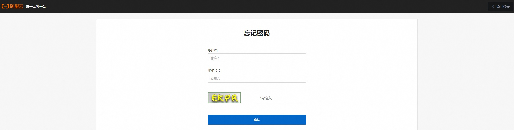
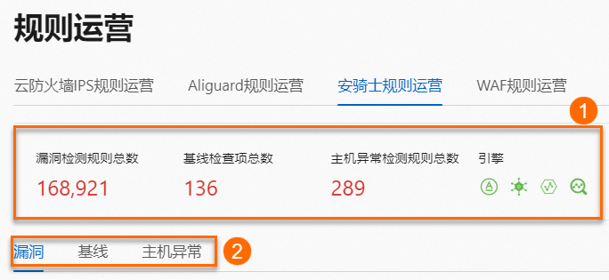

阿里云  
专有云  
云盾-态势感知  
安全编排自动化响应 用户指南  
产品版本：V3.18.6  
文档版本：20250929

**目录**

- [1.使用须知](#section-1)
- [2.快速入门](#section-2)
    - [2.1. 用户权限说明](#section-2-1)
    - [2.2. 登录Apsara Uni-manager运营控制台](#section-2-2)
- [3.安全编排自动化响应 SOAR](#section-3)
    - [3.1. 风险处置](#section-3-1)
        - [3.1.1. 全局案件协作](#section-3-1-1)
        - [3.1.2. 案件管理](#section-3-1-2)
    - [3.2. 响应编排](#section-3-2)
        - [3.2.1. 剧本模版](#section-3-2-1)
        - [3.2.2. 剧本列表](#section-3-2-2)
        - [3.2.3. 组件列表](#section-3-2-3)
        - [3.2.4. 名单库](#section-3-2-4)
        - [3.2.5. 情报库](#section-3-2-5)
        - [3.2.6. 剧本执行记录](#section-3-2-6)
    - [3.3. 运营管理](#section-3-3)
        - [3.3.1. 响应编排配置](#section-3-3-1)
            - [3.3.1.1. 环境变量配置](#section-3-3-1-1)
            - [3.3.1.2. 流式数据源配置](#section-3-3-1-2)
            - [3.3.1.3. 全局变量配置](#section-3-3-1-3)
            - [3.3.1.4. 作战室指令配置](#section-3-3-1-4)
        - [3.3.2. OpenAPI管理](#section-3-3-2)
        - [3.3.3. 组织授权](#section-3-3-3)
- [4.云盾系统配置](#section-4)
    - [4.1. 登录Apsara Uni-manager运营控制台](#section-4-1)
    - [4.2. 规则运营](#section-4-2)
        - [4.2.1. 云防火墙IPS规则运营](#section-4-2-1)
        - [4.2.2. Aliguard规则运营](#section-4-2-2)
        - [4.2.3. 安骑士规则运营](#section-4-2-3)
        - [4.2.4. WAF规则运营](#section-4-2-4)
    - [4.3. 全局设置](#section-4-3)
        - [4.3.1. 拦截策略设置](#section-4-3-1)
    - [4.4. 账号管理](#section-4-4)
        - [4.4.1. 专有云账号管理](#section-4-4-1)
        - [4.4.2. 公有云账号管理](#section-4-4-2)

# 1.使用须知

本文介绍在使用安全编排自动化响应用户指南前，您需要了解的信息，以及在登录云盾控制台前，您需要确认本地PC符合的配置要求。

**本地PC配置要求**

本地PC需要满足如配置要求表中配置要求，才可以正常登录云盾控制台。

表 1. 配置要求表

<table>
  <tr>
    <th width="90">内容</th>
    <th>要求</th>
  </tr>
  <tr>
    <td>浏览器</td>
    <td>• Internet Explorer浏览器：11及以上版本 • Chrome浏览器（推荐）：42.0.0及以上版本 • Firefox浏览器：30及以上版本 • Safari浏览器：9.0.2版本及以上版本</td>
  </tr>
  <tr>
    <td>操作系统</td>
    <td>• Windows XP版本 • Windows 7及以上版本 • Mac系统</td>
  </tr>
</table>

# 2.快速入门

## 2.1. 用户权限说明

本文介绍了云盾涉及的用户角色。

所有云盾安全中心角色均为默认角色，还支持自定义添加。在登录云盾安全中心前，您需要确认自己的账号已经分配云盾相关的角色，具体角色说明，请参见云盾默认角色。

表 1. 云盾默认角色

<table>
  <tr>
    <th width="170">角色名称</th>
    <th>角色说明</th>
  </tr>
  <tr>
    <td>组织安全管理员</td>
    <td>负责单个组织内的安全管理工作，包括云安全管理中心SOC、主机安全、应用安全、网络安全等安全产品的管理工作。</td>
  </tr>
  <tr>
    <td>全局组织安全管理员</td>
    <td>负责通过云安全管理中心SOC，进行所有租户的安全管理工作。</td>
  </tr>
  <tr>
    <td>全局组织安全监察员</td>
    <td>负责通过云安全管理中心SOC查看全部组织的安全状况。</td>
  </tr>
  <tr>
    <td>自定义角色</td>
    <td>可对所有组织、本组织及级联下级组织、资源集设置运营管理权限，能区分读写权限，并可按需配置产品功能菜单界面。 说明当前的自定义所有组织，不包含平台权限，与全局组织安全管理员的数据权限范围存在差异。</td>
  </tr>
</table>

如果您没有相关账号和角色，请联系管理员创建用户及授予角色，具体步骤，请参见<strong>《Apsara Uni-manager运营控制台用户指南》</strong>中**创建用户**。

## 2.2. 登录Apsara Uni-manager运营控制台

本文主要向您介绍如何登录Apsara Uni-manager运营控制台。

**前提条件**

- 登录Apsara Uni-manager运营控制台前，确认您已从部署人员处获取Apsara Uni-manager运营控制台的服务域名地址。

- 推荐使用Chrome浏览器。

**操作步骤**

1. 在浏览器地址栏中，输入Apsara Uni-manager运营控制台的服务域名地址，按回车键。

   

   > **说明**
   >
   > - 单击页面右上角的当前语言可以切换其它语言。
   >
   > - 授权登录是第三方认证中配置了全局IdP设置才会显示，且“授权登录”名称用户可按需自定义。

2. 输入正确的用户名及密码。

   > **说明**
   >
   > - 请向运营管理员获取登录控制台的用户名和密码。
   >
   > - 首次登录Apsara Uni-manager运营控制台时，需要修改登录用户名的密码，请按照提示完成密码修改。为提高安全性，密码长度必须为10~32位，且包含英文字母大小写、阿拉伯数字和特殊符号（感叹号（!）、at（@）、井号（#）、美元符号（$）、百分号（%）等）。

3. 单击**账号登录**。

4. 如果账号已激活MFA多因素认证，请根据以下两种情况进行操作：

   - **管理员强制开启MFA后的首次登录**

     <ol type="a">

     <li>

     在绑定虚拟MFA设备页面中，按页面提示步骤绑定MFA设备。

     </li>

     <li>

     按照步骤2重新输入账号和密码，单击**账号登录**。

     </li>

     </ol>

     <ol type="i" start="100">

     <li>

     输入6位MFA码后单击**认证**。

     </li>

     </ol>

   - **您已开启并绑定MFA**

     输入6位MFA码后单击**认证**。

     > **说明**
     >
     > 绑定并开启MFA的操作请参见管理多因素认证。

**相关操作**

**忘记密码**

1. 用户忘记登录密码时，单击密码输入框下方的**忘记密码**。

2. 在忘记密码页面，输入**账户名**、**邮箱**和验证码后，单击**确认**。

   

   > **说明**
   >
   > - 账户名请输入当前账号的用户名，邮箱请输入注册账号的Email地址。
   >
   > - 重置密码的链接将发至邮箱，进入链接后用户可输入新密码。

# 3.安全编排自动化响应 SOAR

## 3.1. 风险处置

### 3.1.1. 全局案件协作

通过全局写作案件，用户可以设置要监听的案件，从而实现统筹监听案件。本文介绍如何配置全局协作案件。

1. 登录Apsara Uni-manager运营控制台。详情请参见：登录指南。

2. 在控制台右上方，单击**安全**，选择**安全管理 > 安全编排自动化响应SOAR**。在**安全编排自动化响应SOAR**授权页面，选择**地域**并单击**角色授权访问**。

3. 在左侧导航栏，选择**风险处置**＞**全局案件协作**。

4. 在**全局案件协作**页面，单击右上角**全局协作设置**，配置需要监听的案件（同时最多支持监听20个案件），设置是否自动监听。

   完成配置后，您可以在**全局协作案件**页面，查看如下信息：

   - 已订阅的所有案件：支持**查看案件名称、威胁级别、创建时间、案件状态**等信息。

   - 案件详情：单击**案件名称**，查看案件的**构成要素**、**联合作战室**、**相关实体**、**操作记录**、**研判证据**信息。

     > **说明**
     >
     > - 在**全局协作案件**页面，仅支持在**联合作战室**执行剧本或动作，不支持创建或修改**构成要素**、**相关实体**、**研判证据**。
     >
     > - 不支持联合作战室执行标准动作剧本，创建或修改**构成要素、相关实体、研判证据**的具体操作，请参见案件管理。

### 3.1.2. 案件管理

案件管理用于集中管理和调查安全事件。安全管理员可以对案件进行调查和修改。本文介绍如何查看案件信息、创建案件、调查案件、查看案件统计情况。

**概述**

案件可以是SOC告警事件自动生成，也可以是用户手动创建。

- SOC告警事件自动生成

  订阅SOC攻击防护和安全告警消息后，收到对应的告警时，SOAR会读取SOC告警的详细信息，并生成一个新的案件：

  - 案件名称为SOC中告警事件的名称，或攻击防护事件的名称。

  - 案件状态为SOC告警事件状态。

  - 创建时间为SOC告警事件上报时间。

  - 创建人为事件创建租户账号名称。

- 用户手动创建

  用户可以根据实际业务，创建有针对性的案件。更多信息，请参见创建案件。

> **说明**
>
> 平台管理员可以查看和修改所有的案件。租户仅能查看和更新自己账号下的案件。

**查看案件统计情况**

用户可以直接查看案件统计情况，操作步骤如下：

1. 登录Apsara Uni-manager运营控制台。

2. 在控制台右上方，单击**安全**，选择**安全管理 > 安全编排自动化响应SOAR**。在**安全编排自动化响应SOAR**授权页面，选择**地域**并单击**角色授权访问**。

3. 在左侧导航栏，选择**风险处置 > 案件管理**。

4. 在**案件管理**页面，查看案件统计情况。

   <table>
     <tr>
       <th width="137">功能</th>
       <th>描述</th>
     </tr>
     <tr>
       <td>新增案件</td>
       <td>用于统计当前阿里云账号新增的案件数。</td>
     </tr>
     <tr>
       <td>待处置案件</td>
       <td>当前阿里云账号需要安全管理员关注和进一步处理的案件的数量。</td>
     </tr>
     <tr>
       <td>自动响应案件</td>
       <td>展示当前阿里云账号统计周期内自动响应的案件数量。</td>
     </tr>
     <tr>
       <td>自动封禁威胁数</td>
       <td>展示当前阿里云账号今天、本周已经通过剧本自动封禁的威胁数量。</td>
     </tr>
     <tr>
       <td>案件列表</td>
       <td>在<strong>案件管理</strong>页面的案件列表，查看案件详情。 • 搜索案件：通过设置搜索条件，可以查看符合条件的案件信息。 • 删除案件：单击指定案件的<strong>删除</strong>，即可在案件列表中删除选定案件。快速设置案件状态为已处置：单击指定案件的<strong>设为已处置</strong>，即可将<strong>案件状态</strong>列显示为<strong>已处置</strong>。 • 设置案件：在<strong>案件管理</strong>页面右上角，单击<strong>案件设置</strong>，配置<strong>案件保留周期</strong>、<strong>案件实体</strong><strong>归并周期</strong>。 说明如果不设置，默认<strong>案件保留周期</strong>为180天、<strong>案件实体归并周期</strong>为1天。 • 批量修改案件状态：选中多个案件，单击案件列表下方的<strong>修改状态</strong>，选择要修改的状态。</td>
     </tr>
   </table>

**创建案件**

在**案件管理**页签，单击**新建**，完成如下配置后，单击**确定**。

<table>
  <tr>
    <th width="89">配置项</th>
    <th>说明</th>
  </tr>
  <tr>
    <td>案件名称</td>
    <td>输入需要新建的案件名称。最大为128个字符，支持中英文数字，可包含半角句号（.）、下划线（_）、短划线（-）、括号（（））和空格（ ）等。</td>
  </tr>
  <tr>
    <td>案件状态</td>
    <td>单击下拉列表，选择该案件所处的状态。</td>
  </tr>
  <tr>
    <td>备注</td>
    <td>设置案件备注信息。</td>
  </tr>
</table>

**调查案件**

创建案件后，可在案件详情中，对安全事件展开调查、分析和取证。

1. 定位到目标案件，单击**操作**列的**详情**。

2. 在案件详情页面，查看并配置案件基础信息。

   支持查看案件状态、优先级、指派人、案件ID、案件来源、创建人、案件UUID、更新时间、备注等信息。

   支持配置案件名称、案件状态、优先级、指派人、备注等信息。

3. 在**相关实体**页签，设置要提取的实体。

   > **说明**
   >
   > 用户也可以通过执行剧本，自动将剧本中的实体添加到相关实体中。具体操作，请参见剧本列表。

   - 单击**新增**，配置**监测实体**、**实体类型**、**处置状态**。

     > **说明**
     >
     > 实体是指某一种固定类型的数据，此处实体类型有：
     >
     > **服务器IP**、**主机名**、**应用名**、**域名**、**数据库**、**cna**、**文件hash**、**进程**、**AccesskeyID**、**邮箱**、**Aegis文件**、**文件MD5**。

   - 单击**设置**，配置**自动生成关联实体**（IP等）、**实体类型**。

4. 在**构成要素**页签，单击**添加要素**。在**添加要素**对话框，完成如下配置后，单击**确认**。

   <table>
     <tr>
       <th width="89">配置项</th>
       <th>说明</th>
     </tr>
     <tr>
       <td>要素内容</td>
       <td>将已添加的<strong>相关实体</strong>添加到要素内容作为构成要素的内容。仅支持JSON格式。</td>
     </tr>
     <tr>
       <td>标签</td>
       <td>设置要素标签。</td>
     </tr>
   </table>

   用户可在要素列表查看该要素，并支持以下操作：

   - 以表格或JSON格式，**查看**要素。

   - **编辑**要素。如果修改了**要素内容**，该变更会同步到**相关实体**中。

   - 将要素**添加为证据**。

     用户可以在**研判证据**页签，查看或编辑已添加的证据。同时，用户也可以在**联合作战室**查看添加为证据的信息。

   - 单击**配置表头**，选择相应的key添加至表头。

     > **说明**
     >
     > 默认表头不可取消。

   - 选中多个要素，单击**批量操作**，批量**添加至案件**、**更改标签**、**删除**。

   - 单击**添加至案件**，将要素添加到已有案件中。

     如果要素已添加到其他案件，将鼠标悬停在**来源**上，可查看并跳转到对应案件。

   成功添加要素后，当满足案件要求的安全事件发生时，系统将在**案件保留周期**和**案件实体归并周期**内，第一时间将安全事件加入到**联合作战室**，并开始案件的调查处置，案件相关的信息会显示在作战室中。安全分析员可以将事件中的相关恶意指标加入情报中持续监控，并通过**操作记录**查看在事件调查和响应过程中执行过的所有操作的记录。

   > **说明**
   >
   > 用户也可以通过执行剧本，自动将剧本中的要素添加到构成要素中。如果自动添加的要素与手动添加的要素重复，系统会自动去重。具体操作，请参见剧本列表。

5. 用户也可以在**联合作战室**页签，定位到目标案件，手动在消息文本框内输入<strong>@贾维斯</strong>和指令，或单击**执行剧本/动作**，选择并配置**云内动作、剧本**，然后单击**确定**。

   通过**执行剧本/动作**，可带参数进入到联合作战室，并转换为@机器人的内容，即进入作战室之前就通过一系列交互把输入框的最终文本拼好。

   > **说明**
   >
   > - 用户也可以在输入框中@其他成员，对其他人发送消息。
   >
   > - 群成员可以支持多人在联合作战室中协同工作，发送消息、共享安全告警信息和事件调查的结果，实现安全事件的协同处置。

   系统将在文本框返回执行结果。

6. 在**操作记录**页签，查看在案件调查和响应过程中执行过的所有操作的记录。

## 3.2. 响应编排

### 3.2.1. 剧本模版

本文为您介绍如何通过模版创建剧本。

1. 登录Apsara Uni-manager运营控制台。

2. 在控制台右上方，单击**安全**，选择**安全管理 > 安全编排自动化响应SOAR**。在**安全编排自动化响应SOAR**授权页面，选择**地域**并单击**角色授权访问**。

3. 在左侧导航栏，选择**响应编排 > 剧本模版**。

4. 在**剧本模版**页面，系统已内置多种类型安全运营脚本。

   仅支持一键封禁和联动封禁剧本模版。

5. 找到合适的剧本模版，单击**创建剧本**。

6. 在**创建剧本**面板，完成如下配置后，单击**确定**。

   <table>
     <tr>
       <th width="89">配置项</th>
       <th>说明</th>
     </tr>
     <tr>
       <td>模版版本</td>
       <td>每个剧本模版存在版本之分，选择合适的版本。</td>
     </tr>
     <tr>
       <td>名称</td>
       <td>自动化编排剧本的名称。只能由字母、数字、下划线组成，且最大长度为128个字符。</td>
     </tr>
     <tr>
       <td>展示名称</td>
       <td>自动化编排剧本的展示名称。</td>
     </tr>
     <tr>
       <td>剧本类型</td>
       <td>自动化编排剧本的类型，可选值：<strong>通用</strong>、<strong>调查</strong>、<strong>止血</strong>、<strong>缓解</strong>。</td>
     </tr>
     <tr>
       <td>共享范围</td>
       <td>自动化编排剧本使用的共享范围，可选择<strong>私有</strong>或<strong>全局共享</strong>类型。</td>
     </tr>
     <tr>
       <td>描述</td>
       <td>自动化编排剧本的介绍。</td>
     </tr>
   </table>

### 3.2.2. 剧本列表

剧本管理

自动化编排通过将安全运营日常工作自动化、流程化，提升安全响应速度，简化安全专家的日常工作，集中精力对抗高级持续攻击APT（Advanced Persistent Threat）。安全运营的日常工作可编译为可视化、可解释、可执行的剧本沉淀在产品中，更利于运营经验的传承。本文介绍如何查看、创建和编辑剧本。

**新手引导**

首次进入**剧本列表**页面时，系统提供快速入门指导。您可以通过新手引导、使用模板、直接编排方式创建剧本。

- **新手引导**

  新手引导提供步骤向导式配置指导，逐步完成剧本设定。只有在剧本成功发布之后，才能进行调试和运行操作。

  打开新手引导的**不再提醒**后，再次进入**剧本列表**页面时，系统不会再弹出快速入门向导。在**剧本列表**页面的右上角，单击**快速入门**可以再次进入向导对话框。

- **使用模板**

  若需通过模板创建剧本，请参见通过模板创建剧本的相关说明，借助预设模板能够高效地构建剧本内容。

- **直接编排**

  若选择直接创建剧本，请参见创建剧本列表中的详细教程，实现从零开始创建剧本。

**创建剧本列表**

自动化编排剧本可以在案件管理中执行剧本自动生成，剧本类型为**内置**。用户也可以手动创建剧本，剧本类型为**私有**、**全局共享**。

1. 登录Apsara Uni-manager运营控制台。

2. 在控制台右上方，单击**安全**，选择**安全管理 > 安全编排自动化响应SOAR**。在**安全编排自动化响应SOAR**授权页面，选择**地域**并单击**角色授权访问**。

3. 在左侧导航栏，选择**响应编排**>**剧本列表**。

   在**剧本列表**页面，单击**新增**，完成如下配置后，单击**创建剧本**。

   <table>
     <tr>
       <th width="89">配置项</th>
       <th>说明</th>
     </tr>
     <tr>
       <td>名称</td>
       <td>自动化编排剧本的名称。只能由字母、数字、下划线组成，且最大长度为128个字符。</td>
     </tr>
     <tr>
       <td>展示名称</td>
       <td>自动化编排剧本的展示名称。</td>
     </tr>
     <tr>
       <td>剧本类型</td>
       <td>自动化编排剧本的类型，可选值：<strong>通用</strong>、<strong>调查</strong>、<strong>止血</strong>、<strong>缓解</strong>。</td>
     </tr>
     <tr>
       <td>共享范围</td>
       <td>自动化编排剧的共享范围，可选择<strong>私有</strong>或<strong>全局共享</strong>。</td>
     </tr>
     <tr>
       <td>描述</td>
       <td>自动化编排剧本的介绍。</td>
     </tr>
   </table>

**创建剧本流程图**

完成新建剧本后，自动跳转到自动化编排流程**编辑**页面。用户也可以在**剧本列表**页面，定位到目标剧本，单击**操作**列的**编辑**，绘制自动化编排剧本流程图。

1. 将左侧导航栏中的**基础组件**、**云安全产品组件**、**云产品组件**或**引用剧本**拖拽到可视化流程编辑画布中作为剧本元素。

   - **基础组件**：支持通过动作名称、描述、组件名称搜索组件动作，也可以单击  图标，筛选内置、自定义

     或全部组件动作。

   - **云安全产品组件**：支持通过动作名称、描述、API中文名称搜索云内动作，也可以单击  图标，筛选通

     用、调查、止血、缓解、在线、标准动作或全部的云内动作。

     > **说明**
     >
     > 系统会每30分钟自动运行一次connectivity Test，更新云内组件在线状态。

   - **云产品组件**：支持通过动作名称、描述搜索标准动作。

   - **引用剧本**：支持通过动作名称、描述搜索所有剧本。

2. 选中流程图中各元素，在**编辑**页面右侧的**基本信息**页签，查看和配置名称、描述、动作等信息。

   单击**高级设置**，可配置组件是否**至少执行一次**、**OnError**时的处置动作和**返回状态为True的条件**。

3. 选中流程图中各元素，单击右侧的各基础节点，调整元素执行方式。

    ：表示开始。

    ：表示结束。

    ：表示单路输出。

    ：表示子流程。

    ：表示多路输出。

    ：表示多路汇聚

    ：表示复选框。使用复选框后，可以复选画布上的元素，并删除。

    ：表示添加注释。

    ：表示连接线。

    ：表示删除。

    ：表示调试。

4. 用户也可以单击画布左上方的**调试**或单击下方<strong>输入参数（调试）</strong>页签，在<strong>输入参数（调试）</strong>文本框，输入JSON文本，单击**运行**，以调试模式执行。

   **执行日志**页签会显示调试结果。如果存在节点不成功的情况，您可以在<strong>输入参数（调试）</strong>页签，修改JSON文本或单击**输入参数向导**，修改参数进行调试。

5. 单击画布左上方的**检测**。如果无异常，可单击**保存并发布**。系统会保存并启用自动化编译流程。

   > **说明**
   >
   > 如单击画布左上方的**保存**时，系统只保存、暂不启用流程。剧本列表中剧本**状态**为**已禁用**。

发布成功后，剧本列表中剧本**状态**为**已启用**。您可以执行如下操作：

- 单击画布上方的**更多**，可执行如下操作：

  - **导入XML**：通过导入XML的方式，创建自动化编排流程图。

  - **导出XML**：将已创建的自动化编排流程图导出为XML。

  - **保存图片**：将已创建的自动化编排流程图保存为图片。

  - **撤销**、**重做**。

  - **放大**、**缩小**、**居中**、**删除**组件。

- 打开或关闭剧本**License**开关。

**通过模板创建剧本**

通过模板创建剧本的详情请参见剧本模版。

创建剧本后，在**剧本编排引导**向导中，请按照向导，完成环境和名单库检查、入参设置，之后就可以**开始编排**。

开始编排后，流程与创建剧本流程一致。请参考相关参数说明进行配置。

**查看和管理剧本**

用户可以在**剧本列表**页面，查看和管理剧本信息。

- 查看**启用剧本/总剧本数**、<strong>成功执行/总执行次数(最近30天)</strong>等数据。

- 支持查看剧本的如下基础信息：

  - **名称**：自动化编排剧本的**名称**、**展示名称**。**名称**是剧本的唯一的名称标识，**展示名称**的设置利于使用者的可读性。

  - **类型**：自动化编排剧本使用的模板类型，支持**内置**、**私有**或**全局共享**三种类型。

  - **执行方式**：剧本的执行方式。当剧本**执行方式**设置为**定时触发**时，可以设置执行一个剧本任务的周期：每天、每周、每月、每时、每分的对应某一时间点会启动剧本。

  - **最新执行时间**：剧本最近一次执行的时间。

  - **状态**：剧本目前所处的状态，有**已启用**和**已禁用**两种状态。

- 修改剧本状态：单击目标剧本**状态**列的**禁用**、**启用**。

- 查看和管理剧本：

  单击目标剧本**操作**列的**详情**，并执行如下操作：

  - 在**剧本详情**页执行如下操作：

    - 查看剧本详情。

    - 单击**编辑剧本**，修改剧本。

    - 打开或关闭剧本**License**开关。

    - **放大**、**缩小**、**居中**组件。

  - 在**基础信息**页签执行如下操作：

    - 修改剧本的展示名称、共享范围、剧本类型、启用状态、剧本描述等信息。

    - 查看剧本**运行信息**、**历史发布版本**。

    - 在**历史发布版本**列表，单击**操作**列的**查看**，查看剧本。

    - 在**历史发布版本**列表，单击**操作**列的**回滚到编辑**，将当前版本覆盖到正在编辑的剧本中。

    - 在**历史发布版本**列表，单击**操作**列的**回滚并发布**，将当前版本覆盖到正在编辑的剧本并发布。

  - 在**历史执行记录**页签，查看剧本的执行情况。

- 编辑剧本：单击目标剧本**操作**列的**编辑**，在剧本编辑页面，修改剧本。

- 查看剧本运行情况：单击目标剧本**操作**列的**运行情况**，页面将跳转到**剧本执行日志**页面，查看剧本执行日志。更多信息，请参见剧本执行记录。

- 修改剧本执行方式：单击目标剧本**操作**列的**执行方式**，修改剧本执行方式。

  - 手动触发：无需进行其他设置。

  - 定时触发：需要设置**Cron 表达式**。用户可以单击**工具生成**，设置触发的时间后，单击**验证Cron**，查看最近5次的触发时间。

  - 流式触发：需要设置触发条件。

    <ol type="a">

    <li>

    单击**添加触发条件**，完成如下配置后，单击**确定**。

    <table>
      <tr>
        <th width="106">配置项</th>
        <th>说明</th>
      </tr>
      <tr>
        <td>流式数据源</td>
        <td>仅支持设置为SOC告警消息。</td>
      </tr>
      <tr>
        <td>触发条件</td>
        <td>• 直接填写触发条件 • 单击<strong>工具生成</strong>，在<strong>编辑</strong>对话框，填写匹配关系和匹配条件。</td>
      </tr>
    </table>

    </li>

    <li>

    单击**测试**。

    </li>

    </ol>

    <ol type="i" start="100">

    <li>

    在**测试数据**对话框，单击**模拟运行**。

    完成模拟运行结束后，用户可以在结果对话框单击**查看执行日志**，在**剧本执行记录**页面查看剧本执行的日志。更多信息，请参见剧本执行记录。

    如果模拟运行结果不符合预期，您可以在**测试数据**对话框调整对应信息。

    </li>

    </ol>

- 复制或删除剧本：单击目标剧本**操作**列的**复制**或**删除**。

**设置剧本数据**

1. 在**剧本列表**页面，单击右上角的**剧本数据设置**。

2. 在剧本数据设置对话框，设置**剧本日志保留周期**、**日志最大留存数量**。

   完成设置后，如果剧本达到任意一个阈值均会触发日志清理。时间周期清理会自动删除超期日志。当日志达到设置的最大数量时，会自动清理至设置阈值的80%。

### 3.2.3. 组件列表

组件是一个或几个完成特定事项资产、动作的集合。当需要跟外部服务连接时，组件可以是一个外部服务的管理器，例如WAF、防火墙、数据库或通知服务等。本文介绍如何新增、查看、编辑组件及组件中的资产、动作。本文介绍如何管理组件。

1. 登录Apsara Uni-manager运营控制台。

2. 在控制台右上方，单击**安全**，选择**安全管理 > 安全编排自动化响应SOAR**。在**安全编排自动化响应SOAR**授权页面，选择**地域**并单击**角色授权访问**。

3. 在左侧导航栏，选择**响应编排**>**组件列表**。

4. 在**组件列表**页面，用户可以执行如下操作：

   **为组件添加资产**

   单击目标组件的  图标，在**资产列表**页面，单击**新增**，填写**assetname**（资产名称）后，单击**确定**。

   完成创建后，可以在资产列表，查看、编辑或删除已创建的资产。用户也可以在组件列表的资产信息中查看该资产信息。

### 3.2.4. 名单库

名单库用于记录安全事件处理过程中积累的各种数据，用于积累处理经验和数据的重复利用，分为**值表**和**键值表**两种类型。本文介绍如何创建名单库、添加名单、通过维表形式导入名单库。

**新增名单库**

1. 登录Apsara Uni-manager运营控制台。

2. 在控制台右上方，单击**安全**，选择**安全管理 > 安全编排自动化响应SOAR**。在**安全编排自动化响应SOAR**授权页面，选择**地域**并单击**角色授权访问**。

3. 在左侧导航栏，选择**响应编排 > 名单库**。

4. 在名单库页面，单击左上角**新增**。

5. 在**新增名单**对话框，完成如下配置后，单击**确定**。

   <table>
     <tr>
       <th width="105">配置项</th>
       <th>说明</th>
     </tr>
     <tr>
       <td>名单库名称</td>
       <td>设置名单库的名称。最大长度为128个字符。</td>
     </tr>
     <tr>
       <td>名单库ID</td>
       <td>设置名单库的ID。只能由字母、数字、下划线组成。</td>
     </tr>
     <tr>
       <td>名单库类型</td>
       <td>在下拉框中选择名单库的类型，可选值有：<strong>值表</strong>、<strong>键值表</strong>。 重要 • 值表类型，最大支持一千条数据。 • 键值表类型，最大支持百万条数据。</td>
     </tr>
     <tr>
       <td>描述</td>
       <td>设置名单库的描述信息。</td>
     </tr>
   </table>

   新增的名单库显示会显示在**名单库**页面左侧的名单库列表中，用户可以**编辑**或**删除**该名单库。

6. 单击已创建的名单库，单击**新增**。

   名单库有**值表**和**键值表**两种类型，不同类型的名单库添加名单的配置不同。

   - **值表**

     <table>
       <tr>
         <th width="89">配置项</th>
         <th>说明</th>
       </tr>
       <tr>
         <td>内容</td>
         <td>名单内容。可以是IP地址、文本、字符串、数字等内容。内容最大不超过2048个字符，支持中文、英文、特殊字符<code> @#¥%&amp;*</code>（）<code>——+ </code>。</td>
       </tr>
       <tr>
         <td>描述</td>
         <td>名单的描述信息。</td>
       </tr>
       <tr>
         <td>过期时间</td>
         <td>名单内容的有效期，超出有效期的内容自动删除。可选值有：<strong>永久有效</strong>、<strong>7天</strong>、<strong>90</strong><strong>天</strong>、<strong>180天</strong>、自定义。默认为<strong>永久有效</strong>。</td>
       </tr>
     </table>

   - **键值表**

     <table>
       <tr>
         <th width="89">参数</th>
         <th>说明</th>
       </tr>
       <tr>
         <td>Key</td>
         <td>一个属性的名单内容。可以是IP地址、文本、字符串、数字等内容。内容最大不超过512个字符，支持中文、英文、特殊字符<code> @#¥%&amp;*</code>（）<code>——+ </code>。</td>
       </tr>
       <tr>
         <td>Value</td>
         <td>另一个属性的名单内容。可以是IP地址、文本、字符串、数字等内容。内容最大不超过2048字符，支持中文、英文、特殊字符<code> @#¥%&amp;*</code>（）<code>——+ </code>。</td>
       </tr>
       <tr>
         <td>描述</td>
         <td>名单的描述信息。</td>
       </tr>
       <tr>
         <td>过期时间</td>
         <td>名单内容的有效期，超出有效期的内容自动删除。可选值有：<strong>永久有效</strong>、<strong>7天</strong>、<strong>90</strong><strong>天</strong>、<strong>180天</strong>、自定义。默认为<strong>永久有效</strong>。</td>
       </tr>
     </table>

   创建的名单会显示在名单库列表的名单列表中，用户可以进行以下操作：

   - 编辑名单：在名单列表**操作**列，单击**编辑**，您可以在**编辑名单**对话框，修改**Key**、**Value**、**描述**、**过期时间**。

   - 删除名单：在名单列表**操作**列，单击**删除**，在<strong>确认删除吗？</strong>对话框单击**确认**，可以删除所在行的名单。

   - 启用、禁用名单：在名单列表**操作**列，打开**启用**开关，则可启用名单。关闭**启用**开关，则禁用名单。

**导入名单库（键值表）**

操作步骤如下：

1. 登录Apsara Uni-manager运营控制台。

2. 在控制台右上方，单击**安全**，选择**安全管理 > 安全编排自动化响应SOAR**。在**安全编排自动化响应SOAR**授权页面，选择**地域**并单击**角色授权访问**。

3. 在左侧导航栏，选择**响应编排 > 名单库**。

4. 在名单库页面的左侧列表，单击选择待导入的名单库。

5. 单击界面右侧**导入**，在**导入名单**页面，单击导入名单模板会自动下载导入模板。

   根据不同类型，系统提供不同的导入模板。支持key-value的二维表导入模板，也提供只有value形式的导入模板。在**名单库**页面，单击左侧不同名单库，选择不同类型。

   > **说明**
   >
   > 每个模板存在不同限制，以key-value二维表为例，导入说明如下：
   >
   > <ol type="i">
   >
   > <li>
   >
   > 最大支持导入一千条数据。
   >
   > </li>
   >
   > <li>
   >
   > 如果系统已有key，导入数据根据key更新value。
   >
   > </li>
   >
   > <li>
   >
   > 当是否永久有效为“是”时，则过期时间不生效。
   >
   > </li>
   >
   > <li>
   >
   > key的长度不能大于512个字符。
   >
   > </li>
   >
   > <li>
   >
   > key、value字段不允许为空。
   >
   > </li>
   >
   > <li>
   >
   > 同表格内key不允许重复。
   >
   > </li>
   >
   > </ol>

   <table>
     <tr>
       <th width="121">参数</th>
       <th>说明</th>
     </tr>
     <tr>
       <td>Key</td>
       <td>一个属性的名单内容。可以是IP地址、文本、字符串、数字等内容。内容最大不超过512个字符，支持中文、英文、特殊字符<code> @#¥%&amp;*</code>（）<code>——+ </code>。</td>
     </tr>
     <tr>
       <td>Value</td>
       <td>另一个属性的名单内容。可以是IP地址、文本、字符串、数字等内容。内容最大不超过2048字符，支持中文、英文、特殊字符<code> @#¥%&amp;*</code>（）<code>——+ </code>。</td>
     </tr>
     <tr>
       <td>是否永久有效</td>
       <td>永久有效的名单不过期，不会被删除。否则过期后会被删除。</td>
     </tr>
     <tr>
       <td>过期时间</td>
       <td>名单内容的有效期，超出有效期的内容自动删除。可选值有：<strong>永久有效</strong>、<strong>7天</strong>、<strong>90天</strong>、<strong>180</strong><strong>天</strong>、自定义。默认为<strong>永久有效</strong>。</td>
     </tr>
     <tr>
       <td>描述</td>
       <td>名单的描述信息。</td>
     </tr>
   </table>

6. 模板制作完成后，单击**导入**。在导入名单对话框，根据向导，完成导入。

通过**导出**，可以随时导出名单库中的名单。

### 3.2.5. 情报库

情报库实现对恶意指标的管理，展示所有封禁的威胁指标IOC（Indicator Of Compromise），可以查看、封禁、解封恶意指标。本文介绍如何查看情报总览信息和如何新增、删除、查看情报详情。

1. 登录Apsara Uni-manager运营控制台。

2. 在控制台右上方，单击**安全**，选择**安全管理 > 安全编排自动化响应SOAR**。在**安全编排自动化响应SOAR**授权页面，选择**地域**并单击**角色授权访问**。

3. 在左侧导航栏，选择**响应编排 > 情报库**。

4. 在**情报库**页面，查看情报统计情况。

   <table>
     <tr>
       <th width="137">区域</th>
       <th>说明</th>
     </tr>
     <tr>
       <td>总情报数量</td>
       <td>当前阿里云账号的情报总数。</td>
     </tr>
     <tr>
       <td>已封禁情报数量</td>
       <td>当前阿里云账号统计周期内封禁的情报的数量。并进一步细分为，临时封禁数量和永久封禁数量。支持今日和本周统计周期： • 今日数据显示当日00:00起到当前时间新增的情报数（总数=临时数+永久数）。 • 本周数据显示自然周周日00:00到当前时间新增的情报（总数=临时数+永久数）。</td>
     </tr>
     <tr>
       <td>已解封情报数</td>
       <td>当前阿里云账号统计周期内解封的情报的数量。支持今日和本周统计周期： • 今日数据显示当日00:00起到当前时间解封的情报数。 • 本周数据显示自然周周日00:00到当前时间解封的情报。</td>
     </tr>
     <tr>
       <td>已隔离主机数量</td>
       <td>当前阿里云账号统计周期内已经隔离的主机数量。支持今日和本周统计周期： • 今日数据显示当日00:00起到当前时间隔离的主机总数。 • 本周数据显示自然周周日00:00到当前时间隔离的主机总数。</td>
     </tr>
   </table>

   <table>
     <tr>
       <td>情报列表</td>
       <td>• 支持查看如下信息： • <strong>威胁指标</strong>：IP、文件hash等指标内容。添加后不允许修改。 • <strong>威胁类型</strong>：威胁指标的类型，可选值：主机名、应用名、数据库、文件hash、AccesskeyID、文件MD5、服务器IP、域名、cna、Aegis文件。 • <strong>封禁类型</strong>：通过SOAR下发的封禁策略，可能有多个：NDR、WAF。不含用户手动在WAF、NDR内配置的封禁规则。 • <strong>首次封禁时间</strong>：通过SOAR首次封禁该威胁的时间。 • <strong>解封时间</strong>：解封时间点与当前系统时间的差值，单位天。 • 支持如下操作： • 筛选威胁情报通过设置<strong>封禁类型</strong>、<strong>首次封禁时间</strong>和<strong>威胁指标</strong>。 • 查看威胁情报封禁记录单击目标威胁指标操作列的<strong>详情</strong>，查看威胁情报<strong>封禁记录</strong>。攻击源IP可以通过已添加的剧本，被作战室封禁；也可以通过单击<strong>添加</strong>，完成如下配置，添加人工封禁规则。 • 封禁时间：当前系统时间到解封时间的长度，可选值：一天、一周、一个月、永久。 • （可选）目的端口：设置威胁指标的目的端口。 • （可选）目的IP地址：设置威胁指标的源目的IP地址。 • 源IP地址：设置威胁指标的源IP地址。 • 规则名称：为此条封禁设置的规则名称。仅允许中文、数字、字母和连接符（-），且长度2~64个字符。 • 封禁类型：通过SOAR下发的封禁策略，可选值：NDR封禁、WAF封禁。 • 追加到情报库单击目标威胁指标操作列的<strong>追加情报库</strong>，并完成如下配置。 • <strong>威胁等级</strong>：威胁的等级，包括高危、中危和低危。 • <strong>适用场景</strong>：支持攻击指标和失陷指标。 • <strong>过期时间</strong>：设置过期时间，单位为秒。 • 移除情报库单击目标威胁指标操作列的<strong>移除情报库</strong>。</td>
     </tr>
   </table>

### 3.2.6. 剧本执行记录

您可以在剧本执行记录页查看所有剧本信息、剧本执行日志和动作执行日志。

**查看剧本消息**

1. 登录Apsara Uni-manager运营控制台。

2. 在控制台右上方，单击**安全**，选择**安全管理 > 安全编排自动化响应SOAR**。在**安全编排自动化响应SOAR**授权页面，选择**地域**并单击**角色授权访问**。

3. 在左侧导航栏，选择**响应编排 > 剧本执行记录**。

4. 在**剧本消息**页签，设置任务状态、剧本名称、节点名称和内容搜索条件，搜索任务。

5. 定位到目标任务，单击剧本名称，跳转到**剧本列表**页面，查看剧本详情。单击**操作**列的**详情**，跳转到**案件管理**页面，查看案件详情。更多信息，请参见案件管理、剧本列表。

**查看剧本执行日志**

1. 登录Apsara Uni-manager运营控制台。

2. 在控制台右上方，单击**安全**，选择**安全管理 > 安全编排自动化响应SOAR**。在**安全编排自动化响应SOAR**授权页面，选择**地域**并单击**角色授权访问**。

3. 在左侧导航栏，选择**响应编排 > 剧本执行记录**。

4. 在**剧本执行日志**页签，查看剧本执行日志，您可以进行以下操作：

- 通过设置**运行状态**、**发生时间**、**运行版本**、**剧本名称**等条件，搜索相关日志。

- 查看剧本日志详情：单击  图标。

- 查看日志执行动作：单击剧本执行日志列表**操作**列的**详情**，进入**剧本执行记录**页面，可以查看执行动作的**完整输出结果**、**输入参数**、**输出参数**。

- 查看可视化页面：单击剧本执行日志列表**操作**列的**可视化**，进入可视化页面，以图形的方式查看各节点的信息。

- 查看启动参数：单击剧本执行日志列表**操作**列的**查看启动参数**。

- 查看剧本：单击剧本执行日志列表**操作**列**更多**下拉菜单的**查看剧本**，跳转到剧本列表页面，您可以查看剧本信息。

- 停止任务：单击剧本执行日志列表**操作**列**更多**下拉菜单的**停止任务**。

- 重放剧本：单击剧本执行日志列表**操作**列**更多**下拉菜单的**重放**，在**输入参数**对话框单击**确定**即可使用相同的数据源，重新执行剧本。

**查看剧本动作执行日志**

1. 登录Apsara Uni-manager运营控制台。

2. 在控制台右上方，单击**安全**，选择**安全管理 > 安全编排自动化响应SOAR**。在**安全编排自动化响应SOAR**授权页面，选择**地域**并单击**角色授权访问**。

3. 在左侧导航栏，选择**响应编排 > 剧本执行记录**。

4. 在**动作执行日志**页签，查看剧本动作执行日志。您可以进行以下操作：

- 通过输入关键字，搜索执行动作。

- 查看动作执行信息。

- 查看运行详情：单击剧本执行动作列表**操作**列的**详情**，您可以查看运行详情信息。

## 3.3. 运营管理

### 3.3.1. 响应编排配置

#### 3.3.1.1. 环境变量配置

本文介绍如何配置环境变量。

1. 登录Apsara Uni-manager运营控制台。

2. 在控制台右上方，单击**安全**，选择**安全管理 > 安全编排自动化响应SOAR**。在**安全编排自动化响应SOAR**授权页面，选择**地域**并单击**角色授权访问**。

3. 在左侧导航栏，选择**运营管理** ＞ **响应编排配置**。

4. 在 **响应编排配置**页面选择**环境变量配置**，查看和配置环境变量。

   - 新增环境变量

     单击环境变量列表上的**新增**，完成如下配置后，单击**确认**。

     <table>
       <tr>
         <th width="138">配置项</th>
         <th>说明</th>
       </tr>
       <tr>
         <td>Key</td>
         <td>环境变量的名称。环境变量中的key为系统后台的基础参数设置，包括系统所属的region、租户、AK等。不建议随便增加。只需要每个局点根据实际情况更新对应Key的Value。</td>
       </tr>
       <tr>
         <td>Value</td>
         <td>环境变量的配置内容。环境变量中的key为系统后台的基础参数设置，包括系统所属的region、租户、AK等。不建议随便增加。只需要每个局点根据实际情况更新对应Key的Value。</td>
       </tr>
       <tr>
         <td>描述</td>
         <td>环境变量配置的描述信息。</td>
       </tr>
       <tr>
         <td>过期时间</td>
         <td>环境变量配置内容的有效期。可选值有：<strong>永久有效</strong>、<strong>7天</strong>、<strong>90天</strong>、<strong>180天</strong>、自定义。默认为<strong>永久有效</strong>。</td>
       </tr>
       <tr>
         <td>value是否加密</td>
         <td>选择是否加密<strong>Value</strong>的值。开启该开关后，Value的值将以加密的形式展示，建议您自行保存好原始Value的值。</td>
       </tr>
     </table>

   - 搜索环境变量

     通过设置环境变量配置的Key、Value、描述，搜索环境变量。

   - 启用、禁用、编辑、删除已有环境变量

     单击目标环境变量操作列的**启用**、**禁用**、**编辑**、**删除**。

     > **说明**
     >
     > 编辑已开启Value加密的环境变量时，只有在编辑完单击确认后，新输入的**Value**才会覆盖原先的Value。

#### 3.3.1.2. 流式数据源配置

流式数据源包括SOC告警消息数据和用户手动创建的数据。本文介绍如何新增、搜索、删除、编辑流式数据源。

1. 登录Apsara Uni-manager运营控制台。

2. 在控制台右上方，单击**安全**，选择**安全管理 > 安全编排自动化响应SOAR**。在**安全编排自动化响应SOAR**授权页面，选择**地域**并单击**角色授权访问**。

3. 在左侧导航栏，选择**运营管理** ＞ **响应编排配置**。

4. 在**响应编排配置**页面选择**流式数据源配置**，查看**SOC告警消息**的创建时间、最后修改时间、状态等。

   > **说明**
   >
   > **SOC告警消息**不支持删除。

5. 手动新增流式数据源。

   <ol type="i">

   <li>

   在**流式数据源配置**页面，单击**新增**。

   </li>

   <li>

   完成如下配置后，单击**确定**。

   | 配置项 | 说明 |
   | --- | --- |
   | 名称 | 设置流式数据源的名称。 |
   | 类型 | 流式数据源的类型。可选项： • MetaQ 选择该项后，需填写流式数据源的Topic、Consumer ID、Tag信息。 • SLSRealTime 选择该项后，需填写流式数据源的Project、Logstore、Endpoint、AccessKey、AccessSecret信息。 |

   完成配置后，新增的数据源显示以在流式数据源列表中。用户可以进行以下操作：

   - 搜索流式数据源：在流式数据源列表上方的搜索框，输入流式数据源的名称、类型、创建人。

   - 删除流式数据源：在流式数据源列表**操作**列，单击**删除**，在<strong>确认删除吗？</strong>对话框单击**确定**，可以删除所在行的流式数据源。

   - 编辑流式数据源：在流式数据源列表**名称**列，单击需要修改的流式数据源名称，在**编辑**对话框，修改流式数据源信息。

   </li>

   </ol>

#### 3.3.1.3. 全局变量配置

本文介绍如何配置全局变量。

1. 登录Apsara Uni-manager运营控制台。

2. 在控制台右上方，单击**安全**，选择**安全管理 > 安全编排自动化响应SOAR**。在**安全编排自动化响应SOAR**授权页面，选择**地域**并单击**角色授权访问**。

3. 在左侧导航栏，选择**运营管理** ＞ **响应编排配置**。

4. 在 **响应编排配置**页面选择**全局变量配置**，新增、查看和修改全局变量。

   - 新增全局变量

     单击**新增**，完成如下配置后，单击**确定**。

     <table>
       <tr>
         <th width="92">配置项</th>
         <th>说明</th>
       </tr>
       <tr>
         <td>名称</td>
         <td>全量变量的名称。例如<code> manage_white_ips </code>。</td>
       </tr>
       <tr>
         <td>请求Key</td>
         <td>全局变量的唯一标识，可以使用该key获取当前全局变量的value信息。</td>
       </tr>
       <tr>
         <td>字段信息</td>
         <td>字段信息。可选值有：<strong>JSON</strong>、<strong>Java</strong>、<strong>MySQL</strong>、<strong>HTML/TEXT</strong>、<strong>Python</strong>。默认为<strong>JSON</strong>。例如如下JSON格式的字段信息： <code>[</code> <code>{</code> <code>"productCode": "yundunnextsoc",</code> <code>"apiAction": "*"</code> <code>},</code> <code>{</code> <code>"productCode": "soar",</code> <code>"apiAction": "*"</code> <code>},</code> <code>{</code> <code>"productCode": "secspy",</code> <code>"apiAction": "*"</code> <code>},</code> <code>{</code> <code>"productCode": "Sas",</code> <code>"apiAction": "CreateLocalIoc",</code> <code>"apiVersion": "2016-03-16"</code> <code>},</code> <code>{</code> <code>"productCode": "Sas",</code> <code>"apiAction": "DescribeIpReport",</code> <code>"apiVersion": "2016-03-16"</code> <code>},</code> <code>{</code> <code>"productCode": "Sas",</code> <code>"apiAction": "DescribeIpThreatDetail",</code> <code>"apiVersion": "2016-03-16"</code> <code>}</code> <code>]</code></td>
       </tr>
     </table>

   - 搜索全局变量

     通过设置全局变量配置的Key、Value、描述，进行搜索。

   - 编辑、删除已有全局变量

     修订全局变量的信息。单击目标全局变量操作列的**编辑**、**删除**。

   - 复制全局变量URL

     全局变量URL就是获取该变量值的接口地址。您可以通过全局变量URL获取该全局变量的值。

#### 3.3.1.4. 作战室指令配置

通过作战室指令配置，可以查看和新增案件的作战室指令。本文介绍如何查看和创建作战室指令。

**创建作战室指令配置**

如果用户只需要查看案件的作战室指令，可跳过该步骤。

1. 登录Apsara Uni-manager运营控制台。

2. 在控制台右上方，单击**安全**，选择**安全管理 > 安全编排自动化响应SOAR**。在**安全编排自动化响应SOAR**授权页面，选择**地域**并单击**角色授权访问**。

3. 在左侧导航栏，选择**运营管理**>**响应编排配置**。

4. 在**响应编排配置**页面选择**作战室指令配置**页签，单击**新增**，完成如下配置后，单击**确定**。

   <table>
     <tr>
       <th width="89">配置项</th>
       <th>说明</th>
     </tr>
     <tr>
       <td>命令分类</td>
       <td>作战室指令的命令分类。可选值有：<strong>自定义命令</strong>、<strong>系统命令</strong>。</td>
     </tr>
     <tr>
       <td>名称</td>
       <td>作战室指令的名称。最大长度为128个字符。</td>
     </tr>
     <tr>
       <td>操作类型</td>
       <td>作战室指令的操作类型，可选值有：<strong>调查</strong>、<strong>封禁</strong>、<strong>止血</strong>。</td>
     </tr>
     <tr>
       <td>实体类型</td>
       <td>只有当<strong>命令分类</strong>参数选为<strong>自定义命令</strong>时，才可以设置<strong>实体类型</strong>参数。作战室指令的实体类型，可选值有：<strong>服务器IP</strong>、<strong>主机名</strong>、<strong>应用名</strong>、<strong>域名</strong>、<strong>数据</strong><strong>库</strong>、<strong>cna</strong>、<strong>文件hash</strong>、<strong>进程</strong>、<strong>AccesskeyID</strong>、<strong>邮箱</strong>、<strong>Aegis文件</strong>、<strong>文件MD5</strong>。</td>
     </tr>
     <tr>
       <td>调用方式</td>
       <td>任务的调用方式，有<strong>剧本调用</strong>和<strong>API调用</strong>两种方法。当选择<strong>剧本调用</strong>时，需要配置<strong>剧</strong><strong>本列表</strong>参数，当选择<strong>API调用</strong>时，需要配重<strong>Bean名称</strong>参数。</td>
     </tr>
     <tr>
       <td>剧本列表</td>
       <td>在下拉列表中选择剧本列表中的剧本。</td>
     </tr>
     <tr>
       <td>参数</td>
       <td>单击<strong>新增参数</strong>，设置<strong>Key</strong>、<strong>Value</strong>。</td>
     </tr>
     <tr>
       <td>二次确认</td>
       <td>只有当<strong>命令分类</strong>参数选为<strong>自定义命令</strong>时，才可以设置<strong>二次确认</strong>参数。设置是否需要二次确认，可选择<strong>需要</strong>、<strong>不需要</strong>。</td>
     </tr>
     <tr>
       <td>示例</td>
       <td>描述命令的使用方式。</td>
     </tr>
     <tr>
       <td>高级配置</td>
       <td>单击<strong>高级配置</strong>，并在文本框输入JSON格式的命令行。</td>
     </tr>
   </table>

**查看或管理作战室指令**

1. 在**作战室指令配置**页签的文本框，通过作战室指令的**名称**、**描述**或**示例**，搜索作战室指令。

2. 定位到目标作战室指令，查看或管理作战室指令。

   - 支持查看作战室指令的如下信息：

     - **ID**：作战室指令的ID。

     - **名称**：作战室指令的名称。

     - **描述**：作战室指令命令分类的描述。有：**自定义命令**和**系统命令**两种描述。

     - **示例**：命令使用方式的描述。

     - **最后修改**：作战室指令最后修改的用户和时间。

   - **编辑**或**删除**作战室指令。

     > **说明**
     >
     > 仅手动添加的作战室指令，支持编辑。

### 3.3.2. OpenAPI管理

通过OpenAPI管理，用户可以查看已配置的OpenAPI接口运行状态。本文介绍如何查看和管理OpenAPI。

1. 登录Apsara Uni-manager运营控制台。

2. 在控制台右上方，单击**安全**，选择**安全管理 > 安全编排自动化响应SOAR**。在**安全编排自动化响应SOAR**授权页面，选择**地域**并单击**角色授权访问**。

3. 在左侧导航栏，选择**运营管理** ＞ **OpenAPI管理**。

4. 通过选择云产品、设置关键字，查看OpenAPI调用情况。

5. 如果目标OpenAPI不在API列表中，单击列表上方**新增**，完成如下配置后，单击**确定**。

   <table>
     <tr>
       <th width="186">配置项</th>
       <th>说明</th>
     </tr>
     <tr>
       <td>中文名称</td>
       <td>API接口的中文展示名称，最多支持输入128个字符。</td>
     </tr>
     <tr>
       <td>分类</td>
       <td>API接口的类型。可选项：通用、调查、止血、缓解。</td>
     </tr>
     <tr>
       <td>选择API</td>
       <td>选择API的云产品、接口名称。</td>
     </tr>
     <tr>
       <td>配置API参数</td>
       <td>选择API后，会自动显示API参数配置。用户可以编辑、删除或新增参数。</td>
     </tr>
     <tr>
       <td>配置分页信息字段映射</td>
       <td>打开该开关后，需配置如下参数： • MaxAutoQueryNumber：设置自动翻页、最大翻页次数。不设置则不翻页，翻页最大取值为1000。若配置小于0，最大翻页值也为1000。 • TotalCount：总条数参数路径设置。 • PageNumber：当前页字段映射。 • PageSize：每页条数字段映射。</td>
     </tr>
   </table>

   完成后，用户可以在API列表查看该接口信息。如果不再需要该接口，单击**操作**列的**删除**。

6. 如果您需要修改API的相关信息，单击**操作**列的**编辑**，设置**中文名称**、**分类**、**选择API**等配置后，单击**确定**。

### 3.3.3. 组织授权

本文介绍如何开启全局组织授权。

**开启全局组织SLR授权**

- 开启状态：当前账号获得所有组织（含后续新建组织）的SLR授权，将具备所有组织的资产及云盾所有安全产品在全局组织管理员下的接口调用能力与运营管理权限。

- 关闭状态：当前账号不具备任何组织的SLR授权，无法使用SOAR产品功能，需要进行授权给SOAR后，SOAR可具备当前所有组织的资产及云盾安全产品在所有组织下的接口调用能力与已获得SLR授权组织的运营管理权限。

  > **重要**
  >
  > 若某组织的组织安全管理员针对该组织手动更改过SLR授权开关后，该组织默认将不再受到全局SLR开关的管理。

**允许以RAM角色扮演运行任务授权**

允许在使用SOAR功能调用其他产品或服务时以您的RAM身份执行调用的授权，包括以您的身份持续运行定时剧本和流式剧本。不开启则无法使用SOAR产品功能。

# 4.云盾系统配置

## 4.1. 登录Apsara Uni-manager运营控制台

本文主要向您介绍如何登录Apsara Uni-manager运营控制台。

**前提条件**

- 登录Apsara Uni-manager运营控制台前，确认您已从部署人员处获取Apsara Uni-manager运营控制台的服务域名地址。

- 推荐使用Chrome浏览器。

**操作步骤**

1. 在浏览器地址栏中，输入Apsara Uni-manager运营控制台的服务域名地址，按回车键。

   

   > **说明**
   >
   > - 单击页面右上角的当前语言可以切换其它语言。
   >
   > - 授权登录是第三方认证中配置了全局IdP设置才会显示，且“授权登录”名称用户可按需自定义。

2. 输入正确的用户名及密码。

   > **说明**
   >
   > - 请向运营管理员获取登录控制台的用户名和密码。
   >
   > - 首次登录Apsara Uni-manager运营控制台时，需要修改登录用户名的密码，请按照提示完成密码修改。为提高安全性，密码长度必须为10~32位，且包含英文字母大小写、阿拉伯数字和特殊符号（感叹号（!）、at（@）、井号（#）、美元符号（$）、百分号（%）等）。

3. 单击**账号登录**。

4. 如果账号已激活MFA多因素认证，请根据以下两种情况进行操作：

   - **管理员强制开启MFA后的首次登录**

     <ol type="a">

     <li>

     在绑定虚拟MFA设备页面中，按页面提示步骤绑定MFA设备。

     </li>

     <li>

     按照步骤2重新输入账号和密码，单击**账号登录**。

     </li>

     </ol>

     <ol type="i" start="100">

     <li>

     输入6位MFA码后单击**认证**。

     </li>

     </ol>

   - **您已开启并绑定MFA**

     输入6位MFA码后单击**认证**。

     > **说明**
     >
     > 绑定并开启MFA的操作请参见管理多因素认证。

**相关操作**

**忘记密码**

1. 用户忘记登录密码时，单击密码输入框下方的**忘记密码**。

2. 在忘记密码页面，输入**账户名**、**邮箱**和验证码后，单击**确认**。

   

   > **说明**
   >
   > - 账户名请输入当前账号的用户名，邮箱请输入注册账号的Email地址。
   >
   > - 重置密码的链接将发至邮箱，进入链接后用户可输入新密码。

## 4.2. 规则运营

### 4.2.1. 云防火墙IPS规则运营

云防火墙内置IPS规则，用户可以根据自身的业务需求和网络环境自定义IPS规则，监控云防火墙运营状态。本文介绍如何添加和管理云防火墙的IPS规则。

**操作步骤**

1. 登录Apsara Uni-manager运营控制台。

2. 在控制台右上方，单击**安全**，选择**全局平台安全 > 系统配置**。在**系统配置**授权页面，选择**地域**并单击**角色授权访问**。

3. 在左侧导航栏，单击**规则运营**。

4. 在**云防火墙IPS规则运营**页签，单击**添加自定义规则**。完成如下配置后，单击**确定**。

   <table>
     <tr>
       <th width="89">配置项</th>
       <th>说明</th>
     </tr>
     <tr>
       <td>规则名称</td>
       <td>设置自定义IPS规则的名称，建议使用可识别规则用途的名称，便于后续管理。</td>
     </tr>
     <tr>
       <td>规则引擎</td>
       <td>在下拉栏中选择规则引擎，可选<strong>基础规则</strong>和<strong>虚拟补丁</strong>。</td>
     </tr>
     <tr>
       <td>攻击类型</td>
       <td>在下拉栏中选择该规则的攻击类型。</td>
     </tr>
     <tr>
       <td>等级</td>
       <td>在下拉栏中选择威胁等级，可选<strong>低危</strong>、<strong>中危</strong>或<strong>高危</strong>。</td>
     </tr>
     <tr>
       <td>CVE</td>
       <td>设置该规则的CVE编号。 说明通用漏洞披露CVE（Common Vulnerabilities and Exposures）列出了已公开披露的各种计算机安全缺陷。CVE编号由CVE编号管理机构（CNA）分配。</td>
     </tr>
     <tr>
       <td>攻击应用</td>
       <td>设置攻击应用名称。</td>
     </tr>
     <tr>
       <td>规则模式</td>
       <td>在下拉栏中选择IPS检测的规则模式，可选<strong>包模式</strong>和<strong>流模式</strong>。</td>
     </tr>
     <tr>
       <td>方向</td>
       <td>在下拉栏中选择IPS检测的流量方向，可选<strong>双向</strong>、<strong>入向</strong>和<strong>出向</strong>。</td>
     </tr>
     <tr>
       <td>规则内容</td>
       <td>设置规则内容，规则采用Snort语法。 说明添加规则内容时请确认正确性，不正确的规则内容可能会影响您的业务。</td>
     </tr>
     <tr>
       <td>规则描述</td>
       <td>设置规则描述信息，建议使用规则用途、影响等信息，便于后续管理。</td>
     </tr>
     <tr>
       <td>备注</td>
       <td>设置规则备注信息，建议使用规则用途、影响等信息，便于后续管理。</td>
     </tr>
   </table>

   添加自定义规则后，用户可以在规则列表，执行如下操作：

   - 查看规则详情您可以通过IPS规则列表上的筛选按钮，筛选需要查看的IPS规则。

     定位到某一规则，单击**操作**列中的**详情**，您可以查看该规则的具体信息。

   - 启用规则

     如果需要启用某个规则，则定位到该规则，单击**启用状态**列中的切换开关，将**禁用**切换为**启用**。

   - 禁用规则

     如果某个规则不适应于您的业务环境，您可以禁用该规则。

     定位到该规则，单击**启用状态**列中的切换开关，将**启用**切换为**禁用**。

### 4.2.2. Aliguard规则运营

Aliguard规则运营支持用户可以根据实际网络环境自定义DDos清洗策略、修改牵引阈值。本文介绍如何自定义DDoS的清洗策略和牵引阈值。

**操作步骤**

1. 登录Apsara Uni-manager运营控制台。

2. 在控制台右上方，单击**安全**，选择**全局平台安全 > 系统配置**。在**系统配置**授权页面，选择**地域**并单击**角色授权访问**。

3. 在左侧导航栏，单击**规则运营**。

4. 在**Aliguard规则运营**页签，单击**清洗策略**，自定义清洗策略的阈值。

   <ol type="i">

   <li>

   定位到需要调整的规则，单击**操作**列的**调整阈值**。

   </li>

   <li>

   在**调整阈值**对话框，输入阈值后，单击**确定**。

   </li>

   </ol>

5. 在**Aliguard规则运营**页签，单击**牵引阈值**，自定义牵引阈值。

   <ol type="i">

   <li>

   定位到需要调整的策略，单击**操作**列的**调整阈值**。

   </li>

   <li>

   在**调整阈值**对话框，输入阈值后，单击**确定**。

   </li>

   <li>

   <strong>可选：</strong>单击**开启DDoS自动牵引清洗**，在**开启自动牵引**对话框，单击**确定**。

   > **说明**
   >
   > **开启DDoS自动牵引清洗**开关默认关闭。

   - 自动牵引开关开启：根据用户自定义的DDos阈值触发清洗事件。受攻击IP会被自动牵引到DDoS集群进行流量清洗。

   - 自动牵引开关关闭：根据用户自定义的DDos阈值产生DDos告警事件，用户可以根据业务需要，在DDos控制台手动开始清洗和结束清洗。

   </li>

   </ol>

### 4.2.3. 安骑士规则运营

您可以在安骑士规则运营中查看漏洞情况、基线列表、主机异常列表。本文介绍如何查看安骑士规则的运营情况。

**操作步骤**

1. 登录Apsara Uni-manager运营控制台。

2. 在控制台右上方，单击**安全**，选择**全局平台安全 > 系统配置**。在**系统配置**授权页面，选择**地域**并单击**角色授权访问**。

3. 在左侧导航栏，单击**规则运营**。

4. 在**安骑士规则运营**页签，查看安骑士规则运营情况。

   

   | 项目 | 说明 |
   | --- | --- |
   | 总览（图示①） | 支持查看<strong>漏洞检测规则总数</strong>、<strong>基线检查项总数</strong>、<strong>主机异常检测规则总数</strong>、<strong>引擎</strong>信息。 |
   | 漏洞（图示②） | 在<strong>漏洞</strong>页签，查看检测到的所有漏洞及总数。 • 在搜索框选择漏洞类型、输入CVE编号、系统名称，可搜索对应漏洞。 • 在漏洞列表，查看检测到的漏洞的<strong>漏洞名称</strong>、<strong>CVE编号</strong>、<strong>漏洞类型</strong>、<strong>系统</strong>、<strong>更新时</strong><strong>间</strong>、<strong>状态</strong>。 |
   | 基线（图示②） | 在<strong>基线</strong>页签，查看检测到的基线类型、基线检查项数据。 • 在搜索框选择基线类型、风险等级、检查项类别、检查项名称，可搜索对应基线。 • 在基线列表，查看<strong>基线类型</strong>、<strong>检查项类别</strong>、<strong>检查项名称</strong>、<strong>风险等级</strong>、<strong>更新时间</strong>、<strong>状态</strong>。 |
   | 主机异常（图示②） | 在<strong>主机异常</strong>页签，查看<strong>规则告警子类型数</strong>、<strong>WebShell&amp;恶意病毒（进程）</strong>信息。 • 在搜索框选择规则父类、风险等级、规则告警子类名称，可搜索对应主机异常事件。 • 在主机异常列表，查看<strong>子类名称</strong>、<strong>规则父类</strong>、<strong>风险等级</strong>、<strong>更新时间</strong>、<strong>来源</strong>、<strong>状态</strong>。 |

### 4.2.4. WAF规则运营

通过WAF规则运营，用户可以根据自身的业务需求和网络环境自定义WAF运营规则，监控WAF运营状态。本文介绍如何添加和管理WAF运营规则。

**操作步骤**

> **重要**
>
> 该运营规则为全局自定义规则，会对所有租户生效，请谨慎操作。

1. 登录Apsara Uni-manager运营控制台。

2. 在控制台右上方，单击**安全**，选择**全局平台安全 > 系统配置**。在**系统配置**授权页面，选择**地域**并单击**角色授权访问**。

3. 在左侧导航栏，单击**规则运营**。

4. 在**WAF规则运营**页签，单击**添加自定义规则**。完成如下配置后，单击**确定**。

   <table>
     <tr>
       <th width="121">配置项</th>
       <th>说明</th>
     </tr>
     <tr>
       <td>模式</td>
       <td>设置规则的处置模式和运行状态。 • 处置模式支持<strong>拦截</strong>、<strong>放行</strong>、<strong>观察</strong>、<strong>检测模块控制</strong>。 • 运行状态支持<strong>启用</strong>或<strong>禁用</strong>。</td>
     </tr>
     <tr>
       <td>备注</td>
       <td>填写规则的备注信息。</td>
     </tr>
     <tr>
       <td>威胁等级</td>
       <td>设置规则检测的威胁等级。可选项：<strong>无威胁</strong>、<strong>低危</strong>、<strong>中危</strong>、<strong>高危</strong>。</td>
     </tr>
     <tr>
       <td>匹配条件</td>
       <td>设置规则的<strong>匹配字段</strong>、<strong>逻辑符</strong>和<strong>匹配内容。</strong></td>
     </tr>
     <tr>
       <td>是否记录日志</td>
       <td>设置记录日志的场景。可选项：<strong>命中时记录、</strong>命中时不记录。</td>
     </tr>
     <tr>
       <td>攻击类型</td>
       <td>选择规则检测的攻击类型。不支持多选。</td>
     </tr>
     <tr>
       <td>阻断状态码</td>
       <td>选择规则检测的阻断状态码。不支持多选。</td>
     </tr>
     <tr>
       <td>过期时间</td>
       <td>设置规则的过期时间。不设置时间表示规则永不过期。</td>
     </tr>
   </table>

   添加运营规则后，用户可以在规则列表，执行如下操作：

   - 通过规则列表上的筛选按钮，筛选需要查看的WAF运营规则。

   - 定位到某一规则，单击**操作**列中的**编辑**，您可以修改规则信息。

## 4.3. 全局设置

### 4.3.1. 拦截策略设置

通过安全阻断功能，能够防御Web攻击和暴力破解。本文介绍如何启用应用攻击阻断和暴力破解阻断功能。

**操作步骤**

1. 登录Apsara Uni-manager运营控制台。

2. 在控制台右上方，单击**安全**，选择**全局平台安全 > 系统配置**。在**系统配置**授权页面，选择**地域**并单击**角色授权访问**。

3. 在左侧导航栏，单击**全局设置**。

4. 在**全局设置**页签，单击拦截类型操作列的开关，启用或圈闭拦截策略。

   关闭后，相应的拦截功能将被禁用，仅提供预警功能。

## 4.4. 账号管理

### 4.4.1. 专有云账号管理

本文介绍如何查看、修改系统绑定的专有云账号信息。

> **重要**
>
> 云盾中的资产均与账号绑定，请谨慎修改。

**操作步骤**

1. 登录Apsara Uni-manager运营控制台。

2. 在控制台右上方，单击**安全**，选择**全局平台安全 > 系统配置**。在**系统配置**授权页面，选择**地域**并单击**角色授权访问**。

3. 在左侧导航栏，单击**账号管理**。

4. 在**专有云账号**页签，修改阿里云账号信息。

   <ol type="i">

   <li>

   定位到要修改的阿里云账号，单击**操作**列的**修改**。

   </li>

   <li>

   在**账号修改**对话框中，修改阿里云账号名、Access Key、Access Secret信息，单击**确定**。

   </li>

   </ol>

修改完成后，用户可以单击**操作**列的详情，查看阿里云账号详情。

### 4.4.2. 公有云账号管理

通过在专有云中添加公有云账号，您可以在专有云中管理该公有云账号下已购买的高防IP和WAF，实现混合云功能。本文介绍如何添加公有云账号。

**操作步骤**

如果专有云中需要使用混合云功能，需要根据本文添加阿里云公有云账号。

1. 登录Apsara Uni-manager运营控制台。

2. 在控制台右上方，单击**安全**，选择**全局平台安全 > 系统配置**。在**系统配置**授权页面，选择**地域**并单击**角色授权访问**。

3. 在左侧导航栏，单击**账号管理**。

4. 在**公有云账号**页签，单击**添加**。

   <ol type="i">

   <li>

   定位到要修改的阿里云账号，单击**修改**。完成如下配置后，单击确定。

   | 配置项 | 说明 |
   | --- | --- |
   | Access Key | 设置要添加的公有云Access Key。 |
   | Access Secret | 设置要添加的公有云Access Secret。 |
   | 公有云产品 | 选择使用的公有云产品，支持<strong>高防IP</strong>和<strong>Web应用防护</strong>，可单选一个产品或全选。 |

   </li>

   </ol>

添加完成后，用户可以在账号列表查看已添加的公有云账号，支持**修改**和**删除**账号。
