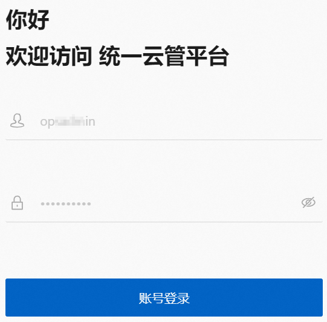
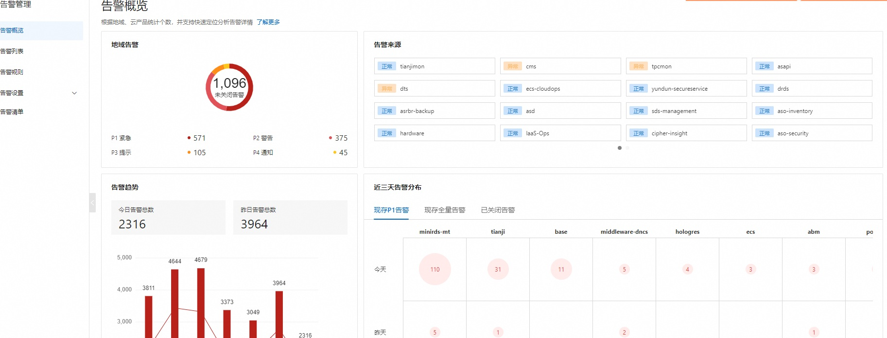
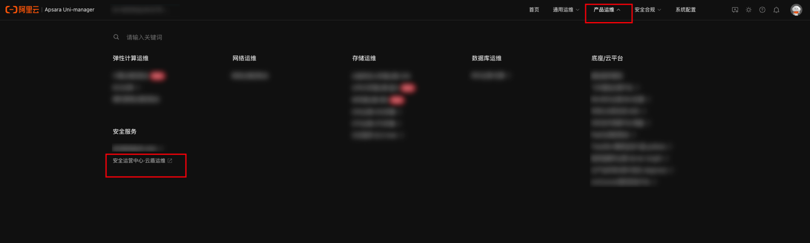
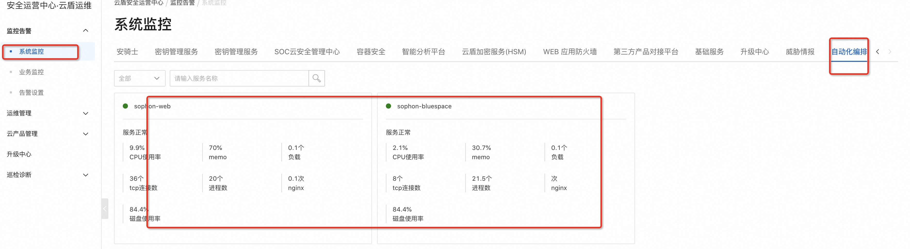
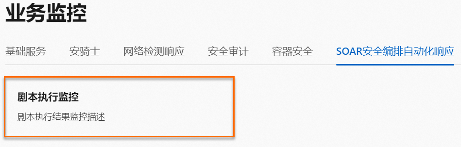
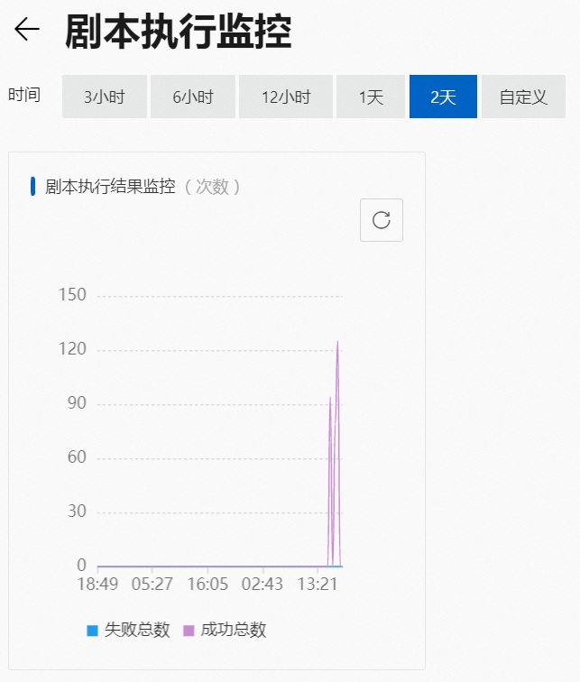
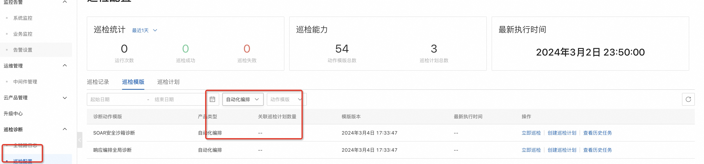
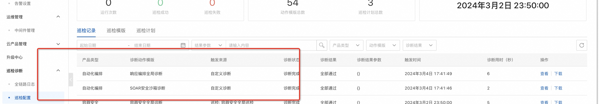

阿里云  
专有云  
云盾-态势感知  
安全编排自动化响应 运维指南  
产品版本：V3.18.6  
文档版本：20251217

**目录**

- [1.登录飞天基础运维平台](#section-1)
- [2.查看告警通知](#section-2)
- [3.查看监控大盘](#section-3)
- [4.查看巡检任务](#section-4)

# 1.登录飞天基础运维平台

本文介绍如何登录飞天基础运维平台。

**前提条件**

- 已从部署人员或管理员处获取Apsara Uni-manager运维控制台的访问地址、用户名和密码。

  Apsara Uni-manager运维控制台访问地址格式为*ops*.asconsole.*intranet-domain-id*.com。

- 推荐使用Chrome浏览器。

**操作步骤**

1. 打开浏览器。

2. 在地址栏中，输入Apsara Uni-manager运维控制台的访问地址*ops*.asconsole.*intranet-domain-id*.com，按回车键。

   

   > 您可以单击页面右上角的下拉按钮来进行语言切换。
   >
   > **说明**

3. 输入正确的用户名及密码。

   > 登录Apsara Uni-manager运维控制台的用户名和密码请从部署人员或管理员处获取。
   >
   > **说明**

   首次登录Apsara Uni-manager运维控制台时，需要修改登录用户名的密码，请按照提示完成密码修改。

   为提高安全性，密码必须满足以下要求：

   - 英文大小写字母

   - 阿拉伯数字（0~9）

   - 特殊符号，包括感叹号（！）、at（@）、井号（#）、美元符号（$）、百分号（%）等

   - 密码长度10~20个字符

4. 单击**登录**。

5. 在Apsara Uni-manager运维控制台的顶部菜单栏，选择**平台运维 > 飞天基础运维平台**。

# 2.查看告警通知

**操作步骤**

1. 登录飞天基础运维平台。

2. 在Apsara Uni-manager运维控制台的顶部菜单栏，选择**监控告警＞告警管理**＞**告警概览。**

3. 在告警管理左侧导航栏，查看服务的告警信息以及配置相关的告警通知。

   

# 3.查看监控大盘

**操作步骤**

1. 登录飞天基础运维平台。

2. 在Apsara Uni-manager运维控制台的顶部菜单栏，选择**产品运维＞安全运维＞云盾运维中心**。

   

3. 在左侧导航栏，选择**监控告警**＞**系统监控**。

4. 在**系统监控**页面，单击**自动化编排**页签，查看安全自动编排响应(SOAR)服务的CPU使用率，负载以及运行状态。

   

4. 在左侧导航栏，选择**监控告警 ＞ 业务监控。**

5. 在**系统监控**页面，单击**SOAR安全编排自动化响应**页签。

   

6. 单击**剧本执行监控**卡片，查看安全自动编排响应(SOAR)服务剧本运行的成功失败数量。

   

# 4.查看巡检任务

**操作步骤**

1. 登录飞天基础运维平台。

2. 在Apsara Uni-manager运维控制台的顶部菜单栏，选择**产品运维＞安全运维＞云盾运维中心**。

3. 在左侧导航栏，选择**巡检诊断**＞**巡检配置**。

4. 在**巡检模板**页面，选择自动化编排点击**立即巡检**。

   > **说明**
   >
   > 沙箱诊断，主要查询当前租户侧python沙箱的网络配置，是否符合预期。
   >
   > 全局诊断，主要巡检sophon-web和sophon-bluespace服务，系统资源的使用情况。

   

5. 切换至巡检记录，点击查看，查询巡检详细信息。

   
