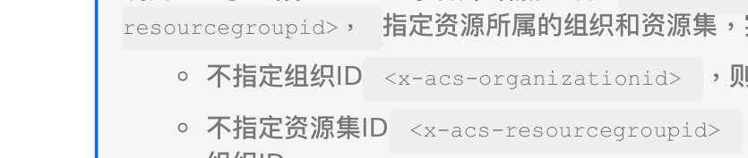
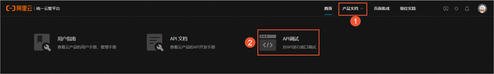
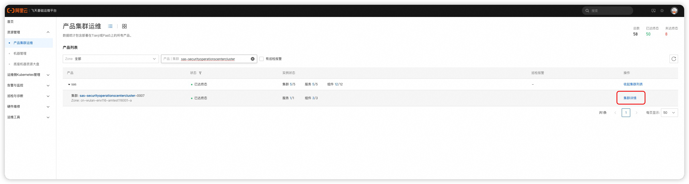
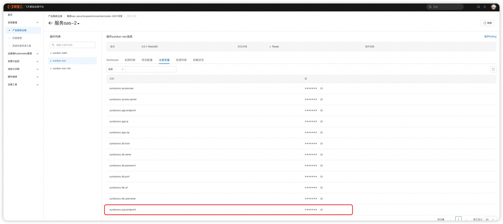

阿里云  
专有云  
云盾-态势感知  
漏洞扫描 开发指南  
产品版本：V3.18.6  
文档版本：20250627

**目录**

- [1.快速入门](#section-1)
    - [1.1. API调用流程说明](#section-1-1)
    - [1.2. 开发文档使用说明](#section-1-2)
- [2.准备工作](#section-2)
    - [2.1. 登录开发者门户控制台](#section-2-1)
    - [2.2. 查看API信息](#section-2-2)
    - [2.3. 获取AccessKey](#section-2-3)
    - [2.4. 获取STS AccessKey](#section-2-4)
    - [2.5. 获取Endpoint](#section-2-5)
- [3.调用示例](#section-3)
    - [3.1. Python SDK调用示例](#section-3-1)
        - [3.1.1. 快速开始](#section-3-1-1)
        - [3.1.2. 使用手册](#section-3-1-2)
            - [3.1.2.1. 安装Python SDK](#section-3-1-2-1)
            - [3.1.2.2. 使用CommonRequest进行调用](#section-3-1-2-2)
    - [3.2. Go SDK调用示例](#section-3-2)
        - [3.2.1. 快速开始](#section-3-2-1)
        - [3.2.2. 使用手册](#section-3-2-2)
            - [3.2.2.1. 安装Go SDK核心包](#section-3-2-2-1)
            - [3.2.2.2. 使用CommonRequest进行调用](#section-3-2-2-2)
- [4.API公共参数](#section-4)
- [5.漏洞扫描](#section-5)
    - [5.1. 任务模版相关接口](#section-5-1)
        - [5.1.1. TemplateAssetDetectionAdd](#section-5-1-1)
        - [5.1.2. TemplateListGetByType](#section-5-1-2)
        - [5.1.3. TemplateRiskScanAdd](#section-5-1-3)
        - [5.1.4. TemplateAssetDetectionDetail](#section-5-1-4)
        - [5.1.5. GetAssetImportTaskInfo](#section-5-1-5)
        - [5.1.6. GetRiskScanTaskTemplate](#section-5-1-6)
        - [5.1.7. TemplateDelete](#section-5-1-7)
        - [5.1.8. TemplateList](#section-5-1-8)
        - [5.1.9. TemplateRiskScanDetail](#section-5-1-9)
        - [5.1.10. TemplateWebMonitorConf](#section-5-1-10)
        - [5.1.11. BasicRiskOption](#section-5-1-11)
        - [5.1.12. GetCommonVulnItemList](#section-5-1-12)
    - [5.2. 任务相关接口](#section-5-2)
        - [5.2.1. BatchStartTasks](#section-5-2-1)
        - [5.2.2. TaskAssetScanCreate](#section-5-2-2)
        - [5.2.3. TaskList](#section-5-2-3)
        - [5.2.4. BatchStopTasks](#section-5-2-4)
        - [5.2.5. BatchDeleteTasks](#section-5-2-5)
        - [5.2.6. TaskProcessV2](#section-5-2-6)
        - [5.2.7. TaskStart](#section-5-2-7)
        - [5.2.8. TaskStop](#section-5-2-8)
        - [5.2.9. BatchSuspendTasks](#section-5-2-9)
        - [5.2.10. TaskProcess](#section-5-2-10)
        - [5.2.11. TaskRestart](#section-5-2-11)
        - [5.2.12. TaskDelete](#section-5-2-12)
        - [5.2.13. TaskRiskScanDetail](#section-5-2-13)
        - [5.2.14. GetAssetScanTaskInfo](#section-5-2-14)
        - [5.2.15. TaskAssetImportDetail](#section-5-2-15)
        - [5.2.16. TaskAssetScanDetail](#section-5-2-16)
        - [5.2.17. TaskAssetImportChildDetail](#section-5-2-17)
        - [5.2.18. CycleTaskAssetStats](#section-5-2-18)
        - [5.2.19. TaskAssetScanCycleRunning](#section-5-2-19)
        - [5.2.20. TaskAssetImport](#section-5-2-20)
        - [5.2.21. TaskRiskScanCreate](#section-5-2-21)
        - [5.2.22. TaskAssetImportDetailExists](#section-5-2-22)
        - [5.2.23. TaskQueueTaskDetail](#section-5-2-23)
        - [5.2.24. TaskAssetImportBaseInfo](#section-5-2-24)
        - [5.2.25. TaskRiskScanCycleRunning](#section-5-2-25)
        - [5.2.26. GetAssetRiskScanTaskInfo](#section-5-2-26)
        - [5.2.27. BatchRestartTasks](#section-5-2-27)
        - [5.2.28. TaskQueueTaskList](#section-5-2-28)
        - [5.2.29. TaskQueueTaskInfo](#section-5-2-29)
        - [5.2.30. TaskStatusStats](#section-5-2-30)
        - [5.2.31. TaskQueueTaskListDetail](#section-5-2-31)
        - [5.2.32. TaskRunTypeStats](#section-5-2-32)
        - [5.2.33. TaskQueueTaskCount](#section-5-2-33)
        - [5.2.34. SuspendStatus](#section-5-2-34)
- [6.安全审计](#section-6)
    - [6.1. GetData](#section-6-1)
    - [6.2. LouauditCleanData](#section-6-2)

<a id="section-1"></a>

# 1.快速入门

<a id="section-1-1"></a>

## 1.1. API调用流程说明

本文为您介绍在使用专有云API进行开发工作时，如何查看所需要的产品文档。

**使用流程**

您可以按照以下流程图中步骤，判断自己所需要使用的开发文档。


**前提条件**

通过运维人员或运营管理员获取专有云的版本。

**操作步骤**

您可以通过阿里云专有云文档中心，获取需要的产品文档。

1. 通过浏览器打开专有云文档中心。

2. 根据专有云的版本单击**飞天企业版**、**敏捷版&XStack**或**一体机**页签。

3. 在下拉列表中，选择对应的专有云版本。

   

4. 在左侧导航栏中，选择目标产品名称。

5. 单击目标文档区域的**查看详情**或**下载PDF**。

<a id="section-1-2"></a>

## 1.2. 开发文档使用说明

阿里云专有云支持通过POP网关调用专有云API，为了使您拥有与公有云一致的体验，自企业版V3.16.0开始，专有云API默认使用POP网关方式调用。本文介绍如何通过POP网关调用专有云API。

**流程图**


**调用步骤**

1. 获取AccessKey。

   获取调用时所需要的AccessKey参数，请参见获取AccessKey或获取STS AccessKey。

   > **说明**
   >
   > 推荐使用个人AccessKey或STS AccessKey调用Apsara Uni-manager运营控制台及云产品接口。

2. 获取RegionID。

3. 获取组织ID与资源集ID。

   组织ID需要通过API进行获取，获取方式请参见*Apsara Uni-manager运营控制台开发指南*中的*GetOrga nizationList章节*。

   资源集ID需要通过API进行获取，获取方式请参见*Apsara Uni-manager运营控制台开发指南*中的*ListRe sourceGroup章节*。

   > **说明**
   >
   > 调用API时，请在Header参数中增加组织ID `<x-acs-organizationid>` 和资源集ID `<x-acs-`



> `resourcegroupid>`， 指定资源所属的组织和资源集，实现实例资源的隔离查询。
>
> - 不指定组织ID `<x-acs-organizationid>` ，则默认获取当前用户所属的组织。
>
> - 不指定资源集ID `<x-acs-resourcegroupid>` ，则默认为空，如果指定资源集需要同时指定组织ID。

4. 获取对应的API参考文档。

   您需要查看目标云产品的开发指南，了解API的功能与使用方式，开发指南的使用流程及获取方法请参见开发文档使用说明。

5. 获取云产品Endpoint。

6. 获取云产品SDK并调用云产品API。

<a id="section-2"></a>

# 2.准备工作

<a id="section-2-1"></a>

## 2.1. 登录开发者门户控制台

您可以通过Apsara Uni-manager运营控制台登录开发者门户控制台。

**前提条件**

- 登录Apsara Uni-manager运营控制台前，确认您已从部署人员处获取Apsara Uni-manager运营控制台的服务域名地址。

- 推荐使用Chrome浏览器

**操作步骤**

1. 在浏览器地址栏中，输入Apsara Uni-manager运营控制台的服务域名地址，按回车键。

2. 输入正确的用户名及密码。

   请向运营管理员获取登录控制台的用户名和密码。

   > **说明**
   >
   > 首次登录Apsara Uni-manager运营控制台时，需要修改登录用户名的密码，请按照提示完成密码修改。为提高安全性，密码长度必须为10~32位，且至少包含以下两种类型：
   >
   > - 英文大写或小写字母（A~Z、a~z）
   >
   > - 阿拉伯数字（0~9）
   >
   > - 特殊符号（感叹号（!）、at（@）、井号（#）、美元符号（$）、百分号（%）等）

3. 单击**登录**。

4. 如果账号已激活MFA多因素认证，请根据以下两种情况进行操作：

   - 管理员强制开启MFA后的首次登录：

     <ol type="a">

     <li>

     在绑定虚拟MFA设备页面中，按页面提示步骤绑定MFA设备。

     </li>

     <li>

     按照步骤2重新输入账号和密码，单击**登录**。

     </li>

     </ol>

     <ol type="i" start="100">

     <li>

     输入6位MFA码后单击**认证**。

     </li>

     </ol>

   - 您已开启并绑定MFA：

     输入6位MFA码后单击**认证**。

     > **说明**
     >
     > 绑定并开启MFA的操作请参见<strong>《Apsara Uni-manager运营控制台用户指南》</strong>中的<strong>《绑定并开启虚拟MFA设备》</strong>章节。

5. 在页面顶部的菜单栏中，选择**产品 > 应用服务 > 开发者门户**。

<a id="section-2-2"></a>

## 2.2. 查看API信息

首先，您需要了解产品开放API接口的相关信息，包括产品名称（code）、开放API接口名称、API版本，在通过SDK调用API接口时需要填写上述信息。

**背景信息**

Apsara Uni-manager运营控制台API目录中的API信息仅供调用参考，具体API的使用方式需要参见云产品的开发指南。如果发生不一致情况，以开发指南支持情况为准。

**操作步骤**

1. 登录Apsara Uni-manager运营控制台。

2. 在顶部菜单栏单击

   图标，进入**帮助与开放平台**。

   

3. 在顶部菜单栏**产品文档**的下拉列表中，选择**API调试**。

   

4. 在左侧导航栏中选择目标云产品。在下方API列表中可浏览当前API版本中的所有API接口名称。若当前云产品存在多个API版本，可在**版本**下拉列表中，选择目标API版本。

<a id="section-2-3"></a>

## 2.3. 获取AccessKey

AccessKey支持RAM和STS两种授权模式，在发起调用时选择使用其中一种AccessKey即可。本文将为您介绍如何获取通过RAM授权的AccessKey。

**背景信息**

AccessKey通过使用AccessKey ID和AccessKey Secret对称加密，实现验证某个请求发送者的身份的功能。其中AccessKey ID用于标示用户，AccessKey Secret是用户用于加密签名的字符串。

AccessKey的两种授权模式如下：

- 通过RAM授权给第三方请求者的AccessKey ID和AccessKey Secret。

- 通过STS授权给第三方请求者的AccessKey ID、AccessKey Secret和Security Token。获取方式请参见获取STS AccessKey。

Apsara Uni-manager运营控制台提供了个人AccessKey和组织AccessKey（只有运营管理员和一级组织管理员可以获取组织AccessKey），推荐使用个人账号AccessKey调用Apsara Uni-manager运营控制台及云产品相关接口。如果使用个人账号AccessKey，需要在Header中添加以下限制性参数，否则可能提示权限不足：

> **警告**
>
> 个人账号AccessKey是由Apsara Uni-manager运营控制台权限体系管控的受限AccessKey，组织AccessKey相对权限较大，需要管理员确认操作的安全性。

<table>
  <tr>
    <th width="206">参数名称</th>
    <th>描述</th>
  </tr>
  <tr>
    <td>x-acs-regionid</td>
    <td>地域，如：cn-hangzhou-*。</td>
  </tr>
  <tr>
    <td>x-acs-organizationid</td>
    <td>Apsara Uni-manager运营控制台中对应的组织ID。获取方法可参见<strong>《Apsara Uni-manager运营控制台开</strong><strong>发指南》</strong>中的<strong>《GetOrganizationList》</strong>文档。</td>
  </tr>
  <tr>
    <td>x-acs-resourcegroupid</td>
    <td>Apsara Uni-manager运营控制台中对应的资源集ID。获取方法可参见<strong>《Apsara Uni-manager运营控制台</strong><strong>开发指南》</strong>中的<strong>《ListResourceGroup》</strong>文档。</td>
  </tr>
  <tr>
    <td>x-acs-instanceid</td>
    <td>进行操作的实例ID，例如，ECS的实例ID可以从ECS列表中查询到。</td>
  </tr>
</table>

**获取个人账号AccessKey**

获取个人账号AccessKey的方法如下：

1. 登录Apsara Uni-manager运营控制台。

2. 在系统界面右上角，单击当前登录用户头像，单击**个人信息**。

3. 在**阿里云AccessKey**区域，您可以查看个人账户的AccessKey信息。

   

   > **说明**
   >
   > Accesskey ID和AccessKey Secret是您访问云资源时的密钥，具有该账号完整的权限，请您妥善保管。

**获取组织AccessKey**

获取组织AccessKey的方法如下：

1. 管理员登录Apsara Uni-manager运营控制台。

2. 在顶部菜单栏，单击**企业**。

3. 在左侧导航栏中，选择**资源管理 > 组织管理**。

4. 在组织结构中，单击目标一级组织名称。

5. 单击**管理Accesskey**。

6. 在弹出的对话框中，查看组织AccessKey信息。

<a id="section-2-4"></a>

## 2.4. 获取STS AccessKey

本文为您介绍如何利用STS方式，调用专有云的产品API。

**背景信息**

阿里云临时安全令牌STS（Security Token Service）是阿里云提供的一种临时访问权限管理服务。您可以选择使用STS方式，调用专有云的产品API。

STS AccessKey由AccessKey ID、AccessKey Secret及Security Token三元组组成，使用STS方式调用云产品API时，三元组缺一不可。

**操作步骤**

1. 获取用户角色的 `RAM Role` 。

   <ol type="i">

   <li>

   登录Apsara Uni-manager运营控制台。

   </li>

   <li>

   单击页面右上角的用户头像，单击**个人信息**。

   </li>

   <li>

   单击**查看当前角色策略**。

   在**当前选择角色策略**对话框中查看 `RAM Role` 。

   </li>

   </ol>

2. 获取STS Accesskey三元组。

   > **说明**
   >
   > 以下代码示例中可变参数均需替换为您实际的相关信息，尖括号（<>）在最终代码中不保留。
   >
   > 涉及替换的可变参数如下：
   >
   > - &lt;yourRegionID>：请替换为您实际的地域ID。
   >
   > - &lt;yourAccessKeyID>：请替换为您实际的AccessKey ID。
   >
   > - &lt;yourAccessKeySecret>：请替换为您实际的AccessKey Secret。
   >
   > - &lt;yourRoleSessionName>：请替换为您当前实际的会话名称。
   >
   >   该名称为用户自定义，通常设置为调用该API的用户身份，例如：用户名。在同一个RAM角色执行的操作中，可以根据不同的 `RoleSessionName` 来区分实际操作者，以实现用户级别的访问审计。长度为2~64个字符，可包含英文字母、数字、半角句号（.）、at（@）、短划线（-）和下划线（_）。
   >
   > - &lt;yourRoleArn>：请替换为您实际的RAM Role。
   >
   > - "sts.aliyuns.com" ：请替换为实际的STS Endpoint。

   ```xml
   public static void main(String[] args) {
       // 创建DefaultAcsClient实例并初始化。
       // 请替换为您实际的地域ID、AccessKey ID、AccessKey Secret。
       DefaultProfile profile = DefaultProfile.getProfile("<yourRegionID>", "
   <yourAccessKeyID>", "<yourAccessKeySecret>");
       HttpClientConfig clientConfig = HttpClientConfig.getDefault();
       clientConfig.setIgnoreSSLCerts(true);
       clientConfig.setProtocolType(ProtocolType.HTTPS);
       profile.setHttpClientConfig(clientConfig);
       IAcsClient client = new DefaultAcsClient(profile);
       String assumeRole = callAssumeRole(client);
       if (StringUtils.isEmpty(assumeRole)) return;
       JSONObject assumeRoleJson = JSONObject.parseObject(assumeRole);
       JSONObject credentials = assumeRoleJson.getJSONObject("Credentials");
       // 获取到STS三元组。
       String stsAK = credentials.getString("AccessKeyId");
       String stsSK = credentials.getString("AccessKeySecret");
       String stsToken = credentials.getString("SecurityToken");
   }

   private static String callAssumeRole(IAcsClient client) {
       CommonRequest request = new CommonRequest();
       // "sts.aliyuns.com" 请替换为实际的STS Endpoint，⼀般格式为sts-
   vpc.${global:region}.${global:internet-domain}。
       request.setSysDomain("sts.aliyuns.com");
       request.setSysProduct("Sts");
       request.setSysAction("AssumeRole");
       request.setSysVersion("2015-04-01");
       request.setSysMethod(MethodType.POST);
       request.setHttpContentType(FormatType.FORM);
       // 业务参数，设置本次调⽤Session的别名，"<yourRoleSessionName>"请您替换为实际值。
       request.putQueryParameter("RoleSessionName", "<yourRoleSessionName>");
       // 扮演的Role⾓⾊ARN，"<yourRoleArn>"请替换为上⼀步获取到的实际Ram Role ARN。
       request.putQueryParameter("RoleArn", "<yourRoleArn>");
       try {
           CommonResponse response = client.getCommonResponse(request);
           return response.getData();
       } catch (ServerException e) {
           System.out.println(e.getErrCode());
           System.out.println(e.getErrMsg());
       } catch (ClientException e) {
           System.out.println(e.getErrCode());
           System.out.println(e.getErrMsg());
       }
       return null;
   }
   ```

3. 通过STS AccessKey三元组调用云产品的接口，下列代码以ECS的 `DescribeZones` 接口为示例。

   > **说明**
   >
   > 以下代码示例中可变参数均需替换为您实际的相关信息，尖括号（<>）在最终代码中不保留。
   >
   > 涉及替换的可变参数如下：
   >
   > - &lt;yourRegionID>：请替换为您实际的地域ID。
   >
   > - &lt;yourStsAccesskeyID>：请替换为您实际的STS Accesskey ID。
   >
   > - &lt;yourStsAccessKeySecret>：请替换为您实际的STS Accesskey Secret。
   >
   > - &lt;yourStsToken>：请替换为实际STS三元组中的SecurityToken。
   >
   > - &lt;yourResourceGroupID>：请替换为您实际的资源集ID。
   >
   > - &lt;yourOrganizationID>：请替换为您实际的组织ID。

   ```xml
   public static void main(String[] args) {
       // "<yourRegionID>"请替换为您实际的地域ID。
       // "<yourStsAccessKeyID>"、"<yourStsAccessKeySecret>"请替换为前⼀步获取到的STS三元组中
   AccessKeyID、AccessKeySecret。
       DefaultProfile profile = DefaultProfile.getProfile("<yourRegionID>", "
   <yourStsAccesskey>", "<yourStsAccessSecret>");
       HttpClientConfig clientConfig = HttpClientConfig.getDefault();
       clientConfig.setIgnoreSSLCerts(true);
       clientConfig.setProtocolType(ProtocolType.HTTPS);
       profile.setHttpClientConfig(clientConfig);
       IAcsClient client = new DefaultAcsClient(profile);
       CommonRequest request = new CommonRequest();
       request.setSysDomain("ecs.aliyuns.com");
       request.setSysProduct("Ecs");
       request.setSysAction("DescribeZones");
       request.setSysVersion("2014-05-26");
       request.setSysMethod(MethodType.POST);
       request.setHttpContentType(FormatType.FORM);
       //"<yourRegionID>" 请替换为您实际的地域ID。
       request.putHeadParameter("x-acs-regionid", "<yourRegionID>");
       // "<yourStsToken>" 请替换为您前⼀步获取到的STS三元组中SecurityToken。
       request.putQueryParameter("SecurityToken", "<yourStsToken>");
       // 非必填，请替换为您实际的资源集ID。
       // request.putHeadParameter("x-acs-resourcegroupid", "<yourResourceGroupID>");
       // 非必填，请替换为您实际的组织ID。
       request.putHeadParameter("x-acs-organizationid", "<yourOrganizationID>");
       try {
           CommonResponse response = client.getCommonResponse(request);
           System.out.println(response.getData());
       } catch (ServerException e) {
           System.out.println(e.getErrCode());
           System.out.println(e.getErrMsg());
       } catch (ClientException e) {
           System.out.println(e.getErrCode());
           System.out.println(e.getErrMsg());
       }
   }
   ```

<a id="section-2-5"></a>

## 2.5. 获取Endpoint

本文介绍如何获取云盾各产品的Endpoint。

**背景信息**

通过POP网关调用API时需要使用云产品业务域的Endpoint。您可以在阿里云驻场运维工程师处获取。您也可以通过如下方法自行获取Endpoint。

**操作步骤**

1. 登录飞天基础运维平台。

2. 在顶部菜单栏，选择**产品运维 > 飞天基础运维平台**。

3. 在左侧导航栏，单击**产品集群运维**。

4. 在**产品 | 集群**搜索框输入sas-securityoperationscentercluster，单击**集群详情**。

   

5. 在**服务列表**页签，单击服务名称。

6. 在**组件列表** 页点击 **yundun-soc** 组件，单击**注册变量**，搜索yundunsoc.pop.endpoint，对应的值即为业务域的Endpoint。

   

7. 云产品的Endpoint构成格式为：

   ```text
   ${EndpointPre}.${global:region}.${global:internet-domain}
   ```

<a id="section-3"></a>

# 3.调用示例

<a id="section-3-1"></a>

## 3.1. Python SDK调用示例

<a id="section-3-1-1"></a>

### 3.1.1. 快速开始

本节介绍如何获取Python SDK并开始调用。

**环境准备**

- 使用Python SDK前，您需要一个授权账号以及一对AccessKey ID和AccessKey Secret。具体信息，请参见获取AccessKey。

- 获取到Endpoint。具体操作，请参见获取Endpoint。

**安装Python SDK核心库**

- 如果您使用的是Python 2.x，执行以下命令，安装阿里云SDK核心库：

  ```bash
  pip install aliyun-python-sdk-core
  ```

- 如果您使用的是Python 3.x，执行以下命令，安装阿里云SDK核心库：

  ```bash
  pip3 install aliyun-python-sdk-core-v3
  ```

**使用Python SDK**

以下示例展示调用Python SDK的3个主要步骤：

1. 创建Client实例。

   在创建Client实例时，您需要获取Region ID、AccessKey ID和AccessKey Secret。

2. 创建API请求并设置参数。

3. 发起请求并处理应答或异常。

   > **说明**
   >
   > 以下代码示例中可变参数均需替换为您实际的相关信息，尖括号（<>）在最终代码中不保留。
   >
   > 涉及替换的可变参数如下：
   >
   > - &lt;your_region_id>，请替换为您实际的地域ID。
   >
   > - &lt;your_access_key_id>，请替换为您实际的AccessKey ID。
   >
   > - &lt;your_access_key_secret>，请替换为您实际的AccessKey Secret。
   >
   > - &lt;your-endpoint>，请替换为您实际的产品访问地址。
   >
   > - &lt;API-version>，请替换成接口的版本。
   >
   > - &lt;your-action>，请替换成接口的名称。

   ```python
   from aliyunsdkcore.client import AcsClient
   from aliyunsdkcore.request import
   CommonRequest
   client = AcsClient('{your_access_key_id}',
   '{your_access_key_secret}', '{your_region_id}')
   request = CommonRequest()
   request.set_domain('<your-endpoint>')// 当前产品的服务地址
   request.set_version('<API-version>')// 接⼝的版本
   request.set_action_name('<your-action>')// 接⼝的名称
   # or:
   # request =
   CommonRequest(domain='<your-endpoint>', version='<API-version>',
   action_name='<your-action>')
   request.add_query_param('PageNumber', '1')
   request.add_query_param('PageSize', '30')
   response =
   client.do_action_with_exception(request)

                       
   ```

<a id="section-3-1-2"></a>

### 3.1.2. 使用手册

<a id="section-3-1-2-1"></a>

#### 3.1.2.1. 安装Python SDK

本文档介绍如何安装及调用Python SDK。

<a id="section-3-1-2-2"></a>

#### 3.1.2.2. 使用CommonRequest进行调用

**CommonRequest调用特点**

CommonRequest的特点如下：

1. 轻量：只需Core包即可发起调用，无需下载安装各产品的SDK。

2. 简便：无需更新SDK即可调用最新发布的API。

3. 快速迭代。

**使用CommonRequest**

阿里云产品的API有RPC和RESTful两种风格，不同风格的API的CommonRequest的调用方法也不同。

通常API参数中包含Action参数的是RPC风格，包含PathPattern参数的是RESTful风格。一般情况下，每个产品内，所有API的调用风格是统一的。每个API仅支持特定的一种风格调用，传入错误的标识，可能会调用到其他API，或收到 `ApiNotFound` 的错误信息。

发起一次CommonRequest请求，您需要获取以下几个参数的值。关于以下参数的更多说明，请参见API公共参数。

- 接入点（endpoint）：该产品的服务地址。

- API版本（version）：该API的版本号，格式为YYYY-MM-DD。

- 接口信息：要调用的接口名称。

  - 当调用的API为RPC风格（大部分阿里云产品API为RPC风格，如Sas）时，需要获取Action参数，使用 `request.ApiName = "<Action>"` 的方式来指定API名称。

  - 当调用的API为RESTful风格（如容器服务）时，需要获取PathPattern参数，使用 `request.PathPattern = "<PathPattern>"` 的方式来指定RESTful路径。

**示例：调用RPC风格的API**

以下代码展示了如何使用CommonRequest的方式调用接口：

```python
from aliyunsdkcore.client import AcsClient
from aliyunsdkcore.request import CommonRequest
client = AcsClient('{your_access_key_id}', '{your_access_key_secret}', 
'{your_region_id}') 
request = CommonRequest()
request.set_domain('<YOUR-ENDPOINT>') //当前产品实际的Endpoint
request.set_version('<API-version>') //接⼝的版本
request.set_action_name('<YOUR-ACTION>')//接⼝的名称
# or: 
# request = CommonRequest(domain='<your-endpoint>', version='<API-version>', 
action_name='your-action')
request.add_query_param('PageNumber', '1')
request.add_query_param('PageSize', '30')
response = client.do_action_with_exception(request)
```

<a id="section-3-2"></a>

## 3.2. Go SDK调用示例

<a id="section-3-2-1"></a>

### 3.2.1. 快速开始

阿里云Go SDK让您不用复杂编程即可访问。本文介绍如何获取阿里云Go SDK并开始调用。

**环境准备**

- 使用Python SDK前，您需要一个授权账号以及一对AccessKey ID和AccessKey Secret。具体信息，请参见获取AccessKey，并在Apsara Uni-manager运营控制台上获取和查看您的AccessKey。

- 获取到Endpoint。具体操作，请参见获取Endpoint。

**安装阿里云Go SDK核心包**

阿里云Go SDK支持Go 1.10.x及更高版本，您可以通过执行以下命令安装Go SDK核心包。

```text
go get -u github.com/aliyun/alibaba-cloud-sdk-go/sdk
```

**使用Go SDK**

以下这个代码示例展示了调用阿里云Go SDK的3个主要步骤：

1. 初始化Client实例。

2. 创建API请求并设置参数。

3. 发起请求并处理应答或异常。

   > **说明**
   >
   > 以下代码示例中可变参数均需替换为您实际的相关信息，尖括号（<>）在最终代码中不保留。
   >
   > 涉及替换的可变参数如下：
   >
   > - &lt;your_region_id>，请替换为您实际的地域ID。
   >
   > - &lt;your_access_key_id>，请替换为您实际的AccessKey ID。
   >
   > - &lt;your_access_key_secret>，请替换为您实际的AccessKey Secret。
   >
   > - &lt;your-endpoint>，请替换为您实际的产品访问地址。
   >
   > - &lt;API-version>，请替换成接口的版本。
   >
   > - &lt;your-action>，请替换成接口的名称。

   ```go
   package main
   import (
   "github.com/aliyun/alibaba-cloud-sdk-go/sdk/requests"
   "github.com/aliyun/alibaba-cloud-sdk-go/sdk"
   "fmt"
   )
   func main() {
   client, err := sdk.NewClientWithAccessKey("<your_region_id>",
   "{your_access_key_id}", "{your_access_key_secret}")
   if err != nil {
   panic(err)
    }
    request
   := requests.NewCommonRequest()
   request.Domain = "<your-endpoint>"// 当前产品实际的Endpoint
   request.Version = "<API-version>"// 接⼝的版本
   request.ApiName = "<your-action>" // 接⼝的名称
   request.QueryParams["PageNumber"] = "1"
   request.QueryParams["PageSize"] = "30"
   response, err := client.ProcessCommonRequest(request)
   if err != nil {
   panic(err)
    }
   fmt.Print(response.GetHttpContentString())
   }
   ```

<a id="section-3-2-2"></a>

### 3.2.2. 使用手册

<a id="section-3-2-2-1"></a>

#### 3.2.2.1. 安装Go SDK核心包

本文档介绍如何安装 Go SDK核心包。

阿里云Go SDK支持Go 1.10.x及以上版本，您可以通过执行以下命令安装Go SDK核心包。

```text
go get -u github.com/aliyun/alibaba-cloud-sdk-go/sdk
```

<a id="section-3-2-2-2"></a>

#### 3.2.2.2. 使用CommonRequest进行调用

**CommonRequest调用特点**

CommonRequest的特点如下：

1. 轻量：只需Core包即可发起调用，无需下载安装各产品的SDK。

2. 简便：无需更新SDK即可调用最新发布的API。

3. 快速迭代。

**使用CommonRequest**

阿里云产品的API有RPC和RESTful两种风格，不同风格的API的CommonRequest的调用方法也不同。

通常API参数中包含Action参数的是RPC风格，包含PathPattern参数的是RESTful风格。一般情况下，每个产品内，所有API的调用风格是统一的。每个API仅支持特定的一种风格调用，传入错误的标识，可能会调用到其他API，或收到 `ApiNotFound` 的错误信息。

发起一次CommonRequest请求，您需要获取以下几个参数的值。关于以下参数的更多说明，请参见API公共参数。

- 接入点（endpoint）：该产品的服务地址。

- API版本（version）：该API的版本号，格式为YYYY-MM-DD。

- 接口信息：要调用的接口名称。

  - 当调用的API为RPC风格（大部分阿里云产品API为RPC风格，如Sas）时，需要获取Action参数，使用 `request.ApiName = "<Action>"` 的方式来指定API名称。

  - 当调用的API为RESTful风格（如容器服务）时，需要获取PathPattern参数，使用 `request.PathPattern = "<PathPattern>"` 的方式来指定RESTful路径。

**示例：使用RPC风格的API**

以下代码展示了如何使用CommonRequest的方式调用接口：

```go
package main
import (
    "github.com/aliyun/alibaba-cloud-sdk-go/sdk/requests"
    "github.com/aliyun/alibaba-cloud-sdk-go/sdk"
    "fmt"
)
func main() {
    client, err := sdk.NewClientWithAccessKey("cn-hangzhou", "{your_access_key_id}", "{
your_access_key_secret}")
    if err != nil {
        panic(err)
    }
    request := requests.NewCommonRequest()
    request.Domain = "<YOUR-ENDPOINT>"// 当前产品实际的Endpoint
    request.Version = "<API-version>"// 接⼝的版本
    request.ApiName = "<YOUR-ACTION>"// 接⼝的名称
    request.QueryParams["PageNumber"] = "1"
    request.QueryParams["PageSize"] = "30"
    response, err := client.ProcessCommonRequest(request)
    if err != nil {
        panic(err)
    }
    fmt.Print(response.GetHttpContentString())
}
```

<a id="section-4"></a>

# 4.API公共参数

**公共请求参数**

公共请求参数是每个接口调用都需要提供的请求参数。

表 1. 公共请求参数表

| 名称 | 类型 | 是否必须 | 描述 |
| --- | --- | --- | --- |
| Format | Strin g | 否 | 返回值的类型，仅支持JSON。 |
| Version | Strin g | 是 | API版本号，以日期形式YYYY-MM-DD输入，取值：<br>• <strong>2018-01-16：</strong>Auditprivate。<br>• <strong>2019-07-23：</strong>yundunnextsoc。<br>• <strong>2018-12-03：</strong>Sas。<br>• <strong>2016-11-11：</strong>aegis。<br>• <strong>2021-10-11：</strong>yundun-css。<br>• <strong>2019-08-05：</strong>secspy。<br>• <strong>2018-01-16：</strong>Ddosprivate。<br>• <strong>2018-06-30：</strong>hsm-private。<br>• <strong>2017-12-07：</strong>Cloudfw。<br>• <strong>2019-01-03：</strong>Sddp。<br>• <strong>2020-07-01：</strong>semawaf。<br>• <strong>2018-12-03：</strong>soar。 |
| AccessKeyId | Strin g | 是 | 访问服务使用的密钥ID。 |
| AccessKeySe cret | Strin g | 是 | 访问服务使用的密钥值。 |
| RegionId | Strin g | 是 | 服务所使用的地域ID。 |

<table>
  <tr>
    <td>Product</td>
    <td>Strin g</td>
    <td>是</td>
    <td>接口对应的产品名称。取值：<br>• <strong>Auditprivate</strong>：云盾基础组件。<br>• <strong>yundunnextsoc</strong>：云安全管理中心（SOC）。<br>• <strong>Sas</strong>：态势感知。<br>• <strong>aegis</strong>：安骑士。<br>• <strong>yundun-css</strong>：容器防护。<br>• <strong>secspy</strong>：网络流量检测与响应。<br>• <strong>Ddosprivate</strong>：DDos 清洗。<br>• <strong>hsm-private</strong>：加密服务。<br>• <strong>Cloudfw</strong>：云防火墙。<br>• <strong>Sddp</strong>：敏感数据保护。<br>• <strong>semawaf</strong>：Web应用防火墙。<br>• <strong>soar</strong>：云安全管理中心（SOC）-编排响应。</td>
  </tr>
  <tr>
    <td>EndpointPre</td>
    <td>Strin g</td>
    <td>是</td>
    <td>接口对应的域名前缀。取值：<br>• <strong>auditprivate</strong>：云盾基础组件。<br>• <strong>yundunnextsoc-pop</strong>：云安全管理中心（SOC）。<br>• <strong>tds</strong>：态势感知。<br>• <strong>aegis</strong>：安骑士。<br>• <strong>yundun-css</strong>：容器防护。<br>• <strong>secspy-share</strong>：网络流量检测与响应。<br>• <strong>ddosprivate</strong>：DDos 清洗。<br>• <strong>hsmprivate</strong>：加密服务。<br>• <strong>cloudfw</strong>：云防火墙。<br>• <strong>sddp-api</strong>：敏感数据保护。<br>• <strong>semawaf</strong>：Web应用防火墙。<br>• <strong>soar</strong>：云安全管理中心（SOC）-编排响应。</td>
  </tr>
</table>

**公共返回参数**

API返回结果采用统一格式，通过返回HTTP状态码来表示状态：

- 返回2xx HTTP状态码代表调用成功。

- 返回4xx或5xx HTTP状态码代表调用失败。

调用成功返回的数据格式为JSON，每次接口调用，无论成功与否，系统都会返回一个唯一识别码RequestId。

<a id="section-5"></a>

# 5.漏洞扫描

<a id="section-5-1"></a>

## 5.1. 任务模版相关接口

<a id="section-5-1-1"></a>

### 5.1.1. TemplateAssetDetectionAdd

调用TemplateAssetDetectionAdd接口v3.1.0 add template asset detection api。

**授权信息**

| 操作 | 访问级别 | 资源类型 |
| --- | --- | --- |
| yundun-scanner:TemplateAssetDetectio nAdd | undefined | acs:yundun-scanner:\*: {#accountId}:\* |

**流量控制**

- 单用户调用频率：10QPS。

- API调用频率：100QPS。

**请求头**

该接口使用公共请求头，无特殊请求头。请参见公共请求参数文档。

**请求参数**

| 参数名称 | 类型 | 位置 | 是否必选 | 示例 | 说明 |
| --- | --- | --- | --- | --- | --- |
| alive_port s | Strin g | Body | 否 |  | 探活端口。 |
| baseline | Integ er | Body | 否 | 1 | 基线id。 |
| baseline_r ule | Integ er | Body | 否 | 1 | baseline。 |
| custom_p ort | Strin g | Body | 否 |  | 附加端口。 |
| disable_su bdomain_api | Integ er | Body | 否 | 1 | 子域名接口查询。 |
| disable_su bdomain_dict | Integ er | Body | 否 | 1 | 子域名字典爆破。 |
| exclude_p orts | Strin g | Body | 否 |  | 排除端口。 |
| icmp_ech o | Integ er | Body | 否 | 1 | ICMP_ECHO。 |
| inherit_att rs | Integ er | Body | 否 | 1 | 自动同步资产信息。 |
| ip2domain | Integ er | Body | 否 | 1 | ip反查域名。 |
| ip_scan | Integ er | Body | 否 | 1 | 自动导入关联ip。 |
| name | Strin g | Body | 否 | 全量风险扫描模板 | 模版名称。 |
| no_status | Integ er | Body | 否 | 1 | asset scan。 |
| port_area | Strin g | Body | 否 | ALL | 端口范围。 |
| retry_time s | Integ er | Body | 否 | 1 | 重试次数。 |
| scan_spee d | Strin g | Body | 否 |  | 扫描速率。 |
| sctp | Integ er | Body | 否 | 1 | SCTP。 |
| spc_ports | Strin g | Body | 否 |  |  |
| sub_doma in_brute_r ate | Integ er | Body | 否 | 1 | 子域名爆破速率。 |
| sub_doma in_scan | Integ er | Body | 否 | 1 | 子域名查询。 |
| tcp_ack | Integ er | Body | 否 | 1 | TCP_ACK。 |
| tcp_syn | Integ er | Body | 否 | 1 | TCP_SYN。 |
| udp | Integ er | Body | 否 | 1 | UDP。 |
| vpc_id | Strin g | Body | 否 |  | vpcID。 |
| wait_time out | Integ er | Body | 否 | 1 | 3.4.1。 |

**返回数据**

| 参数名称 | 类型 | 示例 | 说明 |
| --- | --- | --- | --- |
| RequestId | String | F0A8A039-930D-5EC1-97C8-\*\*\*\*\*\*\*\*\*\*\*\* | 本次调用请求的ID，是由阿里云为该请求生成的唯一标识符，可用于排查和定位问题。 |
| data | Integer | 1 | Unknown。 |

**示例**

请求示例

```text
https://[Endpoint]/?Action=TemplateAssetDetectionAdd&RegionId=cn-
hangzhou&alive_ports=&baseline=1&baseline_rule=1&custom_port=&disable_subdomain_api=1&dis
le_subdomain_dict=1&exclude_ports=&icmp_echo=1&inherit_attrs=1&ip2domain=1&ip_scan=1&name
全量⻛险扫描模板
&no_status=1&port_area=ALL&retry_times=1&scan_speed=&sctp=1&sub_domain_brute_rate=1&sub_d
ain_scan=1&tcp_ack=1&tcp_syn=1&udp=1&vpc_id=&wait_timeout=1
```

正常返回示例

`JSON`  格式

```text
HTTP/1.1 200 OK
Content-Type:application/json

{
    "RequestId":"F0A8A039-930D-5EC1-97C8-************",
    "data":1
}
```

`XML`  格式

```xml
HTTP/1.1 200 OK
Content-Type:application/xml

<TemplateAssetDetectionAddResponse>
    <RequestId>F0A8A039-930D-5EC1-97C8-************</RequestId>
    <data>1</data>
</TemplateAssetDetectionAddResponse>
```

**错误码**

| HttpCo de | 错误码 | 错误信息 | 描述 |
| --- | --- | --- | --- |
| 500 | 100 | MissingParameter1001API | Parameter 1001API is mandatory for this action. |
| 500 |  | InternalError | The request processing has failed due to some unknown error. |

<a id="section-5-1-2"></a>

### 5.1.2. TemplateListGetByType

调用TemplateListGetByType接口v3.1.0 get template by id。

**授权信息**

| 操作 | 访问级别 | 资源类型 |
| --- | --- | --- |
| yundun-scanner:TemplateListGetByTyp e | undefined | acs:yundun-scanner:\*: {#accountId}:\* |

**流量控制**

- 单用户调用频率：10QPS。

- API调用频率：100QPS。

**请求头**

该接口使用公共请求头，无特殊请求头。请参见公共请求参数文档。

**请求参数**

| 参数名称 | 类型 | 位置 | 是否必选 | 示例 | 说明 |
| --- | --- | --- | --- | --- | --- |
| template_type | Integ er | Body | 否 | 1 | 模版类型 enum\[1:资产风险扫描模板类型\|4:可用性监控模板\|5:资产扫描模板\]。 |

**返回数据**

| 参数名称 | 类型 | 示例 | 说明 |
| --- | --- | --- | --- |
| data | Array |  |  |
| -create_tm | Integer |  | 创建时间。 |
| -creator | String |  | 创建者。 |
| -id | Integer |  | id。 |
| -is_default | Integer |  | 是否默认。 |
| -name | String |  | 模版名。 |
| -org_full_id | String |  | Unknown。 |
| -org_id | String |  | Unknown。 |
| -type | Integer |  | 模版类型。 |
| RequestId | String | F0A8A039-930D-5EC1-97C8-\*\*\*\*\*\*\*\*\*\*\*\* | 本次调用请求的ID，是由阿里云为该请求生成的唯一标识符，可用于排查和定位问题。 |

**示例**

请求示例

```text
https://[Endpoint]/?Action=TemplateListGetByType&RegionId=cn-hangzhou&template_type=1
```

正常返回示例

`JSON`  格式

```text
HTTP/1.1 200 OK
Content-Type:application/json

{
    "RequestId":"F0A8A039-930D-5EC1-97C8-************",
    "data":[
        {
            "creator":"",
            "create_tm":"",
            "org_id":"",
            "name":"",
            "id":"",
            "is_default":"",
            "type":"",
            "org_full_id":""
        }
    ]
}
```

`XML`  格式

```xml
HTTP/1.1 200 OK
Content-Type:application/xml

<TemplateListGetByTypeResponse>
    <RequestId>F0A8A039-930D-5EC1-97C8-************</RequestId>
    <data>
        <create_tm></create_tm>
        <creator></creator>
        <id></id>
        <is_default></is_default>
        <name></name>
        <org_full_id></org_full_id>
        <org_id></org_id>
        <type></type>
    </data>
</TemplateListGetByTypeResponse>
```

**错误码**

| HttpCo de | 错误码 | 错误信息 | 描述 |
| --- | --- | --- | --- |
| 500 | 100 | MissingParameter1001API | Parameter 1001API is mandatory for this action. |
| 500 |  | InternalError | The request processing has failed due to some unknown error. |

<a id="section-5-1-3"></a>

### 5.1.3. TemplateRiskScanAdd

调用TemplateRiskScanAdd接口v3.1.0 add risk_scan template api。

**授权信息**

| 操作 | 访问级别 | 资源类型 |
| --- | --- | --- |
| yundun-scanner:TemplateRiskScanAdd | undefined | acs:yundun-scanner:\*: {#accountId}:\* |

**流量控制**

- 单用户调用频率：10QPS。

- API调用频率：100QPS。

**请求头**

该接口使用公共请求头，无特殊请求头。请参见公共请求参数文档。

**请求参数**

| 参数名称 | 类型 | 位置 | 是否必选 | 示例 | 说明 |
| --- | --- | --- | --- | --- | --- |
| advanced _scan | Strin g | Body | 否 |  | 高级扫描配置。 |
| basic_sca n | Strin g | Body | 否 |  | 基础扫描配置。 |
| emergent _scan | Strin g | Body | 否 |  | 应急扫描配置。 |
| exclude_p orts | Strin g | Body | 否 |  | 排除端口。 |
| name | Strin g | Body | 否 | 全量风险扫描模板 | 模版名称。 |
| user_agen t | Strin g | Body | 否 |  | user_agent。 |
| vpc_id | Strin g | Body | 否 |  | vpcID。 |

**返回数据**

| 参数名称 | 类型 | 示例 | 说明 |
| --- | --- | --- | --- |
| RequestId | String | F0A8A039-930D-5EC1-97C8-\*\*\*\*\*\*\*\*\*\*\*\* | 本次调用请求的ID，是由阿里云为该请求生成的唯一标识符，可用于排查和定位问题。 |
| data | Integer | 1 | Unknown。 |

**示例**

请求示例

```text
https://[Endpoint]/?Action=TemplateRiskScanAdd&RegionId=cn-
hangzhou&advanced_scan=&basic_scan=&emergent_scan=&exclude_ports=&name=全量⻛险扫描模板&user_agent=&vpc_id=
```

正常返回示例

`JSON`  格式

```text
HTTP/1.1 200 OK
Content-Type:application/json

{
    "RequestId":"F0A8A039-930D-5EC1-97C8-************",
    "data":1
}
```

`XML`  格式

```xml
HTTP/1.1 200 OK
Content-Type:application/xml

<TemplateRiskScanAddResponse>
    <RequestId>F0A8A039-930D-5EC1-97C8-************</RequestId>
    <data>1</data>
</TemplateRiskScanAddResponse>
```

**错误码**

| HttpCo de | 错误码 | 错误信息 | 描述 |
| --- | --- | --- | --- |
| 500 | 100 | MissingParameter1001API | Parameter 1001API is mandatory for this action. |
| 500 |  | InternalError | The request processing has failed due to some unknown error. |

<a id="section-5-1-4"></a>

### 5.1.4. TemplateAssetDetectionDetail

调用TemplateAssetDetectionDetail接口v3.1.0 get template asset detection detail api。

**授权信息**

| 操作 | 访问级别 | 资源类型 |
| --- | --- | --- |
| yundun-scanner:TemplateAssetDetectio nDetail | undefined | acs:yundun-scanner:\*: {#accountId}:\* |

**流量控制**

- 单用户调用频率：10QPS。

- API调用频率：100QPS。

**请求头**

该接口使用公共请求头，无特殊请求头。请参见公共请求参数文档。

**请求参数**

| 参数名称 | 类型 | 位置 | 是否必选 | 示例 | 说明 |
| --- | --- | --- | --- | --- | --- |
| id | Integ er | Body | 否 | 1 | Unknown。 |

**返回数据**

| 参数名称 | 类型 | 示例 | 说明 |
| --- | --- | --- | --- |
| RequestId | String | F0A8A039-930D-5EC1-97C8-\*\*\*\*\*\*\*\*\*\*\*\* | 本次调用请求的ID，是由阿里云为该请求生成的唯一标识符，可用于排查和定位问题。 |
| alive_ports | String |  | 探活端口。 |
| baseline_id | Integer |  | 基线id。 |
| baseline_name | String |  | 基线名。 |
| baseline_rule | Integer |  | baseline。 |
| custom_port | String |  | 附加端口。 |
| disable_subdo main_api | Integer |  | 子域名接口查询。 |
| disable_subdo main_dict | Integer |  | 子域名字典爆破。 |
| exclude_ports | String |  | 排除端口。 |
| icmp_echo | Integer |  | ICMP_ECHO。 |
| inherit_attrs | Integer |  | 自动同步资产信息。 |
| ip2domain | Integer |  | ip反查域名。 |
| ip_scan | Integer |  | 自动导入关联ip。 |
| name | String |  | 名称。 |
| no_status | Integer |  | asset scan。 |
| opt | String |  | 选项。 |
| port_area | String |  | 端口范围。 |
| retry_times | Integer |  | 重试次数。 |
| scan_speed | String |  | 扫描速率。 |
| sctp | Integer |  | SCTP。 |
| sub_domain_b rute_rate | Integer |  | 子域名爆破速率。 |
| sub_domain_s can | Integer |  | 子域名查询。 |
| target_type | String |  | 目标类型。 |
| tcp_ack | Integer |  | TCP_ACK。 |
| tcp_syn | Integer |  | TCP_SYN。 |
| type | String |  | 类型。 |
| udp | Integer |  | UDP。 |
| value | String |  | 值。 |
| vpc_id | String |  | vpcID。 |
| wait_timeout | Integer |  | 3.4.1。 |

**示例**

请求示例

```text
https://[Endpoint]/?Action=TemplateAssetDetectionDetail&RegionId=cn-hangzhou&id=1
```

正常返回示例

`JSON`  格式

```text
HTTP/1.1 200 OK
Content-Type:application/json

{
    "RequestId":"F0A8A039-930D-5EC1-97C8-************",
    "alive_ports":"",
    "baseline_id":"",
    "baseline_name":"",
    "baseline_rule":"",
    "custom_port":"",
    "disable_subdomain_api":"",
    "disable_subdomain_dict":"",
    "exclude_ports":"",
    "icmp_echo":"",
    "inherit_attrs":"",
    "ip2domain":"",
    "ip_scan":"",
    "name":"",
    "no_status":"",
    "opt":"",
    "port_area":"",
    "retry_times":"",
    "scan_speed":"",
    "sctp":"",
    "sub_domain_brute_rate":"",
    "sub_domain_scan":"",
    "target_type":"",
    "tcp_ack":"",
    "tcp_syn":"",
    "type":"",
    "udp":"",
    "value":"",
    "vpc_id":"",
    "wait_timeout":""
}
```

`XML`  格式

```xml
HTTP/1.1 200 OK
Content-Type:application/xml

<TemplateAssetDetectionDetailResponse>
    <RequestId>F0A8A039-930D-5EC1-97C8-************</RequestId>
    <alive_ports></alive_ports>
    <baseline_id></baseline_id>
    <baseline_name></baseline_name>
    <baseline_rule></baseline_rule>
    <custom_port></custom_port>
    <disable_subdomain_api></disable_subdomain_api>
    <disable_subdomain_dict></disable_subdomain_dict>
    <exclude_ports></exclude_ports>
    <icmp_echo></icmp_echo>
    <inherit_attrs></inherit_attrs>
    <ip2domain></ip2domain>
    <ip_scan></ip_scan>
    <name></name>
    <no_status></no_status>
    <opt></opt>
    <port_area></port_area>
    <retry_times></retry_times>
    <scan_speed></scan_speed>
    <sctp></sctp>
    <sub_domain_brute_rate></sub_domain_brute_rate>
    <sub_domain_scan></sub_domain_scan>
    <target_type></target_type>
    <tcp_ack></tcp_ack>
    <tcp_syn></tcp_syn>
    <type></type>
    <udp></udp>
    <value></value>
    <vpc_id></vpc_id>
    <wait_timeout></wait_timeout>
</TemplateAssetDetectionDetailResponse>
```

**错误码**

| HttpCo de | 错误码 | 错误信息 | 描述 |
| --- | --- | --- | --- |
| 500 | 100 | MissingParameter1001API | Parameter 1001API is mandatory for this action. |
| 500 |  | InternalError | The request processing has failed due to some unknown error. |

<a id="section-5-1-5"></a>

### 5.1.5. GetAssetImportTaskInfo

调用GetAssetImportTaskInfo接口v3.1.0 get asset_import task info api。

**授权信息**

| 操作 | 访问级别 | 资源类型 |
| --- | --- | --- |
| yundun-scanner:GetAssetImportTaskInf o | undefined | acs:yundun-scanner:\*: {#accountId}:\* |

**流量控制**

- 单用户调用频率：10QPS。

- API调用频率：100QPS。

**请求头**

该接口使用公共请求头，无特殊请求头。请参见公共请求参数文档。

**请求参数**

| 参数名称 | 类型 | 位置 | 是否必选 | 示例 | 说明 |
| --- | --- | --- | --- | --- | --- |
| id | Integ er | Body | 否 | 1 | Unknown。 |

**返回数据**

| 参数名称 | 类型 | 示例 | 说明 |
| --- | --- | --- | --- |
| asset_list | String |  | 资产列表 1.1.1.1。 |
| tag_names | String |  | 标签。 |
| RequestId | String | F0A8A039-930D-5EC1-97C8-\*\*\*\*\*\*\*\*\*\*\*\* | 本次调用请求的ID，是由阿里云为该请求生成的唯一标识符，可用于排查和定位问题。 |
| group_id | Integer | 1 | 组别id。 |
| screen_shot | Integer | 1 | 是否开启网站截图 enum\[0:关闭\|1:开启\]。 |
| staff_id | Integer | 1 | 负责人id。 |
| task_name | String | test | 任务名称。 |
| template_id | Integer | 1 | 任务模板ID。 |

**示例**

请求示例

```text
https://[Endpoint]/?Action=GetAssetImportTaskInfo&RegionId=cn-hangzhou&id=1
```

正常返回示例

`JSON`  格式

```text
HTTP/1.1 200 OK
Content-Type:application/json

{
    "RequestId":"F0A8A039-930D-5EC1-97C8-************",
    "group_id":1,
    "screen_shot":1,
    "staff_id":1,
    "task_name":"test",
    "template_id":1
}
```

`XML`  格式

```xml
HTTP/1.1 200 OK
Content-Type:application/xml

<GetAssetImportTaskInfoResponse>
    <RequestId>F0A8A039-930D-5EC1-97C8-************</RequestId>
    <asset_list>
        <asset_list></asset_list>
    </asset_list>
    <group_id>1</group_id>
    <screen_shot>1</screen_shot>
    <staff_id>1</staff_id>
    <tag_names>
        <tag_name></tag_name>
    </tag_names>
    <task_name>test</task_name>
    <template_id>1</template_id>
</GetAssetImportTaskInfoResponse>
```

**错误码**

| HttpCo de | 错误码 | 错误信息 | 描述 |
| --- | --- | --- | --- |
| 500 | 100 | MissingParameter1001API | Parameter 1001API is mandatory for this action. |
| 500 |  | InternalError | The request processing has failed due to some unknown error. |

<a id="section-5-1-6"></a>

### 5.1.6. GetRiskScanTaskTemplate

调用GetRiskScanTaskTemplate接口获取风险扫描任务运行时的模版信息。

**授权信息**

| 操作 | 访问级别 | 资源类型 |
| --- | --- | --- |
| yundun-scanner:GetRiskScanTaskTempl ate | undefined | acs:yundun-scanner:\*: {#accountId}:\* |

**流量控制**

- 单用户调用频率：10QPS。

- API调用频率：100QPS。

**请求头**

该接口使用公共请求头，无特殊请求头。请参见公共请求参数文档。

**请求参数**

| 参数名称 | 类型 | 位置 | 是否必选 | 示例 | 说明 |
| --- | --- | --- | --- | --- | --- |
| id | Integ er | Body | 否 | 1 | Unknown。 |

**返回数据**

| 参数名称 | 类型 | 示例 | 说明 |
| --- | --- | --- | --- |
| exclude_ports | String |  | 排除端口。 |
| RequestId | String | F0A8A039-930D-5EC1-97C8-\*\*\*\*\*\*\*\*\*\*\*\* | 本次调用请求的ID，是由阿里云为该请求生成的唯一标识符，可用于排查和定位问题。 |
| advanced_sca n | Map |  | 高级扫描。 |
| basic_scan | Map |  | 基础扫描。 |
| emergent_sca n | Map |  | 应急扫描。 |
| name | String | 资产扫描模板-测试 | 名称。 |
| user_agent | String | xxx | UserAgent。 |

**示例**

请求示例

```text
https://[Endpoint]/?Action=GetRiskScanTaskTemplate&RegionId=cn-hangzhou&id=1
```

正常返回示例

`JSON`  格式

```text
HTTP/1.1 200 OK
Content-Type:application/json

{
    "RequestId":"F0A8A039-930D-5EC1-97C8-************",
    "advanced_scan":"",
    "basic_scan":"",
    "emergent_scan":"",
    "name":"资产扫描模板-测试",
    "user_agent":"xxx"
}
```

`XML`  格式

```xml
HTTP/1.1 200 OK
Content-Type:application/xml

<GetRiskScanTaskTemplateResponse>
    <RequestId>F0A8A039-930D-5EC1-97C8-************</RequestId>
    <advanced_scan></advanced_scan>
    <basic_scan></basic_scan>
    <emergent_scan></emergent_scan>
    <exclude_ports>
        <exclude_port></exclude_port>
    </exclude_ports>
    <name>资产扫描模板-测试</name>
    <user_agent>xxx</user_agent>
</GetRiskScanTaskTemplateResponse>
```

**错误码**

| HttpCo de | 错误码 | 错误信息 | 描述 |
| --- | --- | --- | --- |
| 500 | 100 | MissingParameter1001API | Parameter 1001API is mandatory for this action. |
| 500 |  | InternalError | The request processing has failed due to some unknown error. |

<a id="section-5-1-7"></a>

### 5.1.7. TemplateDelete

调用TemplateDelete接口v3.1.0 delete template api。

**授权信息**

| 操作 | 访问级别 | 资源类型 |
| --- | --- | --- |
| yundun-scanner:TemplateDelete | undefined | acs:yundun-scanner:\*: {#accountId}:\* |

**流量控制**

- 单用户调用频率：10QPS。

- API调用频率：100QPS。

**请求头**

该接口使用公共请求头，无特殊请求头。请参见公共请求参数文档。

**请求参数**

| 参数名称 | 类型 | 位置 | 是否必选 | 示例 | 说明 |
| --- | --- | --- | --- | --- | --- |
| ids | Strin g | Body | 否 |  | 模版id列表 example: \[85,86\]。 |

**返回数据**

| 参数名称 | 类型 | 示例 | 说明 |
| --- | --- | --- | --- |
| RequestId | String | F0A8A039-930D-5EC1-97C8-\*\*\*\*\*\*\*\*\*\*\*\* | 本次调用请求的ID，是由阿里云为该请求生成的唯一标识符，可用于排查和定位问题。 |
| status | String |  | 成功状态。 |

**示例**

请求示例

```text
https://[Endpoint]/?Action=TemplateDelete&RegionId=cn-hangzhou&ids=
```

正常返回示例

`JSON`  格式

```text
HTTP/1.1 200 OK
Content-Type:application/json

{
    "RequestId":"F0A8A039-930D-5EC1-97C8-************",
    "status":""
}
```

`XML`  格式

```xml
HTTP/1.1 200 OK
Content-Type:application/xml

<TemplateDeleteResponse>
    <RequestId>F0A8A039-930D-5EC1-97C8-************</RequestId>
    <status></status>
</TemplateDeleteResponse>
```

**错误码**

| HttpCo de | 错误码 | 错误信息 | 描述 |
| --- | --- | --- | --- |
| 500 | 100 | MissingParameter1001API | Parameter 1001API is mandatory for this action. |
| 500 |  | InternalError | The request processing has failed due to some unknown error. |

<a id="section-5-1-8"></a>

### 5.1.8. TemplateList

调用TemplateList接口v3.1.0 list all task templates。

**授权信息**

| 操作 | 访问级别 | 资源类型 |
| --- | --- | --- |
| yundun-scanner:TemplateList | undefined | acs:yundun-scanner:\*: {#accountId}:\* |

**流量控制**

- 单用户调用频率：10QPS。

- API调用频率：100QPS。

**请求头**

该接口使用公共请求头，无特殊请求头。请参见公共请求参数文档。

**请求参数**

| 参数名称 | 类型 | 位置 | 是否必选 | 示例 | 说明 |
| --- | --- | --- | --- | --- | --- |
| end_time | Strin g | Body | 否 | 2024-08-01 23:59:59 | 时间区间-结束。 |
| page | Integ er | Body | 否 | 1 | 页码。 |
| page_size | Integ er | Body | 否 | 10 | 页大小。 |
| search | Strin g | Body | 否 | 模版 | 搜索条件，支持模版名称的模糊查找。 |
| start_time | Strin g | Body | 否 | 2024-07-01 00:00:00 | 时间区间-开始。 |
| template_types | Strin g | Body | 否 |  | 模版类型 enum\[1:资产风险扫描模板类型\|4:可用性监控模板\|5:资产扫描模板\]。 |

**返回数据**

| 参数名称 | 类型 | 示例 | 说明 |
| --- | --- | --- | --- |
| results | Array |  |  |
| -create_tm | Integer |  | 创建时间。 |
| -creator | String |  | 创建者。 |
| -id | Integer |  | id。 |
| -is_default | Integer |  | 是否默认。 |
| -name | String |  | 模版名。 |
| -org_full_id | String |  | Unknown。 |
| -org_id | String |  | Unknown。 |
| -type | Integer |  | 模版类型。 |
| RequestId | String | F0A8A039-930D-5EC1-97C8-\*\*\*\*\*\*\*\*\*\*\*\* | 本次调用请求的ID，是由阿里云为该请求生成的唯一标识符，可用于排查和定位问题。 |
| count | Integer |  | 总数。 |

**示例**

请求示例

```text
https://[Endpoint]/?Action=TemplateList&RegionId=cn-hangzhou&end_time=2024-08-01 23:59:59&page=1&page_size=10&search=模版&start_time=2024-07-01 00:00:00&template_types=
```

正常返回示例

`JSON`  格式

```text
HTTP/1.1 200 OK
Content-Type:application/json

{
    "RequestId":"F0A8A039-930D-5EC1-97C8-************",
    "count":"",
    "results":[
        {
            "creator":"",
            "create_tm":"",
            "org_id":"",
            "name":"",
            "id":"",
            "is_default":"",
            "type":"",
            "org_full_id":""
        }
    ]
}
```

`XML`  格式

```xml
HTTP/1.1 200 OK
Content-Type:application/xml

<TemplateListResponse>
    <RequestId>F0A8A039-930D-5EC1-97C8-************</RequestId>
    <count></count>
    <results>
        <create_tm></create_tm>
        <creator></creator>
        <id></id>
        <is_default></is_default>
        <name></name>
        <org_full_id></org_full_id>
        <org_id></org_id>
        <type></type>
    </results>
</TemplateListResponse>
```

**错误码**

| HttpCo de | 错误码 | 错误信息 | 描述 |
| --- | --- | --- | --- |
| 500 | 100 | MissingParameter1001API | Parameter 1001API is mandatory for this action. |
| 500 |  | InternalError | The request processing has failed due to some unknown error. |

<a id="section-5-1-9"></a>

### 5.1.9. TemplateRiskScanDetail

调用TemplateRiskScanDetail接口v3.1.0 Get template risk_scan detail api。

**授权信息**

| 操作 | 访问级别 | 资源类型 |
| --- | --- | --- |
| yundun-scanner:TemplateRiskScanDeta il | undefined | acs:yundun-scanner:\*: {#accountId}:\* |

**流量控制**

- 单用户调用频率：10QPS。

- API调用频率：100QPS。

**请求头**

该接口使用公共请求头，无特殊请求头。请参见公共请求参数文档。

**请求参数**

| 参数名称 | 类型 | 位置 | 是否必选 | 示例 | 说明 |
| --- | --- | --- | --- | --- | --- |
| id | Integ er | Body | 否 | 1 | Unknown。 |

**返回数据**

| 参数名称 | 类型 | 示例 | 说明 |
| --- | --- | --- | --- |
| exclude_ports | String |  | 排除端口。 |
| RequestId | String | F0A8A039-930D-5EC1-97C8-\*\*\*\*\*\*\*\*\*\*\*\* | 本次调用请求的ID，是由阿里云为该请求生成的唯一标识符，可用于排查和定位问题。 |
| advanced_sca n | Map |  | 高级扫描。 |
| basic_scan | Map |  | 基础扫描。 |
| emergent_sca n | Map |  | 应急扫描。 |
| name | String | 资产扫描模板-测试 | 名称。 |
| user_agent | String | xxx | UserAgent。 |

**示例**

请求示例

```text
https://[Endpoint]/?Action=TemplateRiskScanDetail&RegionId=cn-hangzhou&id=1
```

正常返回示例

`JSON`  格式

```text
HTTP/1.1 200 OK
Content-Type:application/json

{
    "RequestId":"F0A8A039-930D-5EC1-97C8-************",
    "advanced_scan":"",
    "basic_scan":"",
    "emergent_scan":"",
    "name":"资产扫描模板-测试",
    "user_agent":"xxx"
}
```

`XML`  格式

```xml
HTTP/1.1 200 OK
Content-Type:application/xml

<TemplateRiskScanDetailResponse>
    <RequestId>F0A8A039-930D-5EC1-97C8-************</RequestId>
    <advanced_scan></advanced_scan>
    <basic_scan></basic_scan>
    <emergent_scan></emergent_scan>
    <exclude_ports>
        <exclude_port></exclude_port>
    </exclude_ports>
    <name>资产扫描模板-测试</name>
    <user_agent>xxx</user_agent>
</TemplateRiskScanDetailResponse>
```

**错误码**

| HttpCo de | 错误码 | 错误信息 | 描述 |
| --- | --- | --- | --- |
| 500 | 100 | MissingParameter1001API | Parameter 1001API is mandatory for this action. |
| 500 |  | InternalError | The request processing has failed due to some unknown error. |

<a id="section-5-1-10"></a>

### 5.1.10. TemplateWebMonitorConf

调用TemplateWebMonitorConf接口v3.1.0 get web_monitor config api。

**授权信息**

| 操作 | 访问级别 | 资源类型 |
| --- | --- | --- |
| yundun-scanner:TemplateWebMonitorC onf | undefined | acs:yundun-scanner:\*: {#accountId}:\* |

**流量控制**

- 单用户调用频率：10QPS。

- API调用频率：100QPS。

**请求头**

该接口使用公共请求头，无特殊请求头。请参见公共请求参数文档。

**返回数据**

| 参数名称 | 类型 | 示例 | 说明 |
| --- | --- | --- | --- |
| RequestId | String | F0A8A039-930D-5EC1-97C8-\*\*\*\*\*\*\*\*\*\*\*\* | 本次调用请求的ID，是由阿里云为该请求生成的唯一标识符，可用于排查和定位问题。 |
| default_crawl_depth | Integer |  | 默认爬虫深度。 |
| default_monito r_cycle | String |  | 默认监控周期。 |
| default_url_lim it | Integer |  | 默认URL限制。 |
| monitor_optio n | Map |  | 监控参数。 |
| scan_param | Map |  | 扫描参数。 |

**示例**

请求示例

```text
https://[Endpoint]/?Action=TemplateWebMonitorConf&RegionId=cn-hangzhou
```

正常返回示例

`JSON`  格式

```text
HTTP/1.1 200 OK
Content-Type:application/json

{
    "RequestId":"F0A8A039-930D-5EC1-97C8-************",
    "default_crawl_depth":"",
    "default_monitor_cycle":"",
    "default_url_limit":"",
    "monitor_option":"",
    "scan_param":""
}
```

`XML`  格式

```xml
HTTP/1.1 200 OK
Content-Type:application/xml

<TemplateWebMonitorConfResponse>
    <RequestId>F0A8A039-930D-5EC1-97C8-************</RequestId>
    <default_crawl_depth></default_crawl_depth>
    <default_monitor_cycle></default_monitor_cycle>
    <default_url_limit></default_url_limit>
    <monitor_option></monitor_option>
    <scan_param></scan_param>
</TemplateWebMonitorConfResponse>
```

**错误码**

| HttpCo de | 错误码 | 错误信息 | 描述 |
| --- | --- | --- | --- |
| 500 | 100 | MissingParameter1001API | Parameter 1001API is mandatory for this action. |
| 500 |  | InternalError | The request processing has failed due to some unknown error. |

<a id="section-5-1-11"></a>

### 5.1.11. BasicRiskOption

调用BasicRiskOption接口basic risk option api。

**授权信息**

| 操作 | 访问级别 | 资源类型 |
| --- | --- | --- |
| yundun-scanner:BasicRiskOption | undefined | acs:yundun-scanner:\*: {#accountId}:\* |

**流量控制**

- 单用户调用频率：10QPS。

- API调用频率：100QPS。

**请求头**

该接口使用公共请求头，无特殊请求头。请参见公共请求参数文档。

**请求参数**

| 参数名称 | 类型 | 位置 | 是否必选 | 示例 | 说明 |
| --- | --- | --- | --- | --- | --- |
| type | Integ er | Body | 否 |  | 风险扫描类型。 |

**返回数据**

| 参数名称 | 类型 | 示例 | 说明 |
| --- | --- | --- | --- |
| data | Array |  |  |
| -define | String |  | 定义。 |
| -name | String |  | 名称。 |
| RequestId | String | F0A8A039-930D-5EC1-97C8-\*\*\*\*\*\*\*\*\*\*\*\* | 本次调用请求的ID，是由阿里云为该请求生成的唯一标识符，可用于排查和定位问题。 |

**示例**

请求示例

```text
https://[Endpoint]/?Action=BasicRiskOption&RegionId=cn-hangzhou&type=
```

正常返回示例

`JSON`  格式

```text
HTTP/1.1 200 OK
Content-Type:application/json

{
    "RequestId":"F0A8A039-930D-5EC1-97C8-************",
    "data":[
        {
            "define":"",
            "name":""
        }
    ]
}
```

`XML`  格式

```xml
HTTP/1.1 200 OK
Content-Type:application/xml

<BasicRiskOptionResponse>
    <RequestId>F0A8A039-930D-5EC1-97C8-************</RequestId>
    <data>
        <define></define>
        <name></name>
    </data>
</BasicRiskOptionResponse>
```

**错误码**

| HttpCo de | 错误码 | 错误信息 | 描述 |
| --- | --- | --- | --- |
| 500 | 100 | MissingParameter1001API | Parameter 1001API is mandatory for this action. |
| 500 |  | InternalError | The request processing has failed due to some unknown error. |

<a id="section-5-1-12"></a>

### 5.1.12. GetCommonVulnItemList

调用GetCommonVulnItemList接口common_vuln_item_list api。

**授权信息**

| 操作 | 访问级别 | 资源类型 |
| --- | --- | --- |
| yundun-scanner:GetCommonVulnItemLi st | undefined | acs:yundun-scanner:\*: {#accountId}:\* |

**流量控制**

- 单用户调用频率：10QPS。

- API调用频率：100QPS。

**请求头**

该接口使用公共请求头，无特殊请求头。请参见公共请求参数文档。

**请求参数**

| 参数名称 | 类型 | 位置 | 是否必选 | 示例 | 说明 |
| --- | --- | --- | --- | --- | --- |
| general_ty pe | Strin g | Body | 否 |  | 类型。 |
| page | Integ er | Body | 否 |  | 页码。 |
| page_size | Integ er | Body | 否 |  | 列表数量。 |

**返回数据**

| 参数名称 | 类型 | 示例 | 说明 |
| --- | --- | --- | --- |
| results | Array |  |  |
| -module_count | Integer |  | 模块数量。 |
| -name | String |  | 漏洞名。 |
| -risk_count | Integer |  | 风险数。 |
| -status | Integer |  | 漏洞状态。 |
| RequestId | String | F0A8A039-930D-5EC1-97C8-\*\*\*\*\*\*\*\*\*\*\*\* | 本次调用请求的ID，是由阿里云为该请求生成的唯一标识符，可用于排查和定位问题。 |
| count | Integer |  | 分页数据条数。 |

**示例**

请求示例

```text
https://[Endpoint]/?Action=GetCommonVulnItemList&RegionId=cn-
hangzhou&general_type=&page=&page_size=
```

正常返回示例

`JSON`  格式

```text
HTTP/1.1 200 OK
Content-Type:application/json

{
    "RequestId":"F0A8A039-930D-5EC1-97C8-************",
    "count":"",
    "results":[
        {
            "risk_count":"",
            "module_count":"",
            "name":"",
            "status":""
        }
    ]
}
```

`XML`  格式

```xml
HTTP/1.1 200 OK
Content-Type:application/xml

<GetCommonVulnItemListResponse>
    <RequestId>F0A8A039-930D-5EC1-97C8-************</RequestId>
    <count></count>
    <results>
        <module_count></module_count>
        <name></name>
        <risk_count></risk_count>
        <status></status>
    </results>
</GetCommonVulnItemListResponse>
```

**错误码**

| HttpCo de | 错误码 | 错误信息 | 描述 |
| --- | --- | --- | --- |
| 500 | 100 | MissingParameter1001API | Parameter 1001API is mandatory for this action. |
| 500 |  | InternalError | The request processing has failed due to some unknown error. |

<a id="section-5-2"></a>

## 5.2. 任务相关接口

<a id="section-5-2-1"></a>

### 5.2.1. BatchStartTasks

调用BatchStartTasks接口v3.2.0 batch start task api。

**授权信息**

| 操作 | 访问级别 | 资源类型 |
| --- | --- | --- |
| yundun-scanner:BatchStartTasks | undefined | acs:yundun-scanner:\*: {#accountId}:\* |

**流量控制**

- 单用户调用频率：10QPS。

- API调用频率：100QPS。

**请求头**

该接口使用公共请求头，无特殊请求头。请参见公共请求参数文档。

**请求参数**

| 参数名称 | 类型 | 位置 | 是否必选 | 示例 | 说明 |
| --- | --- | --- | --- | --- | --- |
| end_time | Strin g | Body | 否 | 2020-01-01 00:00:00 | 结束时间。 |
| page | Integ er | Body | 否 | 1 | 页码。 |
| page_size | Integ er | Body | 否 | 10 | 页大小。 |
| parent_ta sk_id | Integ er | Body | 否 |  |  |
| run_types | Strin g | Body | 否 |  | 运行方式，cycle，once, immediately。 |
| search | Strin g | Body | 否 | 1_1_1_1_1 | 任务ID;任务名称；资产地址。 |
| start_time | Strin g | Body | 否 | 2020-01-01 00:00:00 | 开始时间。 |
| statuses | Strin g | Body | 否 |  | 任务状态 枚举值: RUNNING\|INIT\|FINISH\|ST OP。 |
| task_id | Integ er | Body | 否 | 1 | 任务id。 |
| task_ids | Strin g | Body | 否 |  | 任务id example:\[1,2,3\]。 |
| task_types | Strin g | Body | 否 |  | 任务类型 枚举值: assetImport\|assetRisk\|a ssetScan。 |
| template | Integ er | Body | 否 | 1 | 模版。 |

**返回数据**

| 参数名称 | 类型 | 示例 | 说明 |
| --- | --- | --- | --- |
| data | Array |  |  |
| -task_id | Integer | 173 | 任务ID。 |
| -task_instance_id | Integer | 208 | 任务实例ID。 |
| RequestId | String | F0A8A039-930D-5EC1-97C8-\*\*\*\*\*\*\*\*\*\*\*\* | 本次调用请求的ID，是由阿里云为该请求生成的唯一标识符，可用于排查和定位问题。 |

**示例**

请求示例

```text
https://[Endpoint]/?Action=BatchStartTasks&RegionId=cn-hangzhou&end_time=2020-01-01 00:00:00&page=1&page_size=10&run_types=&search=1_1_1_1_1&start_time=2020-01-01 
00:00:00&statuses=&task_id=1&task_ids=&task_types=&template=1
```

正常返回示例

`JSON`  格式

```text
HTTP/1.1 200 OK
Content-Type:application/json

{
    "RequestId":"F0A8A039-930D-5EC1-97C8-************",
    "data":[
        {
            "task_instance_id":208,
            "task_id":173
        }
    ]
}
```

`XML`  格式

```xml
HTTP/1.1 200 OK
Content-Type:application/xml

<BatchStartTasksResponse>
    <RequestId>F0A8A039-930D-5EC1-97C8-************</RequestId>
    <data>
        <task_id>173</task_id>
        <task_instance_id>208</task_instance_id>
    </data>
</BatchStartTasksResponse>
```

**错误码**

| HttpCo de | 错误码 | 错误信息 | 描述 |
| --- | --- | --- | --- |
| 500 | 100 | MissingParameter1001API | Parameter 1001API is mandatory for this action. |
| 500 |  | InternalError | The request processing has failed due to some unknown error. |

<a id="section-5-2-2"></a>

### 5.2.2. TaskAssetScanCreate

调用TaskAssetScanCreate接口v3.1.0 create asset_scan task api。

**授权信息**

| 操作 | 访问级别 | 资源类型 |
| --- | --- | --- |
| yundun-scanner:TaskAssetScanCreate | undefined | acs:yundun-scanner:\*: {#accountId}:\* |

**流量控制**

- 单用户调用频率：10QPS。

- API调用频率：100QPS。

**请求头**

该接口使用公共请求头，无特殊请求头。请参见公共请求参数文档。

**请求参数**

| 参数名称 | 类型 | 位置 | 是否必选 | 示例 | 说明 |
| --- | --- | --- | --- | --- | --- |
| cycle | Strin g | Body | 否 | SPEC | 周期SPEC，MONTH，WEEK。 |
| end_tm | Strin g | Body | 否 | 24:00 | 结束时间 24:00。 |
| is_immedi ately | Integ er | Body | 否 | 1 | 是否立即执行。 |
| month | Strin g | Body | 否 |  | 每月example:\[1,2\]。 |
| screen_sh ot | Integ er | Body | 否 | 1 | 屏幕截图 enum\[1\|0\]。 |
| spec_cycl e | Integ er | Body | 否 | 1 | 自定义天数。 |
| start_tm | Strin g | Body | 否 | 2023-09-14 16:36:18 | 开始时间 周期任务 00:00一次性任务 2023-09-14 16:36:18。 |
| targets | Strin g | Body | 否 |  | 检测目标 ALL_IP: 0/1 ALL_WEBSITE: 0/1 ALL_ASSET: 0/1 ALL_DOMAIN: 0/1 GROUP: \[1,2,3\] IP: \[1,2,3\] WEBSITE: \[1,2,3\] DOMAIN: \[1,2,3\]。 |
| task_nam e | Strin g | Body | 否 | 风险扫描任务-测试 | 任务名。 |
| template_i d | Integ er | Body | 否 | 1 | 模版id。 |
| vpc_id | Strin g | Body | 否 | 1 | vpc_id。 |
| week | Strin g | Body | 否 |  | 每周 example:\[1,2\]。 |

**返回数据**

| 参数名称 | 类型 | 示例 | 说明 |
| --- | --- | --- | --- |
| RequestId | String | F0A8A039-930D-5EC1-97C8-\*\*\*\*\*\*\*\*\*\*\*\* | 本次调用请求的ID，是由阿里云为该请求生成的唯一标识符，可用于排查和定位问题。 |
| data | Integer | 1 | Unknown。 |

**示例**

请求示例

```text
https://[Endpoint]/?Action=TaskAssetScanCreate&RegionId=cn-
hangzhou&cycle=SPEC&end_tm=24:00&is_immediately=1&month=&screen_shot=1&spec_cycle=1&start
m=2023-09-14 16:36:18&targets=&task_name=⻛险扫描任务-测试&template_id=1&vpc_id=1&week=
```

正常返回示例

`JSON`  格式

```text
HTTP/1.1 200 OK
Content-Type:application/json

{
    "RequestId":"F0A8A039-930D-5EC1-97C8-************",
    "data":1
}
```

`XML`  格式

```xml
HTTP/1.1 200 OK
Content-Type:application/xml

<TaskAssetScanCreateResponse>
    <RequestId>F0A8A039-930D-5EC1-97C8-************</RequestId>
    <data>1</data>
</TaskAssetScanCreateResponse>
```

**错误码**

| HttpCo de | 错误码 | 错误信息 | 描述 |
| --- | --- | --- | --- |
| 500 | 100 | MissingParameter1001API | Parameter 1001API is mandatory for this action. |
| 500 |  | InternalError | The request processing has failed due to some unknown error. |

<a id="section-5-2-3"></a>

### 5.2.3. TaskList

调用TaskList接口v3.1.0 list all task。

**授权信息**

| 操作 | 访问级别 | 资源类型 |
| --- | --- | --- |
| yundun-scanner:TaskList | undefined | acs:yundun-scanner:\*: {#accountId}:\* |

**流量控制**

- 单用户调用频率：10QPS。

- API调用频率：100QPS。

**请求头**

该接口使用公共请求头，无特殊请求头。请参见公共请求参数文档。

**请求参数**

| 参数名称 | 类型 | 位置 | 是否必选 | 示例 | 说明 |
| --- | --- | --- | --- | --- | --- |
| end_time | Strin g | Body | 否 | 2020-01-01 00:00:00 | 结束时间。 |
| page | Integ er | Body | 否 | 1 | 页码。 |
| page_size | Integ er | Body | 否 | 10 | 页大小。 |
| parent_ta sk_id | Integ er | Body | 否 |  |  |
| run_types | Strin g | Body | 否 |  | 运行方式，cycle，once, immediately。 |
| search | Strin g | Body | 否 | 1_1_1_1_1 | 任务ID;任务名称；资产地址。 |
| start_time | Strin g | Body | 否 | 2020-01-01 00:00:00 | 开始时间。 |
| statuses | Strin g | Body | 否 |  | 任务状态 枚举值: RUNNING\|INIT\|FINISH\|ST OP。 |
| task_id | Integ er | Body | 否 | 1 | 任务id。 |
| task_ids | Strin g | Body | 否 |  | 任务id example:\[1,2,3\]。 |
| task_types | Strin g | Body | 否 |  | 任务类型 枚举值: assetImport\|assetRisk\|a ssetScan。 |
| template | Integ er | Body | 否 | 1 | 模版。 |

**返回数据**

| 参数名称 | 类型 | 示例 | 说明 |
| --- | --- | --- | --- |
| results | Array |  |  |
| -asset_info | String |  | 资产信息 1.1.1.1。 |
| -creator | String | admin | 创建者。 |
| -cycle_count | Integer | 10 | 周期次数。 |
| -end_time | Integer | 1620000000 | 结束时间。 |
| -id | Integer | 1 | id。 |
| -inster_time | Integer | 1620000000 | 插入时间。 |
| -is_immediately | Integer | 1 | 是否立即执行 enum\[1:是\|0:否\]。 |
| -is_public_asset | Integer | 1 | 是否公网资产 enum\[1:是\|0:否\]。 |
| -process | String | 100% | 进度。 |
| -start_time | Integer | 1620000000 | 创建时间。 |
| -status | String | INIT | 状态 enum\[INIT:初始化\|RUNNING:运行\|FINISH:完成\|STOP:停止\]。 |
| -sub_type | Integer | 1 | 子类型。 |
| -task_cycle | Integer | 0 | 任务周期。 |
| -task_instance_id | Integer | 123 | 任务实例id。 |
| -task_name | String | 资产扫描任务-测试 | 任务名。 |
| -task_type | Integer | 6 | 任务类型。 |
| RequestId | String | F0A8A039-930D-5EC1-97C8-\*\*\*\*\*\*\*\*\*\*\*\* | 本次调用请求的ID，是由阿里云为该请求生成的唯一标识符，可用于排查和定位问题。 |
| count | Integer | 10 | 总数。 |

**示例**

请求示例

```text
https://[Endpoint]/?Action=TaskList&RegionId=cn-hangzhou&end_time=2020-01-01 00:00:00&page=1&page_size=10&run_types=&search=1_1_1_1_1&start_time=2020-01-01 
00:00:00&statuses=&task_id=1&task_ids=&task_types=&template=1
```

正常返回示例

`JSON`  格式

```text
HTTP/1.1 200 OK
Content-Type:application/json

{
    "RequestId":"F0A8A039-930D-5EC1-97C8-************",
    "count":10,
    "results":[
        {
            "cycle_count":10,
            "task_name":"资产扫描任务-测试",
            "creator":"admin",
            "process":"100%",
            "end_time":1620000000,
            "inster_time":1620000000,
            "is_public_asset":1,
            "task_instance_id":123,
            "start_time":1620000000,
            "task_cycle":0,
            "sub_type":1,
            "id":1,
            "is_immediately":1,
            "task_type":6,
            "status":"INIT"
        }
    ]
}
```

`XML`  格式

```xml
HTTP/1.1 200 OK
Content-Type:application/xml

<TaskListResponse>
    <RequestId>F0A8A039-930D-5EC1-97C8-************</RequestId>
    <count>10</count>
    <results>
        <asset_info>
            <asset_info></asset_info>
        </asset_info>
        <creator>admin</creator>
        <cycle_count>10</cycle_count>
        <end_time>1620000000</end_time>
        <id>1</id>
        <inster_time>1620000000</inster_time>
        <is_immediately>1</is_immediately>
        <is_public_asset>1</is_public_asset>
        <process>100%</process>
        <start_time>1620000000</start_time>
        <status>INIT</status>
        <sub_type>1</sub_type>
        <task_cycle>0</task_cycle>
        <task_instance_id>123</task_instance_id>
        <task_name>资产扫描任务-测试</task_name>
        <task_type>6</task_type>
    </results>
</TaskListResponse>
```

**错误码**

| HttpCo de | 错误码 | 错误信息 | 描述 |
| --- | --- | --- | --- |
| 500 | 100 | MissingParameter1001API | Parameter 1001API is mandatory for this action. |
| 500 |  | InternalError | The request processing has failed due to some unknown error. |

<a id="section-5-2-4"></a>

### 5.2.4. BatchStopTasks

调用BatchStopTasks接口v3.2.0 batch stop task api。

**授权信息**

| 操作 | 访问级别 | 资源类型 |
| --- | --- | --- |
| yundun-scanner:BatchStopTasks | undefined | acs:yundun-scanner:\*: {#accountId}:\* |

**流量控制**

- 单用户调用频率：10QPS。

- API调用频率：100QPS。

**请求头**

该接口使用公共请求头，无特殊请求头。请参见公共请求参数文档。

**请求参数**

| 参数名称 | 类型 | 位置 | 是否必选 | 示例 | 说明 |
| --- | --- | --- | --- | --- | --- |
| end_time | Strin g | Body | 否 | 2020-01-01 00:00:00 | 结束时间。 |
| page | Integ er | Body | 否 | 1 | 页码。 |
| page_size | Integ er | Body | 否 | 10 | 页大小。 |
| parent_ta sk_id | Integ er | Body | 否 |  |  |
| run_types | Strin g | Body | 否 |  | 运行方式，cycle，once, immediately。 |
| search | Strin g | Body | 否 | 1_1_1_1_1 | 任务ID;任务名称；资产地址。 |
| start_time | Strin g | Body | 否 | 2020-01-01 00:00:00 | 开始时间。 |
| statuses | Strin g | Body | 否 |  | 任务状态 枚举值: RUNNING\|INIT\|FINISH\|ST OP。 |
| task_id | Integ er | Body | 否 | 1 | 任务id。 |
| task_ids | Strin g | Body | 否 |  | 任务id example:\[1,2,3\]。 |
| task_types | Strin g | Body | 否 |  | 任务类型 枚举值: assetImport\|assetRisk\|a ssetScan。 |
| template | Integ er | Body | 否 | 1 | 模版。 |

**返回数据**

| 参数名称 | 类型 | 示例 | 说明 |
| --- | --- | --- | --- |
| RequestId | String | F0A8A039-930D-5EC1-97C8-\*\*\*\*\*\*\*\*\*\*\*\* | 本次调用请求的ID，是由阿里云为该请求生成的唯一标识符，可用于排查和定位问题。 |
| status | String |  | 成功状态。 |

**示例**

请求示例

```text
https://[Endpoint]/?Action=BatchStopTasks&RegionId=cn-hangzhou&end_time=2020-01-01 00:00:00&page=1&page_size=10&run_types=&search=1_1_1_1_1&start_time=2020-01-01 
00:00:00&statuses=&task_id=1&task_ids=&task_types=&template=1
```

正常返回示例

`JSON`  格式

```text
HTTP/1.1 200 OK
Content-Type:application/json

{
    "RequestId":"F0A8A039-930D-5EC1-97C8-************",
    "status":""
}
```

`XML`  格式

```xml
HTTP/1.1 200 OK
Content-Type:application/xml

<BatchStopTasksResponse>
    <RequestId>F0A8A039-930D-5EC1-97C8-************</RequestId>
    <status></status>
</BatchStopTasksResponse>
```

**错误码**

| HttpCo de | 错误码 | 错误信息 | 描述 |
| --- | --- | --- | --- |
| 500 | 100 | MissingParameter1001API | Parameter 1001API is mandatory for this action. |
| 500 |  | InternalError | The request processing has failed due to some unknown error. |

<a id="section-5-2-5"></a>

### 5.2.5. BatchDeleteTasks

调用BatchDeleteTasks接口v3.2.0 batch delete task api。

**授权信息**

| 操作 | 访问级别 | 资源类型 |
| --- | --- | --- |
| yundun-scanner:BatchDeleteTasks | undefined | acs:yundun-scanner:\*: {#accountId}:\* |

**流量控制**

- 单用户调用频率：10QPS。

- API调用频率：100QPS。

**请求头**

该接口使用公共请求头，无特殊请求头。请参见公共请求参数文档。

**请求参数**

| 参数名称 | 类型 | 位置 | 是否必选 | 示例 | 说明 |
| --- | --- | --- | --- | --- | --- |
| end_time | Strin g | Body | 否 | 2020-01-01 00:00:00 | 结束时间。 |
| page | Integ er | Body | 否 | 1 | 页码。 |
| page_size | Integ er | Body | 否 | 10 | 页大小。 |
| parent_ta sk_id | Integ er | Body | 否 |  |  |
| run_types | Strin g | Body | 否 |  | 运行方式，cycle，once, immediately。 |
| search | Strin g | Body | 否 | 1_1_1_1_1 | 任务ID;任务名称；资产地址。 |
| start_time | Strin g | Body | 否 | 2020-01-01 00:00:00 | 开始时间。 |
| statuses | Strin g | Body | 否 |  | 任务状态 枚举值: RUNNING\|INIT\|FINISH\|ST OP。 |
| task_id | Integ er | Body | 否 | 1 | 任务id。 |
| task_ids | Strin g | Body | 否 |  | 任务id example:\[1,2,3\]。 |
| task_types | Strin g | Body | 否 |  | 任务类型 枚举值: assetImport\|assetRisk\|a ssetScan。 |
| template | Integ er | Body | 否 | 1 | 模版。 |

**返回数据**

| 参数名称 | 类型 | 示例 | 说明 |
| --- | --- | --- | --- |
| RequestId | String | F0A8A039-930D-5EC1-97C8-\*\*\*\*\*\*\*\*\*\*\*\* | 本次调用请求的ID，是由阿里云为该请求生成的唯一标识符，可用于排查和定位问题。 |
| status | String |  | 成功状态。 |

**示例**

请求示例

```text
https://[Endpoint]/?Action=BatchDeleteTasks&RegionId=cn-hangzhou&end_time=2020-01-01 00:00:00&page=1&page_size=10&run_types=&search=1_1_1_1_1&start_time=2020-01-01 00:00:00&statuses=&task_id=1&task_ids=&task_types=&template=1
```

正常返回示例

`JSON`  格式

```text
HTTP/1.1 200 OK
Content-Type:application/json

{
    "RequestId":"F0A8A039-930D-5EC1-97C8-************",
    "status":""
}
```

`XML`  格式

```xml
HTTP/1.1 200 OK
Content-Type:application/xml

<BatchDeleteTasksResponse>
    <RequestId>F0A8A039-930D-5EC1-97C8-************</RequestId>
    <status></status>
</BatchDeleteTasksResponse>
```

**错误码**

| HttpCo de | 错误码 | 错误信息 | 描述 |
| --- | --- | --- | --- |
| 500 | 100 | MissingParameter1001API | Parameter 1001API is mandatory for this action. |
| 500 |  | InternalError | The request processing has failed due to some unknown error. |

<a id="section-5-2-6"></a>

### 5.2.6. TaskProcessV2

调用TaskProcessV2接口v3.1.0 get task process api v2。

**授权信息**

| 操作 | 访问级别 | 资源类型 |
| --- | --- | --- |
| yundun-scanner:TaskProcessV2 | undefined | acs:yundun-scanner:\*: {#accountId}:\* |

**流量控制**

- 单用户调用频率：10QPS。

- API调用频率：100QPS。

**请求头**

该接口使用公共请求头，无特殊请求头。请参见公共请求参数文档。

**请求参数**

| 参数名称 | 类型 | 位置 | 是否必选 | 示例 | 说明 |
| --- | --- | --- | --- | --- | --- |
| all | Boole an | Body | 否 | True | 是否全部enum\[true\|false\]。 |
| insert_tm_order | Integ er | Body | 否 | 1 | 插入时间排序 enum\[1\|-1\]。 |
| page | Integ er | Body | 否 | 1 | 页码。 |
| page_size | Integ er | Body | 否 | 10 | 页面数量。 |
| risk_type | Integ er | Body | 否 | 2 | 风险类型 enum\[2:安全漏洞\|3:合规漏洞\]。 |
| search | Strin g | Body | 否 | 1_1_1_1_1 | 搜索框。 |
| task_insta nce_id | Integ er | Body | 否 | 1 | 任务实例id。 |

**返回数据**

| 参数名称 | 类型 | 示例 | 说明 |
| --- | --- | --- | --- |
| results | Array |  |  |
| -insert_tm | Integer | 1620000000 | 插入时间。 |
| -risk_addr | String | http://1.1.1.1 | 风险地址。 |
| -risk_id | Integer | 1 | 风险id。 |
| -risk_level | String | LOW | 风险等级 enum\[LOW:低\|MEDIUM:中\|HIGH:高\]。 |
| -risk_name | String | xxx安全漏洞 | 风险名称。 |
| -risk_type | Integer | 3 | 风险类型 enum\[2:安全漏洞\|3:合规漏洞\]。 |
| RequestId | String | F0A8A039-930D-5EC1-97C8-\*\*\*\*\*\*\*\*\*\*\*\* | 本次调用请求的ID，是由阿里云为该请求生成的唯一标识符，可用于排查和定位问题。 |
| count | Integer |  | 总数。 |

**示例**

请求示例

```text
https://[Endpoint]/?Action=TaskProcessV2&RegionId=cn-
hangzhou&all=True&insert_tm_order=1&page=1&page_size=10&risk_type=2&search=1_1_1_1_1&task
nstance_id=1
```

正常返回示例

`JSON`  格式

```text
HTTP/1.1 200 OK
Content-Type:application/json

{
    "RequestId":"F0A8A039-930D-5EC1-97C8-************",
    "count":"",
    "results":[
        {
            "risk_addr":"http://1.1.1.1",
            "risk_level":"LOW",
            "risk_id":1,
            "risk_type":3,
            "insert_tm":1620000000,
            "risk_name":"xxx安全漏洞"
        }
    ]
}
```

`XML`  格式

```xml
HTTP/1.1 200 OK
Content-Type:application/xml

<TaskProcessV2Response>
    <RequestId>F0A8A039-930D-5EC1-97C8-************</RequestId>
    <count></count>
    <results>
        <insert_tm>1620000000</insert_tm>
        <risk_addr>http://1.1.1.1</risk_addr>
        <risk_id>1</risk_id>
        <risk_level>LOW</risk_level>
        <risk_name>xxx安全漏洞</risk_name>
        <risk_type>3</risk_type>
    </results>
</TaskProcessV2Response>
```

**错误码**

| HttpCo de | 错误码 | 错误信息 | 描述 |
| --- | --- | --- | --- |
| 500 | 100 | MissingParameter1001API | Parameter 1001API is mandatory for this action. |
| 500 |  | InternalError | The request processing has failed due to some unknown error. |

<a id="section-5-2-7"></a>

### 5.2.7. TaskStart

调用TaskStart接口v3.1.0 start task api。

**授权信息**

| 操作 | 访问级别 | 资源类型 |
| --- | --- | --- |
| yundun-scanner:TaskStart | undefined | acs:yundun-scanner:\*: {#accountId}:\* |

**流量控制**

- 单用户调用频率：10QPS。

- API调用频率：100QPS。

**请求头**

该接口使用公共请求头，无特殊请求头。请参见公共请求参数文档。

**请求参数**

| 参数名称 | 类型 | 位置 | 是否必选 | 示例 | 说明 |
| --- | --- | --- | --- | --- | --- |
| id | Integ er | Body | 否 | 1 | Unknown。 |

**返回数据**

| 参数名称 | 类型 | 示例 | 说明 |
| --- | --- | --- | --- |
| data | Array |  |  |
| -task_id | Integer | 173 | 任务ID。 |
| -task_instance_id | Integer | 208 | 任务实例ID。 |
| RequestId | String | F0A8A039-930D-5EC1-97C8-\*\*\*\*\*\*\*\*\*\*\*\* | 本次调用请求的ID，是由阿里云为该请求生成的唯一标识符，可用于排查和定位问题。 |

**示例**

请求示例

```text
https://[Endpoint]/?Action=TaskStart&RegionId=cn-hangzhou&id=1
```

正常返回示例

`JSON`  格式

```text
HTTP/1.1 200 OK
Content-Type:application/json

{
    "RequestId":"F0A8A039-930D-5EC1-97C8-************",
    "data":[
        {
            "task_instance_id":208,
            "task_id":173
        }
    ]
}
```

`XML`  格式

```xml
HTTP/1.1 200 OK
Content-Type:application/xml

<TaskStartResponse>
    <RequestId>F0A8A039-930D-5EC1-97C8-************</RequestId>
    <data>
        <task_id>173</task_id>
        <task_instance_id>208</task_instance_id>
    </data>
</TaskStartResponse>
```

**错误码**

| HttpCo de | 错误码 | 错误信息 | 描述 |
| --- | --- | --- | --- |
| 500 | 100 | MissingParameter1001API | Parameter 1001API is mandatory for this action. |
| 500 |  | InternalError | The request processing has failed due to some unknown error. |

<a id="section-5-2-8"></a>

### 5.2.8. TaskStop

调用TaskStop接口v3.1.0 stop task api。

**授权信息**

| 操作 | 访问级别 | 资源类型 |
| --- | --- | --- |
| yundun-scanner:TaskStop | undefined | acs:yundun-scanner:\*: {#accountId}:\* |

**流量控制**

- 单用户调用频率：10QPS。

- API调用频率：100QPS。

**请求头**

该接口使用公共请求头，无特殊请求头。请参见公共请求参数文档。

**请求参数**

| 参数名称 | 类型 | 位置 | 是否必选 | 示例 | 说明 |
| --- | --- | --- | --- | --- | --- |
| id | Integ er | Body | 否 | 1 | Unknown。 |

**返回数据**

| 参数名称 | 类型 | 示例 | 说明 |
| --- | --- | --- | --- |
| RequestId | String | F0A8A039-930D-5EC1-97C8-\*\*\*\*\*\*\*\*\*\*\*\* | 本次调用请求的ID，是由阿里云为该请求生成的唯一标识符，可用于排查和定位问题。 |
| status | String |  | 成功状态。 |

**示例**

请求示例

```text
https://[Endpoint]/?Action=TaskStop&RegionId=cn-hangzhou&id=1
```

正常返回示例

`JSON`  格式

```text
HTTP/1.1 200 OK
Content-Type:application/json

{
    "RequestId":"F0A8A039-930D-5EC1-97C8-************",
    "status":""
}
```

`XML`  格式

```xml
HTTP/1.1 200 OK
Content-Type:application/xml

<TaskStopResponse>
    <RequestId>F0A8A039-930D-5EC1-97C8-************</RequestId>
    <status></status>
</TaskStopResponse>
```

**错误码**

| HttpCo de | 错误码 | 错误信息 | 描述 |
| --- | --- | --- | --- |
| 500 | 100 | MissingParameter1001API | Parameter 1001API is mandatory for this action. |
| 500 |  | InternalError | The request processing has failed due to some unknown error. |

<a id="section-5-2-9"></a>

### 5.2.9. BatchSuspendTasks

调用BatchSuspendTasks接口批量停止任务。

**授权信息**

| 操作 | 访问级别 | 资源类型 |
| --- | --- | --- |
| yundun-scanner:BatchSuspendTasks | undefined | acs:yundun-scanner:\*: {#accountId}:\* |

**流量控制**

- 单用户调用频率：10QPS。

- API调用频率：100QPS。

**请求头**

该接口使用公共请求头，无特殊请求头。请参见公共请求参数文档。

**请求参数**

| 参数名称 | 类型 | 位置 | 是否必选 | 示例 | 说明 |
| --- | --- | --- | --- | --- | --- |
| end_time | Strin g | Body | 否 | 2020-01-01 00:00:00 | 结束时间。 |
| page | Integ er | Body | 否 | 1 | 页码。 |
| page_size | Integ er | Body | 否 | 10 | 页大小。 |
| parent_ta sk_id | Integ er | Body | 否 |  |  |
| run_types | Strin g | Body | 否 |  | 运行方式，cycle，once, immediately。 |
| search | Strin g | Body | 否 | 1_1_1_1_1 | 任务ID;任务名称；资产地址。 |
| start_time | Strin g | Body | 否 | 2020-01-01 00:00:00 | 开始时间。 |
| statuses | Strin g | Body | 否 |  | 任务状态 枚举值: RUNNING\|INIT\|FINISH\|ST OP。 |
| task_id | Integ er | Body | 否 | 1 | 任务id。 |
| task_ids | Strin g | Body | 否 |  | 任务id example:\[1,2,3\]。 |
| task_types | Strin g | Body | 否 |  | 任务类型 枚举值: assetImport\|assetRisk\|a ssetScan。 |
| template | Integ er | Body | 否 | 1 | 模版。 |

**返回数据**

| 参数名称 | 类型 | 示例 | 说明 |
| --- | --- | --- | --- |
| RequestId | String | F0A8A039-930D-5EC1-97C8-\*\*\*\*\*\*\*\*\*\*\*\* | 本次调用请求的ID，是由阿里云为该请求生成的唯一标识符，可用于排查和定位问题。 |
| status | String |  | 成功状态。 |

**示例**

请求示例

```text
https://[Endpoint]/?Action=BatchSuspendTasks&RegionId=cn-hangzhou&end_time=2020-01-01 00:00:00&page=1&page_size=10&run_types=&search=1_1_1_1_1&start_time=2020-01-01 00:00:00&statuses=&task_id=1&task_ids=&task_types=&template=1
```

正常返回示例

`JSON`  格式

```text
HTTP/1.1 200 OK
Content-Type:application/json

{
    "RequestId":"F0A8A039-930D-5EC1-97C8-************",
    "status":""
}
```

`XML`  格式

```xml
HTTP/1.1 200 OK
Content-Type:application/xml

<BatchSuspendTasksResponse>
    <RequestId>F0A8A039-930D-5EC1-97C8-************</RequestId>
    <status></status>
</BatchSuspendTasksResponse>
```

**错误码**

| HttpCo de | 错误码 | 错误信息 | 描述 |
| --- | --- | --- | --- |
| 500 | 100 | MissingParameter1001API | Parameter 1001API is mandatory for this action. |
| 500 |  | InternalError | The request processing has failed due to some unknown error. |

<a id="section-5-2-10"></a>

### 5.2.10. TaskProcess

调用TaskProcess接口v3.1.0 get task process api。

**授权信息**

| 操作 | 访问级别 | 资源类型 |
| --- | --- | --- |
| yundun-scanner:TaskProcess | undefined | acs:yundun-scanner:\*: {#accountId}:\* |

**流量控制**

- 单用户调用频率：10QPS。

- API调用频率：100QPS。

**请求头**

该接口使用公共请求头，无特殊请求头。请参见公共请求参数文档。

**请求参数**

| 参数名称 | 类型 | 位置 | 是否必选 | 示例 | 说明 |
| --- | --- | --- | --- | --- | --- |
| all | Boole an | Body | 否 | True | 是否全部enum\[true\|false\]。 |
| insert_tm_order | Integ er | Body | 否 | 1 | 插入时间排序 enum\[1\|-1\]。 |
| page | Integ er | Body | 否 | 1 | 页码。 |
| page_size | Integ er | Body | 否 | 10 | 页面数量。 |
| risk_type | Integ er | Body | 否 | 2 | 风险类型 enum\[2:安全漏洞\|3:合规漏洞\]。 |
| search | Strin g | Body | 否 | 1_1_1_1_1 | 搜索框。 |
| task_insta nce_id | Integ er | Body | 否 | 1 | 任务实例id。 |

**返回数据**

| 参数名称 | 类型 | 示例 | 说明 |
| --- | --- | --- | --- |
| results | Array |  |  |
| -asset_id | Integer | 1 | 资产ID。 |
| -behavior | String | 检测网站：.... | 行为。 |
| -id | Integer | 1 | ID。 |
| -insert_tm | Integer | 1620000000 | 插入时间。 |
| -is_deleted | Integer | 0 | 是否删除 enum\[1:是\|0:否\]。 |
| -risk_id | Integer | 1 | 风险ID。 |
| RequestId | String | F0A8A039-930D-5EC1-97C8-\*\*\*\*\*\*\*\*\*\*\*\* | 本次调用请求的ID，是由阿里云为该请求生成的唯一标识符，可用于排查和定位问题。 |
| count | Integer |  | 分页数据条数。 |

**示例**

请求示例

```text
https://[Endpoint]/?Action=TaskProcess&RegionId=cn-
hangzhou&all=True&insert_tm_order=1&page=1&page_size=10&risk_type=2&search=1_1_1_1_1&task
nstance_id=1
```

正常返回示例

`JSON`  格式

```text
HTTP/1.1 200 OK
Content-Type:application/json

{
    "RequestId":"F0A8A039-930D-5EC1-97C8-************",
    "count":"",
    "results":[
        {
            "risk_id":1,
            "is_deleted":0,
            "insert_tm":1620000000,
            "asset_id":1,
            "id":1,
            "behavior":"检测⽹站：...."
        }
    ]
}
```

`XML`  格式

```xml
HTTP/1.1 200 OK
Content-Type:application/xml

<TaskProcessResponse>
    <RequestId>F0A8A039-930D-5EC1-97C8-************</RequestId>
    <count></count>
    <results>
        <asset_id>1</asset_id>
        <behavior>检测⽹站：....</behavior>
        <id>1</id>
        <insert_tm>1620000000</insert_tm>
        <is_deleted>0</is_deleted>
        <risk_id>1</risk_id>
    </results>
</TaskProcessResponse>
```

**错误码**

| HttpCo de | 错误码 | 错误信息 | 描述 |
| --- | --- | --- | --- |
| 500 | 100 | MissingParameter1001API | Parameter 1001API is mandatory for this action. |
| 500 |  | InternalError | The request processing has failed due to some unknown error. |

<a id="section-5-2-11"></a>

### 5.2.11. TaskRestart

调用TaskRestart接口v3.1.0 restart task api。

**授权信息**

| 操作 | 访问级别 | 资源类型 |
| --- | --- | --- |
| yundun-scanner:TaskRestart | undefined | acs:yundun-scanner:\*: {#accountId}:\* |

**流量控制**

- 单用户调用频率：10QPS。

- API调用频率：100QPS。

**请求头**

该接口使用公共请求头，无特殊请求头。请参见公共请求参数文档。

**请求参数**

| 参数名称 | 类型 | 位置 | 是否必选 | 示例 | 说明 |
| --- | --- | --- | --- | --- | --- |
| id | Integ er | Body | 否 | 1 | Unknown。 |

**返回数据**

| 参数名称 | 类型 | 示例 | 说明 |
| --- | --- | --- | --- |
| data | Array |  |  |
| -task_id | Integer | 173 | 任务ID。 |
| -task_instance_id | Integer | 208 | 任务实例ID。 |
| RequestId | String | F0A8A039-930D-5EC1-97C8-\*\*\*\*\*\*\*\*\*\*\*\* | 本次调用请求的ID，是由阿里云为该请求生成的唯一标识符，可用于排查和定位问题。 |

**示例**

请求示例

```text
https://[Endpoint]/?Action=TaskRestart&RegionId=cn-hangzhou&id=1
```

正常返回示例

`JSON`  格式

```text
HTTP/1.1 200 OK
Content-Type:application/json

{
    "RequestId":"F0A8A039-930D-5EC1-97C8-************",
    "data":[
        {
            "task_instance_id":208,
            "task_id":173
        }
    ]
}
```

`XML`  格式

```xml
HTTP/1.1 200 OK
Content-Type:application/xml

<TaskRestartResponse>
    <RequestId>F0A8A039-930D-5EC1-97C8-************</RequestId>
    <data>
        <task_id>173</task_id>
        <task_instance_id>208</task_instance_id>
    </data>
</TaskRestartResponse>
```

**错误码**

| HttpCo de | 错误码 | 错误信息 | 描述 |
| --- | --- | --- | --- |
| 500 | 100 | MissingParameter1001API | Parameter 1001API is mandatory for this action. |
| 500 |  | InternalError | The request processing has failed due to some unknown error. |

<a id="section-5-2-12"></a>

### 5.2.12. TaskDelete

调用TaskDelete接口v3.1.0 delete task api。

**授权信息**

| 操作 | 访问级别 | 资源类型 |
| --- | --- | --- |
| yundun-scanner:TaskDelete | undefined | acs:yundun-scanner:\*: {#accountId}:\* |

**流量控制**

- 单用户调用频率：10QPS。

- API调用频率：100QPS。

**请求头**

该接口使用公共请求头，无特殊请求头。请参见公共请求参数文档。

**请求参数**

| 参数名称 | 类型 | 位置 | 是否必选 | 示例 | 说明 |
| --- | --- | --- | --- | --- | --- |
| id | Integ er | Body | 否 | 1 | Unknown。 |

**返回数据**

| 参数名称 | 类型 | 示例 | 说明 |
| --- | --- | --- | --- |
| RequestId | String | F0A8A039-930D-5EC1-97C8-\*\*\*\*\*\*\*\*\*\*\*\* | 本次调用请求的ID，是由阿里云为该请求生成的唯一标识符，可用于排查和定位问题。 |
| status | String |  | 成功状态。 |

**示例**

请求示例

```text
https://[Endpoint]/?Action=TaskDelete&RegionId=cn-hangzhou&id=1
```

正常返回示例

`JSON`  格式

```text
HTTP/1.1 200 OK
Content-Type:application/json

{
    "RequestId":"F0A8A039-930D-5EC1-97C8-************",
    "status":""
}
```

`XML`  格式

```xml
HTTP/1.1 200 OK
Content-Type:application/xml

<TaskDeleteResponse>
    <RequestId>F0A8A039-930D-5EC1-97C8-************</RequestId>
    <status></status>
</TaskDeleteResponse>
```

**错误码**

| HttpCo de | 错误码 | 错误信息 | 描述 |
| --- | --- | --- | --- |
| 500 | 100 | MissingParameter1001API | Parameter 1001API is mandatory for this action. |
| 500 |  | InternalError | The request processing has failed due to some unknown error. |

<a id="section-5-2-13"></a>

### 5.2.13. TaskRiskScanDetail

调用TaskRiskScanDetail接口v3.1.0 get risk_scan task detail api。

**授权信息**

| 操作 | 访问级别 | 资源类型 |
| --- | --- | --- |
| yundun-scanner:TaskRiskScanDetail | undefined | acs:yundun-scanner:\*: {#accountId}:\* |

**流量控制**

- 单用户调用频率：10QPS。

- API调用频率：100QPS。

**请求头**

该接口使用公共请求头，无特殊请求头。请参见公共请求参数文档。

**请求参数**

| 参数名称 | 类型 | 位置 | 是否必选 | 示例 | 说明 |
| --- | --- | --- | --- | --- | --- |
| id | Integ er | Body | 否 | 1 | Unknown。 |

**返回数据**

| 参数名称 | 类型 | 示例 | 说明 |
| --- | --- | --- | --- |
| targets | Array |  |  |
| -target | String |  | 目标。 |
| -type | String | ALL | 类型。 |
| RequestId | String | F0A8A039-930D-5EC1-97C8-\*\*\*\*\*\*\*\*\*\*\*\* | 本次调用请求的ID，是由阿里云为该请求生成的唯一标识符，可用于排查和定位问题。 |
| cycle_count | Integer | 10 | 循环次数。 |
| finish_time | Integer | 1600000000 | 结束时间。 |
| host_risk_coun t | Integer | 10 | 主机漏洞数。 |
| id | Integer | 1 | ID。 |
| insert_tm | Integer | 1600000000 | 插入时间。 |
| name | String | xx风险扫描 | 名称。 |
| process | String | 100% | 进度。 |
| risk_count | Integer | 10 | 安全漏洞数。 |
| start_tm | Integer | 1600000000 | 开始时间。 |
| status | String | RUNNING | 运行状态 enum: \[INIT\|RUNNING\|STOP\|FINISH\]。 |
| task_instance_id | Integer | 1 | 任务实例ID。 |
| template_id | Integer | 1 | 任务模板ID。 |
| template_nam e | String | xx风险扫描模板 | 任务模板名。 |

**示例**

请求示例

```text
https://[Endpoint]/?Action=TaskRiskScanDetail&RegionId=cn-hangzhou&id=1
```

正常返回示例

`JSON`  格式

```text
HTTP/1.1 200 OK
Content-Type:application/json

{
    "RequestId":"F0A8A039-930D-5EC1-97C8-************",
    "cycle_count":10,
    "finish_time":1600000000,
    "host_risk_count":10,
    "id":1,
    "insert_tm":1600000000,
    "name":"xx⻛险扫描",
    "process":"100%",
    "risk_count":10,
    "start_tm":1600000000,
    "status":"RUNNING",
    "targets":[
        {
            "type":"ALL"
        }
    ],
    "task_instance_id":1,
    "template_id":1,
    "template_name":"xx⻛险扫描模板"
}
```

`XML`  格式

```xml
HTTP/1.1 200 OK
Content-Type:application/xml

<TaskRiskScanDetailResponse>
    <RequestId>F0A8A039-930D-5EC1-97C8-************</RequestId>
    <cycle_count>10</cycle_count>
    <finish_time>1600000000</finish_time>
    <host_risk_count>10</host_risk_count>
    <id>1</id>
    <insert_tm>1600000000</insert_tm>
    <name>xx⻛险扫描</name>
    <process>100%</process>
    <risk_count>10</risk_count>
    <start_tm>1600000000</start_tm>
    <status>RUNNING</status>
    <targets>
        <target>
            <target></target>
        </target>
        <type>ALL</type>
    </targets>
    <task_instance_id>1</task_instance_id>
    <template_id>1</template_id>
    <template_name>xx⻛险扫描模板</template_name>
</TaskRiskScanDetailResponse>
```

**错误码**

| HttpCo de | 错误码 | 错误信息 | 描述 |
| --- | --- | --- | --- |
| 500 | 100 | MissingParameter1001API | Parameter 1001API is mandatory for this action. |
| 500 |  | InternalError | The request processing has failed due to some unknown error. |

<a id="section-5-2-14"></a>

### 5.2.14. GetAssetScanTaskInfo

调用GetAssetScanTaskInfo接口v3.1.0 get asset_scan task info api。

**授权信息**

| 操作 | 访问级别 | 资源类型 |
| --- | --- | --- |
| yundun-scanner:GetAssetScanTaskInfo | undefined | acs:yundun-scanner:\*: {#accountId}:\* |

**流量控制**

- 单用户调用频率：10QPS。

- API调用频率：100QPS。

**请求头**

该接口使用公共请求头，无特殊请求头。请参见公共请求参数文档。

**请求参数**

| 参数名称 | 类型 | 位置 | 是否必选 | 示例 | 说明 |
| --- | --- | --- | --- | --- | --- |
| id | Integ er | Body | 否 | 1 | Unknown。 |

**返回数据**

| 参数名称 | 类型 | 示例 | 说明 |
| --- | --- | --- | --- |
| month | Integer |  | 每月example:\[1,2\]。 |
| week | Integer |  | 每周 example:\[1,2\]。 |
| RequestId | String | F0A8A039-930D-5EC1-97C8-\*\*\*\*\*\*\*\*\*\*\*\* | 本次调用请求的ID，是由阿里云为该请求生成的唯一标识符，可用于排查和定位问题。 |
| cycle | String | SPEC | 周期 SPEC，MONTH，WEEK。 |
| end_tm | String | 24:00 | 结束时间 24:00。 |
| is_immediately | Integer | 1 | 是否立即执行。 |
| screen_shot | Integer | 1 | 截屏 enum\[0:关闭\|1:开启\]。 |
| spec_cycle | Integer | 1 | 自定义天数。 |
| start_tm | String | 2023-09-14 16:36:18 | 开始时间 周期任务 00:00 一次性任务 2023-09-14 16:36:18。 |
| targets | Map |  | 目标。 |
| task_name | String | test | 任务名。 |
| task_type | Integer | 6 | 任务类型。 |
| template_id | Integer | 1 | 模版id。 |

**示例**

请求示例

```text
https://[Endpoint]/?Action=GetAssetScanTaskInfo&RegionId=cn-hangzhou&id=1
```

正常返回示例

`JSON`  格式

```text
HTTP/1.1 200 OK
Content-Type:application/json

{
    "RequestId":"F0A8A039-930D-5EC1-97C8-************",
    "cycle":"SPEC",
    "end_tm":"24:00",
    "is_immediately":1,
    "screen_shot":1,
    "spec_cycle":1,
    "start_tm":"2023-09-14 16:36:18",
    "targets":"",
    "task_name":"test",
    "task_type":6,
    "template_id":1
}
```

`XML`  格式

```xml
HTTP/1.1 200 OK
Content-Type:application/xml

<GetAssetScanTaskInfoResponse>
    <RequestId>F0A8A039-930D-5EC1-97C8-************</RequestId>
    <cycle>SPEC</cycle>
    <end_tm>24:00</end_tm>
    <is_immediately>1</is_immediately>
    <month>
        <month></month>
    </month>
    <screen_shot>1</screen_shot>
    <spec_cycle>1</spec_cycle>
    <start_tm>2023-09-14 16:36:18</start_tm>
    <targets></targets>
    <task_name>test</task_name>
    <task_type>6</task_type>
    <template_id>1</template_id>
    <week>
        <week></week>
    </week>
</GetAssetScanTaskInfoResponse>
```

**错误码**

| HttpCo de | 错误码 | 错误信息 | 描述 |
| --- | --- | --- | --- |
| 500 | 100 | MissingParameter1001API | Parameter 1001API is mandatory for this action. |
| 500 |  | InternalError | The request processing has failed due to some unknown error. |

<a id="section-5-2-15"></a>

### 5.2.15. TaskAssetImportDetail

调用TaskAssetImportDetail接口v3.1.0 get task asset import detail api。

**授权信息**

| 操作 | 访问级别 | 资源类型 |
| --- | --- | --- |
| yundun-scanner:TaskAssetImportDetail | undefined | acs:yundun-scanner:\*: {#accountId}:\* |

**流量控制**

- 单用户调用频率：10QPS。

- API调用频率：100QPS。

**请求头**

该接口使用公共请求头，无特殊请求头。请参见公共请求参数文档。

**请求参数**

| 参数名称 | 类型 | 位置 | 是否必选 | 示例 | 说明 |
| --- | --- | --- | --- | --- | --- |
| asset_typ e | Strin g | Body | 否 | IP | 资产类型enum\[IP\|WEBSITE\|DOMA IN\]。 |
| is_new | Integ er | Body | 否 | 1 | 是否新上线。 |
| page | Integ er | Body | 否 | 1 | 页码。 |
| page_size | Integ er | Body | 否 | 10 | 页面数量。 |
| search | Strin g | Body | 否 | 1_1_1_1_1 | 搜索框。 |
| task_insta nce_id | Integ er | Body | 否 | 1 | 任务实例id。 |

**返回数据**

| 参数名称 | 类型 | 示例 | 说明 |
| --- | --- | --- | --- |
| results | Array |  |  |
| -children | String |  | 子资产。 |
| -asset_name | String | 1.1.1.1 | 资产名。 |
| -asset_source | String | 主机导入 | 资产源。 |
| -has_childs | Integer | 0 | 是否子资产 enum\[1:是\|0:否\]。 |
| -id | Integer | 1 | ID。 |
| -insert_tm | Integer | 1620000000 | 插入时间。 |
| -is_deleted | Boolean | False | 是否删除 enum\[1:是\|0:否\]。 |
| -is_new | Integer | 1 | 是否新发现 enum\[1:是\|0:否\]。 |
| -task_instance_id | Integer | 1 | 任务实例ID。 |
| RequestId | String | F0A8A039-930D-5EC1-97C8-\*\*\*\*\*\*\*\*\*\*\*\* | 本次调用请求的ID，是由阿里云为该请求生成的唯一标识符，可用于排查和定位问题。 |
| count | Integer |  | 分页数据条数。 |

**示例**

请求示例

```text
https://[Endpoint]/?Action=TaskAssetImportDetail&RegionId=cn-
hangzhou&asset_type=IP&is_new=1&page=1&page_size=10&search=1_1_1_1_1&task_instance_id=1
```

正常返回示例

`JSON`  格式

```text
HTTP/1.1 200 OK
Content-Type:application/json

{
    "RequestId":"F0A8A039-930D-5EC1-97C8-************",
    "count":"",
    "results":[
        {
            "is_deleted":false,
            "asset_name":"1.1.1.1",
            "is_new":1,
            "asset_source":"主机导入",
            "task_instance_id":1,
            "has_childs":0,
            "insert_tm":1620000000,
            "id":1
        }
    ]
}
```

`XML`  格式

```xml
HTTP/1.1 200 OK
Content-Type:application/xml

<TaskAssetImportDetailResponse>
    <RequestId>F0A8A039-930D-5EC1-97C8-************</RequestId>
    <count></count>
    <results>
        <asset_name>1.1.1.1</asset_name>
        <asset_source>主机导入</asset_source>
        <children>
            <children></children>
        </children>
        <has_childs>0</has_childs>
        <id>1</id>
        <insert_tm>1620000000</insert_tm>
        <is_deleted>False</is_deleted>
        <is_new>1</is_new>
        <task_instance_id>1</task_instance_id>
    </results>
</TaskAssetImportDetailResponse>
```

**错误码**

| HttpCo de | 错误码 | 错误信息 | 描述 |
| --- | --- | --- | --- |
| 500 | 100 | MissingParameter1001API | Parameter 1001API is mandatory for this action. |
| 500 |  | InternalError | The request processing has failed due to some unknown error. |

<a id="section-5-2-16"></a>

### 5.2.16. TaskAssetScanDetail

调用TaskAssetScanDetail接口v3.1.0 get asset_scan task detail api。

**授权信息**

| 操作 | 访问级别 | 资源类型 |
| --- | --- | --- |
| yundun-scanner:TaskAssetScanDetail | undefined | acs:yundun-scanner:\*: {#accountId}:\* |

**流量控制**

- 单用户调用频率：10QPS。

- API调用频率：100QPS。

**请求头**

该接口使用公共请求头，无特殊请求头。请参见公共请求参数文档。

**请求参数**

| 参数名称 | 类型 | 位置 | 是否必选 | 示例 | 说明 |
| --- | --- | --- | --- | --- | --- |
| id | Integ er | Body | 否 | 1 | Unknown。 |

**返回数据**

| 参数名称 | 类型 | 示例 | 说明 |
| --- | --- | --- | --- |
| targets | Array |  |  |
| -target | String |  | 目标。 |
| -type | String | ALL | 类型。 |
| RequestId | String | F0A8A039-930D-5EC1-97C8-\*\*\*\*\*\*\*\*\*\*\*\* | 本次调用请求的ID，是由阿里云为该请求生成的唯一标识符，可用于排查和定位问题。 |
| cycle_count | Integer | 10 | 循环次数。 |
| finish_time | Integer | 1600000000 | 结束时间。 |
| host_risk_coun t | Integer | 10 | 主机漏洞数。 |
| id | Integer | 1 | ID。 |
| import_count | Map |  | 导入数量。 |
| insert_tm | Integer | 1600000000 | 插入时间。 |
| name | String | xx资产扫描 | 名称。 |
| process | String | 100% | 进度。 |
| risk_count | Integer | 10 | 安全漏洞数。 |
| start_tm | Integer | 1600000000 | 开始时间。 |
| status | String | RUNNING | 运行状态 enum: \[INIT\|RUNNING\|STOP\|FINISH\]。 |
| task_instance_id | Integer | 1 | 任务实例ID。 |
| template_id | Integer | 1 | 任务模板ID。 |
| template_nam e | String | xx资产扫描模板 | 任务模板名。 |

**示例**

请求示例

```text
https://[Endpoint]/?Action=TaskAssetScanDetail&RegionId=cn-hangzhou&id=1
```

正常返回示例

`JSON`  格式

```text
HTTP/1.1 200 OK
Content-Type:application/json

{
    "RequestId":"F0A8A039-930D-5EC1-97C8-************",
    "cycle_count":10,
    "finish_time":1600000000,
    "host_risk_count":10,
    "id":1,
    "import_count":"",
    "insert_tm":1600000000,
    "name":"xx资产扫描",
    "process":"100%",
    "risk_count":10,
    "start_tm":1600000000,
    "status":"RUNNING",
    "targets":[
        {
            "type":"ALL"
        }
    ],
    "task_instance_id":1,
    "template_id":1,
    "template_name":"xx资产扫描模板"
}
```

`XML`  格式

```xml
HTTP/1.1 200 OK
Content-Type:application/xml

<TaskAssetScanDetailResponse>
    <RequestId>F0A8A039-930D-5EC1-97C8-************</RequestId>
    <cycle_count>10</cycle_count>
    <finish_time>1600000000</finish_time>
    <host_risk_count>10</host_risk_count>
    <id>1</id>
    <import_count></import_count>
    <insert_tm>1600000000</insert_tm>
    <name>xx资产扫描</name>
    <process>100%</process>
    <risk_count>10</risk_count>
    <start_tm>1600000000</start_tm>
    <status>RUNNING</status>
    <targets>
        <target>
            <target></target>
        </target>
        <type>ALL</type>
    </targets>
    <task_instance_id>1</task_instance_id>
    <template_id>1</template_id>
    <template_name>xx资产扫描模板</template_name>
</TaskAssetScanDetailResponse>
```

**错误码**

| HttpCo de | 错误码 | 错误信息 | 描述 |
| --- | --- | --- | --- |
| 500 | 100 | MissingParameter1001API | Parameter 1001API is mandatory for this action. |
| 500 |  | InternalError | The request processing has failed due to some unknown error. |

<a id="section-5-2-17"></a>

### 5.2.17. TaskAssetImportChildDetail

调用TaskAssetImportChildDetail接口v3.1.0 get import asset child task detail api。

**授权信息**

| 操作 | 访问级别 | 资源类型 |
| --- | --- | --- |
| yundun-scanner:TaskAssetImportChildD etail | undefined | acs:yundun-scanner:\*: {#accountId}:\* |

**流量控制**

- 单用户调用频率：10QPS。

- API调用频率：100QPS。

**请求头**

该接口使用公共请求头，无特殊请求头。请参见公共请求参数文档。

**请求参数**

| 参数名称 | 类型 | 位置 | 是否必选 | 示例 | 说明 |
| --- | --- | --- | --- | --- | --- |
| asset_id | Integ er | Body | 否 | 1 | 资产id。 |
| is_new | Integ er | Body | 否 | 1 | 是否新上线 enum\[1\|0\]。 |
| task_insta nce_id | Integ er | Body | 否 | 1 | 任务实例id。 |

**返回数据**

| 参数名称 | 类型 | 示例 | 说明 |
| --- | --- | --- | --- |
| data | Array |  |  |
| -children | String |  | 子资产。 |
| -asset_name | String | 1.1.1.1 | 资产名。 |
| -asset_source | String | 主机导入 | 资产源。 |
| -has_childs | Integer | 0 | 是否子资产 enum\[1:是\|0:否\]。 |
| -id | Integer | 1 | ID。 |
| -insert_tm | Integer | 1620000000 | 插入时间。 |
| -is_deleted | Boolean | False | 是否删除 enum\[1:是\|0:否\]。 |
| -is_new | Integer | 1 | 是否新发现 enum\[1:是\|0:否\]。 |
| -task_instance_id | Integer | 1 | 任务实例ID。 |
| RequestId | String | F0A8A039-930D-5EC1-97C8-\*\*\*\*\*\*\*\*\*\*\*\* | 本次调用请求的ID，是由阿里云为该请求生成的唯一标识符，可用于排查和定位问题。 |

**示例**

请求示例

```text
https://[Endpoint]/?Action=TaskAssetImportChildDetail&RegionId=cn-
hangzhou&asset_id=1&is_new=1&task_instance_id=1
```

正常返回示例

`JSON`  格式

```text
HTTP/1.1 200 OK
Content-Type:application/json

{
    "RequestId":"F0A8A039-930D-5EC1-97C8-************",
    "data":[
        {
            "is_deleted":false,
            "asset_name":"1.1.1.1",
            "is_new":1,
            "asset_source":"主机导入",
            "task_instance_id":1,
            "has_childs":0,
            "insert_tm":1620000000,
            "id":1
        }
    ]
}
```

`XML`  格式

```xml
HTTP/1.1 200 OK
Content-Type:application/xml

<TaskAssetImportChildDetailResponse>
    <RequestId>F0A8A039-930D-5EC1-97C8-************</RequestId>
    <data>
        <asset_name>1.1.1.1</asset_name>
        <asset_source>主机导入</asset_source>
        <children>
            <children></children>
        </children>
        <has_childs>0</has_childs>
        <id>1</id>
        <insert_tm>1620000000</insert_tm>
        <is_deleted>False</is_deleted>
        <is_new>1</is_new>
        <task_instance_id>1</task_instance_id>
    </data>
</TaskAssetImportChildDetailResponse>
```

**错误码**

| HttpCo de | 错误码 | 错误信息 | 描述 |
| --- | --- | --- | --- |
| 500 | 100 | MissingParameter1001API | Parameter 1001API is mandatory for this action. |
| 500 |  | InternalError | The request processing has failed due to some unknown error. |

<a id="section-5-2-18"></a>

### 5.2.18. CycleTaskAssetStats

调用CycleTaskAssetStats接口v3.4.1 获取周期任务资产扫描统计。

**授权信息**

| 操作 | 访问级别 | 资源类型 |
| --- | --- | --- |
| yundun-scanner:CycleTaskAssetStats | undefined | acs:yundun-scanner:\*: {#accountId}:\* |

**流量控制**

- 单用户调用频率：10QPS。

- API调用频率：100QPS。

**请求头**

该接口使用公共请求头，无特殊请求头。请参见公共请求参数文档。

**返回数据**

| 参数名称 | 类型 | 示例 | 说明 |
| --- | --- | --- | --- |
| RequestId | String | F0A8A039-930D-5EC1-97C8-\*\*\*\*\*\*\*\*\*\*\*\* | 本次调用请求的ID，是由阿里云为该请求生成的唯一标识符，可用于排查和定位问题。 |

**示例**

请求示例

```text
https://[Endpoint]/?Action=CycleTaskAssetStats&RegionId=cn-hangzhou
```

正常返回示例

`JSON`  格式

```text
HTTP/1.1 200 OK
Content-Type:application/json

{
    "RequestId":"F0A8A039-930D-5EC1-97C8-************"
}
```

`XML`  格式

```xml
HTTP/1.1 200 OK
Content-Type:application/xml

<CycleTaskAssetStatsResponse>
    <RequestId>F0A8A039-930D-5EC1-97C8-************</RequestId>
</CycleTaskAssetStatsResponse>
```

**错误码**

| HttpCo de | 错误码 | 错误信息 | 描述 |
| --- | --- | --- | --- |
| 500 | 100 | MissingParameter1001API | Parameter 1001API is mandatory for this action. |
| 500 |  | InternalError | The request processing has failed due to some unknown error. |

<a id="section-5-2-19"></a>

### 5.2.19. TaskAssetScanCycleRunning

调用TaskAssetScanCycleRunning接口v3.4.0 获取资产巡检任务是否有周期任务。

**授权信息**

| 操作 | 访问级别 | 资源类型 |
| --- | --- | --- |
| yundun-scanner:TaskAssetScanCycleRu nning | undefined | acs:yundun-scanner:\*: {#accountId}:\* |

**流量控制**

- 单用户调用频率：10QPS。

- API调用频率：100QPS。

**请求头**

该接口使用公共请求头，无特殊请求头。请参见公共请求参数文档。

**返回数据**

| 参数名称 | 类型 | 示例 | 说明 |
| --- | --- | --- | --- |
| RequestId | String | F0A8A039-930D-5EC1-97C8-\*\*\*\*\*\*\*\*\*\*\*\* | 本次调用请求的ID，是由阿里云为该请求生成的唯一标识符，可用于排查和定位问题。 |

**示例**

请求示例

```text
https://[Endpoint]/?Action=TaskAssetScanCycleRunning&RegionId=cn-hangzhou
```

正常返回示例

`JSON`  格式

```text
HTTP/1.1 200 OK
Content-Type:application/json

{
    "RequestId":"F0A8A039-930D-5EC1-97C8-************"
}
```

`XML`  格式

```xml
HTTP/1.1 200 OK
Content-Type:application/xml

<TaskAssetScanCycleRunningResponse>
    <RequestId>F0A8A039-930D-5EC1-97C8-************</RequestId>
</TaskAssetScanCycleRunningResponse>
```

**错误码**

| HttpCo de | 错误码 | 错误信息 | 描述 |
| --- | --- | --- | --- |
| 500 | 100 | MissingParameter1001API | Parameter 1001API is mandatory for this action. |
| 500 |  | InternalError | The request processing has failed due to some unknown error. |

<a id="section-5-2-20"></a>

### 5.2.20. TaskAssetImport

调用TaskAssetImport接口v3.1.0 import asset task api。

**授权信息**

| 操作 | 访问级别 | 资源类型 |
| --- | --- | --- |
| yundun-scanner:TaskAssetImport | undefined | acs:yundun-scanner:\*: {#accountId}:\* |

**流量控制**

- 单用户调用频率：10QPS。

- API调用频率：100QPS。

**请求头**

该接口使用公共请求头，无特殊请求头。请参见公共请求参数文档。

**请求参数**

| 参数名称 | 类型 | 位置 | 是否必选 | 示例 | 说明 |
| --- | --- | --- | --- | --- | --- |
| asset_met adatas | Strin g | Body | 否 |  | 资产元数据。 |
| content_m onitor | Integ er | Body | 否 |  |  |
| customize _asset_list | Strin g | Body | 否 |  |  |
| group_id | Integ er | Body | 否 | 0 | 组别id。 |
| is_immedi ately | Integ er | Body | 否 | 1 | 4.1.1。 |
| is_public_asset | Integ er | Body | 否 |  | 是否公网资产。 |
| network_t ype | Integ er | Body | 否 | 1 | 网络类型 1, 2。 |
| not_alive_report | Integ er | Body | 否 | 1 | 非存活资产是否上报。 |
| screen_sh ot | Integ er | Body | 否 | 1 | 是否开启网站截图 1 开启 0关闭。 |
| staff_id | Integ er | Body | 否 | 1 | 负责人id。 |
| start_tm | Strin g | Body | 否 | 2020-01-01 00:00:00 | 开始时间。 |
| tag_ids | Strin g | Body | 否 |  | 标签id \[1,2,3\]。 |
| targets | Strin g | Body | 否 |  | 检测目标 ALL_IP: 0/1 ALL_WEBSITE: 0/1 ALL_ASSET: 0/1 ALL_DOMAIN: 0/1 GROUP: \[1,2,3\] IP: \[1,2,3\] WEBSITE: \[1,2,3\] DOMAIN: \[1,2,3\]。 |
| task_nam e | Strin g | Body | 否 | 风险扫描任务-测试 | 任务名。 |
| template_i d | Integ er | Body | 否 | 1 | 模版id。 |
| vpc_id | Strin g | Body | 否 | 1 | vpc_id。 |
| web_moni tor | Integ er | Body | 否 |  |  |

**返回数据**

| 参数名称 | 类型 | 示例 | 说明 |
| --- | --- | --- | --- |
| RequestId | String | F0A8A039-930D-5EC1-97C8-\*\*\*\*\*\*\*\*\*\*\*\* | 本次调用请求的ID，是由阿里云为该请求生成的唯一标识符，可用于排查和定位问题。 |
| data | Integer | 1 | Unknown。 |

**示例**

请求示例

```text
https://[Endpoint]/?Action=TaskAssetImport&RegionId=cn-
hangzhou&asset_metadatas=&group_id=0&is_immediately=1&is_public_asset=&network_type=1&not
live_report=1&screen_shot=1&staff_id=1&start_tm=2020-01-01 
00:00:00&tag_ids=&targets=&task_name=⻛险扫描任务-测试&template_id=1&vpc_id=1
```

正常返回示例

`JSON`  格式

```text
HTTP/1.1 200 OK
Content-Type:application/json

{
    "RequestId":"F0A8A039-930D-5EC1-97C8-************",
    "data":1
}
```

`XML`  格式

```xml
HTTP/1.1 200 OK
Content-Type:application/xml

<TaskAssetImportResponse>
    <RequestId>F0A8A039-930D-5EC1-97C8-************</RequestId>
    <data>1</data>
</TaskAssetImportResponse>
```

**错误码**

| HttpCo de | 错误码 | 错误信息 | 描述 |
| --- | --- | --- | --- |
| 500 | 100 | MissingParameter1001API | Parameter 1001API is mandatory for this action. |
| 500 |  | InternalError | The request processing has failed due to some unknown error. |

<a id="section-5-2-21"></a>

### 5.2.21. TaskRiskScanCreate

调用TaskRiskScanCreate接口v3.1.0 create risk scan task api。

**授权信息**

| 操作 | 访问级别 | 资源类型 |
| --- | --- | --- |
| yundun-scanner:TaskRiskScanCreate | undefined | acs:yundun-scanner:\*: {#accountId}:\* |

**流量控制**

- 单用户调用频率：10QPS。

- API调用频率：100QPS。

**请求头**

该接口使用公共请求头，无特殊请求头。请参见公共请求参数文档。

**请求参数**

| 参数名称 | 类型 | 位置 | 是否必选 | 示例 | 说明 |
| --- | --- | --- | --- | --- | --- |
| cycle | Strin g | Body | 否 | SPEC | 周期SPEC，MONTH，WEEK。 |
| end_tm | Strin g | Body | 否 | 24:00 | 结束时间 24:00。 |
| is_immedi ately | Integ er | Body | 否 | 1 | 是否立即执行。 |
| month | Strin g | Body | 否 |  | 每月example:\[1,2\]。 |
| scan_spee d | Strin g | Body | 否 |  | 扫描速率 废弃。 |
| spec_cycl e | Integ er | Body | 否 | 1 | 自定义天数。 |
| start_tm | Strin g | Body | 否 | 2023-09-14 16:36:18 | 开始时间 周期任务 00:00一次性任务 2023-09-14 16:36:18。 |
| targets | Strin g | Body | 否 |  | 检测目标 ALL_IP: 0/1 ALL_WEBSITE: 0/1 ALL_ASSET: 0/1 ALL_DOMAIN: 0/1 GROUP: \[1,2,3\] IP: \[1,2,3\] WEBSITE: \[1,2,3\] DOMAIN: \[1,2,3\]。 |
| task_nam e | Strin g | Body | 否 | 风险扫描任务-测试 | 任务名。 |
| template_i d | Integ er | Body | 否 | 1 | 模版id。 |
| vpc_id | Strin g | Body | 否 | 1 | vpc_id。 |
| week | Strin g | Body | 否 |  | 每周 example:\[1,2\]。 |

**返回数据**

| 参数名称 | 类型 | 示例 | 说明 |
| --- | --- | --- | --- |
| RequestId | String | F0A8A039-930D-5EC1-97C8-\*\*\*\*\*\*\*\*\*\*\*\* | 本次调用请求的ID，是由阿里云为该请求生成的唯一标识符，可用于排查和定位问题。 |
| data | Integer | 1 | Unknown。 |

**示例**

请求示例

```text
https://[Endpoint]/?Action=TaskRiskScanCreate&RegionId=cn-
hangzhou&cycle=SPEC&end_tm=24:00&is_immediately=1&month=&scan_speed=&spec_cycle=1&start_t
2023-09-14 16:36:18&targets=&task_name=⻛险扫描任务-测试&template_id=1&vpc_id=1&week=
```

正常返回示例

`JSON`  格式

```text
HTTP/1.1 200 OK
Content-Type:application/json

{
    "RequestId":"F0A8A039-930D-5EC1-97C8-************",
    "data":1
}
```

`XML`  格式

```xml
HTTP/1.1 200 OK
Content-Type:application/xml

<TaskRiskScanCreateResponse>
    <RequestId>F0A8A039-930D-5EC1-97C8-************</RequestId>
    <data>1</data>
</TaskRiskScanCreateResponse>
```

**错误码**

| HttpCo de | 错误码 | 错误信息 | 描述 |
| --- | --- | --- | --- |
| 500 | 100 | MissingParameter1001API | Parameter 1001API is mandatory for this action. |
| 500 |  | InternalError | The request processing has failed due to some unknown error. |

<a id="section-5-2-22"></a>

### 5.2.22. TaskAssetImportDetailExists

调用TaskAssetImportDetailExists接口v3.1.0 get asset import task existed task api。

**授权信息**

| 操作 | 访问级别 | 资源类型 |
| --- | --- | --- |
| yundun-scanner:TaskAssetImportDetail Exists | undefined | acs:yundun-scanner:\*: {#accountId}:\* |

**流量控制**

- 单用户调用频率：10QPS。

- API调用频率：100QPS。

**请求头**

该接口使用公共请求头，无特殊请求头。请参见公共请求参数文档。

**请求参数**

| 参数名称 | 类型 | 位置 | 是否必选 | 示例 | 说明 |
| --- | --- | --- | --- | --- | --- |
| asset_typ e | Strin g | Body | 否 | IP | 资产类型enum\[IP\|WEBSITE\|DOMA IN\]。 |
| page | Integ er | Body | 否 | 1 | 页码。 |
| page_size | Integ er | Body | 否 | 10 | 页面数量。 |
| search | Strin g | Body | 否 | 1_1_1_1_1 | 搜索框。 |
| task_insta nce_id | Integ er | Body | 否 | 1 | 任务实例id。 |

**返回数据**

| 参数名称 | 类型 | 示例 | 说明 |
| --- | --- | --- | --- |
| results | Array |  |  |
| -asset_name | String | 1.1.1.1 | 资产名。 |
| -asset_source | String | 主机导入 | 资产源。 |
| -id | Integer | 1 | ID。 |
| -insert_tm | Integer | 1620000000 | 插入时间。 |
| -is_deleted | Boolean | False | 是否删除 enum\[0:未删除 1:已删除\]。 |
| -is_new | Integer | 1 | 是否新发现 enum\[0:否 1:是\]。 |
| RequestId | String | F0A8A039-930D-5EC1-97C8-\*\*\*\*\*\*\*\*\*\*\*\* | 本次调用请求的ID，是由阿里云为该请求生成的唯一标识符，可用于排查和定位问题。 |
| count | Integer |  | 分页数据条数。 |

**示例**

请求示例

```text
https://[Endpoint]/?Action=TaskAssetImportDetailExists&RegionId=cn-
hangzhou&asset_type=IP&page=1&page_size=10&search=1_1_1_1_1&task_instance_id=1
```

正常返回示例

`JSON`  格式

```text
HTTP/1.1 200 OK
Content-Type:application/json

{
    "RequestId":"F0A8A039-930D-5EC1-97C8-************",
    "count":"",
    "results":[
        {
            "is_deleted":false,
            "asset_name":"1.1.1.1",
            "is_new":1,
            "asset_source":"主机导入",
            "insert_tm":1620000000,
            "id":1
        }
    ]
}
```

`XML`  格式

```xml
HTTP/1.1 200 OK
Content-Type:application/xml

<TaskAssetImportDetailExistsResponse>
    <RequestId>F0A8A039-930D-5EC1-97C8-************</RequestId>
    <count></count>
    <results>
        <asset_name>1.1.1.1</asset_name>
        <asset_source>主机导入</asset_source>
        <id>1</id>
        <insert_tm>1620000000</insert_tm>
        <is_deleted>False</is_deleted>
        <is_new>1</is_new>
    </results>
</TaskAssetImportDetailExistsResponse>
```

**错误码**

| HttpCo de | 错误码 | 错误信息 | 描述 |
| --- | --- | --- | --- |
| 500 | 100 | MissingParameter1001API | Parameter 1001API is mandatory for this action. |
| 500 |  | InternalError | The request processing has failed due to some unknown error. |

<a id="section-5-2-23"></a>

### 5.2.23. TaskQueueTaskDetail

调用TaskQueueTaskDetail接口巡哨4.1.0。

**授权信息**

| 操作 | 访问级别 | 资源类型 |
| --- | --- | --- |
| yundun-scanner:TaskQueueTaskDetail | undefined | acs:yundun-scanner:\*: {#accountId}:\* |

**流量控制**

- 单用户调用频率：10QPS。

- API调用频率：100QPS。

**请求头**

该接口使用公共请求头，无特殊请求头。请参见公共请求参数文档。

**请求参数**

| 参数名称 | 类型 | 位置 | 是否必选 | 示例 | 说明 |
| --- | --- | --- | --- | --- | --- |
| id | Strin g | Body | 否 | 207_1_1_11_0 | 子任务id。 |

**返回数据**

| 参数名称 | 类型 | 示例 | 说明 |
| --- | --- | --- | --- |
| RequestId | String | F0A8A039-930D-5EC1-97C8-\*\*\*\*\*\*\*\*\*\*\*\* | 本次调用请求的ID，是由阿里云为该请求生成的唯一标识符，可用于排查和定位问题。 |
| result | Map |  | Unknown。 |

**示例**

请求示例

```text
https://[Endpoint]/?Action=TaskQueueTaskDetail&RegionId=cn-hangzhou&id=207_1_1_11_0
```

正常返回示例

`JSON`  格式

```text
HTTP/1.1 200 OK
Content-Type:application/json

{
    "RequestId":"F0A8A039-930D-5EC1-97C8-************",
    "result":""
}
```

`XML`  格式

```xml
HTTP/1.1 200 OK
Content-Type:application/xml

<TaskQueueTaskDetailResponse>
    <RequestId>F0A8A039-930D-5EC1-97C8-************</RequestId>
    <result></result>
</TaskQueueTaskDetailResponse>
```

**错误码**

| HttpCo de | 错误码 | 错误信息 | 描述 |
| --- | --- | --- | --- |
| 500 | 100 | MissingParameter1001API | Parameter 1001API is mandatory for this action. |
| 500 |  | InternalError | The request processing has failed due to some unknown error. |

<a id="section-5-2-24"></a>

### 5.2.24. TaskAssetImportBaseInfo

调用TaskAssetImportBaseInfo接口v3.1.0 get task asset import base info api。

**授权信息**

| 操作 | 访问级别 | 资源类型 |
| --- | --- | --- |
| yundun-scanner:TaskAssetImportBaseIn fo | undefined | acs:yundun-scanner:\*: {#accountId}:\* |

**流量控制**

- 单用户调用频率：10QPS。

- API调用频率：100QPS。

**请求头**

该接口使用公共请求头，无特殊请求头。请参见公共请求参数文档。

**请求参数**

| 参数名称 | 类型 | 位置 | 是否必选 | 示例 | 说明 |
| --- | --- | --- | --- | --- | --- |
| task_insta nce_id | Integ er | Body | 否 | 85 | 任务实例id。 |

**返回数据**

| 参数名称 | 类型 | 示例 | 说明 |
| --- | --- | --- | --- |
| RequestId | String | F0A8A039-930D-5EC1-97C8-\*\*\*\*\*\*\*\*\*\*\*\* | 本次调用请求的ID，是由阿里云为该请求生成的唯一标识符，可用于排查和定位问题。 |
| cycle_count | Integer | 10 | 任务周期。 |
| finish_time | Integer | 1600000000 | 结束时间。 |
| id | Integer | 1 | 任务ID。 |
| import_count | Map |  | 导入数量。 |
| import_mode | String | MANUAL_IMPORT | 导入方式 enum\[MANUAL_IMPORT:手动导入\|EXCEL_IMPORT:模版导入\]。 |
| import_res | Map |  | 导入数据。 |
| insert_tm | Integer | 1600000000 | 插入时间。 |
| is_immediately | Integer | 1 | 是否立即执行 enum\[1:是\|0:否\]。 |
| is_public_asset | Integer | 1 | 是否公网资产导入 enum\[1:是\|0:否\]。 |
| network_type | Integer | 1 | 网络类型 废弃。 |
| not_alive_repo rt | Integer | 1 | 非存活资产是否上报 enum\[1:是\|0:否\]。 |
| process | String | 100% | 进度。 |
| screen_shot | Integer | 1 | 是否开启网站截图, 模版导入。 |
| start_time | Integer | 1600000000 | 开始时间。 |
| status | String | INIT | 运行状态 enum\[INIT:初始化\|RUNNING:运行中\|FINISH:完成\|STOP:停止\]。 |
| target | Map |  | 目标 废弃。 |
| task_instance_id | Integer | 1 | 任务实例ID。 |
| task_name | String | 资产扫描任务-测试 | 任务名。 |
| template_id | Integer | 1 | 任务模板ID。 |
| template_nam e | String | 资产扫描模板-测试 | 任务模板名。 |
| username | String | admin | 用户名。 |
| view_detail | Map |  | 查看详情返回一个MAP或者一个下载链接 和导入方式相关。 |
| vpc_id | String | 1 | VPCID。 |

**示例**

请求示例

```text
https://[Endpoint]/?Action=TaskAssetImportBaseInfo&RegionId=cn-
hangzhou&task_instance_id=85
```

正常返回示例

`JSON`  格式

```text
HTTP/1.1 200 OK
Content-Type:application/json

{
    "RequestId":"F0A8A039-930D-5EC1-97C8-************",
    "cycle_count":10,
    "finish_time":1600000000,
    "id":1,
    "import_count":"",
    "import_mode":"MANUAL_IMPORT",
    "import_res":"",
    "insert_tm":1600000000,
    "is_immediately":1,
    "is_public_asset":1,
    "network_type":1,
    "not_alive_report":1,
    "process":"100%",
    "screen_shot":1,
    "start_time":1600000000,
    "status":"INIT",
    "target":"",
    "task_instance_id":1,
    "task_name":"资产扫描任务-测试",
    "template_id":1,
    "template_name":"资产扫描模板-测试",
    "username":"admin",
    "view_detail":"",
    "vpc_id":"1"
}
```

`XML`  格式

```xml
HTTP/1.1 200 OK
Content-Type:application/xml

<TaskAssetImportBaseInfoResponse>
    <RequestId>F0A8A039-930D-5EC1-97C8-************</RequestId>
    <cycle_count>10</cycle_count>
    <finish_time>1600000000</finish_time>
    <id>1</id>
    <import_count></import_count>
    <import_mode>MANUAL_IMPORT</import_mode>
    <import_res></import_res>
    <insert_tm>1600000000</insert_tm>
    <is_immediately>1</is_immediately>
    <is_public_asset>1</is_public_asset>
    <network_type>1</network_type>
    <not_alive_report>1</not_alive_report>
    <process>100%</process>
    <screen_shot>1</screen_shot>
    <start_time>1600000000</start_time>
    <status>INIT</status>
    <target></target>
    <task_instance_id>1</task_instance_id>
    <task_name>资产扫描任务-测试</task_name>
    <template_id>1</template_id>
    <template_name>资产扫描模板-测试</template_name>
    <username>admin</username>
    <view_detail></view_detail>
    <vpc_id>1</vpc_id>
</TaskAssetImportBaseInfoResponse>
```

**错误码**

| HttpCo de | 错误码 | 错误信息 | 描述 |
| --- | --- | --- | --- |
| 500 | 100 | MissingParameter1001API | Parameter 1001API is mandatory for this action. |
| 500 |  | InternalError | The request processing has failed due to some unknown error. |

<a id="section-5-2-25"></a>

### 5.2.25. TaskRiskScanCycleRunning

调用TaskRiskScanCycleRunning接口v3.4.0 获取风险扫描任务是否有任务。

**授权信息**

| 操作 | 访问级别 | 资源类型 |
| --- | --- | --- |
| yundun-scanner:TaskRiskScanCycleRun ning | undefined | acs:yundun-scanner:\*: {#accountId}:\* |

**流量控制**

- 单用户调用频率：10QPS。

- API调用频率：100QPS。

**请求头**

该接口使用公共请求头，无特殊请求头。请参见公共请求参数文档。

**返回数据**

| 参数名称 | 类型 | 示例 | 说明 |
| --- | --- | --- | --- |
| RequestId | String | F0A8A039-930D-5EC1-97C8-\*\*\*\*\*\*\*\*\*\*\*\* | 本次调用请求的ID，是由阿里云为该请求生成的唯一标识符，可用于排查和定位问题。 |

**示例**

请求示例

```text
https://[Endpoint]/?Action=TaskRiskScanCycleRunning&RegionId=cn-hangzhou
```

正常返回示例

`JSON`  格式

```text
HTTP/1.1 200 OK
Content-Type:application/json

{
    "RequestId":"F0A8A039-930D-5EC1-97C8-************"
}
```

`XML`  格式

```xml
HTTP/1.1 200 OK
Content-Type:application/xml

<TaskRiskScanCycleRunningResponse>
    <RequestId>F0A8A039-930D-5EC1-97C8-************</RequestId>
</TaskRiskScanCycleRunningResponse>
```

**错误码**

| HttpCo de | 错误码 | 错误信息 | 描述 |
| --- | --- | --- | --- |
| 500 | 100 | MissingParameter1001API | Parameter 1001API is mandatory for this action. |
| 500 |  | InternalError | The request processing has failed due to some unknown error. |

<a id="section-5-2-26"></a>

### 5.2.26. GetAssetRiskScanTaskInfo

调用GetAssetRiskScanTaskInfo接口v3.1.0 get asset_risk_scan task info api。

**授权信息**

| 操作 | 访问级别 | 资源类型 |
| --- | --- | --- |
| yundun-scanner:GetAssetRiskScanTaskI nfo | undefined | acs:yundun-scanner:\*: {#accountId}:\* |

**流量控制**

- 单用户调用频率：10QPS。

- API调用频率：100QPS。

**请求头**

该接口使用公共请求头，无特殊请求头。请参见公共请求参数文档。

**请求参数**

| 参数名称 | 类型 | 位置 | 是否必选 | 示例 | 说明 |
| --- | --- | --- | --- | --- | --- |
| id | Integ er | Body | 否 | 1 | Unknown。 |

**返回数据**

| 参数名称 | 类型 | 示例 | 说明 |
| --- | --- | --- | --- |
| month | Integer |  | 每月example:\[1,2\]。 |
| week | Integer |  | 每周 example:\[1,2\]。 |
| RequestId | String | F0A8A039-930D-5EC1-97C8-\*\*\*\*\*\*\*\*\*\*\*\* | 本次调用请求的ID，是由阿里云为该请求生成的唯一标识符，可用于排查和定位问题。 |
| cycle | String | SPEC | 周期 SPEC，MONTH，WEEK。 |
| end_tm | String | 24:00 | 结束时间 24:00。 |
| is_immediately | Integer | 1 | 是否立即执行。 |
| scan_speed | String |  | 扫描速度 废弃。 |
| spec_cycle | Integer | 1 | 自定义天数。 |
| start_tm | String | 2023-09-14 16:36:18 | 开始时间 周期任务 00:00 一次性任务 2023-09-14 16:36:18。 |
| targets | Map |  | 扫描目标,JSON格式{'ALL_IP':0,'ALL_WEBSITE':0,'ALL_ASSET':0,'IP':\[1\],'WEBSITE':\[1\],'GROUP':\[1\]}序列化，每次请求只可选择其中一项作为请求内容 数组中为对应id，其他为是否选择,0:未选择,1:选择。 |
| task_name | String | test | 任务名称。 |
| task_type | Integer | 6 | 任务类型。 |
| template_id | Integer | 1 | 任务模板ID。 |

**示例**

请求示例

```text
https://[Endpoint]/?Action=GetAssetRiskScanTaskInfo&RegionId=cn-hangzhou&id=1
```

正常返回示例

`JSON`  格式

```text
HTTP/1.1 200 OK
Content-Type:application/json

{
    "RequestId":"F0A8A039-930D-5EC1-97C8-************",
    "cycle":"SPEC",
    "end_tm":"24:00",
    "is_immediately":1,
    "scan_speed":"",
    "spec_cycle":1,
    "start_tm":"2023-09-14 16:36:18",
    "targets":"",
    "task_name":"test",
    "task_type":6,
    "template_id":1
}
```

`XML`  格式

```xml
HTTP/1.1 200 OK
Content-Type:application/xml

<GetAssetRiskScanTaskInfoResponse>
    <RequestId>F0A8A039-930D-5EC1-97C8-************</RequestId>
    <cycle>SPEC</cycle>
    <end_tm>24:00</end_tm>
    <is_immediately>1</is_immediately>
    <month>
        <month></month>
    </month>
    <scan_speed></scan_speed>
    <spec_cycle>1</spec_cycle>
    <start_tm>2023-09-14 16:36:18</start_tm>
    <targets></targets>
    <task_name>test</task_name>
    <task_type>6</task_type>
    <template_id>1</template_id>
    <week>
        <week></week>
    </week>
</GetAssetRiskScanTaskInfoResponse>
```

**错误码**

| HttpCo de | 错误码 | 错误信息 | 描述 |
| --- | --- | --- | --- |
| 500 | 100 | MissingParameter1001API | Parameter 1001API is mandatory for this action. |
| 500 |  | InternalError | The request processing has failed due to some unknown error. |

<a id="section-5-2-27"></a>

### 5.2.27. BatchRestartTasks

调用BatchRestartTasks接口v3.2.0 batch restart task api。

**授权信息**

| 操作 | 访问级别 | 资源类型 |
| --- | --- | --- |
| yundun-scanner:BatchRestartTasks | undefined | acs:yundun-scanner:\*: {#accountId}:\* |

**流量控制**

- 单用户调用频率：10QPS。

- API调用频率：100QPS。

**请求头**

该接口使用公共请求头，无特殊请求头。请参见公共请求参数文档。

**请求参数**

| 参数名称 | 类型 | 位置 | 是否必选 | 示例 | 说明 |
| --- | --- | --- | --- | --- | --- |
| end_time | Strin g | Body | 否 | 2020-01-01 00:00:00 | 结束时间。 |
| page | Integ er | Body | 否 | 1 | 页码。 |
| page_size | Integ er | Body | 否 | 10 | 页大小。 |
| parent_ta sk_id | Integ er | Body | 否 |  |  |
| run_types | Strin g | Body | 否 |  | 运行方式，cycle，once, immediately。 |
| search | Strin g | Body | 否 | 1_1_1_1_1 | 任务ID;任务名称；资产地址。 |
| start_time | Strin g | Body | 否 | 2020-01-01 00:00:00 | 开始时间。 |
| statuses | Strin g | Body | 否 |  | 任务状态 枚举值: RUNNING\|INIT\|FINISH\|ST OP。 |
| task_id | Integ er | Body | 否 | 1 | 任务id。 |
| task_ids | Strin g | Body | 否 |  | 任务id example:\[1,2,3\]。 |
| task_types | Strin g | Body | 否 |  | 任务类型 枚举值: assetImport\|assetRisk\|a ssetScan。 |
| template | Integ er | Body | 否 | 1 | 模版。 |

**返回数据**

| 参数名称 | 类型 | 示例 | 说明 |
| --- | --- | --- | --- |
| data | Array |  |  |
| -task_id | Integer | 173 | 任务ID。 |
| -task_instance_id | Integer | 208 | 任务实例ID。 |
| RequestId | String | F0A8A039-930D-5EC1-97C8-\*\*\*\*\*\*\*\*\*\*\*\* | 本次调用请求的ID，是由阿里云为该请求生成的唯一标识符，可用于排查和定位问题。 |

**示例**

请求示例

```text
https://[Endpoint]/?Action=BatchRestartTasks&RegionId=cn-hangzhou&end_time=2020-01-01 00:00:00&page=1&page_size=10&run_types=&search=1_1_1_1_1&start_time=2020-01-01 00:00:00&statuses=&task_id=1&task_ids=&task_types=&template=1
```

正常返回示例

`JSON`  格式

```text
HTTP/1.1 200 OK
Content-Type:application/json

{
    "RequestId":"F0A8A039-930D-5EC1-97C8-************",
    "data":[
        {
            "task_instance_id":208,
            "task_id":173
        }
    ]
}
```

`XML`  格式

```xml
HTTP/1.1 200 OK
Content-Type:application/xml

<BatchRestartTasksResponse>
    <RequestId>F0A8A039-930D-5EC1-97C8-************</RequestId>
    <data>
        <task_id>173</task_id>
        <task_instance_id>208</task_instance_id>
    </data>
</BatchRestartTasksResponse>
```

**错误码**

| HttpCo de | 错误码 | 错误信息 | 描述 |
| --- | --- | --- | --- |
| 500 | 100 | MissingParameter1001API | Parameter 1001API is mandatory for this action. |
| 500 |  | InternalError | The request processing has failed due to some unknown error. |

<a id="section-5-2-28"></a>

### 5.2.28. TaskQueueTaskList

调用TaskQueueTaskList接口巡哨4.1.0。

**授权信息**

| 操作 | 访问级别 | 资源类型 |
| --- | --- | --- |
| yundun-scanner:TaskQueueTaskList | undefined | acs:yundun-scanner:\*: {#accountId}:\* |

**流量控制**

- 单用户调用频率：10QPS。

- API调用频率：100QPS。

**请求头**

该接口使用公共请求头，无特殊请求头。请参见公共请求参数文档。

**请求参数**

| 参数名称 | 类型 | 位置 | 是否必选 | 示例 | 说明 |
| --- | --- | --- | --- | --- | --- |
| page | Integ er | Body | 否 | 1 | 页数。 |
| page_size | Integ er | Body | 否 | 10 | 页面大小。 |
| search | Strin g | Body | 否 | 1_1_1_1_1 | 过滤条件，暂时只支持过滤子任务id的模式匹配。 |

**返回数据**

| 参数名称 | 类型 | 示例 | 说明 |
| --- | --- | --- | --- |
| results | Array |  |  |
| -group_id | Integer | 0 | 设备组编号。 |
| -id | String | 0_11_0 | 队列名称。 |
| -list_type | String | asset_list | 队列类型 enum\[asset_list\|vuln_list\]。 |
| RequestId | String | F0A8A039-930D-5EC1-97C8-\*\*\*\*\*\*\*\*\*\*\*\* | 本次调用请求的ID，是由阿里云为该请求生成的唯一标识符，可用于排查和定位问题。 |
| count | Integer |  | Unknown。 |

**示例**

请求示例

```text
https://[Endpoint]/?Action=TaskQueueTaskList&RegionId=cn-
hangzhou&page=1&page_size=10&search=1_1_1_1_1
```

正常返回示例

`JSON`  格式

```text
HTTP/1.1 200 OK
Content-Type:application/json

{
    "RequestId":"F0A8A039-930D-5EC1-97C8-************",
    "count":"",
    "results":[
        {
            "list_type":"asset_list",
            "group_id":0,
            "id":"0_11_0"
        }
    ]
}
```

`XML`  格式

```xml
HTTP/1.1 200 OK
Content-Type:application/xml

<TaskQueueTaskListResponse>
    <RequestId>F0A8A039-930D-5EC1-97C8-************</RequestId>
    <count></count>
    <results>
        <group_id>0</group_id>
        <id>0_11_0</id>
        <list_type>asset_list</list_type>
    </results>
</TaskQueueTaskListResponse>
```

**错误码**

| HttpCo de | 错误码 | 错误信息 | 描述 |
| --- | --- | --- | --- |
| 500 | 100 | MissingParameter1001API | Parameter 1001API is mandatory for this action. |
| 500 |  | InternalError | The request processing has failed due to some unknown error. |

<a id="section-5-2-29"></a>

### 5.2.29. TaskQueueTaskInfo

调用TaskQueueTaskInfo接口巡哨4.1.0。

**授权信息**

| 操作 | 访问级别 | 资源类型 |
| --- | --- | --- |
| yundun-scanner:TaskQueueTaskInfo | undefined | acs:yundun-scanner:\*: {#accountId}:\* |

**流量控制**

- 单用户调用频率：10QPS。

- API调用频率：100QPS。

**请求头**

该接口使用公共请求头，无特殊请求头。请参见公共请求参数文档。

**请求参数**

| 参数名称 | 类型 | 位置 | 是否必选 | 示例 | 说明 |
| --- | --- | --- | --- | --- | --- |
| mode | Integ er | Body | 否 | 1 | 任务状态 enum\[0:等待中｜1:正在执行\]。 |
| page | Integ er | Body | 否 | 1 | 页数。 |
| page_size | Integ er | Body | 否 | 10 | 页面大小。 |

**返回数据**

| 参数名称 | 类型 | 示例 | 说明 |
| --- | --- | --- | --- |
| results | Array |  |  |
| -insert_tm | Integer | 1722477664 | 任务创建时间，时间戳格式。 |
| -task_instance_id | Integer | 206 | 任务实例id。 |
| -task_name | String | dd | 任务名称。 |
| -task_pri | String | high | 任务优先级enum\[emergent\|high\|mid\|low\]。 |
| -task_run_num | Integer | 1 | 执行中的任务数。 |
| -task_type | String | asset_monitor_task | 任务类型。 |
| -task_wait_num | Integer | 2 | 等待中的任务数。 |
| -username | String | admin | 用户名称。 |
| RequestId | String | F0A8A039-930D-5EC1-97C8-\*\*\*\*\*\*\*\*\*\*\*\* | 本次调用请求的ID，是由阿里云为该请求生成的唯一标识符，可用于排查和定位问题。 |
| count | Integer |  | Unknown。 |

**示例**

请求示例

```text
https://[Endpoint]/?Action=TaskQueueTaskInfo&RegionId=cn-
hangzhou&mode=1&page=1&page_size=10
```

正常返回示例

`JSON`  格式

```text
HTTP/1.1 200 OK
Content-Type:application/json

{
    "RequestId":"F0A8A039-930D-5EC1-97C8-************",
    "count":"",
    "results":[
        {
            "task_name":"dd",
            "task_wait_num":2,
            "task_instance_id":206,
            "insert_tm":1722477664,
            "task_type":"asset_monitor_task",
            "task_run_num":1,
            "task_pri":"high",
            "username":"admin"
        }
    ]
}
```

`XML`  格式

```xml
HTTP/1.1 200 OK
Content-Type:application/xml

<TaskQueueTaskInfoResponse>
    <RequestId>F0A8A039-930D-5EC1-97C8-************</RequestId>
    <count></count>
    <results>
        <insert_tm>1722477664</insert_tm>
        <task_instance_id>206</task_instance_id>
        <task_name>dd</task_name>
        <task_pri>high</task_pri>
        <task_run_num>1</task_run_num>
        <task_type>asset_monitor_task</task_type>
        <task_wait_num>2</task_wait_num>
        <username>admin</username>
    </results>
</TaskQueueTaskInfoResponse>
```

**错误码**

| HttpCo de | 错误码 | 错误信息 | 描述 |
| --- | --- | --- | --- |
| 500 | 100 | MissingParameter1001API | Parameter 1001API is mandatory for this action. |
| 500 |  | InternalError | The request processing has failed due to some unknown error. |

<a id="section-5-2-30"></a>

### 5.2.30. TaskStatusStats

调用TaskStatusStats接口v3.4.0 获取任务运行状态统计。

**授权信息**

| 操作 | 访问级别 | 资源类型 |
| --- | --- | --- |
| yundun-scanner:TaskStatusStats | undefined | acs:yundun-scanner:\*: {#accountId}:\* |

**流量控制**

- 单用户调用频率：10QPS。

- API调用频率：100QPS。

**请求头**

该接口使用公共请求头，无特殊请求头。请参见公共请求参数文档。

**返回数据**

| 参数名称 | 类型 | 示例 | 说明 |
| --- | --- | --- | --- |
| data | Array |  |  |
| -count | Integer | 10 | 数量。 |
| -status | String | RUNNING | 状态。 |
| RequestId | String | F0A8A039-930D-5EC1-97C8-\*\*\*\*\*\*\*\*\*\*\*\* | 本次调用请求的ID，是由阿里云为该请求生成的唯一标识符，可用于排查和定位问题。 |

**示例**

请求示例

```text
https://[Endpoint]/?Action=TaskStatusStats&RegionId=cn-hangzhou
```

正常返回示例

`JSON`  格式

```text
HTTP/1.1 200 OK
Content-Type:application/json

{
    "RequestId":"F0A8A039-930D-5EC1-97C8-************",
    "data":[
        {
            "count":10,
            "status":"RUNNING"
        }
    ]
}
```

`XML`  格式

```xml
HTTP/1.1 200 OK
Content-Type:application/xml

<TaskStatusStatsResponse>
    <RequestId>F0A8A039-930D-5EC1-97C8-************</RequestId>
    <data>
        <count>10</count>
        <status>RUNNING</status>
    </data>
</TaskStatusStatsResponse>
```

**错误码**

| HttpCo de | 错误码 | 错误信息 | 描述 |
| --- | --- | --- | --- |
| 500 | 100 | MissingParameter1001API | Parameter 1001API is mandatory for this action. |
| 500 |  | InternalError | The request processing has failed due to some unknown error. |

<a id="section-5-2-31"></a>

### 5.2.31. TaskQueueTaskListDetail

调用TaskQueueTaskListDetail接口巡哨4.1.0。

**授权信息**

| 操作 | 访问级别 | 资源类型 |
| --- | --- | --- |
| yundun-scanner:TaskQueueTaskListDet ail | undefined | acs:yundun-scanner:\*: {#accountId}:\* |

**流量控制**

- 单用户调用频率：10QPS。

- API调用频率：100QPS。

**请求头**

该接口使用公共请求头，无特殊请求头。请参见公共请求参数文档。

**请求参数**

| 参数名称 | 类型 | 位置 | 是否必选 | 示例 | 说明 |
| --- | --- | --- | --- | --- | --- |
| list_name | Strin g | Body | 否 | 0_11_0 | 列表中的队列名称。 |
| page | Integ er | Body | 否 | 1 | 页数。 |
| page_size | Integ er | Body | 否 | 10 | 页面大小。 |

**返回数据**

| 参数名称 | 类型 | 示例 | 说明 |
| --- | --- | --- | --- |
| results | Array |  |  |
| -id | String | 208_1_1_11_0 | 任务ID。 |
| -list_type | String | asset_monitor_task | 任务类型enum\[asset_import_task\|asset_monitor_ta sk\|basic_monitor_task\|vuln_verify_task\]。 |
| -name | String | dd | 任务名称。 |
| -task_level | String | high | 任务优先级enum\[emergent\|high\|mid\|low\]。 |
| -user_name | String | admin | 用户名。 |
| RequestId | String | F0A8A039-930D-5EC1-97C8-\*\*\*\*\*\*\*\*\*\*\*\* | 本次调用请求的ID，是由阿里云为该请求生成的唯一标识符，可用于排查和定位问题。 |
| count | Integer |  | Unknown。 |

**示例**

请求示例

```text
https://[Endpoint]/?Action=TaskQueueTaskListDetail&RegionId=cn-
hangzhou&list_name=0_11_0&page=1&page_size=10
```

正常返回示例 `JSON`  格式

```text
HTTP/1.1 200 OK
Content-Type:application/json

{
    "RequestId":"F0A8A039-930D-5EC1-97C8-************",
    "count":"",
    "results":[
        {
            "list_type":"asset_monitor_task",
            "user_name":"admin",
            "name":"dd",
            "id":"208_1_1_11_0",
            "task_level":"high"
        }
    ]
}
```

`XML`  格式

```xml
HTTP/1.1 200 OK
Content-Type:application/xml

<TaskQueueTaskListDetailResponse>
    <RequestId>F0A8A039-930D-5EC1-97C8-************</RequestId>
    <count></count>
    <results>
        <id>208_1_1_11_0</id>
        <list_type>asset_monitor_task</list_type>
        <name>dd</name>
        <task_level>high</task_level>
        <user_name>admin</user_name>
    </results>
</TaskQueueTaskListDetailResponse>
```

**错误码**

| HttpCo de | 错误码 | 错误信息 | 描述 |
| --- | --- | --- | --- |
| 500 | 100 | MissingParameter1001API | Parameter 1001API is mandatory for this action. |
| 500 |  | InternalError | The request processing has failed due to some unknown error. |

<a id="section-5-2-32"></a>

### 5.2.32. TaskRunTypeStats

调用TaskRunTypeStats接口v3.4.0 获取任务运行方式统计。

**授权信息**

| 操作 | 访问级别 | 资源类型 |
| --- | --- | --- |
| yundun-scanner:TaskRunTypeStats | undefined | acs:yundun-scanner:\*: {#accountId}:\* |

**流量控制**

- 单用户调用频率：10QPS。

- API调用频率：100QPS。

**请求头**

该接口使用公共请求头，无特殊请求头。请参见公共请求参数文档。

**返回数据**

| 参数名称 | 类型 | 示例 | 说明 |
| --- | --- | --- | --- |
| RequestId | String | F0A8A039-930D-5EC1-97C8-\*\*\*\*\*\*\*\*\*\*\*\* | 本次调用请求的ID，是由阿里云为该请求生成的唯一标识符，可用于排查和定位问题。 |
| cycle | Integer | 10 | 周期性。 |
| immediately | Integer | 10 | 立即执行。 |
| once | Integer | 10 | 定时执行。 |

**示例**

请求示例

```text
https://[Endpoint]/?Action=TaskRunTypeStats&RegionId=cn-hangzhou
```

正常返回示例

`JSON`  格式

```text
HTTP/1.1 200 OK
Content-Type:application/json

{
    "RequestId":"F0A8A039-930D-5EC1-97C8-************",
    "cycle":10,
    "immediately":10,
    "once":10
}
```

`XML`  格式

```xml
HTTP/1.1 200 OK
Content-Type:application/xml

<TaskRunTypeStatsResponse>
    <RequestId>F0A8A039-930D-5EC1-97C8-************</RequestId>
    <cycle>10</cycle>
    <immediately>10</immediately>
    <once>10</once>
</TaskRunTypeStatsResponse>
```

**错误码**

| HttpCo de | 错误码 | 错误信息 | 描述 |
| --- | --- | --- | --- |
| 500 | 100 | MissingParameter1001API | Parameter 1001API is mandatory for this action. |
| 500 |  | InternalError | The request processing has failed due to some unknown error. |

<a id="section-5-2-33"></a>

### 5.2.33. TaskQueueTaskCount

调用TaskQueueTaskCount接口巡哨4.1.0。

**授权信息**

| 操作 | 访问级别 | 资源类型 |
| --- | --- | --- |
| yundun-scanner:TaskQueueTaskCount | undefined | acs:yundun-scanner:\*: {#accountId}:\* |

**流量控制**

- 单用户调用频率：10QPS。

- API调用频率：100QPS。

**请求头**

该接口使用公共请求头，无特殊请求头。请参见公共请求参数文档。

**返回数据**

| 参数名称 | 类型 | 示例 | 说明 |
| --- | --- | --- | --- |
| RequestId | String | F0A8A039-930D-5EC1-97C8-\*\*\*\*\*\*\*\*\*\*\*\* | 本次调用请求的ID，是由阿里云为该请求生成的唯一标识符，可用于排查和定位问题。 |
| await | Integer | 7 | 等待中任务数。 |
| run | Integer | 2 | 正在执行任务数。 |
| task_queue | Integer | 1 | 任务队列数。 |

**示例**

请求示例

```text
https://[Endpoint]/?Action=TaskQueueTaskCount&RegionId=cn-hangzhou
```

正常返回示例

`JSON`  格式

```text
HTTP/1.1 200 OK
Content-Type:application/json

{
    "RequestId":"F0A8A039-930D-5EC1-97C8-************",
    "await":7,
    "run":2,
    "task_queue":1
}
```

`XML`  格式

```xml
HTTP/1.1 200 OK
Content-Type:application/xml

<TaskQueueTaskCountResponse>
    <RequestId>F0A8A039-930D-5EC1-97C8-************</RequestId>
    <await>7</await>
    <run>2</run>
    <task_queue>1</task_queue>
</TaskQueueTaskCountResponse>
```

**错误码**

| HttpCo de | 错误码 | 错误信息 | 描述 |
| --- | --- | --- | --- |
| 500 | 100 | MissingParameter1001API | Parameter 1001API is mandatory for this action. |
| 500 |  | InternalError | The request processing has failed due to some unknown error. |

<a id="section-5-2-34"></a>

### 5.2.34. SuspendStatus

调用SuspendStatus接口system updates suspend api。

**授权信息**

| 操作 | 访问级别 | 资源类型 |
| --- | --- | --- |
| yundun-scanner:SuspendStatus | undefined | acs:yundun-scanner:\*: {#accountId}:\* |

**流量控制**

- 单用户调用频率：10QPS。

- API调用频率：100QPS。

**请求头**

该接口使用公共请求头，无特殊请求头。请参见公共请求参数文档。

**返回数据**

| 参数名称 | 类型 | 示例 | 说明 |
| --- | --- | --- | --- |
| RequestId | String | F0A8A039-930D-5EC1-97C8-\*\*\*\*\*\*\*\*\*\*\*\* | 本次调用请求的ID，是由阿里云为该请求生成的唯一标识符，可用于排查和定位问题。 |
| data | String |  | Unknown。 |

**示例**

请求示例

```text
https://[Endpoint]/?Action=SuspendStatus&RegionId=cn-hangzhou
```

正常返回示例

`JSON`  格式

```text
HTTP/1.1 200 OK
Content-Type:application/json

{
    "RequestId":"F0A8A039-930D-5EC1-97C8-************",
    "data":""
}
```

`XML`  格式

```xml
HTTP/1.1 200 OK
Content-Type:application/xml

<SuspendStatusResponse>
    <RequestId>F0A8A039-930D-5EC1-97C8-************</RequestId>
    <data></data>
</SuspendStatusResponse>
```

**错误码**

| HttpCo de | 错误码 | 错误信息 | 描述 |
| --- | --- | --- | --- |
| 500 | 100 | MissingParameter1001API | Parameter 1001API is mandatory for this action. |
| 500 |  | InternalError | The request processing has failed due to some unknown error. |

<a id="section-6"></a>

# 6.安全审计

<a id="section-6-1"></a>

## 6.1. GetData

获取审计日志列表

**授权信息**

| 操作 | 访问级别 | 资源类型 |
| --- | --- | --- |
| yundun-scanner:GetData | undefined | acs:yundun-scanner:\*: {#accountId}:\* |

**流量控制**

- 单用户调用频率：10QPS。

- API调用频率：100QPS。

**请求头**

该接口使用公共请求头，无特殊请求头。请参见公共请求参数文档。

**请求参数**

| 参数名称 | 类型 | 位置 | 是否必选 | 示例 | 说明 |
| --- | --- | --- | --- | --- | --- |
| company_i d | Integ er | Body | 否 | 0 | 租户id。 |
| csv | Integ er | Body | 否 | 1 | 是否导出报表 enum\[0:否｜1:是\]。 |
| end | Strin g | Body | 否 | 1722478948 | 结束时间，发生事件区间-结束。 |
| module | Strin g | Body | 否 | OTHER | 所属模块。 |
| page | Integ er | Body | 否 | 1 | 页数。 |
| page_size | Integ er | Body | 否 | 10 | 页面大小。 |
| search | Strin g | Body | 否 | 192.168.30.67 | 搜索框，支持用户名、IP、事件为条件搜索。 |
| start | Strin g | Body | 否 | 1722478944 | 开始时间，发生事件区间-开始。 |

**返回数据**

| 参数名称 | 类型 | 示例 | 说明 |
| --- | --- | --- | --- |
| results | Array |  |  |
| -audit_event | String | 导入资产 | 日志事件。 |
| -event_attr | String | 【rp】导入 | 日志属性。 |
| -event_result | String | SUCCESS | 事件结果 enum\[SUCCESS\|FAILED\]。 |
| -id | Integer | 1947 | 事件ID。 |
| -insert_tm | Integer | 1722478948 | 审计时间。 |
| -login_ip | String | 192.168.102.18 | 登录IP。 |
| -login_usernam e | String | aliens | 登录用户名。 |
| -module | String | ASSET | 日志模块enum\[ASSET\|RISK\|REPORT\|CONFIG\|OTHER\]。 |
| RequestId | String | F0A8A039-930D-5EC1-97C8-\*\*\*\*\*\*\*\*\*\*\*\* | 本次调用请求的ID，是由阿里云为该请求生成的唯一标识符，可用于排查和定位问题。 |
| count | Integer | 150 | 分页数据条数。 |
| path | String | http://oss.xxxx.xxx x/xxx/xx | 下载路径。 |

**示例**

请求示例

```text
https://[Endpoint]/?Action=GetData&RegionId=cn-
hangzhou&company_id=0&csv=1&end=1722478948&module=OTHER&page=1&page_size=10&search=192.16
30.67&start=1722478944
```

正常返回示例

`JSON`  格式

```text
HTTP/1.1 200 OK
Content-Type:application/json

{
    "RequestId":"F0A8A039-930D-5EC1-97C8-************",
    "count":150,
    "path":"http://oss.xxxx.xxxx/xxx/xx",
    "results":[
        {
            "audit_event":"导入资产",
            "event_attr":"【rp】导入",
            "module":"ASSET",
            "login_username":"aliens",
            "event_result":"SUCCESS",
            "insert_tm":1722478948,
            "id":1947,
            "login_ip":"192.168.102.18"
        }
    ]
}
```

`XML`  格式

```xml
HTTP/1.1 200 OK
Content-Type:application/xml

<GetDataResponse>
    <RequestId>F0A8A039-930D-5EC1-97C8-************</RequestId>
    <count>150</count>
    <path>http://oss.xxxx.xxxx/xxx/xx</path>
    <results>
        <audit_event>导入资产</audit_event>
        <event_attr>【rp】导入</event_attr>
        <event_result>SUCCESS</event_result>
        <id>1947</id>
        <insert_tm>1722478948</insert_tm>
        <login_ip>192.168.102.18</login_ip>
        <login_username>aliens</login_username>
        <module>ASSET</module>
    </results>
</GetDataResponse>
```

**错误码**

| HttpCode | 错误码 | 错误信息 | 描述 |
| --- | --- | --- | --- |
| 500 | 100 | MissingParameter1001API | Parameter 1001API is mandatory for this action. |
| 500 |  | InternalError | The request processing has failed due to some unknown error. |

<a id="section-6-2"></a>

## 6.2. LouauditCleanData

清理审计日志

**授权信息**

| 操作 | 访问级别 | 资源类型 |
| --- | --- | --- |
| yundun-scanner:LouauditCleanData | undefined | acs:yundun-scanner:\*: {#accountId}:\* |

**流量控制**

- 单用户调用频率：10QPS。

- API调用频率：100QPS。

**请求头**

该接口使用公共请求头，无特殊请求头。请参见公共请求参数文档。

**请求参数**

| 参数名称 | 类型 | 位置 | 是否必选 | 示例 | 说明 |
| --- | --- | --- | --- | --- | --- |
| keep_time | Integ er | Body | 否 | 1722478948 | 保留时间。 |

**返回数据**

| 参数名称 | 类型 | 示例 | 说明 |
| --- | --- | --- | --- |
| RequestId | String | F0A8A039-930D-5EC1-97C8-\*\*\*\*\*\*\*\*\*\*\*\* | 本次调用请求的ID，是由阿里云为该请求生成的唯一标识符，可用于排查和定位问题。 |
| status | String |  | 成功状态。 |

**示例**

请求示例

```text
https://[Endpoint]/?Action=LouauditCleanData&RegionId=cn-hangzhou&keep_time=1722478948
```

正常返回示例

`JSON`  格式

```text
HTTP/1.1 200 OK
Content-Type:application/json

{
    "RequestId":"F0A8A039-930D-5EC1-97C8-************",
    "status":""
}
```

`XML`  格式

```xml
HTTP/1.1 200 OK
Content-Type:application/xml

<LouauditCleanDataResponse>
    <RequestId>F0A8A039-930D-5EC1-97C8-************</RequestId>
    <status></status>
</LouauditCleanDataResponse>
```

**错误码**

| HttpCode | 错误码 | 错误信息 | 描述 |
| --- | --- | --- | --- |
| 500 | 100 | MissingParameter1001API | Parameter 1001API is mandatory for this action. |
| 500 |  | InternalError | The request processing has failed due to some unknown error. |
