阿里云  
专有云  
云盾-态势感知  
漏洞扫描 用户指南  
产品版本：V3.18.6  
文档版本：20250929

**目录**

- [1.使用须知](#section-1)
- [2.快速入门](#section-2)
    - [2.1. 用户权限说明](#section-2-1)
    - [2.2. 登录Apsara Uni-manager运营控制台](#section-2-2)
    - [2.3. 快速入门](#section-2-3)
- [3.漏洞扫描](#section-3)
    - [3.1. 今日概况](#section-3-1)
    - [3.2. 资产](#section-3-2)
        - [3.2.1. 资产分析](#section-3-2-1)
        - [3.2.2. 网站资产](#section-3-2-2)
        - [3.2.3. 主机资产](#section-3-2-3)
        - [3.2.4. 域名资产](#section-3-2-4)
    - [3.3. 风险](#section-3-3)
        - [3.3.1. 风险分析](#section-3-3-1)
        - [3.3.2. 安全漏洞](#section-3-3-2)
        - [3.3.3. 合规漏洞](#section-3-3-3)
        - [3.3.4. 对外暴露](#section-3-3-4)
    - [3.4. 任务](#section-3-4)
        - [3.4.1. 任务列表](#section-3-4-1)
            - [3.4.1.1. 资产导入](#section-3-4-1-1)
            - [3.4.1.2. 风险扫描](#section-3-4-1-2)
            - [3.4.1.3. 资产扫描](#section-3-4-1-3)
        - [3.4.2. 模板列表](#section-3-4-2)
            - [3.4.2.1. 资产扫描模板](#section-3-4-2-1)
            - [3.4.2.2. 风险扫描模板](#section-3-4-2-2)
    - [3.5. 报表管理](#section-3-5)
    - [3.6. 配置管理](#section-3-6)
        - [3.6.1. 扫描规则](#section-3-6-1)
        - [3.6.2. 任务管理](#section-3-6-2)
        - [3.6.3. 系统信息](#section-3-6-3)
        - [3.6.4. 日志审计](#section-3-6-4)
        - [3.6.5. 引擎管理](#section-3-6-5)
- [4.云盾系统配置](#section-4)
    - [4.1. 登录Apsara Uni-manager运营控制台](#section-4-1)
    - [4.2. 规则运营](#section-4-2)
        - [4.2.1. 云防火墙IPS规则运营](#section-4-2-1)
        - [4.2.2. Aliguard规则运营](#section-4-2-2)
        - [4.2.3. 安骑士规则运营](#section-4-2-3)
        - [4.2.4. WAF规则运营](#section-4-2-4)
    - [4.3. 全局设置](#section-4-3)
        - [4.3.1. 拦截策略设置](#section-4-3-1)
    - [4.4. 账号管理](#section-4-4)
        - [4.4.1. 专有云账号管理](#section-4-4-1)
        - [4.4.2. 公有云账号管理](#section-4-4-2)

# 1.使用须知

在登录云盾控制台前，您需要确认本地PC符合以下配置。

本地PC需要满足如配置要求表中配置要求，才可以正常登录云盾控制台。

表 1. 配置要求表

<table>
  <tr>
    <th width="90">内容</th>
    <th>要求</th>
  </tr>
  <tr>
    <td>浏览器</td>
    <td>• Internet Explorer浏览器：11及以上版本 • Chrome浏览器（推荐）：42.0.0及以上版本 • Firefox浏览器：30及以上版本 • Safari浏览器：9.0.2版本及以上版本</td>
  </tr>
  <tr>
    <td>操作系统</td>
    <td>• Windows XP版本 • Windows 7及以上版本 • Mac系统</td>
  </tr>
</table>

# 2.快速入门

## 2.1. 用户权限说明

本文介绍了云盾涉及的用户角色。

所有云盾安全中心角色均为默认角色，无法自定义添加。在登录云盾安全中心前，您需要确认自己的账号已经分配云盾相关的角色，具体角色说明，请参见云盾默认角色。

表 1. 云盾默认角色

<table>
  <tr>
    <th width="170">角色名称</th>
    <th>角色说明</th>
  </tr>
  <tr>
    <td>组织安全管理员</td>
    <td>负责单个组织内的安全管理工作，包括云安全管理中心SOC、主机安全、应用安全、网络安全等，以及ECS类安全产品的管理工作。</td>
  </tr>
  <tr>
    <td>全局组织安全管理员</td>
    <td>负责通过云安全管理中心SOC，进行云平台及所有租户的安全管理工作和ECS类安全产品的管理工作。</td>
  </tr>
  <tr>
    <td>安全审计员</td>
    <td>负责云平台的安全审计工作。</td>
  </tr>
  <tr>
    <td>全局组织安全监察员</td>
    <td>负责通过云安全管理中心SOC查看全部组织的安全状况。</td>
  </tr>
</table>

如果您没有相关账号和角色，请联系管理员创建用户及授予角色，具体步骤，请参见<strong>《Apsara Uni-manager运营控制台用户指南》</strong>中**创建用户**。

## 2.2. 登录Apsara Uni-manager运营控制台

本文主要向您介绍如何登录Apsara Uni-manager运营控制台。

**前提条件**

- 登录Apsara Uni-manager运营控制台前，确认您已从部署人员处获取Apsara Uni-manager运营控制台的服务域名地址。

- 推荐使用Chrome浏览器。

**操作步骤**

1. 在浏览器地址栏中，输入Apsara Uni-manager运营控制台的服务域名地址，按回车键。

   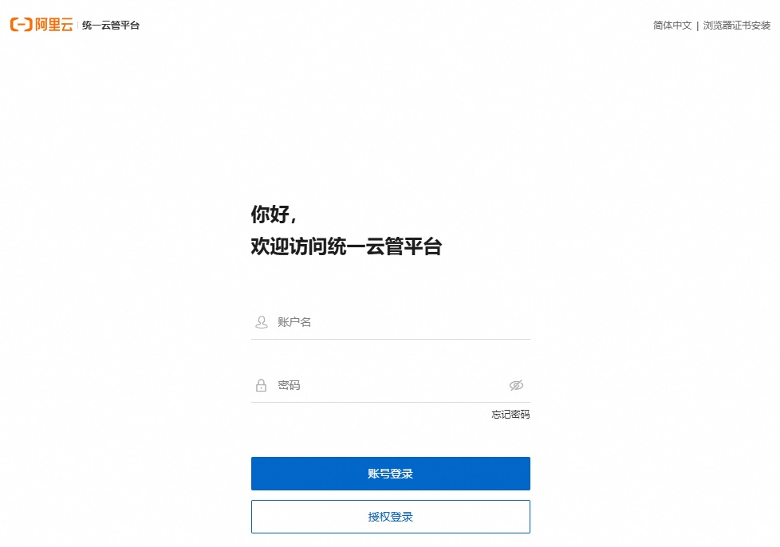

   > **说明**
   >
   > - 单击页面右上角的当前语言可以切换其它语言。
   >
   > - 授权登录是第三方认证中配置了全局IdP设置才会显示，且“授权登录”名称用户可按需自定义。

2. 输入正确的用户名及密码。

   > **说明**
   >
   > - 请向运营管理员获取登录控制台的用户名和密码。
   >
   > - 首次登录Apsara Uni-manager运营控制台时，需要修改登录用户名的密码，请按照提示完成密码修改。为提高安全性，密码长度必须为10~32位，且包含英文字母大小写、阿拉伯数字和特殊符号（感叹号（!）、at（@）、井号（#）、美元符号（$）、百分号（%）等）。

3. 单击**账号登录**。

4. 如果账号已激活MFA多因素认证，请根据以下两种情况进行操作：

   - **管理员强制开启MFA后的首次登录**

     <ol type="a">

     <li>

     在绑定虚拟MFA设备页面中，按页面提示步骤绑定MFA设备。

     </li>

     <li>

     按照步骤2重新输入账号和密码，单击**账号登录**。

     </li>

     </ol>

     <ol type="i" start="100">

     <li>

     输入6位MFA码后单击**认证**。

     </li>

     </ol>

   - **您已开启并绑定MFA**

     输入6位MFA码后单击**认证**。

     > **说明**
     >
     > 绑定并开启MFA的操作请参见管理多因素认证。

**相关操作**

**忘记密码**

1. 用户忘记登录密码时，单击密码输入框下方的**忘记密码**。

2. 在忘记密码页面，输入**账户名**、**邮箱**和验证码后，单击**确认**。

   

   > **说明**
   >
   > - 账户名请输入当前账号的用户名，邮箱请输入注册账号的Email地址。
   >
   > - 重置密码的链接将发至邮箱，进入链接后用户可输入新密码。

## 2.3. 快速入门

本文介绍如何快速使用漏洞扫描功能。

漏洞扫描的使用流程如下：

1. 根据自身实际环境需要，配置漏洞扫描的检测项目和检测规则，请参见扫描规则。

2. 导入需要进行漏洞扫描检测的资产。

   <ol type="i">

   <li>

   配置扫描引擎用于发现和导入EIP资产、SLB资产和VPC下的私网资产，请参见引擎管理。

   </li>

   <li>

   配置资产扫描模板用于发现待导入的资产，请参见资产扫描模板。

   </li>

   <li>

   创建资产导入任务导入公网资产和私网资产，请参见新建资产导入任务。

   </li>

   </ol>

   > **说明**
   >
   > 导入的资产数量需要少于或等于许可的最大资产数量。

3. 查看资产分析结果和管理资产分组、负责人和标签等信息。

   - 查看资分析：查看资产总量、风险资产和资产更新的数量，查看主机资产的主机端口、主机服务、操作系统等信息，请参见资产分析。

   - 分别查看和管理网站资产、主机资产和域名资产的信息：请参见管理资产列表。

4. 查看和确认漏洞扫描结果。

   - 查看整体的漏洞扫描结果，请参见今日概况。

   - 查看风险分析概览，请参见风险分析。

   - 查看和确认安全漏洞风险：请参见安全漏洞。

   - 查看和确认主机合规漏洞：请参见合规漏洞。

   - 查看和确认外部风险：即查看外部代码泄漏的风险，请参见对外暴露。

5. 输出漏洞扫描报表。

   通过报表方式周期性审查资产的漏洞和基线安全，请参见创建报表。

6. 手动创建风险扫描和资产描述任务。

   - 风险扫描任务：对网站、主机目标发起一次性或周期性漏洞扫描，通过POC插件，网页爬虫等技术检测安全漏洞及合规漏洞，请参见风险扫描。

   - 资产扫描任务：自动发现关联资产、企业边界资产，且对目标资产进行一次性或周期性资产探活，支持发现子域名和多级域名，请参见资产扫描。

7. 查看资产导入任务、风险扫描任务和资产扫描任务运行状态，根据阻塞任务情况，手动停止运行中任务，请参见任务管理。

8. 查看资产导入、风险扫描、资产扫描、创建报表和管理扫描规则等类型的操作日志，请参见日志审计。

# 3.漏洞扫描

## 3.1. 今日概况

漏洞扫描功能识别的漏洞类别包括安全漏洞、对外暴露风险以及合规漏洞。本文旨在介绍漏洞扫描的整体结果，以便安全管理员能够迅速了解和掌握当前的漏洞状况。

**操作步骤**

1. 登录Apsara Uni-manager运营控制台。

2. 在控制台右上方，单击**安全**，选择**安全管理 > 漏洞扫描**。在**漏洞扫描**授权页面，选择**地域**并单击**角色授权访问**。

   > **说明**
   >
   > - 在多级组织模式下，所有数据的权限都将关联到组织下的资源集维度。用户可以通过控制台顶部菜单栏选择不同组织和资源集，以查看或处理所属组织和资源集的资产。
   >
   > - 上级组织具有最高的管理权限，对内容的修改将覆盖下级组织和资源集的配置。在进行对应配置的修改时，请务必注意。

3. 在左侧导航栏，单击**今日概况**。

4. 查看漏洞扫描的整体结果。

   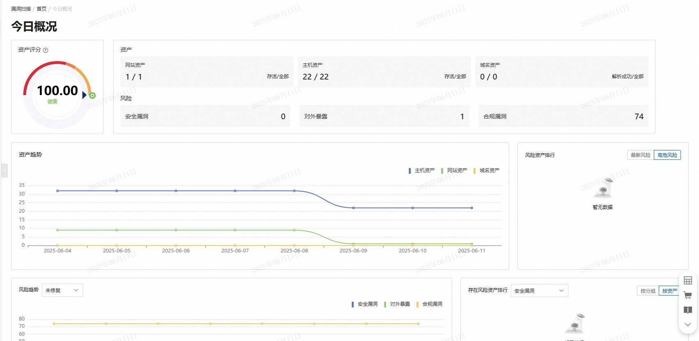

   <table>
     <tr>
       <th width="152">区域</th>
       <th>说明</th>
     </tr>
     <tr>
       <td>资产评分</td>
       <td>对当前的资产进行安全评分。</td>
     </tr>
     <tr>
       <td>资产</td>
       <td>资产概要分析，展示今日的<strong>主机资产</strong>数、<strong>网站资产</strong>数和<strong>域名资产</strong>数。</td>
     </tr>
     <tr>
       <td>风险</td>
       <td>风险概要分析，展示今日<strong>安全漏洞</strong>数、<strong>对外暴露</strong>风险数和<strong>合规漏洞</strong>数。</td>
     </tr>
     <tr>
       <td>资产趋势</td>
       <td>从时间维度展示受保护<strong>主机资产</strong>、<strong>网站资产</strong>和<strong>域名资产</strong>的数量变化趋势。图中以不同颜色的线条区分<strong>主机资产</strong>、<strong>网站资产</strong>和<strong>域名资产</strong>，鼠标指针放在线条上可以查看今日受保护主机、网站和域名的数量。</td>
     </tr>
     <tr>
       <td>风险趋势</td>
       <td>通过下拉列表选择<strong>未修复</strong>或<strong>已修复</strong>后，查看<strong>未修复</strong>或<strong>已修复</strong>风险变化趋势图，分别展示<strong>安全漏洞</strong>、<strong>对外暴露</strong>和<strong>合规漏洞</strong>的变化趋势图。图中以不同颜色的线条区分<strong>安全漏洞</strong>、<strong>对外暴露</strong>和<strong>合规漏洞</strong>，鼠标指针放在线条上可以查看今日<strong>安全漏洞</strong>、<strong>对外暴露</strong>和<strong>合规漏洞</strong>的数量。</td>
     </tr>
     <tr>
       <td>风险资产排行</td>
       <td>按<strong>最新风险</strong>、<strong>高危风险</strong>的方式，以风险为维度，展示风险资产排行前10的项。</td>
     </tr>
     <tr>
       <td>存在风险资产排行</td>
       <td>通过下拉列表选择<strong>安全漏洞</strong>、<strong>对外暴露</strong>和<strong>合规漏洞</strong>后，分别展示<strong>安全漏洞</strong>、<strong>对外暴</strong><strong>露</strong>和<strong>合规漏洞</strong>的Top5资产风险。Top5的资产风险支持按照资产或者分组的形式展示。</td>
     </tr>
   </table>

## 3.2. 资产

### 3.2.1. 资产分析

您可以通过资产分析功能，查看资产总量、风险资产以及资产更新的数量，并获取主机资产的主机端口、主机服务和操作系统等相关信息。本文将介绍如何查看网站资产、主机资产和域名资产的分析情况。

**操作步骤**

1. 登录Apsara Uni-manager运营控制台。

2. 在控制台右上方，单击**安全**，选择**安全管理 > 漏洞扫描**。在**漏洞扫描**授权页面，选择**地域**并单击**角色授权访问**。

   > **说明**
   >
   > - 在多级组织模式下，所有数据的权限都将关联到组织下的资源集维度。用户可以通过控制台顶部菜单栏选择不同组织和资源集，以查看或处理所属组织和资源集的资产。
   >
   > - 上级组织具有最高的管理权限，对内容的修改将覆盖下级组织和资源集的配置。在进行对应配置的修改时，请务必注意。

3. 在左侧导航栏，单击**资产 > 资产分析**。

4. 在**资产分析**页面，以统计图的方式直观的展示**网站资产**、**主机资产**、**域名资产**的概况，包括**资产概况**、**主机端口服务**、 **网站资产指纹识别TOP5**、**域名解析TOP5**、**主机端口开放TOP5**、**高危端口TOP5**、**主机端口TOP5**、**主机服务TOP5**、**主机资产设备类别TOP5**、**操作系统TOP5**和**网站资产状态码分布**等。

   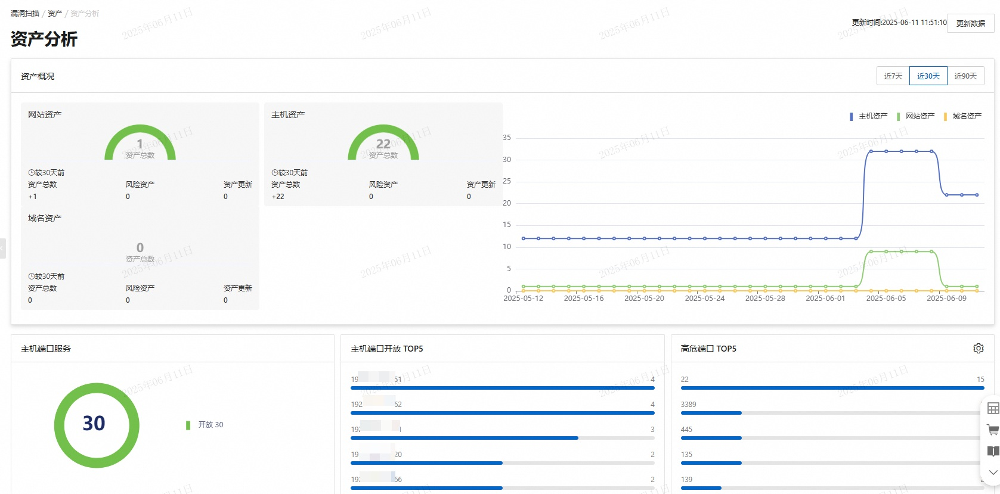

5. 单击页面右上角的**更新数据**，可手动一键更新所有统计视图。

### 3.2.2. 网站资产

本文介绍如何查看和管理接入漏洞扫描的网站资产。

**操作步骤**

1. 登录Apsara Uni-manager运营控制台。

2. 在控制台右上方，单击**安全**，选择**安全管理 > 漏洞扫描**。在**漏洞扫描**授权页面，选择**地域**并单击**角色授权访问**。

   > **说明**
   >
   > - 在多级组织模式下，所有数据的权限都将关联到组织下的资源集维度。用户可以通过控制台顶部菜单栏选择不同组织和资源集，以查看或处理所属组织和资源集的资产。
   >
   > - 上级组织具有最高的管理权限，对内容的修改将覆盖下级组织和资源集的配置。在进行对应配置的修改时，请务必注意。

3. 在左侧导航栏，单击**资产 > 网站资产**。

4. 在**网站资产**页面，管理网站资产。

   - 如下图所示，您可通过设置过滤条件（**风险等级**、**资产变动**、**网站类型**、**响应码**、**资产分组**、**负责人**、**网站指纹**、**资产标签**、**VPC**、**资产来源**以及**是否WAF识别**等），也可根据**资产更新时间**和输入关键字检索目标资产。

     您也可以单击对应的**编辑**，分别添加**资产分组**、**负责人**和**资产标签**。

   - 单击资产列表上方的**导出**，可将资产列表导出为Execl格式的文件。

   - 您可以通过以下操作查看或管理网站资产。

     <table>
       <tr>
         <th width="127">操作</th>
         <th>说明</th>
       </tr>
       <tr>
         <td>详情</td>
         <td>在操作列单击详情，可前往网站资产详情页，以查看资产的详细信息，包括<strong>安全漏</strong><strong>洞</strong>、<strong>合规漏洞</strong>、<strong>网站地图</strong>及<strong>资产变动</strong>等相关信息，具体可通过相应的页签进行查阅。</td>
       </tr>
       <tr>
         <td>修改分组</td>
         <td>批量更换资产的分组，支持修改为<strong>已有分组</strong>或<strong>新建分组</strong>。</td>
       </tr>
       <tr>
         <td>更换负责人</td>
         <td>批量修改资产的负责人，支持修改为<strong>已有负责人</strong>或<strong>新建负责人</strong>。</td>
       </tr>
       <tr>
         <td><strong>删除</strong>/<strong>批量删除</strong></td>
         <td>批量删除资产，删除后资产将不受漏洞扫描功能的防护。</td>
       </tr>
       <tr>
         <td>添加资产标签</td>
         <td>为资产添加标签。</td>
       </tr>
     </table>

     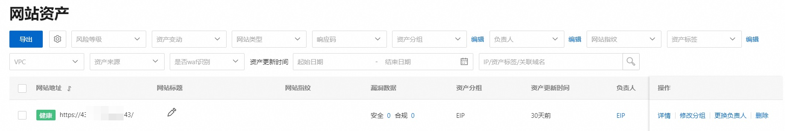

### 3.2.3. 主机资产

本文介绍如何查看和管理接入漏洞扫描的主机资产。

**操作步骤**

1. 登录Apsara Uni-manager运营控制台。

2. 在控制台右上方，单击**安全**，选择**安全管理 > 漏洞扫描**。在**漏洞扫描**授权页面，选择**地域**并单击**角色授权访问**。

   > **说明**
   >
   > - 在多级组织模式下，所有数据的权限都将关联到组织下的资源集维度。用户可以通过控制台顶部菜单栏选择不同组织和资源集，以查看或处理所属组织和资源集的资产。
   >
   > - 上级组织具有最高的管理权限，对内容的修改将覆盖下级组织和资源集的配置。在进行对应配置的修改时，请务必注意。

3. 在左侧导航栏，单击**资产 > 主机资产**。

4. 在**主机资产**页面，管理主机资产。

   - 如下图所示，您可通过设置过滤条件（**风险等级**、**主机服务**、**资产变动**、**资产分组**、**存活状态**、**资产指纹**、**资产标签**、**VPC**、**请选择端口**、**操作系统**、**负责人**、**资产来源**、**CDN识别**及**设备类型**等），也可根据**资产更新时间**和输入关键字检索目标资产。

     - 单击对应的**编辑**，分别添加资产分组、负责人和资产标签。

     - 单击资产列表上方的**导出**，将资产列表导出为Execl格式的文件。

     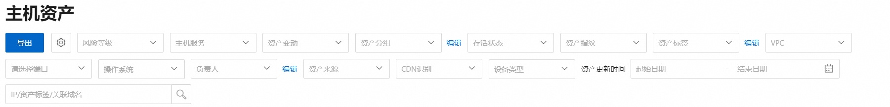

   - 您可以通过以下操作查看或管理主机资产。

     <table>
       <tr>
         <th width="127">操作</th>
         <th>说明</th>
       </tr>
       <tr>
         <td>详情</td>
         <td>可前往主机资产详情页，以查看主机的详细信息，包括<strong>主机拓扑</strong>、<strong>安全漏洞</strong>、<strong>合规</strong><strong>漏洞</strong>、<strong>主机服务</strong>及<strong>资产变动</strong>等相关信息，具体可通过相应的页签进行查阅。如图所示。</td>
       </tr>
       <tr>
         <td>修改分组</td>
         <td>批量更换资产的分组，支持修改为<strong>已有分组</strong>或<strong>新建分组</strong>。</td>
       </tr>
       <tr>
         <td>更换负责人</td>
         <td>批量修改资产的负责人，支持修改为<strong>已有负责人</strong>或<strong>新建负责人</strong>。</td>
       </tr>
       <tr>
         <td>添加资产标签</td>
         <td>为资产添加标签进行管理。</td>
       </tr>
       <tr>
         <td><strong>删除</strong>/<strong>批量删除</strong></td>
         <td>批量删除资产，删除后资产将不受漏洞扫描功能的防护。</td>
       </tr>
     </table>

     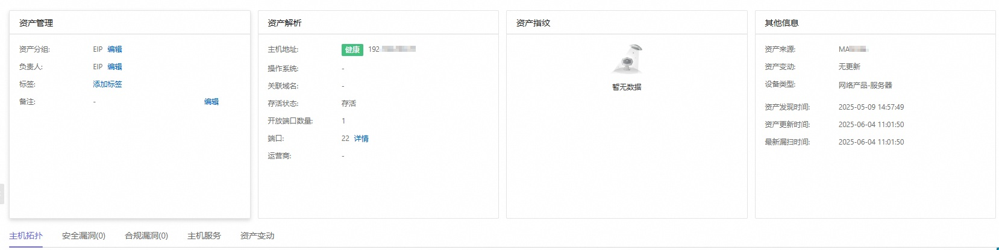

### 3.2.4. 域名资产

本文介绍如何查看和管理接入漏洞扫描的域名资产。

**操作步骤**

1. 登录Apsara Uni-manager运营控制台。

2. 在控制台右上方，单击**安全**，选择**安全管理 > 漏洞扫描**。在**漏洞扫描**授权页面，选择**地域**并单击**角色授权访问**。

   > **说明**
   >
   > - 在多级组织模式下，所有数据的权限都将关联到组织下的资源集维度。用户可以通过控制台顶部菜单栏选择不同组织和资源集，以查看或处理所属组织和资源集的资产。
   >
   > - 上级组织具有最高的管理权限，对内容的修改将覆盖下级组织和资源集的配置。在进行对应配置的修改时，请务必注意。

3. 在左侧导航栏，单击**资产 > 域名资产**。

4. 在**域名资产**页面，管理域名资产。

   - 如下图所示，您可通过设置过滤条件（**解析状态**、**资产变动**、**泛解析**、**资产分组**、**负责人**、**资产标签**、**资产来源**及**VPC**），也可根据**资产更新时间**和输入关键字检索目标资产。

     - 单击对应过滤条件右侧的**编辑**，分别添加资产分组、负责人和资产标签。

     - 单击资产列表上方的**导出**，将资产列表导出为Execl格式的文件。

     

   - 您可以通过以下操作查看或管理域名资产。

     <table>
       <tr>
         <th width="121">操作</th>
         <th>说明</th>
       </tr>
       <tr>
         <td>详情</td>
         <td>可前往域名资产详情页面，以查看域名的详细信息，包括<strong>Whois</strong>、<strong>解析记录</strong>、<strong>风险</strong><strong>分析</strong>等相关信息，具体可通过相应的页签进行查阅。如图所示。</td>
       </tr>
       <tr>
         <td>修改分组</td>
         <td>批量更换资产的分组，支持修改为<strong>已有分组</strong>或<strong>新建分组</strong>。</td>
       </tr>
       <tr>
         <td>更换负责人</td>
         <td>批量修改资产的负责人，支持修改为<strong>已有负责人</strong>或<strong>新建负责人</strong>。</td>
       </tr>
       <tr>
         <td>添加资产标签</td>
         <td>为资产添加标签进行管理。</td>
       </tr>
       <tr>
         <td>批量删除</td>
         <td>批量删除资产，删除后资产将不受漏洞扫描功能的防护。</td>
       </tr>
     </table>

     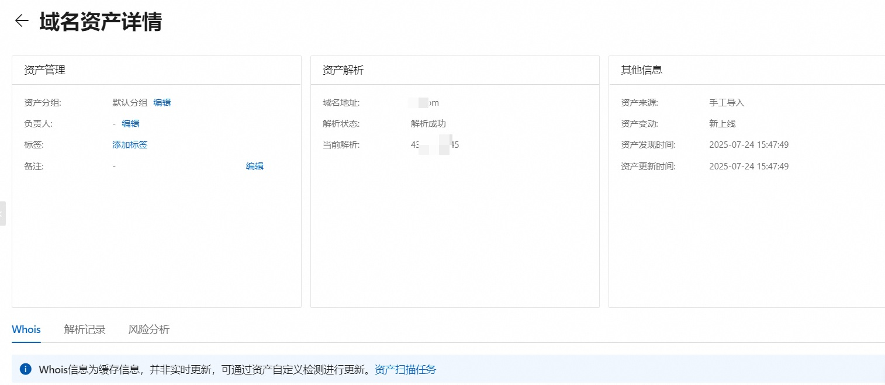

## 3.3. 风险

### 3.3.1. 风险分析

本文将详细介绍如何查看安全漏洞、合规漏洞以及对外暴露风险的分析情况。

**操作步骤**

1. 登录Apsara Uni-manager运营控制台。

2. 在控制台右上方，单击**安全**，选择**安全管理 > 漏洞扫描**。在**漏洞扫描**授权页面，选择**地域**并单击**角色授权访问**。

   > **说明**
   >
   > - 在多级组织模式下，所有数据的权限都将关联到组织下的资源集维度。用户可以通过控制台顶部菜单栏选择不同组织和资源集，以查看或处理所属组织和资源集的资产。
   >
   > - 上级组织具有最高的管理权限，对内容的修改将覆盖下级组织和资源集的配置。在进行对应配置的修改时，请务必注意。

3. 在左侧导航栏，单击**风险 > 风险分析**。

4. 在**风险分析**页面，以统计图的方式直观的展示**风险概览**、**漏洞类型分布**、**CMS应用漏洞 TOP5**、**运维安全风险 TOP5**、**高风险网站资产 TOP5**、**高风险主机资产 TOP5**、**弱口令风险 TOP5**。

5. 单击页面右上角的**更新数据**，可手动一键更新所有统计图。

### 3.3.2. 安全漏洞

本文将介绍如何查看和处理漏洞扫描所检测到的安全漏洞风险。

**操作步骤**

**新建风险扫描**

1. 登录Apsara Uni-manager运营控制台。

2. 在控制台右上方，单击**安全**，选择**安全管理 > 漏洞扫描**。在**漏洞扫描**授权页面，选择**地域**并单击**角色授权访问**。

   > **说明**
   >
   > - 在多级组织模式下，所有数据的权限都将关联到组织下的资源集维度。用户可以通过控制台顶部菜单栏选择不同组织和资源集，以查看或处理所属组织和资源集的资产。
   >
   > - 上级组织具有最高的管理权限，对内容的修改将覆盖下级组织和资源集的配置。在进行对应配置的修改时，请务必注意。

3. 在左侧导航栏，单击**风险 > 安全漏洞**。

4. 在**安全漏**洞页面，单击**新建风险扫描**，输入基本配置，单击**确定**。

**查看安全漏洞**

安全管理员可以查看通过漏洞扫描功能检测出来的安全漏洞。

1. 在左侧导航栏，单击**风险 > 安全漏洞**。

2. 查看已修复、未修复的安全漏洞风险列表。

   - 通过单击**未修复**或**已修复**页签，可以切换查看**未修复风险**和**已修复风险**。

   - 查看风险统计信息，包括**风险名称**、**风险地址**、**处理状态**、**检测状态**、**风险更新时间**、**资产分组**等。

   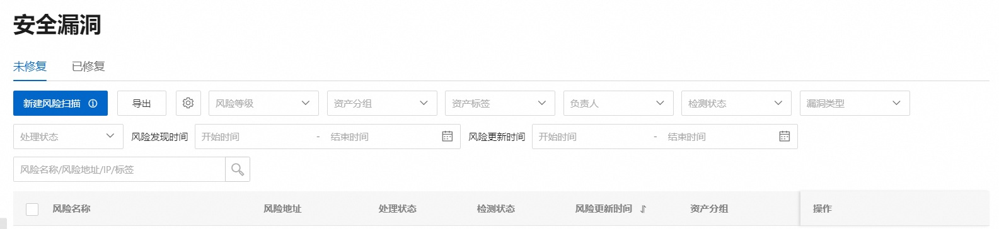

3. 通过选择**风险等级**、**资产分组**、**资产标签**、**负责人**、**检测状态**、**风险发现时间**、**风险更新时间**、关键字等信息搜索查询安全漏洞风险。

4. 处理安全漏洞风险。

   安全管理员根据风险列表中信息，分析和确认是否影响资产安全性。

   - 确认风险

     如果安全漏洞风险确认影响资产安全，在修复安全漏洞后，确认风险。

   - 忽略风险

     如果安全漏洞风险存在误报（或者不影响资产安全），忽略风险。

5. 单击**导出**，导出安全漏洞风险列表到本地。

6. 单击风险列表中**操作**列的**详情**，进入风险详情页面，可查看到该资产下该漏洞的CVSS评分、威胁程度、风险概要、风险描述、风险详情、风险危害、风险细节、修复建议、请求与响应的信息。

   其中：

   - 风险概要介绍该风险的地址及对应资产地址、IP地址、关联域名、风险类型、首次发现时间、最后更新时间。

   - 请求与响应内容中若响应包过大时将会被截断。

   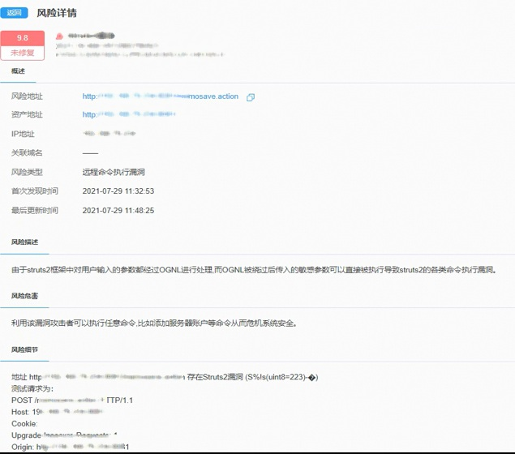

### 3.3.3. 合规漏洞

本文阐述了如何查看及确认主机合规漏洞的风险。

**操作步骤查看风险**

安全管理员可以查看通过漏洞扫描功能检测出来的主机合规问题。

1. 登录Apsara Uni-manager运营控制台。

2. 在控制台右上方，单击**安全**，选择**安全管理 > 漏洞扫描**。在**漏洞扫描**授权页面，选择**地域**并单击**角色授权访问**。

   > **说明**
   >
   > - 在多级组织模式下，所有数据的权限都将关联到组织下的资源集维度。用户可以通过控制台顶部菜单栏选择不同组织和资源集，以查看或处理所属组织和资源集的资产。
   >
   > - 上级组织具有最高的管理权限，对内容的修改将覆盖下级组织和资源集的配置。在进行对应配置的修改时，请务必注意。

3. 在左侧导航栏，单击**风险 > 合规漏洞**。

4. 查看主机合规风险。

   - 通过单击**未修复**或者**已修复**页签，可以切换查看**未修复风险**和**已修复风险**。

   - 通过选择**风险等级**、**资产分组**、**负责人**、**检测状态**、**端口**、**资产标签**、**处理状态**、**风险发现时间**、**风险更新时间**、关键字等信息搜索查询主机合规风险。

   - 查看风险统计信息，包括**风险名称**、**风险编号**、**资产地址**、**检测状态**、**风险更新时间**等。

5. 单击**导出**，导出主机合规风险列表到本地。

**处理风险**

1. 在左侧导航栏，单击**风险 > 合规漏洞**。

2. 单击**未修复**或者**已修复**页签，在风险列表中处理风险时支持以下操作。

   - **详情**：在**操作**列单击**详情**，在风险详情面板，查看详细信息。您可以根据提供的修复建议和相关链接，处理风险项。

   - **重新检测**：在**操作**列单击**重新检测**，可以对该漏洞重新进行检测。

   - **处理**：

     - **待修复**：将该风险的处理状态更改为待修复，后续您可进行统一处理。

     - **忽略**：确认该风险项为误报或非风险项可予以忽略。

   - **批量处理**：勾选风险项进行批量处理。

   - **批量重检**：勾选风险项进行批量检测。

### 3.3.4. 对外暴露

本文旨在介绍如何查看和确认对外暴露的风险（代码泄漏）。

**前提条件**

已有GitHub账号并获取账号下的Token。

**操作步骤**

**查看风险**

安全管理员可以查看通过漏洞扫描功能检测GitHub仓库中的代码是否存在代码泄漏风险。

1. 登录Apsara Uni-manager运营控制台。

2. 在控制台右上方，单击**安全**，选择**安全管理 > 漏洞扫描**。在**漏洞扫描**授权页面，选择**地域**并单击**角色授权访问**。

   > **说明**
   >
   > - 在多级组织模式下，所有数据的权限都将关联到组织下的资源集维度。用户可以通过控制台顶部菜单栏选择不同组织和资源集，以查看或处理所属组织和资源集的资产。
   >
   > - 上级组织具有最高的管理权限，对内容的修改将覆盖下级组织和资源集的配置。在进行对应配置的修改时，请务必注意。

3. 在左侧导航栏，选择 **风险 > 对外暴露** 。

4. 查看代码泄漏风险列表。

   - 通过单击**未修复**和**已修复**页签，可以切换查看未修复风险和已修复风险。

   - 通过选择**风险等级**、**资产分组**、**负责人**、**处理状态**、**风险发现时间**、**风险更新时间**、关键字等信息搜索查询对外暴露风险。

   - 查看风险统计信息，包括**风险名称**、**风险地址**、**处理状态**、**检测状态**、**风险更新时间**等。

5. 单击**导出**，将风险列表导出到本地。

**处理风险**

1. 在左侧导航栏，选择 **风险 > 对外暴露** 。

2. 单击**未修复**或者**已修复**页签，在风险列表中处理风险时支持以下操作。

   - **详情**：在**操作**列单击**详情**，在风险详情面板，查看详细信息。您可以根据提供的**修复建议**，处理风险项。

   - **处理**：

     - **待修复**：将该风险的处理状态更改为待修复，后续您可进行统一处理。

     - **忽略**：确认该风险项为误报或非风险项可予以忽略。

   - **批量处理**：勾选风险项进行批量处理。

## 3.4. 任务

### 3.4.1. 任务列表

#### 3.4.1.1. 资产导入

本文介绍如何创建公网资产和私网资产的导入任务。

**使用说明**

- 漏洞扫描功能仅针对已导入的资产进行扫描，因此在进行资产漏洞扫描之前，必须先完成资产的导入。

- 漏洞扫描功能能够针对已配置的资产扫描模板添加资产导入任务，依据相应的扫描策略发现并导入IP、域名和网站类型的资产。同时，该功能支持通过TCP、ICMP等方式对目标资产进行存活探测，并可对指定端口或全端口进行服务扫描与识别，从而发现资产的操作系统、中间件等指纹信息。资产扫描模板的具体内容，请参见资产扫描模板。

- 漏洞扫描功能支持的资产类型包括公网资产和私网资产（VPC）。

  私网资产的导入，需首先添加扫描引擎（具体步骤，请参见引擎管理），随后进行私网资产的导入。

**新建资产导入任务**

1. 登录Apsara Uni-manager运营控制台。

2. 在控制台右上方，单击**安全**，选择**安全管理 > 漏洞扫描**。在**漏洞扫描**授权页面，选择**地域**并单击**角色授权访问**。

   > **说明**
   >
   > - 在多级组织模式下，所有数据的权限都将关联到组织下的资源集维度。用户可以通过控制台顶部菜单栏选择不同组织和资源集，以查看或处理所属组织和资源集的资产。
   >
   > - 上级组织具有最高的管理权限，对内容的修改将覆盖下级组织和资源集的配置。在进行对应配置的修改时，请务必注意。

3. 在左侧导航栏中，单击**任务 > 任务列表**。

4. 在任务列表页面，单击**新建任务**，选择**资产导入**，创建资产导入任务。

**公网资产**

- 导入**EIP资产**、**SLB资产**

  在**资产导入**页面的**公网资产**页签下，**EIP资产**和**SLB资产**已经自动导入并监控，单击右侧的**同步新资产**，即可添加资产。

- 导入**公网资产**

  在**资产导入**页面的**公网资产**页签下，单击**公网资产**，添加公网资产。

  <ol type="i">

  <li>

  在**基本配置**区域，输入**任务名称**，选择**任务模板**，选择**扫描方式**。

  > **说明**
  >
  > **任务模板**指资产扫描模板，是导入资产后的扫描策略。您可以在**任务 > 模板列表**页面，新增、删除资产扫描模板。具体操作，请参见模板列表。

  </li>

  <li>

  在**资产信息**区域，输入**自定义IP**。

  - 资产支持域名、URL、IP、IP段等方式。

  - 支持批量导入，各资产间使用回车键分隔。

  - 资产不要包含有VPC的资产。

  - 导入资产数量需要少于平台总资产剩余数量。

    > **说明**
    >
    > 例如平台总资产剩余数量为100个，如果此处输入的资产数量为90个，则输入的资产都能进行漏洞扫描；如果此处输入的资产数量为110个，则只能保护其中100 个资产，剩余10个资产不能进行漏洞扫描。

  </li>

  <li>

  在**资产信息**区域，为导入的资产设置资产分组、负责人和标签，以及**不存活资产是否入库**。

  - 在**资产分组**右侧的下拉菜单中选择分组。

  - 在**负责人**右侧的下拉菜单中选择具体的资产负责人。

  - 在**标签**右侧，单击添加  图标，为导入资产添加标签。

  > **说明**
  >
  > 您可以在**资产 > 网站资产**、**资产 > 主机资产**和**资产 > 域名资产**页面新增、编辑和删除资产分组、负责人和标签。具体内容，请参见管理资产列表。

  </li>

  <li>

  单击**确定**，即可导入公网资产。

  </li>

  </ol>

**私网资产**

1. 在**资产导入**页面，单击**私网资产**页签。

2. 在**基本配置**区域，输入**任务名称**，选择**任务模板**和**扫描方式**。

   > **说明**
   >
   > **任务模板**指资产扫描模板，是导入资产后的扫描策略。您可以在**任务 > 模板列表**页面，新增、删除资产扫描模板。具体操作，请参见模板列表。

3. 在**资产信息**区域，先选择VPC，然后选择**私有IP**和添加自定义**资产地址**。

   - 资产支持域名、URL、IP、IP段等方式。

   - 支持批量导入，各资产间使用回车键分隔。

   - 导入资产数量需要少于平台总资产剩余数量。

     > **说明**
     >
     > 例如平台总资产剩余数量为100个，如果此处输入的资产数量为90个，则输入的资产都能进行漏洞扫描；如果此处输入的资产数量为110个，则只能保护其中100 个资产，剩余10个资产不能进行漏洞扫描。

4. 在**资产信息**区域，为导入的资产设置资产分组、负责人和标签，以及设置**不存活资产是否入库**。

   - 在**资产分组**右侧的下拉菜单中选择分组。

   - 在**负责人**右侧的下拉菜单中选择具体的资产负责人。

   - 在**标签**右侧，单击添加  图标，为导入资产添加标签。

   > **说明**
   >
   > 您可以在**资产 > 网站资产**、**资产 > 主机资产**和**资产 > 域名资产**页面新增、编辑和删除资产分组、负责人和标签。具体内容，请参见管理资产列表。

5. 单击**确定**，即可导入私网资产。

**管理资产导入任务**

资产任务创建成功后，在任务列表中可以查看所有资产导入任务信息。

1. 在**任务列表**页面，选择任务类型为**资产导入**，查看已导入资产，也可以根据**任务状态**、**任务模板**或**执行方式**搜索筛选资产，

2. 支持对资产任务执行以下操作。

   <table>
     <tr>
       <th>操作项</th>
       <th>说明</th>
     </tr>
     <tr>
       <td>详情</td>
       <td>可以查看资产扫描的详细信息。 说明 • 导入过程：展示当前检测进度的详细日志以时间轴，且支持通过关键词查询。例如80%进度时，发现的网站资产数、主机资产数、域名资产数。 • 导入结果：识别为<strong>新导入</strong>和<strong>已存在</strong>的资产，按资产父子关系进行对应展示。</td>
     </tr>
     <tr>
       <td>重新执行</td>
       <td>重新执行资产导入任务。</td>
     </tr>
     <tr>
       <td>删除</td>
       <td>删除资产导入任务。</td>
     </tr>
     <tr>
       <td>批量删除</td>
       <td rowspan="4">选择多个资产任务签的复选框，可以多个资产任务进行对应批量操作。</td>
     </tr>
     <tr>
       <td>批量执行</td>
     </tr>
     <tr>
       <td>批量暂停</td>
     </tr>
     <tr>
       <td>批量停止</td>
     </tr>
   </table>

#### 3.4.1.2. 风险扫描

本文介绍如何创建资产的风险扫描任务。

**操作步骤**

1. 登录Apsara Uni-manager运营控制台。

2. 在控制台右上方，单击**安全**，选择**安全管理 > 漏洞扫描**。在**漏洞扫描**授权页面，选择**地域**并单击**角色授权访问**。

   > **说明**
   >
   > - 在多级组织模式下，所有数据的权限都将关联到组织下的资源集维度。用户可以通过控制台顶部菜单栏选择不同组织和资源集，以查看或处理所属组织和资源集的资产。
   >
   > - 上级组织具有最高的管理权限，对内容的修改将覆盖下级组织和资源集的配置。在进行对应配置的修改时，请务必注意。

3. 在左侧导航栏中，单击**任务 > 任务列表**。

4. 在任务列表页面，单击**新建任务**，选择**风险扫描**。

5. 设置风险扫描任务的基本配置，包括**任务名称**、**任务模板**、**扫描时间**和**VPC**。

   其中**周期执行**支持选择自定义、每周一次和每月一次。

   - 自定义：设置每隔多少天进行一个检测周期。

   - 每周一次：设置每周进行一个检测周期。

   - 每月一次：设置每月进行一个检测周期。

   对应时间设置：

   - 自定义：设置检测当天的时间范围。

   - 每周一次：设置哪几天检测和时间范围。

   - 每月一次：设置哪几天检测和时间范围。

   > **说明**
   >
   > 例如每周一次，选择周一到周日和0点到24点，则表示7x24小时都进行检测。

6. 设置风险扫描任务的检测目标。

   支持选择：全部、网站、主机、按分组选择、按标签选择和按负责人选择。

7. 单击**确定**。

> **说明**
>
> 漏洞扫描功能能够基于已配置的风险扫描模板，向资产添加风险扫描任务。该功能按照相应的扫描策略，针对网站和主机目标发起一次性或周期性的漏洞扫描。通过POC插件、网页爬虫等技术手段，检测安全漏洞及合规性漏洞。风险扫描模板的详细内容，请参见风险扫描模板。

#### 3.4.1.3. 资产扫描

本文介绍如何创建资产发现任务。

**操作步骤**

1. 登录Apsara Uni-manager运营控制台。

2. 在控制台右上方，单击**安全**，选择**安全管理 > 漏洞扫描**。在**漏洞扫描**授权页面，选择**地域**并单击**角色授权访问**。

   > **说明**
   >
   > - 在多级组织模式下，所有数据的权限都将关联到组织下的资源集维度。用户可以通过控制台顶部菜单栏选择不同组织和资源集，以查看或处理所属组织和资源集的资产。
   >
   > - 上级组织具有最高的管理权限，对内容的修改将覆盖下级组织和资源集的配置。在进行对应配置的修改时，请务必注意。

3. 在左侧导航栏中，单击**任务 > 任务列表**。

4. 在任务列表页面，单击**新建任务**，选择**资产扫描**。

5. 设置资产扫描任务的基本配置，包括**任务名称**、**任务模板**、**扫描时间**和**VPC**。

   其中**周期执行**支持选择自定义、每周一次和每月一次。

   - 自定义：设置每隔多少天进行一个检测周期。

   - 每周一次：设置每周进行一个检测周期。

   - 每月一次：设置每月进行一个检测周期。

   对应时间设置：

   - 自定义：设置检测当天的时间范围。

   - 每周一次：设置哪几天检测和时间范围。

   - 每月一次：设置哪几天检测和时间范围。

   > **说明**
   >
   > 例如每周一次，选择周一到周日和0点到24点，则表示7x24小时都进行检测。

6. 设置资产扫描任务的检测目标。

   支持选择：全部、网站、主机、按分组选择、按标签选择和按负责人选择。

7. 单击**确定**。

> **说明**
>
> 漏洞扫描功能能够针对已配置的资产扫描模板，添加资产的安全扫描任务。该功能依据相应的扫描策略，自动发现关联资产及企业边界资产，并支持对目标资产进行一次性或周期性的活动探测，同时能够识别子域名及多级域名。资产扫描模板的详细内容，请参见资产扫描模板。

### 3.4.2. 模板列表

#### 3.4.2.1. 资产扫描模板

本文介绍如何创建发现资产及扫描资产安全的资产扫描模板。

**扫描模板配置说明**

- 管理资产扫描速率、丢包重传次数、扫描端口及主机探活策略（支持自定义端口设置及恢复默认设置）。

- 选择扫描策略并在此基础上进行附加端口、排除端口设置（同时添加到附加端口和排除端口中时，按照排除端口处理）。

- 设置资产发现策略开关，包括自动同步资产信息的选项、自动导入关联IP、子域名发现以及IP反查域名功能（默认关闭）。

**操作步骤**

1. 登录Apsara Uni-manager运营控制台。

2. 在控制台右上方，单击**安全**，选择**安全管理 > 漏洞扫描**。在**漏洞扫描**授权页面，选择**地域**并单击**角色授权访问**。

   > **说明**
   >
   > - 在多级组织模式下，所有数据的权限都将关联到组织下的资源集维度。用户可以通过控制台顶部菜单栏选择不同组织和资源集，以查看或处理所属组织和资源集的资产。
   >
   > - 上级组织具有最高的管理权限，对内容的修改将覆盖下级组织和资源集的配置。在进行对应配置的修改时，请务必注意。

3. 在左侧导航栏中，单击**任务 > 模板列表**。

4. 在模板列表页面，单击**新建模板**，选择**资产扫描模板**。

5. 设置资产扫描模板的基本信息。

   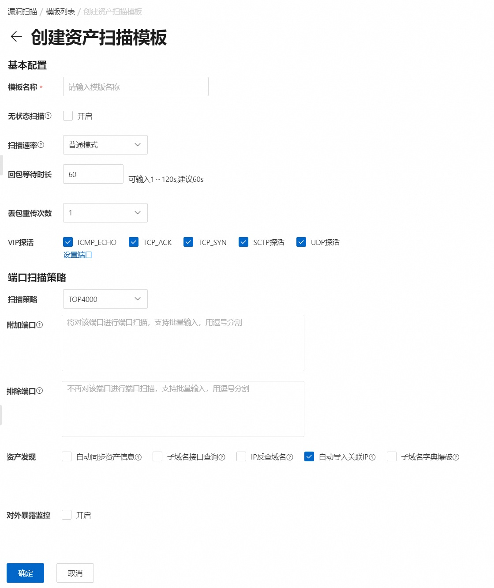

6. 单击**确定**。

#### 3.4.2.2. 风险扫描模板

本文介绍如何创建扫描资产风险漏洞、安全漏洞及合规漏洞的风险扫描模板。

**扫描模板配置说明**

管理基础检测的开关（默认启用）、风险类型检测项、Web风险检测以及用户代理设置等。

**操作步骤**

1. 登录Apsara Uni-manager运营控制台。

2. 在控制台右上方，单击**安全**，选择**安全管理 > 漏洞扫描**。在**漏洞扫描**授权页面，选择**地域**并单击**角色授权访问**。

   > **说明**
   >
   > - 在多级组织模式下，所有数据的权限都将关联到组织下的资源集维度。用户可以通过控制台顶部菜单栏选择不同组织和资源集，以查看或处理所属组织和资源集的资产。
   >
   > - 上级组织具有最高的管理权限，对内容的修改将覆盖下级组织和资源集的配置。在进行对应配置的修改时，请务必注意。

3. 在左侧导航栏中，单击**任务 > 模板列表**。

4. 在模板列表页面，单击**新建模板**，选择**风险扫描模板**。

5. 设置风险扫描模板的基本信息。

   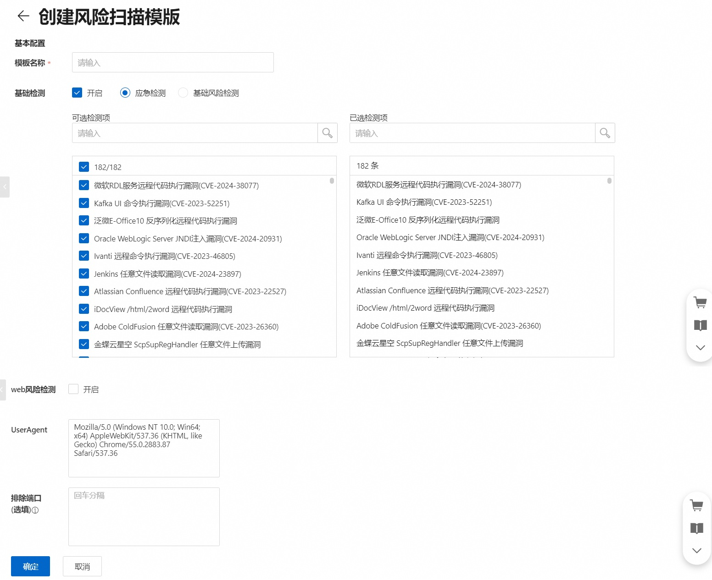

6. 单击**确定**。

## 3.5. 报表管理

通过创建报表，安全管理员能够查看特定资产在一段时间内的安全风险状况，并实施相应的安全防护改进方案。本文将详细介绍如何创建和删除报表。

**添加报表**

1. 登录Apsara Uni-manager运营控制台。

2. 在控制台右上方，单击**安全**，选择**安全管理 > 漏洞扫描**。在**漏洞扫描**授权页面，选择**地域**并单击**角色授权访问**。

   > **说明**
   >
   > - 在多级组织模式下，所有数据的权限都将关联到组织下的资源集维度。用户可以通过控制台顶部菜单栏选择不同组织和资源集，以查看或处理所属组织和资源集的资产。
   >
   > - 上级组织具有最高的管理权限，对内容的修改将覆盖下级组织和资源集的配置。在进行对应配置的修改时，请务必注意。

3. 在左侧导航栏，单击**报表列表**。

4. 在**报表导出**页面，单击**添加报表**。

5. 设置报表参数，单击**确定**。配置参数说明，如下所示：

   <table>
     <tr>
       <th width="97">参数</th>
       <th>说明</th>
     </tr>
     <tr>
       <td>报表名称</td>
       <td>设置报表名称。</td>
     </tr>
     <tr>
       <td>报表类型</td>
       <td>选择添加的报表：<strong>风险评估报表</strong>、<strong>资产统计报表</strong>、<strong>风险统计报表</strong>。</td>
     </tr>
     <tr>
       <td>资产范围</td>
       <td>选择报表涉及的资产范围及对应监测目标，支持<strong>全部</strong>、<strong>网站</strong>、<strong>主机</strong>、<strong>按分组选择</strong>、<strong>按标签选</strong><strong>择</strong>、<strong>按负责人选择</strong>选项。</td>
     </tr>
     <tr>
       <td>风险范围</td>
       <td>选择报表的涉及的风险范围，支持选择<strong>已修复</strong>和<strong>未修复</strong>。</td>
     </tr>
     <tr>
       <td>漏洞类型</td>
       <td>选择报表涉及的漏洞类型，支持选择<strong>安全漏洞</strong>和<strong>合规漏洞</strong>。</td>
     </tr>
     <tr>
       <td>风险等级</td>
       <td>选择报表涉及的风险等级，支持选择<strong>高危</strong>、<strong>中危</strong>和<strong>低危</strong>。</td>
     </tr>
     <tr>
       <td>封面logo</td>
       <td>按照页面提示重置报表封面。</td>
     </tr>
   </table>

   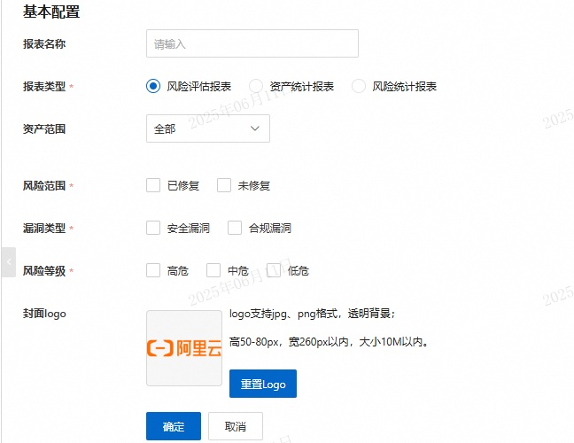

**下载报表**

1. 在左侧导航栏，单击**报表列表**。

2. 在报表列表中，选择需要下载的报表，单击**操作**列的**下载**，选择**报表格式**，单击**确定**。

**删除报表**

- **单个删除**

  <ol type="i">

  <li>

  在左侧导航栏，单击**报表列表**。

  </li>

  <li>

  在报表列表中，选择需要删除的报表，单击**操作**列的**删除**，单击**确定**。

  </li>

  </ol>

- **批量删除**

  <ol type="i">

  <li>

  在左侧导航栏，单击**报表列表**。

  </li>

  <li>

  在报表列表上方的下拉列表，选择**报表类型**。

  </li>

  <li>

  在报表列表中，选中需要删除的报表前的复选框。

  </li>

  <li>

  单击**批量删除**。单击**确定**。

  </li>

  </ol>

## 3.6. 配置管理

### 3.6.1. 扫描规则

本文介绍如何对漏洞扫描进行安全扫描规则配置和管理，包括安全漏洞配置、合规漏洞配置、对外暴露配置、目录爆破管理和资产扫描白名单。

**背景信息**

通过安全扫描规则，查看和管理漏洞扫描中进行监控的项目和检测结果等信息。

扫描规则的详细内容在阿里云的升级中心中进行维护和管理。

**操作步骤**

1. 登录Apsara Uni-manager运营控制台。

2. 在控制台右上方，单击**安全**，选择**安全管理 > 漏洞扫描**。在**漏洞扫描**授权页面，选择**地域**并单击**角色授权访问**。

   > **说明**
   >
   > - 在多级组织模式下，所有数据的权限都将关联到组织下的资源集维度。用户可以通过控制台顶部菜单栏选择不同组织和资源集，以查看或处理所属组织和资源集的资产。
   >
   > - 上级组织具有最高的管理权限，对内容的修改将覆盖下级组织和资源集的配置。在进行对应配置的修改时，请务必注意。

3. 在左侧导航栏，单击**配置管理 > 扫描规则**。

4. 查看和管理监控配置项。

**安全漏洞配置**

- 在**安全漏洞配置**页签下的**CMS应用漏洞**、**运维安全漏洞**页签，根据规则监控并展示监控结果。

- 在**安全漏洞配置**页签下的**弱口令监控**页签，设置弱口令漏洞监控规则。

  - 默认情况下，各弱口令监控项使用系统默认的弱口令库。

  - 如果需要停用某个监控项，在**默认弱口令**列，单击  图标。

  - 如果需要启用某个已停用的监控项，在**默认弱口令**列，单击  图标。

  - 如果需要对单个监控项使用自定义弱口令，则按照以下步骤操作（以**MySQL弱口令漏洞**为例）：

    <ol type="a">

    <li>

    在**默认弱口令**列，关闭默认弱口令开关，开关状态变更为  。

    </li>

    <li>

    在**操作**列，单击**编辑**。

    </li>

    </ol>

    <ol type="i" start="100">

    <li>

    在弹出的对话框中，设置自定义的弱口令，单击**确定**。

    </li>

    </ol>

  - 如果需要对多个监控项使用相同的自定义弱口令，则按照以下步骤操作：

    <ol type="a">

    <li>

    在**默认弱口令**列，关闭默认弱口令开关，开关状态变更为  。

    > **说明**
    >
    > 对于使用自定义弱口令的监控项，都需要关闭对应的默认弱口令开关。

    </li>

    <li>

    单击**自定义全局弱口令**。

    </li>

    </ol>

    <ol type="i" start="100">

    <li>

    在**自定义全局弱口令**窗口中，设置自定义的弱口令，单击**确定**。

    </li>

    </ol>

**合规漏洞配置**

在**合规漏洞配置**页签，可以输入CVE、CNVD、CNNVD编号，查询对应规则的监控结果。

**对外暴露配置**

在**对外暴露配置**页签下，默认展示**关键数据库端口暴露规则**、**关键远程服务暴露规则**、**关键端口暴露规则**、**关键服务暴露规则**的巡检结果。

- 默认展示的**关键数据库端口暴露规则**、**关键远程服务暴露规则**、**关键端口暴露规则**、**关键服务暴露规则**，使用系统默认的规则内容。

- 对外暴露规则，还支持配置**禁止端口开放**和**禁止服务开放**规则。

- 支持添加规则，操作如下：

  <ol type="i">

  <li>

  在**对外暴露配置**页签下，单击**添加**。

  </li>

  <li>

  在弹出的对话框中，输入规则**名称**，选择**对外暴露规则**，可配置对应规则的内容，单击**确定**。

  </li>

  </ol>

**目录爆破管理**

在**目录爆破管理**页签下，可以配置**自定义爆破字典**和**爆破速率**。

**资产扫描白名单**

在**资产扫描白名单**页签下，可以配置**禁止资产扫描**、**禁止漏洞扫描**的IP、IP端、URL和域名。系统将不会对加入到白名单中的资产进行资产发现和漏洞扫描。

在设置白名单前，请确认加入资产的安全性。

1. 在通用配置页面，单击**添加**。

2. 在弹出的对话框中，选择**规则**后，配置**白名单**。

3. 单击**确定**。

### 3.6.2. 任务管理

本文介绍如何查看和管理资产导入、风险扫描和资产扫描任务。

**操作步骤**

通过洞扫描功能的任务管理功能，您可以查看不同进程（包括等待中、正在执行和任务队列）的任务，并能够根据阻塞任务的情况，手动停止正在运行的任务。

1. 登录Apsara Uni-manager运营控制台。

2. 在控制台右上方，单击**安全**，选择**安全管理 > 漏洞扫描**。在**漏洞扫描**授权页面，选择**地域**并单击**角色授权访问**。

   > **说明**
   >
   > - 在多级组织模式下，所有数据的权限都将关联到组织下的资源集维度。用户可以通过控制台顶部菜单栏选择不同组织和资源集，以查看或处理所属组织和资源集的资产。
   >
   > - 上级组织具有最高的管理权限，对内容的修改将覆盖下级组织和资源集的配置。在进行对应配置的修改时，请务必注意。

3. 在左侧导航栏，单击**配置管理 > 任务管理**。

4. 在**等待中**、**正在执行**页签，查看对应任务的类型、优先级和子任务数。

5. 在**任务队列**页签，查看对应任务队列的名称、类型和设备组编号。

6. 手动停止正在运行和即将运行的任务。

   <ol type="i">

   <li>

   单击页面右上角的**停止任务**。

   </li>

   <li>

   在弹出对话框中，填入验证码。

   </li>

   <li>

   单击**确定**。

   </li>

   </ol>

### 3.6.3. 系统信息

本文介绍如何查看漏洞扫描系统的漏洞库版本、更新记录，及如何进行系统参数Syslog设置。

**操作步骤**

系统信息包括当前漏洞库信息（版本和更新记录）和系统参数（Syslog设置）。

1. 登录Apsara Uni-manager运营控制台。

2. 在控制台右上方，单击**安全**，选择**安全管理 > 漏洞扫描**。在**漏洞扫描**授权页面，选择**地域**并单击**角色授权访问**。

   > **说明**
   >
   > - 在多级组织模式下，所有数据的权限都将关联到组织下的资源集维度。用户可以通过控制台顶部菜单栏选择不同组织和资源集，以查看或处理所属组织和资源集的资产。
   >
   > - 上级组织具有最高的管理权限，对内容的修改将覆盖下级组织和资源集的配置。在进行对应配置的修改时，请务必注意。

3. 在左侧导航栏，单击**配置管理 > 系统信息**。

4. 在**系统信息**页面**漏洞库信息**页签，查看当前漏洞库版本和更新记录。

5. 在**系统信息**页面**系统参数**页签，设置**用户host。**

### 3.6.4. 日志审计

本文介绍如何查看漏洞扫描功能中的操作日志。

**背景信息**

日志审计功能记录对资产导入、风险扫描、资产扫描、创建报表和管理扫描规则等类型的操作日志和操作结果。

**操作步骤**

1. 登录Apsara Uni-manager运营控制台。

2. 在控制台右上方，单击**安全**，选择**安全管理 > 漏洞扫描**。在**漏洞扫描**授权页面，选择**地域**并单击**角色授权访问**。

   > **说明**
   >
   > - 在多级组织模式下，所有数据的权限都将关联到组织下的资源集维度。用户可以通过控制台顶部菜单栏选择不同组织和资源集，以查看或处理所属组织和资源集的资产。
   >
   > - 上级组织具有最高的管理权限，对内容的修改将覆盖下级组织和资源集的配置。在进行对应配置的修改时，请务必注意。

3. 在左侧导航栏，单击**配置管理 > 日志审计**。

4. 在不同页签查看对应日志审计，包括日志类型和事件结果等。

   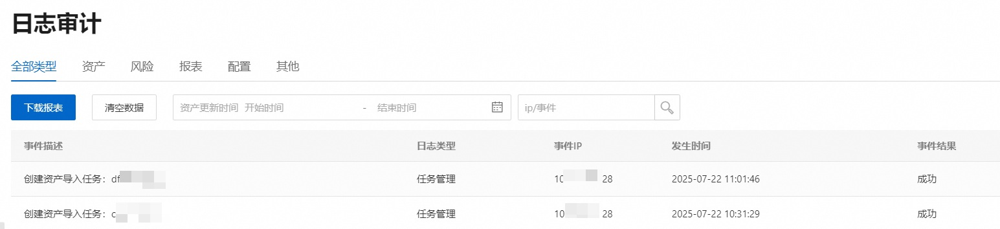

5. 单击日志列表上方的下载报表，可以下载对应日志报表文件。

6. 单击**清空数据**，可以仅保留**最近3个月**或**最近6个月**的日志数据，清空保存时间超出**最近3个月**或**最近6个月**的日志数据。

### 3.6.5. 引擎管理

本文介绍如何配置扫描引擎。

**使用说明**

- 私网资产引擎（即私网引擎）用于发现和扫描私有资产的引擎。

  只有通过给VPC授权扫描引擎，VPC对应的资产才能够进行漏洞扫描。

- 公网资产引擎（即公网引擎）用于发现和扫描公网资产的引擎。

- 每个VPC可独立维护私网引擎列表，可无限制添加私网引擎。公网引擎默认只有两个，且不可以添加和删除。

**操作步骤**

1. 登录Apsara Uni-manager运营控制台。

2. 在控制台右上方，单击**安全**，选择**安全管理 > 漏洞扫描**。在**漏洞扫描**授权页面，选择**地域**并单击**角色授权访问**。

   > **说明**
   >
   > - 在多级组织模式下，所有数据的权限都将关联到组织下的资源集维度。用户可以通过控制台顶部菜单栏选择不同组织和资源集，以查看或处理所属组织和资源集的资产。
   >
   > - 上级组织具有最高的管理权限，对内容的修改将覆盖下级组织和资源集的配置。在进行对应配置的修改时，请务必注意。

3. 在左侧导航栏，单击**配置管理 > 引擎管理**。

4. 在**公网引擎**页签，查看扫描引擎运行状态，并可开启自动导入EIP和SLB资产。

   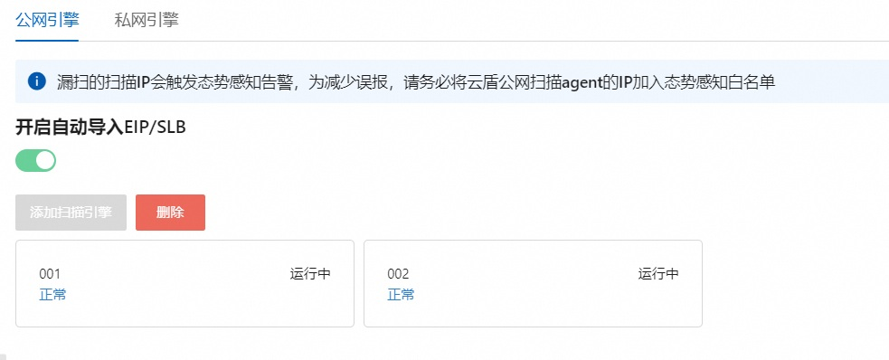

5. 单击**私网引擎**页签，配置私网资产的扫描引擎。

   <ol type="i">

   <li>

   单击需要进行漏洞扫描的VPC名称。

   </li>

   <li>

   单击**添加扫描引擎**。

   </li>

   <li>

   在**添加扫描引擎**对话框中，通过**vswitch**下拉菜单选择VPC的虚拟交换机。

   </li>

   <li>

   单击**确定**。

   </li>

   </ol>

# 4.云盾系统配置

## 4.1. 登录Apsara Uni-manager运营控制台

本文主要向您介绍如何登录Apsara Uni-manager运营控制台。

**前提条件**

- 登录Apsara Uni-manager运营控制台前，确认您已从部署人员处获取Apsara Uni-manager运营控制台的服务域名地址。

- 推荐使用Chrome浏览器。

**操作步骤**

1. 在浏览器地址栏中，输入Apsara Uni-manager运营控制台的服务域名地址，按回车键。

   

   > **说明**
   >
   > - 单击页面右上角的当前语言可以切换其它语言。
   >
   > - 授权登录是第三方认证中配置了全局IdP设置才会显示，且“授权登录”名称用户可按需自定义。

2. 输入正确的用户名及密码。

   > **说明**
   >
   > - 请向运营管理员获取登录控制台的用户名和密码。
   >
   > - 首次登录Apsara Uni-manager运营控制台时，需要修改登录用户名的密码，请按照提示完成密码修改。为提高安全性，密码长度必须为10~32位，且包含英文字母大小写、阿拉伯数字和特殊符号（感叹号（!）、at（@）、井号（#）、美元符号（$）、百分号（%）等）。

3. 单击**账号登录**。

4. 如果账号已激活MFA多因素认证，请根据以下两种情况进行操作：

   - **管理员强制开启MFA后的首次登录**

     <ol type="a">

     <li>

     在绑定虚拟MFA设备页面中，按页面提示步骤绑定MFA设备。

     </li>

     <li>

     按照步骤2重新输入账号和密码，单击**账号登录**。

     </li>

     </ol>

     <ol type="i" start="100">

     <li>

     输入6位MFA码后单击**认证**。

     </li>

     </ol>

   - **您已开启并绑定MFA**

     输入6位MFA码后单击**认证**。

     > **说明**
     >
     > 绑定并开启MFA的操作请参见管理多因素认证。

**相关操作**

**忘记密码**

1. 用户忘记登录密码时，单击密码输入框下方的**忘记密码**。

2. 在忘记密码页面，输入**账户名**、**邮箱**和验证码后，单击**确认**。

   

   > **说明**
   >
   > - 账户名请输入当前账号的用户名，邮箱请输入注册账号的Email地址。
   >
   > - 重置密码的链接将发至邮箱，进入链接后用户可输入新密码。

## 4.2. 规则运营

### 4.2.1. 云防火墙IPS规则运营

云防火墙内置IPS规则，用户可以根据自身的业务需求和网络环境自定义IPS规则，监控云防火墙运营状态。本文介绍如何添加和管理云防火墙的IPS规则。

**操作步骤**

1. 登录Apsara Uni-manager运营控制台。

2. 在控制台右上方，单击**安全**，选择**全局平台安全 > 系统配置**。在**系统配置**授权页面，选择**地域**并单击**角色授权访问**。

3. 在左侧导航栏，单击**规则运营**。

4. 在**云防火墙IPS规则运营**页签，单击**添加自定义规则**。完成如下配置后，单击**确定**。

   <table>
     <tr>
       <th width="89">配置项</th>
       <th>说明</th>
     </tr>
     <tr>
       <td>规则名称</td>
       <td>设置自定义IPS规则的名称，建议使用可识别规则用途的名称，便于后续管理。</td>
     </tr>
     <tr>
       <td>规则引擎</td>
       <td>在下拉栏中选择规则引擎，可选<strong>基础规则</strong>和<strong>虚拟补丁</strong>。</td>
     </tr>
     <tr>
       <td>攻击类型</td>
       <td>在下拉栏中选择该规则的攻击类型。</td>
     </tr>
     <tr>
       <td>等级</td>
       <td>在下拉栏中选择威胁等级，可选<strong>低危</strong>、<strong>中危</strong>或<strong>高危</strong>。</td>
     </tr>
     <tr>
       <td>CVE</td>
       <td>设置该规则的CVE编号。 说明通用漏洞披露CVE（Common Vulnerabilities and Exposures）列出了已公开披露的各种计算机安全缺陷。CVE编号由CVE编号管理机构（CNA）分配。</td>
     </tr>
     <tr>
       <td>攻击应用</td>
       <td>设置攻击应用名称。</td>
     </tr>
     <tr>
       <td>规则模式</td>
       <td>在下拉栏中选择IPS检测的规则模式，可选<strong>包模式</strong>和<strong>流模式</strong>。</td>
     </tr>
     <tr>
       <td>方向</td>
       <td>在下拉栏中选择IPS检测的流量方向，可选<strong>双向</strong>、<strong>入向</strong>和<strong>出向</strong>。</td>
     </tr>
     <tr>
       <td>规则内容</td>
       <td>设置规则内容，规则采用Snort语法。 说明添加规则内容时请确认正确性，不正确的规则内容可能会影响您的业务。</td>
     </tr>
     <tr>
       <td>规则描述</td>
       <td>设置规则描述信息，建议使用规则用途、影响等信息，便于后续管理。</td>
     </tr>
     <tr>
       <td>备注</td>
       <td>设置规则备注信息，建议使用规则用途、影响等信息，便于后续管理。</td>
     </tr>
   </table>

   添加自定义规则后，用户可以在规则列表，执行如下操作：

   - 查看规则详情您可以通过IPS规则列表上的筛选按钮，筛选需要查看的IPS规则。

     定位到某一规则，单击**操作**列中的**详情**，您可以查看该规则的具体信息。

   - 启用规则

     如果需要启用某个规则，则定位到该规则，单击**启用状态**列中的切换开关，将**禁用**切换为**启用**。

   - 禁用规则

     如果某个规则不适应于您的业务环境，您可以禁用该规则。

     定位到该规则，单击**启用状态**列中的切换开关，将**启用**切换为**禁用**。

### 4.2.2. Aliguard规则运营

Aliguard规则运营支持用户可以根据实际网络环境自定义DDos清洗策略、修改牵引阈值。本文介绍如何自定义DDoS的清洗策略和牵引阈值。

**操作步骤**

1. 登录Apsara Uni-manager运营控制台。

2. 在控制台右上方，单击**安全**，选择**全局平台安全 > 系统配置**。在**系统配置**授权页面，选择**地域**并单击**角色授权访问**。

3. 在左侧导航栏，单击**规则运营**。

4. 在**Aliguard规则运营**页签，单击**清洗策略**，自定义清洗策略的阈值。

   <ol type="i">

   <li>

   定位到需要调整的规则，单击**操作**列的**调整阈值**。

   </li>

   <li>

   在**调整阈值**对话框，输入阈值后，单击**确定**。

   </li>

   </ol>

5. 在**Aliguard规则运营**页签，单击**牵引阈值**，自定义牵引阈值。

   <ol type="i">

   <li>

   定位到需要调整的策略，单击**操作**列的**调整阈值**。

   </li>

   <li>

   在**调整阈值**对话框，输入阈值后，单击**确定**。

   </li>

   <li>

   <strong>可选：</strong>单击**开启DDoS自动牵引清洗**，在**开启自动牵引**对话框，单击**确定**。

   > **说明**
   >
   > **开启DDoS自动牵引清洗**开关默认关闭。

   - 自动牵引开关开启：根据用户自定义的DDos阈值触发清洗事件。受攻击IP会被自动牵引到DDoS集群进行流量清洗。

   - 自动牵引开关关闭：根据用户自定义的DDos阈值产生DDos告警事件，用户可以根据业务需要，在DDos控制台手动开始清洗和结束清洗。

   </li>

   </ol>

### 4.2.3. 安骑士规则运营

您可以在安骑士规则运营中查看漏洞情况、基线列表、主机异常列表。本文介绍如何查看安骑士规则的运营情况。

**操作步骤**

1. 登录Apsara Uni-manager运营控制台。

2. 在控制台右上方，单击**安全**，选择**全局平台安全 > 系统配置**。在**系统配置**授权页面，选择**地域**并单击**角色授权访问**。

3. 在左侧导航栏，单击**规则运营**。

4. 在**安骑士规则运营**页签，查看安骑士规则运营情况。

   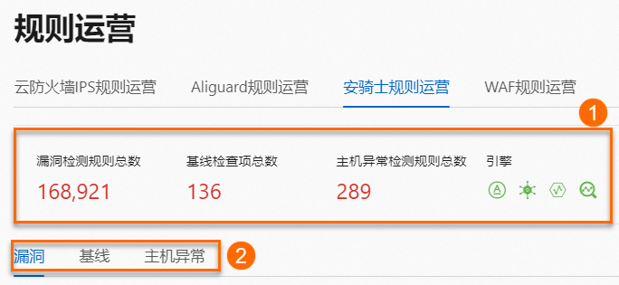

   | 项目 | 说明 |
   | --- | --- |
   | 总览（图示①） | 支持查看<strong>漏洞检测规则总数</strong>、<strong>基线检查项总数</strong>、<strong>主机异常检测规则总数</strong>、<strong>引擎</strong>信息。 |
   | 漏洞（图示②） | 在<strong>漏洞</strong>页签，查看检测到的所有漏洞及总数。 • 在搜索框选择漏洞类型、输入CVE编号、系统名称，可搜索对应漏洞。 • 在漏洞列表，查看检测到的漏洞的<strong>漏洞名称</strong>、<strong>CVE编号</strong>、<strong>漏洞类型</strong>、<strong>系统</strong>、<strong>更新时</strong><strong>间</strong>、<strong>状态</strong>。 |
   | 基线（图示②） | 在<strong>基线</strong>页签，查看检测到的基线类型、基线检查项数据。 • 在搜索框选择基线类型、风险等级、检查项类别、检查项名称，可搜索对应基线。 • 在基线列表，查看<strong>基线类型</strong>、<strong>检查项类别</strong>、<strong>检查项名称</strong>、<strong>风险等级</strong>、<strong>更新时间</strong>、<strong>状态</strong>。 |
   | 主机异常（图示②） | 在<strong>主机异常</strong>页签，查看<strong>规则告警子类型数</strong>、<strong>WebShell&amp;恶意病毒（进程）</strong>信息。 • 在搜索框选择规则父类、风险等级、规则告警子类名称，可搜索对应主机异常事件。 • 在主机异常列表，查看<strong>子类名称</strong>、<strong>规则父类</strong>、<strong>风险等级</strong>、<strong>更新时间</strong>、<strong>来源</strong>、<strong>状态</strong>。 |

### 4.2.4. WAF规则运营

通过WAF规则运营，用户可以根据自身的业务需求和网络环境自定义WAF运营规则，监控WAF运营状态。本文介绍如何添加和管理WAF运营规则。

**操作步骤**

> **重要**
>
> 该运营规则为全局自定义规则，会对所有租户生效，请谨慎操作。

1. 登录Apsara Uni-manager运营控制台。

2. 在控制台右上方，单击**安全**，选择**全局平台安全 > 系统配置**。在**系统配置**授权页面，选择**地域**并单击**角色授权访问**。

3. 在左侧导航栏，单击**规则运营**。

4. 在**WAF规则运营**页签，单击**添加自定义规则**。完成如下配置后，单击**确定**。

   <table>
     <tr>
       <th width="121">配置项</th>
       <th>说明</th>
     </tr>
     <tr>
       <td>模式</td>
       <td>设置规则的处置模式和运行状态。 • 处置模式支持<strong>拦截</strong>、<strong>放行</strong>、<strong>观察</strong>、<strong>检测模块控制</strong>。 • 运行状态支持<strong>启用</strong>或<strong>禁用</strong>。</td>
     </tr>
     <tr>
       <td>备注</td>
       <td>填写规则的备注信息。</td>
     </tr>
     <tr>
       <td>威胁等级</td>
       <td>设置规则检测的威胁等级。可选项：<strong>无威胁</strong>、<strong>低危</strong>、<strong>中危</strong>、<strong>高危</strong>。</td>
     </tr>
     <tr>
       <td>匹配条件</td>
       <td>设置规则的<strong>匹配字段</strong>、<strong>逻辑符</strong>和<strong>匹配内容。</strong></td>
     </tr>
     <tr>
       <td>是否记录日志</td>
       <td>设置记录日志的场景。可选项：<strong>命中时记录、</strong>命中时不记录。</td>
     </tr>
     <tr>
       <td>攻击类型</td>
       <td>选择规则检测的攻击类型。不支持多选。</td>
     </tr>
     <tr>
       <td>阻断状态码</td>
       <td>选择规则检测的阻断状态码。不支持多选。</td>
     </tr>
     <tr>
       <td>过期时间</td>
       <td>设置规则的过期时间。不设置时间表示规则永不过期。</td>
     </tr>
   </table>

   添加运营规则后，用户可以在规则列表，执行如下操作：

   - 通过规则列表上的筛选按钮，筛选需要查看的WAF运营规则。

   - 定位到某一规则，单击**操作**列中的**编辑**，您可以修改规则信息。

## 4.3. 全局设置

### 4.3.1. 拦截策略设置

通过安全阻断功能，能够防御Web攻击和暴力破解。本文介绍如何启用应用攻击阻断和暴力破解阻断功能。

**操作步骤**

1. 登录Apsara Uni-manager运营控制台。

2. 在控制台右上方，单击**安全**，选择**全局平台安全 > 系统配置**。在**系统配置**授权页面，选择**地域**并单击**角色授权访问**。

3. 在左侧导航栏，单击**全局设置**。

4. 在**全局设置**页签，单击拦截类型操作列的开关，启用或圈闭拦截策略。

   关闭后，相应的拦截功能将被禁用，仅提供预警功能。

## 4.4. 账号管理

### 4.4.1. 专有云账号管理

本文介绍如何查看、修改系统绑定的专有云账号信息。

> **重要**
>
> 云盾中的资产均与账号绑定，请谨慎修改。

**操作步骤**

1. 登录Apsara Uni-manager运营控制台。

2. 在控制台右上方，单击**安全**，选择**全局平台安全 > 系统配置**。在**系统配置**授权页面，选择**地域**并单击**角色授权访问**。

3. 在左侧导航栏，单击**账号管理**。

4. 在**专有云账号**页签，修改阿里云账号信息。

   <ol type="i">

   <li>

   定位到要修改的阿里云账号，单击**操作**列的**修改**。

   </li>

   <li>

   在**账号修改**对话框中，修改阿里云账号名、Access Key、Access Secret信息，单击**确定**。

   </li>

   </ol>

修改完成后，用户可以单击**操作**列的详情，查看阿里云账号详情。

### 4.4.2. 公有云账号管理

通过在专有云中添加公有云账号，您可以在专有云中管理该公有云账号下已购买的高防IP和WAF，实现混合云功能。本文介绍如何添加公有云账号。

**操作步骤**

如果专有云中需要使用混合云功能，需要根据本文添加阿里云公有云账号。

1. 登录Apsara Uni-manager运营控制台。

2. 在控制台右上方，单击**安全**，选择**全局平台安全 > 系统配置**。在**系统配置**授权页面，选择**地域**并单击**角色授权访问**。

3. 在左侧导航栏，单击**账号管理**。

4. 在**公有云账号**页签，单击**添加**。

   <ol type="i">

   <li>

   定位到要修改的阿里云账号，单击**修改**。完成如下配置后，单击确定。

   | 配置项 | 说明 |
   | --- | --- |
   | Access Key | 设置要添加的公有云Access Key。 |
   | Access Secret | 设置要添加的公有云Access Secret。 |
   | 公有云产品 | 选择使用的公有云产品，支持<strong>高防IP</strong>和<strong>Web应用防护</strong>，可单选一个产品或全选。 |

   </li>

   </ol>

添加完成后，用户可以在账号列表查看已添加的公有云账号，支持**修改**和**删除**账号。
