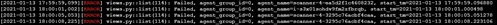
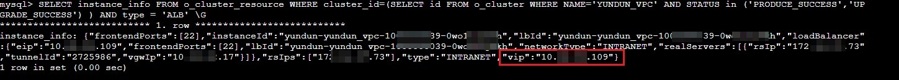
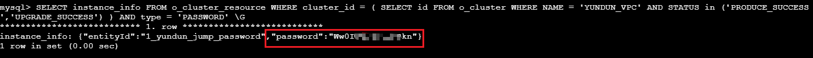
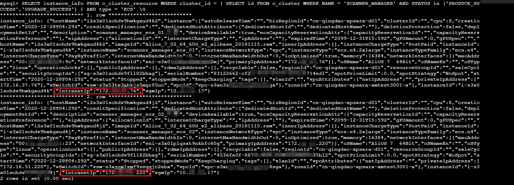
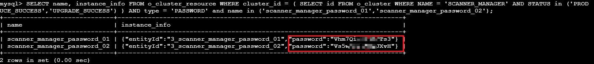
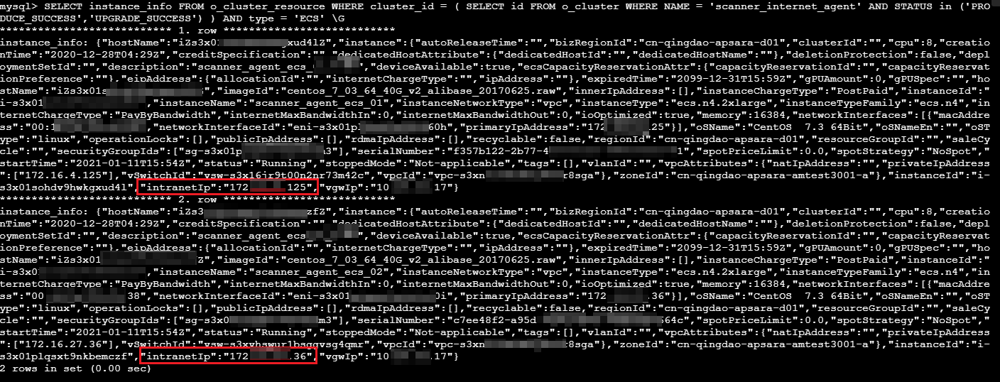
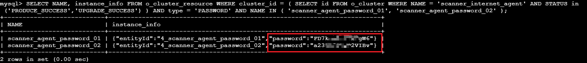
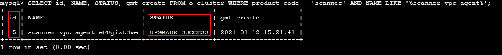
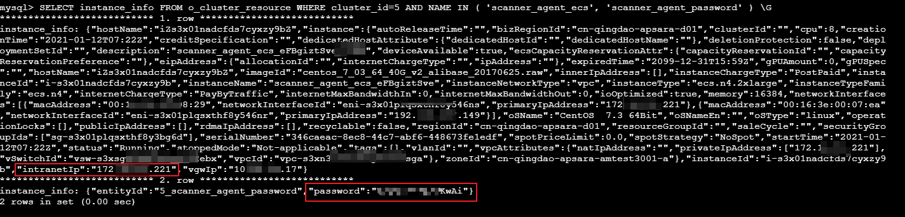

阿里云  
专有云  
云盾-态势感知  
漏洞扫描运维指南  
产品版本：V3.18.6  
文档版本：20250613

**目录**

- [1.系统部署](#section-1)
    - [1.1. 准备工作](#section-1-1)
    - [1.2. 部署工作](#section-1-2)
- [2.系统运维](#section-2)
    - [2.1. 场景一：漏洞扫描CICD部署失败](#section-2-1)
    - [2.2. 场景二：漏洞扫描管控端前端页面丢失](#section-2-2)
    - [2.3. 场景三：漏洞扫描管控端web页面报错](#section-2-3)
    - [2.4. 场景四：漏洞扫描公网引擎异常](#section-2-4)
    - [2.5. 场景五：漏洞扫描私网引擎异常](#section-2-5)
- [3.业务排障](#section-3)
    - [3.1. 场景一：导入资产失败](#section-3-1)
    - [3.2. 场景二：导入资产进度条不动](#section-3-2)
    - [3.3. 场景三：资产自定义更新检测的检测状态一直显示初始化](#section-3-3)
    - [3.4. 场景四：资产可用性监控页面最近很长时间没有监控记录](#section-3-4)
    - [3.5. 场景五：网站资产-公网资产无网站截图](#section-3-5)
    - [3.6. 场景六：报表无法下载](#section-3-6)
- [4.附录](#section-4)
    - [4.1. 查看跳板机IP和密码](#section-4-1)
    - [4.2. 查询管控端IP和密码](#section-4-2)
    - [4.3. 查询公网引擎IP和密码](#section-4-3)
    - [4.4. 查询私网引擎IP和密码](#section-4-4)

<a id="section-1"></a>

# 1.系统部署

<a id="section-1-1"></a>

## 1.1. 准备工作

CICD上漏洞扫描镜像包已经构建完成，且已经申请到了部署环境。

<a id="section-1-2"></a>

## 1.2. 部署工作

CICD上单击部署，部署模板可以选择终态升级，等待部署完成即可，CICD上显示部署完成之后，登录到漏洞扫描管控端的ECS上，查看docker镜像信息，是否是最近创建的，如果没有docker镜像或者docker创建时间与部署时间不匹配，可能是部署失败了，重新尝试部署，如果再次部署依旧如此，需要联系环境owner帮忙排查问题。

<a id="section-2"></a>

# 2.系统运维

<a id="section-2-1"></a>

## 2.1. 场景一：漏洞扫描CICD部署失败

**故障描述**

CICD环境部署失败。

**可能原因**

- 环境本身存在问题。

- 漏洞扫描镜像包有问题。

**排查思路**

1. 申请其他环境部署，如果能够在新申请的环境上部署成功，可能是旧环境存在问题。

2. 如果在多个其他环境部署都失败，可能是该镜像包存在问题，需要联系漏洞扫描开发人员重新打包，正常情况下，发布的镜像包已经过多次测试，一般不会存在问题，但也不排除与某个模块或者服务不兼容的情况。

<a id="section-2-2"></a>

## 2.2. 场景二：漏洞扫描管控端前端页面丢失

**故障描述**

单击【态势感知】的【漏洞扫描】菜单，但是页面显示的还是【总览】的数据。

**可能原因**

- 部署环境问题

**排查思路**

尝试重新部署，如果重新部署之后还是没有变化，就联系环境Owner帮忙排查。

<a id="section-2-3"></a>

## 2.3. 场景三：漏洞扫描管控端web页面报错

**故障描述**

部署完成后，登录到管控端，web页面弹出提示框：“Error”、“SystemError”等现象。

**可能原因**

- 请求超时。

- 管控端服务异常。

- 管控端服务报错。

**排查思路**

1. 打开浏览器开发者工具，查看对应接口的网络请求，查看并复制响应体中的requestId，到OEM日志中查询具体报错信息。

2. 根据【4.附录】查询跳板机、管控端的IP和密码，使用SSH连接到跳板机，然后再通过跳板机使用SSH分别连接到2台管控端，执行docker ps指令，查看正在运行的docker容器，管控端1有3个运行的容器，分别为一个漏扫容器，一个redis服务和一个redis哨兵服务，管控端2有4个运行的容器，分别为1个漏扫服务，1个redis服务和2个哨兵服务，使用docker exec进入到docker的scanner容器，再执行supervisorctl查看托管的服务，查看服务是否都是RUNNING状态。

3. 分别登录到两台管控端，进入docker容器，查看服务端运行的日志，日志放在 `/home/moresec/logs/` 目录下，查看日志中是否有ERROR级别日志出现。（其中如下这条ERROR日志可以忽略）

   

<a id="section-2-4"></a>

## 2.4. 场景四：漏洞扫描公网引擎异常

**可能原因**

- 漏洞扫描公网引擎机器时间与管控端不一致。

- 漏洞公网引擎所在环境异常。

- 其他原因。

**排查思路**

1. 通过【4.附录】查询公网引擎IP和密码，查询到相关登录信息，登录到公网引擎所在机器，查看当前系统时间，查看时间与管控端时间是否一致，如果时间不一致，有可能就是扫描引擎与管控端时间不一致导致的异常；最多等待5分钟，会有定时任务脚本自动同步时间。

2. 第二种情况可能是公网引擎所在的环境异常，需要联系环境Owner帮助排查。

3. 登录到oem docker容器，进入logs/applog/目录，查看cluster.log日志中异常引擎对应的type。

<a id="section-2-5"></a>

## 2.5. 场景五：漏洞扫描私网引擎异常

**可能原因**

- 漏洞扫描私网引擎机器时间与管控端不一致。

- 漏洞私网引擎所在环境异常。

- 其他原因。

**排查思路**

1. 先尝试在管控端web页面重新启动扫描引擎，如果不行，就通过【4.附录】查询私网引擎IP和密码，查询到相关登录信息，登录到私网引擎所在机器，查看当前系统时间，查看时间与管控端时间是否一致，如果时间不一致，有可能就是扫描引擎与管控端时间不一致导致的异常；最多等待5分钟，会有定时任务脚本自动同步时间。

2. 第二种情况可能是私网引擎所在的环境异常，需要联系环境Owner帮助排查。

3. 登录到oem docker容器，进入logs/applog/目录，查看cluster.log日志中异常引擎对应的type。

<a id="section-3"></a>

# 3.业务排障

<a id="section-3-1"></a>

## 3.1. 场景一：导入资产失败

**故障描述**

在管控端web页面导入资产时导入失败。

**可能原因**

- 公网扫描引擎异常。

- 私网扫描引擎异常。

- 请求超时。

- 资产剩余可用数为0。

**排查思路**

1. 可以去管控端页面的【配置】【扫描引擎管理】【公网资产】查看公网引擎状态，或者登录到OEM数据库，执行下面的SQL语句，查询公网引擎的集群状态：

   

```text
id, NAME, STATUS FROM o_cluster WHERE NAME = 'scanner_internet_agent' ORDER BY
```

gmt_create;

如果返回的结果中，status字段的值为PRODUCE_SUCCESS或者UPGRADE_SUCCESS，表示状态是正常的，如果是其他结果，就说明有扫描引擎的状态是异常，然后就按照【场景四：漏洞扫描公网引擎异常】来处理。

2. 可以去管控端页面的【配置】【扫描引擎管理】【私网资产】查看私网引擎状态，或者登录到OEM数据库，执行下面的SQL语句，查询私网引擎集群状态：

   SELECT id, NAME, STATUS, gmt_create FROM o_cluster

   WHERE product_code = 'scanner' AND NAME LIKE '%scanner_vpc_agent%';

   如果返回的结果中，status字段的值为PRODUCE_SUCCESS或者UPGRADE_SUCCESS，表示状态是正常的，如果是其他结果，就说明有扫描引擎的状态是异常，然后就按照【场景五：漏洞扫描私网引擎异常】来处理。

3. 尝试重新导入，如果还是失败，打开开发者工具，查询响应体中的requestId，通过这个requestId到OEM日志中查询具体失败原因。

4. 删除已导入的无用资产来释放可用数，重新尝试导入。

<a id="section-3-2"></a>

## 3.2. 场景二：导入资产进度条不动

**故障描述**

在管控端web页面导入资产时，查看导入详情，导入进度条不动。

**可能原因**

- 公网扫描引擎异常导致导入任务失败。

- 私网扫描引擎异常导致导入任务失败。

- 引擎端同时存在的任务较多，本次导入任务还未开始。

**排查思路**

1. 同上一步【场景一：导入资产失败】中排查公网引擎方法。

2. 同上一步【场景一：导入资产失败】中排查私网引擎方法。

3. 如果导入任务的状态是初始化或者进行中，等待其他进行中的导入任务导入完毕，引擎端任务调度之后，再次查看导入进度条是否有变化；如果导入任务的状态是失败，则需要检测引擎端是否正常，如果引擎端异常，尝试重启引擎。

<a id="section-3-3"></a>

## 3.3. 场景三：资产自定义更新检测的检测状态一直显示初始化

**故障描述**

在管控端web页面添加自定义更新检测时，检测状态一直显示初始化。

**可能原因**

- 公网扫描引擎异常。

- 私网扫描引擎异常。

- 引擎端同时存在的任务较多，本次导入任务还未开始。

**排查思路**

1. 排查公网引擎状态是否正常，如果异常，尝试重启该引擎。

2. 排查私网引擎状态是否正常，如果异常，尝试重启该引擎。

3. 如果当前有较多正在进行中的任务，等待一段时间再查看，如果当前导入任务很少，但是该任务还是显示初始化，则可能是扫描引擎异常。请参考附录，分别排查公网和私网扫描引擎异常。

<a id="section-3-4"></a>

## 3.4. 场景四：资产可用性监控页面最近很长时间没有监控记录

**故障描述**

在管控端web界面打开【资产-可用性监控】，单击某一个监控任务的详情，打开之后，没有监控记录。

**可能原因**

- 还没到配置的监控时间。

- 扫描引擎异常。

**排查思路**

1. 单击监控任务详情，查看监控设置的监控频率是多久一次，查看监控记录里的上次检测时间距离现在是多久，如果时间相差不大，可能是监控任务还没到执行时间，稍等一两分钟再看；如果时间相差很大，则有可能是扫描引擎异常。

2. 按照【2.系统运维】中的场景四和五分别排查公网和私网引擎异常问题。

<a id="section-3-5"></a>

## 3.5. 场景五：网站资产-公网资产无网站截图

**故障描述**

在管控端web界面打开**资产 > 资产列表 > 网站资产**，单击其中一条记录的详情，没有网站截图。

**可能原因**

- oss问题导致网站截图无法显示。

**排查思路**

1. 如果请求的接口没有报错，联系oss同学帮忙排查。

<a id="section-3-6"></a>

## 3.6. 场景六：报表无法下载

**故障描述**

在管控端web界面打开【报表】，单击下载按钮无法下载Excel报表。

**可能原因**

- oss问题导致报表无法下载。

**排查思路**

1. 如果请求接口没有报错，联系oss同学帮忙排查。

<a id="section-4"></a>

# 4.附录

<a id="section-4-1"></a>

## 4.1. 查看跳板机IP和密码

本文介绍如何查看跳板机IP和密码。

查看跳板机IP

1. 登录到对应环境的oem数据库。

2. 执行下述SQL语句，查询结果中的vip即为跳板机的IP。

   ```sql
   SELECT instance_info FROM o_cluster_resource WHERE cluster_id=(SELECT id FROM o_cluster WHERE NAME='YUNDUN_VPC' AND STATUS in ('PRODUCE_SUCCESS','UPGRADE_SUCCESS') ) AND type = 'ALB' \G
   ```

   

查看跳板机密码

1. 登录到对应环境的oem数据库。

2. 执行下述SQL语句，查询结果中的password即为跳板机的密码。

   ```sql
   SELECT instance_info FROM o_cluster_resource WHERE cluster_id = ( SELECT id FROM o_cluster WHERE NAME = 'YUNDUN_VPC' AND STATUS in ('PRODUCE_SUCCESS','UPGRADE_SUCCESS') )
   AND type = 'PASSWORD' \G
   ```

   

<a id="section-4-2"></a>

## 4.2. 查询管控端IP和密码

本文介绍如何查询管控端IP和密码。

**查询两台管控端IP**

1. 登录到对应环境的oem数据库。

2. 执行下述SQL语句，查询结果两条记录的intranetIp即为两台漏洞扫描管控端的IP。

   ```sql
   SELECT instance_info FROM o_cluster_resource WHERE cluster_id = ( SELECT id FROM o_cluster WHERE NAME = 'SCANNER_MANAGER' AND STATUS in 
   ('PRODUCE_SUCCESS','UPGRADE_SUCCESS') ) AND type = 'ECS' \G
   ```

   

**查询两台管控端IP密码**

1. 登录到对应环境的oem数据库。

2. 执行下述SQL语句，查询结果中两条记录的password即为两台漏洞扫描管控端的密码

   ```sql
   SELECT name, instance_info FROM o_cluster_resource WHERE cluster_id = ( SELECT id FRO
   M o_cluster WHERE NAME = 'SCANNER_MANAGER' AND STATUS in 
   ('PRODUCE_SUCCESS','UPGRADE_SUCCESS') ) AND type = 'PASSWORD' and name in ('scanner_manager_password_01','scanner_manager_password_02');
   ```

   

<a id="section-4-3"></a>

## 4.3. 查询公网引擎IP和密码

本文介绍如何查询公网引擎IP和密码。

**查询两台公网引擎IP**

1. 登录到对应环境的oem数据库。

2. 执行下述SQL语句，查询结果中两条记录的intranetIp即为两台漏洞扫描公网引擎的IP。

   ```sql
   SELECT instance_info FROM o_cluster_resource WHERE cluster_id = ( SELECT id FROM o_cluster WHERE NAME = 'scanner_internet_agent' AND STATUS in 
   ('PRODUCE_SUCCESS','UPGRADE_SUCCESS') ) AND type = 'ECS' \G
   ```

   

**查询两台公网引擎密码**

1. 登录到对应环境的oem数据库。

2. 执行下述SQL语句，查询结果中两条记录的password即为两台漏洞扫描公网引擎的密码。

   ```sql
   SELECT NAME, instance_info FROM o_cluster_resource WHERE cluster_id = ( SELECT id FRO
   M o_cluster WHERE NAME = 'scanner_internet_agent' AND STATUS in 
   ('PRODUCE_SUCCESS','UPGRADE_SUCCESS') ) AND type = 'PASSWORD' AND NAME IN ( 'scanner_agent_password_01', 'scanner_agent_password_02' );
   ```

   

<a id="section-4-4"></a>

## 4.4. 查询私网引擎IP和密码

本文介绍如何查询私网引擎IP和密码。

**查询漏洞扫描私网引擎ID**

**方法一：通过管控端页面获取**

获取私网引擎ID的位置详见下图。

**方法二：通过OEM数据库查询**

1. 登录到对应环境的oem数据库。

2. 执行下述SQL语句，获取到所有的漏扫引擎，找到 `status = PRODUCE_SUCCESS` 为生产成功的引擎，具体要定位到哪个集群，可根据gmt_create创建时间来判断，之后可根据其id查询出对应的集群资源。

   ```sql
   SELECT id, NAME, STATUS, gmt_create FROM o_cluster WHERE product_code = 'scanner' AND
   NAME LIKE '%scanner_vpc_agent%';
   ```

   

**查询漏洞扫描私网引擎IP和密码**

1. 登录到对应环境的oem数据库。

2. 执行下述SQL语句，查询status不为SUCCESS的记录的id。

   ```sql
   SELECT id, NAME, STATUS, gmt_create FROM o_cluster WHERE product_code = 'scanner' AND
   NAME LIKE '%scanner_vpc_agent%';
   ```

   

3. 使用上一步中获取的id替换下述SQL中的id，然后执行下述SQL语句。查询结果中的intranetIp即为漏洞扫描私网引擎的IP（同样的方法可获取其他私网引擎的IP），password即为密码。

   ```sql
   SELECT instance_info FROM o_cluster_resource WHERE cluster_id=上⼀步获取的id AND NAME I
   N ( 'scanner_agent_ecs', 'scanner_agent_password' ) \G
   ```

   
