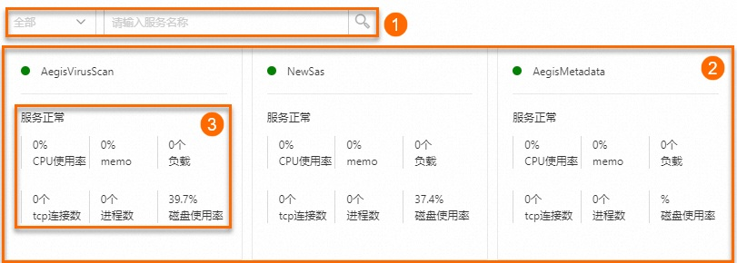
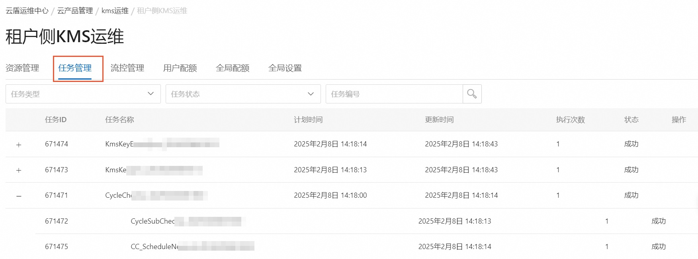
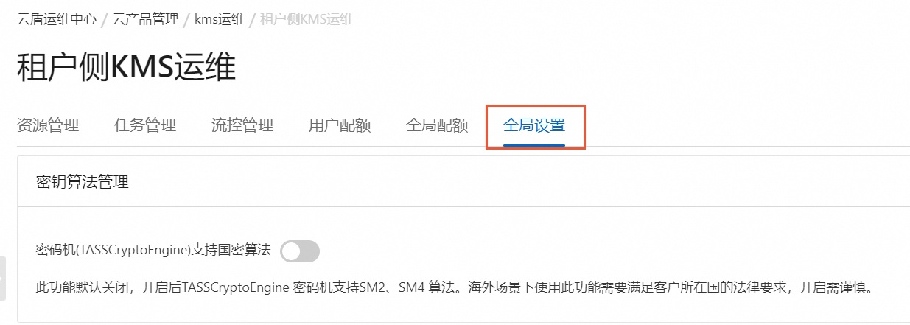
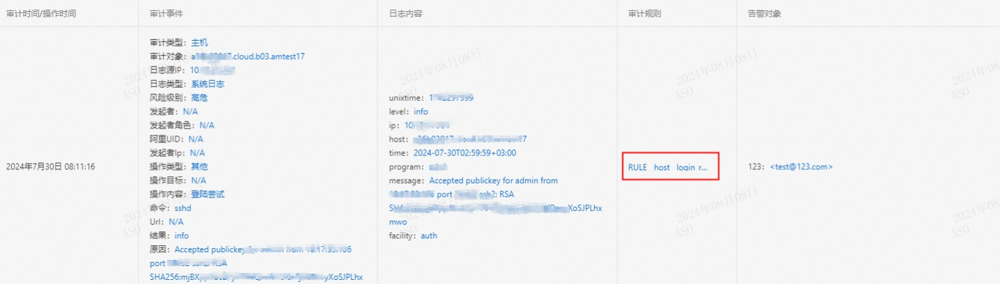
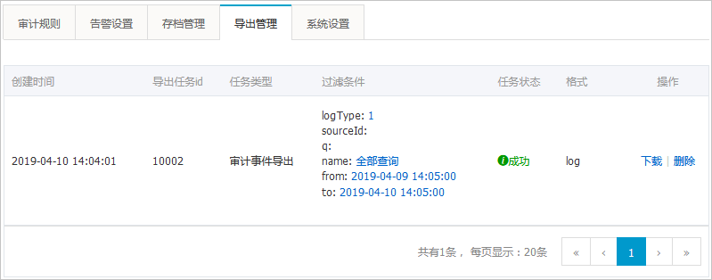
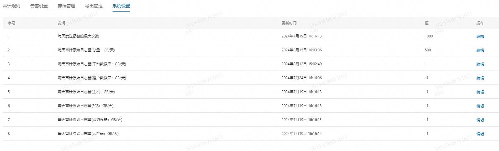

阿里云  
专有云  
云盾  
安全管理员指南  
产品版本：V3.18.6  
文档版本：20250929

**目录**

- [1.使用须知](#section-1)
- [2.登录云盾运维中心](#section-2)
- [3.监控告警](#section-3)
    - [3.1. 系统监控](#section-3-1)
    - [3.2. 业务监控](#section-3-2)
    - [3.3. 告警设置](#section-3-3)
- [4.运维管理](#section-4)
    - [4.1. 中间件管理](#section-4-1)
- [5.云产品管理](#section-5)
    - [5.1. 安骑士运维](#section-5-1)
        - [5.1.1. 高风险管理](#section-5-1-1)
    - [5.2. 网络流量检测与响应](#section-5-2)
        - [5.2.1. 运维日志](#section-5-2-1)
        - [5.2.2. 节点状态](#section-5-2-2)
        - [5.2.3. 功能配置](#section-5-2-3)
    - [5.3. KMS运维](#section-5-3)
        - [5.3.1. 资源管理](#section-5-3-1)
        - [5.3.2. 任务管理](#section-5-3-2)
        - [5.3.3. 流控管理](#section-5-3-3)
        - [5.3.4. 用户限额](#section-5-3-4)
        - [5.3.5. 全局配额](#section-5-3-5)
        - [5.3.6. 全局设置](#section-5-3-6)
- [6.升级中心](#section-6)
    - [6.1. 升级中心概述](#section-6-1)
    - [6.2. 升级特征库或版本](#section-6-2)
- [7.巡检诊断](#section-7)
    - [7.1. 全链路日志](#section-7-1)
    - [7.2. 一键诊断](#section-7-2)
    - [7.3. 前端监控](#section-7-3)
- [8.安全审计](#section-8)
    - [8.1. 概述](#section-8-1)
    - [8.2. 查看审计汇总信息](#section-8-2)
    - [8.3. 查询审计事件](#section-8-3)
    - [8.4. 查看原始日志](#section-8-4)
    - [8.5. 查看日志量](#section-8-5)
    - [8.6. 策略设置](#section-8-6)
        - [8.6.1. 管理审计规则](#section-8-6-1)
        - [8.6.2. 设置告警接收人](#section-8-6-2)
        - [8.6.3. 查询事件日志存档](#section-8-6-3)
        - [8.6.4. 下载导出的任务](#section-8-6-4)
        - [8.6.5. 修改系统配置](#section-8-6-5)

# 1.使用须知

在登录云盾控制台前，您需要确认本地PC符合以下配置。

本地PC需要满足如配置要求表中配置要求，才可以正常登录云盾控制台。

表 1. 配置要求表

<table>
  <tr>
    <th width="90">内容</th>
    <th>要求</th>
  </tr>
  <tr>
    <td>浏览器</td>
    <td>• Internet Explorer浏览器：11及以上版本 • Chrome浏览器（推荐）：42.0.0及以上版本 • Firefox浏览器：30及以上版本 • Safari浏览器：9.0.2版本及以上版本</td>
  </tr>
  <tr>
    <td>操作系统</td>
    <td>• Windows XP版本 • Windows 7及以上版本 • Mac系统</td>
  </tr>
</table>

# 2.登录云盾运维中心

云盾运维中心是云盾产品的运营平台，可以实时监控云盾产品运行状态和业务状态，并将告警发送给用户。实时监控并根据介绍如何登录云盾运维中心。

**前提条件**

- 已从部署人员或管理员处获取Apsara Uni-manager运维控制台的访问地址、用户名和密码。

  Apsara Uni-manager运维控制台访问地址格式为*region-id*.ops.console.*intranet-domain-id*。

- 推荐使用Chrome浏览器。

**操作步骤**

1. 打开浏览器。

2. 在地址栏中，输入Apsara Uni-manager运维控制台的访问地址，按回车键。

   

   > **说明**
   >
   > 您可以单击右上角的当前语言切换其它语言。当前支持简体中文、英文、繁体中文三种语言切换。

3. 输入正确的账户名及密码。

   > **说明**
   >
   > - 登录Apsara Uni-manager运维控制台的用户名和密码请从部署人员或管理员处获取。
   >
   > - 若连续输入密码错误三次，系统将启动图片验证码登录功能；若连续输入错误五次，账户将被锁定，请联系管理员进行激活。
   >
   > - 首次登录Apsara Uni-manager运维控制台时，需要修改登录用户名的密码，请按照提示完成密码修改。
   >
   >   为提高安全性，密码必须满足以下要求：
   >
   >   - 必须包含英文大小写字母。
   >
   >   - 必须包含阿拉伯数字（0~9）。
   >
   >   - 必须包含特殊符号，包括感叹号（!）、at（@）、井号（#）、美元符号（$）、百分号（%）等。
   >
   >   - 密码长度为10~20个字符。

4. 单击**同意协议并登录**。

5. 在Apsara Uni-manager运维控制台的顶部菜单栏，选择**产品运维 > 安全运维 > 云盾运维中心**。

**执行结果**

在**云盾运维中心**页面，您可以查看相关信息。

# 3.监控告警

## 3.1. 系统监控

通过系统监控，用户可以监控已接入的云产品，及时发现异常产品，便于产品运维。本文介绍如何查看系统监控。

**操作步骤**

1. 登录云盾运维中心。

2. 在左侧导航栏，选择**监控告警** ＞ **系统监控**。

3. 在系统监控页面，查看监控总览和云产品监控数据。

   - 在**监控总览**页签，查看监控总览信息。

     - 监控数据总览：支持查看**监控产品总数**、**异常产品总数**、**监控项总数**、**异常项总数**等数据。

     - 云产品监控数据：支持查看所有已接入的云产品的**监控项数量**、**异常数**、**产品状态**数据。

   - 在云产品页签，查看各产品监控数据。

     - 支持监控的云产品包括：安骑士、SOC云安全管理中心、网络检测响应、密钥管理服务等。

- 支持监控的内容：

  

  - 单击云产品区域（图示②），查看云产品的所有服务。

  - 在云产品页签，用户可以通过服务列表上的搜索框（图示①），根据服务状态和服务名称，搜索对应服务。

  - 在服务卡片区域（图示③），查看CPU使用率、memo使用率、负载数、tcp连接数、进程数等数据。

  - 单击服务卡片区域（图示③），在服务详情页面，查看云产品服务监控详情。

    <table>
      <tr>
        <th width="90">监控项</th>
        <th>说明</th>
      </tr>
      <tr>
        <td>基础监控</td>
        <td>• 用户可以通过设置监控时间、监控视角，查看基础监控和中间件的详细监控数据。 • 监控时间：支持监控3小时、6小时、12小时、1天、2天、自定义时间段。 用户可以单击图标，手动刷新监控数据，也可以打开自动刷新开关，自动刷新监控数据。 • 监控视角：支持集群视角、单机视角。 • 支持查看的监控数据：CPU使用率（%）、memo（%）、负载（个）、tcp连接数（个）、进程数（个）或磁盘使用率（%）等数据。</td>
      </tr>
      <tr>
        <td>中间件</td>
        <td>• 用户可以通过设置监控时间、监控视角，查看基础监控和中间件的详细监控数据。 • 监控时间：支持监控3小时、6小时、12小时、1天、2天、自定义时间段。 用户可以单击图标，手动刷新监控数据，也可以打开自动刷新开关，自动刷新监控数据。 • 监控视角：支持集群视角、单机视角。 • 支持查看的监控数据：Metaq QPS、JVM Gc 次数、JVM Gc 耗时、JVM Memory、JVM Classloading、JVM Threadstate、JVM Threadcount、HSF QPS、HSF RT（ms）、数据库使用率（%）等数据。</td>
      </tr>
      <tr>
        <td>健康检查</td>
        <td>基于TCP、HTTP等探测方式，检查应用中所有主机的健康状态，以集群视角进行展示。</td>
      </tr>
    </table>

## 3.2. 业务监控

通过业务监控，用户可以监控接入的云产品的业务运行情况。本文介绍如何查看业务监控信息。

**操作步骤**

1. 登录云盾运维中心。

2. 在左侧导航栏，选择**监控告警** ＞ **业务监控**。

3. 单击各云盾产品页签，查看业务监控情况。

   **服务**

   **业务模块**

   **相关操作**

   **云盾控制台**、**云盾网关**

   **基础服务**

   **资产**、**资产暴露**、**攻击分析**、**告警事件**、**应用白名单**、**病毒查杀**、**资产指纹**、**日志**、**文件采集**、**二进制检**

   **安骑士**

   **测**、**WebShell检测**、**恶意脚本检测**、**漏洞**、**基线**、**防篡改**、**云查杀**、**客户端**、**资产灰度**

   - 查看指定基础服务在指定时间范围内的监控详情。

   - 开启**自动刷新**监控数

   **密钥管理服务底座版**、**密钥管理服务租户版**

   **密钥管理服务(KMS)**

   据，或单击  图标，

   手动刷新监控数据。

   **SocApp**、**SiemApp**

   **SOC云安全管理中心**

   **网络流量检测与响应**

   **网络流量检测与响应**

   **原始日志**、**审计事件**

   **安全审计**

## 3.3. 告警设置

告警设置支持设置告警联系人和告警规则。当监控数据满足报警规则时，系统自动发送告警信息给报警联系人，支持钉钉消息和邮件。本文介绍如何添加和管理告警联系人。

**设置告警联系人**

1. 登录云盾运维中心。

2. 在左侧导航栏，选择**监控告警 > 告警设置**。

3. 在**联系人管理**页签，单击**添加联系人**。填写联系人姓名、钉钉机器人Token、邮箱信息后，单击**确定**。

   添加后的联系人可以在联系人列表查看，支持**编辑**、**批量删除**。

# 4.运维管理

## 4.1. 中间件管理

云盾安全运营中心支持对Diamond、Tair、ScheduleX、dubbo、OpenApi、Metaq、OpsApi等中间件进行管理。本文介绍如何管理云盾中间件。

**操作步骤**

1. 登录云盾运维中心。

2. 在左侧导航栏，选择**运维管理** ＞ **中间件管理**。

3. 在**中间件管理**页面，管理中间件。

   **Diamond管理**

   单击**Diamond管理**页签，完成如下配置后，单击**搜索**，查询到对应中间件后，单击**保存**。

   | 配置项 | 说明 |
   | --- | --- |
   | Data ID | 填写Diamond中间件的Data ID。 |
   | Group ID | 填写Diamond中间件的Group ID。 |
   | 归属应用 | 填写Diamond中间件的归属应用。 |
   | 配置内容 | 填写Diamond中间件的配置内容。 |

   **Tair管理**

   单击**Tair管理**页签，完成如下配置后，单击**提交**。

   | 配置项 | 说明 |
   | --- | --- |
   | 操作 | 填写Tair中间件要进行的操作。可选项：查询、编辑、删除。 |
   | ns | 填写Tair中间件的NS记录。 |
   | key | 选择Tair中间件的key类型和key值。 |
   | value | 选择Tair中间件的value类型和value值。 |

   **ScheduleX管理**

   在**ScheduleX管理**页签，单击**创建job**，完成如下配置后，单击**确定**。

   | 配置项 | 说明 |
   | --- | --- |
   | Job处理接口 | 填写Job处理接口的全类名称。 |
   | 触发方式 | 选择Job触发方式。 |
   | 是否照常触发发执 | 选择该项后，如果Job还在执行中，到了下次触发时间点照常触发执行。 |
   | 定时表达式 | 填写quartz时间表达式。 |
   | job描述 | 填写Job的描述信息。 |
   | 自定义job参数 | 填写自定义Job的字符串，支持自定义格式，例如JSON字符串。 |

   **dubbo调试**

   单击**dubbo调试**页签，完成请求参数的配置后，单击**执行**，可在返回结果查看调试结果。

   | 配置项 | 说明 |
   | --- | --- |
   | RPC接口名 | 填写要进行dubbo调试的RPC接口名。 |
   | RPC版本号 | 填写要进行dubbo调试的RPC版本号。 |
   | RPC方法 | 填写要进行dubbo调试的RPC方法。 |
   | RPC分组 | 填写要进行dubbo调试的RPC分组。 |
   | RPC参数 | 填写要进行dubbo调试的参数类型和参数值。 |

   **OpenApi调试**

   单击**OpenApi调试**页签，完成请求参数的配置后，单击**执行**，可在返回结果查看调试结果。

   | 配置项 | 说明 |
   | --- | --- |
   | 调用方式 | 填写要进行OpenApi调试方法。 |
   | 产品名 | 填写要进行OpenApi调试的产品名。 |
   | api 版本号 | 填写要进行OpenApi调试的Api版本号。 |
   | api 名称 | 填写要进行OpenApi调试的Api名称。 |
   | AccessKeyId | 填写要进行OpenApi调试的AccessKeyId。 |
   | AccessKeySecret | 填写要进行OpenApi调试的AccessKeySecret。 |
   | SecurityToken | 填写要进行OpenApi调试的SecurityToken。 |
   | 域名 | 填写要进行OpenApi调试的域名。 |
   | POP参数 | 填写要进行OpenApi调试的POP参数。 |

   **Metaq管理**

   单击**Metaq管理**页签，完成如下配置后，单击**发送**。

   | 配置项 | 说明 |
   | --- | --- |
   | Topic | 填写Metaq中间件的Topic。 |
   | Tag | 填写Metaq中间件的Tag。 |
   | 消息内容体 | 填写Metaq中间件的消息内容体。 |

   **OpsApi调试**

   | 配置项 | 说明 |
   | --- | --- |
   | 产品名 | 填写要进行OpsApi调试的产品名。 |
   | api 名称 | 填写要进行OpsApi调试的API名称。 |
   | api 版本号 | 填写要进行OpsApi调试的API版本号。 |
   | AccessKeyId | 填写要进行OpsApi调试的AccessKeyId。 |
   | AccessKeySecret | 填写要进行OpsApi调试的AccessKeySecret。 |
   | OPS参数 | 填写要进行OpsApi调试的OPS参数。 |

# 5.云产品管理

## 5.1. 安骑士运维

### 5.1.1. 高风险管理

本文介绍如何对安骑士进行高风险管理。

**操作步骤**

1. 登录云盾运维中心。

2. 在左侧导航栏，选择**云产品管理 > 安骑士运维 > 高风险管理**。

3. 管理安骑士高风险模块。

   - 开启或关闭**物理机安骑士/漏洞管理**：此功能默认关闭，开启后会打开物理机安骑士漏洞管理功能。使用此功能会暴露物理机漏洞风险，开启需谨慎。

   - 开启或关闭**物理机安骑士/基线检查**：此功能默认关闭，开启后会打开物理机安骑士基线检查功能，开启需谨慎。

   - **租户安骑士多级组织开关**：此功能默认关闭，开启后会使租户侧安骑士开启多级组织视角，所有数据的权限都将关联到组织下的资源集维度，可能涉及大量数据更新，开启需要较长时间。 此功能开启需要申请挑战码，且开启后将无法关闭或回退，请谨慎操作。

   - **ASCM-云盾数据同步**：单击**同步信息**，可手动将云管平台ASCM的数据同步至云盾，包括组织信息、资源集信息和资产信息，可能涉及大量数据更新，需要较长时间完成。使用此功能需要申请挑战码，请谨慎操作。

   - **平台安全风险巡检(eScan)**：此功能用于专有云TAM、安全服务人员，用于巡检云平台安全风险，包括：网络隔离风险、配置不当风险、应用风险等。单击进入管理界面，可管理**平台安全风险巡检(eScan)**。更多信息，请参见什么是云平台安全风险巡检。

   - **安骑士告警归档周期**：您可以设置告警归档周期的时间，对超过时间设置的告警将在安骑士告警页面做清除处理，并压缩归档至OSS存储。可通过拥有一级组织权限的用户登录安骑士>安全告警>归档数据下载查看。

## 5.2. 网络流量检测与响应

### 5.2.1. 运维日志

通过运维日志，用户可以查看网络检测响应的资源利用和镜像流量日志。本文介绍如何查看网络检测响应的运维日志。

**操作步骤**

1. 登录云盾运维中心。

2. 在左侧导航栏，选择**云产品管理** ＞ **网络流量检测与响应** ＞ **运维日志**。

3. 在**运维日志**页面，查看今天、最近1天、最近7天、最近30天、自定义时间范围的运维日志。

   运维日志列表会显示运维日志的时间、日志类型、日志内容。用户可以通过筛选事件类型、输入关键字搜索目标日志。

### 5.2.2. 节点状态

通过节点状态，用户可以查看网络检测响应的节点及其状态趋势。本文介绍如何查看网络检测响应的节点状态。

**操作步骤**

1. 登录云盾运维中心。

2. 在左侧导航栏，选择**云产品管理** ＞ **网络流量检测与响应** ＞ **节点状态**。

3. 在**节点状态**页面，选择目标节点后，查看该节点下的所有物理节点及状态趋势。

   - 支持查看节点的如下趋势：

     - CPU利用率（单位%）

     - 内存利用率（单位%）

     - 整机入流量（单位kpps）

     - 整机出流量（单位kpps）

     - 丢包率（单位%）

   - 支持查看特定时间范围内容趋势。时间范围包括：30分钟、6小时、24小时、7天、30天、自定义时间。

### 5.2.3. 功能配置

通过功能配置，用户可以开启或关闭**全局功能开关**功能。本文介绍如何配置相关功能。

**操作步骤**

1. 登录云盾运维中心。

2. 在左侧导航栏，选择**云产品管理** ＞ **网络流量检测与响应** ＞ **功能配置**。

3. 在**功能配置**页面，配置网络检测响应功能。

   - **流量图**：默认开启。关闭开关，将停用流量图数据的采集和聚合功能，影响范围为流量趋势和流量分析，请谨慎操作。

   - **威胁检测**：默认开启。关闭开关，将停用攻击检测日志的聚合功能，影响范围为威胁检测和攻击者画像，请谨慎操作。

   - **协议&五元组日志**：

     - **ISW**：默认开启。关闭开关，将停止输出ISW侧的协议&五元组日志到SLS，影响范围为日志检索，请谨慎操作。

     - **CSW**：默认开启。关闭开关，将停止输出CSW侧的协议&五元组日志到SLS，影响范围为日志检索，请谨慎操作。

     - **ENI**：当存储服务为sls-inner时，默认关闭且限制开启。存储服务为sls-public时，默认开启。开启后将输出ENI侧协议&五元组日志到SLS，请谨慎操作。

   - **攻击报文留存**：默认开启。关闭开关，会停用威胁检测报文留存功能，影响范围为日志检索和攻击者画像的攻击报文下载功能，请谨慎操作。

   - **日志转存OSS**：

     - **ISW**：默认开启。关闭开关，将停止转存ISW侧的协议日志和威胁检测日志到OSS服务，请谨慎操作。

     - **CSW**：默认开启。关闭开关，将停止转存CSW侧的协议日志和威胁检测日志到OSS服务，请谨慎操作。

     - **ENI**：当存储服务为sls-inner时，默认关闭且限制开启。存储服务为sls-public时，默认开启。关闭后将停止转存ENI侧的协议日志和威胁检测日志到OSS服务，请谨慎操作。

   - **DDoS自动牵引**：默认关闭。触发DDoS阈值会生成DDoS告警事件但不牵引和清洗。开启开关后受攻击IP会自动牵引到DDoS集群进行流量清洗，请谨慎操作。

   - **恶意IP访问过滤**：默认开启。开启开关，会在平台侧和租户侧同时生效，并将自动拦截过滤命中威胁情报恶意IP地址库的互联网访问请求。

   - **DDoS高防联动**：默认关闭。开启开关，将启用DDoS清洗-DDoS防护策略的高防联动，以及云盾-账号管理中的相关功能配置选项。

   - **日志数据写入日志服务（SLS-Public）**：默认关闭。关闭开关，网络监测响应日志数据写入共享存储（SLS-Inner）。开启开关并正确配置日志服务（SLS-Public）后，日志数据将写入日志服务（SLS-Public）。

     > **说明**
     >
     > 用户在填写日志服务（SLS-Public）**accessKey**、**secretKey**、**Endpoint**后，单击**联通性测试**，确保域名可以ping通，**accessKey**和**secretKey**可用。

   - **从日志服务（SLS-Public）读取日志数据**：默认关闭。关闭开关，网络监测响应从共享存储（SLS-Inner）读取日志数据。开启开关，将切换至日志服务（SLS-Public）读取日志数据。

     **日志数据写入日志服务（SLS-Public）**：默认关闭。关闭该开关，网络监测响应日志数据写入共享存储（SLS-Inner）。开启开关并正确配置日志服务（SLS-Public）后，日志数据将写入日志服务（SLS-Public）。

   - **从云数据库（RDS）读取日志数据**：默认关闭。关闭开关，网络监测响应从云平台数据库（MiniRDS）读取日志数据。开启开关，将切换至云数据库（RDS）读取日志数据。

     **日志数据写入云数据库（RDS）**：默认关闭。关闭开关，网络监测响应日志数据写入云平台数据库（MiniRDS）。开启开关并正确配置云数据库（RDS）后，日志数据将写入云数据库（RDS）。

     创建云数据库需注意以下几点：

     - 云数据的网络类型为内网连接+经典网络。

     - 需要将NDR集群的物理机的IP地址的网段添加到IP白名单中。

     - 云数据库的运行参数调整，sql_mode的参数删除ONLY_FULL_GROUP_BY。

## 5.3. KMS运维

### 5.3.1. 资源管理

通过资源管理，用户可以注册资源、初始化资源。本文介绍如何进行资源管理。

**操作步骤**

1. 登录云盾运维中心。

2. 在左侧导航栏，选择**云产品管理** ＞ **KMS运维** ＞ **租户侧KMS运维**。

3. 在**资源管理**页面，单击**注册资源**，在**注册资源**对话框，设置以下参数后，单击**确认**。

   - 密钥管理服务配套密码机

     <table>
       <tr>
         <th width="105">配置项</th>
         <th>说明</th>
       </tr>
       <tr>
         <td>可用区</td>
         <td>选择密码机的可用区。</td>
       </tr>
       <tr>
         <td>厂商</td>
         <td>无需选择，根据下方密码机型号动态更新。</td>
       </tr>
       <tr>
         <td>密码机型号</td>
         <td>下拉选择框。在可选型号中选择需要部署的型号，需要与实际机型匹配。</td>
       </tr>
       <tr>
         <td>密码机IP</td>
         <td>密码机IP地址。使用朱雀规划的密码机IP，例如：10.4.XX.XX。当选择密码机型号为云服务器密码机时，该地址填写云密码机实例（VSM）IP。</td>
       </tr>
     </table>

   - 加密服务配套密码机

     > **重要**
     >
     > 如果您已经注册了密钥管理服务配套密码机，加密服务配套密码机置灰。

     | 配置项 | 说明 |
     | --- | --- |
     | 可用区 | 选择密码机的可用区。 |
     | 厂商 | 选择密码机的厂商。 |
     | 密码机型号 | 下拉选择框。在可选型号中选择需要部署的型号，需要与实际机型匹配。 |
     | 密码机设备 | 选择密码机设备。 |

4. 系统初始化。

   <ol type="i">

   <li>

   在左侧导航栏，选择**云产品管理** ＞ **KMS运维** ＞ **租户侧KMS运维**。

   </li>

   <li>

   在**资源管理**页面，单击**系统初始化**，在**系统初始化**对话框，单击**确认**。

   > **说明**
   >
   > - 虚拟密码机数量小于3时，不支持初始化。
   >
   > - 提交系统初始化后，系统会生成一个运维任务，您可以在**云产品管理** ＞ **KMS运维** ＞**租户侧KMS运维** ＞**任务管理**的任务列表查询任务状态。
   >
   > - 系统初始化成功后，任务列表中将不断新增对密码机设备的健康检查任务。此时您可以开始使用HSM相关的功能。

   </li>

   </ol>

5. 密码机下线。

   <ol type="i">

   <li>

   在左侧导航栏，选择**云产品管理** ＞ **KMS运维** ＞ **租户侧KMS运维**。

   </li>

   <li>

   在**资源管理**页面，单击目标密码机**操作**列的**资源下线**。

   </li>

   <li>

   根据提示向阿里云技术支持获取本次操作的运维码，单击**确定**。

   </li>

   </ol>

### 5.3.2. 任务管理

本文为您介绍如何在任务管理页面查看当前存在的任务。

**操作步骤**

1. 登录云盾运维中心。

2. 在左侧导航栏，选择**云产品管理 > KMS运维 > 租户侧KMS运维**。

3. 在**任务管理**页签，通过**任务类型**、**任务状态**或**任务编号**来筛选您想查询的任务。

4. 单击目标任务ID左侧  图标，查询子任务执行信息。

   

### 5.3.3. 流控管理

本文为您介绍如何修改密码机的流控信息。

**操作步骤**

1. 登录KMS运维管理平台。

2. 在左侧导航栏，选择**运维管理 > 流控管理**。

3. 在**流控管理**页面找到目标密码机，单击右侧操作列的**修改**。

4. 在弹出的**修改流控信息**对话框，设置如下参数。

   | 配置项 | 说明 |
   | --- | --- |
   | Threshold | KMS API服务单个节点的限流阈值。 |
   | Behavior | • 单机整体限流：针对KMS API单个节点的整体限流。 • 单机令牌通：针对单个用户限流。 |
   | TimeUnit | 流控信息的时间单位。 |
   | EventChangeId | 用户变更系统的变更单号ID。如果没有，可以填入0。 |
   | ChangeLink | 用户变更系统的变更单链接。如果没有，可以填入ignore。 |

   > 修改后，系统会生成一个运维事件，您可以在**运维管理 > 事件列表**查询事件详情，在**运**
   >
   > **说明**
   >
   > **维管理 > 任务列表**查询任务状态。

### 5.3.4. 用户限额

本文为您介绍如何进行用户限额配置。

**操作步骤**

1. 登录KMS运维管理平台。

2. 在左侧导航栏，选择**运维管理 > 用户限额**。

3. 在**用户限额**页面找到目标密码机，单击右侧操作列的**修改**。

4. 在弹出的**修改用户配额**对话框，设置如下参数。

   | 配置项 | 说明 |
   | --- | --- |
   | maxCount | 最大密钥版本数。 |
   | maxAliasCount | 最大别名数量。 |
   | EventChangeId | 用户变更系统的变更单号ID。如果没有，可以填入0。 |
   | ChangeLink | 用户变更系统的变更单链接。如果没有，可以填入ignore。 |

   > 修改后，系统会生成一个运维事件，您可以在**运维管理 > 事件列表**查询事件详情，在**运**
   >
   > **说明**
   >
   > **维管理 > 任务列表**查询任务状态。

### 5.3.5. 全局配额

本文为您介绍如何进行全局配额配置。

**操作步骤**

1. 登录KMS运维管理平台。

2. 在左侧导航栏，选择**运维管理 > 全局配额**。

3. 在**全局配额**页面找到目标密码机，单击右侧操作列的**修改**。

4. 在弹出的**修改全局配额**对话框，设置如下参数。

   | 配置项 | 说明 |
   | --- | --- |
   | maxCount | 密钥的最大版本数。 |
   | EventChangeId | 用户变更系统的变更单号ID。如果没有，可以填入0。 |
   | ChangeLink | 用户变更系统的变更单链接。如果没有，可以填入ignore。 |

   > 修改后，系统会生成一个运维事件，您可以在**运维管理 > 事件列表**查询事件详情，在**运**
   >
   > **说明**
   >
   > **维管理 > 任务列表**查询任务状态。

### 5.3.6. 全局设置

购买密码机（TASSCryptoEngine）后默认不支持国密算法，如果您的业务有使用国密算法的需求，需要开启国密算法开关。本文介绍如何为密码机（TASSCryptoEngine）开启对国密算法的支持。

> **警告**
>
> 此功能默认关闭，开启后TASSCryptoEngine 密码机支持SM2、SM4 算法。非中国内地场景下使用此功能需要满足客户所在国的法律要求，开启需谨慎。

**操作步骤**

1. 登录云盾运维中心。

2. 在左侧导航栏，选择**云产品管理 > KMS运维 > 租户侧KMS运维**。

3. 在**全局设置**页签，选择是开启还是关闭**密码机(TASSCryptoEngine)支持国密算法**开关。

   

# 6.升级中心

## 6.1. 升级中心概述

升级中心通过自动和手动方式，对专有云云盾的特征库和版本进行升级等操作，确保专有云及时获取最新的安全保障。

升级时，用户可以按照如下步骤，进行升级：

1. 配置升级包导入方式。

   升级中心支持**在线自动导入**、**离线手动导入**。

   - 专有云环境和公网互通，可以选择**在线自动导入**升级包方式。

   - 专有云环境和公网不通，可以选择**离线手动导入**升级包方式。选择该种方式时，需要下载升级包。

2. 升级特征库、版本。具体操作，请参见升级特征库或版本。

## 6.2. 升级特征库或版本

升级中心支持通过离线手动导入、在线自动导入升级包的方式，升级特征库或版本。本文介绍如何进行升级操作。

**操作步骤**

1. 登录云盾运维中心。

2. 在左侧导航栏，单击**升级中心**。

3. 在**升级配置**页签，配置升级包导入方式。

   - **离线手动导入**

     如果专有云环境无法与公网连通，可以通过离线手动导入升级包的方式更新特征库和版本。

     <ol type="a">

     <li>

     选择升级包导入方式为**离线手动导入**，单击**生成升级标识符**，下载升级包。

     </li>

     <li>

     单击上传导入升级包，将已下载的升级包拖动到上传虚拟框内，或单击  图标，上传升级包。

     > **说明**
     >
     > 上传升级包前，请先单击**手动导入离线升级包**对话框的网站链接，并信任此证书。

     升级包导入成功后，用户可在特征库和版本升级页面查看升级包，执行升级操作。

     </li>

     </ol>

   - **在线自动导入**

     如果专有云环境无法与公网连通，可以通过在线自动导入升级包的方式更新特征库和版本。

     > **说明**
     >
     > 导入提示：
     >
     > 1、需要云盾产品服务能够访问互联网。 2、申请或使用已有阿里云公有云账号（不建议使用个人账号），该账号将作为在线自动获取升级包的用户标识。 3、配置完成后，将自动获取云盾及相关规则库的最新升级包并自动导入，导入成功后，即可在特征库和版本更新页面查看升级包，执行升级操作。

     <ol type="a">

     <li>

     选择升级包导入方式为**在线自动导入**，完成如下配置。

     <table>
       <tr>
         <th width="138">配置项</th>
         <th>说明</th>
       </tr>
       <tr>
         <td>阿里云账号ID</td>
         <td>输入阿里云账号ID。</td>
       </tr>
       <tr>
         <td>Access Key</td>
         <td>输入Access Key。</td>
       </tr>
       <tr>
         <td>Access Secret</td>
         <td>输入Access Secret。</td>
       </tr>
       <tr>
         <td>自动升级时间段</td>
         <td>选择自动升级的时间段。支持选择： • 0~6时 • 0~8时 • 0~24时 • 22~6时</td>
       </tr>
       <tr>
         <td>SLB IP</td>
         <td>可以连接公网的SLB的IP地址。</td>
       </tr>
     </table>

     </li>

     <li>

     单击**连通性测试**。

     </li>

     </ol>

     <ol type="i" start="100">

     <li>

     无问题后，用户可以选择开启**自动更新**开关。

     启用**自动更新**后，系统能定期下载升级包。

     </li>

     </ol>

4. 升级特征库或版本。

   - **升级特征库**

     - 一键批量升级：在**特征库升级**页签，单击**一键升级**。

     - 单个云盾产品升级：在**特征库升级**页签，定位到需要升级的产品，单击**操作**列的**立即升级**。

     升级完成后，云盾产品对应的状态为**升级成功**。用户可以执行如下操作：

     - 如果升级失败，用户可以单击**操作**列的**升级记录**，定位到升级失败的特征库版本，单击操作列的**重试**。

     - 如果升级成功，用户可以执行如下操作：

       - 在**特征库升级**页签，单击**操作**列的**版本详情**，查看该产品已升级的特征库版本，**重新升级**特征库中的单个规则库。

       - 在**特征库升级记录**面板，单击特征库版**操作**列的**详情**，查看特征库升级包详细信息。单击规则库名称**操作**列的**重新升级**，升级单个规格库。

       - 在**特征库升级**页签，单击**操作**列的**升级记录**，查看该产品已升级的特征库版本。

   - **升级版本**

     - 一键批量升级：在**版本升级**页签，单击**一键升级**。

     - 单个云盾产品升级：在**版本升级**页签，定位到需要升级的产品，单击**操作**列的**立即升级**。

     升级完成后，云盾产品对应的状态为**升级成功**。

     - 如果升级失败，用户可以单击**操作**列的**升级记录**，定位到当前版本中，升级失败的特征库版本，单击操作列的**重试**。

     - 如果升级成功，用户可以执行如下操作：

       单击**操作**列的**升级记录**，查看该版本已升级成功的特征库版本，支持**重新升级**和**回滚**。

# 7.巡检诊断

## 7.1. 全链路日志

通过全链路日志，用户可以查看云盾日志库的全链路日志。本文介绍如何查看日志库全链路日志。

**操作步骤**

1. 登录云盾运维中心。

2. 在左侧导航栏，选择**巡检诊断** ＞ **全链路日志**。

3. 在**全链路日志**页面，查看全链路日志。

   用户可通过如下搜索条件，查询全链路日志。

   <table>
     <tr>
       <th width="106">配置项</th>
       <th>说明</th>
     </tr>
     <tr>
       <td>日志库类型</td>
       <td>设置要查询的日志库类型，包括： • 平台链路日志。 • 鲁班链路日志。 • oem链路日志。 • yundun-soc链路日志。</td>
     </tr>
     <tr>
       <td>日志时间</td>
       <td>要查询的起始日期和结束日期。</td>
     </tr>
     <tr>
       <td>查询条件</td>
       <td>设置要查询的关键词，支持模糊查询和精准查询。</td>
     </tr>
   </table>

## 7.2. 一键诊断

通过一键诊断，用户可以创建诊断任务，对指定产品的问题进行诊断。本文介绍如何创建诊断任务，执行诊断。

**操作步骤**

1. 登录云盾运维中心。

2. 在左侧导航栏，选择**日志诊断** ＞ **一键诊断**。

3. 在**一键诊断**页面，单击**创建诊断任务**。完成如下配置后，单击**确定**。

   <table>
     <tr>
       <th width="89">配置项</th>
       <th>说明</th>
     </tr>
     <tr>
       <td>诊断产品</td>
       <td>选择要进行诊断的云盾产品。</td>
     </tr>
     <tr>
       <td>诊断问题</td>
       <td>根据已选择的云盾产品，选择需要进行诊断的问题。</td>
     </tr>
     <tr>
       <td>参数配置</td>
       <td>设置机器uuid参数等数据。</td>
     </tr>
     <tr>
       <td>巡检配置</td>
       <td>设置要进行诊断的巡检配置。启用巡检后，需设置巡检周期。可选项：间隔3天、间隔1周、间隔2周、间隔1月。</td>
     </tr>
   </table>

4. 单击已创建诊断任务的**操作**列的**诊断**，单击**提示**对话框的**确定**。

   此时，**当前诊断任务进度**显示为**诊断中**，完成诊断后，显示为**诊断完成**。

   用户可以在**最新诊断结果**列，查看诊断结果。

   用户可以在诊断任务列表，执行如下操作：

   - 设置搜索条件，查询诊断任务。

     搜索条件包括如下内容：

     | 搜索条件 | 说明 |
     | --- | --- |
     | 查询时间 | 设置要查询的诊断任务起始日期和结束日期。 |
     | 产品分类 | 选择要查询的诊断任务的产品类型。 |
     | 诊断进度 | 选择要查询的诊断任务的进度。 |
     | 诊断结果 | 选择要查询的诊断任务的诊断结果，包括全部通过、存在失败项。 |

   - 单击诊断任务**操作**列的**查看历史任务**，查看所有历史诊断任务。

   - **编辑**、**删除**、**下载**诊断任务。

## 7.3. 前端监控

通过前端监控，用户可以查看云盾产品在指定时间的监控结果。本文介绍如何查看前端监控。

**操作步骤**

1. 登录云盾运维中心。

2. 在左侧导航栏，选择**巡检诊断** ＞ **前端监控**。

3. 在**前端诊断**页面，查看前端诊断详情。

   用户可以执行如下操作：

   - 通过筛选云盾产品、时间、aliUid、网络状态，搜索对应产品的前端监控信息。

   - 支持查看如下类型的信息：

     - **API错误**：查看错误的发生时间、aliUid、接口名称、请求方式、错误码、错误信息。

     - **白屏错误**：查看错误的发生时间、aliUid、白屏检测节点。

     - **资源加载失败**：查看失败的发生时间、aliUid、错误描述、资源url、资源标签信息。

     - **脚本错误**：查看错误的发生时间、aliUid、错误描述、是否是promise错误、是否是react组件抛出的错误。

     - **页面性能**：查看性能问题的发生时间、aliUid、网络状态、连接时长、响应时长、请求时长、SSL安全连接耗时、首包时间、页面加载时间、事件加载时长。

     - **卡顿**：查看卡顿的发生事件、aliUid、类型、开始时间、持续时长、最后操作路径。

   - 单击错误**操作**列的**查看详情**，在详情面板，查看错误详情。

# 8.安全审计

## 8.1. 概述

安全审计是指由专业审计人员根据有关法律法规、财产所有者的委托和管理当局的授权，对计算机网络环境下的有关活动或行为进行系统的、独立的检查验证，并作出相应评价。在管理员需要对系统过往的操作做回溯时，可以进行安全审计。

安全审计是一项长期的安全管理活动，贯穿云服务使用的生命周期。云盾的安全审计能够收集系统安全相关的数据，分析系统运行情况中的薄弱环节，上报审计事件，并将审计事件分为高、中、低三种风险等级，安全管理员关注和分析审计事件，从而持续改进系统，保证云服务的安全可靠。

## 8.2. 查看审计汇总信息

本文介绍如何查看审计的汇总信息。

**背景信息**

**审计一览**页面提供原始日志趋势、审计事件趋势、审计风险分布、危险事件分布四种报表。报表以趋势图或饼图的方式直观地呈现给安全管理员，便于分析云服务面临的风险趋势。

同时，在**审计一览**页面，安全管理员还可以了解指定时间范围内所有审计类型的日志量信息及存储用量情况。

**操作步骤**

1. 登录Apsara Uni-manager运维控制台。

2. 在控制台右上方，单击**安全管理**，选择**安全审计 > 云盾安全审计**。

3. 在**安全审计**页面，单击**审计一览**。

4. 在**审计一览**页签，查看最近7天的审计汇总信息。

   - 原始日志趋势

     该模块展示**主机**、**网络设备**、**ECS**、**云产品**、**租户数据库**或**平台数据库**一周内产生的日志。通过云平台日志趋势，安全管理员可以了解系统产生的日志数量是否正常。您可以在上方勾选要展示的模块。

   - 审计事件趋势

     该模块展示**主机**、**网络设备**、**ECS**、**云平台**、**租户数据库**或**平台数据库**一周内产生的审计事件。通过审计事件趋势，安全管理员可以了解系统产生的审计事件数量是否正常。

   - 审计风险分布

     该模块展示一周内高风险、中风险、低风险事件。通过审计风险分布，安全管理员可以了解系统产生的审计事件级别是否正常。

   - 危险事件分布

     该模块展示一周内**进程异常**、**登录尝试**、**数据库攻击**或**资源管理操作**事件占总事件的比例。通过危险事件分布，安全管理员可以了解什么类型的审计事件占比较多，识别高风险问题，做好预防措施。

   - 存储用量

     该模块展示在线日志量和离线日志量的占用情况。当存储用量过高，安全管理员需要备份清理相关审计日志。

   - 审计类型日志量

     该模块展示各审计类型的日志量分布。

5. 查看指定时间段的审计汇总信息。

   <ol type="i">

   <li>

   在**截止时间**中，选择需要查看的截止时间。

   </li>

   <li>

   在**审计类型**中，选中需要查看的审计类型。

   </li>

   <li>

   单击**查看**，可查看截止至该时间7天内的审计汇总信息。

   </li>

   </ol>

## 8.3. 查询审计事件

本文介绍如何查询审计事件。

**背景信息**

**审计查询**页面可查看日志创建时间、审计类型、审计对象、操作类型、风险级别、日志内容等审计事件的详细信息。

审计事件生成的过程：系统基于安全审计模块收集到的日志去匹配审计规则，如果日志内容能匹配任意一条审计规则，就会上报审计事件。

**操作步骤**

1. 登录Apsara Uni-manager运维控制台。

2. 在控制台右上方，单击**安全管理**，选择**安全审计 > 云盾安全审计**。

3. 在**安全审计**页面，单击**审计查询**。

4. 在**审计查询**页签，设置查询条件，查看该时间段内发现的审计事件。

   - 基础查询条件

     <ol type="a">

     <li>

     设置**审计类型**、**审计对象**、**操作类型**、**操作内容**、**操作风险级别**、**是否告警**等信息。

     </li>

     <li>

     设置查询的时间范围。

     </li>

     </ol>

     <ol type="i" start="100">

     <li>

     在**全文检索**中，输入关键字信息。

     </li>

     <li value="500">

     单击**查询**。

     </li>

     </ol>

   - 高级查询条件

     除基础查询条件外，还支持设置更详细的过滤条件。

     <ol type="a">

     <li>

     设置基础查询条件。

     </li>

     <li>

     单击**高级查询**。

     </li>

     </ol>

     <ol type="i" start="100">

     <li>

     在**过滤条件**中，设置**过滤名称**、**发起者**、**目标**、**命令**、**结果**、**原因**。

     </li>

     <li value="500">

     单击**保存过滤条件**。

     </li>

     </ol>

5. 在**审计查询**页签中，审计事件列表显示**审计时间**、**审计事件**、**日志内容**、**审计规则**、**告警对象**等信息。单击**审计规则**列的对应规则，可链接至**审计规则**页面查看详细规则信息。

   

6. 单击**导出**，创建导出任务。

   导出的文件，如果需要下载到本地分析，请参见下载导出的任务。

## 8.4. 查看原始日志

通过原始日志可查看审计对象在运行时产生的原始日志。原始日志作为必要的调试信息，安全管理员可以根据这些日志信息定位系统出现的故障。本文介绍如何查看审计的原始日志。

**操作步骤**

1. 登录Apsara Uni-manager运维控制台。

2. 在控制台右上方，单击**安全管理**，选择**安全审计 > 云盾安全审计**。

3. 在**安全审计**页面，单击**原始日志**页签，设置查询条件，查看该时间段内的日志统计趋势和原始日志。

   <ol type="i">

   <li>

   设置**审计类型**或**审计对象**。

   </li>

   <li>

   设置查询时间段。

   </li>

   <li>

   输入查询关键字。

   </li>

   <li>

   单击**查询**。

   您可以在原始日志列表，查看日志的**来源**、**审计对象**或**日志内容**。

   </li>

   </ol>

4. 单击**导出**，创建导出任务。

   导出的文件，如果需要下载到本地分析，请参见下载导出的任务。

## 8.5. 查看日志量

本文介绍如何查看和管理日志源。

**操作步骤**

1. 登录Apsara Uni-manager运维控制台。

2. 在控制台右上方，单击**安全管理**，选择**安全审计 > 云盾安全审计**。

3. 在安全审计页面，单击**日志源设置**页签，根据设备实例查看和管理日志量。

   您可以通过设备维度，查看每个实例当日日志量和30天日志量。

   在展示日志数据时，设置不显示实例的日志数据，操作如下：

   **单项操作**

   <ol type="i">

   <li>

   在实例的**操作**栏中，单击**不显示**。

   </li>

   <li>

   在提示对话框中，单击**确定**。

   </li>

   </ol>

   > **说明**
   >
   > 设置显示日志数据，操作方式类似。

   **批量操作**

   <ol type="i">

   <li>

   勾选需要不显示的实例，单击**批量管理显示状态**，下拉选项中选择**不显示**。

   </li>

   <li>

   在提示对话框中，单击**确定**。

   </li>

   </ol>

   > **说明**
   >
   > 批量设置显示日志数据，操作方式类似。

## 8.6. 策略设置

### 8.6.1. 管理审计规则

本文介绍如何新增、修改和删除审计规则。

**背景信息**

当日志记录匹配审计规则时，就会上报审计事件。审计规则支持匹配正则表达式。正则表达式描述了一种字符串匹配的模式，可以用来检查一个串是否含有某种子串。例如：

| 正则表达式 | 说明 |
| --- | --- |
| <code>^\d{5,12}$</code> | 表示匹配第5到第12位的连续数字。 |
| <code>load_file\(</code> | 表示匹配“load_file(”字符串。 |

安全审计模块根据发生审计事件时日志中输出的字符串，定义了默认的审计规则。安全管理员也可以根据受到攻击时日志输出的字符串自定义审计规则。

**操作步骤**

1. 登录Apsara Uni-manager运维控制台。

2. 在控制台右上方，单击**安全管理**，选择**安全审计 > 云盾安全审计**。

3. 在**安全审计**页面，单击**策略设置**。

4. 在**策略设置**页签下，单击**审计规则**。

5. 新增审计规则。

   <ol type="i">

   <li>

   单击**新增**。

   </li>

   <li>

   在**审计规则**对话框中，设置规则信息。

   <table>
     <tr>
       <th width="121">参数</th>
       <th>说明</th>
     </tr>
     <tr>
       <td>规则名称</td>
       <td>设置审计规则的名称。</td>
     </tr>
     <tr>
       <td>审计类型</td>
       <td>设置审计类型。包含<strong>主机</strong>、<strong>网络设备</strong>、<strong>ECS</strong>、<strong>云产品</strong>、<strong>租户数据库</strong>、<strong>平台数据</strong><strong>库</strong>。</td>
     </tr>
     <tr>
       <td>审计对象</td>
       <td>根据设置的审计类型，选择审计对象。</td>
     </tr>
     <tr>
       <td>操作类型</td>
       <td>选择操作类型。包含<strong>新建</strong>、<strong>删除</strong>、<strong>修改</strong>、<strong>访问</strong>、<strong>启动</strong>、<strong>停用</strong>、<strong>登录</strong>、<strong>登出</strong>、<strong>其</strong><strong>他</strong>。</td>
     </tr>
     <tr>
       <td>操作内容</td>
       <td>设置操作内容。包含<strong>进程异常</strong>、<strong>登录尝试</strong>、<strong>错误事件</strong>、<strong>更改事件</strong>、<strong>访问事</strong><strong>件</strong>、<strong>资源管理事件</strong>、<strong>权限事件</strong>、<strong>账号事件</strong>。</td>
     </tr>
     <tr>
       <td>操作风险级别</td>
       <td>设置操作的风险级别。包含<strong>紧急</strong>、<strong>高危</strong>、<strong>中危</strong>、<strong>低危</strong>。</td>
     </tr>
     <tr>
       <td>是否告警</td>
       <td>可选择<strong>告警</strong>或者<strong>不告警</strong>。</td>
     </tr>
     <tr>
       <td>匹配条件</td>
       <td>设置匹配条件。</td>
     </tr>
     <tr>
       <td>备注</td>
       <td>备注说明。</td>
     </tr>
   </table>

   </li>

   <li>

   单击**确定**。

   </li>

   </ol>

   添加审计策略后，在指定的审计类型、审计对象、风险级别的审计日志中，如果出现匹配正则表达式的内容，会发送一封告警邮件给已设置的报警接收人。

6. 管理审计规则。

   除了新增审计规则外，还可以进行如下操作：

   - 查看并编辑审计规则

     如果您的规则为自定义类型，在审计规则的**操作**栏中，单击**编辑**。

   - 查询审计规则

     设置**审计类型**和**审计对象**，在输入框中输入关键字，单击**查询**。

   - 禁用审计规则

     在审计规则的**操作**栏中，单击**禁用**。

   - 启用审计规则

     对于已被禁用的审计规则，在审计规则的**操作**栏中，单击**启用**。

   - 删除审计规则

     在审计规则的**操作**栏中，单击**删除**。

     > **说明**
     >
     > 只能删除自定义规则，系统默认规则无法被删除。

   - 规则导入

     单击**规则导入**，根据页面提示上传规则文件。

   - 规则导出

     支持批量导出自定义规则。勾选需要导出的自定义规则，单击**规则导出**。

### 8.6.2. 设置告警接收人

本文介绍如何设置安全审计的告警接收人。

**背景信息**

设置告警接收人后，在发生审计事件时，系统会将事件上报至所设置的告警接收人的邮箱中。

**操作步骤**

1. 登录Apsara Uni-manager运维控制台。

2. 在控制台右上方，单击**安全管理**，选择**安全审计 > 云盾安全审计**。

3. 在**安全审计**页面，单击**策略设置**。

4. 在**策略设置**页签，单击 **告警设置**。

5. 新增告警接收人。

   <ol type="i">

   <li>

   单击**新增**。

   </li>

   <li>

   在**新增报警接收人**对话框，配置告警接收人信息。

   <table>
     <tr>
       <th width="89">参数</th>
       <th>说明</th>
     </tr>
     <tr>
       <td>邮箱</td>
       <td>设置报警接收人的邮箱。</td>
     </tr>
     <tr>
       <td>姓名</td>
       <td>设置报警接收人的姓名。</td>
     </tr>
     <tr>
       <td>审计类型</td>
       <td>设置审计类型。包含<strong>主机</strong>、<strong>网络设备</strong>、<strong>ECS</strong>、<strong>云产品</strong>、<strong>租户数据库</strong>、<strong>平台数</strong><strong>据库</strong>。</td>
     </tr>
     <tr>
       <td>审计对象</td>
       <td>根据设置的审计类型，选择审计对象。</td>
     </tr>
     <tr>
       <td>风险等级</td>
       <td>设置操作的风险级别。包含<strong>全局风险</strong>、<strong>紧急</strong>、<strong>高危</strong>、<strong>中危</strong>、<strong>低危</strong>。</td>
     </tr>
   </table>

   </li>

   <li>

   单击**确定**。

   </li>

   </ol>

6. 管理告警接收人。

   - 查询告警接收人

     选择**审计类型**、**审计对象**、**风险等级**，输入邮箱关键字，单击**查询**，查看当前已设置的告警接收人。

   - 删除告警接收人邮箱列表中，在对应邮箱的操作栏下，单击**删除**，可删除告警接收人。

### 8.6.3. 查询事件日志存档

本文介绍如何查询和下载审计事件和原始日志的存档。

**背景信息**

管理员可以下载事件和日志的存档信息到本地，进一步分析审计事件问题，保障专有云环境的安全。

**操作步骤**

1. 登录Apsara Uni-manager运维控制台。

2. 在控制台右上方，单击**安全管理**，选择**安全审计 > 云盾安全审计**。

3. 在**安全审计**页面，单击**策略设置**。

4. 在**策略设置**页签下，单击**存档管理**。

5. 查询事件日志归档信息。

   系统默认自动存储185天的日志。

   <ol type="i">

   <li>

   设置**审计类型**、**归档类型**。

   </li>

   <li>

   设置查询的时间段。

   </li>

   <li>

   单击**查询**，查询归档信息。

   </li>

   </ol>

   在归档信息的**操作**栏，单击**下载**，可将存档文件保存到本地。

### 8.6.4. 下载导出的任务

本文介绍如何下载导出的审计事件或者日志。

**背景信息**

在**审计查询**或**原始日志**页面，执行审计事件或日志导出后，可在导出管理页面对这些导出任务进行管理。

**操作步骤**

1. 登录Apsara Uni-manager运维控制台。

2. 在控制台右上方，单击**安全管理**，选择**安全审计 > 云盾安全审计**。

3. 在**安全审计**页面，单击**策略设置**。

4. 在**策略设置**页签下，单击**导出管理**。

5. 查看已创建的导出任务。

   

6. 单击**下载**，可将导出的审计事件或日志文件下载到本地。

   如果您需要删除该任务，单击**删除**即可。

### 8.6.5. 修改系统配置

本文介绍如何设置安全审计的系统参数。

**背景信息**

通过设置安全审计的系统参数，可以配置系统单日最大报警次数及各类型原始日志的单日最大审计量。

**操作步骤**

1. 登录Apsara Uni-manager运维控制台。

2. 在控制台右上方，单击**安全管理**，选择**安全审计 > 云盾安全审计**。

3. 在**安全审计**页面，单击**策略设置**。

4. 在**策略设置**页面，单击**系统设置**。

5. 在设置项的**操作**栏，单击**编辑**。

   

6. 填写对应的参数值，单击**确认**。

   其中-1表示无限制。

> **重要**
>
> 每天审计原始日志总量、平台数据库、租户数据库原始日志量超过所配置的阈值上限后，原始日志和审计事件将不在进行归档存储，但仍将继续审计原始日志和审计事件。
