阿里云  
专有云  
云盾云防火墙  
用户指南  
产品版本：V3.18.6  
文档版本：20250926

**目录**

- [1.使用须知](#section-1)
- [2.快速入门](#section-2)
    - [2.1. 用户权限说明](#section-2-1)
    - [2.2. 登录Apsara Uni-manager运营控制台](#section-2-2)
- [3.云防火墙](#section-3)
    - [3.1. 访问控制](#section-3-1)
        - [3.1.1. 配置互联网边界防火墙](#section-3-1-1)
        - [3.1.2. 配置主机边界防火墙访问控制策略](#section-3-1-2)
        - [3.1.3. 配置VPC边界防火墙访问控制策略](#section-3-1-3)
        - [3.1.4. 配置IDC-VPC边界防火墙访问控制策略](#section-3-1-4)
        - [3.1.5. 管理地址簿](#section-3-1-5)
    - [3.2. 入侵防御](#section-3-2)
    - [3.3. 查看安全组](#section-3-3)
    - [3.4. 配置防火墙开关策略](#section-3-4)
        - [3.4.1. 互联网边界防火墙同步资产](#section-3-4-1)
        - [3.4.2. 创建VPC边界防火墙](#section-3-4-2)
        - [3.4.3. 创建IDC-VPC边界防火墙](#section-3-4-3)
    - [3.5. 配置入侵防御策略](#section-3-5)
    - [3.6. 查看事件日志](#section-3-6)
    - [3.7. 查看流量日志](#section-3-7)
- [4.云盾系统配置](#section-4)
    - [4.1. 登录Apsara Uni-manager运营控制台](#section-4-1)
    - [4.2. 规则运营](#section-4-2)
        - [4.2.1. 云防火墙IPS规则运营](#section-4-2-1)
        - [4.2.2. Aliguard规则运营](#section-4-2-2)
        - [4.2.3. 安骑士规则运营](#section-4-2-3)
        - [4.2.4. WAF规则运营](#section-4-2-4)
    - [4.3. 告警设置](#section-4-3)
    - [4.4. 全局设置](#section-4-4)
        - [4.4.1. 拦截策略设置](#section-4-4-1)
    - [4.5. CFW运行监控](#section-4-5)
    - [4.6. 账号管理](#section-4-6)
        - [4.6.1. 专有云账号管理](#section-4-6-1)
        - [4.6.2. 公有云账号管理](#section-4-6-2)
    - [4.7. 迁移至Apsara Uni-manager运维控制台](#section-4-7)
        - [4.7.1. 登录云盾安全运营中心](#section-4-7-1)
        - [4.7.2. 系统监控](#section-4-7-2)
        - [4.7.3. 全局设置](#section-4-7-3)
            - [4.7.3.1. 主机安全规则设置](#section-4-7-3-1)
            - [4.7.3.2. 白名单设置](#section-4-7-3-2)
        - [4.7.4. 升级中心](#section-4-7-4)
            - [4.7.4.1. 升级中心概述](#section-4-7-4-1)
            - [4.7.4.2. 升级特征库或版本](#section-4-7-4-2)

# 1.使用须知

在登录云盾控制台前，您需要确认本地PC符合以下配置。

本地PC需要满足如配置要求表中配置要求，才可以正常登录云盾控制台。

表 1. 配置要求表

<table>
  <tr>
    <th width="90">内容</th>
    <th>要求</th>
  </tr>
  <tr>
    <td>浏览器</td>
    <td>• Internet Explorer浏览器：11及以上版本 • Chrome浏览器（推荐）：42.0.0及以上版本 • Firefox浏览器：30及以上版本 • Safari浏览器：9.0.2版本及以上版本</td>
  </tr>
  <tr>
    <td>操作系统</td>
    <td>• Windows XP版本 • Windows 7及以上版本 • Mac系统</td>
  </tr>
</table>

# 2.快速入门

## 2.1. 用户权限说明

本文介绍了云盾涉及的用户角色。

所有云盾安全中心角色均为默认角色，无法自定义添加。在登录云盾安全中心前，您需要确认自己的账号已经分配云盾相关的角色，具体角色说明，请参见云盾默认角色。

表 1. 云盾默认角色

<table>
  <tr>
    <th width="170">角色名称</th>
    <th>角色说明</th>
  </tr>
  <tr>
    <td>组织安全管理员</td>
    <td>负责单个组织内的安全管理工作，包括云安全管理中心SOC、主机安全、应用安全、网络安全等，以及ECS类安全产品的管理工作。</td>
  </tr>
  <tr>
    <td>全局组织安全管理员</td>
    <td>负责通过云安全管理中心SOC，进行云平台及所有租户的安全管理工作和ECS类安全产品的管理工作。</td>
  </tr>
  <tr>
    <td>安全审计员</td>
    <td>负责云平台的安全审计工作。</td>
  </tr>
  <tr>
    <td>全局组织安全监察员</td>
    <td>负责通过云安全管理中心SOC查看全部组织的安全状况。</td>
  </tr>
</table>

如果您没有相关账号和角色，请联系管理员创建用户及授予角色，具体步骤，请参见<strong>《Apsara Uni-manager运营控制台用户指南》</strong>中**创建用户**。

## 2.2. 登录Apsara Uni-manager运营控制台

本文主要向您介绍如何登录Apsara Uni-manager运营控制台。

**前提条件**

- 登录Apsara Uni-manager运营控制台前，确认您已从部署人员处获取Apsara Uni-manager运营控制台的服务域名地址。进行云盾系统配置需要全局组织安全管理员账号登录。

- 推荐使用Chrome浏览器。

**操作步骤**

1. 在浏览器地址栏中，输入Apsara Uni-manager运营控制台的服务域名地址，按回车键。

2. 输入正确的用户名及密码。

   请向运营管理员获取登录控制台的用户名和密码。

   > **说明**
   >
   > - **首次登录**
   >
   >   首次Apsara Uni-manager运营控制台时，需要修改登录用户名的密码，请按照提示完成密码修改。为提高安全性，密码长度必须为10~32位，且包含英文字母大小写、阿拉伯数字和特殊符号（感叹号（!）、at（@）、井号（#）、美元符号（$）、百分号（%）等）。
   >
   > - **忘记密码**
   >
   >   用户忘记登录密码时，单击忘记密码，输入账户名（当前账号的用户名）、邮箱（当前用户创建时所录入的邮箱）和验证码后，重置密码的链接将发至邮箱，进入链接后用户可输入新密码。

3. 单击**账号登录**。

4. 如果账号已激活MFA多因素认证，请根据以下两种情况进行操作：

   - 管理员强制开启MFA后的首次登录：

     <ol type="a">

     <li>

     在绑定虚拟MFA设备页面中，按页面提示步骤绑定MFA设备。

     </li>

     <li>

     按照步骤2重新输入账号和密码，单击**账号登录**。

     </li>

     </ol>

     <ol type="i" start="100">

     <li>

     输入6位MFA码后单击**认证**。

     </li>

     </ol>

   - 您已开启并绑定MFA：

     输入6位MFA码后单击**认证**。

     > **说明**
     >
     > 绑定并开启MFA的操作请参见《Apsara Uni-manager运营控制台用户指南》中**安全中心** > **多因素认证** > **管理多因素认证**章节。

# 3.云防火墙

## 3.1. 访问控制

### 3.1.1. 配置互联网边界防火墙

访问控制功能支持对互联网边界防火墙进行访问控制。用户可以在互联网边界防火墙中配置访问控制策略，限制主机对内、外双向的未授权访问。本文介绍如何配置互联网边界防火墙。

**背景信息**

互联网边界防火墙支持**内对外**（用户内网访问外部互联网）和**外对内**（外部互联网访问用户的内部网络）流量的访问控制。

本文中涉及到的IP地址簿、端口地址簿和域名地址簿，如何新建请参见管理地址簿。

**操作步骤**

1. 登录Apsara Uni-manager运营控制台。

2. 在控制台右上方，单击**安全**，选择**网络安全 > 云防火墙**。在**云防火墙**授权页面，选择**地域**并单击**角色授权访问**。

3. 在左侧导航栏，单击**访问控制**。

4. 在**互联网边界防火墙**页签，单击**内对外**（或者**外对内**）页签，选择网络流量方向。

   - **内对外**：用户内网访问外部互联网。

   - **外对内**：外部互联网访问用户的内部网络。

5. 单击**新增策略**，完成如下配置后，单击**提交**。

   <table>
     <tr>
       <th width="90">配置项</th>
       <th>说明</th>
     </tr>
     <tr>
       <td>源类型</td>
       <td>设置访问来源的类型，可选择<strong>IP</strong>或<strong>地址簿</strong>。 • <strong>IP</strong>：仅支持单个IP地址段。 • <strong>地址簿</strong>：预先配置的IP地址簿，是多个IP地址段的组合，便于您在策略配置时对多个IP地址进行限制。 • <strong>区域</strong>：仅新增<strong>外对内</strong>访问控制策略时，支持源类型为区域。</td>
     </tr>
     <tr>
       <td>访问源</td>
       <td>设置访问流量的来源地址。本操作步骤中访问源代表允许访问外部互联网的IP地址。 • <strong>源类型</strong>选择<strong>IP</strong>时，该访问源需要设置成网段，例如1.XX.XX.1/32。 • <strong>源类型</strong>选择<strong>地址簿</strong>时，您可单击<strong>从地址簿中选择</strong>，在<strong>IP地址簿</strong>中选择访问源。 • <strong>源类型</strong>选择<strong>区域</strong>时，需选择访问源的地域，例如北京市。</td>
     </tr>
     <tr>
       <td>目的类型</td>
       <td>设置访问目的地址的类型，可选择<strong>IP</strong>、<strong>地址簿</strong>、<strong>域名</strong>或<strong>区域</strong>。 说明仅新增<strong>外对内</strong>访问控制策略时，目的类型可选择<strong>域名</strong>或<strong>区域</strong>。</td>
     </tr>
     <tr>
       <td>目的</td>
       <td>设置接收流量的目的地址。本操作步骤中<strong>目的</strong>代表允许访问的外部互联网地址。 • <strong>目的类型</strong>选择<strong>IP</strong>时，该目的需要设置成网段，例如：1.XX.XX.1/32。 • <strong>目的类型</strong>选择<strong>地址簿</strong>时，您可单击<strong>从地址簿中选择</strong>，在<strong>IP地址簿</strong>中选择目的地址。 • <strong>目的类型</strong>选择<strong>域名</strong>时，该目的需要设置成域名地址，例如：www.example.com。 • <strong>目的类型</strong>选择<strong>区域</strong>时，您可在下拉菜单中选择访问目的区域。</td>
     </tr>
     <tr>
       <td>协议类型</td>
       <td>设置该内到外访问流量的协议类型，可选择<strong>TCP</strong>、<strong>UDP</strong>、<strong>ICMP</strong>或<strong>ANY</strong>。不确定具体协议类型时可选择ANY。</td>
     </tr>
     <tr>
       <td>端口类型</td>
       <td>设置协议的端口类型，可选择<strong>端口</strong>或<strong>地址簿</strong>。 • <strong>端口</strong>：仅支持一个端口范围。 • <strong>地址簿</strong>：预先配置的端口地址簿，是多个端口的组合，便于您在策略配置时对多个端口进行限制。</td>
     </tr>
     <tr>
       <td>端口</td>
       <td>设置需要放开或限制的端口。可根据端口类型的配置项，手动输入单个端口号，或者单击从地址簿中选择，选择预先配置的端口地址簿。 • <strong>端口类型</strong>选择<strong>端口</strong>时，手动输入端口范围。 • <strong>端口类型</strong>选择<strong>地址簿</strong>时，您可单击<strong>从地址簿中选择</strong>，在<strong>端口地址簿</strong>中选择端口。</td>
     </tr>
     <tr>
       <td>应用</td>
       <td>设置该内到外访问流量的应用类型。</td>
     </tr>
     <tr>
       <td>动作</td>
       <td>设置允许或拒绝该流量通过互联网边界防火墙。 • <strong>放行</strong>：如果流量符合该策略，则直接放行该流量。 • <strong>观察</strong>：如果流量符合该策略，则记录并放行该流量。 • <strong>拒绝</strong>：如果流量符合该策略，则直接丢弃该流量。</td>
     </tr>
     <tr>
       <td>描述</td>
       <td>输入该策略的备注内容，便于您后续查看时能快速区分每条策略的目的。输入字符需要符合以下四类：中文、数字、字母、下划线（_）。</td>
     </tr>
     <tr>
       <td>启用状态</td>
       <td>设置访问策略的启用状态。</td>
     </tr>
   </table>

创建成功后，新建的策略将在策略列表中显示。您可以执行如下操作：

- 下载策略：单击策略列表上方的  图标。

- 编辑、删除策略：单击目标策略**操作**列的**编辑**、**删除**。

- 插入新策略：单击目标策略**操作**列的**插入**，并完成策略创建。

- 移动策略优先级：单击目标策略**操作**列的**移动**，并修改策略优先级。

- 开启或关闭策略：单击目标策略**启用状态**列的开关。

- 批量导入策略：单击策略列表上方的**模板下载**，在下载的文件中填写策略信息。单击**导入策略**，根据页面提示上传已填写的文件。

### 3.1.2. 配置主机边界防火墙访问控制策略

本文介绍如何查看主机边界防火墙的策略组，配置策略组中的访问控制策略，并发布到ECS的安全组中。

**背景信息**

在**主机边界防火墙**页面，您可以查看自定义的策略组和从ECS同步过来的安全组。

**新增策略组**

如果用户只需使用ECS同步过来的安全组，可跳过该步骤。

1. 登录Apsara Uni-manager运营控制台。

2. 在控制台右上方，单击**安全**，选择**网络安全 > 云防火墙**。在**云防火墙**授权页面，选择**地域**并单击**角色授权访问**。

3. 在左侧导航栏，单击**访问控制**。

4. 在**主机边界防火墙**页签，单击**新增策略组**。完成如下配置后，单击**确定**。

   | 配置项 | 描述 | 相关操作 |
   | --- | --- | --- |
   | 策略组名称 | 策略组的自定义名称。字符长度限制范围为2~128。 | 手动输入策略组名称，便于您后续识别该策略组。 |
   | 所属VPC | 该策略组应用的VPC网络。 | 单击<strong>所属VPC</strong>下拉框并选择该策略组应用的VPC。 说明您只可选择一个所属VPC。 |
   | 实例ID | 该所属VPC网络下的实例ID。 | 单击<strong>实例ID</strong>下拉框并选择该VPC网络下的实例IP。 说明实例ID支持多选。 |
   | 描述 | 该策略组的备注信息。字符长度限制范围为2~256。 | 手动输入描述内容，便于您后续识别该策略组。 |
   | 模板 | 该策略组允许或拒绝流量通过的模板。 | 单击<strong>模板</strong>下拉框并选择模板类型。模板类型可选： • <strong>default-accept-login</strong>：默认放行入方向所有流量的22和3389端口。 • <strong>default-drop-all</strong>：默认拒绝该策略组中的所有流量。 • <strong>default-accept-all</strong>：默认放行该策略组中的所有流量。 |

**创建主机边界防火墙策略**

用户可以为自定义的策略组和从ECS同步过来的安全组配置主机边界防火墙策略。

1. 登录Apsara Uni-manager运营控制台。

2. 在控制台右上方，单击**安全**，选择**网络安全 > 云防火墙**。在**云防火墙**授权页面，选择**地域**并单击**角色授权访问**。

3. 在左侧导航栏，单击**访问控制**。

4. 在**主机边界防火墙**页签，定位到目标策略组，单击**操作**列的**配置策略**。

5. 在策略组详情页面，选择**入方向**或**出方向**后，单击**新建策略**。

6. 完成如下配置后，单击**提交**。

   - **策略方向**配置为**入方向**

     <table>
       <tr>
         <th width="89">配置项</th>
         <th>说明</th>
       </tr>
       <tr>
         <td>网卡类型</td>
         <td>该策略应用的网络类型。系统默认配置为<strong>内网</strong>表示内网间的访问流量。</td>
       </tr>
       <tr>
         <td>策略方向</td>
         <td>该策略控制的流量方向。配置为<strong>入方向</strong>，表示从其它ECS访问本机。</td>
       </tr>
       <tr>
         <td>策略类型</td>
         <td>允许或拒绝该流量通过主机防火墙。可选项： • <strong>允许</strong>：允许该内网间流量通过。 • <strong>拒绝</strong>：不允许该内网间流量通过。</td>
       </tr>
       <tr>
         <td>协议类型</td>
         <td>该访问流量的协议类型。单击<strong>协议类型</strong>下拉框并选择对应的类型。可选项： • TCP • UDP • ICMP • <strong>ANY</strong>：表示任何协议类型。不确定该访问流量的类型时可选择<strong>ANY</strong>。</td>
       </tr>
       <tr>
         <td>端口范围</td>
         <td>该策略限制或放行某个访问流量所经过的目的端口。手动输入端口的地址范围。例如：22/22。</td>
       </tr>
       <tr>
         <td>优先级</td>
         <td>该策略生效的优先级。 说明主机访问控制策略优先级范围为1~100，优先级可重复。策略优先级相同时，<strong>拒绝</strong>策略优先生效。优先级相同的策略，如果都是<strong>放行</strong>类型，那这两条策略将同时生效。</td>
       </tr>
       <tr>
         <td>源类型</td>
         <td>该策略限制的访问源的类型。可选项： • <strong>地址段访问</strong>：该策略的访问源为地址段。 • <strong>策略组</strong>：该策略的访问源类型为策略组访问，表示访问源为该策略组中的多个实例地址。 说明在ECS安全组中创建的策略，您将无法选择<strong>策略组</strong>作为源类型，<strong>只允许</strong>选择<strong>地址段访问</strong>源类型。</td>
       </tr>
       <tr>
         <td>源对象</td>
         <td>该策略访问源地址，为单个地址段或者策略组中的多个实例地址。根据选择的<strong>源类型</strong>配置源对象。 • 源类型选择<strong>地址段访问</strong>时，需手动输入访问源地址段。仅支持单个地址段。 • 源类型选择<strong>策略组</strong>时，单击<strong>源对象</strong>下拉框并选择策略组，表示访问源为策略组中的多个实例地址。 说明只允许选择单个策略组作为<strong>源对象</strong>。</td>
       </tr>
       <tr>
         <td>目的选择</td>
         <td>表示访问流量的目的地址。可选项： • <strong>全部ECS</strong>：该策略将应用到您的所有ECS中。 • <strong>地址段访问</strong>：手动输入IP、ICDR地址段。策略将应用到该地址接收的流量中。</td>
       </tr>
       <tr>
         <td>描述</td>
         <td>该策略的备注信息，用于区分策略的目的。字符范围为2~256个字符。</td>
       </tr>
     </table>

   - **策略方向**配置为**出方向**

     <table>
       <tr>
         <th width="89">配置项</th>
         <th>说明</th>
       </tr>
       <tr>
         <td>网卡类型</td>
         <td>该策略应用的网络类型。系统默认配置为<strong>内网</strong>表示内网间的访问流量。</td>
       </tr>
       <tr>
         <td>策略方向</td>
         <td>该策略控制的流量方向。配置为<strong>出方向</strong>，表示从本机访问其它ECS。</td>
       </tr>
       <tr>
         <td>策略类型</td>
         <td>允许或拒绝该流量通过主机防火墙。可选项： • <strong>允许</strong>：允许该内网间流量通过。 • <strong>拒绝</strong>：不允许该内网间流量通过。</td>
       </tr>
     </table>

     <table>
       <tr>
         <th width="89">协议类型</th>
         <th>该访问流量的协议类型。单击<strong>协议类型</strong>下拉框并选择对应的类型。可选项： • TCP • UDP • ICMP • <strong>ANY</strong>：表示任何协议类型。不确定该访问流量的类型时可选择<strong>ANY</strong>。</th>
       </tr>
       <tr>
         <td>端口范围</td>
         <td>该策略限制或放行某个访问流量所经过的目的端口。手动输入端口的地址范围。例如：22/22。</td>
       </tr>
       <tr>
         <td>优先级</td>
         <td>该策略生效的优先级。 说明主机访问控制策略优先级范围为1~100，优先级可重复。策略优先级相同时，<strong>拒绝</strong>策略优先生效。优先级相同的策略，如果都是<strong>放行</strong>类型，那这两条策略将同时生效。</td>
       </tr>
       <tr>
         <td>源选择</td>
         <td>表示访问流量的源地址。可选项： • <strong>全部ECS</strong>：该策略将应用到您的所有ECS中。 • <strong>地址段访问</strong>：手动输入IP、ICDR地址段。策略将应用到该地址接收的流量中。</td>
       </tr>
       <tr>
         <td>目的类型</td>
         <td>表示访问流量的目的地址。可选项： • <strong>全部ECS</strong>：该策略将应用到您的所有ECS中。 • <strong>地址段访问</strong>：手动输入IP、ICDR地址段。策略将应用到该地址接收的流量中。</td>
       </tr>
       <tr>
         <td>目的对象</td>
         <td>该策略访问目的地址，为单个地址段或者策略组中的多个实例地址。根据选择的<strong>目的类型</strong>配置源对象。 • 源类型选择<strong>地址段访问</strong>时，需手动输入访问源地址段。仅支持单个地址段。 • 源类型选择<strong>策略组</strong>时，单击<strong>目的对象</strong>下拉框并选择策略组，表示访问源为策略组中的多个实例地址。 说明只允许选择单个策略组作为<strong>目的对象</strong>。</td>
       </tr>
       <tr>
         <td>描述</td>
         <td>该策略的备注信息，用于区分策略的目的。字符范围为2~256个字符。</td>
       </tr>
     </table>

7. 定位到已添加策略的策略组，单击**操作**列的**发布**。

   完成发布后，新建的策略生效并同步到ECS安全组。用户也可以**编辑**或**删除**该策略。

### 3.1.3. 配置VPC边界防火墙访问控制策略

云防火墙的VPC边界防火墙支持检测和控制两个VPC间的通信流量。本文介绍如何创建VPC边界防火墙的访问控制策略。

**前提条件**

VPC边界防火墙默认不存在。因此在创建VPC访问控制策略前，需先创建并开启相应的VPC边界防火墙，具体操作，请参见创建VPC边界防火墙。

**背景信息**

VPC边界防火墙开关开启后，访问控制策略才能生效。

VPC边界防火墙默认放行所有流量，您在对VPC间流量进行管控时，需要对不可信的流量进行拒绝；或者先对可信源进行放通，再拒绝其他任意地址的访问。

本文中涉及到的IP地址簿、端口地址簿和域名地址簿，如何新建请参见管理地址簿。

**操作步骤**

1. 登录Apsara Uni-manager运营控制台。

2. 在控制台右上方，单击**安全**，选择**网络安全 > 云防火墙**。在**云防火墙**授权页面，选择**地域**并单击**角色授权访问**。

3. 在左侧导航栏，单击**访问控制**。

4. 在**VPC边界防火墙**页签，单击**新增策略**。

5. 完成如下配置后，单击**提交**。

   <table>
     <tr>
       <th width="89">配置项</th>
       <th>说明</th>
     </tr>
     <tr>
       <td>源类型</td>
       <td>访问源地址的类型，可选择IP或地址簿类型。 • <strong>IP地址</strong>：访问源地址类型为IP地址，需手动输入IP地址段。 • <strong>地址簿</strong>：访问源设置需从您预先配置的址簿中选择。您可以将多个IP设置成一个地址簿，方便您在配置访问控制规则时简化规则配置。</td>
     </tr>
     <tr>
       <td>访问源</td>
       <td>发送流量的IP、CIDR地址。 说明访问源只支持配置一个网段，例如：1.*.*.1/32。 如果源类型选择的是地址簿，需要从地址簿列表中选择一个地址簿作为访问源。</td>
     </tr>
     <tr>
       <td>目的类型</td>
       <td>访问目的的类型。可选值： • <strong>IP地址</strong>：访问目的设置为IP地址。 • <strong>地址簿</strong>：访问目的从地址簿中选择一组IP地址。  • <strong>域名</strong>：访问目的设置为某一个域名。域名配置支持泛域名，例如：<code>*.aliyun.com</code>。 说明对于HTTP Header中没有Host字段或HTTPS请求没有SNI的流量默认放行。</td>
     </tr>
     <tr>
       <td>目的</td>
       <td>访问目的需要设置为网段；只可配置一个网段。 如果目的类型选择的是域名，可以配置为域名或泛域名，例如：  <code>*.aliyun.com</code>。</td>
     </tr>
     <tr>
       <td>协议类型</td>
       <td>该访问流量的协议类型。可选值： • <strong>ANY</strong>：任何协议。 • <strong>TCP</strong>：TCP协议。 • <strong>UDP</strong>：UDP协议。 • <strong>ICMP</strong>：ICMP协议。</td>
     </tr>
     <tr>
       <td>端口类型</td>
       <td>支持配置的端口类型。可选项：<strong>端口</strong>、<strong>地址簿</strong>。</td>
     </tr>
     <tr>
       <td>端口</td>
       <td>支持配置端口范围；0/0代表任意端口。 • <strong>端口类型</strong>配置为<strong>端口</strong>时，填写端口。 • <strong>端口类型</strong>配置为<strong>地址簿</strong>时，从地址簿选择端口。 说明协议选择为ICMP，目的端口配置不生效。协议选择为ANY，对于ICMP流量做访问控制，目的端口配置不生效。</td>
     </tr>
     <tr>
       <td>应用</td>
       <td>当前支持配置的应用有：ANY、HTTP、HTTPS、Memcache、MQTT、MySQL、RDP、Redis、SMTP、SMTPS、SSH和VNC。协议选择TCP时，支持配置不同的应用类型；如选择其他类型协议，应用类型只能设置为ANY。 说明识别应用依赖应用报文的特征（协议识别不依据端口）；应用识别失败时，该会话流量会被放行。</td>
     </tr>
     <tr>
       <td>动作</td>
       <td>允许或拒绝该流量通过互联网边界防火墙。 • <strong>放行</strong>：允许访问。 • <strong>拒绝</strong>：禁止访问，并且不会提供任何形式的通知信息。 • <strong>观察</strong>：设置为观察模式后仍允许源到目的的访问。观察一段时间后可根据需要调整为放行或拒绝。</td>
     </tr>
     <tr>
       <td>描述</td>
       <td>对访问控制策略进行描述或备注。输入该策略的备注内容，便于您后续查看时能快速区分每条策略的目的。</td>
     </tr>
     <tr>
       <td>启用状态</td>
       <td>开启或关闭访问控制策略。</td>
     </tr>
   </table>

   创建成功后，新建的策略将在策略列表中显示。您可以执行如下操作：

   - 下载策略：单击策略列表上方的  图标。

   - 编辑、删除策略：单击目标策略**操作**列的**编辑**、**删除**。

   - 插入新策略：单击目标策略**操作**列的**插入**，并完成策略创建。

   - 移动策略优先级：单击目标策略**操作**列的**移动**，并修改策略优先级。

   - 开启或关闭策略：单击目标策略**启用状态**列的开关。

   - 批量导入策略：单击策略列表上方的**模板下载**，在下载的文件中填写策略信息。单击**导入策略**，根据页面提示上传已填写的文件。

### 3.1.4. 配置IDC-VPC边界防火墙访问控制策略

云防火墙支持对IDC和VPC间的通信流量进行检测和访问控制。本文介绍了创建和管理IDC-VPC边界防火墙访问策略的具体操作。

**前提条件**

IDC-VPC边界防火墙默认不存在。因此在创建IDC-VPC访问控制策略前，需先创建并开启相应的IDC-VPC边界防火墙。

IDC-VPC边界防火墙开关开启后，访问控制策略才能生效。

本文中涉及到的IP地址簿、端口地址簿和域名地址簿，如何新建请参见管理地址簿。

**背景信息**

IDC-VPC边界防火墙默认放行所有流量，您在对IDC-VPC间流量进行管控时，需要对不可信的流量进行拒绝；或者先对可信源进行放通，再拒绝其他任意地址的访问。

**操作步骤**

1. 登录Apsara Uni-manager运营控制台。

2. 在控制台右上方，单击**安全**，选择**网络安全 > 云防火墙**。在**云防火墙**授权页面，选择**地域**并单击**角色授权访问**。

3. 在左侧导航栏，单击**访问控制**。

4. 在**IDC-VPC边界防火墙**页签，单击**内对外**（或者**外对内**）页签，选择网络流量方向。

   - **内对外**：用户内网访问外部互联网。

   - **外对内**：外部互联网访问用户的内部网络。

5. 单击**新增策略**，完成如下配置后，单击**提交**。

   <table>
     <tr>
       <th width="89">配置项</th>
       <th>说明</th>
     </tr>
     <tr>
       <td>源类型</td>
       <td>访问源地址的类型，可选值： • <strong>IP</strong>：访问源地址类型为IP地址，需手动输入IP地址段、CIDR地址。 • <strong>地址簿</strong>：访问源设置需从您预先配置的地址簿中选择。您可以将多个IP设置成一个地址簿，方便您在配置访问控制规则时简化规则配置。</td>
     </tr>
     <tr>
       <td>访问源</td>
       <td>出方向策略，访问源必须是私网IP，输入格式需采用标准掩码格式，如：10.XX.XX.0/24，172.16.XX.XX/32。如果源类型选择的是地址簿，需要从地址簿列表中选择一个地址簿作为访问源。</td>
     </tr>
     <tr>
       <td>目的类型</td>
       <td>可选值： • <strong>IP</strong>：访问目的设置为IP地址。 • <strong>地址簿</strong>：访问目的是从地址簿中选择的一组IP地址。 • <strong>域名</strong>：访问目的设置为某一个域名。域名配置支持泛域名，例如：  <code>*.aliyun.com</code>。 说明对于HTTP Header中没有Host字段或HTTPS请求没有SNI的流量默认放行。</td>
     </tr>
     <tr>
       <td>目的</td>
       <td>入方向策略，目的必须是私网IP，输入格式需采用标准掩码格式，如：10.1.XX.XX/24，172.16.XX.XX/32。 如果目的类型选择的是域名，可以配置为域名或泛域名，例如：  <code>*.aliyun.com</code>。</td>
     </tr>
     <tr>
       <td>协议类型</td>
       <td>可选值： • <strong>ANY</strong>：任何协议。 • <strong>TCP</strong>：TCP协议。 • <strong>UDP</strong>：UDP协议。 • <strong>ICMP</strong>：ICMP协议。</td>
     </tr>
     <tr>
       <td>端口类型</td>
       <td>支持配置端口的类型，可选项：<strong>端口</strong>、<strong>地址簿</strong>。</td>
     </tr>
     <tr>
       <td>端口</td>
       <td>支持配置端口范围；0/0代表任意端口。 • <strong>端口类型</strong>配置为<strong>端口</strong>时，填写端口。 • <strong>端口类型</strong>配置为<strong>地址簿</strong>时，从地址簿选择端口。 说明协议选择为ICMP，目的端口配置不生效。协议选择为ANY，对于ICMP流量做访问控制，目的端口配置不生效。</td>
     </tr>
     <tr>
       <td>应用</td>
       <td>当前支持配置的应用有：ANY、HTTP、HTTPS、Memcache、MongoDB、MQTT、MySQL、RDP、Redis、SMTP、SMTPS、SSH、SSL和VNC。协议选择TCP时，支持配置不同的应用类型；如选择其他类型协议，应用类型只能设置为ANY。 说明识别应用依赖应用报文的特征（协议识别不依据端口）；应用识别失败时，该会话流量会被放行。</td>
     </tr>
     <tr>
       <td>动作</td>
       <td>允许或拒绝该流量通过IDC-VPC边界防火墙。可选值： • <strong>放行</strong>：允许访问。 • <strong>拒绝</strong>：禁止访问，并且不会提供任何形式的通知信息。 • <strong>观察</strong>：设置为观察模式后仍允许源到目的的访问。观察一段时间后可根据需要调整为放行或拒绝。</td>
     </tr>
     <tr>
       <td>描述</td>
       <td>对访问控制策略进行描述或备注。输入该策略的备注内容，便于您后续查看时能快速区分每条策略的目的。</td>
     </tr>
     <tr>
       <td>启用状态</td>
       <td>开启或关闭访问控制策略。</td>
     </tr>
   </table>

   创建成功后，新建的策略将在策略列表中显示。您可以执行如下操作：

   - 下载策略：单击策略列表上方的  图标。

   - 编辑、删除策略：单击目标策略**操作**列的**编辑**、**删除**。

   - 插入新策略：单击目标策略**操作**列的**插入**，并完成策略创建。

   - 移动策略优先级：单击目标策略**操作**列的**移动**，并修改策略优先级。

   - 开启或关闭策略：单击目标策略**启用状态**列的开关。

   - 批量导入策略：单击策略列表上方的**模板下载**，在下载的文件中填写策略信息。单击**导入策略**，根据页面提示上传已填写的文件。

### 3.1.5. 管理地址簿

用户可以将常用的IP和端口保存在地址簿中，方便在互联网边界防火墙中配置使用。本文介绍如何新增和管理IP地址簿、端口地址簿。通过地址簿功能，您可以保存多个IP地址段（或多个端口）。

**新建单个地址簿**

1. 登录Apsara Uni-manager运营控制台。

2. 在控制台右上方，单击**安全**，选择**网络安全 > 云防火墙**。在**云防火墙**授权页面，选择**地域**并单击**角色授权访问**。

3. 在左侧导航栏，单击**访问控制**。

4. 在**互联网边界防火墙**、**VPC边界防火墙**、**IDC-VPC边界防护墙**页签，单击**地址簿管理**。

5. 在**地址簿**页面，根据您要创建的地址簿类型（IP地址簿或者端口地址簿），在对应页签单击**新建**，完成如下配置后，单击**确定**。

   - **IP地址簿**

     <table>
       <tr>
         <th width="106">配置项</th>
         <th>说明</th>
       </tr>
       <tr>
         <td>地址簿类型</td>
         <td>选择地址簿类型，支持<strong>IP地址段</strong>。</td>
       </tr>
       <tr>
         <td>地址簿名称</td>
         <td>设置地址簿的自定义名称，地址簿名称不能重复。仅支持中文、英文、数字、下划线（_）格式，且不能为纯数字。</td>
       </tr>
       <tr>
         <td>IP地址</td>
         <td>设置地址簿的IP地址段，多个IP地址段使用半角逗号（,）分隔。</td>
       </tr>
       <tr>
         <td>描述</td>
         <td>详细描述地址簿的内容和使用场景。仅支持长度为2~512个字符 。</td>
       </tr>
     </table>

   - **端口地址簿**

     <table>
       <tr>
         <th width="106">配置项</th>
         <th>说明</th>
       </tr>
       <tr>
         <td>地址簿名称</td>
         <td>设置地址簿的自定义名称，地址簿名称不能重复。仅支持中文、英文、数字、下划线（_）格式，且不能为纯数字。</td>
       </tr>
       <tr>
         <td>端口</td>
         <td>设置地址簿的端口范围，多个端口区间使用半角逗号（,）分隔。</td>
       </tr>
       <tr>
         <td>描述</td>
         <td>详细描述地址簿的内容和使用场景。仅支持长度为2~512个字符。</td>
       </tr>
     </table>

     新建地址簿成功后，在**IP地址簿**、**端口地址簿**页签的列表中，查看创建结果。用户也可以**编辑**或**删除**地址簿列表。

**通过表格形式批量导入地址簿**

1. 登录Apsara Uni-manager运营控制台。具体操作，请参见《**Apsara Uni-manager运营控制台 用户指南**》的**登录Apsara Uni-manager运营控制台**。

2. 在控制台顶部菜单栏，单击**安全**，在**网络安全**区域，单击**云防火墙**。

3. 在左侧导航栏，单击**访问控制**。

4. 在**访问控制**页面的**互联网边界防火墙**、**VPC边界防火墙**、**IDC-VPC边界防护墙**页签，单击**地址簿管理**。

5. 在**地址簿**页面，单击右上角**模板下载**。在下载的地址簿文件中填写地址簿信息。

   可填写IP地址簿、端口地址簿。

6. 单击**导入地址簿**，根据页面提示上传已填写的地址簿文件。

## 3.2. 入侵防御

通过入侵防御，用户可以查看被云防火墙IPS功能拦截的互联网和VPC攻击的详细信息。本文介绍如何查看云防火墙的入侵防御信息。

**操作步骤**

1. 登录Apsara Uni-manager运营控制台。

2. 在控制台右上方，单击**安全**，选择**网络安全 > 云防火墙**。在**云防火墙**授权页面，选择**地域**并单击**角色授权访问**。

3. 在左侧导航栏，单击**入侵防御**。

4. 在**互联网拦截**、**VPC拦截**页签，查看拦截数据的详细信息。

   - **互联网拦截**

     在**互联网拦截**页面，用户可以查看最近1小时、1天或7天内出方向或入方向的拦截活动情况。

     互联网拦截页面具体包含以下模块：

     - **防护攻击次数**：展示了被云防火墙IPS功能阻断的出方向或入方向流量的攻击次数及分布图。

     - **攻击类型分布**：展示了被云防火墙IPS功能阻断出方向或入方向流量的攻击类型分布。

     - **攻击应用TOP**：展示了被云防火墙IPS功能阻断出方向或入方向流量的应用分布。

     - **攻击目的TOP**：展示了被云防火墙IPS功能阻断出方向或入方向流量的攻击目的地址的流量分布。

     - **攻击源TOP**：展示了被云防火墙IPS功能阻断出方向或入方向流量的攻击源地址的流量分布。

     - **详细数据**：展示了所有阻断事件的详细信息，包括事件的风险级别、事件数量、源IP地址和目的IP地址等信息。

       在**详细数据**区域，用户可以根据需要执行以下操作：

       - 在搜索栏通过筛选风险级别、判断来源、方向和时间范围等定位到具体事件。

       - 单击**动作**栏的**详情**可打开阻断事件的详情面板，查看事件描述等详细信息。

   - **VPC拦截**

     **VPC拦截**页面展示了云防火墙拦截到的VPC网络之间的异常事件信息。您可以查看指定时间段内VPC拦截事件的名称、风险级别、攻击类型等详细信息。

     在**VPC拦截**页签，用户可以根据需要执行以下操作：

     - 选择风险级别、防御状态、攻击类型和时间等条件后，单击**搜索**，查看符合设定条件的事件信息。

     - 定位到目标事件，单击**动作**栏下的**详情**，查看当前事件的**事件描述**、**防御状态**等详细信息。

## 3.3. 查看安全组

本文介绍了如何查看VPC中安全组及ECS的详细信息及访问关系。

**操作步骤**

1. 登录Apsara Uni-manager运营控制台。

2. 在控制台右上方，单击**安全**，选择**网络安全 > 云防火墙**。在**云防火墙**授权页面，选择**地域**并单击**角色授权访问**。

3. 在左侧导航栏，单击**安全组**。

   在**安全组可视**页面，查看VPC中安全组、vSwitch（虚拟交换机）、ECS的总数。

4. 单击需要查看的安全组所在VPC，查看VPC中安全组和ECS的详细信息。

   可查看最近1小时、1天、7天或1个月安全组、ECS的详细信息，如下所示：

   - 查看VPC中所有安全组、ECS信息。可查看如下信息：

     - 在**安全组可视**页面右侧的**安全组视角**区域，查看VPC中安全组总数、ECS总数、首次流量次数和安全组列表。

       > **说明**
       >
       > **首次流量**是指安全组中有依赖关系的ECS间首次产生访问流量的总次数。

       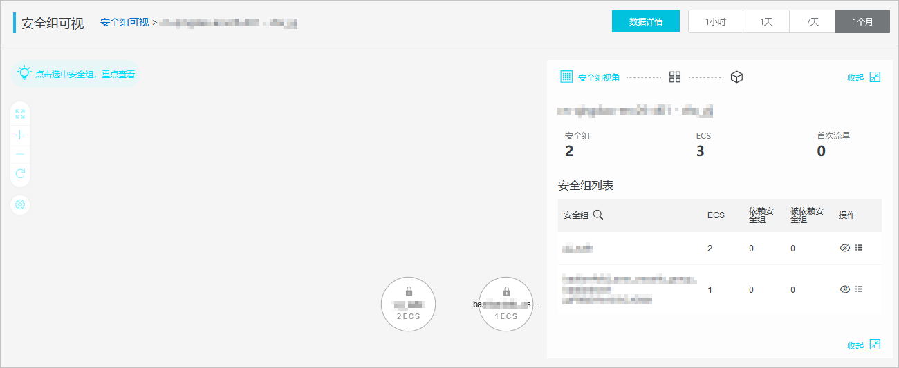

       在**安全组可视**页面的面板中，默认显示所有安全组图标。在安全组列表，单击安全组**操作**列的  图

       标，可以隐藏面板中对应的安全组图标。

     - 单击**安全组可视**页面右上角的**数据详情**，在**业务节点**页签的**安全组视角**列表查看VPC中所有安全组信息。

       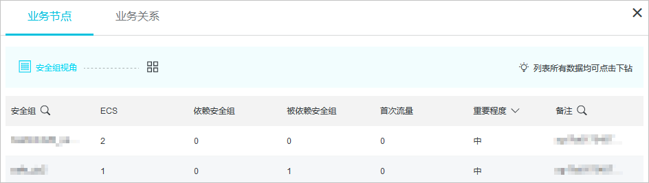

   - 查看单个安全组及其ECS信息。可查看如下信息：

     - 在**安全组可视**页面的安全组列表，单击安全组**操作**列的  图标。在**业务节点**页签的**ECS视角**列表，

       查看安全组中ECS的详细信息。

       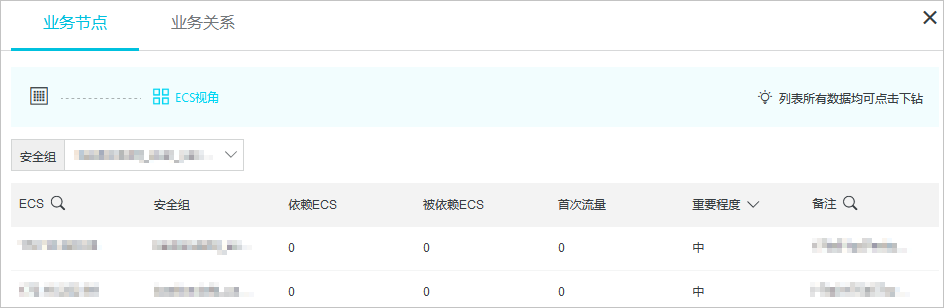

     - 在**安全组可视**页面的面板中，单击安全组图标。在页面右侧的**安全组视角**区域，可以查看安全组中ECS总数、依赖的安全组个数、被依赖的安全组个数、首次流量次数、依赖及被依赖安全组列表。

       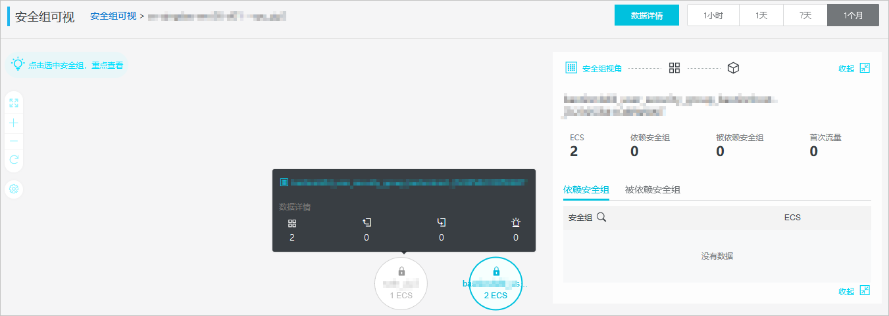

       在安全组的**数据详情**提示框中展示ECS总数、依赖及被依赖安全组个数、首次流量次数，并可查看详细信息如下所示：

       - ECS详情：单击  图标，查看安全组中ECS详细信息。

       - 依赖安全组详情：单击  图标，查看依赖安全组详细信息。

       - 被依赖安全组详情：单击  图标，查看被依赖安全组详细信息。

       - 首次流量详情：单击  图标，查看有访问关系的安全组或ECS的详细信息。

   - 查看单个ECS信息。可查看如下信息：

     - 在**安全组可视**页面的面板中，双击安全组图标，面板中显示安全组中所有ECS。在页面右侧的**ECS视角**区域，可以查看安全组中ECS总数、依赖及被依赖的安全组个数、首次流量次数及ECS列表。

       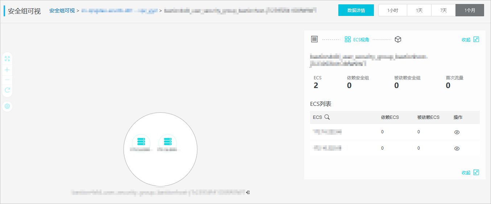

       面板中默认显示安全组所有ECS图标。在ECS列表，单击ECS**操作**列的  图标，可以隐藏面板中对应

       的ECS图标。

     - 在**安全组可视**页面的面板中，单击ECS图标。在页面右侧的**ECS视角**区域，可以查看依赖及被依赖的ECS个数、首次流量次数、依赖及被依赖ECS列表。

       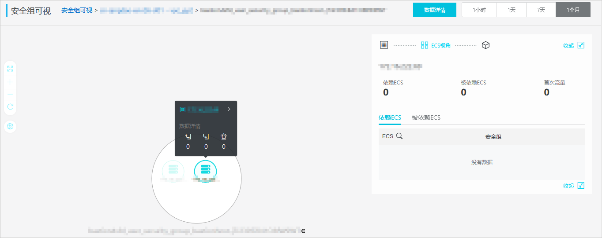

       在ECS的**数据详情**提示框中展示依赖及被依赖ECS个数、首次流量次数，并可查看详细信息如下所示：

       - 依赖ECS详情：单击  图标，查看依赖的ECS详细信息。

       - 被依赖ECS详情：单击  图标，查看被依赖的ECS详细信息。

       - 首次流量详情：单击  图标，查看有访问关系的ECS的详细信息。

## 3.4. 配置防火墙开关策略

### 3.4.1. 互联网边界防火墙同步资产

当新增的IP资产不在互联网边界防火墙的IP列表中，通过同步资产功能，系统主动更新IP列表。本文介绍如何为互联网边界防火墙手动同步资产。

**操作步骤**

1. 登录Apsara Uni-manager运营控制台。

2. 在控制台右上方，单击**安全**，选择**网络安全 > 云防火墙**。在**云防火墙**授权页面，选择**地域**并单击**角色授权访问**。

3. 在左侧导航栏，单击**防火墙开关策略**。

   <ol type="i">

   <li>

   在**互联网边界防火墙**页签，在页面右上角单击**同步资产**。

   </li>

   <li>

   单击**同步资产**，在**同步资产**对话框中，单击**确定**，完成资产同步。

   进行同步资产后，系统自动更新IP列表。

   </li>

   </ol>

4. 在**互联网边界防火墙**页签的资产列表区域，您可查看各项资产的详细信息，包括**IP**、**实例ID**、**资产类型**、**地域**、**绑定资产**、**引流状态**、**防火墙状态**、**引流组名称**、**标签**以及**操作**选项。

   可操作项说明：

   - **标签**：可为相应实例设置唯一标识。

   - **操作**：

     - **开启虚拟网关引流**：在相应的实例操作列，单击**开启虚拟网关引流**，在配置弹框中选择对应的引流组，选择**确定**，即可开启引流。

     - **关闭虚拟网关引流**：在相应的实例操作列，单击**关闭虚拟网关引流**，在提示框中选择**确定**，即可关闭引流。

### 3.4.2. 创建VPC边界防火墙

VPC边界防火墙可以检测两个VPC间的通信流量，是一种管控专有网络VPC间流量的分布式防火墙。创建并开启VPC边界防火墙后，才可以使用云防火墙分析和控制VPC间的访问流量。本文介绍了创建VPC边界防火墙开关策略。

**背景信息**

VPC边界防火墙只能够在已相互连接的VPC之间创建。专有网络VPC支持通过高速通道或者云企业网实现连接。

**操作步骤**

1. 登录Apsara Uni-manager运营控制台。

2. 在控制台右上方，单击**安全**，选择**网络安全 > 云防火墙**。在**云防火墙**授权页面，选择**地域**并单击**角色授权访问**。

3. 在左侧导航栏，单击**防火墙开关策略**。

4. <strong>可选：</strong>在**VPC-VPC引流**页签，单击**同步高速通道**。

   如果实例已同步，则无需手动同步。

5. 定位到目标实例后，单击**操作**列的**创建**。

6. 完成如下配置后，单击**提交**。

   <table>
     <tr>
       <th width="172">配置项</th>
       <th>说明</th>
     </tr>
     <tr>
       <td>实例名</td>
       <td>定义VPC边界防火墙的名称。该名称用于识别VPC边界防火墙实例，建议使用具有业务意义的名称，并保证名称的唯一性。仅支持中文、英文、数字、下划线（_）、短划线（-）的格式，且不能为纯数字。</td>
     </tr>
     <tr>
       <td>路由表</td>
       <td>创建VPC时，系统会自动创建一张默认的路由表，用于为专有网络添加系统路由来管理专有网络的流量。VPC支持按需创建多个路由表。在云防火墙控制台创建VPC边界防火墙时，云防火墙自动读取VPC路由表信息。高速通道支持多个路由表，因此在高速通道下创建VPC边界防火墙时可看到多个路由表，并可以选择需要防护的VPC路由表。</td>
     </tr>
     <tr>
       <td>目标网段</td>
       <td>在路由表下拉列表中选中某个路由时，目标网段会自动展示该路由表的默认目标网段。如果需要防护其他网段，可手动修改目标网段。支持添加多个网段，多个网段间用英文逗号（,）隔开。</td>
     </tr>
     <tr>
       <td>对端路由表</td>
       <td>确认对端VPC地域和VPC实例，选择要防护的路由表。</td>
     </tr>
     <tr>
       <td>对端目标网段</td>
       <td>对端VPC的目标网段。</td>
     </tr>
     <tr>
       <td>防火墙模式</td>
       <td>• 测试模式：此模式用于测试网段或者IP健康状态探测，确保链路正常。 • 正常模式：防火墙工作模式，在此模式下防火墙进行引流并对流量进行安全防护。 • Bypass：旁路模式，防火墙在此模式下不进行引流操作，一般当防火墙自检失败或者健康探测失败时会自动切换到旁路模式。创建防火墙时仅支持测试模式，创建后可以将模式修改为正常模式或者旁路模式。不支持旁路模式直接切换到正常模式，正常的切换顺序为：<strong>旁路模式 &gt; 测试模式 &gt; 正</strong><strong>常模式</strong>。在<strong>健康测试</strong>区域输入本端和对端VPC内32位测试IP。</td>
     </tr>
     <tr>
       <td>IPS防御模式</td>
       <td>选择入侵防御模块（IPS）的工作模式，可选项： • 观察模式：开启观察模式后，可对恶意流量进行监控并告警。 • 拦截模式：开启拦截模式后，可对恶意流量进行拦截，阻断入侵活动。</td>
     </tr>
     <tr>
       <td>IPS防御能力</td>
       <td>选中要开启的入侵防御策略，可选项： • 基础规则：开启后可为资产提供基础的防护能力，包括爆破拦截、命令执行漏洞拦截、对被感染后连接C&amp;C（命令控制）的行为进行管控。 • 虚拟补丁：开启后可实时防御热门的高危应用漏洞。</td>
     </tr>
     <tr>
       <td>开启VPC边界防火墙</td>
       <td>开启开关，则在创建VPC边界防火墙后，自动开启VPC边界防火墙开关。如果无需自动开启VPC开关，关闭该开关即可。</td>
     </tr>
   </table>

   完成创建后，当VPC边界防火墙的防火墙状态变更为**已开启**，则VPC边界防火墙正式生效。

### 3.4.3. 创建IDC-VPC边界防火墙

IDC-VPC边界防火墙可以检测IDC和VPC间的通信流量，云防火墙支持对IDC-VPC边界防火墙的访问控制。本文介绍了创建IDC-VPC边界防火墙的操作详情。

**操作步骤**

1. 登录Apsara Uni-manager运营控制台。

2. 在控制台右上方，单击**安全**，选择**网络安全 > 云防火墙**。在**云防火墙**授权页面，选择**地域**并单击**角色授权访问**。

3. 在左侧导航栏，单击**防火墙开关策略**。

4. 在**IDC-VPC引流**页签，单击**创建**。

5. 完成如下配置后，单击**提交**。

   <table>
     <tr>
       <th width="183">配置项</th>
       <th>说明</th>
     </tr>
     <tr>
       <td>实例名</td>
       <td>定义VPC边界防火墙的名称。该名称用于识别VPC边界防火墙实例，建议使用具有业务意义的名称，并保证名称的唯一性。仅支持中文、英文、数字、下划线（_）、中划线(-)的格式，且不能为纯数字。</td>
     </tr>
     <tr>
       <td>机房名称</td>
       <td>选择机房名称。</td>
     </tr>
     <tr>
       <td>VPC实例</td>
       <td>VPC实例的ID。该实例是VPC实例的唯一标识，云防火墙自动同步您和IDC互联的VPC实例。</td>
     </tr>
     <tr>
       <td>VPC侧路由表</td>
       <td>创建VPC时，系统会自动创建一张默认的路由表，用于为专有网络添加系统路由来管理专有网络的流量。VPC支持按需创建多个路由表。在云防火墙控制台创建VPC边界防火墙时，云防火墙自动读取VPC路由表信息。高速通道支持多个路由表，因此在高速通道下创建VPC边界防火墙时可看到多个路由表，并可以选择需要防护的VPC路由表。</td>
     </tr>
     <tr>
       <td>VPC侧目标网段</td>
       <td>在VPC侧路由表下拉列表中选中某个路由时，目标网段会自动展示该路由表的默认目标网段。如果需要防护其它网段，可手动修改目标网段。支持添加多个网段，多个网段间用英文逗号隔开。</td>
     </tr>
     <tr>
       <td>IDC侧物理专线（主）</td>
       <td>您本地IDC数据中心连接到专有云时，建立的物理专线ID。IDC机房的CE设备要和主备交换机进行物理专线连接时，随机选取一条物理专线为主。专线信息自动同步，您创建虚拟防火墙时需指定。</td>
     </tr>
     <tr>
       <td>VBR (主)</td>
       <td>和IDC侧物理专线（主）绑定，用来和VPC通信的VBR。和专线绑定的VBR自动同步，您创建虚拟防火墙时需指定VBR。</td>
     </tr>
     <tr>
       <td>IDC侧物理专线（备）</td>
       <td>您本地IDC数据中心连接到专有云时，建立的物理专线ID。IDC机房的CE设备要和主备交换机进行物理专线连接时，不能和主物理专线相同。专线信息自动同步，您创建虚拟防火墙时需指定。</td>
     </tr>
     <tr>
       <td>VBR (备)</td>
       <td>和备IDC物理专线绑定，用来和VPC通信的VBR。和专线绑定的VBR自动同步，您创建虚拟防火墙时需指定。</td>
     </tr>
     <tr>
       <td>IDC侧目标网段</td>
       <td>对端VPC的目标网段。</td>
     </tr>
     <tr>
       <td>防火墙模式</td>
       <td>可选择以下防火墙模式： • <strong>测试模式</strong>：此模式用来进行测试网段或者测试IP健康探测，确保链路正常。 • <strong>正常模式</strong>：防火墙工作模式，在此模式下防火墙进行引流并对流量进行安全防护。 • <strong>Bypass</strong>：旁路模式，防火墙在此模式下不进行引流操作，一般当防火墙自检失败或者健康探测失败时会自动切换到旁路模式。创建防火墙时仅支持<strong>测试模式</strong>，创建后可以进行模式修改为<strong>正常模式</strong>或者<strong>旁路模式</strong>。不支持<strong>旁路模式</strong>直接切换到<strong>正常模式</strong>，正常的切换顺序为：<strong>旁路模式 &gt; 测试模式 &gt;</strong><strong>正常模式</strong>。在<strong>健康测试</strong>区域输入本端VPC内32位测试IP地址。</td>
     </tr>
     <tr>
       <td>IPS防御模式</td>
       <td>选择入侵防御模块（IPS）的工作模式，可选项： • <strong>观察模式</strong>：开启<strong>观察模式</strong>后，可对恶意流量进行监控并告警。 • <strong>拦截模式</strong>：开启<strong>拦截模式</strong>后，可对恶意流量进行拦截，阻断入侵活动。</td>
     </tr>
     <tr>
       <td>IPS防御能力</td>
       <td>选中要开启的入侵防御策略，可选项： • <strong>基础规则</strong>：开启后可为资产提供基础的防护能力，包括爆破拦截、命令执行漏洞拦截、以及对被感染后连接C&amp;C（命令控制）的行为进行管控。 • <strong>虚拟补丁</strong>：开启后可实时防御热门的高危应用漏洞。</td>
     </tr>
     <tr>
       <td>是否支持track</td>
       <td>有以下选项： • <strong>是</strong>：表示支持track。 • <strong>否</strong>：表示不支持track。</td>
     </tr>
     <tr>
       <td>开启VPC边界防火墙</td>
       <td>打开开关，在创建VPC边界防火墙时自动打开VPC边界防火墙开关。如果无需自动打开VPC边界防火墙开关，请您关闭该开关。</td>
     </tr>
   </table>

   完成创建后，当IDC-VPC边界防火墙的防火墙状态变更为**已开启**，则IDC-VPC边界防火墙正式生效。

   > **重要**
   >
   > 当您的机房已部署硬件防火墙，且采用U型连接方式和主备链路工作模式时，IDC-VPC边界防火墙不支持跨机房防护。

## 3.5. 配置入侵防御策略

入侵防护内置了威胁检测引擎，可对互联网上的恶意流量入侵活动和常规攻击行为进行实时阻断和拦截，并提供精准的威胁检测虚拟补丁，智能阻断入侵风险。

**操作步骤**

1. 登录Apsara Uni-manager运营控制台。

2. 在控制台右上方，单击**安全**，选择**网络安全 > 云防火墙**。在**云防火墙**授权页面，选择**地域**并单击**角色授权访问**。

3. 在左侧导航栏，单击**入侵防御策略配置**。

4. 在**入侵防御**页面，设置入侵防护的威胁引擎运行模式。

   入侵防护支持以下两种模式：

   - **观察模式**：针对入侵活动，只警告，不进行拦截。

   - **拦截模式**：针对入侵活动，进行拦截并警告。

5. 设置入侵防护的高级功能。

   - 防护白名单：设置防护白名单后，云防火墙入侵防御功能将对白名单中的流量地址放行。

     在**高级设置**区域，单击**防护白名单**，将确定为可信的流量添加到白名单中。

     可将内外双向流量的可信源IP地址、目的IP地址或地址簿配置到防护白名单中。

     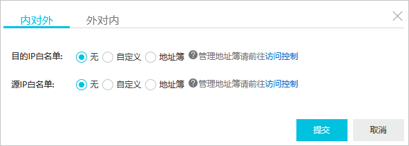

   - 基础防御：可提供基础的入侵防御能力，包括爆破拦截、命令执行漏洞拦截、以及对被感染后连接C&C（命令控制）的行为进行管控。开启后可为您的资产提供基础的防护能力。

     在**基础防御**区域，打开**基础规则**开关，云防火墙默认为您开启部分常见威胁相关的检测规则。如果默认规则无法满足您的需求，您可以在**基础防御**区域，单击右侧的**自定义选择**，打开**基础防御-自定义选择**对话框，对单个或多个基础防御规则进行自定义设置。自定义设置仅支持修改该基础防御规则的放行状态，即观察、拦截、关闭。

     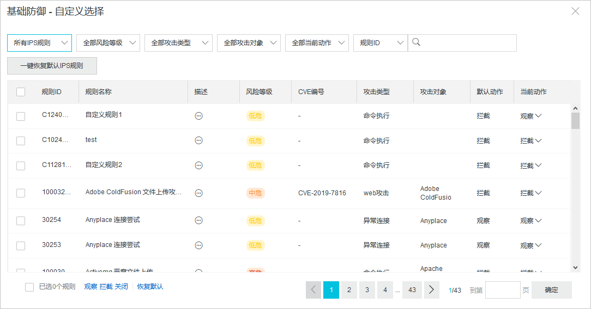

   - 虚拟补丁：无需在系统上进行安装，开启后可实时防护热门的应用高危漏洞。

     在**虚拟补丁**区域，打开**开启补丁**开关，云防火墙可为您实时防护热门的高危漏洞和应急漏洞。您也可以在**虚拟补丁**区域，单击右侧的**自定义选择**，打开**虚拟补丁-自定义选择**对话框，可对单个或部分基础虚拟补丁规则进行自定义设置。

     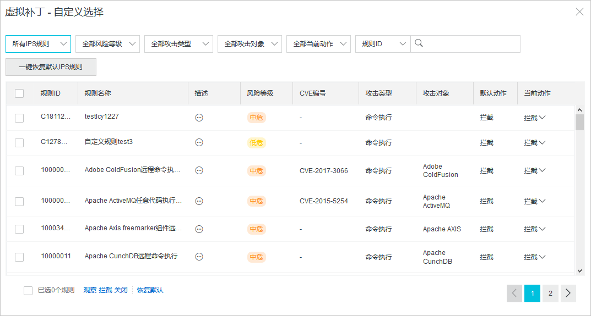

## 3.6. 查看事件日志

通过云防火墙的所有流量会在日志审计页面记录下来，包括流量日志和事件日志，可帮您实时审计您的网络流量并进行相应的处理。本文介绍如何查看事件日志。

**操作步骤**

1. 登录Apsara Uni-manager运营控制台。

2. 在控制台右上方，单击**安全**，选择**网络安全 > 云防火墙**。在**云防火墙**授权页面，选择**地域**并单击**角色授权访问**。

3. 在左侧导航栏，单击**日志审计**。

4. 在**日志审计**页面，单击**事件日志**页签，根据需要查看的防火墙类型，查看**互联网边界防火墙**、**VPC-VPC边界防火墙**或**IDC-VPC边界防火墙**的事件日志。

   用户可以在日志列表执行如下操作：

   - 设置搜索条件，单击**搜索**。

     | 搜索条件 | 说明 |
     | --- | --- |
     | 源IP | 设置事件的源IP地址。 |
     | 目的IP | 设置事件的目的IP地址。 |
     | 类型 | 选择事件类型。 |
     | 动作 | 选择事件动作，支持全部、观察和丢弃。 |
     | 时间 | 设置7天以内的搜索时间段。 |

   - 在日志列表中，查看被扫描到的时间、威胁类型、出入方向、源IP和目的IP、应用类型、严重性等级以及动作状态等信息。

## 3.7. 查看流量日志

通过云防火墙的所有流量会在日志审计页面记录下来，包括流量日志和事件日志，可帮您实时审计您的网络流量并进行相应的处理。本文介绍如何查看流量日志。

**操作步骤**

1. 登录Apsara Uni-manager运营控制台。

2. 在控制台右上方，单击**安全**，选择**网络安全 > 云防火墙**。在**云防火墙**授权页面，选择**地域**并单击**角色授权访问**。

3. 在左侧导航栏，单击**日志审计**。

4. 在日**志审计**页面，单击**流量日志**页签，根据需要查看的防火墙类型，查看**互联网边界防火墙**、**VPC-VPC边界防火墙**或**IDC-VPC边界防火墙**的流量日志。

   用户可以在日志列表执行如下操作：

   - 设置搜索条件，单击**搜索**。

     | 搜索条件 | 说明 |
     | --- | --- |
     | 源IP | 设置流量的源IP地址。 |
     | 目的IP | 设置流量的目的IP地址。 |
     | 应用 | 选择应用类型。 |
     | 时间 | 设置7天以内的搜索时间段。 |

   - 单击**展开高级搜索**，可以配置更多的搜索条件。

   - 在日志列表中，查看访问流量开始和结束的时间、出入方向、源IP和目的IP、应用、支持的协议、动作状态、字节数以及报文数等信息。

   - 单击**列表配置**，设置流量列表的查看项目。

# 4.云盾系统配置

## 4.1. 登录Apsara Uni-manager运营控制台

本文主要向您介绍如何登录Apsara Uni-manager运营控制台。

**前提条件**

- 登录Apsara Uni-manager运营控制台前，确认您已从部署人员处获取Apsara Uni-manager运营控制台的服务域名地址。进行云盾系统配置需要全局组织安全管理员账号登录。

- 推荐使用Chrome浏览器。

**操作步骤**

1. 在浏览器地址栏中，输入Apsara Uni-manager运营控制台的服务域名地址，按回车键。

2. 输入正确的用户名及密码。

   请向运营管理员获取登录控制台的用户名和密码。

   > **说明**
   >
   > - **首次登录**
   >
   >   首次Apsara Uni-manager运营控制台时，需要修改登录用户名的密码，请按照提示完成密码修改。为提高安全性，密码长度必须为10~32位，且包含英文字母大小写、阿拉伯数字和特殊符号（感叹号（!）、at（@）、井号（#）、美元符号（$）、百分号（%）等）。
   >
   > - **忘记密码**
   >
   >   用户忘记登录密码时，单击忘记密码，输入账户名（当前账号的用户名）、邮箱（当前用户创建时所录入的邮箱）和验证码后，重置密码的链接将发至邮箱，进入链接后用户可输入新密码。

3. 单击**账号登录**。

4. 如果账号已激活MFA多因素认证，请根据以下两种情况进行操作：

   - 管理员强制开启MFA后的首次登录：

     <ol type="a">

     <li>

     在绑定虚拟MFA设备页面中，按页面提示步骤绑定MFA设备。

     </li>

     <li>

     按照步骤2重新输入账号和密码，单击**账号登录**。

     </li>

     </ol>

     <ol type="i" start="100">

     <li>

     输入6位MFA码后单击**认证**。

     </li>

     </ol>

   - 您已开启并绑定MFA：

     输入6位MFA码后单击**认证**。

     > **说明**
     >
     > 绑定并开启MFA的操作请参见《Apsara Uni-manager运营控制台用户指南》中**安全中心** > **多因素认证** > **管理多因素认证**章节。

## 4.2. 规则运营

### 4.2.1. 云防火墙IPS规则运营

云防火墙内置IPS规则，用户可以根据自身的业务需求和网络环境自定义IPS规则，监控云防火墙运营状态。本文介绍如何添加和管理云防火墙的IPS规则。

**操作步骤**

1. 登录Apsara Uni-manager运营控制台。

2. 在控制台右上方，单击**安全**，选择**全局平台安全 > 系统配置**。在**系统配置**授权页面，选择**地域**并单击**角色授权访问**。

3. 在左侧导航栏，单击**规则运营**。

4. 在**云防火墙IPS规则运营**页签，单击**添加自定义规则**。完成如下配置后，单击**确定**。

   <table>
     <tr>
       <th width="89">配置项</th>
       <th>说明</th>
     </tr>
     <tr>
       <td>规则名称</td>
       <td>设置自定义IPS规则的名称，建议使用可识别规则用途的名称，便于后续管理。</td>
     </tr>
     <tr>
       <td>规则引擎</td>
       <td>在下拉栏中选择规则引擎，可选<strong>基础规则</strong>和<strong>虚拟补丁</strong>。</td>
     </tr>
     <tr>
       <td>攻击类型</td>
       <td>在下拉栏中选择该规则的攻击类型。</td>
     </tr>
     <tr>
       <td>等级</td>
       <td>在下拉栏中选择威胁等级，可选<strong>低危</strong>、<strong>中危</strong>或<strong>高危</strong>。</td>
     </tr>
     <tr>
       <td>CVE</td>
       <td>设置该规则的CVE编号。 说明通用漏洞披露CVE（Common Vulnerabilities and Exposures）列出了已公开披露的各种计算机安全缺陷。CVE编号由CVE编号管理机构（CNA）分配。</td>
     </tr>
     <tr>
       <td>攻击应用</td>
       <td>设置攻击应用名称。</td>
     </tr>
     <tr>
       <td>规则模式</td>
       <td>在下拉栏中选择IPS检测的规则模式，可选<strong>包模式</strong>和<strong>流模式</strong>。</td>
     </tr>
     <tr>
       <td>方向</td>
       <td>在下拉栏中选择IPS检测的流量方向，可选<strong>双向</strong>、<strong>入向</strong>和<strong>出向</strong>。</td>
     </tr>
     <tr>
       <td>规则内容</td>
       <td>设置规则内容，规则采用Snort语法。 说明添加规则内容时请确认正确性，不正确的规则内容可能会影响您的业务。</td>
     </tr>
     <tr>
       <td>规则描述</td>
       <td>设置规则描述信息，建议使用规则用途、影响等信息，便于后续管理。</td>
     </tr>
     <tr>
       <td>备注</td>
       <td>设置规则备注信息，建议使用规则用途、影响等信息，便于后续管理。</td>
     </tr>
   </table>

   添加自定义规则后，用户可以在规则列表，执行如下操作：

   - 查看规则详情

     您可以通过IPS规则列表上的筛选按钮，筛选需要查看的IPS规则。

     定位到某一规则，单击**操作**列中的**详情**，您可以查看该规则的具体信息。

   - 启用规则

     如果需要启用某个规则，则定位到该规则，单击**启用状态**列中的切换开关，将**禁用**切换为**启用**。

   - 禁用规则

     如果某个规则不适应于您的业务环境，您可以禁用该规则。

     定位到该规则，单击**启用状态**列中的切换开关，将**启用**切换为**禁用**。

### 4.2.2. Aliguard规则运营

Aliguard规则运营支持用户可以根据实际网络环境自定义DDos清洗策略、修改牵引阈值。本文介绍如何自定义DDoS的清洗策略和牵引阈值。

**操作步骤**

1. 登录Apsara Uni-manager运营控制台。

2. 在控制台右上方，单击**安全**，选择**全局平台安全 > 系统配置**。在**系统配置**授权页面，选择**地域**并单击**角色授权访问**。

3. 在左侧导航栏，单击**规则运营**。

4. 在**Aliguard规则运营**页签，单击**清洗策略**，自定义清洗策略的阈值。

   <ol type="i">

   <li>

   定位到需要调整的规则，单击**操作**列的**调整阈值**。

   </li>

   <li>

   在**调整阈值**对话框，输入阈值后，单击**确定**。

   </li>

   </ol>

5. 在**Aliguard规则运营**页签，单击**牵引阈值**，自定义牵引阈值。

   <ol type="i">

   <li>

   定位到需要调整的策略，单击**操作**列的**调整阈值**。

   </li>

   <li>

   在**调整阈值**对话框，输入阈值后，单击**确定**。

   </li>

   <li>

   <strong>可选：</strong>单击**开启DDoS自动牵引清洗**，在**开启自动牵引**对话框，单击**确定**。

   > **说明**
   >
   > **开启DDoS自动牵引清洗**开关默认关闭。

   - 自动牵引开关开启：根据用户自定义的DDos阈值触发清洗事件。受攻击IP会被自动牵引到DDoS集群进行流量清洗。

   - 自动牵引开关关闭：根据用户自定义的DDos阈值产生DDos告警事件，用户可以根据业务需要，在DDos控制台手动开始清洗和结束清洗。

   </li>

   </ol>

### 4.2.3. 安骑士规则运营

您可以在安骑士规则运营中查看漏洞情况、基线列表、主机异常列表。本文介绍如何查看安骑士规则的运营情况。

**操作步骤**

1. 登录Apsara Uni-manager运营控制台。

2. 在控制台右上方，单击**安全**，选择**全局平台安全 > 系统配置**。在**系统配置**授权页面，选择**地域**并单击**角色授权访问**。

3. 在左侧导航栏，单击**规则运营**。

4. 在**安骑士规则运营**页签，查看安骑士规则运营情况。

   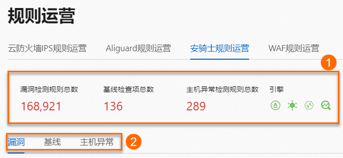

   | 项目 | 说明 |
   | --- | --- |
   | 总览（图示①） | 支持查看<strong>漏洞检测规则总数</strong>、<strong>基线检查项总数</strong>、<strong>主机异常检测规则总数</strong>、<strong>引擎</strong>信息。 |
   | 漏洞（图示②） | 在<strong>漏洞</strong>页签，查看检测到的所有漏洞及总数。 • 在搜索框选择漏洞类型、输入CVE编号、系统名称，可搜索对应漏洞。 • 在漏洞列表，查看检测到的漏洞的<strong>漏洞名称</strong>、<strong>CVE编号</strong>、<strong>漏洞类型</strong>、<strong>系统</strong>、<strong>更新时</strong><strong>间</strong>、<strong>状态</strong>。 |
   | 基线（图示②） | 在<strong>基线</strong>页签，查看检测到的基线类型、基线检查项数据。 • 在搜索框选择基线类型、风险等级、检查项类别、检查项名称，可搜索对应基线。 • 在基线列表，查看<strong>基线类型</strong>、<strong>检查项类别</strong>、<strong>检查项名称</strong>、<strong>风险等级</strong>、<strong>更新时间</strong>、<strong>状态</strong>。 |
   | 主机异常（图示②） | 在<strong>主机异常</strong>页签，查看<strong>规则告警子类型数</strong>、<strong>WebShell&amp;恶意病毒（进程）</strong>信息。 • 在搜索框选择规则父类、风险等级、规则告警子类名称，可搜索对应主机异常事件。 • 在主机异常列表，查看<strong>子类名称</strong>、<strong>规则父类</strong>、<strong>风险等级</strong>、<strong>更新时间</strong>、<strong>来源</strong>、<strong>状态</strong>。 |

### 4.2.4. WAF规则运营

通过WAF规则运营，用户可以根据自身的业务需求和网络环境自定义WAF运营规则，监控WAF运营状态。本文介绍如何添加和管理WAF运营规则。

**操作步骤**

> **重要**
>
> 该运营规则为全局自定义规则，会对所有租户生效，请谨慎操作。

1. 登录Apsara Uni-manager运营控制台。

2. 在控制台右上方，单击**安全**，选择**全局平台安全 > 系统配置**。在**系统配置**授权页面，选择**地域**并单击**角色授权访问**。

3. 在左侧导航栏，单击**规则运营**。

4. 在**WAF规则运营**页签，单击**添加自定义规则**。完成如下配置后，单击**确定**。

   <table>
     <tr>
       <th width="121">配置项</th>
       <th>说明</th>
     </tr>
     <tr>
       <td>模式</td>
       <td>设置规则的处置模式和运行状态。 • 处置模式支持<strong>拦截</strong>、<strong>放行</strong>、<strong>观察</strong>、<strong>检测模块控制</strong>。 • 运行状态支持<strong>启用</strong>或<strong>禁用</strong>。</td>
     </tr>
     <tr>
       <td>备注</td>
       <td>填写规则的备注信息。</td>
     </tr>
     <tr>
       <td>威胁等级</td>
       <td>设置规则检测的威胁等级。可选项：<strong>无威胁</strong>、<strong>低危</strong>、<strong>中危</strong>、<strong>高危</strong>。</td>
     </tr>
     <tr>
       <td>匹配条件</td>
       <td>设置规则的<strong>匹配字段</strong>、<strong>逻辑符</strong>和<strong>匹配内容。</strong></td>
     </tr>
     <tr>
       <td>是否记录日志</td>
       <td>设置记录日志的场景。可选项：<strong>命中时记录、</strong>命中时不记录。</td>
     </tr>
     <tr>
       <td>攻击类型</td>
       <td>选择规则检测的攻击类型。不支持多选。</td>
     </tr>
     <tr>
       <td>阻断状态码</td>
       <td>选择规则检测的阻断状态码。不支持多选。</td>
     </tr>
     <tr>
       <td>过期时间</td>
       <td>设置规则的过期时间。不设置时间表示规则永不过期。</td>
     </tr>
   </table>

   添加运营规则后，用户可以在规则列表，执行如下操作：

   - 通过规则列表上的筛选按钮，筛选需要查看的WAF运营规则。

   - 定位到某一规则，单击**操作**列中的**编辑**，您可以修改规则信息。

## 4.3. 告警设置

告警设置支持设置告警联系人和告警规则。当监控数据满足报警规则时，系统自动发送告警信息给报警联系人，支持钉钉消息和邮件。本文介绍如何添加和管理告警联系人。

**设置告警联系人**

1. 登录Apsara Uni-manager运营控制台。

2. 在控制台右上方，单击**安全**，选择**全局平台安全 > 系统配置**。在**系统配置**授权页面，选择**地域**并单击**角色授权访问**。

3. 在左侧导航栏，选择**监控告警 > 告警设置**。

4. 在**联系人管理**页签，单击**添加联系人**。填写联系人姓名、钉钉机器人Token、邮箱信息后，单击**确定**。

   添加后的联系人可以在联系人列表查看，支持**编辑**、**批量删除**。

**设置安骑士告警规则**

1. 登录Apsara Uni-manager运营控制台。

2. 在控制台右上方，单击**安全**，选择**全局平台安全 > 系统配置**。在**系统配置**授权页面，选择**地域**并单击**角色授权访问**。

3. 在左侧导航栏，选择**监控告警 > 告警设置**。

4. 在**安骑士**页签，设置要发送的告警规则后，单击**保存**。

   **告警类型**

   **告警子类**

   **告警等级**

   **通知方式**

   **告警周期**

   - Linux软件漏洞

   - Windows系统漏洞

     - 低危

   漏洞风险

   - Web-CMS漏洞

     - 中危

   - 应用漏洞

     - 高危

   - 应急漏洞

   - 高风险利用

     - 低危

   - 等保合规

   基线风险

   - 中危

   - 最佳安全实践

     - 高危

   - 弱口令

   - 有漏洞暴露

   资产暴露

   全部

   - 无漏洞暴露

   - 进程异常行为

     - 5分钟

   - 网站后门

     - 10分钟

   - 异常登录

     - 邮箱

       - 30分钟

   - 异常事件

     - 钉钉

       - 1小时

   - 威胁情报

     - 1天

   - 恶意进程(云查杀)

     - 低危

       - 1周

   - 异常网络连接

   入侵告警

   - 中危

   - 异常账号

     - 高危

   - 应用入侵事件

   - 云产品威胁检测

   - 精准防御

   - 恶意脚本

   - 持久化后门

   - 应用威胁检测

   应用白名单事件

   违规进程启动

   全部

   - 异常文件修改

   防篡改事件

   - 异常文件添加

     全部

   - 异常文件删除

## 4.4. 全局设置

### 4.4.1. 拦截策略设置

通过安全阻断功能，能够防御Web攻击和暴力破解。本文介绍如何启用应用攻击阻断和暴力破解阻断功能。

**操作步骤**

1. 登录Apsara Uni-manager运营控制台。

2. 在控制台右上方，单击**安全**，选择**全局平台安全 > 系统配置**。在**系统配置**授权页面，选择**地域**并单击**角色授权访问**。

3. 在左侧导航栏，单击**全局设置**。

4. 在**全局设置**页签，单击拦截类型操作列的开关，启用或圈闭拦截策略。

   关闭后，相应的拦截功能将被禁用，仅提供预警功能。

## 4.5. CFW运行监控

通过CFW运行监控，用户可以监控云防火墙运行情况，提前发现异常流量，及时处理异常情况。本文介绍如何进行系统巡检、服务监控。

**操作步骤**

1. 登录Apsara Uni-manager运营控制台。

2. 在控制台右上方，单击**安全**，选择**全局平台安全 > 系统配置**。在**系统配置**授权页面，选择**地域**并单击**角色授权访问**。

3. 在左侧导航栏，单击**CFW运行监控**。

4. 在**系统巡检**区域，单击**一键巡检**。

   完成巡检后，用户可以执行如下操作：

   - 单击**互联网云防火墙(ICFW)**、**VPC云防火墙(CCFW)操作**列的**详情**，查看各检查项的实际状态。

   - 单击**互联网云防火墙(ICFW)**、**VPC云防火墙(CCFW)操作**列的**立即巡检**，可对单个系统进行巡检。

5. 在**服务监控**区域，设置**云防火墙ICFW**或**云防火墙CCFW**的监控配置。

   - **云防火墙ICFW**

     <ol type="a">

     <li>

     单击**引流配置 - 业务网段**区域的**添加**，完成如下配置后，单击**确定**。

     | 配置项 | 说明 |
     | --- | --- |
     | 设备集群ID | 选择要添加的引流网段的设备集群ID。 |
     | 引流方式 | 选择要引流的方式，可选项：ISW、XGW。 |
     | 引流网段 | 输入要引流的网段。 |
     | 类型 | 设置引流网段的类型，可选项：业务网段、测试网段。 |
     | 业务描述 | 填写业务相关描述。 |

     完成配置后，可在**服务自检状态**区域、**接口状态**区域，查看引流网段的自动刷新频率、各设备集群的服务自检结果。

     > **说明**
     >
     > 在各区域单击**自动刷新**下拉框，可设置引流网段的自动刷新频率。用户也可以单击  图标，手动
     >
     > 刷新。

     </li>

     <li>

     在**连通性健康检查**区域，单击**添加**。完成如下配置后，单击**确定**。

     | 配置项 | 说明 |
     | --- | --- |
     | 设备集群ID | 选择要添加的引流网段的设备集群ID。 |
     | 测试IP地址 | 输入要填写的IP地址。 |
     | 类型 | 设置连通性健康检查的类型，可选项：业务、测试、系统。 |
     | 探测频率 | 设置探测频率，单位为秒（s），且需要在1~60之间取整数。 |
     | 探测阈值 | 设置探测阈值，单位为次，且需要在1~30之间取整数。 |
     | 动作 | 设置动作，可选项：自动bypass、告警。 |

     完成配置后，可测试IP地址的连通性。

     </li>

     </ol>

     <ol type="i" start="100">

     <li>

     配置防火墙只对互联网入方向生效的**全局默认策略模式**为**block all**（拦截所有）、**permit all**（允许所有）。

     </li>

     </ol>

   - **云防火墙CCFW**单击**云防火墙CCFW**页签，查看防火墙任务流、实例状态自检、设备状态自检、接口状态、连通性健康检查、系统日志等详细信息。

## 4.6. 账号管理

### 4.6.1. 专有云账号管理

本文介绍如何查看、修改系统绑定的专有云账号信息。

> **重要**
>
> 云盾中的资产均与账号绑定，请谨慎修改。

**操作步骤**

1. 登录Apsara Uni-manager运营控制台。

2. 在控制台右上方，单击**安全**，选择**全局平台安全 > 系统配置**。在**系统配置**授权页面，选择**地域**并单击**角色授权访问**。

3. 在左侧导航栏，单击**账号管理**。

4. 在**专有云账号**页签，修改阿里云账号信息。

   <ol type="i">

   <li>

   定位到要修改的阿里云账号，单击**操作**列的**修改**。

   </li>

   <li>

   在**账号修改**对话框中，修改阿里云账号名、Access Key、Access Secret信息，单击**确定**。

   </li>

   </ol>

修改完成后，用户可以单击**操作**列的详情，查看阿里云账号详情。

### 4.6.2. 公有云账号管理

通过在专有云中添加公有云账号，您可以在专有云中管理该公有云账号下已购买的高防IP和WAF，实现混合云功能。本文介绍如何添加公有云账号。

**操作步骤**

如果专有云中需要使用混合云功能，需要根据本文添加阿里云公有云账号。

1. 登录Apsara Uni-manager运营控制台。

2. 在控制台右上方，单击**安全**，选择**全局平台安全 > 系统配置**。在**系统配置**授权页面，选择**地域**并单击**角色授权访问**。

3. 在左侧导航栏，单击**账号管理**。

4. 在**公有云账号**页签，单击**添加**。

   <ol type="i">

   <li>

   定位到要修改的阿里云账号，单击**修改**。完成如下配置后，单击确定。

   | 配置项 | 说明 |
   | --- | --- |
   | Access Key | 设置要添加的公有云Access Key。 |
   | Access Secret | 设置要添加的公有云Access Secret。 |
   | 公有云产品 | 选择使用的公有云产品，支持<strong>高防IP</strong>和<strong>Web应用防护</strong>，可单选一个产品或全选。 |

   </li>

   </ol>

添加完成后，用户可以在账号列表查看已添加的公有云账号，支持**修改**和**删除**账号。

## 4.7. 迁移至Apsara Uni-manager运维控制台

### 4.7.1. 登录云盾安全运营中心

云盾安全运营中心是云盾产品的运营平台，可以实时监控云盾产品运行状态和业务状态，并将告警发送给用户。实时监控并根据介绍如何登录安全运营中心。

**前提条件**

- 已从部署人员或管理员处获取Apsara Uni-manager运维控制台的访问地址、用户名和密码。

  Apsara Uni-manager运维控制台访问地址格式为*ops*.asconsole.*intranet-domain-id*.com。

- 推荐使用Chrome浏览器。

**操作步骤**

1. 打开浏览器。

2. 在地址栏中，输入Apsara Uni-manager运维控制台的访问地址*ops*.asconsole.*intranet-domain-id*.com，按回车键。

   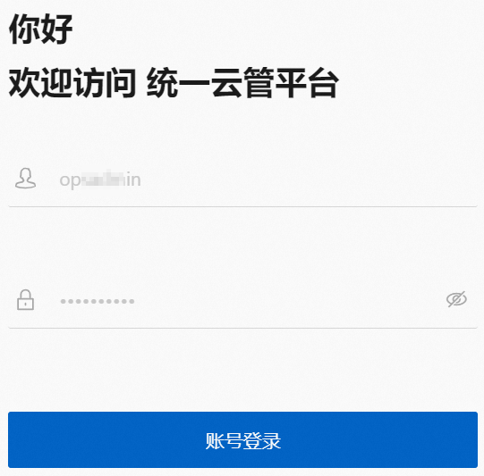

   > 您可以单击页面右上角的下拉按钮来进行语言切换。
   >
   > **说明**

3. 输入正确的用户名及密码。

   > 登录Apsara Uni-manager运维控制台的用户名和密码请从部署人员或管理员处获取。
   >
   > **说明**

   首次登录Apsara Uni-manager运维控制台时，需要修改登录用户名的密码，请按照提示完成密码修改。

   为提高安全性，密码必须满足以下要求：

   - 英文大小写字母

   - 阿拉伯数字（0~9）

   - 特殊符号，包括感叹号（！）、at（@）、井号（#）、美元符号（$）、百分号（%）等

   - 密码长度10~20个字符

4. 单击**登录**。

5. 在Apsara Uni-manager运维控制台的顶部菜单栏，选择**产品运维 > 安全运维 > 安全运营中心·云盾运维**。

**执行结果**

在**云安全运营中心**页面，您可以查看相关信息。

### 4.7.2. 系统监控

通过系统监控，用户可以监控已接入的云产品，及时发现异常产品，便于产品运维。本文介绍如何查看系统监控。

**操作步骤**

1. 登录云盾安全运营中心。

2. 在左侧导航栏，选择**监控告警** ＞ **系统监控**。

3. 在系统监控页面，查看监控总览和云产品监控数据。

   - 在**监控总览**页签，查看监控总览信息。

     - 监控数据总览：支持查看**监控产品总数**、**异常产品总数**、**监控项总数**、**异常项总数**等数据。

     - 云产品监控数据：支持查看所有已接入的云产品的**监控项数量**、**异常数**、**产品状态**数据。

   - 在云产品页签，查看各产品监控数据。

     - 支持监控的云产品包括：安骑士、SOC云安全管理中心、网络检测响应、密钥管理服务等。

- 支持监控的内容：

  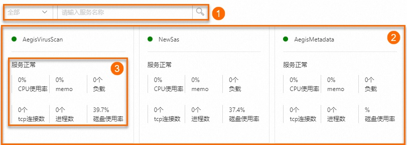

  - 单击云产品区域（图示②），查看云产品的所有服务。

  - 在云产品页签，用户可以通过服务列表上的搜索框（图示①），根据服务状态和服务名称，搜索对应服务。

  - 在服务卡片区域（图示③），查看CPU使用率、memo使用率、负载数、tcp连接数、进程数等数据。

  - 单击服务卡片区域（图示③），在服务详情页面，查看云产品服务监控详情。

    <table>
      <tr>
        <th width="90">监控项</th>
        <th>说明</th>
      </tr>
      <tr>
        <td>基础监控</td>
        <td>• 用户可以通过设置监控时间、监控视角，查看基础监控和中间件的详细监控数据。 • 监控时间：支持监控3小时、6小时、12小时、1天、2天、自定义时间段。 用户可以单击图标，手动刷新监控数据，也可以打开自动刷新开关，自动刷新监控数据。 • 监控视角：支持集群视角、单机视角。 • 支持查看的监控数据：CPU使用率（%）、memo（%）、负载（个）、tcp连接数（个）、tcp连接数（个）、进程数（个）或磁盘使用率（%）等数据。</td>
      </tr>
      <tr>
        <td>中间件</td>
        <td>• 用户可以通过设置监控时间、监控视角，查看基础监控和中间件的详细监控数据。 • 监控时间：支持监控3小时、6小时、12小时、1天、2天、自定义时间段。 用户可以单击图标，手动刷新监控数据，也可以打开自动刷新开关，自动刷新监控数据。 • 监控视角：支持集群视角、单机视角。 • 支持查看的监控数据：Metaq QPS、JVM Gc 次数、JVM Gc 耗时、JVM Memory、JVM ClaSSLoading、JVM Threadstate、JVM Threadcount、HSF QPS、HSF RT（ms）、数据库使用率（%）等数据。</td>
      </tr>
      <tr>
        <td>健康检查</td>
        <td>基于TCP、HTTP等探测方式，检查应用中所有主机的健康状态，以集群视角进行展示。</td>
      </tr>
    </table>

### 4.7.3. 全局设置

**安骑士全局设置入口**

1. 登录云盾安全运营中心。

2. 在左侧导航栏，选择**云产品管理 > 安骑士运维 > 全局设置**。

#### 4.7.3.1. 主机安全规则设置

1. 登录云盾安全运营中心。

2. 在左侧导航栏，选择**云产品管理 > 安骑士运维 > 全局设置**。

3. 在**主机安全规则设置**页签，配置全局爆破检测规则后，单击**保存并应用**。

   > **重要**
   >
   > 本规则修改后，会影响全局主机类资产的暴力破解检测规则，包括租户侧主机、平台侧物理机等。同时还会影响安骑士的攻击分析结果，请谨慎修改！

   <table>
     <tr>
       <th width="121">配置项</th>
       <th>说明</th>
     </tr>
     <tr>
       <td>主机暴力破解</td>
       <td>设置主机暴力破解的时间范围、登录失败次数。表示一定时间内，登录失败次数超过设置的阈值时，判断源IP正进行点对点暴力破解。</td>
     </tr>
     <tr>
       <td>批量异常登录</td>
       <td>设置批量异常登录的时间范围、固定账号登录的服务器数量。表示一定时间内，使用固定账号登录超过服务器的次数超过设置的阈值时，判断源IP正进行批量异常登录。</td>
     </tr>
     <tr>
       <td>可疑账户登录</td>
       <td>如远程登录账户在可疑账户清单内，则对此登录行为进行可疑账户登录告警。单击管理可疑账户清单，在可疑账户管理面板，手动输入可疑账号，或基于模板上传可疑账号清单，上传文件请确保大小限制在5 KB以下。由于Windows系统机制，输入Windows账户时请全部使用小写字母。</td>
     </tr>
   </table>

#### 4.7.3.2. 白名单设置

1. 登录云盾安全运营中心。。

2. 在左侧导航栏，选择**云产品管理 > 安骑士运维 > 全局设置**。

3. 在**白名单设置**页签，单击**添加**，在**添加白名单**对话框，完成如下配置后，单击**确定**。

   <table>
     <tr>
       <th width="76">配置项</th>
       <th>说明</th>
     </tr>
     <tr>
       <td>类型</td>
       <td>• <strong>全局登录白名单</strong>：符合此类型的白名单，安骑士将不会上报暴力破解事件和异常登录事件。 • <strong>暴力破解白名单</strong>：符合该类型的白名单，安骑士将不会上报暴力破解事件。</td>
     </tr>
     <tr>
       <td>源IP</td>
       <td>访问来源的IP或者IP段。</td>
     </tr>
     <tr>
       <td>目的IP</td>
       <td>访问目的IP或者IP段。类型选择为<strong>暴力破解白名单</strong>时，需配置该项。</td>
     </tr>
   </table>

   白名单添加成功后，支持**删除**不需要的白名单。

### 4.7.4. 升级中心

#### 4.7.4.1. 升级中心概述

升级中心通过自动和手动方式，对专有云云盾的特征库和版本进行升级等操作，确保专有云及时获取最新的安全保障。

升级时，用户可以按照如下步骤，进行升级：

1. 配置升级包导入方式。

   升级中心支持**在线自动导入**、**离线手动导入**。

   - 专有云环境和公网互通，可以选择**在线自动导入**升级包方式。

   - 专有云环境和公网不通，可以选择**离线手动导入**升级包方式。选择该种方式时，需要下载升级包。

2. 升级特征库、版本。具体操作，请参见升级特征库或版本。

#### 4.7.4.2. 升级特征库或版本

升级中心支持通过离线手动导入、在线自动导入升级包的方式，升级特征库或版本。本文介绍如何进行升级操作。

**操作步骤**

1. 登录云盾安全运营中心。

2. 在左侧导航栏，单击**升级中心**。

3. 在**升级配置**页签，配置升级包导入方式。

   - **离线手动导入**

     如果专有云环境无法与公网连通，可以通过离线手动导入升级包的方式更新特征库和版本。

     <ol type="a">

     <li>

     选择升级包导入方式为**离线手动导入**，单击**生成升级标识符**，下载升级包。

     </li>

     <li>

     单击上传导入升级包，将已下载的升级包拖动到上传虚拟框内，或单击  图标，上传升级包。

     > **说明**
     >
     > 上传升级包前，请先单击**手动导入离线升级包**对话框的网站链接，并信任此证书。

     升级包导入成功后，用户可在特征库和版本升级页面查看升级包，执行升级操作。

     </li>

     </ol>

   - **在线自动导入**

     如果专有云环境无法与公网连通，可以通过在线自动导入升级包的方式更新特征库和版本。

     > **说明**
     >
     > 导入提示：
     >
     > 1、需要云盾产品服务能够访问互联网。 2、申请或使用已有阿里云公有云账号（不建议使用个人账号），该账号将作为在线自动获取升级包的用户标识。 3、配置完成后，将自动获取云盾及相关规则库的最新升级包并自动导入，导入成功后，即可在特征库库和版本更新页面查看升级包，执行升级操作。

     <ol type="a">

     <li>

     选择升级包导入方式为**在线自动导入**，完成如下配置。

     <table>
       <tr>
         <th width="138">配置项</th>
         <th>说明</th>
       </tr>
       <tr>
         <td>阿里云账号ID</td>
         <td>输入阿里云账号ID。</td>
       </tr>
       <tr>
         <td>Access Key</td>
         <td>输入Access Key。</td>
       </tr>
       <tr>
         <td>Access Secret</td>
         <td>输入Access Secret。</td>
       </tr>
       <tr>
         <td>自动升级时间段</td>
         <td>选择自动升级的时间段。支持选择： • 0~6时 • 0~8时 • 0~24时 • 22~6时</td>
       </tr>
       <tr>
         <td>SLB IP</td>
         <td>可以连接公网的slb的ip地址。</td>
       </tr>
     </table>

     </li>

     <li>

     单击**连通性测试**。

     </li>

     </ol>

     <ol type="i" start="100">

     <li>

     无问题后，用户可以选择开启**自动更新**开关。

     启用**自动更新**后，系统能定期下载升级包。

     </li>

     </ol>

4. 升级特征库或版本。

   - **升级特征库**

     - 一键批量升级：在**特征库升级**页签，单击**一键升级**。

     - 单个云盾产品升级：在**特征库升级**页签，定位到需要升级的产品，单击**操作**列的**立即升级**。

     升级完成后，云盾产品对应的状态为**升级成功**。用户可以执行如下操作：

     - 如果升级失败，用户可以单击**操作**列的**升级记录**，定位到升级失败的特征库版本，单击操作列的**重试**。

     - 如果升级成功，用户可以执行如下操作：

       - 在**特征库升级**页签，单击**操作**列的**版本详情**，查看该产品已升级的特征库版本，**重新升级**特征库中的单个规则库。

       - 在**特征库升级记录**面板，单击特征库版**操作**列的**详情**，查看特征库升级包详细信息。单击规则库名称**操作**列的**重新升级**，升级单个规格库。

       - 在**特征库升级**页签，单击**操作**列的**升级记录**，查看该产品已升级的特征库版本。

   - **升级版本**

     - 一键批量升级：在**版本升级**页签，单击**一键升级**。

     - 单个云盾产品升级：在**版本升级**页签，定位到需要升级的产品，单击**操作**列的**立即升级**。

     升级完成后，云盾产品对应的状态为**升级成功**。

     - 如果升级失败，用户可以单击**操作**列的**升级记录**，定位到当前版本中，升级失败的特征库版本，单击操作列的**重试**。

     - 如果升级成功，用户可以执行如下操作：

       单击**操作**列的**升级记录**，查看该版本已升级成功的特征库版本，支持**重新升级**和**回滚**。
