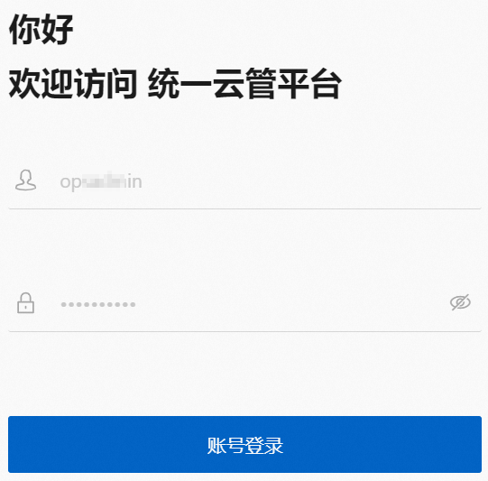
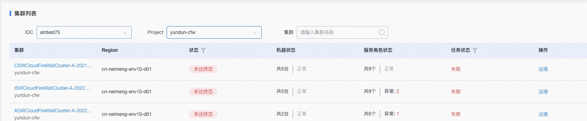
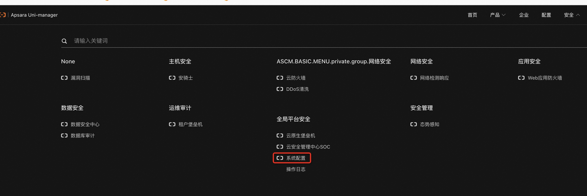
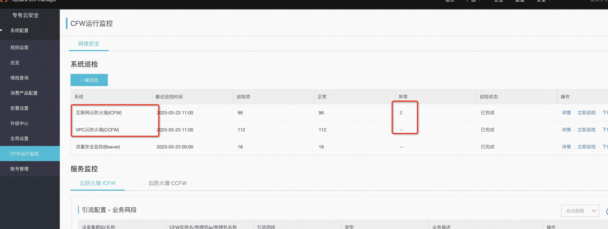
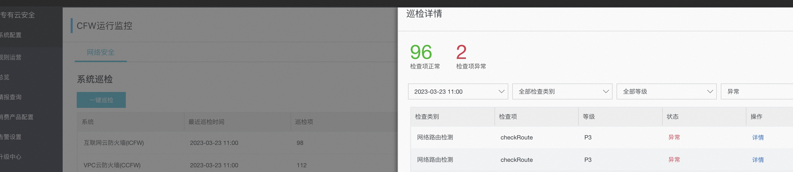
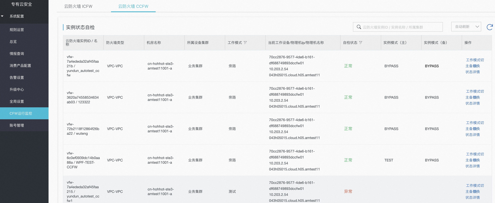

阿里云  
专有云  
云盾云防火墙  
运维指南  
产品版本：V3.18.6  
文档版本：20250926

**目录**

- [1.登录飞天基础运维平台](#section-1)
- [2.检查服务状态](#section-2)

# 1.登录飞天基础运维平台

本文介绍如何登录飞天基础运维平台。

**前提条件**

- 已从部署人员或管理员处获取Apsara Uni-manager运维控制台的访问地址、用户名和密码。

  Apsara Uni-manager运维控制台访问地址格式为*ops*.asconsole.*intranet-domain-id*.com。

- 推荐使用Chrome浏览器。

**操作步骤**

1. 打开浏览器。

2. 在地址栏中，输入Apsara Uni-manager运维控制台的访问地址*ops*.asconsole.*intranet-domain-id*.com，按回车键。

   

   > 您可以单击页面右上角的下拉按钮来进行语言切换。
   >
   > **说明**

3. 输入正确的用户名及密码。

   > 登录Apsara Uni-manager运维控制台的用户名和密码请从部署人员或管理员处获取。
   >
   > **说明**

   首次登录Apsara Uni-manager运维控制台时，需要修改登录用户名的密码，请按照提示完成密码修改。

   为提高安全性，密码必须满足以下要求：

   - 英文大小写字母

   - 阿拉伯数字（0~9）

   - 特殊符号，包括感叹号（！）、at（@）、井号（#）、美元符号（$）、百分号（%）等

   - 密码长度10~20个字符

4. 单击**登录**。

5. 在Apsara Uni-manager运维控制台的顶部菜单栏，选择**产品运维 > 云平台运维 > 飞天基础运维平台**。

# 2.检查服务状态

**1、在飞天基础运维平台查看对应服务是否终态**

**2、在云墙的巡检页面查看，是否有P1/P2/P3级别告警**

**(1)、在安全目录下选 "系统配置"**

**(2)、进入页面后选 "CFW系统监控"**

**(3)、关注里面的P1/P2/P3级别的告警，如果有则查看具体告警项**

**(4)、查看CFW虚拟实例状态里是否有红色异常信息，有的话点击详情查看具体原因**

