阿里云  
专有云  
运维安全中心（堡垒机）  
租户侧堡垒机 用户指南  
产品版本：V3.18.6  
文档版本：20251216

**目录**

- [1.产品简介](#section-1)
    - [1.1. 产品概述](#section-1-1)
    - [1.2. 用户权限说明](#section-1-2)
    - [1.3. 登录Apsara Uni-manager运营控制台](#section-1-3)
- [2.登录云盾堡垒机](#section-2)
    - [2.1. 登录云盾堡垒机（云盾安全中心登录）](#section-2-1)
    - [2.2. 登录云盾堡垒机（Web方式登录）](#section-2-2)
- [3.Web页面介绍](#section-3)
- [4.管理控制台](#section-4)
    - [4.1. 概览](#section-4-1)
    - [4.2. 用户](#section-4-2)
        - [4.2.1. 用户管理](#section-4-2-1)
            - [4.2.1.1. 新建并管理部门](#section-4-2-1-1)
            - [4.2.1.2. 新建用户](#section-4-2-1-2)
            - [4.2.1.3. 搜索用户](#section-4-2-1-3)
            - [4.2.1.4. 导出用户](#section-4-2-1-4)
            - [4.2.1.5. 新建并管理用户组](#section-4-2-1-5)
            - [4.2.1.6. 配置用户列表展示字段](#section-4-2-1-6)
        - [4.2.2. OTP令牌管理](#section-4-2-2)
            - [4.2.2.1. 导入令牌文件](#section-4-2-2-1)
            - [4.2.2.2. 搜索令牌](#section-4-2-2-2)
            - [4.2.2.3. 绑定用户](#section-4-2-2-3)
            - [4.2.2.4. 同步令牌](#section-4-2-2-4)
    - [4.3. 资产](#section-4-3)
        - [4.3.1. 资产管理](#section-4-3-1)
        - [4.3.2. 资产体检](#section-4-3-2)
        - [4.3.3. 资产发现](#section-4-3-3)
        - [4.3.4. 标签管理](#section-4-3-4)
        - [4.3.5. 远程客户端](#section-4-3-5)
    - [4.4. 账号](#section-4-4)
        - [4.4.1. 账号管理](#section-4-4-1)
            - [4.4.1.1. 新建本地账号](#section-4-4-1-1)
            - [4.4.1.2. 新建或删除远程账号](#section-4-4-1-2)
            - [4.4.1.3. 分类查看资产账号](#section-4-4-1-3)
            - [4.4.1.4. 查看账号日志](#section-4-4-1-4)
        - [4.4.2. 账号体检](#section-4-4-2)
            - [4.4.2.1. 配置任务默认体检策略](#section-4-4-2-1)
            - [4.4.2.2. 新建体检任务](#section-4-4-2-2)
            - [4.4.2.3. 执行体检任务](#section-4-4-2-3)
            - [4.4.2.4. 查看体检任务](#section-4-4-2-4)
            - [4.4.2.5. 体检范围管理](#section-4-4-2-5)
        - [4.4.3. 账号发现](#section-4-4-3)
            - [4.4.3.1. 新建发现任务](#section-4-4-3-1)
            - [4.4.3.2. 执行发现任务](#section-4-4-3-2)
            - [4.4.3.3. 手动纳管账号](#section-4-4-3-3)
        - [4.4.4. 密码管理](#section-4-4-4)
            - [4.4.4.1. 查看改密账号](#section-4-4-4-1)
            - [4.4.4.2. 立即改密](#section-4-4-4-2)
            - [4.4.4.3. 账号验密](#section-4-4-4-3)
            - [4.4.4.4. 下载历史密码](#section-4-4-4-4)
            - [4.4.4.5. 下载改密历史](#section-4-4-4-5)
            - [4.4.4.6. 恢复密码](#section-4-4-4-6)
            - [4.4.4.7. 导出账号密码](#section-4-4-4-7)
            - [4.4.4.8. 改密计划](#section-4-4-4-8)
            - [4.4.4.9. 复杂改密账号](#section-4-4-4-9)
        - [4.4.5. 密钥管理](#section-4-4-5)
    - [4.5. 授权](#section-4-5)
        - [4.5.1. 授权规则](#section-4-5-1)
            - [4.5.1.1. 规则视图](#section-4-5-1-1)
            - [4.5.1.2. 成员视图](#section-4-5-1-2)
            - [4.5.1.3. 资产视图](#section-4-5-1-3)
        - [4.5.2. 预授权规则](#section-4-5-2)
        - [4.5.3. 审批规则](#section-4-5-3)
        - [4.5.4. 未授权登录](#section-4-5-4)
        - [4.5.5. 动态对象](#section-4-5-5)
    - [4.6. 策略](#section-4-6)
        - [4.6.1. 访问控制](#section-4-6-1)
        - [4.6.2. 主机命令控制](#section-4-6-2)
        - [4.6.3. 数据库命令控制](#section-4-6-3)
    - [4.7. 审计](#section-4-7)
        - [4.7.1. 在线会话](#section-4-7-1)
        - [4.7.2. 历史会话](#section-4-7-2)
        - [4.7.3. 事件检索](#section-4-7-3)
        - [4.7.4. 工单记录](#section-4-7-4)
    - [4.8. 报表](#section-4-8)
        - [4.8.1. 自定义报表](#section-4-8-1)
        - [4.8.2. 运维报表](#section-4-8-2)
        - [4.8.3. 系统报表](#section-4-8-3)
        - [4.8.4. 报表订阅](#section-4-8-4)
    - [4.9. 配置](#section-4-9)
        - [4.9.1. 项目管理](#section-4-9-1)
        - [4.9.2. 网盘管理](#section-4-9-2)
        - [4.9.3. 用户配置](#section-4-9-3)
        - [4.9.4. 角色配置](#section-4-9-4)
        - [4.9.5. 资产配置](#section-4-9-5)
            - [4.9.5.1. 资产目录](#section-4-9-5-1)
            - [4.9.5.2. 资产网络](#section-4-9-5-2)
            - [4.9.5.3. 改密脚本](#section-4-9-5-3)
            - [4.9.5.4. 资产模板](#section-4-9-5-4)
            - [4.9.5.5. 配置管理](#section-4-9-5-5)
            - [4.9.5.6. 资产自定义属性](#section-4-9-5-6)
            - [4.9.5.7. 账号自定义属性](#section-4-9-5-7)
        - [4.9.6. 操作系统](#section-4-9-6)
        - [4.9.7. 系统对接](#section-4-9-7)
    - [4.10. 系统](#section-4-10)
        - [4.10.1. 网络管理](#section-4-10-1)
            - [4.10.1.1. 网卡配置](#section-4-10-1-1)
            - [4.10.1.2. 协议端口配置](#section-4-10-1-2)
            - [4.10.1.3. TLS安全性配置](#section-4-10-1-3)
            - [4.10.1.4. Web通信配置](#section-4-10-1-4)
            - [4.10.1.5. 静态路由](#section-4-10-1-5)
            - [4.10.1.6. 防火墙](#section-4-10-1-6)
        - [4.10.2. HA集群](#section-4-10-2)
        - [4.10.3. 服务管理](#section-4-10-3)
        - [4.10.4. 数据管理](#section-4-10-4)
            - [4.10.4.1. 基础数据管理](#section-4-10-4-1)
            - [4.10.4.2. 文件服务器](#section-4-10-4-2)
            - [4.10.4.3. 配置备份](#section-4-10-4-3)
            - [4.10.4.4. 日志备份](#section-4-10-4-4)
            - [4.10.4.5. 数据升级还原](#section-4-10-4-5)
        - [4.10.5. 监控告警](#section-4-10-5)
            - [4.10.5.1. 查看资源监控](#section-4-10-5-1)
            - [4.10.5.2. 告警配置](#section-4-10-5-2)
            - [4.10.5.3. 消息通知](#section-4-10-5-3)
            - [4.10.5.4. 通知配置](#section-4-10-5-4)
        - [4.10.6. 系统日志](#section-4-10-6)
            - [4.10.6.1. 操作日志](#section-4-10-6-1)
            - [4.10.6.2. 告警日志](#section-4-10-6-2)
        - [4.10.7. 本机维护](#section-4-10-7)
            - [4.10.7.1. 时间地区](#section-4-10-7-1)
            - [4.10.7.2. 语言界面](#section-4-10-7-2)
            - [4.10.7.3. 公告设置](#section-4-10-7-3)
            - [4.10.7.4. 诊断工具](#section-4-10-7-4)
            - [4.10.7.5. 健康检查](#section-4-10-7-5)
- [5.个人工作台](#section-5)
    - [5.1. 主页](#section-5-1)
    - [5.2. 运维](#section-5-2)
        - [5.2.1. 运维配置](#section-5-2-1)
        - [5.2.2. 主机运维](#section-5-2-2)
            - [5.2.2.1. B/S运维](#section-5-2-2-1)
            - [5.2.2.2. H5运维](#section-5-2-2-2)
            - [5.2.2.3. C/S运维](#section-5-2-2-3)
        - [5.2.3. 数据库运维](#section-5-2-3)
        - [5.2.4. 远程客户端运维](#section-5-2-4)
            - [5.2.4.1. B/S运维](#section-5-2-4-1)
            - [5.2.4.2. H5运维](#section-5-2-4-2)
        - [5.2.5. 工单运维](#section-5-2-5)
            - [5.2.5.1. B/S运维](#section-5-2-5-1)
            - [5.2.5.2. H5运维](#section-5-2-5-2)
        - [5.2.6. 收藏夹管理](#section-5-2-6)
            - [5.2.6.1. 加入收藏夹](#section-5-2-6-1)
            - [5.2.6.2. 收藏夹运维](#section-5-2-6-2)
        - [5.2.7. 批量登录运维](#section-5-2-7)
        - [5.2.8. H5协同运维](#section-5-2-8)
        - [5.2.9. 未授权登录运维](#section-5-2-9)
        - [5.2.10. 资产分组管理](#section-5-2-10)
    - [5.3. 工单](#section-5-3)
        - [5.3.1. 新建工单](#section-5-3-1)
        - [5.3.2. 取消工单](#section-5-3-2)
        - [5.3.3. 查看工单详情](#section-5-3-3)
        - [5.3.4. 工单搜索](#section-5-3-4)
        - [5.3.5. 工单审批](#section-5-3-5)
            - [5.3.5.1. 工单审批](#section-5-3-5-1)
            - [5.3.5.2. 离岸审批](#section-5-3-5-2)
        - [5.3.6. 工单撤销](#section-5-3-6)
    - [5.4. 网盘](#section-5-4)
    - [5.5. 任务](#section-5-5)
        - [5.5.1. 任务集](#section-5-5-1)
        - [5.5.2. 任务编排](#section-5-5-2)
    - [5.6. 日志](#section-5-6)
    - [5.7. 个人信息](#section-5-7)
        - [5.7.1. 基本信息](#section-5-7-1)
        - [5.7.2. 登录配置](#section-5-7-2)
            - [5.7.2.1. 手机OTP配置](#section-5-7-2-1)
            - [5.7.2.2. CS登录口令配置](#section-5-7-2-2)
            - [5.7.2.3. SSH公钥配置](#section-5-7-2-3)
            - [5.7.2.4. SSH私钥配置](#section-5-7-2-4)
        - [5.7.3. 安全配置](#section-5-7-3)
    - [5.8. 工具下载](#section-5-8)
- [6.最佳实践](#section-6)
    - [6.1. 堡垒机绑定DNAT实现公网访问能力](#section-6-1)

# 1.产品简介

**产品概述**

云盾堡垒机基于账号（Account）、认证（Authentication）、授权（Authorization）、审计（Audit）的AAAA统一管理方案，通过身份管理、授权管理、双因子认证、实时会话监控与切断、审计录像回放、高危指令查询等功能，增强运维管理的安全性。

云盾堡垒机符合各类法令法规的要求，包括等级保护、银监会、证监会、PCI安全标准委员会、企业内控管理等相关政策规定要求。主要功能

**用户权限说明**

本章节介绍了云盾堡垒机涉及的用户角色权限说明。

| 权限 | 超级管理员 | 系统管理员 | 安全管理员 | 安全审计员 | 普通用户 |
| --- | --- | --- | --- | --- | --- |
| 运维 | √ | - | - | - | √ |
| 工单 | √ | - | √（仅支持审批） | - | √（仅支持申请） |
| 概览 | √ | √ | √ | √ | - |
| 用户 | √ | √ | - | - | - |
| 资产 | √ | - | √ | - | - |
| 账号 | √ | - | √ | - | - |
| 授权 | √ | - | √ | - | - |
| 策略 | √ | - | √ | - | - |
| 审计 | √ | - | - | √ | - |
| 配置 | √ | √ | - | - | - |
| 系统 | √ | √ | - | - | - |

## 1.1. 产品概述

云盾堡垒机基于账号（Account）、认证（Authentication）、授权（Authorization）、审计（Audit）的AAAA统一管理方案，通过身份管理、授权管理、双因子认证、实时会话监控与切断、审计录像回放、高危指令查询等功能，增强运维管理的安全性。

云盾堡垒机符合各类法令法规的要求，包括等级保护、银监会、证监会、PCI安全标准委员会、企业内控管理等相关政策规定要求。

## 1.2. 用户权限说明

本章节介绍了云盾堡垒机涉及的用户角色权限说明。

| 权限 | 超级管理员 | 系统管理员 | 安全管理员 | 安全审计员 | 普通用户 |
| --- | --- | --- | --- | --- | --- |
| 运维 | √ | - | - | - | √ |
| 工单 | √ | - | √（仅支持审批） | - | √（仅支持申请） |
| 概览 | √ | √ | √ | √ | - |
| 用户 | √ | √ | - | - | - |
| 资产 | √ | - | √ | - | - |
| 账号 | √ | - | √ | - | - |
| 授权 | √ | - | √ | - | - |
| 策略 | √ | - | √ | - | - |
| 审计 | √ | - | - | √ | - |
| 配置 | √ | √ | - | - | - |
| 系统 | √ | √ | - | - | - |

## 1.3. 登录Apsara Uni-manager运营控制台

本文主要向您介绍如何登录Apsara Uni-manager运营控制台。

**前提条件**

- 登录Apsara Uni-manager运营控制台前，确认您已从部署人员处获取Apsara Uni-manager运营控制台的服务域名地址。

- 推荐使用Chrome浏览器。

**操作步骤**

1. 在浏览器地址栏中，输入Apsara Uni-manager运营控制台的服务域名地址，按回车键。

   

   > **说明**
   >
   > - 单击页面右上角的当前语言可以切换其它语言。
   >
   > - 授权登录是第三方认证中配置了全局IdP设置才会显示，且“授权登录”名称用户可按需自定义。

2. 输入正确的用户名及密码。

   > **说明**
   >
   > - 请向运营管理员获取登录控制台的用户名和密码。
   >
   > - 首次登录Apsara Uni-manager运营控制台时，需要修改登录用户名的密码，请按照提示完成密码修改。为提高安全性，密码长度必须为10~32位，且包含英文字母大小写、阿拉伯数字和特殊符号（感叹号（!）、at（@）、井号（#）、美元符号（$）、百分号（%）等）。

3. 单击**账号登录**。

4. 如果账号已激活MFA多因素认证，请根据以下两种情况进行操作：

   - **管理员强制开启MFA后的首次登录**

     <ol type="a">

     <li>

     在绑定虚拟MFA设备页面中，按页面提示步骤绑定MFA设备。

     </li>

     <li>

     按照步骤2重新输入账号和密码，单击**账号登录**。

     </li>

     </ol>

     <ol type="i" start="100">

     <li>

     输入6位MFA码后单击**认证**。

     </li>

     </ol>

   - **您已开启并绑定MFA**输入6位MFA码后单击**认证**。

     > **说明**
     >
     > 绑定并开启MFA的操作请参见管理多因素认证。

**相关操作**

**忘记密码**

1. 用户忘记登录密码时，单击密码输入框下方的**忘记密码**。

2. 在忘记密码页面，输入**账户名**、**邮箱**和验证码后，单击**确认**。

   

   > **说明**
   >
   > - 账户名请输入当前账号的用户名，邮箱请输入注册账号的Email地址。
   >
   > - 重置密码的链接将发至邮箱，进入链接后用户可输入新密码。

# 2.登录云盾堡垒机

## 2.1. 登录云盾堡垒机（云盾安全中心登录）

本文介绍如何登录云盾堡垒机系统。

> **重要**
>
> 堡垒机初始化完成后，请及时通过Web方式登录修改admin初始密码。

**操作步骤**

1. 登录Apsara Uni-manager运营控制台。

2. 在顶部菜单栏，单击**安全**，选择**运维审计** > **租户侧堡垒机**。

3. 在**租户侧堡垒机授权**页面<strong>，</strong>选择<strong>地域，</strong>单击**角色授权访问。**

## 2.2. 登录云盾堡垒机（Web方式登录）

本章节介绍如何登录云盾堡垒机。

**前提条件**

- 请确认您所使用的客户端能够正常访问云盾堡垒机系统。

- 请确认您已经从云盾堡垒机系统部署人员处获得云盾堡垒机系统的访问地址。

- 请确认您已经从云盾堡垒机系统部署人员处获得相应的用户名和密码，云盾堡垒机的基本角色如下表所示。

  <table>
    <tr>
      <th width="106">用户</th>
      <th>说明</th>
    </tr>
    <tr>
      <td>超级管理员</td>
      <td>超级管理员账号：admin 说明admin用户必须从云盾安全中心登录，具体操作，请参见登录云盾堡垒机（云盾安全中心登录）。</td>
    </tr>
    <tr>
      <td>审计管理员</td>
      <td>审计人员通过此账号进行审计，由超级管理员在<strong>用户管理</strong>中创建。</td>
    </tr>
    <tr>
      <td>系统管理员</td>
      <td>系统管理员通过此账号进行系统管理，由超级管理员在<strong>用户管理</strong>中创建。</td>
    </tr>
    <tr>
      <td>运维员</td>
      <td>运维人员通过此账号维护主机，由超级管理员在<strong>用户管理</strong>中创建。</td>
    </tr>
  </table>

**操作步骤**

1. 打开浏览器（推荐使用Edge、Chrome 69、Firefox 65及以上版本）。

2. 在地址栏中，输入云盾堡垒机系统的访问地址https://云盾堡垒机系统IP地址，按回车键（Enter）。

   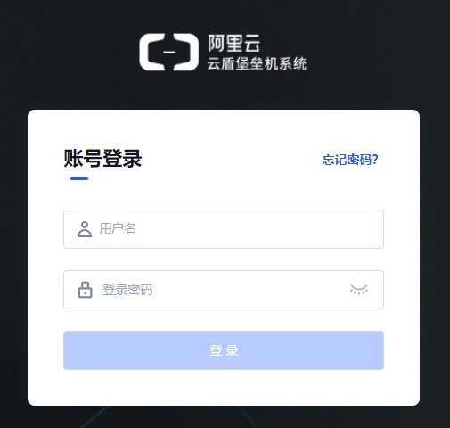

3. 输入用户名和密码，单击**登录**。

   > **说明**
   >
   > - admin用户首次登录时，直接进入修改密码界面，修改密码后才能正常使用；其他用户如果开启了下次登录必须修改密码功能，首次登录时也要求修改。
   >
   > - 首次登录后请尽快配置邮箱或手机，当忘记密码时可以通过邮箱或手机方式找回。

4. **可选**：如果配置双因子验证，请填写双因子验证码，单击**确定**。

# 3.Web页面介绍

**页面布局说明**

个人主页提供可视化、简洁、易操作的Web页面，包含5个部分，如下图。

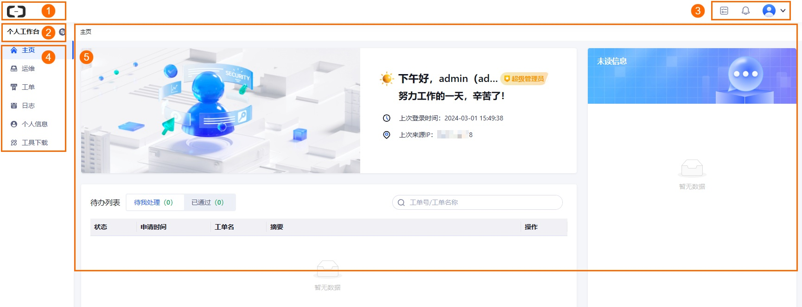

各区域的功能说明请参见下表。

| 序号 | 名称 | 说明 |
| --- | --- | --- |
| ① | 产品名称 | 展示产品Logo。仅通过Web方式登录时显示。 |
| ② | 控制台切换区 | 提供个人工作台和管理控制台的切换菜单。 |
| ③ | 用户信息区 | 提供远程任务查看和站内消息查看的快捷入口，以及当前登录用户个人信息管理、登录密码修改、页面语言切换和工具下载等功能。仅通过Web方式登录显示。 |
| ④ | 系统菜单栏 | 提供了各类管理功能的配置入口，方便用户根据实际需要进行切换；不同控制台下，提供的功能不同。 |
| ⑤ | 操作区 | 提供各类功能的子功能菜单、配置项、操作以及展示结果信息。 |

**个人信息管理**

在用户信息区，单击下拉列表，选择**个人信息**，跳转至个人工作台的个人信息页面，可以修改当前登录用户的姓名、手机号和邮箱等信息，以及给用户绑定手机OTP、CS登录口令、SSH公钥、SSH私钥和PGP公钥。

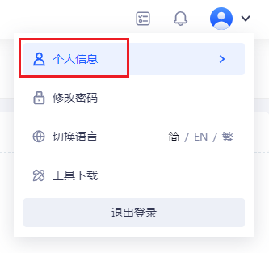

**修改密码**

1. 在用户信息区，单击下拉列表，选择**修改密码**。

   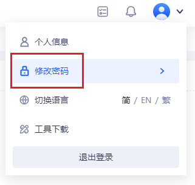

2. 输入用户的原密码、新密码和确认新密码，单击**确定**。

   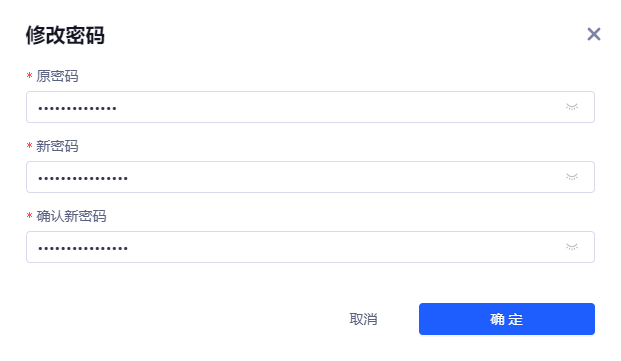

**切换语言**

在用户信息区，单击下拉列表，选择**切换语言**，即可将Web页面切换到该语言状态。

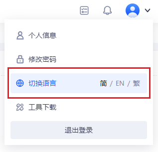

**工具下载**

1. 在用户信息区，单击下拉列表，选择**工具下载**。

2. 在**工具下载**页面，可下载单点登录器、Web代填脚本Chrome浏览器插件等运维审计工具。

   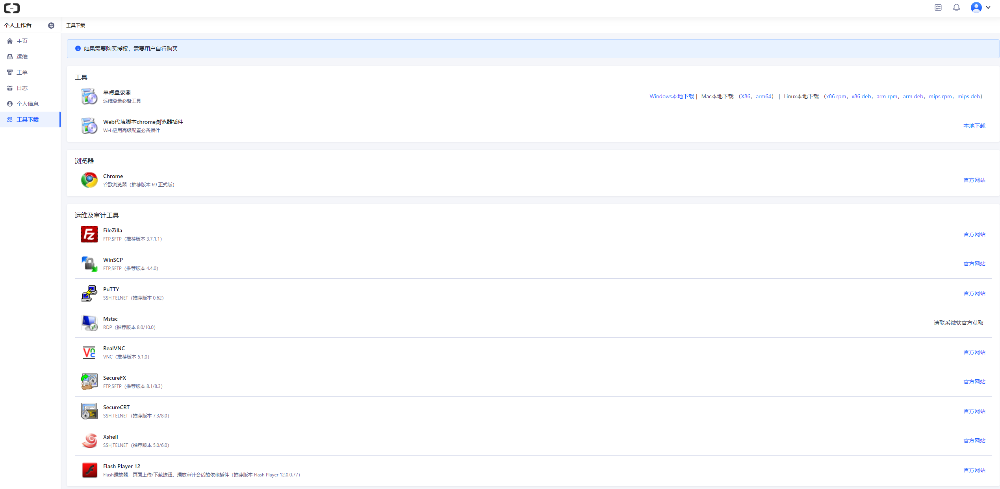

**退出登录**

在用户信息区，单击下拉列表，选择**退出登录**，**确定**后即可退出Web页面。

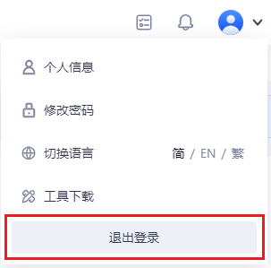

**查看远程任务**

在用户信息区，单击  图标，在弹出远程任务对话框，查看正在进行的远程任务列表。

选择历史任务页签，可以查看历史远程任务列表及任务执行结果，单击**查看全部**，会跳转至个人工作台的**日志 > 操作日志**页面，查看所有的任务操作日志信息。

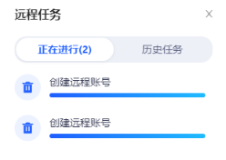

**查看站内消息**

在用户信息区，单击  图标，跳转至个人工作台的**日志 > 站内消息**页面，查看和阅读推送的站内消息，包

括工单审批、告警和操作日志。

> **说明**
>
> 如果无法收到站内消息推送，请确认管理控制台的**系统 > 监控告警 > 消息通知**页面中是否已配置推送的消息类型和接收人。

# 4.管理控制台

## 4.1. 概览

概览主要展示用户数量、资产数量、账号数量、授权规则、运维数据、许可和系统运行状态等信息。

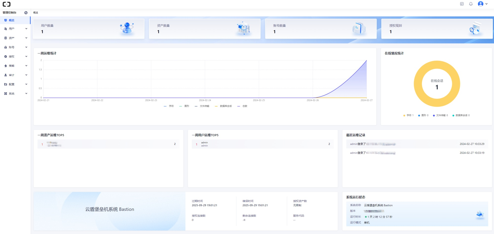

## 4.2. 用户

### 4.2.1. 用户管理

#### 4.2.1.1. 新建并管理部门

本章节介绍如何新建、编辑、搜索和删除部门。

**操作入口**

1. 登录云盾堡垒机。具体操作，请参见登录云盾堡垒机。

2. 在控制台切换区，单击图标  ，选择**管理控制台**。

3. 在左侧导航栏，选择**用户 > 用户管理**。

4. 在**部门**页签，管理部门。

   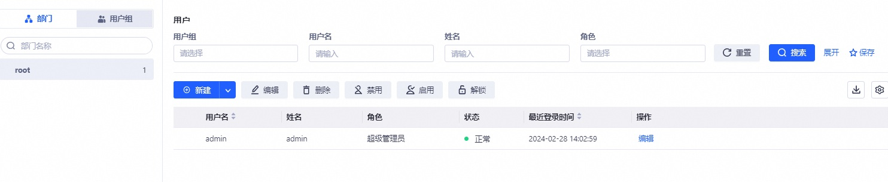

**新建子部门**

默认存在root根部门，支持在根部门下创建9级子部门。

1. 在**部门**页签，将光标悬停至部门名称上，单击  图标，选择**新建子部门**。

   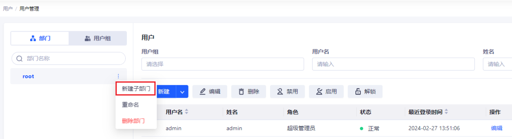

2. 输入子部门名称，单击右侧的✔图标。

   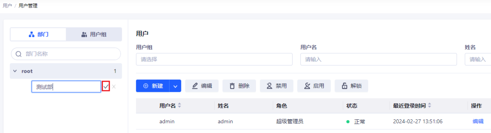

**编辑部门名称**

1. 在**部门**页签，将光标悬停至部门名称上，单击  图标，选择**重命名**。

   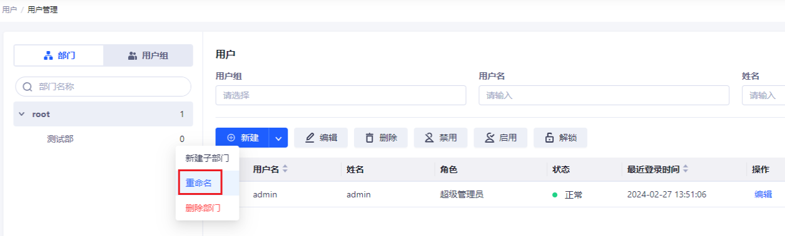

2. 输入新的部门名称，点击右侧的✔图标，完成修改。

   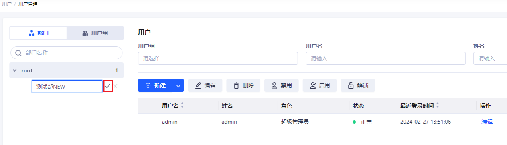

**搜索部门**

在**部门**页签，输入部门名称关键字，按回车键或单击  图标，过滤符合条件的部门。

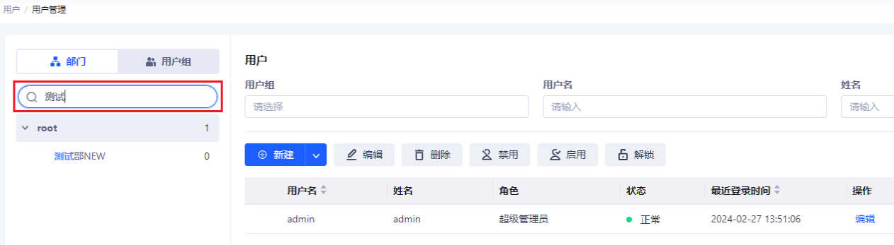

**删除部门**

在**部门**页签，将光标悬停至部门名称上，单击  图标，选择**删除部门**，确定后即可删除。

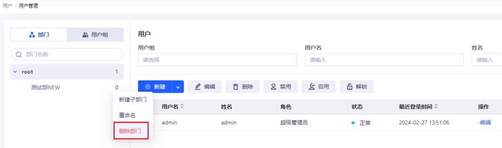

**调整部门层级**

默认存在的根部门不可移动，其他子部门可拖动至任意节点下，调整部门层级。

在**部门**页签，将光标按住待调整的部门，拖至目标部门下，即可完成部门层级调整。

#### 4.2.1.2. 新建用户

本章节介绍如何新建用户。

**操作入口**

1. 登录云盾堡垒机。具体操作，请参见登录云盾堡垒机。

2. 在控制台切换区，单击图标  ，选择**管理控制台**。

3. 在左侧导航栏，选择**用户 > 用户管理**。

4. 在**部门**页签，新建用户。

**新建单个用户**

1. 在**部门**页签的**用户**区域，单击**新建**。

2. 在**新建用户**面板，参见下表说明填写用户信息，单击**确定**。

   <table>
     <tr>
       <th>配置项</th>
       <th>说明</th>
     </tr>
     <tr>
       <td>用户名</td>
       <td>自定义用户名，仅用于标识用户，不可重复，最大长度为50字符。</td>
     </tr>
     <tr>
       <td>姓名</td>
       <td>自定义姓名，仅用于标识用户姓名，最大长度为50字符。</td>
     </tr>
     <tr>
       <td>平台角色</td>
       <td>选择用户角色，赋予用户角色拥有的权限。系统内置超级管理员、系统管理员、安全管理员、安全审计员和普通用户5种角色，如果均不满足使用需求，可以在<strong>配置 &gt; 用户配置</strong>页面的<strong>角色配置</strong>页签中自定义角色。</td>
     </tr>
     <tr>
       <td>部门</td>
       <td>选择用户所属的部门。</td>
     </tr>
     <tr>
       <td>认证源</td>
       <td>选择用户登录云盾堡垒机的认证模式，如果配置了多个认证源，登录时会逐个尝试认证直至登录。 • 本地认证：通过密码对用户进行认证。 • AD：通过远程AD服务器对用户进行认证，支持创建多个AD服务器实例。 • LDAP：通过远程LDAP服务器对用户进行认证。 • RADIUS：通过远程RADIUS服务器对用户进行认证。 • CAS：通过CAS服务器对用户进行认证。 • SAML：通过SAML服务器对用户进行认证。 • JWT：通过JWT服务器对用户进行认证。 • 钉钉：通过钉钉对用户进行认证。 • 企业微信：通过企业微信对用户进行认证。需确保已在<strong>配置 &gt; 用户配置</strong>页面的<strong>认证源</strong>页签，启用并配置各认证服务器。</td>
     </tr>
     <tr>
       <td>本地密码</td>
       <td>当认证源为<strong>本地认证</strong>时，需要设置用户的登录密码，可点击<strong>自动生成</strong>获取随机密码；或者点击文本框，根据密码强度说明手动输入。</td>
     </tr>
     <tr>
       <td>下次登录必须修改密码</td>
       <td>当认证源为<strong>本地认证</strong>时，如果勾选此功能，用户首次登录Web页面时，需要修改密码后才能使用。</td>
     </tr>
     <tr>
       <td>密码发送至用户邮箱或手机</td>
       <td>当认证源为<strong>本地认证</strong>时，如果勾选此功能，新建用户后，系统会将密码发送至用户的邮箱或者手机上。 • 如果需要发送至邮箱，需确保系统已配置邮件服务器且用户需要配置邮箱。 • 如果需要发送至手机，需确保系统已配置短信网关且用户需要配置手机号。</td>
     </tr>
     <tr>
       <td>同步源</td>
       <td>选择用户的同步源，可将远端认证服务器上的用户同步到云盾堡垒机中，支持AD和LDAP。需确保已在<strong>配置 &gt; 用户配置</strong>页面的<strong>认证源</strong>页签，启用并配置AD或LDAP服务器。</td>
     </tr>
     <tr>
       <td>安全配置</td>
       <td>• <strong>状态</strong>： • <strong>启用</strong>：用户可以登录系统。 • <strong>禁用</strong>：用户无法登录系统。 • <strong>多因素认证</strong>： • <strong>跟随系统</strong>：用户的多因素认证配置跟随系统的多因素认证配置。 • <strong>自定义</strong>：用户自行选择多因素认证方式，多选情况下逐个尝试认证。 • <strong>有效期</strong>：配置用户可登录云盾堡垒机的有效期，有效期范围外的时间用户无法登录系统。</td>
     </tr>
     <tr>
       <td>用户组</td>
       <td>选择用户所属的用户组。</td>
     </tr>
     <tr>
       <td>邮箱</td>
       <td rowspan="2">用于接收系统通知和验证码，便于忘记密码时能找回密码，建议邮箱和手机至少配置一项。</td>
     </tr>
     <tr>
       <td>手机</td>
     </tr>
     <tr>
       <td>备注</td>
       <td>配置用户的备注信息。</td>
     </tr>
     <tr>
       <td>自定义属性</td>
       <td>配置用户的自定义属性值。需要在<strong>配置 &gt; 用户配置</strong>新建属性后才可以选择。</td>
     </tr>
   </table>

**批量导入**

1. 在**部门**页签的**用户**区域，选择**新建 > 导入用户**。

2. 在**导入**对话框，单击**下载模板文件**，下载模板文件。

3. 根据模板中的说明完成模板内容填写，单击**选择文件**，上传模板文件。

4. 根据下表说明，按需勾选配置项，单击**导入**。

   | 配置项 | 说明 |
   | --- | --- |
   | 更新已有同名用户 | • 勾选后，如果导入的用户名与系统中已有的用户名相同，则会覆盖更新。 • 不勾选情况下，如果导入的用户名与系统中已有的用户名相同，则不会导入该用户。 |
   | 导入成功后，自动发送密码至用户邮箱或手机 | 勾选后，导入成功会自动将密码发送至用户配置的邮箱或手机。 • 发送至邮箱：需确保已配置邮件服务器且用户需要配置邮箱。 • 发送至手机：需确保系统已配置短信网关且用户需要配置手机号。 |

**远程同步用户**

支持从AD或LDAP服务器上同步用户至云盾堡垒机。

在**配置 > 用户配置**页面的**认证源**页签，添加AD服务器或LDAP服务器，开启**新建用户**的**同步新建**功能，即可将服务器上新建的用户同步至云盾堡垒机。

**相关操作**

- 编辑用户：

  - 编辑单个用户：在**部门**页签的**用户**区域，定位到目标用户，在**操作**列，单击**编辑**，修改用户信息后，单击**确定**。

  - 批量编辑用户：在**部门**页签的**用户**区域，选中目标用户，在列表上方，单击**编辑**，修改用户信息后，单击**确定**。

- 禁用或启用用户：用户禁用后将不可登录Web页面；禁用状态的用户，需手动启用后方可登录Web页面。

  在**部门**页签的**用户**区域，选中目标用户，在列表上方，单击**禁用**或**启用**，确定后，即可启用或禁用用户。

- 解锁用户：果用户多次登录失败或长时间未登录而导致被锁定，需手动解锁用户，方可登录云盾堡垒机。

  在**部门**页签的**用户**区域，选中目标用户，在列表上方，单击**解锁**，确定后即可解锁用户。

- 删除用户：在**部门**页签的**用户**区域，选中目标用户，在列表上方，单击**删除**，确定后即可删除用户。

#### 4.2.1.3. 搜索用户

本章节介绍如何搜索当前部门或用户组下的用户。

1. 登录云盾堡垒机。具体操作，请参见登录云盾堡垒机。

2. 在控制台切换区，单击图标  ，选择**管理控制台**。

3. 在左侧导航栏，选择**用户 > 用户管理**。

4. 在**部门**或**用户组**页签，单击**展开**， 输入搜索字段内容，单击**搜索**。

   - 单击**重置**，清除搜索条件。

   - 单击**保存**，弹出保存查询条件，将当前的搜索条件保存为常用查询条件，后续可快速选择并搜索。

#### 4.2.1.4. 导出用户

本章节介绍如何将用户信息导出至本地。

1. 登录云盾堡垒机。具体操作，请参见登录云盾堡垒机。

2. 在控制台切换区，单击图标  ，选择**管理控制台**。

3. 在左侧导航栏，选择**用户 > 用户管理**。

4. 在**部门**或**用户组**页签，单击  图标。

5. 在**导出**对话框，选择导出范围，设置加密密码，单击**导出**。

   - 所有：导出所有的用户信息。

   - 已选：导出选中的用户信息，导出前需先勾选用户。

   - 加密密码：导出文件时对文件zip包进行加密，保证文件的安全性，建议设置。

#### 4.2.1.5. 新建并管理用户组

本位介绍如何新建并管理用户组。

**操作入口**

1. 登录云盾堡垒机。具体操作，请参见登录云盾堡垒机。

2. 在控制台切换区，单击图标  ，选择**管理控制台**。

3. 在左侧导航栏，选择**用户 > 用户管理**。

4. 在**用户组**页签，管理用户组。

   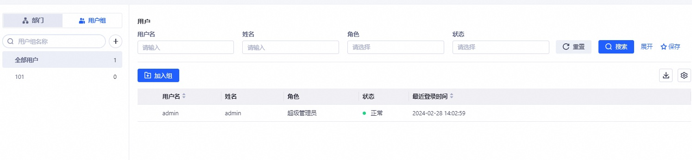

**新建用户组**

1. 在**用户组**页签，单击  图标.

2. 在右侧弹出**新建用户组**面板，配置用户组名称和所属部门，单击**确定**。

**编辑用户组**

1. 在**用户组**页签，将光标悬停至用户组上，单击  图标，选择**编辑**.

2. 在**编辑用户组**面板，输入新的用户组名称，单击**确定**。

**搜索用户组**

在**用户组**页签，输入用户组名称关键字，按回车键或点击  图标，过滤符合条件的用户组。

**删除用户组**

在**用户组**页签，将光标悬停至用户组上，单击  图标，选择**删除**.

**加入用户组**

1. 在**用户组**页签的**用户**区域，选中目标用户组，单击**加入组**。

2. 在**加入用户组**对话框，勾选用户组，单击**确定**。

**用户组添加成员**

1. 在**用户组**页签，选择用户组，在**用户**区域，单击**添加用户组成员**。

2. 在**选择用户**面板，选中目标用户，单击**确定**。

**用户组移出成员**

在**用户组**页签，选择用户组，在**用户**区域，单击**移除组**。

#### 4.2.1.6. 配置用户列表展示字段

云盾堡垒机支持灵活配置用户列表展示的字段信息。

1. 登录云盾堡垒机。具体操作，请参见登录云盾堡垒机。

2. 在控制台切换区，单击图标  ，选择**管理控制台**。

3. 在左侧导航栏，选择**用户 > 用户管理**。

4. 在**部门**或**用户组**页签，单击  图标，选中所需展示的字段，单击**确定**。

### 4.2.2. OTP令牌管理

#### 4.2.2.1. 导入令牌文件

本章节介绍如何导入令牌文件。

**操作步骤**

1. 登录云盾堡垒机。具体操作，请参见登录云盾堡垒机。

2. 在控制台切换区，单击图标  ，选择**管理控制台**。

3. 在左侧导航栏，选择**用户 > OTP令牌管理**。

4. 单击**导入令牌**，从本地选择并上传令牌文件。

**相关操作**

导入令牌文件后，支持以下操作：

- 禁用令牌：选中目标令牌，在列表上方，单击**禁用**。

- 启用令牌：选中目标令牌，在列表上方，单击**启用**。

- 挂失令牌：选中目标令牌，在列表上方，单击**挂失**。

- 解除绑定令牌”选中目标令牌，在列表上方，单击**解除绑定**。

- 删除令牌：选中目标令牌，在列表上方，单击**删除**。

#### 4.2.2.2. 搜索令牌

本文介绍如何搜索符合条件的令牌。

1. 登录云盾堡垒机。具体操作，请参见登录云盾堡垒机。

2. 在控制台切换区，单击图标  ，选择**管理控制台**。

3. 在左侧导航栏，选择**用户 > OTP令牌管理**。

4. 输入或选择搜索字段内容，单击**搜索**，即可搜索符合条件的令牌。

#### 4.2.2.3. 绑定用户

新建令牌后，需将令牌文件授权给用户。

1. 登录云盾堡垒机。具体操作，请参见登录云盾堡垒机。

2. 在控制台切换区，单击图标  ，选择**管理控制台**。

3. 在左侧导航栏，选择**用户 > OTP令牌管理**。

4. 定位到目标令牌，在**操作**列，单击**绑定用户**。

5. 在**选择用户**面板，选择用户，单击**确定**。

#### 4.2.2.4. 同步令牌

如果出现云盾堡垒机与动态令牌硬件设备有时间差而导致无法获取实时口令，可以同步令牌来矫正时间。

1. 登录云盾堡垒机。具体操作，请参见登录云盾堡垒机。

2. 在控制台切换区，单击图标  ，选择**管理控制台**。

3. 在左侧导航栏，选择**用户 > OTP令牌管理**。

4. 定位到启用的令牌，在**操作**列，单击**同步令牌**。

5. 在**同步令牌**对话框，输入从动态令牌硬件设备上获取当前动态密码和下一条动态密码，单击**确定**。

## 4.3. 资产

### 4.3.1. 资产管理

通过目录组织，可以实现资产的分级管理。

**新建目录**

1. 登录云盾堡垒机。具体操作，请参见登录云盾堡垒机。

2. 在控制台切换区，单击图标  ，选择**管理控制台**。

3. 在左侧导航栏，选择**资产 > 资产管理**。

4. 在**目录**区域，将光标悬停至目录名称上，单击  图标，选择**新建子目录**。

5. 在弹出的面板输入子目录名称，单击**确定**。

   - 调整目录层级：将光标按住待调整的目录，拖至目标目录下，即可完成目录层级调整。

   - 编辑目录名称：将光标悬停至目录名称上，单击  图标，选择**编辑**。

   - 删除目录：将光标悬停至目录名称上，单击  图标，选择**删除目录**，确定后即可删除。

**新建资产**

**新建单个资产**

1. 登录云盾堡垒机。具体操作，请参见登录云盾堡垒机。

2. 在控制台切换区，单击图标  ，选择**管理控制台**。

3. 在左侧导航栏，选择**资产 > 资产管理**。

4. 在**资产**区域，单击**新建**，在**新建资产**面板，选择资产模板，单击**下一步**。

5. 在**资产信息**引导页，参考下表说明填写资产信息，单击**下一步**。

   <table>
     <tr>
       <th width="105">配置项</th>
       <th>说明</th>
     </tr>
     <tr>
       <td>资产类型</td>
       <td>用于标记资产类型，支持普通资产、Windows域控和Windows域成员。</td>
     </tr>
     <tr>
       <td>资产名称</td>
       <td>自定义资产名称，仅用于识别，最大长度为30个字符。</td>
     </tr>
     <tr>
       <td>IP/域名</td>
       <td>配置资产的IP地址，支持IPv4和域名格式。</td>
     </tr>
     <tr>
       <td>所属网络</td>
       <td>选择资产所属的网络，默认为default网络。</td>
     </tr>
     <tr>
       <td>所在目录</td>
       <td>选择资产所在目录。</td>
     </tr>
     <tr>
       <td>标签</td>
       <td>选择资产需要关联的标签</td>
     </tr>
     <tr>
       <td>备注</td>
       <td>配置资产备注信息。</td>
     </tr>
     <tr>
       <td>自定义属性</td>
       <td>配置资产的自定义属性值。需要在<strong>配置 &gt; 资产配置</strong>新建属性后才可以选择。</td>
     </tr>
   </table>

6. 配置资产账号，单击**确定**。

   添加资产账号：单击**新建**，在**新建资产账号**面板，参考下表说明配置账号信息，单击**确定**。

   <table>
     <tr>
       <th width="105">配置项</th>
       <th>说明</th>
     </tr>
     <tr>
       <td>账号类型</td>
       <td>选择账号的类型，支持本地账号和域账号。域账号选项仅资产类型为Windows域控时可选择，其余资产类型下默认显示本地账号选项。</td>
     </tr>
     <tr>
       <td>账号名</td>
       <td>配置账号名，最大长度为64个字符。<strong>特权账号</strong>：选中后，该账号被标识为特权账号，用于如下场景： • 改密时，使用该账号对普通账号进行改密。SSH协议默认自改密，当自改密失败时自动尝试使用特权账号改密；RDP协议默认使用特权账号改密。 • 将云盾堡垒机 中创建的SSH或RDP协议主机账号推送至主机，并在主机上新建该账号；或者通过云盾堡垒机 删除主机中的账号时，会使用此特权账号登录主机操作。 • 账号发现时，使用该账号登录主机发现其他账号。 • 账号体检时，使用该账号读取其他账号在主机上的信息。</td>
     </tr>
     <tr>
       <td>密码</td>
       <td>配置账号对应的密码。</td>
     </tr>
     <tr>
       <td>标签</td>
       <td>选择账号需要关联的标签。</td>
     </tr>
     <tr>
       <td>应用于服务</td>
       <td>选择账号应用的服务，支持多选。</td>
     </tr>
     <tr>
       <td>SSH密钥</td>
       <td>当账号应用于SSH服务时，可选择账号的SSH密钥。SSH密钥需提前创建。</td>
     </tr>
     <tr>
       <td>连接为</td>
       <td>当账号应用于Oracle服务时，需要选择Oracle的连接属性。</td>
     </tr>
   </table>

   <table>
     <tr>
       <th width="121">是否自动改密</th>
       <th>• 选择<strong>是</strong>，则账号允许在云盾堡垒机中改密。 • 选择<strong>否</strong>，则账号不允许改密。</th>
     </tr>
     <tr>
       <td>改密脚本</td>
       <td>选择账号的自定义改密脚本。</td>
     </tr>
     <tr>
       <td>切换自</td>
       <td>当账号应用于SSH或Telnet服务时，如果要先登录其他账号，再二次登录到本账号时，需要给本账号关联切换前的登录。</td>
     </tr>
     <tr>
       <td>自定义属性</td>
       <td>配置账号的自定义属性值。需要在<strong>配置 &gt; 资产配置</strong>新建属性后才可以选择。</td>
     </tr>
   </table>

**批量导入资产及资产账号**

用于批量导入资产及资产账号。

1. 在**资产**区域，选择**新建 > 导入资产**。

2. 在**导入**对话框，单击**下载模板文件**，下载模板文件。

3. 根据模板中的说明完成模板文件填写，单击**选择文件**，上传模板文件。

4. 根据下表说明，按需选中配置项，单击**导入**。

   <table>
     <tr>
       <th width="137">配置项</th>
       <th>说明</th>
     </tr>
     <tr>
       <td>跳过同标识资产</td>
       <td>如果导入资产的资产名称和IP与系统中已有的资产相同，则不会导入该资产。</td>
     </tr>
     <tr>
       <td>新建同标识资产</td>
       <td>如果导入资产的资产名称和IP与系统中已有的资产相同，则以名称<code> +</code> <code>(n) </code>格式新建资产。</td>
     </tr>
     <tr>
       <td>覆盖同标识资产</td>
       <td>如果导入资产的资产名称和IP与系统中已有的资产相同时，则会覆盖更新。</td>
     </tr>
     <tr>
       <td>导入后立即改密</td>
       <td>勾选后，如果有新建账号导入，则会立即对该新建账号改密。</td>
     </tr>
   </table>

**资产源导入**

1. 在**资产**区域，选择**新建 > 资产源导入**。

2. 跳转到**资产发现**的**新建资产源**面板，新建资产源并同步导入资产。

**编辑资产**

**编辑单个资产**

- 编辑资产配置

  <ol type="i">

  <li>

  在**资产**区域，定位到目标资产，在**操作**列，单击**编辑**。

  </li>

  <li>

  在**配置**页签，参考下表说明编辑资产的基本信息和高级配置项，单击对应的**保存**。

  <table>
    <tr>
      <th width="121">配置</th>
      <th>说明</th>
    </tr>
    <tr>
      <td>资产类型</td>
      <td>用于标记资产类型，支持普通资产、Windows域控和Windows域成员。</td>
    </tr>
    <tr>
      <td>资产名称</td>
      <td>配置资产的IP地址，支持IPv4、IPv6和域名格式。</td>
    </tr>
    <tr>
      <td>IP/域名</td>
      <td>配置资产的IP地址，支持IPv4和域名格式。</td>
    </tr>
    <tr>
      <td>所属网络</td>
      <td>选择资产所在目录。</td>
    </tr>
    <tr>
      <td>所在目录</td>
      <td>选择资产所在目录。</td>
    </tr>
    <tr>
      <td>备注</td>
      <td>配置资产备注信息。</td>
    </tr>
    <tr>
      <td>标签</td>
      <td>选择账号需要关联的标签。</td>
    </tr>
    <tr>
      <td>自定义属性</td>
      <td>配置资产的自定义属性值。需要在<strong>配置 &gt; 资产配置</strong>新建属性后才可以选择。</td>
    </tr>
    <tr>
      <td>系统编码</td>
      <td>根据实际情况选择系统编码。</td>
    </tr>
    <tr>
      <td>切换账号命令</td>
      <td>配置账号的二次登录切换命令，支持SSH或Telnet协议的账号。用户登录切换自关联的账号后，系统会自动使用此命令二次登录本账号。</td>
    </tr>
  </table>

  </li>

  </ol>

- 编辑资产服务

  <ol type="i">

  <li>

  在**资产**区域，定位到目标资产，在**操作**列，单击**编辑**。

  </li>

  <li>

  在**服务**页签，参考下表说明修改各服务的端口号及连接参数，并开启或关闭服务，单击**保存**。

  | 服务 | 配置项 | 说明 |
  | --- | --- | --- |
  | SSH | 端口 | 默认是22。 |
  | SFTP | 端口 | 默认是22。 |
  | RDP | 端口 | 默认是3389。 |
  | TELNET | 端口 | 默认是23。 |
  | RLOGIN | 端口 | 默认是513。 |
  | VNC | 端口 | 默认是5900。 |
  | FTP | 端口 | 默认是21。 |
  | ORACLE | 端口 | 默认是1521。 |
  | KINGBASE | 端口 | 默认是54321。 |
  | DM | 端口 | 默认是5236。 |
  | PostgreSQL | 端口 | 默认是5432。 |
  | DB2 | 端口 | 默认是50000。 |
  | SQLServer | 端口 | 默认是1433。 |
  | MySQL | 端口 | 默认是3306。 |
  | GaussDB | 端口 | 默认是5432。 |
  | OpenGauss | 端口 | 默认是5432。 |
  | MariaDB | 端口 | 默认是3306。 |
  | Informix | 端口 | 默认是1435。 |
  | Redis | 端口 | 默认是6379。 |
  | MongoDB | 端口 | 默认是27017。 |
  | TIDB | 端口 | 默认是4000。 |
  | HTTP/HTTPS | URL | 默认是空。 |
  | X11 | 端口 | 默认是22。 |
  | 自定义TCP | 端口 | 默认是443。 |
  | GBase8a | 端口 | 默认是5258。 |
  | GBase8s | 端口 | 默认是9088。 |

  </li>

  </ol>

- 编辑资产账号

  <ol type="i">

  <li>

  在**资产**区域，定位到目标资产，在**操作**列，单击**编辑**。

  </li>

  <li>

  在**账号**页签，新建、修改或删除资产账号。

  单击**新建**，右侧弹出**添加资产账号**面板，参加下表说明配置账号信息，单击**确定**，完成添加。

  <table>
    <tr>
      <th width="121">配置项</th>
      <th>说明</th>
    </tr>
    <tr>
      <td>账号类型</td>
      <td>选择账号的类型，支持本地账号和域账号。域账号选项仅资产类型为Windows域控时可选择，其余资产类型下默认显示本地账号选项。</td>
    </tr>
    <tr>
      <td>账号名</td>
      <td>配置账号名，最大长度为64个字符。特权账号：选中后，该账号被标识为特权账号，用于如下场景。 • 改密时，使用该账号对普通账号进行改密。SSH协议默认自改密，当自改密失败时自动尝试使用特权账号改密；RDP协议默认使用特权账号改密。 • 将云盾堡垒机 中创建的SSH或RDP协议主机账号推送至主机，并在主机上新建该账号；或者通过云盾堡垒机 删除主机中的账号时，会使用此特权账号登录主机操作。 • 账号发现时，使用该账号登录主机发现其他账号。 • 账号体检时，使用该账号读取其他账号在主机上的信息。</td>
    </tr>
    <tr>
      <td>密码</td>
      <td>配置账号对应的密码。</td>
    </tr>
    <tr>
      <td>应用于服务</td>
      <td>选择账号应用的服务，支持多选。</td>
    </tr>
    <tr>
      <td>SSH密钥</td>
      <td>当账号应用于SSH服务时，可选择账号的SSH密钥。SSH密钥需提前创建。</td>
    </tr>
    <tr>
      <td>连接为</td>
      <td>当账号应用于Oracle服务时，需要选择Oracle的连接属性。</td>
    </tr>
    <tr>
      <td>是否自动改密</td>
      <td>• 选择<strong>是</strong>，则账号允许在云盾堡垒机中改密。 • 选择<strong>否</strong>，则账号不允许改密。</td>
    </tr>
    <tr>
      <td>改密脚本</td>
      <td>选择账号的自定义改密脚本。</td>
    </tr>
    <tr>
      <td>切换自</td>
      <td>当账号应用于SSH或Telnet服务时，如果要先登录其他账号，再二次登录到本账号时，需要给本账号关联切换前的登录。</td>
    </tr>
    <tr>
      <td>自定义属性</td>
      <td>配置账号的自定义属性值。需要在<strong>配置 &gt; 资产配置</strong>新建属性后才可以选择。</td>
    </tr>
    <tr>
      <td>标签</td>
      <td>选择账号需要关联的标签。</td>
    </tr>
    <tr>
      <td>账号验密</td>
      <td>如果该账号已在资产中存在，可单击<strong>账号验密</strong>验证登录密码是否正确。</td>
    </tr>
  </table>

  </li>

  </ol>

**批量编辑**

1. 在**资产**区域，选中目标资产，在列表上方单击**编辑**。

2. 在**批量编辑资产**面板<strong>，</strong>参考下表说明修改资产信息，单击**确定**。

   <table>
     <tr>
       <th width="121">配置项</th>
       <th>说明</th>
     </tr>
     <tr>
       <td>所属网络</td>
       <td>选择资产所属的网络，默认为default网络。</td>
     </tr>
     <tr>
       <td>所在目录</td>
       <td>选择资产所在目录。</td>
     </tr>
     <tr>
       <td>系统编码</td>
       <td>根据实际情况选择系统编码。</td>
     </tr>
     <tr>
       <td>切换账号命令</td>
       <td>配置账号的二次登录切换命令，支持SSH或Telnet协议的账号。用户登录切换自关联的账号后，系统会自动使用此命令二次登录本账号。</td>
     </tr>
     <tr>
       <td>备注</td>
       <td>配置资产备注信息。</td>
     </tr>
     <tr>
       <td>自定义属性</td>
       <td>配置资产的自定义属性值。需要在<strong>配置 &gt; 资产配置</strong>新建属性后才可以选择。</td>
     </tr>
   </table>

**导出资产**

1. 在**资产**区域，单击  图标。

2. 在**导出**对话框，选择导出范围，设置加密密码，单击**导出**，将资产信息导出至本地PC。

   加密密码用于打开文件时对文件zip包进行解密，保证文件的安全性，建议设置。

   - 所有：导出所有的用户信息。

   - 已选：导出选中的用户信息，导出前需先勾选用户。

### 4.3.2. 资产体检

本文介绍如何新建体检任务及其管理。

**新建体检任务**

1. 登录云盾堡垒机。具体操作，请参见登录云盾堡垒机。

2. 在控制台切换区，单击图标  ，选择**管理控制台**。

3. 在左侧导航栏，选择**资产 > 资产体检**。

4. 单击  图标，在**新建资产体检任务**面板，配置任务基本信息后，单击**下一步**。

5. 勾选检查项，单击**下一步**。

6. 选择资产范围，单击**确定**。

**更多操作**

- 编辑体检任务：鼠标悬停至体检任务，单击**编辑**。

- 删除体检任务：鼠标悬停至体检任务，单击**删除**。

- 执行体检任务：鼠标悬停至体检任务，单击**立即执行**。

- 查看或修改体检任务默认配置：单击  图标，在**资产体检任务默认配置**面板，查看或修改体检任务默认配

  置。

### 4.3.3. 资产发现

通过资产源同步，将远端资产导入云盾堡垒机中，实现统一管理。目前支持局域网扫描。

**新建资产源**

1. 登录云盾堡垒机。具体操作，请参见登录云盾堡垒机。

2. 在控制台切换区，单击图标  ，选择**管理控制台**。

3. 在左侧导航栏，选择**资产 > 资产发现**。

4. 单击  图标，在**新建资产源**面板，参考下表说明填写资产源信息，单击**确定**。

   | 配置项 | 说明 |
   | --- | --- |
   | 名称 | 配置资产源名称，最大长度为50个字符。 |
   | 类型 | • 局域网：扫描目标网段内的资产主机。 • 百度云：获取目标百度云资产。 • 亚马逊云：获取目标亚马逊云资产。 • 华为云：获取目标华为云资产。 • 腾讯云：获取目标腾讯云资产。 • 微软云：获取目标微软云资产。 • 优刻得云：获取目标优刻得云资产。 • 青藤万相：获取目标青藤万相资产账号。 • 蓝鲸智云：获取目标蓝鲸智云资产。 |
   | IP去重 | 同项目内，相同IP视为同一资产，此时不支持自动更新和删除。仅适用与青藤万相、蓝鲸智云。 |
   | 自动同步 | 开启后，资产源根据同步周期定期同步远端的资产主机。 |
   | 默认所属网络 | 局域网发现任务属性。选择局域网资产主机同步后在当前项目中的归属网络，默认default。 |
   | 目标网段 | 局域网发现任务属性。配置同步扫描的局域网网段，网段掩码需大于等于24位。 |
   | 同步IP | 公有云发现任务属性。同步IP修改后，需要勾选同步更新才会更新已被托管资产的IP。 |
   | 同步到 | 选择资产主机同步过来后在当前项目中的归属目录。 |
   | 同步新建 | 如果勾选，同步过来的资产主机会被自动纳管到系统中，否则需要手动纳管。 |
   | 同步新建云主机 | 云资产发现任务获取的云主机同步新建到当前项目中。 |
   | 同步新建VPC网络 | 云资产发现任务获取的VPC网络同步新建到云盾堡垒机中。 |
   | 根据区域/可用区新建资产目录 | 云资产发现任务获取的区域/可用区同步新建到当前项目的资产目录中。 |
   | 同步更新 | 勾选后，同步时会更新已纳管至系统的云主机的资产名称和资产IP，否则就不更新。 |
   | 同步删除 | 勾选后，如果项目中属于该资产源所属网络的资产未被扫出，就会自动删除，否则仍展示在已释放列表中。此功能请谨慎操作。 |
   | 资产属性映射关系 | 配置远程服务器上的资产属性托管到资产的自定义属性。仅适用与青藤万相、蓝鲸智云。 |

**立即同步资产**

如果资产源开启自动同步功能，系统会根据同步周期定期同步远端的资产主机，也可手动立即同步资产主机。

在**资产源**区域选择资产源，单击**立即执行**，立即同步目标网段内的资产主机。

**查看自动同步情况**

如果资产源开启同步新建功能，可在最新自动同步情况中查看最近一次自动同步的资产信息。

在**资产源**区域选择资产源，在**最新自动同步情况**区域，可查看最近一次的自动同步数据， 单击**最近新增**数量可查看本次同步新建的资产列表。

**纳管资产**

如果资产源中未开启同步新建功能，同步后可以手动纳管资产。

在**资产源**区域选择资产源，单击**未纳管**数量，显示未纳管的资产列表，选中资产，单击**纳管**，确定后即可批量纳管资产。

**忽略资产**

发现的资产后，如果不想纳管但又想从未纳管列表中剔除，可以通过忽略功能实现。

在**资产源**区域选择资产源，单击**未纳管**数量，显示未纳管的资产列表，选中资产，单击**忽略**，确定后即可批量忽略资产。

### 4.3.4. 标签管理

本文介绍如何添加标签及其管理。

**新建标签**

1. 登录云盾堡垒机。具体操作，请参见登录云盾堡垒机。

2. 在控制台切换区，单击图标  ，选择**管理控制台**。

3. 在左侧导航栏，选择**资产 > 标签管理**。

4. 单击**新建**，在**新建标签**面板，输入标签名称，并选择绑定的资产或资产账号，单击**确定**。

**资产绑定标签**

**单个绑定**

1. 在左侧导航栏，选择**资产中心** > **资产管理**。

2. 找到目标资产，在**操作**列，单击**编辑**。

3. 在**基本信息**区域，选择标签，单击**保存**。

**批量绑定**

1. 在左侧导航栏，选择**资产中心** > **资产管理**。

2. 选中目标资产，选择**更多 > 绑定标签**。

3. 选中目标标签后，单击**确定**。

**账号绑定标签**

**单个绑定**

1. 在左侧导航栏，选择**账号 > 账号管理**。

2. 找到目标账号，在**操作**列，单击**编辑**。

3. 在**基本信息**区域，选择标签，单击**保存**。

**批量绑定**

1. 在左侧导航栏，选择**账号 > 账号管理**。

2. 选中目标账号，选择**更多 > 绑定标签**。

3. 选中目标标签后，单击**确定**。

**更多操作**

- 编辑标签：找到目标标签，在**操作**列，单击**编辑**。

- 删除标签：选中目标标签，单击列表上方的**删除**。

### 4.3.5. 远程客户端

当用户运维操作所使用的客户端工具或协议（如HTTPS协议）不在云盾堡垒机的支持范围内，但仍需通过云盾堡垒机进行运维审计时，可以借助远程客户端指定应用服务器实现。

**新建远程客户端**

1. 登录云盾堡垒机。具体操作，请参见登录云盾堡垒机。

2. 在控制台切换区，单击图标  ，选择**管理控制台**。

3. 在左侧导航栏，选择**资产 > 远程客户端**。

4. 在**远程客户端**页签，单击**新建**。

5. 在**新建远程客户端**面板，配置参数，单击**确定**。

   - 删除远程客户端：在**远程客户端**页签，定位到目标远程客户端，在**操作**列，单击**编辑**。

   - 编辑远程客户端：在**远程客户端**页签，选中目标远程客户端，单击**删除**。

**新建应用服务器**

作为应用服务器的资产需要需要开启RDP服务。

1. 登录云盾堡垒机。具体操作，请参见登录云盾堡垒机。

2. 在控制台切换区，单击图标  ，选择**管理控制台**。

3. 在左侧导航栏，选择**资产 > 远程客户端**。

4. 在**应用服务器**页签，单击**新建**。

5. 在**快速新建应用服务器**面板，选择好创建的应用服务器类型并选择资产作为应用服务器，单击**新建应用服务器**。

   <ol type="i">

   <li>

   编辑应用服务器：在**应用服务器**页签，定位到目标任务，在**操作**列，单击**编辑**。

   </li>

   <li>

   删除应用服务器：在**应用服务器**页签，定位到目标任务，在**操作**列，单击**删除**。

   </li>

   </ol>

**部署应用服务器**

1. 在**应用服务器**页签，定位到目标任务，在**操作**列，单击**部署**。

2. 单击**生成命令**，按照提示完成操作，单击**确定。**

**应用服务器同步账号**

1. 在**应用服务器**页签，定位到目标任务，在**操作**列，单击**同步账号**。

2. 在**同步账号**面板， 单击**一键同步**，可以自动在应用服务器处创建云盾堡垒机处上用户的账号。

## 4.4. 账号

### 4.4.1. 账号管理

#### 4.4.1.1. 新建本地账号

本文介绍如何新建本地账号。

**操作步骤**

1. 登录云盾堡垒机。具体操作，请参见登录云盾堡垒机。

2. 在控制台切换区，单击图标  ，选择**管理控制台**。

3. 在左侧导航栏，选择**账号 > 账号管理**。

4. 单击**新建**，在**新建账号**面板，选中目标资产，单击**下一步**。

5. 参见下表说明配置账号信息，单击**确定**。

   <table>
     <tr>
       <th width="174">配置项</th>
       <th>说明</th>
     </tr>
     <tr>
       <td>账号类型</td>
       <td>选择账号的类型，支持本地账号和域账号。域账号选项仅资产类型为Windows域控时可选择，其余资产类型下默认显示本地账号选项。</td>
     </tr>
     <tr>
       <td>账号名</td>
       <td>配置账号名，最大长度为64个字符。</td>
     </tr>
     <tr>
       <td>特权账号</td>
       <td>勾选后，该账号被标识为特权账号，用于如下场景： • 改密时，使用该账号对普通账号进行改密。SSH协议默认自改密，当自改密失败时自动尝试使用特权账号改密；RDP协议默认使用特权账号改密。 • 将云盾堡垒机中创建的SSH或RDP协议主机账号推送至主机，并在主机上新建该账号；或者通过云盾堡垒机删除主机中的账号时，会使用此特权账号登录主机操作。 • 账号发现时，使用该账号登录主机发现其他账号。 • 账号体检时，使用该账号读取其他账号在主机上的信息。</td>
     </tr>
     <tr>
       <td>密码</td>
       <td>配置账号对应的密码。</td>
     </tr>
     <tr>
       <td>应用于服务</td>
       <td>选择账号应用的服务，支持多选。</td>
     </tr>
     <tr>
       <td>SSH密钥</td>
       <td>当账号应用于SSH服务时，可选择账号的SSH密钥。</td>
     </tr>
     <tr>
       <td>连接为</td>
       <td>当账号应用于Oracle服务时，需要选择oracle的连接属性。</td>
     </tr>
     <tr>
       <td>是否自动改密</td>
       <td>• 选择<strong>是</strong>，则账号允许在云盾把累计中改密。 • 选择<strong>否</strong>，则账号不允许改密。</td>
     </tr>
     <tr>
       <td>改密脚本</td>
       <td>选择账号的自定义改密脚本。</td>
     </tr>
     <tr>
       <td>自定义属性</td>
       <td>配置账号的自定义属性值。</td>
     </tr>
     <tr>
       <td>启用XDMCP协议</td>
       <td>• 如果勾选<strong>启用XDMCP协议</strong>，则通过XDMCP协议来启动X11远端图形桌面。 • 如果勾选<strong>启用x11forwarding</strong>，则通过x11forwarding协议来启动X11远端图形桌面。 • 如果都不勾选，则通过X11协议来启动过X11远端图形桌面。</td>
     </tr>
     <tr>
       <td>启x11forwarding</td>
       <td>• 选择X11协议时，服务端需配置SSH协议。 • 选择XDMCP协议时，服务端不需要配置SSH协议，只需启动XDMCP服务。 • 选择x11forwarding协议时，服务端需要配置SSH协议，并在配置文件开启x11forwarding。</td>
     </tr>
   </table>

**相关操作**

- 编辑资产账号：定位到目标账号，在**操作**列，单击**编辑**，修改账号信息，单击**保存**。

- 删除资产账号：选中目标账号，在列表上方，单击**删除**，确定后即可批量删除。

#### 4.4.1.2. 新建或删除远程账号

在云盾堡垒机上管理远端资产上的账号。

**新建远程账号**

将云盾堡垒机中本地创建的资产账号信息推送至资产，并在资产上新建该账号。

- 支持新建SSH、RDP、MYSQL、Oracle、SQL Server服务的资产账号。

- 请确保该资产在云盾堡垒机中存在对应协议的特权账号。

1. 登录云盾堡垒机。具体操作，请参见登录云盾堡垒机。

2. 在控制台切换区，单击图标  ，选择**管理控制台**。

3. 在左侧导航栏，选择**账号 > 账号管理**。

4. 选中本地新建的账号，选择**更多 > 新建远程账号**.

5. 在弹出的对话框，单击**确定**。

**删除远程账号**

通过云盾堡垒机删除远程资产上的账号。

- 支持新建SSH、RDP、MYSQL、Oracle、SQL Server服务的资产账号。

- 请确保该资产在云盾堡垒机中存在对应协议的特权账号。

- 仅删除远程资产本地的账号，云盾堡垒机本地不会删除。

1. 登录云盾堡垒机。具体操作，请参见登录云盾堡垒机。

2. 在控制台切换区，单击图标  ，选择**管理控制台**。

3. 在左侧导航栏，选择**账号 > 账号管理**。

4. 选中本地新建的账号，选择**更多 > 删除远程账号**.

5. 在弹出的对话框，单击**确定**。

#### 4.4.1.3. 分类查看资产账号

本章节介绍如何分类查看资产账号。

1. 登录云盾堡垒机。具体操作，请参见登录云盾堡垒机。

2. 在控制台切换区，单击图标  ，选择**管理控制台**。

3. 在左侧导航栏，选择**账号 > 账号管理**。

4. 在左侧分类列表中，单击目标分类，查看不同类型下包含的账号列表或服务列表，以及对应的账号数量。

   单击账号或服务，可查看该账号或服务器下的具体账号信息。

#### 4.4.1.4. 查看账号日志

本章节介绍如何查看账号日志。

1. 登录云盾堡垒机。具体操作，请参见登录云盾堡垒机。

2. 在控制台切换区，单击图标  ，选择**管理控制台**。

3. 在左侧导航栏，选择**账号 > 账号管理**。

4. 定位到目标账号，在**操作**列，单击**编辑**。

5. 在**日志**页签，查该账号的操作日志信息。

   单击**详情**，可查看该日志的详细信息。

### 4.4.2. 账号体检

云盾堡垒机支持定期/手动检查账号状态，发现异常资产账号并提供处理措施。不同协议的账号支持不同的检查项，详见下表（"√"表示支持，"l"表示存在同协议的特权账号时支持，"-"表示不支持）

| 服务 | 弱密码 | 长时间未改密 | 密码/密钥无效 | 密码/密钥未托管 | 不可改密账号 | 多余账号 | 权限变更 | 僵尸账号 | 过期账号 | 密码过期账号 | 锁定账号 |
| --- | --- | --- | --- | --- | --- | --- | --- | --- | --- | --- | --- |
| SSH | √ | √ | √ | √ | √ | l | l | l | l | l | l |
| TELN ET | √ | √ | √ | √ | √ | - | - | - | - | - | - |
| RDP | √ | √ | √ | √ | √ | l | l | l | l | l | l |
| ORA CLE | √ | √ | √ | √ | √ | l | - | - | - | - | - |
| KING BAS E | √ | √ | √ | √ | √ | - | - | - | - | - | - |
| DM | √ | √ | √ | √ | √ | - | - | - | - | - | - |
| Post greS QL | √ | √ | √ | √ | √ | - | - | - | - | - | - |
| DB2 | √ | √ | √ | √ | √ | - | - | - | - | - | - |
| SQL Serv er | √ | √ | √ | √ | √ | l | - | l | - | - | - |
| MyS QL | √ | √ | √ | √ | √ | l | - | - | - | l | - |

#### 4.4.2.1. 配置任务默认体检策略

本章节介绍如何配置默认配置任务默认体检策略。

1. 登录云盾堡垒机。具体操作，请参见登录云盾堡垒机。

2. 在控制台切换区，单击图标  ，选择**管理控制台**。

3. 在左侧导航栏，选择**账号 > 账号体检**。

4. 单击  图标，在**体检任务默认配置**面板，参见下表说明配置默认的体检策略，单击**确定**。

   <table>
     <tr>
       <th colspan="2">配置项</th>
       <th colspan="2">说明</th>
     </tr>
     <tr>
       <td rowspan="4">密码强度</td>
       <td>密码最小长度</td>
       <td>配置密码允许的最小长度，范围为10-128。</td>
       <td rowspan="4">如果不满足这些要求，则判定为弱密码账号。</td>
     </tr>
     <tr>
       <td>密码复杂度</td>
       <td>配置密码中数字、大小写字母和特殊符号要求的个数，范围为0-10。</td>
     </tr>
     <tr>
       <td>密码中某一字符最多重复X次</td>
       <td>配置密码中某一个字符最多允许重复的次数，范围为2～10。</td>
     </tr>
     <tr>
       <td>不使用以下密码</td>
       <td>配置改密时不允许使用的密码。</td>
     </tr>
     <tr>
       <td rowspan="2">其他配置</td>
       <td>长时间未改密天数</td>
       <td>配置账号允许不改密的最长天数。</td>
       <td>如果超过该天数，则判定为长时间未改密。</td>
     </tr>
     <tr>
       <td>长时间未登录天数</td>
       <td>配置账号允许连续不登录的最长天数。</td>
       <td>如果超过该天数，则判定为僵尸账号。</td>
     </tr>
   </table>

#### 4.4.2.2. 新建体检任务

本章节介绍如何新建体检任务。

1. 登录云盾堡垒机。具体操作，请参见登录云盾堡垒机。

2. 在控制台切换区，单击图标  ，选择**管理控制台**。

3. 在左侧导航栏，选择**账号 > 账号体检**。

4. 单击  图标，在**新建体检任务**面板，参见下表说明配置名称和执行时间，单击**下一步**。

   <table>
     <tr>
       <th width="89">配置项</th>
       <th>说明</th>
     </tr>
     <tr>
       <td>任务名称</td>
       <td>自定义账号体检任务的名称，仅用于识别，同一个项目内任务名称不能重复。</td>
     </tr>
     <tr>
       <td>执行时间</td>
       <td>支持手动和自动。 • 手动：手动按需执行该账号体检任务。 • 自动：选择首次执行时间，系统在该设定时间开始进行账号体检任务。如果勾选<strong>重复</strong>，需要配置执行的周期，首次执行后，后续按此周期循环重复执行该任务。</td>
     </tr>
   </table>

5. 勾选检查项，参见下表说明配置检查内容，单击**下一步。**

   <table>
     <tr>
       <th width="152">配置项</th>
       <th>说明</th>
     </tr>
     <tr>
       <td>检查项</td>
       <td>• 弱密码：如果检测到的账号密码不满足任务配置的密码强度策略，则判定为弱密码账号。 • 长时间未改密：如果检测到账号未改密的时间超过设定的长时间未改密天数，则判定为长时间未改密账号。 • 权限变更：如果检测到的Linux和Windows账号在资产上变更了权限，则判定为权限变更账号。 • 密码/密钥无效：如果检测到的账号在云盾堡垒机中密码/密钥不正确，则判定为密码/密钥无效账号。 • 密码/密钥未托管：如果检测到的账号在云盾堡垒机中均未托管密码/密钥，则判定为密码/密钥未托管账号。 • 僵尸账号：如果检测到的账号在资产上超过设定天数未登录，则判定为僵尸账号。 • 孤儿账号：如果检测到账号再资产上没有关联任何授权的账号即为孤儿账号。 • 多余账号：如果检测到的账号在资产上不存在，则判定为多余账号。 • 过期账号：如果检测到的账号在资产上已过期，则判定为过期账号。 • 密码过期账号：如果检测到的账号在资产上密码已过期，则判定为密码过期账号。 • 锁定账号：如果检测到的账号在资产上被锁定，则判定为锁定账号。 • 不可改密账号：如果检测到的账号在云盾堡垒机上没有开启自动改密功能，则判定为不可改密账号。</td>
     </tr>
     <tr>
       <td>密码强度</td>
       <td>勾选<strong>弱密码</strong>检查项后，需要选择此任务检测的密码强度要求，支持默认和自定义。 • 默认：复用体检任务默认配置中的配置策略。 • 自定义：参见配置默认体检策略中的参数项说明单独配置此任务的密码强度策略。</td>
     </tr>
     <tr>
       <td>长时间未改密天数</td>
       <td>勾选<strong>长时间未改密天数</strong>检查项后，需要配置账号允许不改密的最长天数。 • 默认：复用体检任务默认配置中配置的天数。 • 自定义：单独配置此任务的长期未改密天数。</td>
     </tr>
     <tr>
       <td>自动删除</td>
       <td>勾选<strong>僵尸账号</strong>或<strong>多余账号</strong>检查项后，允许配置是否自动删除检测到的僵尸账号或多余账号。</td>
     </tr>
     <tr>
       <td>长时间未登录天数</td>
       <td>勾选<strong>僵尸账号</strong>检查项后，需要配置账号允许连续不登录的最长天数。 • 默认：复用体检任务默认配置中配置的天数。 • 自定义：单独配置此任务的长期未登录天数。</td>
     </tr>
   </table>

#### 4.4.2.3. 执行体检任务

本章节介绍如何执行体检任务。

1. 登录云盾堡垒机。具体操作，请参见登录云盾堡垒机。

2. 在控制台切换区，单击图标  ，选择**管理控制台**。

3. 在左侧导航栏，选择**账号 > 账号体检**。

4. 将光标悬停至任务上，单击**立即执行**，确定后立即开始账号体检。

   将光标悬停至执行中的任务上，单击**停止**，确定后立即停止体检。

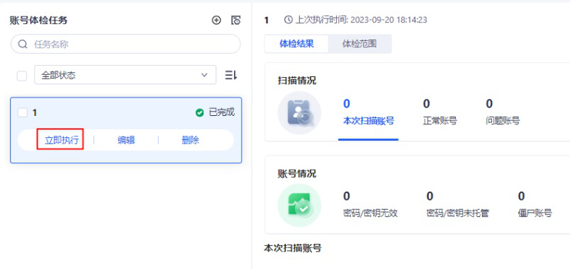

如果任务配置的执行时间为**自动**，则系统会在设定时间自动开始进行账号体检。

#### 4.4.2.4. 查看体检任务

本章节介绍如何查看体检任务。

1. 登录云盾堡垒机。具体操作，请参见登录云盾堡垒机。

2. 在控制台切换区，单击图标  ，选择**管理控制台**。

3. 在左侧导航栏，选择**账号 > 账号体检**。

4. 单击目标任务，在**体检结果**页签，查看该任务最近一次的体检结果，包括扫描情况、自动删除情况、账号安全情况、账号情况以及本次扫描的账号列表。

   - 单击各数值，可过滤查看该统计下的具体信息。

   - 单击**详情**，在**账号详情**面板，可查看该账号的基本信息、检查项以及检查结果。

   - 单击**问题记录**，可查看该账号的体检问题描述。

#### 4.4.2.5. 体检范围管理

本章节介绍如何设置体检范围。

**关联账号**

1. 登录云盾堡垒机。具体操作，请参见登录云盾堡垒机。

2. 在控制台切换区，单击图标  ，选择**管理控制台**。

3. 在左侧导航栏，选择**账号 > 账号体检**。

4. 单击目标任务，在**任务范围**页签，单击**配置**。

5. 选择所有账号或指定账号，单击**确定**。

**查看账号体检详情**

1. 在左侧导航栏，选择**账号 > 账号体检**。

2. 单击目标任务，在**任务范围**页签，找到目标账号，在**操作**列，单击**详情**。

### 4.4.3. 账号发现

#### 4.4.3.1. 新建发现任务

支持通过特权账号发现资产中同协议的其他账号，并将其纳入云盾堡垒机的管理范围。本章节介绍如何新建发现任务。

**前提条件**

目前支持发现SSH、RDP、MySQL、Oracle、SQL Server协议资产账号，请确保该资产在云盾堡垒机中存在对应协议的特权账号。

**操作步骤**

1. 登录云盾堡垒机。具体操作，请参见登录云盾堡垒机。

2. 在控制台切换区，单击图标  ，选择**管理控制台**。

3. 在左侧导航栏，选择**账号 > 账号发现**。

4. 单击  图标，在**新建账号发现任务**面板，参见下表参数说明填写任务信息，单击**下一步**。

   <table>
     <tr>
       <th width="89">配置项</th>
       <th>说明</th>
     </tr>
     <tr>
       <td>任务名称</td>
       <td>自定义任务名称，仅用于识别，同一个项目内任务名称不能重复。</td>
     </tr>
     <tr>
       <td>执行方式</td>
       <td>支持手动和自动。 • 手动：手动按需执行该账号发现任务。 • 自动：选择首次执行时间，系统在该设定时间开始进行账号发现任务。如果勾选<strong>重复</strong>，需要配置执行的周期，首次执行后，后续按此周期循环重复执行该任务。</td>
     </tr>
     <tr>
       <td>检查配置</td>
       <td>开启后，任务执行后自动将未纳管的账号纳管到DAS-PAM中。</td>
     </tr>
   </table>

5. 选中目标资产，单击**确定**。

**更多操作**

**编辑发现任务**

> **说明**
>
> 等待和执行中的任务不可编辑。

1. 将光标悬停至目标任务上，单击**编辑**。

2. 在**编辑账号发现任务**面板进行编辑。

**删除发现任务**

将光标悬停至目标任务上，单击**删除**，或者选中目标任务，在任务列表下方单击**删除**。

#### 4.4.3.2. 执行发现任务

本章节介绍如何执行发现任务。

**自动执行**

如果任务配置的执行时间为自动，则系统会在设定时间自动开始进行账号发现。

**手动执行**

1. 登录云盾堡垒机。具体操作，请参见登录云盾堡垒机。

2. 在控制台切换区，单击图标  ，选择**管理控制台**。

3. 在左侧导航栏，选择**账号 > 账号发现**。

4. 通过以下方式手动执行账号发现任务。

   - 单个执行账号发现任务：将光标悬停至目标任务上，单击**立即执行**，确定后立即开始账号发现。

   - 批量执行账号发现任务：选中目标任务，单击**立即执行**，确定后立即开始账号发现。

**停止发现任务**

将光标悬停至发现任务上，单击**停止**，或选中发现任务，在任务列表下方单击**停止**，确定后立即停止体检。

#### 4.4.3.3. 手动纳管账号

如果任务未开启自动纳管，发现的账号需手动纳管到云盾堡垒机中。

1. 登录云盾堡垒机。具体操作，请参见登录云盾堡垒机。

2. 在控制台切换区，单击图标  ，选择**管理控制台**。

3. 在左侧导航栏，选择**账号 > 账号发现**。

4. 单击目标任务，在**执行结果**页签，选中未纳管的账号，单击**纳管**。

### 4.4.4. 密码管理

#### 4.4.4.1. 查看改密账号

密码管理用于管理纳入改密计划的改密账号。本章节介绍如何查看改密账号

1. 登录云盾堡垒机。具体操作，请参见登录云盾堡垒机。

2. 在控制台切换区，单击图标  ，选择**管理控制台**。

3. 在左侧导航栏，选择**账号 > 密码管理**。

4. 在**改密账号**页签，单击左侧的分类列表，从不同类别维度查看改密的资产账号；或者单击右侧的改密状态，查看某一状态下的资产账号。

   - **等待中**：显示正在等待执行改密的账号。

   - **执行中**：显示正在执行改密的账号。

   - **修改完成**：显示已修改密码成功或验密成功或恢复历史密码成功。

   - **修改失败**：显示已完成密码修改但修改失败、验密失败或恢复历史密码失败的账号。

   - **待执行**：显示已关联至改密计划中，但从未改密过的账号。

   - **已取消**：显示停止改密的账号。

#### 4.4.4.2. 立即改密

本章节介绍如何对账号进行改密。

**重试改密计划**

适用于账号被关联至多个改密计划中且至少执行过一次改密操作，但计划中的其他账号不改密的场景。

1. 登录云盾堡垒机。具体操作，请参见登录云盾堡垒机。

2. 在控制台切换区，单击图标  ，选择**管理控制台**。

3. 在左侧导航栏，选择**账号 > 密码管理**。

4. 在**改密账号**页签，选中目标账号，选择**立即改密** > **重试**。

5. 在弹出的对话框，单击**确定**。

**新建改密计划**

适用于对计划中的部分账号立即改密，但当前改密计划不合适的场景。

1. 在**改密账号**页签，选中目标账号，选择**立即改密** > **新建计划**。

2. 在**新建改密计划**面板，填写改密计划信息，单击**确定**。

**停止改密**

改密计划开始执行后，支持手动对等待中的账号停止改密。

> **重要**
>
> - 执行中的账号无法停止改密。
>
> - 停止未完成改密的账号会导致密码丢失。

1. 在**改密账号**页签，选中**等待中**的账号，单击**停止**。

2. 在弹出的对话框，单击**确定**。

#### 4.4.4.3. 账号验密

本章节介绍如何验证账号密码。

1. 登录云盾堡垒机。具体操作，请参见登录云盾堡垒机。

2. 在控制台切换区，单击图标  ，选择**管理控制台**。

3. 在左侧导航栏，选择**账号 > 密码管理**。

4. 在**改密账号**页签，定位到目标账号，在**操作**列，选择**更多 > 验密**。

5. 在**验证密码**对话框，输入密码，单击**确定**。

#### 4.4.4.4. 下载历史密码

本章节介绍如何导出该账号的历史新旧密码。

1. 登录云盾堡垒机。具体操作，请参见登录云盾堡垒机。

2. 在控制台切换区，单击图标  ，选择**管理控制台**。

3. 在左侧导航栏，选择**账号 > 密码管理**。

4. 在**改密账号**页签，定位到目标账号，在**操作**列，选择**更多 > 下载历史密码**。

5. 在**下载历史密码**对话框，输入加密密码，单击**导出**。

   加密密码用于打开文件时对文件zip包进行解密，保证文件的安全性，建议设置。

#### 4.4.4.5. 下载改密历史

本章节介绍如何导出该账号的改密历史。

1. 登录云盾堡垒机。具体操作，请参见登录云盾堡垒机。

2. 在控制台切换区，单击图标  ，选择**管理控制台**。

3. 在左侧导航栏，选择**账号 > 密码管理**。

4. 在**改密账号**页签，定位到目标账号，在**操作**列，选择**更多 > 下载改密历史**。

5. 在**下载改密历史**对话框，输入加密密码，单击**导出**。

   加密密码用于打开文件时对文件zip包进行解密，保证文件的安全性，建议设置。

#### 4.4.4.6. 恢复密码

本章节介绍如何恢复密码。

1. 登录云盾堡垒机。具体操作，请参见登录云盾堡垒机。

2. 在控制台切换区，单击图标  ，选择**管理控制台**。

3. 在左侧导航栏，选择**账号 > 密码管理**。

4. 在**改密账号**页签，定位到目标账号，在**操作**列，选择**更多 > 恢复密码**。

5. 在**恢复密码**对话框，单击**确定**。

   由于改密过程中服务器多次断电及网络反复瘫痪导致的密码丢失情况，使用自动恢复请确认服务器存在并可以正常通信！

#### 4.4.4.7. 导出账号密码

本章节介绍如何将账号密码导出至本地。

1. 登录云盾堡垒机。具体操作，请参见登录云盾堡垒机。

2. 在控制台切换区，单击图标  ，选择**管理控制台**。

3. 在左侧导航栏，选择**账号 > 密码管理**。

4. 在**改密账号**页签，选中目标账号，在列表上方单击**导出密码**。

5. 在**导出密码**对话框，输入加密密码，单击**导出**。

   加密密码用于打开文件时对文件zip包进行解密，保证文件的安全性，建议设置。

#### 4.4.4.8. 改密计划

**支持的协议**

SSH、TELNET、RDP、SQL Server、MySQL、Oracle、DB2、PostgreSQL、Kingbase、DM、GBase8a、GBase8s

**改密策略默认配置**

用于配置系统默认的密码策略、备份策略和备份方式。

1. 登录云盾堡垒机。具体操作，请参见登录云盾堡垒机。

2. 在控制台切换区，单击图标  ，选择**管理控制台**。

3. 在左侧导航栏，选择**账号 > 密码管理**。

4. 在**改密计划**页签，单击  图标。

5. 在**策略默认配置**面板查看或配置改密策略，单击**确定**。

**新建改密计划**

1. 在**改密计划**页签，单击  图标。

2. 在**新建改密计划**面板，参见下表说明填写计划信息，单击**确定**。

   <table>
     <tr>
       <th width="89">配置项</th>
       <th>说明</th>
     </tr>
     <tr>
       <td>执行方式</td>
       <td>选择改密计划的执行方式，支持手动和自动。 • 手动：人工按需点击执行。 • 自动：选择计划的首次执行时间、是否重复以及重复的时间段，系统按此配置自动执行改密计划。</td>
     </tr>
     <tr>
       <td>密码策略</td>
       <td>选择改密时新密码的生成策略，支持默认策略和自定义策略。 • 默认策略：使用系统默认策略中的密码策略生成新密码。 • 自定义策略：自行配置本计划改密时新密码的生成策略。</td>
     </tr>
     <tr>
       <td>名称</td>
       <td>自定义改密计划名称，仅用于识别，同一项目中计划名称不可重复。</td>
     </tr>
     <tr>
       <td>备份策略</td>
       <td>选择新旧密码的备份策略，支持选择不备份、默认策略和自定义。 • 不备份：不备份新旧密码。 • 默认策略：使用系统默认策略中的备份策略备份新旧密码，默认策略配置请参见配置默认改密策略。 • 自定义策略：自行配置本计划改密时新旧密码的备份策略，策略参数说明请参见配置默认改密策略中的表格说明。</td>
     </tr>
   </table>

**改密账号管理**

**关联账号**

1. 在**改密计划**页签，单击目标任务，在右侧区域，单击**关联账号**。

2. 在**关联账号**面板，选中普通改密账号或复杂改密账号，在弹出的面板选择关联的账号，单击**确定**。

**取消关联**

1. 在**改密计划**页签，单击目标任务。

2. 在右侧区域，选中目标账号，单击**取消关联**。

3. 在**取消关联**对话框，单击**确定**。

**自动改密**

如果已对资产账号创建执行方式为自动的改密计划，系统会在设定周期自动对账号进行改密。

**手动改密**

手动立即对资产账号进行改密，支持立即执行手动/自动改密计划、重试改密计划、新建改密计划等方式。

在**改密计划**页签，将鼠标选悬停至改密计划上，单击**立即执行**。

**单个计划立即改密**

适用于账号在改密计划中，且计划中的其他账号本次也需要改密的场景。

在**改密计划**页签，选中目标改密计划，单击**立即执行**。

**多个计划立即改密**

适用于批量执行改密计划的场景。

**更多操作**

- 编辑改密计划：在**改密计划**页签，将鼠标选悬停至改密计划上，单击**编辑**。

- 删除改密计划：在**改密计划**页签，将鼠标选悬停至改密计划上，单击**删除**。

- 禁用改密计划：在**改密计划**页签，将鼠标选悬停至改密计划上，单击**禁用**。

- 启用改密计划：在**改密计划**页签，选中目标改密计划，单击**启用**。

- 停止改密计划：在**改密计划**页签，选中目标改密计划，单击**停止**。

#### 4.4.4.9. 复杂改密账号

本章节介绍如何新建复杂改密账号及其管理。

**新建复杂改密账号**

1. 登录云盾堡垒机。具体操作，请参见登录云盾堡垒机。

2. 在控制台切换区，单击图标  ，选择**管理控制台**。

3. 在左侧导航栏，选择**账号 > 密码管理**。

4. 在**复杂改密账号**页签，单击**新建**。

5. 在**基础设置**引导页，参考下表配置，单击**下一步**。

   <table>
     <tr>
       <th width="105">配置项</th>
       <th>说明</th>
     </tr>
     <tr>
       <td>名称</td>
       <td>复杂改密账号的名称，仅用于识别，同一项目中复杂改密账号名称不可重复。</td>
     </tr>
     <tr>
       <td>源账号</td>
       <td>选择一个资产账号，系统使用复杂改密账号的流程对此账号进行改密，并可根据流程将新密码推送至其他应用。一个源账号只能被一个复杂改密账号关联，保存后不可更改。</td>
     </tr>
     <tr>
       <td>系统参数</td>
       <td>系统内置的参数，可用于改密和推送脚本。</td>
     </tr>
     <tr>
       <td>自定义参数</td>
       <td>用户自定义参数，可用于改密和推送脚本。同一复杂改密账号内，系统参数中、自定义参数中、系统参数与自定义参数间，参数名均不可重复。</td>
     </tr>
   </table>

6. 单击  图标，设置改密信息，单击**确定**。

   <table>
     <tr>
       <th width="89">配置项</th>
       <th>说明</th>
     </tr>
     <tr>
       <td>改密方式</td>
       <td>选择改密方式，支持跟随原账号配置和远端执行脚本。 • <strong>跟随原账号配置</strong>：使用源账号的改密方式。 • <strong>远端执行脚本</strong>：使用后续配置执行账号通过远端执行脚本执行改密。</td>
     </tr>
     <tr>
       <td>执行账号</td>
       <td>选择一个RDP或SSH服务的资产账号，系统使用该账号执行远端脚本。同一个资产账号作为执行账号的次数不限制。</td>
     </tr>
     <tr>
       <td>脚本命令</td>
       <td>用户自定义的远端改密脚本。</td>
     </tr>
   </table>

7. 单击  图标，在**密码推送**区域单击**并行任务**，设置子任务信息，单击**确定**。

   密码推送流程最大支持9个，并行任务最大支持10个。

   <table>
     <tr>
       <th width="89">配置项</th>
       <th>说明</th>
     </tr>
     <tr>
       <td>类型</td>
       <td>仅支持远端执行脚本。</td>
     </tr>
     <tr>
       <td>执行账号</td>
       <td>选择一个RDP或SSH服务的资产账号，系统使用该账号执行远端脚本。同一个资产账号作为执行账号的次数不限制。</td>
     </tr>
     <tr>
       <td>脚本命令</td>
       <td>用户自定义的远端推送脚本。</td>
     </tr>
   </table>

8. 单击**确定**。

**更多操作**

- 编辑复杂改密账号：在**复杂改密账号**页签，找到目标账号，在**操作**列，单击**编辑**。

- 复制复杂改密账号：在**复杂改密账号**页签，找到目标账号，在**操作**列，单击**复制**。

- 删除复杂改密账号：在**复杂改密账号**页签，选中目标账号，在列表上方，单击**删除**。

- 复杂改密账号下载历史密码：在**复杂改密账号**页签，找到目标账号，在**操作**列，单击**下载历史密码**，在弹出的对话框，输入导出文件的加密密码，单击**导出**。

  加密密码用于打开文件时对文件zip包进行解密，保证文件的安全性，建议设置。

- 重试改密计划：在**复杂改密账号**页签，选中目标账号，在列表上方，选择**立即改密 > 重试**。

- 新建改密计划：在**复杂改密账号**页签，选中目标账号，在列表上方，选择**立即改密 > 新建计划**。

- 停止改密：在**复杂改密账号**页签，选中目标账号，在列表上方，单击**停止**。

- 查看历史执行记录：在**复杂改密账号**页签，找到目标账号，在**最新执行记录**列，单击**历史执行记录**。

### 4.4.5. 密钥管理

密钥管理用于统一管理所有托管的SSH账号密钥。

**新建密钥**

1. 登录云盾堡垒机。具体操作，请参见登录云盾堡垒机。

2. 在控制台切换区，单击图标  ，选择**管理控制台**。

3. 在左侧导航栏，选择**账号 > 密钥管理**。

4. 单击**新建**，在**新建密钥**面板，参考下表配置密钥信息，单击**确定**。

   <table>
     <tr>
       <th width="89">配置项</th>
       <th>说明</th>
     </tr>
     <tr>
       <td>名称</td>
       <td>自定义SSH密钥的名称。</td>
     </tr>
     <tr>
       <td>生成方式</td>
       <td>支持手动录入和自动生成。 • 手动输入：手动输入SSH私钥和该密钥对的加密口令，DAS-PAM根据此私钥和加密口令产生相应的SSH公钥。 • 自动生成：根据选择的加密算法和密钥长度，以及输入的加密口令和确认加密口令，自动生成一对密钥，包括SSH公钥和SSH私钥。</td>
     </tr>
   </table>

**关联账号**

将密钥关联给SSH协议的资产账号，该账号可以通过SSH密钥方式访问资产。

1. 在密钥列表，定位到目标密钥，在**操作**列，单击关联账号。

2. 在**关联主机账号**面板，选中目标账号，单击**关联账号**。

**取消关联账号**

1. 在密钥列表，定位到目标密钥，在**关联账号数**列，单击对应的数字。

2. 在**已关联主机账号**面板，选中目标账号，单击**取消关联**。

**查看公钥**

在密钥列表，定位到目标密钥，在**操作**列，单击**查看公钥**。

**编辑密钥**

1. 在密钥列表，定位到目标密钥，在**操作**列，单击**编辑**。

2. 在**编辑密钥**面板，输入需要修改的配置项，单击**确定**。

**删除密钥**

1. 在密钥列表，选中目标密钥，在列表上方，单击**删除**。

2. 在弹出的对话框，单击**确定**。

## 4.5. 授权

### 4.5.1. 授权规则

#### 4.5.1.1. 规则视图

通过创建授权规则，将系统中的资产账号授权给用户使用。

**新建授权规则**

**新建单个授权规则**

1. 登录云盾堡垒机。具体操作，请参见登录云盾堡垒机。

2. 在控制台切换区，单击图标  ，选择**管理控制台**。

3. 在左侧导航栏，选择**授权 > 授权规则**。

4. 在**规则视图**页签，单击**新建**。

5. 在**新建规则**面板，参考下表说明填写规则信息，单击**确定**。

   <table>
     <tr>
       <th width="195">配置项</th>
       <th>说明</th>
     </tr>
     <tr>
       <td>规则名称</td>
       <td>自定义规则名称，仅用于识别。</td>
     </tr>
     <tr>
       <td>有效期</td>
       <td>• 永久：长期有效。 • 自定义：设置有效期时间段，仅该时间段内授权有效。</td>
     </tr>
     <tr>
       <td>过期后次日0点自动删除</td>
       <td>自定义有效期的情况下开启此功能，有效期结束后的第二天0点系统自动删除此授权规格。</td>
     </tr>
     <tr>
       <td>授权用户</td>
       <td>选择授予资产操作和管理权限的云盾堡垒机用户或用户组。 • 所有用户：表示授权给用户列表中的所有用户。 • 用户/用户组：表示只授权给添加的用户或用户组。 • 单击<strong>添加</strong>，选择<strong>添加用户</strong>或<strong>添加用户组</strong>，右侧弹出<strong>选择用户</strong>或<strong>选择用户</strong><strong>组</strong>面板，勾选用户/用户组，单击<strong>确定</strong>。 • 勾选用户/用户组，单击<strong>删除</strong>，即可删除所选用户或用户组。 • 规则：表示授权给符合规则条件的用户。通过规则授权，需提前确保已在<strong>管理控制台</strong>页面的<strong>配置</strong> &gt;<strong> 用户配置</strong> &gt;<strong> 自定义属性</strong>中新建各类需要的属性。 • 单击<strong>添加</strong>，右侧弹出<strong>添加规则</strong>面板，配置用户的属性、匹配方式和值，单击<strong>确定</strong>。支持添加多个属性，多个属性时需均满足。 • 单击<strong>编辑</strong>，可以修改规则属性属性。 • 单击<strong>删除</strong>，可以删除规则中的属性。</td>
     </tr>
     <tr>
       <td>授权资产</td>
       <td>选择授权的资产。 • 所有资产：表示将资产列表中的所有资产均授权给所选用户。 • 资产/资产节点：表示将部分资产/资产节点授权给所选用户。 • 单击&lt;<strong>添加</strong>&gt;，选择<strong>添加资产</strong>或<strong>添加资产节点</strong>，右侧弹出<strong>选择资产</strong>或<strong>选</strong><strong>择资产节点</strong>面板，勾选资产/资产节点，单击<strong>确定</strong>。 • 勾选资产/资产节点，单击<strong>删除</strong>，即可删除所选资产/资产节点。 • 规则：表示将符合规则条件的资产/资产节点授权给所选用户。通过规则授权，需提前确保已在<strong>管理控制台</strong>页面的<strong>配置 &gt; 资产配置 &gt; 资产自定义</strong><strong>属性</strong>中新建各类需要的属性。 • 单击<strong>添加</strong>，右侧弹出添加规则面板，配置资产的属性、匹配方式和值，单击<strong>确定</strong>。支持添加多个属性，多个属性时需均满足。 • 单击<strong>编辑</strong>，可以修改规则属性属性。 • 单击<strong>删除</strong>，可以删除规则中的属性。</td>
     </tr>
   </table>

   <table>
     <tr>
       <td>授权账号</td>
       <td>选择授权资产中需要授权的账号。 • 所有账号：表示将所选资产中的所有账号均授权给所选用户。 • 账号：表示将所选资产中的部分账号授权给所选用户。 输入账号名后按回车键，支持输入多个账号名，如果输入错误，单击删除即可。 • 规则：表示将所选资产中的符合规则条件的账号授权给所选用户，通过规则授权，需提前确保已在<strong>管理控制台</strong>页面的<strong>配置 </strong>&gt;<strong> 资产配置</strong> &gt;<strong> 账号自定</strong><strong>义属性</strong>中新建各类需要的属性。 • 单击<strong>添加</strong>，右侧弹出<strong>添加规则面板</strong>，配置资产的属性、匹配方式和值，单击<strong>确定</strong>。支持添加多个属性，多个属性时需均满足。 • 单击<strong>编辑</strong>，可以修改规则属性属性。 • 单击<strong>删除</strong>，可以删除规则中的属性。</td>
     </tr>
     <tr>
       <td>授权资产目录</td>
       <td>选择授权需要授权的账号，即授权资产中该账号给所选用户。资产目录：表示将所选目录下的资产授权给所选用户。 • 单击<strong>添加资产目录</strong>，右侧弹出添加资产目录窗口，选择目录，单击<strong>确定</strong>即可选择该目录下所有资产账号。 • 单击<strong>删除</strong>，勾选需要删除的目录，可以删除所选目录。</td>
     </tr>
     <tr>
       <td>授权资产标签</td>
       <td>选择需要授权的资产标签，即授权标签中的资产给所选用户。资产标签：表示将所选标签下的资产授权给所选用户。 • 单击<strong>添加标签</strong>，右侧弹出添加资产标签窗口，选择目录，单击<strong>确定</strong>即可选择该标签下所有资产。 • 单击<strong>删除</strong>，勾选需要删除的标签，可以删除所选标签。</td>
     </tr>
     <tr>
       <td>授权账号标签</td>
       <td>选择授权需要授权的账号标签，即授权标签中的账号给所选用户。账号标签：表示将所选标签下的账号授权给所选用户。 • 单击<strong>添加标签</strong>，选择目录，单击<strong>确定</strong>即可选择该标签下所有账号。 • 单击<strong>删除</strong>，勾选需要删除的目录，可以删除所选目录。</td>
     </tr>
     <tr>
       <td>授权动态账号组</td>
       <td>选择授权的动态账号组。动态账号组：将动态账号组匹配的对象，授权给所选用户。 • 单击<strong>添加动态账号组</strong>，右侧弹出添加动态账号组窗口，选择目录，单击<strong>确</strong><strong>定</strong>即可选择该标签下所有账号。 • 单击<strong>删除</strong>，勾选需要删除的目录，可以删除所选目录。</td>
     </tr>
     <tr>
       <td>绑定环境</td>
       <td>授权生效时间：设置用户允许登录当前运维规则授权资产的时间段。 • 选择<strong>对以下IP不生效</strong>，在IP列表中填写IP地址范围，表示该范围内的IP地址不可以登录当前运维规则授权的资产，其他IP地址均可登录。 • 选择<strong>对以下IP生效</strong>，在IP列表中填写IP地址范围，表示仅该范围内的IP地址可以登录当前运维规则授权的资产。</td>
     </tr>
   </table>

**批量导入规则**

使用系统内置模板，批量创建授权规则。

1. 在**规则视图**页签，选择**新建 > 导入规则**。

2. 在弹出的对话框，单击**下载模板文件**，将模板文件保存至本地。

3. 在本地打开模板文件，根据文件中的说明及字段要求，填写规则信息后保存。

4. 在导入页面，单击**选择文件**，选择该模板文件并上传，单击**导入**。

   如果勾选**是否覆盖同名规则**，当模板中的规则名称与系统中的规则名称相同时，会用模板中的规则信息进行覆盖。

**启用规则**

禁用状态的授权规则，需要启用后才能继续生效。

在**规则视图**页签，选中**禁用**状态的规则，在列表上方单击**启用**，确定后即可启用所选授权规则。

**禁用规则**

禁用后，授权规则失效，如果需要继续使用，需重新启用。

在**规则视图**页签，选中目标规则，在列表上方单击**禁用**，确定后即可禁用所选授权规则。

**导出规则**

用于批量导出授权规则信息，便于查看。

1. 在**规则视图**页签，单击  图标。

2. 在**导出**对话框，选择导出范围，设置加密密码，单击**导出**，将规则信息导出至本地PC。

   加密密码用于打开文件时对文件zip包进行解密，保证文件的安全性，建议设置。

   - 所有：导出所有的授权规则信息。

   - 已选：导出选中的授权规则信息，导出前需先勾选规则。

**删除规则**

在**规则视图**页签，选中目标规则，在列表上方单击**删除**，即可删除所选规则。

#### 4.5.1.2. 成员视图

从用户维度查看授权的资产信息。

1. 登录云盾堡垒机。具体操作，请参见登录云盾堡垒机。

2. 在控制台切换区，单击图标  ，选择**管理控制台**。

3. 在左侧导航栏，选择**授权 > 授权规则**。

4. 在**成员视图**页签，单击用户，右侧区域显示授权给该用户的所有资产和资产账号。

   - 单击用户列表下方的**导出**，可导出所有用户以及授权的资产和资产账号信息。

   - 单击资产列表中的  图标，可导出当前正在查看用户授权的资产和资产账号信息。

   - 在用户列表中，输入用户名或姓名后按回车键，可过滤符合条件的用户。

   - 在资产列表中，输入资产名称/IP/账号名/授权规则或者选择服务，单击**搜索**，可过滤符合条件的资产和账号信息。

   - 单击授权规则，可修改该规则信息。

#### 4.5.1.3. 资产视图

从资产维度查看授权的用户、资产账号以及授权规则等信息。

1. 登录云盾堡垒机。具体操作，请参见登录云盾堡垒机。

2. 在控制台切换区，单击图标  ，选择**管理控制台**。

3. 在左侧导航栏，选择**授权 > 授权规则**。

4. 在**资产视图**页签，单击资产，右侧区域显示该资产的所有授权用户和授权的资产账号。

   - 单击资产列表中的**导出**，可导出所有资产以及授权的用户和资产账号信息。

   - 单击用户列表中的  图标，可导出当前正在查看资产授权的用户和资产账号信息。

   - 在资产列表中，输入资产名称或IP后按回车键，可过滤符合条件的资产。

   - 在用户列表中，输入用户名/姓名/账号/授权规则或者选择服务，单击**搜索**，可过滤符合条件的用户和账号信息。

   - 单击授权规则，可修改该规则信息。

### 4.5.2. 预授权规则

本章节介绍如何新建预授权规则及其管理。

**规则说明**

限制用户运维工单、密码工单、紧急运维工单可申请的资产范围。若存在预授权规则，所有用户仅可申请被预授权的资产。

**新建预授权规则**

1. 登录云盾堡垒机。具体操作，请参见登录云盾堡垒机。

2. 在控制台切换区，单击图标  ，选择**管理控制台**。

3. 选择**授权 > 预授权规则**。

4. 单击**新建**，参考下表配置授权规则，单击**确定**。

   <table>
     <tr>
       <th width="195">配置项</th>
       <th>说明</th>
     </tr>
     <tr>
       <td>规则名称</td>
       <td>自定义规则名称，仅用于识别。</td>
     </tr>
     <tr>
       <td>有效期</td>
       <td>• 永久：长期有效。 • 自定义：设置有效期时间段，仅该时间段内授权有效。</td>
     </tr>
     <tr>
       <td>过期后次日0点自动删除</td>
       <td>自定义有效期的情况下开启此功能，有效期结束后的第二天0点系统自动删除此授权规格。</td>
     </tr>
     <tr>
       <td>授权用户</td>
       <td>选择授予资产操作和管理权限的云盾堡垒机用户或用户组。 • 所有用户：表示授权给用户列表中的所有用户。 • 用户/用户组：表示只授权给添加的用户或用户组。 • 单击<strong>添加</strong>，选择<strong>添加用户</strong>或<strong>添加用户组</strong>，右侧弹出<strong>选择用户</strong>或<strong>选择用户</strong><strong>组</strong>面板，选中用户/用户组，单击<strong>确定</strong>。 • 选中用户/用户组，单击<strong>删除</strong>，即可删除所选用户或用户组。 • 规则：表示授权给符合规则条件的用户。通过规则授权，需提前确保已在<strong>管理控制台</strong>页面的<strong>配置</strong> &gt;<strong> 用户配置</strong> &gt;<strong> 自定义属性</strong>中新建各类需要的属性。 • 单击<strong>添加</strong>，右侧弹出<strong>添加规则</strong>面板，配置用户的属性、匹配方式和值，单击<strong>确定</strong>。支持添加多个属性，多个属性时需均满足。 • 单击<strong>编辑</strong>，可以修改规则属性属性。 • 单击<strong>删除</strong>，可以删除规则中的属性。</td>
     </tr>
     <tr>
       <td>授权资产</td>
       <td>选择授权的资产。 • 所有资产：表示将资产列表中的所有资产均授权给所选用户。 • 资产/资产节点：表示将部分资产/资产节点授权给所选用户。 • 单击&lt;<strong>添加</strong>&gt;，选择<strong>添加资产</strong>或<strong>添加资产节点</strong>，右侧弹出<strong>选择资产</strong>或<strong>选</strong><strong>择资产节点</strong>面板，选中资产/资产节点，单击<strong>确定</strong>。 • 选中资产/资产节点，单击<strong>删除</strong>，即可删除所选资产/资产节点。 • 规则：表示将符合规则条件的资产/资产节点授权给所选用户。通过规则授权，需提前确保已在<strong>管理控制台</strong>页面的<strong>配置 &gt; 资产配置 &gt; 资产自定义</strong><strong>属性</strong>中新建各类需要的属性。 • 单击<strong>添加</strong>，右侧弹出添加规则面板，配置资产的属性、匹配方式和值，单击<strong>确定</strong>。支持添加多个属性，多个属性时需均满足。 • 单击<strong>编辑</strong>，可以修改规则属性属性。 • 单击<strong>删除</strong>，可以删除规则中的属性。</td>
     </tr>
     <tr>
       <td>授权账号</td>
       <td>选择授权资产中需要授权的账号。 • 所有账号：表示将所选资产中的所有账号均授权给所选用户。 • 账号：表示将所选资产中的部分账号授权给所选用户。 输入账号名后按回车键，支持输入多个账号名，如果输入错误，单击删除即可。 • 规则：表示将所选资产中的符合规则条件的账号授权给所选用户，通过规则授权，需提前确保已在<strong>管理控制台</strong>页面的<strong>配置 </strong>&gt;<strong> 资产配置</strong> &gt;<strong> 账号自定</strong><strong>义属性</strong>中新建各类需要的属性。 • 单击<strong>添加</strong>，右侧弹出<strong>添加规则面板</strong>，配置资产的属性、匹配方式和值，单击<strong>确定</strong>。支持添加多个属性，多个属性时需均满足。 • 单击<strong>编辑</strong>，可以修改规则属性属性。 • 单击<strong>删除</strong>，可以删除规则中的属性。</td>
     </tr>
     <tr>
       <td>授权资产目录</td>
       <td>选择授权需要授权的账号，即授权资产中该账号给所选用户。资产目录：表示将所选目录下的资产授权给所选用户。 • 单击<strong>添加资产目录</strong>，右侧弹出添加资产目录窗口，选择目录，单击<strong>确定</strong>即可选择该目录下所有资产账号。 • 单击<strong>删除</strong>，选中需要删除的目录，可以删除所选目录。</td>
     </tr>
     <tr>
       <td>授权资产标签</td>
       <td>选择需要授权的资产标签，即授权标签中的资产给所选用户。资产标签：表示将所选标签下的资产授权给所选用户。 • 单击<strong>添加标签</strong>，右侧弹出添加资产标签窗口，选择目录，单击<strong>确定</strong>即可选择该标签下所有资产。 • 单击<strong>删除</strong>，选中需要删除的标签，可以删除所选标签。</td>
     </tr>
     <tr>
       <td>授权账号标签</td>
       <td>选择授权需要授权的账号标签，即授权标签中的账号给所选用户。账号标签：表示将所选标签下的账号授权给所选用户。 • 单击<strong>添加标签</strong>，选择目录，单击<strong>确定</strong>即可选择该标签下所有账号。 • 单击<strong>删除</strong>，选中需要删除的目录，可以删除所选目录。</td>
     </tr>
     <tr>
       <td>授权动态账号组</td>
       <td>选择授权的动态账号组。动态账号组：将动态账号组匹配的对象，授权给所选用户。 • 单击<strong>添加动态账号组</strong>，右侧弹出添加动态账号组窗口，选择目录，单击<strong>确</strong><strong>定</strong>即可选择该标签下所有账号。 • 单击<strong>删除</strong>，选中需要删除的目录，可以删除所选目录。</td>
     </tr>
     <tr>
       <td>绑定环境</td>
       <td>授权生效时间：设置用户允许登录当前运维规则授权资产的时间段。 • 选择<strong>对以下IP不生效</strong>，在IP列表中填写IP地址范围，表示该范围内的IP地址不可以登录当前运维规则授权的资产，其他IP地址均可登录。 • 选择<strong>对以下IP生效</strong>，在IP列表中填写IP地址范围，表示仅该范围内的IP地址可以登录当前运维规则授权的资产。</td>
     </tr>
   </table>

**更多操作**

- 启用规则：在**预授权规则**页面，选中目标规则，在列表上方，单击**启用**。

- 禁用规则：在**预授权规则**页面，选中目标规则，在列表上方，单击**禁用**。

- 删除规则：在**预授权规则**页面，选中目标规则，在列表上方，单击**删除**。

### 4.5.3. 审批规则

对工单创建审批规则，当审批对象创建相应的工单、任务或触发控制策略时，云盾堡垒机会自动发起审批流程，需完成审批后才能获得相应权限，继续执行后续动作。

**新建审批规则**

1. 登录云盾堡垒机。具体操作，请参见登录云盾堡垒机。

2. 在控制台切换区，单击图标  ，选择**管理控制台**。

3. 选择**授权** > **审批规则**。

4. 单击**新建**，在**新建审批规则**面板，参见下表说明填写规则信息，单击**确定**。

   <table>
     <tr>
       <th>配置项</th>
       <th colspan="2">说明</th>
     </tr>
     <tr>
       <td>规则名称</td>
       <td colspan="2">自定义审批规则名称，仅用于识别，不可重复。</td>
     </tr>
     <tr>
       <td rowspan="6">规则类型</td>
       <td>运维工单</td>
       <td>创建运维工单审批规则，当审批对象创建运维工单后，系统会根据设定的审批规则，发起审批流程，流程结束后才可执行对应的工单操作。</td>
     </tr>
     <tr>
       <td>紧急运维工单</td>
       <td>对紧急运维创建审批规则，当审批对象创建紧急运维工单后，系统会自动审批，并将审批消息邮件同步给设定的告警人员。</td>
     </tr>
     <tr>
       <td>密码工单</td>
       <td>创建密码工单审批规则时，当审批对象创建密码工单后，系统会根据设定的审批规则自动发起审批流程。审批完成后，密码将发送至工单配置中的邮箱。</td>
     </tr>
     <tr>
       <td>运维任务</td>
       <td>对运维任务创建审批规则，当有新创建自动运维任务后，系统会根据设定的审批规则，发起审批流程，流程结束后该任务才可生效。</td>
     </tr>
     <tr>
       <td>命令审批</td>
       <td>对命令审批创建审批规则，在主机或数据库运维时执行审批对象关联策略中需要审批的命令时，系统会根据设定的审批规则，发起审批流程，流程结束后该命令才可生效。需提前创建主机命令策略或数据库控制策略，并关联到运维规则、用户或用户组中。</td>
     </tr>
     <tr>
       <td>运维复核</td>
       <td>策略中开启运维复核后，当审批对象发起运维时，系统会根据设定的审批规则，发起审批流程，流程结束后，才可运维。</td>
     </tr>
     <tr>
       <td>备注</td>
       <td colspan="2">填写规则说明内容。</td>
     </tr>
     <tr>
       <td>审批流程</td>
       <td colspan="2">配置审批层级和审批员。 • 添加多级审批节点：单击<strong>添加流程</strong>，依次创建下级节点，最多支持5级审批。 • 添加审批员/告警人员：单击<strong>添加</strong>，在<strong>选择用户</strong>面板，选中用户，添加<strong>确定</strong>。同一节点支持添加多个审批员，审批员人数无限制。 • 删除审批节点：单击节点右上角的<strong>删除</strong>，即可删除审批节点。</td>
     </tr>
   </table>

   <table>
     <tr>
       <td>审批对象</td>
       <td>配置待审批的用户或用户组。审批类型不同，能选的审批对象则不同。 • 添加用户/用户组：单击<strong>添加</strong>，选择<strong>添加用户</strong>/<strong>添加用户组</strong>，选中用户/用户组，单击<strong>确</strong><strong>定</strong>。 • 删除用户/用户组：选中<strong>用户</strong>/<strong>用户组</strong>，单击<strong>删除</strong>。 • 添加授权规则：单击<strong>添加授权规则</strong>，选择<strong>授权规则</strong>，选中授权规则，单击<strong>确定</strong>。 • 添加资产标签：单击<strong>添加资产标签</strong>，单击<strong>资产标签</strong>，选中资产标签，单击<strong>确定</strong>。 • 添加账号标签：添加<strong>账号标签</strong>，单击<strong>账号标签</strong>，选中账号标签，单击<strong>确定</strong>。</td>
     </tr>
   </table>

**编辑审批规则**

1. 在审批规则列表，定位到目标规则，在**操作**列，单击**编辑**。

2. 在**编辑规则**面板，修改审批规则。

**删除审批规则**

在审批规则列表，选中目标规则，在列表上方单击**删除**，即可删除所选规则。

### 4.5.4. 未授权登录

未授权审核列表显示用户未授权登录成功后系统自动收集的用户和主机的授权对应关系，具有授权权限的用户可以对未授权状态的关系进行审核授权，建立主机与登录用户的授权关系，后续运维时无需再手动授权。

**未授权登录**

- 未授权登录功能出厂默认为关闭状态，如需使用，需在**配置 > 资产配置 > 运维配置**中开启**允许Web未授权登录**功能。

- 如果未授权审核列表中需要显示授权对应关系，需在**配置 > 资产配置 > 运维配置**中开启**收集未授权登录**功能。

- 如果需要收集未授权登录资产的账户密码或私钥，需在**配置 > 资产配置 > 运维配置**中开启**收集主机账户的密码和私钥**功能<strong>。</strong>

- 如果**配置 > 资产配置 > 运维配置**中开启了自动创建运维规则，系统将会自动审核授权并创建运维规则，如需未授权登录审核，请关闭该配置项。

1. 登录云盾堡垒机。具体操作，请参见登录云盾堡垒机。

2. 在控制台切换区，单击图标  ，选择**管理控制台**。

3. 在左侧导航栏，选择**授权 > 未授权登录**。

4. 选中未授权审核记录，单击**授权**，完成授权。

**删除未授权登录**

在列表中，选中未授权登录的记录，单击**删除**，即可删除所选未授权登录记录。

### 4.5.5. 动态对象

动态对象是可以被授权绑定的对象，可以匹配资产、账号和服务。配置匹配对象后，可以在授权中绑定动态对象。初始化云盾堡垒机时，系统会默认创建一个名为“ALL”的动态对象。

**新建动态账号组对象**

1. 登录云盾堡垒机。具体操作，请参见登录云盾堡垒机。

2. 在控制台切换区，单击图标  ，选择**管理控制台**。

3. 选择**授权 > 动态对象**。

4. 在**动态账号组**页签，单击**新建**，参考下表进行配置，单击**确定**。

   <table>
     <tr>
       <th width="89">配置项</th>
       <th>说明</th>
     </tr>
     <tr>
       <td>名称</td>
       <td>自定义审批规则名称，仅用于识别，不可重复。</td>
     </tr>
     <tr>
       <td>匹配条件</td>
       <td>通过资产-账号-服务三个维度设置匹配条件。 • 资产 • 按所有资产匹配：需要动态匹配所有资产时，选择<strong>所有资产</strong>。 • 按选定资产匹配：需要动态匹配选定的资产时，选择<strong>资产/资产目录/规则</strong>，单击<strong>添加</strong>，选择动态匹配的资产，添加到下方的资产列表里。 • 按资产目录匹配：需要动态匹配选定的资产目录时，选择<strong>资产/资产目录/规</strong><strong>则</strong>，单击<strong>添加</strong>，选择动态匹配的资产目录，添加到下方的资产列表里。 • 按资产自定义属性和标签匹配规则：需要动态匹配选定的规时，选择<strong>资产/资产</strong><strong>目录/规则</strong>，单击<strong>添加</strong>，选择动态匹配的规则，添加属性、匹配方式、值，仅支持对资产自定义属性和标签进行匹配，匹配方式有等于、不等于、包含和不包含。 • 账号 • 按所有账号匹配：需要动态匹配所有账号时，选择<strong>所有账号</strong>。 • 按任意账号匹配：需要动态匹配任意账号时，选择<strong>any账号</strong>。授权动态账号组为any账号时，普通用户运维时选择ANY账号，手动填入正确的账号名和密码，即可运维资产的任意账号。 • 按选定账号匹配：需要动态匹配选定账号时，选择<strong>账号名</strong>，在输入框填入动态匹配的账号名并按回车保存，支持多个账号名，账号名不可重复。 • 按账号自定义属性匹配规则：需要动态匹配选定规则时，选择<strong>规则</strong>，单击<strong>添</strong><strong>加</strong>，添加属性、匹配方式、值，仅支持对账号自定义属性进行匹配，匹配方式有等于、不等于、包含和不包含。 • 服务 • 按所有服务匹配：需要动态匹配所有服务时，选择<strong>所有服务</strong>。 • 按选定服务匹配：需要动态匹配选定服务时，选择<strong>服务</strong>，支持选择多个服务。</td>
     </tr>
   </table>

**更多操作**

- 编辑动态账号组对象：在**动态账号组**页签，找到目标对象，在**操作**列，单击**编辑**。

- 删除动态账号组对象：在**动态账号组**页签，选中目标对象，在列表上方，单击**删除**。

**新建动态用户组对象**

1. 登录云盾堡垒机。具体操作，请参见登录云盾堡垒机。

2. 在控制台切换区，单击图标  ，选择**管理控制台**。

3. 选择**授权 > 动态对象**。

4. 在**动态用户组**页签，单击**新建**，参考下表进行配置，单击**确定**。

   | 配置项 | 说明 |
   | --- | --- |
   | 名称 | 自定义审批规则名称，仅用于识别，不可重复。 |
   | 匹配条件 | 通过”用户”维度设置匹配条件，匹配所有用户。 |

**更多操作**

- 编辑动态用户组对象：在**动态用户组**页签，找到目标对象，在**操作**列，单击**编辑**。

- 删除动态用户组对象：在**动态用户组**页签，选中目标对象，在列表上方，单击**删除**。

## 4.6. 策略

### 4.6.1. 访问控制

设置访问控制策略，对访问验证、终端登录、审计进行策略限制。

**新建访问控制**

1. 登录云盾堡垒机。具体操作，请参见登录云盾堡垒机。

2. 在控制台切换区，单击图标  ，选择**管理控制台**。

3. 在左侧导航栏，选择**策略 > 访问控制**。

4. 单击**新建**，参考下表说明配置策略信息，单击**下一步**。

   **配置项**

   **说明**

   自定义策略名称，仅用于识别，项目内不可重复。

   **策略名称**

   - 永久：长期有效。

   **有效期**

   - 自定义：设置有效期时间段，仅该时间段内策略有效。

   自定义有效期的情况下开启此功能，有效期结束后的第二天0点

   **过期后次日0点自动删除**

   系统自动删除该策略。

   启用或禁用策略。

   **状态**

   运维资产需要填写登录事由，在审计中可查看登录事由。

   **登录事由**

   运维资产时需要审批员审批通过方可登录。

   **运维复核**

   **访问验证**

   运维资产时需要多因素验证方可登录。

   **二次身份验证**

   使用SSH隧道运维数据库。

   **数据库SSH隧道运维**

   **允许字符类会话使用**

   勾选后，H5运维时，字符类会话可以使用剪贴板进行文字上传

   **H5运维**

   **剪切板进行文字上传**

   下载

   **选项**

   **下载**

   **允许打印机/驱动器**

   勾选后，运维RDP主机时，可以映射本地打印机和本地磁盘。

   **映射**

   勾选后，运维RDP主机时，可以使用复制粘贴功能从主机下载

   **允许使用剪切板下载**

   文字。

   **文字**

   勾选后，运维RDP主机时，可以使用复制粘贴功能将文字上传

   **允许使用剪切板上传**

   至主机。

   **文字**

   **RDP选**

   勾选后，运维RDP主机时，可以使用复制粘贴功能从主机下载

   **允许使用剪切板下载**

   **项**

   文件。

   **文件**

   **允许使用剪切板上传**

   勾选后，运维RDP主机时，可以使用复制粘贴功能将文件上传

   **文件**

   至主机。

   勾选后，运维RDP主机时，可以使用磁盘映射方式上传文件至

   **允许磁盘映射方式下**

   RDP主机。

   **载文件**

   勾选后，运维RDP主机时，可以使用磁盘映射方式从RDP主机

   **允许磁盘映射方式上**

   下载文件。

   **传文件**

   勾选后，运维VNC主机时，可以下载文件。

   **允许下载文件**

   勾选后，运维VNC主机时，可以上传文件。

   **允许上传文件**

   **VNC选项**

   勾选后，运维VNC主机时，可以使用复制粘贴功能从主机下载

   **允许使用剪切板下载**

   文字。

   **文字**

   勾选后，运维VNC主机时，可以使用复制粘贴功能将文字上传

   **允许使用剪切板上传**

   至主机。

   **文字**

   勾选后，运维SSH主机时，可以通过SSH方式转发X11协议。

   **允许X11转发**

   勾选后，运维SSH主机时，可以使用SSH客户端工具直接打开

   **允许打开SFTP通道**

   SFTP协议。

   **终端限制**

   **SSH选**

   勾选后，运维SSH主机时，可以直接使用exec指令。

   **允许请求exec**

   **项**

   勾选后，运维SSH主机时，允许SSH正向隧道。

   **允许SSH正向隧道**

   勾选后，运维SSH主机时，允许SSH反向隧道。

   **允许SSH反向隧道**

   **禁止SFTP资产的**

   勾选后，运维SFTP资产时，禁止打开SHELL运维SSH。

   **SHELL运维**

   **禁止下载文件**

   勾选后，运维时禁止通过SFTP/SCP/ZMODEM方式下载文件。

   勾选后，运维时禁止通过SFTP/SCP/ZMODEM方式上传文件。

   **禁止上传文件**

   勾选后，运维SFTP主机时，禁止删除文件。

   **禁止删除文件**

   **SFTP/S CP/ZM ODEM传输控制**

   勾选后，运维SFTP主机时，禁止重命名文件。

   **禁止重命名**

   勾选后，运维SFTP主机时，禁止创建目录。

   **禁止创建目录**

   勾选后，运维SFTP主机时，禁止删除目录。

   **禁止删除目录**

   勾选后，运维FTP主机时，禁止下载文件。

   **禁止下载文件**

   勾选后，运维FTP主机时，禁止上传文件。

   **禁止上传文件**

   勾选后，运维FTP主机时，禁止删除文件。

   **禁止删除文件**

   **FTP选项**

   勾选后，运维FTP主机时，禁止重命名文件。

   **禁止重命名**

   勾选后，运维FTP主机时，禁止创建目录。

   **禁止创建目录**

   勾选后，运维FTP主机时，禁止删除目录。

   **禁止删除目录**

   勾选后，运维结束生产的运维会话记录中支持会话内容播放，

   **开启历史会话审计**

   审计员可以对运维过程进行审计。

   **审计选项**

   勾选后，审计员可以对正在进行的运维会话进行实时监控。

   **开启实时审计监控**

   **RDP/V**

   勾选后，记录RDP主机、VNC主机的键盘符操作记录。

   **启用键盘记录**

   **NC控制**

   勾选后，可以对SFTP/FTP传输的文件进行SHA1签名，确保文

   **生成文件SHA1**

   件的唯一性与不重复。

   勾选后，可以将SFTP/FTP传输的文件保存在云盾堡垒机系统

   **保存文件**

   中。

   勾选后，可以保存下载的文件。

   **保存下载文件**

   勾选后，可以保存上传的文件。

   **保存上传文件**

   **文件审计**

   **审计控制**

   勾选后，可以对传输的文件进行压缩。

   **启用文件压缩**

   设定文件保存的最大值，超过该值将不保存，取值范围：

   **不保存超过\*KB的文**

   1~1,000,000。

   **件**

   **单个会话保存的文件**

   设定单个会话内产生的文件的最大总值，超过该总值时将停止

   **超过\*MB时停止保**

   保存，取值范围：1~1,000,000。

   **存**

   开启后，云盾堡垒机根据配置的单条命令输出最大长度，对命

   **字符命令输出审计**

   令的返回结果内容进行审计。

   开启后，云盾堡垒机根据配置的单行数据最大长度和最大审计

   **数据库双向审计**

   行数，对数据库的返回结果内容进行审计。

   **启用数据库图形运维**

   勾选后，允许用户调用应用中心的数据库工具进行运维，可同

   **工具**

   时审计SQL语句和操作录像，实现数据库的双重审计功能。

   **数据库运维**

   在启用数据库图形运维工具的情况下，若勾选禁用数据库本地

   **禁用数据库本地客户**

   客户端运维，用户仅能调用应用服务器的远程客户端进行运

   **端运维**

   维，可以确保所有人的运维会话均为双重审计。

5. 在**绑定对象**引导页，参考下表进行配置，然后单击**确定**。

   **配置项**

   **说明**

   分别设置用户、资产和账号三个条件进行动态匹配，三个条件同时

   **动态匹配**

   满足则策略匹配生效。

   **匹配方式**

   选择指定的授权规则进行策略匹配生效。

   **指定授权规则**

   匹配所有用户。

   **所有用户**

   **用户**

   **用户/用户组**

   匹配选定的用户或用户组。

   按用户自定义属性进行更灵活的匹配。

   **规则**

   **绑定对象**

   匹配项目关联的所有资产。

   **所有资产**

   匹配选定的资产或资产目录。

   **资产**

   **资产/资产目录**

   按资产自定义属性进行更灵活的匹配。

   **规则**

   匹配项目关联的所有账号。

   **所有账号**

   匹配指定的账号。

   **账号**

   **账号**

   按账号自定义属性进行更灵活的匹配。

   **规则**

   配置策略生效的时间段，绿色代表生效，白色代表不生效，每个小

   **策略生效时间段**

   格代表一个小时，周一的第一个小格代表周一的凌晨0点到1点。

   在IP列表中填写IP地址或IP段范围，表示策略对该范围内的IP地址

   **绑定环境**

   **对以下IP不生效**

   的用户不生效。

   **策略生效IP范围**

   在IP列表中填写IP地址或IP段范围，表示策略仅对该范围内的IP地

   **对以下IP生效**

   址的用户生效。

**编辑访问控制**

1. 在访问控制策略列表，定位到目标策略，在**操作**列，单击**编辑**。

2. 在**编辑策略**面板<strong>，</strong>修改访问控制策略。

**启用访问控制**

禁用状态的策略，需启用后策略内容才会生效。

在访问控制策略列表，选中**禁用**状态的策略，在列表上方单击**启用**。

**禁用访问控制**

在访问控制策略列表，选中**启用**状态的策略，在列表上方单击**禁用**。

**删除访问控制**

在访问控制策略列表，选中需要删除的策略，在列表上方单击**删除**。

**调整访问控制的优先级**

在访问控制策略列表，单击**调整优先级**，拖拽排序调整策略的优先级，单击**保存**。

### 4.6.2. 主机命令控制

设置主机命令控制，对主机命令进行策略配置。

**新建主机命令控制**

1. 登录云盾堡垒机。具体操作，请参见登录云盾堡垒机。

2. 在控制台切换区，单击图标  ，选择**管理控制台**。

3. 在左侧导航栏，选择**策略 > 主机命令控制**。

4. 单击**新建**，参考下表说明配置策略信息，单击**下一步**。

   **配置项**

   **说明**

   自定义策略名称，仅用于识别，项目内不可重复。

   **策略名称**

   启用或禁用策略。

   **状态**

   主机命令匹配到命令集，主机命令被执行。

   **符合命令集则直接放行**

   主机命令匹配到命令集，主机命令被阻断且关闭本次会

   **符合命令集则关闭会话**

   话。

   主机命令匹配到命令集，主机命令被阻断。

   **符合命令集则阻断请求**

   主机命令匹配到命令集，等待审批，审批通过则执行命令，审批不通过则阻断命令，同时可设置审批超时时间，若超过\*分钟未审批则默认放行/阻断命令/阻断会

   **符合命令集则需要审批**

   话。

   **不符合命令集则直接放**

   主机命令未匹配到命令集，主机命令被执行。

   **动作**

   **行**

   主机命令未匹配到命令集，主机命令被阻断且关闭本次

   **不符合命令集则关闭会**

   会话。

   **话**

   **不符合命令集则阻断请**

   主机命令未匹配到命令集，主机命令被阻断。

   **求**

   **权限**

   主机命令未匹配到命令集，等待审批，审批通过则执行命令，审批不通过则阻断命令，同时可设置审批超时时

   **不符合命令集则需要审**

   间，若超过\*分钟未审批则默认放行/阻断命令/阻断会

   **批**

   话。

   自定义名称，仅作标识，项目内不可重复。

   **命令集名称**

   选择执行命令和命令集的匹配方式，支持通配符和正则

   **匹配方式**

   表达式。

   **命令集**

   选择云盾堡垒机匹配到该命令集时产生的日志信息的级

   **日志级别**

   别，支持非法、高危、中危、低危和提示。

   设置命令，需遵循通配符或者正则表达式使用规范，一

   **命令列表**

   行代表一条命令。

   单击**添加**，可添加多条命令集和动作的组合。

   **添加**

   单击**删除**，可删除指定的命令集合动作组合。

   **删除**

   **操作**

   同一个策略里，命令集和动作组合排序越靠前，优先级

   **优先级**

   越高，可拖拽调整顺序。

5. 在**绑定对象**引导页，参考下表进行配置，然后单击**确定**。

   **配置项**

   **说明**

   分别设置用户、资产和账号三个条件进行动态匹配，三

   **动态匹配**

   个条件同时满足则策略匹配生效。

   **匹配方式**

   选择指定的授权规则进行策略匹配生效。

   **指定授权规则**

   匹配所有用户。

   **所有用户**

   匹配选定的用户或用户组。

   **用户**

   **用户/用户组**

   按用户自定义属性进行更灵活的匹配。

   **规则**

   匹配项目关联的所有资产。

   **所有资产**

   **绑定对象**

   匹配选定的资产或资产目录。

   **资产/资产目录**

   **资产**

   按资产自定义属性进行更灵活的匹配。

   **规则**

   匹配项目关联的所有账号。

   **所有账号**

   匹配指定的账号。

   **账号**

   **账号**

   按账号自定义属性进行更灵活的匹配。

   **规则**

   配置策略生效的时间段，绿色代表生效，白色代表不生

   **策略生效时间段**

   效，每个小格代表一个小时，周一的第一个小格代表周一的凌晨0点到1点。

   在IP列表中填写IP地址或IP段范围，表示策略对该范围内

   **绑定环境**

   **对以下IP不生效**

   的IP地址的用户不生效。

   **策略生效IP范围**

   在IP列表中填写IP地址或IP段范围，表示策略仅对该范围

   **对以下IP生效**

   内的IP地址的用户生效。

**编辑主机命令控制**

1. 在主机命令控制策略列表，定位到目标策略，在**操作**列，单击**编辑**。

2. 在**编辑策略**面板<strong>，</strong>修改主机命令控制策略。

**启用主机命令控制**

禁用状态的策略，需启用后策略内容才会生效。

在主机命令控制策略列表，选中**禁用**状态的策略，在列表上方单击**启用**。

**禁用主机命令控制**

在主机命令控制策略列表，选中**启用**状态的策略，在列表上方单击**禁用**。

**删除主机命令控制**

在主机命令控制策略列表，选中需要删除的策略，在列表上方单击**删除**。

**调整主机命令控制的优先级**

在主机命令控制策略列表，单击**调整优先级**，拖拽排序调整策略的优先级，单击**保存**。

### 4.6.3. 数据库命令控制

设置数据库命令控制，对数据库命令进行策略配置。

**新建数据库命令控制**

1. 登录云盾堡垒机。具体操作，请参见登录云盾堡垒机。

2. 在控制台切换区，单击图标  ，选择**管理控制台**。

3. 在左侧导航栏，选择**策略 > 数据库命令控制**。

4. 单击**新建**，参考下表说明配置策略信息，单击**下一步**。

   **配置项**

   **说明**

   自定义策略名称，仅用于识别，项目内不可重

   **策略名称**

   复。

   启用或禁用策略。

   **状态**

   数据库命令匹配到命令集，命令被执行。

   **符合命令集则直接放行**

   数据库命令匹配到命令集，命令被阻断且关闭本

   **符合命令集则关闭会话**

   次会话。

   数据库命令匹配到命令集，命令被阻断。

   **符合命令集则阻断请求**

   数据库命令匹配到命令集，等待审批，审批通过则执行命令，审批不通过则阻断命令，同时可设

   **符合命令集则需要审批**

   置审批超时时间，若超过\*分钟未审批则默认放行/阻断命令/阻断会话。

   **动作**

   数据库命令未匹配到命令集，命令被执行。

   **不符合命令集则直接放行**

   数据库命令未匹配到命令集，命令被阻断且关闭

   **不符合命令集则关闭会话**

   本次会话。

   数据库命令未匹配到命令集，命令被阻断。

   **不符合命令集则阻断请求**

   数据库命令未匹配到命令集，等待审批，审批通过则执行命令，审批不通过则阻断命令，同时可

   **不符合命令集则需要审批**

   设置审批超时时间，若超过\*分钟未审批则默认放

   **权限**

   行/阻断命令/阻断会话。

   自定义名称，仅作标识，项目内不可重复。

   **命令集名称**

   选择执行命令和命令集的匹配方式，支持SQL解

   **匹配方式**

   析和正则表达式。

   选择云盾堡垒机匹配到该命令集时产生的日志信

   **命令集**

   息的级别，支持非法、高危、中危、低危和提

   **日志级别**

   示。

   设置数据库操作类型、表名和字段，操作类型已支持SELECT、INSERT、UPDATE、DELETE、

   **操作列表**

   TRUNCATE、CREATE、DROP、ALTER、GRANT、REVOKE。

   单击**添加**，可添加多条命令集和动作的组合。

   **添加**

   单击**删除**，可删除指定的命令集合动作组合。

   **删除**

   **操作**

   同一个策略里，命令集和动作组合排序越靠前，

   **优先级**

   优先级越高，可拖拽调整顺序。

   分别设置用户、资产和账号三个条件进行动态匹

   **动态匹配**

   配，三个条件同时满足则策略匹配生效。

   **匹配方式**

   选择指定的授权规则进行策略匹配生效。

   **指定授权规则**

   匹配所有用户。

   **所有用户**

   匹配选定的用户或用户组。

   **用户**

   **用户/用户组**

   按用户自定义属性进行更灵活的匹配。

   **规则**

   **绑定对象**

   匹配项目关联的所有资产。

   **所有资产**

   匹配选定的资产或资产目录。

   **资产**

   **资产/资产目录**

   按资产自定义属性进行更灵活的匹配。

   **规则**

   匹配项目关联的所有账号。

   **所有账号**

   匹配指定的账号。

   **账号**

   **账号**

   按账号自定义属性进行更灵活的匹配。

   **规则**

   配置策略生效的时间段，绿色代表生效，白色代表不生效，每个小格代表一个小时，周一的第一

   **策略生效时间段**

   个小格代表周一的凌晨0点到1点。

   在IP列表中填写IP地址或IP段范围，表示策略对

   **绑定环境**

   **对以下IP不生效**

   该范围内的IP地址的用户不生效。

   **策略生效IP范围**

   在IP列表中填写IP地址或IP段范围，表示策略仅

   **对以下IP生效**

   对该范围内的IP地址的用户生效。

5. 在**绑定对象**引导页，参考下表进行配置，然后单击**确定**。

   <table>
     <tr>
       <th colspan="3">配置项</th>
       <th>说明</th>
     </tr>
     <tr>
       <td rowspan="11">绑定对象</td>
       <td rowspan="2">匹配方式</td>
       <td>动态匹配</td>
       <td>分别设置用户、资产和账号三个条件进行动态匹配，三个条件同时满足则策略匹配生效。</td>
     </tr>
     <tr>
       <td>指定授权规则</td>
       <td>选择指定的授权规则进行策略匹配生效。</td>
     </tr>
     <tr>
       <td rowspan="3">用户</td>
       <td>所有用户</td>
       <td>匹配所有用户。</td>
     </tr>
     <tr>
       <td>用户/用户组</td>
       <td>匹配选定的用户或用户组。</td>
     </tr>
     <tr>
       <td>规则</td>
       <td>按用户自定义属性进行更灵活的匹配。</td>
     </tr>
     <tr>
       <td rowspan="3">资产</td>
       <td>所有资产</td>
       <td>匹配项目关联的所有资产。</td>
     </tr>
     <tr>
       <td>资产/资产目录</td>
       <td>匹配选定的资产或资产目录。</td>
     </tr>
     <tr>
       <td>规则</td>
       <td>按资产自定义属性进行更灵活的匹配。</td>
     </tr>
     <tr>
       <td rowspan="3">账号</td>
       <td>所有账号</td>
       <td>匹配项目关联的所有账号。</td>
     </tr>
     <tr>
       <td>账号</td>
       <td>匹配指定的账号。</td>
     </tr>
     <tr>
       <td>规则</td>
       <td>按账号自定义属性进行更灵活的匹配。</td>
     </tr>
     <tr>
       <td rowspan="3">绑定环境</td>
       <td colspan="2">策略生效时间段</td>
       <td>配置策略生效的时间段，绿色代表生效，白色代表不生效，每个小格代表一个小时，周一的第一个小格代表周一的凌晨0点到1点。</td>
     </tr>
     <tr>
       <td rowspan="2">策略生效IP范围</td>
       <td>对以下IP不生效</td>
       <td>在IP列表中填写IP地址或IP段范围，表示策略对该范围内的IP地址的用户不生效。</td>
     </tr>
     <tr>
       <td>对以下IP生效</td>
       <td>在IP列表中填写IP地址或IP段范围，表示策略仅对该范围内的IP地址的用户生效。</td>
     </tr>
   </table>

**编辑数据库命令控制**

1. 在数据库命令控制策略列表，定位到目标策略，在**操作**列，单击**编辑**。

2. 在**编辑策略**面板<strong>，</strong>修改数据库命令控制策略。

**启用数据库命令控制**

禁用状态的策略，需启用后策略内容才会生效。

在数据库命令控制策略列表，选中**禁用**状态的策略，在列表上方单击**启用**。

**禁用数据库命令控制**

在数据库命令控制策略列表，选中**启用**状态的策略，在列表上方单击**禁用**。

**删除数据库命令控制**

在数据库命令控制策略列表，选中需要删除的策略，在列表上方单击**删除**。

**调整数据库命令控制的优先级**

在数据库命令控制策略列表，单击**调整优先级**，拖拽排序调整策略的优先级，单击**保存**。

## 4.7. 审计

支持查看和操作在线会话，审阅历史会话。支持按照不同类型对事件进行检索。支持按照不同维度查看运维报表。支持对操作日志的查看搜索和导出。

### 4.7.1. 在线会话

支持对在线会话按照运维用户、运维资产、服务类型进行分类，以及对在线会话的播放、阻断、查看和搜索操作。

**在线会话操作入口**

1. 登录云盾堡垒机。具体操作，请参见登录云盾堡垒机。

2. 在控制台切换区，单击图标  ，选择**管理控制台**。

3. 在左侧导航栏，选择**审计 > 在线会话**。

**部分常用搜索项**

| 配置项 | 说明 |
| --- | --- |
| 所属项目 | 选择实时会话所属项目。 |
| IP/域名 | 输入实时会话的IP/域名。 |
| 来源IP | 输入运维该实时会话的来源IP。 |
| 服务 | 下拉选择实时会话对应的服务协议。 |
| 工单名称 | 输入实时会话的工单号。 |
| 授权规则名称 | 输入实时会话的授权规则名称。 |

**在线会话分类**

**运维用户**

- 单击**运维用户**页签后，页面会将在线会话按照不同的运维用户进行分类。

- 选择目标用户后，右侧在线会话列表将只展示**相应用户**运维的在线会话信息。

- 单击**排序**，可以对会话列表进行不同的方式排序。

**运维资产**

- 单击**运维资产**页签后，页面会将在线会话按照不同的运维资产进行分类。

- 选择目标资产后，右侧在线会话列表将只展示**相应资产**运维的在线会话信息。

**服务类型**

- 单击**服务类型**页签后，页面会将在线会话按照不同的服务进行分类。

- 选择目标服务后，右侧在线会话列表将只展示**相应服务类型**的在线会话信息。

**播放在线会话**

在会话列表的**操作**列，单击**播放**。浏览器会新开一个实时会话窗口，播放该会话。窗口右侧展示会话详情信息。

**阻断在线会话**

在会话列表的**操作**列，单击**阻断**，会话被成功阻断

步骤1.点击会话列表操作中的<**阻断**>按钮，会话被成功阻断

**查看在线会话详情**

在会话列表的**操作**列，单击**详情**，页面弹出会话详情框，展示会话详情。

**锁定会话**

在会话列表中，选中目标会话，并在会话列表上方，单击**锁定会话**。

**解锁会话**

在会话列表中，选中目标会话，并在会话列表上方，单击**解锁会话**。

**查看锁定会话**

在会话列表中，选中目标会话，并在会话列表上方，单击**查看锁定会话**。

### 4.7.2. 历史会话

支持对所有结束的会话进行审阅、播放、搜索和下载等操作。

**审阅历史会话**

历史会话列表中审阅状态按钮为绿色表示该会话**已审阅**，审阅状态按钮为灰色表示该会话**未审阅**。

1. 登录云盾堡垒机。具体操作，请参见登录云盾堡垒机。

2. 在控制台切换区，单击图标  ，选择**管理控制台**。

3. 在左侧导航栏，选择**审计 > 历史会话**。

4. 不同的历史会话审阅方式说明如下表：

   | 审阅方式 | 说明 |
   | --- | --- |
   | 单个会话播放审阅 | 在<strong>操作</strong>列，单击<strong>播放</strong>，播放单个会话后，该会话会被标记为<strong>已审阅</strong>。 |
   | 会话批量审阅 | 选中多个会话后，单击<strong>标记为审阅</strong>，选中的会话会被标记为<strong>已审阅</strong>。 |
   | 全部审阅 | 单击<strong>全部审阅</strong>后，所有会话均会被标记为<strong>已审阅</strong>。 |

**导出历史会话**

单击页面右上角的  图标，可以下载当前搜索出的历史会话列表。

**下载会话录像文件**

在目标会话**操作**列，单击**下载**。

**导出会话文本**

1. 在目标会话**操作**列，单击**详情**。

2. 在**历史会话详情**页，单击**导出会话文本**。

### 4.7.3. 事件检索

支持将会话划分成不同的事件进行检索。

搜索和查看事件

1. 登录云盾堡垒机。具体操作，请参见登录云盾堡垒机。

2. 在控制台切换区，单击图标  ，选择**管理控制台**。

3. 在左侧导航栏，选择**审计 > 事件检索**。

4. 根据需要选择事件类型。

   支持搜索字符命令、图像文字、文件传输和数据库命令事件。

**导出事件记录**

在对应的事件页签，单击**导出记录**。

### 4.7.4. 工单记录

本章节介绍如何查看和导出工单记录。

**搜索和查看工单记录**

1. 登录云盾堡垒机。具体操作，请参见登录云盾堡垒机。

2. 在控制台切换区，单击图标  ，选择**管理控制台**。

3. 在左侧导航栏，选择**审计 > 工单记录**。

4. 配置搜索项，单击**搜索**。

**导出工单记录**

在工单记录列表右上角，单击  图标。

## 4.8. 报表

### 4.8.1. 自定义报表

若内置的运维报表和系统报表均不满足要求，管理员可自定义报表。自定义报表支持的数据源有用户、资产、账号、历史会话和操作日志。

**新建自定义报表**

1. 登录云盾堡垒机。具体操作，请参见登录云盾堡垒机。

2. 在控制台切换区，单击图标  ，选择**管理控制台**。

3. 在左侧导航栏，选择**报表 > 自定义报表**。

4. 单击**新建**，输入模版名称、选择数据源并添加过滤条件，单击**下一步**。

5. 在**模板配置**引导页的**字段列表**区域，依次选择字段拖拽到统计维度和统计指标区域，设置统计指标的统计方式和显示方式，单击**确定**。

   单击**展示设置**可编辑排序方式和展示数量，单击**刷新预览**可查看当前已设置的自定义报表数据。

   统计维度里部分数据源的部分字段需要指定统计的层级，比如：

   - 用户数据源的所属部门字段，需要指定统计的部门层级。

   - 资产数据源的资产目录字段，需要指定统计的资产目录层级。

   统计指标的显示方式有：数值和列汇总百分比。

   统计指标的统计方式根据字段类型而定：

   - 字符串类型的字段支持：计数。

   - 数字类型的字段支持：计数、平均值、求和、最大值、最小值。

   - 时间类型的字段支持：计数、最大值、最小值。

   - 部分统计指标支持分类统计。展示设置里的展示数量范围为1-50，默认为10，超出展示数量的数据归并为“其他”。

**更多操作**

**编辑自定义报表**

在目标模板**操作**列，单击**编辑**。

**预览自定义报表**

在目标模板**操作**列，单击**预览**。

**导出自定义报表**

在目标模板**操作**列，单击**导出**。

**删除自定义报表**

选中目标模板，在模板列表上方单击**删除**。

### 4.8.2. 运维报表

支持以报表的形式，查看系统中不同角度下的运维趋势。

1. 登录云盾堡垒机。具体操作，请参见登录云盾堡垒机。

2. 在控制台切换区，单击图标  ，选择**管理控制台**。

3. 在左侧导航栏，选择**报表 > 运维报表**。

4. 在运维报表页面，查看运维情况。

   - 总览：查看统计总数及分布情况。

   - 运维时长：查看不同时间段各个协议运维时长的情况。

   - 运维次数：查看不同时间段各个协议运维次数的情况。

   - 会话大小：查看不同时间段各个协议运维会话大小的情况。

   - 来源IP：查看不同时间段来源IP数量情况。

   - 传输文件数：查看不同时间段传输文件数量情况。

   - 字符命令数：查看不同时间段ssh、Telent、rlogin字符命令数量情况。

   - 活动时长：查看不同时间段各个协议运维活动时长的情况。

### 4.8.3. 系统报表

堡垒机支持以报表的形式，查看系统中不同角度下的运维趋势。

**查看系统报表**

1. 登录云盾堡垒机。具体操作，请参见登录云盾堡垒机。

2. 在控制台切换区，单击图标  ，选择**管理控制台**。

3. 在左侧导航栏，选择**报表 > 系统报表**。

4. 查看系统报表各类数据统计情况。

**导出系统报表**

在报表右上方，单击**导出**。支持导出DOCX或PDF格式的文件。

### 4.8.4. 报表订阅

报表订阅用于定时发送运维报表、系统报表、全局综合分析报表和自定义报表给指定的用户。报表订阅仅支持邮件发送，请确保已配置邮件服务和接收用户的邮箱地址。

**新建订阅**

1. 登录云盾堡垒机。具体操作，请参见登录云盾堡垒机。

2. 在控制台切换区，单击图标  ，选择**管理控制台**。

3. 在左侧导航栏，选择**报表 > 报表订阅**。

4. 单击**新建订阅**，将状态选择为启用，并配置订阅名，选择订阅内容、发送周期、通知方式，单击**添加**接收用户，然后单击**确定**。

**立即发送**

用于将已订阅的报表立即发送给指定的用户。

选中任意订阅项，在列表上方，单击**立即发送**。

**禁用、启用、删除订阅**

选中任意订阅项，在列表上方，禁用、启用或删除订阅。

## 4.9. 配置

### 4.9.1. 项目管理

云盾堡垒机支持以项目维度来管理资产、账号和授权规则。

**背景信息**

云盾堡垒机安装后，自动创建默认的default项目。

**查看default项目**

1. 登录云盾堡垒机。具体操作，请参见登录云盾堡垒机。

2. 在控制台切换区，单击图标  ，选择**管理控制台**。

3. 在左侧导航栏，选择**配置 > 项目管理**。

4. 在项目管理页面，查看default项目。

### 4.9.2. 网盘管理

用于新建共享网盘，并为网盘选择授权用户。

> **说明**
>
> - 单机模式支持本地存储/SFTP/NFS存储的网盘。
>
> - 高可用模式支持SFTP/NFS存储的网盘，不支持本地存储的网盘。

1. 登录云盾堡垒机。具体操作，请参见登录云盾堡垒机。

2. 在控制台切换区，单击图标  ，选择**管理控制台**。

3. 在左侧导航栏，选择**配置 > 网盘管理**。

4. 单击**新建网盘**，选择存储类型并输入基本信息，在选择授权用户后，单击**确定**。

### 4.9.3. 用户配置

支持认证安全配置、认证源管理、多因素认证配置和用户自定义属性管理。

**用户配置操作入口**

1. 登录云盾堡垒机。具体操作，请参见登录云盾堡垒机。

2. 在控制台切换区，单击图标  ，选择**管理控制台**。

3. 在左侧导航栏，选择**配置 > 用户配置**。

**认证安全**

在**认证安全**页签，参考下表，配置认证安全基本信息。

**配置项**

**说明**

当用户超过设定时长无操作时，弹出**登录过期提示**对话框，再次操作需

**登录超时**

重新登录。

超过设定时长无操作时，本地客户端的连接会自动断开，再次操作需要

**CS登录超时**

重新登录。仅对RDP和SSH字符协议生效。

开启后，Web登录时需要输入验证码。超过设定时间后，验证码失效，

**登录**

**验证码**

需单击刷新重新获取。如果时间设置为0，则不过期。

存在运维会话时，Web会话、运维客户端会话保活。

**运维保活**

开启后，允许同一用户同时在多地登录。

**多点登录**

开启后，admin用户无法使用本地认证方式登录Web页面。

**禁用admin**

30分钟内连续输入错误5次自动锁定30分钟，表示用户在30分钟内连续5次输入错误的密码，则该用户被自动锁定30分钟，需等待解锁后才可

**登录失败**

重新登录。

- 选中后，如果用户30分钟内连续5次输入错误的密码，则锁定该用户。

**锁定用户**

- 未选中，用户30分钟内连续5次输入错误的密码，不会锁定该用户。

**用户锁定配置**

- 选中后，如果用户30分钟内连续5次输入错误的密码，则锁定该用户的IP，并记录在下方的黑名单IP列表里，需等待管理员确认和删除黑名单列表的IP，用户才能重新登录。

**锁定IP**

- 未选中，用户30分钟内连续5次输入错误的密码，不会锁定该用户的IP。

开启后，如果检测到用户未登录系统的时间超过该设定值时，系统将会

**长期未登录**

自动禁用该用户。

配置用户密码的长度，支持10~64个字符。

**长度**

配置密码中数字、大小写字母、特殊符号的最少个数。

**复杂度**

配置新密码不能与最近历史密码重复的个数，范围为0～10，0表示不进

**相关度**

行历史密码检查。

**密码不得与用户名**

选中后，新密码不能与用户名相同。

**相同**

**密钥策略**

**密码不得与用户名**

选中后，新密码不能与用户名倒序相同。

**逆序相同**

配置密码的有效期，仅有效期内可以登录云盾堡垒机，范围为0～360，

**密码有效期**

默认为90天，0为永不过期。

配置密码过期的提前告警天数，系统会在这天给用户发送告警邮件，提醒密码即将过期，请尽快修改，范围为0～密码有效期天数，默认为7

**过期前告警**

天，0为不提醒。

启用或禁用策略。

**状态**

自定义策略名称，仅用于识别，不可重复。

**名称**

配置策略优先级，1~99，数字越大优先级越高。

**优先级**

配置访问的来源IP，支持白名单和黑名单。

- 选择<strong>（黑名单）不允许以下IP</strong>，在IP列表中填写IP地址或IP段范围，表示该范围内的IP地址不可以登录，其他IP地址均可登录。

**登录IP限制**

- 选择<strong>（白名单）只允许以下IP</strong>，在IP列表中填写IP地址或IP段范围，表示仅该范围内的IP地址可以登录。

**访问控制策略**

配置允许和禁止用户登录的时段。

**登录时间限制**

单击**新增**，在**新建访问控制策略**面板配置。

配置访问的来源MAC，支持白名单和黑名单，该功能仅IE浏览器访问时有效。

- 选择<strong>（黑名单）不允许以下Mac</strong>，在MAC列表中填写MAC地址范

**登录MAC限制**

围，表示该范围内的MAC地址不可以登录，其他MAC地址均可登录。

- 选择<strong>（白名单）只允许以下Mac</strong>，在MAC列表中填写MAC地址范围，表示仅该范围内的MAC地址可以登录。

配置策略的生效范围，支持用户、用户组、部门。

- 添加部门：单击下拉框，选择部门节点，支持多选。

- 删除部门：单击即可删除。

**作用范围**

- 添加用户/用户组：单击**添加**，选择**添加用户**或**添加用户组**，右侧弹出选择面板，选中用户/用户组，单击**确定**。

- 删除用户/用户组：选中用户/用户组，单击**删除**。

**配置认证源**

支持通过本地认证、RADIUS、AD、LDAP、CAS、SAML2等方式认证登录云盾堡垒机。

**本地认证**

> **重要**
>
> 关闭本地认证后，将无法通过密码认证登录，请谨慎操作。

在**认证源**页签，在本地认证栏，开启或关闭本地认证。

**RADIUS**

支持通过RADIUS服务器认证登录云盾堡垒机。RADIUS是远程认证拨号用户服务（Remote Authentication Dial-In User Service），一种常用于网络认证和授权的协议。RADIUS服务器负责接收用户的连接请求并认证用户，然后向请求方返回所有必要的配置信息。

在**认证源**页签，单击RADIUS，在**配置RADIUS**面板，参考下表说明配置RADIUS服务器，单击**测试连接**，测试连通性。连接成功后，单击**保存**。

<table>
  <tr>
    <th>配置项</th>
    <th>说明</th>
  </tr>
  <tr>
    <td>状态</td>
    <td>开启或关闭RADIUS认证，开启后用户登录时才会尝试该认证源认证。</td>
  </tr>
  <tr>
    <td>认证源名称</td>
    <td>自定义名称，仅用于识别，不能重复。</td>
  </tr>
  <tr>
    <td>服务器地址</td>
    <td>配置RADIUS服务器的IP地址。</td>
  </tr>
  <tr>
    <td>备用服务器地址</td>
    <td>配置RADIUS备用服务器的IP地址，不设置则置空。</td>
  </tr>
  <tr>
    <td>端口</td>
    <td>配置RADIUS服务器的端口号。</td>
  </tr>
  <tr>
    <td>认证密钥</td>
    <td>配置RADIUS服务器的认证密钥。</td>
  </tr>
  <tr>
    <td>NAS识别码</td>
    <td>配置网络访问服务器的识别码，即RADIUS服务器配置文件中的nastype字段内容。如果配置文件中无nastype字段内容，则填写云盾堡垒机的IP地址。</td>
  </tr>
  <tr>
    <td>作为双因子认证服务器使用</td>
    <td>• 默认不选中，该配置项与多因素认证的“Radius动态口令”配合使用。 • 若选中，Radius服务器可当作双因子认证服务器，用户可配置“Radius动态口令”的多因素认证方式。</td>
  </tr>
  <tr>
    <td rowspan="2">验证模式</td>
    <td>选择向RADIUS服务器验证的模式。 • 用户户名+密码：登录时，输入使用用户名和密码，RADIUS服务器认证通过即可登录。 • 用户名+动态口令：登录时，输入用户名和动态口令，RADIUS服务器认证通过即可登录。 • 用户名+动态口令+令牌PIN：登录时，输入用户名、动态口令和令牌PIN码，RADIUS服务器认证通过即可登录。</td>
  </tr>
  <tr>
    <td>动态口令从RADIUS服务器绑定的对应用户的身份验证器中获取。令牌PIN码为用户在RADIUS服务器上配置的PIN码。</td>
  </tr>
  <tr>
    <td>认证通过后自动创建本地用户并绑定</td>
    <td>选中后，如果认证通过的用户在云盾堡垒机中不存在，则会在云盾堡垒机中自动创建该用户。</td>
  </tr>
  <tr>
    <td>默认用户角色</td>
    <td>选择认证通过后在云盾堡垒机中自动创建的用户的角色。</td>
  </tr>
</table>

**AD认证配置**

支持通过AD服务器认证登录云盾堡垒机，可配置多个AD服务器实例。

在**认证源**页签，单击AD，在**配置AD**面板，参考下表说明配置RADIUS服务器，单击**测试连接**，测试连通性。连接成功后，单击**保存**。

<table>
  <tr>
    <th>配置项</th>
    <th>说明</th>
  </tr>
  <tr>
    <td>认证源名称</td>
    <td>自定义名称，仅用于识别，不能重复。</td>
  </tr>
  <tr>
    <td>服务器地址</td>
    <td>配置AD服务器的IP地址。</td>
  </tr>
  <tr>
    <td>备用服务器地址</td>
    <td>配置AD备用服务器的IP地址，不设置则置空。</td>
  </tr>
  <tr>
    <td>域名</td>
    <td>配置AD服务器的域名。</td>
  </tr>
  <tr>
    <td>端口</td>
    <td>配置AD服务器的端口号，选中SSL则使用SSL方式传输数据，安全性更好。</td>
  </tr>
  <tr>
    <td>Base DN</td>
    <td>配置AD服务器的根节点，即AD服务器收到认证请求时目录查询的起始点。如：dc=test，dc=com，表示从域test.com服务器的根节点获取用户。</td>
  </tr>
  <tr>
    <td>认证通过后自动创建本地用户并绑定</td>
    <td>选中后，如果认证通过的用户在云盾堡垒机中不存在，则会在云盾堡垒机中自动创建该用户。</td>
  </tr>
  <tr>
    <td>登录认证时校验用户Base DN</td>
    <td>选中后，AD同步用户登录云盾堡垒机时，会检查用户同步时配置的Base DN路径和当前AD服务器上的这个用户所在的Base DN是否一致。</td>
  </tr>
  <tr>
    <td>自动同步</td>
    <td>开启后，系统将根据同步周期从AD服务器上同步用户信息到云盾堡垒机。</td>
  </tr>
  <tr>
    <td>用户名</td>
    <td rowspan="2">配置用户在AD服务器上的用户属性名和用户密码，不保存请留空。</td>
  </tr>
  <tr>
    <td>密码</td>
  </tr>
  <tr>
    <td>过滤器</td>
    <td>配置过滤条件，符合条件的用户将被同步至云盾堡垒机。</td>
  </tr>
  <tr>
    <td>同步内容</td>
    <td>选择同步操作。 • 同步到：选择AD服务器侧同步过来的用户在云盾堡垒机中的归属部门。 • 同步新建：选中后，如果同步过来的组织/用户组/用户在云盾堡垒机中不存在，则会在云盾堡垒机中新建该组织（即部门）/用户组/用户。 • 同步更新：选中后，如果云盾堡垒机上已同步用户与AD服务器上的用户信息不一致时，会按照AD服务器上的信息同步更新，此功能要求用户的同步源为该认证源。 • 同步删除：选中后，如果出现用户在云盾堡垒机上存在，但AD服务器中不存在时，会同步删除，此功能要求用户的同步源为该认证源。 • 禁用用户：选中后，如果出现用户在云盾堡垒机上存在，但AD服务器中不存在时，会禁用该用户，此功能要求用户的同步源为该认证源。 • 不变更：选中后，如果出现用户在云盾堡垒机上存在，但AD服务器中不存在时，不会变更该用户，此功能要求用户的同步源为该认证源。</td>
  </tr>
  <tr>
    <td>默认用户角色</td>
    <td>选择认证通过后在云盾堡垒机中自动创建的用户的角色。</td>
  </tr>
  <tr>
    <td>用户属性映射</td>
    <td>配置云盾堡垒机本地用户属性和AD服务器上用户属性的映射关系，默认存在用户名属性映射。单击<strong>添加</strong>，可新增姓名、邮箱、电话、备注等用户属性。</td>
  </tr>
</table>

- 开启或关闭AD服务器实例：AD服务器实例添加后，默认为关闭状态，需手动开启才能使用，如果不再使用也需要手动关闭。请单击AD，在**配置AD**面板，切换状态开启或关闭AD服务器实例。

- 手动同步用户：如果开启自动同步功能，则会按照同步周期定期同步AD服务器实例上的用户信息，如果没有开启自动同步，请单击AD，在**配置AD**面板操作列，单击**同步用户**，立即从该AD服务器实例同步用户到云盾堡垒机，同步的用户会显示在**用户管理**列表中。

**LDAP认证配置**

LDAP是轻量目录访问协议（Lightweight Directory Access Protocol），是互联网上目录服务的通用访问协议。LDAP服务器是用于查询和更新LDAP目录的服务器，包括用户账号目录，可以有效解决众多网络服务的用户账户问题。

在**认证源**页签，单击LDAP，在**配置LDAP**面板，参见下表说明配置LDAP服务器，单击**测试连接**，测试连通性。连接成功后，单击**仅保存**或**保存并同步**。

- 仅保存：仅保存当前配置的LDAP服务器信息。

- 保存并同步：保存当前配置的LDAP服务器信息，同时根据配置的同步内容手动同步LDAP上的组织、用户组和用户。

<table>
  <tr>
    <th>配置项</th>
    <th>说明</th>
  </tr>
  <tr>
    <td>状态</td>
    <td>开启或关闭LDAP认证，开启后用户登录时才会尝试该认证源认证。</td>
  </tr>
  <tr>
    <td>认证源名称</td>
    <td>自定义名称，仅用于识别，不能重复。</td>
  </tr>
  <tr>
    <td>服务器地址</td>
    <td>配置LDAP服务器的IP地址。</td>
  </tr>
  <tr>
    <td>备用服务器地址</td>
    <td>配置LDAP备用服务器的IP地址，不设置则置空。</td>
  </tr>
  <tr>
    <td>端口</td>
    <td>配置LDAP服务器的端口号。</td>
  </tr>
  <tr>
    <td>Base DN</td>
    <td>配置LDAP服务器的根节点，即LDAP服务器收到认证请求时目录查询的起始点。如：dc=test，dc=com，表示从域test.com服务器的根节点获取用户。</td>
  </tr>
  <tr>
    <td>认证通过后自动创建本地用户并绑定</td>
    <td>选中后，如果认证通过的用户在云盾堡垒机中不存在，则会在云盾堡垒机中自动创建该用户。</td>
  </tr>
  <tr>
    <td>登录认证时校验用户Base DN</td>
    <td>选中后，LDAP同步用户登录云盾堡垒机时，会检查用户同步时配置的Base DN路径和当前LDAP服务器上的这个用户所在的Base DN是否一致。</td>
  </tr>
  <tr>
    <td>自动同步</td>
    <td>开启后，系统将根据同步周期从LDAP服务器上同步用户信息到云盾堡垒机。</td>
  </tr>
  <tr>
    <td>用户名</td>
    <td rowspan="2">配置用户在LDAP服务器上的用户属性名和用户密码，不保存请留空。</td>
  </tr>
  <tr>
    <td>密码</td>
  </tr>
  <tr>
    <td>过滤器</td>
    <td>配置过滤条件，符合条件的用户将被同步至云盾堡垒机。</td>
  </tr>
  <tr>
    <td>同步内容</td>
    <td>选择同步操作。 • 同步到：选择LDAP服务器侧同步过来的用户在云盾堡垒机中的归属部门。 • 同步新建：选中后，如果同步过来的组织/用户组/用户在云盾堡垒机中不存在，则会在云盾堡垒机中新建该组织（即部门）/用户组/用户。 • 同步更新：选中后，如果云盾堡垒机上已同步用户与LDAP服务器上的用户信息不一致时，会按照LDAP服务器上的信息同步更新，此功能要求用户的同步源为该认证源。 • 同步删除：选中后，如果出现用户在云盾堡垒机上存在，但LDAP服务器中不存在时，会同步删除，此功能要求用户的同步源为该认证源。 • 禁用用户：选中后，如果出现用户在云盾堡垒机上存在，但LDAP服务器中不存在时，会禁用该用户，此功能要求用户的同步源为该认证源。 • 不变更：选中后，如果出现用户在云盾堡垒机上存在，但LDAP服务器中不存在时，不会变更该用户，此功能要求用户的同步源为该认证源。</td>
  </tr>
  <tr>
    <td>默认用户角色</td>
    <td>选择认证通过后在云盾堡垒机中自动创建的用户的角色。</td>
  </tr>
  <tr>
    <td>用户属性映射</td>
    <td>配置云盾堡垒机本地用户属性和LDAP服务器上用户属性的映射关系，默认存在用户名属性映射。单击<strong>添加</strong>，可新增姓名、邮箱、电话、备注等用户属性。</td>
  </tr>
</table>

**CAS认证配置**

CAS是中央认证服务（Central Authentication Service），用户只需经过一次认证（使用账号及密码登录认证系统），就可以免登录直接访问其他相互信任的应用系统。

在**认证源**页签，单击CAS，在**配置CAS**面板，参见下表说明配置CAS服务器，单击**保存**。

| 配置项 | 说明 |
| --- | --- |
| 状态 | 开启或关闭CAS单点登录认证，开启后用户登录时才会尝试该认证源认证。 |
| 认证源名称 | 自定义名称，仅用于识别，不能重复。 |
| 认证源LOGO | 单击<strong>上传图片</strong>，按要求从本地选择图片，可自定义登录页面的CAS图标。 |
| CAS版本 | 根据CAS服务器选择版本，支持CAS2.0和CAS3.0。 |
| CAS URIs prefix | 配置CAS服务器所在的URL。 |
| CAS登录URL | 配置单点登录的CAS服务器的URL，尚未通过CAS身份验证的用户将被重定向到此URL。 |
| CAS服务器证书 | 单击<strong>上传证书</strong>，从本地选择PEM证书文件，上传至云盾堡垒机。 |
| 认证通过后自动创建本地用户并绑定 | 选中后，如果认证通过的用户在云盾堡垒机中不存在，则会在云盾堡垒机中自动创建该用户。 |
| 默认用户角色 | 选择认证通过后在云盾堡垒机中自动创建的用户的角色。 |
| admin用户映射 | CAS用户单点登录成功后，如果CAS服务器返回的登录用户属性中含此属性名且其值与配置的属性值相同时，会将该用户映射为admin用户。 |
| 将CAS设置为默认登录方式 | 选中后，访问云盾堡垒机的Web页面会自动跳转到CAS登录页面进行认证。如果不选中，需要单击Web页面中的CAS图标访问。 |
| 注销时同步退出CAS服务器 | 选中后，CAS认证用户退出云盾堡垒机时，也会同步退出CAS服务器。 |

**SAML2认证配置**

SAML2是一种用于安全性断言的标记语言（Security Assertion Markup Language 2.0），用户只需经过一次认证（使用账号及密码登录认证系统），就可以免登录直接访问其他相互信任的应用系统。

在**认证源**页签，单击SAML2，在**配置SAML2**面板，参见下表说明配置SAML2服务器，单击**保存**。

| 配置项 | 说明 |
| --- | --- |
| 状态 | 开启或关闭SAML2单点登录认证，开启后用户登录时才会尝试该认证源认证。 |
| 认证源名称 | 自定义名称，仅用于识别，不能重复。 |
| 认证源LOGO | 单击<strong>上传图片</strong>，按要求从本地选择图片，可自定义登录页面的SAML2图标。 |
| 注销时自动退出SAML服务器 | 选中后，SAML2认证用户退出云盾堡垒机时，也会同步退出SAML2服务器，需同时配置IDP Logout URL地址。 |
| IDP Login URL | 配置SAML2服务器单点登录的地址，可在SAML2服务器启动后提供的安装页面中单击<strong>显示元信息</strong>界面中获取。 |
| IDP Logout URL | 配置SAML2服务器单点登出的地址，可在SAML2服务器启动后提供的安装页面中单击<strong>显示元信息</strong>界面中获取。 |
| SP ACS URL | 显示云盾堡垒机的SAML2认证凭据校验（Assertion Consumer Service）地址，需将该地址填写到SAML2服务器配置中。 |
| SAML2服务器证书 | 单击<strong>上传证书</strong>，从本地选择PEM证书文件，上传至云盾堡垒机。 |
| IDP Entity ID | 配置SAML2服务器的实例ID。 |
| SP Entity ID | 显示云盾堡垒机的实例ID，默认为USM。 |
| 认证通过后自动创建本地用户并绑定 | 选中后，如果认证通过的用户在云盾堡垒机中不存在，则会在云盾堡垒机中自动创建该用户。 |
| 默认用户角色 | 选择认证通过后在云盾堡垒机中自动创建的用户的角色。 |
| admin用户映射 | SAML2用户单点登录成功后，如果SAML2服务器返回的登录用户属性中含此属性名且其值与配置的属性值相同时，会将该用户映射为admin用户。 |
| 用户属性映射 | 配置云盾堡垒机本地用户属性和SAML2服务器上用户属性的映射关系，默认存在用户名属性映射。单击<strong>添加</strong>，可新增姓名、邮箱、电话、备注等用户属性。 |
| 将SAML2设置为默认登录方式 | 选中后，访问云盾堡垒机的Web页面会自动跳转到SAML2登录页面进行认证。如果不选中，需要单击Web页面中的SAML图标访问。 |
| 退出签名 | 选中后，单点登出时会对退出请求报文数据签名。 |
| 下载元数据 | 单击可下载SAML2元数据。 |
| 时间调整 | 根据配置时间调整堡垒机与SAML2服务器之间的时间偏差，为负数则提前，为正数则延后，有效值-1440~1440，建议值为0。 |

**JWT认证配置**

JWT（JSON Web Token）是一种轻量级的开放标准，用于在各方之间安全地传输信息。它是作为JSON对象进行编码的，特别适合于身份验证和授权场景。JWT的设计目标是紧凑且安全，允许服务端验证客户端请求的真实性，同时传输一些用户的状态信息，而无需在每次请求时查询数据库。

在**认证源**页签，单击**JWT**，在**配置JWT**面板，参见下表说明配置JWT服务器，单击**保存**。

| 配置项 | 说明 |
| --- | --- |
| 状态 | 开启或关闭JWT登录认证，开启后用户登录时才会尝试该认证源认证。 |
| 认证源名称 | 自定义名称，仅用于识别，不能重复。 |
| 认证源LOGO | 单击<strong>上传图片</strong>，按要求从本地选择图片，可自定义登录页面的JWT图标。 |
| JWT服务器证书 | 单击<strong>上传证书</strong>，从本地选择PEM证书文件，上传至云盾堡垒机 |
| ISS | 配置JWT服务器的ISS，ISS代表JWT的签发者。 |
| AUD | 配置JWT服务器的AUD，AUD代表JWT的预期接收者。 |
| 认证通过后自动创建本地用户并绑定 | 选中后，如果认证通过的用户在云盾堡垒机中不存在，则会在云盾堡垒机中自动创建该用户。 |
| 默认用户角色 | 选择认证通过后在云盾堡垒机中自动创建的用户的角色。 |
| 本地用户属性 | 配置云盾堡垒机本地用户属性和JWT服务器上用户属性的映射关系，默认本地用户名属性映射，按需填入认证源用户属性。 |

**钉钉认证配置**

在**认证源**页签，单击**钉钉**，在**配置钉钉**面板，参见下表说明配置钉钉服务器，单击**保存**。

| 配置项 | 说明 |
| --- | --- |
| 状态 | 开启或关闭钉钉登录认证，开启后用户登录时才会尝试该认证源认证。 |
| 认证源名称 | 自定义名称，仅用于识别，不能重复。 |
| 认证源LOGO | 单击<strong>上传图片</strong>，按要求从本地选择图片，可自定义登录页面的钉钉图标。 |
| AK | 即AppKey，是企业内部应用的唯一身份标识。 |
| SK | 即AppSecret，是对应的调用密钥。 |
| 认证通过后自动创建本地用户并绑定 | 选中后，如果认证通过的用户在云盾堡垒机中不存在，则会在云盾堡垒机中自动创建该用户。 |
| 默认用户角色 | 选择认证通过后在云盾堡垒机中自动创建的用户的角色。 |
| 本地用户属性 | 配置云盾堡垒机本地用户属性和钉钉服务器上用户属性的映射关系，默认本地用户名属性映射，按需填入认证源用户属性。 |

**企业微信认证配置**

在**认证源**页签，单击**企业微信**，在**配置WECHAT_WORK**面板，参见下表说明配置企业微信服务器，单击**保存**。

| 配置项 | 说明 |
| --- | --- |
| 状态 | 开启或关闭企业微信登录认证，开启后用户登录时才会尝试该认证源认证。 |
| 认证源名称 | 自定义名称，仅用于识别，不能重复。 |
| 认证源LOGO | 单击&lt;上传图片&gt;，按要求从本地选择图片，可自定义登录页面的企业微信图标。 |
| 企业ID | 企业微信的ID，在企业微信管理端查看获取。 |
| 应用AgentId | 授权方的网页应用ID，在具体的网页应用中查看获取。 |
| 应用密钥 | 每个应用都有一个独立的访问密钥，在管理后台可以查看获取。 |
| 认证通过后自动创建本地用户并绑定 | 选中后，如果认证通过的用户在云盾堡垒机中不存在，则会在云盾堡垒机中自动创建该用户。 |
| 默认用户角色 | 选择认证通过后在云盾堡垒机中自动创建的用户的角色。 |
| 本地用户属性 | 配置云盾堡垒机本地用户属性和企业微信服务器上用户属性的映射关系，默认本地用户名属性映射，按需填入认证源用户属性。 |

**配置多因素认证**

双因子认证是指用户在本地密码认证的基础上，还需要完成手机OTP口令、OTP令牌、短信口令、RADIUS动态口令等双因子认证，才能成功登录云盾堡垒机，系统默认仅密码认证。

在**多因素认证**页签，进行配置。

- 认证方式

  <table>
    <tr>
      <th width="205">配置项</th>
      <th>说明</th>
    </tr>
    <tr>
      <td>密码和手机OTP口令</td>
      <td>开启后，需在个人用户信息中配置手机OTP，或者首次登录时在Web页面按提示配置手机OTP，用于认证时获取手机OTP动态口令完成认证。时间偏差默认为5分钟，范围为0～5，如果手机OTP与云盾堡垒机的时间偏差超过该设定值，获取的动态口令将无效。</td>
    </tr>
    <tr>
      <td>密码和OTP令牌</td>
      <td>开启后，需在OTP令牌管理中导入令牌文件并授权给用户，用于认证时获取动态口令。</td>
    </tr>
    <tr>
      <td>密码和短信口令</td>
      <td>开启后，需在页面下方配置短信网关，用于认证时获取短信口令。</td>
    </tr>
    <tr>
      <td>密码和RADIUS动态口令</td>
      <td>开启前，需在“配置用户配置认证源RADIUS”中配置RADIUS并勾选作为双因子认证服务器使用，才能通过RADIUS动态口令认证登录。</td>
    </tr>
  </table>

- IP段认证规则

  最多支持创建20条IP段认证规则。

  <table>
    <tr>
      <th width="107">配置项</th>
      <th>说明</th>
    </tr>
    <tr>
      <td>名称</td>
      <td>自定义，用于标识规则。</td>
    </tr>
    <tr>
      <td>IP规则内容</td>
      <td>填写自定义IP或者IP段，支持多行填写。</td>
    </tr>
    <tr>
      <td>多因素认证</td>
      <td>默认跟随系统，也可选择自定义，按需调整多因素认证方式，支持多选： • 密码：纯密码认证，优先级高于其他双因子认证，如果需要实现双因子认证，请取消勾选“密码”。 • 密码和手机OTP口令：开启后，需提前在个人信息中配置手机OTP，用于认证时获取手机OTP口令。 • 密码和OTP令牌：开启后，需在OTP令牌管理中导入令牌文件并授权给用户，用于认证时获取OTP口令。 • 密码和短信口令：开启后，需在页面下方配置短信网关，用于认证时获取短信口令。 • 密码和RADIUS动态口令：开启前，需在“配置用户配置认证源RADIUS”中配置RADIUS并勾选作为双因子认证服务器使用，才能通过RADIUS动态口令认证登录。</td>
    </tr>
  </table>

- 详细配置

  用于配置短信网关服务，支持自定义短信、阿里云短信、腾讯云短信和SendCloud短信网关。

**自定义属性**

支持自定义用户属性字段，灵活使用。

在**自定义属性**页签，单击**新建**，自定义用户属性字段。

<table>
  <tr>
    <th width="89">配置项</th>
    <th>说明</th>
  </tr>
  <tr>
    <td>名称</td>
    <td>自定义用户属性名称，不能重复。</td>
  </tr>
  <tr>
    <td>类型</td>
    <td>选择属性的类型，支持字符串、数字、可选项和日期。</td>
  </tr>
  <tr>
    <td>长度限制</td>
    <td>当属性类型为字符串时，需要填写字符串最大长度。</td>
  </tr>
  <tr>
    <td>选项列表</td>
    <td>当属性类型为可选项时，需要配置选项，一行表示一个选项。</td>
  </tr>
  <tr>
    <td>可填范围</td>
    <td>• 当属性类型为日期时，需要配置日期范围，支持不限和自定义时间范围。 • 当属性类型为数字时，需要配置数字范围。</td>
  </tr>
</table>

### 4.9.4. 角色配置

**新建角色**

1. 登录云盾堡垒机。具体操作，请参见登录云盾堡垒机。

2. 在控制台切换区，单击图标  ，选择**管理控制台**。

3. 在左侧导航栏，选择**配置 > 角色配置**。

4. 单击**新建**，在**新建角色**面板，输入角色名称和描述，勾选需要赋予的权限，单击**确定**。

**编辑角色**

1. 在角色列表，定位到目标角色，在**操作**列，单击**编辑**。

2. 在编辑角色面板，编辑角色名称和描述，勾选需要赋予的权限，单击**确定**。

**删除角色**

1. 在角色列表，定位到目标角色，在**操作**列，单击**删除**。

2. 在弹出对话框，单击**确定**。

### 4.9.5. 资产配置

#### 4.9.5.1. 资产目录

**新建目录**

1. 登录云盾堡垒机。具体操作，请参见登录云盾堡垒机。

2. 在控制台切换区，单击图标  ，选择**管理控制台**。

3. 在左侧导航栏，选择**配置 > 资产配置**。

4. 在根目录**操作**列，单击**新建子目录**。

5. 输入目录名称，单击确定。

**目录管理**

- 删除目录：在目标目录**操作**列，单击**删除**。

- 编辑目录：在目标目录**操作**列，单击**编辑**。

#### 4.9.5.2. 资产网络

**添加局域网**

1. 登录云盾堡垒机。具体操作，请参见登录云盾堡垒机。

2. 在控制台切换区，单击图标  ，选择**管理控制台**。

3. 在左侧导航栏，选择**配置 > 资产配置**。

4. 在**资产网络**页签，单击**新建局域网**，在**新建局域网**面板，参考下表说明配置网络信息，单击**确定**。

   <table>
     <tr>
       <th width="121">配置项</th>
       <th>说明</th>
     </tr>
     <tr>
       <td>网络名称</td>
       <td>自定义网络名称，仅用于识别。</td>
     </tr>
     <tr>
       <td>备注</td>
       <td>配置网络的备注信息。</td>
     </tr>
     <tr>
       <td>集群运维节点</td>
       <td>不指定集群节点：默认随机选择一个节点进行运维。指定集群节点： • 优先级匹配：按所选节点自定义的优先级进行选择，先选择优先级高的进行运维。 • 随机负载：在选择节点内进行随机负载，各节点选择优先级相等。</td>
     </tr>
     <tr>
       <td>代理服务器</td>
       <td>当资产主机在不同的局域网中且局域网间网络隔离时，可以配置代理服务器，用户通过访问代理服务器，间接访问局域网内的目标主机。 • 添加代理服务器单击<strong>添加</strong>，右侧弹出<strong>新建代理服务器</strong>面板，选择云盾堡垒机与代理服务器间的通讯协议，输入代理服务器的地址、代理协议对应的端口号、代理服务器的用户名和密码，单击<strong>测试连接</strong>，连接成功后，单击<strong>确定</strong>。 • 代理协议支持SSH和SOCKS5，SOCKS5下支持添加没有用户名和密码的代理服务器，认证方式选择为无。 • 编辑代理服务器单击<strong>编辑</strong>，右侧弹出<strong>编辑代理服务器</strong>窗口，修改代理服务器信息，<strong>单击测试</strong><strong>连接</strong>，连接成功后，单击<strong>确定</strong>。 • 删除代理服务器单击<strong>删除</strong>，确定后即可删除。</td>
     </tr>
   </table>

**编辑局域网**

在目标局域网**操作**列单击**编辑**，在**编辑网络**面板，修改网络信息，单击**确定**。

**删除局域网**

删除网络后，网络中的资产会自动移动到default网络中，default网络不允许删除。

在目标局域网**操作**列单击**删除**。

#### 4.9.5.3. 改密脚本

通过配置改密脚本，关联到多个账号中，实现批量改密。

**新建改密脚本**

1. 登录云盾堡垒机。具体操作，请参见登录云盾堡垒机。

2. 在控制台切换区，单击图标  ，选择**管理控制台**。

3. 在左侧导航栏，选择**配置 > 资产配置**。

4. 在**改密脚本**页签，单击**新建**，在**新建改密脚本**面板，参考页面提示配置脚本名称和脚本命令，单击**确定**。

   脚本命令支持交互式命令和特殊键，可同时添加。

   - 添加交互式命令：单击**添加交互式脚本**，右侧弹出**添加交互式命令**面板，输入提示符和命令，按需选中**发送命令后换行**，单击**确定**。

   - 添加特殊键：单击**添加特殊键**，右侧弹出**添加特殊键**面板，选择特殊键，单击**确定**。

**导出改密脚本**

在改密脚本列表，定位到目标改密脚本，在**操作**列，单击**导出**。

**编辑改密脚本**

1. 在改密脚本列表，定位到目标改密脚本，在**操作**列，单击**编辑**。

2. 在**编辑改密脚本**面板，输入需要修改的配置项，单击**确定**。

**删除改密脚本**

1. 在改密脚本列表，选中目标改密脚本，在列表上方，单击**删除**。

2. 在弹出的对话框，单击**确定**。

#### 4.9.5.4. 资产模板

将资产中相同的服务、端口、资产账号、系统编码、切换账号命令等信息制作为资产模板，创建资产时通过选择该资产，快速引用该配置。

**新建资产模板**

1. 登录云盾堡垒机。具体操作，请参见登录云盾堡垒机。

2. 在控制台切换区，单击图标  ，选择**管理控制台**。

3. 在左侧导航栏，选择**配置 > 资产配置**。

4. 在**资产模板**页签，单击**新建**，在**新建模板**面板，参考下表说明填写模板信息，单击**确定**。

   <table>
     <tr>
       <th width="89">配置项</th>
       <th>说明</th>
     </tr>
     <tr>
       <td>模板名称</td>
       <td>自定义模板名称，仅用于识别。</td>
     </tr>
     <tr>
       <td>模板类型</td>
       <td>选择模板的类型，支持OS、DB、NETWORK和APP。</td>
     </tr>
     <tr>
       <td>二级类型</td>
       <td>当模板类型为OS时，需要选择操作系统的类型，支持Linux、Unix和Windows。</td>
     </tr>
     <tr>
       <td>启用服务</td>
       <td>勾选资产支持的服务，单击<strong>去配置</strong>，右侧弹出<strong>配置服务</strong>面板，配置所选服务的端口号。如果不配置，则使用各服务默认的端口号。</td>
     </tr>
   </table>

   <table>
     <tr>
       <td>默认账号</td>
       <td>如果通过该模板创建的资产的账户及密码相同，可添加至模板中，实现快速导入到各资产下。 • 添加账号单击<strong>添加</strong>，右侧弹出<strong>添加资产账号</strong>面板，配置账户名、密码、服务、是否可以自动改密、改密脚本、自定义属性等信息，单击<strong>确定</strong>。 • 资产账号应用于SSH服务时，可以选择一个SSH密钥关联，用户可通过SSH密钥方式访问资产，SSH密钥需提前在<strong>账号密钥管理</strong>中创建。 • 资产账号应用于ORACLE服务时，需要根据资产账号在ORACLE中的用户角色，选择连接为参数值。 • 改密脚本需提前在<strong>账号改密脚本</strong>中创建脚本。 • 自定义属性字段的管理请在<strong>账号自定义属性</strong>页签处理。 • 编辑账号单击<strong>编辑</strong>，右侧弹出<strong>编辑资产账号</strong>窗口，修改资产账号信息，单击<strong>确定</strong>。 • 删除账号单击<strong>删除</strong>，确定后即可删除该账号。</td>
     </tr>
     <tr>
       <td>系统编码</td>
       <td>根据模板应用的资产的实际情况选择。</td>
     </tr>
     <tr>
       <td>切换账号命令</td>
       <td>如果通过该模板创建的SSH或Telnet协议资产账号的二次登录切换命令相同时，可配置到模板中，实现统一管理。</td>
     </tr>
     <tr>
       <td>BS隧道运维</td>
       <td>可根据需要设置是否开启BS隧道运维，默认不开启，开启后BS运维会使用安全隧道方式。</td>
     </tr>
     <tr>
       <td>首选密钥交换算法</td>
       <td>仅当某些交换机设备握手失败时尝试更改此配置。</td>
     </tr>
     <tr>
       <td>账号登录时间间隔</td>
       <td>可根据需要设置账号登录的时间间隔，单位是秒，默认为0。</td>
     </tr>
   </table>

**编辑资产模板**

1. 在资产模板列表，定位到目标模板，在**操作**列，单击**编辑**。

2. 在**编辑模板**面板，修改模板信息，单击**确定**。

**删除资产模板**

1. 在资产模板列表，定位到目标模板，在**操作**列，单击**删除**。

2. 在弹出的对话框，单击**确定**。

#### 4.9.5.5. 配置管理

用于配置运维登录、运维时长和会话数量等参数。

**运维配置**

1. 登录云盾堡垒机。具体操作，请参见登录云盾堡垒机。

2. 在控制台切换区，单击图标  ，选择**管理控制台**。

3. 在左侧导航栏，选择**配置 > 资产配置**。

4. 在**运维配置**区域，参考下表说明，按需配置运维参数，单击**保存**。

   **配置项**

   **说明**

   开启后，主机运维页面显示**未授权登录**功能，允许用户

   **允许Web未授权登录**

   通过Web方式登录未授权主机。

   开启后，允许用户通过API方式登录未授权主机。

   **允许API未授权登录**

   开启后，未授权登录成功时系统会自动收集用户和主机的授权对应关系，并显示在**授权 > 未授权登录**中，如

   **收集未授权登录**

   果管理员授权通过，系统会自动创建运维规则，后续运

   **未授权登录**

   维时无需再手动授权，可以在主机运维中直接登录。

   开启后，未授权登录成功时系统会自动收集主机的登录

   **收集主机账户的密码**

   账户密码。

   开启后，未授权登录成功时系统会自动创建相应授权关系（即运维规则），后续运维时无需再手动授权，可以

   **自动创建运维规则**

   在主机运维中直接登录。

   开启后运维时允许使用用户密码登录主机。

   **允许使用用户密码登录主机**

   开启后SSH CS运维主机列表仅展示开启了SSH/TELNET/RLOGIN服务的主机，RDP CS运维主机

   **亲和性**

   列表仅展示开启了RDP服务的主机。

   **允许使用用户SSH私钥登**

   开启后运维时允许使用用户SSH私钥登录主机。

   **录主机**

   开启后，系统将支持SSH-agent-forwarding特性，适

   **允许使用SSH-agent-**

   用于登录云盾堡垒机和登录SSH服务器使用相同私钥的

   **forwarding方式登录**

   场景。如果使用Xshell工具登录时，需要在SSH登录项

   **SSH服务器**

   中设置SSH banner。

   支持手机APP令牌认证和短信口令认证两种方式，配置后，运维登录是需要完成二次身份验证才可以登录。需

   **二次身份验证方式**

   **运维登录**

   同步开启主机配置或者关联协议控制策略中二次身份验证功能。

   开启后数据库无法使用SSH隧道方式运维。

   **禁用数据库SSH隧道运维**

   **开启BS隧道运维**

   开启后，通过隧道代理的方式对云盾堡垒机协议代理端口进行收敛。

   在NAT场景下支持对BS隧道运维端口进行映射端口配

   **BS隧道运维端口映射**

   置（云盾堡垒机端BS隧道运维端口为20045），端口映射后，需要绑定NAT地址，映射端口才会生效。

   FTP协议不支持该功能。

   **BS隧道运维HOST集合**

   开启后，SSH运维时，用户可以使用SSH公钥登录云盾

   **允许使用公钥登录**

   堡垒机和目标服务器。

   开启后，SSH运维时，用户可以使用密码登录云盾堡垒

   **允许使用密码登录**

   机和目标服务器

   开启后，SSH运维时，用户可以选择发送运维用户信息

   **SSH登录**

   **允许发送环境变量**

   和运维来源IP，变量名称支持自定义。

   开启后，SSH运维时，将通过命令行方式登录目标服务

   **Shell使用命令行方式**

   器。

   配置后，可以使用SSH-agent-forwarding方式登录

   **SSH banner**

   SSH服务器。

   开启并设置时长后，运维过程中空闲时长达到设定时长，运维会话将自动断开连接，时长范围为1~43200，0代表不限制。

   不同协议对空闲的定义不同：

   - RDP、VNC：客户端无数据发送。

   **空闲时长超过X分钟时自动断开**

   - FTP：命令通道和数据通道均无数据发送。

   - SSH、Telnet、Rlogin、SFTP、MySQL、SQL Server、Oracle、DB2、PostgreSQL、KingbaseES、DM：客户端和服务端均无数据发送。

   开启后，运维规则到期，运维会话将自动断开连接。

   **授权到期时，立即阻断对话**

   勾选后，开启会话保持，仅支持H5运维RDP服务会话，默认超时5分钟，空闲超时自动断开功能对此功能

   **会话保持**

   不生效。

   开启并设置数量后，用户同时可打开的会话数量不能超

   **每用户最多打开X个会话**

   过设定值，有效值范围0~100，0代表不限制。

   <table>
     <tr>
       <td>OCR识别</td>
       <td>开启后，云盾堡垒机开启OCR识别技术，能够识别RDP图像运维中的文字。 • 窗口标题识别仅Window Server2012操作系统支持。 • 菜单、键盘命令、其他等内容Window Server2016/2019操作系统均支持。因系统性能及资产配置等影响，OCR识别存在误差。</td>
     </tr>
     <tr>
       <td>运维方式</td>
       <td>开启并设置本地客户端和H5客户端，勾选则代表提供该运维方式，取消勾选则代表不提供该运维方式。</td>
     </tr>
     <tr>
       <td>H5运维组合键</td>
       <td>开启后，支持配置H5运维组合键，能够选择启用/禁用该组合键，默认为启用状态。支持自定义配置，单击<strong>添</strong><strong>加</strong>，输入需要配置的按键，再单击空白处即可配置成功。</td>
     </tr>
     <tr>
       <td>H5运维软键盘配置</td>
       <td>单击键盘中的按键，支持禁用该按键，禁用的按键在H5运维的过程中无法使用，再次单击可恢复使用。</td>
     </tr>
   </table>

**资产导出配置**

系统全局配置，导出资产账号是否含账号的密码和密钥。

1. 在左侧导航栏，选择**配置 > 资产配置**。

2. 在**资产导出配置**区域，选中**密码和密钥导出**，单击**保存**。

   - 选中：导出资产账号时，导出的文件包含账号的密码和密钥。

   - 未选中：导出资产资产账号时，导出的文件不包含账号的密码和密钥。

**审计配置**

控制数据库事件中，记录的SQL语句最大长度。

1. 在左侧导航栏，选择**配置 > 资产配置**。

2. 在**审计配置**区域，设置SQL语句最大长度，单击**保存**。

   超过设置的最大长度部分内容将被截断。有效值：1~64 KB，默认值：64 KB。

**密码管理**

1. 在左侧导航栏，选择**配置 > 资产配置**。

2. 在**密码管理**区域进行配置，配置完成后，单击**保存**。

   | 配置项 | 说明 |
   | --- | --- |
   | 验密超时时间 | 配置后账号验密最大超时时间为配置值，有效值范围：1~300秒。 |
   | 验密最大尝试次数 | 代表账号验密失败或恢复密码失败的尝试次数。有效值范围：0～9999次，0代表不限制。 |

**工单配置**

1. 在左侧导航栏，选择**配置 > 资产配置**。

2. 在**工单配置**区域进行配置，配置完成后，单击**保存**。

   | 配置项 | 说明 |
   | --- | --- |
   | 状态 | 开启后，可以勾选工单类型，开启该工单功能，具备运维权限的用户可以创建和查看该工单。 |
   | 允许申请人选择审批员 | 开启后，工单申请人在创建工单时可以指定审批员或告警人员，对工单进行审批或接收紧急工单创建通知。 |

   各类型工单支持的通知权限如下：

   | 审批类型 | 创建通知审批员 | 更新通知审批员 | 批准通知申请人 | 拒绝通知申请人 | 撤销通知申请人 |
   | --- | --- | --- | --- | --- | --- |
   | 运维工单 | 是（可选） | 是（可选） | 是 | 是 | 是 |
   | 密码工单 | 是（可选） | 是（可选） | 是 | 是 | 是 |
   | 紧急运维工单 | 是（可选） | ／ | ／ | ／ | 是 |
   | 主机命令审批 | 是（可选） | ／ | ／ | ／ | ／ |
   | 数据库命令审批 | 是（可选） | ／ | ／ | ／ | ／ |
   | 运维任务工单 | 是（可选） | ／ | ／ | ／ | ／ |
   | 运维复核工单 | 是（可选） | ／ | ／ | ／ | ／ |

#### 4.9.5.6. 资产自定义属性

**新建资产自定义属性**

1. 登录云盾堡垒机。具体操作，请参见登录云盾堡垒机。

2. 在控制台切换区，单击图标  ，选择**管理控制台**。

3. 在左侧导航栏，选择**配置 > 资产配置**。

4. 在**资产自定义属性**页签，单击**新建**，在**新建属性**面板，参考下表说明填写属性信息，单击**确定**。

   <table>
     <tr>
       <th width="90">配置项</th>
       <th>说明</th>
     </tr>
     <tr>
       <td>名称</td>
       <td>自定义资产属性名称，不能重复。</td>
     </tr>
     <tr>
       <td>类型</td>
       <td>选择属性的类型，支持字符串、数字、可选项和日期。</td>
     </tr>
     <tr>
       <td>长度限制</td>
       <td>当属性类型为字符串时，需要填写字符串最大长度。</td>
     </tr>
     <tr>
       <td>选项列表</td>
       <td>当属性类型为可选项时，需要配置选项，一行表示一个选项。</td>
     </tr>
     <tr>
       <td>可填范围</td>
       <td>• 当属性类型为日期时，需要配置日期范围，支持不限和自定义时间范围。 • 当属性类型为数字时，需要配置数字范围。</td>
     </tr>
   </table>

**编辑资产自定义属性**

1. 在**资产自定义属性**页签，定位到目标属性，在**操作**列，单击**编辑**。

2. 在**编辑属性**面板，修改属性值，单击**确定**。

**删除资产自定义属性**

1. 在**资产自定义属性**页签，定位到目标属性，在**操作**列，单击**删除**。

2. 在弹出的对话框，单击**确定**。

#### 4.9.5.7. 账号自定义属性

**新建账号自定义属性**

1. 登录云盾堡垒机。具体操作，请参见登录云盾堡垒机。

2. 在控制台切换区，单击图标  ，选择**管理控制台**。

3. 在左侧导航栏，选择**配置 > 资产配置**。

4. 在**账号自定义属性**页签，单击**新建**，在**新建属性**面板，参考下表说明填写属性信息，单击**确定**。

   <table>
     <tr>
       <th width="90">配置项</th>
       <th>说明</th>
     </tr>
     <tr>
       <td>名称</td>
       <td>自定义账号属性名称，不能重复。</td>
     </tr>
     <tr>
       <td>类型</td>
       <td>选择属性的类型，支持字符串、数字、可选项和日期。</td>
     </tr>
     <tr>
       <td>长度限制</td>
       <td>当属性类型为字符串时，需要填写字符串最大长度。</td>
     </tr>
     <tr>
       <td>选项列表</td>
       <td>当属性类型为可选项时，需要配置选项，一行表示一个选项。</td>
     </tr>
     <tr>
       <td>可填范围</td>
       <td>• 当属性类型为日期时，需要配置日期范围，支持不限和自定义时间范围。 • 当属性类型为数字时，需要配置数字范围。</td>
     </tr>
   </table>

**编辑账号自定义属性**

1. 在**账号自定义属性**页签，定位到目标属性，在**操作**列，单击**编辑**。

2. 在**编辑属性**面板，修改属性值，单击**确定**。

**删除账号自定义属性**

1. 在**账号自定义属性**页签，定位到目标属性，在**操作**列，单击**删除**。

2. 在弹出的对话框，单击**确定**。

### 4.9.6. 操作系统

用于新建和管理操作系统，查看已有操作系统关联的资产数和资产模板数。

**新建操作系统**

1. 登录云盾堡垒机。具体操作，请参见登录云盾堡垒机。

2. 在控制台切换区，单击图标  ，选择**管理控制台**。

3. 在左侧导航栏，选择**配置 > 资产配置**。

4. 在**操作系统**页签，单击**新建**，然后选择平台并输入名称，单击**确定**。

**操作系统管理**

- 编辑操作系统：在目标系统的**操作**列，单击**编辑**。

- 禁用操作系统：选中目标系统，在列表上方，单击**禁用**。

- 启用操作系统：选中目标系统，在列表上方，单击**启用**。

- 删除操作系统：在目标系统的**操作**列，单击**删除**。

### 4.9.7. 系统对接

支持通过OpenAPI对接第三方应用系统，应用系统与云盾堡垒机对接后，支持查询授权资产的账号、密码、密钥等信息。

**新建访问令牌**

1. 登录云盾堡垒机。具体操作，请参见登录云盾堡垒机。

2. 在控制台切换区，单击图标  ，选择**管理控制台**。

3. 在左侧导航栏，选择**配置 > 系统对接**。

4. 在**访问令牌**区域，单击**新建**，在**新建访问令牌**面板，参考下表说明填写信息，单击**确定**。

   <table>
     <tr>
       <th width="89">配置项</th>
       <th>说明</th>
     </tr>
     <tr>
       <td>名称</td>
       <td>自定义应用系统名称，仅用于识别，不能重复。</td>
     </tr>
     <tr>
       <td>权限</td>
       <td>选择访问令牌系统在云盾堡垒机中的用户，访问令牌的权限同所选用户。需拥有资产管理或账号管理权限才能使用OpenAPI访问相关账号。</td>
     </tr>
     <tr>
       <td>认证方式</td>
       <td>仅支持token。</td>
     </tr>
   </table>

**访问令牌管理**

- 编辑访问令牌：在目标令牌的**操作**列，单击**编辑**。

- 查看访问日志：在目标令牌的**操作**列，单击**访问日志**，在**访问日志**面板，查看该应用系统的访问时间和来源IP。

- 删除应用系统：选中目标令牌，单击**删除**，确定后即可删除该应用系统，结束对接。

**API访问控制**

1. 在**API访问控制**区域，选择防护模式为**白名单模式**，单击**添加白名单IP**。

2. 在**添加白名单IP**面板，填写一个IP或者IP段，单击**确定**。

## 4.10. 系统

### 4.10.1. 网络管理

用于查看和配置网络接口、静态路由和防火墙等信息。

#### 4.10.1.1. 网卡配置

用于查看网卡接口信息。

1. 登录云盾堡垒机。具体操作，请参见登录云盾堡垒机。

2. 在控制台切换区，单击图标  ，选择**管理控制台**。

3. 在左侧导航栏，选择**系统 > 网络管理**。

4. 在**网络设置**页签的**网卡配置**区域，查看网络接口信息。

#### 4.10.1.2. 协议端口配置

1. 登录云盾堡垒机。具体操作，请参见登录云盾堡垒机。

2. 在控制台切换区，单击图标  ，选择**管理控制台**。

3. 在左侧导航栏，选择**系统 > 网络管理**。

4. 在**网络设置**页签的**协议端口配置**区域，开启或关闭端口，或者修改端口号，单击**保存**。

   > **说明**
   >
   > 部分数据库服务共用协议端口。
   >
   > - GaussDB、OpenGauss、PostgreSQL：共用协议端口25432。
   >
   > - MariaDB、GoldenDB、TIDB、Informix、MySQL：共用协议端口23306。

#### 4.10.1.3. TLS安全性配置

开启TLS安全性，ftps、rdg、rdp协议将只支持TLS1.2，禁止3DES、SHA1，可提高FTPS、RDG和RDP协议的安全性。

1. 登录云盾堡垒机。具体操作，请参见登录云盾堡垒机。

2. 在控制台切换区，单击图标  ，选择**管理控制台**。

3. 在左侧导航栏，选择**系统 > 网络管理**。

4. 在**网络设置**页签的**TLS安全性配置**区域，开启或关闭高安全性，单击**保存**。

#### 4.10.1.4. Web通信配置

1. 登录云盾堡垒机。具体操作，请参见登录云盾堡垒机。

2. 在控制台切换区，单击图标  ，选择**管理控制台**。

3. 在左侧导航栏，选择**系统 > 网络管理**。

4. 在**Web通信配置**页签，参见下表说明配置国密通信模式，单击**保存**。

   | 配置项 | 说明 |
   | --- | --- |
   | 模式 | 选择国密通信的模式。 • 国密通信兼容：同时支持普通的RSA通信和单向国密通信。 • 仅国密通信：仅支持单向国密通信。 |

#### 4.10.1.5. 静态路由

> **说明**
>
> 若堡垒机仅存在一个网络接口，则不支持创建静态路由。

**新建静态路由**

1. 登录云盾堡垒机。具体操作，请参见登录云盾堡垒机。

2. 在控制台切换区，单击图标  ，选择**管理控制台**。

3. 在左侧导航栏，选择**系统 > 网络管理**。

4. 在**静态路由**页签，单击**新建**，填写路由信息后，单击**确定**。

**导入路由**

1. 在静态路由页面，选择**新建 > 导入路由**。

2. 在导入对话框，单击**下载模板文件**，下载模板文件。

3. 根据模板中的说明完成模板内容填写，单击**选择文件**，上传已填写完成的文件，单击**导入**。

**导出路由**

1. 在静态路由页面，单击  图标。

2. 在**导出**对话框，选择导出范围，并按需设置加密密码后，单击**导出**。

#### 4.10.1.6. 防火墙

1. 登录云盾堡垒机。具体操作，请参见登录云盾堡垒机。

2. 在控制台切换区，单击图标  ，选择**管理控制台**。

3. 在左侧导航栏，选择**系统 > 网络管理**。

4. 在**防火墙**页签，单击**更改**切换防护模式为白名单模式/黑名单模式，单击**确定**。

   - 若防护模式为关闭，则代表关闭该功能，不涉及黑/白名单IP列表更新。

   - 若防护模式为黑名单模式，需切换黑名单页签，单击**添加黑名单**，右侧弹出添加黑名单窗口页面，配置黑名单IP或IP段，单击**确定**；或者编辑列表中的IP或IP段，单击**确定**，更新IP列表。

   - 若防护模式为白名单模式，需切换白名单页签，单击**添加白名单**，右侧弹出添加白名单窗口页面，配置白名单IP或IP段，单击**确定**；或者编辑列表中的IP或IP段，单击**确定**，更新IP列表。

### 4.10.2. HA集群

用于展示集群节点情况。

1. 登录云盾堡垒机。具体操作，请参见登录云盾堡垒机。

2. 在控制台切换区，单击图标  ，选择**管理控制台**。

3. 在左侧导航栏，选择**系统 > HA/集群**。

4. 在集群节点列表区域，可以查看当前集群的节点情况。

### 4.10.3. 服务管理

**日志外送**

1. 登录云盾堡垒机。具体操作，请参见登录云盾堡垒机。

2. 在控制台切换区，单击图标  ，选择**管理控制台**。

3. 在左侧导航栏，选择**系统 > 服务管理**。

4. 在**日志外送**页签，切换状态，参考下表说明进行，单击**发送测试数据**，测试成功后，单击**保存**。

   - syslog日志外送：

     <table>
       <tr>
         <th width="105">配置项</th>
         <th>说明</th>
       </tr>
       <tr>
         <td>发送者标识</td>
         <td>自定义，用于标识发送者身份信息。</td>
       </tr>
       <tr>
         <td>数据格式</td>
         <td>默认JSON，支持发送的数据为JSON或竖线格式。</td>
       </tr>
       <tr>
         <td>服务器</td>
         <td>填写syslog服务器地址、端口、TLS加密和CA证书。 • 单击<strong>新建</strong>，可添加多个syslog服务器。 • 单击<strong>编辑</strong>，可修改syslog服务器配置。 • 单击<strong>删除</strong>，可删除对应的syslog服务器。</td>
       </tr>
     </table>

   - kafka日志外送：

     <table>
       <tr>
         <th width="89">配置项</th>
         <th>说明</th>
       </tr>
       <tr>
         <td>IP/域名</td>
         <td>kafka服务器的IP或域名，可配置多条。</td>
       </tr>
       <tr>
         <td>端口</td>
         <td>kafka服务器接收数据时使用的端口。</td>
       </tr>
       <tr>
         <td>服务主题</td>
         <td>kafka的topic，类似于一级目录，一个kafka服务器可以有多个topic。</td>
       </tr>
       <tr>
         <td>分区</td>
         <td>一个topic有多个分区，每个分区类似于二级目录。 • 未指定分区时，消息负载均衡到每个分区。 • 指定分区时，消息发送到指定的分区。</td>
       </tr>
       <tr>
         <td>发送数据</td>
         <td>勾选需要发送至kafka服务器的数据类型，支持操作日志、历史会话和事件检索。</td>
       </tr>
     </table>

**监控服务**

在**监控服务**页签，切换状态，输入服务器地址、主机名、同步配置频率，单击保存。

### 4.10.4. 数据管理

#### 4.10.4.1. 基础数据管理

**查看OSS存储状态**

1. 登录云盾堡垒机。具体操作，请参见登录云盾堡垒机。

2. 在控制台切换区，单击图标  ，选择**管理控制台**。

3. 在左侧导航栏，选择**系统 > 数据管理**。

4. 在**数据管理**页签，查看OSS存储状态。

**录像归档**

在**数据管理**页签的**录像归档**区域，开启功能，单击**保存**。

**存储空间自动清理**

在**数据管理**页签的**存储空间自动清理**区域，配置存储空间清理，单击**保存**。

#### 4.10.4.2. 文件服务器

**新建文件服务器**

1. 登录云盾堡垒机。具体操作，请参见登录云盾堡垒机。

2. 在控制台切换区，单击图标  ，选择**管理控制台**。

3. 在左侧导航栏，选择**系统 > 服务管理**。

4. 在**文件服务器**页签，单击**新建**。

5. 在**新建文件服务器**面板，参考下表说明配置文件服务器信息，单击**测试连接**，测试成功后，单击**保存**。

   <table>
     <tr>
       <th>配置项</th>
       <th>说明</th>
     </tr>
     <tr>
       <td>名称</td>
       <td>自定义，仅用于识别服务器。</td>
     </tr>
     <tr>
       <td>地址</td>
       <td>输入文件服务器的地址。</td>
     </tr>
     <tr>
       <td>服务</td>
       <td>根据接入的文件服务器类型选择。</td>
     </tr>
     <tr>
       <td>端口</td>
       <td>FTP默认为21，SFTP默认为22，文件服务器侧如有变更，请按实际填写。</td>
     </tr>
     <tr>
       <td>账号名</td>
       <td rowspan="2">输入登录文件服务器的账号名和密码。</td>
     </tr>
     <tr>
       <td>密码</td>
     </tr>
   </table>

**编辑文件服务器**

1. 在**文件服务器**页签，定位到目标服务器，在**操作**列，单击**编辑**。

2. 在**编辑文件服务器**面板，修改服务器信息，单击**测试连接**，测试成功后，单击**保存**。

**删除文件服务器**

在**文件服务器**页签，选中目标文件服务器，单击**删除**，即可删除所选的文件服务器。

#### 4.10.4.3. 配置备份

备份系统当前的配置和数据，当出现错误或者数据丢失时，可通过备份文件恢复至正常使用。

**配置备份操作入口**

1. 登录云盾堡垒机。具体操作，请参见登录云盾堡垒机。

2. 在控制台切换区，单击图标  ，选择**管理控制台**。

3. 在左侧导航栏，选择**系统 > 数据管理**。

4. 在**配置备份**页签，进行相关操作。

**配置系统备份发送方式**

开启后，自动备份和手动备份创建的系统配置备份文件，会外送到关联的文件服务器存储。

在**系统备份发送方式**区域，切换状态，选择备份的文件服务器，输入文件绝对路径，单击**保存**。

**新建系统配置备份**

在**备份列表**区域，单击**新建**，在**新建系统配置备份**面板，输入备注信息，单击**确定**，手动创建备份文件。

**配置自动备份**

开启后，系统根据设定时间自动创建备份文件。

在**备份列表**区域，单击**自动备份配置**，在**自动备份配置**面板，切换状态，选择备份周期、备份保留数目和开始执行时间，单击**确定**。

> **说明**
>
> 开始执行时间建议设置为业务量较低的时间点，以免影响业务处理。

在**备份列表**区域，可进行备份文件管理。

- 单击**下载**，将备份文件下载到本地PC。

- 单击**还原**，确定后将系统还原至该备份文件中的配置数据。

- 勾选备份文件，单击**删除**，确定后可删除该备份文件。

**还原系统配置**

1. 在**系统配置上传还原**区域，单击**上传**，选择系统备份文件。

2. 上传完成后，单击**还原**，即可将系统配置还原至配置文件中的状态。

#### 4.10.4.4. 日志备份

**备份日志**

1. 登录云盾堡垒机。具体操作，请参见登录云盾堡垒机。

2. 在控制台切换区，单击图标  ，选择**管理控制台**。

3. 在左侧导航栏，选择**系统 > 数据管理**。

4. 在**日志备份**页签，单击**新建**。

5. 在**新建备份日志**面板，设置备份时间段、备注信息和备份的日志类型，单击**确定**。

**下载备份文件**

在**日志备份**页签，定位到目标备份，在**操作**列，单击**下载**，下载备份文件至本地PC查看。

**删除备份文件**

在**日志备份**页签，选中备份文件，单击**删除**，即可删除所选文件。

#### 4.10.4.5. 数据升级还原

上传V3.8222.x及以下版本的配置备份，还原后旧版本配置备份数据将覆盖当前系统中的数据。

1. 登录云盾堡垒机。具体操作，请参见登录云盾堡垒机。

2. 在控制台切换区，单击图标  ，选择**管理控制台**。

3. 在左侧导航栏，选择**系统 > 数据管理**。

4. 在**数据升级还原**页签，上传配置备份。

5. 上传完成后，单击**还原**。

### 4.10.5. 监控告警

#### 4.10.5.1. 查看资源监控

1. 登录云盾堡垒机。具体操作，请参见登录云盾堡垒机。

2. 在控制台切换区，单击图标  ，选择**管理控制台**。

3. 在左侧导航栏，选择**系统 > 监控/告警**。

4. 在**资源监控**页签，查看系统资源使用状态，如CPU使用率、内存使用率、网络速率、磁盘读写速率等。

   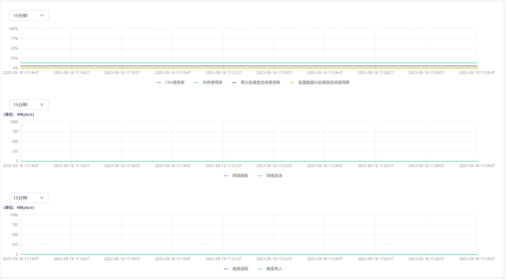

#### 4.10.5.2. 告警配置

当资源使用率超过设定的告警阈值后，系统将会通过站内信、邮件、短信或Syslog外送等方式发送告警日志。

1. 登录云盾堡垒机。具体操作，请参见登录云盾堡垒机。

2. 在控制台切换区，单击图标  ，选择**管理控制台**。

3. 在左侧导航栏，选择**系统 > 监控/告警**。

4. 在**告警配置**页签，**告警阈值配置**区域，配置各项阈值，单击**保存**。

5. 在**告警等级配置**区域，配置告警等级，单击**保存**。如果需要恢复默认配置，可点击**恢复默认**。

#### 4.10.5.3. 消息通知

用于配置消息通知的方式和消息接收人。

1. 登录云盾堡垒机。具体操作，请参见登录云盾堡垒机。

2. 在控制台切换区，单击图标  ，选择**管理控制台**。

3. 在左侧导航栏，选择**系统 > 监控告警**

4. 在**消息通知**页签，配置通知方式和消息接收人。

   - 配置消息通知方式

     在消息中按需勾选或取消勾选站内信、邮件、短信、钉钉等发送方式。

   - 添加消息接收人

     <ol type="a">

     <li>

     单击消息对应的**新建**或者勾选消息后，单击**批量添加接收人**。

     </li>

     <li>

     在**选择用户**面板，通过部门、搜索等方式查找并选中用户，单击**确定**。

     </li>

     </ol>

   - 移除接收人

     单击消息对应的用户中的图标  ，移除单个接收人，或者按如下操作批量移除接收人：

     <ol type="a">

     <li>

     选中目标消息，单击**批量移除接收人**。

     </li>

     <li>

     在**选择用户**面板，选中用户，单击**确定**，批量移除所选用户。

     </li>

     </ol>

#### 4.10.5.4. 通知配置

**邮件配置**

用于配置邮件服务器。

1. 登录云盾堡垒机。具体操作，请参见登录云盾堡垒机。

2. 在控制台切换区，单击图标  ，选择**管理控制台**。

3. 在左侧导航栏，选择**系统 > 服务管理**。

4. 在**通知配置**页签的**邮件配置**区域，切换状态，并配置邮件服务器，单击**测试**，测试成功后，单击**保存**。

**短信配置**

支持自定义短信网关和阿里云短信服务。

- 自定义短信网关：在**通知配置**页签的**短信配置**区域，切换状态为**自定义短信网关**，参考页面指导配置短信网关，单击**发送测试信息**，测试成功后，单击**保存**。

- 阿里云短信服务：在**通知配置**页签的**短信配置**区域，切换状态为**阿里云短信服务**，参考页面指导配置短信网关，单击**发送测试信息**，测试成功后，单击**保存**。

- 腾讯云短信服务：在**通知配置**页签的**短信配置**区域，切换状态为**腾讯云短信服务**，参考页面指导配置短信网关，单击**发送测试信息**，测试成功后，单击**保存**。

- SendCloud短信服务配置：在**通知配置**页签的**短信配置**区域，切换状态为**SendCloud短信服务配置**，参考页面指导配置短信网关，单击**发送测试信息**，测试成功后，单击**保存**。

**钉钉配置**

在**通知配置**页签的**钉钉配置**区域，切换状态，并配置AGENT ID、AK/SK，单击**保存**。

### 4.10.6. 系统日志

#### 4.10.6.1. 操作日志

支持对操作日志进行等级配置、导出和查看等操作。

**搜索和查看操作日志**

1. 登录云盾堡垒机。具体操作，请参见登录云盾堡垒机。

2. 在控制台切换区，单击图标  ，选择**管理控制台**。

3. 在左侧导航栏，选择**系统 > 系统日志**。

4. 在**操作日志**页签，根据时间范围、等级、用户名等搜索查看操作日志。

   在**操作**列，单击**详情**，可查看日志详情。

**操作日志等级配置**

1. 在操作日志列表右上方，单击**配置**。

2. 在**操作日志配置**面板，配置操作日志等级，单击**保存更改**。如果需要恢复默认配置，可点击**恢复默认设置**。

**导出操作日志**

在操作日志列表左上方，单击**导出记录**。

#### 4.10.6.2. 告警日志

用于查看、确认和导出告警日志。

1. 登录云盾堡垒机。具体操作，请参见登录云盾堡垒机。

2. 在控制台切换区，单击图标  ，选择**管理控制台**。

3. 在左侧导航栏，选择**系统 > 系统日志**。

4. 在**告警日志**页签，查看历史告警、确认时间和确认者等信息。

   - 选中目标日志，单击**确认告警**，即可确认该告警信息，确定后表示您已知晓该告警信息。

   - 单击  图标，在**导出**对话框，输入导出文件的加密密码（加密密码用于打开文件时对文件zip包进行解

     密，保证文件的安全性，建议设置）。

### 4.10.7. 本机维护

#### 4.10.7.1. 时间地区

**系统时间**

1. 登录云盾堡垒机。具体操作，请参见登录云盾堡垒机。

2. 在控制台切换区，单击图标  ，选择**管理控制台**。

3. 在左侧导航栏，选择**系统 > 本机维护**。

4. 在时间地区页签的**系统时间**和**系统时间同步配置**区域，根据同步需求配置系统时间。

   - 配置时间服务器：输入时间服务器地址，单击**保存**。时间服务器支持自定义，系统默认时间服务器为time.windows.com。

   - 手动同步时间：单击**同步服务器时间**，同步配置的时间服务器上的时间；或者单击**同步浏览器时间**，同步当前浏览器的时间。

   - 自动同步时间：开启自动同步，设置同步周期（可精确到分钟），单击**保存**，系统会根据设定周期自动从配置的时间服务器同步时间。

**时区配置**

> **重要**
>
> 只允许单机模式下修改，如果修改后的时区与当前系统时区不一致，保存生效后会重启整个服务，请按需操作。

在**时间地区**页签的**时区配置**区域，根据所在区域选择时区，单击**保存**。

- UTC为世界统一时间。

- GMT为格林威治标准时间，中国所在时区为GMT+08:00。

#### 4.10.7.2. 语言界面

1. 登录云盾堡垒机。具体操作，请参见登录云盾堡垒机。

2. 在控制台切换区，单击图标  ，选择**管理控制台**。

3. 在左侧导航栏，选择**系统 > 本机维护**。

4. 在**语言界面**页签进行配置。

   <table>
     <tr>
       <th width="137">配置项</th>
       <th>说明</th>
     </tr>
     <tr>
       <td>系统语言</td>
       <td>在<strong>系统语言</strong>区域，选择系统语言，单击<strong>保存</strong>。</td>
     </tr>
     <tr>
       <td>界面设置</td>
       <td>• 在<strong>界面设置</strong>区域，按需修改浏览器favicon、logo、登录页背景，根据页面上的图片和格式要求上传新的图标或背景图片，单击<strong>保存</strong>。 • 单击<strong>恢复默认</strong>，即恢复到出厂默认的名称、图片或背景。</td>
     </tr>
     <tr>
       <td>网站备案号设置</td>
       <td>在<strong>网站备案号设置</strong>区域，按需修改ICP备案号、ICP链接地址、网安备案号和网安链接地址，单击<strong>保存</strong>。</td>
     </tr>
     <tr>
       <td>水印设置</td>
       <td>在<strong>水印设置</strong>区域，切换状态，按需修改透明度，单击<strong>保存</strong>。</td>
     </tr>
   </table>

#### 4.10.7.3. 公告设置

用于配置系统公告，自定义公告内容后支持推送至用户邮箱、用户登录后进行弹窗通知。

**新建公告**

1. 登录云盾堡垒机。具体操作，请参见登录云盾堡垒机。

2. 在控制台切换区，单击图标  ，选择**管理控制台**。

3. 在左侧导航栏，选择**系统 > 本机维护**。

4. 在**公告设置**页签，单击**新建**，填入标题、内容，单击**上传图片**，选择发布后是否进行通知、是否置顶，单击**确定**。

**公告管理**

- 编辑公告：在目标公告**操作**列，单击**编辑**。

- 置顶公告：选中目标公告，在列表上方，单击**置顶**。

- 删除公告：选中目标公告，在列表上方，单击**删除**。

**查看公告**

1. 登录云盾堡垒机。具体操作，请参见登录云盾堡垒机。

2. 在控制台切换区，单击图标  ，选择**个人控制台**。

3. 在左侧导航栏，选择**日志 > 公告**。

4. 单击公告名称可查看对应公告内容和图片。

#### 4.10.7.4. 诊断工具

**连通性检测**

用于检测主机地址是否连通。

1. 登录云盾堡垒机。具体操作，请参见登录云盾堡垒机。

2. 在控制台切换区，单击图标  ，选择**管理控制台**。

3. 在左侧导航栏，选择**系统 > 本机维护**。

4. 在**诊断工具**页签的**连通性检测**区域，选择操作类型为**PING**，输入主机地址，单击**执行测试**，即可查看连通情况。

连通性检测支持如下操作：

- PING：用于检测云盾堡垒机与目标地址的网络连通性。

- 路由追踪：用于检测云盾堡垒机与目标地址的路由信息。

- TCP端口检测：用于检测目标地址的TCP端口状态。

- UDP端口检测：用于检测目标地址的UDP端口状态。

**TCPDUMP抓包**

用于获取云盾堡垒机和指定主机的通信报文。

1. 在**诊断工具**页签的**TCPDUMP抓包**区域，填入主机IP、端口、监听接口、包数量，单击**开始**。

   > **说明**
   >
   > - 不填写端口，即获取云盾堡垒机与主机IP之间的所有通信报文。
   >
   > - 填写端口号，即获取云盾堡垒机与主机IP之间指定端口的通信报文。

2. 单击**结束**，再单击**下载**，可将获取的通信报文下载到本地，下载文件可通过网络分析仪等工具软件查看。

**系统诊断工具**

用于下载系统诊断日志提供给技术工程师查看和排查问题。

在**诊断工具**页签的**系统诊断工具**区域，单击**下载诊断日志**，将系统诊断日志下载到本地，解压文件可查看。

#### 4.10.7.5. 健康检查

健康检查对系统许可、设备状态、网络状态、代理服务状态、对接服务、存储状态、系统状态等检查项进行一键式检查，并支持健康报告的在线查看和文件导出。

**一键检查**

1. 登录云盾堡垒机。具体操作，请参见登录云盾堡垒机。

2. 在控制台切换区，单击图标  ，选择**管理控制台**。

3. 在左侧导航栏，选择**系统 > 本机维护**。

4. 单击**健康检查**页签，在**健康检查**区域，单击**一键检查**，开始健康检查。

   等待几分钟，刷新页面可查看健康检查结果。

**导出健康报告**

1. 登录云盾堡垒机。具体操作，请参见登录云盾堡垒机。

2. 在控制台切换区，单击图标  ，选择**管理控制台**。

3. 在左侧导航栏，选择**系统 > 本机维护**。

4. 单击**健康检查**页签，在**健康检查**区域，单击**导出健康报告**，下载健康检查报告到本地。

# 5.个人工作台

点击**详情**，跳转至站内消息页面并阅读该消息内容。

配置各类协议的本地客户端工具前，请提前确保已下载单点登录器并安装至本地PC上。

## 5.1. 主页

登录后显示主页页面，支持快速处理待办事项，以及查看上次登录时间和登录来源IP、已处理事项、未读消息。

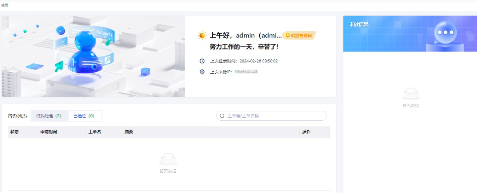

**待办处理**

在**待办列表**区域，选择**待我处理/已通过**页签，可查看当前用户待审批和已经审批通过的工单，单击**详情**，可跳转至工单审批页面，审批工单或查看工单详情。

**未读消息阅读**

在**未读消息**区域，显示待阅读的站内消息。

- 单击**详情**，跳转至站内消息页面并阅读该消息内容。

- 单击**一键已读**，将所有未读消息切换为已读状态。

- 单击**查看更多**，跳转至站内消息页面，并自动阅读第一条消息。

## 5.2. 运维

### 5.2.1. 运维配置

用于配置RDP、SSH/TELNET/Rlogin、FTP、SFTP、VNC/X11、SQL Server、MySql、Oracle、DB2、PostgreSQL、KingbaseES、DM等协议的运维登录参数，包括登录的客户端工具、会话标题内容、登录参数等信息。

**操作步骤**

> **重要**
>
> 配置各类协议的本地客户端工具前，请提前确保已下载单点登录器并安装至本地PC上。

1. 登录云盾堡垒机。具体操作，请参见登录云盾堡垒机。

2. 在控制台切换区，单击图标  ，选择**个人控制台**。

3. 在左侧导航栏，单击**运维**。

4. 在**运维**页面，单击**运维配置**。

5. 在**运维配置**面板，选择协议，并配置协议运维参数，单击**确定**。

   > **重要**
   >
   > - 如果单点登录器可以识别到本地客户端工具的安装路径，配置结束。
   >
   > - 如果单点登录器无法识别到本地客户端工具的安装路径，则会弹出**单点登录器配置**对话框，请参见步骤6。

   **配置项**

   **说明**

   分辨率

   配置RDP协议运维时本地客户端会话页面的显示分辨率。

   配置RDP协议运维时H5会话页面的显示分辨率。

   H5客户端分辨率

   批量运维时，仅支持默认分辨率。

   配置运维会话显示的标题内容及内容显示顺序。

   会话标题

   FTP/SFTP协议下，如果本地客户端工具为SecureFX、FlashFXP和Xftp，则不支持修改会话标题。

   连接模式

   勾选后，允许连接到会话管理。

   本地设备和资源

   配置RDP协议运维时可使用的本地设备和资源。

   本地驱动器

   选择RDP协议运维时允许映射的盘符。

   B/S运维时，通过单点登录器调用本地PC中的客户端工具，登录资产进行运维。需提前配置在本地PC中安装客户端工具，并对登录协议关联该客户端工具。

   不同操作系统下，各类协议支持的客户端工具不同，具体如下：

   - SSH/TELNET/Rlogin协议：支持Xshell、PuTTY、SecureCRT和MobaXterm。

   - FTP/SFTP协议：支持Xftp、WinSCP、FileZilla、FlashFXP、SecureFX和MobaXterm。

   - VNC/X11协议：支持RealVNC、TightVNC和TigerVNC。

   - SQL Server协议：支持ssms、sqlwb、DBeaver、NavicatPremium、NavicatForSqlServer和SqlDbx Professional。

   - MySql协议：支持mysqlcli、MySQLWorkbench、DbVisualizer、DBeaver、MySQLFront、NavicatPremium、NavicatForMysql、Heidi SQL和SqlDbx Professional。

   Windows

   - Oracle协议：支持PLSQL、SQLPlus、Toad、DbVisualizer、DBeaver、NavicatPremium、NavicatForOracle和SqlDbx Professional。

   - DB2协议：db2cmd、QuestCentral、ToadForDB2、DbVisualizer和DBeaver。

   - PostgreSQL协议：支持pgAdmin3、psql、DbVisualizer、DBeaver、Heidi SQL、SqlDbx Professional、NavicatPremium和NavicatForPostgreSQL。

   - KingbaseES协议：支持Ksql、lsql和DbVisualizer。

   本地客户端

   - DM协议：支持Dlsql、lsql、DbVisualizer和DMmanager。

   - RDP协议：支持Remote Desktop Client。

   - SSH/TELNET/Rlogin协议：支持zoc8。

   - FTP/SFTP协议：支持FileZilla。

   macOS

   - VNC/X11协议：支持RealVNC。

   - SQL Server/MySql/Oracle/DB2/PostgreSQL/KingbaseES/DM协议：支持DbVisualizer。

   - RDP协议：支持remmina和xfreerdp。

   - SSH/TELNET/Rlogin协议：支持PuTTY。

   - FTP/SFTP协议：支持FileZilla。

   - VNC/X11协议：支持TightVNC和remmina。

   - SQL Server协议：支持DBeaver。

   - MySql协议：支持DbVisualizer、MySQLWorkbench、mysqlcli和

   Linux

   DBeaver。

   - Oracle协议：支持DbVisualizer、SQLPlus和DBeaver。

   - DB2协议：支持DbVisualizer、CLPPlus和DBeaver。

   - PostgreSQL协议：支持DbVisualizer和DBeaver。

   - KingbaseES协议：支持DbVisualizer。

   - DM协议：支持DbVisualizer和DMmanager。

   根据所选择的客户端工具，配置对应的终端类型，支持VT100、Xterm和Linux。

   终端类型

   如果选择的本地客户端工具为MobaXterm，则不支持配置终端类型。

   <table>
     <tr>
       <td>编码</td>
       <td>默认支持UTF-8。</td>
     </tr>
     <tr>
       <td>远程客户端</td>
       <td>配置数据库图形运维时连接应用中心的访问方式。 • 使用H5 RDP客户端访问：选择后，仅支持H5方式访问应用中心。 • 使用本地RDP客户端访问：选择后，仅支持本地客户端方式访问应用中心。</td>
     </tr>
     <tr>
       <td>配置文件路径</td>
       <td>运维Oracle数据库时，可以配置文件tnsnames.ora的绝对路径，如：<code> G:11.2.0\dbhome_1\NETWORK\ADMIN\tnsnames.ora </code>。 • 如果为空，仍可登录，但客户端不显示目标信息，且plsql和sqlplus将使用servicename属性进行登录，toad将使用sid属性进行登录。 • 如果不为空时，需保证当前pc系统用户对配置文件有修改权限。客户端将显示目标信息，且客户端将根据云盾堡垒机保存的账户信息决定使用sid或servicename进行登录。</td>
     </tr>
   </table>

6. **可选**：选择配置的客户端工具，单击**浏览**，选择工具的安装路径（路径需带上.exe应用程序名，如： `C:\Users\wsn\Desktop\mysql\mysql\Navicat Premium 15\Navicat Premium 15\navicat.exe` ），再单击**确定**，完成配置。

### 5.2.2. 主机运维

#### 5.2.2.1. B/S运维

**前提条件**

B/S运维前，请确认以下准备工作是否已完成：

- 确认本地PC是否已安装单点登录器，如果没有，请下载并安装。

- 确认本地PC是否已安装对应的运维客户端工具，如果没有，请完成下载和安装。

- 在**个人工作台 > 运维 > 运维配置**页面确认运维协议中的本地客户端是否已配置为该运维客户端工具，如果没有，请先完成配置。

- 在**管理控制台 > 资产 > 资产管理**页面确认运维的主机及主机账号是否已创建，如果没有，请先完成创建主机并添加账号。

- 在**管理控制台 > 授权 > 授权规则**页面确认主机账号是否授权给运维用户，如果没有，请先完成运维授权。

- 在**管理控制台 > 策略 > 访问控制**页面确认运维用户是否绑定运维的主机和主机账号，如果没有，请先完成访问控制策略的绑定。

**操作步骤**

1. 登录云盾堡垒机。具体操作，请参见登录云盾堡垒机。

2. 在控制台切换区，单击图标  ，选择**个人控制台**。

3. 在左侧导航栏，单击**运维**。

4. 在**运维**页面，单击**全部资产**目录或者下级分组，右侧显示该组内的主机信息。将鼠标移动至**访问**列，单击

   图标  ，弹窗选择运维的**账号/服务**，再选择**本地运维**，单击**登录**。

5. 堡垒机调用单点登录器，单击**打开usmsso**后自动打开并登录访问协议中配置的本地客户端工具，开始运维。

   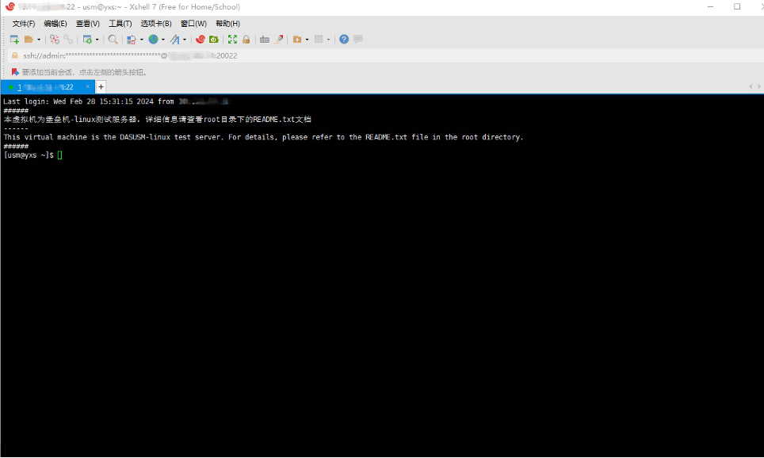

6. **可选**：步骤4中勾选“设为默认方式”，则下次单击访问的账号、服务即默认为B/S运维。

#### 5.2.2.2. H5运维

**前提条件**

运维前，请确认以下准备工作是否已完成：

- 在**管理控制台 > 资产 > 资产管理**页面确认运维的主机及主机账户是否已创建，如果没有，请先完成创建主机并添加账户。

- 在**管理控制台 > 授权 > 授权规则**页面确认主机账号是否授权给运维用户，如果没有，请先完成运维授权。

- 在**管理控制台 > 策略 > 访问控制**页面确认运维用户是否绑定运维的主机和主机账号，如果没有，请先完成访问控制策略的绑定。

**操作步骤**

1. 登录云盾堡垒机。具体操作，请参见登录云盾堡垒机。

2. 在控制台切换区，单击图标  ，选择**个人控制台**。

3. 在左侧导航栏，单击**运维**。

4. 在**运维**页面，单击**全部资产**目录或者下级分组，右侧显示该组内的主机信息。将鼠标移动至**访问**，单击图

   标  ，弹窗选择运维的**账号/服务**，再选择**H5运维**，单击**登录**，打开H5页面并自动登录主机，开始运

   维。

   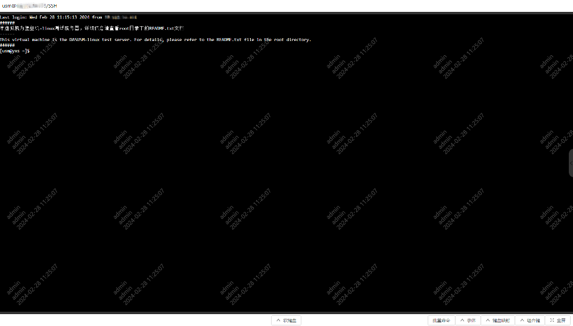

5. **可选**：步骤4中勾选**设为默认方式**，则下次单击访问的账号、服务即默认为H5运维。

   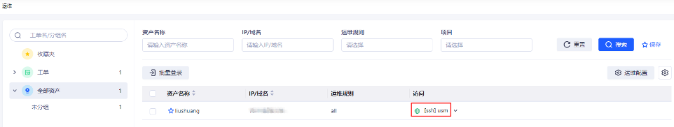

#### 5.2.2.3. C/S运维

**前提条件**

C/S运维前，请确认以下准备工作是否已完成：

- 请确认**管理控制台 > 配置 > 资产配置 > 运维配置**页面的SSH登录配置项中已关闭Shell使用命令行方式，否则SSH登录界面无法查看授权资产信息。

- 在**管理控制台 > 资产 > 资产管理**页面确认运维的主机及主机账户是否已创建，如果没有，请先完成创建主机并添加账户。

- 在**管理控制台 > 授权 > 授权规则**页面确认主机账号是否授权给运维用户，如果没有，请先完成运维授权。

- 在**管理控制台 > 策略 > 访问控制**页面确认运维用户是否绑定运维的主机和主机账号，如果没有，请先完成访问控制策略的绑定。

**操作步骤**

以Xshell工具为例介绍。

1. 打开Xshell工具，新建会话，在连接设置中输入云盾堡垒机的IP和SSH协议端口号。

   > **说明**
   >
   > SSH端口号可在**管理控制台**页面的**系统 > 服务管理 > 端口配置**页面查看，默认为20022。

   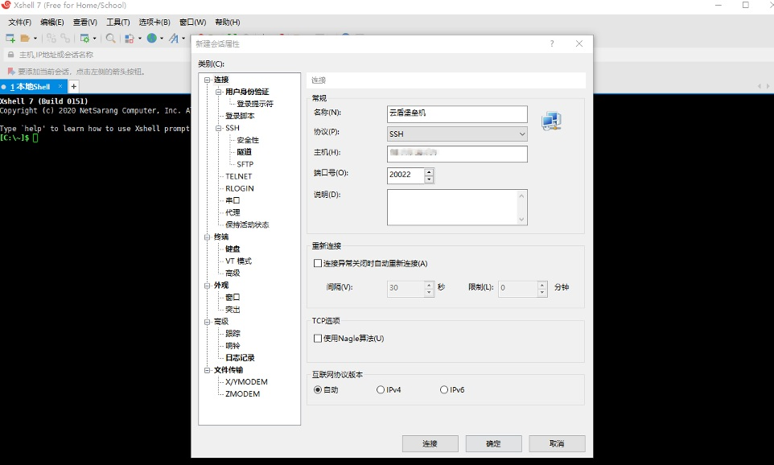

2. 在用户身份验证中设置认证方法。

   <ol type="i">

   <li>

   如果通过Password方式认证，则输入云盾堡垒机的用户名和密码。

   </li>

   <li>

   如果通过Public Key方式登录，则将密钥对中的公钥配置到云盾堡垒机上该用户的SSH公钥中，再在此处选择对应的私钥。

   </li>

   </ol>

   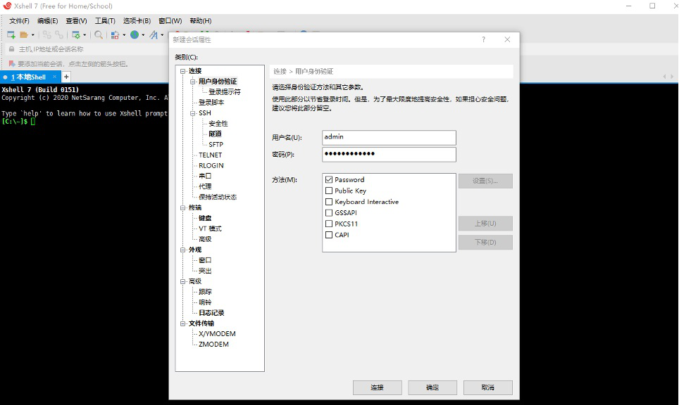

3. 单击**连接**，连接云盾堡垒机。成功连接云盾堡垒机后，显示授权资产列表。

   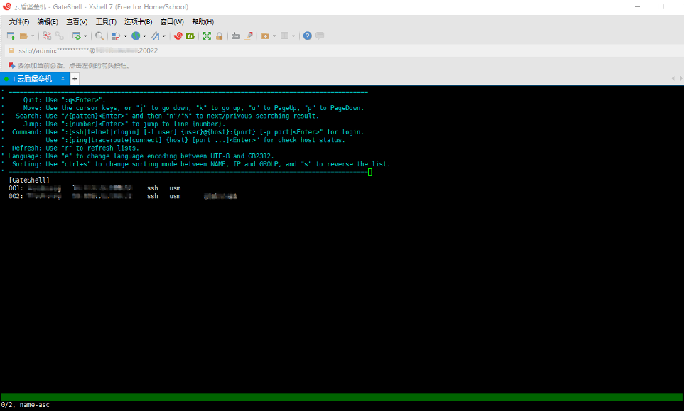

4. 通过键盘上、下方向键，选择需要运维的主机，按回车键登录该主机，开始运维。

   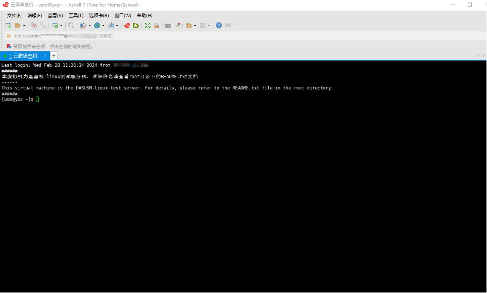

### 5.2.3. 数据库运维

通过授权的数据库账户登录数据库进行运维，仅支持B/S运维方式。

**前提条件**

B/S运维前，请确认以下准备工作是否已完成：

- 确认本地PC是否已安装单点登录器，如果没有，请下载并安装。

- 确认本地PC是否已安装对应的运维客户端工具，如果没有，请完成下载和安装。

- 在**个人工作台 > 运维 > 运维配置**页面确认运维协议中的本地客户端是否已配置为该运维客户端工具，如果没有，请先完成配置。

- 在**管理控制台 > 资产 > 资产管理**页面确认运维的数据库账号是否已创建，如果没有，请先完成创建主机并添加账号。

- 在**管理控制台 > 授权 > 授权规则**页面确认主机账号是否授权给运维用户，如果没有，请先完成运维授权。

- 在**管理控制台 > 策略 > 访问控制**页面确认运维用户是否绑定运维的主机和主机账号，如果没有，请先完成访问控制策略的绑定。

**操作步骤**

1. 登录云盾堡垒机。具体操作，请参见登录云盾堡垒机。

2. 在控制台切换区，单击图标  ，选择**个人控制台**。

3. 在左侧导航栏，单击**运维**。

4. 在**运维**页面，单击**全部资产**目录或者下级分组，右侧显示该组内的主机信息。

5. 将鼠标移动至**访问**，单击  图标，弹窗选择运维的数据库**账号/服务**，**远程客户端**选择**不使用**，再选择**本**

   **地运维**，单击**登录**，

6. 堡垒机调用单点登录器，单击**打开usmsso**后自动打开并登录访问协议中配置的本地客户端工具，开始运维。

   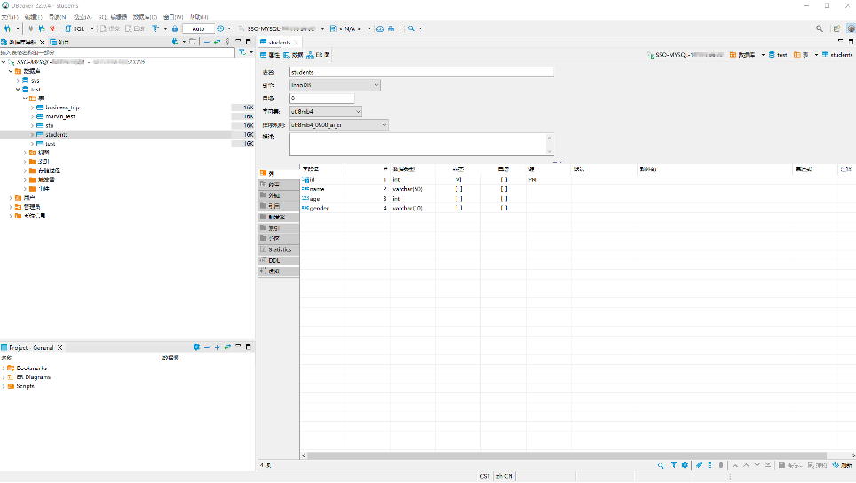

### 5.2.4. 远程客户端运维

当用户运维操作所使用的客户端工具或协议（如HTTPS协议）不在云盾堡垒机的支持范围内，可以借助应用服务器，以远程客户端运维方式实现运维审计，支持B/S和H5两种运维方式。

#### 5.2.4.1. B/S运维

**前提条件**

B/S运维前，请确认以下准备工作是否已完成：

- 确认本地PC是否已安装单点登录器，如果没有，请下载并安装。

- 确认应用中心是否已安装对应的运维工具，如果没有，请完成下载和安装。

- 在**管理控制台 > 资产 > 资产管理**页面确认是否已创建创建远程客户端，关联的应用服务器及远程客户端工具是否正确，应用账号是否已添加，如果没有，请先完成创建或者更新信息。

- 在**管理控制台 > 授权 > 授权规则**页面确认主机、数据库、APP账号是否授权给运维用户，如果没有，请先完成运维授权。

- 在**管理控制台 > 策略 > 访问控制**页面确认运维用户是否绑定运维的主机、数据库、APP账号，如果没有，请先完成访问控制策略的绑定。

**操作步骤**

1. 登录云盾堡垒机。具体操作，请参见登录云盾堡垒机。

2. 在控制台切换区，单击图标  ，选择**个人控制台**。

3. 在左侧导航栏，单击**运维**。

4. 在**运维**页面，单击**全部资产**目录或者下级分组，右侧显示该组内的主机信息。

5. 将鼠标移动至**访问**，单击  图标，弹窗选择运维的账号/服务，**远程客户端**选择对应的远程客户端工具，

   再选择**本地运维**，单击**登录**。

6. 堡垒机调用单点登录器，单击**打开usmsso**后自动打开RemoteApp程序，开始运维。

#### 5.2.4.2. H5运维

**前提条件**

H5运维前，请确认以下准备工作是否已完成：

- 确认应用中心是否已安装对应的运维工具，如果没有，请完成下载和安装。

- 在**管理控制台 > 资产 > 资产管理**页面确认是否已创建创建远程客户端，关联的应用服务器及远程客户端工具是否正确，应用账号是否已添加，如果没有，请先完成创建或者更新信息。

- 在**管理控制台 > 授权 > 授权规则**页面确认主机/数据库/APP账号是否授权给运维用户，如果没有，请先完成运维授权。

- 在**管理控制台 > 策略 > 访问控制**页面确认运维用户是否绑定运维的主机/数据库/APP账号，如果没有，请先完成访问控制策略的绑定。

**运维操作**

1. 登录云盾堡垒机。具体操作，请参见登录云盾堡垒机。

2. 在控制台切换区，单击图标  ，选择**个人控制台**。

3. 在左侧导航栏，单击**运维**。

4. 在**运维**页面，单击**全部资产**目录或者下级分组，右侧显示该组内的主机信息。

5. 将鼠标移动至**访问**，单击  图标，弹窗选择运维的**账号/服务**，**远程客户端**选择对应的远程客户端工具，

   再选择**H5运维**，单击**登录**，打开H5页面并调用应用服务器的远程客户端工具（如此处配置的Chrome浏览器），开始运维。

### 5.2.5. 工单运维

当需要运维的资产未授权，且系统又未开启未授权登录时，运维用户可以通过工单获取资产的运维权限，登录资产进行运维。

- 资产类型为主机账号时，支持B/S和H5两种运维方式。

- 资产类型为数据库账号时，仅支持B/S运维方式。

#### 5.2.5.1. B/S运维

**前提条件**

运维前，请确认以下准备工作是否已完成：

- 在个人工作台的**运维**页面的工单目录中确认是否已获得资产的运维权限，如果没有，请通过创建工单获取。

- 确认本地PC是否已安装单点登录器，如果没有，请下载并安装。

- 如果资产类型为主机账户或者数据库账户，还需确认以下配置：

  - 本地PC是否已安装对应的运维客户端工具，如果没有，请完成下载和安装。

  - 在个人工作台的**运维 > 运维配置**页面确认运维协议中的本地客户端是否已配置为该运维客户端工具，如果没有，请先完成配置。

- 如果资产类型为应用账户，还需确认以下配置：

  - 确认应用服务器是否已安装对应的运维工具，如果没有，请完成下载和安装。

  - 在**资产 > 远程客户端**页面确认应用关联的应用服务器及远程客户端工具是否正确，如果不正确，请更新。

**运维操作**

1. 登录云盾堡垒机。具体操作，请参见登录云盾堡垒机。

2. 在控制台切换区，单击图标  ，选择**个人控制台**。

3. 在左侧导航栏，单击**运维**。

4. 在**运维**页面，单击**工单**目录选择已审批通过的工单，右侧显示该工单申请的资产信息。

5. 将鼠标移动至**访问**，单击

   

   图标，弹窗选择运维的**账号/服务**，选择**本地运维**，单击**登录**，堡垒机调用单点登录器

6. 单击**打开usmsso**后自动打开并登录访问协议中配置的本地客户端工具，开始运维。

   

#### 5.2.5.2. H5运维

**前提条件**

运维前，请确认以下准备工作是否已完成：

在个人工作台的**运维**页面的工单目录中，确认是否已获得资产的运维权限，如果没有，请通过创建工单获取。

**运维操作**

1. 登录云盾堡垒机。具体操作，请参见登录云盾堡垒机。

2. 在控制台切换区，单击图标  ，选择**个人控制台**。

3. 在左侧导航栏，单击**运维**。

4. 在**运维**页面，单击**工单**目录选择已审批通过的工单，右侧显示该工单申请的资产信息。

5. 将鼠标移动至**访问**，单击

   

   图标，弹窗选择运维的**账号/服务**，选择**H5运维**，单击**登录**，打开H5页面并自动登录主机，开始运维。

   

### 5.2.6. 收藏夹管理

将资产收藏后，可从收藏夹中快速登录运维。

#### 5.2.6.1. 加入收藏夹

**操作步骤**

1. 登录云盾堡垒机。具体操作，请参见登录云盾堡垒机。

2. 在控制台切换区，单击图标  ，选择**个人控制台**。

3. 在左侧导航栏，单击**运维**。

4. 在**运维**页面，单击**全部资产**目录，右侧显示资产信息。

5. 单击  ，将该资产加入收藏夹。

#### 5.2.6.2. 收藏夹运维

**操作步骤**

1. 登录云盾堡垒机。具体操作，请参见登录云盾堡垒机。

2. 在控制台切换区，单击图标  ，选择**个人控制台**。

3. 在左侧导航栏，单击**运维**。

4. 在**运维**页面，单击**收藏夹**目录，右侧显示已加入收藏夹的资产信息。

5. 将鼠标移动至**访问**，单击  图标，弹窗选择运维的**账号/服务**，选择**H5运维**，单击**登录**，开始运维。

### 5.2.7. 批量登录运维

支持选择多个资产，同时登录运维。

**运维操作**

1. 登录云盾堡垒机。具体操作，请参见登录云盾堡垒机。

2. 在控制台切换区，单击图标  ，选择**个人控制台**。

3. 在左侧导航栏，单击**运维**。

4. 在**运维**页面，单击**收藏夹、工单、全部资产**目录，右侧显示资产信息。

5. 将鼠标移动至**访问**方式上，单击  图标，选择资产的账号、服务和运维方式并设置为**默认方式**。

6. 选中多个资产，单击**批量登录**，可同时对选中的资产进行登录运维。

> **说明**
>
> 如果是在**全部资产**目录中发起批量登录，且选择的主机间相同协议下存在相同账号时，会弹出**批量登录**对话框，需手动配置登录方式、登录协议以及登录名，点击**登录**后，才能登录运维。
>
> - 默认方式：使用各主机默认的访问方式。
>
> - 自定义：手动给所选主机选择相同的登录协议、登录名以及登录方式。

### 5.2.8. H5协同运维

H5方式运维时，支持多人协同进行运维。

**运维步骤**

1. 参见主机运维、数据库运维或远程客户端运维中的运维操作说明，进入运维页面。

2. 单击页面右侧的箭头，展开操作区。

   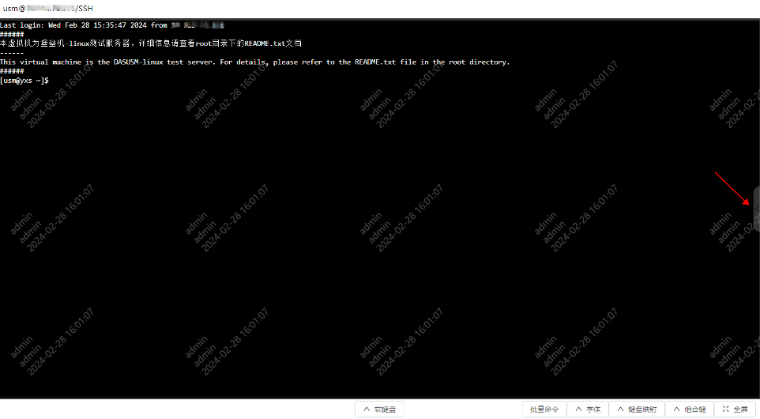

3. 在**协同运维**页签中，单击**开始分享**。

   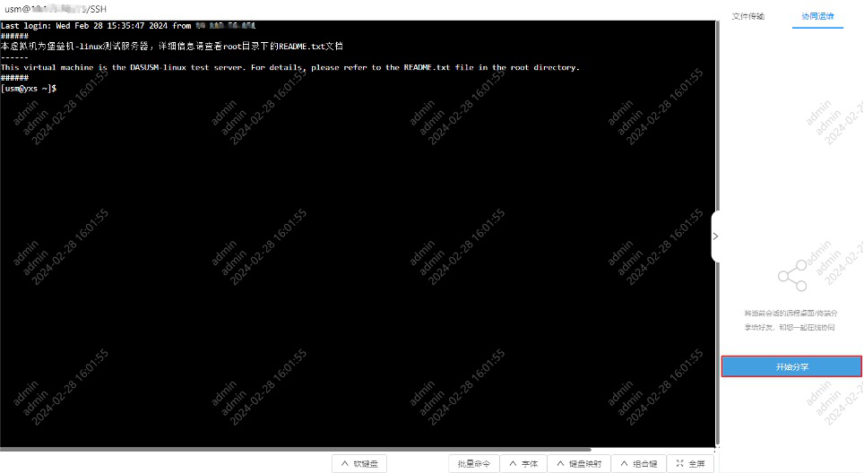

4. 单击**邀请**，弹出邀请对话框。

   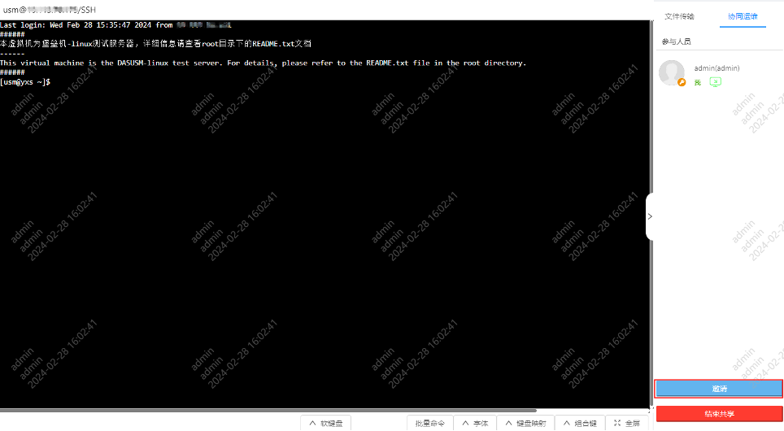

5. 填写邀请原因后，单击**单击生成邀请链接**，生成一个链接。

   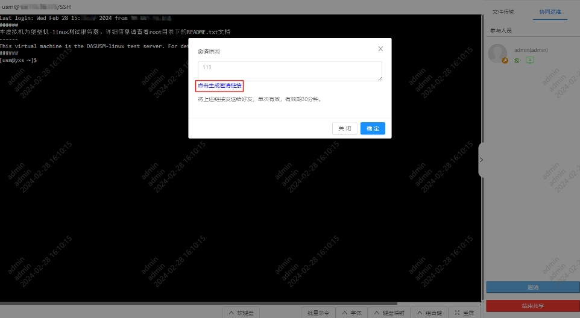

6. 复制链接，发送给其他云盾堡垒机用户。

   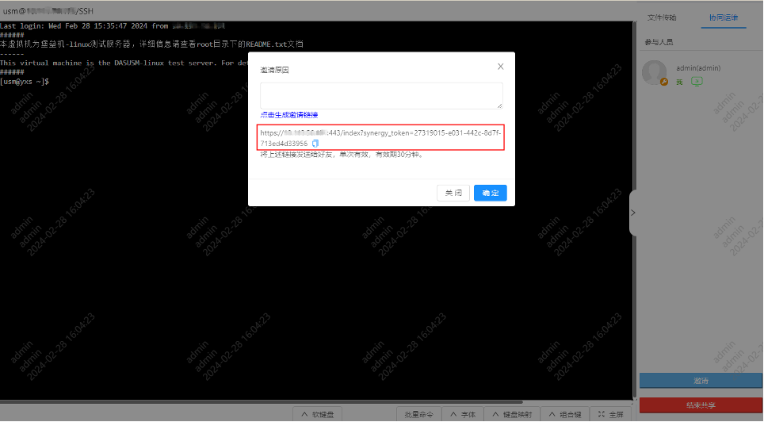

7. 收到链接的云盾堡垒机用户，在浏览器中访问该链接，登录云盾堡垒机后，弹出**协同运维邀请详情**对话框，单击**进入协同**，打开H5运维页面。

   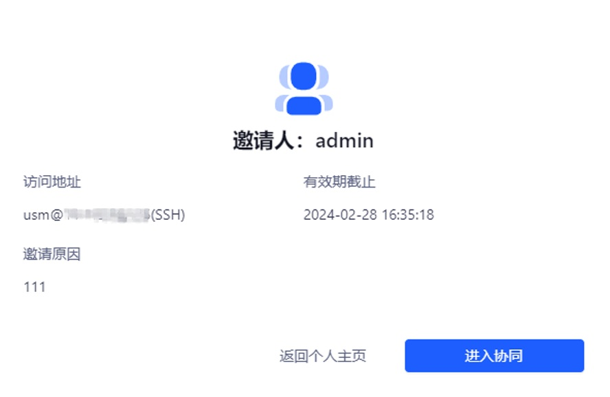

8. 该用户加入协同运维。

   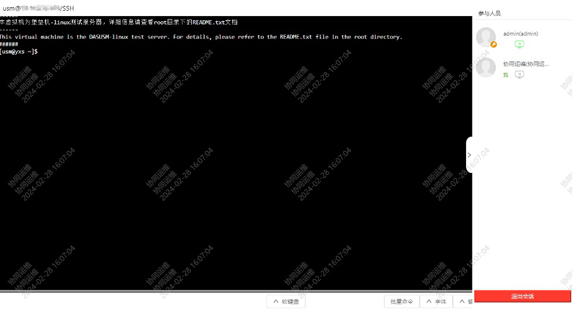

9. 邀请端显示该用户已在协同运维中。

   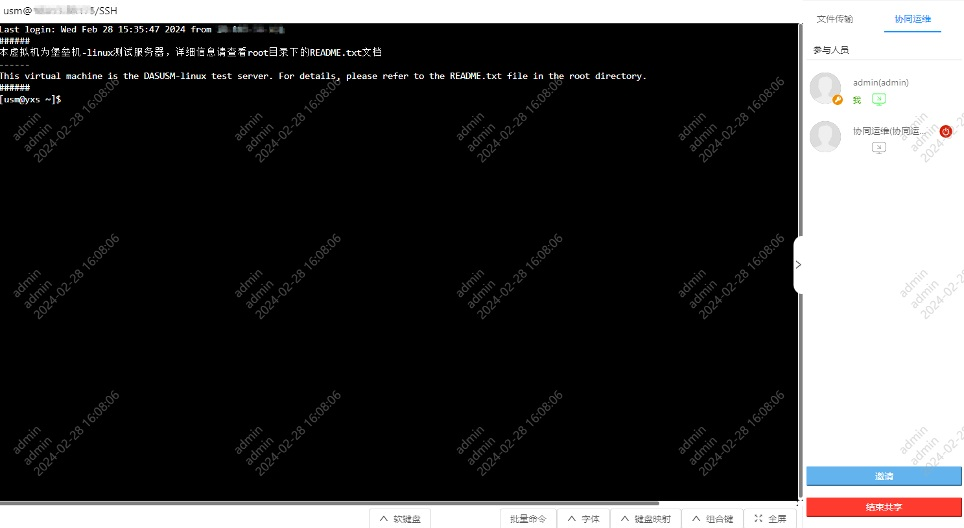

### 5.2.9. 未授权登录运维

当需要运维的资产未授权时，可以通过未授权登录访问资产。

> **说明**
>
> 未授权登录功能出厂默认为关闭状态，如需使用，需在管理控制台的**配置 > 资产配置 > 运维配置**中开启**允许Web未授权登录**功能，详见运维配置。

**操作步骤**

1. 登录云盾堡垒机。具体操作，请参见登录云盾堡垒机。

2. 在控制台切换区，单击图标  ，选择**个人控制台**。

3. 在左侧导航栏，单击**运维**。

4. 在**运维**页面，单击**未授权登录**，弹出**运维登录**对话框。

   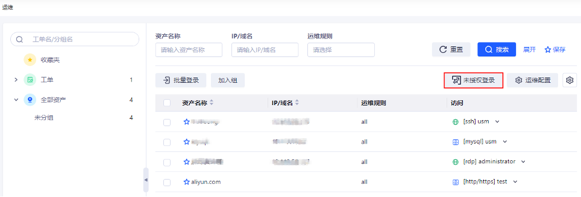

5. 参见下表说明，配置登录资产信息，单击**确定**，即可登录资产。

   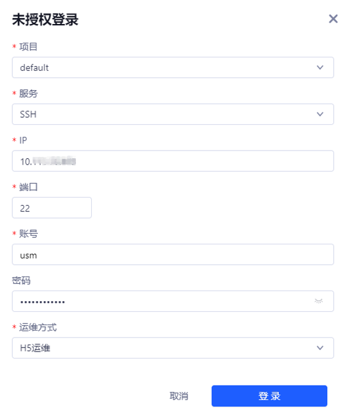

   <table>
     <tr>
       <th width="90">配置项</th>
       <th>说明</th>
     </tr>
     <tr>
       <td>项目</td>
       <td>资产所归属的项目。</td>
     </tr>
     <tr>
       <td>服务</td>
       <td>选择登录目标资产所使用的协议。包括RDP、SSH、Telnet、VNC、X11、SFTP、FTP、SQL Server、MySQL、Oracle、DB2、PostgreSQL、Kingbase、DM和Rlogin。</td>
     </tr>
     <tr>
       <td>IP</td>
       <td>目标资产的IP地址。</td>
     </tr>
     <tr>
       <td>端口</td>
       <td>目标资产的端口，建议使用默认端口。</td>
     </tr>
     <tr>
       <td>账号</td>
       <td>目标资产的账号。</td>
     </tr>
     <tr>
       <td>密码</td>
       <td>目标资产账号对应的密码。</td>
     </tr>
     <tr>
       <td>运维方式</td>
       <td>支持本地运维和H5登录。</td>
     </tr>
   </table>

### 5.2.10. 资产分组管理

**全部资产**目录支持自定义分组，实现全部资产的分组管理，支持创建三级子分组。

**新建分组**

1. 登录云盾堡垒机。具体操作，请参见登录云盾堡垒机。

2. 在控制台切换区，单击图标  ，选择**个人控制台**。

3. 在左侧导航栏，单击**运维**。

4. 在**运维**页面，将鼠标移至**全部资产**或者下级子目录上，右侧显示图标  。

5. 将鼠标移至图标  上，选择**新建分组**，下方新增编辑状态的目录。

6. 输入分组名称，单击右侧的  ，完成新建。

**编辑分组**

1. 在**运维**页面，将鼠标移至**全部资产**或者下级子目录上，右侧显示图标  。

2. 将鼠标移至图标  上，选择**编辑分组**，下方新增编辑状态的目录。

**删除分组**

1. 在**运维**页面，将鼠标移至**全部资产**或者下级子目录上，右侧显示图标  。

2. 将鼠标移至图标  上，选择**删除分组**，确认后即可删除该分组及下级子分组。

**加入分组**

1. 在**运维**页面，选择**全部资产**目录下的**未分组**，右侧显示所有未分组的资产信息。

2. 选中需要加入分组的资产，单击**加入组**，选择待加入的分组，单击**确定**即可加入分组。

**移出分组**

1. 在**运维**页面，选择**全部资产**的下级分组，右侧显示已加入该分组的资产信息。

2. 选中需要移出分组的资产，单击**移出组**，选择移出到新的分组，单击**确定**即可移出分组并加入到新的分组中。

## 5.3. 工单

### 5.3.1. 新建工单

> **说明**
>
> - 运维工单功能出厂默认为启用状态，如果没有启用，需要在“**配置>资产配置>配置管理**”页面工单配置中开启工单功能。
>
> - 请提前创建工单审批规则，授权工单的审批权限。
>
> - 如果不创建工单审批规则，则资产所在部门及其上级部门中角色具备工单审批权限的用户会默认成为审批员。
>
> - 紧急运维工单无需审批员操作，申请后系统默认审批通过。
>
> - 如果工单申请者和审批员需要收到邮件通知，需确保已配置邮件服务器，且工单申请者和审批员已配置邮箱。

1. 登录云盾堡垒机。具体操作，请参见登录云盾堡垒机。

2. 在控制台切换区，单击图标  ，选择**个人控制台**。

3. 在左侧导航栏，单击**工单**。

4. 单击**新建工单**，参考下表说明配置工单信息，单击**确定**。

   <table>
     <tr>
       <th width="121">配置项</th>
       <th>说明</th>
     </tr>
     <tr>
       <td>项目</td>
       <td>在项目下绑定工单。</td>
     </tr>
     <tr>
       <td>工单名称</td>
       <td>工单的名称，最大长度30个字符。如不填写，系统生成工单名和单号一致。</td>
     </tr>
     <tr>
       <td>工单类型</td>
       <td>• 运维工单：发起该类型工单后，申请人可运维所选资产。 • 密码工单：发起该类型工单后，申请人可获取该资产账户密码信息。 • 紧急运维工单：发起该类型的工单后，申请人无需经过审批可运维所选资产。</td>
     </tr>
     <tr>
       <td>有效期</td>
       <td>• 开始日期：工单有效期的开始时间，有效期开始时间不能早于当前时间。 • 结束日期：工单有效期结束时间。 说明对于密码工单，在有效期内，主机账户密码有效；过期后，系统会自动执行内置工单改密计划，回收该密码。</td>
     </tr>
     <tr>
       <td>密码发送时间</td>
       <td>设置主机账号密码的发送时间。系统会在密码工单生效前的设定时间点，将主机账号密码通过邮件形式发送给密码接收者。 说明仅密码工单需要填写。</td>
     </tr>
     <tr>
       <td>加密密码</td>
       <td>根据密码强度说明设置密码文件zip包的加密密码。 说明仅密码工单需要填写。</td>
     </tr>
     <tr>
       <td>密码接收者</td>
       <td>设置主机账号密码的接收者邮箱地址，如有多个接收者，依次输入密码接收者邮箱回车确定；工单审批通过后，在设定的密码发送时间，接收者邮箱会收到工单申请的主机账号密码文件。 说明 • 仅密码工单需要填写。 • 需提前在“<strong>系统&gt;监控告警&gt;通知配置</strong>”中配置邮件服务器，且工单申请者需配置邮箱。</td>
     </tr>
     <tr>
       <td>申请原因</td>
       <td>工单的申请原因，最大长度120个字符。</td>
     </tr>
     <tr>
       <td>资产账号</td>
       <td>工单绑定的账号，绑定后工单通过审批，当工单类型为运维工单和紧急运维工单时，用户可对绑定的资产账号进行运维操作；当工单类型为密码工单时，会将该账号密码以邮件方式发送到密码接收者邮箱。</td>
     </tr>
     <tr>
       <td>操作权限</td>
       <td>• 自动匹配：工单自动匹配策略中设置的权限。 • 我要申请：工单申请文件传输及命令权限。工单申请权限&gt;策略中的权限 说明仅运维工单需要填写。</td>
     </tr>
   </table>

### 5.3.2. 取消工单

工单申请者可以取消待审批状态的工单，中断授权申请。

**操作步骤**

1. 登录云盾堡垒机。具体操作，请参见登录云盾堡垒机。

2. 在控制台切换区，单击图标  ，选择**个人控制台**。

3. 在左侧导航栏，单击**工单**。

4. 在**工单**页面，定位到目标工单，在**操作**列，单击**取消申请**，确定后即可取消本次的申请。

### 5.3.3. 查看工单详情

> **说明**
>
> 不同权限的用户，可查看的权限不同。
>
> - 具备工单审批权限的用户，可查看待处理和已处理工单的状态、审批流程和工单详情。
>
> - 具备工单申请权限的用户，可查看已提交工单的状态、审批流程和工单详情。

**操作步骤**

1. 登录云盾堡垒机。具体操作，请参见登录云盾堡垒机。

2. 在控制台切换区，单击图标  ，选择**个人控制台**。

3. 在左侧导航栏，单击**工单**。

4. 在**工单**页面，选择**已提交、待处理**或**已处理**卡片，进入对应工单列表，查看工单的审批状态、申请人、工单摘要等信息。

5. **可选**：单击图标  ，可查看工单的审批流程及审批信息。

6. **可选**：单击**详情**，可以查看工单的详细信息。

### 5.3.4. 工单搜索

支持通过审批状态、申请人、申请原因、工单号等字段信息搜索相关的工单信息。

1. 登录云盾堡垒机。具体操作，请参见登录云盾堡垒机。

2. 在控制台切换区，单击图标  ，选择**个人控制台**。

3. 在左侧导航栏，单击**工单**。

4. 在**工单**页面，选择**已提交、待处理**或**已处理**卡片，进入对应工单列表。

5. 输入搜索字段内容，单击**搜索**，即可搜索符合条件的工单。

### 5.3.5. 工单审批

#### 5.3.5.1. 工单审批

创建工单后，系统会自动触发审批流程，需授权的安全管理员用户审批通过后，申请工单的用户可进行对应操作。

> **说明**
>
> - 运维工单审批通过后，申请工单的用户方可运维资产账号。
>
> - 密码工单审批通过后，系统在设定的密码发送时间给密码接收者邮箱发送账号密码文件。
>
> - 在主机或数据库运维过程中，执行关联策略中需要审批的命令时，系统会自动触发审批流程，需要授权的审批员审批，通过后该命令才能执行。
>
> - 访问控制策略中开启运维复核后，在发起运维时，需填写运维有效期后会发起工单流程，审批通过后，可下次访问该资产可直接使用申请账号进行运维。
>
> - 审批规则中创建任务编排审批规则后，在创建任务编排时，会发起工单审批流程，审批通过后可发起任务编排。

1. 登录云盾堡垒机。具体操作，请参见登录云盾堡垒机。

2. 在控制台切换区，单击图标  ，选择**个人控制台**。

3. 在左侧导航栏，单击**工单**。

4. 在**工单**页面，定位到目标工单，在**操作**列，单击**同意**或**拒绝**。

   也可以单击**详情**，在弹出工单详情面板，单击**同意**或**拒绝**，确定后即可完成审批。

#### 5.3.5.2. 离岸审批

系统将审批码发送给审批员，工单申请者向审批员索要审批码，自行完成工单审批。

**操作步骤**

1. 触发工单审批流程后，工单申请者在**个人工作台**页面的系统菜单栏选择**工单**，进入工单申请页面。

2. 在工单列表中单击图标  ，弹出**审批流程**对话框，选择发送方式和审批员，单击**发送审批码**，审批码会通

   过所选的方式发送给审批员。

3. 工单申请者向审批员索要审批码并填写，单击**确定**，审批码验证功后，该工单以该审批员的名义批准。

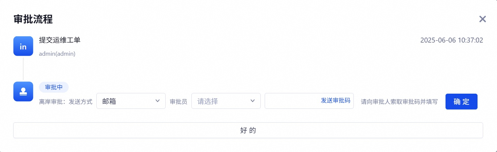

### 5.3.6. 工单撤销

审批员可以撤销已批准的运维工单、预授权工单和紧急运维工单，取消资产授权。

1. 登录云盾堡垒机。具体操作，请参见登录云盾堡垒机。

2. 在控制台切换区，单击图标  ，选择**个人控制台**。

3. 在左侧导航栏，单击**工单**。

4. 在**工单**页面，定位到目标工单，在**操作**列，单击**撤销**。

## 5.4. 网盘

支持共享网盘查看和上传下载文件等操作。

**用户网盘功能**

1. 登录云盾堡垒机。具体操作，请参见登录云盾堡垒机。

2. 在控制台切换区，单击图标  ，选择**个人控制台**。

3. 在左侧导航栏，单击**网盘**。

4. 在**用户网盘**页面，可查看用户对应权限下的共享网盘。

**网盘上传**

支持上传文件目录或者文件到共享网盘中。

1. 登录云盾堡垒机。具体操作，请参见登录云盾堡垒机。

2. 在控制台切换区，单击图标  ，选择**个人控制台**。

3. 在左侧导航栏，单击**网盘**。

4. 选择**上传** > **选择目录**，在选择好目录后，可以将目录上传到共享网盘。

5. 选择**上传** > **选择文件**，在选择好文件后，可以将文件上传到共享网盘

**网盘下载**

支持将共享网盘中文件下载到本地。

1. 登录云盾堡垒机。具体操作，请参见登录云盾堡垒机。

2. 在控制台切换区，单击图标  ，选择**个人控制台**。

3. 在左侧导航栏，单击**网盘**。

4. 勾选需要下载到本地的文件和目录，单击**下载**，可以将网盘中的文件和目录下载到本地。

**正在传输列表**

1. 登录云盾堡垒机。具体操作，请参见登录云盾堡垒机。

2. 在控制台切换区，单击图标  ，选择**个人控制台**。

3. 在左侧导航栏，选择**网盘** > **正在传输**，可查看用户对应权限下正在传输文件列表。

4. 勾选正在传输文件，单击**暂停**，可以暂停文件传输。

5. 勾选被暂停文件，单击**恢复**，可以继续传输文件。

6. 勾选文件，单击**重试**，可以重新传输文件。

7. 勾选文件，单击**取消**，可以取消文件的传输。

**传输记录列表**

1. 登录云盾堡垒机。具体操作，请参见登录云盾堡垒机。

2. 在控制台切换区，单击图标  ，选择**个人控制台**。

3. 在左侧导航栏，选择**网盘** > **传输记录**，可查看用户对应权限下的文件传输记录列表。

4. 勾选需要删除的文件传输记录，单击**删除记录**，可以删除文件传输记录。

## 5.5. 任务

用于实现命令操作、文件操作等多个运维任务的自由编排和自动执行。

### 5.5.1. 任务集

**新建任务集**

1. 登录云盾堡垒机。具体操作，请参见登录云盾堡垒机。

2. 在控制台切换区，单击图标  ，选择**个人控制台**。

3. 在左侧导航栏，单击**任务**，进入任务页面。

4. 在**任务集**区域，单击  新建任务集。

5. 输入任务集名称，单击**确定**。

6. 将鼠标移至创建的任务集上，右侧显示图标 

7. 将鼠标移至图标  上，选择**新建子任务集**，输入子任务集名称，单击右侧的  ，完成新建。

**编辑任务集**

1. 在**任务集**区域，将鼠标移至任务集上，右侧显示图标  。

2. 将鼠标移至图标  上，选择**重命名**。

3. 输入任务集名称，单击右侧的  ，完成重命名。

**删除任务集**

1. 在**任务集**区域，将鼠标移至任务集上，右侧显示图标  。

2. 将鼠标移至图标  上，选择**删除**。弹窗确认提示信息并单击**确定**。

### 5.5.2. 任务编排

**新建任务编排**

1. 登录云盾堡垒机。具体操作，请参见登录云盾堡垒机。

2. 在控制台切换区，单击图标  ，选择**个人控制台**。

3. 在左侧导航栏，单击**任务**，进入任务页面。

4. 单击任务集或子任务集，单击**新建**；在基本信息区域，输入任务名称、归属任务集，推送方式支持不发送、邮件和文件服务器三种方式，执行方式支持手动和周期两种方式。

5. 在目标资产区域，单击**添加**，侧边栏勾选已授权的 SSH 或 TELNET 资产账号，单击**确定**。

6. 在动作流区域，单击**添加节点**，选择任务动作，支持执行命令、下载文件和上传文件三种类型的动作。

   - 若选择**执行命令**，填写动作节点名称、执行命令，选择目标资产为同任务目标资产或自定义资产，单击**节点执行完后不需要人工确认**，选择是否需要确认。

   - 若选择**上传文件**，填写动作节点名称，配置待上传文件、目标路径和目标资产，单击**节点执行完后不需要人工确认**，选择是否需要确认。

   - 若选择**下载文件**，填写动作节点名称，配置源资产、源文件路径和下载到网盘路径，单击**节点执行完后不需要人工确认**，选择是否需要确认。

7. 单个任务里可配置多个动作节点，当完成任务基本信息、目标资产和动作流配置后，单击**保存任务**。

**编辑任务编排**

1. 登录云盾堡垒机。具体操作，请参见登录云盾堡垒机。

2. 在控制台切换区，单击图标  ，选择**个人控制台**。

3. 在左侧导航栏，单击**任务**，进入任务页面。

4. 选择任务列表的任务，在操作区域单击**编辑**，可修改任务基本信息、目标资产和动作流配置，单击**保存任务**。

**删除任务编排**

1. 登录云盾堡垒机。具体操作，请参见登录云盾堡垒机。

2. 在控制台切换区，单击图标  ，选择**个人控制台**。

3. 在左侧导航栏，单击**任务**，进入任务页面。

4. 选择任务列表的任务，在操作区域单击**删除**。也可勾选多个任务并单击**删除**。

**立即执行任务编排**

1. 在任务页面，选择任务列表的任务，在操作区域单击**立即执行**。

2. 可勾选多个任务并单击**立即执行**。

**停止执行任务编排**

1. 在任务页面，勾选待停止的任务，单击**停止执行**。

**查看任务执行结果**

1. 在任务页面，选择任务，在执行记录列单击**历史执行记录**。

2. 单击**详情**，可查看任务执行的详细信息；单击**下载**，可将任务执行结果下载到本地。

**查询任务编排**

1. 登录云盾堡垒机。具体操作，请参见登录云盾堡垒机。

2. 在控制台切换区，单击图标  ，选择**个人控制台**。

3. 在左侧导航栏，单击**任务**，进入任务页面。

4. 填入待筛选的条件信息，单击**查询**可查询指定条件的任务，单击**重置**可恢复默认的查询条件。

## 5.6. 日志

用于查看个人运维报表、会话日志、操作日志和站内信消息。

**查看运维报表**

1. 登录云盾堡垒机。具体操作，请参见登录云盾堡垒机。

2. 在控制台切换区，单击图标  ，选择**个人控制台**。

3. 在左侧导航栏，单击**日志**。

4. 在**运维报表**页签，可查看个人运维报表。

**查看操作日志**

1. 登录云盾堡垒机。具体操作，请参见登录云盾堡垒机。

2. 在控制台切换区，单击图标  ，选择**个人控制台**。

3. 在左侧导航栏，单击**日志**。

4. 在**操作日志**页签，查看系统所有的操作日志信息。

   单击**详情**，右侧弹出**日志详情**面板，可查看该日志的详细信息。

**查看会话日志**

1. 登录云盾堡垒机。具体操作，请参见登录云盾堡垒机。

2. 在控制台切换区，单击图标  ，选择**个人控制台**。

3. 在左侧导航栏，单击**日志**。

4. 在**会话日志**页签，可查看系统该用户的所有会话日志。

   - 配置搜索项，点击搜索，可以筛序出需要的会话信息。

   - 点击会话列表播放按钮，可以播放对应历史会话。

   - 点击会话列表下载按钮，可以下载历史会话详情。

   - 点击会话列表详情按钮，可以查看历史会话详情。

**查看站内消息**

1. 登录云盾堡垒机。具体操作，请参见登录云盾堡垒机。

2. 在控制台切换区，单击图标  ，选择**个人控制台**。

3. 在左侧导航栏，单击**日志**。

4. 在**站内消息**页签，查看系统站内所收到的消息内容。

   - 单击消息，右侧可展示消息的详细信息。

   - 带绿色圆点，表示消息未读，单击消息或者单击全部已读后，绿色圆点会消失。

   - 单击左上角的下拉箭头，可过滤已读和未读的消息。

   - 在右上角输入消息内容或标题关键字后按回车键，可搜索消息。

## 5.7. 个人信息

### 5.7.1. 基本信息

用于查看和修改当前登录用户的姓名、手机号、邮箱等信息。

**操作步骤**

1. 登录云盾堡垒机。具体操作，请参见登录云盾堡垒机。

2. 在控制台切换区，单击图标  ，选择**个人控制台**。

3. 在左侧导航栏，单击**个人信息**。

4. 在**基本信息**区域，可查看用户角色，修改用户姓名、手机号或邮箱，单击**保存**。

### 5.7.2. 登录配置

#### 5.7.2.1. 手机OTP配置

当您开启并通过手机动态口令认证登录时，需从用户绑定的手机身份验证器中获取OTP口令进行二次认证才可登录云盾堡垒机。

**操作步骤**

1. 登录云盾堡垒机。具体操作，请参见登录云盾堡垒机。

2. 在控制台切换区，单击图标  ，选择**个人控制台**。

3. 在左侧导航栏，单击**个人信息**。

4. 在**登录配置**区域，单击**手机OTP**区域的**绑定**，右侧弹出**绑定手机OTP**窗口。

5. 打开手机上的身份验证器，扫描窗口中的二维码或者手动输入密钥，绑定该验证器并从验证器中获取OTP口令，输入后，单击**确定**。

#### 5.7.2.2. CS登录口令配置

CS方式运维FTP服务器、Oracle客户端以及RDP网关时，需要使用CS口令密码登录。

**操作步骤**

1. 登录云盾堡垒机。具体操作，请参见登录云盾堡垒机。

2. 在控制台切换区，单击图标  ，选择**个人控制台**。

3. 在左侧导航栏，单击**个人信息**。

4. 在**登录配置**区域，单击**CS登录口令**区域的**设置**，右侧弹出**设置CS登录口令**面板。

5. 填入CS登录口令后，单击**确定**。

#### 5.7.2.3. SSH公钥配置

您可以使用SSH公钥通过SSH协议登录云盾堡垒机，仅支持OpenSSH公钥格式。

**操作步骤**

1. 登录云盾堡垒机。具体操作，请参见登录云盾堡垒机。

2. 在控制台切换区，单击图标  ，选择**个人控制台**。

3. 在左侧导航栏，单击**个人信息**。

4. 在**登录配置**区域，单击**SSH公钥**区域的**设置**，右侧弹出**设置SSH公钥**窗口。

5. 输入SSH公钥内容，单击**确定**。

#### 5.7.2.4. SSH私钥配置

您可以使用SSH私钥通过SSH协议登录资产主机，进行运维操作，仅支持ssh-keygen生成的RSA、DSA、ECDSA、ED25519私钥。

> **说明**
>
> 需确认在管理控制台的**配置 > 资产配置 > 运维配置**的SSH登录模块中开启**允许使用用户SSH私钥登录主机**功能，详细操作请参见运维配置。

**操作步骤**

1. 登录云盾堡垒机。具体操作，请参见登录云盾堡垒机。

2. 在控制台切换区，单击图标  ，选择**个人控制台**。

3. 在左侧导航栏，单击**个人信息**。

4. 在**登录配置**区域，单击**SSH私钥**区域的**设置**，右侧弹出**设置SSH私钥**窗口。

5. 输入SSH私钥内容和加密口令，单击**确定**。

### 5.7.3. 安全配置

**PGP公钥**

配置PGP公钥后，导出资产或下载密码历史时，使用此公钥对文件进行加密，保障数据安全性。

> **重要**
>
> 如果没有PGP加密工具，请通过页面上的链接下载并安装。

**操作步骤**

1. 登录云盾堡垒机。具体操作，请参见登录云盾堡垒机。

2. 在控制台切换区，单击图标  ，选择**个人控制台**。

3. 在左侧导航栏，单击**个人信息**。

4. 在**安全配置**区域，单击**PGP公钥**区域的**上传**，弹出上传文件窗口，选择PGP公钥文件后确定。

## 5.8. 工具下载

提供运维、审计等工具或插件的下载链接，指导用户快速获取相关工具。

**操作步骤**

1. 登录云盾堡垒机。具体操作，请参见登录云盾堡垒机。

2. 在控制台切换区，单击图标  ，选择**个人控制台**。

3. 在左侧导航栏，单击**工具下载**。

4. 按需下载运维、审计或插件等工具，各工具的用途说明请参见下表。

   | 工具名称 | 说明 |
   | --- | --- |
   | 单点登录器 | 单点登录器是当使用Web方式调用运维客户端工具时需要用到的登录工具。 |
   | 离线播放器 | 用于会话审计里的日志导出后进行离线查看。 |
   | 运维客户端 | 可使用运维客户端进行主机运维和应用运维以及发起工单。 |
   | Web代填脚本Chrome浏览器插件 | Web应用代填脚本录制插件。 |
   | Chrome | 谷歌浏览器。 |
   | FileZilla | 用于连接SFTP/FTP服务器。 |
   | WinSCP | 用于连接SFTP/FTP服务器。 |
   | PuTTY | 用于连接SSH、telnet、Rlogin协议服务器。 |
   | Mstsc | 用于连接RDP协议服务器。 |
   | RealVNC | 用于连接VNC协议服务器。 |
   | SecureFX | 用于连接SFTP/FTP服务器。 |
   | SecureCRT | 用于连接SSH、telnet、Rlogin协议服务器。 |
   | Xshell | 用于连接SSH、telnet、Rlogin协议服务器。 |

# 6.最佳实践

## 6.1. 堡垒机绑定DNAT实现公网访问能力

**背景信息**

考虑到系统安全性，租户侧堡垒机关闭了公网访问入口，针对一些用户需要通过公网访问堡垒机的需求场景，可以结合DNAT配置，实现通过公网对堡垒机的安全访问。

**步骤一：获取堡垒机VPC_VIP**

1. 登录云盾堡垒机。具体操作，请参见登录云盾堡垒机。

2. 在堡垒机实例列表，获取堡垒机的私网域名，并使用 `ping` 命令获取对应的IP（该私网域名只能在当前用户VPC内访问）。

   请记录下 `ping` 出来的**vpc_vip**和**user_vpc_id**以备后用。

   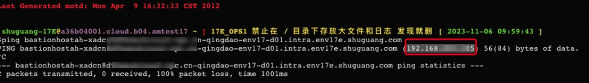

**步骤二：创建弹性公网IP**

1. 用户角色切换为**组织管理员**。

2. 在顶部菜单栏，选择**产品 > 网络 > 专有网络VPC**。

3. 在左侧导航栏，单击**弹性公网IP**。

4. 单击**创建弹性公网IP**，并按照要求填写配置项，单击**提交**。

   组织、资源集、地域与对应堡垒机一致，线路类型选**BGP**，网络类型选**公网**。

**步骤三：创建NAT网关**

1. 用户角色切换为**组织管理员**。

2. 在顶部菜单栏，选择**产品 > 网络 > 专有网络VPC**。

3. 在左侧导航栏，单击**NAT网关**。

4. 单击**创建NAT网关**，并按照要求填写配置项，单击**提交**。

   组织、资源集、地域、用户VPC都要与对应堡垒机一致。

**步骤四：NAT网关绑定弹性公网IP**

1. 在NAT网关列表，定位到**步骤三**创建的NAT网关，单击**绑定弹性公网IP**。

   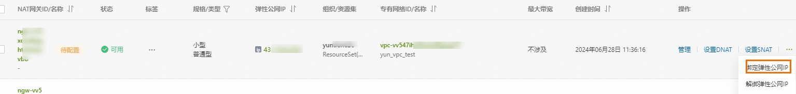

2. 在弹出的对话框，选择**步骤二**创建的弹性公网IP。

**步骤五：DNAT设置**

1. 在NAT网关列表，定位到已创建的NAT网关，单击**设置DNAT**。

   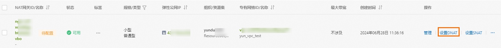

2. 在**DNAT管理**页签，单击**创建DNAT条目**。

   按要求填写参数，其中公网IP地址选择**步骤二**创建并绑定的弹性公网IP，私网地址选择堡垒机对应的<strong>vpc_vip，</strong>开放端口核协议按需填写。

3. 在已创建的DNAT条目列表，获取公网IP地址。

**步骤六：使用公网IP访问堡垒机**

使用浏览器通过**步骤五**获取的公网IP访问堡垒机。

