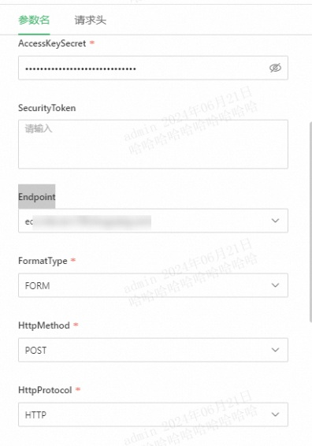

阿里云  
专有云  
云盾-安骑士高级版  
开发指南（安骑士）  
产品版本：V3.18.3  
文档版本：20241106

**目录**

- [1.准备工作](#section-1)
    - [1.1. 获取API信息及其EndPoint](#section-1-1)
    - [1.2. 获取AccessKey](#section-1-2)
    - [1.3. 获取公共Header参数](#section-1-3)
    - [1.4. 获取STS AccessKey](#section-1-4)
- [2.调用示例](#section-2)
    - [2.1. Java SDK调用示例](#section-2-1)
        - [2.1.1. 使用手册](#section-2-1-1)
            - [2.1.1.1. 安装Java SDK](#section-2-1-1-1)
            - [2.1.1.2. 使用CommonRequest进行调用](#section-2-1-1-2)
    - [2.2. Python SDK调用示例](#section-2-2)
        - [2.2.1. 使用手册](#section-2-2-1)
            - [2.2.1.1. 安装Python SDK](#section-2-2-1-1)
            - [2.2.1.2. 使用CommonRequest进行调用](#section-2-2-1-2)
    - [2.3. Go SDK调用示例](#section-2-3)
        - [2.3.1. 使用手册](#section-2-3-1)
            - [2.3.1.1. 安装Go SDK核心包](#section-2-3-1-1)
            - [2.3.1.2. 使用CommonRequest进行调用](#section-2-3-1-2)
- [3.API公共参数](#section-3)
- [4.API参考](#section-4)
    - [4.1. 调用方式](#section-4-1)
        - [4.1.1. 请求结构](#section-4-1-1)
        - [4.1.2. 签名机制](#section-4-1-2)
        - [4.1.3. 公共参数](#section-4-1-3)
        - [4.1.4. 返回结构](#section-4-1-4)
    - [4.2. 资产管理功能相关接口](#section-4-2)
        - [4.2.1. DescribeGroupSummary](#section-4-2-1)
        - [4.2.2. DescribeGroupStruct](#section-4-2-2)
        - [4.2.3. DescribeAllEntity](#section-4-2-3)
        - [4.2.4. DescribeEntityList](#section-4-2-4)
        - [4.2.5. DescribeMachines](#section-4-2-5)
        - [4.2.6. DescribeMachineDetail](#section-4-2-6)
        - [4.2.7. DescribePropertyStatistic](#section-4-2-7)
        - [4.2.8. DescribePropertyPortItem](#section-4-2-8)
        - [4.2.9. DescribePropertyPortDetail](#section-4-2-9)
        - [4.2.10. DescribePropertyProcItem](#section-4-2-10)
        - [4.2.11. DescribePropertyProcDetail](#section-4-2-11)
        - [4.2.12. DescribePropertySoftwareItem](#section-4-2-12)
        - [4.2.13. DescribePropertySoftwareDetail](#section-4-2-13)
        - [4.2.14. DescribePropertyUserItem](#section-4-2-14)
        - [4.2.15. DescribePropertyUserDetail](#section-4-2-15)
        - [4.2.16. DescribeTopRiskyAssets](#section-4-2-16)
    - [4.3. 漏洞管理功能相关接口](#section-4-3)
        - [4.3.1. DescribeTarget](#section-4-3-1)
        - [4.3.2. DescribeVulTargetStatistics](#section-4-3-2)
        - [4.3.3. DescribeTargetConfig](#section-4-3-3)
        - [4.3.4. DescribeVulConfig](#section-4-3-4)
        - [4.3.5. DescribeAutoDelConfig](#section-4-3-5)
        - [4.3.6. DescribeVulLevel](#section-4-3-6)
        - [4.3.7. DescribeVulWhitelist](#section-4-3-7)
        - [4.3.8. DescribeGroupedVul](#section-4-3-8)
        - [4.3.9. DescribeVulList](#section-4-3-9)
        - [4.3.10. DescribeVulDetails](#section-4-3-10)
        - [4.3.11. DescribeVulNumStatistics](#section-4-3-11)
        - [4.3.12. DescribeVulLevelStatistics](#section-4-3-12)
        - [4.3.13. DescribeVulMachineList](#section-4-3-13)
    - [4.4. 基线检查功能相关接口](#section-4-4)
        - [4.4.1. DescribeStratetyDetail](#section-4-4-1)
        - [4.4.2. DescribeStrategyTarget](#section-4-4-2)
        - [4.4.3. DescribeUuidConfig](#section-4-4-3)
        - [4.4.4. DescribeUserSetting](#section-4-4-4)
        - [4.4.5. DescribeRiskWhiteList](#section-4-4-5)
        - [4.4.6. DescribeStratety](#section-4-4-6)
        - [4.4.7. DescribeStrategyExecDetail](#section-4-4-7)
        - [4.4.8. DescribeRiskType](#section-4-4-8)
        - [4.4.9. Describesummary](#section-4-4-9)
    - [4.5. 异常登录检测相关接口](#section-4-5)
        - [4.5.1. DescribeBaseConfigs](#section-4-5-1)
        - [4.5.2. DescribeSwitchConfigs](#section-4-5-2)
        - [4.5.3. DescribeConfigTarget](#section-4-5-3)
        - [4.5.4. ModifyBaseConfig](#section-4-5-4)
        - [4.5.5. DeleteBaseConfig](#section-4-5-5)
        - [4.5.6. ModifySwitchConfig](#section-4-5-6)
    - [4.6. 网站后门检测相关接口](#section-4-6)
        - [4.6.1. DescribeCategoryCount](#section-4-6-1)
        - [4.6.2. DescribeWebshell](#section-4-6-2)
        - [4.6.3. DescribeQuaraFile](#section-4-6-3)
        - [4.6.4. RollbackQuaraFile](#section-4-6-4)
        - [4.6.5. DescribeWebPath](#section-4-6-5)
        - [4.6.6. ModifyWebPath](#section-4-6-6)
        - [4.6.7. OperateTrojan](#section-4-6-7)
    - [4.7. 主机异常检测相关接口](#section-4-7)
        - [4.7.1. DescribeSuspEventTypes](#section-4-7-1)
        - [4.7.2. DescribeSuspTrendStatistics](#section-4-7-2)
        - [4.7.3. DescribeSuspiciousExportInfo](#section-4-7-3)
        - [4.7.4. OperateSuspiciousEvent](#section-4-7-4)
        - [4.7.5. OperateLoginLog](#section-4-7-5)
        - [4.7.6. DescribeVirusInfo](#section-4-7-6)
        - [4.7.7. CreateSuspiciousExport](#section-4-7-7)
    - [4.8. 主机日志检索相关接口](#section-4-8)
        - [4.8.1. DescribeFilterFields](#section-4-8-1)
        - [4.8.2. DescribeHistogram](#section-4-8-2)
        - [4.8.3. DescribeLogInfo](#section-4-8-3)
        - [4.8.4. DescribeLogItems](#section-4-8-4)
        - [4.8.5. CreateLogQuery](#section-4-8-5)
        - [4.8.6. DescribeLogQuery](#section-4-8-6)
        - [4.8.7. DeleteLogQuery](#section-4-8-7)
- [5.错误代码表](#section-5)

<a id="section-1"></a>

# 1.准备工作

<a id="section-1-1"></a>

## 1.1. 获取API信息及其EndPoint

首先，您需要了解产品开放API接口的相关信息，包括产品名称（code）、开放API接口名称、API版本。

**背景信息**

Apsara Uni-manager运营控制台API目录中的API信息仅供调用参考，具体API的使用方式需要参见云产品的开发指南。如果发生不一致情况，以开发指南支持情况为准。

**操作步骤**

1. 登录Apsara Uni-manager运营控制台。

2. 在顶部菜单栏选择**产品** > **应用服务** > **开发者门户**。

3. 在**开发者门户**页面，选择**API集成** > **API调试**。

   

4. 在左侧导航栏中选择目标云产品。

5. 在**版本**下拉列表中，选择目标API版本。

6. 在下方API列表中可浏览当前版本的所有API接口。

7. 选中对应接口，在参数名下获取云产品的POP Endpoint信息。

   

<a id="section-1-2"></a>

## 1.2. 获取AccessKey

AccessKey支持RAM和STS两种授权模式，在发起调用时选择使用其中一种AccessKey即可。本文将为您介绍如何获取通过RAM授权的AccessKey。

**背景信息**

AccessKey通过使用AccessKey ID和AccessKey Secret对称加密，实现验证某个请求发送者的身份的功能。其中AccessKey ID用于标示用户，AccessKey Secret是用户用于加密签名的字符串。

AccessKey的两种授权模式如下：

- 通过RAM授权给第三方请求者的AccessKey ID和AccessKey Secret。

- 通过STS授权给第三方请求者的AccessKey ID、AccessKey Secret和Security Token。获取方式请参见获取STS AccessKey。

Apsara Uni-manager运营控制台提供了个人AccessKey和组织AccessKey（只有运营管理员和一级组织管理员可以获取组织AccessKey），推荐使用个人账号AccessKey调用Apsara Uni-manager运营控制台及云产品相关接口。如果使用个人账号AccessKey，需要在Header中添加以下限制性参数，否则可能提示权限不足：

> **警告**
>
> 个人账号AccessKey是由Apsara Uni-manager运营控制台权限体系管控的受限AccessKey，组织AccessKey相对权限较大，需要管理员确认操作的安全性。

<table>
  <tr>
    <th width="206">参数名称</th>
    <th>描述</th>
  </tr>
  <tr>
    <td>x-acs-regionid</td>
    <td>地域，如：cn-hangzhou-*。</td>
  </tr>
  <tr>
    <td>x-acs-organizationid</td>
    <td>Apsara Uni-manager运营控制台中对应的组织ID。获取方法可参见<strong>《Apsara Uni-manager运营控制台开</strong><strong>发指南》</strong>中的<strong>《GetOrganizationList》</strong>文档。</td>
  </tr>
  <tr>
    <td>x-acs-resourcegroupid</td>
    <td>Apsara Uni-manager运营控制台中对应的资源集ID。获取方法可参见<strong>《Apsara Uni-manager运营控制台</strong><strong>开发指南》</strong>中的<strong>《ListResourceGroup》</strong>文档。</td>
  </tr>
  <tr>
    <td>x-acs-instanceid</td>
    <td>进行操作的实例ID，例如，ECS的实例ID可以从ECS列表中查询到。</td>
  </tr>
</table>

**获取个人账号AccessKey**

获取个人账号AccessKey的方法如下：

1. 登录Apsara Uni-manager运营控制台。

2. 在系统界面右上角，单击当前登录用户头像，单击**个人信息**。

3. 在**阿里云AccessKey**区域，您可以查看个人账户的AccessKey信息。

   

   > **说明**
   >
   > Accesskey ID和AccessKey Secret是您访问云资源时的密钥，具有该账号完整的权限，请您妥善保管。

**获取组织AccessKey**

获取组织AccessKey的方法如下：

1. 管理员登录Apsara Uni-manager运营控制台。

2. 在顶部菜单栏，单击**企业**。

3. 在左侧导航栏中，选择**资源管理 > 组织管理**。

4. 在组织结构中，单击目标一级组织名称。

5. 单击**管理Accesskey**。

6. 在弹出的对话框中，查看组织AccessKey信息。

<a id="section-1-3"></a>

## 1.3. 获取公共Header参数

调用专有云API时需要提供多个Header参数。本文为您介绍这些参数的含义及其获取方式，并对调用后的一些返回值做出解释。

**Header参数描述**

| 名称 | 描述 |
| --- | --- |
| x-acs-regionid | 环境Region，获取方式请参见获取Region ID。 |
| x-acs-organizationid | Apsara Uni-manager运营控制台上的组织ID，获取方式请参见获取组织ID。 |
| x-acs-resourcegroupid | Apsara Uni-manager运营控制台上的资源集ID，获取方式请参见获取资源集ID。 |
| x-acs-instanceid | 进行操作的实例ID，获取方式请参见获取实例ID。 |

**获取Region ID**

1. 管理员登录Apsara Uni-manager运营控制台。

2. 在顶部菜单栏中，单击**企业**。

3. 在左侧导航栏中，选择**资源管理**>**地域管理**。

4. 单击目标组织名称。

5. 在右侧**Region列表**中查看Region ID。

**获取组织ID**

组织ID需要通过API进行获取，获取方式请参见*Apsara Uni-manager运营控制台开发指南*中的*GetOrganizationList章节*。

**获取资源集ID**

资源集ID需要通过API进行获取，获取方式请参见*Apsara Uni-manager运营控制台开发指南*中的*ListResourceGroup章节*。

**获取实例ID**

*请各云产品自行修改替换产品名及获取实例ID流程*

实例ID可以通过Apsara Uni-manager运营控制台中的云产品实例列表进行获取，本文中以ECS为例，获取步骤如下：

1. 登录Apsara Uni-manager运营控制台。

2. 在顶部的菜单栏中，选择**产品**>**弹性计算**>**云服务器ECS**。

3. 在左侧导航栏中，单击**实例**。

4. 在实例列表中查看**实例ID**。

**返回参数**

对于列表类的云产品资源实例接口，调用后会默认增加如下返回值。

| 名称 | 描述 |
| --- | --- |
| ResourceGroupName | 资源集名称。 |
| ResourceGroup | 资源集ID。 |
| DepartmentName | 组织名称。 |
| Department | 组织ID。 |

<a id="section-1-4"></a>

## 1.4. 获取STS AccessKey

本文为您介绍如何利用STS方式，调用专有云的产品API。

**背景信息**

阿里云临时安全令牌STS（Security Token Service）是阿里云提供的一种临时访问权限管理服务。您可以选择使用STS方式，调用专有云的产品API。

STS AccessKey由AccessKey ID、AccessKey Secret及Security Token三元组组成，使用STS方式调用云产品API时，三元组缺一不可。

**操作步骤**

1. 获取用户角色的 `RAM Role` 。

   <ol type="i">

   <li>

   登录Apsara Uni-manager运营控制台。

   </li>

   <li>

   单击页面右上角的用户头像，单击**个人信息**。

   </li>

   <li>

   单击**查看当前角色策略**。

   在**当前选择角色策略**对话框中查看 `RAM Role` 。

   </li>

   </ol>

2. 获取STS Accesskey三元组。

   > **说明**
   >
   > 以下代码示例中可变参数均需替换为您实际的相关信息，尖括号（<>）在最终代码中不保留。
   >
   > 涉及替换的可变参数如下：
   >
   > - &lt;yourRegionID>：请替换为您实际的地域ID。
   >
   > - &lt;yourAccessKeyID>：请替换为您实际的AccessKey ID。
   >
   > - &lt;yourAccessKeySecret>：请替换为您实际的AccessKey Secret。
   >
   > - &lt;yourRoleSessionName>：请替换为您当前实际的会话名称。
   >
   >   该名称为用户自定义，通常设置为调用该API的用户身份，例如：用户名。在同一个RAM角色执行的操作中，可以根据不同的 `RoleSessionName` 来区分实际操作者，以实现用户级别的访问审计。长度为2~64个字符，可包含英文字母、数字、半角句号（.）、at（@）、短划线（-）和下划线（_）。
   >
   > - &lt;yourRoleArn>：请替换为您实际的RAM Role。
   >
   > - "sts.aliyuns.com" ：请替换为实际的STS Endpoint。

   ```xml
   public static void main(String[] args) {
       // 创建DefaultAcsClient实例并初始化。
       // 请替换为您实际的地域ID、AccessKey ID、AccessKey Secret。
       DefaultProfile profile = DefaultProfile.getProfile("<yourRegionID>", "
   <yourAccessKeyID>", "<yourAccessKeySecret>");
       HttpClientConfig clientConfig = HttpClientConfig.getDefault();
       clientConfig.setIgnoreSSLCerts(true);
       clientConfig.setProtocolType(ProtocolType.HTTPS);
       profile.setHttpClientConfig(clientConfig);
       IAcsClient client = new DefaultAcsClient(profile);
       String assumeRole = callAssumeRole(client);
       if (StringUtils.isEmpty(assumeRole)) return;
       JSONObject assumeRoleJson = JSONObject.parseObject(assumeRole);
       JSONObject credentials = assumeRoleJson.getJSONObject("Credentials");
       // 获取到STS三元组。
       String stsAK = credentials.getString("AccessKeyId");
       String stsSK = credentials.getString("AccessKeySecret");
       String stsToken = credentials.getString("SecurityToken");
   }

   private static String callAssumeRole(IAcsClient client) {
       CommonRequest request = new CommonRequest();
       // "sts.aliyuns.com" 请替换为实际的STS Endpoint，⼀般格式为sts-
   vpc.${global:region}.${global:internet-domain}。
       request.setSysDomain("sts.aliyuns.com");
       request.setSysProduct("Sts");
       request.setSysAction("AssumeRole");
       request.setSysVersion("2015-04-01");
       request.setSysMethod(MethodType.POST);
       request.setHttpContentType(FormatType.FORM);
       // 业务参数，设置本次调⽤Session的别名，"<yourRoleSessionName>"请您替换为实际值。
       request.putQueryParameter("RoleSessionName", "<yourRoleSessionName>");
       // 扮演的Role⾓⾊ARN，"<yourRoleArn>"请替换为上⼀步获取到的实际Ram Role ARN。
       request.putQueryParameter("RoleArn", "<yourRoleArn>");
       try {
           CommonResponse response = client.getCommonResponse(request);
           return response.getData();
       } catch (ServerException e) {
           System.out.println(e.getErrCode());
           System.out.println(e.getErrMsg());
       } catch (ClientException e) {
           System.out.println(e.getErrCode());
           System.out.println(e.getErrMsg());
       }
       return null;
   }
   ```

3. 通过STS AccessKey三元组调用云产品的接口，下列代码以ECS的 `DescribeZones` 接口为示例。

   > **说明**
   >
   > 以下代码示例中可变参数均需替换为您实际的相关信息，尖括号（<>）在最终代码中不保留。
   >
   > 涉及替换的可变参数如下：
   >
   > - &lt;yourRegionID>：请替换为您实际的地域ID。
   >
   > - &lt;yourStsAccesskeyID>：请替换为您实际的STS Accesskey ID。
   >
   > - &lt;yourStsAccessKeySecret>：请替换为您实际的STS Accesskey Secret。
   >
   > - &lt;yourStsToken>：请替换为实际STS三元组中的SecurityToken。
   >
   > - &lt;yourResourceGroupID>：请替换为您实际的资源集ID。
   >
   > - &lt;yourOrganizationID>：请替换为您实际的组织ID。

   ```xml
   public static void main(String[] args) {
       // "<yourRegionID>"请替换为您实际的地域ID。
       // "<yourStsAccessKeyID>"、"<yourStsAccessKeySecret>"请替换为前⼀步获取到的STS三元组中
   AccessKeyID、AccessKeySecret。
       DefaultProfile profile = DefaultProfile.getProfile("<yourRegionID>", "
   <yourStsAccesskey>", "<yourStsAccessSecret>");
       HttpClientConfig clientConfig = HttpClientConfig.getDefault();
       clientConfig.setIgnoreSSLCerts(true);
       clientConfig.setProtocolType(ProtocolType.HTTPS);
       profile.setHttpClientConfig(clientConfig);
       IAcsClient client = new DefaultAcsClient(profile);
       CommonRequest request = new CommonRequest();
       request.setSysDomain("ecs.aliyuns.com");
       request.setSysProduct("Ecs");
       request.setSysAction("DescribeZones");
       request.setSysVersion("2014-05-26");
       request.setSysMethod(MethodType.POST);
       request.setHttpContentType(FormatType.FORM);
       //"<yourRegionID>" 请替换为您实际的地域ID。
       request.putHeadParameter("x-acs-regionid", "<yourRegionID>");
       // "<yourStsToken>" 请替换为您前⼀步获取到的STS三元组中SecurityToken。
       request.putQueryParameter("SecurityToken", "<yourStsToken>");
       // 非必填，请替换为您实际的资源集ID。
       // request.putHeadParameter("x-acs-resourcegroupid", "<yourResourceGroupID>");
       // 非必填，请替换为您实际的组织ID。
       request.putHeadParameter("x-acs-organizationid", "<yourOrganizationID>");
       try {
           CommonResponse response = client.getCommonResponse(request);
           System.out.println(response.getData());
       } catch (ServerException e) {
           System.out.println(e.getErrCode());
           System.out.println(e.getErrMsg());
       } catch (ClientException e) {
           System.out.println(e.getErrCode());
           System.out.println(e.getErrMsg());
       }
   }
   ```

<a id="section-2"></a>

# 2.调用示例

<a id="section-2-1"></a>

## 2.1. Java SDK调用示例

<a id="section-2-1-1"></a>

### 2.1.1. 使用手册

<a id="section-2-1-1-1"></a>

#### 2.1.1.1. 安装Java SDK

本文介绍如何安装及调用云盾Java SDK。

阿里云专有云Java SDK支持1.8及以上版本的JDK，可以通过添加Maven依赖或下载阿里云开发工具包（SDK）的方式安装专有云Java SDK。

要使用云盾的开发工具包，必须安装阿里云Java SDK核心库。SDK核心库推荐使用4.5.17及以上版本。

您在安装阿里云Java SDK核心库时，需要在pom.xml文件中添加以下依赖。关于准确的SDK版本号，请参见阿里云开发工具包（SDK）。

```xml
<!-- Alibaba Cloud SDK for Java -->
<dependency>
    <groupId>com.aliyun</groupId>
    <artifactId>aliyun-java-sdk-core</artifactId>
    <version>4.5.17</version>
</dependency>
```

<a id="section-2-1-1-2"></a>

#### 2.1.1.2. 使用CommonRequest进行调用

通过POP Java SDK访问产品域名，需要了解该产品调用方式(RPC或ROA)。

**前提条件**

目前专有云推荐使用CommonRequest进行调用，可以在Apsara Uni-manager运营控制台**产品** > **开发工具** > **API与工具** > **开发者门户**，选择**API集成** > **SDK示例**查看推荐SDK版本以及示例代码。

> **重要**
>
> 不建议直接从SDK中心下载SDK到专有云场景下使用，公有云的SDK不一定支持专有云的API，可能存在兼容性问题，请谨慎使用！

**CommonRequest调用示例**

RPC调用，示例接口信息：产品（apigateway）、接口（DescribeApiGroups）、版本（2016-07-14）。

调用示例如下：

```xml
import com.aliyuncs.CommonRequest;
import com.aliyuncs.CommonResponse;
import com.aliyuncs.DefaultAcsClient;
import com.aliyuncs.IAcsClient;
import com.aliyuncs.exceptions.ClientException;
import com.aliyuncs.exceptions.ServerException;
import com.aliyuncs.http.MethodType;
import com.aliyuncs.profile.DefaultProfile;

public class DescribeApiGroups {

    public static void main(String[] args) {
        // 创建DefaultAcsClient实例并初始化。
        DefaultProfile profile = DefaultProfile.getProfile("<your-regionid>", "
<yourAccessKeyId>", "<yourAccessSecret>");

        // 忽略SSL
        // HttpClientConfig clientConfig = HttpClientConfig.getDefault();
        // clientConfig.setIgnoreSSLCerts(true);
        // 设置连接超时
        // clientConfig.setConnectionTimeoutMillis(3000L);
        // 设置读取超时
        // clientConfig.setReadTimeoutMillis(10000L);
        // profile.setHttpClientConfig(clientConfig);
        
        IAcsClient client = new DefaultAcsClient(profile);
        // 创建API请求并设置参数。
        CommonRequest request = new CommonRequest();
        // 设置请求⽅式
        request.setSysMethod(MethodType.POST);
        // 设置云产品Endpoint
        request.setSysDomain("<apigatewayEndpoint>");
        // 设置访问接⼝版本
        request.setSysVersion("2016-07-14");
        // 设置LocationProduct
        request.setSysLocationProduct("apigateway");
        // 设置访问接⼝的名称
        request.setSysAction("DescribeApiGroups");
        
        // 当使⽤sts ak调⽤RPC接⼝时需要在参数中加上SecurityToken字段
        // request.putBodyParameter("SecurityToken", "<your-SecurityToken>");

        // 业务参数
        request.putQueryParameter("PageSize", "10");
        request.putQueryParameter("PageNumber", "1");

        // 必填值，调⽤来源说明
        request.putHeadParameter("x-acs-caller-sdk-source", "ApiTestDemo");
        // 非必填，企业版V3.15.0之前历史版本需要
        request.putHeadParameter("x-acs-regionid", "<your-regionid>");
        // 非必填，资源集ID
        request.putHeadParameter("x-acs-resourcegroupid", "<your-resourcegroupid>");
        // 必填, 组织ID
        request.putHeadParameter("x-acs-organizationid", "<your-organizationid>");
        // 非必填，修改&删除操作需要
        // request.putHeadParameter("x-acs-instanceid", "<your-instanceid>");

        try {
            // 发起请求并处理应答或异常。
            CommonResponse response = client.getCommonResponse(request);
            System.out.println(response.getData());
        } catch (ServerException e) {
            e.printStackTrace();
        } catch (ClientException e) {
            System.out.println("ErrCode:" + e.getErrCode());
            System.out.println("ErrMsg:" + e.getErrMsg());
            System.out.println("RequestId:" + e.getRequestId());
        }

    }
}
```

ROA调用，示例接口信息：产品（CR）接口（GetNamespaceList）版本（2016-06-07）。

调用示例如下：

```xml
import com.aliyuncs.CommonRequest;
import com.aliyuncs.CommonResponse;
import com.aliyuncs.DefaultAcsClient;
import com.aliyuncs.IAcsClient;
import com.aliyuncs.exceptions.ClientException;
import com.aliyuncs.exceptions.ServerException;
import com.aliyuncs.http.MethodType;
import com.aliyuncs.profile.DefaultProfile;

public class GetNamespaceList {

    public static void main(String[] args) {
        // 创建DefaultAcsClient实例并初始化。
        DefaultProfile profile = DefaultProfile.getProfile("<your-regionid>", "
<yourAccessKeyId>", "<yourAccessSecret>");

        // 忽略SSL
        // HttpClientConfig clientConfig = HttpClientConfig.getDefault();
        // clientConfig.setIgnoreSSLCerts(true);
        // 设置连接超时
        // clientConfig.setConnectionTimeoutMillis(3000L);
        // 设置读取超时
        // clientConfig.setReadTimeoutMillis(10000L);
        // profile.setHttpClientConfig(clientConfig);
        
        IAcsClient client = new DefaultAcsClient(profile);
        // 创建API请求并设置参数。
        CommonRequest request = new CommonRequest();

        // 设置HTTPS访问
        request.setSysProtocol(ProtocolType.HTTP);
        // 设置请求⽅式
        request.setSysMethod(MethodType.GET);
        // 设置云产品endpoint
        request.setSysDomain("<crEndpoint>");
        // 设置访问接⼝版本
        request.setSysVersion("2016-06-07");
        // 设置uriPattern 只有roa调⽤需要传递此字段
        request.setSysUriPattern("/namespace");
        // 设置LocationProduct
        request.setSysLocationProduct(cr);
        // 设置访问接⼝的名称
        request.setSysAction("GetNamespaceList");

        // 必填值，调⽤来源说明
        request.putHeadParameter("x-acs-caller-sdk-source", "ApiTestDemo");
        // 非必填，企业版V3.15.0之前历史版本需要
        request.putHeadParameter("x-acs-regionid", "<your-regionid>");
        // 非必填,资源集ID
        request.putHeadParameter("x-acs-resourcegroupid", "<your-resourcegroupid>");
        // 必填,组织ID
        request.putHeadParameter("x-acs-organizationid", "<your-organizationid>");
        // 非必填，修改&删除操作需要
        // request.putHeadParameter("x-acs-instanceid", "<your-instanceid>");


        // 当使⽤STS AK调⽤ROA接⼝时需要在Header加上x-acs-security-token字段
        // request.putHeadParameter("x-acs-security-token", "<your-securitytoken>");

        try {
            // 发起请求并处理应答或异常。
            CommonResponse response = client.getCommonResponse(request);
            System.out.println(response.getData());
        } catch (ServerException e) {
            e.printStackTrace();
        } catch (ClientException e) {
            System.out.println("ErrCode:" + e.getErrCode());
            System.out.println("ErrMsg:" + e.getErrMsg());
            System.out.println("RequestId:" + e.getRequestId());
        }

    }
}
```

> **重要**
>
> 使用HTTPS协议访问OpenAPI时，SDK会默认开启校验SSL/TLS 证书有效性，若您代码环境没有证书环境，则会报错证书校验失败。
>
> 为保障生产环境通信安全，建议您保持开启，若在测试环境必须忽略证书校验，可以通过以下参数设置：
>
> Java
>
> ```text
> HttpClientConfig clientConfig = HttpClientConfig.getDefault();
> // 设置不校验服务端证书
> clientConfig.setIgnoreSSLCerts(true)
> ```

<a id="section-2-2"></a>

## 2.2. Python SDK调用示例

<a id="section-2-2-1"></a>

### 2.2.1. 使用手册

<a id="section-2-2-1-1"></a>

#### 2.2.1.1. 安装Python SDK

本文档介绍如何安装及调用Python SDK。

阿里云专有云Python SDK支持Python 2.6.x、2.7.x和3.x及以上环境，您可以通过pip安装专有云Python SDK。

> 使用产品的开发工具包，都必须安装阿里云Python SDK核心库。
>
> **说明**

- 如果您使用的是Python 2.x，执行以下命令，安装阿里云SDK核心库：

  ```bash
  pip install aliyun-python-sdk-core
  ```

- 如果您使用的是Python 3.x，执行以下命令，安装阿里云SDK核心库：

  ```bash
  pip3 install aliyun-python-sdk-core-v3
  ```

<a id="section-2-2-1-2"></a>

#### 2.2.1.2. 使用CommonRequest进行调用

本文为您介绍POP Python SDK调用云产品API的方式。

**前提条件**

目前专有云推荐使用CommonRequest进行调用，可以在Apsara Uni-manager运营控制台**产品** > **开发工具** > **API与工具** > **开发者门户**，选择**API集成** > **SDK示例**查看推荐SDK版本以及示例代码。

> **重要**
>
> 不建议直接从SDK中心下载SDK到专有云场景下使用，公有云的SDK不一定支持专有云的API，可能存在兼容性问题，请谨慎使用！

**背景信息**

目前仅支持通过RPC方式调用API。

**CommonRequest调用示例**

调用示例接口信息：产品（ECS）、接口（DescribeInstances）、版本（2014-05-26）。

示例代码如下：

```python
from aliyunsdkcore.client import AcsClient
import os
from aliyunsdkcore.request import CommonRequest

# 创建AcsClient实例
client = AcsClient(
    "<AccessKey ID>",
    "<AccessKey Secret>",
    "<your-RegionID>",
    timeout=1000,  # 设置超时时间
    verify=False, # 忽略证书或者verify='<证书位置>'
);
# 和https⼀起使⽤
# client.set_verify(False)
# os.environ["HTTPS_PROXY"] = "http://127.0.0.1:8080"

# os.environ["HTTP_PROXY"] = "http://127.0.0.1:8080"
def describe_api_groups():
    # 创建request，并设置参数
    request = CommonRequest()

    # 当使⽤sts ak调⽤rpc接⼝时需要在参数中加上SecurityToken字段
    # params = {"PageSize":"10","PageNumber":"1","SecurityToken":"<your-
SecurityToken>"};
    params = {"PageSize":"10","PageNumber":"1"};
    request.set_query_params(params)

    headers = {
        # 必填值，调⽤来源说明
        "x-acs-caller-sdk-source":"ApiTestDemo",
        # 非必填，企业版V3.15.0之前历史版本需要
        "x-acs-regionid":"<your-RegionID>",
        # 非必填，资源集ID
        "x-acs-resourcegroupid":"<your-ResourceGroupID>",
        # 必填，组织ID
        "x-acs-organizationid":"<your-OrganizationID>"
        # 非必填，修改&删除操作需要
        # "x-acs-instanceid":"<your-InstanceID>"

    }
    request.set_headers(headers)
    request.set_version("2016-07-14")
    request.set_action_name("DescribeApiGroups")
    request.set_endpoint("<ApigatewayEndpoint>")   //Endpoint请替换为真实地址
    request.set_product("apigateway")
    request.set_method("POST")

    # 发起API请求并显示返回值
    response = client.do_action_with_exception(request)
    print(response)


if __name__ == '__main__':
    print("Hello Aliyun OpenApi!")
    describe_api_groups()
```

**设置代理**

调用API时您或许需要通过环境变量设置HTTP_PROXY、HTTPS_PROXY。

示例代码如下：

```text
# https的代理 
os.environ["HTTPS_PROXY"] = "http://x.x.x.x:xxxx"

# http的代理
os.environ["HTTP_PROXY"] = "https://x.x.x.x:xxxx"
```

**HTTPS配置**

下面介绍使用HTTPS协议进行OpenAPI访问。

**使用HTTPS协议**

SDK默认使用HTTPS协议。

```python
from aliyunsdkecs.request.v20140526.DescribeInstancesRequest import 
DescribeInstancesRequest
from aliyunsdkcore.client import AcsClient
client = AcsClient(
    region_id='<region_id>',  # 地域ID
)

request = DescribeInstancesRequest()
request.set_protocol_type('https')  # 使⽤https

client.do_action_with_exception(request)   
```

**忽略证书**

> **重要**
>
> - 使用HTTPS协议访问OpenAPI时，SDK会默认开启校验SSL/TLS证书有效性，若您代码环境没有证书环境，则会报错证书校验失败。
>
> - 为保障生产环境通信安全，建议您保持开启，若在测试环境必须忽略证书校验，可以通过参数 `verify` 设置。

```python
from aliyunsdkcore.client import AcsClient
client = AcsClient(
    region_id='<region_id>',  # 地域ID
    verify=False  # 忽略对 SSL 证书的验证
)
```

**指定CA证书文件**

```python
from aliyunsdkcore.client import AcsClient
client = AcsClient(
    region_id='<region_id>',  # 地域ID
    verify='./cacert.pem'  # 证书路径
)
```

<a id="section-2-3"></a>

## 2.3. Go SDK调用示例

<a id="section-2-3-1"></a>

### 2.3.1. 使用手册

<a id="section-2-3-1-1"></a>

#### 2.3.1.1. 安装Go SDK核心包

本文档介绍如何安装 Go SDK核心包。

阿里云Go SDK支持Go 1.10.x及以上版本，您可以通过执行以下命令安装Go SDK核心包。

```text
go get -u github.com/aliyun/alibaba-cloud-sdk-go/sdk
```

<a id="section-2-3-1-2"></a>

#### 2.3.1.2. 使用CommonRequest进行调用

本文为您介绍POP Go SDK调用的方式。

**前提条件**

目前专有云推荐使用CommonRequest进行调用，可以在Apsara Uni-manager运营控制台**产品** > **开发工具** > **API与工具** > **开发者门户**，选择**API集成** > **SDK示例**查看推荐SDK版本以及示例代码。

> **重要**
>
> 不建议直接从SDK中心下载SDK到专有云场景下使用，公有云的SDK不一定支持专有云的API，可能存在兼容性问题，请谨慎使用！

**背景信息**

当前支持RPC和ROA的方式调用API。

**CommonRequest调用示例**

RPC方式调用示例接口信息：产品（apigateway）、接口（DescribeApiGroups）、版本（2016-07-14）。

示例代码如下：

```go
package main

import (
    "fmt"
    "github.com/aliyun/alibaba-cloud-sdk-go/sdk"
    "github.com/aliyun/alibaba-cloud-sdk-go/sdk/requests"
  
)

func main() {
    client, err := sdk.NewClientWithAccessKey("<your-RegionID>", "<AccessKey ID>", "<AccessKey Secret>")

    request := requests.NewCommonRequest()
    
    request.Method = "POST"
    request.Domain = "<ApigatewayEndpoint>"
    request.Version = "2016-07-14"
    request.ApiName = "DescribeApiGroups"
    request.Product = "apigateway"
    // 当使⽤sts ak调⽤rpc接⼝时需要在参数中加上SecurityToken字段
    // request.QueryParams["SecurityToken"]="<your-SecurityToken>"

    // 必填值，调⽤来源说明
    request.Headers["x-acs-caller-sdk-source"] = "ApiTestDemo"
    // 非必填，企业版V3.15.0之前历史版本需要
    request.Headers["x-acs-regionid"] = "<your-RegionID>"
    // 非必填，资源集ID
    request.Headers["x-acs-resourcegroupid"] = "<your-ResourceGroupID>"
    // 必填，组织ID
    request.Headers["x-acs-organizationid"] = "<your-OrganizationID>"
    // 非必填，修改&删除操作需要
    // request.Headers["x-acs-instanceid"] = "<your-InstanceID>"

    response, err := client.ProcessCommonRequest(request)
    if err != nil {
        panic(err)
    }
    fmt.Print(response.GetHttpContentString())
}
```

ROA调用示例接口信息：产品（CR）接口（GetNamespaceList）版本（2016-06-07）。

调用示例如下：

```xml
package main

import (
 "fmt"
 "github.com/aliyun/alibaba-cloud-sdk-go/sdk"
 "github.com/aliyun/alibaba-cloud-sdk-go/sdk/requests"
 "os"
)


func main() {
    client, err := sdk.NewClientWithAccessKey("<your-regionid>", "<yourAccessKeyId>", "
<yourAccessSecret>")
 request := requests.NewCommonRequest()

 request.Method = "GET"
 request.Domain = "<crEndpoint>"
 request.Version = "2016-06-07"
 request.ApiName = "GetNamespaceList"
 request.Product = "cr"

 request.PathPattern = "/namespace"
 // 当使⽤sts ak调⽤ROA接⼝时需要在header中加上x-acs-security-token字段
 // request.Headers["x-acs-security-token"] = "<your-SecurityToken>"
 // 必填值，调⽤来源说明
 request.Headers["x-acs-caller-sdk-source"] = "ApiTestDemo"
    // 非必填，企业版V3.15.0之前历史版本需要
    request.Headers["x-acs-regionid"] = "<your-RegionID>"
    // 非必填，资源集ID
    request.Headers["x-acs-resourcegroupid"] = "<your-ResourceGroupID>"
    // 必填，组织ID
    request.Headers["x-acs-organizationid"] = "<your-OrganizationID>"
 // 非必填，修改&删除操作需要
 // request.Headers["x-acs-instanceid"] = "<your-InstanceID>"

 response, err := client.ProcessCommonRequest(request)
 if err != nil {
  panic(err)
 }
 fmt.Print(response.GetHttpContentString())
}
```

**设置代理**

当您在调用实例时，或许会需要设置代理，您可以通过以下两种方式设置代理。

- 通过环境变量设置。

  环境变量HTTP_PROXY、HTTPS_PROXY或者NO_PROXY。

  设置代码如下：

  ```go
  import (
      "os"
  )
  func main(){
   os.Setenv("HTTP_PROXY", "http://x.x.x.x:xxxx") // 设置 HTTP_PROXY 环境变量
   os.Setenv("HTTPS_PROXY", "https://x.x.x.x:xxxx") // 设置 HTTPS_PROXY 环境变量
  }
  ```

- 通过客户端设置。

  设置代码如下：

  ```text
  // 客户端设置代理优先级比环境变量⾼
  client.SetHttpProxy("http://x.x.x.x:xxxx")   // 设置http代理
  client.GetHttpProxy()                          // 获取http代理

  client.SetHttpsProxy("https://x.x.x.x:xxxx")   // 设置https代理
  client.GetHttpsProxy()                           // 获取https代理

  client.SetNoProxy("127.0.0.1,localhost")     // 设置代理⽩名单
  client.GetNoProxy()                          // 获取代理⽩名单
  ```

**SSL验证**

**摘要**

请求时验证SSL证书行为。

- 设置成 `true` ，禁用证书验证（这是不安全的，请设置证书！）。

- 设置成 `false` ，启用SSL证书验证，默认使用操作系统提供的CA证书。

**默认值**

默认值为 `false` 。

**设置**

> **重要**
>
> 使用HTTPS协议访问OpenAPI时，SDK会默认开启校验SSL证书有效性，若您代码环境没有证书环境，则会报错证书校验失败。为保障生产环境通信安全，建议您保持开启，若在测试环境必须忽略证书校验，可参考如下内容进行设置。

```text
// 设置请求 HTTPSInsecure（只影响当前）
request.SetHTTPSInsecure(true)                           // 设置请求 HTTPSInsecure 为 true
isInsecure := request.GetHTTPSInsecure()                 // 获取请求 HTTPSInsecure
```

当请求未设置时，客户端设置才能生效。

```text
// 设置客户端 HTTPSInsecure（⽤于客户端发送的所有请求）。
client.SetHTTPSInsecure(true)                         // 设置客户端 HTTPSInsecure 为 trueisInsecure := client.GetHTTPSInsecure()               // 获取客户端 HTTPSInsecure
```

<a id="section-3"></a>

# 3.API公共参数

**公共请求参数**

公共请求参数是每个接口调用都需要提供的请求参数。

表 1. 公共请求参数表

| 名称 | 类型 | 是否必须 | 描述 |
| --- | --- | --- | --- |
| Format | Strin g | 否 | 返回值的类型，仅支持JSON。 |
| Version | Strin g | 是 | API版本号，以日期形式YYYY-MM-DD输入，取值：<br>• <strong>2018-01-16</strong>：Auditprivate。<br>• <strong>2019-07-23</strong>：yundunnextsoc。<br>• <strong>2018-12-03：</strong>Sas。<br>• <strong>2016-11-11：</strong>aegis。<br>• <strong>2021-10-11：</strong>yundun-css。<br>• <strong>2019-08-05：</strong>secspy。<br>• <strong>2018-01-16：</strong>Ddosprivate。<br>• <strong>2018-06-30：</strong>hsm-private。<br>• <strong>2017-12-07：</strong>Cloudfw。<br>• <strong>2019-01-03：</strong>Sddp。<br>• <strong>2020-07-01：</strong>semawaf。<br>• <strong>2018-12-03：</strong>soar。 |
| AccessKeyId | Strin g | 是 | 访问服务使用的密钥ID。 |
| AccessKeySe cret | Strin g | 是 | 访问服务使用的密钥值。 |
| RegionId | Strin g | 是 | 服务所使用的地域ID。 |

<table>
  <tr>
    <td>Product</td>
    <td>Strin g</td>
    <td>是</td>
    <td>接口对应的产品名称。取值：<br>• <strong>Auditprivate</strong>：云盾基础组件。<br>• <strong>yundunnextsoc</strong>：云安全管理中心（SOC）。<br>• <strong>Sas</strong>：态势感知。<br>• <strong>aegis</strong>：安骑士。<br>• <strong>yundun-css</strong>：容器防护。<br>• <strong>secspy</strong>：网络流量检测与响应。<br>• <strong>Ddosprivate</strong>：DDos 清洗。<br>• <strong>hsm-private</strong>：加密服务。<br>• <strong>Cloudfw</strong>：云防火墙。<br>• <strong>Sddp</strong>：敏感数据保护。<br>• <strong>semawaf</strong>：Web应用防火墙。<br>• <strong>soar</strong>：云安全管理中心（SOC）-编排响应。</td>
  </tr>
  <tr>
    <td>EndpointPre</td>
    <td>Strin g</td>
    <td>是</td>
    <td>接口对应的域名前缀。取值：<br>• <strong>auditprivate</strong>：云盾基础组件。<br>• <strong>yundunnextsoc-pop</strong>：云安全管理中心（SOC）。<br>• <strong>tds</strong>：态势感知。<br>• <strong>aegis</strong>：安骑士。<br>• <strong>yundun-css</strong>：容器防护。<br>• <strong>secspy-share</strong>：网络流量检测与响应。<br>• <strong>ddosprivate</strong>：DDos 清洗。<br>• <strong>hsmprivate</strong>：加密服务。<br>• <strong>cloudfw</strong>：云防火墙。<br>• <strong>sddp-api</strong>：敏感数据保护。<br>• <strong>semawaf</strong>：Web应用防火墙。<br>• <strong>soar</strong>：云安全管理中心（SOC）-编排响应。</td>
  </tr>
</table>

**公共返回参数**

API返回结果采用统一格式，通过返回HTTP状态码来表示状态：

- 返回2xx HTTP状态码代表调用成功。

- 返回4xx或5xx HTTP状态码代表调用失败。

调用成功返回的数据格式为JSON，每次接口调用，无论成功与否，系统都会返回一个唯一识别码RequestId。

<a id="section-4"></a>

# 4.API参考

<a id="section-4-1"></a>

## 4.1. 调用方式

<a id="section-4-1-1"></a>

### 4.1.1. 请求结构

云盾的API是RPC风格，该章节介绍API请求格式。

**请求结构说明**

您可以通过发送HTTP请求的方式调用API，具体请求结构如下：

```text
http://endpoint/?Action=xx&parameters
```

其中：

- `endpoint` ，表示调用的云服务接入点，安骑士功能的接入点是 `aegis.[RegionId].example.com` 。

- `Action` ，表示要执行的操作，即接口名。

  例如，使用DescribeFeatures获取当前已经部署的云盾功能模块列表。

- `parameters` ，表示请求参数，包括公共参数和API自定义参数，每个参数之间使用 & 分隔。

  - 公共参数：包含API版本号、身份验证等信息。

  - API自定义参数：包含接口自定义的请求参数，具体参考各接口说明。

**举例说明**

调用DescribeFeatures获取当前已部署的云盾功能模块列表。

```text
https://yundunprivate.[RegionId].example.com/?Action=DescribeFeatures&AccessKeyId=key-test&Format=JSON&SecureTransport=true&SignatureMethod=HMAC-
SHA1&SignatureNonce=15215528852396&SignatureVersion=1.0&SourceIp=1xxxx6&Timestamp=2018-03-02Txxxxxxx&Version=2018-01-16&Signature=xxxx%xxxx%3D
```

为了方便阅读，在文档中以如下格式展示API请求。

```text
https://yundunprivate.[RegionId].example.com/?Action=DescribeFeatures
&Format=JSON
&Version=2018-01-16
&Signature=xxxx%xxxx%3D
&SignatureMethod=HMAC-SHA1
&SignatureNonce=15215528852396
&SignatureVersion=1.0
&AccessKeyId=key-test
&Timestamp=2012-06-01T12:00:00Z
```

<a id="section-4-1-2"></a>

### 4.1.2. 签名机制

云盾服务会对每个访问的请求进行身份验证，所以无论使用HTTP还是HTTPS协议提交请求，都需要在请求中包含签名（Signature）信息。

**API签名**

为保证API的安全调用，在调用API时阿里云会对每个API请求通过签名（Signature）进行身份验证。当您手动发起API请求时，需要按照RFC 2104的定义，使用AccessSecret对编码、排序后的整个请求串计算HMAC值作为签名。

本章节以如下原始访问参数为例，说明API签名制作的流程：

| 参数 | 内容 |
| --- | --- |
| 接入点 | <code>http://yundunprivate.[RegionId].example.com/?</code> |
| API自定义参数 | <code>Action=DescribeFeatures</code> |
| 公共参数（不包含<strong>Signature</strong>） | <code>&amp;Timestamp=2016-02-23T12:46:24Z</code><br><code>&amp;Format=JSON</code><br><code>&amp;AccessKeyId=&lt;yourAccessKeyId&gt;</code><br><code>&amp;SignatureMethod=HMAC-SHA1</code><br><code>&amp;SignatureNonce=3ee8c1b8-83d3-44af-a94f-4e0ad82fd6cf</code><br><code>&amp;Version=2018-01-16</code><br><code>&amp;SignatureVersion=1.0</code> |
| Access Key Secret | <code>&lt;yourAccessKeySecret&gt;</code> |

1. 使用请求参数构造规范化的请求字符串（Canonicalized Query String）。

   > **说明**
   >
   > 请求参数由公共请求参数（不包括Signature参数自身）和接口自定义参数。

   <ol type="i">

   <li>

   参数排序。

   按照参数名称的字典顺序对请求参数进行排序。

   </li>

   <li>

   参数编码。

   对排序之后请求参数的名称和值分别用UTF-8字符集进行URL编码。编码的规则如下：

   - 对于字符 A-Z、a-z、0-9 以及字符“-”、“_”、“.”、“~”不编码。

   - 对于其他字符编码成“%XY”的格式，其中 XY 是字符对应 ASCII 码的 16 进制表示。比如英文的双引号（”）对应的编码就是 %22。

   - 对于扩展的 UTF-8 字符，编码成“%XY%ZA…”的格式。

   - 需要说明的是英文空格（ ）要被编码是 %20，而不是加号（+）。

   </li>

   <li>

   将编码后的参数名称和值用英文等号（=）进行连接。

   </li>

   <li>

   将等号连接得到的参数组合按步骤(a)排好的顺序依次使用&符号连接，即得到规范化请求字符串。

   </li>

   </ol>

2. 将上一步构造的规范化字符串按照下面的规则构造成待签名的字符串。

   ```text
   StringToSign=HTTPMethod + “&” + percentEncode(“/”) + ”&” +
   percentEncode(CanonicalizedQueryString)
   ```

3. 按照RFC 2104的定义，计算待签名字符串 StringToSign 的 HMAC 值。

   > **说明**
   >
   > 计算签名时使用的 Key 就是用户持有的 Access Key Secret 并加上一个 & 字符(ASCII:38)，使用的哈希算法是 SHA1。

4. 按照 Base64 编码规则把上面的 HMAC 值编码成字符串，即得到签名值（Signature）。

   ```text
   LEW8N4y7Uasop******
   ```

5. 将得到的签名值作为 Signature 参数添加到请求参数中，即完成对请求签名的过程。

<a id="section-4-1-3"></a>

### 4.1.3. 公共参数

公共参数是指每个API接口都需要使用到的请求参数，包含API版本号、身份验证等信息。

| 名称 | 类型 | 是否必须 | 描述 |
| --- | --- | --- | --- |
| Version | String | 是 | API版本号，为日期形式：YYYY-MM-DD。取值：2016-11-11 |
| AccessKeyId | String | 是 | 阿里云颁发给用户的访问服务所用的密钥ID。 |
| Signature | String | 是 | 签名结果串。 |
| SignatureMethod | String | 是 | 签名方式。取值：HMAC-SHA1 |
| Timestamp | String | 是 | 请求的时间戳。日期格式按照ISO8601标准表示，并需要使用UTC时间。<br>格式为：<code> YYYY-MM-DDThh:mm:ssZ </code><br>例如，2014-05-26T12:00:00Z（为北京时间 2014年5月26日20点0分0秒）。 |
| SignatureVersion | String | 是 | 签名算法版本。取值：1.0 |
| SignatureNonce | String | 是 | 唯一随机数，用于防止网络重放攻击。用户在不同请求间要使用不同的随机数值。 |
| ResourceOwnerA ccount | String | 否 | 本次API请求访问到的资源拥有者账户，即登录用户名。 |
| Format | String | 否 | 返回响应的格式。取值：JSON \| XML<br>默认值为XML。说明 |

<a id="section-4-1-4"></a>

### 4.1.4. 返回结构

云盾API返回结构支持XML和JSON两种格式。用户发送的每次接口调用请求，无论成功与否，系统都会返回一个唯一识别码**RequestId**。

**XML返回结构示例**

```xml
<?xml version="1.0" encoding="UTF-8"?>
<!--结果的根结点-->
<接⼝名称+Response>
    <!--返回请求标签-->
    <RequestId>4C467B38-3910-447D-87BC-AC049166F216</RequestId>
    <!--返回结果数据-->
</接⼝名称+Response>
```

**JSON返回结构示例**

```json
{
"RequestId": "4C467B38-3910-447D-87BC-AC049166F216",
/* 返回结果数据 */
}
```

<a id="section-4-2"></a>

## 4.2. 资产管理功能相关接口

<a id="section-4-2-1"></a>

### 4.2.1. DescribeGroupSummary

获取分组的列表。

**请求参数**

| 名称 | 类型 | 是否必选 | 示例值 | 描述 |
| --- | --- | --- | --- | --- |
| Action | String | 是 | DescribeGroupS ummary | 系统规定参数。取值：<strong>DescribeGroupSummary</strong>。 |
| SourceIp | String | 否 | 192.168.0.1 | 访问者源IP。 |

**返回数据**

| 名称 | 类型 | 示例值 | 描述 |
| --- | --- | --- | --- |
| Count | Integer | 10 | 分组个数。 |
| Groups | Array of Group |  | 分组的详情。 |
| GroupFather | Integer | 1 | 父节点ID。 |
| GroupFlag | Integer | 1 | 分组类型。<br>• <strong>1</strong>：非叶子节点。<br>• <strong>0</strong>：叶子节点。 |
| GroupId | Long | 1 | 分组ID。 |
| GroupIndex | Integer | 1 | 分组顺序。 |
| GroupLevel | Integer | 1 | 分组的层级。 |
| GroupName | String | 测试分组 | 分组名称。 |
| MachineNum | Integer | 1 | 机器的台数。 |
| RequestId | String | 485ABE58-4E27-4416-997C-F8F3B8748EB6 | 本次调用请求的ID。 |

**示例**

请求示例

```text
http(s)://[Endpoint]/?Action=DescribeGroupSummary
&<公共请求参数>
```

正常返回示例

`XML` 格式

```xml
<RequestId>485ABE58-4E27-4416-997C-F8F3B8748EB6</RequestId>
<Groups>
    <GroupName>测试分组</GroupName>
    <MachineNum>1</MachineNum>
    <GroupLevel>1</GroupLevel>
    <GroupIndex>1</GroupIndex>
    <GroupFather>1</GroupFather>
    <GroupFlag>1</GroupFlag>
    <GroupId>1</GroupId>
</Groups>
<Count>10</Count>
```

`JSON` 格式

```json
{
    "RequestId": "485ABE58-4E27-4416-997C-F8F3B8748EB6",
    "Groups": {
        "GroupName": "测试分组",
        "MachineNum": 1,
        "GroupLevel": 1,
        "GroupIndex": 1,
        "GroupFather": 1,
        "GroupFlag": 1,
        "GroupId": 1
    },
    "Count": 10
}
```

<a id="section-4-2-2"></a>

### 4.2.2. DescribeGroupStruct

获取分组结构。

**请求参数**

| 名称 | 类型 | 是否必选 | 示例值 | 描述 |
| --- | --- | --- | --- | --- |
| Action | String | 是 | DescribeGroupS truct | 取值：<strong>DescribeGroupStruct</strong>。 |
| SourceIp | String | 否 | 47.100.XX.XX | 访问源IP。 |
| Lang | String | 否 | zh | 请求和接收消息的语言类型。<br>• <strong>zh</strong>：中文。<br>• <strong>en</strong>：英文。 |
| remark | String | 否 | 47.100.XX.XX | 服务器IP或者实例名称。 |
| tagIdList | String | 否 | 1\*\*\*,2\*\*\* | 标签ID列表。多个标签ID之间需要用英文逗号分隔。 |

**返回数据**

| 名称 | 类型 | 示例值 | 描述 |
| --- | --- | --- | --- |
| GroupFather | Integer | 1 | 父节点ID。 |
| GroupFlag | Integer | 1 | 分组类型。<br>• <strong>1</strong>：非叶子节点。<br>• <strong>0</strong>：叶子节点。 |
| GroupId | Long | 1 | 分组ID。 |
| GroupIndex | Integer | 1 | 分组顺序。 |
| GroupLevel | Integer | 4 | 分组的层级。 |
| GroupName | String | 测试分组 | 分组名称。 |
| Groups | List | \[\] | 自分组。 |
| MachineNum | Integer | 1 | 机器的台数。 |
| RequestId | String | 485ABE58-4E27-4416-997C-F8F3B8748EB6 | 本次调用请求的ID。 |

**示例**

请求示例

```text
http(s)://[Endpoint]/?Action=DescribeGroupStruct
&<公共请求参数>
```

正常返回示例

`XML` 格式

```xml
<GroupName>测试分组</GroupName>
<MachineNum>1</MachineNum>
<RequestId>485ABE58-4E27-4416-997C-F8F3B8748EB6</RequestId>
<GroupLevel>4</GroupLevel>
<Groups>[]</Groups>
<GroupIndex>1</GroupIndex>
<GroupFather>1</GroupFather>
<GroupFlag>1</GroupFlag>
<GroupId>1</GroupId>
```

`JSON` 格式

```json
{
    "GroupName": "测试分组",
    "MachineNum": 1,
    "RequestId": "485ABE58-4E27-4416-997C-F8F3B8748EB6",
    "GroupLevel": 4,
    "Groups": "[]",
    "GroupIndex": 1,
    "GroupFather": 1,
    "GroupFlag": 1,
    "GroupId": 1
}
```

<a id="section-4-2-3"></a>

### 4.2.3. DescribeAllEntity

不分页获取所有的实例列表。

**请求参数**

| 名称 | 类型 | 是否必选 | 示例值 | 描述 |
| --- | --- | --- | --- | --- |
| Action | String | 是 | DescribeAllEntit y | 取值：<strong>DescribeAllEntity</strong>。 |
| SourceIp | String | 否 | 47.100.XX.XX | 访问者源IP。 |
| Os | String | 否 | win | 操作系统的类型。<br>• <strong>win</strong>：Windows。<br>• <strong>linux</strong>：Linux。 |
| GroupId | Long | 否 | 1 | 服务器所在的分组ID。 |

**返回数据**

| 名称 | 类型 | 示例值 | 描述 |
| --- | --- | --- | --- |
| Count | Integer | 15 | 当前页的数据条数。 |
| EntityList | Array of Entity |  | 实例列表信息。 |
| GroupId | Integer | 1 | 服务器所在的分组<strong>ID</strong>。 |
| InstanceName | String | test\*\*\* | 实例名称。 |
| Ip | String | 47.100.XX.XX | 展示的服务器的IP，先看服务器是否有公网IP，没有公网IP展示私网IP。 |
| Uuid | String | cadda\*\*\*\*\*\* | 服务器唯一标识。 |
| RequestId | String | dacd\*\*\*\*\*\*\*\* | 本次调用请求的ID。 |

**示例**

请求示例

```text
http(s)://[Endpoint]/?Action=DescribeAllEntity
&<公共请求参数>
```

正常返回示例

`XML` 格式

```xml
<RequestId>dacd********</RequestId>
<EntityList>
    <InstanceName>test***</InstanceName>
    <Uuid>cadda******</Uuid>
    <Ip>47.100.XX.XX</Ip>
    <GroupId>1</GroupId>
</EntityList>
<Count>15</Count>
```

`JSON` 格式

```json
{
    "RequestId": "dacd********",
    "EntityList": {
        "InstanceName": "test***",
        "Uuid": "cadda******",
        "Ip": "47.100.XX.XX",
        "GroupId": 1
    },
    "Count": 15
}
```

<a id="section-4-2-4"></a>

### 4.2.4. DescribeEntityList

获取实例列表，支持按照安全事件等分页查询。

**请求参数**

| 名称 | 类型 | 是否必选 | 示例值 | 描述 |
| --- | --- | --- | --- | --- |
| Action | String | 是 | DescribeEntityLi st | 取值：<strong>DescribeEntityList</strong>。 |
| SourceIp | String | 否 | 47.100.XX.XX | 访问者源IP。 |
| From | String | 否 | aqs | 产品。固定值：<strong>aqs</strong>。 |
| PageSize | Integer | 否 | 20 | 每页最多显示的数据条数。 |
| CurrentPage | Integer | 否 | 1 | 当前页的页码。 |
| Remark | String | 否 | 47.100.XX.XX | 服务器IP或者实例名称。 |
| GroupId | Long | 否 | 1 | 服务器所在的分组ID。 |
| TagIdList | String | 否 | 1,\*,\* | 标签的ID列表。多个ID之间需要用英文逗号分隔。 |
| Os | String | 否 | windows | 操作系统类型。<br>• <strong>windows</strong>：Windows。<br>• <strong>linux</strong>：Linux。 |
| RegionNo | String | 否 | cn-beijing-\*\*\*\* | 地域编号。 |
| Status | String | 否 | offline | 按agent状态筛选服务器列表。<br>• <strong>offline</strong>：离线列表。<br>• <strong>pause</strong>：暂停保护列表。 |
| Patch | String | 否 | 无 | 已废弃。 |
| Health | String | 否 | 无 | 已废弃。 |
| Account | String | 否 | 无 | 已废弃。 |
| Trojan | String | 否 | 无 | 已废弃。 |
| Suspicious | String | 否 | 无 | 已废弃。 |

**返回数据**

| 名称 | 类型 | 示例值 | 描述 |
| --- | --- | --- | --- |
| CurrentPage | Integer | 1 | 当前页的页码。 |
| EntityList | Array of Entity |  | 实例列表。 |
| AegisOnline | Boolean | true | 是否在线。<br>• <strong>true</strong>：是。<br>• <strong>false</strong>：否。 |
| AegisVersion | String | aegis_10_\*\* | 安骑士版本。 |
| BuyVersion | String | 4 | 购买版本。 |
| ClientStatus | Boolean | false | 是否处于安全保护中（暂停保护功能）。<br>• <strong>true</strong>：是。<br>• <strong>false</strong>：否。 |
| Flag | Integer | 1 | 已废弃。 |
| GroupId | Long | 1 | 分组ID。 |
| InstanceName | String | test_\*\*\* | 实例名称。 |
| Ip | String | 47.100.XX.XX | IP地址。<br>说明先取公网IP，没有公网IP再取私网IP地址。 |
| Os | String | linux | 操作系统类型。<br>• <strong>windows</strong>：Windows。<br>• <strong>linux</strong>：Linux。 |
| Region | String | cn-beijing-\*\*\* | 地区信息。 |
| Uuid | String | 00f2-xxx-xxx | 机器唯一标识。 |
| PageSize | Integer | 20 | 每页最多显示的数据条数。 |
| RequestId | String | unhgff-\*\*\*\* | 本次调用请求的ID。 |
| TotalCount | Integer | 20 | 总数据条数。 |

**示例**

请求示例

```text
http(s)://[Endpoint]/?Action=DescribeEntityList
&<公共请求参数>
```

正常返回示例

`XML` 格式

```xml
<TotalCount>20</TotalCount>
<PageSize>20</PageSize>
<RequestId>unhgff-****</RequestId>
<CurrentPage>1</CurrentPage>
<EntityList>
    <InstanceName>test_***</InstanceName>
    <ClientStatus>false</ClientStatus>
    <Uuid>00f2-xxx-xxx</Uuid>
    <BuyVersion>4</BuyVersion>
    <AegisVersion>aegis_10_**</AegisVersion>
    <Os>linux</Os>
    <Ip>47.100.XX.XX</Ip>
    <Region>cn-beijing-***</Region>
    <AegisOnline>true</AegisOnline>
    <Flag>1</Flag>
    <GroupId>1</GroupId>
</EntityList>
```

`JSON` 格式

```json
{
    "TotalCount": 20,
    "PageSize": 20,
    "RequestId": "unhgff-****",
    "CurrentPage": 1,
    "EntityList": {
        "InstanceName": "test_***",
        "ClientStatus": false,
        "Uuid": "00f2-xxx-xxx",
        "BuyVersion": 4,
        "AegisVersion": "aegis_10_**",
        "Os": "linux",
        "Ip": "47.100.XX.XX",
        "Region": "cn-beijing-***",
        "AegisOnline": true,
        "Flag": 1,
        "GroupId": 1
    }
}
```

<a id="section-4-2-5"></a>

### 4.2.5. DescribeMachines

获取机器列表。

**请求参数**

| 名称 | 类型 | 是否必选 | 示例值 | 描述 |
| --- | --- | --- | --- | --- |
| Action | String | 是 | DescribeMachin es | 取值：<strong>DescribeMachines</strong>。 |
| SourceIp | String | 否 | 47.200.XX.XX | 访问者源IP。 |
| Remark | String | 否 | test1 | 服务器实例的IP或者名称。 |
| TagIdList | String | 否 | \["1","2"\] | 标签列表，多个标签之间需要用英文逗号分隔。 |
| GroupId | Long | 否 | 123 | 分组ID。 |

**返回数据**

| 名称 | 类型 | 示例值 | 描述 |
| --- | --- | --- | --- |
| Count | Integer | 10 | 总数。 |
| Machines | Array of Machine |  | 机器列表。 |
| GroupId | Long | 1 | 分组ID。 |
| InstanceName | String | i-adf234s\*\*\* | 实例名称。 |
| Ip | String | 10.1.x.x | IP地址。优先展示公网IP，若不存在公网IP，则显示私网IP。 |
| Os | String | linux | 操作系统的类型。<br>• <strong>win</strong>：Windows。<br>• <strong>linux</strong>：Linux。 |
| Uuid | String | 6dbdbfe7-06fa-4d9a-8268-xxx | 机器唯一标识。 |
| RequestId | String | 485ABE58-\*\*\*\*\*\*\* | 本次调用请求的ID。 |

**示例**

请求示例

```text
http(s)://[Endpoint]/?Action=DescribeMachines
&<公共请求参数>
```

正常返回示例

`XML` 格式

```xml
<RequestId>485ABE58-*******</RequestId>
<Count>10</Count>
<Machines>
    <InstanceName>i-adf234s***</InstanceName>
    <Uuid>6dbdbfe7-06fa-4d9a-8268-xxx</Uuid>
    <Os>linux</Os>
    <Ip>10.1.x.x</Ip>
    <GroupId>1</GroupId>
</Machines>
```

`JSON` 格式

```json
{
    "RequestId": "485ABE58-*******",
    "Count": 10,
    "Machines": {
        "InstanceName": "i-adf234s***",
        "Uuid": "6dbdbfe7-06fa-4d9a-8268-xxx",
        "Os": "linux",
        "Ip": "10.1.x.x",
        "GroupId": 1
    }
}
```

<a id="section-4-2-6"></a>

### 4.2.6. DescribeMachineDetail

获取服务器的信息。

**请求参数**

| 名称 | 类型 | 是否必选 | 示例值 | 描述 |
| --- | --- | --- | --- | --- |
| Action | String | 是 | DescribeMachin eDetail | 取值：<strong>DescribeMachineDetail</strong>。 |
| SourceIp | String | 否 | 1.1.XX.XX | 访问者源IP。 |
| Uuid | String | 否 | 6dbdbfe7-06fa-4d9a-8268-xxx | 服务器的唯一标识。 |

**返回数据**

| 名称 | 类型 | 示例值 | 描述 |
| --- | --- | --- | --- |
| MachineDetail | Struct |  | 机器详情。 |
| AegisOnline | Boolean | true | 是否在线。<br>• <strong>true</strong>：在线。<br>• <strong>false</strong>：不在线。 |
| AegisVersion | String | 10-73 | 安骑士版本。 |
| BuyVersion | String | 无 | 已废弃。 |
| ClientStatus | Boolean | true | 客户端状态。<br>• <strong>true</strong>：保护中。<br>• <strong>false</strong>：暂停保护 。 |
| Flag | Integer | 1 | 主机标识。<br>• <strong>0</strong>：阿里云 。<br>• <strong>1</strong>：非阿里云。 |
| GroupId | Long | 1 | 分组ID。 |
| GroupTrace | String | 分组1-分组2 | 分组路径。 |
| InstanceId | String | i-aaabcc22xxx | 实例ID。 |
| InstanceName | String | test\*\*\* | 实例名称。 |
| IntranetIp | String | 192.168.XX.XX | 私网IP。 |
| Ip | String | 47.200.XX.XX | IP地址。优先展示公网IP，若公网IP不存在，则显示私网IP。 |
| Os | String | linux | 操作系统的类型。<br>• <strong>win</strong>：Windows。<br>• <strong>linux</strong>：Linux。 |
| Region | String | cn-hangzhou-xxx | 地域名称。 |
| Tag | String | aaxxx | 标签名称。 |
| Uuid | String | 6dbdbfe7-06fa-4d9a-8268-xxxx | 服务器标识。 |
| RequestId | String | 485ABE58-4E27-xxx | 本次调用请求的ID。 |

**示例**

请求示例

```text
http(s)://[Endpoint]/?Action=DescribeMachineDetail
&<公共请求参数>
```

正常返回示例

`XML` 格式

```xml
<RequestId>485ABE58-4E27-xxx</RequestId>
<MachineDetail>
    <GroupTrace>分组1-分组2</GroupTrace>
    <ClientStatus>true</ClientStatus>
    <AegisVersion>10-73</AegisVersion>
    <BuyVersion>无</BuyVersion>
    <Os>linux</Os>
    <InstanceId>i-aaabcc22xxx</InstanceId>
    <Ip>47.200.XX.XX</Ip>
    <AegisOnline>true</AegisOnline>
    <Flag>1</Flag>
    <IntranetIp>192.168.XX.XX</IntranetIp>
    <GroupId>1</GroupId>
    <InstanceName>test***</InstanceName>
    <Uuid>6dbdbfe7-06fa-4d9a-8268-xxxx</Uuid>
    <Region>cn-hangzhou-xxx</Region>
    <Tag>aaxxx</Tag>
</MachineDetail>
```

`JSON` 格式

```json
{
    "RequestId": "485ABE58-4E27-xxx",
    "MachineDetail": {
        "GroupTrace": "分组1-分组2",
        "ClientStatus": true,
        "AegisVersion": "10-73",
        "BuyVersion": "无",
        "Os": "linux",
        "InstanceId": "i-aaabcc22xxx",
        "Ip": "47.200.XX.XX",
        "AegisOnline": true,
        "Flag": 1,
        "IntranetIp": "192.168.XX.XX",
        "GroupId": 1,
        "InstanceName": "test***",
        "Uuid": "6dbdbfe7-06fa-4d9a-8268-xxxx",
        "Region": "cn-hangzhou-xxx",
        "Tag": "aaxxx"
    }
}
```

<a id="section-4-2-7"></a>

### 4.2.7. DescribePropertyStatistic

获取资产信息统计。

**请求参数**

| 名称 | 类型 | 是否必选 | 示例值 | 描述 |
| --- | --- | --- | --- | --- |
| Action | String | 是 | DescribePropert yStatistic | 系统规定参数。取值：<strong>DescribePropertyStatistic</strong>。 |
| SourceIp | String | 否 | 47.100.XX.XX | 访问者源IP。 |
| Uuids | String | 否 | uuid1,uuid2 | UUID。多个UUID之间需要用英文逗号分隔。 |

**返回数据**

| 名称 | 类型 | 示例值 | 描述 |
| --- | --- | --- | --- |
| PropertyStatist ics | Array of PropertyStatist ic |  | 总计信息列表。 |
| PortCount | String | 2 | 端口总数。 |
| PortGetDate | String | 3 | 已废弃。 |
| ProcCount | String | 4 | 进程总数。 |
| ProcGetDate | String | 5 | 已废弃。 |
| RootUserCoun t | String | 6 | ROOT权限账号总数。 |
| UserCount | String | 7 | 账号总数。 |
| UserGetDate | String | 8 | 已废弃。 |
| Uuid | String | 9 | 服务器UUID。 |
| RequestId | String | C1CACE7E-E868-4E44-A52E-4CB1463B62BB | 本次调用请求的ID。 |

**示例**

请求示例

```text
http(s)://[Endpoint]/?Action=DescribePropertyStatistic
&<公共请求参数>
```

正常返回示例

`XML` 格式

```xml
<PropertyStatistics>
    <UserGetDate>1514373155000</UserGetDate>
    <Uuid>inet-00f20b1a-e2dd-408b-b38e-6a6e1ed5d818</Uuid>
    <RootUserCount>1</RootUserCount>
    <UserCount>33</UserCount>
    <ProcCount>89</ProcCount>
    <PortGetDate>1514115614000</PortGetDate>
    <PortCount>6</PortCount>
    <ProcGetDate>1514373133000</ProcGetDate>
</PropertyStatistics>
<PropertyStatistics>
    <UserGetDate>1514373139000</UserGetDate>
    <Uuid>inet-f6ac9a93-0818-4052-90e2-d24f18ee198b</Uuid>
    <RootUserCount>1</RootUserCount>
    <UserCount>33</UserCount>
    <ProcCount>34</ProcCount>
    <PortGetDate>1514373168000</PortGetDate>
    <PortCount>1</PortCount>
    <ProcGetDate>1514373131000</ProcGetDate>
</PropertyStatistics>
<RequestId>C1CACE7E-E868-4E44-A52E-4CB1463B62BB</RequestId>
```

`JSON` 格式

```json
{
 "PropertyStatistics":[
  {
   "UserGetDate":1514373155000,
   "Uuid":"inet-00f20b1a-e2dd-408b-b38e-6a6e1ed5d818",
   "RootUserCount":1,
   "UserCount":33,
   "ProcCount":89,
   "PortGetDate":1514115614000,
   "PortCount":6,
   "ProcGetDate":1514373133000
  },
  {
   "UserGetDate":1514373139000,
   "Uuid":"inet-f6ac9a93-0818-4052-90e2-d24f18ee198b",
   "RootUserCount":1,
   "UserCount":33,
   "ProcCount":34,
   "PortGetDate":1514373168000,
   "PortCount":1,
   "ProcGetDate":1514373131000
  }
 ],
 "RequestId":"C1CACE7E-E868-4E44-A52E-4CB1463B62BB"
}
```

<a id="section-4-2-8"></a>

### 4.2.8. DescribePropertyPortItem

调用DescribePropertyPortItem接口获取所有端口信息。

**请求参数**

| 名称 | 类型 | 是否必选 | 示例值 | 描述 |
| --- | --- | --- | --- | --- |
| Action | String | 是 | DescribePropert yPortItem | 系统规定参数。取值：<strong>DescribePropertyPortItem</strong>。 |
| SourceIp | String | 否 | 47.100.XX.XX | 访问者源IP。 |
| Port | String | 否 | 22 | 端口号。 |
| ProcName | String | 否 | sshd | 进程名。 |
| CurrentPage | Integer | 否 | 1 | 当前页的页码。 |
| PageSize | Integer | 否 | 20 | 每页最多显示的数据条数。 |

**返回数据**

| 名称 | 类型 | 示例值 | 描述 |
| --- | --- | --- | --- |
| Count | Integer | 2 | 分页查询时，显示的当前页的数据条数。 |
| CurrentPage | Integer | 1 | 当前页的页码。 |
| PageSize | Integer | 20 | 每页最多显示的数据条数。 |
| PropertyPortIt ems | Array of PropertyPortIt em |  | 端口信息列表。 |
| Count | Integer | 2 | 开放该端口的云服务器数量。 |
| Port | String | 22 | 端口号。 |
| Proto | String | tcp | 网络协议 。 |
| RequestId | String | cd756ccc-5040-4a4d-9c55-a34be56e7af4 | 本次调用请求的ID。 |
| TotalCount | Integer | 2 | 端口总数。 |

**示例**

请求示例

```text
http(s)://[Endpoint]/?Action=DescribePropertyPortItem
&<公共请求参数>
```

正常返回示例

`XML` 格式

```xml
<TotalCount>2</TotalCount>
<PageSize>20</PageSize>
<RequestId>cd756ccc-5040-4a4d-9c55-a34be56e7af4</RequestId>
<CurrentPage>1</CurrentPage>
<PropertyPortItems>
    <Proto>tcp</Proto>
    <Port>22</Port>
    <Count>2</Count>
</PropertyPortItems>
<Count>2</Count>
```

`JSON` 格式

```json
{
    "TotalCount": 2,
    "PageSize": 20,
    "RequestId": "cd756ccc-5040-4a4d-9c55-a34be56e7af4",
    "CurrentPage": 1,
    "PropertyPortItems": {
        "Proto": "tcp",
        "Port": 22,
        "Count": 2
    },
    "Count": 2
}
```

<a id="section-4-2-9"></a>

### 4.2.9. DescribePropertyPortDetail

调用DescribePropertyPortDetail接口查询端口列表中一个端口的详细信息。

**请求参数**

| 名称 | 类型 | 是否必选 | 示例值 | 描述 |
| --- | --- | --- | --- | --- |
| Action | String | 是 | DescribePropert yPortDetail | 取值：<strong>DescribePropertyPortDetail</strong>。 |
| SourceIp | String | 否 | 47.100.XX.XX | 访问者源IP。 |
| TagIdListString | String | 否 | 1,2 | 标签信息。多个标签信息之间需要用英文逗号分隔。 |
| GroupId | String | 否 | 1 | 分组ID。 |
| Remark | String | 否 | 47.100.XX.XX | 服务器名称或IP。 |
| Ip | String | 否 | 47.100.XX.XX | 机器IP。 |
| Port | String | 否 | 22 | 端口号。 |
| ProcName | String | 否 | sshd | 进程名。 |
| Extend | String | 否 | 20 | 根据Port字段搜索是否使用模糊 。<br>• <strong>1</strong>：使用。<br>• <strong>0</strong>：不使用。 |
| Uuid | String | 否 | 46ef7c05-0c53-486c-b446-ef6ff9725xxx | 服务器UUID。 |
| CurrentPage | Integer | 否 | 1 | 当前页的页码。 |
| PageSize | Integer | 否 | 20 | 每页最多显示的数据条数。 |

**返回数据**

| 名称 | 类型 | 示例值 | 描述 |
| --- | --- | --- | --- |
| Count | Integer | 2 | 分页查询时，显示的当前页的数据条数。 |
| CurrentPage | Integer | 1 | 当前页的页码。 |
| PageSize | Integer | 20 | 每页最多显示的数据条数。 |
| PropertyPorts | Array of PropertyPort |  | 详情列表。 |
| BindIp | String | 47.100.XX.XX | 端口绑定的IP地址信息。 |
| Create | String | 1514373168000 | 数据的最新采集时间。 |
| InstanceName | String | test\*\*\* | 端口关联资产的名称。 |
| Ip | String | 47.100.XX.XX | 服务器IP。 |
| Port | String | 22 | 端口号。 |
| ProcName | String | sshd | 端口对应的进程名称。 |
| Proto | String | tcp | 端口对应网络协议。 |
| Uuid | String | 46ef7c05-0c53-486c-b446-ef6ff972551c | 端口关联的资产实例的唯一标识ID。 |
| RequestId | String | D85484BB-4DC2-44EC-AD67-0B3765EC9213 | 本次调用请求的ID。 |
| TotalCount | Integer | 199 | 数据的总条数。 |

**示例**

请求示例

```text
http(s)://[Endpoint]/?Action=DescribePropertyPortDetail
&<公共请求参数>
```

正常返回示例

`XML` 格式

```xml
<TotalCount>199</TotalCount>
<PageSize>20</PageSize>
<RequestId>D85484BB-4DC2-44EC-AD67-0B3765EC9213</RequestId>
<CurrentPage>1</CurrentPage>
<PropertyPorts>
    <InstanceName>test***</InstanceName>
    <Uuid>46ef7c05-0c53-486c-b446-ef6ff972551c</Uuid>
    <Proto>tcp</Proto>
    <Create>1514373168000</Create>
    <ProcName>sshd</ProcName>
    <Ip>47.100.XX.XX</Ip>
    <Port>22</Port>
    <BindIp>47.100.XX.XX</BindIp>
</PropertyPorts>
<Count>2</Count>
```

`JSON` 格式

```json
{
    "TotalCount": 199,
    "PageSize": 20,
    "RequestId": "D85484BB-4DC2-44EC-AD67-0B3765EC9213",
    "CurrentPage": 1,
    "PropertyPorts": {
        "InstanceName": "test***",
        "Uuid": "46ef7c05-0c53-486c-b446-ef6ff972551c",
        "Proto": "tcp",
        "Create": 1514373168000,
        "ProcName": "sshd",
        "Ip": "47.100.XX.XX",
        "Port": 22,
        "BindIp": "47.100.XX.XX"
    },
    "Count": 2
}
```

<a id="section-4-2-10"></a>

### 4.2.10. DescribePropertyProcItem

调用DescribePropertyProcItem接口获取所有进程信息。

**请求参数**

| 名称 | 类型 | 是否必选 | 示例值 | 描述 |
| --- | --- | --- | --- | --- |
| Action | String | 是 | DescribePropert yProcItem | 系统规定参数。取值：<strong>DescribePropertyProcItem</strong>。 |
| SourceIp | String | 否 | 47.100.XX.XX | 访问者源IP。 |
| Name | String | 否 | sshd | 进程名称。 |
| User | String | 否 | root | 启动进程的用户名。 |
| CurrentPage | Integer | 否 | 1 | 当前页的页码。 |
| PageSize | Integer | 否 | 20 | 每页最多显示的数据条数。 |

**返回数据**

| 名称 | 类型 | 示例值 | 描述 |
| --- | --- | --- | --- |
| Count | Integer | 3 | 显示的当前页的数据条数。 |
| CurrentPage | Integer | 1 | 当前页的页码。 |
| PageSize | Integer | 20 | 每页最多显示的数据条数。 |
| PropertyProcIt ems | Array of PropertyProcIt em |  | 进程的信息。 |
| Count | Integer | 2 | 进程名对应的服务器数量。 |
| Name | String | sshd | 进程名称。 |
| RequestId | String | 8BE95FB1-66B7-4509-AF82-3AA67368A5D8 | 本次调用请求的ID。 |
| TotalCount | Integer | 2 | 数据的总条数。 |

**示例**

请求示例

```text
http(s)://[Endpoint]/?Action=DescribePropertyProcItem
&<公共请求参数>
```

正常返回示例 `XML` 格式

```xml
<TotalCount>1</TotalCount>
<PropertyProcItems>
    <Count>2</Count>
    <Name>init</Name>
</PropertyProcItems>
<PageSize>20</PageSize>
<RequestId>8BE95FB1-66B7-4509-AF82-3AA67368A5D8</RequestId>
<CurrentPage>1</CurrentPage>
<Count>1</Count>
```

`JSON` 格式

```json
{
 "TotalCount":1,
 "PropertyProcItems":[
  {
   "Count":2,
   "Name":"init"
  }
 ],
 "PageSize":20,
 "RequestId":"8BE95FB1-66B7-4509-AF82-3AA67368A5D8",
 "CurrentPage":1,
 "Count":1
}
```

<a id="section-4-2-11"></a>

### 4.2.11. DescribePropertyProcDetail

获取账户下服务器进程详情。

**请求参数**

| 名称 | 类型 | 是否必选 | 示例值 | 描述 |
| --- | --- | --- | --- | --- |
| Action | String | 是 | DescribePropert yProcDetail | 系统规定参数。取值：<strong>DescribePropertyProcDetail</strong>。 |
| SourceIp | String | 否 | 47.100.XX.XX | 访问者源IP。 |
| TagIdListString | String | 否 | 1,2 | 标签筛选信息。 |
| GroupId | String | 否 | 1 | 分组ID。 |
| Remark | String | 否 | 47.100.XX.XX | 服务器名称或IP。 |
| Ip | String | 否 | 47.100.XX.XX | 服务器IP。 |
| Name | String | 否 | udevd | 进程名。 |
| User | String | 否 | root | 进程的运行用户信息。 |
| Cmdline | String | 否 | /sbin/udevd -d | 进程参数。 |
| Extend | String | 否 | 1 | Name是否使用模糊搜索。<br>• <strong>1 </strong>：是。<br>• <strong>0 </strong>：否。 |
| Uuid | String | 否 | inet-00f20b1a-e2dd-408b-b38e-xxx | 服务器UUID。 |
| CurrentPage | Integer | 否 | 1 | 当前页的页码。 |
| PageSize | Integer | 否 | 20 | 每页最多显示的数据条数。 |

**返回数据**

| 名称 | 类型 | 示例值 | 描述 |
| --- | --- | --- | --- |
| Count | Integer | 12 | 分页查询时，显示的当前页的数据条数。 |
| CurrentPage | Integer | 1 | 当前页的页码。 |
| PageSize | Integer | 20 | 每页最多显示的数据条数。 |
| PropertyProcs | Array of PropertyProc |  | 进程详情信息。 |
| Cmdline | String | /sbin/udevd -d | 进程对应启动参数。 |
| Create | String | 1514373133000 | 数据的最新采集时间戳。单位：毫秒。 |
| EuidName | String | root | 进程对应的运行权限。 |
| InstanceName | String | test\*\*\* | 进程关联的资产名称。 |
| Md5 | String | 529b18a987bdbafc 91d523286bc0ac5 6 | 进程对应的文件MD5信息。 |
| Name | String | udevd | 进程名称。 |
| Path | String | /sbin/udevd | 进程所在路径。 |
| Pid | String | 12 | 运行进程的身份标识。 |
| Pname | String | init | 进程所属父进程名称。 |
| StartTime | String | 2017-12-26 22:35:00 | 进程启动时间。格式：yyyy-MM-dd HH:mm:ss。 |
| User | String | root | 进程的运行用户。 |
| Uuid | String | inet-00f20b1a-e2dd-408b-b38e-xxxx | 进程关联资产实例的唯一标识ID。 |
| RequestId | String | df5eafee-6add-4cef-bbb0-c1b388e5ae77 | 本次调用请求的ID。 |
| TotalCount | Integer | 12 | 数据的总条数。 |

**示例**

请求示例

```text
http(s)://[Endpoint]/?Action=DescribePropertyProcDetail
&<公共请求参数>
```

正常返回示例

`XML` 格式

```xml
<PropertyProcs>
    <Path>/sbin/udevd</Path>
    <InstanceName>test***</InstanceName>
    <Pname>init</Pname>
    <Uuid>inet-00f20b1a-e2dd-408b-b38e-xxxx</Uuid>
    <User>root</User>
    <Create>1514373133000</Create>
    <StartTime>2017-12-26 22:35:00</StartTime>
    <Pid>12</Pid>
    <Cmdline>/sbin/udevd -d</Cmdline>
    <EuidName>root</EuidName>
    <Md5>529b18a987bdbafc91d523286bc0ac56</Md5>
    <Name>udevd</Name>
</PropertyProcs>
<TotalCount>12</TotalCount>
<PageSize>20</PageSize>
<RequestId>df5eafee-6add-4cef-bbb0-c1b388e5ae77</RequestId>
<CurrentPage>1</CurrentPage>
<Count>12</Count>
```

`JSON` 格式

```json
{
    "PropertyProcs": {
        "Path": "/sbin/udevd",
        "InstanceName": "test***",
        "Pname": "init",
        "Uuid": "inet-00f20b1a-e2dd-408b-b38e-xxxx",
        "User": "root",
        "Create": 1514373133000,
        "StartTime": "2017-12-26 22:35:00",
        "Pid": 12,
        "Cmdline": "/sbin/udevd -d",
        "EuidName": "root",
        "Md5": "529b18a987bdbafc91d523286bc0ac56",
        "Name": "udevd"
    },
    "TotalCount": 12,
    "PageSize": 20,
    "RequestId": "df5eafee-6add-4cef-bbb0-c1b388e5ae77",
    "CurrentPage": 1,
    "Count": 12
}
```

<a id="section-4-2-12"></a>

### 4.2.12. DescribePropertySoftwareItem

获取账户下服务器软件安装列表。

**请求参数**

| 名称 | 类型 | 是否必选 | 示例值 | 描述 |
| --- | --- | --- | --- | --- |
| Action | String | 是 | DescribePropert ySoftwareItem | 系统规定参数。取值：<strong>DescribePropertySoftwareIte</strong> <strong>m</strong>。 |
| SourceIp | String | 否 | 192.1.x.x | 访问者源IP。 |
| Name | String | 否 | test | 软件名。 |
| Path | String | 否 | /etc/test | 软件路径。 |
| SoftwareVersion | String | 否 | 11 | 软件版本。 |
| CurrentPage | Integer | 否 | 1 | 当前页的页码。 |
| PageSize | Integer | 否 | 20 | 每页最多显示的数据条数。 |

**返回数据**

| 名称 | 类型 | 示例值 | 描述 |
| --- | --- | --- | --- |
| Count | Integer | 2 | 当前页面软件信息计数。 |
| CurrentPage | Integer | 1 | 当前页的页码。 |
| PageSize | Integer | 20 | 每页最多显示的数据条数。 |
| PropertySoftw areItems | Array of PropertySoftw areItem |  | 软件信息列表。 |
| Count | Integer | 1 | 软件安装服务器数。 |
| Name | String | aaa_basxx | 软件名。 |
| RequestId | String | 9C5AE850-7140-4DE6-B892-055EB0D9F28A | 本次调用请求的ID。 |
| TotalCount | Integer | 30 | 数据总条数。 |

**示例**

请求示例

```text
http(s)://[Endpoint]/?Action=DescribePropertySoftwareItem
&<公共请求参数>
```

正常返回示例

`XML` 格式

```xml
<TotalCount>30</TotalCount>
<PageSize>20</PageSize>
<RequestId>9C5AE850-7140-4DE6-B892-055EB0D9F28A </RequestId>
<PropertySoftwareItems>
    <Count>1</Count>
    <Name>aaa_basxx</Name>
</PropertySoftwareItems>
<CurrentPage>1</CurrentPage>
<Count>2</Count>
```

`JSON` 格式

```json
{
    "TotalCount": 30,
    "PageSize": 20,
    "RequestId": "9C5AE850-7140-4DE6-B892-055EB0D9F28A",
    "PropertySoftwareItems": {
        "Count": 1,
        "Name": "aaa_basxx"
    },
    "CurrentPage": 1,
    "Count": 2
}
```

<a id="section-4-2-13"></a>

### 4.2.13. DescribePropertySoftwareDetail

获取软件资产详情。

**请求参数**

| 名称 | 类型 | 是否必选 | 示例值 | 描述 |
| --- | --- | --- | --- | --- |
| Action | String | 是 | DescribePropert ySoftwareDetail | 系统规定参数。取值：<strong>DescribePropertySoftwareDe</strong> <strong>tail</strong>。 |
| SourceIp | String | 否 | 47.100.XX.XX | 访问者源IP。 |
| Remark | String | 否 | 47.100.XX.XX | 服务器名称或IP。 |
| Ip | String | 否 | 47.100.XX.XX | 服务器IP。 |
| GroupId | String | 否 | 1 | 分组ID。 |
| Name | String | 否 | sshd | 软件名。 |
| Path | String | 否 | /usr/xxx | 软件安装路径。 |
| SoftwareVersion | String | 否 | 1.1.x.x | 软件版本。 |
| Extend | String | 否 | 1 | 软件名字段<strong>Name</strong>是否采用模糊搜索。<br>• <strong>1</strong>：是 。<br>• <strong>0</strong>：不是。 |
| Uuid | String | 否 | inet-f6ac9a93-xxx | 服务器UUID。 |
| CurrentPage | Integer | 否 | 1 | 分页查询时，当前页的页码。 |
| PageSize | Integer | 否 | 20 | 每页最多显示的数据条数。 |

**返回数据**

| 名称 | 类型 | 示例值 | 描述 |
| --- | --- | --- | --- |
| Count | Integer | 2 | 当前页数据的条数。 |
| CurrentPage | Integer | 1 | 当前页的页码。 |
| PageSize | Integer | 20 | 每页最多显示的数据条数。 |
| PropertySoftw ares | Array of PropertySoftw are |  | 软件资产信息列表。 |
| Create | Long | 1514172615000 | 信息刷新时间。使用时间戳格式，单位：毫秒。 |
| InstallTime | String | 2016-06-29 06:55:22 | 软件安装时间。格式：yyyy-MM-dd HH:mm:ss。 |
| InstanceName | String | test\*\*\* | 服务器名。 |
| Ip | String | 47.100.XX.XX | 服务器IP。 |
| Path | String | /usr/sshd | 软件安装路径。 |
| Uuid | String | inet-f6ac9a93-0818-4052-90e2-xxxx | 服务器UUID。 |
| Version | String | 1.1.2.x | 软件版本。 |
| RequestId | String | 31409246-AB88-4B36-A2B8-16D21BA9E170 | 本次调用请求的ID。 |
| TotalCount | Integer | 2 | 软件信息总数。 |

**示例**

请求示例

```text
http(s)://[Endpoint]/?Action=DescribePropertySoftwareDetail
&<公共请求参数>
```

正常返回示例

`XML` 格式

```xml
<TotalCount>2</TotalCount>
<PropertySoftwares>
    <InstanceName>test***</InstanceName>
    <Path>/usr/sshd</Path>
    <Uuid>inet-f6ac9a93-0818-4052-90e2-xxxx</Uuid>
    <Version>1.1.2.x</Version>
    <InstallTime>2016-06-29 06:55:22</InstallTime>
    <Create>1514172615000</Create>
    <Ip>47.100.XX.XX</Ip>
</PropertySoftwares>
<PageSize>20</PageSize>
<RequestId>31409246-AB88-4B36-A2B8-16D21BA9E170</RequestId>
<CurrentPage>1</CurrentPage>
<Count>2</Count>
```

`JSON` 格式

```json
{
    "TotalCount": 2,
    "PropertySoftwares": {
        "InstanceName": "test***",
        "Path": "/usr/sshd",
        "Uuid": "inet-f6ac9a93-0818-4052-90e2-xxxx",
        "Version": "1.1.2.x",
        "InstallTime": "2016-06-29 06:55:22",
        "Create": 1514172615000,
        "Ip": "47.100.XX.XX"
    },
    "PageSize": 20,
    "RequestId": "31409246-AB88-4B36-A2B8-16D21BA9E170",
    "CurrentPage": 1,
    "Count": 2
}
```

<a id="section-4-2-14"></a>

### 4.2.14. DescribePropertyUserItem

获取账户下服务器用户信息列表。

**请求参数**

| 名称 | 类型 | 是否必选 | 示例值 | 描述 |
| --- | --- | --- | --- | --- |
| Action | String | 是 | DescribePropert yUserItem | 系统规定参数。取值：<strong>DescribePropertyUserItem</strong>。 |
| SourceIp | String | 否 | 192.168.x.x | 访问者源IP。 |
| User | String | 否 | root | 资产指纹的账号信息。 |
| CurrentPage | Integer | 否 | 1 | 当前页的页码。 |
| PageSize | Integer | 否 | 20 | 每页最多显示的数据条数。 |

**返回数据**

| 名称 | 类型 | 示例值 | 描述 |
| --- | --- | --- | --- |
| Count | Integer | 2 | 分页查询时，显示的当前页的数据条数。 |
| CurrentPage | Integer | 1 | 当前页的页码。 |
| PageSize | Integer | 20 | 每页最多显示的数据条数。 |
| PropertyUserIt ems | Array of PropertyUserIt em |  | 用户信息。 |
| Count | Integer | 2 | 用户对应的服务器数量。 |
| User | String | root | 用户名称。 |
| RequestId | String | 221406C5-9A8B-4E65-B3DD-50D9789BBB03 | 本次调用请求的ID。 |
| TotalCount | Integer | 20 | 数据的总条数。 |

**示例**

请求示例

```text
http(s)://[Endpoint]/?Action=DescribePropertyUserItem
&<公共请求参数>
```

正常返回示例

`XML` 格式

```xml
<TotalCount>20</TotalCount>
<PropertyUserItems>
    <User>root</User>
    <Count>2</Count>
</PropertyUserItems>
<PageSize>20</PageSize>
<RequestId>221406C5-9A8B-4E65-B3DD-50D9789BBB03</RequestId>
<CurrentPage>1</CurrentPage>
<Count>2</Count>
```

`JSON` 格式

```json
{
    "TotalCount": 20,
    "PropertyUserItems": {
        "User": "root",
        "Count": 2
    },
    "PageSize": 20,
    "RequestId": "221406C5-9A8B-4E65-B3DD-50D9789BBB03",
    "CurrentPage": 1,
    "Count": 2
}
```

<a id="section-4-2-15"></a>

### 4.2.15. DescribePropertyUserDetail

获取账户下服务器账户详情。

**请求参数**

| 名称 | 类型 | 是否必选 | 示例值 | 描述 |
| --- | --- | --- | --- | --- |
| Action | String | 是 | DescribePropert yUserDetail | 系统规定参数。取值：<strong>DescribePropertyUserDetail</strong>。 |
| SourceIp | String | 否 | 47.200.XX.XX | 访问者源IP。 |
| Remark | String | 否 | 192.168.x.x | 服务器名称或IP。 |
| Ip | String | 否 | 47.200.XX.XX | 服务器IP。 |
| GroupId | String | 否 | 1 | 分组ID。 |
| TagIdListString | String | 否 | 1 | 标签列表。 |
| User | String | 否 | root | 用户名。 |
| IsRoot | String | 否 | 1 | 是否拥有ROOT权限。取值包括：<br>• <strong>0</strong>：否。<br>• <strong>1</strong>：是。 |
| Extend | String | 否 | 1 | User是否使用模糊搜索 。<br>• <strong>1</strong>：是。<br>• <strong>0</strong>：否。 |
| Uuid | String | 否 | inet-00f20b1a-e2dd-408b-b38e-\*\*\*\*\* | 返回结果中的资产UUID。 |
| CurrentPage | Integer | 否 | 1 | 当前页的页码。 |
| PageSize | Integer | 否 | 20 | 每页最多显示的数据条数。 |

**返回数据**

| 名称 | 类型 | 示例值 | 描述 |
| --- | --- | --- | --- |
| Count | Integer | 2 | 当前页显示数据条数。 |
| CurrentPage | Integer | 1 | 当前页的页码。 |
| PageSize | Integer | 20 | 每页最多显示的数据条数。 |
| PropertyUsers | Array of PropertyUser |  | 返回的账号详情列表。 |
| AccountsExpir ationDate | String | 2017-12-27 10:22:25 | 返回账号的到期时间。格式：yyyy-MM-dd HH:mm:ss。 |
| Create | String | 1514373155000 | 返回结果中的最新采集时间。单位：毫秒。 |
| GroupNames | List | admin | 用户组。 |
| InstanceName | String | test\*\*\* | 返回结果中的资产名称。 |
| Ip | String | 192.168.x.x | 返回结果中的IP地址。 |
| IsRoot | String | 1 | 返回账号是否为ROOT权限。<br>• <strong>0</strong>：否。<br>• <strong>1</strong>：是。 |
| LastLoginIp | String | 192.168.x.x | 上次登录来源。 |
| LastLoginTime | String | 2017-12-27 10:22:25 | 上次登录时间。使用yyyy-MM-dd HH:mm:ss格式。 |
| PasswordExpir ationDate | String | never | 已废弃。 |
| User | String | root | 账户名称。 |
| Uuid | String | inet-00f20b1a-e2dd-408b-b38e-\*\*\* | 返回结果中的资产UUID。 |
| RequestId | String | 405F855F-BE88-4410-89B6-\*\*\* | 本次调用请求的ID。 |
| TotalCount | Integer | 20 | 数据的总条数。 |

**示例**

请求示例

```text
http(s)://[Endpoint]/?Action=DescribePropertyUserDetail
&<公共请求参数>
```

正常返回示例

`XML` 格式

```xml
<TotalCount>20</TotalCount>
<PageSize>20</PageSize>
<RequestId>405F855F-BE88-4410-89B6-3AB3168EDE76</RequestId>
<CurrentPage>1</CurrentPage>
<Count>2</Count>
<PropertyUsers>
    <InstanceName>test***</InstanceName>
    <IsRoot>1</IsRoot>
    <LastLoginTime>2017-12-27 10:22:25</LastLoginTime>
    <Uuid>inet-00f20b1a-e2dd-408b-b38e-6a6e1ed5d818</Uuid>
    <User>root</User>
    <LastLoginIp>192.168.x.x</LastLoginIp>
    <Create>1514373155000</Create>
    <Ip>192.168.x.x</Ip>
    <AccountsExpirationDate>2017-12-27 10:22:25</AccountsExpirationDate>
    <PasswordExpirationDate>never</PasswordExpirationDate>
    <GroupNames>adm</GroupNames>
</PropertyUsers>
```

`JSON` 格式

```json
{
    "TotalCount": 20,
    "PageSize": 20,
    "RequestId": "405F855F-BE88-4410-89B6-3AB3168EDE76",
    "CurrentPage": 1,
    "Count": 2,
    "PropertyUsers": {
        "InstanceName": "test***",
        "IsRoot": 1,
        "LastLoginTime": "2017-12-27 10:22:25",
        "Uuid": "inet-00f20b1a-e2dd-408b-b38e-6a6e1ed5d818",
        "User": "root",
        "LastLoginIp": "192.168.x.x",
        "Create": 1514373155000,
        "Ip": "192.168.x.x",
        "AccountsExpirationDate": "2017-12-27 10:22:25",
        "PasswordExpirationDate": "never",
        "GroupNames": "adm"
    }
}
```

<a id="section-4-2-16"></a>

### 4.2.16. DescribeTopRiskyAssets

获取TOP风险资产。

**请求参数**

| 名称 | 类型 | 是否必选 | 示例值 | 描述 |
| --- | --- | --- | --- | --- |
| Action | String | 是 | DescribeTopRisk yAssets | 系统规定参数。取值：<strong>DescribeTopRiskyAssets</strong>。 |
| SourceIp | String | 否 | 192.168.X.X | 访问者源IP。 |
| From | String | 否 | aegis | 取值：<strong>aegis</strong>。 |
| PageSize | Integer | 否 | 5 | 每页最多显示的数据条数。 |

**返回数据**

| 名称 | 类型 | 示例值 | 描述 |
| --- | --- | --- | --- |
| RequestId | String | 5D8D4058-2EE3-4599-9951-BDAA3340AD4D | 本次调用请求的ID。 |
| TopRiskyAsset s | Array of TopRiskyAsset |  | TOP风险资产列表。 |
| AssetInfos | Array of AssetInfo |  | 资产信息列表。 |
| Count | String | 123 | 资产数量。 |
| InstanceName | String | test | 实例名称。 |
| Ip | String | 192.168.X.X | 风险实例的IP。 |
| Uuid | String | ac23ca36-afe9-4e82-ad24-XXX | 返回结果中的资产UUID。 |
| Type | String | vul | 风险种类。<br>• <strong>warning</strong>：告警。<br>• <strong>hc</strong>：基线。<br>• <strong>vul</strong>：漏洞。 |
| TotalCount | Integer | 5 | 数据总条数。 |

**示例**

请求示例

```text
http(s)://[Endpoint]/?Action=DescribeTopRiskyAssets
&<公共请求参数>
```

正常返回示例

`XML` 格式

```xml
<TotalCount>5</TotalCount>
<RequestId>5D8D4058-2EE3-4599-9951-BDAA3340AD4D</RequestId>
<TopRiskyAssets>
    <Type>vul</Type>
    <AssetInfos>
        <InstanceName>test</InstanceName>
        <Uuid>ac23ca36-afe9-4e82-ad24-XXX</Uuid>
        <Ip>192.168.X.X</Ip>
        <Count>123</Count>
    </AssetInfos>
</TopRiskyAssets>
```

`JSON` 格式

```json
{
    "TotalCount": 5,
    "RequestId": "5D8D4058-2EE3-4599-9951-BDAA3340AD4D",
    "TopRiskyAssets": {
        "Type": "vul",
        "AssetInfos": {
            "InstanceName": "test",
            "Uuid": "ac23ca36-afe9-4e82-ad24-XXX",
            "Ip": "192.168.X.X",
            "Count": 123
        }
    }
}
```

<a id="section-4-3"></a>

## 4.3. 漏洞管理功能相关接口

<a id="section-4-3-1"></a>

### 4.3.1. DescribeTarget

获取漏洞机器配置。

**请求参数**

| 名称 | 类型 | 是否必选 | 示例值 | 描述 |
| --- | --- | --- | --- | --- |
| Action | String | 是 | DescribeTarget | 系统规定参数。取值：<strong>DescribeTarget</strong>。 |
| SourceIp | String | 否 | 47.200.XX.XX | 访问者源IP。 |
| Type | String | 否 | vul | 目标类型，此处传固定值<strong>vul</strong>。 |
| Config | String | 否 | {"vulType":"cve "} | 获取参数信息。JSON格式传入。 |

**返回数据**

| 名称 | 类型 | 示例值 | 描述 |
| --- | --- | --- | --- |
| RequestId | String | 1FF54D56-47ED-47FB-XXXX-2BDF3857D526 | 本次调用请求的ID。 |
| Targets | Array of Target |  | 机器配置列表。 |
| Flag | String | del | 已废弃。 |
| Target | String | inet-00f20b1a-e2dd-408b-xxxx-6a6e1ed5d818 | 目标内容。当TargetType=<strong>uuid</strong>，Target为UUID的实际内容。 |
| TargetType | String | uuid | 目标类型。返回TargetType=<strong>uuid</strong>表示Target的内容是UUID的实际值。 |
| TotalCount | Integer | 10 | 总数据条数。 |

**示例**

请求示例

```text
http(s)://[Endpoint]/?Action=DescribeTarget
&<公共请求参数>
```

正常返回示例

`XML` 格式

```xml
<TotalCount>10</TotalCount>
<RequestId>1FF54D56-47ED-47FB-XXXX-2BDF3857D526</RequestId>
<Targets>
    <Target>inet-00f20b1a-e2dd-408b-xxxx-6a6e1ed5d818</Target>
    <TargetType>uuid</TargetType>
    <Flag>del</Flag>
</Targets>
```

`JSON` 格式

```json
{
    "TotalCount": 10,
    "RequestId": "1FF54D56-47ED-47FB-XXXX-2BDF3857D526",
    "Targets": {
        "Target": "inet-00f20b1a-e2dd-408b-xxxx-6a6e1ed5d818",
        "TargetType": "uuid",
        "Flag": "del"
    }
}
```

<a id="section-4-3-2"></a>

### 4.3.2. DescribeVulTargetStatistics

获取漏洞配置机器统计。

**请求参数**

| 名称 | 类型 | 是否必选 | 示例值 | 描述 |
| --- | --- | --- | --- | --- |
| Action | String | 是 | DescribeVulTarg etStatistics | 系统规定参数。取值：<strong>DescribeVulTargetStatistics</strong>。 |
| SourceIp | String | 否 | 47.200.XX.XX | 访问者源IP。 |
| Type | String | 否 | cve | 漏洞类型，固定取值<strong>cve</strong>。 |

**返回数据**

| 名称 | 类型 | 示例值 | 描述 |
| --- | --- | --- | --- |
| CurrentPage | Integer | 1 | 当前页的页码。 |
| PageSize | Integer | 20 | 每页最多显示的数据条数。 |
| RequestId | String | 89DD84B4-B592-476C-XXXX-51D56B3E8EAC | 本次调用请求的ID。 |
| TargetStats | Array of TargetStat |  | 机器统计列表。 |
| Targets | Array of Target |  | 机器列表。 |
| Flag | String | off | 已废弃。 |
| Target | String | 577f9886-bf66-4c3c-xxxx-28c938cb527b | 机器信息，可以是分组ID或者机器UUID。 |
| TargetType | String | uuid | 机器类型。 |
| TotalCount | String | 10 | 总数据条数。 |
| UuidCount | String | 10 | 资产UUID数量。 |
| VulType | String | cve | 漏洞类型。 |
| TotalCount | Integer | 4 | 总数据条数。 |

**示例**

请求示例

```text
http(s)://[Endpoint]/?Action=DescribeVulTargetStatistics
&<公共请求参数>
```

正常返回示例

`XML` 格式

```xml
<TotalCount>4</TotalCount>
<PageSize>20</PageSize>
<RequestId>89DD84B4-B592-476C-XXXX-51D56B3E8EAC</RequestId>
<CurrentPage>1</CurrentPage>
<TargetStats>
    <TotalCount>10</TotalCount>
    <UuidCount>10</UuidCount>
    <VulType>cms</VulType>
    <Targets>
        <Target>577f9886-bf66-4c3c-xxxx-28c938cb527b</Target>
        <TargetType>uuid</TargetType>
        <Flag>off</Flag>
    </Targets>
</TargetStats>
```

`JSON` 格式

```json
{
    "TotalCount": 4,
    "PageSize": 20,
    "RequestId": "89DD84B4-B592-476C-XXXX-51D56B3E8EAC",
    "CurrentPage": 1,
    "TargetStats": {
        "TotalCount": 10,
        "UuidCount": 10,
        "VulType": "cms",
        "Targets": {
            "Target": "577f9886-bf66-4c3c-xxxx-28c938cb527b",
            "TargetType": "uuid",
            "Flag": "off"
        }
    }
}
```

<a id="section-4-3-3"></a>

### 4.3.3. DescribeTargetConfig

获取单台机器漏洞配置。

**请求参数**

| 名称 | 类型 | 是否必选 | 示例值 | 描述 |
| --- | --- | --- | --- | --- |
| Action | String | 是 | DescribeTargetC onfig | 系统规定参数。取值：<strong>DescribeTargetConfig</strong>。 |
| SourceIp | String | 否 | 10.10.XX.XX | 访问者源IP。 |
| Type | String | 否 | cve | 要查询的漏洞类型。取值：<br>• <strong>cve</strong>：Linux软件漏洞<br>• <strong>sys</strong>：Windows系统漏洞<br>• <strong>cms</strong>：Web-CMS漏洞<br>• <strong>app</strong>：应用漏洞<br>• <strong>emg</strong>：应急漏洞<br>• <strong>sca</strong>：软件成分分析漏洞 |
| Uuid | String | 否 | inet-00f20b1a-e2dd-408b-xxxx-6a6e1ed5d818 | 机器UUID。 |

**返回数据**

| 名称 | 类型 | 示例值 | 描述 |
| --- | --- | --- | --- |
| RequestId | String | 092094BF-910F-4CE6-XXXX-C3989B607977 | 本次调用请求的ID。 |
| TargetConfigs | Array of TargetConfig |  | 漏洞扫描配置列表。 |
| Config | String | off | 扫描配置。 |
| OverAllConfig | String | on | 全局扫描配置。 |
| Type | String | cve | 漏洞类型。<br>• <strong>cve</strong>：Linux软件漏洞<br>• <strong>sys</strong>：Windows系统漏洞<br>• <strong>cms</strong>：Web-CMS漏洞<br>• <strong>app</strong>：应用漏洞<br>• <strong>emg</strong>：应急漏洞<br>• <strong>sca</strong>：软件成分分析漏洞 |
| TotalCount | Integer | 1 | 数据总数。 |

**示例**

请求示例

```text
http(s)://[Endpoint]/?Action=DescribeTargetConfig
&<公共请求参数>
```

正常返回示例

`XML` 格式

```xml
<TotalCount>1</TotalCount>
<TargetConfigs>
    <Type>cve</Type>
    <Config>off</Config>
    <OverAllConfig>on</OverAllConfig>
</TargetConfigs>
<RequestId>092094BF-910F-4CE6-XXXX-C3989B607977</RequestId>
```

`JSON` 格式

```json
{
    "TotalCount": 1,
    "TargetConfigs": {
        "Type": "cve",
        "Config": "off",
        "OverAllConfig": "on"
    },
    "RequestId": "092094BF-910F-4CE6-XXXX-C3989B607977"
}
```

<a id="section-4-3-4"></a>

### 4.3.4. DescribeVulConfig

获取漏洞全局配置。

**请求参数**

| 名称 | 类型 | 是否必选 | 示例值 | 描述 |
| --- | --- | --- | --- | --- |
| Action | String | 是 | DescribeVulConf ig | 系统规定参数。取值：<strong>DescribeVulConfig</strong>。 |
| SourceIp | String | 否 | 10.10.XX.XX | 访问者源IP。 |
| Type | String | 否 | cve | 要查询的漏洞类型。取值：<br>• <strong>cve</strong>：Linux软件漏洞<br>• <strong>sys</strong>：Windows系统漏洞<br>• <strong>cms</strong>：Web-CMS漏洞<br>• <strong>app</strong>：应用漏洞<br>• <strong>emg</strong>：应急漏洞<br>• <strong>sca</strong>：软件成分分析漏洞 |

**返回数据**

| 名称 | 类型 | 示例值 | 描述 |
| --- | --- | --- | --- |
| RequestId | String | A8E09216-31DF-45B6-XXXX-E3F053752C07 | 本次调用请求的ID。 |
| TargetConfigs | Array of TargetConfig |  | 漏洞配置列表。 |
| Config | String | on | 漏洞配置。 |
| OverAllConfig | String | on | 全局配置<strong>on</strong>，<strong>yes</strong>。 |
| Type | String | cve | 漏洞类型。 |
| TotalCount | Integer | 4 | 数据总数。 |

**示例**

请求示例

```text
http(s)://[Endpoint]/?Action=DescribeVulConfig
&<公共请求参数>
```

正常返回示例 `XML` 格式

```xml
<TotalCount>4</TotalCount>
<TargetConfigs>
    <Type>cve</Type>
    <Config>on</Config>
    <OverAllConfig>on</OverAllConfig>
</TargetConfigs>
<RequestId>A8E09216-31DF-45B6-XXXX-E3F053752C07</RequestId>
```

`JSON` 格式

```json
{
    "TotalCount": 4,
    "TargetConfigs": {
        "Type": "cve",
        "Config": "on",
        "OverAllConfig": "on"
    },
    "RequestId": "A8E09216-31DF-45B6-XXXX-E3F053752C07"
}
```

<a id="section-4-3-5"></a>

### 4.3.5. DescribeAutoDelConfig

获取漏洞管理设置中失效漏洞自动删除天数配置。

**请求参数**

| 名称 | 类型 | 是否必选 | 示例值 | 描述 |
| --- | --- | --- | --- | --- |
| Action | String | 是 | DescribeAutoDel Config | 系统规定参数。取值：<strong>DescribeAutoDelConfig</strong>。 |
| SourceIp | String | 否 | 10.10.XX.XX | 访问者源IP。 |

**返回数据**

| 名称 | 类型 | 示例值 | 描述 |
| --- | --- | --- | --- |
| Days | Integer | 7 | 漏洞自动删除天数。 |
| RequestId | String | 43186B14-5A39-44E0-XXXX-8B24D1EF82CC | 本次调用请求的ID。 |

**示例**

请求示例

```text
http(s)://[Endpoint]/?Action=DescribeAutoDelConfig
&<公共请求参数>
```

正常返回示例

`XML` 格式

```xml
<RequestId>43186B14-5A39-44E0-XXXX-8B24D1EF82CC</RequestId>
<Days>7</Days>
```

`JSON` 格式

```json
{
    "RequestId": "43186B14-5A39-44E0-XXXX-8B24D1EF82CC",
    "Days": 7
}
```

<a id="section-4-3-6"></a>

### 4.3.6. DescribeVulLevel

获取用户关心的漏洞等级。

**请求参数**

| 名称 | 类型 | 是否必选 | 示例值 | 描述 |
| --- | --- | --- | --- | --- |
| Action | String | 是 | DescribeVulLeve l | 系统规定参数。取值：<strong>DescribeVulLevel</strong>。 |
| SourceIp | String | 否 | 47.200.XX.XX | 访问者源IP。 |

**返回数据**

| 名称 | 类型 | 示例值 | 描述 |
| --- | --- | --- | --- |
| ConcernLevels | List | high,medium | 用户关心的漏洞等级列表，多个用英文输入法逗号分隔。 |
| RequestId | String | 7935CB7A-D1B7-4EE6-XXXX-FF3D040CF19B | 本次调用请求的ID。 |

**示例**

请求示例

```text
http(s)://[Endpoint]/?Action=DescribeVulLevel
&<公共请求参数>
```

正常返回示例 `XML` 格式

```xml
<RequestId>7935CB7A-D1B7-4EE6-XXXX-FF3D040CF19B</RequestId>
<ConcernLevels>high,medium</ConcernLevels>
```

`JSON` 格式

```json
{
    "RequestId": "7935CB7A-D1B7-4EE6-XXXX-FF3D040CF19B",
    "ConcernLevels": "high,medium"
}
```

<a id="section-4-3-7"></a>

### 4.3.7. DescribeVulWhitelist

分页获取漏洞白名单。

**请求参数**

| 名称 | 类型 | 是否必选 | 示例值 | 描述 |
| --- | --- | --- | --- | --- |
| Action | String | 是 | DescribeVulWhit elist | 系统规定参数。取值：<strong>DescribeVulWhitelist</strong>。 |
| SourceIp | String | 否 | 1.1.XX.XX | 访问者源IP。 |
| CurrentPage | Integer | 否 | 1 | 当前页的页码。 |
| PageSize | Integer | 否 | 20 | 每页最多显示的数据条数。 |

**返回数据**

| 名称 | 类型 | 示例值 | 描述 |
| --- | --- | --- | --- |
| CurrentPage | Integer | 1 | 当前页的页码。 |
| PageSize | Integer | 20 | 每页最多显示的数据条数。 |
| RequestId | String | 74F97EF7-B543-43FD-XXXX-18456731F9C5 | 本次调用请求的ID。 |
| TotalCount | Integer | 1 | 数据总数。 |
| VulWhitelists | Array of VulWhitelist |  | 漏洞白名单列表。 |
| AliasName | String | RHSA-2017:3263: curl security update | 漏洞别名。 |
| Name | String | oval:com.redhat.rh sa:def:20173263 | 漏洞名称。 |
| Reason | String | 暂不修复 | 加白原因。 |
| Type | String | cve | 漏洞类型。 |

**示例**

请求示例

```text
http(s)://[Endpoint]/?Action=DescribeVulWhitelist
&<公共请求参数>
```

正常返回示例

`XML` 格式

```xml
<TotalCount>1</TotalCount>
<PageSize>20</PageSize>
<RequestId>74F97EF7-B543-43FD-XXXX-18456731F9C5</RequestId>
<VulWhitelists>
    <Type>cve</Type>
    <AliasName>RHSA-2017:3263: curl security update</AliasName>
    <Reason>暂不修复</Reason>
    <Name>oval:com.redhat.rhsa:def:20173263</Name>
</VulWhitelists>
<CurrentPage>1</CurrentPage>
```

`JSON` 格式

```json
{
    "TotalCount": 1,
    "PageSize": 20,
    "RequestId": "74F97EF7-B543-43FD-XXXX-18456731F9C5",
    "VulWhitelists": {
        "Type": "cve",
        "AliasName": "RHSA-2017:3263: curl security update",
        "Reason": "暂不修复",
        "Name": "oval:com.redhat.rhsa:def:20173263"
    },
    "CurrentPage": 1
}
```

<a id="section-4-3-8"></a>

### 4.3.8. DescribeGroupedVul

分页查询漏洞分组信息。

**请求参数**

| 名称 | 类型 | 是否必选 | 示例值 | 描述 |
| --- | --- | --- | --- | --- |
| Action | String | 是 | DescribeGroupe dVul | 系统规定参数。取值：<strong>DescribeGroupedVul</strong>。 |
| SourceIp | String | 否 | 47.200.XX.XX | 访问者源IP。 |
| Lang | String | 否 | zh | 设置请求和接收消息的语言类型。取值：<br>• <strong>zh</strong>：中文。<br>• <strong>en</strong>：英文。 |
| Type | String | 否 | cve | 要查询的漏洞类型。取值：<br>• <strong>cve</strong>：Linux漏洞。<br>• <strong>sys</strong>：Windows漏洞。<br>• <strong>cms</strong>：WebCMS漏洞。<br>• <strong>app</strong>：应用漏洞。<br>• <strong>emg</strong>：应急漏洞。<br>• <strong>sca</strong>：软件成分分析。 |
| GroupId | String | 否 | 62 | 资产分组的ID。 |
| CveId | String | 否 | CVE-2017-18190 | 漏洞CVE ID。 |
| Uuids | String | 否 | 46ef7c05-0c53-486c-xxxx-ef6ff972551c,b6 88bf9f-1fd9-42c8-bb34-28697f562dc5 | 机器UUID列表。 |
| Name | String | 否 | oval:com.redhat.\*\*\*\*:20170817 | 漏洞名称。 |
| AliasName | String | 否 | RHSA-2019:0230-Important: polkit security update | 漏洞别名。 |
| PatchId | Long | 否 | 27001 | 补丁ID。 |
| Level | String | 否 | high | 漏洞等级。<br>• <strong>high</strong>：高等级漏洞。<br>• <strong>middle</strong>：中等级漏洞。<br>• <strong>low</strong>：低等级漏洞。 |
| LastTsStart | Long | 否 | 1517414500000 | 漏洞最后发现时间的起始时间戳，单位为毫秒。 |
| LastTsEnd | Long | 否 | 1517414400000 | 漏洞最后发现时间的结束时间戳，单位为毫秒。 |
| StatusList | String | 否 | 1,2 | 状态列表，多个状态需要用英文逗号分割。<br>• <strong>1</strong>：未修复。<br>• <strong>2</strong>：修复失败。<br>• <strong>3</strong>：回滚失败。<br>• <strong>4</strong>：修复中。<br>• <strong>5</strong>：回滚中。<br>• <strong>6</strong>：验证中。<br>• <strong>7</strong>：修复成功。<br>• <strong>8</strong>：修复成功待重启。<br>• <strong>9</strong>：回滚成功。<br>• <strong>10</strong>：已忽略。<br>• <strong>11</strong>：回滚成功待重启。<br>• <strong>12</strong>：漏洞已不存在。<br>• <strong>20</strong>：已失效。 |
| OrderBy | String | 否 | name | 排序字段。 |
| Direction | String | 否 | asc | 排序方向。 |
| Necessity | String | 否 | asap | 漏洞修复必要性。<br>• <strong>asap</strong>：高。<br>• <strong>later</strong>：中。<br>• <strong>nntf</strong>：低。 |
| Dealed | String | 否 | y | 漏洞是否处理。取值：<br>• <strong>y</strong>：已处理。<br>• <strong>n</strong>：未处理。 |
| CreateTsStart | Long | 否 | 1517414400000 | 创建漏洞记录的开始时间，格式：时间戳。单位：毫秒。 |
| CreateTsEnd | Long | 否 | 1517414500000 | 创建漏洞记录的结束时间，格式：时间戳。单位：毫秒。 |
| CurrentPage | Integer | 否 | 1 | 当前页的页码。 |
| PageSize | Integer | 否 | 20 | 每页最多显示的数据条数。 |
| SearchTags | String | 否 | 无 | 已废弃。 |

**返回数据**

| 名称 | 类型 | 示例值 | 描述 |
| --- | --- | --- | --- |
| CurrentPage | Integer | 1 | 当前页的页码。 |
| GroupedVulIte ms | Array of GroupedVulIte m |  | 漏洞分组。 |
| AliasName | String | RHSA-2017:0817: kernel security, bug fix, and enhancement update | 漏洞别名。 |
| AsapCount | Integer | 0 | 需尽快修复漏洞数。 |
| GmtLast | Long | 1513695612000 | 漏洞最后发现的时间，格式：时间戳。单位：毫秒。 |
| HandledCount | Integer | 1 | 已处理漏洞数。 |
| LaterCount | Integer | 0 | 修复优先级为中的漏洞的数量。 |
| Name | String | oval:com.redhat.rh sa:def:20170817 | 漏洞名称。 |
| NntfCount | Integer | 0 | 修复优先级为低的漏洞的数量。 |
| Status | Integer | 7 | 漏洞状态。 |
| Tags | String | 需要重启 | 漏洞标签。取值：<br>• <strong>需要重启</strong>。<br>• <strong>远程利用</strong>。<br>• <strong>存在EXP</strong>。<br>• <strong>可被利用</strong>。<br>• <strong>本地提权</strong>。<br>• <strong>代码执行</strong>。 |
| TotalFixCount | Long | 10 | 已修复漏洞的总数量。 |
| Type | String | cve | 漏洞类型。取值：<br>• <strong>cve</strong>：Linux漏洞。<br>• <strong>sys</strong>：Windows漏洞。<br>• <strong>cms</strong>：WebCMS漏洞。<br>• <strong>app</strong>：应用漏洞。<br>• <strong>emg</strong>：应急漏洞。 |
| PageSize | Integer | 20 | 每页最多显示的数据条数。 |
| RequestId | String | 6FCF95BE-7A78-4AD8-XXXX-BF12FC34AC34 | 本次调用请求的ID。 |
| TotalCount | Integer | 5 | 数据总条数。 |

**示例**

请求示例

```text
http(s)://[Endpoint]/?Action=DescribeGroupedVul
&<公共请求参数>
```

正常返回示例

`XML` 格式

```xml
<TotalCount>5</TotalCount>
<PageSize>20</PageSize>
<RequestId>6FCF95BE-7A78-4AD8-XXXX-BF12FC34AC34</RequestId>
<CurrentPage>1</CurrentPage>
<GroupedVulItems>
    <Status>7</Status>
    <Type>cve</Type>
    <LaterCount>0</LaterCount>
    <GmtLast>1513695612000</GmtLast>
    <HandledCount>1</HandledCount>
    <AliasName>RHSA-2017:0817: kernel security, bug fix, and enhancement 
update</AliasName>
    <AsapCount>0</AsapCount>
    <TotalFixCount>10</TotalFixCount>
    <NntfCount>0</NntfCount>
    <Tags>需要重启</Tags>
    <Name>oval:com.redhat.rhsa:def:20170817</Name>
</GroupedVulItems>
```

`JSON` 格式

```json
{
    "TotalCount": 5,
    "PageSize": 20,
    "RequestId": "6FCF95BE-7A78-4AD8-XXXX-BF12FC34AC34",
    "CurrentPage": 1,
    "GroupedVulItems": {
        "Status": 7,
        "Type": "cve",
        "LaterCount": 0,
        "GmtLast": 1513695612000,
        "HandledCount": 1,
        "AliasName": "RHSA-2017:0817: kernel security, bug fix, and enhancement update",
        "AsapCount": 0,
        "TotalFixCount": 10,
        "NntfCount": 0,
        "Tags": "需要重启",
        "Name": "oval:com.redhat.rhsa:def:20170817"
    }
}
```

<a id="section-4-3-9"></a>

### 4.3.9. DescribeVulList

根据漏洞类型查询对应漏洞信息。

**请求参数**

| 名称 | 类型 | 是否必选 | 示例值 | 描述 |
| --- | --- | --- | --- | --- |
| Action | String | 是 | DescribeVulList | 系统规定参数。取值：<strong>DescribeVulList</strong>。 |
| SourceIp | String | 否 | 47.100.XX.XX | 访问者源IP。 |
| Lang | String | 否 | zh | 请求和接收消息的语言类型。取值包括：<br>• <strong>zh</strong>：中文。<br>• <strong>en</strong>：英文。 |
| CveId | String | 否 | CVE-2017-18190 | CVE ID。 |
| Ids | String | 否 | 1,2 | 漏洞ID列表，多个漏洞ID需要用英文逗号分割。 |
| Remark | String | 否 | test-123\*\*\*\* | 查询标记，可以为资产私网IP、公网IP或资产名称。 |
| GroupId | String | 否 | 13\*\*\*\*\*\* | 要查询的资产分组ID。 |
| Type | String | 否 | cve | 漏洞类型。取值包括：<br>• <strong>cve</strong>：Linux软件漏洞。<br>• <strong>sys</strong>：Windows系统漏洞。<br>• <strong>cms</strong>：Web-CMS漏洞。<br>• <strong>app</strong>：应用漏洞。<br>• <strong>emg</strong>：应急漏洞。 |
| Uuids | String | 否 | f293ade2-e5b1-4cc0-\*\*\*\*-\*\*\*\*\*\*\*\*\*\*\*\*\* | 机器UUID列表，多个UUID需要用英文逗号分割。 |
| Name | String | 否 | RHSA-2017:1100: nss and nss-util security update | 漏洞名称。 |
| AliasName | String | 否 | RHSA-2019:0230-Important: polkit security update | 漏洞别名。 |
| Level | String | 否 | serious | 漏洞等级。取值：<br>• <strong>serious</strong>：严重。<br>• <strong>medium</strong>：高危。<br>• <strong>low</strong>：中危。<br>• <strong>high</strong>：低危。 |
| StatusList | String | 否 | 1 | 漏洞状态列表，多个状态值需要用英文逗号分隔。取值：<br>• <strong>1</strong>：未修复。<br>• <strong>2</strong>：修复失败。<br>• <strong>3</strong>：回滚失败。<br>• <strong>4</strong>：修复中。<br>• <strong>5</strong>：回滚中。<br>• <strong>6</strong>：验证中。<br>• <strong>7</strong>：修复成功。<br>• <strong>8</strong>：修复成功待重启。<br>• <strong>9</strong>：回滚成功。<br>• <strong>10</strong>：已忽略。<br>• <strong>11</strong>：回滚成功待重启。<br>• <strong>12</strong>：漏洞已不存在。<br>• <strong>20</strong>：已失效。 |
| Necessity | String | 否 | asap | 漏洞修复紧急程度。多个值之间需要用英文逗号分隔。取值：<br>• <strong>asap</strong>：高。<br>• <strong>later</strong>：中。<br>• <strong>nntf</strong>：低。 |
| Dealed | String | 否 | n | 事件处理状态。取值：<br>• <strong>n</strong>: 待处理。<br>• <strong>y</strong>: 已处理。 |
| BatchName | String | 否 | test | 批量名称。 |
| Resource | String | 否 | vulnerability | 批次来源。 |
| CreateTsStart | Long | 否 | 1517414400000 | 创建漏洞记录的开始时间，格式：时间戳。单位：毫秒。 |
| CreateTsEnd | Long | 否 | 1517414500000 | 创建漏洞记录结束的时间，格式：时间戳。单位：毫秒。 |
| CurrentPage | Integer | 否 | 1 | 当前页的页码。 |
| PageSize | Integer | 否 | 20 | 每页最多显示的数据条数。 |
| ModifyTsStart | Long | 否 | 1517414400000 | 修改漏洞记录的开始时间，格式：时间戳。单位：毫秒。 |
| ModifyTsEnd | Long | 否 | 1517414500000 | 修改漏洞记录的结束时间，格式：时间戳。单位：毫秒。 |
| AttachTypes | String | 否 | sca | 查询应用漏洞时的附加漏洞类型。查询应用漏洞（即Type设置为<strong>app</strong>）时需要设置该参数。该参数固定取值为<strong>sca</strong>。 |
| ContainerFieldN ame | String | 否 | 无 | 已废弃。 |
| ContainerFieldV alue | String | 否 | 无 | 已废弃。 |
| TargetType | String | 否 | groupId | Target参数值的类型。取值：<br>• <strong>groupId</strong>：表示资产分组ID。<br>• <strong>uuid</strong>：表示主机资产UUID。 |
| ClusterId | String | 否 | 无 | 已废弃。 |
| MinScore | Integer | 否 | 100 | 最小分数。 |
| VpcInstanceIds | String | 否 | vpc-xxxx | VPC实例ID，多个实例ID需要用英文逗号分割。 |

**返回数据**

| 名称 | 类型 | 示例值 | 描述 |
| --- | --- | --- | --- |
| CurrentPage | Integer | 1 | 当前页的页码。 |
| PageSize | Integer | 20 | 每页最多显示的数据条数。 |
| RequestId | String | 07C8BF34-0C84-4B97-XXXX-231EC729F6C3 | 本次调用请求的ID。 |
| TotalCount | Integer | 32 | 数据总条数。 |
| VulRecords | Array of VulRecord |  | 漏洞记录列表。 |
| AliasName | String | RHSA-2017:0036: kernel security and bug fix update | 漏洞别名。 |
| CanFix | String | yes | 是否可修复。取值：<br>• <strong>yes</strong>：是。<br>• <strong>no</strong>：否。 |
| ContainerId | String | 无 | 已废弃。 |
| ContainerImag eId | String | 无 | 已废弃。 |
| ContainerImag eName | String | 无 | 已废弃。 |
| ContainerInner Path | String | 无 | 已废弃。 |
| ContainerNam e | String | 无 | 已废弃。 |
| ExtendContent Json | Struct |  | 扩展信息。 |
| AbsolutePath | String | /roo/www/web | 漏洞相关软件包的路径。 |
| AliasName | String | RHSA-2019:0230-Important: polkit security update | 漏洞名称。 |
| Cwe | String | 无 | 已废弃。 |
| Description | String | 无 | 已废弃。 |
| Effect | String | 无 | 已废弃。 |
| EmgProof | String | 无 | 已废弃。 |
| Ip | String | 47.100.XX.XX | 漏洞关联资产的公网IP地址。 |
| LastTs | Long | 1620404763000 | 最后发现漏洞的时间，格式：时间戳。单位：毫秒。 |
| Level | String | high | 漏洞等级。<br>• <strong>high</strong>：高等级漏洞。<br>• <strong>middle</strong>：中等级漏洞。<br>• <strong>low</strong>：低等级漏洞。 |
| Necessity | Struct |  | 必要性描述。 |
| Assets_factor | String | 1 | 资产重要性因子。以下是资产重要性因子和资产类型的对应关系：<br>• <strong>2</strong>：重要资产。<br>• <strong>1</strong>：一般资产。<br>• <strong>0</strong>：测试资产。 |
| Cvss_factor | String | 7.8 | CVSS因子。 |
| Enviroment_fa ctor | String | 1.0 | 环境因子。 |
| Gmt_create | String | 1620404763000 | 创建时间的时间戳，单位为毫秒。 |
| Is_calc | String | 1 | 是否计算出分数。取值：<br>• <strong>0</strong>：未计算。<br>• <strong>1</strong>：已计算。 |
| Status | String | pending | 漏洞修复建议得分状态。取值：<br>• <strong>none</strong>：未生成分数。<br>• <strong>pending</strong>：等待计算中。<br>• <strong>miss</strong>：未计算出分数。<br>• <strong>normal</strong>：正常。 |
| Time_factor | String | 1.0 | 时间因子。 |
| Total_score | String | 7.8 | 漏洞修复紧急度得分。根据漏洞得分提供以下修复建议：<br>• <strong>13.5~15分（含13.5分和15分）</strong>：通常代表高危漏洞，需尽快修复。<br>• <strong>7~13.5分（含7分）</strong>：通常代表中危漏洞，可延后修复。<br>• <strong>7分以下</strong>：通常代表低危漏洞，暂可不修复。 |
| Os | String | centos | 操作系统名称。 |
| OsRelease | String | 7 | 操作系统版本描述。 |
| Owasp | String | 无 | 安全计划。 |
| PreCheck | Struct |  | 预检查描述。 |
| Code | Long | 1 | 检查CODE。 |
| Msg | String | demo | 检查描述。 |
| PrimaryId | Long | 111 | 漏洞ID。 |
| Proof | String | 无 | 已废弃。 |
| Reason | String | 无 | 已废弃。 |
| Reference | String | 无 | 已废弃。 |
| RpmEntityList | Array of RpmEntity |  | RPM列表。 |
| ContainerNam e | String | k8s_67895c4_xxx | 容器名称。 |
| FullVersion | String | 3.10.0-693.2.2.el7 | RPM版本。 |
| ImageName | String | registry_387ytb_xx x | 镜像名称。 |
| MatchDetail | String | python-perf version less than 0:3.10.0-693.21.1.el7 | 匹配详情。 |
| MatchList | String | \[\] | 匹配列表。 |
| Name | String | python-perf | RPM名称。 |
| Path | String | /usr/lib64/python2.7/site-packages | 存在漏洞的软件所在路径。 |
| Pid | String | 100\*\* | 进程ID。 |
| UpdateCmd | String | \*\*\* update python-perf | 更新命令。 |
| Version | String | 3.x.x | RPM包的版本。 |
| Solution | String | 解决方案 | 解决方案。 |
| Status | Integer | 1 | 漏洞状态。<br>• <strong>1</strong>：未修复。<br>• <strong>2</strong>：修复失败。<br>• <strong>3</strong>：回滚失败。<br>• <strong>4</strong>：修复中。<br>• <strong>5</strong>：回滚中。<br>• <strong>6</strong>：验证中。<br>• <strong>7</strong>：修复成功。<br>• <strong>8</strong>：修复成功待重启。<br>• <strong>9</strong>：回滚成功。<br>• <strong>10</strong>：已忽略。<br>• <strong>11</strong>：回滚成功待重启。<br>• <strong>12</strong>：漏洞已不存在。<br>• <strong>20</strong>：已失效。 |
| Tag | String | oval | 已废弃。 |
| Target | String | 无 | 已废弃。 |
| Title | String | 无 | 已废弃。 |
| VulType | String | 无 | 已废弃。 |
| Wasc | String | 无 | 已废弃。 |
| FirstTs | Long | 1517414400000 | 首次发现的时间，格式：时间戳。单位：毫秒。 |
| GroupId | Integer | 1 | 资产分组ID。 |
| InstanceId | String | i-bp18t\*\*\* | 资产实例ID。 |
| InstanceName | String | 测试ECS | 资产实例名称。 |
| InternetIp | String | 47.100.XX.XX | 资产公网IP。 |
| IntranetIp | String | 192.168.0.1 | 资产私网IP。 |
| Ip | String | 47.100.XX.XX | 漏洞关联资产的IP地址。<br>说明有公网展示公网IP，无公网展示私网IP。 |
| K8sClusterId | String | 无 | 已废弃。 |
| K8sNamespac e | String | 无 | 已废弃。 |
| K8sNodeId | String | 无 | 已废弃。 |
| K8sNodeName | String | 无 | 已废弃。 |
| K8sPodName | String | 无 | 已废弃。 |
| LastTs | Long | 1517414400000 | 最后一次发现漏洞的时间，格式：时间戳。单位：毫秒。 |
| Level | String | high | 漏洞等级。<br>• <strong>high</strong>：高等级漏洞。<br>• <strong>middle</strong>：中等级漏洞。<br>• <strong>low</strong>：低等级漏洞。 |
| ModifyTs | Long | 1517414400000 | 漏洞修改时间，格式：时间戳。单位：毫秒。 |
| Name | String | oval:com.redhat.rh sa:def:20162824 | 漏洞名称。 |
| Necessity | String | nntf | 漏洞修复紧急程度。取值：<br>• <strong>asap</strong>：高。<br>• <strong>later</strong>：中。<br>• <strong>nntf</strong>：低。 |
| NeedReboot | String | 无 | 已废弃。 |
| Online | Boolean | true | 是否在线。<br>• <strong>true</strong>：是。<br>• <strong>false</strong>：否。 |
| OsName | String | CentOS 7.6 64 位 | 操作系统名称。 |
| OsVersion | String | linux | 操作系统版本。 |
| PrimaryId | Long | 123 | 数据的ID。 |
| ProcessInfo | Struct |  | 进程信息。 |
| GmtLastTs | Long | 1517414400000 | 进程最新时间，格式：时间戳。单位：毫秒。 |
| ProcessList | Array of Process |  | 进程列表。 |
| Pid | String | 100\*\* | 进程ID。 |
| Pname | String | test | 进程名称。 |
| Rpm | String | python-perf | RPM包名称。 |
| SubProcessList | Array of SubProcess |  | 子进程列表。 |
| Pid | String | 116\*\* | 进程ID。 |
| Pname | String | test | 进程名称。 |
| Rpm | String | python-perf-xxx | RPM包名称。 |
| TotalCount | Integer | 2 | 进程数据总条数。 |
| Product | String | 无 | 已废弃。 |
| Progress | Integer | 20 | 进度，以百分比形式出现。例如，取值为<strong>20</strong>，表示进度为20%。 |
| RecordId | Long | 111 | 漏洞记录ID。 |
| RegionId | String | region-xxxx | 环境区域ID。 |
| Related | String | CVE-2017-0019 | 关联的CVE ID。 |
| RepairTs | Long | 1541207563000 | 漏洞修复时间。格式：时间戳。单位：毫秒。 |
| ResultCode | String | 101 | 操作的结果。 |
| ResultMessage | String | success | 操作结果信息。 |
| Status | Integer | 1 | 漏洞状态。<br>• <strong>1</strong>：未修复。<br>• <strong>2</strong>：修复失败。<br>• <strong>3</strong>：回滚失败。<br>• <strong>4</strong>：修复中。<br>• <strong>5</strong>：回滚中。<br>• <strong>6</strong>：验证中。<br>• <strong>7</strong>：修复成功。<br>• <strong>8</strong>：修复成功待重启。<br>• <strong>9</strong>：回滚成功。<br>• <strong>10</strong>：已忽略。<br>• <strong>11</strong>：回滚成功待重启。<br>• <strong>12</strong>：漏洞已不存在。<br>• <strong>20</strong>：已失效。 |
| Tag | String | oval | 已废弃。 |
| Type | String | cve | 漏洞类型。 |
| Uuid | String | 577f9886-bf66-4c3c-\*\*\*\*-\*\*\*\*\*\*\*\*\*\*\*\* | 机器UUID。 |

**示例**

请求示例

```text
http(s)://[Endpoint]/?Action=DescribeVulList
&<公共请求参数>
```

正常返回示例

`XML` 格式

```xml
<TotalCount>32</TotalCount>
<PageSize>20</PageSize>
<RequestId>07C8BF34-0C84-4B97-XXXX-231EC729F6C3</RequestId>
<VulRecords>
    <K8sNodeId>无</K8sNodeId>
    <K8sNodeName>无</K8sNodeName>
    <OsVersion>linux</OsVersion>
    <Ip>47.100.XX.XX</Ip>
    <ContainerInnerPath>无</ContainerInnerPath>
    <Product>无</Product>
    <IntranetIp>192.168.0.1</IntranetIp>
    <K8sClusterId>无</K8sClusterId>
    <Name>oval:com.redhat.rhsa:def:20162824</Name>
    <K8sNamespace>无</K8sNamespace>
    <RepairTs>1541207563000</RepairTs>
    <ModifyTs>1517414400000</ModifyTs>
    <InternetIp>47.100.XX.XX</InternetIp>
    <ContainerId>无</ContainerId>
    <ContainerName>无</ContainerName>
    <AliasName>RHSA-2017:0036: kernel security and bug fix update</AliasName>
    <CanFix>yes</CanFix>
    <RecordId>111</RecordId>
    <Status>1</Status>
    <Progress>20</Progress>
    <InstanceId>i-bp18t***</InstanceId>
    <OsName>CentOS 7.6 64 位</OsName>
    <Necessity>nntf</Necessity>
    <LastTs>1517414400000</LastTs>
    <NeedReboot>无</NeedReboot>
    <K8sPodName>无</K8sPodName>
    <ResultMessage>success</ResultMessage>
    <ContainerImageId>无</ContainerImageId>
    <GroupId>1</GroupId>
    <InstanceName>测试ECS</InstanceName>
    <FirstTs>1517414400000</FirstTs>
    <Type>cve</Type>
    <Related>CVE-2017-0019</Related>
    <Uuid>577f9886-bf66-4c3c-****-************</Uuid>
    <ContainerImageName>无</ContainerImageName>
    <Level>high</Level>
    <RegionId>region-xxxx</RegionId>
    <Tag>oval</Tag>
    <Online>true</Online>
    <ResultCode>101</ResultCode>
    <PrimaryId>123</PrimaryId>
    <ExtendContentJson>
        <Status>1</Status>
        <Description>无</Description>
        <Os>centos</Os>
        <Reference>无</Reference>
        <Owasp>无</Owasp>
        <Ip>47.100.XX.XX</Ip>
        <LastTs>1620404763000</LastTs>
        <Title>无</Title>
        <AbsolutePath>/roo/www/web</AbsolutePath>
        <Reason>无</Reason>
        <Cwe>无</Cwe>
        <Target>无</Target>
        <Wasc>无</Wasc>
        <AliasName>RHSA-2019:0230-Important: polkit security update</AliasName>
        <Proof>无</Proof>
        <Effect>无</Effect>
        <Level>high</Level>
        <Tag>oval</Tag>
        <OsRelease>7</OsRelease>
        <EmgProof>无</EmgProof>
        <Solution>解决⽅案</Solution>
        <PrimaryId>111</PrimaryId>
        <VulType>无</VulType>
        <RpmEntityList>
            <Path>/usr/lib64/python2.7/site-packages</Path>
            <ImageName>registry_387ytb_xxx</ImageName>
            <UpdateCmd>*** update python-perf</UpdateCmd>
            <MatchList>[]</MatchList>
            <ContainerName>k8s_67895c4_xxx</ContainerName>
            <Version>3.x.x</Version>
            <Pid>100**</Pid>
            <FullVersion>3.10.0-693.2.2.el7</FullVersion>
            <MatchDetail>python-perf version less than 0:3.10.0-
693.21.1.el7</MatchDetail>
            <Name>python-perf</Name>
        </RpmEntityList>
        <Necessity>
            <Total_score>7.8</Total_score>
            <Status>pending</Status>
            <Gmt_create>1620404763000</Gmt_create>
            <Time_factor>1.0</Time_factor>
            <Cvss_factor>7.8</Cvss_factor>
            <Is_calc>1</Is_calc>
            <Enviroment_factor>1.0</Enviroment_factor>
            <Assets_factor>1</Assets_factor>
        </Necessity>
        <PreCheck>
            <Msg>demo</Msg>
            <Code>1</Code>
        </PreCheck>
    </ExtendContentJson>
    <ProcessInfo>
        <TotalCount>2</TotalCount>
        <GmtLastTs>1517414400000</GmtLastTs>
        <ProcessList>
            <Pname>test</Pname>
            <Pid>100**</Pid>
            <Rpm>python-perf </Rpm>
            <SubProcessList>
                <Pname>test</Pname>
                <Pid>116**</Pid>
                <Rpm>python-perf-xxx</Rpm>
            </SubProcessList>
        </ProcessList>
    </ProcessInfo>
</VulRecords>
<CurrentPage>1</CurrentPage>
```

`JSON` 格式

```json
{
    "TotalCount": 32,
    "PageSize": 20,
    "RequestId": "07C8BF34-0C84-4B97-XXXX-231EC729F6C3",
    "VulRecords": {
        "K8sNodeId": "无",
        "K8sNodeName": "无",
        "OsVersion": "linux",
        "Ip": "47.100.XX.XX",
        "ContainerInnerPath": "无",
        "Product": "无",
        "IntranetIp": "192.168.0.1",
        "K8sClusterId": "无",
        "Name": "oval:com.redhat.rhsa:def:20162824",
        "K8sNamespace": "无",
        "RepairTs": 1541207563000,
        "ModifyTs": 1517414400000,
        "InternetIp": "47.100.XX.XX",
        "ContainerId": "无",
        "ContainerName": "无",
        "AliasName": "RHSA-2017:0036: kernel security and bug fix update",
        "CanFix": "yes",
        "RecordId": 111,
        "Status": 1,
        "Progress": 20,
        "InstanceId": "i-bp18t***",
        "OsName": "CentOS 7.6 64 位",
        "Necessity": "nntf",
        "LastTs": 1517414400000,
        "NeedReboot": "无",
        "K8sPodName": "无",
        ResultMessage: success,
        "ContainerImageId": "无",
        "GroupId": 1,
        "InstanceName": "测试ECS",
        "FirstTs": 1517414400000,
        "Type": "cve",
        "Related": "CVE-2017-0019",
        "Uuid": "577f9886-bf66-4c3c-****-************",
        "ContainerImageName": "无",
        "Level": "high",
        "RegionId": "region-xxxx",
        "Tag": "oval",
        "Online": true,
        "ResultCode": 101,
        "PrimaryId": 123,
        "ExtendContentJson": {
            "Status": 1,
            "Description": "无",
            "Os": "centos",
            "Reference": "无",
            "Owasp": "无",
            "Ip": "47.100.XX.XX",
            "LastTs": 1620404763000,
            "Title": "无",
            "AbsolutePath": "/roo/www/web",
            "Reason": "无",
            "Cwe": "无",
            "Target": "无",
            "Wasc": "无",
            "AliasName": "RHSA-2019:0230-Important: polkit security update",
            "Proof": "无",
            "Effect": "无",
            "Level": "high",
            "Tag": "oval",
            "OsRelease": 7,
            "EmgProof": "无",
            "Solution": "解决⽅案",
            "PrimaryId": 111,
            "VulType": "无",
            "RpmEntityList": {
                "Path": "/usr/lib64/python2.7/site-packages",
                "ImageName": "registry_387ytb_xxx",
                "UpdateCmd": "*** update python-perf",
                "MatchList": "[]",
                "ContainerName": "k8s_67895c4_xxx",
                "Version": "3.x.x",
                "Pid": "100**",
                "FullVersion": "3.10.0-693.2.2.el7",
                "MatchDetail": "python-perf version less than 0:3.10.0-693.21.1.el7",
                "Name": "python-perf"
            },
            "Necessity": {
                "Total_score": 7.8,
                "Status": "pending",
                "Gmt_create": 1620404763000,
                "Time_factor": 1,
                "Cvss_factor": 7.8,
                "Is_calc": 1,
                "Enviroment_factor": 1,
                "Assets_factor": 1
            },
            "PreCheck": {
                "Msg": "demo",
                "Code": 1
            }
        },
        "ProcessInfo": {
            "TotalCount": 2,
            "GmtLastTs": 1517414400000,
            "ProcessList": {
                "Pname": "test",
                "Pid": "100**",
                "Rpm": "python-perf",
                "SubProcessList": {
                    "Pname": "test",
                    "Pid": "116**",
                    "Rpm": "python-perf-xxx"
                }
            }
        }
    },
    "CurrentPage": 1
}
```

<a id="section-4-3-10"></a>

### 4.3.10. DescribeVulDetails

获取漏洞的详情，需要传入漏洞的名称及类型。

**请求参数**

| 名称 | 类型 | 是否必选 | 示例值 | 描述 |
| --- | --- | --- | --- | --- |
| Action | String | 是 | DescribeVulDeta ils | 系统规定参数。取值：<strong>DescribeVulDetails</strong>。 |
| Name | String | 是 | oval:com.redhat.rhsa:def:20170 036 | 漏洞名称。 |
| Type | String | 是 | cve | 要查询的漏洞类型。取值：<br>• <strong>cve</strong>：Linux软件漏洞。<br>• <strong>sys</strong>：Windows系统漏洞。<br>• <strong>cms</strong>：Web-CMS漏洞。<br>• <strong>app</strong>：应用漏洞。<br>• <strong>emg</strong>：应急漏洞。<br>• <strong>sca</strong>：软件成分分析漏洞。 |
| SourceIp | String | 否 | 47.200.XX.XX | 访问者源IP。 |
| Lang | String | 否 | zh | 设置请求和接收消息的语言类型。取值：<br>• <strong>zh</strong>：中文。<br>• <strong>en</strong>：英文。 |
| AliasName | String | 否 | oval:com.redhat.rhsa:def:20170 036 | 漏洞别名。 |

**返回数据**

| 名称 | 类型 | 示例值 | 描述 |
| --- | --- | --- | --- |
| Cves | Array of Cve |  | 关联的CVE信息。 |
| Classify | String | local_elevation_of_privilege | 漏洞分类。 |
| Classifys | Array of Classify |  | 分类详情列表。 |
| Classify | String | iprivesc | 漏洞分类。 |
| DemoVideoUrl | String | http://cloud.video.t aobao.com//play/u/\*\*\*/p/1/e/6/t/1/500 75276363.mp4 | 演示视频地址。 |
| Description | String | 本地提权漏洞 | 漏洞分类描述。 |
| CnvdId | String | CNVD-2017-27466 | 漏洞CNVD ID。 |
| Complexity | String | 无 | 已废弃。 |
| Content | String | Apache Tomcat是由Apache软件基金会属下Jakarta项目开发的Servlet容器。Tomcat官方于7月份修复了CVE-2020-13935 websocket拒绝服务漏洞。近日，国外某安全团队公开了相关poc代码，在受影响版本内的Tomcat开启websocket的情况下将会导致拒绝服务。 | 漏洞详情。 |
| CveId | String | CVE-2017-1000112 | 漏洞CVE ID。 |
| CvssScore | String | 7.0 | CVSS分数。CVSS打分范围：<br>• <strong>9.0~10.0</strong>：严重的。<br>• <strong>7.0~8.9</strong>：高危的。<br>• <strong>4.0~6.9</strong>：中危的。<br>• <strong>0.1~3.9</strong>：低位的。<br>• <strong>0.0</strong>：无危险。 |
| CvssVector | String | CVSS:3.0/AV:L/AC: H/PR:L/UI:\*\*\*\*\*N/S: U/C:H/I:H/A:H | CVSS打分串。 |
| OtherId | String | CVE-2017-1000112 | 漏洞ID。 |
| Poc | String | 无 | 已废弃。 |
| PocCreateTim e | Long | 1519677041000 | POC创建时间，格式：时间戳。单位：毫秒。 |
| PocDisclosure Time | Long | 1519677041000 | POC披露时间，格式：时间戳。单位：毫秒。 |
| Product | String | openssl | 漏洞所属产品。 |
| Reference | String | 无 | 引用信息。 |
| ReleaseTime | Long | 1519677041000 | 漏洞披露时间，格式：时间戳，单位：毫秒。 |
| Solution | String | 无 | 解决方法。 |
| Summary | String | 无 | 漏洞概述。 |
| Title | String | Linux kernel内存破坏漏洞（CNVD-2017-27466） | 漏洞标题。 |
| Vendor | String | Linux | 影响厂商。 |
| VulLevel | String | high | 漏洞等级。<br>• <strong>high</strong>：高等级漏洞。<br>• <strong>middle</strong>：中等级漏洞。<br>• <strong>low</strong>：低等级漏洞。 |
| RequestId | String | FD0112DE-E4FA-48E5-XXXX-2DDB450934C2 | 本次调用请求的ID。 |

**示例**

请求示例

```text
http(s)://[Endpoint]/?Action=DescribeVulDetails
&Name=oval:com.redhat.rhsa:def:20170036
&Type=cve
&<公共请求参数>
```

正常返回示例

`XML` 格式

```xml
<Cves>
    <CvssVector>CVSS:3.0/AV:L/AC:H/PR:L/UI:*****N/S:U/C:H/I:H/A:H</CvssVector>
    <CvssScore>7.0</CvssScore>
    <Classify>local_elevation_of_privilege</Classify>
    <PocDisclosureTime>1519677041000</PocDisclosureTime>
    <Poc>无</Poc>
    <Reference>无</Reference>
    <Product>openssl</Product>
    <Title>Linux kernel内存破坏漏洞（CNVD-2017-27466）</Title>
    <CveId>CVE-2017-1000112</CveId>
    <Vendor>Linux</Vendor>
    <OtherId>CVE-2017-1000112</OtherId>
    <CnvdId>CNVD-2017-27466</CnvdId>
    <Complexity>无</Complexity>
    <PocCreateTime>1519677041000</PocCreateTime>
    <ReleaseTime>1519677041000</ReleaseTime>
    <Content>Apache Tomcat是由Apache软件基⾦会属下Jakarta项⽬开发的Servlet容器。Tomcat官⽅于7
⽉份修复了CVE-2020-13935 websocket 拒绝服务漏洞。近⽇，国外某安全团队公开了相关poc代码，在受影响版
本内的Tomcat开启websocket的情况下将会导致拒绝服务。</Content>
    <Summary>无</Summary>
    <Solution>无</Solution>
    <VulLevel>high</VulLevel>
    <Classifys>
        
<DemoVideoUrl>http://cloud.video.taobao.com//play/u/***/p/1/e/6/t/1/50075276363.mp4</Demo
deoUrl>
        <Description>本地提权漏洞</Description>
        <Classify>iprivesc</Classify>
    </Classifys>
</Cves>
<RequestId>FD0112DE-E4FA-48E5-XXXX-2DDB450934C2</RequestId>
```

`JSON` 格式

```json
{
    "Cves": {
        "CvssVector": "CVSS:3.0/AV:L/AC:H/PR:L/UI:*****N/S:U/C:H/I:H/A:H",
        "CvssScore": 7,
        "Classify": "local_elevation_of_privilege",
        "PocDisclosureTime": 1519677041000,
        "Poc": "无",
        "Reference": "无",
        "Product": "openssl",
        "Title": "Linux kernel内存破坏漏洞（CNVD-2017-27466）",
        "CveId": "CVE-2017-1000112",
        "Vendor": "Linux",
        "OtherId": "CVE-2017-1000112",
        "CnvdId": "CNVD-2017-27466",
        "Complexity": "无",
        "PocCreateTime": 1519677041000,
        "ReleaseTime": 1519677041000,
        "Content": "Apache Tomcat是由Apache软件基⾦会属下Jakarta项⽬开发的Servlet容器。Tomcat
官⽅于7⽉份修复了CVE-2020-13935 websocket 拒绝服务漏洞。近⽇，国外某安全团队公开了相关poc代码，在受
影响版本内的Tomcat开启websocket的情况下将会导致拒绝服务。",
        "Summary": "无",
        "Solution": "无",
        "VulLevel": "high",
        "Classifys": {
            "DemoVideoUrl": 
"http://cloud.video.taobao.com//play/u/***/p/1/e/6/t/1/50075276363.mp4",
            "Description": "本地提权漏洞",
            "Classify": "iprivesc"
        }
    },
    "RequestId": "FD0112DE-E4FA-48E5-XXXX-2DDB450934C2"
}
```

<a id="section-4-3-11"></a>

### 4.3.11. DescribeVulNumStatistics

获取漏洞数量统计。

**请求参数**

| 名称 | 类型 | 是否必选 | 示例值 | 描述 |
| --- | --- | --- | --- | --- |
| Action | String | 是 | DescribeVulNum Statistics | 系统规定参数。取值：<strong>DescribeVulNumStatistics</strong>。 |
| SourceIp | String | 否 | 47.200.XX.XX | 访问源IP地址。 |
| From | String | 否 | sas | 数据来源，默认<strong>sas</strong>。 |
| Uuids | String | 否 | 577f9886-bf66-4c3c-\*\*\*\*-\*\*\*\*\*\*\*\*\*\*\* | 机器UUID列表,多个UUID需要用英文逗号分割。 |
| IncludeApp | String | 否 | 无 | 已废弃。 |
| StartTs | Long | 否 | 1514736000000 | 查询开始时间，格式：时间戳。单位：毫秒。 |
| EndTs | Long | 否 | 1514736000000 | 查询结束时间，格式：时间戳。单位：毫秒。 |
| CreateTsStart | Long | 否 | 1517414400000 | 创建漏洞记录开始时间，格式：时间戳。单位：毫秒。 |
| CreateTsEnd | Long | 否 | 1517414500000 | 创建漏洞结束时间，格式：时间戳。单位：毫秒。 |
| ContainerFieldN ame | String | 否 | 无 | 已废弃。 |
| ContainerFieldV alue | String | 否 | 无 | 已废弃。 |
| TargetType | String | 否 | groupId | Target参数值的类型：<br>• <strong>groupId</strong>：表示资产分组ID。<br>• <strong>uuid</strong>：表示主机资产UUID。 |
| ClusterId | String | 否 | 无 | 已废弃。 |

**返回数据**

| 名称 | 类型 | 示例值 | 描述 |
| --- | --- | --- | --- |
| AppCnt | Integer | 0 | 已废弃。 |
| AppNum | Integer | 0 | 已废弃。 |
| CmsDealedTot alNum | Integer | 0 | CMS已处理漏洞数量。 |
| CmsNum | Integer | 0 | CMS漏洞数量。 |
| CveNum | Integer | 2 | CVE漏洞数量。 |
| EmgNum | Integer | 1 | 其他漏洞数量。 |
| ImageVulAsap Sum | Integer | 0 | 需要尽快处理的容器漏洞数量。 |
| ImageVulLater Sum | Integer | 0 | 可延后处理的容器漏洞数量。 |
| ImageVulNntfS um | Integer | 0 | 暂时可以不修复的容器漏洞数量。 |
| ImageVulTotal Sum | Integer | 0 | 容器漏洞总数。 |
| RequestId | String | 093C121C-2981-4E69-XXXX-CD1BDD8C872A | 本次调用请求的ID。 |
| ScaNum | Integer | 1 | SCA漏洞数量。 |
| ScaNum | Integer | 1 | SCA漏洞数量。 |
| SysNum | Integer | 2 | Windows系统漏洞数量。 |
| VulAsapSum | Integer | 0 | 需要尽快处理的漏洞数量。 |
| VulDealedTota lNum | Integer | 0 | 已处理漏洞总数量。 |
| VulLaterSum | Integer | 1 | 可延后处理的漏洞数量。 |
| VulNntfSum | Integer | 1 | 暂时可以不修复的漏洞数量。 |

**示例**

请求示例

```text
http(s)://[Endpoint]/?Action=DescribeVulNumStatistics
&<公共请求参数>
```

正常返回示例

`XML` 格式

```xml
<VulHighTotal>0</VulHighTotal>
<CveNum>1</CveNum>
<VulMediumTotal>0</VulMediumTotal>
<EmgNum>0</EmgNum>
<VulLowTotal>0</VulLowTotal>
<VulNntfSum>1</VulNntfSum>
<VulAsapSum>0</VulAsapSum>
<SysNum>0</SysNum>
<VulDealedTotalNum>1</VulDealedTotalNum>
<RequestId>093C121C-2981-4E69-XXXX-CD1BDD8C872A</RequestId>
<CmsNum>0</CmsNum>
<VulSeriousTotal>0</VulSeriousTotal>
<CmsDealedTotalNum>0</CmsDealedTotalNum>
<VulLaterSum>0</VulLaterSum>
```

`JSON` 格式

```json
{
    "VulHighTotal": 0,
    "CveNum": 1,
    "VulMediumTotal": 0,
    "EmgNum": 0,
    "VulLowTotal": 0,
    "VulNntfSum": 1,
    "VulAsapSum": 0,
    "SysNum": 0,
    "VulDealedTotalNum": 1,
    "RequestId": "093C121C-2981-4E69-XXXX-CD1BDD8C872A",
    "CmsNum": 0,
    "VulSeriousTotal": 0,
    "CmsDealedTotalNum": 0,
    "VulLaterSum": 0
}
```

<a id="section-4-3-12"></a>

### 4.3.12. DescribeVulLevelStatistics

获取漏洞按等级统计。

**请求参数**

| 名称 | 类型 | 是否必选 | 示例值 | 描述 |
| --- | --- | --- | --- | --- |
| Action | String | 是 | DescribeVulLeve lStatistics | 系统规定参数。取值：<strong>DescribeVulLevelStatistics</strong>。 |
| SourceIp | String | 否 | 1.1.XX.XX | 访问者源IP。 |
| From | String | 否 | sas | 数据来源，默认<strong>sas</strong>。 |
| Uuids | String | 否 | 46ef7c05-0c53-486c-\*\*\*\*-\*\*\*\*\*\*\*\*\*\*\*,b688 bf9f-1fd9-42c8-\*\*\*\*-\*\*\*\*\*\*\*\*\*\*\*\* | 机器UUID列表，多个UUID之前需要用英文逗号分割。 |
| IncludeApp | String | 否 | 无 | 已废弃。 |
| StartTs | Long | 否 | 1514736000000 | 统计开始时间戳，单位为毫秒。 |
| EndTs | Long | 否 | 1514736000000 | 统计结束时间戳，单位为毫秒。 |

**返回数据**

| 名称 | 类型 | 示例值 | 描述 |
| --- | --- | --- | --- |
| LevelStatistics | Array of LevelStatistic |  | 漏洞等级统计列表。 |
| AppNum | Integer | 0 | 已废弃。 |
| CmsDealedTot alNum | Integer | 0 | CMS漏洞已处理总数。 |
| CmsNum | Integer | 0 | CMS漏洞数量。 |
| CveNum | Integer | 0 | CVE漏洞数量。 |
| EmgNum | Integer | 0 | 其他漏洞数量。 |
| Level | String | low | 漏洞等级。取值：<br>• <strong>serious</strong>：严重。<br>• <strong>medium</strong>：高危。<br>• <strong>low</strong>：中危。<br>• <strong>high</strong>：低危。 |
| SysNum | Integer | 0 | Windows系统漏洞数量。 |
| VulAsapSum | Integer | 0 | 需尽快修复漏洞数量。 |
| VulDealedTota lNum | Integer | 0 | 已处理漏洞总数。 |
| VulHighTotal | Integer | 0 | 高危漏洞总数。 |
| VulLaterSum | Integer | 0 | 可延后处理漏洞数量 |
| VulLowTotal | Integer | 0 | 低危漏洞数量。 |
| VulMediumTot al | Integer | 0 | 中危漏洞数量。 |
| VulNntfSum | Integer | 0 | 暂可不修复漏洞数量。 |
| VulSeriousTota l | Integer | 0 | 严重漏洞数量。 |
| RequestId | String | 9B062D3F-AD5A-4D3E-XXXX-45CAC2713FC0 | 本次调用请求的ID。 |
| TotalCount | Integer | 4 | 数据总条数。 |

**示例**

请求示例

```text
http(s)://[Endpoint]/?Action=DescribeVulLevelStatistics
&<公共请求参数>
```

正常返回示例

`XML` 格式

```xml
<TotalCount>4</TotalCount>
<RequestId>9B062D3F-AD5A-4D3E-XXXX-45CAC2713FC0</RequestId>
<LevelStatistics>
    <VulHighTotal>0</VulHighTotal>
    <VulDealedTotalNum>0</VulDealedTotalNum>
    <VulLaterSum>0</VulLaterSum>
    <VulLowTotal>0</VulLowTotal>
    <EmgNum>0</EmgNum>
    <AppNum>0</AppNum>
    <VulSeriousTotal>0</VulSeriousTotal>
    <VulAsapSum>0</VulAsapSum>
    <VulNntfSum>0</VulNntfSum>
    <CveNum>0</CveNum>
    <CmsNum>0</CmsNum>
    <CmsDealedTotalNum>0</CmsDealedTotalNum>
    <SysNum>0</SysNum>
    <Level>low</Level>
    <VulMediumTotal>0</VulMediumTotal>
</LevelStatistics>
```

`JSON` 格式

```json
{
    "TotalCount": 4,
    "RequestId": "9B062D3F-AD5A-4D3E-XXXX-45CAC2713FC0",
    "LevelStatistics": {
        "VulHighTotal": 0,
        "VulDealedTotalNum": 0,
        "VulLaterSum": 0,
        "VulLowTotal": 0,
        "EmgNum": 0,
        "AppNum": 0,
        "VulSeriousTotal": 0,
        "VulAsapSum": 0,
        "VulNntfSum": 0,
        "CveNum": 0,
        "CmsNum": 0,
        "CmsDealedTotalNum": 0,
        "SysNum": 0,
        "Level": "low",
        "VulMediumTotal": 0
    }
}
```

<a id="section-4-3-13"></a>

### 4.3.13. DescribeVulMachineList

获取单台机器漏洞统计。

**请求参数**

| 名称 | 类型 | 是否必选 | 示例值 | 描述 |
| --- | --- | --- | --- | --- |
| Action | String | 是 | DescribeVulMac hineList | 系统规定参数。取值：<strong>DescribeVulMachineList</strong>。 |
| SourceIp | String | 否 | 1.2.XX.XX | 访问源IP地址。 |
| From | String | 否 | sas | 数据来源，默认<strong>sas</strong>。 |
| Uuids | String | 否 | 577f9886-bf66-4c3c-\*\*\*\*-\*\*\*\*\*\*\*\*\*\*\*\*\*\* | 机器UUID列表。 |
| IncludeApp | String | 否 | 无 | 已废弃。 |
| StartTs | Long | 否 | 1514736000000 | 查询开始时间戳，单位为毫秒。 |
| EndTs | Long | 否 | 1514736000000 | 查询结束时间戳，单位为毫秒。 |

**返回数据**

| 名称 | 类型 | 示例值 | 描述 |
| --- | --- | --- | --- |
| MachineStatist ics | Array of MachineStatist ic |  | 机器漏洞统计列表。 |
| CmsDealedTot alNum | Integer | 0 | CMS漏洞已处理数量。 |
| CmsNum | Integer | 0 | CMS漏洞数。 |
| CveNum | Integer | 1 | CVE漏洞数。 |
| EmgNum | Integer | 0 | 其他漏洞数。 |
| SysNum | Integer | 0 | Windows系统漏洞数。 |
| Uuid | String | 577f9886-bf66-4c3c-xxxx-\*\*\*\*\*\*\*\*\*\*\*\*\* | 机器UUID。 |
| VulAsapSum | Integer | 0 | 需要尽快处理的漏洞数量。 |
| VulDealedTota lNum | Integer | 0 | 已处理漏洞总数量。 |
| VulHighTotal | Integer | 0 | 高危漏洞总数量。 |
| VulLaterSum | Integer | 0 | 可延后处理的漏洞数量。 |
| VulLowTotal | Integer | 0 | 低危漏洞总数量。 |
| VulMediumTot al | Integer | 0 | 中危漏洞总数量。 |
| VulNntfSum | Integer | 0 | 暂时可以不修复的漏洞数量。 |
| VulSeriousTota l | Integer | 0 | 严重漏洞总数量。 |
| RequestId | String | A3F8BE63-9BA1-450D-XXXX-CE9205E6645D | 本次调用请求的ID。 |
| TotalCount | Integer | 1 | 数据总条数。 |

**示例**

请求示例

```text
http(s)://[Endpoint]/?Action=DescribeVulMachineList
&<公共请求参数>
```

正常返回示例

`XML` 格式

```xml
<TotalCount>1</TotalCount>
<RequestId>A3F8BE63-9BA1-450D-XXXX-CE9205E6645D</RequestId>
<MachineStatistics>
    <VulHighTotal>0</VulHighTotal>
    <VulDealedTotalNum>0</VulDealedTotalNum>
    <VulLaterSum>0</VulLaterSum>
    <VulLowTotal>0</VulLowTotal>
    <EmgNum>0</EmgNum>
    <VulSeriousTotal>0</VulSeriousTotal>
    <VulAsapSum>0</VulAsapSum>
    <VulNntfSum>0</VulNntfSum>
    <Uuid>577f9886-bf66-4c3c-xxxx-*************</Uuid>
    <CveNum>1</CveNum>
    <CmsNum>0</CmsNum>
    <CmsDealedTotalNum>0</CmsDealedTotalNum>
    <SysNum>0</SysNum>
    <VulMediumTotal>0</VulMediumTotal>
</MachineStatistics>
```

`JSON` 格式

```json
{
    "TotalCount": 1,
    "RequestId": "A3F8BE63-9BA1-450D-XXXX-CE9205E6645D",
    "MachineStatistics": {
        "VulHighTotal": 0,
        "VulDealedTotalNum": 0,
        "VulLaterSum": 0,
        "VulLowTotal": 0,
        "EmgNum": 0,
        "VulSeriousTotal": 0,
        "VulAsapSum": 0,
        "VulNntfSum": 0,
        "Uuid": "577f9886-bf66-4c3c-xxxx-*************",
        "CveNum": 1,
        "CmsNum": 0,
        "CmsDealedTotalNum": 0,
        "SysNum": 0,
        "VulMediumTotal": 0
    }
}
```

<a id="section-4-4"></a>

## 4.4. 基线检查功能相关接口

<a id="section-4-4-1"></a>

### 4.4.1. DescribeStratetyDetail

查询策略详情。

**请求参数**

| 名称 | 类型 | 是否必选 | 示例值 | 描述 |
| --- | --- | --- | --- | --- |
| Action | String | 是 | DescribeStratety Detail | 系统规定参数。取值：<strong>DescribeStratetyDetail</strong>。 |
| SourceIp | String | 否 | 47.200.XX.XX | 访问源IP地址。 |
| Lang | String | 否 | zh | 请求和接收消息的语言类型。<br>• <strong>zh</strong>：中文。<br>• <strong>en</strong>：英文。 |
| Id | String | 否 | 1 | 策略ID。 |

**返回数据**

| 名称 | 类型 | 示例值 | 描述 |
| --- | --- | --- | --- |
| RequestId | String | FD0112DE-E4FA-48E5-XXXX-2DDB450934C2 | 本次调用请求的ID。 |
| Strategy | Struct |  | 策略信息。 |
| CycleDays | Integer | 1 | 策略运行周期。单位：天。 |
| CycleStartTim e | Integer | 0 | 策略执行开始时间：<br>• <strong>0</strong>：表示0到6点执行。<br>• <strong>6</strong>：表示6到12点执行。<br>• <strong>12</strong>：表示12到18点执行。<br>• <strong>18</strong>：表示18到24点执行。 |
| Id | Integer | 123 | 策略ID。 |
| Name | String | test2 | 策略名称。 |
| RiskTypeWhite ListQueryResul tList | Array of RiskTypeWhite ListQueryResul t |  | 策略对应的风险分类信息。 |
| Alias | String | 高危风险利用 | 分类显示名称。 |
| On | Boolean | true | 该分类是否开启。 |
| SubTypes | Array of SubType |  | 子分类信息。 |
| Alias | String | 高危风险利用-ActiveMQ未授权访问高危风险 | 子分类的显示名称。 |
| On | Boolean | true | 子分类是否开启。<br>• <strong>true</strong>：是。<br>• <strong>false</strong>：否。 |
| TypeName | String | hc_exploit_activem q | 子分类编号。 |
| TypeName | String | hc_exploit | 主分类编号。 |
| Type | Integer | 2 | 策略类型。<br>• <strong>1</strong>：表示系统默认策略。<br>• <strong>2</strong>：表示用户自定义策略。 |

**示例**

请求示例

```text
http(s)://[Endpoint]/?Action=DescribeStratetyDetail
&<公共请求参数>
```

正常返回示例

`XML` 格式

```xml
<RequestId>FD0112DE-E4FA-48E5-XXXX-2DDB450934C2</RequestId>
<Strategy>
    <CycleStartTime>0</CycleStartTime>
    <Type>2</Type>
    <CycleDays>1</CycleDays>
    <Id>123</Id>
    <Name>test2</Name>
    <RiskTypeWhiteListQueryResultList>
        <TypeName>hc_exploit</TypeName>
        <Alias>⾼危⻛险利⽤</Alias>
        <On>true</On>
        <SubTypes>
            <TypeName>hc_exploit_activemq</TypeName>
            <Alias>⾼危⻛险利⽤-ActiveMQ未授权访问⾼危⻛险</Alias>
            <On>true</On>
        </SubTypes>
    </RiskTypeWhiteListQueryResultList>
</Strategy>
```

`JSON` 格式

```json
{
    "RequestId": "FD0112DE-E4FA-48E5-XXXX-2DDB450934C2",
    "Strategy": {
        "CycleStartTime": 0,
        "Type": 2,
        "CycleDays": 1,
        "Id": 123,
        "Name": "test2",
        "RiskTypeWhiteListQueryResultList": {
            "TypeName": "hc_exploit",
            "Alias": "⾼危⻛险利⽤",
            "On": true,
            "SubTypes": {
                "TypeName": "hc_exploit_activemq",
                "Alias": "⾼危⻛险利⽤-ActiveMQ未授权访问⾼危⻛险",
                "On": true
            }
        }
    }
}
```

<a id="section-4-4-2"></a>

### 4.4.2. DescribeStrategyTarget

查询策略包含的机器分组白名单或者黑名单。

**请求参数**

| 名称 | 类型 | 是否必选 | 示例值 | 描述 |
| --- | --- | --- | --- | --- |
| Action | String | 是 | DescribeStrateg yTarget | 系统规定参数。取值：<strong>DescribeStrategyTarget</strong>。 |
| SourceIp | String | 否 | 47.200.XX.XX | 访问源IP地址。 |
| Type | String | 否 | hc_strategy | 设置查询类型。此处为固定值：<strong>hc_strategy</strong>，表示查询基线策略。 |
| Config | String | 否 | {"strategyId":15 161} | 配置信息，这里通过JSON传入策略的ID。 |

**返回数据**

| 名称 | 类型 | 示例值 | 描述 |
| --- | --- | --- | --- |
| RequestId | String | 001BAB34-D70A-54B0-XXXX-91B76DCDD8E8 | 本次调用请求的ID。 |
| StrategyTarge ts | Array of StrategyTarge t |  | 策略包含的分组信息列表。 |
| Flag | String | add | 系统恶略使用黑名单。用户策略使用白名单。<br>• <strong>add</strong> 表示白名单，该分组会应用在当前策略上。<br>• <strong>del</strong> 表示黑名单，该分组不会应用在当前策略上。 |
| Target | String | 9165712 | 目标ID，当前均为分组ID。 |
| TargetType | String | groupId | 当前取值均为<strong>groupId</strong>，表示Target字段的值是分组ID。 |

**示例**

请求示例

```text
http(s)://[Endpoint]/?Action=DescribeStrategyTarget
&<公共请求参数>
```

正常返回示例

`XML` 格式

```xml
<RequestId>001BAB34-D70A-54B0-XXXX-91B76DCDD8E8</RequestId>
<StrategyTargets>
    <Target>9165712</Target>
    <TargetType>groupId</TargetType>
    <Flag>add</Flag>
</StrategyTargets>
```

`JSON` 格式

```json
{
    "RequestId": "001BAB34-D70A-54B0-XXXX-91B76DCDD8E8",
    "StrategyTargets": {
        "Target": 9165712,
        "TargetType": "groupId",
        "Flag": "add"
    }
}
```

<a id="section-4-4-3"></a>

### 4.4.3. DescribeUuidConfig

查询一台机器是否开启基线配置。

**请求参数**

| 名称 | 类型 | 是否必选 | 示例值 | 描述 |
| --- | --- | --- | --- | --- |
| Action | String | 是 | DescribeUuidCo nfig | 系统规定参数。取值：<strong>DescribeUuidConfig</strong>。 |
| SourceIp | String | 否 | 无 | 已废弃。 |
| Uuid | String | 否 | 4bc19998-e100-4b04-\*\*\*\*-\*\*\*\*\*\*\*\*\*\*\*\*\*\*\*\* | 服务器唯一标识。 |

**返回数据**

| 名称 | 类型 | 示例值 | 描述 |
| --- | --- | --- | --- |
| Data | Struct |  | 基线配置数据。 |
| Flag | String | add | 是否开启基线。<br>• <strong>add</strong>：表示开启。<br>• <strong>del</strong>：表示不开启。 |
| RequestId | String | FD0112DE-E4FA-48E5-XXXX-2DDB450934C2 | 本次调用请求的ID。 |

**示例**

请求示例

```text
http(s)://[Endpoint]/?Action=DescribeUuidConfig
&<公共请求参数>
```

正常返回示例 `XML` 格式

```xml
<RequestId>FD0112DE-E4FA-48E5-XXXX-2DDB450934C2</RequestId>
<Data>
    <Flag>add</Flag>
</Data>
```

`JSON` 格式

```json
{
    "RequestId": "FD0112DE-E4FA-48E5-XXXX-2DDB450934C2",
    "Data": {
        "Flag": "add"
    }
}
```

<a id="section-4-4-4"></a>

### 4.4.4. DescribeUserSetting

查询用户基线设置信息。

**请求参数**

| 名称 | 类型 | 是否必选 | 示例值 | 描述 |
| --- | --- | --- | --- | --- |
| Action | String | 是 | DescribeUserSet ting | 系统规定参数。取值：<strong>DescribeUserSetting</strong>。 |
| SourceIp | String | 否 | 2.2.XX.XX | 接口访问者源IP。 |

**返回数据**

| 名称 | 类型 | 示例值 | 描述 |
| --- | --- | --- | --- |
| AlertLevels | List | \[ "high", "low", "medium"\] | 基线检查等级。 |
| InvalidWarning KeepDays | Integer | 30 | 失效告警保存时间天数。 |
| RequestId | String | FD0112DE-E4FA-48E5-XXXX-2DDB450934C2 | 本次调用请求的ID。 |

**示例**

请求示例

```text
/?Action=DescribeUserSetting
&<公共请求>
```

正常返回示例 `XML` 格式

```xml
<RequestId>FD0112DE-E4FA-48E5-XXXX-2DDB450934C2 </RequestId>
<InvalidWarningKeepDays>30</InvalidWarningKeepDays>
<AlertLevels>[ "high", "low", "medium"]</AlertLevels>
```

`JSON` 格式

```json
{
    "RequestId": "FD0112DE-E4FA-48E5-XXXX-2DDB450934C2",
    "InvalidWarningKeepDays": 30,
    "AlertLevels": "[ \"high\", \"low\", \"medium\"]"
}
```

<a id="section-4-4-5"></a>

### 4.4.5. DescribeRiskWhiteList

查询用户风险白名单。

**请求参数**

| 名称 | 类型 | 是否必选 | 示例值 | 描述 |
| --- | --- | --- | --- | --- |
| Action | String | 是 | DescribeRiskWhi teList | 系统规定参数。取值：<strong>DescribeRiskWhiteList</strong>。 |
| SourceIp | String | 否 | 47.200.XX.XX | 接口访问者源IP。 |
| RiskName | String | 否 | redis | 风险名称，模糊匹配过滤条件。 |
| PageSize | Integer | 否 | 20 | 每页最多显示的数据条数。 |
| CurrentPage | Integer | 否 | 1 | 当前页的页码。 |

**返回数据**

| 名称 | 类型 | 示例值 | 描述 |
| --- | --- | --- | --- |
| Count | Integer | 20 | 返回数据总数。 |
| CurrentPage | Integer | 1 | 当前页的页码。 |
| PageSize | Integer | 20 | 每页最多显示的数据条数。 |
| RequestId | String | FD0112DE-E4FA-48E5-XXXX-2DDB450934C2 | 本次调用请求的ID。 |
| TotalCount | Integer | 100 | 数据总条数。 |
| WhiteLists | Array of White |  | 白名单列表。 |
| Reason | String | 测试机 | 加白原因。 |
| RiskId | Long | 1 | 风险项ID。 |
| RiskName | String | redis 基础 | 风险项名称。 |

**示例**

请求示例

```text
http(s)://[Endpoint]/?Action=DescribeRiskWhiteList
&<公共请求参数>
```

正常返回示例

`XML` 格式

```xml
<TotalCount>100</TotalCount>
<PageSize>20</PageSize>
<RequestId>FD0112DE-E4FA-48E5-XXXX-2DDB450934C2 </RequestId>
<CurrentPage>1</CurrentPage>
<WhiteLists>
    <RiskId>1</RiskId>
    <Reason>测试机</Reason>
    <RiskName>redis 基础</RiskName>
</WhiteLists>
<Count>20</Count>
```

`JSON` 格式

```json
{
    "TotalCount": 100,
    "PageSize": 20,
    "RequestId": "FD0112DE-E4FA-48E5-XXXX-2DDB450934C2",
    "CurrentPage": 1,
    "WhiteLists": {
        "RiskId": 1,
        "Reason": "测试机",
        "RiskName": "redis 基础"
    },
    "Count": 20
}
```

<a id="section-4-4-6"></a>

### 4.4.6. DescribeStratety

查询基线执行策略列表。

**请求参数**

| 名称 | 类型 | 是否必选 | 示例值 | 描述 |
| --- | --- | --- | --- | --- |
| Action | String | 是 | DescribeStratety | 系统规定参数。取值：<strong>DescribeStratety</strong>。 |
| SourceIp | String | 否 | 47.200.XX.XX | 接口访问者源IP。 |
| Lang | String | 否 | zh | 请求和接收消息的语言类型。<br>• <strong>zh</strong>：中文。<br>• <strong>en</strong>：英文。 |
| StrategyIds | String | 否 | 1,2,3 | 基线检查策略ID，多个策略ID需要用英文逗号分隔。 |

**返回数据**

| 名称 | 类型 | 示例值 | 描述 |
| --- | --- | --- | --- |
| RequestId | String | FD0112DE-E4FA-48E5-XXXX-2DDB450934C2 | 本次调用请求的ID。 |
| Strategies | Array of Strategy |  | 基线策略列表。 |
| ConfigTargets | Array of ConfigTarget |  | 策略包含或者排除的机器分组列表。 |
| Flag | String | add | 包含或者排除：<br>• <strong>add</strong> 包含该分组。<br>• <strong>del</strong> 排除该分组。 |
| Target | String | 5078483 | 分组ID。 |
| TargetType | String | groupId | 固定取值<strong>groupId</strong>。 |
| CycleDays | Integer | 3 | 基线检查周期。<br>• <strong>1</strong>：每隔1天。<br>• <strong>3</strong>：每隔3天。<br>• <strong>7</strong>：每隔7天。<br>• <strong>30</strong>：每隔30天。 |
| CycleStartTim e | Integer | 6 | 基线检查开始时间，可在0:00、06:00、12:00、18:00四个时间点开始执行基线检查。 |
| EcsCount | Integer | 10 | ECS数量。 |
| ExecStatus | Integer | 1 | 当前的执行状态。<br>• <strong>1</strong>：执行完毕。<br>• <strong>2</strong>：执行中。 |
| Id | Integer | 10 | 策略ID。 |
| Name | String | web服务器策略 | 策略名称。 |
| PassRate | Integer | 80 | 上一次检测通过率。 |
| ProcessRate | Integer | 80 | 当前执行完成百分比。 |
| RiskCount | Integer | 14 | 测试包含基线风险数量。 |
| Type | Integer | 1 | 策略类型。<br>• <strong>1</strong>：系统。<br>• <strong>2</strong>：用户 。 |

**示例**

请求示例

```text
http(s)://[Endpoint]/?Action=DescribeStratety
&<公共请求参数>
```

正常返回示例

`XML` 格式

```xml
<RequestId>FD0112DE-E4FA-48E5-XXXX-2DDB450934C2</RequestId>
<Strategies>
    <CycleStartTime>6</CycleStartTime>
    <EcsCount>10</EcsCount>
    <PassRate>80</PassRate>
    <ExecStatus>1</ExecStatus>
    <Type>1</Type>
    <ProcessRate>80</ProcessRate>
    <CycleDays>3</CycleDays>
    <Id>10</Id>
    <RiskCount>14</RiskCount>
    <Name>web服务器策略</Name>
    <ConfigTargets>
        <Target>5078483</Target>
        <TargetType>groupId</TargetType>
        <Flag>add</Flag>
    </ConfigTargets>
</Strategies>
```

`JSON` 格式

```json
{
    "RequestId": "FD0112DE-E4FA-48E5-XXXX-2DDB450934C2",
    "Strategies": {
        "CycleStartTime": 6,
        "EcsCount": 10,
        "PassRate": 80,
        "ExecStatus": 1,
        "Type": 1,
        "ProcessRate": 80,
        "CycleDays": 3,
        "Id": 10,
        "RiskCount": 14,
        "Name": "web服务器策略",
        "ConfigTargets": {
            "Target": 5078483,
            "TargetType": "groupId",
            "Flag": "add"
        }
    }
}
```

<a id="section-4-4-7"></a>

### 4.4.7. DescribeStrategyExecDetail

查询单个基线检测策略最近一次检查的结果详情，包括最近一次执行检查的时间、检测出的风险项数量及基线配置风险详情等。

**请求参数**

| 名称 | 类型 | 是否必选 | 示例值 | 描述 |
| --- | --- | --- | --- | --- |
| Action | String | 是 | DescribeStrateg yExecDetail | 系统规定参数。取值：<strong>DescribeStrategyExecDetail</strong>。 |
| SourceIp | String | 否 | 47.200.XX.XX | 接口访问者源IP。 |
| StrategyId | Integer | 否 | 1 | 策略ID。 |

**返回数据**

| 名称 | 类型 | 示例值 | 描述 |
| --- | --- | --- | --- |
| EndTime | String | 2018-04-08 12:17:20 | 结束时间，时间格式为 yyyy-MM-dd HH:mm:ss。 |
| FailCount | Integer | 2 | 失败机器数量。 |
| FailedEcsList | Array of FailedEcs |  | 失败机器列表。 |
| IP | String | 172.33.XX.XX | 失败机器IP。 |
| InstanceName | String | mysql服务器 | 失败机器名称。 |
| InternetIp | String | 115.28.XX.XX | 公网IP地址。 |
| IntranetIp | String | 192.168.XX.XX | 私网IP地址。 |
| Reason | String | 客户端离线 | 失败原因。 |
| InProcessCoun t | Integer | 3 | 状态为执行中的基线检查任务的个数。 |
| Percent | String | 2 | 基线检查策略执行的进度，例如数值<strong>2</strong>表示当前进度2%。 |
| RequestId | String | FD0112DE-E4FA-48E5-XXXX-2DDB450934C2 | 请求ID。 |
| Source | String | Schedule | 基线检查执行类型。取值：<br>• <strong>Schedule</strong>：周期性自动检查。<br>• <strong>Manual</strong>：即时手动检查。 |
| StartTime | String | 2018-04-08 12:15:20 | 执行开始时间，时间格式为yyyy-MM-dd HH:mm:ss。 |
| SuccessCount | Integer | 19 | 执行成功数量。 |

**示例**

请求示例

```text
http(s)://[Endpoint]/?Action=DescribeStrategyExecDetail
&<公共请求参数>
```

正常返回示例

`XML` 格式

```xml
<EndTime>2018-04-08 12:17:20</EndTime>
<RequestId>FD0112DE-E4FA-48E5-XXXX-2DDB450934C2 </RequestId>
<Percent>2</Percent>
<FailCount>2</FailCount>
<StartTime>2018-04-08 12:15:20</StartTime>
<SuccessCount>19</SuccessCount>
<Source>Schedule</Source>
<FailedEcsList>
    <InstanceName>mysql服务器</InstanceName>
    <InternetIp>115.28.XX.XX</InternetIp>
    <IP>172.33.XX.XX</IP>
    <IntranetIp>192.168.XX.XX</IntranetIp>
    <Reason>客户端离线</Reason>
</FailedEcsList>
<InProcessCount>3</InProcessCount>
```

`JSON` 格式

```json
{
    "EndTime": "2018-04-08 12:17:20",
    "RequestId": "FD0112DE-E4FA-48E5-XXXX-2DDB450934C2",
    "Percent": 2,
    "FailCount": 2,
    "StartTime": "2018-04-08 12:15:20",
    "SuccessCount": 19,
    "Source": "Schedule",
    "FailedEcsList": {
        "InstanceName": "mysql服务器",
        "InternetIp": "115.28.XX.XX",
        "IP": "172.33.XX.XX",
        "IntranetIp": "192.168.XX.XX",
        "Reason": "客户端离线"
    },
    "InProcessCount": 3
}
```

<a id="section-4-4-8"></a>

### 4.4.8. DescribeRiskType

查询所有风险分类，并查询改分类下通过策略ID以及UUID过滤后的待处理风险数量。

**请求参数**

| 名称 | 类型 | 是否必选 | 示例值 | 描述 |
| --- | --- | --- | --- | --- |
| Action | String | 是 | DescribeRiskTyp e | 系统规定参数。取值：<strong>DescribeRiskType</strong>。 |
| SourceIp | String | 否 | 47.200.XX.XX | 调用源IP地址。 |
| Lang | String | 否 | zh | 请求和接收消息的语言类型。<br>• <strong>zh</strong>：中文。<br>• <strong>en</strong>：英文。 |
| Uuids | String | 否 | 2738e842-7d46-42f7-\*\*\*\*-\*\*\*\*\*\*\*\*\*\*\*\*\*\* | 机器UUID风险数量过滤条件, 多个UUID需要用英文逗号隔开。 |
| StrategyId | Long | 否 | 10 | 策略ID，风险数量过滤条件。 |

**返回数据**

| 名称 | 类型 | 示例值 | 描述 |
| --- | --- | --- | --- |
| Count | Integer | 3 | 父风险分类数量。 |
| RequestId | String | FD0112DE-E4FA-48E5-XXXX-2DDB450934C2 | 本次调用请求的ID。 |
| RiskTypes | Array of RiskType |  | 风险分类列表。 |
| Alias | String | 数据库 | 父分类展示名称。 |
| SubTypes | Array of subType |  | 子分类列表。 |
| Alias | String | Redis基础检查 | 子分类展示名称。 |
| TypeName | String | reids_check | 子分类编号。 |
| WarnCount | String | 10 | 告警数量。 |
| TypeName | String | database | 父分类编号。 |
| WarnCount | String | 20 | 对应告警数量。 |

**示例**

请求示例

```text
http(s)://[Endpoint]/?Action=DescribeRiskType
&<公共请求参数>
```

正常返回示例

`XML` 格式

```xml
<RequestId>FD0112DE-E4FA-48E5-XXXX-2DDB450934C2 </RequestId>
<RiskTypes>
    <TypeName>database</TypeName>
    <Alias>数据库</Alias>
    <WarnCount>20</WarnCount>
    <SubTypes>
        <TypeName>reids_check</TypeName>
        <Alias>Redis基础检查</Alias>
        <WarnCount>10</WarnCount>
    </SubTypes>
</RiskTypes>
<Count>3</Count>
```

`JSON` 格式

```json
{
    "RequestId": "FD0112DE-E4FA-48E5-XXXX-2DDB450934C2",
    "RiskTypes": {
        "TypeName": "database",
        "Alias": "数据库",
        "WarnCount": 20,
        "SubTypes": {
            "TypeName": "reids_check",
            "Alias": "Redis基础检查",
            "WarnCount": 10
        }
    },
    "Count": 3
}
```

<a id="section-4-4-9"></a>

### 4.4.9. Describesummary

按照风险分类汇总查询用户基线风险信息。

**请求参数**

| 名称 | 类型 | 是否必选 | 示例值 | 描述 |
| --- | --- | --- | --- | --- |
| Action | String | 是 | Describesumma ry | 系统规定参数。取值：<strong>Describesummary</strong>。 |
| SourceIp | String | 否 | 47.200.XX.XX | 接口访问者源IP。 |
| Uuids | String | 否 | 2738e842-7d46-42f7-\*\*\*\*-\*\*\*\*\*\*\*\*\*\*\*\*\*\* | 机器UUID列表，多个值用英文逗号隔开。 |
| TypeNames | String | 否 | weak_passw\*\*\* | 主分类名称列表。 |
| SubTypeNames | String | 否 | postsql_weak_pa ssw\*\* | 自分类名称列表，多个名称需要用英文逗号隔开。 |
| RiskLevels | String | 否 | low,high | 风险等级。取值：<br>• <strong>high</strong>：高。<br>• <strong>medium</strong>：中。<br>• <strong>low</strong>：低。 |
| RiskName | String | 否 | redis | 风险名称，模糊查询。 |
| Dealed | String | 否 | Y | 是否已经处理。取值：<br>• <strong>Y</strong>：是。<br>• <strong>N</strong>：否。 |
| StrategyId | Long | 否 | 1 | 策略ID。 |
| PageSize | Integer | 否 | 20 | 每页最多显示的数据条数。 |
| CurrentPage | Integer | 否 | 1 | 当前页的页码。 |

**返回数据**

| 名称 | 类型 | 示例值 | 描述 |
| --- | --- | --- | --- |
| Count | Integer | 10 | 返回结果数量。 |
| CurrentPage | Integer | 1 | 当前页的页码。 |
| PageSize | Integer | 20 | 每页最多显示的数据条数。 |
| RequestId | String | FD0112DE-E4FA-48E5-XXXX-2DDB450934C2 | 本次调用请求的ID。 |
| TotalCount | Integer | 10 | 数据的总条数。 |
| WarningSumm arys | Array of WarningSumm ary |  | 风险结果列表。 |
| LastFoundTim e | String | 2018-04-08 01:04:20 | 上次发现时间，时间格式：yyyy-MM-dd HH:mm:ss。 |
| Level | String | low | 风险等级。取值：<br>• <strong>high</strong>：高。<br>• <strong>medium</strong>：中。<br>• <strong>low</strong>：低。 |
| PendingCount | Integer | 2 | 待处理数量。 |
| RiskDetail | String | 检测Redis是否对公网开放 | 风险详情。 |
| RiskId | Long | 1 | 风险ID。 |
| RiskName | String | Redis配置漏洞检测 | 风险名称。 |
| SubTypeAlias | String | Redis合规检查 | 子分类名称。 |
| TotalCount | Integer | 19 | 总风险数量。 |
| TypeAlias | String | 数据库 | 父分类名称。 |

**示例**

请求示例

```text
http(s)://[Endpoint]/?Action=Describesummary
&<公共请求参数>
```

正常返回示例

`XML` 格式

```xml
<TotalCount>10</TotalCount>
<PageSize>20</PageSize>
<RequestId>FD0112DE-E4FA-48E5-XXXX-2DDB450934C2</RequestId>
<CurrentPage>1</CurrentPage>
<Count>10</Count>
<WarningSummarys>
    <PendingCount>2</PendingCount>
    <LastFoundTime>2018-04-08 01:04:20</LastFoundTime>
    <RiskId>1</RiskId>
    <TotalCount>19</TotalCount>
    <RiskDetail>检测Redis是否对公⽹开放</RiskDetail>
    <TypeAlias>数据库</TypeAlias>
    <Level>serious</Level>
    <SubTypeAlias>Redis合规检查</SubTypeAlias>
    <RiskName>Redis配置漏洞检测</RiskName>
</WarningSummarys>
```

`JSON` 格式

```json
{
    "TotalCount": 10,
    "PageSize": 20,
    "RequestId": "FD0112DE-E4FA-48E5-XXXX-2DDB450934C2",
    "CurrentPage": 1,
    "Count": 10,
    "WarningSummarys": {
        "PendingCount": 2,
        "LastFoundTime": "2018-04-08 01:04:20",
        "RiskId": 1,
        "TotalCount": 19,
        "RiskDetail": "检测Redis是否对公⽹开放",
        "TypeAlias": "数据库",
        "Level": "serious",
        "SubTypeAlias": "Redis合规检查",
        "RiskName": "Redis配置漏洞检测"
    }
}
```

<a id="section-4-5"></a>

## 4.5. 异常登录检测相关接口

<a id="section-4-5-1"></a>

### 4.5.1. DescribeBaseConfigs

获取异地登录相关的配置信息，包括常用登录地址，常用登录IP，常用登录时间，用户登录账号。

**请求参数**

| 名称 | 类型 | 是否必选 | 示例值 | 描述 |
| --- | --- | --- | --- | --- |
| Action | String | 是 | DescribeBaseCo nfigs | 取值：<strong>DescribeBaseConfigs</strong>。 |
| Type | String | 是 | login_common_l ocation | 常用登录配置类型。<br>• <strong>login_common_location</strong>：常用登录地点。<br>• <strong>login_common_ip</strong>：常用登录IP。<br>• <strong>login_common_time</strong>：常用登录时间。<br>• <strong>login_common_account</strong>：常用登录账号。 |
| SourceIp | String | 否 | 192.168.x.x | 访问者源IP。 |
| PageSize | Integer | 否 | 20 | 每页最多显示的数据条数。 |
| CurrentPage | Integer | 否 | 1 | 当前页的页码。 |
| Target | String | 否 | \[{"targetType":" uuid","target":"6 dbdbfe7-06fa-4d9a-8268-xxxx"}\] | 已废弃。 |

**返回数据**

| 名称 | 类型 | 示例值 | 描述 |
| --- | --- | --- | --- |
| BaseConfigs | Array of StringItem |  | 关联的配置信息。 |
| Account | String | dem\*\*\*\*\*\* | 常用登录账号。 |
| EndTime | String | 14:08 | 常用登录时间的结束时间。使用HH:mm格式。 |
| Ip | String | 42.2.2.1 | 常用登录IP。 |
| Location | String | 杭州市 | 常用登录地点。 |
| StartTime | String | 14:08 | 常用登录时间的开始时间。使用HH:mm格式。 |
| TargetList | Array of Target |  | 目标配置信息。 |
| Target | String | a63ed848-f002-4d63-995e-\*\*\* | 服务器分组ID或者服务器UUID的实际内容。 |
| TargetType | String | uuid | <strong>groupId</strong>或者<strong>uuid</strong>。<br>• <strong>groupId</strong>：<strong>Target</strong>的内容是分组ID实际值。<br>• <strong>uuid</strong>：<strong>Target</strong>的内容是UUID实际值。 |
| TotalCount | Integer | 10 | 总服务器台数。 |
| UuidCount | Integer | 3 | 关联的服务器的台数。 |
| CurrentPage | Integer | 1 | 当前页的页码。 |
| PageSize | Integer | 20 | 每页最多显示的数据条数。 |
| RequestId | String | 485ABE58-4E27-4416-\*\*\*-F8F3B8748EB6 | 本次调用请求的ID。 |
| TotalCount | Integer | 32 | 总数据条数。 |

**示例**

请求示例

```text
http(s)://[Endpoint]/?Action=DescribeBaseConfigs
&Type=login_common_location
&<公共请求参数>
```

正常返回示例

`XML` 格式

```xml
<TotalCount>32</TotalCount>
<PageSize>20</PageSize>
<RequestId>485ABE58-4E27-4416-***-F8F3B8748EB6</RequestId>
<CurrentPage>1</CurrentPage>
<BaseConfigs>
    <Account>dem******</Account>
    <TotalCount>10</TotalCount>
    <EndTime>14:08</EndTime>
    <Ip>42.2.2.1</Ip>
    <StartTime>14:08</StartTime>
    <UuidCount>3</UuidCount>
    <Location>杭州市</Location>
    <TargetList>
        <Target>a63ed848-f002-4d63-995e-***</Target>
        <TargetType>uuid</TargetType>
    </TargetList>
</BaseConfigs>
```

`JSON` 格式

```json
{
    "TotalCount": 32,
    "PageSize": 20,
    "RequestId": "485ABE58-4E27-4416-***-F8F3B8748EB6",
    "CurrentPage": 1,
    "BaseConfigs": {
        "Account": "dem******",
        "TotalCount": 10,
        "EndTime": "14:08",
        "Ip": "42.2.2.1",
        "StartTime": "14:08",
        "UuidCount": 3,
        "Location": "杭州市",
        "TargetList": {
            "Target": "a63ed848-f002-4d63-995e-***",
            "TargetType": "uuid"
        }
    }
}
```

<a id="section-4-5-2"></a>

### 4.5.2. DescribeSwitchConfigs

获取异常登录日志分析开关。

**请求参数**

| 名称 | 类型 | 是否必选 | 示例值 | 描述 |
| --- | --- | --- | --- | --- |
| Action | String | 是 | DescribeSwitchC onfigs | 取值：<strong>DescribeSwitchConfigs</strong>。 |
| SourceIp | String | 否 | 192.168.x.x | 访问者源IP。 |

**返回数据**

| 名称 | 类型 | 示例值 | 描述 |
| --- | --- | --- | --- |
| ConfigList | Array of Config |  | 配置项的开关信息。 |
| Item | String | login_common_loc ation | 配置项名称。<br>• <strong>login_common_location</strong>：常用登录地点。<br>• <strong>login_common_ip</strong>：常用登录IP。<br>• <strong>login_common_time</strong>：常用登录时间。<br>• <strong>login_common_account</strong>：常用登录账号。 |
| Status | Integer | 1 | 配置状态。<br>• <strong>1</strong>:开。<br>• <strong>0</strong>:关。 |
| Count | Integer | 3 | 数据的总条数。 |
| RequestId | String | 485ABE58-4E27-4416-997C-F8F3B8748EB6 | 本次调用请求的ID。 |

**示例**

请求示例

```text
http(s)://[Endpoint]/?Action=DescribeSwitchConfigs
&<公共请求参数>
```

正常返回示例

`XML` 格式

```xml
<RequestId>485ABE58-4E27-4416-997C-F8F3B8748EB6</RequestId>
<Count>3</Count>
<ConfigList>
    <Status>1</Status>
    <Item>login_common_location</Item>
</ConfigList>
```

`JSON` 格式

```json
{
    "RequestId": "485ABE58-4E27-4416-997C-F8F3B8748EB6",
    "Count": 3,
    "ConfigList": {
        "Status": 1,
        "Item": "login_common_location"
    }
}
```

<a id="section-4-5-3"></a>

### 4.5.3. DescribeConfigTarget

获取特定配置，如常用IP地址，常用登录时间，常用登录IP，常用登录账号，对应关联的分组或者服务器。

**请求参数**

| 名称 | 类型 | 是否必选 | 示例值 | 描述 |
| --- | --- | --- | --- | --- |
| Action | String | 是 | DescribeConfigT arget | 取值：<strong>DescribeConfigTarget</strong>。 |
| Config | String | 是 | {"location":"赣州市"} | 特定的配置。字段说明：<br>• <strong>location</strong>：常用登录地址。<br>• <strong>ip</strong>：常用登录IP。<br>• <strong>startTime</strong>：常用登录开始时间。<br>• <strong>endTime</strong>：常用登录结束时间。<br>• <strong>account</strong>：常用登录账号。示例：<br>• <strong>常用登录地址</strong>：{"location":"赣州市"}。<br>• <strong>常用登录IP</strong>：{"ip":"120.44.55.66"}。<br>• <strong>常用登录时间</strong>：{"startTime":"16:18","endTime":"1 7:18"}。<br>• <strong>常用登录账号</strong>：{"account":"dbaadmin"}。 |
| Type | String | 是 | login_common_l ocation | 类型说明。<br>• <strong>login_common_location</strong>：常用登录地点。<br>• <strong>login_common_ip</strong>：常用登录IP。<br>• <strong>login_common_time</strong>：常用登录时间。<br>• <strong>login_common_account</strong>：常用登录账号。 |
| SourceIp | String | 否 | 47.100.XX.XX | 访问者源IP。 |
| Target | String | 否 | \[{"targetType":" uuid","target":"6 dbdbfe7-\*\*\*--8268-ce2dc6d673ac"}\] | 获取单台机器的配置的时候需要。字段说明：<br>• <strong>targetType</strong>：配置的类型。取值<strong>uuid</strong>或<strong>groupId</strong>。<br>• <strong>target</strong>：1、当targetType=<strong>uuid</strong>，target的内容为UUID的实际值。2、当targetType=<strong>groupId</strong>，target的内容为分组ID的实际值。 |

**返回数据**

| 名称 | 类型 | 示例值 | 描述 |
| --- | --- | --- | --- |
| Count | Integer | 32 | 数据的总条数。 |
| RequestId | String | 485ABE58-4E27-4416-997C-F8F3B8748EB6 | 本次调用请求的ID。 |
| TargetList | Array of Targe |  | 目标列表。 |
| Target | String | a63ed848-f002-4d63-995e-xxx | 分组ID或者服务器UUID。 |
| TargetType | String | uuid | <strong>groupId</strong>或者<strong>uuid</strong>。<br>• <strong>groupId</strong>：<strong>Target</strong>的实际内容是分组ID实际值。<br>• <strong>uuid</strong>：<strong>Target</strong>的实际内容是UUID实际值。 |

**示例**

请求示例

```text
http(s)://[Endpoint]/?Action=DescribeConfigTarget
&Config={"location":"赣州市"}
&Type=login_common_location
&<公共请求参数>
```

正常返回示例

`XML` 格式

```xml
<TargetList>
    <Target>a63ed848-f002-4d63-995e-xxx</Target>
    <TargetType>uuid</TargetType>
</TargetList>
<RequestId>485ABE58-4E27-4416-997C-F8F3B8748EB6</RequestId>
<Count>32</Count>
```

`JSON` 格式

```json
{
    "TargetList": {
        "Target": "a63ed848-f002-4d63-995e-xxx",
        "TargetType": "uuid"
    },
    "RequestId": "485ABE58-4E27-4416-997C-F8F3B8748EB6",
    "Count": 32
}
```

<a id="section-4-5-4"></a>

### 4.5.4. ModifyBaseConfig

**描述**

修改登录安全设置记录。

**请求参数**

| 名称 | 类型 | 是否必须 | 描述 |
| --- | --- | --- | --- |
| Action | String | 是 | 接口名，系统规定参数。取值：ModifyBaseConfig |
| Type | String | 是 | 常用登录配置记录类型，取值范围：<br>• login_common_location：表示常用登录地<br>• login_common_ip：表示常用登录IP<br>• login_common_time：表示常用登录时间<br>• login_common_account：表示常用登录账号 |
| Target | String | 否 | 指定主机资产。<br>说明获取指定资产的登录安全配置记录时需要指定该参数，具体格式参考请求示例。 |
| Config | String | 否 | 登录配置记录，例如：<br>• 常用登录地址：<code> {"location":"</code>赣州市<code>"} </code><br>• 常用登录IP：<code> {"ip":"x.x.x.x"} </code><br>• 常用登录时间：<code> {"startTime":"16:18","endTi</code> <code>me":"16:18"}</code><br>• 常用登录账号：<code> {"account":"dbaadmin"} </code> |

**返回参数**

| 名称 | 类型 | 描述 |
| --- | --- | --- |
| RequestId | String | 请求ID。 |

**错误码**

关于本接口的错误码的详细解释，请查看错误代码表。

**示例**

- 请求示例

  ```text
  https://aegis.[RegionId].example.com/?Action=ModifyBaseConfig
  &Config={"startTime":"16:18","endTime":"16:18"}
  &Target=[{"targetType":"uuid","target":"0c797eb1-e6b9-4b5a-8917-
  a7e6cbbb4b2e","flag":"add"},{"targetType":"uuid","target":"1759b0ea-6dd7-438b-b60d-c90179bd9ebc","flag":"del"}]
  &Type=login_common_location
  &<公共请求参数>
  ```

- 返回示例（JSON格式）

  ```json
  {
   "RequestId":"BB8F5902-BD50-49AB-B124-18E9CA92BB99"
  }
  ```

<a id="section-4-5-5"></a>

### 4.5.5. DeleteBaseConfig

**描述**

从登录安全设置中删除指定常用登录地或常用登录IP等记录。

**请求参数**

| 名称 | 类型 | 是否必须 | 描述 |
| --- | --- | --- | --- |
| Action | String | 是 | 接口名，系统规定参数。取值：DeleteBaseConfig |
| Config | String | 是 | 常用登录地配置信息，参数和举例如下：<br>• 常用登录地址：<code> {"location":"</code>赣州市<code>"}  </code><br>• 常用登录IP：<code> {"ip":" x.x.x.x"} </code><br>• 常用登录时间：<code> {"startTime":"16:18","endTi</code> <code>me":"16:18"}</code><br>• 常用登录账号：<code> {"account":"dbaa****"} </code> |
| Type | String | 是 | 常用登录配置记录类型，取值范围：<br>• login_common_location：表示常用登录地<br>• login_common_ip：表示常用登录IP<br>• login_common_time：表示常用登录时间<br>• login_common_account：表示常用登录账号 |
| Target | String | 否 | 指定主机资产。<br>说明删除指定资产的登录安全配置记录时需要指定该参数，具体格式参考请求示例。 |


**返回参数**

| 名称 | 类型 | 描述 |
| --- | --- | --- |
| RequestId | String | 请求ID。 |

**错误码**

关于本接口的错误码的详细解释，请查看错误代码表。

**示例**

- 请求示例

  ```text
  https://aegis.[RegionId].example.com/?Action=DeleteBaseConfig
  &Config={"location":"赣州市"}
  &Target=[{"targetType":"uuid","target":"6dbdbfe7-06fa-4d9a-8268-ce2dc6d673ac"}]
  &Type=login_common_location
  &<公共请求参数>
        
  ```

- 返回示例（JSON格式）

  ```json
  {
      "RequestId":"E3785090-CFF4-4C53-82E4-08F902586053"
  }
        
  ```

<a id="section-4-5-6"></a>

### 4.5.6. ModifySwitchConfig

**描述**

修改登录安全设置中合法登录开关配置。

**请求参数**

| 名称 | 类型 | 是否必须 | 描述 |
| --- | --- | --- | --- |
| Action | String | 是 | 接口名，系统规定参数。取值：ModifySwitchConfig |
| Item | String | 是 | 常用登录配置项：<br>• login_common_location：表示常用登录地<br>• login_common_ip：表示常用登录IP<br>• login_common_time：表示常用登录时间<br>• login_common_account：表示常用登录账号 |
| Status | Integer | 是 | 配置开关状态：<br>• 1：表示开启<br>• 0：表示关闭 |

**返回参数**

| 名称 | 类型 | 描述 |
| --- | --- | --- |
| RequestId | String | 请求ID。 |
| Count | Integer | 返回总记录数。 |
| ConfigList | Array | 登录安全设置开关状态，具体子项说明见以下参数描述。 |
| Item | String | 常用登录配置项：<br>• login_common_location：表示常用登录地<br>• login_common_ip：表示常用登录IP<br>• login_common_time：表示常用登录时间<br>• login_common_account：表示常用登录账号 |
| Status | Integer | 配置开关状态：<br>• 1：表示开启<br>• 0：表示关闭 |

**错误码**

关于本接口的错误码的详细解释，请查看错误代码表。

**示例**

- 请求示例

  ```text
  https://aegis.[RegionId].example.com/?Action=ModifySwitchConfig
  &Item=login_common_location
  &Status=1
  &<公共请求参数>
  ```

- 返回示例（JSON格式）

  ```json
  {
   "RequestId":"3F2C126D-870B-4AE4-8604-58BDECF873F4"
  }
  ```

<a id="section-4-6"></a>

## 4.6. 网站后门检测相关接口

<a id="section-4-6-1"></a>

### 4.6.1. DescribeCategoryCount

查询用户的Webshell数量。

**请求参数**

| 名称 | 类型 | 是否必选 | 示例值 | 描述 |
| --- | --- | --- | --- | --- |
| Action | String | 是 | DescribeCategor yCount | 取值：<strong>DescribeCategoryCount</strong>。 |
| SourceIp | String | 否 | 47.100.XX.XX | 接口访问者源IP。 |

**返回数据**

| 名称 | 类型 | 示例值 | 描述 |
| --- | --- | --- | --- |
| RequestId | String | FD0112DE-E4FA-\*\*\*\*-974F-2DDB450934C2 | 本次调用请求的ID。 |
| Webshell | Integer | 1 | Webshell的数量。 |

**示例**

请求示例

```text
http(s)://[Endpoint]/?Action=DescribeCategoryCount
&<公共请求参数>
```

正常返回示例

`XML` 格式

```xml
<RequestId>FD0112DE-E4FA-****-974F-2DDB450934C2 </RequestId>
<Webshell>1</Webshell>
```

`JSON` 格式

```json
{
    "RequestId": "FD0112DE-E4FA-****-974F-2DDB450934C2",
    "Webshell": 1
}
```

<a id="section-4-6-2"></a>

### 4.6.2. DescribeWebshell

获取安骑士检测到的网站后门（Webshell）文件记录。

**请求参数**

| 名称 | 类型 | 是否必选 | 示例值 | 描述 |
| --- | --- | --- | --- | --- |
| Action | String | 是 | DescribeWebshe ll | 取值：<strong>DescribeWebshell</strong>。 |
| SourceIp | String | 否 | 47.100.XX.XX | 访问源IP。 |
| GroupId | Integer | 否 | 1 | 资产分组ID。 |
| Remark | String | 否 | 测试机器1 | 模糊搜索条件：资产名称。 |
| Tag | Integer | 否 | 1 | 资产标签。 |
| Dealed | String | 否 | N | 处理状态。取值：<br>• <strong>Y</strong>：表示已处理。<br>• <strong>N</strong>：表示未处理。 |

**返回数据**

| 名称 | 类型 | 示例值 | 描述 |
| --- | --- | --- | --- |
| RequestId | String | B41B3780-337A-472D-B82E-9FD3642B9350 | 本次调用请求的ID。 |
| WebshellList | Array of Webshell |  | Webshell列表。 |
| Domain | String | http://example.co m/ | 域名。 |
| FirstFoundTim e | String | 2021-01-01 00:00:00 | 首次发现时间。格式：yyyy-MM-dd HH:mm:ss。 |
| FoundTime | String | 2021-01-01 00:00:00 | 发现时间。格式：yyyy-MM-dd HH:mm:ss。 |
| GroupId | Long | 1 | 分组ID。 |
| InstanceId | String | i-dasjdhaks\*\*\*\* | 资产实例ID |
| InstanceName | String | test\*\*\* | 实例名。 |
| Ip | String | 47.100.XX.XX | 资产的IP。 |
| Os | String | linux | 操作系统。 |
| Region | String | cn-hang\*\*\* | 地域ID。 |
| Status | Integer | 0 | 标识Webshell的状态。<br>• <strong>0</strong>：所有的Webshell。<br>• <strong>1</strong>：未处理的Webshell。<br>• <strong>2</strong>：已删除的Webshell。<br>• <strong>4</strong>：隔离失败。<br>• <strong>3</strong>：信任文件。<br>• <strong>5</strong>：隔离时发现文件不存在。<br>• <strong>6</strong>：恢复时失败。<br>• <strong>7</strong>：隔离中。<br>• <strong>8</strong>：恢复中。<br>• <strong>9</strong>：失效。 |
| TrojanPath | String | /xx/xx/xx/xx.jsp | 路径。 |
| TrojanSize | Long | 1 | 已废弃。 |
| TrojanType | String | Webshell | 异常文件类型。 |
| Uuid | String | 228c63db-ac3b-45f1-840f-xxx | 资产UUID。 |

**示例**

请求示例

```text
http(s)://[Endpoint]/?Action=DescribeWebshell
&<公共请求参数>
```

正常返回示例

`XML` 格式

```xml
<RequestId>B41B3780-337A-472D-B82E-9FD3642B9350</RequestId>
<WebshellList>
    <Status>0</Status>
    <FoundTime>2021-01-01 00:00:00</FoundTime>
    <TrojanSize>1</TrojanSize>
    <Os>linux</Os>
    <TrojanType>Webshell</TrojanType>
    <InstanceId>i-dasjdhaks****</InstanceId>
    <Ip>47.100.XX.XX</Ip>
    <TrojanPath>/xx/xx/xx/xx.jsp</TrojanPath>
    <FirstFoundTime>2021-01-01 00:00:00</FirstFoundTime>
    <GroupId>1</GroupId>
    <InstanceName>test***</InstanceName>
    <Uuid>228c63db-ac3b-45f1-840f-xxx</Uuid>
    <Region>cn-hang***</Region>
    <Domain>xxx</Domain>
</WebshellList>
```

`JSON` 格式

```json
{
    "RequestId": "B41B3780-337A-472D-B82E-9FD3642B9350",
    "WebshellList": {
        "Status": 0,
        "FoundTime": "2021-01-01 00:00:00",
        "TrojanSize": 1,
        "Os": "linux",
        "TrojanType": "Webshell",
        "InstanceId": "i-dasjdhaks****",
        "Ip": "47.100.XX.XX",
        "TrojanPath": "/xx/xx/xx/xx.jsp",
        "FirstFoundTime": "2021-01-01 00:00:00",
        "GroupId": 1,
        "InstanceName": "test***",
        "Uuid": "228c63db-ac3b-45f1-840f-xxx",
        "Region": "cn-hang***",
        "Domain": "xxx"
    }
}
```

<a id="section-4-6-3"></a>

### 4.6.3. DescribeQuaraFile

查询隔离文件列表。

**请求参数**

| 名称 | 类型 | 是否必选 | 示例值 | 描述 |
| --- | --- | --- | --- | --- |
| Action | String | 是 | DescribeQuaraFi le | 取值：<strong>DescribeQuaraFile</strong>。 |
| SourceIp | String | 否 | 47.100.XX.XX | 接口访问者源IP。 |
| PageSize | Integer | 否 | 20 | 每页最多显示的数据条数。 |
| CurrentPage | Integer | 否 | 1 | 当前页的页码。 |

**返回数据**

| 名称 | 类型 | 示例值 | 描述 |
| --- | --- | --- | --- |
| CurrentPage | Integer | 1 | 当前页的页码。 |
| PageSize | Integer | 20 | 每页最多显示的数据条数。 |
| QuaraFiles | Array of QuaraFile |  | 隔离文件列表。 |
| EventName | String | DDOS木马 | 事件名称。 |
| EventType | String | 恶意进程（云查杀） | 事件分类。 |
| FileStatus | String | quaraDone | 隔离文件状态。取值：<br>• <strong>0</strong>：隔离失败。<br>• <strong>1</strong>：回滚失败。<br>• <strong>2</strong>：隔离成功。<br>• <strong>3</strong>：回滚成功。<br>• <strong>4</strong>：隔离中。<br>• <strong>5</strong>：回滚中。 |
| Md5 | String | 008241a52014ee2 b14cf8bc3db90\*\*\*\* | 文件MD5。 |
| Online | Boolean | false | 机器客户端在线状态。取值：<br>• <strong>true</strong>：是。<br>• <strong>false</strong>：否。 |
| Path | String | /root/008241a5201 4ee2b14cf8bc3db9 0\*\*\* | 隔离文件路径。 |
| Tag | String | a50f96f958fbd59f6 8e4bca4d90\*\*\* | 异常事件唯一标识。 |
| Uuid | String | 00f11fcb-1a9a-4fd5-a48a-e0e5bd\*\*\* | 机器唯一标识。 |
| RequestId | String | FD0112DE-E4FA-48E5-\*\*\*-2DDB450\*\*\* | 本次调用请求的ID。 |
| TotalCount | Integer | 10 | 总数据条数。 |

**示例**

请求示例

```text
http(s)://[Endpoint]/?Action=DescribeQuaraFile
&<公共请求参数>
```

正常返回示例

`XML` 格式

```xml
<TotalCount>10</TotalCount>
<PageSize>20</PageSize>
<RequestId>FD0112DE-E4FA-48E5-***-2DDB450*** </RequestId>
<CurrentPage>1</CurrentPage>
<QuaraFiles>
    <Path>/root/008241a52014ee2b14cf8bc3db90***</Path>
    <FileStatus>quaraDone</FileStatus>
    <Uuid>00f11fcb-1a9a-4fd5-a48a-e0e5bd***</Uuid>
    <EventType>恶意进程（云查杀）</EventType>
    <Tag>a50f96f958fbd59f68e4bca4d90***</Tag>
    <EventName>DDOS⽊⻢</EventName>
    <Online>false</Online>
    <Md5>008241a52014ee2b14cf8bc3db90****</Md5>
</QuaraFiles>
```

`JSON` 格式

```json
{
    "TotalCount": 10,
    "PageSize": 20,
    "RequestId": "FD0112DE-E4FA-48E5-***-2DDB450***",
    "CurrentPage": 1,
    "QuaraFiles": {
        "Path": "/root/008241a52014ee2b14cf8bc3db90***",
        "FileStatus": "quaraDone",
        "Uuid": "00f11fcb-1a9a-4fd5-a48a-e0e5bd***",
        "EventType": "恶意进程（云查杀）",
        "Tag": "a50f96f958fbd59f68e4bca4d90***",
        "EventName": "DDOS⽊⻢",
        "Online": false,
        "Md5": "008241a52014ee2b14cf8bc3db90****"
    }
}
```

<a id="section-4-6-4"></a>

### 4.6.4. RollbackQuaraFile

**描述**

恢复指定已隔离文件。

**请求参数**

| 名称 | 类型 | 是否必须 | 描述 |
| --- | --- | --- | --- |
| Action | String | 是 | 接口名，系统规定参数。取值：RollbackQuaraFile |
| EventName | String | 否 | 异常事件名称。 |
| EventType | String | 否 | 异常事件类型。 |
| Tag | String | 否 | 异常事件唯一标识ID。 |
| Uuid | String | 否 | 主机资产UUID。 |

**返回参数**

| 名称 | 类型 | 描述 |
| --- | --- | --- |
| RequestId | String | 请求ID。 |

**错误码**

关于本接口的错误码的详细解释，请查看错误代码表。

**示例**

- 请求示例

  ```text
  https://aegis.[RegionId].example.com/?Action=RollbackQuaraFile
  &EventName=DDOS⽊⻢
  &EventType=恶意进程（云查杀）
  &Tag=a50f96f958fbd59f68e4bca4d90679d6
  &Uuid=00f11fcb-1a9a-4fd5-a48a-e0e5bd12a6a4
  &<公共请求参数>
  ```

- 返回示例（JSON格式）

  ```json
  {
   "RequestId":"0C7FAD74-83FA-4671-9250-A5F2A64F437A",
  }
  ```

<a id="section-4-6-5"></a>

### 4.6.5. DescribeWebPath

**描述**

获取网站后门设置中的Web目录定义信息。

**请求参数**

| 名称 | 类型 | 是否必须 | 描述 |
| --- | --- | --- | --- |
| Action | String | 是 | 接口名，系统规定参数。取值：DescribeWebPath |
| PageSize | Integer | 否 | 指定返回结果中每页最大显示记录数。默认值：20 |
| CurrentPage | Integer | 否 | 指定当前返回页数。默认值：1 |
| Type | String | 否 | 配置类型，系统规定参数。取值：web_path，表示Web目录定义配置。 |

**返回参数**

| 名称 | 类型 | 描述 |
| --- | --- | --- |
| RequestId | String | 请求ID。 |
| TotalCount | Integer | 总返回记录数。 |
| CurrentPage | Integer | 当前返回页码。 |
| PageSize | Integer | 页面显示最大记录数量。 |
| Count | Integer | Web目录配置记录数量。 |
| ConfigList | Array | Web目录列表，具体子项说明见以下参数描述。 |
| WebPath | String | Web目录路径。 |
| TargetList | Array | 应用该Web目录路径的目标主机列表，具体子项说明见以下参数描述。 |
| TargetType | String | 固定返回值为uuid，表示Target参数的值是主机资产UUID。 |
| Target | String | 主机资产UUID。 |

**错误码**

关于本接口的错误码的详细解释，请查看错误代码表。

**示例**

- 请求示例

  ```text
  https://aegis.[RegionId].example.com/?Action=DescribeWebPath
  &<公共请求参数>
  ```

- 返回示例（JSON格式）

  ```json
  {
   "TotalCount":1,
   "PageSize":5,
   "RequestId":"7B6AD7C9-0F8D-4126-B8AA-6DC308B0B534",
   "CurrentPage":1,
   "Count":1,
   "ConfigList":[
    {
     "TargetList":[
      {
       "Target":"inet-f6ac9a93-0818-4052-90e2-d24f18ee198b",
       "TargetType":"uuid"
      }
     ],
     "WebPath":"/usr/local/tomcat/webroot18"
    }
   ]
  }
  ```

<a id="section-4-6-6"></a>

### 4.6.6. ModifyWebPath

**描述**

修改网站后门设置中的Web目录。

**请求参数**

| 名称 | 类型 | 是否必须 | 描述 |
| --- | --- | --- | --- |
| Action | String | 是 | 接口名，系统规定参数。取值：ModifyWebPath |
| Type | String | 否 | 配置类型，系统规定参数。取值：web_path，表示Web目录定义配置。 |
| Config | String | 否 | Web目录定义配置信息，以JSON格式描述，具体参见请求示例。 |
| Target | String | 否 | 该Web目录定义配置的目标主机列表，以JSON格式描述，具体参见请求示例。 |

**返回参数**

| 名称 | 类型 | 描述 |
| --- | --- | --- |
| RequestId | String | 请求ID。 |

**错误码**

关于本接口的错误码的详细解释，请查看错误代码表。

**示例**

- 请求示例

  ```text
  https://aegis.[RegionId].example.com/?Action=ModifyWebPath
  &Type=web_path
  &Config={"webPath":"/test"}
  &Target={"targetType":"uuid","target":"0c797eb1-e6b9-4b5a-8917-
  a7e6cbbb4b2e","flag":"add"}
  &<公共请求参数>
  ```

- 返回示例（JSON格式）

  ```json
  {
   "RequestId":"7B6AD7C9-0F8D-4126-B8AA-6DC308B0B534"
  }
  ```

<a id="section-4-6-7"></a>

### 4.6.7. OperateTrojan

**描述**

处理检测到的网站后门（webshell）文件。

**请求参数**

| 名称 | 类型 | 是否必须 | 描述 |
| --- | --- | --- | --- |
| Action | String | 是 | 接口名，系统规定参数。取值：OperateTrojan |
| Info | String | 否 | Webshell事件信息，以JSON格式描述，具体参见请求示例。 |
| OperateType | String | 否 | 处理操作类型，取值范围：<br>• isolate：表示隔离文件<br>• trust：表示信任该文件<br>• untrust：表示取消信任文件<br>• restore：表示恢复文件 |
| Type | Integer | 否 | 木马类型，系统规定参数。取值：1 |

**返回参数**

| 名称 | 类型 | 描述 |
| --- | --- | --- |
| RequestId | String | 请求ID。 |
| FailedCount | Integer | 操作失败记录数。 |
| SuccessCount | Integer | 操作成功记录数。 |

**错误码**

关于本接口的错误码的详细解释，请查看错误代码表。

**示例**

- 请求示例

  ```text
  https://aegis.[RegionId].example.com/?Action=OperateTrojan
  &Info=[{"uuid":"97988c2b-de9d-4159-90ab-
  7cc73561c64c","filePath":"/home/test/Z02.php","webshellId":""}]
  &OperateType=trust
  &Type=1
  &<公共请求参数>
  ```

- 返回示例（JSON格式）

  ```json
  {
      "RequestId": "43F670F3-AB40-4E91-BC7D-C57468834F67",
      "FailedCount": 0,
      "SuccessCount": 1
  }
  ```

<a id="section-4-7"></a>

## 4.7. 主机异常检测相关接口

<a id="section-4-7-1"></a>

### 4.7.1. DescribeSuspEventTypes

查询异常事件分类信息。

**请求参数**

| 名称 | 类型 | 是否必选 | 示例值 | 描述 |
| --- | --- | --- | --- | --- |
| Action | String | 是 | DescribeSuspEv entTypes | 取值：<strong>DescribeSuspEventTypes</strong>。 |
| SourceIp | String | 否 | 192.168.x.x | 接口访问者源IP。 |

**返回数据**

| 名称 | 类型 | 示例值 | 描述 |
| --- | --- | --- | --- |
| EventTypes | Array of Data |  | 事件类型列表。 |
| AliseEventTyp e | String | 进程异常行为 | 异常类型名称。 |
| EventType | String | 进程异常行为 | 异常类型标识。 |
| RequestId | String | FD0112DE-E4FA-48E5-974F-2DDB450934C2 | 本次调用请求的<strong>ID</strong>。 |
| TotalCount | Integer | 10 | 总数据条数。 |

**示例**

请求示例

```text
http(s)://[Endpoint]/?Action=DescribeSuspEventTypes
&<公共请求参数>
```

正常返回示例

`XML` 格式

```xml
<TotalCount>10</TotalCount>
<RequestId> FD0112DE-E4FA-48E5-974F-2DDB450934C2</RequestId>
<EventTypes>
    <EventType>进程异常⾏为</EventType>
    <AliseEventType>进程异常⾏为</AliseEventType>
</EventTypes>
```

`JSON` 格式

```json
{
    "TotalCount": 10,
    "RequestId": "FD0112DE-E4FA-48E5-974F-2DDB450934C2",
    "EventTypes": {
        "EventType": "进程异常⾏为",
        "AliseEventType": "进程异常⾏为"
    }
}
```

<a id="section-4-7-2"></a>

### 4.7.2. DescribeSuspTrendStatistics

获取异常事件每天每种类型发现数据量的统计。

**请求参数**

| 名称 | 类型 | 是否必选 | 示例值 | 描述 |
| --- | --- | --- | --- | --- |
| Action | String | 是 | DescribeSuspTre ndStatistics | 取值：<strong>DescribeSuspTrendStatistics</strong>。 |
| SourceIp | String | 否 | 192.168.x.x | 接口访问者源IP。 |

**返回数据**

| 名称 | 类型 | 示例值 | 描述 |
| --- | --- | --- | --- |
| Interval | Integer | 86400000 | 周期。格式：时间戳。单位：毫秒数。 |
| RequestId | String | B41B3780-337A-472D-B82E-9FD3642B9350 | 本次调用请求的ID。 |
| StartTime | Integer | 1 | 已废弃。 |
| SuspiciousIte ms | List | \[1,0,4,3\] | 每天事件统计数。例如返回内容为 <strong>\[1,0,4,3\]</strong>，表示第一天统计数据为<strong>1</strong>，第二天统计数据为<strong>0</strong>，依次类推，默认返回近7天内数据。 |

**示例**

请求示例

```text
http(s)://[Endpoint]/?Action=DescribeSuspTrendStatistics
&<公共请求参数>
```

正常返回示例

`XML` 格式

```xml
<RequestId>B41B3780-337A-472D-B82E-9FD3642B9350</RequestId>
<StartTime>1</StartTime>
<SuspiciousItems>[1,0,4,3]</SuspiciousItems>
<Interval>86400000</Interval>
```

`JSON` 格式

```json
{
    "RequestId": "B41B3780-337A-472D-B82E-9FD3642B9350",
    "StartTime": 1,
    "SuspiciousItems": "[1,0,4,3]",
    "Interval": 86400000
}
```

<a id="section-4-7-3"></a>

### 4.7.3. DescribeSuspiciousExportInfo

查询异常事件导出信息。

**请求参数**

| 名称 | 类型 | 是否必选 | 示例值 | 描述 |
| --- | --- | --- | --- | --- |
| Action | String | 是 | DescribeSuspici ousExportInfo | 取值：<strong>DescribeSuspiciousExportInf</strong> <strong>o</strong>。 |
| SourceIp | String | 否 | 192.168.XX.XX | 接口访问者源IP。 |
| ExportId | Integer | 否 | 10 | 导出记录ID。 |

**返回数据**

| 名称 | 类型 | 示例值 | 描述 |
| --- | --- | --- | --- |
| CurrentCount | Integer | 10 | 当前数据条数。 |
| ExportStatus | String | init | 导出状态。<br>• <strong>init</strong>：初始化。<br>• <strong>pending</strong>：等待执行。<br>• <strong>exporting</strong> ：导出中。<br>• <strong>success</strong> ：导出成功。<br>• <strong>fail</strong>：导出失败。 |
| FileName | String | suspicious_201xxx | 导出文件名称。 |
| GmtCreate | Long | 1234567890123 | 创建时间。使用时间戳格式，单位：毫秒。 |
| Id | Integer | 1 | 导出记录ID。 |
| Link | String | http://suspicious-export.oss-cn-\*\*\*.aliyuncs.com/e xport/demo.zip? Expires=15180751 76&amp;OSSAccessKeyI d=\*\*\*&amp;Signature= \*\*\*%3D | 下载链接。 |
| Message | String | 处理中 | 处理信息。 |
| Progress | Integer | 80 | 导出进度。单位百分比。 |
| RequestId | String | FD0112DE-E4FA-48E5-\*\*\*-2DDB450934C2 | 本次调用请求的ID。 |
| TotalCount | Integer | 28 | 总数据条数。 |

**示例**

请求示例

```text
http(s)://[Endpoint]/?Action=DescribeSuspiciousExportInfo
&<公共请求参数>
```

正常返回示例 `XML` 格式

```xml
<Progress>80</Progress>
<TotalCount>28</TotalCount>
<GmtCreate>1234567890123</GmtCreate>
<Message>处理中</Message>
<RequestId>FD0112DE-E4FA-48E5-***-2DDB450934C2 </RequestId>
<FileName>suspicious_201xxx</FileName>
<ExportStatus>init</ExportStatus>
<CurrentCount>10</CurrentCount>
<Id>1</Id>
<Link>http://suspicious-export.oss-cn-***.aliyuncs.com/export/demo.zip?
Expires=1518075176&amp;OSSAccessKeyId=***&amp;Signature=***%3D</Link>
```

`JSON` 格式

```json
{
    "Progress": 80,
    "TotalCount": 28,
    "GmtCreate": 1234567890123,
    "Message": "处理中",
    "RequestId": "FD0112DE-E4FA-48E5-***-2DDB450934C2",
    "FileName": "suspicious_201xxx",
    "ExportStatus": "init",
    "CurrentCount": 10,
    "Id": 1,
    "Link": "http://suspicious-export.oss-cn-***.aliyuncs.com/export/demo.zip?
Expires=1518075176&amp;OSSAccessKeyId=***&amp;Signature=***%3D"
}
```

<a id="section-4-7-4"></a>

### 4.7.4. OperateSuspiciousEvent

**描述**

处理检测到的异常事件。

**请求参数**

| 名称 | 类型 | 是否必须 | 描述 |
| --- | --- | --- | --- |
| Action | String | 是 | 接口名，系统规定参数。取值：OperateSuspiciousEvent |
| Data | String | 否 | 需要操作的异常事件记录，以JSON格式描述，具体参见请求示例。 |
| OperateType | String | 否 | 处理操作类型，取值范围：<br>• deal：表示修复<br>• confirm：表示标记为已处理<br>• mark_misinformation：表示标记为误报<br>• unmark_misinformation：表示取消标记为误报<br>• ignore：表示忽略 |

**返回参数**

| 名称 | 类型 | 描述 |
| --- | --- | --- |
| RequestId | String | 请求ID。 |

**错误码**

关于本接口的错误码的详细解释，请查看错误代码表。

**示例**

- 请求示例

  ```text
  https://aegis.[RegionId].example.com/?Action=OperateSuspiciousEvent
  &OperateType=ignore
  &Data={"uuid":"97988c2b-de9d-4159-90ab-
  7cc73561c64c","tag":"f87eb0ee5934f6f65343ec601ce71c2f","eventType":"恶意进程（云查杀）",
  "eventName":"DDOS⽊⻢"},{"uuid":"97988c2b-de9d-4159-90ab-
  7cc73561c64c","tag":"95347a77b8c0d6dae99a23ab69aa90f4","eventType":"恶意进程（云查杀）",
  "eventName":"GateDDoS⽊⻢"}
  &<公共请求参数>
  ```

- 返回示例（JSON格式）

  ```json
  {
   "RequestId":"654A6FD8-B55D-4D6B-AAFF-4122503D108B"
  }
  ```

<a id="section-4-7-5"></a>

### 4.7.5. OperateLoginLog

**描述**

修改异常登录事件的状态标记，即将检测到的异常登录事件标记为已处理。

**请求参数**

| 名称 | 类型 | 是否必须 | 描述 |
| --- | --- | --- | --- |
| Action | String | 是 | 接口名，系统规定参数。取值：OperateLoginLog |
| Ids | String | 是 | 异常登录日志ID，指定多个日志ID以“,”隔开。 |
| OperateType | String | 是 | 处理操作类型。取值：confirm，标记为已处理。 |

**返回参数**

| 名称 | 类型 | 描述 |
| --- | --- | --- |
| RequestId | String | 请求ID。 |

**错误码**

关于本接口的错误码的详细解释，请查看错误代码表。

**示例**

- 请求示例

  ```text
  https://aegis.[RegionId].example.com/?Action=OperateLoginLog
  &Ids=2006434
  &OperateType=confirm
  &<公共请求参数>
  ```

- 返回示例（JSON格式）

  ```json
  {
   "RequestId":"BE391ABB-6B7C-4C41-9F6C-862C1DEE3905"
  }
  ```

<a id="section-4-7-6"></a>

### 4.7.6. DescribeVirusInfo

**描述**

通过上传文件MD5值，利用云查杀功能判断该文件是否为恶意程序。

**请求参数**

| 名称 | 类型 | 是否必须 | 描述 |
| --- | --- | --- | --- |
| Action | String | 是 | 接口名，系统规定参数。取值：DescribeVirusInfo |
| Md5 | String | 是 | 文件的MD5值。 |
| Lang | String | 否 | 文件的语言属性，例如zh。 |

**返回参数**

| 名称 | 类型 | 描述 |
| --- | --- | --- |
| RequestId | String | 请求ID。 |
| Data | Boolean | 判断结果：<br>• True：表示该文件是恶意文件<br>• False：表示该文件不是恶意文件 |

**错误码**

关于本接口的错误码的详细解释，请查看错误代码表。

**示例**

- 请求示例

  ```text
  https://aegis.[RegionId].aliyuncs.com/?Action= DescribeVirusInfo
  &Md5=6f6628d923f9018b28acc5f905e03244
  &<公共请求参数>
  ```

- 返回示例（JSON格式）

  ```json
  {
   "RequestId": "A2423F39-3272-4491-804E-D0EBDE3E894D",
   "Data": true
  }
  ```

<a id="section-4-7-7"></a>

### 4.7.7. CreateSuspiciousExport

**描述**

根据查询条件导出主机异常事件信息。

**请求参数**

| 名称 | 类型 | 是否必须 | 描述 |
| --- | --- | --- | --- |
| Action | String | 是 | 接口名，系统规定参数。取值：CreateSuspiciousExport |
| Dealed | String | 否 | 异常事件是否已处理，取值范围：<br>• Y：表示已处理<br>• N：表示未处理 |
| EventNameRema rk | String | 否 | 异常事件名称，支持模糊查询匹配。 |
| EventType | String | 否 | 异常事件分类名称，取值范围：<br>• 异常登录<br>• 进程异常行为<br>• 异常账号<br>• 敏感文件篡改<br>• 异常网络连接<br>• 异常事件<br>• 可疑文件<br>• 恶意进程（云查杀） |

<table>
  <tr>
    <td>GroupId</td>
    <td>String</td>
    <td>否</td>
    <td>资产分组ID。</td>
  </tr>
  <tr>
    <td>Level</td>
    <td>String</td>
    <td>否</td>
    <td>事件等级，取值范围：<br>• serious：表示严重<br>• high：表示高危<br>• medium：表示中危<br>• low：表示低危支持指定多个事件等级，以“,”隔开。</td>
  </tr>
  <tr>
    <td>Remark</td>
    <td>String</td>
    <td>否</td>
    <td>主机名称或主机IP，支持模糊查询匹配。</td>
  </tr>
  <tr>
    <td>StatusList</td>
    <td>String</td>
    <td>否</td>
    <td>异常事件处理状态，取值范围：<br>• 1：表示待处理<br>• 2：表示已忽略<br>• 3：表示已确认<br>• 8：表示已标记为误报<br>• 16：表示处理中<br>• 32：表示处理完毕支持指定多个状态，以“,”隔开。</td>
  </tr>
  <tr>
    <td>Tag</td>
    <td>String</td>
    <td>否</td>
    <td>主机标签。</td>
  </tr>
  <tr>
    <td>Uuids</td>
    <td>String</td>
    <td>否</td>
    <td>主机资产UUID，指定多个主机资产UUID以“,”隔开。</td>
  </tr>
</table>

**返回参数**

| 名称 | 类型 | 描述 |
| --- | --- | --- |
| RequestId | String | 请求ID。 |
| FileName | String | 导出文件名称。 |
| Id | Long | 导出任务记录ID。 |

**错误码**

关于本接口的错误码的详细解释，请查看错误代码表。

**示例**

- 请求示例

  ```text
  https://aegis.[RegionId].example.com/?Action=CreateSuspiciousExport
  &Remark=23
  &EventType=进程异常⾏为
  &Level=serious,high,medium,low
  &Dealed=n
  &<公共请求参数>
  ```

- 返回示例（JSON格式）

  ```json
  {
      "RequestId": "43F670F3-AB40-4E91-BC7D-C57468834F67",
      "FileName": "suspicious_20180408",
      "Id": 387
  }
  ```

<a id="section-4-8"></a>

## 4.8. 主机日志检索相关接口

<a id="section-4-8-1"></a>

### 4.8.1. DescribeFilterFields

获取日志的字段列表。

**请求参数**

| 名称 | 类型 | 是否必选 | 示例值 | 描述 |
| --- | --- | --- | --- | --- |
| Action | String | 是 | DescribeFilterFie lds | 取值：<strong>DescribeFilterFields</strong>。 |
| Query | String | 是 | aegis-log-login@warn_port:22 | 搜索日志条件。 |
| SourceIp | String | 否 | 192.168.XX.XX | 访问者源IP。 |

**返回数据**

| 名称 | 类型 | 示例值 | 描述 |
| --- | --- | --- | --- |
| LogFilterList | Array of LogFilterListAr r |  | 日志过滤字段列表。 |
| Fields | String | "ip;ip地址,uuid;客户端编号","fieldsName":"d efault" | 过滤字段名。 |
| RequestId | String | CACC278C-3A9C-41C8-A829-1D8049AE8F16 | 本次调用请求的ID。 |
| Total | Long | 20 | 过滤规则总数。 |

**示例**

请求示例

```text
http(s)://[Endpoint]/?Action=DescribeFilterFields
&Query=aegis-log-login@warn_port:22
&<公共请求参数>
```

正常返回示例

`XML` 格式

```xml
<RequestId>CACC278C-3A9C-41C8-A829-1D8049AE8F16</RequestId>
<LogFilterList>
    <Fields>"ip;ip地址,uuid;客户端编号","fieldsName":"default"</Fields>
</LogFilterList>
<Total>20</Total>
```

`JSON` 格式

```json
{
    "RequestId": "CACC278C-3A9C-41C8-A829-1D8049AE8F16",
    "LogFilterList": {
        "Fields": "\"ip;ip地址,uuid;客户端编号\",\"fieldsName\":\"default\""
    },
    "Total": 20
}
```

<a id="section-4-8-2"></a>

### 4.8.2. DescribeHistogram

获取日志数量统计。

**请求参数**

| 名称 | 类型 | 是否必选 | 示例值 | 描述 |
| --- | --- | --- | --- | --- |
| Action | String | 是 | DescribeHistogr am | 取值：<strong>DescribeHistogram</strong>。 |
| EndTime | String | 是 | 2018-03-03 17:41:03 | 查询结束时间。格式：yyyy-MM-dd HH:mm:ss。 |
| Query | String | 是 | aegis-log-login@warn_port:22 | 查询筛选字段。 |
| StartTime | String | 是 | 2018-03-02 17:41:03 | 查询开始时间。格式：yyyy-MM-dd HH:mm:ss。 |
| SourceIp | String | 否 | 192.168.x.x | 访问者源IP。 |

**返回数据**

| 名称 | 类型 | 示例值 | 描述 |
| --- | --- | --- | --- |
| Categories | List | \["1519983663000, 1519984800000"," 1519984800000\] | 时间集合。使用时间戳格式，单位：毫秒。 |
| Items | Array of Items |  | 数据量统计列表。 |
| Data | List | \[0,0,0,0,0,0,0,0,0,0, 0,0,0,155,61\] | 数据统计量。 |
| RequestId | String | CACC278C-3A9C-41C8-A829-1D8049AE8F16 | 本次调用请求的ID。 |

**示例**

请求示例

```text
http(s)://[Endpoint]/?Action=DescribeHistogram
&EndTime=2018-03-03 17:41:03
&Query=aegis-log-login@warn_port:22
&StartTime=2018-03-02 17:41:03
&<公共请求参数>
```

正常返回示例

`XML` 格式

```xml
<RequestId>CACC278C-3A9C-41C8-A829-1D8049AE8F16</RequestId>
<Categories>["1519983663000,1519984800000","1519984800000]</Categories>
<Items>
    <Data>[0,0,0,0,0,0,0,0,0,0,0,0,0,155,61]</Data>
</Items>
```

`JSON` 格式

```json
{
    "RequestId": "CACC278C-3A9C-41C8-A829-1D8049AE8F16",
    "Categories": "[\"1519983663000,1519984800000\",\"1519984800000]",
    "Items": {
        "Data": "[0,0,0,0,0,0,0,0,0,0,0,0,0,155,61]"
    }
}
```

<a id="section-4-8-3"></a>

### 4.8.3. DescribeLogInfo

获取日志信息。

**请求参数**

| 名称 | 类型 | 是否必选 | 示例值 | 描述 |
| --- | --- | --- | --- | --- |
| Action | String | 是 | DescribeLogInfo | 取值：<strong>DescribeLogInfo</strong>。 |
| CurrentPage | String | 是 | 1 | 当前页的页码。 |
| EndTime | String | 是 | 2018-03-03 17:41:03 | 日志查询结束时间。 格式：yyyy-MM-dd HH:mm:ss。 |
| PageSize | String | 是 | 20 | 每页最多显示的数据条数。 |
| Query | String | 是 | aegis-log-\*\*@warn_port:2 2 | 日志查询条件。 |
| StartTime | String | 是 | 2018-03-02 17:41:03 | 日志查询开始时间。使用yyyy-MM-dd HH:mm:ss格式。 |
| SourceIp | String | 否 | 192.168.XX.XX | 访问者源IP。 |

**返回数据**

| 名称 | 类型 | 示例值 | 描述 |
| --- | --- | --- | --- |
| LogInfoItems | Array of Item |  | 查询日志列表。 |
| Fields | Array of Field |  | 查询日志记录列表。 |
| Desc | String | 客户端编号 | 日筛选字段名。 |
| Name | String | uuid | 筛选字段ID。 |
| Type | String | string | 字段类型。 |
| Id | String | aegis-snapshot-xxx | 日志分类ID。 |
| Name | String | 账号快照 | 日志分类名。 |
| RequestId | String | EF1F4AAF-DBF6-481C-XXX-D1F23BCEF61A | 本次调用请求的ID。 |
| TotalCount | Integer | 202 | 总数据条数。 |

**示例**

请求示例

```text
http(s)://[Endpoint]/?Action=DescribeLogInfo
&CurrentPage=1
&EndTime=2018-03-03 17:41:03
&PageSize=20
&Query=aegis-log-**@warn_port:22
&StartTime=2018-03-02 17:41:03
&<公共请求参数>
```

正常返回示例

`XML` 格式

```xml
<TotalCount>202</TotalCount>
<RequestId>EF1F4AAF-DBF6-481C-XXX-D1F23BCEF61A</RequestId>
<LogInfoItems>
    <Id>aegis-snapshot-xxx</Id>
    <Name>账号快照</Name>
    <Fields>
        <Desc>客户端编号</Desc>
        <Type>string</Type>
        <Name>uuid</Name>
    </Fields>
</LogInfoItems>
```

`JSON` 格式

```json
{
    "TotalCount": 202,
    "RequestId": "EF1F4AAF-DBF6-481C-XXX-D1F23BCEF61A",
    "LogInfoItems": {
        "Id": "aegis-snapshot-xxx",
        "Name": "账号快照",
        "Fields": {
            "Desc": "客户端编号",
            "Type": "string",
            "Name": "uuid"
        }
    }
}
```

<a id="section-4-8-4"></a>

### 4.8.4. DescribeLogItems

获取日志详情。

**请求参数**

| 名称 | 类型 | 是否必选 | 示例值 | 描述 |
| --- | --- | --- | --- | --- |
| Action | String | 是 | DescribeLogIte ms | 取值：<strong>DescribeLogItems</strong>。 |
| CurrentPage | String | 是 | 1 | 当前页的页码。 |
| PageSize | String | 是 | 100 | 每页最多显示的数据条数。 |
| SourceIp | String | 否 | 192.168.x.x | 访问者源IP。 |
| Query | String | 否 | aegis-log-login@warn_port:22 | 日志搜索查询。 |
| StartTime | String | 否 | 2018-03-02 17:41:03 | 开始时间。格式：yyyy-MM-dd HH:mm:ss。 |
| EndTime | String | 否 | 2018-03-05 11:46:07 | 结束时间。 格式：yyyy-MM-dd HH:mm:ss。 |
| AccountSnapsho tOffset | Integer | 否 | 1000 | 帐号快照日志偏移量。 |
| PortSnapshotOff set | Integer | 否 | 1000 | 端口日志数据偏移量。 |
| NetworkOffset | Integer | 否 | 1000 | 网络日志数据偏移量。 |
| ProcessSnapshot Offset | Integer | 否 | 1000 | 进程快照日志数据偏移量。 |
| LoginOffset | Integer | 否 | 1000 | 登录流水查询偏移量。 |
| ProcessOffset | Integer | 否 | 1000 | 进程日志数据偏移量。 |
| CrackOffset | Integer | 否 | 1000 | 暴力破解业务偏移量。 |

**返回数据**

| 名称 | 类型 | 示例值 | 描述 |
| --- | --- | --- | --- |
| AccountSnaps hotOffset | Integer | 1000 | 帐号快照偏移量。 |
| AccountSnaps hotTotalCount | Integer | 100000 | 帐号快照总记录量。 |
| CrackOffset | Integer | 100 | 暴力破解偏移量。 |
| CrackTotalCou nt | Integer | 100000 | 暴力破解总记录数。 |
| CurrentPage | Integer | 1 | 当前页的页码。 |
| LoginTotalCou nt | Integer | 100000 | 登录流水数据总量。 |
| LogsList | Array of LogsListArr |  | 日志详情列表。 |
| LogSource | String | 登录流水 | 日志类型名称。 |
| LogSourceId | String | aegis-log-\*\* | 日志类型ID |
| MContents | Array of MContents |  | 日志内容。 |
| MKey | String | ip | 日志KEY。 |
| MValue | String | 47.200.XX.XX | 日志值。 |
| MLogTime | String | 1520181983000 | 日志记录时间。 |
| NetworkOffset | Integer | 100 | 网络日志偏移量。 |
| NetworkTotalC ount | Integer | 100000 | 网络日志总量。 |
| PortSnapshotO ffset | Integer | 1000 | 端口快照偏移量。 |
| PortSnapshotT otalCount | Integer | 100000 | 端口快照偏移总量。 |
| ProcessOffset | Integer | 1000 | 进程偏移量。 |
| ProcessSnapsh otOffset | Integer | 1000 | 进程快照偏移量。 |
| ProcessSnapsh otTotalCount | Integer | 100000 | 进程快照总量。 |
| ProcessTotalC ount | Integer | 100000 | 进程总量。 |
| RequestId | String | CACC278C-3A9C-41C8-A829-1D8049AE8F16 | 本次调用请求的ID。 |
| SetPageSize | Integer | 100 | 每页最多显示的数据条数。 |
| TotalCount | Integer | 1000000000 | 总数据条数。 |

**示例**

请求示例

```text
http(s)://[Endpoint]/?Action=DescribeLogItems
&CurrentPage=1
&PageSize=100
&<公共请求参数>
```

正常返回示例

`XML` 格式

```xml
<SetPageSize>100</SetPageSize>
<RequestId>CACC278C-3A9C-41C8-A829-1D8049AE8F16</RequestId>
<AccountSnapshotTotalCount>100000</AccountSnapshotTotalCount>
<CrackOffset>100</CrackOffset>
<LogsList>
    <LogSource>登录流⽔</LogSource>
    <MLogTime>1520181983000</MLogTime>
    <LogSourceId>aegis-log-**</LogSourceId>
    <MContents>
        <MKey>ip</MKey>
        <MValue>47.200.XX.XX</MValue>
    </MContents>
</LogsList>
<ProcessOffset>1000</ProcessOffset>
<NetworkOffset>100</NetworkOffset>
<ProcessSnapshotOffset>1000</ProcessSnapshotOffset>
<TotalCount>1000000000</TotalCount>
<CurrentPage>1</CurrentPage>
<LoginTotalCount>100000</LoginTotalCount>
<NetworkTotalCount>100000</NetworkTotalCount>
<PortSnapshotOffset>1000</PortSnapshotOffset>
<AccountSnapshotOffset>1000</AccountSnapshotOffset>
<CrackTotalCount>100000</CrackTotalCount>
<ProcessTotalCount>100000</ProcessTotalCount>
<PortSnapshotTotalCount>100000</PortSnapshotTotalCount>
<ProcessSnapshotTotalCount>100000</ProcessSnapshotTotalCount>
```

`JSON` 格式

```json
{
    "SetPageSize": 100,
    "RequestId": "CACC278C-3A9C-41C8-A829-1D8049AE8F16",
    "AccountSnapshotTotalCount": 100000,
    "CrackOffset": 100,
    "LogsList": {
        "LogSource": "登录流⽔",
        "MLogTime": 1520181983000,
        "LogSourceId": "aegis-log-**",
        "MContents": {
            "MKey": "ip",
            "MValue": "47.200.XX.XX"
        }
    },
    "ProcessOffset": 1000,
    "NetworkOffset": 100,
    "ProcessSnapshotOffset": 1000,
    "TotalCount": 1000000000,
    "CurrentPage": 1,
    "LoginTotalCount": 100000,
    "NetworkTotalCount": 100000,
    "PortSnapshotOffset": 1000,
    "AccountSnapshotOffset": 1000,
    "CrackTotalCount": 100000,
    "ProcessTotalCount": 100000,
    "PortSnapshotTotalCount": 100000,
    "ProcessSnapshotTotalCount": 100000
}
```

<a id="section-4-8-5"></a>

### 4.8.5. CreateLogQuery

**描述**

创建或保存主机日志查询条件。

**请求参数**

| 名称 | 类型 | 是否必须 | 描述 |
| --- | --- | --- | --- |
| Action | String | 是 | 接口名，系统规定参数。取值：CreateLogQuery |
| Conditions | String | 否 | 日志查询条件。 |
| QueryDetail | String | 否 | 日志查询子条件 |
| QueryName | String | 否 | 保存后的查询名称。 |

**返回参数**

| 名称 | 类型 | 描述 |
| --- | --- | --- |
| RequestId | String | 请求ID。 |

**错误码**

关于本接口的错误码的详细解释，请查看错误代码表。

**示例**

- 请求示例

  ```text
  https://aegis.[RegionId].example.com/?Action=CreateLogQuery
  &Conditions=aegis-log-login@warn_port:22
  &QueryDetail=[[{"itemForm":{},"d":{"name":"登录流⽔","id":"aegis-log-login","fields":[
  {"name":"ip","type":"string","desc":"ip地址","text":"ip（ip地址）"}]]
  &QueryName=test
  &<公共请求参数>
  ```

- 返回示例（JSON格式）

  ```json
  {
   "RequestId":"415AE1FC-3C11-4AA9-A06F-DE13D3430366"
  }
  ```

<a id="section-4-8-6"></a>

### 4.8.6. DescribeLogQuery

**描述**

获取已保存的主机日志查询条件。

**请求参数**

| 名称 | 类型 | 是否必须 | 描述 |
| --- | --- | --- | --- |
| Action | String | 是 | 接口名，系统规定参数。取值：DescribeLogQuery |

**返回参数**

| 名称 | 类型 | 描述 |
| --- | --- | --- |
| RequestId | String | 请求ID。 |
| ListTotal | Integer | 返回总记录数。 |
| QueryItems | Array | 日志查询条件详情，具体子项说明见以下参数描述。 |
| Conditions | String | 日志查询条件。 |
| QueryDetail | String | 日志查询子条件 |
| QueryName | String | 日志查询名称。 |

**错误码**

关于本接口的错误码的详细解释，请查看错误代码表。

**示例**

- 请求示例

  ```text
  https://aegis.[RegionId].example.com/?Action=DescribeLogQuery
  &<公共请求参数>
  ```

- 返回示例（JSON格式）

  ```json
  {
   "RequestId":"65802B9B-4D30-40F0-8691-F126652DBEBE",
   "ListTotal":1,
   "QueryItems":[
    {
     "QueryDetail":"[[{\"itemForm\":{},\"d\":{\"name\":\"账号快照\",\"id\":\"aegis-
  snapshot-host\",\"fields\":[{\"name\":\"ip\",\"type\":\"string\",\"desc\":\"ip地址
  \"},{\"name\":\"uuid\",\"type\":\"string\",\"desc\":\"客户端编号\"},
  {\"name\":\"perm\",\"type\":\"string\",\"desc\":\"是否拥有root权限\"},
  {\"name\":\"home_dir\",\"type\":\"string\",\"desc\":\"home⽬录\"},
  {\"name\":\"warn_time\",\"type\":\"string\",\"desc\":\"密码到期提醒时间\"},{\"name\":\"groups\",\"type\":\"array\",\"desc\":\"⽤户属于的组\"},
  {\"name\":\"login_ip\",\"type\":\"string\",\"desc\":\"最后⼀次登录的ip地址\"},{\"name\":
  \"last_chg\",\"type\":\"string\",\"desc\":\"密码最后修改时间\"},
  {\"name\":\"shell\",\"type\":\"string\",\"desc\":\"linux的shell命令\"},
  {\"name\":\"domain\",\"type\":\"string\",\"desc\":\"windows域\"},
  {\"name\":\"tty\",\"type\":\"string\",\"desc\":\"登录的终端\"},
  {\"name\":\"account_expire\",\"type\":\"string\",\"desc\":\"账号超期时间\"},{\"name\":\
  "passwd_expire\",\"type\":\"string\",\"desc\":\"密码超期时间\"},
  {\"name\":\"last_logon\",\"type\":\"string\",\"desc\":\"最后登录时间\"},
  {\"name\":\"user\",\"type\":\"string\",\"desc\":\"⽤户\"},
  {\"name\":\"status\",\"type\":\"string\",\"desc\":\"⽤户状态：0-禁⽤、1-正常
  \"}]},\"searchFields\":[{\"name\":\"ip\",\"type\":\"string\",\"desc\":\"ip地址\"},
  {\"name\":\"uuid\",\"type\":\"string\",\"desc\":\"客户端编号\"},
  {\"name\":\"perm\",\"type\":\"string\",\"desc\":\"是否拥有root权限\"},
  {\"name\":\"home_dir\",\"type\":\"string\",\"desc\":\"home⽬录\"},
  {\"name\":\"warn_time\",\"type\":\"string\",\"desc\":\"密码到期提醒时间\"},{\"name\":\"groups\",\"type\":\"array\",\"desc\":\"⽤户属于的组\"},
  {\"name\":\"login_ip\",\"type\":\"string\",\"desc\":\"最后⼀次登录的ip地址\"},{\"name\":
  \"last_chg\",\"type\":\"string\",\"desc\":\"密码最后修改时间\"},
  {\"name\":\"shell\",\"type\":\"string\",\"desc\":\"linux的shell命令\"},
  {\"name\":\"domain\",\"type\":\"string\",\"desc\":\"windows域\"},
  {\"name\":\"tty\",\"type\":\"string\",\"desc\":\"登录的终端\"},
  {\"name\":\"account_expire\",\"type\":\"string\",\"desc\":\"账号超期时间\"},{\"name\":\
  "passwd_expire\",\"type\":\"string\",\"desc\":\"密码超期时间\"},
  {\"name\":\"last_logon\",\"type\":\"string\",\"desc\":\"最后登录时间\"},
  {\"name\":\"user\",\"type\":\"string\",\"desc\":\"⽤户\"},
  {\"name\":\"status\",\"type\":\"string\",\"desc\":\"⽤户状态：0-禁⽤、1-正常\"}],\"f\":{
  \"name\":\"ip\",\"type\":\"string\",\"desc\":\"ip地址\"},\"searchLimit\":[{\"name\":\"
  包含\",\"value\":\":\"}],\"l\":\":\",\"kw\":\"string\"}]]",
     "Conditions":"aegis-snapshot-host@ip:string",
     "QueryName":"aa"
    }

   ]
  }
  ```

<a id="section-4-8-7"></a>

### 4.8.7. DeleteLogQuery

**描述**

删除已保存的主机日志查询条件。

**请求参数**

| 名称 | 类型 | 是否必须 | 描述 |
| --- | --- | --- | --- |
| Action | String | 是 | 接口名，系统规定参数。取值：DeleteLogQuery |
| QueryName | String | 否 | 已保存的查询名称。 |

**返回参数**

| 名称 | 类型 | 描述 |
| --- | --- | --- |
| RequestId | String | 请求ID。 |

**错误码**

关于本接口的错误码的详细解释，请查看错误代码表。

**示例**

- 请求示例

  ```text
  https://aegis.[RegionId].example.com/?Action=DeleteLogQuery
  &QueryName=test
  &<公共请求参数>
  ```

- 返回示例（JSON格式）

  ```json
  {
   "RequestId":"415AE1FC-3C11-4AA9-A06F-DE13D3430366"
  }
  ```

<a id="section-5"></a>

# 5.错误代码表

本文介绍云盾API返回的错误代码信息。

表 1. 云盾通用错误代码

| 错误代码 | 错误信息 | 说明 |
| --- | --- | --- |
| yd.error.all.10001 | 权限不够 | 请检查账户权限。 |
| yd.error.all.10002 | 系统错误，请稍后重试 | 请稍后重试。 |
| yd.error.all.10003 | 参数错误 | 请检查请求参数后重试。 |
| yd.error.all.other | 系统异常 | 请稍后重试。 |
| yd.error.all.ConsoleSystemError _1001 | 未知异常 | 请稍后重试。 |
| yd.error.all.ConsoleSystemError _1007 | api已下线 | 请联系阿里云技术支持人员。 |
| yd.error.all.ConsoleSystemError _1008 | postOnly校验失败 | 请检查公共请求参数后重试。 |
| yd.error.all.ConsoleSystemError _1009 | csrfToken为空 | 请检查公共请求参数后重试。 |
| yd.error.all.ConsoleSystemError _1010 | csrfToken校验失败 | 请检查公共请求参数后重试。 |
| yd.error.all.ConsoleSystemError _1011 | regionId为空 | 请检查RegionId请求参数。 |
| yd.error.all.ConsoleSystemError _1012 | regionId格式错误 | 请检查RegionId请求参数。 |
| yd.error.all.ConsoleSystemError _1013 | 参数为空 | 请检查请求参数后重试。 |
| yd.error.all.ConsoleSystemError _1014 | 参数格式错误 | 请检查请求参数后重试。 |
| yd.error.all.ConsoleNeedLogin | 未登录 | 请检查账户权限。 |
| yd.error.all.InvalidApi | 接口异常 | 请稍后重试。 |
| yd.error.all.InvalidParameter | 参数异常 | 请检查请求参数后重试。 |
| yd.error.all.InvalidResult | 返回值异常 | 请稍后重试。 |
| yd.error.all.PropertyConvertFail ed | 转换异常 | 请稍后重试。 |
| yd.error.all.NoPermission | 无权限 | 请检查账户权限。 |
| yd.error.all.ServerError | 服务器异常 | 请稍后重试或联系阿里云技术支持人员。 |
| yd.error.all.UnkownError | 未知异常 | 请稍后重试或联系阿里云技术支持人员。 |

表 2. 态势感知错误代码

| 错误代码 | 错误信息 | 说明 |
| --- | --- | --- |
| yd.error.sas.1 | 您要查询的字段并不在元数据里 | 请检查后重试。 |
| yd.error.sas.2 | 调用任务引擎失败，请重试 | 请稍后重试。 |
| yd.error.sas.3 | 启动任务失败，请重试 | 请稍后重试。 |
| yd.error.sas.4 | 停止任务失败，请重试 | 请稍后重试。 |
| yd.error.sas.5 | 重启任务失败，请重试 | 请稍后重试。 |
| yd.error.sas.6 | 获取任务状态失败，请重试 | 请稍后重试。 |
| yd.error.sas.7 | 删除任务失败，请重试 | 请稍后重试。 |
| yd.error.sas.8 | 您要查询的表还没有配置元数据 | 请检查后重试。 |
| yd.error.sas.100 | 当前请求失败，建议您刷新页面或者稍后重试 | 请稍后重试。 |
| yd.error.sas.101 | 参数错误 | 请检查后重试。 |
| yd.error.sas.103 | 请求失败 | 请稍后重试。 |
| yd.error.sas.400 | 该资产的防护状态为在线，请先卸载安骑士客户端后再尝试删除 | 请先从该主机中卸载安骑士Agent客户端后重试。 |
| yd.error.sas.500 | 系统错误 | 请联系阿里云技术支持人员。 |
| yd.error.sas.501 | 当前版本无此功能 | 您当前版本不支持此功能。 |
| yd.error.sas.502 | 用户没有这台机器的权限 | 您没有操作该主机的权限。 |

表 3. DDoS防护错误代码

| 错误代码 | 错误信息 | 说明 |
| --- | --- | --- |
| yd.error.ddos.400 | 访问服务端异常，请检查请求重试 | 请检查后重试。 |
| yd.error.ddos.500 | 服务端异常，请联系研发 | 请联系阿里云技术支持人员。 |
| yd.error.ddos.UNKNOWN_EXCE PTION | 未知异常 | 请联系阿里云技术支持人员。 |
| yd.error.ddos.REQUEST_TIMEO UT | 请求超时 | 请稍后重试。 |
| yd.error.ddos.SERVER_FAILED | 操作失败 | 请联系阿里云技术支持人员。 |
| yd.error.ddos.NOT_AUTHORIZE D | 没有权限 | 请检查账户权限。 |
| yd.error.ddos.PARAMETER_INVA LID | 参数无效或缺少 | 请求参数有误，请检查后重试。 |
| yd.error.ddos.IP_SEGMENT_INV ALID | IP段不合法，请检查后重新输入 | 请检查请求参数中的IP网段。 |
| yd.error.ddos.IP_SEGMENT_REP EAT | 同一网段不能配置不同区域，请检查后重新输入 | 请检查请求参数中的IP网段。 |
| yd.error.ddos.IP_SEGMENT_ALR EADY | 网段已存在，请重新输入 | 请检查请求参数中的IP网段。 |
| yd.error.ddos.IP_SEGMENT_MAS K_LENGTH_ERR | 掩码长度需小于或等于24字符 | 请检查请求参数中的IP网段的掩码。 |
| yd.error.ddos.QUERY_REGION_L IST_ERR | 读取区域列表失败 | 请稍后重试。 |
| yd.error.ddos.IP_SEGMENT_OPE RATION_ERR | 处理网段操作失败 | 请稍后重试。 |
| yd.error.ddos.QUERY_IP_SEGME NT_ERR | 读取网段信息失败 | 请稍后重试。 |
| yd.error.ddos.MODIFY_IP_SEGM ENT_ERR | 修改网段信息失败 | 请稍后重试。 |
| yd.error.ddos.IP_SEGMENT_TYP E_ERR | 请检查是否设置网段类型（外网网段或内网网段） | 请检查网段类型后重试。 |
| yd.error.ddos.CANCEL_FLOW_C LEAN_ERR | 取消清洗失败，请确认与beaver的网络连接是否正常 | 请检查与流量安全监控模块的网络连接后重试。 |
| yd.error.ddos.QUERY_FLOW_AN ALYSIS_ERR | 获取流量分析结果失败，请确认与beaver的网络连接是否正常 | 请检查与流量安全监控模块的网络连接后重试。 |
| yd.error.ddos.QUERY_BEAVER_URL_ERR | 获取beaver Url失败 | 请检查与流量安全监控模块的网络连接后重试。 |
| yd.error.ddos.SET_VALVE_INVA LID | 阈值校验失败，请确认各阈值后重新输入 | 请检查阈值参数后重试。 |
| yd.error.ddos.VALVE_DEFAULT_ALREADY | 无效的请求，不允许再次添加default阈值 | 无法再次添加默认阈值，只能修改。 |
| yd.error.ddos.NOT_BELONG_BE AVER_IP_SEGMENT | 请检查输入网段是否属于Beaver内网网段 | 请检查网段是否属于流量监控内网网段。 |
| yd.error.ddos.VALVE_DELETE_E RR | default或128.0.XX.XX/XX，阈值不允许删除 | 默认阈值或128.0.XX.XX/XX网段的阈值无法删除 |
| yd.error.ddos.QUERY_CODE_ER R | 读取字典异常 | 请稍后重试。 |
| yd.error.ddos.IS_OPENED | 已开启 | 指定开关已处于开启状态，无法再次开启。 |
| yd.error.ddos.IS_CLOSED | 已关闭 | 指定开关已处于关闭状态，无法再次关闭。 |

表 4. 安骑士错误代码

| 错误代码 | 错误信息 | 说明 |
| --- | --- | --- |
| yd.error.aqs.REQUEST_FAILED | 请求失败， 请稍后重试 | 请稍后重试。 |

表 7. 云防火墙错误码

| 错误代码 | 错误信息 |
| --- | --- |
| yd.error.code.200 | 请求成功 |
| yd.error.code.-360100 | 请求方式错误 |
| yd.error.code.-360101 | 认证失败 |
| yd.error.code.-360102 | 本地调用错误 |
| yd.error.code.-360103 | 参数错误，请重试 |
| yd.error.code.-360104 | 应用选择错误，请重试 |
| yd.error.code.-360105 | 获取日志失败 |
| yd.error.code.-360106 | 获取日志失败 |
| yd.error.code.-360107 | uid错误，请重试 |
| yd.error.code.-360108 | 分页错误 |
| yd.error.code.-360109 | 产品不支持 |
| yd.error.code.-360110 | IP地址格式错误，请重新输入 |
| yd.error.code.-360111 | 时间选择错误，请重新选择 |
| yd.error.code.-360112 | 解析错误 |
| yd.error.code.-360113 | 防火墙名错误，请重新输入 |
| yd.error.code.-360114 | 互通类型选择错误，请重新选择 |
| yd.error.code.-360115 | VPC选择错误，请重新选择 |
| yd.error.code.-360116 | 地域选择错误，请重新输入 |
| yd.error.code.-360117 | 目标网段错误，请正确配置目标网段 |
| yd.error.code.-360118 | 指定的VPC防火墙不存在，请重新选择 |
| yd.error.code.-360119 | 防火墙已配置，不能重复新建 |
| yd.error.code.-360120 | 未授权，不可访问，请先授权防火墙权限 |
| yd.error.code.-360121 | 安全组错误 |
| yd.error.code.-360122 | 安全组错误 |
| yd.error.code.-360123 | 调用ECS接口错误 |
| yd.error.code.-360124 | 调用VPC接口错误 |
| yd.error.code.-360125 | 网段CIDR格式错误，请重新选择 |
| yd.error.code.-360126 | 创建交换机错误 |
| yd.error.code.-360127 | 创建网络接口错误 |
| yd.error.code.-360128 | 删除网络接口错误 |
| yd.error.code.-360129 | 未授权，请重试 |
| yd.error.code.-360130 | ECS不可用 |
| yd.error.code.-360131 | 未知错误 |
| yd.error.code.-360132 | 路由表查找失败 |
| yd.error.code.-360133 | 防火墙ID错误 |
| yd.error.code.-360134 | 防火墙状态错误，请稍后再试 |
| yd.error.code.-360135 | 防火墙开关参数错误，请重新选择 |
| yd.error.code.-360136 | 防火墙状态参数错误，请重新选择 |
| yd.error.code.-360137 | 未知用户，请重试 |
| yd.error.code.-360138 | 防火墙VPC参数错误，请重新选择 |
| yd.error.code.-360139 | 防火墙VPC参数错误，请重新选择 |
| yd.error.code.-360140 | 指定的防火墙不存在，请重新选择 |
| yd.error.code.-360141 | 防火墙未配置，请先新建配置 |
| yd.error.code.-360142 | 防火墙已开启 |
| yd.error.code.-360143 | 防火墙已关闭 |
| yd.error.code.-360144 | 防火墙状态错误，不能开启，请稍后再试 |
| yd.error.code.-360145 | 防火墙状态错误，不能关闭，请稍后再试 |
| yd.error.code.-360146 | 防火墙网卡错误，请确认网卡配置 |
| yd.error.code.-360147 | 目标网段错误，请重新选择 |
| yd.error.code.-360148 | 相同网段不能重复配置，请重新选择网段 |
| yd.error.code.-360149 | 目标网段数量超过最大数量限制，请减少网段数量 |
| yd.error.code.-360150 | 防火墙ID错误 |
| yd.error.code.-360151 | 网络接口状态错误 |
| yd.error.code.-360152 | 网络接口错误 |
| yd.error.code.-360153 | 网络接口错误 |
| yd.error.code.-360154 | 网络接口创建超时 |
| yd.error.code.-360155 | 网络接口删除超时 |
| yd.error.code.-360156 | 权限不足，请重试 |
| yd.error.code.-360157 | 路由表不存在 |
| yd.error.code.-360158 | 路由条目错误 |
| yd.error.code.-360159 | 路由创建失败 |
| yd.error.code.-360160 | 路由删除失败 |
| yd.error.code.-360161 | 路由创建超时 |
| yd.error.code.-360162 | 路由删除超时 |
| yd.error.code.-360163 | 路由非法 |
| yd.error.code.-360164 | 任务状态错误 |
| yd.error.code.-360165 | 防火墙开启失败，请重试 |
| yd.error.code.-360166 | 防火墙关闭失败，请重试 |
| yd.error.code.-360167 | 参数错误，请重试 |
| yd.error.code.-360168 | 参数错误，请重试 |
| yd.error.code.-360169 | 参数错误，请重试 |
| yd.error.code.-360170 | 参数错误，请重试 |
| yd.error.code.-360171 | Region错误 |
| yd.error.code.-360172 | 路由操作太频繁 |
| yd.error.code.-360173 | 已配置的VPC防火墙达到最大数量，请购买扩容 |
| yd.error.code.-360174 | 已配置的VPC防火墙达到最大数量，请购买扩容 |
| yd.error.code.-360175 | 参数错误，请重试 |
| yd.error.code.-360176 | 参数错误，请重试 |
| yd.error.code.-360177 | 参数错误，请重试 |
| yd.error.code.-360178 | 未知错误 |
| yd.error.code.-360179 | 调用接口失败 |
| yd.error.code.-360180 | cen对应的VPC数量不足 |
| yd.error.code.-360181 | cen的防火墙已经覆盖，不需要再新建 |
| yd.error.code.-360182 | 安全组不存在 |
| yd.error.code.-360183 | 安全组无法删除 |
| yd.error.code.-360184 | 未知错误 |
| yd.error.code.-360185 | 更新防火墙路由失败 |
| yd.error.code.-360186 | 当前防火墙状态，不允许配置 |
| yd.error.code.-360187 | 此地域VPC数量不足，无法开启VPC防火墙 |
| yd.error.code.-360188 | 配额不足，无法配置VPC防火墙，请先增加配额 |
| yd.error.code.-360189 | 删除时ECS不存在 |
| yd.error.code.-360190 | 调用接口失败 |
| yd.error.code.-360191 | 参数错误，请重试 |
| yd.error.code.-360192 | 所属账号错误，请重新输入 |
| yd.error.code.-360193 | 所属账号未授权，未购买云防火墙 |
| yd.error.code.-360194 | 配置IPS失败 |
| yd.error.code.-360195 | 云企业网VPC数量不足，无法开启VPC边界防火墙 |
| yd.error.code.-360196 | VPC边界防火墙仅支持同地域，不支持跨地域 |
| yd.error.code.-360197 | 任务冲突 |
| yd.error.code.-360198 | 目标网段为空，不允许创建 |
| yd.error.code.-360199 | 加入cen超时 |
| yd.error.code.-360200 | VSwitch创建超时 |
| yd.error.code.-360201 | VSwitch删除超时 |
| yd.error.code.-360202 | 网络实例ID非法 |
| yd.error.code.-360203 | VPC不存在 |
| yd.error.code.-360204 | 创建VPC超时 |
| yd.error.code.-360205 | 创建VPC超时 |
| yd.error.code.-360206 | ECS实例不存在 |
| yd.error.code.-360207 | ECS实例关闭失败，请重试 |
| yd.error.code.-360208 | 获取备份ECS实例失败 |
| yd.error.code.-360209 | HUB VPC不允许创建防火墙 |
| yd.error.code.-360210 | cen ID错误 |
| yd.error.code.-360211 | 参数错误，请重试 |
| yd.error.code.-360212 | 云企业网VPC数量限制，无法开启VPC边界防火墙 |
| yd.error.code.-360213 | cen未找到 |
| yd.error.code.-360214 | 请求超时，请重试 |
| yd.error.code.-360215 | 参数错误，请重试 |
| yd.error.code.-360216 | IDC专线错误 |
| yd.error.code.-360217 | 防火墙模式错误 |
| yd.error.code.-360218 | 调用xnet接口失败 |
| yd.error.code.-360300 | 后台错误 |
| yd.error.code.-360301 | 后台错误 |
| yd.error.code.-360302 | 后台错误 |
| yd.error.code.-360303 | 后台错误 |
| yd.error.code.-360304 | 后台错误 |
| yd.error.code.-360305 | 后台错误 |
| yd.error.code.-360306 | 后台错误 |
| yd.error.code.-360307 | 后台错误 |
| yd.error.code.-360308 | 查询集群ID失败 |
| yd.error.code.-360309 | 更新集群信息失败 |
| yd.error.code.-360310 | 更新物理专线失败 |
| yd.error.code.-360311 | 插入Vlan失败 |
| yd.error.code.-360312 | 查询IP池失败 |
| yd.error.code.-360313 | 更新IP池失败 |
| yd.error.code.-360314 | 更新VPC路由信息失败 |
| yd.error.code.-360315 | 更新VPC状态失败 |
| yd.error.code.-360316 | 插入防火墙ns失败 |
| yd.error.code.-360317 | 更新Vlan失败 |
| yd.error.code.-360318 | 更新防火墙接口信息失败 |
| yd.error.code.-360319 | 更新防火墙网络信息失败 |
| yd.error.code.-360320 | 更新健康检查配置失败 |
| yd.error.code.-360321 | 更新路由表失败 |
| yd.error.code.-360322 | 更新IDC专线失败 |
| yd.error.code.-360323 | 更新IDC路由信息失败 |
| yd.error.code.-360400 | 未知错误 |
| yd.error.code.-360401 | 没有可用的Vlan |
| yd.error.code.-360402 | 调用VPC接口失败 |
| yd.error.code.-360403 | 创建虚墙失败 |
| yd.error.code.-360404 | 物理专线创建失败 |
| yd.error.code.-360405 | 物理专线使能失败 |
| yd.error.code.-360406 | 创建VBR失败 |
| yd.error.code.-360407 | 更新VBR属性失败 |
| yd.error.code.-360408 | 查询VBR失败 |
| yd.error.code.-360409 | 创建RI失败 |
| yd.error.code.-360410 | 更新RI属性失败 |
| yd.error.code.-360411 | 连接RI失败 |
| yd.error.code.-360412 | IDC专线创建失败 |
| yd.error.code.-360413 | IDC专线使能失败 |
| yd.error.code.-360414 | 查询RI失败 |
| yd.error.code.-360415 | 查询VPC探测IP列表失败（VPC-VPC） |
| yd.error.code.-360416 | 查询VPC探测IP列表失败（IDC-VPC） |
| yd.error.code.-360417 | VPC探测模式异常 |
| yd.error.code.-360418 | 实例状态无效 |
| yd.error.code.-193000 | 未知错误 |
| yd.error.code.-193001 | HTTP请求方法不匹配 |
| yd.error.code.-193002 | HTTP调用失败 |
| yd.error.code.-193003 | 操作权限不足 |
| yd.error.code.-193004 | 不支持的操作 |
| yd.error.code.-193005 | 认证错误 |
| yd.error.code.-193006 | DB访问错误 |
| yd.error.code.-193007 | 访问了本地方法 |
| yd.error.code.-193101 | JSON编码失败 |
| yd.error.code.-193102 | JSON解析失败 |
| yd.error.code.-193103 | 解析INT失败 |
| yd.error.code.-193104 | 解析BOOL失败 |
| yd.error.code.-193105 | 解析HTTP BODY失败 |
| yd.error.code.-193201 | 参数不足 |
| yd.error.code.-193202 | 参数超范围 |
| yd.error.code.-193203 | 时间参数超范围 |
| yd.error.code.-193204 | 无效的参数 |
| yd.error.code.-193205 | IP不在引流配置网段内 |
| yd.error.code.-193301 | 重复的网段 |
| yd.error.code.-193302 | 无效的防火墙UUID |
| yd.error.code.-193303 | FW模式正在切换中 |
| yd.error.code.-193304 | FW模式无效 |
| yd.error.code.-193305 | FW模式非法切换 |
| yd.error.code.-193306 | 设备模式切换中 |
| yd.error.code.-193307 | 实例健康检查异常，实例模式无法切换为正常模式 |
| yd.error.code.-193308 | 所有设备均旁路，无法切换实例模式 |
| yd.error.code.-193309 | 实例的工作模式高于设备的工作模式 |
| yd.error.code.-193310 | 传递过来的页码无效 |
| yd.error.code.-193311 | 路由类型错误 |
| yd.error.code.-193312 | 路由删除失败 |
| yd.error.code.-193313 | 路由删除失败 |
| yd.error.code.-193314 | 路由添加失败 |
| yd.error.code.-193315 | 路由添加失败 |
| yd.error.code.-193316 | 错误的防火墙实例ID |
| yd.error.code.-193317 | 防火墙实例不能为空 |
| yd.error.code.-200100 | 请求方式错误 |
| yd.error.code.-200101 | 认证失败 |
| yd.error.code.-200102 | 本地调用错误 |
| yd.error.code.-200103 | 参数错误，请重试 |
| yd.error.code.-200104 | uid错误，请重试 |
| yd.error.code.-200105 | 分页错误 |
| yd.error.code.-200106 | 地址簿IP地址错误，请检查输入 |
| yd.error.code.-200107 | 地址簿已存在 |
| yd.error.code.-200108 | 请求错误，请稍后重试 |
| yd.error.code.-200109 | 地址簿在使用中，无法删除 |
| yd.error.code.-200110 | 参数无效 |
| yd.error.code.-200111 | 参数无效 |
| yd.error.code.-200112 | 参数无效 |
| yd.error.code.-200113 | 参数无效 |
| yd.error.code.-200114 | 参数无效 |
| yd.error.code.-200115 | 参数无效 |
| yd.error.code.-200116 | 参数无效 |
| yd.error.code.-200117 | 安全组规则不存在 |
| yd.error.code.-200118 | 优先级配置错误或已经达到规则数目上限 |
| yd.error.code.-200119 | 优先级配置错误或已经达到规则数目上限 |
| yd.error.code.-200120 | 请求错误，请稍后重试 |
| yd.error.code.-200121 | 域名参数错误，请检查输入 |
| yd.error.code.-200122 | 地址簿内地址数量超出上限 |
| yd.error.code.-200123 | 参数无效 |
| yd.error.code.-200124 | 参数无效 |
| yd.error.code.-200125 | 参数无效 |
| yd.error.code.-200126 | 参数无效 |
| yd.error.code.-200127 | 地址簿内端口数量超出上限 |
| yd.error.code.-200128 | 地址簿端口错误，请检查输入 |
| yd.error.code.-200129 | 地址簿数量超出上限 |
| yd.error.code.-200130 | 地址簿数量超出上限 |
| yd.error.code.-200200 | 后台错误 |
| yd.error.code.-200201 | 后台错误 |
| yd.error.code.-200202 | 后台错误 |
| yd.error.code.-200203 | 后台错误 |
| yd.error.code.-200300 | 后台错误 |
| yd.error.code.-200301 | 后台错误 |
| yd.error.code.-200302 | 后台错误 |
| yd.error.code.-200400 | 未知错误 |
| yd.error.code.-200500 | API调用错误 |
| yd.error.code.200 | 请求成功 |
| yd.error.code.-210100 | 请求方式错误 |
| yd.error.code.-210101 | 认证失败 |
| yd.error.code.-210102 | 本地调用错误 |
| yd.error.code.-210103 | 参数错误，请重试 |
| yd.error.code.-210104 | uid错误，请重试 |
| yd.error.code.-210105 | 分页错误，请重试 |
| yd.error.code.-210106 | 参数错误，请重试 |
| yd.error.code.-210107 | 参数错误，请重试 |
| yd.error.code.-210108 | 参数错误，请重试 |
| yd.error.code.-210109 | 参数错误，请重试 |
| yd.error.code.-210110 | 参数错误，请重试 |
| yd.error.code.-210111 | 参数错误，请重试 |
| yd.error.code.-210200 | 后台错误 |
| yd.error.code.-210201 | 后台错误 |
| yd.error.code.-210202 | 后台错误 |
| yd.error.code.-210203 | 后台错误 |
| yd.error.code.-210300 | 后台错误 |
| yd.error.code.-210301 | 后台错误 |
| yd.error.code.-210302 | 请求错误，请稍后重试 |
| yd.error.code.-210400 | 请求错误，请稍后重试 |
| yd.error.code.200 | 成功 |
| yd.error.code.-230100 | 请求方法错误 |
| yd.error.code.-230101 | 认证失败 |
| yd.error.code.-230102 | 本地请求失败 |
| yd.error.code.-230103 | 接口认证失败 |
| yd.error.code.-230104 | 参数失败 |
| yd.error.code.-230105 | 策略模板已存在 |
| yd.error.code.-230106 | 策略模板不存在 |
| yd.error.code.-230107 | 用户ID错误 |
| yd.error.code.-230108 | 安全组ID错误 |
| yd.error.code.-230109 | 安全组ID错误 |
| yd.error.code.-230110 | 规则方向错误 |
| yd.error.code.-230111 | IP协议错误 |
| yd.error.code.-230112 | 规则策略错误 |
| yd.error.code.-230113 | 策略优先级错误，请重新输入 |
| yd.error.code.-230114 | 策略端口错误，请重新输入 |
| yd.error.code.-230115 | 网段地址错误，请重新输入 |
| yd.error.code.-230116 | 描述内容错误，请重新输入 |
| yd.error.code.-230117 | 策略已存在 |
| yd.error.code.-230118 | 策略不存在 |
| yd.error.code.-230119 | 规则ID错误 |
| yd.error.code.-230120 | 策略数超过规格限制，请排查删除多余的策略 |
| yd.error.code.-230121 | 分页错误 |
| yd.error.code.-230122 | 规则发布中，请稍后重试 |
| yd.error.code.-230123 | 提交状态错误 |
| yd.error.code.-230124 | 策略组回退 |
| yd.error.code.-230125 | 提交信息错误 |
| yd.error.code.-230126 | 没有规则变化，不需要发布 |
| yd.error.code.-230127 | 安全组ID错误 |
| yd.error.code.-230128 | 规则地址铺错误 |
| yd.error.code.-230129 | 规则的网络类型错误，请重选 |
| yd.error.code.-230130 | 规则操作错误 |
| yd.error.code.-230131 | 策略不支持提交 |
| yd.error.code.-230150 | 策略组不存在，请重选 |
| yd.error.code.-230151 | 策略组超出限制 |
| yd.error.code.-230152 | 策略组不允许修改 |
| yd.error.code.-230153 | 策略组前置 |
| yd.error.code.-230154 | 规则ID不合法 |
| yd.error.code.-230200 | 后台错误 |
| yd.error.code.-230300 | 后台错误 |
| yd.error.code.-230301 | 后台错误 |
| yd.error.code.-230302 | 后台错误 |
| yd.error.code.-230400 | 未知错误 |

**流量安全监控**

| 错误代码 | 错误信息 | 说明 |
| --- | --- | --- |
| ErrorNeedLogin.-210204 | need login（未登录） | 未登录，需要进行登录后访问。 |
| ErrorAuthentication.-210101 | authentication error（身份验证错误） | 身份验证错误，请使用正确的角色登录访问。 |
| ErrorParametersAliUid.-210902 | invalid AliUid（无效AliUid参数） | AliUid参数无效，需要传入正确的AliUid。 |
| ErrorParametersIpType.-210920 | invalid para ip type（无效的IP类型参数） | ipType参数无效，需要传入有效的ipType。 |
| ErrorParametersSrcIP.-210919 | invalid para src ip（无效的源IP参数） | SrcIP参数无效，需要传入有效的SrcIP。 |
| ErrorParametersDstIP.-210921 | invalid para dst ip（无效的目的IP参数） | dstIP参数无效，需要传入有效的dstIP。 |
| ErrorParametersPort.-210208 | invalid port, must 0~65535（无效的端口，端口范围0~65535） | 无效的端口参数，端口范围0~65535。 |
| ErrorParametersLiveTime.-210922 | invalid para live time（无效的liveTime参数） | liveTime参数无效，需要传入有效的liveTime。 |
| ErrorDBInsert.-210122 | internal error: sql insert（内部错误:sql insert发生错误） | 内部错误：sql insert发生错误。 |
| ErrorInnerUuid.-210606 | internal error: uuid list is 0（内部错误：UUID列表为空） | 内部错误：UUID列表为空。 |
| ErrorDBSelect.-210124 | internal error: sql select（内部错误:sql select发生错误） | 内部错误:sql select发生错误。 |
| ErrorParasAddressCidrFeild.-210915 | paras addressCidrList filed （重置addressCidrList规则失败） | 重置addressCidrList规则失败。 |
| ErrorPortAddressGroup.-210303 | get port in address group failed（在群组中获取prot失败） | 在群组中获取prot失败。 |
| ErrorPortAddressGroup.-210303 | get port in address group failed（在群组中获取prot失败） | 在群组中获取prot失败。 |
| ErrorSourceAddressGroup.-210304 | get source address in address group failed（在群组中获取源地址失败） | 在群组中获取源地址失败。 |
| ErrorSourceAddressRange.-210306 | source address range error, must be like \\"192.168.XX.XX/192.168.XX.X X\\"（源地址范围错误，举例：\\"192.168.XX.XX/192.168.XX.X X\\"） | 源地址范围错误，举例：\\"192.168.XX.XX/192.168.XX.X X\\"。 |
| ErrorDestAddressGroup.-210305 | get dest address in address group failed（在群组中获取目的地址失败） | 在群组中获取目的地址失败。 |
| ErrorNoBeaverRules.-210226 | no beaver rules for online（没有对应的beaver rules） | 没有对应的beaver rules。 |
| ErrorDBUpdate.-210121 | internal error: sql update（内部错误：sql update发生错误） | 内部错误：sql update发生错误。 |
| ErrorDBDelete.-210123 | internal error: sql delete（内部错误：sql delete发生错误） | 内部错误：sql delete发生错误。 |
| ErrorMarshalJSON.-210125 | internal error: marshal json（内部错误：marshal json发生错误） | 内部错误：marshal json发生错误。 |
