阿里云  
专有云  
云盾-安骑士高级版  
用户指南（安骑士）  
产品版本：V3.18.3  
文档版本：20241106

**目录**

- [1.使用须知](#section-1)
- [2.快速入门](#section-2)
    - [2.1. 用户权限说明](#section-2-1)
    - [2.2. 登录Apsara Uni-manager运营控制台](#section-2-2)
- [3.安骑士](#section-3)
    - [3.1. 安全总览](#section-3-1)
    - [3.2. 资产中心](#section-3-2)
        - [3.2.1. 资产管理](#section-3-2-1)
        - [3.2.2. 主机指纹](#section-3-2-2)
    - [3.3. 安全预防](#section-3-3)
        - [3.3.1. 漏洞管理](#section-3-3-1)
            - [3.3.1.1. 扫描漏洞和查看漏洞统计](#section-3-3-1-1)
            - [3.3.1.2. 管理Linux软件漏洞](#section-3-3-1-2)
            - [3.3.1.3. 管理Windows系统漏洞](#section-3-3-1-3)
            - [3.3.1.4. 管理Web-CMS漏洞](#section-3-3-1-4)
            - [3.3.1.5. 管理应用漏洞](#section-3-3-1-5)
            - [3.3.1.6. 设置漏洞管理策略](#section-3-3-1-6)
        - [3.3.2. 基线检查](#section-3-3-2)
            - [3.3.2.1. 基线检查介绍](#section-3-3-2-1)
            - [3.3.2.2. 设置基线检查策略](#section-3-3-2-2)
            - [3.3.2.3. 查看和处理基线检查结果](#section-3-3-2-3)
        - [3.3.3. 风险暴露检测](#section-3-3-3)
        - [3.3.4. 应用防护](#section-3-3-4)
    - [3.4. 入侵防御](#section-3-4)
        - [3.4.1. 病毒防御](#section-3-4-1)
        - [3.4.2. 网页防篡改](#section-3-4-2)
        - [3.4.3. 应用白名单](#section-3-4-3)
        - [3.4.4. 攻击分析](#section-3-4-4)
        - [3.4.5. 安全告警](#section-3-4-5)
            - [3.4.5.1. 安全告警概述](#section-3-4-5-1)
            - [3.4.5.2. 查看和处理安全告警](#section-3-4-5-2)
            - [3.4.5.3. 查看告警自动化关联分析](#section-3-4-5-3)
            - [3.4.5.4. 文件隔离箱](#section-3-4-5-4)
            - [3.4.5.5. 安全告警设置](#section-3-4-5-5)
        - [3.4.6. 恶意文件检测SDK](#section-3-4-6)
        - [3.4.7. 核心文件监控](#section-3-4-7)
    - [3.5. 日志检索](#section-3-5)
        - [3.5.1. 日志检索介绍](#section-3-5-1)
        - [3.5.2. 查询日志](#section-3-5-2)
        - [3.5.3. 各日志源字段说明](#section-3-5-3)
        - [3.5.4. 语法逻辑说明](#section-3-5-4)
    - [3.6. 主机设置](#section-3-6)
        - [3.6.1. 安装客户端](#section-3-6-1)
        - [3.6.2. 管理防护模式](#section-3-6-2)
        - [3.6.3. 设置防御规则](#section-3-6-3)
- [4.云盾系统配置](#section-4)
    - [4.1. 登录Apsara Uni-manager运营控制台](#section-4-1)
    - [4.2. 规则运营](#section-4-2)
        - [4.2.1. Aliguard规则运营](#section-4-2-1)
        - [4.2.2. 安骑士规则运营](#section-4-2-2)
        - [4.2.3. WAF规则运营](#section-4-2-3)
        - [4.2.4. 云防火墙IPS规则运营](#section-4-2-4)
    - [4.3. 告警设置](#section-4-3)
    - [4.4. 全局设置](#section-4-4)
        - [4.4.1. 拦截策略设置](#section-4-4-1)
    - [4.5. CFW运行监控](#section-4-5)
    - [4.6. 账号管理](#section-4-6)
        - [4.6.1. 专有云账号管理](#section-4-6-1)
        - [4.6.2. 公有云账号管理](#section-4-6-2)

# 1.使用须知

在登录云盾控制台前，您需要确认本地PC符合以下配置。

本地PC需要满足如配置要求表中配置要求，才可以正常登录云盾控制台。

表 1. 配置要求表

<table>
  <tr>
    <th width="90">内容</th>
    <th>要求</th>
  </tr>
  <tr>
    <td>浏览器</td>
    <td>• Internet Explorer浏览器：11及以上版本 • Chrome浏览器（推荐）：42.0.0及以上版本 • Firefox浏览器：30及以上版本 • Safari浏览器：9.0.2版本及以上版本 • 国密浏览器：Chrome内核69及以上的主流国密浏览器</td>
  </tr>
  <tr>
    <td>操作系统</td>
    <td>• Windows XP版本 • Windows 7及以上版本 • Mac系统 • 龙蜥系统</td>
  </tr>
</table>

# 2.快速入门

## 2.1. 用户权限说明

本文介绍了安骑士涉及的用户角色。

除云盾自带的默认角色以外，还支持自定义添加。在登录云盾安全中心前，您需要确认自己的账号已经分配云盾相关的角色，具体角色说明如下：

表 1. 安骑士默认角色

<table>
  <tr>
    <th width="170">角色名称</th>
    <th>角色说明</th>
  </tr>
  <tr>
    <td>组织安全管理员</td>
    <td>负责单个组织内的安全管理工作，包括云安全管理中心SOC、主机安全、应用安全、网络安全等安全类产品的管理工作。</td>
  </tr>
  <tr>
    <td>全局组织安全管理员</td>
    <td>负责全部组织的安全管理工作，包括云安全管理中心SOC、主机安全、应用安全、网络安全等安全类产品的管理工作。</td>
  </tr>
</table>

如果您没有相关账号和角色，请联系管理员创建用户及授予角色，具体步骤，请参见<strong>《Apsara Uni-manager运营控制台用户指南》</strong>中**创建用户**。

## 2.2. 登录Apsara Uni-manager运营控制台

本文主要向您介绍如何登录Apsara Uni-manager运营控制台。

**前提条件**

- 登录Apsara Uni-manager运营控制台前，确认您已从部署人员处获取Apsara Uni-manager运营控制台的服务域名地址。

- 推荐使用Chrome浏览器。

**操作步骤**

1. 在浏览器地址栏中，输入Apsara Uni-manager运营控制台的服务域名地址，按回车键。

2. 输入正确的用户名及密码。

   请向运营管理员获取登录控制台的用户名和密码。

   > **说明**
   >
   > - **首次登录**
   >
   >   首次Apsara Uni-manager运营控制台时，需要修改登录用户名的密码，请按照提示完成密码修改。为提高安全性，密码长度必须为10~32位，且包含英文字母大小写、阿拉伯数字和特殊符号（感叹号（!）、at（@）、井号（#）、美元符号（$）、百分号（%）等）。
   >
   > - **忘记密码**
   >
   >   用户忘记登录密码时，单击忘记密码，输入账户名（当前账号的用户名）、邮箱（当前用户创建时所录入的邮箱）和验证码后，重置密码的链接将发至邮箱，进入链接后用户可输入新密码。

3. 单击**账号登录**。

4. 如果账号已激活MFA多因素认证，请根据以下两种情况进行操作：

   - 管理员强制开启MFA后的首次登录：

     <ol type="a">

     <li>

     在绑定虚拟MFA设备页面中，按页面提示步骤绑定MFA设备。

     </li>

     <li>

     按照步骤2重新输入账号和密码，单击**账号登录**。

     </li>

     </ol>

     <ol type="i" start="100">

     <li>

     输入6位MFA码后单击**认证**。

     </li>

     </ol>

   - 您已开启并绑定MFA：

     输入6位MFA码后单击**认证**。

     > **说明**
     >
     > 绑定并开启MFA的操作请参见《Apsara Uni-manager运营控制台用户指南》中**安全中心** > **多因素认证** > **管理多因素认证**章节。

# 3.安骑士

## 3.1. 安全总览

安全总览是对云主机整体的安全情况进行概要性展示，以便安全管理员快速了解和掌握当前安全情况。本文介绍如何查看主机安全总览。

**安全总览**

1. 登录Apsara Uni-manager运营控制台。

2. 在控制台右上方，单击**安全**，选择**主机安全 > 安骑士**。在**安骑士**授权页面，选择**地域**并单击**角色授权访问**。

   > **说明**
   >
   > - 在多级组织模式下，所有数据的权限都将关联到组织下的资源集维度。用户可以通过控制台顶部菜单栏选择不同组织和资源集，以查看或处理所属组织和资源集的资产。
   >
   > - 上级组织具有最高的管理权限，对内容的修改将覆盖下级组织和资源集的配置。在进行对应配置的修改时，请务必注意。

3. 在左侧导航栏，单击**安全总览**。

4. 单击**安全总览**页签，查看安全总览以及安全态势大屏。

   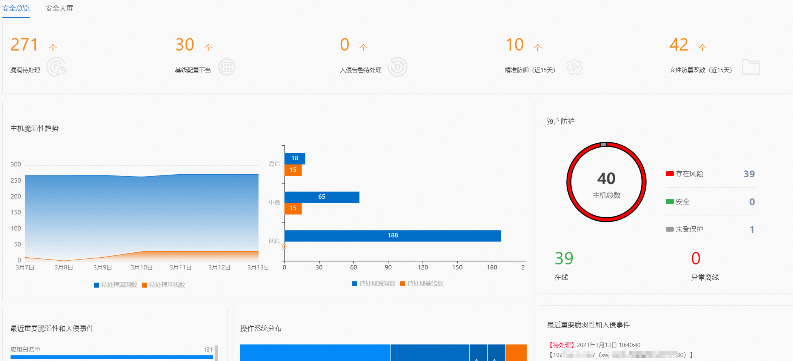

   安全总览整体展现云主机环境各类型的安全弱点（**漏洞待处理**、**基线配置不当**）和安全事件（**入侵告警待处理**、**精准防御**、**文件防篡改数**）的数量。

   - **主机脆弱性趋势**：展示云主机待处理漏洞数、基线数及风险程度分布。

   - **资产防护**：查看目前云主机中正在受到保护的主机数量和离线数量。

   - **最近重要脆弱性和入侵事件**：展示最近重要的云主机安全弱点和安全事件，单击弱点、事件的链接可以查看具体详细情况。

   - **操作系统分布**：按照操作系统类别，统计展示服务器资产。

**安全大屏**

安全大屏支持展示您的资产、漏洞、基线、告警等数据指标，您可根据业务需要自定义安全大屏需要展示的内容。

> **重要**
>
> 在多级组织模式下，安全大屏只有在具备权限并且设置查看视角为一级组织下的所有资源集时才能进入。

**自定义安全态势大屏展示内容**

1. 在**安全大屏**页签，单击**直接访问**。

   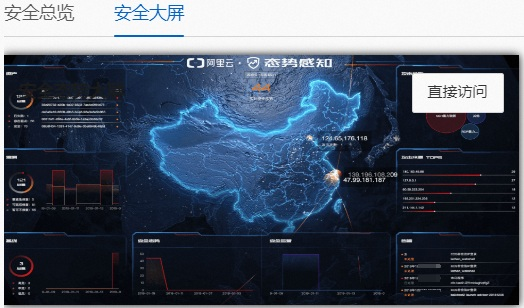

2. 在安全态势大屏页面，单击右上角设置  图标。

3. 配置安全大屏数据和内容后，单击**保存设置**。

   - 在**选择数据**页签，选中需要在大屏上实时展示的数据类型。用户可以选中**全部**或单个数据分类。

   - 在**内容配置**页签，配置需要在大屏上显示的**标题文案**、**标题装饰**。

**自定义大屏场景**

为满足不同业务领域展示不同场景数据的需要，安全态势大屏支持自定义场景，您可以根据业务的需要自定义多个不同的大屏场景。

1. 在**安全大屏**页签，单击**直接访问**。

   

2. 在安全态势大屏页面，单击右上角场景管理  图标。

3. 单击**新增场景**，配置安全大屏数据和内容后，单击**保存设置**。

   - 在**选择数据**页签，选中需要在大屏上实时展示的数据类型。用户可以选择**全部**或单个数据分类。

   - 在**内容配置**页签，配置需要在大屏上显示的**标题文案**、**标题装饰**。

   如果您需要展示其它场景，可在**场景列表**页面定位到需要展示的场景并单击**立即启用**。

   > **说明**
   >
   > 安全态势大屏自定义场景不限数量。

**安全态势大屏页面介绍**

**漏洞**

**漏洞**区域展示了您资产中漏洞的总数量、不同危险等级漏洞的环形占比图、需处理的漏洞类型和对应的数量、最近7天不同风险等级的漏洞的数据统计柱状图。**漏洞**区域包含以下信息：

- **总量**：您资产中漏洞的总数量。

- **需紧急修复**：您资产中需立即修复的漏洞数量。状态符号为红色。

- **可延后修复**：您资产中可稍后再进行修复的漏洞总数量。状态符号为橙色。

- **暂可不修复**：您资产中暂时无法修复的漏洞数量。状态符号为灰色。

- 最近7天不同风险等级的漏洞的数据统计柱状图。

**资产**

**资产**区域展示了云安全中心检测到的资产统计信息。**资产**区域包含以下信息：

- **总量**：您资产的总数量。

- **已失陷**：您资产中存在未处理的高危级别告警的服务器数量。状态符号为红色。

- **存在风险**：您资产中存在漏洞、基线和中低级别告警的服务器数量。状态符号为橙色。

- **安全**：您资产中不存在漏洞、基线风险和告警的服务器数量。状态符号为绿色。

- **未知**：您资产中存在可被黑客通过互联网利用的低危漏洞。状态为灰色。

- 存在安全风险情况最为严重的排名前五的资产及其状态。

**基线**

**基线**区域展示了您资产中基线检查风险项的总数量、不同等级的基线风险项及其对应的数量、最近7天不同风险等级的基线风险项的数据统计柱状图。当天统计数据为实时数据。**基线**区域包含以下信息：

- **总量**：您资产中基线风险项的总数量。

- **高危**：您资产中的高危基线风险项数量。状态符号为红色。建议立即进行排查和修复。

- **中危**：您资产中的中危基线风险项数量。状态符号为橙色。

- **低危**：您资产中的低危基线风险项数量。状态符号为灰色。

- 最近7天不同危险等级的基线风险项的数据统计柱状图。

**安全态势**

**安全态势**区域展示了最近7天、15天或30天安全评分的趋势图。当天统计数据为实时数据。

**告警**

**告警**区域展示了最近24小时内未处理的、排名前五的高风险告警列表，包括告警事件发生的时间、事件名称和服务器名称。

**攻击来源TOP 5**

**攻击来源TOP 5**区域展示了最近24小时内您服务器受到的攻击次数排名前五的攻击来源IP地址及其发起的攻击次数。

**云平台最佳实践**

**云平台最佳实践**区域展示了云平台配置检查功能实时检测出的项目信息。

以下是检测项、风险等级和影响资产的说明：

- **检测项**：云平台配置检查支持的检测项目详情。

- **风险等级**：检测项目的风险级别。以下是风险等级颜色和风险级别的对应关系：

  - 红色代表高风险。

  - 橙色代表中风险。

  - 灰色代表低风险。

  - 绿色代表正常。

- **影响资产**：检测项目对应风险影响的资产数量。

**最高风险资产**

**最高风险资产**区域展示了排名前五的高风险资产（最近24小时）。

## 3.2. 资产中心

### 3.2.1. 资产管理

将服务器接入安骑士后，支持手动同步最新资产信息、查看服务器信息、对服务器进行分组管理等。本文介绍如何进行服务器管理。

**同步最新资产**

1. 登录Apsara Uni-manager运营控制台。

2. 在控制台右上方，单击**安全**，选择**主机安全 > 安骑士**。在**安骑士**授权页面，选择**地域**并单击**角色授权访问**。

   > **说明**
   >
   > - 在多级组织模式下，所有数据的权限都将关联到组织下的资源集维度。用户可以通过控制台顶部菜单栏选择不同组织和资源集，以查看或处理所属组织和资源集的资产。
   >
   > - 上级组织具有最高的管理权限，对内容的修改将覆盖下级组织和资源集的配置。在进行对应配置的修改时，请务必注意。

3. 在左侧导航栏，选择**资产中心** > **资产管理**。

4. 在**资产管理**页面，单击**同步最新资产**。

   安骑士会拉取最新的服务器资产信息，刷新服务器列表。

   > **说明**
   >
   > 同步最新资产信息需要1分钟时间，请耐心等待。

**查看服务器信息**

在**资产管理**页面，查看服务器信息。

- 通过检索查看服务器的信息

  您可使用服务器列表上方提供的搜索组件，通过该服务器的**实例名称**、**公网IP**、**私网IP**等查找到该服务器，支持设置一个或者多个检索条件，筛选出满足筛选条件的服务器。

  在目标服务器的**风险状况**列，可查看到该服务器是否存在安全风险。

  单击目标服务器**操作**列的**查看**或**修复**，进入该服务器的详情页面，查看服务器的详细信息。

  <table>
    <tr>
      <th width="121">功能页签</th>
      <th>说明</th>
    </tr>
    <tr>
      <td>基本信息</td>
      <td>• <strong>风险状态</strong>：展示漏洞、告警等风险情况。 • <strong>详细信息</strong>：展示了该服务器的基本信息，如服务器的ID、地域、分组、操作系统等。单击<strong>更换分组</strong>，可更换资产所属分组。 • <strong>云盘快照</strong>：展示云盘快照情况。 • <strong>漏洞检测</strong>：展示漏洞检测类型。单击图标，可为该服务器开启或关闭不同类型的漏洞检测功能。 • <strong>资产指纹调查</strong>：展示资产指纹数据。 • <strong>登录安全设置</strong>：展示该服务器已添加的常用登录地址、登录的IP、时间和账号，支持设置该服务器的相关告警。 • <strong>常用登录地</strong>：单击<strong>管理</strong>，可添加常用的资产登录地。 • <strong>常用登录IP</strong>：单击<strong>管理</strong>，可添加常用的资产登录IP。 • <strong>常用登录时间</strong>：单击<strong>管理</strong>，可设置常用的资产登录时间。 • <strong>常用账号</strong>：单击<strong>管理</strong>，可设置常用的资产账号。</td>
    </tr>
    <tr>
      <td>漏洞信息</td>
      <td>展示该服务器的漏洞检测结果。</td>
    </tr>
    <tr>
      <td>安全告警处理</td>
      <td>展示该服务器的安全告警信息。</td>
    </tr>
    <tr>
      <td>云外暴露</td>
      <td>展示云外暴露信息。</td>
    </tr>
    <tr>
      <td>基线检查</td>
      <td>展示该服务器的基线检查结果。</td>
    </tr>
    <tr>
      <td>资产指纹调查</td>
      <td>展示该服务器指纹的详细信息。支持查看历史变动记录，可选最近一周、一个月、三个月或一年内任意时间段中增、删和改的变动记录。</td>
    </tr>
  </table>

- 查看同一分类的服务器的信息：安骑士提供了**安全风险**、**资产属性**的服务器分类方式，帮助您对服务器进行分类管理。

  在服务器列表，还支持以下操作：

  <table>
    <tr>
      <th width="154">场景</th>
      <th>操作步骤</th>
    </tr>
    <tr>
      <td>对服务器进行分类</td>
      <td>i. 选中目标服务器，在服务器列表下方选择<strong>资产分类</strong> &gt; <strong>更换分组</strong>。ii. 在<strong>更换分组</strong>对话框，选择新的分组，单击<strong>确定</strong>。</td>
    </tr>
    <tr>
      <td>指令下发</td>
      <td>i. 选中目标服务器，在服务器列表下方单击<strong>指令下发</strong>。ii. 在<strong>指令下发</strong>对话框，选择下发指令，单击<strong>确定</strong>。</td>
    </tr>
    <tr>
      <td>数据导出</td>
      <td>选中目标服务器，在服务器列表下方，单击需要下载的数据。支持导出资产基本信息、弱口令信息、资产漏洞信息、基线风险信息、基线检查全量信息和客户端日志。</td>
    </tr>
    <tr>
      <td>开启安全防护</td>
      <td>i. 选中目标服务器，在服务器列表下方选择<strong>更多操作 &gt; 开启安全防护</strong>。ii. 在弹出的对话框，单击<strong>确定</strong>。</td>
    </tr>
    <tr>
      <td>云外机解除绑定</td>
      <td>选中目标服务器，在服务器列表下方选择<strong>更多操作 &gt; 解除绑定</strong>。</td>
    </tr>
    <tr>
      <td>暂停安全防护</td>
      <td>i. 选中目标服务器，在服务器列表下方选择<strong>更多操作 &gt; 暂停安全防护</strong>。ii. 在弹出的对话框，单击<strong>确定</strong>。 说明暂停防护后会影响除客户端心跳以外的所有安全检测与防护能力，包括指纹采集、漏洞管理、基线检测、病毒防御、防篡改、应用白名单等功能。</td>
    </tr>
  </table>

**多云资产添加**

安骑士支持对第三方云服务器和IDC服务器进行防护和管理。下面介绍添加多云、IDC供应商操作步骤。

1. 在**资产管理**页面的服务器列表**资产分类管理**区域，单击**供应商**。

2. 在**供应商**页面，单击**创建供应商**，并填写供应商信息<strong>。</strong>

   如果供应商没有region概念，可创建默认region用于管理机房信息。

   创建完成后，支持在**操作**列，**编辑**、**删除**、**添加region**等操作。

**管理服务器的分组及标签**

在**资产管理**页面左侧区域，管理服务器分组和标签。

- 管理服务器分组：在使用网页防篡改、基线检查、漏洞扫描等功能，选择生效的服务器时，如果您提前对服务器进行了分组，即可按照服务器的分组进行快捷选择，免去一个个选择生效服务器繁琐步骤。

  在服务器列表左侧**资产分类管理**区域的**服务器组**，在**服务器组**页面，管理服务器分组。

  - 新建服务器组：单击**添加分组**，输入**分组名称**，选择包含的服务器，单击**确定**。

  - 修改和更换服务器组：定位到目标分组，在**操作**列，单击**管理**。

  - 删除服务器：定位到目标分组，在**操作**列，单击**删除**。

- 管理服务器标签：使用**标签**功能为服务器自定义标签标识其特殊属性，可方便您筛选具有相同属性的服务器。

  在服务器列表左侧**标签**区域，管理服务器标签。

  - 新建服务器标签：单击**管理**，输入服务器标签名称并设置标签包含的服务器，单击**确定**。

  - 删除服务器标签：定位到目标服务器标签，单击  图标，在**提示**对话框，的**确定**。

### 3.2.2. 主机指纹

本文介绍如何通过查看服务器端口监听信息、软件版本信息、进程信息、账号信息、计划任务、中间件信息。

**查看主机指纹信息**

1. 登录Apsara Uni-manager运营控制台。

2. 在控制台右上方，单击**安全**，选择**主机安全 > 安骑士**。在**安骑士**授权页面，选择**地域**并单击**角色授权访问**。

   > **说明**
   >
   > - 在多级组织模式下，所有数据的权限都将关联到组织下的资源集维度。用户可以通过控制台顶部菜单栏选择不同组织和资源集，以查看或处理所属组织和资源集的资产。
   >
   > - 上级组织具有最高的管理权限，对内容的修改将覆盖下级组织和资源集的配置。在进行对应配置的修改时，请务必注意。

3. 在左侧导航栏，选择**资产中心** > **主机指纹**。

4. 在**主机指纹**页面，查看主机指纹信息。

   - **总览**

     在**总览**页签，查看主机指纹信息。

     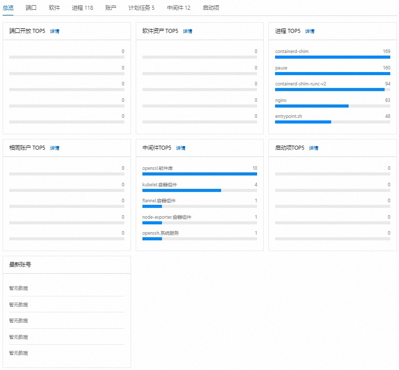

   - **监听端口**

     > **说明**
     >
     > 监听端口的应用场景包括：清点一个端口被哪些服务器监听、清点一台服务器开通了哪些端口。

     在**端口**页签，查看所有**监听端口号**、**网络协议**和服务器信息。

     - 您可以通过搜索端口号、服务器进程名称、服务器名称或IP，快速查找端口。

     - 在服务器信息列表中，查看服务器的**对应进程**、**IP**、**最新扫描时间**。

   - **管理软件版本**

     > **说明**
     >
     > 软件版本的应用场景包括：清点非法软件资产（非法安装）、清点版本过低软件资产、漏洞爆发时快速定位受影响资产范围。

     在**软件**页签，查看所有使用中的**软件资产**和使用这些软件的**服务器数**。

     - 您可以使用软件名搜索后，再使用版本、软件安装目录、服务器名称或IP进行搜索。

       使用版本搜索时，被分隔符隔开的每段版本号最多支持搜索5位数字或字母，最多支持5段版本号（超过5段取左数前5段）。版本支持示例语法如下：

       - **6.2.1**：查询版本等于6.2.1的软件包。

       - **>6.2.1**：查询版本大于6.2.1的软件包。

       - **<6.2.1**：查询版本小于6.2.1的软件包。

       - **>6.2.1, <6.2.5**：查询版本在6.2.1（不包含）~6.2.5（不包含）范围内的软件包。

     - 单击软件名，查看其对应资产、软件版本等信息。

     - 单击右上角  图标，下载软件版本数据表到本地，方便后续盘点资产。

   - **管理运行进程**

     > **说明**
     >
     > 运行进程的应用场景包括：清点一个进程在哪些服务器中运行、清点一台服务器运行了哪些进程。

     在**主机指纹**页面，单击**进程**页签，查看所有运行中进程和运行这些进程的主机数。

     - 您可以使用**进程名**、**运行用户**、**启动参数**或**服务器名称或IP**进行搜索。

     - 单击进程名，查看进程对应资产、路径、启动参数等详细信息。

   - **管理账户信息**

     > **说明**
     >
     > 账号信息应用场景包括：清点一个账号被哪些服务器创建、清点一台服务器创建了哪些账号。

     在**主机指纹**页面，单击**账户**页签，查看所有已登录的系统账号和使用这些账号的主机数。

     - 您可以使用账号名、root权限、服务器名称或IP进行搜索。

     - 单击账号名，查看对应资产、root权限、用户组等详细信息。

   - **管理计划任务**

     在**主机指纹**页面，单击**计划任务**页签，查看所有任务的路径和运行这些任务的主机数。

     - 您可以使用任务路径、服务器名称或IP进行搜索。

     - 单击任务路径，查看对应资产、执行命令、任务周期等详细信息。

   - **管理中间件**

     在**主机指纹**页面，单击**中间件**页签，查看所有任务的中间件的指纹数。

     - 您可以使用中间件名称或类型搜索后，再使用服务器IP、端口或版本等进行搜索。

       使用版本搜索时，被分隔符隔开的每段版本号最多支持搜索5位数字或字母，最多支持5段版本号（超过5段取左数前5段）。版本支持示例语法如下：

       - **6.2.1**：查询版本等于6.2.1的软件包。

       - **>6.2.1**：查询版本大于6.2.1的软件包。

       - **<6.2.1**：查询版本小于6.2.1的软件包。

       - **>6.2.1, <6.2.5**：查询版本在6.2.1（不包含）~6.2.5（不包含）范围内的软件包。

     - 单击中间件名称，查看对应资产、中间件版本、安装路径等详细信息。

   - **管理启动项**

     在**主机指纹**页签，单击**启动项**页签，查看启动项和对应的指纹数。

**配置主机指纹采集频率和记录保存配置**

> **重要**
>
> 在多级组织模式下，仅有一级组织权限或全局组织权限的账号才可修改主机指纹采集频率和记录保存配置。

1. 在**主机指纹**页面右上方，单击**配置管理**。

2. 在**配置管理**对话框的**采集周期配置**页签，配置对应的主机指纹采集频率。

3. 在**配置管理**对话框的**记录保存配置**页签，配置**账号变迁留存**的时间。

## 3.3. 安全预防

### 3.3.1. 漏洞管理

#### 3.3.1.1. 扫描漏洞和查看漏洞统计

本文介绍如何扫描漏洞以及查看漏洞扫描结果和修复统计。

**执行漏洞扫描**

1. 登录Apsara Uni-manager运营控制台。

2. 在控制台右上方，单击**安全**，选择**主机安全 > 安骑士**。在**安骑士**授权页面，选择**地域**并单击**角色授权访问**。

   > **说明**
   >
   > - 在多级组织模式下，所有数据的权限都将关联到组织下的资源集维度。用户可以通过控制台顶部菜单栏选择不同组织和资源集，以查看或处理所属组织和资源集的资产。
   >
   > - 上级组织具有最高的管理权限，对内容的修改将覆盖下级组织和资源集的配置。在进行对应配置的修改时，请务必注意。

3. 在左侧导航栏，选择**安全预防** > **漏洞管理**。

4. 在**漏洞管理**页面，进行手动扫描漏洞或配置自动扫描漏洞。

   - 手动扫描漏洞：如果您想立即了解服务器是否存在漏洞风险，可以使用一键扫描功能，手动扫描服务器中的漏洞。

     进行一键扫描前，您可以在**漏洞管理**页面右上角单击**漏洞管理设置**，然后**漏洞管理设置**面板上单击漏洞检查项右侧的**管理**，查看要扫描的服务器是否已添加到扫描生效的服务器列表中。

     <ol type="a">

     <li>

     在**漏洞管理**页面，单击**一键扫描**。

     </li>

     <li>

     在**漏洞扫描**对话框，选中要扫描的漏洞类型，并单击**确定**。

     创建扫描任务后，需要等待15分钟才能终止任务。

     > **说明**
     >
     > 如果您未修改过漏洞的生效服务器，一键扫描会对云安全中心保护的所有资产进行检测，预计30分钟内完成扫描，请耐心等待。您可以手动刷新页面查看最新扫描数据。

     </li>

     </ol>

   - 自动扫描漏洞

     您可以配置漏洞的自动扫描周期，定期对服务器上存在的漏洞进行自动扫描。具体操作，请参见***漏洞管理***目录下的***设置漏洞管理策略***章节。

**查看漏洞扫描结果**

在**漏洞管理**页面上方的漏洞信息统计区域查看漏洞的统计信息。

| 字段 | 说明 |
| --- | --- |
| 需紧急修复的漏洞（CVE） | 单击<strong>需紧急修复的漏洞（CVE）</strong>区域的数字，在<strong>需紧急修复的漏洞（CVE）</strong>面板上查看需要紧急修复的各类型漏洞。修复漏洞的具体操作，请参见<strong><em>漏洞管理</em></strong>目录下的各漏洞管理章节。 |
| 存在漏洞的服务器 | 单击<strong>存在漏洞的服务器</strong>下的数字，可跳转到<strong>资产中心 &gt; 资产管理</strong>页签，查看存在漏洞问题的服务器资产的详情。 |
| 修复中漏洞 | 单击<strong>修复中漏洞</strong>下的数字，展开<strong>修复中漏洞</strong>面板，查看修复中的漏洞列表及修复进度。 |
| 今日已修复漏洞 | 单击<strong>今日已修复漏洞</strong>下的数字，展开<strong>今日已修复漏洞</strong>面板，查看今日已修改漏洞列表及详情。 |
| 累计已处理漏洞 | 单击<strong>累计已处理漏洞</strong>下的数字，展开<strong>累计已处理漏洞</strong>面板，查看累计已处理的所有漏洞的影响资产列表和相关信息。 |
| 已支持漏洞 | 单击<strong>已支持漏洞</strong>下方的数字展开<strong>支持检测的漏洞列表</strong>面板，可查看云安全中心已支持检测的漏洞列表及查看漏洞的详细信息，包括漏洞的<strong>漏洞编号</strong>、<strong>漏洞名称</strong>、<strong>检测方式</strong>和<strong>发布时间</strong>。您也可以使用列表上方的搜索功能，通过漏洞名称或CVE编号信息搜索，可以查看目标漏洞在云安全中心是否已支持检测。单击目标漏洞的漏洞编号，可跳转阿里云漏洞库查看该漏洞的详细信息。 |
| 最新系统漏洞发现时间 | 展示最新系统被扫描发现的漏洞的时间。 |

#### 3.3.1.2. 管理Linux软件漏洞

本文介绍如何管理Linux软件漏洞。

**背景信息**

比对CVE官方漏洞库，自动检测您服务器上安装的软件版本是否存在漏洞，并向您推送漏洞消息。针对检测到的漏洞，提供漏洞修复指令和验证功能。

**操作步骤**

1. 登录Apsara Uni-manager运营控制台。

2. 在顶部菜单栏，单击**安全**，在**主机安全**区域，单击**安骑士**。

   > **说明**
   >
   > 用户可以在控制台顶部菜单栏，选择组织、资源集、region，支持选择到二级组织及用户的资源集。

3. 在左侧导航栏，选择**安全预防** > **漏洞管理**。

4. 在**Linux软件漏洞**页签的漏洞列表中，查看检测出的Linux漏洞。

   > **说明**
   >
   > 通过漏洞搜索和筛选功能，能够快速定位到具体漏洞。

5. 单击漏洞名称，进入漏洞详情页，查看漏洞详细信息和影响资产。

   > **说明**
   >
   > 通过搜索和筛选功能，能够快速展示影响资产。

   - **基本信息**：显示该漏洞编号、漏洞影响分值和漏洞公告，单击**漏洞编号**，显示漏洞更多描述信息。

   - **影响资产**：展示涉及该漏洞的所有服务器。

6. 根据漏洞影响情况，选择相应的处理方式。

   表 1. 漏洞操作方式

   <table>
     <tr>
       <th width="122">操作</th>
       <th>说明</th>
     </tr>
     <tr>
       <td>修复</td>
       <td>• 通过修复命令修复：平台已自动生成修复漏洞的指令，登录服务器运行该指令来修复漏洞。 • 一键修复：直接修复漏洞。</td>
     </tr>
     <tr>
       <td>已重启并验证</td>
       <td>如果修复漏洞需要重启服务器才能生效，必须等待漏洞修复状态变为<strong>修复成功待重启</strong>后，先前往服务器侧完成该服务器重启，然后单击<strong>已重启并验证</strong>完成修复。</td>
     </tr>
     <tr>
       <td>忽略</td>
       <td>可忽略该漏洞，系统将不再上报并告警此服务器上被忽略的漏洞。</td>
     </tr>
     <tr>
       <td>验证</td>
       <td>修复漏洞后，单击<strong>验证</strong>，一键验证该漏洞是否已修复成功。如果未进行手动验证，漏洞修复成功后 48 小时内系统会自动去验证。</td>
     </tr>
   </table>

   对于影响资产，可以进行单个操作或多个批量操作。

   - 单个操作：在**操作**列，对单个受影响的服务器进行处理。

   - 批量操作：选中一个或多个需要处理的服务器，使用列表下方的批量操作按钮进行批量处理。

#### 3.3.1.3. 管理Windows系统漏洞

本文介绍如何管理Windows系统漏洞。

**背景信息**

比对微软官方补丁更新，自动检测您服务器上的补丁是否已更新，并向您推送漏洞消息。针对重大漏洞更新，提供自动检测和修复功能。

**操作步骤**

1. 登录Apsara Uni-manager运营控制台。

2. 在顶部菜单栏，单击**安全**，在**主机安全**区域，单击**安骑士**。

   > **说明**
   >
   > 用户可以在控制台顶部菜单栏，选择组织、资源集、region，支持选择到二级组织及用户的资源集。

3. 在左侧导航栏，选择**安全预防** > **漏洞管理**。

4. 在**Windows系统漏洞**页签的漏洞列表中，查看检测出的Windows系统漏洞。

   > **说明**
   >
   > 通过漏洞搜索和筛选功能，能够快速定位到具体漏洞。

5. 单击漏洞名称，进入漏洞详情页，查看漏洞详细信息和影响资产。

   > **说明**
   >
   > 通过搜索和筛选功能，能够快速展示影响资产。

   - **基本信息**：显示该漏洞的名称、漏洞影响分值、简介和解决方案等信息。

   - **影响资产**：展示涉及该漏洞的所有服务器。

6. 根据漏洞影响情况，选择相应的处理方式，如漏洞操作方式所示。

   表 1. 漏洞操作方式

   <table>
     <tr>
       <th width="122">操作</th>
       <th>说明</th>
     </tr>
     <tr>
       <td>立即修复</td>
       <td>直接修复漏洞。系统会在云端缓存一份Windows官方补丁文件，您的Windows系统服务器会直接下载云端的补丁并完成自动更新。</td>
     </tr>
     <tr>
       <td>忽略</td>
       <td>可忽略该漏洞，系统将不再上报并告警此服务器上被忽略的漏洞。</td>
     </tr>
     <tr>
       <td>验证</td>
       <td>修复漏洞后，单击<strong>验证</strong>，一键验证该漏洞是否已修复成功。</td>
     </tr>
     <tr>
       <td>已重启并验证</td>
       <td>如果修复漏洞需要重启服务器才能生效，必须等待漏洞修复状态变为<strong>修复成功待重启</strong>后，先前往服务器侧完成该服务器重启，然后单击<strong>已重启并验证</strong>完成修复。</td>
     </tr>
   </table>

   对于影响资产，可以进行单个操作或多个批量操作。

   - 单个操作：在**操作**列，对单个受影响的服务器进行处理。

   - 批量操作：选中一个或多个需要处理的服务器，使用列表下方的批量操作按钮进行批量处理。

#### 3.3.1.4. 管理Web-CMS漏洞

本文介绍如何管理Web-CMS漏洞。

**背景信息**

Web-CMS 漏洞功能通过及时获取漏洞预警和相关补丁，并通过云端下发补丁更新，实现漏洞快速发现、快速修复的功能。

**操作步骤**

1. 登录Apsara Uni-manager运营控制台。

2. 在顶部菜单栏，单击**安全**，在**主机安全**区域，单击**安骑士**。

   > **说明**
   >
   > 用户可以在控制台顶部菜单栏，选择组织、资源集、region，支持选择到二级组织及用户的资源集。

3. 在左侧导航栏，选择**安全预防** > **漏洞管理**。

4. 在**Web-CMS漏洞**页签，查看所有漏洞。

   > **说明**
   >
   > 通过漏洞搜索和筛选功能，能够快速定位到具体漏洞。

5. 单击漏洞名称，进入漏洞详情页，查看漏洞详细信息和影响资产。

   > **说明**
   >
   > 通过搜索和筛选功能，能够快速展示影响资产。

6. 根据漏洞影响情况，选择相应的处理方式，如漏洞操作方式所示。

   表 1. 漏洞操作方式

   <table>
     <tr>
       <th width="90">操作</th>
       <th>说明</th>
     </tr>
     <tr>
       <td>立即修复</td>
       <td>系统将替换服务器上存在漏洞的Web文件以修复Web-CMS漏洞。 说明修复Web-CMS漏洞前，建议备份该漏洞相关的Web文件，Web文件的具体路径可参考漏洞处理说明栏中的路径。</td>
     </tr>
     <tr>
       <td>忽略</td>
       <td>可忽略该漏洞，系统将不再上报并告警此服务器上被忽略的漏洞。</td>
     </tr>
     <tr>
       <td>验证</td>
       <td>修复漏洞后，单击<strong>验证</strong>，一键验证该漏洞是否已修复成功。如果未进行手动验证，漏洞修复成功后48小时内系统会自动去验证。</td>
     </tr>
     <tr>
       <td>回滚</td>
       <td>对于已修复完成的漏洞，单击<strong>回滚</strong>可进行漏洞回滚，还原修复前的Web文件。</td>
     </tr>
   </table>

   对于影响资产，可以进行单个操作或多个批量操作。

   - 单个操作：在**操作**列，对单个受影响的服务器进行处理。

   - 批量操作：选中一个或多个需要处理的服务器，使用列表下方的批量操作按钮进行批量处理。

#### 3.3.1.5. 管理应用漏洞

本文介绍如何管理应用漏洞（含应急漏洞）。

**背景信息**

云盾安全中心自动检测服务器上的Redis未授权访问漏洞、STRUTS-052命令执行漏洞等漏洞，并推送漏洞消息。同时，支持漏洞的修复验证操作。

**操作步骤**

1. 登录Apsara Uni-manager运营控制台。

2. 在顶部菜单栏，单击**安全**，在**主机安全**区域，单击**安骑士**。

   > **说明**
   >
   > 用户可以在控制台顶部菜单栏，选择组织、资源集、region，支持选择到二级组织及用户的资源集。

3. 在左侧导航栏，选择**安全预防** > **漏洞管理**。

4. 在<strong>应用漏洞（含应急）</strong>页签，查看所有漏洞。

   通过漏洞搜索和筛选功能，快速定位到具体漏洞。

5. 单击漏洞名称，进入漏洞详情页，查看**漏洞详情**、**修复建议**、**待处理漏洞**。

   通过搜索和筛选功能，快速展示影响资产。

6. 根据漏洞影响情况，选择相应的处理方式，如漏洞操作方式所示。

   应用漏洞需要按照修复说明手动修复。

   表 1. 漏洞操作方式

   | 操作 | 说明 |
   | --- | --- |
   | 忽略 | 可忽略该漏洞，系统将不再上报并告警此服务器上被忽略的漏洞。 |
   | 验证 | 手动修复漏洞后，单击<strong>验证</strong>，一键验证该漏洞是否已修复成功。如果未进行手动验证，漏洞修复成功后48小时内系统会自动验证漏洞是否已修复。 |

   对于影响资产，可以进行单个操作或多个批量操作。

   - 单个操作：在**操作**列，对单个受影响的服务器进行处理。

   - 批量操作：选中一个或多个需要处理的服务器，使用列表下方的批量操作按钮进行批量处理。

#### 3.3.1.6. 设置漏洞管理策略

漏洞管理设置允许您开启或关闭不同类型漏洞的自动检测，有选择性地对指定服务器应用漏洞检测，对已失效漏洞设置自动删除周期，和配置漏洞白名单。

**背景信息**

漏洞白名单用于彻底忽略某些漏洞，您可以在漏洞列表下批量添加漏洞至白名单。添加成功后，系统将不再去检测漏洞白名单中的漏洞。使用漏洞管理设置可以维护漏洞白名单。

**操作步骤**

1. 登录Apsara Uni-manager运营控制台。

2. 在控制台右上方，单击**安全**，选择**主机安全 > 安骑士**。在**安骑士**授权页面，选择**地域**并单击**角色授权访问**。

   > **说明**
   >
   > - 在多级组织模式下，所有数据的权限都将关联到组织下的资源集维度。用户可以通过控制台顶部菜单栏选择不同组织和资源集，以查看或处理所属组织和资源集的资产。
   >
   > - 上级组织具有最高的管理权限，对内容的修改将覆盖下级组织和资源集的配置。在进行对应配置的修改时，请务必注意。

3. 在左侧导航栏，选择**安全预防** > **漏洞管理**。

4. 单击右上角的**漏洞管理设置**，配置相关策略。

   - 非多级模式

     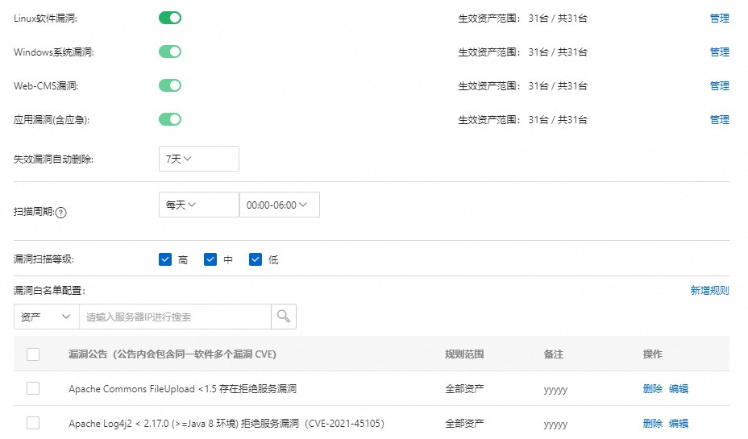

     | 功能项 | 说明 |
     | --- | --- |
     | 是否启用漏洞 | 选择需要操作的漏洞类型，单击切换开关，开启或关闭该漏洞检测。 |
     | 生效资产范围 | 选择需要操作的漏洞类型，单击<strong>管理</strong>，配置应用该漏洞检测的服务器。 |
     | 失效漏洞自动删除 | 选择失效漏洞自动删除周期：7天、30天、90天。 说明对于检测出来的漏洞不做任何处理的话，默认该告警失效，并在指定周期后自动删除。 |
     | 扫描周期 | 选择漏洞扫描周期。默认每天0点~6点。扫描周期设置仅对Linux软件漏洞、Windows系统漏洞和应用漏洞扫描生效。CMS漏洞扫描不受周期设置影响，若开启CMS漏洞扫描则每天扫描一次。修改周期后，会删除未执行的历史周期任务。按照新周期创建全量扫描任务。如果在下午5点修改了扫描周期为每天的18:00~24:00，会从当天开始立即按照新周期执行扫描任务。如果在下午7点修改了扫描周期为每天的18:00~24:00，则当天没有完整的扫描时间段，将从下一天开始按照新周期执行扫描任务。 |
     | 漏洞扫描等级 | 选中需要扫描的漏洞等级： • <strong>高</strong>：需尽快修复。 • <strong>中</strong>：可延后修复。 • <strong>低</strong>：暂可不修复。 |
     | 漏洞白名单配置 | 单击<strong>新增规则</strong>，可以对目标资产设置漏洞黑白名单规则，设置后对应的漏洞不会被检测。 |

   - 多级组织模式

     在多级组织模式下，改动仅对该组织下拥有权限的资源集生效。

     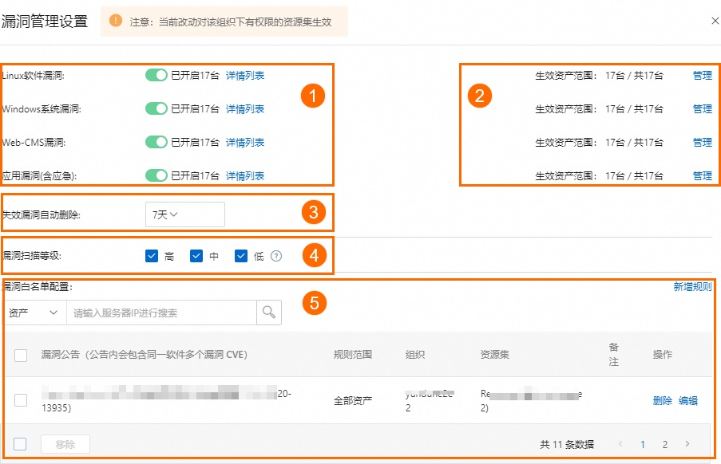

     | 序号 | 说明 |
     | --- | --- |
     | ① | 选择需要操作的漏洞类型，单击切换开关，开启或关闭该漏洞检测。单击<strong>详情列表</strong>，可设置当前组织下的子组织漏洞检测。上级组织拥有最高管理权限，修改内容会覆盖下级组织、资源集配置。 |
     | ② | 定位到需要操作的漏洞类型，单击<strong>管理</strong>，选择目标资源集，配置应用漏洞检测的服务器。 |
     | ③ | 选择失效漏洞自动删除周期：<strong>7天</strong>、<strong>30天</strong>、<strong>90天</strong>。如果显示<strong>非统一值</strong>，表示权限范围内某些资源集的配置不统一，可以选择某一选项将多个资源集的配置统一。 说明对于检测出来的漏洞不做任何处理的话，默认该告警失效，并在指定周期后自动删除。 |
     | ④ | 选中需要扫描的漏洞等级： • <strong>高</strong>：需尽快修复。 • <strong>中</strong>：可延后修复。 • <strong>低</strong>：暂可不修复。 含义为部分资源集为选中状态，可以通过重新勾选来进行统一设置。 |
     | ⑤ | 单击<strong>新增规则</strong>，可以对目标资产设置漏洞黑白名单规则，设置后对应的漏洞不会被检测。 |

### 3.3.2. 基线检查

#### 3.3.2.1. 基线检查介绍

基线检查功能可自动检测服务器上的安全配置，并针对所发现的检测结果提供问题详情说明和基线加固建议。

**功能描述**

使用基线检查功能可自动检测服务器上的系统、账号、数据库、弱密码、合规性配置中存在的风险点，并提供加固建议。具体检测内容请参见基线检查内容。

基线检查默认每天0点到6点进行一次全面的自动检测。您可以自行添加和管理基线扫描策略，自定义需要检查的基线项目、检查周期、检测触发时间和应用该策略的服务器。

**注意事项**

以下检查项默认关闭，如果您需要检查该项目，请确认在不影响业务的情况下，在自定义基线扫描策略时选中这些检测项目。

- 部分弱密码检测项（例如，MySQL弱密码检测、PostgreSQL弱密码检测、SQLServer弱密码检测）

  > **说明**
  >
  > 这些检测项会采用尝试登录方式进行检查，会占用一定的服务器资源以及生成较多的登录失败记录。

- 系统等保

- 国际通用安全最佳实践

**基线检查内容**

<table>
  <tr>
    <th width="137">基线检查项分类</th>
    <th>检查项</th>
  </tr>
  <tr>
    <td>未授权访问</td>
    <td>• ActiveMQ未授权访问高危风险 • CouchDB未授权访问高危风险 • Docker未授权访问高危风险 • Elasticsearch未授权访问高危风险 • Hadoop未授权访问高危风险 • Jboss未授权访问高危风险 • Jenkins未授权访问高危风险 • Kubernetes-Apiserver未授权访问高危风险 • LDAP未授权访问高危风险（Windows环境） • openLDAP未授权访问高危风险（Linux环境） • Memcached未授权访问高危风险 • Mongodb未授权访问高危风险 • Postgresql未授权访问高危风险基线 • RabbitMQ未授权访问高危风险 • Redis未授权访问高危风险 • rsync未授权访问高危风险 • ZooKeeper未授权访问高危风险</td>
  </tr>
  <tr>
    <td>等保合规</td>
    <td>• 等保三级-Alibaba Cloud Linux 3合规基线 • 等保二级-Alibaba Cloud Linux 2合规基线 • 等保三级-Alibaba Cloud Linux 2合规基线 • 等保三级-Anolis 8合规基线 • 等保三级-Bind合规基线 • 等保二级-CentOS Linux 6合规基线 • 等保三级-CentOS Linux 6合规基线 • 等保二级-CentOS Linux 7合规基线 • 等保三级-CentOS Linux 7合规基线 • 等保三级-CentOS Linux 8合规基线 • 等保二级-Debian Linux 8合规基线 • 等保三级-Debian Linux 8/9/10合规基线 • 等保三级-IIS合规基线 • 等保三级-Informix合规基线 • 等保三级-Jboss6/7合规基线 • 等保三级-麒麟合规基线 • 等保三级-MongoDB合规基线 • 等保三级-SQL Server合规基线 • 等保三级-MySql合规基线 • 等保三级-Nginx合规基线 • 等保三级-Oracle合规基线 • 等保三级-PostgreSql合规基线 • 等保三级-Redhat Linux 6合规基线 • 等保二级-Redhat Linux 7合规基线 • 等保三级-Redhat Linux 7合规基线 • 等保三级-Redis合规基线 • 等保三级-SUSE 10合规基线 • 等保三级-SUSE 12合规基线 • 等保三级-SUSE 15合规基线 • 等保三级-SUSE 11合规基线 • 等保三级-Ubuntu 14合规基线 • 等保二级-Ubuntu16/18合规基线 • 等保三级-Ubuntu 16/18/20合规基线 • 等保三级-Uos合规基线 • 等保三级-Websphere Application Server合规基线 • 等保三级-Weblogic合规基线 • 等保二级-Windows 2008 R2合规基线 • 等保三级-Windows 2008 R2合规基线 • 等保二级-Windows 2012 R2合规基线 • 等保三级-Windows 2012 R2合规基线 • 等保二级-Windows 2016/2019 合规基线 • 等保三级-Windows 2016/2019 合规基线</td>
  </tr>
</table>

<table>
  <tr>
    <td>最佳安全实践</td>
    <td>• 阿里云标准-Alibaba Cloud Linux 2/3安全基线 • 阿里云标准-Anolis 7/8安全基线检查 • 阿里云标准-Apache安全基线检查 • 阿里云标准-CentOS Linux 6安全基线检查 • 阿里云标准-CentOS Linux 7/8安全基线检查 • 阿里云标准-CouchDB 安全基线检查 • 阿里云标准-SQL server安全基线检查（支持2008及以上版本） • 阿里云标准-Debian Linux 8/9/10/11/12安全基线检查 • 阿里云标准-Docker主机安全基线检查 • 阿里云标准-ElasticSearch安全基线检查 • 阿里云标准-Hadoop安全基线检查 • 阿里云标准-IIS 8安全基线检查 • 阿里云标准-Influxdb安全基线检查 • 阿里云标准-Jboss6/7安全基线检查 • 阿里云标准-麒麟安全基线检查 • 阿里云标准-Memcached安全基线检查 • 阿里云标准-Activemq安全基线检查 • 阿里云标准-Jenkins安全基线检查 • 阿里云标准-RabbitMQ安全基线检查 • 阿里云标准-MongoDB安全基线检查（支持3.x版本） • 阿里云标准-Mysql安全基线检查 • 阿里云标准-Nginx安全基线检查 • 阿里云标准-Oracle 安全基线检查 • 阿里云标准-PostgreSql安全基线检查 • 阿里云标准-Redhat Linux 6安全基线检查 • 阿里云标准-Redhat Linux 7/8安全基线检查 • 阿里云标准-Redis安全基线检查 • 阿里云标准-Rocky Linux 8/9安全基线检查 • 阿里云标准-Windows SMB安全基线检查 • 阿里云标准-SUSE Linux 15安全基线检查 • 阿里云标准-Apache Tomcat 安全基线检查（windows环境） • 阿里云标准-Ubuntu安全基线检查 • 阿里云标准-Uos安全基线检查 • 阿里云标准-Windows 2008 R2安全基线检查 • 阿里云标准-Windows 2012 R2安全基线检查 • 阿里云标准-Windows 2016/2019 安全基线检查 • 阿里云标准-Apache Tomcat 安全基线检查</td>
  </tr>
  <tr>
    <td>国际通用安全最佳实践</td>
    <td>• Alibaba Cloud Linux 2/3 国际通用安全最佳实践基线 • CentOS Linux 6 国际通用安全最佳实践基线 • CentOS Linux 7 国际通用安全最佳实践基线 • CentOS Linux 8 国际通用安全最佳实践基线 • Debian Linux 8/9/10 国际通用安全最佳实践基线 • Ubuntu 14 国际通用安全最佳实践基线 • Ubuntu 16/18/20 国际通用安全最佳实践基线 • Windows Server 2008 R2 国际通用安全最佳实践基线 • Windows Server 2012 R2 国际通用安全最佳实践基线 • Windows Server 2016/2019 R2 国际通用安全最佳实践基线</td>
  </tr>
  <tr>
    <td>弱口令</td>
    <td>• MongoDB登录弱口令检测（支持2.x版本） • FTP登录弱口令检查 • Jboss6/7登录弱口令检查 • Jenkins登录弱口令检查 • Linux系统登录弱口令检查 • MongoDB登录弱口令检测 • SQL Server数据库登录弱口令检查 • Mysql数据库登录弱口令检查（不支持8.x版本） • Mysql数据库登录弱口令检查（Windows版） • Openldap登录弱口令检查 • Linux系统OpenVpn弱口令检测 • Oracle登录弱口令检测 • PostgreSQL数据库登录弱口令检查 • pptpd服务登录弱口令检查 • Proftpd登录弱口令检查 • RabbitMQ登录弱口令检查 • Redis数据库登录弱口令检查 • rsync服务登录弱口令检查 • svn服务登录弱口令检查 • Apache Tomcat控制台弱口令检查 • VncServer弱口令检查 • Weblogic 12c登录弱口令检测 • Windows系统登录弱口令检查 • Activemq登录弱口令检查</td>
  </tr>
</table>

#### 3.3.2.2. 设置基线检查策略

本文介绍如何新增、编辑、删除基线检查策略，并设置基线检查等级的范围。

**背景信息**

默认情况下，基线检查会使用**默认策略**检测资产的基线安全情况。您可以根据实际业务情况（例如需要满足等保二级），自定义基线检查策略。

**添加基线检查策略**

1. 登录Apsara Uni-manager运营控制台。

2. 在控制台右上方，单击**安全**，选择**主机安全 > 安骑士**。在**安骑士**授权页面，选择**地域**并单击**角色授权访问**。

   > **说明**
   >
   > - 在多级组织模式下，所有数据的权限都将关联到组织下的资源集维度。用户可以通过控制台顶部菜单栏选择不同组织和资源集，以查看或处理所属组织和资源集的资产。
   >
   > - 上级组织具有最高的管理权限，对内容的修改将覆盖下级组织和资源集的配置。在进行对应配置的修改时，请务必注意。

3. 在左侧导航栏，选择**安全预防** > **基线检查**。

4. 单击控制台界面右上角**策略管理**，在**策略管理**页面，管理基线检查策略。

   > **重要**
   >
   > - 在多级组织模式下，当前改动仅对该组织下有权限的资源集生效。
   >
   > - 在多级组织模式下，如果显示**非统一值**，表示权限范围内某些资源集的配置不统一，可以选择某一选项将多个资源集的配置统一。

   - 添加标准策略：单击**添加标准策略**，参考下表配置策略参数，单击**确认**。

     <table>
       <tr>
         <th width="121">配置项</th>
         <th>说明</th>
       </tr>
       <tr>
         <td>策略名称</td>
         <td>输入用于识别该策略的名称。</td>
       </tr>
       <tr>
         <td>检测周期</td>
         <td>选择检测周期（每隔1天、3天、7天、30天检测一次）和检测触发时间。</td>
       </tr>
       <tr>
         <td>检测开始时间</td>
         <td>选择检测触发时间（00:00~06:00、06:00~12:00、12:00~18:00、18:00~24:00）。</td>
       </tr>
       <tr>
         <td>基线名称</td>
         <td>选中需要检测的基线项目，默认包含有未授权访问、等保合规、最佳安全实践、国际通用安全最佳实践和弱口令等。</td>
       </tr>
       <tr>
         <td>生效服务器</td>
         <td>选中需要应用该策略的分组资产。 多级组织模式下，需选择对应的资源集。 说明新购买的服务器默认归属在<strong>分组资产 &gt; 未分组</strong>中，如需对新购资产自动应用该策略，请选中<strong>未分组</strong>。</td>
       </tr>
     </table>

   - 添加自定义策略：单击**添加自定义策略**，参考下表配置策略参数，单击**确认**。

     <table>
       <tr>
         <th width="121">配置项</th>
         <th>说明</th>
       </tr>
       <tr>
         <td>策略名称</td>
         <td>输入用于识别该策略的名称。</td>
       </tr>
       <tr>
         <td>检测周期</td>
         <td>选择检测周期（每隔1天、3天、7天、30天检测一次）和检测触发时间。</td>
       </tr>
       <tr>
         <td>检测开始时间</td>
         <td>选择检测触发时间（00:00~06:00、06:00~12:00、12:00~18:00、18:00~24:00）。</td>
       </tr>
       <tr>
         <td>基线名称</td>
         <td>选中需要检测的基线项目。</td>
       </tr>
       <tr>
         <td>生效服务器</td>
         <td>选中需要应用该策略的分组资产。在多级组织模式下，需选择对应的资源集，可选择多个资源集。 说明新购买的服务器默认归属在<strong>分组资产 &gt; 未分组</strong>中，如需对新购资产自动应用该策略，请选中<strong>未分组</strong>。</td>
       </tr>
     </table>

   - 编辑基线策略。

     - 在基线列表，定位到目标策略，在**操作**列，单击**编辑**。

       > **说明**
       >
       > 默认策略检测项不支持更改，仅支持修改应用默认策略的资产分组。

     - （仅多级组织模式支持）统一编辑：添加基线检查策略时，如果创建多个同名同类型策略（策略位于不同资源集，同一资源集下不允许出现同名策略），您可以在列表下方单击**统一编辑**，同时修改基线策略。

       > **说明**
       >
       > 管理员修改策略后，如果不同资源集配置不统一，系统会进行提示，请仔细确认提示信息，确认是统一所有资源集配置。

   - 删除基线策略：在基线列表，定位到目标策略，在**操作**列，单击**删除**。

     > **重要**
     >
     > 策略删除后不可恢复。默认策略不支持删除。

   - 设置基线检查等级：在**基线检查等级**区域，您可以设置基线检查的等级范围（高、中、低）。

     多级组织模式下，  含义为部分资源集为选中状态，可以通过重新勾选来进行统一设置。

   - 自定义弱口令规则：云安全中心基于阿里云威胁情报，已为您默认内置弱口令规则，您可以基于模板上传策略，请确保文件大小限制在5 KB以下。

     在**自定义弱口令规则**区域，单击**导入文件**，选择本地文件上传。

     如需导出已上传的弱口令清单，请右键点击下方已上传文件名，另存文件，或在预览页面保存即可。

#### 3.3.2.3. 查看和处理基线检查结果

云盾控制台提供了检查后的基线详情说明、基线加固建议和风险处理功能。本文介绍如何在云盾控制台查看和处理基线项目的检查结果，具体包括查看基线项目影响的资产、基线项目详情等信息，以及如何对风险项进行处理。

**查看检测结果总览数据**

1. 登录Apsara Uni-manager运营控制台。

2. 在控制台右上方，单击**安全**，选择**主机安全 > 安骑士**。在**安骑士**授权页面，选择**地域**并单击**角色授权访问**。

   > **说明**
   >
   > - 在多级组织模式下，所有数据的权限都将关联到组织下的资源集维度。用户可以通过控制台顶部菜单栏选择不同组织和资源集，以查看或处理所属组织和资源集的资产。
   >
   > - 上级组织具有最高的管理权限，对内容的修改将覆盖下级组织和资源集的配置。在进行对应配置的修改时，请务必注意。

3. 在左侧导航栏，选择**安全预防** > **基线检查**。

4. 在**基线检查**页面上方，查看云盾控制台根据不同基线检查策略，在您资产中检测到的基线检查结果汇总数据。

   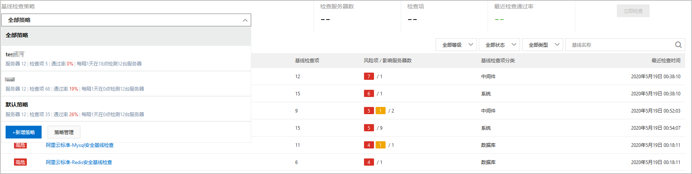

   在**基线检查策略**下拉框中选择目标基线检查策略，查看以下信息。

   - **服务器**：执行基线检查的服务器数量，即配置基线检查策略时，选中的分组服务器中服务器的总台数。

   - **检查项**：配置基线检查策略时，选中的**基线名称**的数量。

   - **通过率**：最近一次执行基线检查的基线合格率。

     **通过率**字体为绿色时，代表扫描的资产中基线配置合格率较高；字体为红色时，说明检查的资产中不合格的基线配置较多，可能存在安全隐患，建议前往基线检查详情页面查看并修复。

5. 在**基线检查策略**下拉框中选择**全部策略**。

   **基线检查**页面会展示所有基线检查项目的列表，包括**基线名称**、**基线检查项**、**风险项/影响服务器数**、**基线分类**及**最新检查时间**。

   > **说明**
   >
   > 您也可在**基线检查策略**下拉框中选择某个基线检查策略，查看该策略对应的基线检查项目列表。

**查看基线项目详情**

1. 登录Apsara Uni-manager运营控制台。

2. 在控制台右上方，单击**安全**，选择**主机安全 > 安骑士**。在**安骑士**授权页面，选择**地域**并单击**角色授权访问**。

   > **说明**
   >
   > - 在多级组织模式下，所有数据的权限都将关联到组织下的资源集维度。用户可以通过控制台顶部菜单栏选择不同组织和资源集，以查看或处理所属组织和资源集的资产。
   >
   > - 上级组织具有最高的管理权限，对内容的修改将覆盖下级组织和资源集的配置。在进行对应配置的修改时，请务必注意。

3. 在左侧导航栏，选择**安全预防** > **基线检查**。

4. 在基线检查列表的**基线名称**列中，单击待查看的基线项目，展开该基线项目的详情页面。

   您可查看到该基线项目影响的资产及资产的**通过项**或**风险项**的数量。

5. 在基线详情页面对检测出的风险项进行处理。

   - 单击待查看资产右侧**操作**列下的**查看**，进入**风险项**页面，查看风险检查项详情。

   - 单击资产右侧**操作**列下的**验证**，对已处理风险项的资产进行验证。如果验证通过，资产的**风险项**数值会相应地减少，同时该风险项状态会更新为**已通过**。

**查看风险项详情**

1. 在基线项目详情页面，单击待查看风险项资产右侧**操作**列下的**查看**，展开该资产的风险项页面。

   您可查看到该资产详细的基线配置检查项及检查项对应的检查结果（**已通过未通过**）。

2. 单击待查看检查项右侧**操作**列下的**详情**，可查看该风险检查项的详细描述、检查提示和加固建议等。

> **说明**
>
> 建议您根据加固建议及时修复**未通过**的基线检查项目，尤其是高危险等级的风险项。

**处理风险检查项**

在风险项列表中，根据需要对风险检查项进行相应的处理。

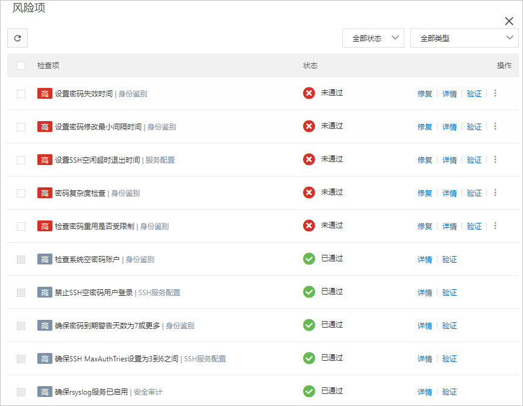

- **加入白名单**

  如果您不希望收到指定的基线检查项的告警，可对指定检查项执行**加白名单**操作。加入白名单后，该基线检查项将不再触发告警。

  > **说明**
  >
  > 选中多个检查项后，单击左下角的**加白名单**，可批量将多个检查项加入白名单。

- **修复**

  仅支持阿里云标准基线检查项的批量修复，修复时可选择多台具有相同基线风险的服务器。

  > **重要**
  >
  > 基线修复存在一定的风险，请在修复前请确认已做好备份。

- **取消已忽略的基线检查配置项告警**

  如果需要云盾控制台对已忽略的基线检查配置项再次触发告警，可对已忽略的检查项执行**取消加白**。支持单个或批量取消忽略的操作。取消加白后，该基线检查配置项会再次触发告警。

- **验证已修复的基线检查配置项**

  基线检查风险项修复后，单击验证，手动验证该基线项目是否已修复成功。执行验证后，该项目状态将显示为**验证中**。

  如果未进行手动验证，将会根据在扫描策略中设置的检测周期执行自动验证。

  验证通过后，资产的基线检查配置项的**状态**更新为**已通过**。

### 3.3.3. 风险暴露检测

风险暴漏检测支持自动分析您的服务器在互联网上的暴露情况，帮助您快速定位资产和应用在互联网上的异常暴露情况并提供相应漏洞的修复建议。本文介绍如何使用安骑士风险暴露检测功能。

**统计数据说明**

<table>
  <tr>
    <th width="160">计项</th>
    <th>说明</th>
  </tr>
  <tr>
    <td>暴露资产/公网IP数</td>
    <td>暴露在互联网上的服务器总数量和IP地址总数量。</td>
  </tr>
  <tr>
    <td>网关资产</td>
    <td>暴露在互联网上的网关资产（负载均衡、NAT网关）总数量。单击相应数值打开<strong>网关资</strong><strong>产</strong>面板，可查看网关资产的列表。</td>
  </tr>
  <tr>
    <td>暴露端口</td>
    <td>暴露在互联网上的端口总数量。单击相应数值打开<strong>暴露端口</strong>面板，可查看暴露端口的列表。</td>
  </tr>
  <tr>
    <td>暴露组件</td>
    <td>暴露在互联网上的您ECS服务器的系统组件（例如OpenSSL、OpenSSH）总数量。单击相应数值打开<strong>暴露组件</strong>面板，可查看暴露组件的列表。</td>
  </tr>
  <tr>
    <td>可被利用漏洞</td>
    <td>暴露在互联网上可被黑客利用的漏洞总数量及高危、中危、低危漏洞数量。单击表示高危、中危、低危漏洞数量的数字可跳转至<strong>漏洞修复</strong>页面。不同类型的漏洞使用不同颜色表示： • 高危：红色。此类漏洞会对您的资产安全较大的威胁，建议您重点关注并及时修复。 • 中危：橙色。此类漏洞对您的资产会产生一定的危害，建议您及时修复。 • 低危：灰色。此类漏洞对您的资产安全危害较小，您可以延后修复。</td>
  </tr>
</table>

**查看暴露详情**

**资产暴露**

1. 登录Apsara Uni-manager运营控制台。

2. 在控制台右上方，单击**安全**，选择**主机安全 > 安骑士**。在**安骑士**授权页面，选择**地域**并单击**角色授权访问**。

   > **说明**
   >
   > - 在多级组织模式下，所有数据的权限都将关联到组织下的资源集维度。用户可以通过控制台顶部菜单栏选择不同组织和资源集，以查看或处理所属组织和资源集的资产。
   >
   > - 上级组织具有最高的管理权限，对内容的修改将覆盖下级组织和资源集的配置。在进行对应配置的修改时，请务必注意。

3. 在左侧导航栏，选择**安全预防** > **风险暴露检测**。

4. 在**风险暴露检测**页面的**资产暴露**页签，查看目标资产暴露信息。

   - 筛选目标资产：支持从有无漏洞、资产分组、端口等维度筛选查看资产暴露情况。

   - 查看目标资产暴露详情：在**操作**列，单击**暴露详情**。在目标资产面板，查看资产暴露通信链路拓扑图、链路详情等。

   - 导出资产暴露数据：单击资产暴露列表右上角

     

     图标，将暴露资产的详细信息统一导出并保存到本地。导出的文件为Excel格式。

**应用暴露**

1. 登录Apsara Uni-manager运营控制台。

2. 在控制台右上方，单击**安全**，选择**主机安全 > 安骑士**。在**安骑士**授权页面，选择**地域**并单击**角色授权访问**。

   > **说明**
   >
   > - 在多级组织模式下，所有数据的权限都将关联到组织下的资源集维度。用户可以通过控制台顶部菜单栏选择不同组织和资源集，以查看或处理所属组织和资源集的资产。
   >
   > - 上级组织具有最高的管理权限，对内容的修改将覆盖下级组织和资源集的配置。在进行对应配置的修改时，请务必注意。

3. 在左侧导航栏，选择**安全预防** > **风险暴露检测**。

4. 在**风险暴露检测**页面的**应用暴露**页签，查看目标应用暴露信息。

   - 筛选目标应用：支持从有无漏洞、服务/中间件版本、服务/中间件名称等维度筛选查看应用暴露情况。

   - 查看目标应用暴露详情：在**操作**列，单击**详情**。在目标应用面板，查看应用暴露详情信息。

   - 导出应用暴露数据：单击应用暴露列表右上角

     

     图标，将暴露应用的详细信息统一导出并保存到本地。导出的文件为Excel格式。

### 3.3.4. 应用防护

应用防护功能基于RASP（Runtime Application Self-Protection）技术，通过在应用运行时检测攻击并进行应用保护，为应用提供安全防御。您无需修改应用代码，只需在实例中安装应用防护探针，即可为应用提供强大的安全防护能力，并抵御绝大部分未知漏洞所使用的攻击手法。

**步骤一：接入应用防护**

在使用应用防护功能前，您需要先新建应用，再根据应用的部署位置在应用防护功能中接入主机或容器。

**新建应用**

1. 登录Apsara Uni-manager运营控制台。

2. 在控制台右上方，单击**安全**，选择**主机安全 > 安骑士**。在**安骑士**授权页面，选择**地域**并单击**角色授权访问**。

   > **说明**
   >
   > - 在多级组织模式下，所有数据的权限都将关联到组织下的资源集维度。用户可以通过控制台顶部菜单栏选择不同组织和资源集，以查看或处理所属组织和资源集的资产。
   >
   > - 上级组织具有最高的管理权限，对内容的修改将覆盖下级组织和资源集的配置。在进行对应配置的修改时，请务必注意。

3. 在左侧导航栏，选择**安全预防** > **应用防护**。

4. 在**应用防护**的**配置**页签，单击**新建应用**，在对话框中填写要新建的应用的名称和备注信息，单击**确定**。

   新建应用后，应用的防护策略为默认策略，默认的防护模式为监控。您可单击应用**操作**列的**防护策略**查看默认策略。

5. 在**提示**对话框，单击**取消**。

   您也可以单击**确定**，直接进行应用接入。具体操作，请参见接入主机和接入容器。

6. **可选**：如果不想使用默认策略，您可以参考以下步骤修改防护策略。

   <ol type="i">

   <li>

   在**配置**页签下的应用列表，单击目标应用**操作**列的**防护策略**。

   </li>

   <li>

   在**防护策略**面板，编辑应用的防护策略，单击**确定**。

   <table>
     <tr>
       <th width="123">配置项</th>
       <th>说明</th>
     </tr>
     <tr>
       <td>防护模式</td>
       <td>选择应用的防护模式，可选项： • <strong>监控</strong>：只监控攻击行为，不影响应用运行。检测到攻击行为时，会产生<strong>处理方式</strong>为<strong>监控</strong>的告警。 • <strong>防护</strong>：监控并阻断攻击行为，同时也会对应用的一些高危操作进行监控。阻断攻击行为的同时，会产生<strong>处理方式</strong>为<strong>阻断</strong>的告警。 • <strong>禁用</strong>：关闭当前应用的应用防护功能，不检测也不阻断任何攻击行为。</td>
     </tr>
     <tr>
       <td>检测超时时间</td>
       <td>攻击检测的最大时间，输入范围为1～60,000毫秒，默认设置为300毫秒。若攻击检测超过设置的时间，即使未完成检测逻辑也会继续执行原始业务逻辑。如无特殊原因，建议使用默认值。</td>
     </tr>
     <tr>
       <td>源IP判断方式</td>
       <td>选择<strong>默认</strong>，系统会根据常规的源IP header值获取源IP。常规的源IP包括：X-Real-IP、True-Client-IP、X-Forwarded-For。选择<strong>取自定义header的值</strong>，系统会优先根据自定义的header值获取源IP。如果自定义header值未命中，则默认规则生效。</td>
     </tr>
     <tr>
       <td>检测类型</td>
       <td>检测攻击的分类，建议使用默认配置（即全选）。具体检测类型说明，请参见检测攻击类型说明。</td>
     </tr>
   </table>

   </li>

   </ol>

**接入主机**

1. 在**配置**页签下的应用列表，单击目标应用**操作**列的**接入管理**。

2. 在面板，按照**主机接入指南**页签的接入步骤，安装RASP探针，再重启应用。

   您也可以单击**一键推送**，为应用所在的服务器推送并安装RASP探针。

   重启应用时，您需要根据应用运行环境进行相关部署。下表以手动安装部署应用的JVM参数为例介绍重启应用时的运行环境部署。

   在配置参数时，您需要使用**主机接入指南**页签展示的应用ID替换 `{appId}` 。

   <table>
     <tr>
       <th width="190">运行环境</th>
       <th>参数配置说明</th>
     </tr>
     <tr>
       <td>Tomcat（Linux）</td>
       <td>在{TOMCAT_HOME}/bin/setenv.sh文件中第一行添加以下配置。 <code>JAVA_OPTS="$JAVA_OPTS -</code> <code>javaagent:/usr/local/aegis/rasp/apps/{appId}/rasp.jar"</code> 如果您的Tomcat版本没有setenv.sh配置文件，请打开{TOMCAT_HOME}/bin/catalina.sh文件，并在JAVA_OPTS后添加上述配置。</td>
     </tr>
     <tr>
       <td>Tomcat（Windows）</td>
       <td>在{TOMCAT_HOME}/bin/catalina.bat文件中":setArgs"内容的下方添加以下配置。 • Windows 64位： <code>set JAVA_OPTS=%JAVA_OPTS% "-javaagent:C:\Program</code> <code>Files (x86)\Alibaba\Aegis\rasp\apps\</code> <code>{appId}\rasp.jar"</code> • Windows 32位： <code>set JAVA_OPTS=%JAVA_OPTS% "-javaagent:C:\Program</code> <code>Files\Alibaba\Aegis\rasp\apps\{appId}\rasp.jar"</code></td>
     </tr>
     <tr>
       <td>Jetty</td>
       <td>在{JETTY_HOME}/start.ini配置文件中添加以下配置。 <code>--exec -</code> <code>javaagent:/usr/local/aegis/rasp/apps/{appId}/rasp.jar</code></td>
     </tr>
     <tr>
       <td>Spring Boot</td>
       <td>启动Spring Boot进程时，在启动命令后加上-javaagent参数。 <code>java -</code> <code>javaagent:/usr/local/aegis/rasp/apps/{appId}/rasp.jar</code> 例如，您在启动Spring Boot进程时修改前的命令为<code> java -jar </code> <code>app.jar</code> ，需要安装RASP Agent时启动Spring Boot进程执行的命令为<code> java -</code><code>javaagent:/usr/local/aegis/rasp/apps/{appId}/rasp.jar -</code><code>jar app.jar </code>。</td>
     </tr>
   </table>

   如果不需要应用防护功能防护您的应用，您可以单击**卸载指南**页签，按照页面提供的操作步骤卸载RASP探针。

**接入容器**

1. 在**配置**页签下的应用列表，单击目标应用**操作**列的**接入管理**。

2. 在面板，按照**容器接入指南**页签的接入步骤，安装RASP探针，再重启容器。

   您也可以单击一键**推送**，为应用所在的容器推送并安装RASP探针。

   重启容器时，您需要根据您容器的运行环境进行相关部署。下表以手动安装部署应用的JVM参数为例介绍重启容器时的运行环境部署。

   在配置参数时，您需要使用容器接入指南页签展示的 `Dmanager.key` 值替换 `{manager.key}` 。

   <table>
     <tr>
       <th width="115">运行环境</th>
       <th>参数配置说明</th>
     </tr>
     <tr>
       <td>SpringBoot</td>
       <td>在镜像打包时安装RASP Agent，您需要在Dockerfile修改启动参数，将启动应用的命令由<code> CMD ["java","-jar","/app.jar"] </code>修改为<code> CMD </code> <code>["java","-javaagent:/rasp/rasp.jar","-Dmanager.key=</code> <code>{manager.key}","-jar","/app.jar"] </code>。</td>
     </tr>
     <tr>
       <td>Tomcat</td>
       <td>• 在镜像打包时安装RASP Agent，您需要在Dockerfile中添加以下内容。 <code>ENV JAVA_OPTS="-javaagent:/rasp/rasp.jar -</code> <code>Dmanager.key={manager.key}"</code> • 在容器启动时安装RASP Agent，您需要在启动时添加以下参数。 <code>docker --env JAVA_OPTS="-javaagent:/rasp/rasp.jar -</code> <code>Dmanager.key={manager.key}"</code> 例如，您在启动容器时修改前的命令为<code> docker -itd --name=test </code> <code>-P </code>镜像名<code> </code>，需要安装RASP Agent时启动容器执行的命令为<code> docker </code> <code>-itd --env JAVA_OPTS="-javaagent:/rasp/rasp.jar -</code><code>Dmanager.key={manager.key}" --name=test -P </code>镜像名<code> </code>。</td>
     </tr>
     <tr>
       <td>Weblogic</td>
       <td>• 在镜像打包时安装RASP Agent，您需要在Dockerfile中添加以下内容。 <code>ENV JAVA_OPTIONS="-javaagent:/rasp/rasp.jar -</code> <code>Dmanager.key={manager.key}"</code> • 在容器启动时安装RASP Agent，您需要在启动时添加以下参数。 <code>docker --env JAVA_OPTIONS="-</code> <code>javaagent:/rasp/rasp.jar -Dmanager.key=</code> <code>{manager.key}"</code> 例如，您在启动容器时修改前的命令为<code> docker -itd --name=test </code> <code>-P </code>镜像名<code> </code>，需要安装RASP Agent时启动容器执行的命令为<code> docker </code> <code>-itd --env JAVA_OPTIONS="-javaagent:/rasp/rasp.jar -</code><code>Dmanager.key={manager.key}" --name=test -P </code>镜像名<code> </code>。</td>
     </tr>
   </table>

   

   

   如果不需要应用防护功能防护您的容器，您可以单击**卸载指南**页签，按照页面提供的操作步骤卸载RASP探针。

**步骤二：查看告警事件**

1. 登录Apsara Uni-manager运营控制台。

2. 在控制台右上方，单击**安全**，选择**主机安全 > 安骑士**。在**安骑士**授权页面，选择**地域**并单击**角色授权访问**。

   > **说明**
   >
   > - 在多级组织模式下，所有数据的权限都将关联到组织下的资源集维度。用户可以通过控制台顶部菜单栏选择不同组织和资源集，以查看或处理所属组织和资源集的资产。
   >
   > - 上级组织具有最高的管理权限，对内容的修改将覆盖下级组织和资源集的配置。在进行对应配置的修改时，请务必注意。

3. 在左侧导航栏，选择**安全预防** > **应用防护**。

4. 在**应用防护**的**告警**页签，查看告警事件的相关信息。

   **告警**页签下以环图的形式展示接入应用防护后应用产生的行为以及应用受到攻击的统计情况。页面下方列表则展示了每一攻击行为的详细数据，包括攻击行为的类型、URL、行为数据以及该行为的处理方式等。

   - 查看应用行为统计

     **应用行为统计**区域展示经过应用防护检测的应用行为以及其对应的分类，包括正常行为和攻击行为。

   - 查看攻击统计

     **攻击统计**区域展示应用防护检测到的具有实际威胁的攻击行为以及其对应的攻击类型。

   - 查看攻击详情

     攻击详细列表展示每一个攻击行为的具体情况。您可以在列表中查看攻击行为产生的时间、具体类型、URL、具体数据和该行为的处理方式。您也可以单击目标告警**操作**列的**查看**，在**详情**面板查看目标攻击行为的详情，包括漏洞的详情、请求详情和服务器的详情。

**配置白名单放行特定请求**

您可以通过配置白名单放行来自指定源IP的请求。针对满足规则的请求，安骑士不会产生告警，也不会阻断对应的操作。

1. 登录Apsara Uni-manager运营控制台。

2. 在控制台右上方，单击**安全**，选择**主机安全 > 安骑士**。在**安骑士**授权页面，选择**地域**并单击**角色授权访问**。

   > **说明**
   >
   > - 在多级组织模式下，所有数据的权限都将关联到组织下的资源集维度。用户可以通过控制台顶部菜单栏选择不同组织和资源集，以查看或处理所属组织和资源集的资产。
   >
   > - 上级组织具有最高的管理权限，对内容的修改将覆盖下级组织和资源集的配置。在进行对应配置的修改时，请务必注意。

3. 在左侧导航栏，选择**安全预防** > **应用防护**。

4. 在**应用防护**的**白名单**页签，单击**配置白名单**。

   在**配置白名单**面板，参考以下步骤配置白名单的规则并选择生效应用。

   <ol type="i">

   <li>

   在**规则名称**文本框输入白名单规则名称。

   </li>

   <li>

   （仅在多组织模式下，选择本组织全部资源集显示）在**资源集**下拉列表，选择所属资源集。

   </li>

   <li>

   在**源IP**设置需加白的攻击源IP列表。

   支持配置IP和IP网段，最多可以设置100个IP或IP网段。

   > **重要**
   >
   > 0.0.0.0/0表示放行所有IP地址的访问，请谨慎配置。

   </li>

   <li>

   在**请求路径**中配置需加白的IP访问应用的路径。

   支持通过以下类型配置请求路径：

   - **前缀匹配**：放行来自指定IP地址且访问地址前缀满足此处设置条件的请求。配置示例： `http://39.104.XX.XX:8080/` 。

   - **后缀匹配**：放行来自指定IP地址且访问地址后缀满足此处设置条件的请求。配置示例： `/Vulns/file/io/read` 。

   > **说明**
   >
   > 系统匹配时会忽略请求路径的查询字符串（QueryString）参数部分。例如，如果请求路径为 `http://127.0.XX.XX:8088/Vulns/file/io/read?path=/etc/passwd` ，系统进行匹配时会自动忽略问号（?）及其后面的部分，即忽略 `?path=/etc/passwd` 。

   </li>

   <li>

   在**检测类型**区域选择需要放行的检测类型，单击**下一步**。

   </li>

   <li>

   选择白名单生效的应用，单击**确定**。

   </li>

   </ol>

配置完成后，该白名单规则会对生效的应用下所有在线状态的RASP实例生效。

**检测攻击类型说明**

下表介绍应用防护可检测的攻击类型及相关防护建议。

| 攻击类型 | 说明 | 防护建议 |
| --- | --- | --- |
| JNI注入 | JNI注入是一种通用的RASP（Runtime Application Self-Protection）绕过手段。当攻击者拿到代码执行权限后，可以通过Java Native函数去调用外部的恶意动态链接库，从而绕过Java层的安全防护，并隐匿具体的恶意行为。 | 您的服务器可能存在代码执行漏洞，请检查漏洞的位置并限制执行代码的功能。 |
| SQL注入 | SQL注入手段通过把SQL命令插入到页面请求或Web表单的查询字符串中，以达到欺骗服务器执行指定SQL语句的目的。它可以通过在Web表单中输入SQL语句，得到存在安全漏洞的网站上的数据。 | SQL注入是由拼接SQL语句引起的。请尽可能使用预编译来处理传入的参数，或通过白名单和黑名单来限制拼接参数。 |
| XXE | 指XML外部实体注入漏洞（XML External Entity Injection）。当XML文件在引用外部实体时，通过构造恶意内容，可以导致任意文件读取，命令执行和内网攻击等不良后果。 | 请检查应用程序在解析XML时是否需要加载外部实体。如果不需要，请在XML解析配置中禁用外部实体。 |
| 恶意DNS查询 | 恶意DNS查询存在多种利用方式。攻击者极有可能通过DNS协议来突破内网的网络限制，从而将敏感信息带出内网，也可能通过DNS协议去探测内网系统是否存在SSRF、JNDI注入等漏洞。 | 恶意DNS查询是由服务器向用户控制的参数发送请求所引起的。请检查参数并通过白名单进行限制。 |
| 恶意反射调用 | RASP自保护模块，禁止攻击者通过反射的方式去修改运行时RASP的相关数据。 | 您的服务器可能存在代码执行漏洞。请检查漏洞的位置并限制执行代码的功能。 |
| 恶意外连 | SSRF（Server-side request forgery）服务器端请求伪造漏洞指的是攻击者通过构造由服务端发起的请求，对网站内部系统进行攻击。 | SSRF是由服务器向用户传入的参数发送请求所引起的。请检查参数并通过白名单进行限制。 |
| 恶意文件读写 | Java提供RandomAccessFile，用于文件读写操作。当使用该Class进行文件读写的时候，如果未对文件路径、文件内容进行限制，攻击者可能读取到系统敏感文件，也可能上传木马文件。 | 请检查文件读取和上传是否正常。如果出现异常，请检查函数代码，并通过黑名单进行限制。 |
| 恶意文件上传 | 对于网站提供的文件上传功能，如果未对上传文件的类型进行限制，攻击者可能通过上传木马文件来获取服务器的更大权限，从而造成严重危害。 | 请限制上传文件的类型，禁止上传具有执行权限的文件，如JSP。 |
| 命令执行 | 命令执行漏洞是指服务器没有对执行的命令进行过滤，用户可以随意执行系统命令。 | 通常远程命令执行是由Web Shell或服务器的危险代码引起的。请检查命令执行的位置。如果是Web Shell，请及时删除。如果是服务器的正常功能，则可以通过白名单限制执行的命令。 |
| 目录遍历 | 网站自身的配置缺陷可能会使得网站目录被任意浏览，导致隐私信息泄露。攻击者可以利用该信息对网站进行攻击。 | 请检查目录遍历操作是否正常。如果异常，请检查函数的代码，并通过黑名单对相关命令（如“./”和“../”）进行限制。 |
| 内存马注入 | 内存马是一种新兴的木马技术，攻击者通过一些特殊的技术手段将木马注入到内存中，可以有效绕过WAF和主机防御的检测。 | 您的服务器可能存在代码执行漏洞。请检查漏洞的位置并限制执行代码的功能。 |
| 任意文件读取 | 对于网站提供的文件下载和读取功能，如果是直接通过绝对路径或目录穿越符对文件进行读取和下载，没有相关文件路径的限制，那么，攻击者就可以利用这种方式获取敏感信息，对服务器进行攻击。 | 请检查文件读取操作是否正常。如果异常，请检查函数的代码，并使用黑名单对传入参数（如“./”和“../”）进行限制。 |
| 数据库弱口令 | 当数据库使用强度较低的密码时，攻击者可能通过暴力破解获取正确的数据库密码，从而达到窃取数据库数据、获取系统权限等目的。 | 请使用更复杂的密码。 |
| 线程注入 | 线程注入是一种通用的RASP绕过手段。当攻击者拿到代码执行权限后，可以通过新建线程的方式使RASP丢失掉运行环境的上下文，从而影响RASP的防御能力。 | 您的服务器可能存在代码执行漏洞。请检查漏洞的位置并限制执行代码的功能。 |
| 恶意Attach | Attach API是Java提供的动态修改字节码技术，该功能可以实现动态修改运行时应用的字节码。很多攻击者通过该手法进行Agent型内存马的注入，具有较高的欺骗性。 | 您的服务器可能存在代码执行漏洞。请检查漏洞的位置并限制执行代码的功能。 |
| JNDI注入 | 当应用进行JNDI查询的时候，若查询的URL可以由攻击者控制，则攻击者可以使服务器去查询恶意的链接使得服务器加载一些恶意class，实现任意代码执行。 | • 若该漏洞源于第三方组件，请及时进行组件版本升级。 • 若为自写JNDI查询代码，请对查询的URL进行限制，禁止一些危险协议的查询。 |
| 危险协议使用 | 若服务端进行访问的URL用户端可控，而应用本身又未对该URL的协议进行限制，那么攻击者可能通过file、netdoc等危险协议对服务器上的敏感文件进行读取。 | 请对URL可以访问的协议进行限制。 |
| 反序列化攻击 | Java反序列是指把字符序列恢复为Java对象的过程，在对象生成过程中，若该对象包含一些危险度较高的代码，则攻击者可能通过控制生成对象的成员变量在对象进行反序列化的时候实现一些恶意攻击。 | • 及时升级存在漏洞的组件版本。 • 若官方还未提供漏洞修复的组件版本，请暂时关闭该功能。 |
| 任意文件删除 | 对于网站提供的文件删除功能，如果是直接通过绝对路径或目录穿越符对文件进行读取和下载，没有相关文件路径的限制，那么，攻击者就可以利用这种方式获取敏感信息，对服务器进行攻击。 | 请检查文件删除操作是否正常。如果异常，请检查函数的代码，并使用黑名单对传入参数（如“./”和“../”）进行限制。 |
| 表达式注入 | 表达式组件提供了十分丰富的功能，支持在运行时查询和处理数据等，但很多表达式组件也提供了函数调用等权限较高的功能，如果未对这些功能做限制，而攻击者又能够控制表达式执行的内容，那么攻击者将很有可能通过表达式执行任意代码。 | 请对进入表达式的内容进行严格限制，禁止大部分Java函数的调用。若是第三方组件漏洞导致，请及时升级组件版本。 |
| 引擎注入 | Java提供较多的第三方引擎组件（如rhino、Nashorn等JS引擎，velocity、freemarker等模板引擎），这些引擎通常提供了函数调用等权限较高的功能，如果对这些功能未做限制，而攻击者又能够控制引擎执行的内容，那么攻击者将很有可能通过引擎执行任意代码。 | 请对进入引擎文件的内容进行严格限制，禁止大部分Java函数的调用。若是第三方组件漏洞导致，请及时升级组件版本。 |
| 恶意Beans绑定 | Java存在一些框架支持对应用运行时Beans的参数绑定，如果未对绑定Beans的类型进行限制，攻击者就可以通过对一些敏感Beans值的修改，破坏应用的运行，甚至造成执行任意代码。 | 请对可以绑定的Beans的类型进行限制，禁止对类似于Class、Classloader类型的Beans值进行修改。若是第三方组件漏洞导致，请及时升级组件版本。 |
| 恶意类加载 | 现阶段，很多0day、WebShell的利用均依赖于恶意类的加载，一旦恶意类加载成功，攻击者便可以通过恶意类的初始化来取得代码执行权限，从而进行一系列的恶意操作。 | • 若恶意类的加载是通过WebShell控制，请及时删除WebShell。 • 若恶意类的加载是框架导致，请及时升级框架版本。 |
| JSTL任意文件包含 | JSP标准标签库（JSTL）是一个JSP标签集合，它封装了JSP应用的通用核心功能。当用户可控参数被直接拼接到JSTL标签中而未对该参数进行任何限制的情况下，攻击者可以构造特殊的攻击脚本造成任意文件读取、SSRF的攻击。 | 尽可能不要将用户可控参数直接拼接到JSTL标签上，如果必须这样做，请对该参数的内容进行严格的白名单控制。 |

## 3.4. 入侵防御

### 3.4.1. 病毒防御

安骑士的病毒查杀设置功能提供自定义配置病毒查杀和网站后门查杀管理的服务。

**病毒查杀**

**病毒扫描配置**

病毒查杀能够帮助您自动隔离常见网络病毒，包括主流木马病毒、勒索软件、挖矿病毒、DDoS木马等。所有支持自动隔离的病毒都经过了云盾安全专家的测试和验证，确保零误杀。

未开启自动隔离时，云盾安骑士以安全告警的形式向您展示在服务器上检测出的病毒，您需要在控制台手动处理。建议您开启病毒自动隔离，加固主机安全防线。

1. 登录Apsara Uni-manager运营控制台。

2. 在控制台右上方，单击**安全**，选择**主机安全 > 安骑士**。在**安骑士**授权页面，选择**地域**并单击**角色授权访问**。

   > **说明**
   >
   > - 在多级组织模式下，所有数据的权限都将关联到组织下的资源集维度。用户可以通过控制台顶部菜单栏选择不同组织和资源集，以查看或处理所属组织和资源集的资产。
   >
   > - 上级组织具有最高的管理权限，对内容的修改将覆盖下级组织和资源集的配置。在进行对应配置的修改时，请务必注意。

3. 在左侧导航栏，选择**入侵防御** > **病毒防御**。

4. 在**病毒查杀**页签右上方，单击**扫描设置**。

5. 在**扫描配置**面板，设置**扫描周期**、**扫描方式**和**扫描范围**，单击**确定**。

   在多级组织模式下，支持从资源集维度筛选扫描的资产。

**开始病毒扫描**

1. 在**病毒查杀**页签，单击**开始病毒扫描**或**重新扫描**。

2. 在弹出的对话框，选择**扫描模式**和**扫描范围**，单击**确定**。

   <table>
     <tr>
       <th width="89">配置项</th>
       <th>说明</th>
     </tr>
     <tr>
       <td>扫描模式</td>
       <td>选择病毒扫描模式。 • <strong>快速扫描</strong>：该模式下，云安全中心会自动检测活动进程、启动项、敏感目录文件等安全风险。 • <strong>自定义目录扫描</strong>：该模式下，您可以自定义需要扫描的文件目录。输入需要扫描的文件目录，如果有多个文件目录需要换行输入。单次最大支持扫描30,000个文件，如果文件目录中的文件超过30,000个，超出部分的文件将无法扫描。</td>
     </tr>
     <tr>
       <td>扫描范围</td>
       <td>选择资产扫描的资产范围。您可以按照以下类型选择待扫描资产： • <strong>全部资产</strong>：扫描全部资产。 • <strong>按资产</strong>：选择待扫描的主机资产。 • <strong>按分组</strong>：选择资产分组，云安全中心将扫描该资产分组下的所有资产。如果选中的资产分组新增了资产，新增资产将自动加入扫描范围。</td>
     </tr>
   </table>

**处理告警**

> **重要**
>
> 清理病毒时可能会导致业务中断，建议您在进行深度查杀前手动对系统进行快照备份，以免造成不必要的损失。

1. 在**病毒查杀**页签，单击**立即处理**。

2. 单击**一键处理**或选中目标服务器，单击**批量处理**或在**操作**列，单击**处理**。

3. 在**告警处理**对话框，处理告警，并勾选**已了解清理病毒风险**，单击**立即处理**。

   - **深度查杀**：深度查杀由云安全中心安全专家团队经过对该持久化、顽固型病毒进行深度分析、测试后，推出的专项查杀能力。

   - **加白名单**：选择加白名单操作后，当再次发生相同告警时将不再进行告警，请谨慎操作。

   - **忽略**：选择忽略本次操作后，该告警状态将更新为已忽略，当相同告警再次发生时，云安全中心将再次告警。

   - **我已手工处理**：该告警为可疑的异常行为，建议您根据处置建议进行排查，排查后点击立即处理后，该告警状态将更新为已处理。

### 3.4.2. 网页防篡改

网页防篡改功能可实时监控服务器网站目录或文件，并可在网站被恶意篡改时通过备份数据恢复被篡改的文件或目录，防止网站被植入非法信息，保障网站正常运行。本文介绍如何使用网页防篡改功能。

**前提条件**

已在需要网页防篡改防护的服务器上安装云盾安全中心客户端。具体操作，请参见安装客户端。

**背景信息**

网络攻击者通常会利用被攻击网站中存在的漏洞，通过在网页中植入非法暗链等方式篡改网页内容，进行非法牟利或者恶意商业攻击等活动。网页被恶意篡改会影响您的网页被正常访问，还可能会导致严重的经济损失、品牌损失甚至是政治风险。

云盾安全中心客户端通过自动化采集被保护服务器的防护目录下文件的进程列表，实时识别异常进程和异常文件变动，并对导致异常文件变动的进程进行拦截或告警。

**使用限制**

- 一个网页防篡改授权数可防护一台服务器。

- 一台服务器只能添加一次防护，一台服务器最多可添加10个防护目录。

- 当服务器操作系统和内核版本**在指定版本号范围**（表：***白名单功能支持的操作系统和内核版本***）内时：

  - 支持使用白名单功能：如果已确认拦截或告警的异常文件变动为正常业务进程，可将该进程路径加入白名单，云安全中心将不再对该进程进行拦截和告警。

  - 添加防护目录时，有以下限制：

    - 每个被防护的文件或目录的完整路径长度不能超过1,000个英文字符或500个中文字符。

    - 如果防护目录被设置为NFS server的进程路径，则无法防御通过NFS client访问修改该路径下文件的攻击行为。

- 当服务器操作系统和内核版本**不在指定版本号范围**（表：***白名单功能支持的操作系统和内核版本***）内时：

  - 不支持使用白名单功能。即使加入白名单，防篡改进程白名单也无法生效。

  - 添加防护目录时，有以下限制：

    - 每个被防护的目录大小不超过20 GB。

    - 每个被防护的目录下的文件夹个数不超过20,000个。

    - 每个被防护的目录文件夹层级不超过20个。

    - 每个被防护的文件大小不超过20 GB。

    - 告警模式无法使用。

    - 网络文件系统NFS路径无法防御。

    - 可能不产生告警信息。产生的告警信息中不包含进程路径信息。

表 1. 白名单功能支持的操作系统和内核版本

| 操作系统 | 操作系统版本号 | 内核版本号 |
| --- | --- | --- |
| Windows（32位或64位） | Windows Server 2008、2012、2016和2019 | 所有版本。 |
| CentOS（64位） | 不限制，以支持的内核版本号为准 | • 2.6.32系列 • 2.6.32-754.35.1.el6.x86_64 • 2.6.32-754.33.1.el6.x86_64 • 2.6.32-754.31.1.el6.x86_64 • 2.6.32-754.30.2.el6.x86_64 • 2.6.32-754.29.2.el6.x86_64 • 2.6.32-754.29.1.el6.x86_64 • 2.6.32-754.28.1.el6.x86_64 • 2.6.32-754.27.1.el6.x86_64 • 2.6.32-754.25.1.el6.x86_64 • 2.6.32-754.24.3.el6.x86_64 • 2.6.32-754.23.1.el6.x86_64 • 2.6.32-754.22.1.el6.x86_64 • 2.6.32-754.18.2.el6.x86_64 • 2.6.32-754.17.1.el6.x86_64 • 2.6.32-754.15.3.el6.x86_64 • 2.6.32-754.14.2.el6.x86_64 • 2.6.32-754.12.1.el6.x86_64 • 2.6.32-754.11.1.el6.x86_64 • 2.6.32-754.10.1.el6.x86_64 • 2.6.32-754.9.1.el6.x86_64 • 2.6.32-754.6.3.el6.x86_64 • 2.6.32-754.3.5.el6.x86_64 • 2.6.32-754.2.1.el6.x86_64 • 2.6.32-754.el6.x86_64 • 2.6.32-696.30.1.el6.x86_64 • 2.6.32-696.28.1.el6.x86_64 • 2.6.32-696.23.1.el6.x86_64 • 2.6.32-696.20.1.el6.x86_64 • 2.6.32-696.18.7.el6.x86_64 • 2.6.32-696.16.1.el6.x86_64 • 2.6.32-696.13.2.el6.x86_64 • 2.6.32-696.10.2.el6.x86_64 • 2.6.32-696.10.1.el6.x86_64 • 2.6.32-696.6.3.el6.x86_64 • 2.6.32-696.3.2.el6.x86_64 • 2.6.32-696.3.1.el6.x86_64 • 2.6.32-696.1.1.el6.x86_64 • 2.6.32-696.el6.x86_64 • 2.6.32-642.15.1.el6.x86_64 • 2.6.32-642.13.1.el6.x86_64 • 2.6.32-642.11.1.el6.x86_64 • 2.6.32-642.13.1.el6.centos.plus.x86_64 • 2.6.32-642.11.1.el6.centos.plus.x86_64 • 2.6.32-642.6.2.el6.centos.plus.x86_64 • 2.6.32-642.6.2.el6.x86_64 • 2.6.32-642.6.1.el6.x86_64 • 2.6.32-642.4.2.el6.x86_64 • 2.6.32-642.3.1.el6.x86_64 • 2.6.32-642.1.1.el6.x86_64 • 2.6.32-642.el6.x86_64 • 2.6.32-573.22.1.el6.x86_64 • 2.6.32-573.18.1.el6.x86_64 • 2.6.32-573.12.1.el6.x86_64 • 2.6.32-573.26.1.el6.x86_64 • 2.6.32-573.3.1.el6.x86_64 • 2.6.32-573.7.1.el6.x86_64 • 2.6.32-573.8.1.el6.x86_64 • 2.6.32-573.el6.x86_64 • 2.6.32-504.30.3.el6.x86_64 • 2.6.32-504.23.4.el6.x86_64 • 2.6.32-504.16.2.el6.x86_64 • 2.6.32-504.12.2.el6.x86_64 • 2.6.32-504.8.1.el6.x86_64 • 2.6.32-504.3.3.el6.x86_64 • 2.6.32-504.1.3.el6.x86_64 • 2.6.32-504.el6.x86_64 • 2.6.32-431.29.2.el6.x86_64 • 2.6.32-431.23.3.el6.x86_64 • 2.6.32-431.20.3.el6.x86_64 • 2.6.32-431.17.1.el6.x86_64 • 2.6.32-431.el6.x86_64 • 2.6.32-358.18.1.el6.x86_64 • 2.6.32-358.6.2.el6.x86_64 • 2.6.32-358.el6.x86_64 • 2.6.32-279.el6.x86_64 • 2.6.32-220.13.1.el6.x86_64 • 2.6.32-220.el6.x86_64 • 3.10.X系列 • 3.10.107-1.el6.elrepo.x86_64 • 3.10.0-1160.108.1.el7.x86_64 • 3.10.0-1160.105.1.el7.x86_64 • 3.10.0-1160.102.1.el7.x86_64 • 3.10.0-1160.99.1.el7.x86_64 • 3.10.0-1160.95.1.el7.x86_64 • 3.10.0-1160.92.1.el7.x86_64 • 3.10.0-1160.90.1.el7.x86_64 • 3.10.0-1160.88.1.el7.x86_64 • 3.10.0-1160.83.1.el7.x86_64 • 3.10.0-1160.81.1.el7.x86_64 • 3.10.0-1160.80.1.el7.x86_64 • 3.10.0-1160.76.1.el7.x86_64 • 3.10.0-1160.71.1.el7.x86_64 • 3.10.0-1160.66.1.el7.x86_64 • 3.10.0-1160.62.1.el7.x86_64 • 3.10.0-1160.59.1.el7.x86_64 • 3.10.0-1160.53.1.el7.x86_64 • 3.10.0-1160.49.1.el7.x86_64 • 3.10.0-1160.45.1.el7.x86_64 • 3.10.0-1160.42.2.el7.x86_64 • 3.10.0-1160.41.1.el7.x86_64 • 3.10.0-1160.36.2.el7.x86_64 • 3.10.0-1160.31.1.el7.x86_64 • 3.10.0-1160.25.1.el7.x86_64 • 3.10.0-1160.24.1.el7.x86_64 • 3.10.0-1160.21.1.el7.x86_64 • 3.10.0-1160.15.2.el7.x86_64 • 3.10.0-1160.11.1.el7.x86_64 • 3.10.0-1160.6.1.el7.x86_64 • 3.10.0-1160.2.2.el7.x86_64 • 3.10.0-1160.2.1.el7.x86_64 • 3.10.0-1160.el7.x86_64 • 3.10.0-1127.19.1.el7.x86_64 • 3.10.0-1127.18.2.el7.x86_64 • 3.10.0-1127.13.1.el7.x86_64 • 3.10.0-1127.10.1.el7.x86_64 • 3.10.0-1127.8.2.el7.x86_64 • 3.10.0-1127.el7.x86_64 • 3.10.0-1062.18.1.el7.x86_64 • 3.10.0-1062.12.1.el7.x86_64 • 3.10.0-1062.9.1.el7.x86_64 • 3.10.0-1062.7.1.el7.x86_64 • 3.10.0-1062.4.3.el7.x86_64 • 3.10.0-1062.4.2.el7.x86_64 • 3.10.0-1062.4.1.el7.x86_64 • 3.10.0-1062.1.2.el7.x86_64 • 3.10.0-1062.1.1.el7.x86_64 • 3.10.0-1062.el7.x86_64 • 3.10.0-957.27.2.el7.x86_64 • 3.10.0-957.21.3.el7.x86_64 • 3.10.0-957.12.2.el7.x86_64 • 3.10.0-957.12.2.el7.x86_64 • 3.10.0-957.12.1.el7.x86_64 • 3.10.0-957.10.1.el7.x86_64 • 3.10.0-957.5.1.el7.x86_64 • 3.10.0-957.1.3.el7.x86_64 • 3.10.0-957.el7.x86_64 • 3.10.0-862.14.4.el7.x86_64 • 3.10.0-862.11.6.el7.x86_64 • 3.10.0-862.9.1.el7.x86_64 • 3.10.0-862.6.3.el7.x86_64 • 3.10.0-862.3.3.el7.x86_64 • 3.10.0-862.3.2.el7.x86_64 • 3.10.0-862.2.3.el7.x86_64 • 3.10.0-862.el7.x86_64 • 3.10.0-693.21.1.el7.x86_64 • 3.10.0-693.17.1.el7.x86_64 • 3.10.0-693.11.6.el7.x86_64 • 3.10.0-693.11.1.el7.x86_64 • 3.10.0-693.5.2.el7.x86_64 • 3.10.0-693.2.2.el7.x86_64 • 3.10.0-693.el7.x86_64 • 3.10.0-514.26.2.el7.x86_64 • 3.10.0-514.26.1.el7.x86_64 • 3.10.0-514.21.2.el7.x86_64 • 3.10.0-514.21.1.el7.x86_64 • 3.10.0-514.16.1.el7.x86_64 • 3.10.0-514.10.2.el7.x86_64 • 3.10.0-514.6.2.el7.x86_64 • 3.10.0-514.6.1.el7.x86_64 • 3.10.0-514.2.2.el7.x86_64 • 3.10.0-514.el7.x86_64 • 3.10.0-327.36.3.el7.x86_64 • 3.10.0-327.36.2.el7.x86_64 • 3.10.0-327.36.1.el7.x86_64 • 3.10.0-327.28.3.el7.x86_64 • 3.10.0-327.28.2.el7.x86_64 • 3.10.0-327.22.2.el7.x86_64 • 3.10.0-327.18.2.el7.x86_64 • 3.10.0-327.13.1.el7.x86_64 • 3.10.0-327.10.1.el7.x86_64 • 3.10.0-327.el7.x86_64 • 3.10.0-229.el7.x86_64 • 3.10.0-123.9.3.el7.x86_64 • 4.4.X系列 • 4.4.248-1.el7.elrepo.x86_64 • 4.4.240-1.el7.elrepo.x86_64 • 4.4.231-1.el7.elrepo.x86_64 • 4.4.228-2.el7.elrepo.x86_64 • 4.4.225-1.el7.elrepo.x86_64 • 4.4.223-1.el7.elrepo.x86_64 • 4.4.219-1.el7.elrepo.x86_64 • 4.4.217-1.el7.elrepo.x86_64 • 4.4.216-1.el7.elrepo.x86_64 • 4.4.202-1.el7.elrepo.x86_64 • 4.4.196-1.el7.elrepo.x86_64 • 4.4.175-1.el7.elrepo.x86_64 • 4.4.169-1.el7.elrepo.x86_64 • 4.4.71-1.el7.elrepo.x86_64 • 4.9.X~4.14.X系列 • 4.14.1-1.el7.elrepo.x86_64 • 4.13.3-1.el7.elrepo.x86_64 • 4.13.2-1.el7.elrepo.x86_64 • 4.11.8-1.el7.elrepo.x86_64 • 4.9.220-37.el7.x86_64 • 4.9.215-36.el7.x86_64 • 4.18.X系列 • 4.18.10-1.el7.elrepo.x86_64 • 4.18.8-1.el7.elrepo.x86_64 • 4.18.0-529.el8.x86_64 • 4.18.0-521.el8.x86_64 • 4.18.0-513.11.1.el8_9.x86_64 • 4.18.0-513.9.1.el8_9.x86_64 • 4.18.0-513.el8.x86_64 • 4.18.0-512.el8.x86_64 • 4.18.0-500.el8.x86_64 • 4.18.0-497.el8.x86_64 • 4.18.0-496.el8.x86_64 • 4.18.0-490.el8.x86_64 • 4.18.0-485.el8.x86_64 • 4.18.0-477.27.2.el8_8.x86_64 • 4.18.0-477.27.1.el8_8.x86_64 • 4.18.0-477.21.1.el8_8.x86_64 • 4.18.0-477.15.1.el8_8.x86_64 • 4.18.0-477.13.1.el8_8.x86_64 • 4.18.0-477.10.1.el8_8.x86_64 • 4.18.0-448.el8.x86_64 • 4.18.0-425.19.2.el8_7.x86_64 • 4.18.0-425.13.1.el8_7.x86_64 • 4.18.0-425.10.1.el8_7.x86_64 • 4.18.0-425.3.1.el8.x86_64 • 4.18.0-408.el8.x86_64 • 4.18.0-394.el8.x86_64 • 4.18.0-383.el8.x86_64 • 4.18.0-373.el8.x86_64 • 4.18.0-372.32.1.el8_6.x86_64 • 4.18.0-372.26.1.el8_6.x86_64 • 4.18.0-372.16.1.el8_6.0.1.x86_64 • 4.18.0-372.19.1.el8_6.x86_64 • 4.18.0-372.9.1.el8.x86_64 • 4.18.0-365.el8.x86_64 • 4.18.0-358.el8.x86_64 • 4.18.0-348.20.1.el8_5.x86_64 • 4.18.0-348.12.2.el8_5.x86_64 • 4.18.0-348.7.1.el8_5.x86_64 • 4.18.0-348.2.1.el8_5.x86_64 • 4.18.0-348.el8.x86_64 • 4.18.0-305.25.1.el8_4.x86_64 • 4.18.0-305.19.1.el8_4.x86_64 • 4.18.0-305.17.1.el8_4.x86_64 • 4.18.0-305.12.1.el8_4.x86_64 • 4.18.0-305.10.2.el8_4.x86_64 • 4.18.0-305.7.1.el8_4.x86_64 • 4.18.0-305.3.1.el8.x86_64 • 4.18.0-240.22.1.el8_3.x86_64 • 4.18.0-240.15.1.el8_3.x86_64 • 4.18.0-240.10.1.el8_3.x86_64 • 4.18.0-240.1.1.el8_3.x86_64 • 4.18.0-193.28.1.el8_2.x86_64 • 4.18.0-193.19.1.el8_2.x86_64 • 4.18.0-193.14.2.el8_2.x86_64 • 4.18.0-193.6.3.el8_2.x86_64 • 4.18.0-193.1.2.el8_2.x86_64 • 4.18.0-193.el8.x86_64 • 4.18.0-147.8.1.el8_1.x86_64 • 4.18.0-147.5.1.el8_1.x86_64 • 4.18.0-147.3.1.el8_1.x86_64 • 4.18.0-80.11.2.el8_0.x86_64 • 4.19.X~4.20.X系列 • 4.20.13-1.el7.elrepo.x86_64 • 4.19.118-2.el7.centos.x86_64 • 4.19.113-300.el7.x86_64 • 4.19.104-300.el7.x86_64 • 4.19.110-300.el7.x86_64 • 4.19.94-300.el7.x86_64 • 4.19.12-1.el7.elrepo.x86_64 • 4.19.1-1.el7.elrepo.x86_64 • 5.3.X~5.8.X系列 • 5.8.8-1.el7.elrepo.x86_64 • 5.6.5-1.el7.elrepo.x86_64 • 5.5.7-1.el7.elrepo.x86_64 • 5.5.5-1.el7.elrepo.x86_64 • 5.5.1-1.el7.elrepo.x86_64 • 5.4.268-1.el8.elrepo.x86_64 • 5.4.268-1.el7.elrepo.x86_64 • 5.4.265-1.el7.elrepo.x86_64 • 5.4.264-1.el7.elrepo.x86_64 • 5.4.262-1.el8.elrepo.x86_64 • 5.4.259-1.el7.elrepo.x86_64 • 5.4.258-1.el7.elrepo.x86_64 • 5.4.257-1.el7.elrepo.x86_64 • 5.4.256-1.el7.elrepo.x86_64 • 5.4.255-1.el7.elrepo.x86_64 • 5.4.254-1.el7.elrepo.x86_64 • 5.4.253-1.el8.elrepo.x86_64 • 5.4.249-1.el7.elrepo.x86_64 • 5.4.247-1.el7.elrepo.x86_64 • 5.4.246-1.el7.elrepo.x86_64 • 5.4.245-1.el7.elrepo.x86_64 • 5.4.243-1.el7.elrepo.x86_64 • 5.4.242-1.el7.elrepo.x86_64 • 5.4.240-1.el7.elrepo.x86_64 • 5.4.231-1.el7.elrepo.x86_64 • 5.4.230-1.el7.elrepo.x86_64 • 5.4.228-1.el7.elrepo.x86_64 • 5.4.225-200.el7.x86_64 • 5.4.225-1.el7.elrepo.x86_64 • 5.4.223-1.el7.elrepo.x86_64 • 5.4.221-1.el7.elrepo.x86_64 • 5.4.210-1.el7.elrepo.x86_64 • 5.4.209-1.el7.elrepo.x86_64 • 5.4.208-1.el7.elrepo.x86_64 • 5.4.207-1.el7.elrepo.x86_64 • 5.4.204-1.el7.elrepo.x86_64 • 5.4.201-1.el7.elrepo.x86_64 • 5.4.195-1.el7.elrepo.x86_64 • 5.4.194-1.el7.elrepo.x86_64 • 5.4.188-1.el7.elrepo.x86_64 • 5.4.181-1.el7.elrepo.x86_64 • 5.4.179-1.el7.elrepo.x86_64 • 5.4.173-1.el7.elrepo.x86_64 • 5.4.172-1.el7.elrepo.x86_64 • 5.4.170-1.el7.elrepo.x86_64 • 5.4.168-1.el7.elrepo.x86_64 • 5.4.165-1.el7.elrepo.x86_64 • 5.4.157-1.el7.elrepo.x86_64 • 5.4.155-200.el7.x86_64 • 5.4.155-1.el7.elrepo.x86_64 • 5.4.150-1.el7.elrepo.x86_64 • 5.4.148-1.el7.elrepo.x86_64 • 5.4.144-1.el7.elrepo.x86_64 • 5.4.143-1.el7.elrepo.x86_64 • 5.4.132-1.el7.elrepo.x86_64 • 5.4.131-1.el7.elrepo.x86_64 • 5.4.129-1.el7.elrepo.x86_64 • 5.4.119-19.0009.28 • 5.4.119-19-0009.11 • 5.4.119-19-0009.1 • 5.4.109-1.el7.elrepo.x86_64 • 5.4.91-1.el7.elrepo.x86_64 • 5.4.86-1.el7.elrepo.x86_64 • 5.4.42-200.el7.x86_64 • 5.4.8-1.el7.elrepo.x86_64 • 5.3.8-1.el7.elrepo.x86_64 • 5.3.7-1.el7.elrepo.x86_64 • 5.3.6-1.el7.elrepo.x86_64 • 5.3.0-1.el7.elrepo.x86_64 • 5.10.X~5.13.X系列 • 5.13.2-1.el7.elrepo.x86_64 • 5.12.12-1.el7.elrepo.x86_64 • 5.12.3-1.el7.elrepo.x86_64 • 5.11.8-1.el7.elrepo.x86_64 • 5.11.6-1.el7.elrepo.x86_64 • 5.11.1-1.el7.elrepo.x86_64 • 5.10.9-1.el7.elrepo.x86_64 • 5.14.0系列 • 5.14.0-412.el9.x86_64 • 5.14.0-407.el9.x86_64 • 5.14.0-391.el9.x86_64 • 5.14.0-386.el9.x86_64 • 5.14.0-383.el9.x86_64 • 5.14.0-366.el9.x86_64 • 5.14.0-362.18.1.el9_3.x86_64 • 5.14.0-362.13.1.el9_3.x86_64 • 5.14.0-362.8.1.el9_3.x86_64 • 5.14.0-361.el9.x86_64 • 5.14.0-350.el9.x86_64 • 5.14.0-333.el9.x86_64 • 5.14.0-325.el9.x86_64 • 5.14.0-312.el9.x86_64 • 5.14.0-307.el9.x86_64 • 5.14.0-299.el9.x86_64 • 5.14.0-289.el9.x86_64 • 5.14.0-285.el9.x86_64 • 5.14.0-284.30.1.el9_2.x86_64 • 5.14.0-284.25.1.el9_2.x86_64 • 5.14.0-284.18.1.el9_2.x86_64 • 5.14.0-284.11.1.el9_2.x86_64 • 5.14.0-267.el9.x86_64 • 5.14.0-252.el9.x86_64 • 5.14.0-229.el9.x86_64 • 5.14.0-226.el9.x86_64 • 5.14.0-210.el9.x86_64 • 5.14.0-205.el9.x86_64 • 5.14.0-197.el9.x86_64 • 5.14.0-191.el9.x86_64 • 5.14.0-177.el9.x86_64 • 5.14.0-162.23.1.el9_1.x86_64 • 5.14.0-162.18.1.el9_1.x86_64 • 5.14.0-162.12.1.el9_1.x86_64 • 5.14.0-162.6.1.el9_1.x86_64 • 5.14.0-160.el9.x86_64 • 5.14.0-148.el9.x86_64 • 5.14.0-134.el9.x86_64 • 5.14.0-119.el9.x86_64 • 5.14.0-70.30.1.el9_0.x86_64 • 5.14.0-70.17.1.el9_0.x86_64 • 5.15.X~5.19.X系列 • 5.19.12-1.el7.elrepo.x86_64 • 5.19.1-1.el7.elrepo.x86_64 • 5.19.0-1.el7.elrepo.x86_64 • 5.18.7-1.el7.elrepo.x86_64 • 5.18.6-1.el7.elrepo.x86_64 • 5.18.4-1.el7.elrepo.x86_64 • 5.18.0-1.el7.elrepo.x86_64 • 5.17.6-1.el7.elrepo.x86_64 • 5.17.1-1.el7.elrepo.x86_64 • 5.17.0-1.el7.elrepo.x86_64 • 5.16.12-1.el7.elrepo.x86_64 • 5.15.102-1.el7.x86_64 • 5.15.11-1.el7.elrepo.x86_64 • 5.15.6-1.el7.elrepo.x86_64 • 5.15.5-1.el7.elrepo.x86_64 • 5.15.2-1.el7.elrepo.x86_64 • 6.X.X系列 • 6.6.4-1.el8.elrepo.x86_64 • 6.6.1-1.el7.elrepo.x86_64 • 6.4.12-1.el7.elrepo.x86_64 • 6.4.11-1.el7.elrepo.x86_64 • 6.4.10-1.el7.elrepo.x86_64 • 6.4.8-1.el7.elrepo.x86_64 • 6.4.7-1.el7.elrepo.x86_64 • 6.4.3-1.el7.elrepo.x86_64 • 6.4.2-1.el7.elrepo.x86_64 • 6.4.1-1.el7.elrepo.x86_64 • 6.4.0-1.el7.elrepo.x86_64 • 6.3.9-1.el7.elrepo.x86_64 • 6.3.8-1.el7.elrepo.x86_64 • 6.3.7-1.el7.elrepo.x86_64 • 6.3.6-1.el7.elrepo.x86_64 • 6.3.5-1.el7.elrepo.x86_64 • 6.3.4-1.el7.elrepo.x86_64 • 6.3.3-1.el7.elrepo.x86_64 • 6.3.2-1.el7.elrepo.x86_64 • 6.3.1-1.el7.elrepo.x86_64 • 6.3.0-1.el7.elrepo.x86_64 • 6.2.12-1.el8.elrepo.x86_64 • 6.2.12-1.el7.elrepo.x86_64 • 6.2.11-1.el7.elrepo.x86_64 • 6.2.10-1.el7.elrepo.x86_64 • 6.2.9-1.el7.elrepo.x86_64 • 6.2.8-1.el7.elrepo.x86_64 • 6.2.7-1.el7.elrepo.x86_64 • 6.2.6-1.el7.elrepo.x86_64 • 6.2.2-1.el7.elrepo.x86_64 • 6.2.1-1.el7.elrepo.x86_64 • 6.1.0-1.el7.elrepo.x86_64 • 6.0.10-1.el7.elrepo.x86_64 • 6.0.6-1.el9.elrepo.x86_64 • 6.0.1-1.el7.elrepo.x86_64 |
| Ubuntu（64位） | 不限制，以支持的内核版本号为准 | • 3.X.X系列 • 3.19.0-80-generic • 3.19.0-25-generic • 3.13.0-170-generic • 3.13.0-169-generic • 3.13.0-164-generic • 3.13.0-153-generic • 3.13.0-145-generic • 3.13.0-144-generic • 3.13.0-135-generic • 3.13.0-92-generic • 3.13.0-86-generic • 3.13.0-65-generic • 3.13.0-32-generic • 3.13.0-30-generic • 3.2.0-126-generic • 3.2.0-67-generic • 4.4.0系列 • 4.4.0-210-generic • 4.4.0-208-generic • 4.4.0-206-generic • 4.4.0-203-generic • 4.4.0-201-generic • 4.4.0-200-generic • 4.4.0-198-generic • 4.4.0-197-generic • 4.4.0-194-generic • 4.4.0-193-generic • 4.4.0-190-generic • 4.4.0-189-generic • 4.4.0-187-generic • 4.4.0-186-generic • 4.4.0-185-generic • 4.4.0-184-generic • 4.4.0-179-generic • 4.4.0-178-generic • 4.4.0-177-generic • 4.4.0-176-generic • 4.4.0-174-generic • 4.4.0-173-generic • 4.4.0-171-generic • 4.4.0-170-generic • 4.4.0-169-generic • 4.4.0-166-generic • 4.4.0-165-generic • 4.4.0-164-generic • 4.4.0-161-generic • 4.4.0-159-generic • 4.4.0-157-generic • 4.4.0-154-generic • 4.4.0-151-generic • 4.4.0-150-generic • 4.4.0-148-generic • 4.4.0-146-generic • 4.4.0-145-generic • 4.4.0-143-generic • 4.4.0-142-generic • 4.4.0-141-generic • 4.4.0-140-generic • 4.4.0-139-generic • 4.4.0-138-generic • 4.4.0-137-generic • 4.4.0-135-generic • 4.4.0-131-generic • 4.4.0-130-generic • 4.4.0-128-generic • 4.4.0-127-generic • 4.4.0-124-generic • 4.4.0-122-generic • 4.4.0-119-generic • 4.4.0-117-generic • 4.4.0-116-generic • 4.4.0-112-generic • 4.4.0-109-generic • 4.4.0-105-generic • 4.4.0-104-generic • 4.4.0-101-generic • 4.4.0-98-generic • 4.4.0-97-generic • 4.4.0-96-generic • 4.4.0-93-generic • 4.4.0-87-generic • 4.4.0-85-generic • 4.4.0-81-generic • 4.4.0-79-generic • 4.4.0-63-generic • 4.4.0-62-generic • 4.4.0-57-generic • 4.4.0-53-generic • 4.15.0系列 • 4.15.0-1098-gcp • 4.15.0-1047-gcp • 4.15.0-213-generic • 4.15.0-212-generic • 4.15.0-211-generic • 4.15.0-210-generic • 4.15.0-209-generic • 4.15.0-208-generic • 4.15.0-206-generic • 4.15.0-204-generic • 4.15.0-202-generic • 4.15.0-201-generic • 4.15.0-200-generic • 4.15.0-197-generic • 4.15.0-196-generic • 4.15.0-194-generic • 4.15.0-193-generic • 4.15.0-192-generic • 4.15.0-191-generic • 4.15.0-190-generic • 4.15.0-189-generic • 4.15.0-188-generic • 4.15.0-187-generic • 4.15.0-184-generic • 4.15.0-181-generic • 4.15.0-180-generic • 4.15.0-177-generic • 4.15.0-176-generic • 4.15.0-175-generic • 4.15.0-173-generic • 4.15.0-171-generic • 4.15.0-170-generic • 4.15.0-169-generic • 4.15.0-167-generic • 4.15.0-166-generic • 4.15.0-161-generic • 4.15.0-163-generic • 4.15.0-162-generic • 4.15.0-159-generic • 4.15.0-158-generic • 4.15.0-156-generic • 4.15.0-154-generic • 4.15.0-153-generic • 4.15.0-151-generic • 4.15.0-147-generic • 4.15.0-145-generic • 4.15.0-144-generic • 4.15.0-143-generic • 4.15.0-141-generic • 4.15.0-142-generic • 4.15.0-140-generic • 4.15.0-139-generic • 4.15.0-137-generic • 4.15.0-136-generic • 4.15.0-135-generic • 4.15.0-134-generic • 4.15.0-132-generic • 4.15.0-130-generic • 4.15.0-129-generic • 4.15.0-128-generic • 4.15.0-124-generic • 4.15.0-122-generic • 4.15.0-121-generic • 4.15.0-117-generic • 4.15.0-118-generic • 4.15.0-112-generic • 4.15.0-111-generic • 4.15.0-109-generic • 4.15.0-108-generic • 4.15.0-106-generic • 4.15.0-101-generic • 4.15.0-99-generic • 4.15.0-96-generic • 4.15.0-91-generic • 4.15.0-88-generic • 4.15.0-76-generic • 4.15.0-74-generic • 4.15.0-72-generic • 4.15.0-70-generic • 4.15.0-66-generic • 4.15.0-65-generic • 4.15.0-64-generic • 4.15.0-62-generic • 4.15.0-58-generic • 4.15.0-54-generic • 4.15.0-55-generic • 4.15.0-52-generic • 4.15.0-51-generic • 4.15.0-48-generic • 4.15.0-47-generic • 4.15.0-46-generic • 4.15.0-45-generic • 4.15.0-43-generic • 4.15.0-42-generic • 4.15.0-29-generic • 4.15.0-23-generic • 4.15.0-15-generic • 4.15.0-13-generic • 4.18.0系列 • 4.18.0-21-generic • 4.18.0-15-generic • 5.3.0系列 5.3.0-40-generic • 5.4.0系列 • 5.4.0-173-generic • 5.4.0-172-generic • 5.4.0-171-generic • 5.4.0-170-generic • 5.4.0-169-generic • 5.4.0-167-generic • 5.4.0-166-generic • 5.4.0-165-generic • 5.4.0-164-generic • 5.4.0-163-generic • 5.4.0-162-generic • 5.4.0-159-generic • 5.4.0-156-generic • 5.4.0-155-generic • 5.4.0-154-generic • 5.4.0-153-generic • 5.4.0-152-generic • 5.4.0-151-generic • 5.4.0-150-generic • 5.4.0-149-generic • 5.4.0-148-generic • 5.4.0-147-generic • 5.4.0-146-generic • 5.4.0-144-generic • 5.4.0-139-generic • 5.4.0-137-generic • 5.4.0-136-generic • 5.4.0-135-generic • 5.4.0-132-generic • 5.4.0-131-generic • 5.4.0-128-generic • 5.4.0-126-generic • 5.4.0-125-generic • 5.4.0-124-generic • 5.4.0-123-generic • 5.4.0-122-generic • 5.4.0-121-generic • 5.4.0-120-generic • 5.4.0-117-generic • 5.4.0-113-generic • 5.4.0-110-generic • 5.4.0-109-generic • 5.4.0-108-generic • 5.4.0-107-generic • 5.4.0-106-generic • 5.4.0-105-generic • 5.4.0-104-generic • 5.4.0-102-generic • 5.4.0-100-generic • 5.4.0-99-generic • 5.4.0-97-generic • 5.4.0-96-generic • 5.4.0-94-generic • 5.4.0-92-generic • 5.4.0-91-generic • 5.4.0-90-generic • 5.4.0-89-generic • 5.4.0-88-generic • 5.4.0-86-generic • 5.4.0-84-generic • 5.4.0-83-generic • 5.4.0-81-generic • 5.4.0-80-generic • 5.4.0-77-generic • 5.4.0-75-generic • 5.4.0-74-generic • 5.4.0-73-generic • 5.4.0-72-generic • 5.4.0-70-generic • 5.4.0-67-generic • 5.4.0-66-generic • 5.4.0-65-generic • 5.4.0-62-generic • 5.4.0-60-generic • 5.4.0-59-generic • 5.4.0-58-generic • 5.4.0-54-generic • 5.4.0-53-generic • 5.4.0-52-generic • 5.4.0-48-generic • 5.4.0-47-generic • 5.4.0-45-generic • 5.4.0-42-generic • 5.4.0-40-generic • 5.4.0-31-generic • 5.15.0系列 • 5.15.0-94-generic • 5.15.0-92-generic • 5.15.0-91-generic • 5.15.0-89-generic • 5.15.0-88-generic • 5.15.0-87-generic • 5.15.0-86-generic • 5.15.0-84-generic • 5.15.0-83-generic • 5.15.0-82-generic • 5.15.0-79-generic • 5.15.0-78-generic • 5.15.0-76-generic • 5.15.0-75-generic • 5.15.0-73-generic • 5.15.0-72-generic • 5.15.0-71-generic • 5.15.0-70-generic • 5.15.0-69-generic • 5.15.0-67-generic • 5.15.0-60-generic • 5.15.0-58-generic • 5.15.0-56-generic • 5.15.0-53-generic • 5.15.0-52-generic • 5.15.0-46-generic • 5.15.0-43-generic • 5.15.0-41-generic • 5.15.0-40-generic • 6.2.0系列 6.2.0-1018-gcp |
| Debian | 不限制，以支持的内核版本号为准 | • 4.9.0系列 • 4.9.0-19-amd64 • 4.9.0-18-amd64 • 4.9.0-17-amd64 • 4.9.0-16-amd64 • 4.9.0-15-amd64 • 4.9.0-14-amd64 • 4.9.0-13-amd64 • 4.9.0-12-amd64 • 4.9.0-11-amd64 • 4.9.0-9-amd64 • 4.9.0-8-amd64 • 4.9.0-4-amd64 • 4.19.0系列 • 4.19.0-25-amd64 • 4.19.0-24-amd64 • 4.19.0-23-amd64 • 4.19.0-22-amd64 • 4.19.0-21-amd64 • 4.19.0-20-amd64 • 4.19.0-18-amd64 • 4.19.0-16-amd64 • 4.19.0-17-amd64 • 4.19.0-13-amd64 • 4.19.0-12-amd64 • 4.19.0-10-amd64 • 4.19.0-9-amd64 • 4.19.0-8-amd64 • 4.19.0-6-amd64 • 5.10.0系列 • 5.10.0-27-amd64 • 5.10.0-26-amd64 • 5.10.0-25-amd64 • 5.10.0-24-amd64 • 5.10.0-23-amd64 • 5.10.0-22-amd64 • 5.10.0-21-amd64 • 5.10.0-20-amd64 • 5.10.0-19-amd64 • 5.10.0-18-amd64 • 5.10.0-17-amd64 • 5.10.0-16-amd64 • 5.10.0-15-amd64 • 5.10.0-14-amd64 • 5.10.0-11-amd64 • 5.10.0-10-amd64 • 5.10.0-9-amd64 • 5.10.0-8-amd64 • 6.1.0系列 • 6.1.0-18-amd64 • 6.1.0-17-amd64 • 6.1.0-16-amd64 • 6.1.0-13-amd64 • 6.1.0-12-amd64 • 6.1.0-11-amd64 • 6.1.0-10-amd64 |
| Anolis OS（64位） | 不限制，以支持的内核版本号为准 | • 3.10.0系列 • 3.10.0-1160.88.1.0.1.an7.x86_64 • 3.10.0-1160.83.1.0.1.an7.x86_64 • 3.10.0-1160.81.1.0.1.an7.x86_64 • 3.10.0-1160.80.1.0.1.an7.x86_64 • 3.10.0-1160.76.1.0.1.an7.x86_64 • 3.10.0-1160.71.1.0.1.an7.x86_64 • 3.10.0-1160.66.1.0.1.an7.x86_64 • 3.10.0-1160.62.1.0.1.an7.x86_64 • 3.10.0-1160.59.1.0.1.an7.x86_64 • 3.10.0-1062.an7.x86_64 • 3.10.0-1160.an7.x86_64 • 4.18.0系列 • 4.18.0-477.36.1.0.1.an8.x86_64 • 4.18.0-477.27.1.0.1.an8.x86_64 • 4.18.0-477.21.1.0.1.an8.x86_64 • 4.18.0-477.13.1.0.1.an8.x86_64 • 4.18.0-425.19.2.0.1.an8.x86_64 • 4.18.0-425.13.1.0.1.an8.x86_64 • 4.18.0-372.32.1.an8_6.x86_64 • 4.18.0-372.26.1.an8_6.x86_64 • 4.18.0-372.19.1.an8_6.x86_64 • 4.18.0-372.16.1.an8_6.x86_64 • 4.18.0-372.9.1.an8.x86_64 • 4.18.0-348.23.1.an8_5.x86_64 • 4.18.0-348.20.1.an8_5.x86_64 • 4.18.0-348.12.2.an8.x86_64 • 4.18.0-348.2.1.an8_4.x86_64 • 4.18.0-305.an8.x86_64 • 4.19.91系列 • 4.19.91-27.7.an7.x86_64 • 4.19.91-27.4.an8.x86_64 • 4.19.91-27.1.an7.x86_64 • 4.19.91-27.an7.x86_64 • 4.19.91-26.6.an8.x86_64 • 4.19.91-26.6.an7.x86_64 • 4.19.91-26.5.an8.x86_64 • 4.19.91-26.5.an7.x86_64 • 4.19.91-26.4.an8.x86_64 • 4.19.91-26.4.an7.x86_64 • 4.19.91-26.1.an8.x86_64 • 4.19.91-26.an8.x86_64 • 4.19.91-26.an7.x86_64 • 4.19.91-25.8.an8.x86_64 • 4.19.91-25.7.an8.x86_64 • 4.19.91-25.7.an7.x86_64 • 4.19.91-25.2.an7.x86_64 • 4.19.91-24.8.an8.x86_64 • 5.10.134系列 • 5.10.134-16.1.an8.x86_64 • 5.10.134-15.2.an8.x86_64 • 5.10.134-15.an8.x86_64 • 5.10.134-14.1.an8.x86_64 • 5.10.134-14.an8.x86_64 • 5.10.134-13.1.an8.x86_64 • 5.10.134-13.an8.x86_64 |
| RHEL | 不限制，以支持的内核版本号为准 | • 2.6.32系列 • 2.6.32-754.35.1.el6.x86_64 • 2.6.32-754.17.1.el6.x86_64 • 2.6.32-754.9.1.el6.x86_64 • 2.6.32-754.el6.x86_64 • 2.6.32-696.el6.x86_64 • 2.6.32-573.el6.x86_64 • 2.6.32-431.el6.x86_64 • 2.6.32-358.el6.x86_64 • 2.6.32-279.el6.x86_64 • 2.6.32-220.el6.x86_64 • 3.10.0系列 • 3.10.0-1160.108.1.el7.x86_64 • 3.10.0-1160.102.1.el7.x86_64 • 3.10.0-1160.99.1.el7.x86_64 • 3.10.0-1160.95.1.el7.x86_64 • 3.10.0-1160.92.1.el7.x86_64 • 3.10.0-1160.90.1.el7.x86_64 • 3.10.0-1160.88.1.el7.x86_64 • 3.10.0-1160.83.1.el7.x86_64 • 3.10.0-1160.81.1.el7.x86_64 • 3.10.0-1160.80.1.el7.x86_64 • 3.10.0-1160.76.1.el7.x86_64 • 3.10.0-1160.71.1.el7.x86_64 • 3.10.0-1160.59.1.el7.x86_64 • 3.10.0-1160.45.1.el7.x86_64 • 3.10.0-1160.42.2.el7.x86_64 • 3.10.0-1160.21.1.el7.x86_64 • 3.10.0-1160.11.1.el7.x86_64 • 3.10.0-1160.2.1.el7.x86_64 • 3.10.0-1160.el7.x86_64 • 3.10.0-1127.el7.x86_64 • 3.10.0-1062.el7.x86_64 • 3.10.0-957.el7.x86_64 • 3.10.0-862.el7.x86_64 • 3.10.0-693.2.2.el7.x86_64 • 4.18.0系列 • 4.18.0-513.11.1.el8_9.x86_64 • 4.18.0-477.21.1.el8_8.x86_64 • 4.18.0-477.15.1.el8_8.x86_64 • 4.18.0-477.13.1.el8_8.x86_64 • 4.18.0-477.10.1.el8_8.x86_64 • 4.18.0-425.19.2.el8_7.x86_64 • 4.18.0-372.19.1.el8_6.x86_64 • 4.18.0-372.9.1.el8.x86_64 • 4.18.0-348.12.2.el8_5.x86_64 • 4.18.0-348.2.1.el8_5.x86_64 • 4.18.0-305.3.1.el8_4.x86_64 • 4.18.0-80.el8.x86_64 • 5.14.0系列 5.14.0-284.11.1.el9_2.x86_64 |
| AliyunOS（64位） | 不限制，以支持的内核版本号为准 | • 3.10.0系列 • 3.10.0-1160.al7.1.x86_64 • 3.10.0-1127.19.1.al7.1.x86_64 • 3.10.0-1127.al7.1.x86_64 • 3.10.0-1062.12.1.al7.1.x86_64 • 3.10.0-1062.4.1.al7.1.x86_64 • 3.10.0-514.2.3.al7.x86_64 • 4.4.X系列 • 4.4.95-3.al7.x86_64 • 4.4.95-2.al7.x86_64 • 4.4.95-1.al7.x86_64 • 4.4.24-2.al7.x86_64 • 4.19.X系列 • 4.19.91-27.7.al7.x86_64 • 4.19.91-27.6.al7.x86_64 • 4.19.91-27.5.al7.x86_64 • 4.19.91-27.4.al7.x86_64 • 4.19.91-27.3.al7.x86_64 • 4.19.91-27.2.al7.x86_64 • 4.19.91-27.1.al7.x86_64 • 4.19.91-27.al7.x86_64 • 4.19.91-26.6.al7.x86_64 • 4.19.91-26.5.al7.x86_64 • 4.19.91-26.4.al7.x86_64 • 4.19.91-26.3.al7.x86_64 • 4.19.91-26.2.al7.x86_64 • 4.19.91-26.1.al7.x86_64 • 4.19.91-26.al7.x86_64 • 4.19.91-25.8.al7.x86_64 • 4.19.91-25.7.al7.x86_64 • 4.19.91-25.6.al7.x86_64 • 4.19.91-25.3.al7.x86_64 • 4.19.91-25.1.al7.x86_64 • 4.19.91-25.al7.x86_64 • 4.19.91-24.1.al7.x86_64 • 4.19.91-24.al7.x86_64 • 4.19.91-23.1.al7.x86_64 • 4.19.91-23.al7.x86_64 • 4.19.91-22.2.al7.x86_64 • 4.19.91-22.1.al7.x86_64 • 4.19.91-22.fc.1.al7.x86_64 • 4.19.91-22.al7.x86_64 • 4.19.91-21.2.al7.x86_64 • 4.19.91-21.al7.x86_64 • 4.19.91-19.2.al7.x86_64 • 4.19.91-19.1.al7.x86_64 • 4.19.91-18.al7.x86_64 • 4.19.91-007.ali4000.alios7.x86_64 • 4.19.81-17.2.al7.x86_64 • 4.19.81-17.1.al7.x86_64 • 4.19.81-17.al7.x86_64 • 4.19.57-15.1.al7.x86_64 • 4.19.43-13.2.al7.x86_64 • 4.19.36-12.al7.x86_64 • 4.19.34-11.al7.x86_64 • 4.19.24-9.al7.x86_64 • 4.19.24-7.14.al7.x86_64 • 4.19.24-7.al7.x86_64 • 5.10.X系列 • 5.10.134-16.1.al8.x86_64 • 5.10.134-16.al8.x86_64 • 5.10.134-15.2.al8.x86_64 • 5.10.134-15.1.al8.x86_64 • 5.10.134-15.al8.x86_64 • 5.10.134-14.1.al8.x86_64 • 5.10.134-14.al8.x86_64 • 5.10.134-13.1.al8.x86_64 • 5.10.134-13.al8.x86_64 • 5.10.134-12.2.al8.x86_64 • 5.10.134-12.1.al8.x86_64 • 5.10.134-12.al8.x86_64 • 5.10.112-11.2.al8.x86_64 • 5.10.112-11.1.al8.x86_64 • 5.10.112-11.al8.x86_64 • 5.10.84-10.4.al8.x86_64 • 5.10.84-10.3.al8.x86_64 • 5.10.84-10.2.al8.x86_64 • 5.10.60-9.al8.x86_64 • 5.10.23-6.al8.x86_64 • 5.10.23-6.1.al8.x86_64 • 5.10.23-5.al8.x86_64 |
| Oracle Linux | 不限制，以支持的内核版本号为准 | • 4.14.35 4.14.35-2047.505.4.3.el7uek.x86_64 • 5.4.17系列 • 5.4.17-2136.311.6.1.el8uek.x86_64 • 5.4.17-2136.302.7.2.2.el8uek.x86_64 • 5.4.17-2136.310.7.1.el8uek.x86_64 |

**步骤一：为服务器添加防护**

1. 登录Apsara Uni-manager运营控制台。

2. 在控制台右上方，单击**安全**，选择**主机安全 > 安骑士**。在**安骑士**授权页面，选择**地域**并单击**角色授权访问**。

   > **说明**
   >
   > - 在多级组织模式下，所有数据的权限都将关联到组织下的资源集维度。用户可以通过控制台顶部菜单栏选择不同组织和资源集，以查看或处理所属组织和资源集的资产。
   >
   > - 上级组织具有最高的管理权限，对内容的修改将覆盖下级组织和资源集的配置。在进行对应配置的修改时，请务必注意。

3. 在左侧导航栏，选择**入侵防御** > **防篡改**。

4. 在**防篡改**页面，首次使用网页防篡改功能时，单击**创建网页防篡改**。

   如果非首次使用，在**防篡改**页面的**防护管理**页签，单击**为服务器添加防护**。

5. 在**创建网页防篡改**面板，选中需要添加的服务器类型（支持选择windows或Linux）以及服务器。

   在多组织模式下，需选择目标资源集中的资产。

6. 单击**下一步**，在**添加防护目录**引导页，完成以下配置。

   默认采用**白名单模式**，设置需要防护的目录和文件类型。您也可以单击**黑名单模式**，设置需要防护的目录下**不需要防护**的子目录、文件类型和指定文件。

   - **白名单模式**：

     防护目录下已添加到防护规则中的防护文件被修改时，云安全中心会拦截或告警。

     <table>
       <tr>
         <th width="122">配置项</th>
         <th>描述</th>
       </tr>
       <tr>
         <td>防护目录</td>
         <td>填写您要防御的服务器的目录。指定防御目录后，修改防御目录下的文件名称、内容或者文件属性时，云盾安全中心将根据进程白名单、防护模式，决定是否拦截。 填写格式为：/目录名称/，例如：<code> /tmp/ </code>。 说明Linux服务器和Windows服务器防护目录地址的格式可能会有区别，请根据页面提示输入正确的格式。</td>
       </tr>
       <tr>
         <td>防护文件类型</td>
         <td>选择或输入您要防护的文件类型。您可以在下拉列表选择要防护的文件类型，也可以在此处手动输入下拉列表中未列出的文件类型。 说明目前防护文件类型不受限制，所有文件类型都支持网页防篡改防护。</td>
       </tr>
       <tr>
         <td>防护模式</td>
         <td>• <strong>拦截模式</strong>：安骑士会主动拦截异常进程、异常文件变动，确保您服务器中网站和文件的安全。 • <strong>告警模式</strong>：安骑士会对识别到的异常进程、异常文件变动进行告警。 重要如果服务器操作系统和内核版本不在<strong><em>表：白名单功能支持的操作系统和内核版</em></strong><strong><em>本</em></strong>范围内，告警模式将不生效，防护模式选择<strong>告警模式</strong>，云安全中心依然会拦截异常进程。</td>
       </tr>
       <tr>
         <td>本地备份目录</td>
         <td>设置防护目录的备份存储路径。 云盾安全中心为您指定的默认备份目录为<code> /usr/local/aegis/bak </code>（Linux服务器）和<code> C:\Program Files (x86)\Alibaba\Aegis\bak </code>（Windows服务器），您可以手动修改默认的备份路径。 重要如果服务器操作系统和内核版本在<strong><em>表：白名单功能支持的操作系统和内核版</em></strong><strong><em>本</em></strong>范围内，不会使用<strong>本地备份目录</strong>，可忽略该设置。</td>
       </tr>
     </table>

     **配置示例**

     例如：**防护目录**填写 `/tmp/` 、**防护文件类型**选择XML、**防护模式**选择**拦截模式**，则表示当tmp目录下XML格式的文件被修改时，云安全中心将会拦截该操作。

   - **黑名单模式**：

     防护目录下已添加到防护规则的子目录、文件类型、指定文件被修改时，不会被告警或拦截；未添加到防护规则的子目录、文件类型、指定文件被修改时，会被告警或拦截。

     **防护目录**、**防护模式**和**本地备份目录**的配置说明，参见上文的**白名单模式**。

     <table>
       <tr>
         <th width="122">配置项</th>
         <th>描述</th>
       </tr>
       <tr>
         <td>排除子目录</td>
         <td>手动输入无需开启网页防篡改的子目录地址。 填写格式为：<strong>子目录名称/</strong>，例如：<code> dir1/dir0/ </code>。 单击<strong>添加子目录</strong>，支持添加多个子目录。添加排除子目录后，云盾安全中心将不会对该子目录中的文件进行防护。</td>
       </tr>
       <tr>
         <td>排除文件类型</td>
         <td>选择或填写不需要防护的文件类型。选择排除文件类型后，云盾安全中心将不会对该防护目录下该类型的文件进行防护。</td>
       </tr>
       <tr>
         <td>排除指定文件</td>
         <td>输入不需要防护的文件。 填写格式为：<strong>子目录名称/文件</strong>，例如：<code> dir2/file3 </code>。 单击<strong>添加文件</strong>，支持添加多个文件。</td>
       </tr>
     </table>

     > **重要**
     >
     > **排除子目录**、**排除文件类型**和**排除指定文件**之间为**或**的关系。

     **配置示例**

     例如：**防护目录**填写 `/tmp/` 、**排除子目录**填写 `dir1/dir0/` 、**排除文件类型**选择txt、**排除指定文件**填写 `dir2/file3` 、**防护模式**选择**拦截模式**，则表示只有tmp目录下的 `dir1` 子目录下 `dir0` 子目录下的文件、txt（扩展名）类型的文件、或者 `dir2` 子目录下的 `file3` 文件可以被修改，tmp目录下的其他任何文件或者目录都无法被修改（修改操作将被云安全中心拦截）。

7. （可选）在**防篡改**页面的**防护管理**页签下的服务器列表中，定位到已创建网页防篡改防护的服务器，单击**操作**列的**添加防护目录**，可添加更多的防护目录。

   您可单击服务器名称前的展开  图标，查看该服务器下已添加的防护目录列表，单击防护目录对应的**编**

   **辑**，修改防护规则。

8. 在**防篡改**页面的**防护管理**页签下的服务器列表中，定位到已创建网页防篡改防护的服务器，单击**防护状**

   **态**列的  图标，为该服务器开启网页防篡改保护。

   首次开启防护时，目标主机的**服务状态**列将会显示为**启动中**，并显示启动进度条。请耐心等待，启动成功后服务状态将会显示为**正在运行**。

   以下为服务状态的说明：

   | 服务状态 | 说明 | 建议 |
   | --- | --- | --- |
   | 启动中 | 网页防篡改防护服务正在开启。 | 首次开启防护时，目标主机的服务状态将会显示为<strong>启动中</strong>。请耐心等待。 |
   | 正在运行 | 防护状态已成功开启，服务正常运行中。 | 无。 |
   | 异常 | 防护开启异常。 | 将鼠标移动到目标服务器的服务状态上，查看发生异常的原因并单击<strong>重试</strong>。 |
   | 未启动 | 防护状态为未开启。 | 需将防护状态设置为<strong>开启</strong>。 |

**步骤二：查看防护状态**

在**防篡改**页面的**防护状态**页签下，查看防护详情。

- 网页防篡改检测的总览数据，以及最近15天内防护文件和阻断进程排名前5的统计数据。

  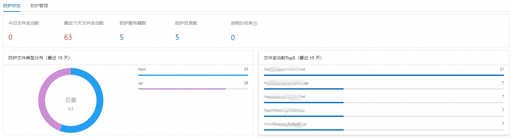

- 网页防篡改告警详情列表

  云盾安全中心检测到的所有（包括**拦截模式**和**告警模式**）异常文件变动及其详细信息，包括等级（目前只有**中危**等级）、告警名称、受影响资产、异常变动文件的路径、异常进程名称、防御状态等。

  - 在**已处理**列表中：

    默认展示拦截模式的告警事件，**状态**默认为**已防御**，表示网页防篡改功能在检测到异常文件变动事件时，已及时为您拦截执行该异常变动的进程。

    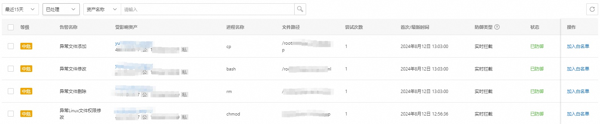

  - 在**未处理**列表中：

    展示**告警模式**的告警事件，**状态**默认为**未处理**，表示网页防篡改功能已对异常进程、异常文件变动进行告警。

  如果您确认被拦截或告警的异常变动为正常业务需求，可通过白名单功能恢复该进程的正常运行。加入白名单后的告警事件会在**已处理**列表中展示，状态显示为**已加入白名单**。详细内容，请参见下文***加入白名单***。

  > **重要**
  >
  > 如果告警尝试次数（进程写文件次数）超过100次，建议您及时关注并处理该告警。

**加入白名单**

如果您确认服务器中指定进程的文件变动是正常业务需求，并希望修改被防御进程文件，可以把此进程加入进程白名单，使对应的防御文件可以被正常改动。

> **重要**
>
> - 防护的服务器需要在白名单功能支持的操作系统和内核版本中，才能正常使用该功能。具体支持的范围，请参见***表：白名单功能支持的操作系统和内核版本***。
>
> - 黑客有可能利用白名单进程入侵主机，建议您根据业务场景谨慎录入白名单。

在**防篡改**页面的**防护状态**页签下，将正常业务进程加入白名单。

**将单个告警事件加入白名单**

1. 在**未处理**的告警事件列表中，定位到您要加入白名单的异常进程，单击**操作**列的**处理**。

2. 在弹出的对话框中，**处理方式**选择**加白名单**，然后单击**立即处理**。

   如果您需要对不同服务器中存在的同一个进程进行加白，或者对同一个服务器中不同文件路径下的同一个进程进行加白，可选中**同时处理存在相同进程的服务器**。

您也可以在**已处理**的告警事件列表中，查看**已防御**状态的进程路径，将需要正常改动的进程加入白名单。

**将多个告警事件批量加白名单**

1. 在防护状态的告警事件列表中，选中多个您要加入白名单的异常进程。

2. 单击列表底部的**加入白名单**，在对话框中单击**确定**。

**直接将目标防护进程加入白名单**

1. 单击**进程白名单**下方的数字，进入**进程管理**面板。

   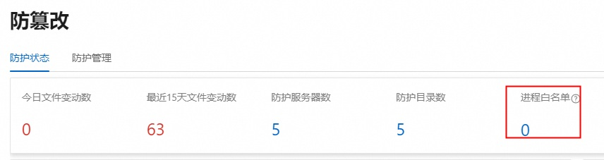

2. 单击**录入白名单**，填写**进程路径**、**服务器名称/IP**将多个异常进程批量加入白名单。

**查看、取消白名单**

1. 您可以单击**进程白名单**下方的数字进入**进程管理**面板，查看所有已加入白名单的异常进程，包括该进程所在的服务器、进程路径、尝试写文件次数等信息。

2. 如果您需要将异常进程从白名单中移除，可以单击**操作**列的**取消白名单**进行移除白名单操作。您也可以选中多个白名单后，单击下方**取消白名单**进行批量移除白名单操作。

### 3.4.3. 应用白名单

应用白名单可防止服务器上有未经过认证或授权的程序运行，为您提供可信的资产运行环境。本文介绍如何使用应用白名单功能。

**创建应用白名单策略**

1. 登录Apsara Uni-manager运营控制台。

2. 在控制台右上方，单击**安全**，选择**主机安全 > 安骑士**。在**安骑士**授权页面，选择**地域**并单击**角色授权访问**。

   > **说明**
   >
   > - 在多级组织模式下，所有数据的权限都将关联到组织下的资源集维度。用户可以通过控制台顶部菜单栏选择不同组织和资源集，以查看或处理所属组织和资源集的资产。
   >
   > - 上级组织具有最高的管理权限，对内容的修改将覆盖下级组织和资源集的配置。在进行对应配置的修改时，请务必注意。

3. 在左侧导航栏，选择**入侵防御** > **应用白名单**。

4. 在**应用白名单**页面的**策略管理**页签，单击**创建策略**。

5. 在**创建应用白名单策略**面板，配置应用白名单策略，单击**创建策略**。

   <table>
     <tr>
       <th width="121">配置项</th>
       <th>描述</th>
     </tr>
     <tr>
       <td>策略名称</td>
       <td>输入策略名称。</td>
     </tr>
     <tr>
       <td>策略模式</td>
       <td>支持选择<strong>告警模式</strong>和<strong>观察模式</strong>。 说明观察期间不产生告警信息，周期结束后自动转为告警模式。</td>
     </tr>
     <tr>
       <td>观察截止时间</td>
       <td><strong>策略模式</strong>选择为<strong>观察模式</strong>时，需要设置观察截止时间。</td>
     </tr>
     <tr>
       <td>策略内容</td>
       <td>设置策略内容： • <strong>进程采集任务</strong>：单击<strong>设置</strong>，在<strong>选择进程采集任务</strong>面板，选择目标任务，单击<strong>确定</strong>。 • <strong>自定义进程组</strong>：单击<strong>设置</strong>，在<strong>选择自定义进程组</strong>面板，选择目标进程组，单击<strong>确定</strong>。 • <strong>进程基础白库</strong>（默认）：已引用阿里云系统镜像基础白库、yum源应用基础白库。</td>
     </tr>
     <tr>
       <td>选择资产</td>
       <td>选择策略生效的资产。</td>
     </tr>
   </table>

   在应用白名单策略列表，还支持以下操作：

   - 编辑策略：定位到目标策略，在**操作**列，单击**编辑策略**。

   - 启用或停用策略：选中目标策略， 在策略列表下方，单击**启用/停用**。

   - 删除策略：选中目标策略， 在策略列表下方，单击**删除**。

**查看应用白名单策略的服务器**

1. 登录Apsara Uni-manager运营控制台。

2. 在控制台右上方，单击**安全**，选择**主机安全 > 安骑士**。在**安骑士**授权页面，选择**地域**并单击**角色授权访问**。

   > **说明**
   >
   > - 在多级组织模式下，所有数据的权限都将关联到组织下的资源集维度。用户可以通过控制台顶部菜单栏选择不同组织和资源集，以查看或处理所属组织和资源集的资产。
   >
   > - 上级组织具有最高的管理权限，对内容的修改将覆盖下级组织和资源集的配置。在进行对应配置的修改时，请务必注意。

3. 在左侧导航栏，选择**入侵防御** > **应用白名单**。

4. 在**应用白名单**页面的**生效服务器**页签，查看策略生效的服务器。

   支持通过策略启用、停用、策略模式以及资产状态筛选目标服务器。同时支持服务器组、防护中等分组查看生效服务器。

   在生效服务器列表，支持以下操作：

   - 查看生效服务器策略详情：定位到目标服务器，在**操作**列，单击**查看详情**。

   - 启用或停用策略：选中目标服务器，在服务器列表下，单击**启用/停用**。

   - 解绑策略：选中目标服务器，在服务器列表下，选择**更多操作** > **解绑操作**。

**创建采集任务**

1. 登录Apsara Uni-manager运营控制台。

2. 在控制台右上方，单击**安全**，选择**主机安全 > 安骑士**。在**安骑士**授权页面，选择**地域**并单击**角色授权访问**。

   > **说明**
   >
   > - 在多级组织模式下，所有数据的权限都将关联到组织下的资源集维度。用户可以通过控制台顶部菜单栏选择不同组织和资源集，以查看或处理所属组织和资源集的资产。
   >
   > - 上级组织具有最高的管理权限，对内容的修改将覆盖下级组织和资源集的配置。在进行对应配置的修改时，请务必注意。

3. 在左侧导航栏，选择**入侵防御** > **应用白名单**。

4. 在**应用白名单**页面的**知识库**页签，单击**进程采集**。

5. 在**进程采集**页签，单击**创建采集任务**。

6. 在**创建进程采集任务**面板，配置输入名称并选择观察截止时间和资产，单击**确定**。

   支持在采集任务列表，重新扫描资产以及查看任务详情。

**自定义进程组**

1. 登录Apsara Uni-manager运营控制台。

2. 在控制台右上方，单击**安全**，选择**主机安全 > 安骑士**。在**安骑士**授权页面，选择**地域**并单击**角色授权访问**。

3. 在左侧导航栏，选择**入侵防御** > **应用白名单**。

4. 在**应用白名单**页面的**知识库**页签，单击**自定义进程组**子页签。

5. 在**自定义进程组**页签，单击**创建自定义进程组**。

6. 在**创建自定义进程组**对话框，输入进程组名称，单击**创建**。

   创建完成后，您还可以修改进程组名称、删除进程组或为进程组添加MD5值。

### 3.4.4. 攻击分析

本文介绍了攻击分析的统计信息，包括攻击次数、攻击类型分布、攻击来源TOP 5、被攻击资产TOP 5和攻击详情列表。

**背景信息**

安骑士检测到基础攻击后会自动进行拦截和处理，并在**攻击分析**页面展示攻击相关的数据，针对这些攻击无需做任何处理。如果涉及风险较高的攻击事件，可对指定攻击来源的地址进行进一步分析或排查。建议根据自身业务需求，考虑从防火墙和业务安全方面构建更精细化的纵深防护体系。

在**攻击分析**页面，您可以设置时间范围查看以下攻击分析结果。您可以快速查看当天、最近7天或最近15天内的攻击分析结果，也可以选择**自定义时间**，查看最近任意时间范围的攻击分析结果。

资产受到的攻击详情，具体包括以下内容：

- 攻击次数：指定时间范围内资产被攻击的总次数。

- 攻击类型分布：攻击类型和对应的攻击次数。

- 攻击来源TOP 5：攻击次数排名前5位的攻击来源IP地址。

- 被攻击资产TOP 5：被攻击次数排名前5位的资产信息。

- 攻击详情列表：所有攻击事件的详细信息，包含攻击发生的时间、攻击源IP地址、被攻击的资产信息、攻击类型和攻击状态。

**攻击次数**

支持在**攻击次数**区域查看指定时间范围内资产被攻击的总次数曲线图和攻击次数峰谷值。鼠标悬浮在曲线图上可展示攻击发生的日期、时间和次数值。

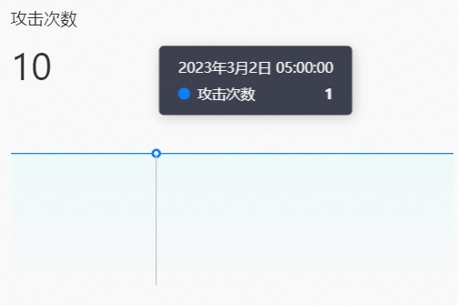

**攻击类型分布**

支持在**攻击类型分布**区域，查看攻击类型名称和该类型攻击发生的总次数。

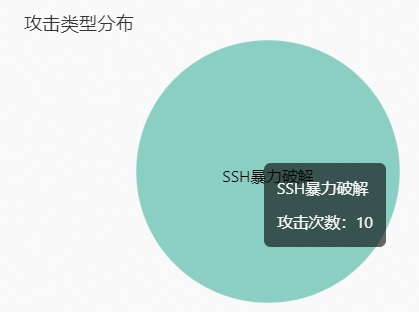

**攻击来源TOP 5**

支持在**攻击来源TOP 5**区域，查看攻击次数排名前五的攻击来源IP地址及其对应的攻击次数。

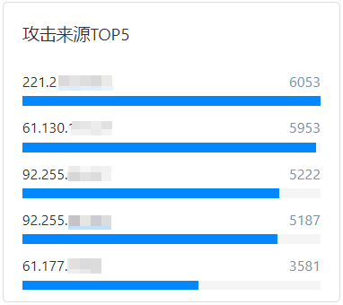

**被攻击资产TOP 5**

支持在**被攻击资产TOP 5**区域，查看您资产中被攻击次数排名前5的资产公网IP地址及其被攻击次数。

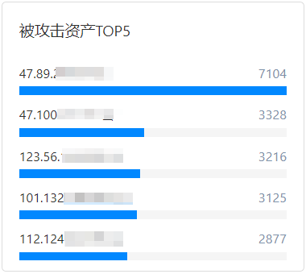

**攻击详情列表**

支持在攻击详情列表中查看您资产受到的攻击详细信息，包含攻击发生的时间、攻击源IP地址、被攻击的资产信息、攻击类型、攻击方法和攻击状态。

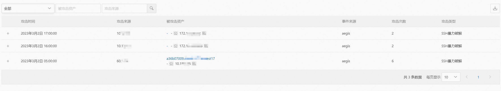

在攻击详情列表，还支持以下操作：

- 搜索查看攻击事件

  支持通过攻击详情列表上方搜索条件，筛选指定的攻击类型、被攻击资产、攻击来源，搜索目标的攻击事件并查看其详细信息。

- 查看被攻击资产信息

  鼠标移动到**被攻击资产**名称处可查看该资产的基本信息。

- 导出攻击事件列表

  单击攻击事件列表左上方的

  

  图标，将安骑士检测出的攻击事件统一导出并保存到本地。导出的文件为Excel格式。

### 3.4.5. 安全告警

#### 3.4.5.1. 安全告警概述

主机安全支持敏感文件篡改、进程异常行为、网站后门、异常登录、恶意进程等安全告警类型，通过全面的安全告警类型帮助您及时发现资产中的安全威胁、实时掌握您资产的安全态势。

云盾安全中心可对您已开启的告警防御能力提供总览数据，帮助您快速了解已开启和未开启的防御项目。您可在**安全告警**页面，查看安全告警的统计和防御项目的信息。

**安全告警类型列表**

防御项目包含的内容如下所示：

<table>
  <tr>
    <th width="121">告警名称</th>
    <th>告警说明</th>
  </tr>
  <tr>
    <td>异常登录</td>
    <td>检测服务器上的异常登录行为。通过设置合法登录IP、时间及账号，对于例外的登录行为进行告警。支持手动添加和自动更新常用登录地，对指定资产的异地登录行为进行告警。可检测以下子项： • ECS非合法IP登录 • ECS在非常用地登录 • ECS登录后执行异常指令序列（SSH） • ECS被暴力破解成功（SSH）</td>
  </tr>
  <tr>
    <td>应用白名单</td>
    <td>通过在白名单策略中设置需要重点防御的服务器应用，检测服务器中是否存在可疑或恶意进程，并对不在白名单中的进程进行告警提示。</td>
  </tr>
  <tr>
    <td>网站后门</td>
    <td>使用自主查杀引擎检测常见后门文件，支持定期查杀和实时防护，并提供一键隔离功能： • Web目录中文件发生变动会触发动态检测，每日凌晨扫描整个Web目录进行静态检测。 • 支持针对网站后门检测的资产范围配置。 • 对发现的木马文件支持隔离、恢复和忽略。</td>
  </tr>
  <tr>
    <td>异常网络连接</td>
    <td>检测网络显示断开或不正常的网络连接状态。</td>
  </tr>
  <tr>
    <td>精准防御</td>
    <td>对主流勒索病毒、DDoS木马、挖矿和木马程序、恶意程序、后门程序和蠕虫病毒等类型进行防御。</td>
  </tr>
  <tr>
    <td>异常账号</td>
    <td>检测非合法的登录账号。</td>
  </tr>
  <tr>
    <td>持久化后门</td>
    <td>检测服务器上存在的可疑计划任务，对攻击者持久入侵用户服务器的威胁行为进行告警。</td>
  </tr>
  <tr>
    <td>进程异常行为</td>
    <td>检测资产中是否存在超出正常执行流程的行为。</td>
  </tr>
  <tr>
    <td>恶意软件</td>
    <td>检测模型发现您的服务器上正在执行恶意的软件。</td>
  </tr>
  <tr>
    <td>敏感文件篡改</td>
    <td>检测是否存在对服务器中的敏感文件进行恶意修改，包含Linux共享库文件预加载配置文件的可疑篡改等行为。</td>
  </tr>
  <tr>
    <td>恶意脚本</td>
    <td>检测资产的系统功能是否受到恶意脚本的攻击或篡改，对可能的恶意脚本攻击行为进行告警提示。恶意脚本分为有文件脚本和无文件脚本。攻击者在拿到服务器权限后，使用脚本作为载体来达到进一步攻击利用的目的。利用方式包括植入挖矿程序、添加系统后门、添加系统账户等操作。恶意脚本的语言主要包括Bash、Python、Perl、PowerShell、BAT、VBS。</td>
  </tr>
  <tr>
    <td>漏洞利用</td>
    <td>检测模型发现您的服务器上运行了漏洞利用程序，漏洞利用程序用于攻击或尝试攻击操作系统、应用程序的已知漏洞，用于实现提权、逃逸、任意代码执行等目的。</td>
  </tr>
</table>

#### 3.4.5.2. 查看和处理安全告警

您可以在安骑士查看和处理已检测出的告警事件。

**背景信息**

云盾检测出安全告警事件后，会展示相关告警信息。如果告警事件未被处理，会展示在**安全告警**页面的**待处理告警**列表中。告警事件处理完成后，将从**待处理告警**状态转化为**已处理**。

> **说明**
>
> 在**安全告警**页面为您一直保留**待处理告警**和**已处理告警**记录。默认展示**待处理告警**记录。

**操作入口**

1. 登录Apsara Uni-manager运营控制台。

2. 在控制台右上方，单击**安全**，选择**主机安全 > 安骑士**。在**安骑士**授权页面，选择**地域**并单击**角色授权访问**。

   > **说明**
   >
   > - 在多级组织模式下，所有数据的权限都将关联到组织下的资源集维度。用户可以通过控制台顶部菜单栏选择不同组织和资源集，以查看或处理所属组织和资源集的资产。
   >
   > - 上级组织具有最高的管理权限，对内容的修改将覆盖下级组织和资源集的配置。在进行对应配置的修改时，请务必注意。

**查看告警事件**

1. 在左侧导航栏，选择**入侵防御** > **安全告警**。

2. 在安全告警列表中，查看或搜索所有检测到的入侵和威胁告警及其详细信息。

**处理告警事件**

1. 在左侧导航栏，选择**入侵防御** > **安全告警**。

2. 在**安全告警**页面，定位到目标告警事件，单击**操作**栏的**处理**，对不同告警事件执行相应的处理后单击**立即处理**。

   > **说明**
   >
   > 如果告警事件包含多个关联异常，单击**处理**，会打开该告警事件的详情页面，您可对不同的异常事件分别进行处理。

   - **忽略**：忽略本次告警，该告警状态将变为**已处理**，后续不会再对该事件进行告警。

   - **加白名单**：如果告警为误报，您可以将本次告警加入白名单。告警加入白名单后该告警状态将变为**已处理**，后续安骑士不会再对该事件进行告警。您可以在**已处理**列表中定位到该事件对其进行**取消白名单**的操作。

     > **说明**
     >
     > 告警误报是指系统对正常程序进行告警。常见的告警误报有**对外异常TCP发包可疑进程**，提示您服务器上有进程在对其他设备发起了疑似扫描行为。

   - **我已手工处理**：该告警为可疑的异常行为，建议您根据处置建议进行排查，排查后点击立即处理后，该告警状态将更新为已处理。

   - **同时处理相同告警**：对多个告警事件进行批量处理。批量处理告警事件前，请详细了解告警事件的信息。

3. <strong>可选：</strong>如果您已确认一个或多个告警事件需要忽略或为误报，可在**安全告警**页面，选中一个或多个告警事件，直接进行**忽略本次**或**加白名单**处理。

**导出告警事件**

1. 在左侧导航栏，选择**入侵防御** > **安全告警**。

2. 单击**安全告警**页面危险等级栏

   图标，导出报表。

   

   报表导出完成后，安全告警页面右上角会提示**导出完成**。

3. 在**安全告警处理**页面右上角**导出完成**对话框中，单击**下载**。安全告警事件文件会下载到本地。

**下载归档数据**

安骑士自动开启告警事件归档，保存归档数据185天。您可以下载归档数据。

> **重要**
>
> 在多级组织模式下，仅有一级组织权限或全局组织权限的账号才可下载归档数据。

1. 在左侧导航栏，选择**入侵防御** > **安全告警**。

2. 单击页面右上角的**归档数据**。

3. 在弹出的对话框中，找到目标告警归档数据，单击**下载**。

#### 3.4.5.3. 查看告警自动化关联分析

安骑士支持告警自动化关联分析。您可在安全告警列表页面单击单个告警事件名称进入告警自动关联分析页面，查看和处理告警事件所有关联的异常情况并进行攻击自动溯源，帮助您对告警事件进行全方位分析和便捷处理。

**背景信息**

- 告警自动关联分析功能可对相关的异常事件进行实时自动化关联，挖掘出潜藏的入侵威胁。

- 告警自动化关联以告警发生的时间顺序聚合成关联的告警，帮助您更便捷地分析和处理告警事件，提升您系统的应急响应机制。

- 告警自动化关联分析聚合后的告警以  图标标识。

**操作步骤**

1. 登录Apsara Uni-manager运营控制台。

2. 在控制台右上方，单击**安全**，选择**主机安全 > 安骑士**。在**安骑士**授权页面，选择**地域**并单击**角色授权访问**。

   > **说明**
   >
   > - 在多级组织模式下，所有数据的权限都将关联到组织下的资源集维度。用户可以通过控制台顶部菜单栏选择不同组织和资源集，以查看或处理所属组织和资源集的资产。
   >
   > - 上级组织具有最高的管理权限，对内容的修改将覆盖下级组织和资源集的配置。在进行对应配置的修改时，请务必注意。

3. 在左侧导航栏，选择**入侵防御** > **安全告警**。

4. 在安全告警列表中，单击目标**告警名称**打开告警事件详情面板。

5. 在告警事件详情面板，查看告警事件的详细信息、关联的异常事件和对告警的异常事件进行处理。

   - 查看告警详细信息

     您可查看受该告警事件影响的资产信息、告警首次发生或最新发生时间、关联异常事件的详情。

   - 查看受影响资产

     鼠标悬停在**受影响资产**名称上，会弹出对应资产的详情页面，方便您集中查看该资产的详细信息。

   - 查看和处理**关联异常**

     您可在**关联异常**区域查看该告警事件关联的所有异常情况的详细信息和建议方案。

     - 单击各关联异常区域右侧的**备注**，可为该关联异常事件添加备注信息。

     - 单击备注信息右侧的  图标，即可删除备注信息。

#### 3.4.5.4. 文件隔离箱

安骑士可对检测到的威胁文件进行隔离处理，被成功隔离的文件会添加到安全告警处理页面的文件隔离箱中。被成功隔离的文件可在30天内进行一键恢复，且隔离30天后系统将自动清除被隔离文件。本文介绍了如何查看隔离文件和解除文件隔离。

**操作步骤**

1. 登录Apsara Uni-manager运营控制台。

2. 在控制台右上方，单击**安全**，选择**主机安全 > 安骑士**。在**安骑士**授权页面，选择**地域**并单击**角色授权访问**。

   > **说明**
   >
   > - 在多级组织模式下，所有数据的权限都将关联到组织下的资源集维度。用户可以通过控制台顶部菜单栏选择不同组织和资源集，以查看或处理所属组织和资源集的资产。
   >
   > - 上级组织具有最高的管理权限，对内容的修改将覆盖下级组织和资源集的配置。在进行对应配置的修改时，请务必注意。

3. 在左侧导航栏，选择**入侵防御** > **安全告警**。

4. 在**安全告警**页面单击右上角**文件隔离箱**。

   您可在**文件隔离箱**进行以下操作：

   - 在文件隔离箱列表中可以查看被隔离的文件主机地址、文件路径、状态和修改时间等信息。

   - 单击文件隔离箱页面右侧**操作**栏的**恢复**，可以将指定的被隔离文件从文件隔离箱中移除。恢复的文件将重新回到安全告警列表中。

#### 3.4.5.5. 安全告警设置

安骑士的安全告警设置支持手动维护常用登录地和Web目录，并支持高级登录报警功能。

**背景信息**

安骑士提供高级登录报警功能，支持配置更精细的异常登录检测，例如设置合法登录的IP、时间、账号。

**操作步骤**

1. 登录Apsara Uni-manager运营控制台。

2. 在控制台右上方，单击**安全**，选择**主机安全 > 安骑士**。在**安骑士**授权页面，选择**地域**并单击**角色授权访问**。

   > **说明**
   >
   > - 在多级组织模式下，所有数据的权限都将关联到组织下的资源集维度。用户可以通过控制台顶部菜单栏选择不同组织和资源集，以查看或处理所属组织和资源集的资产。
   >
   > - 上级组织具有最高的管理权限，对内容的修改将覆盖下级组织和资源集的配置。在进行对应配置的修改时，请务必注意。

3. 在左侧导航栏，选择**入侵防御** > **安全告警**。

4. 单击页面右上角**安全告警设置**。

   在多组织模式下，需选择对应的组织和资源集。在相应的功能页签，完成以下配置：

   - **添加常用登录地**

     <ol type="a">

     <li>

     单击**常用登录地**右侧的**管理**按钮。

     </li>

     <li>

     选中要添加的常用登录地点，然后选择添加应用的服务器。

     </li>

     </ol>

     <ol type="i" start="100">

     <li>

     单击**确定**，完成添加。

     </li>

     </ol>

     安骑士支持**编辑**和**删除**已成功添加的常用登录地。

     - 单击目标常用登录地右侧的**编辑**，修改该登录地的生效服务器。

     - 单击目标常用登录地右侧的**删除**，删除该常用登录地配置。

   - **配置高级登录报警**

     > **说明**
     >
     > 配置高级登录告警，可进一步指定常用的登录IP、时间段和账号。配置完成后，安骑士会对指定外的登录情形进行告警。以下功能的操作类似**常用登录地**配置，可参考上文进行**添加**、**编辑**、**删除**。

     - 单击**常用登录IP**右侧的切换开关，打开或关闭登录IP检查，开启后通过非指定IP登录会触发报警。

     - 单击**常用登录时间**右侧的切换开关，打开或关闭登录时间检查，开启后在非指定时间登录会触发报警。

     - 单击**常用账号**右侧的切换开关，打开或关闭登录账号检查，开启后使用非指定账号登录会触发报警。

   - **自定义Web目录**

     安骑士会自动检测您服务器资产中的Web目录，并进行动态检测和静态扫描；您也可以手动添加服务器中的其它Web目录进行检测扫描。

     <ol type="a">

     <li>

     单击**Web目录定义**右侧的**管理**。

     </li>

     <li>

     输入一个合法的Web路径，然后选中生效服务器，该路径将被添加到扫描路径的服务器。

     > **说明**
     >
     > 出于性能效率考虑，不支持直接添加root目录作为Web目录。

     </li>

     </ol>

     <ol type="i" start="100">

     <li>

     单击**确定**，完成添加。

     </li>

     </ol>

   - **编辑加白规则**

     - **组织加白规则**：支持编辑和删除对应资产的加白规则。

       - 在目标资产**操作**列，单击**编辑**，设置该资产的加白规则。

       - 在目标资产**操作**列，单击**删除**，删除对应的加白规则。

     - **全局加白规则**：ASO云盾运维全局设置，不支持更改。

### 3.4.6. 恶意文件检测SDK

恶意文件检测SDK功能可识别阿里云OSS文件中存在的常见病毒，例如勒索病毒、挖矿程序等，防止恶意文件传播和执行。本文介绍如何使用恶意文件检测SDK功能。

**病毒类型说明**

支持检测的病毒类型（virus_type）中英文映射表如下：

| 病毒类型（virus_type） | 病毒名称 |
| --- | --- |
| Backdoor | 反弹Shell后门 |
| DDoS | DDoS木马 |
| Downloader | 下载器木马 |
| Engtest | 引擎测试程序 |
| Hacktool | 黑客工具 |
| Trojan | 高危程序 |
| Malbaseware | 被污染的基础软件 |
| MalScript | 恶意脚本 |
| Malware | 恶意程序 |
| Miner | 挖矿程序 |
| Proxytool | 代理工具 |
| RansomWare | 勒索病毒 |
| RiskWare | 风险软件 |
| Rootkit | Rootkit |
| Stealer | 窃密工具 |
| Scanner | 扫描器 |
| Suspicious | 可疑程序 |
| Virus | 感染型病毒 |
| WebShell | 网站后门 |
| Worm | 蠕虫病毒 |

**OSS文件检测**

1. 登录Apsara Uni-manager运营控制台。

2. 在控制台右上方，单击**安全**，选择**主机安全 > 安骑士**。在**安骑士**授权页面，选择**地域**并单击**角色授权访问**。

   > **说明**
   >
   > - 在多级组织模式下，所有数据的权限都将关联到组织下的资源集维度。用户可以通过控制台顶部菜单栏选择不同组织和资源集，以查看或处理所属组织和资源集的资产。
   >
   > - 上级组织具有最高的管理权限，对内容的修改将覆盖下级组织和资源集的配置。在进行对应配置的修改时，请务必注意。

3. 在左侧导航栏，选择**入侵防御** > **恶意文件检测SDK**。

4. 在**OSS文件检测**页签，参考下表选择合适的检测方式并执行检测。

   如果您的Bucket没有在**OSS文件检测**的列表中，您可以单击**同步Bucket**，同步最新的Bucket列表。

   | 检测方式 | 说明 | 操作步骤 |
   | --- | --- | --- |
   | 手动全量检测 | 检测单个或多个Bucket内的所有文件。 | i. 在<strong>OSS文件检测</strong>页签，单击单个Bucke<strong>操作</strong>列的<strong>检测</strong>或选中多个Bucket后在列表下方单击<strong>批量检测</strong>。ii. 在<strong>检测</strong>面板，指定需要检测文件的类型，并单击<strong>确定</strong>。 |
   | 手动增量检测 | 针对已检测且上次检测后有文件更新的Bucket，提供只检测未检测过的文件的功能。 | i. 在<strong>OSS文件检测</strong>页签，单击目标Bucket<strong>操作</strong>列的<strong>增量检</strong><strong>测</strong>。ii. 在<strong>增量检测</strong>面板，指定需要检测文件的类型，并单击<strong>确</strong><strong>定</strong>。 |
   | 自动检测 | 通过配置扫描策略可为指定Bucket开启周期性自动检测。配置前建议了解以下信息： • 一个Bucket只能在一个策略中生效。 • 自动检测仅检测OSS新增的文件，不会重复检测同一个文件。 | i. 在<strong>OSS文件检测</strong>页签，单击<strong>策略配置</strong>。 ii. 在<strong>策略配置</strong>面板，单击图标开启文件自动检测。 iii. 配置<strong>检测周期</strong>、<strong>文件检测时间</strong>、<strong>文件检测类型</strong>和<strong>生效</strong><strong>Bucket</strong>等，单击<strong>确定</strong>。 |

**查看检测结果**

- 查看OSS风险文件总览

  在**风险文件总览**页签的统计数据区域，您可以查看已检测的OSS文件总数、存在不同等级风险（高危、中危、低危）的文件数量和剩余检测次数。

- 查看存在风险文件详情

  在风险文件详情列表，您可以单击目标风险文件**操作**列的**详情**。在该文件的详情面板，查看检测出的存在风险的文件详情、事件说明等信息。

  > **说明**
  >
  > 检测出风险的文件可能被植入了恶意脚本、DDoS木马等病毒，建议您根据事件说明中的处置建议及时处理该文件。

- 查看OSS文件检测统计数据

  在**OSS文件检测**页签的统计数据区域，您可以查看检测出恶意文件的Bucket数、存在不同等级风险（高危、中危、低危）的文件数量、未检测Bucket数量和Bucket总数。

- 查看单个Bucket的检测结果

  在**OSS文件检测**页签，您可以单击目标Bucke**操作**列的**详情**，查看Bucket的基本信息和风险文件详情。

### 3.4.7. 核心文件监控

核心文件监控功能可以实时监控服务器上核心文件的访问情况，对文件的访问、修改、删除、重命名等操作进行实时监控和告警，可监控核心文件是否被盗取或篡改。本文介绍如何实现对服务器核心文件访问的监控。

> **重要**
>
> 在多级组织模式下：
>
> - 仅有一级组织权限或全局组织权限的账号才可新建、编辑、删除规则。
>
> - 资源集维度可以查看对应权限范围内的主机状况。

**使用限制**

Linux系统的内核版本需要在AliWebGuard支持的范围内。具体支持范围，请参见网页防篡改。

**步骤一：新建规则**

**规则生效逻辑**

使用核心文件监控功能，您需要通过新建规则确定需监控的服务器文件范围。建议您在配置规则前，先了解规则的生效逻辑。具体内容如下：

- 安骑士监控到服务器文件的访问操作**同时命中**已开启的规则的下述项时，才会根据规则的设置进行告警或放行处置。

  - 进程路径

  - 文件路径

  - 文件操作

- 云安全中心会优先匹配处置方式为放行的规则。放行规则未命中时，再匹配处置方式为告警的规则。

**配置建议及示例**

建议您为系统核心文件和重要配置文件设置对应的监控规则。

在执行新建规则操作步骤前，您需要确定需监控的文件及可访问文件的合法进程范围。

对于核心业务文件，您需要为所有进程配置告警规则，并为合法的访问进程配置放行规则。在可以监控对该文件所有访问操作的同时，避免产生无意义的告警，实现对核心文件访问的全面监控。

> **重要**
>
> - 如果告警规则未设置所有进程，则无法监控进程路径外其他进程的访问操作。进程路径配置外的所有进程，都可以绕过云盾安全中心的监控。
>
> - 配置放行规则时，不建议进程路径使用通配路径。使用通配路径容易被攻击者利用放行规则直接放行访问操作，达到攻击行为绕过告警规则的目的。

例如，您需监控的核心文件路径为/etc/sysctl.conf，合法进程为systemd。为实现对/etc/sysctl.conf文件路径的监控，您需要配置两条规则：

- 规则1：处置方式为告警，进程路径为 `*` （表示匹配所有进程），文件路径为 `/etc/sysctl.conf` ，文件操作选择所有操作。

- 规则2：处置方式为放行，进程路径为 `/usr/lib/systemd/systemd` ，文件路径为 `/etc/sysctl.conf` ，文件操作选择所有操作。

需要监控多台服务器的核心文件时，您可以在一条告警规则中配置所有服务器需监控的文件路径，并将进程路径配置为\*。然后再根据不同服务器需放行的进程路径，配置多条放行的规则。

**操作步骤**

1. 登录Apsara Uni-manager运营控制台。

2. 在控制台右上方，单击**安全**，选择**主机安全 > 安骑士**。在**安骑士**授权页面，选择**地域**并单击**角色授权访问**。

   > **说明**
   >
   > - 在多级组织模式下，所有数据的权限都将关联到组织下的资源集维度。用户可以通过控制台顶部菜单栏选择不同组织和资源集，以查看或处理所属组织和资源集的资产。
   >
   > - 上级组织具有最高的管理权限，对内容的修改将覆盖下级组织和资源集的配置。在进行对应配置的修改时，请务必注意。

3. 在**入侵防御 > 核心文件监控**页面，单击**监控规则**页签。

4. 单击**新建规则**，在右侧面板完成规则配置，单击**确定**。

   <table>
     <tr>
       <th width="121">配置项</th>
       <th>描述</th>
     </tr>
     <tr>
       <td>规则名称</td>
       <td>输入规则名称。</td>
     </tr>
     <tr>
       <td>处置方式</td>
       <td>选择命中规则条件时，安骑士对相关事件的处置方式。可选项： • <strong>告警</strong>：监控到对应文件的访问情况时，产生告警，并记录事件详情。 • <strong>放行</strong>：监控到对应文件的访问情况时，直接放行，不记录事件详情，也不产生告警。</td>
     </tr>
     <tr>
       <td>告警等级</td>
       <td>选择命中规则产生的告警等级。</td>
     </tr>
     <tr>
       <td>规则状态</td>
       <td>选择规则创建后是否开启规则。最多支持启用100条规则。</td>
     </tr>
     <tr>
       <td>进程路径</td>
       <td>输入需监控的进程路径。进程路径配置说明如下： • 支持通配符输入，例如监控进程路径/usr/conf，则可以配置*/conf。也可以使用*表示监控服务器上的所有进程。 • 单个进程路径长度限制为1~128个英文字符。 • 多个路径使用换行输入。每条规则最多支持配置20个进程路径。</td>
     </tr>
     <tr>
       <td>文件路径</td>
       <td>输入需监控的文件路径。文件路径配置说明如下： • 支持通配符输入，例如需监控/etc/nginx/nginx.conf路径，则可以配置/etc/nginx/*。也可以使用/*表示监控所有文件路径。 • 单个文件路径长度限制为1~128个英文字符。 • 多个路径使用换行输入。每条规则最多支持配置20个文件路径。</td>
     </tr>
     <tr>
       <td>文件操作</td>
       <td>选择需要监控的文件操作。</td>
     </tr>
     <tr>
       <td>规则应用范围</td>
       <td>选择规则应用的服务器范围。在多级组织模式下，通过<strong>按资产</strong>选择服务器时，支持从资源集维度筛选服务器。</td>
     </tr>
   </table>

创建规则后，如需编辑、删除、开启或关闭规则，请在规则操作列或状态列下的相关入口操作。首次为服务器开启规则时，最长5分钟生效。修改的规则最长1分钟生效，修改的规则生效后不会影响已产生的告警和记录的事件。

**步骤二：查看并处理告警**

1. 在**核心文件监控**页面的**告警事件**页签，您可以查看安骑士监控到的文件访问告警。

2. 单击目标告警操作列的**详情**，可以查看文件访问的详细信息。

   > **说明**
   >
   > - Python脚本访问文件时，云盾安全中心无法获取命令行信息。
   >
   > - Shell内置命令访问文件时，云盾安全中心无法获取准确的命令行信息。例如访问命令为 `echo "new content" >> /etc/nginx/nginx.conf` 时，由于该命令是通过Shell的内置命令给nginx.conf文件追加内容，采集并在详情页展示的命令行就是 `["-bash"]` 。
   >
   > - 云盾安全中心采集经过Shell解析后的命令行，并在告警详情页以JSON数组的形式展示，可能和用户输入的原始命令不同。
   >
   >   - 示例1：用户命令 `mkdir "1 2"`  和  `mkdir 1\ 2` 是等效的命令，就是创建一个名为“1 2”的目录，经过Shell解析得到 `mkdir`  和  `1 2` ，在详情页展示为 `["mkdir", "1 2"]` 。
   >
   >   - 示例2：用户命令 `rm -rf *` ，Shell解析会展开 `*` 为当前目录下所有文件和子目录，那么云盾安全中心采集并展示的命令行就是 `rm` 和 `-rf` 加上当前目录下所有文件和子目录列表。

3. 建议您根据文件访问的详细信息，确认该文件的访问是否为异常事件。

   根据确认异常事件的结果，可以采取以下方案。

   - 确认该事件为异常事件，建议您在确认对业务无影响的情况下，手动阻断相关进程并隔离对应文件。

   - 确认该事件为文件正常访问时，可以选择采取加白名单的方式处理告警。

   - 如果评估该事件为对文件没有影响，且无需加白处理，可以选择忽略该告警。

4. 在完成告警的判断和处理后，单击目标告警操作列的**处理**，选择对应的处理方式，并单击**确定**。

   - 加白名单：设置白名单规则后，云安全中心会通过自动生成一条处理方式为放行的规则实现放行该告警检测出的行为。您需要在配置加白规则的名称、进程路径、文件路径、文件操作和应用资产范围后，单击**确定**。

   - 忽略：忽略本次告警后，该告警将变为已处理状态。当相同告警再次发生时，云安全中心将再次上报新的告警。

   - 我已手工处理：在您确认已处理异常事件后，选择该选项。

**常见问题**

**网页防篡改和核心文件监控功能有哪些区别？**

网页防篡改是云安全中心另一款文件防护功能，和核心文件监控功能的区别如下：

| 项目 | 网页防篡改 | 核心文件监控 |
| --- | --- | --- |
| 应用场景 | 适用于网站等容易受到黑客攻击，对文件被篡改敏感的场景。 | • 需要监控对核心文件的访问操作，避免核心文件内容被盗取的场景。 • 需要监控重要文件的变动（修改、删除、重命名等），避免重要文件被篡改的场景。 |
| 防护范围 | 大部分Linux和Windows服务器。 | 大部分Linux服务器。 |
| 能力说明 | 支持识别文件的异常变动，并对导致异常变动的进程进行拦截或告警。 | 支持监控文件的异常访问（包括读取、修改、删除等操作），并提供告警。 |

关于网页防篡改的更多信息，请参见网页防篡改。

**同时开启网页防篡改和核心文件监控时，优先匹配哪个规则？**

当服务器同时开启网页防篡改和核心文件监控规则时，网页防篡改的规则优先生效。如果网页防篡改的规则未生效，则会继续匹配核心文件监控的规则。网页防篡改的进程白名单规则仅对网页防篡改功能生效；核心文件监控的放行规则仅对核心文件监控功能生效。

## 3.5. 日志检索

### 3.5.1. 日志检索介绍

云主机安全提供主机日志检索功能，将散落在专有云各系统中的日志集中管理，便于您在出现主机问题时一站式搜索定位问题根源。

支持180天以内的日志存储，并提供30天以内的日志查询。

**功能特性**

日志检索功能具备以下特性：

- **一站式日志检索平台**，集中查询专有云各产品日志，单一接口，便于问题溯源。

- **日志功能的SaaS化**，无需进行额外安装部署，即可查询所有云环境中的服务器日志。

- 支持TB级数据检索，以及50个维度的数据逻辑（布尔表达式）组合，可以秒级展示日志全文检索结果。

- 支持丰富的主机日志源。

- 支持日志投递，允许您将安全日志导入到日志服务做进一步分析。

- 支持开通SLS日志服务使用高级检索功能，进一步查询和分析主机日志。

**应用场景**

日志检索帮助您实现以下需求：

- **安全事件分析**：主机发生安全事件后，通过日志功能进行调查，评估资产受损范围和影响。

- **操作审计**：对主机的操作日志进行审计，对高危操作和严重问题进行细粒度排查。

**可检索日志类型**

表 1. 日志源

| 日志源 | 说明 |
| --- | --- |
| 登录流水 | 系统登录成功的日志记录。 |
| 进程快照 | 某一时刻主机上的进程运行信息。 |
| 端口监听快照 | 某一时刻主机上的监听端口信息。 |
| 账号快照 | 某一时刻主机上的账号登录信息。 |
| 进程启动日志 | 主机上进程启动的相关信息。 |
| 网络连接日志 | 主机对外主动连接的日志。 |

### 3.5.2. 查询日志

本文介绍如何搜索和查看主机日志。

**快速检索**

1. 登录Apsara Uni-manager运营控制台。

2. 在控制台右上方，单击**安全**，选择**主机安全 > 安骑士**。在**安骑士**授权页面，选择**地域**并单击**角色授权访问**。

   > **说明**
   >
   > - 在多级组织模式下，所有数据的权限都将关联到组织下的资源集维度。用户可以通过控制台顶部菜单栏选择不同组织和资源集，以查看或处理所属组织和资源集的资产。
   >
   > - 上级组织具有最高的管理权限，对内容的修改将覆盖下级组织和资源集的配置。在进行对应配置的修改时，请务必注意。

3. 在左侧导航栏，单击**日志检索**。

4. 在**快速检索**页签，设置搜索条件。

   | 搜索项 | 说明 |
   | --- | --- |
   | 请选择日志源 | 支持的日志源，具体内容请参见各日志源字段说明。 |
   | 请选择字段 | 各日志源支持的字段，具体内容请参见各日志源字段说明。 |
   | 关键字 | 需要搜索的字段具体关键字。 |
   | 语法逻辑 | 等于或前缀包含。 |
   | + | 在一个搜索条件（一个日志源）下增加多个逻辑判断。 |
   | 时间范围 | 选择待搜索日志的时间范围。 |

5. 单击**搜索**，查看搜索结果。

   - **重置**：如果不需要原来设置的搜索条件，单击**重置**，搜索条件回到初始状态。

   - **保存搜索逻辑**：如果以后需要重用这个搜索条件，单击**保存搜索逻辑**进行保存。

     > **重要**
     >
     > 仅当搜索条件的搜索记录不为0时，才显示该功能按钮。

   - **已保存的搜索**：如果需要执行以前保存的搜索条件，单击**已保存的搜索**，选择已有的搜索条件执行。

**高级检索**

> **重要**
>
> 开通SLS日志服务功能后高级检索才能使用，如需开通SLS请联系平台管理员。

1. 登录Apsara Uni-manager运营控制台。

2. 在控制台右上方，单击**安全**，选择**主机安全 > 安骑士**。在**安骑士**授权页面，选择**地域**并单击**角色授权访问**。

   > **说明**
   >
   > - 在多级组织模式下，所有数据的权限都将关联到组织下的资源集维度。用户可以通过控制台顶部菜单栏选择不同组织和资源集，以查看或处理所属组织和资源集的资产。
   >
   > - 上级组织具有最高的管理权限，对内容的修改将覆盖下级组织和资源集的配置。在进行对应配置的修改时，请务必注意。

3. 在左侧导航栏，单击**日志检索**。

4. 在**高级检索**页签，按照页面提示步骤进行检索。

### 3.5.3. 各日志源字段说明

本文介绍了日志检索功能可以采集并供检索的原始日志类型和字段说明。

日志检索功能支持您查询下表列述的日志源。您可以单击一个日志源查看其支持的字段信息。

| 日志源 | 说明 |
| --- | --- |
| 登录流水 | 系统登录成功的日志记录。 |
| 进程快照 | 某一时刻主机上的进程运行信息。 |
| 端口监听快照 | 某一时刻主机上的监听端口信息。 |
| 账号快照 | 某一时刻主机上的账号登录信息。 |
| 进程启动日志 | 主机上进程启动的相关信息。 |
| 网络连接日志 | 主机对外主动连接的日志。 |

**登录流水**

登录流水查询支持下表描述的字段。

| 字段 | 数据类型 | 说明 |
| --- | --- | --- |
| uuid | string | 客户端编号 |
| IP | string | IP地址 |
| warn_ip | string | 登录来源IP |
| warn_port | string | 登录端口 |
| warn_user | string | 登录用户名 |
| warn_type | string | 登录类型 |
| warn_count | string | 登录次数 |

**进程启动日志**

进程启动日志查询支持下表描述的字段。

| 字段 | 数据类型 | 说明 |
| --- | --- | --- |
| uuid | string | 客户端编号 |
| IP | string | IP地址 |
| pid | string | 进程ID |
| groupname | string | 用户组 |
| ppid | string | 父进程ID |
| uid | string | 用户ID |
| username | string | 用户名 |
| filename | string | 文件名 |
| pfilename | string | 父进程文件名 |
| cmdline | string | 命令行 |
| filepath | string | 进程路径 |
| pfilepath | string | 父进程路径 |

**端口监听快照**

端口监听快照查询支持下表描述的字段。

| 字段 | 数据类型 | 说明 |
| --- | --- | --- |
| uuid | string | 客户端编号 |
| IP | string | IP地址 |
| src_port | string | 监听端口 |
| src_ip | string | 监听IP |
| proc_path | string | 进程路径 |
| pid | string | 进程ID |
| proc_name | string | 进程名 |
| proto | string | 协议 |

**账号快照**

账号快照查询支持下表描述的字段。

| 字段 | 数据类型 | 说明 |
| --- | --- | --- |
| uuid | string | 客户端编号 |
| IP | string | IP地址 |
| perm | string | 是否拥有root权限 |
| home_dir | string | home目录 |
| warn_time | string | 密码到期提醒时间 |
| groups | string | 用户属于的组 |
| login_ip | string | 最后一次登录的IP地址 |
| last_chg | string | 密码最后修改时间 |
| shell | string | Linux的shell命令 |
| domain | string | Windows域 |
| tty | string | 登录的终端 |
| account_expire | string | 账号超期时间 |
| passwd_expire | string | 密码超期时间 |
| last_logon | string | 最后登录时间 |
| user | string | 用户 |
| status | string | 用户状态： • 0表示禁用 • 1表示正常 |

**进程快照**

进程快照查询支持下表描述的字段。

| 字段 | 数据类型 | 说明 |
| --- | --- | --- |
| uuid | string | 客户端编号 |
| IP | string | IP地址 |
| path | string | 进程路径 |
| start_time | string | 进程启动时间 |
| uid | string | 用户ID |
| cmdline | string | 命令行 |
| pname | string | 父进程名 |
| name | string | 进程名 |
| pid | string | 进程ID |
| user | string | 用户名 |
| md5 | string | 进程文件MD5值，超过1 MB不计算 |

**网络连接日志**

网络连接日志查询支持下表描述的字段。

| 字段 | 数据类型 | 说明 |
| --- | --- | --- |
| uuid | string | 客户端编号 |
| IP | string | IP地址 |
| src_ip | string | 源IP |
| src_port | string | 源端口 |
| proc_path | string | 进程路径 |
| dst_port | string | 目标端口 |
| proc_name | string | 进程名 |
| dst_ip | string | 目标IP |
| status | string | 状态 |

### 3.5.4. 语法逻辑说明

日志检索支持多条件逻辑检索，您可以在一个搜索条件（一个日志源）下增加多个判断逻辑，也可以对多个搜索条件（不同的日志源）进行逻辑组合。本文介绍了日志检索支持的语法逻辑，也列举了部分用例，帮助您理解和使用。

日志检索支持下表中列举的语法逻辑。 表 1. 语法逻辑说明

<table>
  <tr>
    <th width="89">逻辑名称</th>
    <th>描述</th>
  </tr>
  <tr>
    <td>and</td>
    <td>双目运算符。 形式为<code> query 1 and query 2 </code>，搜索结果展示<code> query 1 </code>和<code> query 2 </code>查询结果的交集。 说明如果多个单词间没有语法关键词，默认是and的关系。</td>
  </tr>
  <tr>
    <td>or</td>
    <td>双目运算符。 形式为<code> query 1 or query 2 </code>，搜索结果展示<code> query 1 </code>和<code> query 2 </code>查询结果的并集。</td>
  </tr>
  <tr>
    <td>not</td>
    <td>双目运算符。 形式为<code> query 1 not query 2 </code>，搜索结果展示符合<code> query 1 </code>并且不符合<code> query 2 </code>的结果，相当于<code> query 1 - query 2 </code>。 说明如果只有<code> not query 1 </code>，那么表示从全部日志中选取不包含<code> query 1 </code>的结果。</td>
  </tr>
</table>

## 3.6. 主机设置

### 3.6.1. 安装客户端

用户需要监控安骑士资产的安全，需要先在服务器上安装云安全中心客户端。本文介绍了如何通过安骑士设置选项，安装云安全中心客户端。

**操作步骤**

1. 登录Apsara Uni-manager运营控制台。

2. 在控制台右上方，单击**安全**，选择**主机安全 > 安骑士**。在**安骑士**授权页面，选择**地域**并单击**角色授权访问**。

   > **说明**
   >
   > - 在多级组织模式下，所有数据的权限都将关联到组织下的资源集维度。用户可以通过控制台顶部菜单栏选择不同组织和资源集，以查看或处理所属组织和资源集的资产。
   >
   > - 上级组织具有最高的管理权限，对内容的修改将覆盖下级组织和资源集的配置。在进行对应配置的修改时，请务必注意。

3. 在左侧导航栏，选择**主机设置** > **功能设置**。

4. 单击**客户端**页签。

5. <strong>可选：</strong>单击**待安装客户端**页签，查看未安装客户端的服务器数量及其列表信息。

   您可以通过选择服务器操作系统类型、输入服务器IP或名称进行搜索，从而快速定位到目标服务器。

   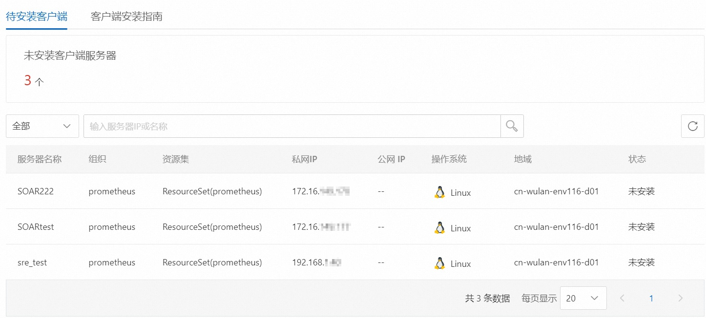

6. 单击**客户端安装指南**页签，安装客户端。

   - 命令行安装

     - **云内部署**

       <ol type="a">

       <li>

       在**命令行安装**页签，定位到用户的服务器操作系统，单击对应的**复制命令**。

       > **说明**
       >
       > 如果没有找到对应的服务器操作系统安装命令，用户可以单击**新增安装命令**，选择**组织**、**资源集**、**客户端类型**后，单击**复制命令**。

       </li>

       <li>

       在您的服务器执行该命令。

       </li>

       </ol>

       <ol type="i" start="100">

       <li>

       单击**验证安装结果**页签，根据服务器操作系统，复制验证命令，进行验证。

       </li>

       </ol>

     - **云外部署**

       > **重要**
       >
       > 安装客户端前请确认授权点数充足，且目标服务器到安骑士服务端域名解析正确。用户可以单击**查看域名解析**、**查看授权信息**，查看对应信息。

       <ol type="a">

       <li>

       单击**供货商管理**，在**资产管理**页面，单击**供应商**。

       </li>

       <li>

       单击**创建供应商**，填写**供应商名称**后，单击**确定**。

       </li>

       </ol>

       <ol type="i" start="100">

       <li>

       回到**客户端安装**页面，在**客户端安装指南**页签，单击**命令行安装**。

       </li>

       <li value="500">

       在**云外部署**区域，找到新增的供货商，单击新增安装命令，完成**客户端类型**、**生效时间**、**区域(region)**、**机房(AZone)**、**绑定分组**的配置。

       在多组织模式下，需选择安装的**组织**和**资源集**。

       </li>

       </ol>

       <ol type="a" start="5">

       <li>

       单击对应的**复制命令**，在您的服务器执行该命令。

       </li>

       <li>

       单击**验证安装结果**页签，根据服务器操作系统，复制验证命令，进行验证。

       </li>

       </ol>

   - **镜像安装**

     > **重要**
     >
     > 安装客户端前请确认授权点数充足，且目标服务器到安骑士服务端域名解析正确。用户可以单击**查看域名解析**、**查看授权信息**，查看对应信息。

     <ol type="a">

     <li>

     在**镜像安装**页签，根据控制台提示，安装客户端。

     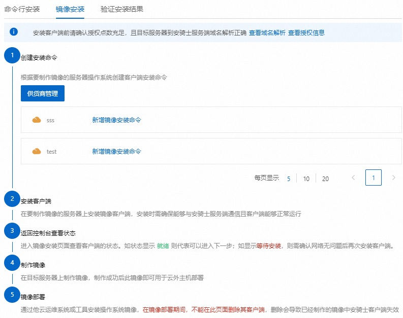

     </li>

     <li>

     单击**验证安装结果**页签，根据服务器操作系统，复制验证命令，进行验证。

     </li>

     </ol>

### 3.6.2. 管理防护模式

本文介绍了如何管理云主机的防护能力和防护模式，使服务器更高效、更安全。

**操作步骤**

1. 登录Apsara Uni-manager运营控制台。

2. 在控制台右上方，单击**安全**，选择**主机安全 > 安骑士**。在**安骑士**授权页面，选择**地域**并单击**角色授权访问**。

   > **说明**
   >
   > - 在多级组织模式下，所有数据的权限都将关联到组织下的资源集维度。用户可以通过控制台顶部菜单栏选择不同组织和资源集，以查看或处理所属组织和资源集的资产。
   >
   > - 上级组织具有最高的管理权限，对内容的修改将覆盖下级组织和资源集的配置。在进行对应配置的修改时，请务必注意。

3. 在左侧导航栏，选择**主机设置** > **功能设置**。

4. 在**设置**页签的**防护能力设置**子页签，设置以下防护能力。

   在多级组织模式下，支持从资源集维度筛选防护的服务器。

   | 防护能力 | 说明 | 相关操作 |
   | --- | --- | --- |
   | 主动防御 | • <strong>恶意主机行为防御（HIPS）</strong>：主动识别进程威胁行为，智能判定风险等级，提供实时拦截病毒木马、勒索软件、挖矿病毒、DDoS木马等高危风险的能力。 • <strong>勒索诱捕：</strong>根据勒索行为规则生成陷阱数据，常规进程运行时不会对其造成影响，一旦勒索病毒操作陷阱数据，会被勒索诱捕功能发现并实时拦截。仅支持Windows系统。 • <strong>数据还原风险监控：</strong>通过快照恢复被勒索的云盘文件。备份习惯较差的资产会存在数据恢复风险，如需修改自动快照策略，请前往云服务器ECS控制台。如需查看风险资产，请单击风险资产右侧<strong>查看详情</strong>。 • <strong>恶意网络行为防御</strong>：针对已知恶意的网络行为进行拦截，提升安全防线。当前仅对容器防火墙生效。 | • 开启防御能力：单击对应防御功能右侧的开关 图标，开启对应防御能力。 • 设置防御范围：在对应能力区域，单击<strong>防御范围</strong>右侧<strong>管理</strong>，在弹出的对话框，选择目标资产分组及资产，单击<strong>确定</strong>。 |
   | 网站后门查杀 | 对网站服务器网页目录进行检测和识别网站后门，让黑客悄然植入后门无处隐藏。 | 设置防御范围：单击<strong>防御范</strong><strong>围</strong>右侧<strong>管理</strong>，在弹出的对话框，选择目标资产分组及资产，单击<strong>确定</strong>。 |

5. 在**防护模式管理**子页签，管理防护模式。

   在多级组织模式下，支持从资源集维度筛选防护的服务器。

   **防护模式**

   **说明**

   **相关操作**

   **基础防护模式**：基础防护模式适用于对低安全要求的业务场景，该模式下客户端正常运行仅消耗单核CPU<2%，内存50MB，同时自动降配资源消耗较大的

   无。

   安全引擎能力，安全能力较弱，可能出现威胁检测不及时的情况，建议启用高级防护模式。

   **高级防护模式**：高级防护模式适用于关键业务的安全防

   管理防护的服务器：在**高级防护模**

   护场景，该模式下将开启更强大的大数据分析引擎、机

   **式**区域，单击**管理**，在**高级防护模**

   器学习、深度学习引擎，挖掘更多可疑的入侵行为和潜

   **式**面板，选择需要防护的资产，单

   在的威胁。

   击**确定**。

   - 管理防护的服务器：在**重大活动**

   **防护模式管理**

   **保护模式**区域，单击**管理**，在**重大活动保护模式**面板，选择需要防护的资产，单击**确定**。

   **重大活动保护模式**：重保护航模式适用于重大活动的安保活动，该模式下将开启所有安全防护规则和安全引

   - 设置CPU阈值：在**重大活动保护**

   擎，对任何可疑的入侵行为和潜在的威胁进行告警。

   **模式**区域，从CPU阈值下拉列表中，选择合适的阈值。支持选择5%、10%、20%、30%、40%、50%和60%。

   <table>
     <tr>
       <td>自保护管理</td>
       <td>主动拦截恶意的卸载行为，保障主机防护机制的稳定运转。 说明 • 重要业务请使用支持自保护的操作系统，以免客户端被恶意破坏后服务器失去保护，造成安全隐患。 • 关闭自保护所需时间为半小时。</td>
       <td>• 设置保护的服务器：在<strong>自保护管</strong><strong>理</strong>区域，单击<strong>管理</strong>，选择目标服务器，单击<strong>确定</strong>。 • 开启自保模式：单击图标开启自保模式。</td>
     </tr>
   </table>

### 3.6.3. 设置防御规则

主机规则设置用于对主机的检测、防御规则的管理，您可以根据业务场景设置防御规则，完善安全体系建设。

**应用场景**

恶意行为防御功能支持系统防御规则和自定义防御规则。两种防御规则的应用场景如下：

<table>
  <tr>
    <th width="138">规则类型</th>
    <th>适用场景</th>
  </tr>
  <tr>
    <td>系统防御规则</td>
    <td>自动拦截常见恶意行为。支持通过停用系统防御规则或修改系统防御规则的生效服务器为您的资产定制防御规则。</td>
  </tr>
  <tr>
    <td>自定义防御规则</td>
    <td>如果您需要放行或重点拦截某些确定的行为，您可以使用<strong>自定义防御规则</strong>功能，自定义适合自己业务场景的精细规则。</td>
  </tr>
</table>

高危命令审计功能支持自定义审计规则。

**恶意行为防御**

**管理系统防御规则**

1. 登录Apsara Uni-manager运营控制台。

2. 在控制台右上方，单击**安全**，选择**主机安全 > 安骑士**。在**安骑士**授权页面，选择**地域**并单击**角色授权访问**。

   > **说明**
   >
   > - 在多级组织模式下，所有数据的权限都将关联到组织下的资源集维度。用户可以通过控制台顶部菜单栏选择不同组织和资源集，以查看或处理所属组织和资源集的资产。
   >
   > - 上级组织具有最高的管理权限，对内容的修改将覆盖下级组织和资源集的配置。在进行对应配置的修改时，请务必注意。

3. 在左侧导航栏，选择**主机设置** > **规则设置**。

4. 在**恶意行为防御**页签的**系统防御规则**页签下的规则列表中，查找并管理目标系统防御规则。

   - 查找目标规则

     - 方式一：在**系统防御规则**页签的搜索框中，输入系统防御规则的名称，快速查找目标系统防御规则。

     - 方式二：在**系统防御规则**页签的左侧的**ATT&CK攻击阶段**菜单中，通过**ATT&CK攻击阶段**筛选目标系统防御规则。

   - 管理目标规则

     - 启用或停用规则：在日常业务场景当中，如果发现某个系统防御规则不适合业务场景，并且会影响资产的安全评分，可以停用该系统防御规则。

       <ol type="a">

       <li>

       选中（支持多选）目标规则。

       </li>

       <li>

       单击规则列表下方的**启用**或**停用**。

       </li>

       </ol>

     - 管理主机

       > **说明**
       >
       > 将资产从规则中移除后，该资产将不会再受到此系统防御规则的保护。

       <ol type="a">

       <li>

       选中要管理的系统防御规则，单击**操作**列的**管理主机**。

       </li>

       <li>

       在**主机管理**面板，添加或删除该规则防御的资产，然后单击**确定**。

       </li>

       </ol>

**自定义防御规则**

1. 登录Apsara Uni-manager运营控制台。

2. 在控制台右上方，单击**安全**，选择**主机安全 > 安骑士**。在**安骑士**授权页面，选择**地域**并单击**角色授权访问**。

   > **说明**
   >
   > - 在多级组织模式下，所有数据的权限都将关联到组织下的资源集维度。用户可以通过控制台顶部菜单栏选择不同组织和资源集，以查看或处理所属组织和资源集的资产。
   >
   > - 上级组织具有最高的管理权限，对内容的修改将覆盖下级组织和资源集的配置。在进行对应配置的修改时，请务必注意。

3. 在左侧导航栏，选择**主机设置** > **规则设置**。

4. 在**恶意行为防御**页签的**自定义防御规则**页签，单击**新建规则**。

5. 在**新建规则**面板，根据实际业务需求选择不同的**规则类型**完成相关参数配置，并设置规则的**动作**，然后单击**下一步**。

   选择的不同的规则类型时，需要配置不同的参数。支持加白以下规则类型：

   > **说明**
   >
   > 仅支持加黑（即拦截）进程Hash类型的行为。

   - 进程Hash

   - 命令行

   - 进程网络

   - 文件读写

   - 操作注册表

   - 加载动态链接库

   - 文件重命名

6. 在**新建规则**面板，选择规则生效的资产，单击**完成**。

   新建的自定义规则默认为开启状态，支持编辑和管理生效的服务器。

**高危命令审计自定义规则并启动**

> **重要**
>
> 在多级组织模式下，仅有整个一级组织权限的账号才可创建、编辑和删除规则。

1. 登录Apsara Uni-manager运营控制台。

2. 在控制台右上方，单击**安全**，选择**主机安全 > 安骑士**。在**安骑士**授权页面，选择**地域**并单击**角色授权访问**。

   > **说明**
   >
   > - 在多级组织模式下，所有数据的权限都将关联到组织下的资源集维度。用户可以通过控制台顶部菜单栏选择不同组织和资源集，以查看或处理所属组织和资源集的资产。
   >
   > - 上级组织具有最高的管理权限，对内容的修改将覆盖下级组织和资源集的配置。在进行对应配置的修改时，请务必注意。

3. 在左侧导航栏，选择**主机设置** > **规则设置**。

4. 在**高危命令审计**页签单击**新建规则**。

5. 在**新建规则**面板，配置以下规则参数，单击**下一步**。

   <table>
     <tr>
       <th width="90">参数</th>
       <th>说明</th>
     </tr>
     <tr>
       <td>规则名称</td>
       <td>自定义规则名称。</td>
     </tr>
     <tr>
       <td>规则描述</td>
       <td>输入规则说明信息。</td>
     </tr>
     <tr>
       <td>系统类型</td>
       <td>选择<strong>Linux</strong>或<strong>Windows</strong>。</td>
     </tr>
     <tr>
       <td>进程路径</td>
       <td>设置规则审计的进程路径。字符长度限制为5~100个字符，使用通配符需要包含进程名或者二级目录，例 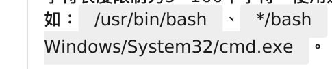 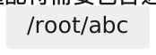 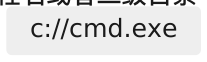 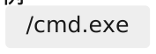 如：<code> </code>/usr/bin/bash<code> </code>、<code> </code>*/bash<code> </code>、<code> </code>/root/abc<code> </code>、<code> </code>c://cmd.exe<code> </code>、<code> </code>/cmd.exe<code> </code>、<code> </code>C:/Windows/System32/cmd.exe<code> </code>。</td>
     </tr>
     <tr>
       <td>命令行</td>
       <td>设置规则审计的命令行。字符长度限制为1~100个字符，推荐使用通配符，需要包含字符，例 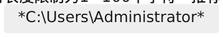  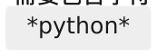 如：<code> </code>*C:\Users\Administrator*<code> </code>、<code> </code>*id*<code> </code>、<code> </code>*python*<code> </code>，其他匹配语法请参照正则表达式。您可以单击右侧的<strong>测试</strong>，在弹出的对话框中，<strong>匹配模式</strong>会自动匹配已输入的命令行，在下方输入框输入命令，单击<strong>测试</strong>。如果测试成功，会直接关闭测试对话框。</td>
     </tr>
     <tr>
       <td>威胁等级</td>
       <td>设置该规则的威胁等级：<strong>严重</strong>、<strong>可疑</strong>或<strong>提醒</strong>。</td>
     </tr>
   </table>

6. 选择规则应用的资产范围，然后单击**完成**。

   如果需要应用到新增主机，可选中**新增主机默认生效**。

7. 创建规则完成后，在规则列表，单击**开关**列的开关  图标，使规则生效。

   规则状态说明：

   - 运行中：规则生效中。

   - 未开启：规则未生效。

   - 静默运行：一段时间内超过设置的最大触发次数限制后，该规则将进入静默状态，即不产生更多告警直到进入下一个时间周期后恢复。

     您可以登录Apsara Uni-manager运营控制台，在云盾运维中心的安骑士全局设置中修改限制。

**查看审计告警事件**

1. 在左侧导航栏，选择**入侵防御** > **安全告警**。

2. 在安全告警列表上方的搜索区域，选择告警类型为**命令行审计**，查看**可疑命令行记录**的告警及其详细信息。

# 4.云盾系统配置

## 4.1. 登录Apsara Uni-manager运营控制台

本文主要向您介绍如何登录Apsara Uni-manager运营控制台。

**前提条件**

- 登录Apsara Uni-manager运营控制台前，确认您已从部署人员处获取Apsara Uni-manager运营控制台的服务域名地址。

- 推荐使用Chrome浏览器。

**操作步骤**

1. 在浏览器地址栏中，输入Apsara Uni-manager运营控制台的服务域名地址，按回车键。

2. 输入正确的用户名及密码。

   请向运营管理员获取登录控制台的用户名和密码。

   > **说明**
   >
   > - **首次登录**
   >
   >   首次Apsara Uni-manager运营控制台时，需要修改登录用户名的密码，请按照提示完成密码修改。为提高安全性，密码长度必须为10~32位，且包含英文字母大小写、阿拉伯数字和特殊符号（感叹号（!）、at（@）、井号（#）、美元符号（$）、百分号（%）等）。
   >
   > - **忘记密码**
   >
   >   用户忘记登录密码时，单击忘记密码，输入账户名（当前账号的用户名）、邮箱（当前用户创建时所录入的邮箱）和验证码后，重置密码的链接将发至邮箱，进入链接后用户可输入新密码。

3. 单击**账号登录**。

4. 如果账号已激活MFA多因素认证，请根据以下两种情况进行操作：

   - 管理员强制开启MFA后的首次登录：

     <ol type="a">

     <li>

     在绑定虚拟MFA设备页面中，按页面提示步骤绑定MFA设备。

     </li>

     <li>

     按照步骤2重新输入账号和密码，单击**账号登录**。

     </li>

     </ol>

     <ol type="i" start="100">

     <li>

     输入6位MFA码后单击**认证**。

     </li>

     </ol>

   - 您已开启并绑定MFA：

     输入6位MFA码后单击**认证**。

     > **说明**
     >
     > 绑定并开启MFA的操作请参见《Apsara Uni-manager运营控制台用户指南》中**安全中心** > **多因素认证** > **管理多因素认证**章节。

## 4.2. 规则运营

### 4.2.1. Aliguard规则运营

Aliguard规则运营支持用户可以根据实际网络环境自定义DDos清洗策略、修改牵引阈值。本文介绍如何自定义DDoS的清洗策略和牵引阈值。

**操作步骤**

1. 登录Apsara Uni-manager运营控制台。

2. 在控制台右上方，单击**安全**，选择**全局平台安全 > 系统配置**。在**系统配置**授权页面，选择**地域**并单击**角色授权访问**。

3. 在左侧导航栏，单击**规则运营**。

4. 在**Aliguard规则运营**页签，单击**清洗策略**，自定义清洗策略的阈值。

   <ol type="i">

   <li>

   定位到需要调整的规则，单击**操作**列的**调整阈值**。

   </li>

   <li>

   在**调整阈值**对话框，输入阈值后，单击**确定**。

   </li>

   </ol>

5. 在**Aliguard规则运营**页签，单击**牵引阈值**，自定义牵引阈值。

   <ol type="i">

   <li>

   定位到需要调整的策略，单击**操作**列的**调整阈值**。

   </li>

   <li>

   在**调整阈值**对话框，输入阈值后，单击**确定**。

   </li>

   <li>

   <strong>可选：</strong>单击**开启DDoS自动牵引清洗**，在**开启自动牵引**对话框，单击**确定**。

   > **说明**
   >
   > **开启DDoS自动牵引清洗**开关默认关闭。

   - 自动牵引开关开启：根据用户自定义的DDos阈值触发清洗事件。受攻击IP会被自动牵引到DDoS集群进行流量清洗。

   - 自动牵引开关关闭：根据用户自定义的DDos阈值产生DDos告警事件，用户可以根据业务需要，在DDos控制台手动开始清洗和结束清洗。

   </li>

   </ol>

### 4.2.2. 安骑士规则运营

您可以在安骑士规则运营中查看漏洞情况、基线列表、主机异常列表。本文介绍如何查看安骑士规则的运营情况。

**操作步骤**

1. 登录Apsara Uni-manager运营控制台。

2. 在控制台右上方，单击**安全**，选择**全局平台安全 > 系统配置**。在**系统配置**授权页面，选择**地域**并单击**角色授权访问**。

3. 在左侧导航栏，单击**规则运营**。

4. 在**安骑士规则运营**页签，查看安骑士规则运营情况。

   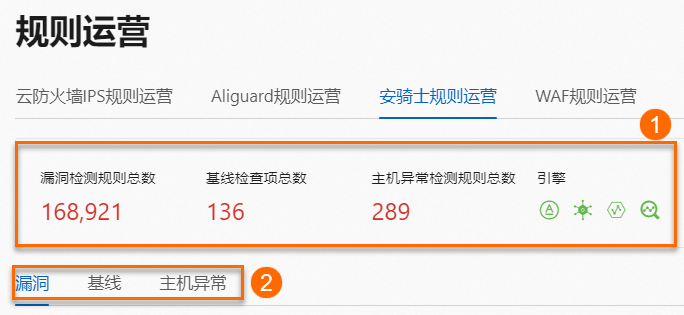

   | 项目 | 说明 |
   | --- | --- |
   | 总览（图示①） | 支持查看<strong>漏洞检测规则总数</strong>、<strong>基线检查项总数</strong>、<strong>主机异常检测规则总数</strong>、<strong>引擎</strong>信息。 |
   | 漏洞（图示②） | 在<strong>漏洞</strong>页签，查看检测到的所有漏洞及总数。 • 在搜索框选择漏洞类型、输入CVE编号、系统名称，可搜索对应漏洞。 • 在漏洞列表，查看检测到的漏洞的<strong>漏洞名称</strong>、<strong>CVE编号</strong>、<strong>漏洞类型</strong>、<strong>系统</strong>、<strong>更新时</strong><strong>间</strong>、<strong>状态</strong>。 |
   | 基线（图示②） | 在<strong>基线</strong>页签，查看检测到的基线类型、基线检查项数据。 • 在搜索框选择基线类型、风险等级、检查项类别、检查项名称，可搜索对应基线。 • 在基线列表，查看<strong>基线类型</strong>、<strong>检查项类别</strong>、<strong>检查项名称</strong>、<strong>风险等级</strong>、<strong>更新时间</strong>、<strong>状态</strong>。 |
   | 主机异常（图示②） | 在<strong>主机异常</strong>页签，查看<strong>规则告警子类型数</strong>、<strong>WebShell&amp;恶意病毒（进程）</strong>信息。 • 在搜索框选择规则父类、风险等级、规则告警子类名称，可搜索对应主机异常事件。 • 在主机异常列表，查看<strong>子类名称</strong>、<strong>规则父类</strong>、<strong>风险等级</strong>、<strong>更新时间</strong>、<strong>来源</strong>、<strong>状态</strong>。 |

### 4.2.3. WAF规则运营

通过WAF规则运营，用户可以根据自身的业务需求和网络环境自定义WAF运营规则，监控WAF运营状态。本文介绍如何添加和管理WAF运营规则。

**操作步骤**

> **重要**
>
> 该运营规则为全局自定义规则，会对所有租户生效，请谨慎操作。

1. 登录Apsara Uni-manager运营控制台。

2. 在控制台右上方，单击**安全**，选择**全局平台安全 > 系统配置**。在**系统配置**授权页面，选择**地域**并单击**角色授权访问**。

3. 在左侧导航栏，单击**规则运营**。

4. 在**WAF规则运营**页签，单击**添加自定义规则**。完成如下配置后，单击**确定**。

   <table>
     <tr>
       <th width="121">配置项</th>
       <th>说明</th>
     </tr>
     <tr>
       <td>模式</td>
       <td>设置规则的处置模式和运行状态。 • 处置模式支持<strong>拦截</strong>、<strong>放行</strong>、<strong>观察</strong>、<strong>检测模块控制</strong>。 • 运行状态支持<strong>启用</strong>或<strong>禁用</strong>。</td>
     </tr>
     <tr>
       <td>备注</td>
       <td>填写规则的备注信息。</td>
     </tr>
     <tr>
       <td>威胁等级</td>
       <td>设置规则检测的威胁等级。可选项：<strong>无威胁</strong>、<strong>低危</strong>、<strong>中危</strong>、<strong>高危</strong>。</td>
     </tr>
     <tr>
       <td>匹配条件</td>
       <td>设置规则的<strong>匹配字段</strong>、<strong>逻辑符</strong>和<strong>匹配内容。</strong></td>
     </tr>
     <tr>
       <td>是否记录日志</td>
       <td>设置记录日志的场景。可选项：<strong>命中时记录、</strong>命中时不记录。</td>
     </tr>
     <tr>
       <td>攻击类型</td>
       <td>选择规则检测的攻击类型。不支持多选。</td>
     </tr>
     <tr>
       <td>阻断状态码</td>
       <td>选择规则检测的阻断状态码。不支持多选。</td>
     </tr>
     <tr>
       <td>过期时间</td>
       <td>设置规则的过期时间。不设置时间表示规则永不过期。</td>
     </tr>
   </table>

   添加运营规则后，用户可以在规则列表，执行如下操作：

   - 通过规则列表上的筛选按钮，筛选需要查看的WAF运营规则。

   - 定位到某一规则，单击**操作**列中的**编辑**，您可以修改规则信息。

### 4.2.4. 云防火墙IPS规则运营

云防火墙内置IPS规则，用户可以根据自身的业务需求和网络环境自定义IPS规则，监控云防火墙运营状态。本文介绍如何添加和管理云防火墙的IPS规则。

**操作步骤**

1. 登录Apsara Uni-manager运营控制台。

2. 在控制台右上方，单击**安全**，选择**全局平台安全 > 系统配置**。在**系统配置**授权页面，选择**地域**并单击**角色授权访问**。

3. 在左侧导航栏，单击**规则运营**。

4. 在**云防火墙IPS规则运营**页签，单击**添加自定义规则**。完成如下配置后，单击**确定**。

   <table>
     <tr>
       <th width="89">配置项</th>
       <th>说明</th>
     </tr>
     <tr>
       <td>规则名称</td>
       <td>设置自定义IPS规则的名称，建议使用可识别规则用途的名称，便于后续管理。</td>
     </tr>
   </table>

   <table>
     <tr>
       <th width="89">规则引擎</th>
       <th>在下拉栏中选择规则引擎，可选<strong>基础规则</strong>和<strong>虚拟补丁</strong>。</th>
     </tr>
     <tr>
       <td>攻击类型</td>
       <td>在下拉栏中选择该规则的攻击类型。</td>
     </tr>
     <tr>
       <td>等级</td>
       <td>在下拉栏中选择威胁等级，可选<strong>低危</strong>、<strong>中危</strong>或<strong>高危</strong>。</td>
     </tr>
     <tr>
       <td>CVE</td>
       <td>设置该规则的CVE编号。 说明通用漏洞披露CVE（Common Vulnerabilities and Exposures）列出了已公开披露的各种计算机安全缺陷。CVE编号由CVE编号管理机构（CNA）分配。</td>
     </tr>
     <tr>
       <td>攻击应用</td>
       <td>设置攻击应用名称。</td>
     </tr>
     <tr>
       <td>规则模式</td>
       <td>在下拉栏中选择IPS检测的规则模式，可选<strong>包模式</strong>和<strong>流模式</strong>。</td>
     </tr>
     <tr>
       <td>方向</td>
       <td>在下拉栏中选择IPS检测的流量方向，可选<strong>双向</strong>、<strong>入向</strong>和<strong>出向</strong>。</td>
     </tr>
     <tr>
       <td>规则内容</td>
       <td>设置规则内容，规则采用Snort语法。 说明添加规则内容时请确认正确性，不正确的规则内容可能会影响您的业务。</td>
     </tr>
     <tr>
       <td>规则描述</td>
       <td>设置规则描述信息，建议使用规则用途、影响等信息，便于后续管理。</td>
     </tr>
     <tr>
       <td>备注</td>
       <td>设置规则备注信息，建议使用规则用途、影响等信息，便于后续管理。</td>
     </tr>
   </table>

   添加自定义规则后，用户可以在规则列表，执行如下操作：

   - 查看规则详情

     您可以通过IPS规则列表上的筛选按钮，筛选需要查看的IPS规则。

     定位到某一规则，单击**操作**列中的**详情**，您可以查看该规则的具体信息。

   - 启用规则

     如果需要启用某个规则，则定位到该规则，单击**启用状态**列中的切换开关，将**禁用**切换为**启用**。

   - 禁用规则

     如果某个规则不适应于您的业务环境，您可以禁用该规则。

     定位到该规则，单击**启用状态**列中的切换开关，将**启用**切换为**禁用**。

## 4.3. 告警设置

告警设置支持设置告警联系人和告警规则。当监控数据满足报警规则时，系统自动发送告警信息给报警联系人，支持钉钉消息和邮件。本文介绍如何添加和管理告警联系人。

**设置告警联系人**

1. 登录Apsara Uni-manager运营控制台。

2. 在控制台右上方，单击**安全**，选择**全局平台安全 > 系统配置**。在**系统配置**授权页面，选择**地域**并单击**角色授权访问**。

3. 在左侧导航栏，选择**监控告警 > 告警设置**。

4. 在**联系人管理**页签，单击**添加联系人**。填写联系人姓名、钉钉机器人Token、邮箱信息后，单击**确定**。

   添加后的联系人可以在联系人列表查看，支持**编辑**、**批量删除**。

**设置安骑士告警规则**

1. 登录Apsara Uni-manager运营控制台。

2. 在控制台右上方，单击**安全**，选择**全局平台安全 > 系统配置**。在**系统配置**授权页面，选择**地域**并单击**角色授权访问**。

3. 在左侧导航栏，选择**监控告警 > 告警设置**。

4. 在**安骑士**页签，设置要发送的告警规则后，单击**保存**。

   **告警类型**

   **告警子类**

   **告警等级**

   **通知方式**

   **告警周期**

   - Linux软件漏洞

   - Windows系统漏洞

     - 低危

   漏洞风险

   - Web-CMS漏洞

     - 中危

   - 应用漏洞

     - 高危

   - 应急漏洞

   - 高风险利用

     - 低危

   - 等保合规

   基线风险

   - 中危

   - 最佳安全实践

     - 高危

   - 弱口令

   - 有漏洞暴露

   资产暴露

   全部

   - 无漏洞暴露

     - 5分钟

     - 10分钟

     - 30分钟

     - 邮箱

       - 1小时

     - 钉钉

       - 1天

       - 1周

   - 进程异常行为

   - 网站后门

   - 异常登录

   - 异常事件

   - 威胁情报

   - 恶意进程(云查杀)

     - 低危

   - 异常网络连接

   入侵告警

   - 中危

   - 异常账号

     - 高危

   - 应用入侵事件

   - 云产品威胁检测

   - 精准防御

   - 恶意脚本

   - 持久化后门

   - 应用威胁检测

   应用白名单事件

   违规进程启动

   全部

   - 异常文件修改

   防篡改事件

   - 异常文件添加

     全部

   - 异常文件删除

## 4.4. 全局设置

### 4.4.1. 拦截策略设置

通过安全阻断功能，能够防御Web攻击和暴力破解。本文介绍如何启用应用攻击阻断和暴力破解阻断功能。

**操作步骤**

1. 登录Apsara Uni-manager运营控制台。

2. 在控制台右上方，单击**安全**，选择**全局平台安全 > 系统配置**。在**系统配置**授权页面，选择**地域**并单击**角色授权访问**。

3. 在左侧导航栏，单击**全局设置**。

4. 在**全局设置**页签，单击拦截类型操作列的开关，启用或圈闭拦截策略。

   关闭后，相应的拦截功能将被禁用，仅提供预警功能。

## 4.5. CFW运行监控

通过CFW运行监控，用户可以监控云防火墙运行情况，提前发现异常流量，及时处理异常情况。本文介绍如何进行系统巡检、服务监控。

**操作步骤**

1. 登录Apsara Uni-manager运营控制台。

2. 在控制台右上方，单击**安全**，选择**全局平台安全 > 系统配置**。在**系统配置**授权页面，选择**地域**并单击**角色授权访问**。

3. 在左侧导航栏，单击**CFW运行监控**。

4. 在**系统巡检**区域，单击**一键巡检**。

   完成巡检后，用户可以执行如下操作：

   - 单击**互联网云防火墙(ICFW)**、<strong>VPC云防火墙(CCFW)</strong>或**流量安全监控(Beaver)操作**列的**详情**，查看各检查项的实际状态。

   - 单击**互联网云防火墙(ICFW)**、<strong>VPC云防火墙(CCFW)</strong>或**流量安全监控(Beaver)操作**列的**立即巡检**，可对单个系统进行巡检。

5. 在**服务监控**区域，设置**云防火墙ICFW**或**云防火墙CCFW**的监控配置。

   - **云防火墙ICFW**

     <ol type="a">

     <li>

     单击**引流配置 - 业务网段**区域的**添加**，完成如下配置后，单击**确定**。

     | 配置项 | 说明 |
     | --- | --- |
     | 设备集群ID | 选择要添加的引流网段的设备集群ID。 |
     | 引流方式 | 选择要引流的方式，可选项：ISW、XGW。 |
     | 引流网段 | 输入要引流的网段。 |
     | 类型 | 设置引流网段的类型，可选项：业务网段、测试网段。 |
     | 业务描述 | 填写业务相关描述。 |

     完成配置后，可在**服务自检状态**区域、**接口状态**区域，查看引流网段的自动刷新频率、各设备集群的服务自检结果。

     > **说明**
     >
     > 在各区域单击**自动刷新**下拉框，可设置引流网段的自动刷新频率。用户也可以单击  图标，手动
     >
     > 刷新。

     </li>

     <li>

     在**连通性健康检查**区域，单击**添加**。完成如下配置后，单击**确定**。

     | 配置项 | 说明 |
     | --- | --- |
     | 设备集群ID | 选择要添加的引流网段的设备集群ID。 |
     | 测试IP地址 | 输入要填写的IP地址。 |
     | 类型 | 设置连通性健康检查的类型，可选项：业务、测试、系统。 |
     | 探测频率 | 设置探测频率，单位为秒（s），且需要在1~60之间取整数。 |
     | 探测阈值 | 设置探测阈值，单位为次，且需要在1~30之间取整数。 |
     | 动作 | 设置动作，可选项：自动bypass、告警。 |

     完成配置后，可测试IP地址的连通性。

     </li>

     </ol>

     <ol type="i" start="100">

     <li>

     配置防火墙只对互联网入方向生效的**全局默认策略模式**为**block all**（拦截所有）、**permit all**（允许所有）。

     </li>

     </ol>

   - **云防火墙CCFW**

     单击**云防火墙ICFW**页签，查看防火墙任务流、实例状态自检、设备状态自检、接口状态、连通性健康检查的详细信息。

## 4.6. 账号管理

### 4.6.1. 专有云账号管理

本文介绍如何查看、修改系统绑定的专有云账号信息。

> **重要**
>
> 云盾中的资产均与账号绑定，请谨慎修改。

**操作步骤**

1. 登录Apsara Uni-manager运营控制台。

2. 在控制台右上方，单击**安全**，选择**全局平台安全 > 系统配置**。在**系统配置**授权页面，选择**地域**并单击**角色授权访问**。

3. 在左侧导航栏，单击**账号管理**。

4. 在**专有云账号**页签，修改阿里云账号信息。

   <ol type="i">

   <li>

   定位到要修改的阿里云账号，单击**操作**列的**修改**。

   </li>

   <li>

   在**账号修改**对话框中，修改阿里云账号名、Access Key、Access Secret信息，单击**确定**。

   </li>

   </ol>

修改完成后，用户可以单击**操作**列的详情，查看阿里云账号详情。

### 4.6.2. 公有云账号管理

通过在专有云中添加公有云账号，您可以在专有云中管理该公有云账号下已购买的高防IP和WAF，实现混合云功能。本文介绍如何添加公有云账号。

**操作步骤**

如果专有云中需要使用混合云功能，需要根据本文添加阿里云公有云账号。

1. 登录Apsara Uni-manager运营控制台。

2. 在控制台右上方，单击**安全**，选择**全局平台安全 > 系统配置**。在**系统配置**授权页面，选择**地域**并单击**角色授权访问**。

3. 在左侧导航栏，单击**账号管理**。

4. 在**公有云账号**页签，单击**添加**。

   <ol type="i">

   <li>

   定位到要修改的阿里云账号，单击**修改**。完成如下配置后，单击确定。

   | 配置项 | 说明 |
   | --- | --- |
   | Access Key | 设置要添加的公有云Access Key。 |
   | Access Secret | 设置要添加的公有云Access Secret。 |
   | 公有云产品 | 选择使用的公有云产品，支持<strong>高防IP</strong>和<strong>Web应用防护</strong>，可单选一个产品或全选。 |

   </li>

   </ol>

添加完成后，用户可以在账号列表查看已添加的公有云账号，支持**修改**和**删除**账号。
