阿里云  
专有云  
安骑士 产品简介  
产品版本：V3.18.6  
文档版本：20251218

**目录**

- [1.产品概述](#section-1)
- [2.产品设计](#section-2)
- [3.功能特性](#section-3)
- [4.产品功能说明](#section-4)
    - [4.1. 安全总览](#section-4-1)
    - [4.2. 资产中心](#section-4-2)
    - [4.3. 安全预防](#section-4-3)
    - [4.4. 入侵防御](#section-4-4)
    - [4.5. 日志检索](#section-4-5)
    - [4.6. 主机设置](#section-4-6)
- [5.核心能力](#section-5)

# 1.产品概述

**云上安全先行者**

阿里云安全团队自2005年起，护航阿里巴巴集团内部所有业务系统的信息安全。团队从成立开始就直面来自全球的网络攻击，至今未尝败绩。近些年云计算技术的不断发展和广泛运用，传统数据中心已经逐步开始向云计算架构进行过渡和迁移，各行各业的数字化转型，使得业务和数据上云成为刚需。为保障云服务安全，阿里云安全团队2011年推出云盾产品。随着专有云业务不断的增长，2013年阿里云安全团队发布第一个专有云云盾的正式版本，为专有云、行业云用户提供IaaS层安全保障能力。

十年攻防，一朝成盾。阿里云安全团队结合多年云上实战经验，打造云盾安骑士（Aegis）-主机安全产品。安骑士是一个集威胁识别、分析预警、处置修复于一体的泛资产安全管控系统，能够提供精准的资产漏洞、基线、暴露面等脆弱性检查修复能力，也支持对0/1/Nday进行应急响应。并通过自研的多引擎体系，安骑士可提供云查杀、特征查杀、启发式查杀、进程恶意行为检测、勒索病毒诱捕、大数据模型规则检测等威胁检测能力。也可根据用户业务实际情况，提供基于文件、进程、网络的规则保护能力，有效防止线上业务系统行为被篡改。安骑士可收集并呈现10余种类型的日志和云上资产指纹，并结合网络实体威胁情报进行安全态势分析，扩大安全可见性，实现威胁检测、响应、溯源的自动化安全运营闭环，保护云上资产和本地服务器并满足监管合规要求。

**产品定位**

阿里云安全-云盾-安骑士（Alibaba Cloud Security-Server Guard Advanced Edition，简称Aegis）是阿里云原生的终端安全检测及响应系统。通过安全告警实时抵御恶意入侵，使用漏洞和基线配置检测消除系统弱点、预防恶意攻击，提供安全态势分析和安全可视化界面、满足事后追溯和分析需求，建立完善的云环境终端安全体系。

安骑士在服务器系统内核层面通过Agent插件实现云上文件和进程行为的全局监控和实时分析，对海量病毒样本持久化攻击方式的自动化分析，有效绕过顽固木马和恶意程序的反查杀能力；还可以基于程序行为分析，挖掘出黑名单未能辨识的恶意威胁，实现主动拦截；其云端病毒库实时更新，集成了国内外主流杀毒引擎、阿里云自研沙箱和机器学习引擎等前沿技术，可以避免因病毒库更新不及时而造成的损失，

防护策略和数据源自于多年的积累，是阿里云上多达百万级的用户，每天面临多达几十万次的各种攻击。阿里云安全团队充分利用了这些安全攻防的数据积累，每天对公共云上10多TB的安全数据进行分析，形成恶意IP库、恶意行为库、恶意样本库、安全漏洞库等基础安全能力，并及时应用到态势感知的各个防护模块中，提升防护能力，为用户带来更好的安全保障。

**应用场景**

安骑士广泛适用于政府、金融、能源、央企、各大部委等行业云、政务云、XC云、混合共建云的安全体系建设，支撑各行各业的云服务器安全管理运营。

**多云多芯片泛资产统一安全管控**

安骑士支持在混合云/多云、一云多芯场景下，实现对租户侧泛资产的产品化集中纳管，设备层包括在x86_32/64_Intel/AMD、x86_64_海光、ARM_64_飞腾/鲲鹏等环境下运行的阿里云ECS、底座物理机、OnECS云盾服务器、云外IDC主机、他云虚拟机、他云物理机等。并且提供自动化安全监控、安全规则可运营、威胁态势数据关联分析等能力，能够覆盖专有云/行业云/混合云/异构云/多云/xc云/一云多芯等日常安全运营场景

**等保合规建设**

等级保护2.0要求，应根据云服务商和云服务客户的职责划分，管理各自控制部分的资产脆弱性问题、威胁事件等资产风险，实现各自控制部分资产的，漏洞风险、基线风险、病毒木马、黑客入侵事件的处置修复。

**护网防御体系建设**

安骑士能够提供资产盘点+资产暴露面盘点能力，梳理云环境对外提供服务的资产、应用、网络链路情况；并提供主机操作系统、网站应用等层面的资产加固能力，能够有效减少资产可被暴露面。同时安骑士能够准确识别外部入侵行为，并进行进程级实时拦截。

**云环境APT威胁防御**

安骑士提供BD、小红伞等杀毒行业头部引擎， 配合阿里云查杀引擎，提供强大的二进制威胁检测能力。自研的GLE多引擎集成了静态匹配检测、通用语法树(AST)动态污点模拟执行、异常启发式检测为一体的动静结合能力，能够精准检出webshell以及恶意脚本。

对于威胁事件以及APT，安骑士通过Dipper引擎提供了350+的威胁检测模型，能够从上层数据中挖掘潜在的安全隐患。

**平台侧资产安全运营**

平台物理机作为云环境基础，其内部对底座业务计算资源的应用风险，会给云平台和其他云租户带来相应的安全隐患。因此平台用户需要对物理机资产和业务风险进行监管和控制。安骑士提供平台物理机的安全情况进行监控能力，以保障云平台安全和其他云租户的业务稳定性。

# 2.产品设计

**产品架构**

安骑士管理模式采用C/S架构。安骑士客户端（简称Agent）可安装在云内经典网络物理机、云内ECS、云外主机/他云主机等云环境服务器上，Agent与安骑士服务器端通过TCP长连接进行通信，通过HTTP方式从服务器端获取需要的脚本、规则、安装包等文件。安骑士客户端Agent分为Windows版本和Linux版本，客户端Agent自动连接到安骑士服务器端进行在线升级。此外安骑士会持续从云原生环境中获取SLB、DNAT、EIP、安全组等网络环境数据以及资产基本信息和云盘信息，丰富云环境资产的状态描述信息。

**安骑士产品架构**

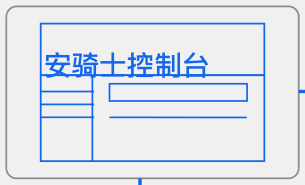

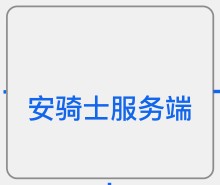

指令下发

数据采集

安全组云盘快照资产信息

风险管理

安全管理

SLB

DNAT

EIP

云原生环境

数据采集

指令下发

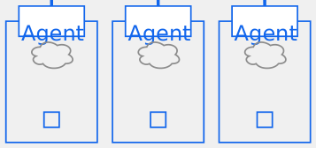

云外主机

云外主机

云外主机

NC

NC

NC

ECS

ECS

ECS

经典网络

云外环境

VPC

安骑士用户交互模式采用B/S架构，支持HTTPS访问安骑士控制台。用户可通过主流浏览器访问，实时查询云环境风险数据，根据自身环境配置安全策略，处置安全风险。

**产品部署**

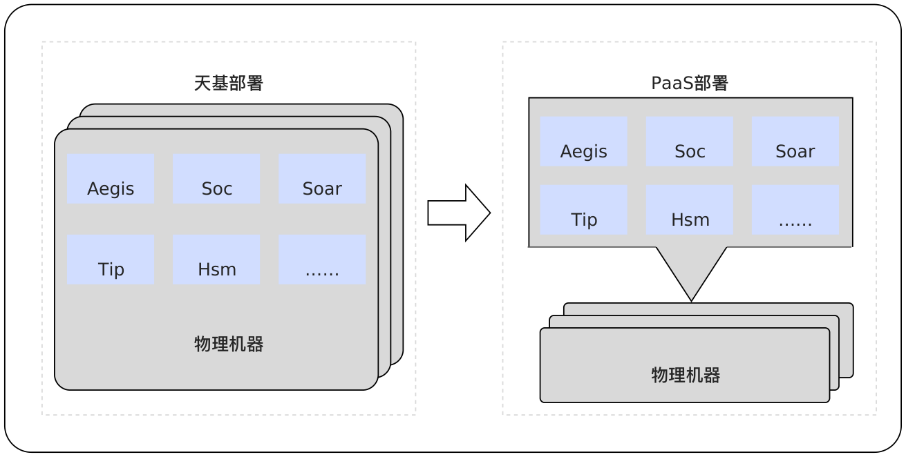

安骑士在3.18.2版本更新了底座资源的使用方式，由天基底座部署云盾独占物理机升级为PaaS部署与所有云产品共用物理机资源池，架构升级示意图如下：

云盾安骑士服务端由基础服务、业务服务、安全服务几部分组成，其中基础服务、业务服务和部分安全服务部署在paas底座共享物理机资源池；所有相关服务（最小化部署2副本）供需要140 CPU，304 GB内存。服务端直接面向安全运营管理者提供安全总览、资产管理、安全预防、入侵防御、日志检索等功能，支撑安全运营管理者进行云服务器安全日常管控。

Dipper数据分析引擎是安骑士的基础组件，其应用于实时大数据的分析处理，包括操作系统侧、应用侧、网络侧的威胁关联分析，以支持安骑士威胁及APT检测。

安骑士的数据存储和中间件是使用PaaS底座提供的云原生组件，能够提供资源共池以及良好的稳定性与容灾能力。

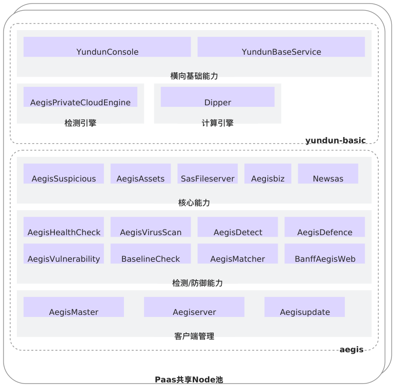

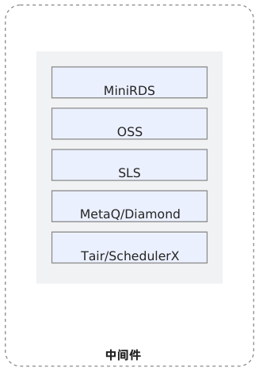

**服务端**

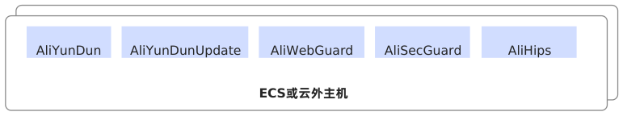

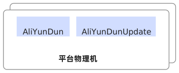

**客户端**

服务端主要分成以下几个模块：

- 基础能力：云盾通用能力，提供控制台和OpenAPI。

- 客户端管理：负责管理客户端连接、配置、规则、补丁包等。

- 核心能力：包括资产、告警、日志、文件采集、安全报告等。

- 检测防御：包括漏洞、基线、文件、网络、进程的检测防御能力。

- 检测引擎：包括商业病毒检测引擎、阿里自研病毒检测引擎、大数据计算引擎。

> **说明**
>
> 安骑士是典型的C/S架构，包括服务端和客户端。服务端负责资产、检测、防御等核心能力，客户端负责实时监测主机状态、执行检测脚本、实时防御等。

**功能架构**

安骑士安全能力主要面向云环境租户侧/平台侧/ 服务器资产，以及云外IDC主机或他云服务器资产，具体功能可分为云资产纳管、资产脆弱性修复、威胁入侵防御三个方面。

**安骑士功能架构**

**安全总览**

查看资产威胁统计数据

**资产中心**

查看资产安全状态

**安全预防**

检测/修复资产脆弱性

**入侵防御**

检测/处置威胁事件

**日志检索**

正则/命令行查询日志

**主机设置**

客户端安装及性能配置

- 漏洞管理：Agent通过收集云服务器组件、软件版本、文件、注册表等信息确认漏洞，通过控制台或者调用OpenAPI触发漏洞修复。win补丁存储于服务端，linux采用自建yum源。

- 基线检查：服务端根据策略向Agent下发基线检查请求， Agent根据相应的检测策略收集主机信息，并与安全基线进行对照判断风险。

- 风险暴露：关联资产及应用的SLB、DNAT、EIP、安全组等网络信息，盘点云环境对外提供服务的资产、应用情况。

- 病毒防御：支持二进制特征/行为、webshell、脚本、勒索诱捕等病毒检测能力。

- 防篡改：支持备份还原+驱动拦截双模式（部分操作系统支持），对用户配置的文件防护目录及文件类型提供防篡改能力。

- 入侵事件：实时展示当前用户云环境中产生的所有风险及其详情，并提供处置和加白功能。

**容灾架构**

安骑士服务端高可用依赖ALB和天基底座中间件的高可用

云盾基础模块的物理机（NC）组成Yundun-BasicThin集群，每台NC上运行安骑士所有服务

安骑士服务端各服务中，负责与客户端通信的服务，通过ALB进行负载均衡

使用存储或中间件的服务，依赖专有云底座提供的高可用实现数据或消息的同步

安骑士高可用架构

**AZone-A（主机房）**

**AZone-B（备机房）**

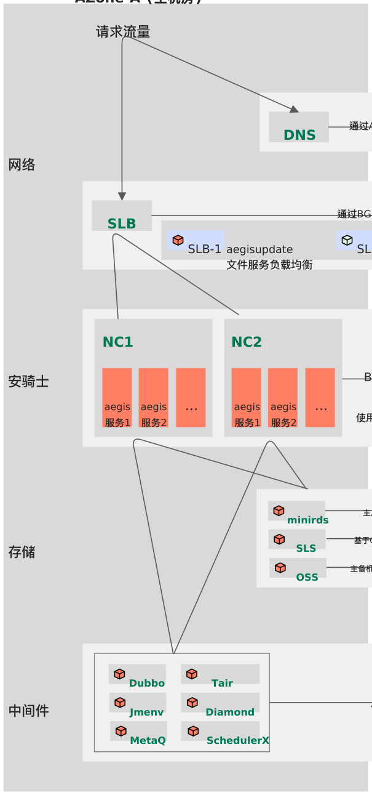

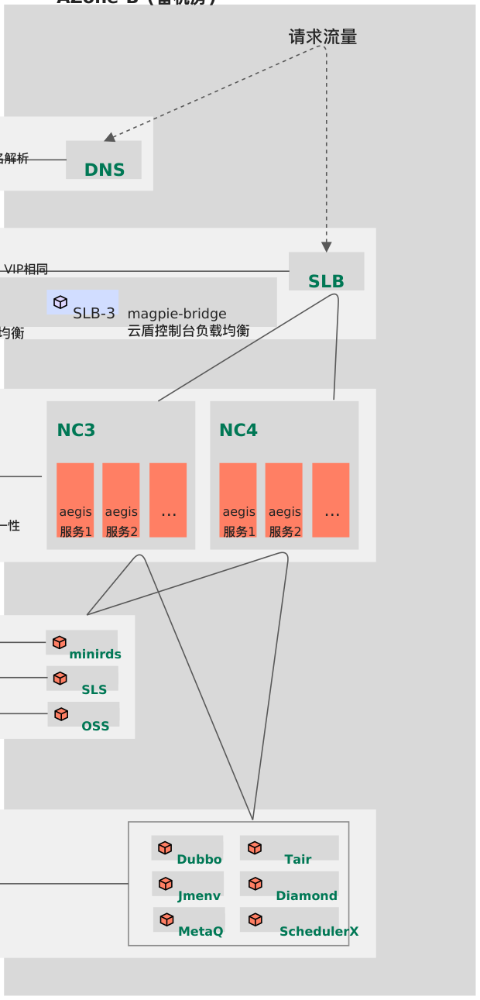

通过Anycast VIP实现域名解析

通过BGP路由实现秒级切换，VIP相同

SLB-2

aegiserver消息服务负载均衡

BasicThinCluster

双活部署

使用DB或中间件保持唯一性

主从库bninlog复制

基于OSS备份保持一致性

主备机房数据同步（DSS）

双活部署

使用DB保持唯一性

# 3.功能特性

本文介绍安骑士支持的功能特性及特性描述。

**一级特性**

**二级特性**

**特性描述**

支持对专有云ECS服务器资产进行安全管控，支持批量下发资产安全检查，数据导出等操作。资产漏洞、风险基线数据单次导出最大支持50

ECS管理

台，基线全量数据单次导出最大支持15台，客户端日志仅支持单台导出。

云外主机管理

支持对专有云云外物理机纳入安骑士的管理范围。

主机列表

底座物理机管理

支持对专有云云内底座物理机进行安全状态查看。

BMS/BMCP资产管

支持将BMS/BMCP智算高性能裸金属资产纳入安骑士管理范围。

理

安全总览

展示需要重点关注的资产、漏洞、异常、配置缺陷、事件等信息。

安全总览

安全大屏

提供资产安全状态、攻击地域地图等态势大屏。

中间件名称、类型、版本、PID、安装路径、最新扫描时间、版本验证信息、父进程PID、运行用户、进程监听IP、进程监听端口、监听状态、监

中间件指纹

听端口协议、进程启动时间、进程命令行、容器名称、镜像名称、配置文件路径、Web目录。

启动项指纹

启动项名称、命令行、任务路径/MD5、最新采集时间。

端口、软件、进程、账户、计划任务、中间件、启动项等指纹数量Top5

指纹TOP排名

排名。

端口指纹

端口、网络协议、对应的进程、IP地址、最新采集时间。

主机指纹

计划任务指纹

任务路径、执行命令、任务周期、账户名称、最新采集时间。

账户名、登录权限、root权限、用户组、到期时间、上次登录时间、最新采集时间等信息。

账户指纹

支持展示账户指纹的变迁记录。

软件指纹

软件资产名称、软件版本、软件安装目录、最新采集时间。

进程名、进程路径、启动参数、启动时间、运行用户、运行权限、PID、

进程指纹

父进程、最新采集时间。

> **说明**
>
> 需购买阿里云威胁情报产品。

安骑士能够有效识别资产中的潜在威胁。威胁情报可以对威胁信息的相关内容进行关联、分析和处理，发现威胁后及时告警，从而提升威胁检查效率和响应速度。

支持的情报类型：

威胁情报检测

- 恶意域名

- 恶意IP

- 暗网通信IP

- 中控通信IP

- 矿池通信IP

- 恶意URL

- 恶意下载源

安骑士威胁检测模块具备350+威胁检测模型，能够覆盖云上95%以上的入侵事件。并按照操作系统、分析对象、攻击手法等维度进行分类，能够帮助用户快速了解云环境入侵事件。

支持的告警类型：

- 进程异常行为

入侵事件

- 异常登录

- 异常事件

- 敏感文件篡改

威胁模型检测

- 异常网络连接

- 异常账号

- 应用入侵事件

- 持久化后门

- 应用威胁检测

- 网站后门

- 恶意进程（云查杀）

- 恶意脚本

支持对常用登录地、登录IP、登录时间、登录账号、web目录进行自定

自定义安全规则

义。

- 主流Linux操作系统支持范围包括：Centos5/6/7、Redhat5-9、Debian6-10、Ubuntu12.04/14.04/16.04/18.04/20.04/22.04、OracleLinux5/6/7/8、AmazonLinuxAMI、AmazonLinux2、SLES10SP4、SLES11SP1/SP2/SP3/SP4、

Linux软件漏洞

SLES12/12SP1/SP2/SP3/SP4/SP5等。

- 国产化操作系统支持范围包括：统信UOS V20、银河麒麟V10、龙蜥7/8。

支持范围包括：74CMS、DedeCMS、Discuz、ECShop、

漏洞管理

Web-CMS漏洞

FCKEditor、Joomla、PHPCMS、phpMyAdmin、phpwind、ThinkPHP5、WordPress。

Windows系统漏洞检测同步微软官网补丁源，对高危及有影响的漏洞进

Windows系统漏

行检测和提醒。

洞

应用漏洞（含应

提供系统服务弱口令、系统服务和应用服务的漏洞检测能力。

急）

- 主动防御支持进程行为拦截、进程链防御、进程二进制检测、执行脚本检测等能力，支持拦截勒索软件、挖矿程序、木马程序、蠕虫病毒、恶意程序、后门程序、DDoS木马、自变异木马、感染型病毒、黑客工具、漏洞利用程序、被污染的基础软件、Rootkit、恶意脚本等勒索防护。

实时防护（x86客

- 勒索防护提供对勒索诱捕以及数据恢复风险的监控能力。帮助用户拦

户端）

截勒索病毒运行，排查备份习惯较差的资产，降低数据恢复风险。

病毒查杀

- 网站后门防护安骑士支持网站后门防护功能，支持自动拦截黑客通过已知网站后门进行的异常连接行为，并隔离相关文件，有效清理隔离php、asp、jsp等类型的webshell后门。

提供病毒查杀和网站后门查杀功能，检测出主流木马病毒、勒索软件、

病毒查杀

挖矿病毒、DDoS木马后自动隔离查杀。

支持对存在未授权访问风险的应用进行高风险利用基线检查，包括：

未授权访问基线

CouchDB、Docker、Elasticsearch、Hadoop、Jenkins、Memcached、Apache、Tomcat、ZooKeeper。

支持检测弱口令账号、可疑的隐藏账号、克隆账号、空密码账户等风险账号以及Linux系统服务器中的密码策略合规性问题，包括：

弱口令基线

MongoDB、SQLServer、MySQL、PostgreSQL、Redis、Rsync、SVN、Linux系统登录、Windows系统登录、ApacheTomcat控制台登录、弱口令-FTP登录。

支持对云服务器进行最佳实践基线检查，发现操作系统和应用软件的配置弱项。包括：

Memcached、MongoDB、MySQL、Oracle11g、Redis、SQLserver、Apache、Nginx、WebSphereApplicationServer、WebLogicServer12c、AlibabaCloudLinux/AliyunLinux2、

最佳安全实践基线

DebianLinux8、CentOSLinux6/7/8、RedhatLinux6/7、Ubuntu14/16/18、Windows2008R2/2012R2/2016/2019R2、IIS8、统信uos20(64bit)、统信uos20SP1(64bit)、统信uosserver20(64bit)、银河麒麟V4(64bit)、银河麒麟V10(64bit)、银河麒麟V10SP1(64bit)、中标麒麟V7(64bit)。

基线检查

- CIS标准支持范围包括：

  AlibabaCloudLinux、AliyunLinux2、CentOSLinux6/7/8、DebianLinux8、Ubuntu14/16/18、WindowsServer2008R2/2012R2/2016R2/2019R2。

- 等保二级支持范围包括：AlibabaCloudLinux/AliyunLinux、CentOSLinux6/7/8、RedhatLinux7、Ubuntu14/16/18、Windows2008R2/2012R2/2016/2019R2。

- 等保三级支持范围包括：AlibabaCloudLinux/AliyunLinux2、

等保合规基线

BCLinux6/7、CentOSLinux6/7/8、DebianLinux8、RedhatLinux6/7、SUSE10/11/12、Ubuntu14/16/18、Windows2008R2/2012R2/2016/2019R2、统信uos20(64bit)、统信uos20SP1(64bit)、统信uosserver20(64bit)、银河麒麟V4(64bit)、银河麒麟V10(64bit)、银河麒麟V10SP1(64bit)、中标麒麟V7(64bit)。

支持对CentOSLinux7/8自定义基线、CentOSLinux6自定义基线、

自定义基线

Windows自定义基线和Ubuntu自定义安全基线检查的部分检测参数进行自定义修改并下发检查。

支持对存在未授权访问风险的应用进行高风险利用基线检查，包括：

高风险利用基线

CouchDB、Docker、Elasticsearch、Hadoop、Jenkins、Memcached、Apache、Tomcat、ZooKeeper。

以应用维度进行资产暴露盘点，可提供暴露中间件名称、类型、版本、

应用暴露

关联漏洞、影响资产、最新扫描时间等信息。

以主机维度进行资产暴露盘点，可提供资产、暴露方式、暴露组件、暴

资产暴露

露端口、可被利用的漏洞、暴露链路拓扑图及暴露风险详情等信息。

风险暴露检查

<table>
  <tr>
    <td rowspan="3">安全告警</td>
    <td>威胁情报检测</td>
    <td>说明需购买阿里云威胁情报产品。 安骑士能够有效识别资产中的潜在威胁。威胁情报可以对威胁信息的相关内容进行关联、分析和处理，发现威胁后及时告警，从而提升威胁检查效率和响应速度。支持的情报类型： • 恶意域名 • 恶意IP • 暗网通信IP • 中控通信IP • 矿池通信IP • 恶意URL • 恶意下载源</td>
  </tr>
  <tr>
    <td>威胁模型检测</td>
    <td>安骑士威胁检测模块具备350+威胁检测模型，能够覆盖云上95%以上的入侵事件。并按照操作系统、分析对象、攻击手法等维度进行分类，能够帮助用户快速了解云环境入侵事件。支持的告警类型： • 进程异常行为 • 异常登录 • 异常事件 • 敏感文件篡改 • 异常网络连接 • 异常账号 • 应用入侵事件 • 持久化后门 • 应用威胁检测 • 网站后门 • 恶意进程（云查杀） • 恶意脚本</td>
  </tr>
  <tr>
    <td>自定义安全规则</td>
    <td>支持对常用登录地、登录IP、登录时间、登录账号、web目录进行自定义。</td>
  </tr>
  <tr>
    <td>攻击分析</td>
    <td>攻击分析</td>
    <td>支持以攻击者视角按不同时间范围展示攻击次数、类型、来源Top5、目的Top5的攻击统计与详情展示。</td>
  </tr>
</table>

- 支持查杀的病毒类型

  勒索病毒、挖矿程序、DDoS木马、木马程序、后门程序、恶意程序、高危程序、蠕虫病毒、可疑程序、自变异木马等。

- 支持立即扫描

病毒扫描

立即下发扫描任务，支持按资产分组下进行策略下发。

- 支持周期性扫描

  设定扫描周期，扫描指定资产分组下的选定的服务器。

- 支持进程行为拦截、进程链防御、进程二进制检测、执行脚本检测等能力。

- 支持拦截勒索软件、挖矿程序、木马程序、蠕虫病毒、恶意程序、后门程序、DDoS木马 、自变异木马、感染型病毒、黑客工具、漏洞利用程序、被污染的基础软件、Rootkit等。

- 支持检测脚本语言bash、python、perl、powershell、vbs、bat、jscript、CSharp、c、Lua。

- 支持检测批量蠕虫挖矿脚本。

精准防御

- 支持检测开源武器化框架自动生成利用脚本(Cobalt Strike、

病毒防御

Empire、Metasploit、Nishang)。

> **说明**
>
> - 需内核版本支持启用相关插件。
>
> - arm暂不支持。

勒索防护提供对勒索诱捕以及数据恢复风险的监控能力。帮助用户拦截勒索病毒运行，排查备份习惯较差的资产，降低数据恢复风险。

勒索防护

> **说明**
>
> 仅支持windows。

支持网站后门检测功能，支持自动拦截黑客通过已知网站后门进行的异常连接行为，并隔离相关文件，有效清理隔离php、pht、jsp、jspx、

网站后门检测

asp、asa、cer、cdx、htr、hdx、asmx、ashx、asax、aspx、ascx、cs等类型的webshell后门。

支持通过策略配置方式，对服务器的Web目录提供防篡改能力。

防护管理

可防护被篡改的文件类型包括：Php、jsp、asp、aspx、js、cgi、html、htm、xml、shtml、shtm、jpg、gif、png。

备份还原模式

支持对保护目录下的文件篡改行为进行秒级备份还原防护。

- 支持对保护目录下的文件篡改行为进行实时拦截防护。

- 支持对防护的目录文件篡改行为仅产生告警而不拦截。

- 支持对指定进程加入修改白名单。

防篡改

驱动防护模式

> **说明**
>
> - 需内核版本支持启用相关插件。
>
> - arm暂不支持。

所有未排除的子目录、文件类型、指定文件，都将进入保护状态。

> **说明**

白名单模式

> - 需内核版本支持启用相关插件。
>
> - arm暂不支持。

所有未排除的子目录、文件类型、指定文件，都将进入保护状态。支持

黑名单模式

观察、告警、拦截模式，可排除的文件类型包括：Log、txt、ldb。

支持将需要重点防御的服务器加入到策略中，通过检测白名单中指定的

策略管理

应用程序区分可信、可疑和恶意程序，防止未经白名单授权的程序运行。

应用白名单

采集/学习任务

基于对选择资产的周期采集与学习，形成可信进程的白名单列表。

自定义进程组

支持手动编辑进程组，作为策略的一部分提供白名单列表的依据。

支持实时监控服务器上核心文件的访问情况，对文件的访问、修改、删除、重命名、权限变更等操作进行实时监控和告警，可监控核心文件是否被盗取或篡改。

核心文件监控

/

> **说明**
>
> - 需内核版本支持启用相关插件。
>
> - arm暂不支持。

- 支持系统防御规则和自定义防御规则。

- 支持对HIPS精准防御规则的内容与资产生效范围做精细化管理。

- 支持设置自定义规则，包括进程HASH、命令行、进程网络、文件读写、操作注册表、加载动态链接库、文件重命名、DNS、IP、文件路径。

恶意行为防御

> **说明**
>
> - 需内核版本支持启用相关插件。
>
> - arm暂不支持。

- 支持设置匹配规则对主机上的命令行内容实时监控，若命中高危命令

主机规则管理

则产生实时告警通知。

高危命令审计

- 支持对不同匹配规则产生不同级别的告警。

- 支持设置暴力破解拦截策略与生效资产范围，针对产生暴破告警命中策略的IP自动生成对应的拦截规则，支持自定义时间段内禁止该IP登录服务器。

- 支持设置自定义规则，对任意IP与端口设置网络访问拦截规则。

防暴力破解

> **说明**
>
> - 需内核版本支持启用相关插件。
>
> - arm暂不支持。

以业务运行为优先考量，客户端使用最低的内存和CPU运行防护工

基础防护模式

作，CPU占用峰值小于单核10%、内存占用峰值小于200MB。

以均衡防护为优先考量，客户端使用均衡的内存和CPU运行防护工

高级防护模式

作，CPU占用峰值小于单核30%、内存占用峰值小于300MB。

以安全防护为优先考量，客户端使用相对高的系统内存和CPU进行防护

重大保障模式

工作，可自定义生效资产范围与CPU占用峰值阈值5%-60%、内存占用峰值小于500MB。

通过底层驱动对安骑士客户端进程及文件目录进行保护，防止黑客入侵后破坏Agent。

防护模式

> **说明**

自保护

> - 需内核版本支持启用相关插件。
>
> - arm暂不支持。

以业务运行为优先考量，客户端使用最低的内存和CPU运行防护工

业务优先模式

作，CPU占用峰值小于10%、内存占用峰值小于50MB。

以安全防护为优先考量，客户端使用相对高的系统内存和CPU进行防护

安全优先模式

工作，CPU占用峰值小于20%、内存占用峰值小于80MB。

开启重保护模式，安骑士将通过智能化的规则提升告警检测引擎的敏感

重保模式

度，可自定义资产范围和CPU阈值。

提供登录流水、暴力破解、进程快照、网络连接、端口监听快照、账号

快速检索

快照、进程启动的日志查询。

日志检索

提供基于sls日志的命令行查询功能。

高级检索

> **说明**
>
> 用户需先开通SLS。

多级组织

支持开启多级组织模式，支持将数据权限的最小隔离粒度为资源集。

其他能力

支持白屏化管理资产客户端的灰度升级策略。

灰度升级管理

灰度管理维度支持租户ID、资产ID、内核版本、CPU架构、时间间隔等。

# 4.产品功能说明

## 4.1. 安全总览

安全总览页面，作为安骑士的安全运营中心，实时展示当前账户下所有资产统计数据以及安全趋势，协助用户进一步统一管理所有资产。页面可展示数据包括：

- 资产操作系统分布、客户端活跃状态。

- 漏洞、基线、病毒木马、入侵事件等维度的风险趋势。

- 威胁事件事实告警。

## 4.2. 资产中心

**主机列表**

以列表形式，展示当前账户下所有服务器的安全状态描述信息；统计所有服务器、存在风险的服务器、未受保护的服务器、未启动的服务器、新增服务器等分类资产梳理；还可管理服务器组、供应商、VPC等资产的隶属关系。

支持批量下发资产安全检查，数据导出，以及云外主机解绑等操作，资产漏洞、风险基线数据单次导出最大支持50台，基线全量数据单次导出最大支持15台，客户端日志仅支持单台导出。

如该账户是租户侧账户，则展示其租户ECS、云外主机；如该账户是物理机安骑士账号，则展示平台侧物理机，物理机账号具体操作入口为吊顶菜单系统配置。

主机列表资产信息类型：服务器名称、公网IP、私网IP、自定义标签、所属VPC、操作系统、快照恢复风险、服务器状态、客户端状态、云外暴露、漏洞风险、基线风险、入侵告警、服务器风险状态。

**主机详情**

展示所选服务器的详情，可分为基本信息、安全策略以及风险情况三个方面。安全策略包含服务器安全登录时间范围、地点范围等，可在此页面手动修改；风险情况包括资产漏洞信息、安全告警处理、基线检查、云外暴露、资产指纹调查等。此外服务器如果为云外主机，基本信息中则会展示其供应商信息。

<table>
  <tr>
    <th width="122">详情列表</th>
    <th>详情内容</th>
  </tr>
  <tr>
    <td>基本信息</td>
    <td>云服务器信息、硬件信息、操作系统信息、云盘快照信息、漏洞检测设置、安全登录设置。</td>
  </tr>
  <tr>
    <td>漏洞信息</td>
    <td>Linux软件漏洞、Windows系统漏洞、Web-CMS漏洞、应用漏洞、应急漏洞。</td>
  </tr>
  <tr>
    <td>基线检查</td>
    <td>弱口令、高风险利用、容器安全、最佳安全实践、等保合规。</td>
  </tr>
  <tr>
    <td>安全告警</td>
    <td>进程异常行为、网站后门、异常登录、异常事件、敏感文件篡改、恶意进程（云查杀）、异常网络连接异常账号、应用入侵事件、精准防御、应用白名单、持久化后门、应用威胁检测、恶意脚本、威胁情报。</td>
  </tr>
  <tr>
    <td>云外暴露</td>
    <td>中间件名称/版本/端口/PID、中间件漏洞信息、漏洞威胁等级、关联的SLB/EIP/DNAT/安全组。</td>
  </tr>
  <tr>
    <td>资产指纹调查</td>
    <td>端口、软件、进程、账户、计划任务、中间件、启动项。</td>
  </tr>
</table>

**主机指纹**

提供云环境主机操作系统以及软件类资产的数据统计，详情展示能力，帮助用户快速掌握全局主机的各类指纹分布情况。在发生应急响应事件时，可根据指纹迅速划定受影响资产范围，为运营效率提速。

<table>
  <tr>
    <th width="137">主机指纹列表项</th>
    <th>各项展示信息</th>
  </tr>
  <tr>
    <td>总览</td>
    <td>端口开放TOP5、软件资产TOP5、进程TOP5、相同账户TOP5、中间件TOP5、启动项TOP5、最新账户。</td>
  </tr>
  <tr>
    <td>端口指纹</td>
    <td>端口、网络协议、对应的进程、IP地址、最新采集时间。</td>
  </tr>
  <tr>
    <td>软件指纹</td>
    <td>软件资产名称、软件版本、软件安装目录、最新采集时间。</td>
  </tr>
  <tr>
    <td>进程指纹</td>
    <td>进程名、进程路径、启动参数、启动时间、运行用户、运行权限、PID、父进程、最新采集时间。</td>
  </tr>
  <tr>
    <td>账户指纹</td>
    <td>账户名、登录权限、root权限、用户组、到期时间、上次登录时间、最新采集时间等信息。</td>
  </tr>
  <tr>
    <td>计划任务指纹</td>
    <td>任务路径、执行命令、任务周期、账户名称、最新采集时间。</td>
  </tr>
  <tr>
    <td>中间件指纹</td>
    <td>中间件名称、类型、版本、PID、安装路径、最新扫描时间、版本验证信息、父进程PID、运行用户、进程监听IP、进程监听端口、监听状态、监听端口协议、进程启动时间、进程命令行、容器名称、镜像名称、配置文件路径、Web目录。</td>
  </tr>
  <tr>
    <td>启动项指纹</td>
    <td>启动项名称、命令行、任务路径/MD5、最新采集时间。</td>
  </tr>
</table>

## 4.3. 安全预防

**漏洞管理**

安骑士支持对主流漏洞类型进行检测，帮助用户掌握资产中的漏洞和风险情况；支持检测包括Linux、Windows、Web-CMS、应用漏洞以及应急漏洞五种漏洞类型，针对检测出来的漏洞提供修复方案、验证等操作，提供具体漏洞详情，提供一键扫描功能。

**Linux软件漏洞检测**

通过检测云服务器上安装软件的版本信息，与CVE官方的漏洞库进行匹配，检测出存在漏洞的软件（包括SSH、OpenSSL、MySQL等软件漏洞），并推送漏洞信息，提供修复建议。

**Linux软件漏洞**

- Centos5/6/7、Redhat5/6/7。

- Debian3.0/3.1/4/5/6/7/8/9/10/11/SID。

- Ubuntu precise（12.04）、trusty（14.04）、xenial（16.04）、bionic（18.04）。

- Oracle Linux 5/6/7/8。

- Amazon Linux AMI、Amazon Linux 2。

- SLES 10 SP4、SLES 11 SP1/SP2/SP3/SP4、SLES 12 / 12 SP1/SP2/SP3/SP4/SP5、SLES 15。

**Windows漏洞检测与修复**

通过订阅微软官方更新源，检测云服务器中存在的未修复的高危官方漏洞，并推送微软官方补丁进行修复。

> **说明**
>
> 支持推送和离线更新，默认系统只推送高危漏洞，安全更新和低危漏洞支持手动更新。

Windows漏洞：Windows Server 2008、Windows Server 2012、Windows Server 2016、Windows Server 2019。

**Web-CMS漏洞检测与修复**

同步阿里云安全情报源，通过目录及文件的检测方案检测Web-CMS软件漏洞，提供云盾自研补丁，且支持漏洞修复及回滚操作。

Web-CMS漏洞：74CMS、DedeCMS、Discuz、ECShop、FCKEditor、Joomla、PHPCMS、phpMyAdmin、phpwind、ThinkPHP5、WordPress。

**应用漏洞检测**

通过检测云服务器上安装中间件的版本信息，与中间件官方的披露的漏洞库进行匹配，检测出存在漏洞的中间件。并推送漏洞信息，提供修复建议。

- 系统服务弱口令：OpenSSH、MySQL、MSSQL、MongoDB、FTP、VSFTP、ProFTPD、Memcache、Redis、 Subversion、SMB、SMTP、POP3、IMAP。

- 系统服务漏洞：OpenSSL、SMB、RSYNC、VNC、pcAnywhere、Redis。

- 应用服务漏洞：

  - Tomcat、Apache Struts 2、ActiveMQ、Confluence、CouchDB Query Server、Discuz!。

  - Docker、Drupal Drupalgeddon 2、ECShop、Elasticsearch、泛微OA、Hadoop。

  - JavaServer Faces 2、JBoss、Jenkins、Kurbernetes、MetInfo、PHP、OpenSSL。

  - phpMyAdmin、 Actuator unauth RCE、ThinkPHP、WebLogic、WordPress 、Zabbix。

**应急漏洞检测**

包含近期互联网上爆发的高危应急漏洞，可通过离线升级包进行更新。应急漏洞检测范围只包括【微软官方已披露漏洞信息但未发布相应补丁】的漏洞，会根据微软官方发布的漏洞信息实时调整，更新速度较快，所以本文档不列举支持范围，具体支持情况请访问阿里云官网搜索应急漏洞。

**基线检查**

安骑士提供默认的基线检查项目。通过对服务器进行基线检测，获取服务器在基线配置和应用上存在的风险和缺陷，为用户提供风险告警和修复建议。

**弱口令基线**

支持检测弱口令账号、可疑的隐藏账号、克隆账号、空密码账户等风险账号以及Linux系统服务器中的密码策略合规性问题。如MongoDB、SQL Server、MySQL、PostgreSQL、Redis、Rsync 、SVN、Linux系统登录、Windows系统登录、Apache Tomcat控制台登录、弱口令-FTP登录。

**高风险利用基线**

支持对存在未授权访问风险的应用进行高风险利用基线检查。如CouchDB、Docker、Elasticsearch、Hadoop、Jenkins、Memcached、Apache、Tomcat、ZooKeeper。

**最佳安全实践基线**

支持对云服务器进行最佳实践基线检查，发现操作系统和应用软件的配置弱项。

- Memcached、MongoDB、MySQL、Oracle 11g、Redis、SQL server。

- Apache、Nginx、WebSphere Application Server、WebLogic Server 12c。

- Alibaba Cloud Linux/Aliyun Linux 2。

- Debian Linux 8。

- CentOS Linux 6/7/8。

- Redhat Linux 6/7。

- Ubuntu14/16/18。

- Windows 2008 R2/2012 R2/2016/2019 R2、IIS 8。

- 统信uos20(64bit)、统信uos20SP1(64bit)、统信uosserver20(64bit)。

- 银河麒麟V4(64bit)、银河麒麟V10(64bit)、银河麒麟V10SP1(64bit)、中标麒麟V7(64bit)。

**等保合规基线**

支持对云服务器进行CIS、等保二级、等保三级等标准的基线检查。

<table>
  <tr>
    <th width="152">等保合规基线标准</th>
    <th>检查项</th>
  </tr>
  <tr>
    <td>CIS标准</td>
    <td>• Alibaba Cloud Linux、Aliyun Linux 2。 • CentOS Linux 6/7/8。 • Debian Linux 8。 • Ubuntu 14/16/18。 • Windows Server 2008 R2/2012 R2/2016 R2/2019 R2。</td>
  </tr>
  <tr>
    <td>等保二级</td>
    <td>• Alibaba Cloud Linux/Aliyun Linux。 • CentOS Linux 6/7/8。 • Redhat Linux 7。 • Ubuntu 14/16/18。 • Windows 2008 R2/2012 R2/2016/2019 R2。</td>
  </tr>
</table>

<table>
  <tr>
    <td>等保三级</td>
    <td>• Alibaba Cloud Linux/Aliyun Linux 2。 • BCLinux 6/7。 • CentOS Linux 6/7/8。 • Debian Linux 8。 • Redhat Linux 6/7。 • SUSE 10/11/12。 • Ubuntu 14/16/18。 • Windows 2008 R2/ 2012 R2/2016/2019 R2。 • 统信uos20(64bit)、统信uos20SP1(64bit)、统信uosserver20(64bit)。 • 银河麒麟V4(64bit)、银河麒麟V10(64bit)、银河麒麟V10SP1(64bit)、中标麒麟V7(64bit)。</td>
  </tr>
</table>

**未授权访问基线**

支持对存在未授权访问风险的应用进行高风险利用基线检查。包括：CouchDB、Docker、Elasticsearch、Hadoop、Jenkins、Memcached、Apache、Tomcat、ZooKeeper。

**自定义基线**

支持对CentOSLinux7/8自定义基线、CentOSLinux6自定义基线、Windows自定义基线和Ubuntu自定义安全基线检查的部分检测参数进行自定义修改并下发检查。

**风险暴露检查**

风险暴露检查功能支持自动分析云服务器暴露面，包括资产对云外环境提供服务的网络链路情况，可视化呈现ECS与云外的通信链路（SLB、DNAT、EIP、安全组），以及资产或应用的可利用漏洞、弱口令、已入侵痕迹等，综合多方情报判断资产暴露面安全性。

风险暴露检查功能主要为用户解决云环境下资产庞杂，以及可被利用漏洞跟踪不连续的问题。目的是有效梳云资产暴露面，提供及时解决漏洞及风险隐患的能力，实现资产安全和漏洞管理的持续监控。

<table>
  <tr>
    <th width="122">暴露检查项</th>
    <th>描述</th>
  </tr>
  <tr>
    <td>主机暴露信息</td>
    <td>暴露方式、暴露组件、暴露端口、可利用漏洞、弱口令、安全告警、服务器暴露链路拓扑图。</td>
  </tr>
  <tr>
    <td>应用暴露信息</td>
    <td>暴露中间件名称、类型、版本、暴露方式、关联漏洞、影响资产、最新扫描时间。</td>
  </tr>
</table>

> **警告**
>
> 风险暴露检查需要进行大量的资产、应用、风险等数据管理，其功能依赖Dipper引擎，如用户环境中没有该引擎，则无法使用此功能。

## 4.4. 入侵防御

**病毒防御**

**病毒查杀**

阿里云安全专家团队通过对海量病毒样本持久化攻击方式的自动化分析，推出了阿里云机器学习病毒查杀引擎。安骑士基于此引擎的能力，提供对指定范围的服务器发起病毒查杀的功能，对发现的病毒可进行清理、忽略、加白、手动处理等操作。

- <strong>支持等病毒类型：</strong>勒索病毒、挖矿程序、DDoS木马、木马程序、后门程序、恶意程序、高危程序、蠕虫病毒、可疑程序、自变异木马。

- **扫描方式**

  - 立即扫描：立即下发扫描任务，支持按资产分组下进行策略下发。

  - 周期性扫描：设定扫描周期，扫描指定资产分组下的选定的服务器。

> **警告**
>
> 风险暴露检查需要进行大量的资产、应用、风险等数据管理，其功能依赖Dipper引擎，如用户环境中没有该引擎，则无法使用此功能。

**实时防护**

**主动防御（Hips）**

主动防御（Hips）通过启发式行为规则，能够实时拦截具有风险动作的病毒木马、恶意程序、恶意网络连接和网站后门连接。

主动防御支持单步主防和多步主防，在入侵行为对信息系统发生影响之前，主动防御能够及时精准预警，构建智能的可识别行为主体威胁动作的防御体系，降低云服务器所面临的威胁入侵风险。并提供驱动级拦截，可有效消除安骑士对病毒处理的滞后性。

<table>
  <tr>
    <th width="138">防御种类</th>
    <th>防御描述</th>
  </tr>
  <tr>
    <td>进程行为拦截</td>
    <td>基于阿里云机器学习引擎提供的启发式、正则规则库，对服务器进程及其网络行为、命令行等维度进行检测，有效发现并拦截进程风险行为。</td>
  </tr>
  <tr>
    <td>进程链防御</td>
    <td>参考进程上下文判断风险，可拦截常见漏洞利用，如通过Web漏洞执行信息探测、下载恶意代码等。</td>
  </tr>
  <tr>
    <td>进程二进制检测</td>
    <td>勒索软件、挖矿程序、木马程序、蠕虫病毒、恶意程序、后门程序、DDoS木马、自变异木马、感染型病毒、黑客工具、漏洞利用程序、被污染的基础软件、Rootkit。</td>
  </tr>
  <tr>
    <td>执行脚本检测</td>
    <td>• 支持检测脚本语言Bash、Python、Perl、PowerShell、VBS、Bat、JScript、CSharp、C。 • 支持检测开源武器化框架自动生成利用脚本（Cobalt Strike、Empire、Metasploit、Nishang）。 • 支持检测批量蠕虫挖矿脚本。</td>
  </tr>
</table>

**勒索防护**

勒索防护提供勒索诱捕以及数据恢复风险的监控能力。帮助用户拦截勒索病毒运行，排查备份习惯较差的资产，降低服务器被勒索病毒攻击后的数据恢复风险。

- 勒索诱捕：安骑士在服务器创建随机诱饵，一旦可疑进程对诱饵进行改写，则立即会被安骑士发现并拦截勒索行为。勒索捕获诱饵文件仅用于捕获新型勒索病毒，不会对业务产生任何影响。

  > **说明**
  >
  > 仅对Windows生效。

- 备份风险监控：备份习惯较差的资产在被勒索后，会存在数据恢的复风险。此功能可便于用户快速发现资产备份策略存在的风险，提醒用户进行及早修复。

**网站后门防护**

安骑士支持网站后门防护功能，支持自动拦截黑客通过已知网站后门进行的异常连接行为，并隔离相关文件，有效清理隔离PHP、ASP、JSP等类型的Webshell后门。

安骑士 Webshell检测能力由自研的 GLE引擎提供。GLE引擎在阿里公有云上打磨了7年之久，其集成静态匹配检测、通用语法树（AST）动态污点模拟执行、异常启发式检测为一体的动静结合能力，能够精准分析大马、小马、一句话木马等类型webshell。

阿里云安全团队共对外公开举办四期“宙斯众测”计划，GLE引擎累计经受600+白帽子的测试，对顶尖白帽子构造的高级对抗样本检出率高达95%+。

安骑士支持对自动发现或手动添加的Web目录进行Webshell查杀以及全盘Webshell落盘查杀。

**防篡改**

安骑士防篡改功能，支持通过策略配置方式，对服务器的Web目录提供防篡改能力。策略内容包含防护文件目录、防护文件类型等主要信息。策略开启后，防篡改功能通过Agent实时监控所有对被防篡改目录下文件进行操作的进程，实时识别异常进程和异常文件变动，并对导致异常文件变动的进程进行阻断，保障重要系统的网站信息不被恶意篡改，防止出现挂马、黑链、非法植入恐怖威胁、色情等内容。

防篡改支持配置可信进程用于业务发布，可信进程可对防护目录文件进行增删改。此外可信进程发生变化后，安骑士会立即禁止其修改防护目录。

- **白名单模式**

  白名单模式下安骑士已将常见需要防护的文件类型默认加入防护列表。用户可以根据业务增加防护类型，保障业务系统正常运行。

  <table>
    <tr>
      <th width="122">参数</th>
      <th>描述</th>
    </tr>
    <tr>
      <td>防护目录</td>
      <td>目前目录最大支持20 GB容量。</td>
    </tr>
    <tr>
      <td>防护文件类型</td>
      <td>PHP、JSP、ASP、ASPX、JS、CGI、HTML、HTM、XML、SHTML、SHTM、JPG、GIF、PNG。</td>
    </tr>
    <tr>
      <td>防护模式</td>
      <td>• 告警模式：安骑士会对识别到的异常进程和异常文件变动进行告警，不会产生拦截动作。 • 拦截模式：安骑士会主动拦截识别到的异常进程和异常文件变动，支持防篡改白名单放行。</td>
    </tr>
    <tr>
      <td>本地备份目录</td>
      <td>支持根据业务自定义规划备份路径。</td>
    </tr>
  </table>

- **黑名单模式**

  黑名单模式下，所有未排除的子目录、文件类型、指定文件，都将进入保护状态，用户可根据业务需求选配，保障业务系统正常运行。

  <table>
    <tr>
      <th width="122">参数</th>
      <th>描述</th>
    </tr>
    <tr>
      <td>防护目录</td>
      <td>支持配置防护目录、排除子目录。目前防护目录最大支持20 GB容量。</td>
    </tr>
    <tr>
      <td>排除文件类型</td>
      <td>Log、txt、ldb。</td>
    </tr>
    <tr>
      <td>排除文件路径</td>
      <td>支持通过相对路径排除文件。</td>
    </tr>
    <tr>
      <td>防护模式</td>
      <td>• 告警模式：安骑士会对识别到的异常进程和异常文件变动进行告警，不会产生拦截动作。 • 拦截模式：安骑士会主动拦截识别到的异常进程和异常文件变动，支持防篡改白名单放行。</td>
    </tr>
    <tr>
      <td>本地备份目录</td>
      <td>支持根据业务自定义规划备份路径。</td>
    </tr>
  </table>

- **防护管理**

  通过策略配置方式，对服务器的Web目录提供防篡改能力。可防护被篡改的文件类型包括：Php、jsp、asp、aspx、js、cgi、html、htm、xml、shtml、shtm、jpg、gif、png。

- **备份还原模式**

  对保护目录下的文件篡改行为进行秒级备份还原防护。

- **驱动防护模式**

  - 对保护目录下的文件篡改行为进行实时拦截防护。

  - 对防护的目录文件篡改行为仅产生告警而不拦截。

  - 对指定进程加入修改白名单。

  > **说明**
  >
  > 需内核版本支持启用相关插件；arm暂不支持。

**应用白名单**

安骑士应用白名单功能，通过AI智能学习将需要重点防御的服务器加入到白名单中，通过检测白名单中指定的应用程序区分可信、可疑和恶意程序，防止未经白名单授权的程序运行。

<table>
  <tr>
    <th width="122">功能项</th>
    <th>描述</th>
  </tr>
  <tr>
    <td>采集任务</td>
    <td>可以对指定资产的运行环境进行采集与学习，形成一个基础的可信环境模板。</td>
  </tr>
  <tr>
    <td>自定义进程组</td>
    <td>可自定义信任的进程组，在创建策略时与采集任务模板一同生效，形成最终的应用白名单。</td>
  </tr>
  <tr>
    <td>策略模式</td>
    <td>可选择告警模式或观察模式。</td>
  </tr>
  <tr>
    <td>进程基础白库</td>
    <td>系统默认的情报库，可判断进程是否为恶意进程。</td>
  </tr>
  <tr>
    <td>选择资产</td>
    <td>可选择策略生效的资产。</td>
  </tr>
</table>

**攻击分析**

以攻击者和被攻击者视角展示最近7天、30天攻击趋势和攻击类型分布。提供展示包括攻击时间，攻击来源，被攻击资产，事件来源，攻击次数，攻击类型等具体信息。

**入侵事件告警**

支持实时检测资产中的安全告警事件，覆盖网页防篡改、进程异常、网站后门、异常登录、恶意进程等安全告警类型。通过流计算引擎、GLE、Hips等检测模块，提供全面的安全告警类型检测，及时发现资产中的安全威胁、实时掌握资产的安全态势。

入侵事件告警是指安骑士检测到的服务器存在的常见威胁甚至APT攻击，这些威胁可以是某个恶意IP对资产进行的攻击，也可以是资产中已被入侵的异常情况，例如主机在执行恶意脚本或访问恶意下载源等。

**威胁模型检测**

基于Dipper的大数据关联分析能力，安骑士威胁检测模块具备350+威胁检测模型，能够覆盖云上95%以上的入侵事件。并按照操作系统、分析对象、攻击手法等维度进行分类，能够帮助用户快速了解云环境入侵事件。

- <strong>支持检测资产类型：</strong>ECS、经典网络物理机、云外IDC主机、他云主机。

- <strong>支持的告警类型（依赖Dipper）：</strong>进程异常行为、异常登录、异常事件、敏感文件篡改、异常网络连接、异常账号、应用入侵事件、持久化后门、应用威胁检测。

- <strong>支持的告警类型：</strong>网站后门、恶意进程（云查杀）、 恶意脚本。

> **警告**
>
> 安骑士威胁检测模型计算能力依赖Dipper引擎，如用户环境中没有该引擎，则无法使用此功能。

**威胁情报检测**

基于阿里云威胁情报，安骑士能够有效识别资产中的潜在威胁。威胁情报可以对威胁信息的相关内容进行关联、分析和处理，发现威胁后及时告警，从而提升威胁检查效率和响应速度。

<strong>支持的情报类型：</strong>恶意域名、恶意IP、暗网通信IP、中控通信IP、矿池通信IP、恶意URL、恶意下载源。

> **警告**
>
> - 安骑士威胁情报检测依赖Dipper引擎，如用户环境中没有该引擎，则无法使用此功能。
>
> - 如需在安骑士产品中使用威胁情报，需要另外购买阿里云威胁情报服务。

**自定义安全规则**

对常用登录地、登录IP、登录时间、登录账号、web目录进行自定义。

**文件隔离箱**

入侵事件页面具有文件隔离箱功能，能够将安骑士发现的病毒文件、webshell文件存储到隔离箱中，根据用户实际业务情况选择进一步处理动作（清理/还原）。

**安全告警设置**

安全告警设置能够对入侵事件告警规则进行自定义调整，使安全告警更贴合用户实际使用情况。包括资产常用登录地、常用登录IP、常用登录时间、常用登录账号、Web目录、告警加白规则等。

## 4.5. 日志检索

**快速检索**

提供登录流水、暴力破解、进程快照、网络连接、端口监听快照、账号快照、进程启动的日志查询，支持前缀模糊匹配查询。

**支持的日志类型：**

- 登录流水：系统登录成功的日志记录。

- 暴力破解：系统登录失败的日志记录。

- 进程快照：某一时刻主机上的进程运行信息。

- 端口监听快照：某一时刻主机上的监听端口信息。

- 账号快照：某一时刻主机上的账号登录信息。

- 进程启动日志：主机上进程启动的相关信息。

- 网络连接日志：主机对外主动连接的日志。

**高级检索**

安骑士支持在日志分析页面的日志搜索栏中对日志进行自定义查询与分析，查询多种复杂场景下的日志。包括主机、安全两大类共10种子类日志。提供近实时的日志自动采集存储、并提供基于日志服务的查询分析与投递的能力。选择特定类型的日志，即可对采集到的日志数据进行实时查询与分析，开启日志同步功能，则可将安骑士日志同步至用户的租户侧SLS中。

> **警告**
>
> 高级检索功能需在安骑士页面按照指引进行操作才可使用。

## 4.6. 主机设置

**客户端安装**

**待安装客户端**

待安装客户端页面，查看未安装客户端的服务器数量及其列表信息。可以通过选择服务器操作系统类型、所在地域，或输入服务器IP或名称进行搜索，从而快速定位到目标服务器。

**客户端安装指南**

安骑士客户端支持在Intel x86以及主流平台运行，支持云内命令行部署、云外命令行/镜像部署，云外客户端可关联供应商、Region、AZ等环境信息。

在客户端安装指南页面，用户可自定义适用于自身云环境的客户端安装程序，包括客户端运行环境版本，云外客户端安装方式、使用时长、供应商信息等。同时提供云外资产并网后，部署安骑士所需的DNS解析地址，用户可一键复制到云外资产 `hosts` 文件，或增加至域名解析服务器中。

客户端支持运行环境：

<table>
  <tr>
    <th width="206">平台</th>
    <th>支持环境</th>
  </tr>
  <tr>
    <td>x86_64(Intel) windows</td>
    <td>Windows server 2008-2019</td>
  </tr>
  <tr>
    <td>x86_32/64(Intel) Linux</td>
    <td>• CentOS: Versions 5,6 and 7 (32/64 bit) • Ubuntu: 9.10 - 18.4 (32/64 bit) • Debian: Versions 6,7,8,9 (32/64 bit) • RHEL: Versions 5,6 and 7 (32/64 bit) • Gentoo: (32/64 bit) • OpenSUSE: (32/64 bit) • SUSE: (32/64 bit) • Aliyun Linux</td>
  </tr>
  <tr>
    <td>x86_64(海光)</td>
    <td>• 银河麒麟 V10 (64 bit)、银河麒麟 V10 SP1 (64 bit) • 统信 uos 20 (64 bit)、统信 uos 20 SP1 (64 bit)、统信 uos server20 (64 bit)</td>
  </tr>
  <tr>
    <td>Arm(飞腾/鲲鹏)</td>
    <td>• 统信 uos 20 sp1 (64 bit)、统信 uos server20 (64 bit) • 银河麒麟 V4 (64 bit)、银河麒麟 V10 (64 bit)、银河麒麟 V10 SP1 (64 bit) • 中标麒麟 V7 (64 bit) • Alios 2 (64 bit)、CentOS: 7 (64 bit)</td>
  </tr>
  <tr>
    <td>SW6B(申威)</td>
    <td>• Deepin V15.4 (SW6B 64 bit) • Alios V1 (SW6B 64 bit)</td>
  </tr>
</table>

**防护模式管理**

Agent是安骑士提供的本地插件，必须在服务器操作系统上安装Agent插件才能使用安骑士提供的安全防护服务。防护模式管理功能提供多种Agent运行模式，可以满足不同应用场景下的安全需求。

**业务优先模式**

以业务运行为优先考量，使用最低的内存和CPU运行防护工作，确保业务运行无碍，适合工作量较高无法中断的服务器。

**具体性能指标描述**

业务优先模式<strong>：</strong>CPU占用峰值小于10%、内存占用峰值小于50MB。

**防护优先模式**

以安全防护为优先考量，使用相对高的系统内存和CPU进行防护工作，可以更及时的查杀病毒和威胁告警，适合对安全等级要求较高的服务器。

**具体性能指标描述**

防护优先模式：CPU占用峰值小于20%、内存占用峰值小于80MB。

**重保模式**

重保护模式适用于重大活动的安全保障，为用户开启更严格的防御模式。开启重保护模式，安骑士将通过智能化的规则提升告警检测引擎的敏感度，对任何可疑的入侵行为和潜在的威胁提供告警，帮助您精准识别和拦截所有攻击和威胁。

**基础防护模式**

以业务运行为优先考量，客户端使用最低的内存和CPU运行防护工作。

**具体性能指标描述**

基础防护模式：CPU占用峰值小于单核10%、内存占用峰值小于200MB。

**高级防护模式**

以均衡防护为优先考量，客户端使用均衡的内存和CPU运行防护工作。

**具体性能指标描述**

高级防护模式：CPU占用峰值小于单核30%、内存占用峰值小于300MB。

**重大保障模式**

以安全防护为优先考量，客户端使用相对高的系统内存和CPU进行防护工作。

**具体性能指标描述**

重大保障模式：可自定义生效资产范围与CPU占用峰值阈值5%-60%、内存占用峰值小于500MB。

**自保护**

通过底层驱动对安骑士客户端进程及文件目录进行保护，防止黑客入侵后破坏Agent。

**使用限制**

- 需内核版本支持启用相关插件。

- arm暂不支持。

**主机规则设置**

主机规则管理功能用于安骑士对于主机的检测、防御规则的管理，支持对恶意行为防御的相关设置。

**恶意行为防御**

安骑士提供了系统防御规则，可以防御常见的攻击行为，例如恶意脚本执行命令、植入恶意文件等。使用恶意行为防御功能，您可以管理云安全中心提供的系统防御规则，还可以根据业务场景自定义防御规则，构建更精细化的防御体系。

<table>
  <tr>
    <th width="138">规则类型</th>
    <th>适用场景</th>
  </tr>
  <tr>
    <td>系统防御规则</td>
    <td>• 常见恶意攻击行为防御自动拦截常见恶意行为。支持通过停用系统防御规则或修改系统防御规则的生效服务器为您的资产定制防御规则，最大程度减少告警误报。 • 安全告警事件误报处理在处理告警类型为精准防御的告警事件时，如果您发现云安全中心的系统防御规则检测出的安全告警事件，在经过您识别后为正常的业务进程，您可以在恶意行为防御页面的系统防御规则页签下关闭该系统防御规则，或者将告警事件中的受影响服务器，从系统防御规则防御的资产的列表中移除。</td>
  </tr>
  <tr>
    <td>自定义防御规则</td>
    <td>如果您需要放行或重点拦截某些确定的行为时，您可以使用自定义防御规则功能，自定义适合自己业务场景的精细规则。</td>
  </tr>
</table>

**使用限制**

- 需内核版本支持启用相关插件。

- arm暂不支持。

**高危命令审计**

安骑士提供了对主机中执行命令行的实时监控，若检测出匹配的高危命令，会产生实时告警通知。

<table>
  <tr>
    <th width="138">参数</th>
    <th>描述</th>
  </tr>
  <tr>
    <td>命令行数据来源</td>
    <td>进程执行命令、Bash/Shell命令行。</td>
  </tr>
  <tr>
    <td>匹配方式</td>
    <td>进程路径+命令正则表达式。</td>
  </tr>
  <tr>
    <td>运行状态</td>
    <td>• 运行中：规则生效中。 • 未开启：规则未生效。 • 静默运行：一段时间内超过设置的最大触发次数限制后，该规则将进入静默状态，即不产生更多告警，直到进入下一个时间周期后恢复。 说明修改限制请登录ASO &gt; 云盾运维中心 &gt; 安骑士全局设置。</td>
  </tr>
</table>

**防暴力破解**

- 支持设置暴力破解拦截策略与生效资产范围，针对产生暴破告警命中策略的IP自动生成对应的拦截规则，支持自定义时间段内禁止该IP登录服务器。

- 支持设置自定义规则，对任意IP与端口设置网络访问拦截规则。

**使用限制**

- 需内核版本支持启用相关插件。

- arm暂不支持。

# 5.核心能力

**二进制病毒检测能力**

安骑士提供云查杀、特征/启发式查杀、进程恶意行为检测等维度的二进制病毒检测能力以及实时的驱动级拦截能力。

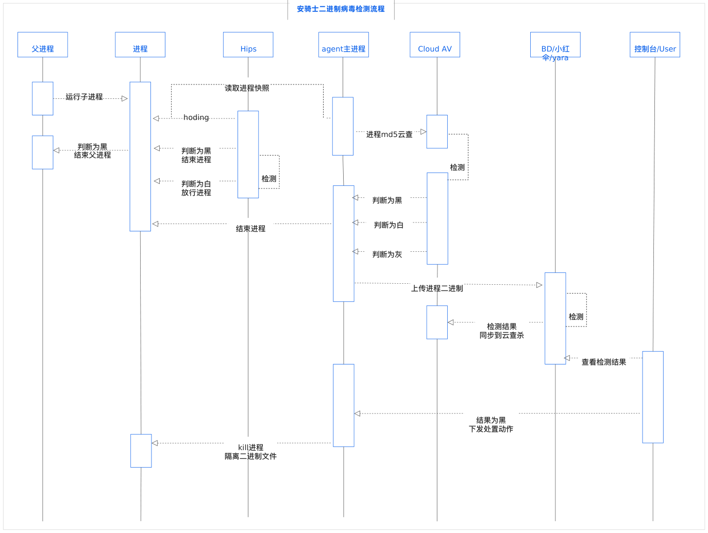

| 病毒检测引擎 | 详情描述 |
| --- | --- |
| 云查杀 | 公有云600w真实黑客攻击病毒样本，专有云Top10w 热度样本。 |
| AliHips | 提供进程行为、进程链检测，检出率覆盖公有云95%以上。 |
| Yara | 对恶意软件进行分类，用于阿里安全团队对二进制病毒检测的补充。 |

**Webshell/脚本检测能力**

安骑士Webshell以及恶意脚本的检测能力，由阿里云安全团队自研的GLE引擎提供。在阿里云公有云上GLE引擎累计打磨了七年之久，多引擎集成了静态匹配检测、通用语法树（AST）动态污点模拟执行、异常启发式检测为一体的动静结合能力。

安骑士webshell/恶意脚本检测流程

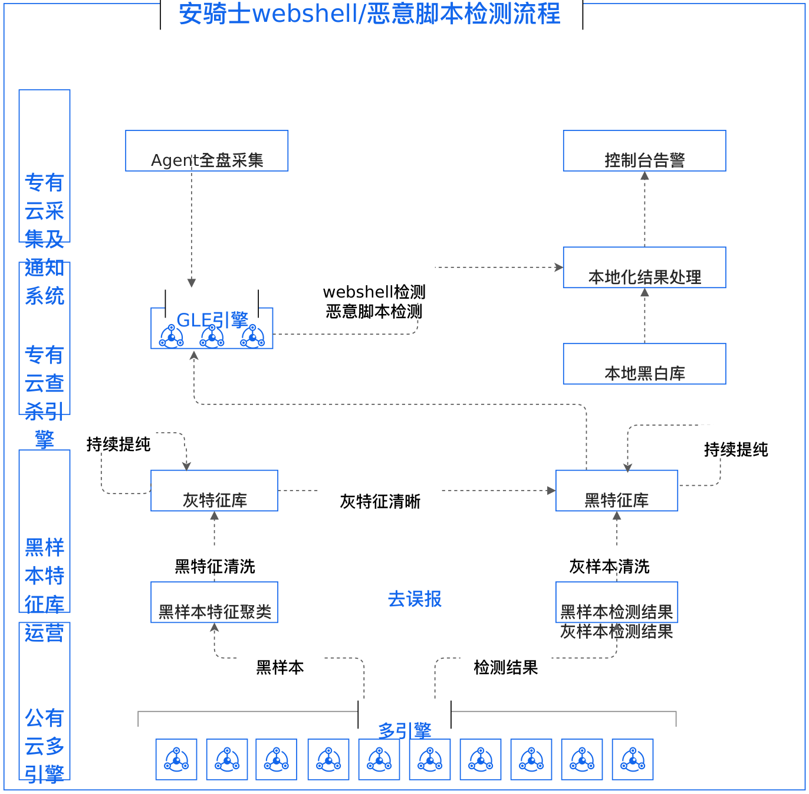

**GLE引擎：**

- 检出覆盖达到公有云全部检测能力的90%+。

- 自动创建黑样本特征，自动消除误报，公有云库持续更新。

- 有效清理php、asp、jsp webshell后门。

- 支持检测脚本语言bash、python、perl、powershell、vbs、bat、jscript、CSharp、c。

- 支持检测批量蠕虫挖矿脚本。

- 支持检测开源武器化框架自动生成利用脚本（Cobalt Strike、Empire、Metasploit、Nishang）。

实战对抗考验：云盾GLE引擎，共对外公开举办四期“宙斯众测”计划，累计经受600+白帽子的测试，对顶尖白帽子构造的高级对抗样本检出率高达95%+。

**勒索病毒检测能力**

基于勒索诱捕能力，安骑士能够在服务器创建随机诱饵，一旦可疑进程对诱饵进行改写，则立即会被安骑士发现并拦截勒索行为。勒索捕获诱饵文件仅用于捕获新型勒索病毒，不会对业务产生任何影响。

对于备份习惯较差的资产在被勒索后，会存在数据恢的复风险。安骑士提供ECS快照风险监控功能，此功能便于用户快速发现资产备份策略缺失的风险，提醒用户进行及早修复。并可在资产发现勒索病毒时，及时调用ECS API 保留近三天的资产快照，确保用户数据不会因快照滚动存储导致无法恢复。

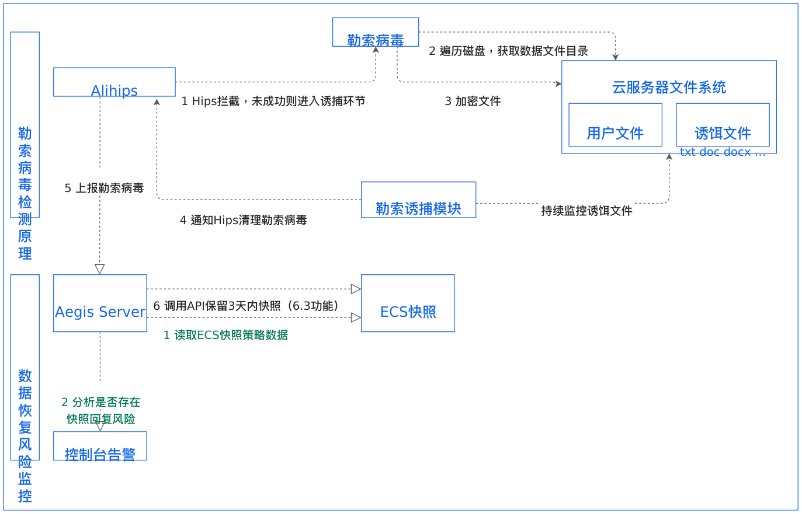

**安骑士防护篡改**

安骑士防篡改功能支持备份还原模式和实施拦截模式。由于linux内核碎片化，目前安骑士防篡改实时拦截模式覆盖主流Linux操作系统，如需使用此功能请选择下表中已适配的操作系统。

**OS**

**Kernel**

**Note**

通配符\*表示只要前面的大版本号匹配即支持，仅支持系

CentOS 6.3-

2.6.32-\*

统默认内核版本。

6.10

通配符\*表示只要前面的大版本号匹配即支持，仅支持系

CentOS 7.0-

3.10.0-\*

统默认内核版本。

7.8

仅支持系统默认内核版本，如果使用其他4.18.0-\*内核，

CentOS 8.0

4.18.0-80.11.2.el8_0.x86_64

可能有未知系统宕机风险，需要用户自行测试承担。

CentOS 8.1

4.18.0-80.11.2.el8_0.x86_64

4.18.0-147.5.1.el8_1.x86_64

4.18.0-147.8.1.el8_1.x86_64

<table>
  <tr>
    <td rowspan="3">Ubuntu 14.04</td>
    <td>4.4.0-93-generic</td>
    <td rowspan="3">仅支持系统默认内核版本。</td>
  </tr>
  <tr>
    <td>3.13.0-86-generic</td>
  </tr>
  <tr>
    <td>3.13.0-32-generic</td>
  </tr>
  <tr>
    <td rowspan="8">Ubuntu 16.04</td>
    <td>4.4.0-62-generic</td>
    <td rowspan="8">仅支持系统默认内核版本。</td>
  </tr>
  <tr>
    <td>4.4.0-63-generic</td>
  </tr>
  <tr>
    <td>4.4.0-93-generic</td>
  </tr>
  <tr>
    <td>4.4.0-117-generic</td>
  </tr>
  <tr>
    <td>4.4.0-151-generic</td>
  </tr>
  <tr>
    <td>4.4.0-154-generic</td>
  </tr>
  <tr>
    <td>4.4.0-157-generic</td>
  </tr>
  <tr>
    <td>4.4.0-179-generic</td>
  </tr>
  <tr>
    <td rowspan="7">Ubuntu 18.04</td>
    <td>4.15.0-23-generic</td>
    <td rowspan="7">仅支持系统默认内核版本。</td>
  </tr>
  <tr>
    <td>4.15.0-42-generic</td>
  </tr>
  <tr>
    <td>4.15.0-45-generic</td>
  </tr>
  <tr>
    <td>4.15.0-52-generic</td>
  </tr>
  <tr>
    <td>4.15.0-70-generic</td>
  </tr>
  <tr>
    <td>4.15.0-88-generic</td>
  </tr>
  <tr>
    <td>4.15.0-109-generic</td>
  </tr>
</table>
