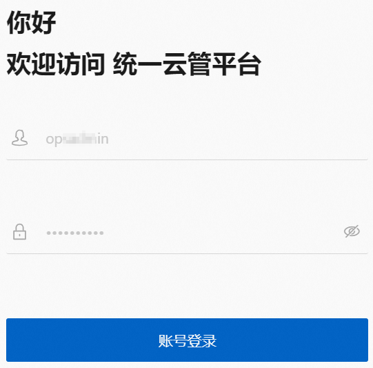

阿里云  
专有云  
安骑士 运维指南  
产品版本：V3.18.6  
文档版本：20251208

**目录**

- [1.安骑士运维操作](#section-1)
    - [1.1. 登录飞天基础运维平台](#section-1-1)
    - [1.2. 客户端状态检查](#section-1-2)
    - [1.3. 检查服务器端（Aegiserver）状态](#section-1-3)
    - [1.4. 检查更新服务（Aegisupdate）状态](#section-1-4)
    - [1.5. 检查Defender模块状态](#section-1-5)
    - [1.6. 重启安骑士服务](#section-1-6)

<a id="section-1"></a>

# 1.安骑士运维操作

<a id="section-1-1"></a>

## 1.1. 登录飞天基础运维平台

本文介绍如何登录飞天基础运维平台。

**前提条件**

- 已从部署人员或管理员处获取Apsara Uni-manager运维控制台的访问地址、用户名和密码。

  Apsara Uni-manager运维控制台访问地址格式为*ops*.asconsole.*intranet-domain-id*.com。

- 推荐使用Chrome浏览器。

**操作步骤**

1. 打开浏览器。

2. 在地址栏中，输入Apsara Uni-manager运维控制台的访问地址*ops*.asconsole.*intranet-domain-id*.com，按回车键。

   

   > 您可以单击页面右上角的下拉按钮来进行语言切换。
   >
   > **说明**

3. 输入正确的用户名及密码。

   > 登录Apsara Uni-manager运维控制台的用户名和密码请从部署人员或管理员处获取。
   >
   > **说明**

   首次登录Apsara Uni-manager运维控制台时，需要修改登录用户名的密码，请按照提示完成密码修改。

   为提高安全性，密码必须满足以下要求：

   - 英文大小写字母

   - 阿拉伯数字（0~9）

   - 特殊符号，包括感叹号（！）、at（@）、井号（#）、美元符号（$）、百分号（%）等

   - 密码长度10~20个字符

4. 单击**登录**。

5. 在Apsara Uni-manager运维控制台的顶部菜单栏，选择**产品运维 > 云平台运维 > 飞天基础运维平台**。

<a id="section-1-2"></a>

## 1.2. 客户端状态检查

检查安骑士客户端以下状态信息，确定安骑士客户端正常运行。

**客户端日志**

客户端日志存放在进程文件所在目录层级data目录下，如/usr/local/aegis/aegis_client/aegis_xx_xx/data。

客户端日志按照日期存储：data.1-data.7

**客户端在线状态**

执行以下命令，查看客户端在线状态。

```text
 ps -aux | grep AliYunDun 
```

**网络连接状态**

执行以下命令，查看客户端是否与服务器端正常建立TCP连接。

```text
 netstat -tunpe |grep AliYunDun 
```

**客户端UUID**

打开客户端日志文件data.x，查看 `Currentuid Ret` 后续字符串，即为当前的UUID。

**客户端进程**

客户端共有两个常运行进程（选择了自动病毒阻断时，会启动 `AliHips` ）： `AliYunDun` 、 `AliYunDunUpdate` 。

正常工作时上述两个进程都正常运行。

> 在Windows系统客户端中， `AliYunDun` 、 `AliYunDunUpdate` 进程均以服务形式存
>
> **说明**
>
> 在，服务名分别为 `Alibaba Security Aegis Detect Service` 和 `Alibaba Security Aegis Update Service` 。

<a id="section-1-3"></a>

## 1.3. 检查服务器端（Aegiserver）状态

**背景信息**

参考以下操作步骤，进行安骑士服务器端运行状态检查：

**操作步骤**

1. 执行 `ssh` 宿主机`IP` 命令，登录安骑士服务器端（Aegiserver）所在的宿主机。

2. 执行以下命令，查找安骑士服务器所对应的imageId。

   ```bash
    docker ps -a |grep aegiserver 
   ```

   系统显示如下信息：

   ```text
   b9e59994df41 
   reg.docker.alibaba-
   inc.com/aqs/aegiserverlite@sha256:f9d292f54c58646b672a8533a0d78fba534d26d376a194034e884
   70d9aa0b3 "/bin/bash /startApp." 2 hours ago Up 2 hours 80/tcp, 7001/tcp, 8005/tcp, 8009/tcp yundun-aegis.Aegiserverlite__.aegiserverlite.1484712802
   ```

3. 执行以下命令，进入Docker内部。

   ```bash
    docker exec -it [imageId] /bin/bash 
   ```

4. 执行以下命令，查看相关Java进程是否正常运行。

   ```text
    ps aux |grep aegiserver 
   ```

   正常情况下，系统显示如下信息：

   ```text
   root 153 0.6 25.8 2983812 1084588 ? Sl 12:13 1:01 /opt/taobao/java/bin/java -Djava.util.logging.config.file=/home/admin/aegiserverlite/.default/conf/logging.properties -Djava.util.logging.manager=org.apache.juli.ClassLoaderLogManager -server -Xms2g -Xmx2g-XX:PermSize=96m -XX:MaxPermSize=384m -Xmn1g -XX:+UseConcMarkSweepGC -
   XX:+UseCMSCompactAtFullCollection -XX:CMSMaxAbortablePrecleanTime=5000 -XX:+CMSClassUnloadingEnabled -XX:+UseCMSInitiatingOccupancyOnly -
   XX:CMSInitiatingOccupancyFraction=80 -XX:+HeapDumpOnOutOfMemoryError -
   XX:HeapDumpPath=/home/admin/logs/java.hprof -verbose:gc -
   Xloggc:/home/admin/logs/gc.log -XX:+PrintGCDetails -XX:+PrintGCDateStamps -Djava.awt.headless=true -Dsun.net.client.defaultConnectTimeout=10000 -
   Dsun.net.client.defaultReadTimeout=30000 -XX:+DisableExplicitGC -Dfile.encoding=UTF-8-Ddruid.filters=mergeStat -Ddruid.useGloalDataSourceStat=true -
   Dproject.name=aegiserverlite -Dcatalina.vendor=alibaba -
   Djava.security.egd=file:/dev/./urandom -Dlog4j.defaultInitOverride=true -Dorg.apache.tomcat.util.http.ServerCookie.ALLOW_EQUALS_IN_VALUE=true -
   Dorg.apache.tomcat.util.http.ServerCookie.ALLOW_HTTP_SEPARATORS_IN_V0=true -Djava.endorsed.dirs=/opt/taobao/tomcat/endorsed -classpath 
   /opt/taobao/tomcat/bin/bootstrap.jar:/opt/taobao/tomcat/bin/tomcat-juli.jar -Dcatalina.logs=/home/admin/aegiserverlite/.default/logs -
   Dcatalina.base=/home/admin/aegiserverlite/.default -Dcatalina.home=/opt/taobao/tomcat 
   -Djava.io.tmpdir=/home/admin/aegiserverlite/.default/temp 
   org.apache.catalina.startup.Bootstrap -
   Djboss.server.home.dir=/home/admin/aegiserverlite/.default -
   Djboss.server.home.url=file:/home/admin/aegiserverlite/.default start
   ```

5. 执行以下命令，进行健康检查。

   ```bash
    curl 127.0.0.1:7001/checkpreload.htm 
   ```

   如果返回success，表示服务正常。

6. 查看日志。

   - **协议日志**：/home/admin/aegiserver/logs/AEGIS_MESSAGE.log，查看与客户端上下行协议日志。

   - **运行日志**：/home/admin/aegiserver/logs/aegis-default.log，查看运行过程中异常的堆栈信息。

   - **离线日志**：/home/admin/aegiserver/logs/AEGIS_OFFLINE_MESSAGE.log，查看客户端超时掉线日志。

<a id="section-1-4"></a>

## 1.4. 检查更新服务（Aegisupdate）状态

**背景信息背景信息**

参考以下操作步骤，进行安骑士更新服务状态检查：

**操作步骤**

1. 执行 `ssh` 宿主机`IP` 命令，登录安骑士服务器端所在的宿主机。

2. 执行以下命令，查找安骑士服务器所对应的imageId。

   ```bash
    docker ps -a |grep aegiserver 
   ```

3. 执行以下命令，进入Docker内部。

   ```bash
    docker exec -it [imageId] /bin/bash 
   ```

4. 执行以下命令，查看相关Java进程是否正常运行。

   ```text
    ps aux |grep aegisupdate 
   ```

5. 执行以下命令，进行健康检查。

   ```bash
    curl 127.0.0.1:7001/checkpreload.htm 
   ```

   如果返回success，表示服务正常。

<a id="section-1-5"></a>

## 1.5. 检查Defender模块状态

**背景信息**

参考以下操作步骤，进行安骑士Defender模块状态检查：

**操作步骤**

1. 执行 `ssh` 宿主机`IP` 命令，登录安骑士Defender模块所在的宿主机。

2. 执行以下命令，查找安骑士Defender模块对应的imageId。

   ```bash
    docker ps -a |grep defender 
   ```

3. 执行以下命令，进入Docker内部。

   ```bash
    docker exec -it [imageId] /bin/bash 
   ```

4. 执行以下命令，查看相关Java进程是否正常运行。

   ```text
    ps aux |grep defender 
   ```

5. 执行如下命令，进行健康检查。

   ```bash
    curl 127.0.0.1:7001/checkpreload.htm 
   ```

   如果返回success，表示服务正常运行。

<a id="section-1-6"></a>

## 1.6. 重启安骑士服务

**背景信息**

在安骑士模块出现故障时，可参考以下操作步骤，尝试重启相关服务。

**操作步骤**

1. 执行 `ssh` 宿主机`IP` 命令，登录到安骑士功能模块所在的宿主机。

2. 执行以下命令，查找安骑士功能模块所对应的imageId。

   `docker ps -a |grep` 应用名称

3. 执行以下命令，进入Docker内部。

   ```bash
    docker exec -it [imageId] /bin/bash 
   ```

4. 重启安骑士相关服务。

   - 重启安骑士客户端服务：

     - Windows系统主机：进入服务管理器，找到服务Alibaba Security Aegis Detect Service，重启该服务。

     - Linux系统主机，可以使用以下两种方法：

       - 执行 `service aegis restart` 命令，重启服务。

       - 以root权限执行 `killall                                            AliYunDun` 命令关闭当前进程后，重新启动/usr/local/aegis/aegis_client/aegis_xx_xx/AliYunDun进程。

   - 重启安骑士服务器端服务：

     <ol type="a">

     <li>

     执行以下命令，查看相关Java进程的进程id。

     ```text
       ps aux |grep
                                         aegiserver 
     ```

     </li>

     <li>

     执行以下命令，关闭当前进程。

     `kill -9` 进程

     </li>

     </ol>

     <ol type="i" start="100">

     <li>

     执行以下命令，重启进程。

     ```bash
      sudo -u admin
     ```

     </li>

     </ol>

```text
                                        /home/admin/aegiserever/bin/jbossctl
```

```text
                                restart 
```

<ol type="i" start="500">

<li>

执行以下命令，检查进程是否重启成功。

```bash
  curl
                                        127.0.0.1:7001/checkpreload.htm 
```

</li>

</ol>

- 重启安骑士更新服务（Aegisupdate）：

  <ol type="a">

  <li>

  执行如下命令，查找java的进程id。

  ```text
    ps aux |grep
                                  aegisupdate 
  ```

  </li>

  <li>

  执行如下命令，关闭当前进程。

  `kill -9` 进程

  </li>

  </ol>

  <ol type="i" start="100">

  <li>

  执行如下命令，重启进程。

  ```bash
   sudo -u admin
  ```

  </li>

  </ol>

```text
                                        /home/admin/aegisupdate/bin/jbossctl
```

```text
                                restart 
```

<ol type="i" start="500">

<li>

执行如下命令，查看进程是否重启成功。

```bash
  curl
                                        127.0.0.1:7001/checkpreload.htm 
```

</li>

</ol>

- 重启安骑士Defender服务：

  <ol type="a">

  <li>

  执行以下命令，查找相关Java进程的进程id。

  ```text
    ps aux |grep
                                          secure-service 
  ```

  </li>

  <li>

  执行以下命令，关闭当前进程。

  `kill -9` 进程

  </li>

  </ol>

  <ol type="i" start="100">

  <li>

  执行以下命令，重启进程。

  ```bash
   sudo -u admin
  ```

  </li>

  </ol>

```text
                                        /home/admin/secure-service/bin/jbossctl
```

```text
                                restart 
```

<ol type="i" start="500">

<li>

执行以下命令，查看进程是否重启成功。

```bash
  curl
                                        127.0.0.1:7001/checkpreload.htm 
```

</li>

</ol>
