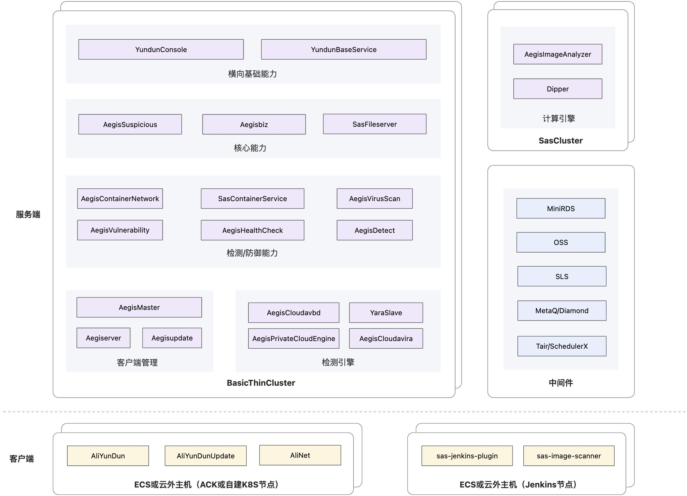
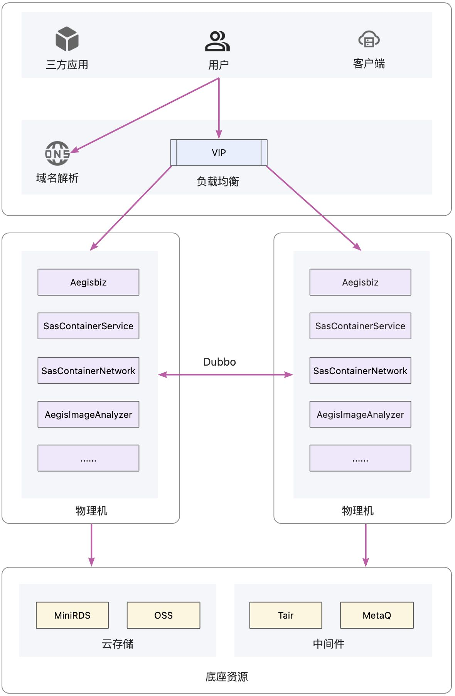
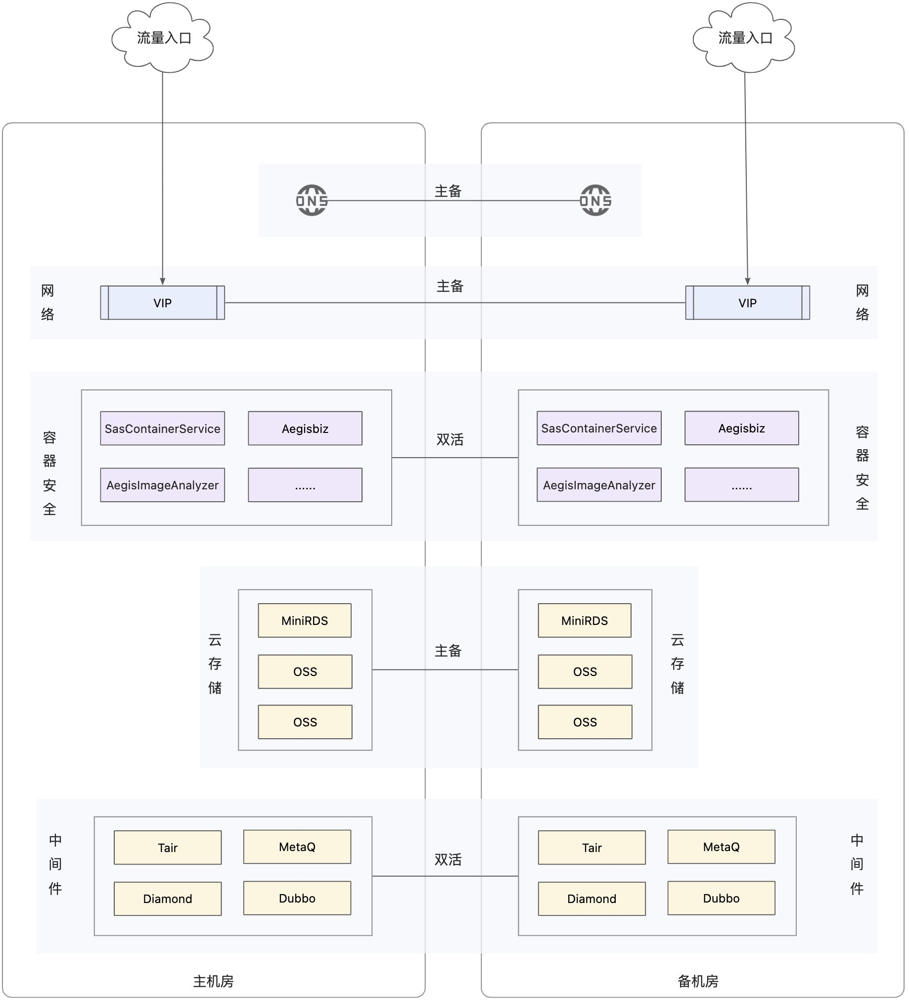

阿里云  
专有云  
云盾-安骑士高级版  
容器安全 运维指南  
产品版本：V3.18.3  
文档版本：20250613

**目录**

- [1.运维文档](#section-1)
    - [1.1. 总体介绍](#section-1-1)
    - [1.2. 高可靠性](#section-1-2)
    - [1.3. 容灾备份](#section-1-3)
    - [1.4. 监控告警](#section-1-4)
    - [1.5. XC支持](#section-1-5)
    - [1.6. 热升级](#section-1-6)
    - [1.7. AliNet (06_21) Linux Driver OS / Kernel List](#section-1-7)

# 1.运维文档

## 1.1. 总体介绍

容器安全是面向不可变基础设施的云原生容器安全统一管理运营平台，以自动化的模式，解决容器持续集成、交付、部署以及运行时的安全问题。

容器安全底层复用安骑士云上资产管理、配置核查、主动防御、安全加固和安全可视化等能力，基于云原生架构优势，可有效发现和阻止容器逃逸，病毒传播、黑客攻击、勒索加密、漏洞利用等风险事件，保护云内云外的容器运行节点、容器、镜像等工作负载安全性，同时满足监管合规要求。

- 镜像安全扫描功能支持对镜像中存在的高中危系统漏洞、应用漏洞、恶意样本、配置风险和敏感数据进行检测，并提供漏洞修复方案，为您提供一站式镜像安全风险管理能力。

- 容器防火墙是容器安全为容器环境提供的防火墙服务。当黑客利用漏洞或恶意镜像入侵容器集群时，容器防火墙会对异常行为进行告警或拦截。

**部署架构**

容器安全，复用安骑士检测能力，包括服务端、客户端两大模块。

服务端：负责将云内、云外的容器集群和镜像资产纳入到容器安全管理范围，并提供检测防御等核心能力。

客户端：负责实时上报容器集群运行状态，以及容器运行节点运行状态，提供运行检测、网络阻断防护能力。

**服务端**

服务端主要分成以下几个模块：

- 横向基础能力：云盾通用能力，提供控制台和OpenAPI。

- 核心能力：包括资产管理、安全告警、文件采集等。

- 检测防御：包括漏洞、基线、文件、网络、进程的检测防御能力。

- 检测引擎：包括商业病毒检测引擎、阿里自研病毒检测引擎、大数据计算引擎。

- 客户端管理：负责管理客户端连接、容器集群状态更新、配置规则下发等。

服务端每个应用的具体职责：

| 模块 | 职责 |
| --- | --- |
| YundunConsole | 控制台，为安全管理员提供了统一的管理界面。 |
| YundunBaseService | API网关，将主机安全能力开放给三方开发者。 |
| AegisSuspicious | 入侵告警事件、应用白名单。 |
| Aegisbiz | 管理云内、云外的容器集群和镜像的资产。 |
| SasFileserver | 文件采集。 |
| AegisContainerNetwork（A egisMetaData） | 网络可视化、容器防火墙。（括号内为所在sr） |
| SasContainerService（New Sas） | 镜像插件扫描服务。（括号内为所在sr） |
| AegisHealthCheck | 主机基线检查。 |
| AegisVirusScan | 文件检测。 |
| AegisDetect | 旧版文件检测，当前仅保留文件白名单管理，其他流程全部迁移到AegisVirusScan。 |
| AegisVulnerability | 漏洞检测。 |
| AegisPrivateCloudEngine | GLE引擎，阿里自研病毒检测引擎。 |
| AegisMaster | 客户端配置、插件管理。 |
| Aegiserver | 客户端连接管理、配置下发、消息转发等。 |
| Aegisupdate | 客户单升级、规则/脚本/补丁等文件拉取。 |
| YaraSlave | Yara二进制检测引擎，商业病毒检测引擎。 |
| AegisCloudavira | 小红伞二进制引擎，商业病毒检测引擎。 |
| AegisCloudavbd | BD二进制检测引擎，商业病毒检测引擎。 |
| AegisImageAnalyzer | 镜像扫描。 |
| Dipper | 大数据计算引擎，入侵检测。 |

**客户端**

客户端包括以下模块。

| 名称 | 说明 |
| --- | --- |
| SasJenkinsPlugin | 镜像扫描jenkins插件，负责拉起SasImageScanner容器。 |
| SasImageScanner | 负责运行镜像扫描功能的容器进程。 |
| AliYunDun | 核心进程，用于与云安全中心服务器建立连接。 |
| AliYunDunUpdate | 核心进程，用于定期检测云安全中心Agent是否需要升级。 |
| AliNet | 容器防护墙进程。 |

> **说明**
>
> 客户端支持的操作系统
>
> AliNet支持操作系统

## 1.2. 高可靠性

**服务端高可用**

> **说明**
>
> 设计原则：无状态应用

容器安全服务端全部是无状态应用，通过VIP+Dubbo实现负载均衡保证服务可用性。

- 服务端本身是无状态的，部署在至少两台物理机上，只要有一台物理机正常运行即可保证可用性。

- 数据存储在在MiniRDS、SLS、OSS、Tair、Diamond、MetaQ等中间件或云服务上，存储高可用性由中间件或云服务保证。

- 对外提供HTTPS协议的OpenAPI，通过DNS+VIP实现负载均衡保证可用性。

- 服务内部调用依赖Dubbo框架，由Dubbo的软负载保证可用性。

## 1.3. 容灾备份

**同城容灾**

设计原则：业务双活

容器安全同城容灾架构遵循双活原则，数据由云存储或中间件自身保证容灾。

各组件同城容灾实现方案介绍：

<table>
  <tr>
    <td>组件</td>
    <td>方案</td>
  </tr>
  <tr>
    <td>容器安全</td>
    <td>双活部署，依赖中间件及云存储保证数据一致。</td>
  </tr>
  <tr>
    <td>DNS</td>
    <td>通过Anycast VIP实现主备机房流量隔离。</td>
  </tr>
  <tr>
    <td>VIP</td>
    <td>通过BGP路由实现主备切换。</td>
  </tr>
  <tr>
    <td>MiniRDS</td>
    <td>主从库binlog复制。</td>
  </tr>
  <tr>
    <td>SLS</td>
    <td>基于OSS备份实现数据同步。</td>
  </tr>
  <tr>
    <td>OSS</td>
    <td>主备机房数据同步。</td>
  </tr>
  <tr>
    <td>中间件</td>
    <td>双活部署，依赖MiniRDS保证数据一致。</td>
  </tr>
</table>

**异地灾备**

> **说明**
>
> 设计原则：Region间相互独立

容器安全多Region架构遵循独立原则，单元Region对中心Region无任何依赖，数据及服务保证完全隔离。

## 1.4. 监控告警

**系统监控指标**

容器安全系统监控均已接入TianjiMon。

> **重要**
>
> 注意：3.17.1之前版本还未开启告警。

各应用具体监控指标如下：

**aegisbiz应用**

监控指标（TianjiMon指标名称）

监控名称

监控描述

告警阈值

告警描述

CPU使用率（单

aegisbiz_cpu_container_host

机）

CPU使用率（服务

aegisbiz_cpu_container_serv

角色）

errole

连续次数：3次

CPU使用率（集

aegisbiz_cpu_container_clust

沉默时长：

util_avg >

CPU使用率

群）

er

95

300s

探测间隔：60s

aegisbiz_memo_container_ho

内存（单机）

连续次数：

st

3次

沉默时长：

内存使用率最大值和平

aegisbiz_memo_container_se

util_avg >

300s

内存（服务角色）

均值

rverrole

90

探测间隔：60s

aegisbiz_memo_container_cl

内存（集群）

uster

负载（单机）

aegisbiz_load_container_host

连续次数：3次

CPU 负载最大值和平均

aegisbiz_load_container_serv

负载（服务角色）

值

沉默时长：

load1_av

errole

（load1，load5，load

g > 1

300s

15）

探测间隔：60s

aegisbiz_load_container_clus

负载（集群）

ter

aegisbiz_tcp_conns_containe

tcp连接数（单机）

r_host

tcp连接数（服务角

tcp连接的最大值和平均

aegisbiz_tcp_conns_containe

暂无

暂无

色）

值

r_serverrole

aegisbiz_tcp_conns_containe

tcp连接数（集群）

r_cluster

NTP（单机）

aegisbiz_ntp_container_host

aegisbiz_ntp_container_serve

NTP（服务角色）

暂无

暂无

rrole

NTP

aegisbiz_ntp_container_clust

NTP（集群）

er

aegisbiz_process_count_cont

进程数（单机）

ainer_host

连续次数：3次

进程数（服务角

aegisbiz_process_count_cont

process_n

色）

ainer_cluster

进程数的最大值和平均

沉默时长：

umber_m

值

300s

ax > 100

探测间隔：

aegisbiz_process_count_cont

进程数（集群）

60s

ainer_host

<table>
  <tr>
    <td>aegisbiz_nginx_container_ho st</td>
    <td>nginx QPS（单机）</td>
    <td rowspan="3">nginx请求的QPS</td>
    <td rowspan="3">暂无</td>
    <td rowspan="3">暂无</td>
  </tr>
  <tr>
    <td>aegisbiz_nginx_container_ser verrole</td>
    <td>nginx QPS（服务角色）</td>
  </tr>
  <tr>
    <td>aegisbiz_nginx_container_clu ster</td>
    <td>nginx QPS（集群）</td>
  </tr>
  <tr>
    <td>aegisbiz_health_container_ho st</td>
    <td>健康检查（单机）</td>
    <td rowspan="3">应用使用启动是否正常</td>
    <td rowspan="3">health &gt; 0</td>
    <td rowspan="3">连续次数：3次沉默时长：300s 探测间隔：60s</td>
  </tr>
  <tr>
    <td>aegisbiz_health_container_se rverrole</td>
    <td>健康检查（服务角色）</td>
  </tr>
  <tr>
    <td>aegisbiz_health_container_cl uster</td>
    <td>健康检查（集群）</td>
  </tr>
</table>

**aegis-metadata应用**

监控指标（TianjiMon指标名称）

监控名称

监控描述

告警阈值

告警描述

CPU使用率（单

aegismetadata_cpu_containe

机）

r_host

连续次数：3次

CPU使用率（服务

沉默时长：

aegismetadata_cpu_containe

util_avg >

CPU使用率

角色）

r_serverrole

95

300s

探测间隔：60s

CPU使用率（集

aegismetadata_cpu_containe

群）

r_cluster

aegismetadata_memo_contai

内存（单机）

ner_host

aegismetadata_memo_contai

连续次数：

内存（服务角色）

ner_serverrole

3次

内存使用率最大值和平

沉默时长：

util_avg >

均值

90

300s

aegismetadata_memo_contai

内存（集群）

探测间隔：

ner_cluster

60s

aegismetadata_load_contain

负载（单机）

er_host

连续次数：3次

CPU 负载最大值和平均值

沉默时长：

aegismetadata_load_contain

load1_av

负载（服务角色）

（load1，load5，load

er_serverrole

g > 1

300s

15）

探测间隔：60s

aegismetadata_load_contain

负载（集群）

er_cluster

aegismetadata_tcp_conns_co

tcp连接数（单机）

ntainer_host

tcp连接数（服务角

tcp连接的最大值和平均

aegismetadata_tcp_conns_co

暂无

暂无

色）

值

ntainer_serverrole

aegismetadata_tcp_conns_co

tcp连接数（集群）

ntainer_cluster

aegismetadata_ntp_containe

NTP（单机）

r_host

aegismetadata_ntp_containe

NTP（服务角色）

暂无

暂无

NTP

r_serverrole

aegismetadata_ntp_containe

NTP（集群）

r_cluster

aegismetadata_process_coun

进程数（单机）

t_container_host

连续次数：3次

process_n

进程数（服务角

进程数的最大值和平均

沉默时长：

aegismetadata_process_coun

umber_m

色）

值

t_container_cluster

300s

ax > 100

探测间隔：60s

aegismetadata_process_coun

进程数（集群）

t_container_host

nginx QPS（单

aegismetadata_nginx_contai

机）

ner_host

nginx QPS（服务

aegismetadata_nginx_contai

角色）

ner_serverrole

nginx请求的QPS

暂无

暂无

nginx QPS（集

aegismetadata_nginx_contai

群）

ner_cluster

aegismetadata_health_contai

健康检查（单机）

ner_host

连续次数：3次

健康检查（服务角

沉默时长：

aegismetadata_health_contai

health >

应用使用启动是否正常

色）

ner_serverrole

0

300s

探测间隔：60s

aegismetadata_health_contai

健康检查（集群）

ner_cluster

**aegis-image-analyzer应用**

监控指标（TianjiMon指标名称）

监控名称

监控描述

告警阈值

告警描述

CPU使用率（单

aegisimageanalyzer_cpu_con

机）

tainer_host

连续次数：3次

CPU使用率（服务

沉默时长：

aegisimageanalyzer_cpu_con

util_avg >

CPU使用率

角色）

tainer_serverrole

95

300s

探测间隔：60s

CPU使用率（集

aegisimageanalyzer_cpu_con

群）

tainer_cluster

aegisimageanalyzer_memo_c

内存（单机）

ontainer_host

连续次数：3次

内存使用率最大值和平

沉默时长：

aegisimageanalyzer_memo_c

util_avg >

内存（服务角色）

均值

ontainer_serverrole

90

300s

探测间隔：60s

aegisimageanalyzer_memo_c

内存（集群）

ontainer_cluster

aegisimageanalyzer_load_co

负载（单机）

ntainer_host

连续次数：3次

aegisimageanalyzer_load_co

负载（服务角色）

CPU 负载最大值和平均

ntainer_serverrole

值

沉默时长：

load1_av

（load1，load5，load

g > 1

300s

15）

探测间隔：

aegisimageanalyzer_load_co

负载（集群）

60s

ntainer_cluster

<table>
  <tr>
    <td>aegisimageanalyzer_tcp_con ns_container_host</td>
    <td>tcp连接数（单机）</td>
    <td rowspan="3">tcp连接的最大值和平均值</td>
    <td rowspan="3">暂无</td>
    <td rowspan="3">暂无</td>
  </tr>
  <tr>
    <td>aegisimageanalyzer_tcp_con ns_container_serverrole</td>
    <td>tcp连接数（服务角色）</td>
  </tr>
  <tr>
    <td>aegisimageanalyzer_tcp_con ns_container_cluster</td>
    <td>tcp连接数（集群）</td>
  </tr>
  <tr>
    <td>aegisimageanalyzer_ntp_con tainer_host</td>
    <td>NTP（单机）</td>
    <td rowspan="3">NTP</td>
    <td rowspan="3">暂无</td>
    <td rowspan="3">暂无</td>
  </tr>
  <tr>
    <td>aegisimageanalyzer_ntp_con tainer_serverrole</td>
    <td>NTP（服务角色）</td>
  </tr>
  <tr>
    <td>aegisimageanalyzer_ntp_con tainer_cluster</td>
    <td>NTP（集群）</td>
  </tr>
  <tr>
    <td>aegisimageanalyzer_process _count_container_host</td>
    <td>进程数（单机）</td>
    <td rowspan="3">进程数的最大值和平均值</td>
    <td rowspan="3">process_n umber_m ax &gt; 100</td>
    <td rowspan="3">连续次数：3次沉默时长：300s 探测间隔：60s</td>
  </tr>
  <tr>
    <td>aegisimageanalyzer_process _count_container_cluster</td>
    <td>进程数（服务角色）</td>
  </tr>
  <tr>
    <td>aegisimageanalyzer_process _count_container_host</td>
    <td>进程数（集群）</td>
  </tr>
  <tr>
    <td>aegisimageanalyzer_nginx_c ontainer_host</td>
    <td>nginx QPS（单机）</td>
    <td rowspan="3">nginx请求的QPS</td>
    <td rowspan="3">暂无</td>
    <td rowspan="3">暂无</td>
  </tr>
  <tr>
    <td>aegisimageanalyzer_nginx_c ontainer_serverrole</td>
    <td>nginx QPS（服务角色）</td>
  </tr>
  <tr>
    <td>aegisimageanalyzer_nginx_c ontainer_cluster</td>
    <td>nginx QPS（集群）</td>
  </tr>
  <tr>
    <td>aegisimageanalyzer_health_c ontainer_host</td>
    <td>健康检查（单机）</td>
    <td rowspan="3">应用使用启动是否正常</td>
    <td rowspan="3">health &gt; 0</td>
    <td rowspan="3">连续次数：3次沉默时长：300s 探测间隔：60s</td>
  </tr>
  <tr>
    <td>aegisimageanalyzer_health_c ontainer_serverrole</td>
    <td>健康检查（服务角色）</td>
  </tr>
  <tr>
    <td>aegisimageanalyzer_health_c ontainer_cluster</td>
    <td>健康检查（集群）</td>
  </tr>
</table>

> **说明**
>
> 复用安骑士应用的系统监控，详见：https://aliyuque.antfin.com/aegisgroup/scxr0h/du1is5#LSZ9W

**业务监控指标**

容器安全系统监控基于TianjiMon实现，监控指标如下：

模块

名称

描述

节点数量

容器集群节点各维度数量统计

应用（app）数量

容器集群应用各维度数量统计

容器资产

容器组（pod）数量

容器集群容器组各维度数量统计

容器数量

容器集群容器各维度数量统计

镜像数量

镜像各维度数量统计

镜像扫描任务数

创建的镜像扫描任务数量

镜像扫描层数

被扫描的镜像层数量

镜像扫描结果数

镜像扫描结果的数量监控

镜像扫描

镜像预分析耗时

镜像扫描预分析各维度耗时

镜像分析耗时

镜像扫描分析各维度耗时

镜像分析（manifests）耗

镜像扫描分析（manifests）各维度耗时

时

Jenkins规则拉取次数

Jenkins扫描镜像时拉取groovy规则次数

Jenkins规则拉取耗时

Jenkins扫描镜像时拉取groovy规则耗时

CICD

Jenkins扫描结果上报次数

Jenkins扫描镜像后上报结果次数

Jenkins扫描结果上报耗时

Jenkins扫描镜像后上报结果耗时

<table>
  <tr>
    <td rowspan="3">容器防火墙</td>
    <td>容器网络日志消费数</td>
    <td>容器网络可视化dipper日志消费的消息数</td>
  </tr>
  <tr>
    <td>容器网络日志处理耗时</td>
    <td>容器网络可视化dipper日志消费的耗时</td>
  </tr>
  <tr>
    <td>容器防火墙拦截数</td>
    <td>容器防火墙告警、拦截数量</td>
  </tr>
  <tr>
    <td rowspan="3">容器运行时防护</td>
    <td>容器Linux漏洞数量</td>
    <td>容器Linux漏洞数量</td>
  </tr>
  <tr>
    <td>容器应用漏洞数量</td>
    <td>容器应用漏洞数量</td>
  </tr>
  <tr>
    <td>容器告警事件数量</td>
    <td>容器告警事件数量</td>
  </tr>
</table>

## 1.5. XC支持

**企业版与自主可控能力差异**

企业版与自主可控能力差异主要是平台差异导致：

- x86企业版与x86海光能力100%一致。

- arm飞腾、arm鲲鹏与企业版能力差异在30%以内，未来有计划对齐。

- sw申威与x86企业版能力差异50%以内，未来暂无计划对齐。

**容器安全能力差异**

| 功能 | x86 | ar m | sw | 描述 |
| --- | --- | --- | --- | --- |
| 总览 | 100 % | 100 % | 100 % | 展示需要重点关注的资产、漏洞、异常、配置缺陷、事件等信息总览。 |
| 容器资产 | 100 % | 100 % | 100 % | 提供服务器安全状态相关信息。例如，服务器的防护状态、分组、专有网络VPC等统计信息，以及统计区分所有服务器、存在风险的服务器、未受保护的服务器、未启动的服务器和新增服务器的资产数量。单击目标服务器名称可查看详细信息，包括漏洞信息、安全告警处理、基线检查、资产指纹调查等。 |

<table>
  <tr>
    <td>镜像扫描&amp;CICD</td>
    <td>100 %</td>
    <td>90 %</td>
    <td>80 %</td>
    <td>漏洞检测：支持检测包括Linux、应用漏洞，提供具体漏洞详情，提供一键扫描功能。基线检测：自动检测服务器上的系统、账号、数据库、弱密码、合规性配置中存在的风险点，并提供加固建议。恶意样本检测：提供病毒查杀和网站后门查杀功能，检测出主流木马病毒、勒索软件、挖矿病毒、DDoS木马后自动隔离查杀。 重要能力差异： • 部分自主可控操作系统不在支持范围，需通过规则包适配。 • arm不支持AV/BD检测引擎，仅支持GLE。sw均不支持。</td>
  </tr>
  <tr>
    <td>容器防火墙</td>
    <td>100 %</td>
    <td>0%</td>
    <td>0%</td>
    <td>容器防火墙是容器安全为容器环境提供的防火墙服务。当黑客利用漏洞或恶意镜像入侵容器集群时，容器防火墙会对异常行为进行告警或拦截。 重要能力差异：arm、sw均不支持AliNet，无法对异常行为进行告警或拦截。</td>
  </tr>
  <tr>
    <td>容器运行时防护</td>
    <td>100 %</td>
    <td>80 %</td>
    <td>50 %</td>
    <td>集中展示受影响集群节点的告警信息，包括存在告警服务器的数量、待处理告警总数、需要紧急处理的告警等，其中告警类型覆盖进程异常行为、网站后门、异常登录、恶意进程（云查杀）、敏感文件篡改、异常网络连接、持久化后门、web应用威胁检测等多种入侵告警类型。 重要能力差异：arm不支持AV/BD检测引擎，仅支持GLE。sw均不支持。</td>
  </tr>
  <tr>
    <td>日志检索</td>
    <td>100 %</td>
    <td>100 %</td>
    <td>100 %</td>
    <td>提供登录流水、暴力破解、进程快照、网络连接、端口监听快照、账号快照、进程启动的日志查询。</td>
  </tr>
</table>

**当前各模块适配情况**

| 模块 | x86（企业版、海光） | arm（飞腾、鲲鹏） | sw（申威） |
| --- | --- | --- | --- |
| 客户端 | 100% | 50%（不支持AliNet） | 50%（不支持AliNet） |
| 服务端 | 100% | 100% | 100% |
| 前端 | 100% | 100% | 100% |
| 计算引擎 | 100% | 100% | 100% |
| 检测引擎 | 100% | 50%（不支持AV、BD引擎） | 0%（所有检测引擎都不支持） |

**一云多芯支持情况**

一云多芯的主要包括异构同城容灾（主备机房的机房级硬件异构）以及异构多Region（中心/单元机房级硬件异构）2大横向场景。

容器安全对一云多芯的支持情况如下：

| 场景 | 支持情况 |
| --- | --- |
| 异构同城容灾（x86+arm）主备机房的机房级硬件异构 | 支持（部分能力在arm机房不生效，如主动防御、自保护） |
| 异构多Region（x86+arm）中心/单元机房级硬件异构 | 支持 |

## 1.6. 热升级

容器安全默认支持热升级，无需额外运维操作。

## 1.7. AliNet (06_21) Linux Driver OS / Kernel List

**支持的系统版本**

<table>
  <tr>
    <th width="119">linux大版本</th>
    <th>linux小版本</th>
  </tr>
  <tr>
    <td>CentOS6</td>
    <td>6.5, 6.6, 6.7, 6.8, 6.9, 6.10</td>
  </tr>
  <tr>
    <td>CentOS7</td>
    <td>7.0, 7.1, 7.2, 7.3, 7.4, 7.5, 7.6, 7.7, 7.8, 7.9</td>
  </tr>
  <tr>
    <td>CentOS8</td>
    <td>8</td>
  </tr>
  <tr>
    <td>Ubuntu14</td>
    <td>14.04</td>
  </tr>
  <tr>
    <td>Ubuntu16</td>
    <td>16.04</td>
  </tr>
  <tr>
    <td>Ubuntu18</td>
    <td>18.04</td>
  </tr>
  <tr>
    <td>Ubuntu20</td>
    <td>20.04</td>
  </tr>
  <tr>
    <td>AliYunLinux</td>
    <td>2.1903, 17.01, 3</td>
  </tr>
  <tr>
    <td>ANOLIS</td>
    <td>7.9,8.4</td>
  </tr>
</table>

**kernel 版本**

| Linux系统 | kernel版本 | 备注 |
| --- | --- | --- |
| CentOS | 2.6.32 3.10.0 4.18.0 4.19.104 5.4.8 5.4.42 | 3.10.0-123开头的特殊匹配4.18.0开头的，完全匹配（ 4.18.0-147.5.1.el8_1.x86_64 4.18.0-193.14.2.el8_2.x86_64 4.18.0-193.28.1.el8_2.x86_64 4.18.0-240.15.1.el8_3.x86_64 4.18.0-240.22.1.el8_3.x86_64 4.18.0-305.3.1.el8.x86_64 4.18.0-305.10.2.el8_4.x86_64 4.18.0-305.19.1.el8_4.x86_64 4.18.0-348.2.1.el8_5.x86_64 4.18.0-348.7.1.el8_5.x86_64 4.18.0-358.el8.x86_64 4.18.0-365.el8.x86_64 4.19.104-300.el7.x86_64 5.4.8-1.el7.elrepo.x86_64 5.4.42-200.el7.x86_64） |
| Ubuntu | 3.13.0-32-generic 3.13.0-86-generic 4.4.0-62-generic 4.4.0-63-generic 4.4.0-93-generic 4.4.0-96-generic 4.4.0-104-generic 4.4.0-117-generic 4.4.0-124-generic 4.4.0-142-generic 4.4.0-146-generic 4.4.0-151-generic 4.4.0-170-generic 4.4.0-174-generic 4.4.0-179-generic 4.4.0-184-generic 4.4.0-185-generic 4.4.0-210-generic 4.15.0-13-generic 4.15.0-23-generic 4.15.0-42-generic 4.15.0-45-generic 4.15.0-52-generic 4.15.0-54-generic 4.15.0-72-generic 4.15.0-96-generic 4.15.0-106-generic 4.15.0-109-generic 4.15.0-111-generic 4.15.0-118-generic 4.15.0-124-generic 4.15.0-128-generic 4.15.0-144-generic 4.15.0-147-generic 4.15.0-158-generic 4.15.0-166-generic 4.15.0-169-generic 4.15.0-170-generic 4.15.0-1047-gcp 5.3.0-40-generic 5.4.0-31-generic 5.4.0-42-generic 5.4.0-47-generic 5.4.0-58-generic 5.4.0-73-generic 5.4.0-77-generic 5.4.0-86-generic 5.4.0-91-generic 5.4.0-92-generic 5.4.0-94-generic 5.4.0-100-generic 5.4.0-102-generic 5.4.0-106-generic | 需要kernel整个版本字符串匹配，如"3.13.0-32-generic" |
| AliYunLinux | 3.10.0-1160.al7.1.x86_64 4.4.95-1.al7.x86_64 4.4.95-3.al7.x86_64 4.19.24-7.al7.x86_64 4.19.24-7.14.al7.x86_64 4.19.81-17.al7.x86_64 4.19.81-17.2.al7.x86_64 4.19.91-19.1.al7.x86_64 4.19.91-21.2.al7.x86_64 4.19.91-21.al7.x86_64 4.19.91-22.2.al7.x86_64 4.19.91-22.al7.x86_64 4.19.91-23.al7.x86_64 4.19.91-24.1.al7.x86_64 4.19.91-25.1.al7.x86_64 4.19.91-25.3.al7.x86_64 4.19.91-25.6.al7.x86_64 4.19.91-25.7.al7.x86_64 5.10.23-5.al8.x86_64 5.10.60-9.al8.x86_64 5.10.84-10.2.al8.x86_64 5.10.84-10.3.al8.x86_64 | 需要kernel整个版本字符串匹配 |
| Anolis | 3.10.0-1160.an7.x86_64 3.10.0-1062.an7.x86_64 3.10.0-1160.59.1.0.1.an7.x86_64 4.19.91-25.2.an7.x86_64 4.19.91-25.7.an7.x86_64 4.18.0-348.2.1.an8_4.x86_64 4.18.0-348.12.2.an8.x86_64 |  |
