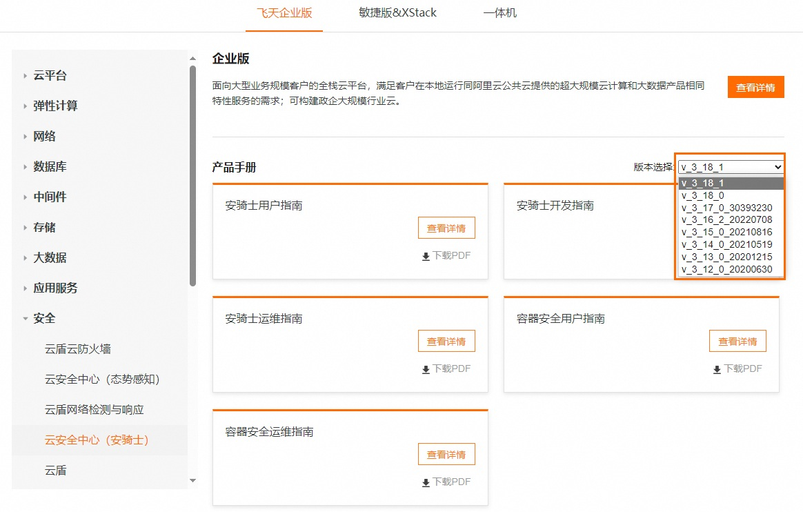
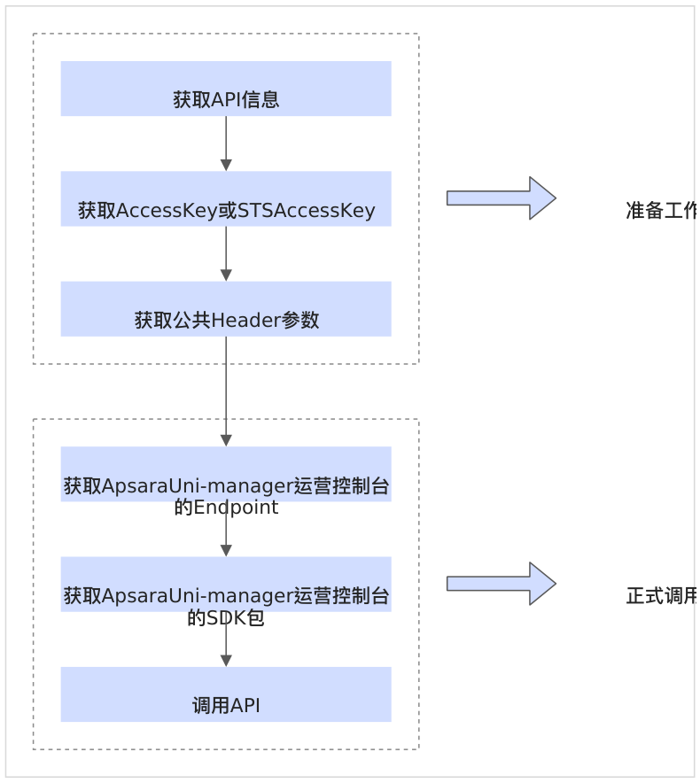
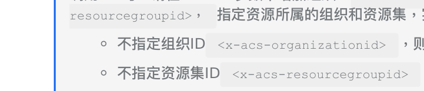
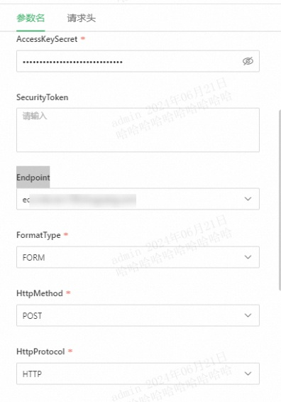

阿里云  
专有云  
容器安全 开发指南  
产品版本：V3.18.6  
文档版本：20251218

**目录**

- [1.快速入门](#section-1)
    - [1.1. 开发文档使用说明](#section-1-1)
    - [1.2. API调用流程说明](#section-1-2)
- [2.准备工作](#section-2)
    - [2.1. 获取AccessKey](#section-2-1)
    - [2.2. 获取STS AccessKey](#section-2-2)
    - [2.3. 获取API信息及其EndPoint](#section-2-3)
- [3.调用示例](#section-3)
    - [3.1. Java SDK调用示例](#section-3-1)
        - [3.1.1. 快速开始](#section-3-1-1)
        - [3.1.2. 使用手册](#section-3-1-2)
            - [3.1.2.1. 安装Java SDK](#section-3-1-2-1)
            - [3.1.2.2. 使用CommonRequest进行调用](#section-3-1-2-2)
    - [3.2. Python SDK调用示例](#section-3-2)
        - [3.2.1. 快速开始](#section-3-2-1)
        - [3.2.2. 使用手册](#section-3-2-2)
            - [3.2.2.1. 安装Python SDK](#section-3-2-2-1)
            - [3.2.2.2. 使用CommonRequest进行调用](#section-3-2-2-2)
    - [3.3. Go SDK调用示例](#section-3-3)
        - [3.3.1. 快速开始](#section-3-3-1)
        - [3.3.2. 使用手册](#section-3-3-2)
            - [3.3.2.1. 安装Go SDK核心包](#section-3-3-2-1)
            - [3.3.2.2. 使用CommonRequest进行调用](#section-3-3-2-2)
- [4.API公共参数](#section-4)
- [5.API参考](#section-5)
    - [5.1. DescribeLatestScanTask](#section-5-1)
    - [5.2. ListImageRisk](#section-5-2)
    - [5.3. UpdateJenkinsImageScanTaskStatus](#section-5-3)
    - [5.4. DescribeImageInfoList](#section-5-4)
    - [5.5. DescribeImageBaselineCheckSummary](#section-5-5)
    - [5.6. DescribeImageListWithBaselineName](#section-5-6)
    - [5.7. DescribeImageBaselineItemList](#section-5-7)
    - [5.8. DescribeCycleTaskList](#section-5-8)
    - [5.9. DescribeContainerCriteria](#section-5-9)
    - [5.10. DescribeContainerFieldStatistics](#section-5-10)
    - [5.11. DescribeContainerGroupedFieldDetail](#section-5-11)
    - [5.12. DescribeContainerInstances](#section-5-12)
    - [5.13. DescribeGroupedContainerInstances](#section-5-13)
    - [5.14. DescribeImageSecurityScanCount](#section-5-14)
    - [5.15. DescribeImageCriteria](#section-5-15)
    - [5.16. GetRegistryScanDayNum](#section-5-16)
    - [5.17. DescribeImageInstances](#section-5-17)
    - [5.18. ListPrivateRegistryList](#section-5-18)
    - [5.19. ListPrivateRegistryType](#section-5-19)
    - [5.20. DescribeAlarmEventDetail](#section-5-20)
    - [5.21. DescribeNsasSuspEventType](#section-5-21)
    - [5.22. DescribeSuspEvents](#section-5-22)
    - [5.23. DescribeConcernNecessity](#section-5-23)
    - [5.24. DescribeEventLevelCount](#section-5-24)
    - [5.25. DescribeSecurityEventOperations](#section-5-25)
    - [5.26. DescribeGroupedVul](#section-5-26)
    - [5.27. DescribeImageGroupedVulList](#section-5-27)
    - [5.28. DescribeAllGroups](#section-5-28)
    - [5.29. DescribeImageVulList](#section-5-29)
    - [5.30. DescribeVulDetails](#section-5-30)
    - [5.31. DescribeAssetDetailByUuid](#section-5-31)
    - [5.32. DescribeAllEntity](#section-5-32)
    - [5.33. DescribeClusterVulStatistics](#section-5-33)
    - [5.34. DescribeContainerInstancesWithoutAscm](#section-5-34)
    - [5.35. DescribeExportInfo](#section-5-35)
    - [5.36. DescribePropertyCount](#section-5-36)
    - [5.37. DescribePropertyCronDetail](#section-5-37)
    - [5.38. DescribePropertySoftwareDetail](#section-5-38)
    - [5.39. DescribePropertyUserDetail](#section-5-39)
    - [5.40. ExportRecord](#section-5-40)
    - [5.41. GetClusterCheckItemWarningStatistics](#section-5-41)
    - [5.42. GetClusterSuspEventStatistics](#section-5-42)
    - [5.43. IgnoreCheckItems](#section-5-43)
    - [5.44. ListCheckItemWarningMachine](#section-5-44)
    - [5.45. ListCheckItemWarningSummary](#section-5-45)
    - [5.46. ModifyOperateVul](#section-5-46)
- [6.错误代码表](#section-6)

<a id="section-1"></a>

# 1.快速入门

<a id="section-1-1"></a>

## 1.1. 开发文档使用说明

本文为您介绍在使用专有云API进行开发工作时，如何查看所需要的产品文档。

**使用流程**

您可以按照以下流程图中步骤，判断自己所需要使用的开发文档。


**前提条件**

通过运维人员或运营管理员获取专有云的版本。

**操作步骤**

您可以通过阿里云专有云文档中心，获取需要的产品文档。

1. 通过浏览器打开专有云文档中心。

2. 根据专有云的版本单击**飞天企业版**、**敏捷版&XStack**或**一体机**标签。

3. 在下拉列表中，选择对应的专有云版本。

   

4. 在左侧导航栏中，选择目标产品名称。

5. 单击目标文档区域的**查看详情**或**下载PDF**。

<a id="section-1-2"></a>

## 1.2. API调用流程说明

阿里云专有云支持通过POP网关调用专有云API，为了使您拥有与公有云一致的体验，自企业版V3.16.0开始，专有云API默认使用POP网关方式调用。本文介绍如何通过POP网关调用专有云API。

**流程图**



准备工作

正式调用

**调用步骤**

1. 获取AccessKey。

   获取调用时所需要的AccessKey参数，请参见获取AccessKey或获取STS AccessKey。

   > **说明**
   >
   > 推荐使用个人AccessKey或STS AccessKey调用Apsara Uni-Manager运营控制台及云产品接口。

2. 获取RegionID。

3. 获取组织ID与资源集ID。

   组织ID需要通过API进行获取，获取方式请参见*Apsara Uni-manager运营控制台开发指南*中的*GetOrganizationList章节*。

   资源集ID需要通过API进行获取，获取方式请参见*Apsara Uni-manager运营控制台开发指南*中的*ListResourceGroup章节*。

   > **说明**
   >
   > 调用API时，请在Header参数中增加组织ID `<x-acs-organizationid>` 和资源集ID `<x-acs-`



> `resourcegroupid>`， 指定资源所属的组织和资源集，实现实例资源的隔离查询。
>
> - 不指定组织ID `<x-acs-organizationid>` ，则默认获取当前用户所属的组织。
>
> - 不指定资源集ID `<x-acs-resourcegroupid>` ，则默认为空，如果指定资源集，则需要同时指定组织ID。

4. 获取对应的API参考文档。

   您需要查看目标云产品的开发指南，了解API的功能与使用方式，开发指南的使用流程及获取方法请参见开发文档使用说明。

5. 获取云产品Endpoint。

6. 获取云产品SDK并调用云产品API。

<a id="section-2"></a>

# 2.准备工作

<a id="section-2-1"></a>

## 2.1. 获取AccessKey

AccessKey支持RAM和STS两种授权模式，在发起调用时选择使用其中一种AccessKey即可。本文将为您介绍如何获取通过RAM授权的AccessKey。

**背景信息**

AccessKey通过使用AccessKey ID和AccessKey Secret对称加密，实现验证某个请求发送者的身份的功能。其中AccessKey ID用于标示用户，AccessKey Secret是用户用于加密签名的字符串。

AccessKey的两种授权模式如下：

- 通过RAM授权给第三方请求者的AccessKey ID和AccessKey Secret。

- 通过STS授权给第三方请求者的AccessKey ID、AccessKey Secret和Security Token。获取方式请参见获取STS AccessKey。

Apsara Uni-manager运营控制台提供了个人AccessKey和组织AccessKey（只有运营管理员和一级组织管理员可以获取组织AccessKey），推荐使用个人账号AccessKey调用Apsara Uni-manager运营控制台及云产品相关接口。如果使用个人账号AccessKey，需要在Header中添加以下限制性参数，否则可能提示权限不足：

> **警告**
>
> 个人账号AccessKey是由Apsara Uni-manager运营控制台权限体系管控的受限AccessKey，组织AccessKey相对权限较大，需要管理员确认操作的安全性。

<table>
  <tr>
    <th width="206">参数名称</th>
    <th>描述</th>
  </tr>
  <tr>
    <td>x-acs-regionid</td>
    <td>地域，如：cn-hangzhou-*。</td>
  </tr>
  <tr>
    <td>x-acs-organizationid</td>
    <td>Apsara Uni-manager运营控制台中对应的组织ID。获取方法可参见<strong>《Apsara Uni-manager运营控制台开发指南》</strong>中的<strong>《GetOrganizationList》</strong>文档。</td>
  </tr>
  <tr>
    <td>x-acs-resourcegroupid</td>
    <td>Apsara Uni-manager运营控制台中对应的资源集ID。获取方法可参见<strong>《Apsara Uni-manager运营控制台开发指南》</strong>中的<strong>《ListResourceGroup》</strong>文档。</td>
  </tr>
  <tr>
    <td>x-acs-instanceid</td>
    <td>进行操作的实例ID，例如，ECS的实例ID可以从ECS列表中查询到。</td>
  </tr>
</table>

**获取个人账号AccessKey**

获取个人账号AccessKey的方法如下：

1. 登录Apsara Uni-manager运营控制台。

2. 在系统界面右上角，单击当前登录用户头像，单击**个人信息**。

3. 在**阿里云AccessKey**区域，您可以查看个人账户的AccessKey信息。

   

   > **说明**
   >
   > Accesskey ID和AccessKey Secret是您访问云资源时的密钥，具有该账号完整的权限，请您妥善保管。

**获取组织AccessKey**

获取组织AccessKey的方法如下：

1. 管理员登录Apsara Uni-manager运营控制台。

2. 在顶部菜单栏，单击**企业**。

3. 在左侧导航栏中，选择**资源管理 > 组织管理**。

4. 在组织结构中，单击目标一级组织名称。

5. 单击**管理Accesskey**。

6. 在弹出的对话框中，查看组织AccessKey信息。

<a id="section-2-2"></a>

## 2.2. 获取STS AccessKey

本文为您介绍如何利用STS方式，调用专有云的产品API。

**背景信息**

阿里云临时安全令牌STS（Security Token Service）是阿里云提供的一种临时访问权限管理服务。您可以选择使用STS方式，调用专有云的产品API。

STS AccessKey由AccessKey ID、AccessKey Secret及Security Token三元组组成，使用STS方式调用云产品API时，三元组缺一不可。

**操作步骤**

1. 获取用户角色的 `RAM Role` 。

   <ol type="i">

   <li>

   登录Apsara Uni-manager运营控制台。

   </li>

   <li>

   单击页面右上角的用户头像，单击**个人信息**。

   </li>

   <li>

   单击**查看当前角色策略**。

   在**当前选择角色策略**对话框中查看 `RAM Role` 。

   </li>

   </ol>

2. 获取STS Accesskey三元组。

   > **说明**
   >
   > 以下代码示例中可变参数均需替换为您实际的相关信息，尖括号（<>）在最终代码中不保留。
   >
   > 涉及替换的可变参数如下：
   >
   > - &lt;yourRegionID>：请替换为您实际的地域ID。
   >
   > - &lt;yourAccessKeyID>：请替换为您实际的AccessKey ID。
   >
   > - &lt;yourAccessKeySecret>：请替换为您实际的AccessKey Secret。
   >
   > - &lt;yourRoleSessionName>：请替换为您当前实际的会话名称。
   >
   >   该名称为用户自定义，通常设置为调用该API的用户身份，例如：用户名。在同一个RAM角色执行的操作中，可以根据不同的 `RoleSessionName` 来区分实际操作者，以实现用户级别的访问审计。长度为2~64个字符，可包含英文字母、数字、半角句号（.）、at（@）、短划线（-）和下划线（_）。
   >
   > - &lt;yourRoleArn>：请替换为您实际的RAM Role。
   >
   > - "sts.aliyuns.com" ：请替换为实际的STS Endpoint。

   ```java
   public static void main(String[] args) {
       // 创建DefaultAcsClient实例并初始化。
       // 请替换为您实际的地域ID、AccessKey ID、AccessKey Secret。
       DefaultProfile profile = DefaultProfile.getProfile("<yourRegionID>", "<yourAccessKeyID>", "<your
   AccessKeySecret>");
       HttpClientConfig clientConfig = HttpClientConfig.getDefault();
       clientConfig.setIgnoreSSLCerts(true);
       clientConfig.setProtocolType(ProtocolType.HTTPS);
       profile.setHttpClientConfig(clientConfig);
       IAcsClient client = new DefaultAcsClient(profile);
       String assumeRole = callAssumeRole(client);
       if (StringUtils.isEmpty(assumeRole)) return;
       JSONObject assumeRoleJson = JSONObject.parseObject(assumeRole);
       JSONObject credentials = assumeRoleJson.getJSONObject("Credentials");
       // 获取到STS三元组。
       String stsAK = credentials.getString("AccessKeyId");
       String stsSK = credentials.getString("AccessKeySecret");
       String stsToken = credentials.getString("SecurityToken");
   }

   private static String callAssumeRole(IAcsClient client) {
       CommonRequest request = new CommonRequest();
       // "sts.aliyuns.com" 请替换为实际的STS Endpoint，⼀般格式为sts-
   vpc.${global:region}.${global:internet-domain}。
       request.setSysDomain("sts.aliyuns.com");
       request.setSysProduct("Sts");
       request.setSysAction("AssumeRole");
       request.setSysVersion("2015-04-01");
       request.setSysMethod(MethodType.POST);
       request.setHttpContentType(FormatType.FORM);
       // 业务参数，设置本次调⽤Session的别名，"<yourRoleSessionName>"请您替换为实际值。
       request.putQueryParameter("RoleSessionName", "<yourRoleSessionName>");
       // 扮演的Role⾓⾊ARN，"<yourRoleArn>"请替换为上⼀步获取到的实际Ram Role ARN。
       request.putQueryParameter("RoleArn", "<yourRoleArn>");
       try {
           CommonResponse response = client.getCommonResponse(request);
           return response.getData();
       } catch (ServerException e) {
           System.out.println(e.getErrCode());
           System.out.println(e.getErrMsg());
       } catch (ClientException e) {
           System.out.println(e.getErrCode());
           System.out.println(e.getErrMsg());
       }
       return null;
   }
   ```

3. 通过STS AccessKey三元组调用云产品的接口，下列代码以ECS的 `DescribeZones` 接口为示例。

   > **说明**
   >
   > 以下代码示例中可变参数均需替换为您实际的相关信息，尖括号（<>）在最终代码中不保留。
   >
   > 涉及替换的可变参数如下：
   >
   > - &lt;yourRegionID>：请替换为您实际的地域ID。
   >
   > - &lt;yourStsAccesskeyID>：请替换为您实际的STS Accesskey ID。
   >
   > - &lt;yourStsAccessKeySecret>：请替换为您实际的STS Accesskey Secret。
   >
   > - &lt;yourStsToken>：请替换为实际STS三元组中的SecurityToken。
   >
   > - &lt;yourResourceGroupID>：请替换为您实际的资源集ID。
   >
   > - &lt;yourOrganizationID>：请替换为您实际的组织ID。

   ```java
   public static void main(String[] args) {
       // "<yourRegionID>"请替换为您实际的地域ID。
       // "<yourStsAccessKeyID>"、"<yourStsAccessKeySecret>"请替换为前⼀步获取到的STS三元组中AccessKeyID、
   AccessKeySecret。
       DefaultProfile profile = DefaultProfile.getProfile("<yourRegionID>", "<yourStsAccesskey>", "<you
   rStsAccessSecret>");
       HttpClientConfig clientConfig = HttpClientConfig.getDefault();
       clientConfig.setIgnoreSSLCerts(true);
       clientConfig.setProtocolType(ProtocolType.HTTPS);
       profile.setHttpClientConfig(clientConfig);
       IAcsClient client = new DefaultAcsClient(profile);
       CommonRequest request = new CommonRequest();
       request.setSysDomain("ecs.aliyuns.com");
       request.setSysProduct("Ecs");
       request.setSysAction("DescribeZones");
       request.setSysVersion("2014-05-26");
       request.setSysMethod(MethodType.POST);
       request.setHttpContentType(FormatType.FORM);
       //"<yourRegionID>" 请替换为您实际的地域ID。
       request.putHeadParameter("x-acs-regionid", "<yourRegionID>");
       // "<yourStsToken>" 请替换为您前⼀步获取到的STS三元组中SecurityToken。
       request.putQueryParameter("SecurityToken", "<yourStsToken>");
       // 非必填，请替换为您实际的资源集ID。
       // request.putHeadParameter("x-acs-resourcegroupid", "<yourResourceGroupID>");
       // 非必填，请替换为您实际的组织ID。
       request.putHeadParameter("x-acs-organizationid", "<yourOrganizationID>");
       try {
           CommonResponse response = client.getCommonResponse(request);
           System.out.println(response.getData());
       } catch (ServerException e) {
           System.out.println(e.getErrCode());
           System.out.println(e.getErrMsg());
       } catch (ClientException e) {
           System.out.println(e.getErrCode());
           System.out.println(e.getErrMsg());
       }
   }
   ```

<a id="section-2-3"></a>

## 2.3. 获取API信息及其EndPoint

首先，您需要了解产品开放API接口的相关信息，包括产品名称（code）、开放API接口名称、API版本。

**背景信息**

Apsara Uni-manager运营控制台API目录中的API信息仅供调用参考，具体API的使用方式需要参见云产品的开发指南。如果发生不一致情况，以开发指南支持情况为准。

**操作步骤**

1. 登录Apsara Uni-manager运营控制台。

2. 在顶部菜单栏选择**产品** > **应用服务** > **开发者门户**。

3. 在**开发者门户**页面，选择**API集成** > **API调试**。

   

4. 在左侧导航栏中选择目标云产品。

5. 在**版本**下拉列表中，选择目标API版本。

6. 在下方API列表中可浏览当前版本的所有API接口。

7. 选中对应接口，在参数名下获取云产品的POP Endpoint信息。

   

<a id="section-3"></a>

# 3.调用示例

<a id="section-3-1"></a>

## 3.1. Java SDK调用示例

<a id="section-3-1-1"></a>

### 3.1.1. 快速开始

本节介绍如何获取产品名Java SDK并开始调用。

**环境准备**

- 使用阿里云专有云Java SDK，您需要一个授权账号以及一对AccessKey ID和AccessKey Secret。具体信息，请参见获取AccessKey，并在Apsara Uni-manager运营控制台上获取和查看您的AccessKey。

- 获取Endpoint，具体操作，请参见获取API信息及其EndPoint。

- 阿里云专有云Java SDK需要1.8及以上的JDK。

**安装阿里云专有云Java SDK**

如果您使用Apache Maven来管理Java项目，只需在项目的pom.xml中导入JAR文件。

要使用云盾的开发工具包，必须安装SDK核心库。其中，SDK核心库推荐使用4.5.17及以上版本。

**使用Java SDK**

调用阿里云专有云Java SDK的主要操作步骤如下：

1. 创建并初始化DefaultAcsClient实例。

2. 创建API请求并设置参数。

3. 发起请求并处理应答或异常。

   > **说明**
   >
   > 以下代码示例中可变参数均需替换为您实际的相关信息，尖括号（<>）在最终代码中不保留。
   >
   > 涉及替换的可变参数如下：
   >
   > - &lt;your-region-id>，请替换为您实际的地域ID。
   >
   > - &lt;your-access-key-id>，请替换为您实际的AccessKey ID。
   >
   > - &lt;your-access-key-secret>>，请替换为您实际的AccessKey Secret。
   >
   > - &lt;your-endpoint>，请替换为您当前产品实际的Endpoint。
   >
   > - &lt;API-version>，请替换成接口的版本。
   >
   > - &lt;your-action>，请替换成接口的名称。

```java
import com.aliyuncs.CommonRequest;
import com.aliyuncs.CommonResponse;
import com.aliyuncs.DefaultAcsClient;
import com.aliyuncs.IAcsClient;
import com.aliyuncs.exceptions.ClientException;
import com.aliyuncs.exceptions.ServerException;
import com.aliyuncs.profile.DefaultProfile;
public class Sample {
    public static void main(String[] args) {
        // 创建DefaultAcsClient实例并初始化
        DefaultProfile profile = DefaultProfile.getProfile(
            "<your-region-id>",          // 您的地域ID
            "<your-access-key-id>",      // 您的AccessKey ID
            "<your-access-key-secret>"); // 您的AccessKey Secret
        IAcsClient client = new DefaultAcsClient(profile);
        // 创建API请求并设置参数
        CommonRequest request = new CommonRequest();
        request.setDomain("<your-endpooint>");// 当前产品的服务地址
        request.setVersion("<API-version>");// 接⼝的版本
        request.setAction("<your-action>");// 接⼝的名称
        request.putQueryParameter("PageNumber", "1");
        request.putQueryParameter("PageSize", "30");
        try {
            CommonResponse response = client.getCommonResponse(request);
            System.out.println(response.getData());
        } catch (ServerException e) {
            // TODO Auto-generated catch block
            e.printStackTrace();
        } catch (ClientException e) {
            // TODO Auto-generated catch block
            e.printStackTrace();
        }
    }
}
```

<a id="section-3-1-2"></a>

### 3.1.2. 使用手册

<a id="section-3-1-2-1"></a>

#### 3.1.2.1. 安装Java SDK

本文介绍如何安装及调用云盾Java SDK。

阿里云专有云Java SDK支持1.8及以上版本的JDK，可以通过添加Maven依赖或下载阿里云开发工具包（SDK）的方式安装专有云Java SDK。

要使用云盾的开发工具包，必须安装阿里云Java SDK核心库。SDK核心库推荐使用4.5.17及以上版本。

您在安装阿里云Java SDK核心库时，需要在pom.xml文件中添加以下依赖。关于准确的SDK版本号，请参见阿里云开发工具包（SDK）。

```xml
<!-- Alibaba Cloud SDK for Java -->
<dependency>
    <groupId>com.aliyun</groupId>
    <artifactId>aliyun-java-sdk-core</artifactId>
    <version>4.5.17</version>
</dependency>
```

<a id="section-3-1-2-2"></a>

#### 3.1.2.2. 使用CommonRequest进行调用

通过POP Java SDK访问产品域名，需要了解该产品调用方式(RPC或ROA)。

**前提条件**

目前专有云推荐使用CommonRequest进行调用，可以在Apsara Uni-manager运营控制台**产品** > **开发工具** > **API与工具**> **开发者门户**，选择**API集成** > **API调试**查看推荐SDK版本以及示例代码。

> **重要**
>
> 不建议直接从SDK中心下载SDK到专有云场景下使用，公有云的SDK不一定支持专有云的API，可能存在兼容性问题，请谨慎使用！

**CommonRequest调用示例**

RPC调用，示例接口信息：产品（apigateway）、接口（DescribeApiGroups）、版本（2016-07-14）。

调用示例如下：

```java
import com.aliyuncs.CommonRequest;
import com.aliyuncs.CommonResponse;
import com.aliyuncs.DefaultAcsClient;
import com.aliyuncs.IAcsClient;
import com.aliyuncs.exceptions.ClientException;
import com.aliyuncs.exceptions.ServerException;
import com.aliyuncs.http.MethodType;
import com.aliyuncs.profile.DefaultProfile;

public class DescribeApiGroups {

    public static void main(String[] args) {
        // 创建DefaultAcsClient实例并初始化。
        DefaultProfile profile = DefaultProfile.getProfile("<your-regionid>", "<yourAccessKeyId>", "<yourAccessSecret>");

        // 忽略SSL
        // HttpClientConfig clientConfig = HttpClientConfig.getDefault();
        // clientConfig.setIgnoreSSLCerts(true);
        // 设置连接超时
        // clientConfig.setConnectionTimeoutMillis(3000L);
        // 设置读取超时
        // clientConfig.setReadTimeoutMillis(10000L);
        // profile.setHttpClientConfig(clientConfig);
        
        IAcsClient client = new DefaultAcsClient(profile);
        // 创建API请求并设置参数。
        CommonRequest request = new CommonRequest();
        // 设置请求⽅式
        request.setSysMethod(MethodType.POST);
        // 设置云产品Endpoint
        request.setSysDomain("<apigatewayEndpoint>");
        // 设置访问接⼝版本
        request.setSysVersion("2016-07-14");
        // 设置LocationProduct
        request.setSysLocationProduct("apigateway");
        // 设置访问接⼝的名称
        request.setSysAction("DescribeApiGroups");
        
        // 当使⽤sts ak调⽤RPC接⼝时需要在参数中加上SecurityToken字段
        // request.putBodyParameter("SecurityToken", "<your-SecurityToken>");

        // 业务参数
        request.putQueryParameter("PageSize", "10");
        request.putQueryParameter("PageNumber", "1");

        // 必填值，调⽤来源说明
        request.putHeadParameter("x-acs-caller-sdk-source", "ApiTestDemo");
        // 非必填，企业版V3.15.0之前历史版本需要
        request.putHeadParameter("x-acs-regionid", "<your-regionid>");
        // 非必填，资源集ID
        request.putHeadParameter("x-acs-resourcegroupid", "<your-resourcegroupid>");
        // 必填, 组织ID
        request.putHeadParameter("x-acs-organizationid", "<your-organizationid>");
        // 非必填，修改&删除操作需要
        // request.putHeadParameter("x-acs-instanceid", "<your-instanceid>");

        try {
            // 发起请求并处理应答或异常。
            CommonResponse response = client.getCommonResponse(request);
            System.out.println(response.getData());
        } catch (ServerException e) {
            e.printStackTrace();
        } catch (ClientException e) {
            System.out.println("ErrCode:" + e.getErrCode());
            System.out.println("ErrMsg:" + e.getErrMsg());
            System.out.println("RequestId:" + e.getRequestId());
        }

    }
}
```

ROA调用，示例接口信息：产品（CR）接口（GetNamespaceList）版本（2016-06-07）。

调用示例如下：

```java
import com.aliyuncs.CommonRequest;
import com.aliyuncs.CommonResponse;
import com.aliyuncs.DefaultAcsClient;
import com.aliyuncs.IAcsClient;
import com.aliyuncs.exceptions.ClientException;
import com.aliyuncs.exceptions.ServerException;
import com.aliyuncs.http.MethodType;
import com.aliyuncs.profile.DefaultProfile;

public class GetNamespaceList {

    public static void main(String[] args) {
        // 创建DefaultAcsClient实例并初始化。
        DefaultProfile profile = DefaultProfile.getProfile("<your-regionid>", "<yourAccessKeyId>", "<yourAccessSecret>");

        // 忽略SSL
        // HttpClientConfig clientConfig = HttpClientConfig.getDefault();
        // clientConfig.setIgnoreSSLCerts(true);
        // 设置连接超时
        // clientConfig.setConnectionTimeoutMillis(3000L);
        // 设置读取超时
        // clientConfig.setReadTimeoutMillis(10000L);
        // profile.setHttpClientConfig(clientConfig);
        
        IAcsClient client = new DefaultAcsClient(profile);
        // 创建API请求并设置参数。
        CommonRequest request = new CommonRequest();

        // 设置HTTPS访问
        request.setSysProtocol(ProtocolType.HTTP);
        // 设置请求⽅式
        request.setSysMethod(MethodType.GET);
        // 设置云产品endpoint
        request.setSysDomain("<crEndpoint>");
        // 设置访问接⼝版本
        request.setSysVersion("2016-06-07");
        // 设置uriPattern 只有roa调⽤需要传递此字段
        request.setSysUriPattern("/namespace");
        // 设置LocationProduct
        request.setSysLocationProduct("cr");
        // 设置访问接⼝的名称
        request.setSysAction("GetNamespaceList");

        // 必填值，调⽤来源说明
        request.putHeadParameter("x-acs-caller-sdk-source", "ApiTestDemo");
        // 非必填，企业版V3.15.0之前历史版本需要
        request.putHeadParameter("x-acs-regionid", "<your-regionid>");
        // 非必填,资源集ID
        request.putHeadParameter("x-acs-resourcegroupid", "<your-resourcegroupid>");
        // 必填,组织ID
        request.putHeadParameter("x-acs-organizationid", "<your-organizationid>");
        // 非必填，修改&删除操作需要
        // request.putHeadParameter("x-acs-instanceid", "<your-instanceid>");


        // 当使⽤STS AK调⽤ROA接⼝时需要在Header加上x-acs-security-token字段
        // request.putHeadParameter("x-acs-security-token", "<your-securitytoken>");

        try {
            // 发起请求并处理应答或异常。
            CommonResponse response = client.getCommonResponse(request);
            System.out.println(response.getData());
        } catch (ServerException e) {
            e.printStackTrace();
        } catch (ClientException e) {
            System.out.println("ErrCode:" + e.getErrCode());
            System.out.println("ErrMsg:" + e.getErrMsg());
            System.out.println("RequestId:" + e.getRequestId());
        }

    }
}
```

> **重要**
>
> 使用HTTPS协议访问OpenAPI时，SDK会默认开启校验SSL/TLS 证书有效性，若您代码环境没有证书环境，则会报错证书校验失败。
>
> 为保障生产环境通信安全，建议您保持开启，若在测试环境必须忽略证书校验，可以通过以下参数设置：
>
> Java
>
> ```text
> HttpClientConfig clientConfig = HttpClientConfig.getDefault();
> // 设置不校验服务端证书
> clientConfig.setIgnoreSSLCerts(true)
> ```

<a id="section-3-2"></a>

## 3.2. Python SDK调用示例

<a id="section-3-2-1"></a>

### 3.2.1. 快速开始

本节介绍如何获取Python SDK并开始调用。

**环境准备**

- 使用Python SDK前，您需要一个授权账号以及一对AccessKey ID和AccessKey Secret。具体信息，请参见获取AccessKey。

- 获取到Endpoint。具体操作，请参见获取API信息及其EndPoint。

**安装Python SDK核心库**

- 如果您使用的是Python 2.x，执行以下命令，安装阿里云SDK核心库：

  ```bash
  pip install aliyun-python-sdk-core
  ```

- 如果您使用的是Python 3.x，执行以下命令，安装阿里云SDK核心库：

  ```bash
  pip3 install aliyun-python-sdk-core-v3
  ```

**使用Python SDK**

以下示例展示调用Python SDK的3个主要步骤：

1. 创建Client实例。

   在创建Client实例时，您需要获取Region ID、AccessKey ID和AccessKey Secret。

2. 创建API请求并设置参数。

3. 发起请求并处理应答或异常。

   > **说明**
   >
   > 以下代码示例中可变参数均需替换为您实际的相关信息，尖括号（<>）在最终代码中不保留。
   >
   > 涉及替换的可变参数如下：
   >
   > - &lt;your_region_id>，请替换为您实际的地域ID。
   >
   > - &lt;your_access_key_id>，请替换为您实际的AccessKey ID。
   >
   > - &lt;your_access_key_secret>，请替换为您实际的AccessKey Secret。
   >
   > - &lt;your-endpoint>，请替换为您实际的产品访问地址。
   >
   > - &lt;API-version>，请替换成接口的版本。
   >
   > - &lt;your-action>，请替换成接口的名称。

   ```python
   from aliyunsdkcore.client import AcsClient
   from aliyunsdkcore.request import CommonRequest 
   client = AcsClient('{your_access_key_id}','{your_access_key_secret}', '{your_region_id}')
   request = CommonRequest()
   request.set_domain('<your-endpoint>') # 当前产品的服务地址
   request.set_version('<API-version>') # 接⼝的版本
   request.set_action_name('<your-action>')# 接⼝的名称
   # 或者request = CommonRequest(domain='<your-endpoint>', version='<API-version>',action_name='<your-action>')
   request.add_query_param('PageNumber', '1')
   request.add_query_param('PageSize', '30')
   response = client.do_action_with_exception(request)                 
   ```

<a id="section-3-2-2"></a>

### 3.2.2. 使用手册

<a id="section-3-2-2-1"></a>

#### 3.2.2.1. 安装Python SDK

本文档介绍如何安装及调用Python SDK。

阿里云专有云Python SDK支持Python 2.6.x、2.7.x和3.x及以上环境，您可以通过pip安装专有云Python SDK。

> 使用产品的开发工具包，都必须安装阿里云Python SDK核心库。
>
> **说明**

- 如果您使用的是Python 2.x，执行以下命令，安装阿里云SDK核心库：

  ```bash
  pip install aliyun-python-sdk-core
  ```

- 如果您使用的是Python 3.x，执行以下命令，安装阿里云SDK核心库：

  ```bash
  pip3 install aliyun-python-sdk-core-v3
  ```

<a id="section-3-2-2-2"></a>

#### 3.2.2.2. 使用CommonRequest进行调用

本文为您介绍POP Python SDK调用云产品API的方式。

**前提条件**

目前专有云推荐使用CommonRequest进行调用，可以在Apsara Uni-manager运营控制台**产品** > **开发工具** > **API与工具**> **开发者门户**，选择**API集成** > **API调试**查看推荐SDK版本以及示例代码。

> **重要**
>
> 不建议直接从SDK中心下载SDK到专有云场景下使用，公有云的SDK不一定支持专有云的API，可能存在兼容性问题，请谨慎使用！

**背景信息**

目前仅支持通过RPC方式调用API。

**CommonRequest调用示例**

调用示例接口信息：产品（ECS）、接口（DescribeInstances）、版本（2014-05-26）。

示例代码如下：

```python
from aliyunsdkcore.client import AcsClient
import os
from aliyunsdkcore.request import CommonRequest

# 创建AcsClient实例
client = AcsClient(
    "<AccessKey ID>",
    "<AccessKey Secret>",
    "<your-RegionID>",
    timeout=1000,  # 设置超时时间
    verify=False, # 忽略证书或者verify='<证书位置>'
);
# 和https⼀起使⽤
# client.set_verify(False)
# os.environ["HTTPS_PROXY"] = "http://127.0.0.1:8080"

# os.environ["HTTP_PROXY"] = "http://127.0.0.1:8080"
def describe_api_groups():
    # 创建request，并设置参数
    request = CommonRequest()

    # 当使⽤sts ak调⽤rpc接⼝时需要在参数中加上SecurityToken字段
    # params = {"PageSize":"10","PageNumber":"1","SecurityToken":"<your-SecurityToken>"};
    params = {"PageSize":"10","PageNumber":"1"};
    request.set_query_params(params)

    headers = {
        # 必填值，调⽤来源说明
        "x-acs-caller-sdk-source":"ApiTestDemo",
        # 非必填，企业版V3.15.0之前历史版本需要
        "x-acs-regionid":"<your-RegionID>",
        # 非必填，资源集ID
        "x-acs-resourcegroupid":"<your-ResourceGroupID>",
        # 必填，组织ID
        "x-acs-organizationid":"<your-OrganizationID>"
        # 非必填，修改&删除操作需要
        # "x-acs-instanceid":"<your-InstanceID>"

    }
    request.set_headers(headers)
    request.set_version("2016-07-14")
    request.set_action_name("DescribeApiGroups")
    request.set_endpoint("<ApigatewayEndpoint>")   //Endpoint请替换为真实地址
    request.set_product("apigateway")
    request.set_method("POST")

    # 发起API请求并显示返回值
    response = client.do_action_with_exception(request)
    print(response)


if __name__ == '__main__':
    print("Hello Aliyun OpenApi!")
    describe_api_groups()
```

**设置代理**

调用API时您或许需要通过环境变量设置HTTP_PROXY、HTTPS_PROXY。

示例代码如下：

```text
# https的代理 
os.environ["HTTPS_PROXY"] = "http://x.x.x.x:xxxx"

# http的代理
os.environ["HTTP_PROXY"] = "https://x.x.x.x:xxxx"
```

**HTTPS配置**

下面介绍使用HTTPS协议进行OpenAPI访问。

**使用HTTPS协议**

SDK默认使用HTTPS协议。

```python
from aliyunsdkecs.request.v20140526.DescribeInstancesRequest import DescribeInstancesRequest
from aliyunsdkcore.client import AcsClient
client = AcsClient(
    region_id='<region_id>',  # 地域ID
)

request = DescribeInstancesRequest()
request.set_protocol_type('https')  # 使⽤https

client.do_action_with_exception(request)   
```

**忽略证书**

> **重要**
>
> - 使用HTTPS协议访问OpenAPI时，SDK会默认开启校验SSL/TLS证书有效性，若您代码环境没有证书环境，则会报错证书校验失败。
>
> - 为保障生产环境通信安全，建议您保持开启，若在测试环境必须忽略证书校验，可以通过参数 `verify` 设置。

```python
from aliyunsdkcore.client import AcsClient
client = AcsClient(
    region_id='<region_id>',  # 地域ID
    verify=False  # 忽略对 SSL 证书的验证
)
```

**指定CA证书文件**

```python
from aliyunsdkcore.client import AcsClient
client = AcsClient(
    region_id='<region_id>',  # 地域ID
    verify='./cacert.pem'  # 证书路径
)
```

<a id="section-3-3"></a>

## 3.3. Go SDK调用示例

<a id="section-3-3-1"></a>

### 3.3.1. 快速开始

阿里云Go SDK让您不用复杂编程即可访问。本文介绍如何获取阿里云Go SDK并开始调用。

**环境准备**

- 使用Python SDK前，您需要一个授权账号以及一对AccessKey ID和AccessKey Secret。具体信息，请参见获取AccessKey，并在Apsara Uni-manager运营控制台上获取和查看您的AccessKey。

- 获取到Endpoint。具体操作，请参见获取API信息及其EndPoint。

**安装阿里云Go SDK核心包**

阿里云Go SDK支持Go 1.10.x及更高版本，您可以通过执行以下命令安装Go SDK核心包。

```text
go get -u github.com/aliyun/alibaba-cloud-sdk-go/sdk
```

**使用Go SDK**

以下这个代码示例展示了调用阿里云Go SDK的3个主要步骤：

1. 初始化Client实例。

2. 创建API请求并设置参数。

3. 发起请求并处理应答或异常。

   > **说明**
   >
   > 以下代码示例中可变参数均需替换为您实际的相关信息，尖括号（<>）在最终代码中不保留。
   >
   > 涉及替换的可变参数如下：
   >
   > - &lt;your_region_id>，请替换为您实际的地域ID。
   >
   > - &lt;your_access_key_id>，请替换为您实际的AccessKey ID。
   >
   > - &lt;your_access_key_secret>，请替换为您实际的AccessKey Secret。
   >
   > - &lt;your-endpoint>，请替换为您实际的产品访问地址。
   >
   > - &lt;API-version>，请替换成接口的版本。
   >
   > - &lt;your-action>，请替换成接口的名称。

   ```go
   package main
   import (
   "github.com/aliyun/alibaba-cloud-sdk-go/sdk/requests"
   "github.com/aliyun/alibaba-cloud-sdk-go/sdk"
   "fmt"
   )
   func main() {
   client, err := sdk.NewClientWithAccessKey("<your_region_id>",
   "{your_access_key_id}", "{your_access_key_secret}")
   if err != nil {
   panic(err)
    }
    request
   := requests.NewCommonRequest()
   request.Domain = "<your-endpoint>"// 当前产品实际的Endpoint
   request.Version = "<API-version>"// 接⼝的版本
   request.ApiName = "<your-action>" // 接⼝的名称
   request.QueryParams["PageNumber"] = "1"
   request.QueryParams["PageSize"] = "30"
   response, err := client.ProcessCommonRequest(request)
   if err != nil {
   panic(err)
    }
   fmt.Print(response.GetHttpContentString())
   }
   ```

<a id="section-3-3-2"></a>

### 3.3.2. 使用手册

<a id="section-3-3-2-1"></a>

#### 3.3.2.1. 安装Go SDK核心包

本文档介绍如何安装 Go SDK核心包。

阿里云Go SDK支持Go 1.10.x及以上版本，您可以通过执行以下命令安装Go SDK核心包。

```text
go get -u github.com/aliyun/alibaba-cloud-sdk-go/sdk
```

<a id="section-3-3-2-2"></a>

#### 3.3.2.2. 使用CommonRequest进行调用

本文为您介绍POP Go SDK调用的方式。

**前提条件**

目前专有云推荐使用CommonRequest进行调用，可以在Apsara Uni-manager运营控制台**产品** > **开发工具** > **API与工具**> **开发者门户**，选择**API集成** > **API调试**查看推荐SDK版本以及示例代码。

> **重要**
>
> 不建议直接从SDK中心下载SDK到专有云场景下使用，公有云的SDK不一定支持专有云的API，可能存在兼容性问题，请谨慎使用！

**背景信息**

当前支持RPC和ROA的方式调用API。

**CommonRequest调用示例**

RPC方式调用示例接口信息：产品（apigateway）、接口（DescribeApiGroups）、版本（2016-07-14）。

示例代码如下：

```go
package main

import (
    "fmt"
    "github.com/aliyun/alibaba-cloud-sdk-go/sdk"
    "github.com/aliyun/alibaba-cloud-sdk-go/sdk/requests"
  
)

func main() {
    client, err := sdk.NewClientWithAccessKey("<your-RegionID>", "<AccessKey ID>", "<AccessKey Secret>
")

    request := requests.NewCommonRequest()
    
    request.Method = "POST"
    request.Domain = "<ApigatewayEndpoint>"
    request.Version = "2016-07-14"
    request.ApiName = "DescribeApiGroups"
    request.Product = "apigateway"
    // 当使⽤sts ak调⽤rpc接⼝时需要在参数中加上SecurityToken字段
    // request.QueryParams["SecurityToken"]="<your-SecurityToken>"

    // 必填值，调⽤来源说明
    request.Headers["x-acs-caller-sdk-source"] = "ApiTestDemo"
    // 非必填，企业版V3.15.0之前历史版本需要
    request.Headers["x-acs-regionid"] = "<your-RegionID>"
    // 非必填，资源集ID
    request.Headers["x-acs-resourcegroupid"] = "<your-ResourceGroupID>"
    // 必填，组织ID
    request.Headers["x-acs-organizationid"] = "<your-OrganizationID>"
    // 非必填，修改&删除操作需要
    // request.Headers["x-acs-instanceid"] = "<your-InstanceID>"

    response, err := client.ProcessCommonRequest(request)
    if err != nil {
        panic(err)
    }
    fmt.Print(response.GetHttpContentString())
}
```

ROA调用示例接口信息：产品（CR）接口（GetNamespaceList）版本（2016-06-07）。

调用示例如下：

```xml
package main

import (
 "fmt"
 "github.com/aliyun/alibaba-cloud-sdk-go/sdk"
 "github.com/aliyun/alibaba-cloud-sdk-go/sdk/requests"
 "os"
)


func main() {
    client, err := sdk.NewClientWithAccessKey("<your-regionid>", "<yourAccessKeyId>", "
<yourAccessSecret>")
 request := requests.NewCommonRequest()

 request.Method = "GET"
 request.Domain = "<crEndpoint>"
 request.Version = "2016-06-07"
 request.ApiName = "GetNamespaceList"
 request.Product = "cr"

 request.PathPattern = "/namespace"
 // 当使⽤sts ak调⽤ROA接⼝时需要在header中加上x-acs-security-token字段
 // request.Headers["x-acs-security-token"] = "<your-SecurityToken>"
 // 必填值，调⽤来源说明
 request.Headers["x-acs-caller-sdk-source"] = "ApiTestDemo"
    // 非必填，企业版V3.15.0之前历史版本需要
    request.Headers["x-acs-regionid"] = "<your-RegionID>"
    // 非必填，资源集ID
    request.Headers["x-acs-resourcegroupid"] = "<your-ResourceGroupID>"
    // 必填，组织ID
    request.Headers["x-acs-organizationid"] = "<your-OrganizationID>"
 // 非必填，修改&删除操作需要
 // request.Headers["x-acs-instanceid"] = "<your-InstanceID>"

 response, err := client.ProcessCommonRequest(request)
 if err != nil {
  panic(err)
 }
 fmt.Print(response.GetHttpContentString())
}
```

**设置代理**

当您在调用实例时，或许会需要设置代理，您可以通过以下两种方式设置代理。

- 通过环境变量设置。

  环境变量HTTP_PROXY、HTTPS_PROXY或者NO_PROXY。

  设置代码如下：

  ```go
  import (
      "os"
  )
  func main(){
   os.Setenv("HTTP_PROXY", "http://x.x.x.x:xxxx") // 设置 HTTP_PROXY 环境变量
   os.Setenv("HTTPS_PROXY", "https://x.x.x.x:xxxx") // 设置 HTTPS_PROXY 环境变量
  }
  ```

- 通过客户端设置。

  设置代码如下：

  ```text
  // 客户端设置代理优先级比环境变量⾼
  client.SetHttpProxy("http://x.x.x.x:xxxx")   // 设置http代理
  client.GetHttpProxy()                          // 获取http代理

  client.SetHttpsProxy("https://x.x.x.x:xxxx")   // 设置https代理
  client.GetHttpsProxy()                           // 获取https代理

  client.SetNoProxy("127.0.0.1,localhost")     // 设置代理⽩名单
  client.GetNoProxy()                          // 获取代理⽩名单
  ```

**SSL验证**

**摘要**

请求时验证SSL证书行为。

- 设置成 `true` ，禁用证书验证（这是不安全的，请设置证书！）。

- 设置成 `false` ，启用SSL证书验证，默认使用操作系统提供的CA证书。

**默认值**

默认值为 `false` 。

**设置**

> **重要**
>
> 使用HTTPS协议访问OpenAPI时，SDK会默认开启校验SSL证书有效性，若您代码环境没有证书环境，则会报错证书校验失败。为保障生产环境通信安全，建议您保持开启，若在测试环境必须忽略证书校验，可参考如下内容进行设置。

```text
// 设置请求 HTTPSInsecure（只影响当前）
request.SetHTTPSInsecure(true)                           // 设置请求 HTTPSInsecure 为 true
isInsecure := request.GetHTTPSInsecure()                 // 获取请求 HTTPSInsecure
```

当请求未设置时，客户端设置才能生效。

```text
// 设置客户端 HTTPSInsecure（⽤于客户端发送的所有请求）。
client.SetHTTPSInsecure(true)                         // 设置客户端 HTTPSInsecure 为 true
isInsecure := client.GetHTTPSInsecure()               // 获取客户端 HTTPSInsecure
```

<a id="section-4"></a>

# 4.API公共参数

**公共请求参数**

公共请求参数是每个接口调用都需要提供的请求参数。

表 1. 公共请求参数表

| 名称 | 类型 | 是否必须 | 描述 |
| --- | --- | --- | --- |
| Format | String | 否 | 返回值的类型，仅支持JSON。 |
| Version | String | 是 | API版本号，以日期形式YYYY-MM-DD输入，取值：<br>• <strong>2018-01-16</strong>：Auditprivate。<br>• <strong>2019-07-23</strong>：yundunnextsoc。<br>• <strong>2018-12-03：</strong>Sas。<br>• <strong>2016-11-11：</strong>aegis。<br>• <strong>2021-10-11：</strong>yundun-css。<br>• <strong>2019-08-05：</strong>secspy。<br>• <strong>2018-01-16：</strong>Ddosprivate。<br>• <strong>2018-06-30：</strong>hsm-private。<br>• <strong>2017-12-07：</strong>Cloudfw。<br>• <strong>2019-01-03：</strong>Sddp。<br>• <strong>2020-07-01：</strong>semawaf。<br>• <strong>2018-12-03：</strong>soar。 |
| AccessKeyId | String | 是 | 访问服务使用的密钥ID。 |
| AccessKeySecre t | String | 是 | 访问服务使用的密钥值。 |
| RegionId | String | 是 | 服务所使用的地域ID。 |
| Product | String | 是 | 接口对应的产品名称。取值：<br>• <strong>Auditprivate</strong>：云盾基础组件。<br>• <strong>yundunnextsoc</strong>：云安全管理中心（SOC）。<br>• <strong>Sas</strong>：态势感知。<br>• <strong>aegis</strong>：安骑士。<br>• <strong>yundun-css</strong>：容器防护。<br>• <strong>secspy</strong>：网络流量检测与响应。<br>• <strong>Ddosprivate</strong>：DDos 清洗。<br>• <strong>hsm-private</strong>：加密服务。<br>• <strong>Cloudfw</strong>：云防火墙。<br>• <strong>Sddp</strong>：敏感数据保护。<br>• <strong>semawaf</strong>：Web应用防火墙。<br>• <strong>soar</strong>：云安全管理中心（SOC）-编排响应。 |
| EndpointPre | String | 是 | 接口对应的域名前缀。取值：<br>• <strong>auditprivate</strong>：云盾基础组件。<br>• <strong>yundunnextsoc-pop</strong>：云安全管理中心（SOC）。<br>• <strong>tds</strong>：态势感知。<br>• <strong>aegis</strong>：安骑士。<br>• <strong>yundun-css</strong>：容器防护。<br>• <strong>secspy-share</strong>：网络流量检测与响应。<br>• <strong>ddosprivate</strong>：DDos 清洗。<br>• <strong>hsmprivate</strong>：加密服务。<br>• <strong>cloudfw</strong>：云防火墙。<br>• <strong>sddp-api</strong>：敏感数据保护。<br>• <strong>semawaf</strong>：Web应用防火墙。<br>• <strong>soar</strong>：云安全管理中心（SOC）-编排响应。 |

**公共返回参数**

API返回结果采用统一格式，通过返回HTTP状态码来表示状态：

- 返回2xx HTTP状态码代表调用成功。

- 返回4xx或5xx HTTP状态码代表调用失败。

调用成功返回的数据格式为JSON，每次接口调用，无论成功与否，系统都会返回一个唯一识别码RequestId。

<a id="section-5"></a>

# 5.API参考

<a id="section-5-1"></a>

## 5.1. DescribeLatestScanTask

调用DescribeLatestScanTask接口查询最近一次的病毒扫描任务进度。

**授权信息**

| 操作 | 访问级别 | 资源类型 |
| --- | --- | --- |
| yundun-css:DescribeLatestScanTask | Read | acs:yundun-css:\*:{#accountId}:\* |

**流量控制**

- 单用户调用频率：10QPS。

- API调用频率：100QPS。

**请求头**

该接口使用公共请求头，无特殊请求头。请参见公共请求参数文档。

**返回数据**

| 参数名称 | 类型 | 示例 | 说明 |
| --- | --- | --- | --- |
| Uuids | Normal | 78645c8e-2e89-441b-8eb\*\*\*,a9622a6b-adb5-4dd3-929e,0136460a-1cb5-44e8-\*\*\*\* | UUID集合，多个UUID英文模式下逗号分隔。 |
| RequestId | String | F0A8A039-930D-5EC1-97C8-\*\*\*\*\*\*\*\*\*\*\*\* | 本次调用请求的ID，是由阿里云为该请求生成的唯一标识符，可用于排查和定位问题。 |
| LastCheckTime | Long | 1671610264000 | 最新检测时间戳，单位为毫秒。 |
| RiskNum | Integer | 1 | 服务器存在的病毒检测风险数量。 |
| TargetInfo | String | \[{"type":"uuid","name":"host001","target":"50 3201a7-14c6-4280-801b-1169ed42\*\*\*\*"}\] | 病毒扫描任务扫描的资产信息。该参数使用JSON数组转化的字符串格式表示。包含以下字段：<br>• type：执行病毒扫描的资产类型。取值：<br>• groupId：服务器分组。<br>• uuid：服务器。<br>：服务器分组名称或服务器的名称。<br>• name：执行病毒扫描的资产。以下是该字段的取<br>• target值说明：的值为<strong>groupId</strong>时，该字段为服务器分<br>• type组ID。<br>• type的值为<strong>uuid</strong>时，该字段为服务器的UUID。 |

**示例**

请求示例

```text
https://[Endpoint]/?Action=DescribeLatestScanTask&RegionId=cn-hangzhou
```

正常返回示例 `JSON`  格式

```text
HTTP/1.1 200 OK
Content-Type:application/json

{
    "RequestId":"F0A8A039-930D-5EC1-97C8-************",
    "LastCheckTime":1671610264000,
    "RiskNum":1,
    "TargetInfo":"[{\"type\":\"uuid\",\"name\":\"host001\",\"target\":\"503201a7-14c6-4280-801b-1169ed42****\"}]",
    "Uuids":"78645c8e-2e89-441b-8eb***,a9622a6b-adb5-4dd3-929e,0136460a-1cb5-44e8-****"
}
```

`XML`  格式

```xml
HTTP/1.1 200 OK
Content-Type:application/xml

<DescribeLatestScanTaskResponse>
    <RequestId>F0A8A039-930D-5EC1-97C8-************</RequestId>
    <LastCheckTime>1671610264000</LastCheckTime>
    <RiskNum>1</RiskNum>
    <TargetInfo>[{"type":"uuid","name":"host001","target":"503201a7-14c6-4280-801b-1169ed42****"}]</TargetInfo>
    <Uuids>
        <uuid>78645c8e-2e89-441b-8eb***,a9622a6b-adb5-4dd3-929e,0136460a-1cb5-44e8-****</uuid>
    </Uuids>
</DescribeLatestScanTaskResponse>
```

<a id="section-5-2"></a>

## 5.2. ListImageRisk

调用ListImageRisk接口获取容器镜像的安全信息。

**授权信息**

| 操作 | 访问级别 | 资源类型 |
| --- | --- | --- |
| yundun-css:ListImageRisk | Read | acs:yundun-css:\*:{#accountId}:\* |

**流量控制**

- 单用户调用频率：10QPS。

- API调用频率：100QPS。

**请求头**

该接口使用公共请求头，无特殊请求头。请参见公共请求参数文档。

**请求参数**

| 参数名称 | 类型 | 位置 | 是否必选 | 示例 | 说明 |
| --- | --- | --- | --- | --- | --- |
| CurrentPage | Integer | Query | 否 | 1 | 分页查询时，当前页的页码。 |
| PageSize | Integer | Query | 否 | 20 | 分页查询时，显示的每页数据的最大条数。默认值为20。 |
| ClusterId | String | Query | 否 | c80f79959fd724a888e11877 79b13\*\*\*\* | 指定要查询的容器集群的ID。<strong><em>说明</em></strong><em> 您可以调用</em><em>DescribeGroupedContai</em> <em>nerInstances接口获取该</em><em>参数。</em> |
| Namespace | String | Query | 否 | kube-sy\*\*\*\* | 镜像命名空间。 |
| AppName | String | Query | 否 | e\*\*\*\* | 应用名称。 |
| ImageName | String | Query | 否 | container-\*\*\*:\*\*\*\* | 镜像名称。 |

**返回数据**

| 参数名称 | 类型 | 示例 | 说明 |
| --- | --- | --- | --- |
| ImageRiskList | Array |  | 镜像风险信息列表。 |
| -EndPointList | Array |  | Endpoint信息列表。 |
| --Domains | String | \['xxx.com','aaa.com'\] | Endpoint域名名称列表。 |
| --Type | String | internet | Endpoint域名类型。取值：<br>• internet：公网。<br>• intranet：私网。 |
| -RepoNamespace | String | vultar\*\*\* | 镜像命名空间。 |
| -RepoName | String | scan_test | 镜像仓库名称。 |
| -Tag | String | 0.1.0 | 镜像标签。 |
| -RegionId | String | cn-hangzhou | 镜像仓库所在的地域。 |
| -Digest | String | 3f8efc2184cf1d24936b 49c27286a284714b77 be34c80c9ee38ca6bf3 22445\*\*\*\* | 镜像digest值。 |
| -RepoId | String | crr-bk2l746eyxca1\*\*\*\* | 镜像仓库ID。 |
| -RepoType | String | PRIVATE | 仓库类型。取值：<br>• PUBLIC：公开。<br>• PRIVATE：私有。 |
| -RegistryType | String | harbor | 镜像仓类型。取值：<br>• acr：ACR。<br>• harbor：Harbor。<br>• quay：Quay。<br>• CI/CD：Jenkins。 |
| -Endpoints | String | https://172.20.XXX.XX X/test | 镜像服务的Endpoint列表。 |
| -ImageId | String | f922bfeb6960436fe3f0 e7b62fc6b9a0b479809 86669c367c22433269 404\*\*\*\* | 镜像ID。 |
| -TagImmutable | Integer | 0 | 镜像版本不可变性，如果不可变该仓库下除 latest 之外的镜像版本均不可以覆盖。取值：<br>• 0：可变。<br>• 1：不可变。 |
| -Statistics | String | { "baselineNum": 0, "newSuspicious": 0, "vul": 0 } | 安全事件统计结果。 |
| -ImageAccessType | String | IN_SAS | 镜像仓库注册状态。取值：<br>• IN_SAS：仓库已经在云安全中心注册。<br>• NOT_IN_SAS：仓库没有在云安全中心注册。 |
| -Image | String | .aliyuncs.com/sas_test/baseline:exploit | 镜像。 |
| -Uuid | String | 624778f3-5bf2-423c-ac0c-47a62c05\*\*\*\* | 镜像的唯一标识。 |
| -InternetURLs | String | \*\*\*\*registry-registry.cn-shenzhen-finance-1.cr.aliyuncs.com/xxxx/docker-\*\*\*\* | 镜像仓库公网访问地址。 |
| -VpcURLs | String | \*\*\*\*-registry-registry-vpc.cn-shenzhen-finance-1.cr.aliyuncs.com/xxxx/docker-\*\*\*\* | 镜像仓库VPC内访问地址。 |
| -OrgId | String | 12 | 组织id。 |
| -ResourceSetId | String | 12 | 资源集id。 |
| RequestId | String | F0A8A039-930D-5EC1-97C8-\*\*\*\*\*\*\*\*\*\*\*\* | 本次调用请求的ID，是由阿里云为该请求生成的唯一标识符，可用于排查和定位问题。 |
| PageInfo | Struct |  | 分页信息。 |
| -TotalCount | Integer | 23 | 查询到的数据总条数。 |
| -Count | Integer | 3 | 分页查询时，当前页显示的数据条数。 |
| -PageSize | Integer | 20 | 分页查询时，显示的每页数据的最大条数。 |
| -CurrentPage | Integer | 1 | 分页查询时，显示的当前页的页码。 |

**示例**

请求示例

```text
https://[Endpoint]/?Action=ListImageRisk&RegionId=cn-
hangzhou&CurrentPage=1&PageSize=20&ClusterId=c80f79959fd724a888e1187779b13****&Namespace=kube-sy****&AppName=e****&ImageName=container-***:****
```

正常返回示例

`JSON`  格式

```text
HTTP/1.1 200 OK
Content-Type:application/json

{
    "RequestId":"F0A8A039-930D-5EC1-97C8-************",
    "ImageRiskList":[
        {
            "ImageAccessType":"IN_SAS",
            "RepoNamespace":"vultar***",
            "RegistryType":"harbor",
            "Digest":"3f8efc2184cf1d24936b49c27286a284714b77be34c80c9ee38ca6bf322445****",
            "RepoName":"scan_test",
            "TagImmutable":0,
            "Image":".aliyuncs.com/sas_test/baseline:exploit",
            "Statistics":"{ \"baselineNum\": 0, \"newSuspicious\": 0, \"vul\": 0 }",
            "InternetURLs":"****registry-registry.cn-shenzhen-finance-1.cr.aliyuncs.com/xxxx/docker-**
**",
            "Endpoints":"https://172.20.XXX.XXX/test",
            "OrgId":"12",
            "Uuid":"624778f3-5bf2-423c-ac0c-47a62c05****",
            "RepoType":"PRIVATE",
            "EndPointList":[
                {
                    "Domains":[
                        "xxx.com",
                        "aaa.com"
                    ],
                    "Type":"internet"
                }
            ],
            "ImageId":"f922bfeb6960436fe3f0e7b62fc6b9a0b47980986669c367c22433269404****",
            "Tag":"0.1.0",
            "RegionId":"cn-hangzhou",
            "RepoId":"crr-bk2l746eyxca1****",
            "VpcURLs":"****-registry-registry-vpc.cn-shenzhen-finance-1.cr.aliyuncs.com/xxxx/docker-**
**",
            "ResourceSetId":"12"
        }
    ],
    "PageInfo":{
        "TotalCount":23,
        "PageSize":20,
        "CurrentPage":1,
        "Count":3
    }
}
```

`XML`  格式

```xml
HTTP/1.1 200 OK
Content-Type:application/xml

<ListImageRiskResponse>
    <RequestId>F0A8A039-930D-5EC1-97C8-************</RequestId>
    <ImageRiskList>
        <RepoNamespace>vultar***</RepoNamespace>
        <RepoName>scan_test</RepoName>
        <Tag>0.1.0</Tag>
        <RegionId>cn-hangzhou</RegionId>
        <Digest>3f8efc2184cf1d24936b49c27286a284714b77be34c80c9ee38ca6bf322445****</Digest>
        <RepoId>crr-bk2l746eyxca1****</RepoId>
        <RepoType>PRIVATE</RepoType>
        <RegistryType>harbor</RegistryType>
        <Endpoints>https://172.20.XXX.XXX/test</Endpoints>
        <ImageId>f922bfeb6960436fe3f0e7b62fc6b9a0b47980986669c367c22433269404****</ImageId>
        <TagImmutable>0</TagImmutable>
        <Statistics>{ "baselineNum": 0, "newSuspicious": 0, "vul": 0 }</Statistics>
        <ImageAccessType>IN_SAS</ImageAccessType>
        <Image>.aliyuncs.com/sas_test/baseline:exploit</Image>
        <Uuid>624778f3-5bf2-423c-ac0c-47a62c05****</Uuid>
        <InternetURLs>****registry-registry.cn-shenzhen-finance-1.cr.aliyuncs.com/xxxx/docker-****</InternetURLs>
        <VpcURLs>****-registry-registry-vpc.cn-shenzhen-finance-1.cr.aliyuncs.com/xxxx/docker-****</VpcURLs>
        <OrgId>12</OrgId>
        <ResourceSetId>12</ResourceSetId>
        <EndPointList>
            <Type>internet</Type>
            <Domains>
                <domain>['xxx.com','aaa.com']</domain>
            </Domains>
        </EndPointList>
    </ImageRiskList>
    <PageInfo>
        <TotalCount>23</TotalCount>
        <Count>3</Count>
        <PageSize>20</PageSize>
        <CurrentPage>1</CurrentPage>
    </PageInfo>
</ListImageRiskResponse>
```

<a id="section-5-3"></a>

## 5.3. UpdateJenkinsImageScanTaskStatus

调用UpdateJenkinsImageScanTaskStatus接口修改jenkins镜像仓库扫描任务状态。

**授权信息**

| 操作 | 访问级别 | 资源类型 |
| --- | --- | --- |
| yundun-css:UpdateJenkinsImageScanTaskStat us | Write | acs:yundun-css:\*:{#accountId}:\* |

**流量控制**

- 单用户调用频率：10QPS。

- API调用频率：100QPS。

**请求头**

该接口使用公共请求头，无特殊请求头。请参见公共请求参数文档。

**请求参数**

| 参数名称 | 类型 | 位置 | 是否必选 | 示例 | 说明 |
| --- | --- | --- | --- | --- | --- |
| Token | String | Body | 否 | 3c3c602c-fa1f-4bc0-992f-b4b2cac7\*\*\*\* | Token值。 |
| TaskId | String | Body | 否 | e900f528f5a6229bb640ca27 cb44c98e | 任务ID。 |
| Result | String | Body | 否 | SUCCESS | 扫描任务的执行结果。取值：<br>• SUCCESS：扫描任务执行成功。<br>• TASK_NOT_SUPPORT_REGI ON：镜像在不支持扫描的地域。<br>• TASK_NOT_EXISTS：任务不存在。 |
| Status | String | Body | 否 | START | 任务状态。取值：<br>• START：已启动。<br>• SUCCESS：已完成。<br>• FAIL：已失败。<br>• TIMEOUT：已超时。 |

**返回数据**

| 参数名称 | 类型 | 示例 | 说明 |
| --- | --- | --- | --- |
| RequestId | String | F0A8A039-930D-5EC1-97C8-\*\*\*\*\*\*\*\*\*\*\*\* | 本次调用请求的ID，是由阿里云为该请求生成的唯一标识符，可用于排查和定位问题。 |
| TimeCost | Long | 1 | 执行花费的时间。单位：秒。 |

**示例**

请求示例

```text
https://[Endpoint]/?Action=UpdateJenkinsImageScanTaskStatus&RegionId=cn-hangzhou&Token=3c3c602c-fa1f-4bc0-992f-b4b2cac7****&TaskId=e900f528f5a6229bb640ca27cb44c98e&Result=SUCCESS&Status=START
```

正常返回示例

`JSON`  格式

```text
HTTP/1.1 200 OK
Content-Type:application/json

{
    "RequestId":"F0A8A039-930D-5EC1-97C8-************",
    "TimeCost":1
}
```

`XML`  格式

```xml
HTTP/1.1 200 OK
Content-Type:application/xml

<UpdateJenkinsImageScanTaskStatusResponse>
    <RequestId>F0A8A039-930D-5EC1-97C8-************</RequestId>
    <TimeCost>1</TimeCost>
</UpdateJenkinsImageScanTaskStatusResponse>
```

<a id="section-5-4"></a>

## 5.4. DescribeImageInfoList

查询镜像信息集合。

**请求参数**

| 名称 | 类型 | 是否必选 | 示例值 | 描述 |
| --- | --- | --- | --- | --- |
| Action | String | 是 | DescribeImageInfoL ist | 系统规定参数，取值：<strong>DescribeImageInfoList</strong>。 |
| Uuids | String | 是 | UUID1,UUID2,UUID3 | <strong>UUID</strong>集合，多个<strong>UUID</strong>英文模式下逗号分隔。 |

**返回数据**

| 名称 | 类型 | 示例值 | 描述 |
| --- | --- | --- | --- |
| ImageInfos | Array of ImageInfo |  | 镜像信息。 |
| AlarmCount | Integer | 1 | 异常事件数量。 |
| AlarmStatus | String | NO | 是否有安全告警。<br>• <strong>YES</strong>：有安全告警。<br>• <strong>NO</strong>：无安全告警。 |
| Digest | String | 6a5e1031a5858617f7d 8a179ead6\*\*\* | 镜像摘要。 |
| Endpoints | String | \[\] | 镜像端点。 |
| ImageCreate | Long | 1639236844747 | 镜像创建时间，使用时间戳格式，单位：毫秒。 |
| ImageId | String | asdaSdasd\*\*\*\*\*\* | 镜像ID。 |
| ImageSize | Long | 100 | 镜像大小。 |
| ImageUpdate | Long | 1639236844747 | 镜像更新时间，使用时间戳格式，单位：毫秒。 |
| InstanceId | String | i-km100o6qy8gid\*\*\*\*\* | 实例ID。 |
| RegionId | String | cn-wu\*\*\*-env\*\*\*-d01\*\*\* | 区域ID。 |
| RegistryType | String | defaultAcr | 注册类型。 |
| RepoId | String | crr-vridcl4\*\*\*\* | 镜像仓库ID。 |
| RepoName | String | centos | 镜像仓库名。 |
| RepoNamespace | String | hang\*\*\*-namespace | 镜像仓库命名空间。 |
| RepoType | String | PRIVATE | 镜像仓库类型。专有云固定值：<strong>PRIVATE</strong>。 |
| RiskStatus | String | YES | 是否存在风险。<br>• <strong>YES</strong>：存在风险。<br>• <strong>NO</strong>：不存在风险。 |
| Status | String | NORMAL | 镜像状态。 |
| Tag | String | 0.2 | 镜像标签。 |
| TagImmutable | Integer | 1 | 不可变标签。 |
| Uuid | String | B41B\*\*\*\*-337A-472D-B82E-9FD3642B8\*\*\* | 资产<strong>UUID</strong>。 |
| VulCount | Integer | 1 | 镜像漏洞数量。 |
| VulStatus | String | YES | 是否有漏洞问题。<br>• <strong>YES</strong>：有漏洞问题。<br>• <strong>NO</strong>：无漏洞问题。 |
| RequestId | String | B41B\*\*\*\*-337A-472D-B82E-9FD3642B\*\*\*\* | 本次调用请求的ID。 |

**示例**

请求示例

```text
http(s)://[Endpoint]/?Action=DescribeImageInfoList
&Uuids=UUID1,UUID2,UUID3
&<公共请求参数>
```

正常返回示例

`XML` 格式

```xml
<ImageInfos>
    <Status>NORMAL</Status>
    <RepoNamespace>hang***-namespace</RepoNamespace>
    <RegistryType>defaultAcr</RegistryType>
    <VulStatus>YES</VulStatus>
    <ImageSize>100</ImageSize>
    <Digest>6a5e1031a5858617f7d8a179ead6***</Digest>
    <InstanceId>i-km100o6qy8gid*****</InstanceId>
    <TagImmutable>1</TagImmutable>
    <RepoName>centos</RepoName>
    <RiskStatus>YES</RiskStatus>
    <VulCount>1</VulCount>
    <Endpoints>[]</Endpoints>
    <Uuid>B41B****-337A-472D-B82E-9FD3642B8***</Uuid>
    <ImageCreate>1639236844747</ImageCreate>
    <RepoType>PRIVATE</RepoType>
    <AlarmStatus>NO</AlarmStatus>
    <ImageId>asdaSdasd******</ImageId>
    <ImageUpdate>1639236844747</ImageUpdate>
    <Tag>0.2</Tag>
    <RegionId>cn-wu***-env***-d01***</RegionId>
    <RepoId>crr-vridcl4****</RepoId>
    <AlarmCount>1</AlarmCount>
</ImageInfos>
<RequestId>B41B****-337A-472D-B82E-9FD3642B****</RequestId>
```

`JSON` 格式

```json
{
    "ImageInfos": {
        "Status": "NORMAL",
        "RepoNamespace": "hang***-namespace",
        "RegistryType": "defaultAcr",
        "VulStatus": "YES",
        "ImageSize": 100,
        "Digest": "6a5e1031a5858617f7d8a179ead6***",
        "InstanceId": "i-km100o6qy8gid*****",
        "TagImmutable": 1,
        "RepoName": "centos",
        "RiskStatus": "YES",
        "VulCount": 1,
        "Endpoints": "[]",
        "Uuid": "B41B****-337A-472D-B82E-9FD3642B8***",
        "ImageCreate": 1639236844747,
        "RepoType": "PRIVATE",
        "AlarmStatus": "NO",
        "ImageId": "asdaSdasd******",
        "ImageUpdate": 1639236844747,
        "Tag": 0.2,
        "RegionId": "cn-wu***-env***-d01***",
        "RepoId": "crr-vridcl4****",
        "AlarmCount": 1
    },
    "RequestId": "B41B****-337A-472D-B82E-9FD3642B****"
}
```

<a id="section-5-5"></a>

## 5.5. DescribeImageBaselineCheckSummary

镜像基线检查查询。

**请求参数**

| 名称 | 类型 | 是否必选 | 示例值 | 描述 |
| --- | --- | --- | --- | --- |
| Action | String | 是 | DescribeImageBase lineCheckSummary | 系统规定参数。取值：<strong>DescribeImageBaselineCheckSumm</strong> <strong>ary</strong>。 |
| RiskLevel | String | 否 | high,medium,low | 风险等级。多个风险等级之间需要用英文逗号分隔。<br>• <strong>high</strong>：高。<br>• <strong>medium</strong>：中。<br>• <strong>low</strong>：低。 |
| Criteria | String | 否 | \[{\\"name\\":\\"riskSta tus\\",\\"value\\":\\"YES \\"}, {\\"name\\":\\"internet Ip\\",\\"value\\":\\"1.2.3.4\\"}\] | 设置搜索资产的条件。该参数格式为：<br><code>[{\"name\":\"</code>条件<code>1_</code>名称<code>\",\"value\":\"</code>条件<code>1_</code>值<code>\"},</code> <code>{\"name\":\"</code>条件<code>2_</code>名称<code>\",\"value\":\"</code>条件<code>2_</code>值<code>\"},{},...]</code> |
| CriteriaType | String | 否 | BaselineClassAlias | 查询类型：<br>• <strong>BaselineClassAlias</strong>：基线分类。<br>• <strong>BaselineNameAlias</strong>：基线名称。 |
| PageSize | Integer | 否 | 20 | 每页最多显示的数据条数。 |
| CurrentPage | Integer | 否 | 1 | 当前页的页码。 |
| Lang | String | 否 | zh | 请求和接收消息的语言类型。<br>• <strong>zh</strong>：中文。<br>• <strong>en</strong>：英文。 |

**返回数据**

| 名称 | 类型 | 示例值 | 描述 |
| --- | --- | --- | --- |
| BaselineResultSu mmary | Array of BaselineResultSu mmary |  | 基线扫描结果。 |
| BaselineClassAlia s | String | 身份鉴别 | 基线分类。 |
| BaselineClassKey | String | identification | 基线分类key。 |
| BaselineNameAlia s | String | 身份鉴别 | 基线名称。 |
| BaselineNameKe y | String | identification | 基线名称key。 |
| BaselineNameLev el | String | high | 基线等级。 |
| FirstScanTime | Long | 1639236844747 | 首次扫描时间，使用时间戳格式，单位：毫秒。 |
| HighRiskImage | Integer | 1 | 高风险镜像统计。 |
| LastScanTime | Long | 1639236844747 | 最新扫描时间，使用时间戳格式，单位：毫秒。 |
| LowRiskImage | Integer | 2 | 低风险镜像统计。 |
| MiddleRiskImage | Integer | 3 | 中风险镜像统计。 |
| Status | Integer | 0 | 基线状态：<br>• <strong>0</strong>：正常。<br>• <strong>1</strong>：异常。 |
| PageInfo | Struct |  | 分页信息。 |
| Count | Integer | 18 | 总页码数。 |
| CurrentPage | Integer | 1 | 当前页的页码。 |
| PageSize | Integer | 20 | 每页最多显示的数据条数。 |
| TotalCount | Integer | 18 | 总数据条数。 |
| RequestId | String | B41B3780-337A-472D-B82E-9FD3642B9350 | 本次调用请求的ID。 |

**示例**

请求示例

```text
http(s)://[Endpoint]/?Action=DescribeImageBaselineCheckSummary
&<公共请求参数>
```

正常返回示例

`XML` 格式

```xml
<PageInfo>
    <TotalCount>18</TotalCount>
    <PageSize>20</PageSize>
    <CurrentPage>1</CurrentPage>
    <Count>18</Count>
</PageInfo>
<RequestId>B41B3780-337A-472D-B82E-9FD3642B9350</RequestId>
<BaselineResultSummary>
    <Status>0</Status>
    <BaselineClassKey>identification</BaselineClassKey>
    <FirstScanTime>1639236844747</FirstScanTime>
    <LowRiskImage>2</LowRiskImage>
    <BaselineClassAlias>⾝份鉴别</BaselineClassAlias>
    <BaselineNameAlias>⾝份鉴别</BaselineNameAlias>
    <MiddleRiskImage>3</MiddleRiskImage>
    <HighRiskImage>1</HighRiskImage>
    <BaselineNameLevel>high</BaselineNameLevel>
    <LastScanTime>1639236844747</LastScanTime>
    <BaselineNameKey>identification</BaselineNameKey>
</BaselineResultSummary>
```

`JSON` 格式

```json
{
    "PageInfo": {
        "TotalCount": 18,
        "PageSize": 20,
        "CurrentPage": 1,
        "Count": 18
    },
    "RequestId": "B41B3780-337A-472D-B82E-9FD3642B9350",
    "BaselineResultSummary": {
        "Status": 0,
        "BaselineClassKey": "identification",
        "FirstScanTime": 1639236844747,
        "LowRiskImage": 2,
        "BaselineClassAlias": "⾝份鉴别",
        "BaselineNameAlias": "⾝份鉴别",
        "MiddleRiskImage": 3,
        "HighRiskImage": 1,
        "BaselineNameLevel": "high",
        "LastScanTime": 1639236844747,
        "BaselineNameKey": "identification"
    }
}
```

<a id="section-5-6"></a>

## 5.6. DescribeImageListWithBaselineName

查询基线检查详情。

**请求参数**

| 名称 | 类型 | 是否必选 | 示例值 | 描述 |
| --- | --- | --- | --- | --- |
| Action | String | 是 | DescribeImageList WithBaselineName | 系统规定参数。取值：<strong>DescribeImageListWithBaselineNa</strong> <strong>me</strong>。 |
| BaselineNameKey | String | 是 | identification | 基线名称key。 |
| Criteria | String | 否 | \[{\\"name\\":\\"riskSta tus\\",\\"value\\":\\"YES \\"}, {\\"name\\":\\"internet Ip\\",\\"value\\":\\"1.2.3.4\\"}\] | 设置搜索资产的条件。该参数格式为：<br><code>[{\"name\":\"</code>条件<code>1_</code>名称<code>\",\"value\":\"</code>条件<code>1_</code>值<code>\"},</code> <code>{\"name\":\"</code>条件<code>2_</code>名称<code>\",\"value\":\"</code>条件<code>2_</code>值<code>\"},{},...]</code> |
| CriteriaType | String | 否 | BaselineNameAlias | 查询类型。<br>• <strong>BaselineClassAlias</strong> 基线分类。<br>• <strong>BaselineNameAlias</strong> 基线名称。 |
| RepoInstanceId | String | 否 | cri-datvailb\*\*\*\* | 指定容器镜像实例ID。 |
| RepoName | String | 否 | centos | 指定镜像仓库名称。 |
| RepoNamespace | String | 否 | hanghai-namespace | 镜像仓库命名空间。 |
| ImageDigest | String | 否 | 6a5e103187b31a94 592a47a5858617f7 a179ead61df7606\* \*\*\* | 指定镜像摘要。 |
| PageSize | Integer | 否 | 20 | 每页最多显示的数据条数。 |
| CurrentPage | Integer | 否 | 1 | 当前页的页码。 |
| Lang | String | 否 | zh | 请求和接收消息的语言类型。<br>• <strong>zh</strong>：中文。<br>• <strong>en</strong>：英文。 |

**返回数据**

| 名称 | 类型 | 示例值 | 描述 |
| --- | --- | --- | --- |
| ImageInfos | Array of ImageInfos |  | 镜像信息。 |
| Digest | String | 6a5e1031a5858617f7d 8a179ead6\*\*\*\* | 镜像摘要。 |
| Endpoints | String | \[\] | 镜像端点。 |
| HighRiskImage | Integer | 1 | 高风险镜像统计。 |
| ImageCreate | Long | 1639236844747 | 镜像创建时间。使用时间戳格式，单位：毫秒。 |
| ImageId | String | asdaSdasd\*\*\* | 镜像ID。 |
| ImageSize | Integer | 212 | 镜像大小。 |
| ImageUpdate | Long | 1639236844747 | 镜像更新时间。使用时间戳格式，单位：毫秒。 |
| InstanceId | String | i-km100o6qy8gidwn3\*\*\* \* | 实例ID。 |
| LowRiskImage | Integer | 2 | 低风险镜像统计。 |
| MiddleRiskImage | Integer | 3 | 中风险镜像统计。 |
| NoRiskImage | Integer | 3 | 无风险镜像统计。 |
| RegionId | String | cn-wulan-env116-d01\*\*\* | 地域ID。 |
| RepoId | String | crr-vridcl4\*\*\*\* | 仓库ID。 |
| RepoName | String | centos1 | 仓库名称。 |
| RepoNamespace | String | hanghai-namespace | 镜像仓库命名空间。 |
| RepoType | String | PRIVATE | 仓库类型。专有云固定值：PRIVATE。 |
| RiskStatus | String | YES | 是否存在风险。<br>• <strong>YES</strong>：存在风险。<br>• <strong>NO</strong>：不存在风险。 |
| Tag | String | 0.2 | 镜像标签。 |
| TotalItemCount | Integer | 1 | 镜像实例总计。 |
| Uuid | String | B41B3780-337A-472D-B82E-9FD36\*\*\*\*\*\* | 资产UUID。 |
| PageInfo | Struct |  | 分页信息。 |
| Count | Integer | 18 | 总页码数。 |
| CurrentPage | Integer | 1 | 当前页的页码。 |
| PageSize | Integer | 20 | 每页最多显示的数据条数。 |
| TotalCount | Integer | 18 | 总数据条数。 |
| RequestId | String | B41B3780-337A-472D-B82E-9FD3642B935 | 本次调用请求的ID。 |

**示例**

请求示例

```text
http(s)://[Endpoint]/?Action=DescribeImageListWithBaselineName
&BaselineNameKey=identification
&<公共请求参数>
```

正常返回示例

`XML` 格式

```xml
<ImageInfos>
    <NoRiskImage>3</NoRiskImage>
    <RepoNamespace>hanghai-namespace</RepoNamespace>
    <ImageSize>212</ImageSize>
    <Digest>6a5e1031a5858617f7d8a179ead6****</Digest>
    <InstanceId>i-km100o6qy8gidwn3****</InstanceId>
    <TotalItemCount>1</TotalItemCount>
    <RepoName>centos1</RepoName>
    <RiskStatus>YES</RiskStatus>
    <Endpoints>[]</Endpoints>
    <Uuid>B41B3780-337A-472D-B82E-9FD36******</Uuid>
    <LowRiskImage>2</LowRiskImage>
    <ImageCreate>1639236844747</ImageCreate>
    <RepoType>PRIVATE</RepoType>
    <MiddleRiskImage>3</MiddleRiskImage>
    <HighRiskImage>1</HighRiskImage>
    <ImageId>asdaSdasd***</ImageId>
    <ImageUpdate>1639236844747</ImageUpdate>
    <Tag>0.2</Tag>
    <RegionId>cn-wulan-env116-d01***</RegionId>
    <RepoId>crr-vridcl4****</RepoId>
</ImageInfos>
<PageInfo>
    <TotalCount>18</TotalCount>
    <PageSize>20</PageSize>
    <CurrentPage>1</CurrentPage>
    <Count>18</Count>
</PageInfo>
<RequestId>B41B3780-337A-472D-B82E-9FD3642B935</RequestId>
```

`JSON` 格式

```json
{
    "ImageInfos": {
        "NoRiskImage": 3,
        "RepoNamespace": "hanghai-namespace",
        "ImageSize": 212,
        "Digest": "6a5e1031a5858617f7d8a179ead6****",
        "InstanceId": "i-km100o6qy8gidwn3****",
        "TotalItemCount": 1,
        "RepoName": "centos1",
        "RiskStatus": "YES",
        "Endpoints": "[]",
        "Uuid": "B41B3780-337A-472D-B82E-9FD36******",
        "LowRiskImage": 2,
        "ImageCreate": 1639236844747,
        "RepoType": "PRIVATE",
        "MiddleRiskImage": 3,
        "HighRiskImage": 1,
        "ImageId": "asdaSdasd***",
        "ImageUpdate": 1639236844747,
        "Tag": 0.2,
        "RegionId": "cn-wulan-env116-d01***",
        "RepoId": "crr-vridcl4****"
    },
    "PageInfo": {
        "TotalCount": 18,
        "PageSize": 20,
        "CurrentPage": 1,
        "Count": 18
    },
    "RequestId": "B41B3780-337A-472D-B82E-9FD3642B935"
}
```

<a id="section-5-7"></a>

## 5.7. DescribeImageBaselineItemList

查询镜像基线检查项。

**请求参数**

| 名称 | 类型 | 是否必选 | 示例值 | 描述 |
| --- | --- | --- | --- | --- |
| Action | String | 是 | DescribeImageBase lineItemList | 系统规定参数。取值：<strong>DescribeImageBaselineItemList</strong>。 |
| ImageUuid | String | 是 | e05c0de798217637 868ef4\*\*\*\* | 镜像UUID。 |
| Status | String | 否 | 1 | 检察项状态。 |
| BaselineClassKey | String | 否 | identification | 基线类型key。 |
| BaselineNameKey | String | 否 | identification | 基线名称key。 |
| PageSize | Integer | 否 | 20 | 每页最多显示的数据条数。 |
| CurrentPage | Integer | 否 | 1 | 当前页的页码。 |
| Lang | String | 否 | zh | 请求和接收消息的语言类型。<br>• <strong>zh</strong>：中文。<br>• <strong>en</strong>：英文。 |

**返回数据**

| 名称 | 类型 | 示例值 | 描述 |
| --- | --- | --- | --- |
| BaselineItemInfos | Array of BaselineItemInfos |  | 检查项。 |
| BaselineClassAlia s | String | 身份鉴别 | 基线类型。 |
| BaselineClassKey | String | identification | 基线类型key。 |
| BaselineItemAlias | String | 确保系统不存在空密码账户 | 基线检查项。 |
| BaselineItemKey | String | non_pwd_user | 基线检查项key。 |
| BaselineNameAlia s | String | 身份鉴别 | 基线名称。 |
| BaselineNameKe y | String | identification | 基线名称key。 |
| Status | Integer | 0 | 状态。<br>• <strong>0</strong>：正常。<br>• <strong>1</strong>：异常。 |
| WhiteList | Integer | 0 | 白名单。 |
| PageInfo | Struct |  | 分页信息。 |
| Count | Integer | 18 | 总页码数。 |
| CurrentPage | Integer | 1 | 当前页的页码。 |
| PageSize | Integer | 20 | 每页最多显示的数据条数。 |
| TotalCount | Integer | 200 | 总数据条数。 |
| RequestId | String | B41B3780-337A-472D-B82E-9FD3642B9350 | 本次调用请求的ID。 |

**示例**

请求示例

```text
http(s)://[Endpoint]/?Action=DescribeImageBaselineItemList
&ImageUuid=e05c0de798217637868ef4****
&<公共请求参数>
```

正常返回示例 `XML` 格式

```xml
<BaselineItemInfos>
    <Status>0</Status>
    <BaselineClassKey>identification</BaselineClassKey>
    <BaselineItemAlias>确保系统不存在空密码账户</BaselineItemAlias>
    <BaselineClassAlias>⾝份鉴别</BaselineClassAlias>
    <BaselineItemKey>non_pwd_user</BaselineItemKey>
    <BaselineNameAlias>⾝份鉴别</BaselineNameAlias>
    <WhiteList>0</WhiteList>
    <BaselineNameKey>identification</BaselineNameKey>
</BaselineItemInfos>
<PageInfo>
    <TotalCount>200</TotalCount>
    <PageSize>20</PageSize>
    <CurrentPage>1</CurrentPage>
    <Count>18</Count>
</PageInfo>
<RequestId>B41B3780-337A-472D-B82E-9FD3642B9350</RequestId>
```

`JSON` 格式

```json
{
    "BaselineItemInfos": {
        "Status": 0,
        "BaselineClassKey": "identification",
        "BaselineItemAlias": "确保系统不存在空密码账户",
        "BaselineClassAlias": "⾝份鉴别",
        "BaselineItemKey": "non_pwd_user",
        "BaselineNameAlias": "⾝份鉴别",
        "WhiteList": 0,
        "BaselineNameKey": "identification"
    },
    "PageInfo": {
        "TotalCount": 200,
        "PageSize": 20,
        "CurrentPage": 1,
        "Count": 18
    },
    "RequestId": "B41B3780-337A-472D-B82E-9FD3642B9350"
}
```

<a id="section-5-8"></a>

## 5.8. DescribeCycleTaskList

查询镜像扫描任务集合。

**请求参数**

| 名称 | 类型 | 是否必选 | 示例值 | 描述 |
| --- | --- | --- | --- | --- |
| Action | String | 是 | DescribeCycleTaskL ist | 系统规定参数。取值：<strong>DescribeCycleTaskList</strong>。 |
| TaskType | String | 是 | IMAGE_SCAN | 任务类型。镜像扫描固定值：<strong>IMAGE_SCAN</strong>。 |
| TaskName | String | 否 | IMAGE_SCAN | 任务名称。镜像扫描固定值：<strong>IMAGE_SCAN</strong>。 |
| CurrentPage | Integer | 否 | 1 | 当前页的页码。 |
| PageSize | Integer | 否 | 20 | 每页最多显示的数据条数。 |

**返回数据**

| 名称 | 类型 | 示例值 | 描述 |
| --- | --- | --- | --- |
| CycleScheduleRe sponseList | Array of CycleScheduleRe sponse |  | 定时任务列表。 |
| ConfigId | String | 60846e06a516e91ce1 665a8b50\*\*\*\*\* | 配置ID。 |
| Enable | Integer | 1 | 是否开启。<br>• <strong>0</strong>：未开启。<br>• <strong>1</strong>：已开启。 |
| FirstDateStr | Long | 1639236844747 | 首次扫描时间。使用时间戳格式，单位：毫秒。 |
| IntervalPeriod | Integer | 3 | 扫描间隔。 |
| LastTaskId | String | c619d978da536af2532 ea45501ef\*\*\*\* | 最新任务ID。 |
| NextStartTimeStr | Long | 1639236844747 | 下次开始时间。使用时间戳格式，单位：毫秒。 |
| Param | String | {} | 任务参数。 |
| PeriodUnit | String | day | 周期单位。镜像扫描固定值（天）：<strong>day</strong>。 |
| TargetEndTime | Integer | 24 | 目标结束时间。单位：小时。 |
| TargetStartTime | Integer | 0 | 目标开始时间。单位：小时。 |
| TaskName | String | IMAGE_SCAN | 任务名称。镜像扫描固定值：<strong>IMAGE_SCAN</strong>。 |
| TaskType | String | IMAGE_SCAN | 任务类型。镜像扫描固定值：<strong>IMAGE_SCAN</strong>。 |
| PageInfo | Struct |  | 分页信息。 |
| Count | Integer | 15 | 总页码数。 |
| CurrentPage | Integer | 1 | 当前页的页码。 |
| PageSize | Integer | 20 | 每页最多显示的数据条数。 |
| TotalCount | Integer | 15 | 总数据条数。 |
| RequestId | String | B41B3780-337A-472D-B82E-9FD3642B9350 | 本次调用请求的ID。 |

**示例**

请求示例

```text
http(s)://[Endpoint]/?Action=DescribeCycleTaskList
&TaskType=IMAGE_SCAN
&<公共请求参数>
```

正常返回示例

`XML` 格式

```xml
<CycleScheduleResponseList>
    <TargetEndTime>24</TargetEndTime>
    <TaskName>IMAGE_SCAN</TaskName>
    <TaskType>IMAGE_SCAN</TaskType>
    <Param>{}</Param>
    <Enable>1</Enable>
    <FirstDateStr>1639236844747</FirstDateStr>
    <IntervalPeriod>3</IntervalPeriod>
    <TargetStartTime>0</TargetStartTime>
    <NextStartTimeStr>1639236844747</NextStartTimeStr>
    <ConfigId>60846e06a516e91ce1665a8b50*****</ConfigId>
    <LastTaskId>c619d978da536af2532ea45501ef****</LastTaskId>
    <PeriodUnit>day</PeriodUnit>
</CycleScheduleResponseList>
<PageInfo>
    <TotalCount>15</TotalCount>
    <PageSize>20</PageSize>
    <CurrentPage>1</CurrentPage>
    <Count>15</Count>
</PageInfo>
<RequestId>B41B3780-337A-472D-B82E-9FD3642B9350</RequestId>
```

`JSON` 格式

```json
{
    "CycleScheduleResponseList": {
        "TargetEndTime": 24,
        "TaskName": "IMAGE_SCAN",
        "TaskType": "IMAGE_SCAN",
        "Param": "{}",
        "Enable": 1,
        "FirstDateStr": 1639236844747,
        "IntervalPeriod": 3,
        "TargetStartTime": 0,
        "NextStartTimeStr": 1639236844747,
        "ConfigId": "60846e06a516e91ce1665a8b50*****",
        "LastTaskId": "c619d978da536af2532ea45501ef****",
        "PeriodUnit": "day"
    },
    "PageInfo": {
        "TotalCount": 15,
        "PageSize": 20,
        "CurrentPage": 1,
        "Count": 15
    },
    "RequestId": "B41B3780-337A-472D-B82E-9FD3642B9350"
}
```

<a id="section-5-9"></a>

## 5.9. DescribeContainerCriteria

获取容器查询条件。

**请求参数**

| 名称 | 类型 | 是否必选 | 示例值 | 描述 |
| --- | --- | --- | --- | --- |
| Action | String | 是 | DescribeContainerC riteria | 系统规定参数。取值：<strong>DescribeContainerCriteria</strong>。 |
| GroupField | String | 否 | pod | 指定要查询的分组类型。取值：<br>• <strong>pod</strong>：容器组。<br>• <strong>appName</strong>：应用名称。<br>• <strong>namespace</strong>：命名空间。<br>• <strong>clusterId</strong>：集群ID。 |
| Value | String | 否 | test | 自动识别，模糊搜索条件。 |

**返回数据**

| 名称 | 类型 | 示例值 | 描述 |
| --- | --- | --- | --- |
| CriteriaList | Array of Criteria |  | 查询条件列表。 |
| Name | String | demoKey | 参数key。 |
| Type | String | select | 参数类型。<br>• <strong>input</strong>：输入框。<br>• <strong>select</strong>：下拉选择框。 |
| Values | String | value1,value2,value3 | 参数值。多个参数之间需要用英文逗号分隔。 |
| RequestId | String | clusterTypeB41B3780-337A-472D-B82E-9FD3642B9350 | 本次调用请求的ID。 |

**示例**

请求示例

```text
http(s)://[Endpoint]/?Action=DescribeContainerCriteria
&<公共请求参数>
```

正常返回示例

`XML` 格式

```xml
<CriteriaList>
    <Type>select</Type>
    <Values>value1,value2,value3</Values>
    <Name>demoKey</Name>
</CriteriaList>
<RequestId>clusterTypeB41B3780-337A-472D-B82E-9FD3642B9350</RequestId>
```

`JSON` 格式

```json
{
    "CriteriaList": {
        "Type": "select",
        "Values": "value1,value2,value3",
        "Name": "demoKey"
    },
    "RequestId": "clusterTypeB41B3780-337A-472D-B82E-9FD3642B9350"
}
```

<a id="section-5-10"></a>

## 5.10. DescribeContainerFieldStatistics

查询容器风险统计。

**请求参数**

| 名称 | 类型 | 是否必选 | 示例值 | 描述 |
| --- | --- | --- | --- | --- |
| Action | String | 是 | DescribeContainerFi eldStatistics | 系统规定参数。取值：<strong>DescribeContainerFieldStatistics</strong>。 |

**返回数据**

| 名称 | 类型 | 示例值 | 描述 |
| --- | --- | --- | --- |
| ContainerGroupe dFields | Struct |  | 容器组信息。 |
| AlarmContainerC ount | Integer | 2 | 告警容器统计。 |
| AlarmInstanceCo unt | Integer | 3 | 告警实例统计。 |
| AppCount | Integer | 1 | 应用统计。 |
| ClusterCount | Integer | 3 | 集群统计。 |
| ContainerCount | Integer | 4 | 容器统计。 |
| ImageCount | Integer | 5 | 镜像统计。 |
| InstanceCount | Integer | 2 | 实例统计。 |
| NamespaceCount | Integer | 1 | 命名空间统计。 |
| PodCount | Integer | 2 | 容器组统计。 |
| RiskAppCount | Integer | 3 | 风险应用统计。 |
| RiskContainerCou nt | Integer | 4 | 风险容器统计。 |
| RiskImageCount | Integer | 1 | 风险镜像统计。 |
| RiskInstanceCoun t | Integer | 2 | 风险实例统计。 |
| RiskPodCount | Integer | 3 | 风险容器组统计。 |
| RequestId | String | B41B3780-337A-472D-B82E-9FD3642B9350 | 本次调用请求的ID。 |

**示例**

请求示例

```text
http(s)://[Endpoint]/?Action=DescribeContainerFieldStatistics
&<公共请求参数>
```

正常返回示例

`XML` 格式

```xml
<RequestId>B41B3780-337A-472D-B82E-9FD3642B9350</RequestId>
<ContainerGroupedFields>
    <RiskContainerCount>4</RiskContainerCount>
    <AlarmInstanceCount>3</AlarmInstanceCount>
    <AppCount>1</AppCount>
    <ClusterCount>3</ClusterCount>
    <RiskInstanceCount>2</RiskInstanceCount>
    <RiskAppCount>3</RiskAppCount>
    <NamespaceCount>1</NamespaceCount>
    <PodCount>2</PodCount>
    <InstanceCount>2</InstanceCount>
    <RiskImageCount>1</RiskImageCount>
    <ImageCount>5</ImageCount>
    <ContainerCount>4</ContainerCount>
    <AlarmContainerCount>2</AlarmContainerCount>
    <RiskPodCount>3</RiskPodCount>
</ContainerGroupedFields>
```

`JSON` 格式

```json
{
    "RequestId": "B41B3780-337A-472D-B82E-9FD3642B9350",
    "ContainerGroupedFields": {
        "RiskContainerCount": 4,
        "AlarmInstanceCount": 3,
        "AppCount": 1,
        "ClusterCount": 3,
        "RiskInstanceCount": 2,
        "RiskAppCount": 3,
        "NamespaceCount": 1,
        "PodCount": 2,
        "InstanceCount": 2,
        "RiskImageCount": 1,
        "ImageCount": 5,
        "ContainerCount": 4,
        "AlarmContainerCount": 2,
        "RiskPodCount": 3
    }
}
```

<a id="section-5-11"></a>

## 5.11. DescribeContainerGroupedFieldDetail

查询容器组详情。

**请求参数**

| 名称 | 类型 | 是否必选 | 示例值 | 描述 |
| --- | --- | --- | --- | --- |
| Action | String | 是 | DescribeContainerG roupedFieldDetail | 系统规定参数。取值：<strong>DescribeContainerGroupedFieldDet</strong> <strong>ail</strong>。 |
| Criteria | String | 是 | \[{\\"name\\":\\"riskSta tus\\",\\"value\\":\\"YES \\"}, {\\"name\\":\\"internet Ip\\",\\"value\\":\\"1.2.3.4\\"}\] | 设置搜索资产的条件。该参数格式为：<br><code>[{\"name\":\"</code>条件<code>1_</code>名称<code>\",\"value\":\"</code>条件<code>1_</code>值<code>\"},</code> <code>{\"name\":\"</code>条件<code>2_</code>名称<code>\",\"value\":\"</code>条件<code>2_</code>值<code>\"},{},...]</code><br>支持使用实例ID、实例名称、所属VPC ID、地域、公网IP地址等条件搜索资产。您可以调用DescribeCriteria查询支持的搜索条件。 |
| GroupField | String | 是 | pod | 指定要查询的分组类型。取值：<br>• <strong>pod</strong>：容器组。<br>• <strong>appName</strong>：应用名称。<br>• <strong>namespace</strong>：命名空间。<br>• <strong>clusterId</strong>：集群ID。 |

**返回数据**

| 名称 | 类型 | 示例值 | 描述 |
| --- | --- | --- | --- |
| Data | Struct |  | 容器组详情。 |
| AlarmCount | Integer | 1 | 告警统计。 |
| AppName | String | csi-provisioner | 应用名。 |
| ClusterCurrentVe rsion | String | 无 | 已废弃。 |
| ClusterId | String | Cccfd68c474454665ac e07efce924\*\*\*\* | 集群ID。 |
| ClusterName | String | test\*\*\*\* | 集群名。 |
| ClusterState | String | 无 | 已废弃。 |
| ClusterType | String | 无 | 已废弃。 |
| ContainerCount | Integer | 1 | 容器数量。 |
| CreateTime | Long | 1639236844747 | 创建时间。使用时间戳格式，单位：毫秒。 |
| InstanceCount | Integer | 1 | 实例数量。 |
| Namespace | String | \*\*\*\*\*\*\*\*-namespace | 指定镜像仓库命名空间名称。 |
| NodeName | String | cn-\*\*\*\*-env116-d01.i-km100o6qw4bhyq\*\*\*\* \*\* | 节点名称。 |
| Pod | String | csi-provisioner-564c7989c4-9t8z8 | 容器组。 |
| PodCount | Integer | 2 | 容器组数量。 |
| PodIp | String | 172.29.0.130 | 容器组IP。 |
| RegionId | String | cn-wulan-env116-d01 | 区域ID。 |
| VulCount | Integer | 2 | 漏洞数量。 |
| RequestId | String | B41B3780-337A-472D-B82E-9FD3642B9350 | 本次调用请求的ID。 |

**示例**

请求示例

```text
http(s)://[Endpoint]/?Action=DescribeContainerGroupedFieldDetail
&Criteria=[{\"name\":\"riskStatus\",\"value\":\"YES\"},
{\"name\":\"internetIp\",\"value\":\"1.2.3.4\"}]
&GroupField=pod
&<公共请求参数>
```

正常返回示例

`XML` 格式

```xml
<RequestId>B41B3780-337A-472D-B82E-9FD3642B9350</RequestId>
<Data>
    <ClusterState>无</ClusterState>
    <Pod>csi-provisioner-564c7989c4-9t8z8</Pod>
    <ClusterId>Cccfd68c474454665ace07efce924****</ClusterId>
    <NodeName>cn-****-env116-d01.i-km100o6qw4bhyq******</NodeName>
    <CreateTime>1639236844747</CreateTime>
    <ClusterType>无</ClusterType>
    <Namespace>********-namespace</Namespace>
    <VulCount>2</VulCount>
    <AppName>csi-provisioner</AppName>
    <PodCount>2</PodCount>
    <InstanceCount>1</InstanceCount>
    <ClusterCurrentVersion>无</ClusterCurrentVersion>
    <ContainerCount>1</ContainerCount>
    <PodIp>172.29.0.130</PodIp>
    <ClusterName>test****</ClusterName>
    <RegionId>cn-wulan-env116-d01</RegionId>
    <AlarmCount>1</AlarmCount>
</Data>
```

`JSON` 格式

```json
{
    "RequestId": "B41B3780-337A-472D-B82E-9FD3642B9350",
    "Data": {
        "ClusterState": "无",
        "Pod": "csi-provisioner-564c7989c4-9t8z8",
        "ClusterId": "Cccfd68c474454665ace07efce924****",
        "NodeName": "cn-****-env116-d01.i-km100o6qw4bhyq******",
        "CreateTime": 1639236844747,
        "ClusterType": "无",
        "Namespace": "********-namespace",
        "VulCount": 2,
        "AppName": "csi-provisioner",
        "PodCount": 2,
        "InstanceCount": 1,
        "ClusterCurrentVersion": "无",
        "ContainerCount": 1,
        "PodIp": "172.29.0.130",
        "ClusterName": "test****",
        "RegionId": "cn-wulan-env116-d01",
        "AlarmCount": 1
    }
}
```

<a id="section-5-12"></a>

## 5.12. DescribeContainerInstances

查询容器列表。

**请求参数**

| 名称 | 类型 | 是否必选 | 示例值 | 描述 |
| --- | --- | --- | --- | --- |
| Action | String | 是 | DescribeContainerI nstances | 系统规定参数。取值：<strong>DescribeContainerInstances</strong>。 |
| Criteria | String | 否 | \[{\\"name\\":\\"riskSta tus\\",\\"value\\":\\"YES \\"}, {\\"name\\":\\"internet Ip\\",\\"value\\":\\"1.2.3.4\\"}\] | 设置搜索资产的条件。该参数格式为：<br><code>[{\"name\":\"</code>条件<code>1_</code>名称<code>\",\"value\":\"</code>条件<code>1_</code>值<code>\"},</code> <code>{\"name\":\"</code>条件<code>2_</code>名称<code>\",\"value\":\"</code>条件<code>2_</code>值<code>\"},{},...]</code><br>支持使用实例ID、实例名称、所属VPC ID、地域、公网IP地址等条件搜索资产。您可以调用<strong>DescribeCriteria</strong>查询支持的搜索条件。 |
| LogicalExp | String | 否 | OR | 设置多个搜索条件间生效的逻辑关系。取值：<br>• <strong>OR</strong>：表示多个条件间为或的关系。<br>• <strong>AND</strong>：表示多个条件间为与的关系。 |
| PageSize | Integer | 否 | 20 | 每页最多显示的数据条数。 |
| CurrentPage | Integer | 否 | 1 | 当前页的页码。 |

**返回数据**

| 名称 | 类型 | 示例值 | 描述 |
| --- | --- | --- | --- |
| ContainerInstanc eList | Array of ContainerInstanc e |  | 容器列表。 |
| AlarmCount | Integer | 1 | 安全告警统计。 |
| AlarmStatus | String | NO | 是否有安全告警。<br>• <strong>YES</strong>：有安全告警。<br>• <strong>NO</strong>：无安全告警。 |
| AppName | String | csi-provisioner | 应用名。 |
| ClusterId | String | Cccfd68c474454665ac e07efce924\*\*\*\* | 容器集群的ID。 |
| ClusterName | String | test\*\*\*\* | 容器集群的名称。 |
| ContainerId | String | B41B3780-337A-472D-B82E-9FD3\*\*\*\*\*\*\*\* | 容器ID。 |
| CreateTimestamp | Long | 1639236844747 | 创建时间，使用时间戳格式，单位：毫秒。 |
| HcCount | Integer | 1 | 基线检查风险数量。 |
| HcStatus | String | NO | 是否有基线安全风险。<br>• <strong>YES</strong>：有基线安全风险。<br>• <strong>NO</strong>：无基线安全风险。 |
| HostIp | String | 47.100.XX.XX | IP地址。 |
| Image | String | registry.acs.intra.env1 16.shuguang.com/acs/l og-controller:0.2.7.0-68ada84-aliyun | 镜像。 |
| ImageDigest | String | 6a5e103187b31a9459 2a47a5858617f7a179e ad61df7606\*\*\*\* | 指定镜像摘要。 |
| ImageId | String | asdaSdasd\*\*\*\*\*\*\*\* | 镜像ID。 |
| ImageRepoName | String | centos1 | 镜像仓库。 |
| ImageRepoName space | String | shanghai-namespace | 镜像仓库命名空间。 |
| ImageRepoTag | String | 0.2.7.0-68ada84-aliyun | 镜像仓库标签。 |
| ImageUuid | String | e05c0de79821763786 8ef4\*\*\*\* | 镜像UUID。 |
| InstanceId | String | i-km100o6qy8g\*\*\*\*\*\*\*\*\* | 实例ID。 |
| Namespace | String | shanghai-namespace | 指定镜像仓库命名空间名称。 |
| NodeInfo | String | 无 | 已废弃。 |
| NodeName | String | cn-wulan-env116-d01.i-km100o6qw4bhyqo7p bvb | 节点名称。 |
| Pod | String | csi-provisioner-564c7989c4-9\*\*\*\* | 容器组。 |
| PodIp | String | 172.29.0.130 | 容器组IP。 |
| RegionId | String | cn-\*\*\*-env116-d01 | 地域ID。 |
| RiskCount | String | 1 | 风险数统计。 |
| RiskStatus | String | YES | 是否存在风险。<br>• <strong>YES</strong>：存在风险。<br>• <strong>NO</strong>：不存在风险。 |
| UpdateMark | String | 无 | 已废弃。 |
| VulCount | Integer | 0 | 漏洞风险数。 |
| VulStatus | String | NO | 是否有漏洞问题。<br>• <strong>YES</strong>：有漏洞问题。<br>• <strong>NO</strong>：无漏洞问题。 |
| PageInfo | Struct |  | 分页信息。 |
| Count | Integer | 20 | 总页码数。 |
| CurrentPage | Integer | 1 | 当前页的页码。 |
| PageSize | Integer | 20 | 每页最多显示的数据条数。 |
| TotalCount | Integer | 50 | 总数据条数。 |
| RequestId | String | B41B3780-337A-472D-B82E-9FD3642B9350 | 本次调用请求的ID。 |

**示例**

请求示例

```text
http(s)://[Endpoint]/?Action=DescribeContainerInstances
&<公共请求参数>
```

正常返回示例 `XML` 格式

```xml
<ContainerInstanceList>
    <VulStatus>NO</VulStatus>
    <ImageDigest>6a5e103187b31a94592a47a5858617f7a179ead61df7606****</ImageDigest>
    <NodeName>cn-wulan-env116-d01.i-km100o6qw4bhyqo7pbvb</NodeName>
    <ImageRepoNamespace>shanghai-namespace</ImageRepoNamespace>
    <Image>registry.acs.intra.env116.shuguang.com/acs/log-controller:0.2.7.0-68ada84-aliyun</Image>
    <ImageUuid>e05c0de798217637868ef4****</ImageUuid>
    <RiskCount>1</RiskCount>
    <AppName>csi-provisioner</AppName>
    <ContainerId>B41B3780-337A-472D-B82E-9FD3********</ContainerId>
    <ImageId>asdaSdasd</ImageId>
    <ClusterName>test****</ClusterName>
    <CreateTimestamp>1639236844747</CreateTimestamp>
    <AlarmCount>1</AlarmCount>
    <HcCount>1</HcCount>
    <HostIp>192.1.1.130</HostIp>
    <Pod>csi-provisioner-564c7989c4-9****</Pod>
    <InstanceId>i-km100o6qy8g*********</InstanceId>
    <ClusterId>Cccfd68c474454665ace07efce924****</ClusterId>
    <RiskStatus>YES</RiskStatus>
    <Namespace>shanghai-namespace</Namespace>
    <VulCount>0</VulCount>
    <ImageRepoName>centos1</ImageRepoName>
    <NodeInfo>无</NodeInfo>
    <PodIp>172.29.0.130</PodIp>
    <AlarmStatus>NO</AlarmStatus>
    <RegionId>cn-***-env116-d01</RegionId>
    <ImageRepoTag>0.2.7.0-68ada84-aliyun</ImageRepoTag>
    <HcStatus>NO</HcStatus>
    <UpdateMark>无</UpdateMark>
</ContainerInstanceList>
<PageInfo>
    <TotalCount>50</TotalCount>
    <PageSize>20</PageSize>
    <CurrentPage>1</CurrentPage>
    <Count>20</Count>
</PageInfo>
<RequestId>B41B3780-337A-472D-B82E-9FD3642B9350</RequestId>
```

`JSON` 格式

```json
{
    "ContainerInstanceList": {
        "VulStatus": "NO",
        "ImageDigest": "6a5e103187b31a94592a47a5858617f7a179ead61df7606****",
        "NodeName": "cn-wulan-env116-d01.i-km100o6qw4bhyqo7pbvb",
        "ImageRepoNamespace": "shanghai-namespace",
        "Image": "registry.acs.intra.env116.shuguang.com/acs/log-controller:0.2.7.0-68ada84-aliyun",
        "ImageUuid": "e05c0de798217637868ef4****",
        "RiskCount": 1,
        "AppName": "csi-provisioner",
        "ContainerId": "B41B3780-337A-472D-B82E-9FD3********",
        "ImageId": "asdaSdasd",
        "ClusterName": "test****",
        "CreateTimestamp": 1639236844747,
        "AlarmCount": 1,
        "HcCount": 1,
        "HostIp": "192.1.1.130",
        "Pod": "csi-provisioner-564c7989c4-9****",
        "InstanceId": "i-km100o6qy8g*********",
        "ClusterId": "Cccfd68c474454665ace07efce924****",
        "RiskStatus": "YES",
        "Namespace": "shanghai-namespace",
        "VulCount": 0,
        "ImageRepoName": "centos1",
        "NodeInfo": "无",
        "PodIp": "172.29.0.130",
        "AlarmStatus": "NO",
        "RegionId": "cn-***-env116-d01",
        "ImageRepoTag": "0.2.7.0-68ada84-aliyun",
        "HcStatus": "NO",
        "UpdateMark": "无"
    },
    "PageInfo": {
        "TotalCount": 50,
        "PageSize": 20,
        "CurrentPage": 1,
        "Count": 20
    },
    "RequestId": "B41B3780-337A-472D-B82E-9FD3642B9350"
}
```

<a id="section-5-13"></a>

## 5.13. DescribeGroupedContainerInstances

容器分组查询，应用、集群、命名空间、容器组。

**请求参数**

| 名称 | 类型 | 是否必选 | 示例值 | 描述 |
| --- | --- | --- | --- | --- |
| Action | String | 是 | DescribeGroupedCo ntainerInstances | 系统规定参数。取值：<strong>DescribeGroupedContainerInstance</strong> <strong>s</strong>。 |
| Criteria | String | 否 | \[{\\"name\\":\\"riskSta tus\\",\\"value\\":\\"YES \\"}, {\\"name\\":\\"internet Ip\\",\\"value\\":\\"1.2.3.4\\"}\] | 设置搜索资产的条件。该参数格式为：<br><code>[{\"name\":\"</code>条件<code>1_</code>名称<code>\",\"value\":\"</code>条件<code>1_</code>值<code>\"},</code> <code>{\"name\":\"</code>条件<code>2_</code>名称<code>\",\"value\":\"</code>条件<code>2_</code>值<code>\"},{},...]</code><br>支持使用实例ID、实例名称、所属VPC ID、地域、公网IP地址等条件搜索资产。您可以调用<strong>DescribeCriteria</strong>查询支持的搜索条件。 |
| LogicalExp | String | 否 | OR | 查询条件逻辑关系。<br>• <strong>OR</strong>：或。<br>• <strong>AND</strong>：与。 |
| GroupField | String | 否 | pod | 指定要查询的分组类型。取值：<br>• <strong>pod</strong>：容器组。<br>• <strong>appName</strong>：应用名称。<br>• <strong>namespace</strong>：命名空间。<br>• <strong>clusterId</strong>：集群ID。 |
| FieldValue | String | 否 | pod | 指定不同分组类型的搜索条件，自动识别参数。根据GroupField选择的类型您需要设置以下搜索条件：<br>• <strong>pod</strong>：指定要查询的容器组名称。<br>• <strong>appName</strong>：指定要查询的应用名称。<br>• <strong>namespace</strong>：指定要查询的命名空间。<br>• <strong>clusterId</strong>：指定要查询的集群ID。 |
| PageSize | Integer | 否 | 20 | 每页最多显示的数据条数。 |
| CurrentPage | Integer | 否 | 1 | 当前页的页码。 |

**返回数据**

| 名称 | 类型 | 示例值 | 描述 |
| --- | --- | --- | --- |
| GroupedContaine rInstanceList | Array of GroupedContaine rInstance |  | 容器分组列表。 |
| AlarmCount | Integer | 1 | 告警数。 |
| AppName | String | csi-provisioner | 应用名。 |
| ClusterId | String | Cccfd68c474454665ac e07efce924\*\*\*\* | 容器集群ID。 |
| ClusterName | String | test\*\*\* | 容器集群的名称。 |
| ClusterType | String | NotManagedKubernete s | 集群类型：<br>• <strong>ManagedKubernetes</strong>。<br>• <strong>NotManagedKubernetes</strong>。<br>• <strong>PrivateKubernetes</strong>。 |
| CreateTime | Long | 1639236844747 | 创建时间。使用时间戳格式，单位：毫秒。 |
| CusterState | String | running | 集群状态。 |
| HostIp | String | 47.100.XX.XX | 主机IP。 |
| InstanceCount | Integer | 2 | 资产实例数。 |
| InstanceId | String | i-km100o6qy8gidw\*\*\*\*\* \* | 实例ID。 |
| Namespace | String | hangzhou-namespace | 命名空间。 |
| Pod | String | csi-provisioner-564c7989c4-9\*\*\*\* | 容器组。 |
| PodIp | String | 47.100.XX.XX | 容器组IP。 |
| RegionId | String | cn-\*\*\*\*\*-env116-d01 | 地域ID。 |
| RiskInstanceCoun t | Integer | 5 | 风险实例数。 |
| RiskLevel | String | medium | 风险等级。取值：<br>• <strong>high</strong>：高。<br>• <strong>medium</strong>：中。<br>• <strong>low</strong>：低。 |
| RiskStatus | String | YES | 是否存在风险。<br>• <strong>YES</strong>：存在风险。<br>• <strong>NO</strong>：不存在风险。 |
| VulCount | Integer | 2 | 漏洞数。 |
| PageInfo | Struct |  | 分页信息。 |
| Count | Integer | 20 | 总页码数。 |
| CurrentPage | Integer | 1 | 当前页的页码。 |
| PageSize | Integer | 20 | 每页最多显示的数据条数。 |
| TotalCount | Integer | 35 | 总数据条数。 |
| RequestId | String | B41B3780-337A-472D-B82E-9FD3642B9350 | 本次调用请求的ID。 |

**示例**

请求示例

```text
http(s)://[Endpoint]/?Action=DescribeGroupedContainerInstances
&<公共请求参数>
```

正常返回示例

`XML` 格式

```xml
<GroupedContainerInstanceList>
    <HostIp>47.100.XX.XX</HostIp>
    <Pod>csi-provisioner-564c7989c4-9****</Pod>
    <InstanceId>i-km100o6qy8gidw******</InstanceId>
    <ClusterId>Cccfd68c474454665ace07efce924****</ClusterId>
    <CusterState>running</CusterState>
    <CreateTime>1639236844747</CreateTime>
    <RiskInstanceCount>5</RiskInstanceCount>
    <ClusterType>NotManagedKubernetes</ClusterType>
    <RiskStatus>YES</RiskStatus>
    <Namespace>hangzhou-namespace</Namespace>
    <AppName>csi-provisioner</AppName>
    <VulCount>2</VulCount>
    <InstanceCount>2</InstanceCount>
    <PodIp>47.100.XX.XX</PodIp>
    <ClusterName>test***</ClusterName>
    <RegionId>cn-*****-env116-d01</RegionId>
    <RiskLevel>medium</RiskLevel>
    <AlarmCount>1</AlarmCount>
</GroupedContainerInstanceList>
<PageInfo>
    <TotalCount>35</TotalCount>
    <PageSize>20</PageSize>
    <CurrentPage>1</CurrentPage>
    <Count>20</Count>
</PageInfo>
<RequestId>B41B3780-337A-472D-B82E-9FD3642B9350</RequestId>
```

`JSON` 格式

```json
{
    "GroupedContainerInstanceList": {
        "HostIp": "47.100.XX.XX",
        "Pod": "csi-provisioner-564c7989c4-9****",
        "InstanceId": "i-km100o6qy8gidw******",
        "ClusterId": "Cccfd68c474454665ace07efce924****",
        "CusterState": "running",
        "CreateTime": 1639236844747,
        "RiskInstanceCount": 5,
        "ClusterType": "NotManagedKubernetes",
        "RiskStatus": "YES",
        "Namespace": "hangzhou-namespace",
        "AppName": "csi-provisioner",
        "VulCount": 2,
        "InstanceCount": 2,
        "PodIp": "47.100.XX.XX",
        "ClusterName": "test***",
        "RegionId": "cn-*****-env116-d01",
        "RiskLevel": "medium",
        "AlarmCount": 1
    },
    "PageInfo": {
        "TotalCount": 35,
        "PageSize": 20,
        "CurrentPage": 1,
        "Count": 20
    },
    "RequestId": "B41B3780-337A-472D-B82E-9FD3642B9350"
}
```

<a id="section-5-14"></a>

## 5.14. DescribeImageSecurityScanCount

镜像安全扫描统计。

**请求参数**

| 名称 | 类型 | 是否必选 | 示例值 | 描述 |
| --- | --- | --- | --- | --- |
| Action | String | 是 | DescribeImageSecu rityScanCount | 系统规定参数。取值：<strong>DescribeImageSecurityScanCount</strong>。 |
| RepoRegionId | String | 否 | cn-\*\*\*\*\*\*\*\*\*\* | 镜像仓库的地域ID。 |
| RepoInstanceId | String | 否 | cri-datvailb\*\*\*\* | 指定容器镜像实例ID。 |
| RepoId | String | 否 | crr-vridcl4\*\*\*\* | 指定镜像仓库ID。 |
| ImageTag | String | 否 | 0.2 | 指定镜像标签。 |
| ImageDigest | String | 否 | 6a5e103187b31a94 592a47a5858617f7 a179ead61df7606\* \*\*\* | 镜像摘要。 |
| Dealed | String | 否 | N | 处理状态：<br>• <strong>Y</strong>：已处理。<br>• <strong>N</strong>：未处理。 |
| ImageUuid | String | 否 | e05c0de798217637 868ef4\*\*\*\* | 镜像ID。 |

**返回数据**

| 名称 | 类型 | 示例值 | 描述 |
| --- | --- | --- | --- |
| Data | Struct |  | 镜像安全信息。 |
| ImageBaselineCo unt | Integer | 1 | 镜像基线统计。 |
| ImageCveVulCou nt | Integer | 2 | 镜像CVE漏洞统计。 |
| ImageMaliciousFil eCount | Integer | 3 | 镜像异常文件告警。 |
| ImageScaVulCou nt | Integer | 1 | 镜像SCA漏洞数。 |
| RequestId | String | B41B3780-337A-472D-B82E-9FD3642B9350 | 本次调用请求的ID。 |

**示例**

请求示例

```text
http(s)://[Endpoint]/?Action=DescribeImageSecurityScanCount
&<公共请求参数>
```

正常返回示例

`XML` 格式

```xml
<RequestId>B41B3780-337A-472D-B82E-9FD3642B9350</RequestId>
<Data>
    <ImageBaselineCount>1</ImageBaselineCount>
    <ImageCveVulCount>2</ImageCveVulCount>
    <ImageMaliciousFileCount>3</ImageMaliciousFileCount>
    <ImageScaVulCount>1</ImageScaVulCount>
</Data>
```

`JSON` 格式

```json
{
    "RequestId": "B41B3780-337A-472D-B82E-9FD3642B9350",
    "Data": {
        "ImageBaselineCount": 1,
        "ImageCveVulCount": 2,
        "ImageMaliciousFileCount": 3,
        "ImageScaVulCount": 1
    }
}
```

<a id="section-5-15"></a>

## 5.15. DescribeImageCriteria

获取镜像查询筛选条件。

**请求参数**

| 名称 | 类型 | 是否必选 | 示例值 | 描述 |
| --- | --- | --- | --- | --- |
| Action | String | 是 | DescribeImageCrite ria | 系统规定参数。取值：<strong>DescribeImageCriteria</strong>。 |
| Value | String | 否 | demo | 自动识别内容，模糊筛选的条件。 |

**返回数据**

| 名称 | 类型 | 示例值 | 描述 |
| --- | --- | --- | --- |
| CriteriaList | Array of Criteria |  | 查询条件列表。 |
| Name | String | riskStatus | 查询条件字段名。 |
| Type | String | select | 查询条件类型。<br>• <strong>input</strong>：输入框。<br>• <strong>select</strong>：下拉选择框。 |
| Values | String | NO | 查询条件值。 |
| RequestId | String | B41B3780-337A-472D-B82E-9FD3642B9350 | 本次调用请求的ID。 |

**示例**

请求示例

```text
http(s)://[Endpoint]/?Action=DescribeImageCriteria
&<公共请求参数>
```

正常返回示例

`XML` 格式

```xml
<CriteriaList>
    <Type>select</Type>
    <Values>NO</Values>
    <Name>riskStatus</Name>
</CriteriaList>
<RequestId>B41B3780-337A-472D-B82E-9FD3642B9350</RequestId>
```

`JSON` 格式

```json
{
    "CriteriaList": {
        "Type": "select",
        "Values": "NO",
        "Name": "riskStatus"
    },
    "RequestId": "B41B3780-337A-472D-B82E-9FD3642B9350"
}
```

<a id="section-5-16"></a>

## 5.16. GetRegistryScanDayNum

查询扫描时间设置。

**请求参数**

| 名称 | 类型 | 是否必选 | 示例值 | 描述 |
| --- | --- | --- | --- | --- |
| Action | String | 是 | GetRegistryScanDa yNum | 系统规定参数。取值：<strong>GetRegistryScanDayNum</strong>。 |

**返回数据**

| 名称 | 类型 | 示例值 | 描述 |
| --- | --- | --- | --- |
| RequestId | String | B41B3780-337A-472D-B82E-9FD3642B9350 | 本次调用请求的ID。 |
| ScanDayNumCon fig | Struct |  | 扫描配置。 |
| DayNumList | String | 1,3,7,15,30,90,180,365 | 扫描时间范围选项。 |
| ScanDayNum | Integer | 90 | 扫描时间范围。 |

**示例**

请求示例

```text
http(s)://[Endpoint]/?Action=GetRegistryScanDayNum
&<公共请求参数>
```

正常返回示例

`XML` 格式

```xml
<ScanDayNumConfig>
    <DayNumList>1,3,7,15,30,90,180,365</DayNumList>
    <ScanDayNum>90</ScanDayNum>
</ScanDayNumConfig>
<RequestId>B41B3780-337A-472D-B82E-9FD3642B9350</RequestId>
```

`JSON` 格式

```json
{
    "ScanDayNumConfig": {
        "DayNumList": "1,3,7,15,30,90,180,365",
        "ScanDayNum": 90
    },
    "RequestId": "B41B3780-337A-472D-B82E-9FD3642B9350"
}
```

<a id="section-5-17"></a>

## 5.17. DescribeImageInstances

查询镜像信息列表。

**请求参数**

| 名称 | 类型 | 是否必选 | 示例值 | 描述 |
| --- | --- | --- | --- | --- |
| Action | String | 是 | DescribeImageInsta nces | 系统规定参数。取值：<strong>DescribeImageInstances</strong>。 |
| Criteria | String | 否 | \[{\\"name\\":\\"riskSta tus\\",\\"value\\":\\"YES \\"}, {\\"name\\":\\"internet Ip\\",\\"value\\":\\"1.2.3.4\\"}\] | 设置搜索资产的条件。该参数格式为：\[{"name":"条件1_名称","value":"条件1_值"}, {"name":"条件2_名称","value":"条件2_值"}\]。支持使用实例ID、实例名称、所属VPC ID、地域、公网IP地址等条件搜索资产。 |
| LogicalExp | String | 否 | OR | 设置多个搜索条件间生效的逻辑关系。取值：<br>• <strong>OR</strong>：表示多个条件间为或的关系。<br>• <strong>AND</strong>：表示多个条件间为与的关系。 |
| PageSize | Integer | 否 | 20 | 每页最多显示的数据条数。 |
| CurrentPage | Integer | 否 | 1 | 当前页的页码。 |

**返回数据**

| 名称 | 类型 | 示例值 | 描述 |
| --- | --- | --- | --- |
| ImageInstanceLis t | Array of responses |  | 镜像实例列表。 |
| AlarmCount | Integer | 1 | 告警数。 |
| AlarmStatus | String | YES | 是否有安全告警。<br>• <strong>YES</strong>：有安全告警。<br>• <strong>NO</strong>：无安全告警。 |
| Digest | String | 6a5e1031a5858617f7d 8a179ead6\*\*\* | 镜像摘要。 |
| Endpoints | String | \[\] | 镜像端点。 |
| HcCount | Integer | 0 | 基线检查数。 |
| HcStatus | String | NO | 是否有基线安全风险。<br>• <strong>YES</strong>：有基线安全风险。<br>• <strong>NO</strong>：无基线安全风险。 |
| ImageCreate | String | 1234567890123 | 创建时间，使用时间戳格式，单位：毫秒。 |
| ImageId | String | asdaSdasd | 镜像ID。 |
| ImageSize | String | 101 | 镜像大小。 |
| ImageUpdate | String | 1639236844747 | 镜像更新，使用时间戳格式，单位：毫秒。 |
| InstanceId | String | i-km100o6qy8gidwn3\*\*\* \* | 实例ID。 |
| RegionId | String | cn-wulan-env116-d01 | 地域ID。 |
| RegistryType | String | defaultAcr | 镜像注册类型。 |
| RepoId | String | crr-vridcl4\*\*\*\* | 镜像仓库ID。 |
| RepoName | String | centos1 | 指定镜像仓库名称。 |
| RepoNamespace | String | hangzhou-namespace | 镜像仓库命名空间。 |
| RepoType | String | PRIVATE | 仓库类型。 |
| RiskStatus | String | NO | 是否存在风险。<br>• <strong>YES</strong>：存在风险。<br>• <strong>NO</strong>：不存在风险。 |
| ScaProgress | Integer | 1 | 已废弃。 |
| ScaResult | String | 无 | 已废弃。 |
| ScaStatus | String | YES | 是否存在SCA漏洞。<br>• <strong>YES</strong>：存在SCA漏洞。<br>• <strong>NO</strong>：不存在SCA漏洞。 |
| Status | String | NORMAL | 状态。 |
| Tag | String | 0.1 | 镜像标签。 |
| Uuid | String | B41B\*\*\*\*-337A-472D-B82E-9FD3642B\*\*\*\* | 资产UUID。 |
| VulCount | Integer | 1 | 漏洞数。 |
| VulStatus | String | YES | 是否有漏洞问题。<br>• <strong>YES</strong>：有漏洞问题。<br>• <strong>NO</strong>：无漏洞问题。 |
| PageInfo | Struct |  | 分页信息。 |
| Count | Integer | 15 | 总页码数。 |
| CurrentPage | Integer | 1 | 当前页的页码。 |
| PageSize | Integer | 20 | 每页最多显示的数据条数。 |
| TotalCount | Integer | 15 | 总数据条数。 |
| RequestId | String | B41B3780-337A-472D-B82E-9FD3642B9350 | 本次调用请求的ID。 |

**示例**

请求示例

```text
http(s)://[Endpoint]/?Action=DescribeImageInstances
&<公共请求参数>
```

正常返回示例

`XML` 格式

```xml
<ImageInstanceList>
    <VulStatus>YES</VulStatus>
    <ImageSize>101</ImageSize>
    <Endpoints>[]</Endpoints>
    <ScaProgress>1</ScaProgress>
    <ImageId>asdaSdasd</ImageId>
    <ImageUpdate>1639236844747</ImageUpdate>
    <ScaResult>无</ScaResult>
    <AlarmCount>1</AlarmCount>
    <HcCount>0</HcCount>
    <Status>NORMAL</Status>
    <RepoNamespace>hangzhou-namespace</RepoNamespace>
    <RegistryType>defaultAcr</RegistryType>
    <InstanceId>i-km100o6qy8gidwn3****</InstanceId>
    <Digest>6a5e1031a5858617f7d8a179ead6***</Digest>
    <RepoName>centos1</RepoName>
    <RiskStatus>NO</RiskStatus>
    <VulCount>1</VulCount>
    <ScaStatus>YES</ScaStatus>
    <Uuid>B41B****-337A-472D-B82E-9FD3642B****</Uuid>
    <ImageCreate>1234567890123</ImageCreate>
    <RepoType>PRIVATE</RepoType>
    <AlarmStatus>YES</AlarmStatus>
    <Tag>0.1</Tag>
    <RegionId>cn-wulan-env116-d01</RegionId>
    <RepoId>crr-vridcl4****</RepoId>
    <HcStatus>NO</HcStatus>
</ImageInstanceList>
<PageInfo>
    <TotalCount>15</TotalCount>
    <PageSize>20</PageSize>
    <CurrentPage>1</CurrentPage>
    <Count>15</Count>
</PageInfo>
<RequestId>B41B3780-337A-472D-B82E-9FD3642B9350</RequestId>
```

`JSON` 格式

```json
{
    "ImageInstanceList": {
        "VulStatus": "YES",
        "ImageSize": 101,
        "Endpoints": "[]",
        "ScaProgress": 1,
        "ImageId": "asdaSdasd",
        "ImageUpdate": 1639236844747,
        "ScaResult": "无",
        "AlarmCount": 1,
        "HcCount": 0,
        "Status": "NORMAL",
        "RepoNamespace": "hangzhou-namespace",
        "RegistryType": "defaultAcr",
        "InstanceId": "i-km100o6qy8gidwn3****",
        "Digest": "6a5e1031a5858617f7d8a179ead6***",
        "RepoName": "centos1",
        "RiskStatus": "NO",
        "VulCount": 1,
        "ScaStatus": "YES",
        "Uuid": "B41B****-337A-472D-B82E-9FD3642B****",
        "ImageCreate": 1234567890123,
        "RepoType": "PRIVATE",
        "AlarmStatus": "YES",
        "Tag": 0.1,
        "RegionId": "cn-wulan-env116-d01",
        "RepoId": "crr-vridcl4****",
        "HcStatus": "NO"
    },
    "PageInfo": {
        "TotalCount": 15,
        "PageSize": 20,
        "CurrentPage": 1,
        "Count": 15
    },
    "RequestId": "B41B3780-337A-472D-B82E-9FD3642B9350"
}
```

<a id="section-5-18"></a>

## 5.18. ListPrivateRegistryList

查询私有仓集合。

**请求参数**

| 名称 | 类型 | 是否必选 | 示例值 | 描述 |
| --- | --- | --- | --- | --- |
| Action | String | 是 | ListPrivateRegistryL ist | 系统规定参数。取值：<strong>ListPrivateRegistryList</strong>。 |
| RegistryType | String | 否 | defaultAcr | 仓库注册类型，取值：<strong>defaultAcr</strong>。 |

**返回数据**

| 名称 | 类型 | 示例值 | 描述 |
| --- | --- | --- | --- |
| ImageRegistryInf os | Array of ImageRegistryInf o |  | 镜像仓库列表。 |
| AliUid | Long | 1 | 阿里云账号。 |
| DomainName | String | 192.168.0.1 | 仓库域名。<br>说明仅在内网暴露情况下展示IP。 |
| Id | Long | 1 | 镜像仓库ID。 |
| NetType | Long | 1 | 网络类型。 |
| ProtocolType | Long | 1 | 协议类型。 |
| RegionId | String | cn-\*\*\*\*\*-env116-d01 | 区域ID。 |
| RegistryHostIp | String | 47.100.XX.XX | 仓库主机IP。 |
| RegistryType | String | defaultAcr | 仓库注册类型，取值：<strong>defaultAcr</strong>。 |
| RegistryVersion | String | 1 | 仓库注册版本。 |
| Token | String | 3fa33eb3-16f9-4ee8-921f-fb558\*\*\*\*\*\*\* | 令牌。 |
| VpcId | String | 112\*\*\* | VPC ID。 |
| WhiteList | String | 47.100.XX.XX/24 | 白名单。 |
| RequestId | String | B41B3780-337A-472D-B82E-9FD3642B9350 | 本次调用请求的ID。 |

**示例**

请求示例

```text
http(s)://[Endpoint]/?Action=ListPrivateRegistryList
&<公共请求参数>
```

正常返回示例

`XML` 格式

```xml
<RequestId>B41B3780-337A-472D-B82E-9FD3642B9350</RequestId>
<ImageRegistryInfos>
    <VpcId>112***</VpcId>
    <RegistryType>defaultAcr</RegistryType>
    <DomainName>http://192.168.0.1</DomainName>
    <RegistryHostIp>47.100.XX.XX</RegistryHostIp>
    <ProtocolType>1</ProtocolType>
    <WhiteList>47.100.XX.XX/24</WhiteList>
    <Token>3fa33eb3-16f9-4ee8-921f-fb558*******</Token>
    <RegionId>cn-*****-env116-d01</RegionId>
    <Id>1</Id>
    <NetType>1</NetType>
    <RegistryVersion>1</RegistryVersion>
    <AliUid>1</AliUid>
</ImageRegistryInfos>
```

`JSON` 格式

```json
{
    "RequestId": "B41B3780-337A-472D-B82E-9FD3642B9350",
    "ImageRegistryInfos": {
        "VpcId": "112***",
        "RegistryType": "defaultAcr",
        "DomainName": "http://192.168.0.1",
        "RegistryHostIp": "47.100.XX.XX",
        "ProtocolType": 1,
        "WhiteList": "47.100.XX.XX/24",
        "Token": "3fa33eb3-16f9-4ee8-921f-fb558*******",
        "RegionId": "cn-*****-env116-d01",
        "Id": 1,
        "NetType": 1,
        "RegistryVersion": 1,
        "AliUid": 1
    }
}
```

<a id="section-5-19"></a>

## 5.19. ListPrivateRegistryType

查询仓库类型。

**请求参数**

| 名称 | 类型 | 是否必选 | 示例值 | 描述 |
| --- | --- | --- | --- | --- |
| Action | String | 是 | ListPrivateRegistryT ype | 系统规定参数。取值：<strong>ListPrivateRegistryType</strong>。 |

**返回数据**

| 名称 | 类型 | 示例值 | 描述 |
| --- | --- | --- | --- |
| RegistryTypeInfos | Array of RegistryTypeInfo |  | 仓库类型信息。 |
| Count | Long | 2 | 对应类型数量。 |
| RegistryType | String | defaultAcr | 仓库注册类型。 |
| RequestId | String | B41B3780-337A-472D-B82E-9FD3642B9350 | 本次调用请求的ID。 |

**示例**

请求示例

```text
http(s)://[Endpoint]/?Action=ListPrivateRegistryType
&<公共请求参数>
```

正常返回示例

`XML` 格式

```xml
<RegistryTypeInfos>
    <RegistryType>defaultAcr</RegistryType>
    <Count>2</Count>
</RegistryTypeInfos>
<RequestId>B41B3780-337A-472D-B82E-9FD3642B9350</RequestId>
```

`JSON` 格式

```json
{
    "RegistryTypeInfos": {
        "RegistryType": "defaultAcr",
        "Count": 2
    },
    "RequestId": "B41B3780-337A-472D-B82E-9FD3642B9350"
}
```

<a id="section-5-20"></a>

## 5.20. DescribeAlarmEventDetail

查询异常事件详情。

**请求参数**

| 名称 | 类型 | 是否必选 | 示例值 | 描述 |
| --- | --- | --- | --- | --- |
| Action | String | 是 | DescribeAlarmEven tDetail | 系统规定参数。取值：<strong>DescribeAlarmEventDetail</strong>。 |
| AlarmUniqueInfo | String | 是 | asdsafasdfadsfasdf\* \*\*\*\*\*\* | 异常告警事件唯一值。 |
| From | String | 是 | css | 产品类型，固定值<strong>css</strong>。 |
| SourceIp | String | 否 | 47.100.XX.XX | 访问源IP地址。 |
| Lang | String | 否 | zh | 请求和接收消息的语言类型。<br>• <strong>zh</strong>：中文。<br>• <strong>en</strong>：英文。 |

**返回数据**

| 名称 | 类型 | 示例值 | 描述 |
| --- | --- | --- | --- |
| Data | Struct |  | 异常事件信息。 |
| AccessCode | String | 无 | 已废弃。 |
| AlarmEventAliasN ame | String | 网站后门-发现后门（Webshell）文件 | 告警类型别名。 |
| AlarmEventDesc | String | 黑客入侵服务器后，为了让恶意后门程序能持久化运行，黑客常常将恶意SHELL脚本写入crontab、systemd等计划任务。 | 告警事件描述。 |
| AlarmUniqueInfo | String | asdajshdklahsdj\*\*\*\*\*\* | 告警事件的唯一值。 |
| CanBeDealOnLine | Boolean | false | 是否支持在线处理告警事件，例如阻断隔离、加白名单、忽略等。取值：<br>• <strong>true</strong>：支持在线处理。<br>• <strong>false</strong>：不支持在线处理。 |
| CanCancelFault | Boolean | false | 能否取消标记为误报。取值：<br>• <strong>true</strong>：可以取消标记为误报。<br>• <strong>false</strong>：不能取消标记为误报。 |
| CauseDetails | Array of CauseDetail |  | 事件详情。 |
| Key | String | html | 文本的展示方式。取值：<br>• <strong>text</strong>：文本方式。<br>• <strong>html</strong>：富文本方式。 |
| Value | Array of Value |  | 事件详情值。 |
| Name | String | 排查方案 | 溯源信息字段的名称。 |
| Type | String | html | 溯源信息字段的展示类型。取值：<br>• <strong>text</strong>：文本方式。<br>• <strong>html</strong>：富文本方式。 |
| Value | String | \[\] | 溯源信息字段值。 |
| DataSource | String | console | 数据来源。 |
| Dealed | Boolean | false | 处理状态。<br>• <strong>true</strong>：已处理。<br>• <strong>false</strong>：未处理。 |
| EndTime | Long | 1639236844747 | 结束时间。使用时间戳格式，单位：毫秒。 |
| HasTraceInfo | Boolean | false | 已废弃。 |
| InstanceName | String | worker-k8s-for-cs-cb9218d50728c470fb7 dfbc16577a2673 | 实例名称。 |
| InternetIp | String | 47.100.XX.XX | 外网IP。 |
| IntranetIp | String | 192.168.0.1 | 内网IP。 |
| Level | String | suspicious | 事件等级。<br>• 紧急：<strong>serious</strong><br>• 可疑：<strong>suspicious</strong><br>• 提醒：<strong>remind</strong> |
| Solution | String | 请及时排查告警中提示的恶意URL，以及所下载的目录下的恶意文件。并及时清理已运行的恶意进程。如果该指令是您自己主动执行，您可以在控制台点击标记为误报，并通过工单方式反馈给阿里云安全工程师。 | 告警事件的处理方法。 |
| StartTime | Long | 1234567890123 | 开始时间。使用时间戳格式，单位：毫秒。 |
| Type | String | 网站后门 | 告警事件类型。取值：<br>• <strong>进程异常行为</strong>。<br>• <strong>网站后门</strong>。<br>• <strong>异常登录</strong>。<br>• <strong>异常事件</strong>。<br>• <strong>敏感文件篡改</strong>。<br>• <strong>恶意进程（云查杀）</strong>。<br>• <strong>异常网络连接</strong>。<br>• <strong>其他</strong>。<br>• <strong>异常账号</strong>。<br>• <strong>应用入侵事件</strong>。<br>• <strong>云产品威胁检测</strong>。<br>• <strong>精准防御</strong>。<br>• <strong>应用白名单</strong>。<br>• <strong>持久化后门</strong>。<br>• <strong>Web应用威胁检测</strong>。<br>• <strong>恶意脚本</strong>。<br>• <strong>威胁情报</strong>。<br>• <strong>恶意网络行为</strong>。 |
| Uuid | String | B41B3780-337A-472D-B82E-9FD364\*\*\*\*\*\* | 资产<strong>UUID</strong>。 |
| RequestId | String | B41B3780-337A-472D-B82E-9FD3642B9350 | 本次调用请求的ID。 |

**示例**

请求示例

```text
http(s)://[Endpoint]/?Action=DescribeAlarmEventDetail
&AlarmUniqueInfo=asdsafasdfadsfasdf*******
&From=css
&<公共请求参数>
```

正常返回示例 `XML` 格式

```xml
<RequestId>B41B3780-337A-472D-B82E-9FD3642B9350</RequestId>
<Data>
    <CanCancelFault>false</CanCancelFault>
    <EndTime>1639236844747</EndTime>
    <StartTime>1234567890123</StartTime>
    <AccessCode>无</AccessCode>
    <Dealed>false</Dealed>
    <HasTraceInfo>false</HasTraceInfo>
    <IntranetIp>1.1.1.1</IntranetIp>
    <DataSource>console</DataSource>
    <InstanceName>worker-k8s-for-cs-cb9218d50728c470fb7dfbc16577a2673</InstanceName>
    <CanBeDealOnLine>false</CanBeDealOnLine>
    <Type>⽹站后⻔ </Type>
    <Uuid>B41B3780-337A-472D-B82E-9FD3642B9350</Uuid>
    <InternetIp>1.1.1.1</InternetIp>
    <AlarmUniqueInfo>asdajshdklahsdjkashdjka</AlarmUniqueInfo>
    <AlarmEventDesc>⿊客入侵服务器后，为了让恶意后⻔程序能持久化运⾏，⿊客常常将恶意SHELL脚本写入crontab、systemd
等计划任务。</AlarmEventDesc>
    <AlarmEventAliasName>⽹站后⻔-发现后⻔（Webshell）⽂件</AlarmEventAliasName>
    <Level>suspicious</Level>
    <Solution>请及时排查告警中提示的恶意URL，以及所下载的⽬录下的恶意⽂件。并及时清理已运⾏的恶意进程。如果该指令是您⾃
⼰主动执⾏，您可以在控制台点击标记为误报，并通过⼯单⽅式反馈给阿⾥云安全⼯程师。</Solution>
    <CauseDetails>
        <Key>html</Key>
        <Value>
            <Type>html</Type>
            <Value>[]</Value>
            <Name>排查⽅案</Name>
        </Value>
    </CauseDetails>
</Data>
```

`JSON` 格式

```json
{
    "RequestId": "B41B3780-337A-472D-B82E-9FD3642B9350",
    "Data": {
        "CanCancelFault": false,
        "EndTime": 1639236844747,
        "StartTime": 1234567890123,
        "AccessCode": "无",
        "Dealed": false,
        "HasTraceInfo": false,
        "IntranetIp": "1.1.1.1",
        "DataSource": "console",
        "InstanceName": "worker-k8s-for-cs-cb9218d50728c470fb7dfbc16577a2673",
        "CanBeDealOnLine": false,
        "Type": "⽹站后⻔",
        "Uuid": "B41B3780-337A-472D-B82E-9FD3642B9350",
        "InternetIp": "1.1.1.1",
        "AlarmUniqueInfo": "asdajshdklahsdjkashdjka",
        "AlarmEventDesc": "⿊客入侵服务器后，为了让恶意后⻔程序能持久化运⾏，⿊客常常将恶意SHELL脚本写入crontab、systemd等计划任务。",
        "AlarmEventAliasName": "⽹站后⻔-发现后⻔（Webshell）⽂件",
        "Level": "suspicious",
        "Solution": "请及时排查告警中提示的恶意URL，以及所下载的⽬录下的恶意⽂件。并及时清理已运⾏的恶意进程。如果该
指令是您⾃⼰主动执⾏，您可以在控制台点击标记为误报，并通过⼯单⽅式反馈给阿⾥云安全⼯程师。",
        "CauseDetails": {
            "Key": "html",
            "Value": {
                "Type": "html",
                "Value": "[]",
                "Name": "排查⽅案"
            }
        }
    }
}
```

<a id="section-5-21"></a>

## 5.21. DescribeNsasSuspEventType

告警事件类型查询。

**请求参数**

| 名称 | 类型 | 是否必选 | 示例值 | 描述 |
| --- | --- | --- | --- | --- |
| Action | String | 是 | DescribeNsasSuspE ventType | 系统规定参数。取值：<strong>DescribeNsasSuspEventType</strong>。 |
| SourceIp | String | 否 | 47.100.XX.XX | 访问源IP。 |
| Remark | String | 否 | test | 模糊查询条件。 |
| Name | String | 否 | 威胁情报 | 事件名称。 |
| Lang | String | 否 | zh | 请求和接收消息的语言类型。<br>• <strong>zh</strong>：中文。<br>• <strong>en</strong>：英文。 |
| From | String | 否 | css | 产品，固定值：<strong>css</strong>。 |
| Uuids | String | 否 | 4b092975242bea7f a4af\*\*\*\*\*\*\*,072829 75242bea7fa4af\*\*\* \*\*\* | <strong>UUID</strong>。多个<strong>UUID</strong>之间需要用英文逗号分隔。 |
| ClusterId | String | 否 | cb9218d50728c470 fb7dfbc1657\*\*\*\*\*\* | 集群ID。 |
| ContainerFieldName | String | 否 | containerId | 容器信息名称。 |
| ContainerFieldValue | String | 否 | 4b092975242bea7f a4af8515057f660fa f2b285bc1693fd4cb 0e7bfac\*\*\*\*\*\*\* | 容器信息值。 |
| TargetType | String | 否 | containerId | 目标查询信息。 |

**返回数据**

| 名称 | 类型 | 示例值 | 描述 |
| --- | --- | --- | --- |
| EventTypes | Array of Data |  | 事件类型列表。 |
| Name | String | 威胁情报 | 异常名称。 |
| SuspEventCount | Integer | 12 | 事件异常数量。 |
| Type | String | 威胁情报 | 异常类型。 |
| RequestId | String | B41B3780-337A-472D-B82E-9FD3642B9350 | 本次调用请求的ID。 |

**示例**

请求示例

```text
http(s)://[Endpoint]/?Action=DescribeNsasSuspEventType
&<公共请求参数>
```

正常返回示例

`XML` 格式

```xml
<RequestId>B41B3780-337A-472D-B82E-9FD3642B9350</RequestId>
<EventTypes>
    <Type>威胁情报</Type>
    <SuspEventCount>12</SuspEventCount>
    <Name>威胁情报</Name>
</EventTypes>
```

`JSON` 格式

```json
{
    "RequestId": "B41B3780-337A-472D-B82E-9FD3642B9350",
    "EventTypes": {
        "Type": "威胁情报",
        "SuspEventCount": 12,
        "Name": "威胁情报"
    }
}
```

<a id="section-5-22"></a>

## 5.22. DescribeSuspEvents

查询异常事件。

**请求参数**

| 名称 | 类型 | 是否必选 | 示例值 | 描述 |
| --- | --- | --- | --- | --- |
| Action | String | 是 | DescribeSuspEvent s | 系统规定参数。取值：<strong>DescribeSuspEvents</strong>。 |
| SourceIp | String | 否 | 47.100.XX.XX | 访问源IP。 |
| Dealed | String | 否 | Y | 异常事件状态。取值包括：<br>• <strong>N</strong>：待处理。<br>• <strong>Y</strong>：已处理。 |
| Name | String | 否 | ecs-xxx | 异常事件名称或者是主机名称。 |
| Levels | String | 否 | serious | 风险等级。多个风险等级之间需要用英文逗号分隔。取值：<br>• <strong>serious</strong>：紧急。<br>• <strong>suspicious</strong>：可疑。<br>• <strong>remind</strong>：提醒。 |
| ParentEventTypes | String | 否 | 网站后门 | 异常事件所属的告警类型。 |
| Remark | String | 否 | test | 主机IP或者名称。 |
| Status | String | 否 | 无 | 已废弃。 |
| PageSize | String | 否 | 20 | 每页最多显示的数据条数。 |
| CurrentPage | String | 否 | 1 | 当前页的页码。 |
| Lang | String | 否 | zh | 请求和接收消息的语言类型。<br>• <strong>zh</strong>：中文。<br>• <strong>en</strong>：英文。 |
| AlarmUniqueInfo | String | 否 | asdhlashdlkah\*\*\*\*\*\* \* | 告警事件的唯一值。 |
| UniqueInfo | String | 否 | a097975445d891dd f86a3f56\*\*\*\*\*\* | 唯一信息。 |
| From | String | 否 | css | 产品，固定值：<strong>css</strong>。 |
| Source | String | 否 | 无 | 已废弃。 |
| GroupId | Long | 否 | 1 | 已废弃。 |
| Uuids | String | 否 | 无 | 已废弃。 |
| OperateErrorCodeLi st.N | RepeatList | 否 | \[\] | 操作错误码列表。 |
| ClusterId | String | 否 | asdjashdkashdkj\*\*\* \* | 容器集群ID。 |
| ContainerFieldName | String | 否 | appName | 容器查询key。 |
| ContainerFieldValue | String | 否 | nginx-ingress-controller | 容器查询value。 |
| TargetType | String | 否 | containerId | <strong>ContainerFieldValue</strong>和<strong>ContainerFieldNa</strong> <strong>me</strong>过滤的目标内容。 |

**返回数据**

| 名称 | 类型 | 示例值 | 描述 |
| --- | --- | --- | --- |
| Count | Integer | 20 | 总页码数。 |
| CurrentPage | Integer | 1 | 当前页的页码。 |
| PageSize | Integer | 20 | 每页最多显示的数据条数。 |
| RequestId | String | B41B3780-337A-472D-B82E-9FD3642B9350 | 本次调用请求的ID。 |
| SuspEvents | Array of WarningSummary |  | 异常事件内容。 |
| Advanced | Boolean | false | 是否为高级版。<br>• <strong>true</strong>：是。<br>• <strong>false</strong>：否。 |
| AlarmEventName | String | DDoS木马 | 异常事件名称。 |
| AlarmEventName Display | String | 无 | 已废弃。 |
| AlarmEventType | String | 恶意进程（云查杀） | 告警事件类型。取值：<br>• <strong>进程异常行为</strong>。<br>• <strong>网站后门</strong>。<br>• <strong>异常登录</strong>。<br>• <strong>异常事件</strong>。<br>• <strong>敏感文件篡改</strong>。<br>• <strong>恶意进程（云查杀）</strong>。<br>• <strong>异常网络连接</strong>。<br>• <strong>其他</strong>。<br>• <strong>异常账号</strong>。<br>• <strong>应用入侵事件</strong>。<br>• <strong>云产品威胁检测</strong>。<br>• <strong>精准防御</strong>。<br>• <strong>应用白名单</strong>。<br>• <strong>持久化后门</strong>。<br>• <strong>Web应用威胁检测</strong>。<br>• <strong>恶意脚本</strong>。<br>• <strong>威胁情报</strong>。<br>• <strong>恶意网络行为</strong>。 |
| AlarmEventType Display | String | 无 | 已废弃。 |
| AlarmUniqueInfo | String | asdhkashdkash\*\*\*\* | 告警事件的唯一值。 |
| AppName | String | app1 | 应用名。 |
| AssetType | Integer | 0 | 资产类型。取值：<br>• <strong>0</strong>：云服务器。<br>• <strong>1</strong>：负载均衡。<br>• <strong>2</strong>：NAT网关。<br>• <strong>3</strong>：RDS数据库。<br>• <strong>4</strong>：MongoDb数据库。<br>• <strong>6</strong>：容器镜像 。<br>• <strong>7</strong>：容器。 |
| AutoBreaking | Boolean | false | 是否自动拦截。<br>• <strong>true</strong>：是。<br>• <strong>false</strong>：否。 |
| CanBeDealOnLine | Boolean | false | 是否支持在线处理告警事件，例如阻断隔离、加白名单、忽略等。取值：<br>• <strong>true</strong>：支持在线处理。<br>• <strong>false</strong>：不支持在线处理。 |
| CanCancelFault | Boolean | false | 能否取消标记为误报。取值：<br>• <strong>true</strong>：可以取消标记为误报。<br>• <strong>false</strong>：不能取消标记为误报。 |
| ContainHwMode | Boolean | false | 已废弃。 |
| ContainerId | String | asdaksDaksh\*\*\*\*\*\* | 容器ID。 |
| ContainerImageId | String | asdalsdka\*\*\*\*\*\* | 容器所属镜像ID。 |
| ContainerImageN ame | String | name1 | 容器镜像名称。 |
| DataSource | String | aegis_suspicious_\*\*\* | 异常事件的数据来源。 |
| Desc | String | 检测模型发现您的服务器上执行的进程命令行高度可疑，很有可能与木马、病毒、黑客行为有关。 | 异常事件描述。 |
| Details | Array of QuaraFile |  | 异常事件详情。 |
| InfoType | String | 无 | 已废弃。 |
| Name | String | ${suspicious.sp.rs.des cription} | 国际化显示名。 |
| NameDisplay | String | 事件说明 | 返回参数中，异常事件显示的名称。 |
| Type | String | text | 异常事件详情信息展示的方式。取值包括：<br>• <strong>text</strong>：文本方式。<br>• <strong>html</strong>：富文本的方式。 |
| Value | String | 检测模型发现您的服务器上执行的进程命令行高度可疑，很有可能与木马、病毒、黑客行为有关。 | 详情内容。 |
| ValueDisplay | String | 检测模型发现您的服务器上执行的进程命令行高度可疑，很有可能与木马、病毒、黑客行为有关。 | 展示详情内容。 |
| EventNotes | Array of EventNote |  | 已废弃。 |
| Note | String | 无 | 已废弃。 |
| NoteId | Long | 1 | 已废弃。 |
| NoteTime | String | 无 | 已废弃。 |
| EventStatus | Integer | 1 | 告警事件的状态。取值：<br>• <strong>1</strong>：PENDING（待处理）。<br>• <strong>2</strong>：IGNORE（已忽略）。<br>• <strong>4</strong>：HANDLED（已确认）。<br>• <strong>8</strong>：FAULT（已标记误报）。<br>• <strong>16</strong>：DEALING（处理中）。<br>• <strong>32</strong>：DONE（处理完毕）。<br>• <strong>64</strong>：EXPIRE（已经过期）。 |
| EventSubType | String | 进程异常行为 | 告警事件类型。取值：<br>• <strong>进程异常行为</strong>。<br>• <strong>网站后门</strong>。<br>• <strong>异常登录</strong>。<br>• <strong>异常事件</strong>。<br>• <strong>敏感文件篡改</strong>。<br>• <strong>恶意进程（云查杀）</strong>。<br>• <strong>异常网络连接</strong>。<br>• <strong>其他</strong>。<br>• <strong>异常账号</strong>。<br>• <strong>应用入侵事件</strong>。<br>• <strong>云产品威胁检测</strong>。<br>• <strong>精准防御</strong>。<br>• <strong>应用白名单</strong>。<br>• <strong>持久化后门</strong>。<br>• <strong>Web应用威胁检测</strong>。<br>• <strong>恶意脚本</strong>。<br>• <strong>威胁情报</strong>。<br>• <strong>恶意网络行为</strong>。 |
| HasTraceInfo | Boolean | false | 已废弃。 |
| Id | Long | 1 | <strong>ID</strong>。 |
| InstanceId | String | i-asdasdjhkjh\*\*\*\*\*\* | 实例ID。 |
| InstanceName | String | worker-k8s-for-cs-cb9218d50728c470fb7 dfbc16577a2673 | 实例名称。 |
| InternetIp | String | 47.100.XX.XX | 外网IP。 |
| IntranetIp | String | 192.168.0.1 | 内网IP。 |
| K8sClusterId | String | asdasdkah\*\*\*\*\*\* | Kubernetes集群ID。 |
| K8sClusterName | String | cqqtesttest | Kubernetes集群名称。 |
| K8sNamespace | String | hangzhou-namespace | Kubernetes命名空间。 |
| K8sNodeId | String | nod\*\*\*\*\*\* | Kubernetes节点ID。 |
| K8sNodeName | String | nodeName1 | Kubernetes节点名。 |
| K8sPodName | String | PodName1 | Kubernetes节点名。 |
| LastTime | String | 2022-01-06 18:41:24 | 事件最新更新时间。使用yyyy-MM-dd HH:mm:ss格式。 |
| LastTimeStamp | Long | 1234567890123 | 事件最新更新时间戳。使用时间戳格式，单位：毫秒。 |
| Level | String | serious | 风险等级。<br>• <strong>serious</strong>：紧急。<br>• <strong>suspicious</strong>：可疑。<br>• <strong>remind</strong>：提醒。 |
| LogAnalysis | String | 无 | 已废弃。 |
| LogFromTime | Long | 1 | 已废弃。 |
| LogToTime | Long | 1 | 已废弃。 |
| MarkMisRules | String | 无 | 已废弃。 |
| Name | String | ${suspicious.sp.rs.des cription} | 国际化显示名。 |
| OccurrenceTime | String | 2022-01-06 18:41:24 | 事件发生时间。使用yyyy-MM-dd HH:mm:ss格式。 |
| OccurrenceTimeS tamp | Long | 1234567890123 | 事件发生时间戳。使用时间戳格式，单位：毫秒。 |
| OperateErrorCod e | String | quara.Succes | 异常事件的处理结果。 |
| OperateMsg | String | succes | 异常事件的处理结果的描述信息。 |
| OperateTime | Long | 1234567890123 | 操作时间。使用时间戳格式，单位：毫秒。 |
| RegionId | String | cn-\*\*\*\*\*-env116-d01 | 区域ID。 |
| SaleVersion | String | 无 | 已废弃。 |
| SecurityEventIds | String | 1212\*\*\* | 事件ID。 |
| Stages | String | 无 | 已废弃。 |
| TraceBackInfo | String | 无 | 已废弃。 |
| UniqueInfo | String | asdljkhaskl\*\*\*\*\*\* | 唯一信息。 |
| Uuid | String | B41B3780-337A-472D-B82E-9FD364\*\*\*\*\*\* | 资产<strong>UUID</strong>。 |
| TotalCount | Integer | 35 | 总数据条数。 |

**示例**

请求示例

```text
http(s)://[Endpoint]/?Action=DescribeSuspEvents
&<公共请求参数>
```

正常返回示例

`XML` 格式

```xml
<TotalCount>35</TotalCount>
<PageSize>20</PageSize>
<RequestId>B41B3780-337A-472D-B82E-9FD3642B9350</RequestId>
<CurrentPage>1</CurrentPage>
<Count>20</Count>
<SuspEvents>
    <K8sNodeId>nod******</K8sNodeId>
    <K8sNodeName>nodeName1</K8sNodeName>
    <ContainHwMode>false</ContainHwMode>
    <HasTraceInfo>false</HasTraceInfo>
    <IntranetIp>192.168.0.1</IntranetIp>
    <K8sClusterId>asdasdkah******</K8sClusterId>
    <Name>${suspicious.sp.rs.description}</Name>
    <K8sNamespace>hangzhou-namespace</K8sNamespace>
    <Desc>检测模型发现您的服务器上执⾏的进程命令⾏⾼度可疑，很有可能与⽊⻢、病毒、⿊客⾏为有关。</Desc>
    <TraceBackInfo>无</TraceBackInfo>
    <InternetIp>47.100.XX.XX</InternetIp>
    <ContainerId>asdaksDaksh******</ContainerId>
    <AlarmEventType>恶意进程（云查杀）</AlarmEventType>
    <LogToTime>1</LogToTime>
    <AlarmEventNameDisplay>无</AlarmEventNameDisplay>
    <UniqueInfo>asdljkhaskl******</UniqueInfo>
    <CanCancelFault>false</CanCancelFault>
    <InstanceId>i-asdasdjhkjh******</InstanceId>
    <LogFromTime>1</LogFromTime>
    <SaleVersion>无</SaleVersion>
    <ContainerImageId>asdalsdka******</ContainerImageId>
    <DataSource>aegis_suspicious_***</DataSource>
    <LogAnalysis>无</LogAnalysis>
    <InstanceName>worker-k8s-for-cs-cb9218d50728c470fb7dfbc16577a2673</InstanceName>
    <OccurrenceTime>2022-01-06 18:41:24</OccurrenceTime>
    <OperateTime>1234567890123</OperateTime>
    <CanBeDealOnLine>false</CanBeDealOnLine>
    <K8sClusterName>cqqtesttest</K8sClusterName>
    <ContainerImageName>name1</ContainerImageName>
    <AlarmUniqueInfo>asdhkashdkash****</AlarmUniqueInfo>
    <OccurrenceTimeStamp>1234567890123</OccurrenceTimeStamp>
    <Level>serious</Level>
    <Id>1</Id>
    <Advanced>false</Advanced>
    <OperateErrorCode>quara.Succes</OperateErrorCode>
    <AlarmEventName>DDoS⽊⻢</AlarmEventName>
    <SecurityEventIds>1212***</SecurityEventIds>
    <EventStatus>1</EventStatus>
    <EventSubType>进程异常⾏为</EventSubType>
    <AppName>app1</AppName>
    <LastTimeStamp>1234567890123</LastTimeStamp>
    <AlarmEventTypeDisplay>无</AlarmEventTypeDisplay>
    <Stages>无</Stages>
    <MarkMisRules>无</MarkMisRules>
    <K8sPodName>PodName1</K8sPodName>
    <OperateMsg>succes</OperateMsg>
    <AssetType>0</AssetType>
    <Uuid>B41B3780-337A-472D-B82E-9FD364******</Uuid>
    <AutoBreaking>false</AutoBreaking>
    <RegionId>cn-*****-env116-d01</RegionId>
    <LastTime>2022-01-06 18:41:24</LastTime>
    <Details>
        <Type>text</Type>
        <Value>检测模型发现您的服务器上执⾏的进程命令⾏⾼度可疑，很有可能与⽊⻢、病毒、⿊客⾏为有关。</Value>
        <ValueDisplay>检测模型发现您的服务器上执⾏的进程命令⾏⾼度可疑，很有可能与⽊⻢、病毒、⿊客⾏为有关。
</ValueDisplay>
        <InfoType>无</InfoType>
        <NameDisplay>事件说明</NameDisplay>
        <Name>${suspicious.sp.rs.description}</Name>
    </Details>
    <EventNotes>
        <NoteId>1</NoteId>
        <Note>无</Note>
        <NoteTime>无</NoteTime>
    </EventNotes>
</SuspEvents>
```

`JSON` 格式

```json
{
    "TotalCount": 35,
    "PageSize": 20,
    "RequestId": "B41B3780-337A-472D-B82E-9FD3642B9350",
    "CurrentPage": 1,
    "Count": 20,
    "SuspEvents": {
        "K8sNodeId": "nod******",
        "K8sNodeName": "nodeName1",
        "ContainHwMode": false,
        "HasTraceInfo": false,
        "IntranetIp": "192.168.0.1",
        "K8sClusterId": "asdasdkah******",
        "Name": "${suspicious.sp.rs.description}",
        "K8sNamespace": "hangzhou-namespace",
        "Desc": "检测模型发现您的服务器上执⾏的进程命令⾏⾼度可疑，很有可能与⽊⻢、病毒、⿊客⾏为有关。",
        "TraceBackInfo": "无",
        "InternetIp": "47.100.XX.XX",
        "ContainerId": "asdaksDaksh******",
        "AlarmEventType": "恶意进程（云查杀）",
        "LogToTime": 1,
        "AlarmEventNameDisplay": "无",
        "UniqueInfo": "asdljkhaskl******",
        "CanCancelFault": false,
        "InstanceId": "i-asdasdjhkjh******",
        "LogFromTime": 1,
        "SaleVersion": "无",
        "ContainerImageId": "asdalsdka******",
        "DataSource": "aegis_suspicious_***",
        "LogAnalysis": "无",
        "InstanceName": "worker-k8s-for-cs-cb9218d50728c470fb7dfbc16577a2673",
        "OccurrenceTime": "2022-01-06 18:41:24",
        "OperateTime": 1234567890123,
        "CanBeDealOnLine": false,
        "K8sClusterName": "cqqtesttest",
        "ContainerImageName": "name1",
        "AlarmUniqueInfo": "asdhkashdkash****",
        "OccurrenceTimeStamp": 1234567890123,
        "Level": "serious",
        "Id": 1,
        "Advanced": false,
        "OperateErrorCode": "quara.Succes",
        "AlarmEventName": "DDoS⽊⻢",
        "SecurityEventIds": "1212***",
        "EventStatus": 1,
        "EventSubType": "进程异常⾏为",
        "AppName": "app1",
        "LastTimeStamp": 1234567890123,
        "AlarmEventTypeDisplay": "无",
        "Stages": "无",
        "MarkMisRules": "无",
        "K8sPodName": "PodName1",
        "OperateMsg": "succes",
        "AssetType": 0,
        "Uuid": "B41B3780-337A-472D-B82E-9FD364******",
        "AutoBreaking": false,
        "RegionId": "cn-*****-env116-d01",
        "LastTime": "2022-01-06 18:41:24",
        "Details": {
            "Type": "text",
            "Value": "检测模型发现您的服务器上执⾏的进程命令⾏⾼度可疑，很有可能与⽊⻢、病毒、⿊客⾏为有关。",
            "ValueDisplay": "检测模型发现您的服务器上执⾏的进程命令⾏⾼度可疑，很有可能与⽊⻢、病毒、⿊客⾏为有关。",
            "InfoType": "无",
            "NameDisplay": "事件说明",
            "Name": "${suspicious.sp.rs.description}"
        },
        "EventNotes": {
            "NoteId": 1,
            "Note": "无",
            "NoteTime": "无"
        }
    }
}
```

<a id="section-5-23"></a>

## 5.23. DescribeConcernNecessity

查询事件等级。

**请求参数**

| 名称 | 类型 | 是否必选 | 示例值 | 描述 |
| --- | --- | --- | --- | --- |
| Action | String | 是 | DescribeConcernNe cessity | 系统规定参数。取值：<strong>DescribeConcernNecessity</strong>。 |
| Lang | String | 否 | zh | 请求和接收消息的语言类型。<br>• <strong>zh</strong>：中文。<br>• <strong>en</strong>：英文。 |

**返回数据**

| 名称 | 类型 | 示例值 | 描述 |
| --- | --- | --- | --- |
| ConcernNecessity | List | \["nntf", "later", "asap"\] | 紧急程度。<br>• <strong>nntf</strong>：低。<br>• <strong>later</strong>：中。<br>• <strong>asap</strong>：高。 |
| RequestId | String | B41B3780-337A-472D-B82E-9FD3642B9350 | 本次调用请求的ID。 |

**示例**

请求示例

```text
http(s)://[Endpoint]/?Action=DescribeConcernNecessity
&<公共请求参数>
```

正常返回示例

`XML` 格式

```xml
<RequestId>B41B3780-337A-472D-B82E-9FD3642B9350</RequestId>
<ConcernNecessity>["nntf", "later", "asap"]</ConcernNecessity>
```

`JSON` 格式

```json
{
    "RequestId": "B41B3780-337A-472D-B82E-9FD3642B9350",
    "ConcernNecessity": "[\"nntf\", \"later\", \"asap\"]"
}
```

<a id="section-5-24"></a>

## 5.24. DescribeEventLevelCount

查询告警等级统计。

**请求参数**

| 名称 | 类型 | 是否必选 | 示例值 | 描述 |
| --- | --- | --- | --- | --- |
| Action | String | 是 | DescribeEventLevel Count | 系统规定参数。取值：<strong>DescribeEventLevelCount</strong>。 |
| SourceIp | String | 否 | 47.100.XX.XX | 访问源IP。 |
| Type | String | 否 | alarm | 类型。告警查询固定值：<strong>alarm</strong>。 |
| From | String | 否 | css | 产品。固定值：<strong>css</strong>。 |
| ClusterId | String | 否 | Cccfd68c47445466 5ace07efce924\*\*\* | 容器集群ID。 |
| ContainerFieldName | String | 否 | containerId | 容器信息key。 |
| ContainerFieldValue | String | 否 | 4b092975242bea7f a4af8515057f660fa f2b285bc1693fd4cb 0e7bfac\*\*\*\*\* | 容器信息value。 |
| TargetType | String | 否 | containerId | <strong>ContainerFieldName</strong>和<strong>ContainerFieldVa</strong> <strong>lue</strong>筛选目标信息。 |

**返回数据**

| 名称 | 类型 | 示例值 | 描述 |
| --- | --- | --- | --- |
| EventLevels | Struct |  | 事件列表。 |
| Remind | Integer | 1 | 提醒事件数量。 |
| Serious | Integer | 2 | 紧急事件数量。 |
| Suspicious | Integer | 3 | 可疑事件数量。 |
| RequestId | String | B41B3780-337A-472D-B82E-9FD3642B9350 | 本次调用请求的ID。 |

**示例**

请求示例

```text
http(s)://[Endpoint]/?Action=DescribeEventLevelCount
&<公共请求参数>
```

正常返回示例

`XML` 格式

```xml
<EventLevels>
    <Serious>2</Serious>
    <Suspicious>3</Suspicious>
    <Remind>1</Remind>
</EventLevels>
<RequestId>B41B3780-337A-472D-B82E-9FD3642B9350</RequestId>
```

`JSON` 格式

```json
{
    "EventLevels": {
        "Serious": 2,
        "Suspicious": 3,
        "Remind": 1
    },
    "RequestId": "B41B3780-337A-472D-B82E-9FD3642B9350"
}
```

<a id="section-5-25"></a>

## 5.25. DescribeSecurityEventOperations

告警事件进行处理的操作列表信息。

**请求参数**

| 名称 | 类型 | 是否必选 | 示例值 | 描述 |
| --- | --- | --- | --- | --- |
| Action | String | 是 | DescribeSecurityEv entOperations | 系统规定参数。取值：<strong>DescribeSecurityEventOperations</strong>。 |
| SourceIp | String | 否 | 47.100.XX.XX | 访问源IP。 |
| Lang | String | 否 | zh | 请求和接收消息的语言类型。<br>• <strong>zh</strong>：中文。<br>• <strong>en</strong>：英文。 |
| SecurityEventId | Long | 否 | 1 | 告警事件ID。 |

**返回数据**

| 名称 | 类型 | 示例值 | 描述 |
| --- | --- | --- | --- |
| RequestId | String | B41B3780-337A-472D-B82E-9FD3642B9350 | 本次调用请求的ID。 |
| SecurityEventOpe rationsResponse | Array of SecurityEventOpe ration |  | 告警信息处理列表。 |
| MarkField | Array of MarkField |  | 已废弃。 |
| FiledAliasName | String | 无 | 已废弃。 |
| FiledName | String | 无 | 已废弃。 |
| MarkMisType | String | 无 | 已废弃。 |
| MarkMisValue | String | 无 | 已废弃。 |
| SupportedMisTyp e | List | 无 | 已废弃。 |
| MarkFieldsSource | Array of SecurityEventOpe ration |  | 告警事件信息列表。 |
| FiledAliasName | String | 进程路径 | 告警名称。 |
| FiledName | String | proc_path | 字段key。 |
| MarkMisValue | String | /usr/bin/ps | 操作指令。 |
| SupportedMisTyp e | List | \["contains", "notContains", "regex", "strEqual", "strNotEqual"\] | 支持的操作类型。 |
| OperationCode | String | ignore | 处理告警事件的操作类型。<br>• <strong>ignore</strong>：忽略。<br>• <strong>advance_mark_mis_info</strong>：加白。<br>• <strong>manual_handled</strong>：已人工处理。 |
| OperationParams | String | demo | 操作参数。 |
| UserCanOperate | Boolean | false | 是否可以对告警事件进行处理。取值：<br>• <strong>true</strong>：可以对该告警事件进行处理。<br>• <strong>false</strong>：不可以对该告警事件进行处理。 |

**示例**

请求示例

```text
http(s)://[Endpoint]/?Action=DescribeSecurityEventOperations
&<公共请求参数>
```

正常返回示例

`XML` 格式

```xml
<RequestId>B41B3780-337A-472D-B82E-9FD3642B9350</RequestId>
<SecurityEventOperationsResponse>
    <OperationParams>demo</OperationParams>
    <OperationCode>ignore</OperationCode>
    <UserCanOperate>false</UserCanOperate>
    <MarkField>
        <FiledName>无</FiledName>
        <MarkMisValue>无</MarkMisValue>
        <MarkMisType>无</MarkMisType>
        <FiledAliasName>无</FiledAliasName>
        <SupportedMisType>无</SupportedMisType>
    </MarkField>
    <MarkFieldsSource>
        <FiledName>proc_path</FiledName>
        <MarkMisValue>/usr/bin/ps</MarkMisValue>
        <FiledAliasName>进程路径</FiledAliasName>
        <SupportedMisType>["contains", "notContains", "regex", "strEqual", "strNotEqual"]</SupportedMisType>
    </MarkFieldsSource>
</SecurityEventOperationsResponse>
```

`JSON` 格式

```json
{
    "RequestId": "B41B3780-337A-472D-B82E-9FD3642B9350",
    "SecurityEventOperationsResponse": {
        "OperationParams": "demo",
        "OperationCode": "ignore",
        "UserCanOperate": false,
        "MarkField": {
            "FiledName": "无",
            "MarkMisValue": "无",
            "MarkMisType": "无",
            "FiledAliasName": "无",
            "SupportedMisType": "无"
        },
        "MarkFieldsSource": {
            "FiledName": "proc_path",
            "MarkMisValue": "/usr/bin/ps",
            "FiledAliasName": "进程路径",
            "SupportedMisType": "[\"contains\", \"notContains\", \"regex\", \"strEqual\", 
\"strNotEqual\"]"
        }
    }
}
```

<a id="section-5-26"></a>

## 5.26. DescribeGroupedVul

分组查询漏洞信息。

**请求参数**

| 名称 | 类型 | 是否必选 | 示例值 | 描述 |
| --- | --- | --- | --- | --- |
| Action | String | 是 | DescribeGroupedVu l | 系统规定参数。取值：<strong>DescribeGroupedVul</strong>。 |
| SourceIp | String | 否 | 47.100.XX.XX | 访问源IP。 |
| Lang | String | 否 | zh | 请求和接收消息的语言类型。<br>• <strong>zh</strong>：中文。<br>• <strong>en</strong>：英文。 |
| Type | String | 否 | cve | 漏洞的类型。取值：<br>• <strong>CVE</strong>：系统漏洞。<br>• <strong>SCA</strong>：应用漏洞。 |
| GroupId | String | 否 | 无 | 已废弃。 |
| CveId | String | 否 | q3w4er12\*\*\* | CVE漏洞ID。 |
| Uuids | String | 否 | uuid1,uuid2 | 资产实例的唯一标识ID列表，多个资产实例ID之间需要用英文逗号分隔。 |
| Name | String | 否 | debian:10:CVE-2019-9893 | 漏洞名称。 |
| AliasName | String | 否 | DSA-2019 libseccomp 安全漏洞 | 漏洞别名。 |
| PatchId | Long | 否 | 1 | 已废弃。 |
| Level | String | 否 | 无 | 已废弃。 |
| LastTsStart | Long | 否 | 1 | 已废弃。 |
| LastTsEnd | Long | 否 | 1 | 已废弃。 |
| StatusList | String | 否 | 无 | 已废弃。 |
| OrderBy | String | 否 | 无 | 已废弃。 |
| Direction | String | 否 | 无 | 已废弃。 |
| Necessity | String | 否 | later,nntf,asap | 风险等级。多个风险等级之间需要用英文逗号分隔。取值：<br>• <strong>serious</strong>：紧急。<br>• <strong>suspicious</strong>：可疑。<br>• <strong>remind</strong>：提醒。 |
| Dealed | String | 否 | Y | 异常事件状态。取值包括：<br>• <strong>N</strong>：待处理。<br>• <strong>Y</strong>：已处理。 |
| CreateTsStart | Long | 否 | 1 | 已废弃。 |
| CreateTsEnd | Long | 否 | 1 | 已废弃。 |
| CurrentPage | Integer | 否 | 1 | 当前页的页码。 |
| PageSize | Integer | 否 | 20 | 每页最多显示的数据条数。 |
| SearchTags | String | 否 | 无 | 已废弃。 |
| AttachTypes | String | 否 | sca | 漏洞的类型。取值：<br>• <strong>CVE</strong>：系统漏洞。<br>• <strong>SCA</strong>：应用漏洞。 |
| ContainerFieldName | String | 否 | containerId | 容器信息key。 |
| ContainerFieldValue | String | 否 | 4b092975242bea7f a4af85150\*\*\*\*\*faf2 b285bc1693fd4cb0 e7bfac300f5c7 | 容器信息value。 |
| TargetType | String | 否 | containerId | <strong>ContainerFieldNam</strong>和<strong>ContainerFieldVal</strong> <strong>ue</strong>目标筛选信息 |
| ClusterId | String | 否 | cs-adasdas | 容器集群ID。 |
| MinScore | Integer | 否 | 1 | 已废弃。 |
| VpcInstanceIds | String | 否 | 无 | 已废弃。 |

**返回数据**

| 名称 | 类型 | 示例值 | 描述 |
| --- | --- | --- | --- |
| CurrentPage | Integer | 1 | 当前页的页码。 |
| GroupedVulItems | Array of GroupedVulItem |  | 漏洞分组列表。 |
| AliasName | String | DSA-2019 libseccomp安全漏洞 | 漏洞的别名。 |
| AsapCount | Integer | 1 | 高危漏洞数。 |
| GmtLast | Long | 1234567890123 | 最新扫描的时间戳，使用时间戳格式，单位：毫秒。 |
| HandledCount | Integer | 1 | 已处理的漏洞数量。 |
| LaterCount | Integer | 2 | 中危漏洞数。 |
| Name | String | debian:10:CVE-2019-9893 | 漏洞的名称。 |
| NntfCount | Integer | 4 | 低危漏洞数。 |
| Status | Integer | 0 | 漏洞处理的状态。取值：<br>• <strong>0</strong>：未处理。<br>• <strong>1</strong>：已处理。<br>• <strong>2</strong>：验证中。<br>• <strong>3</strong>：已加白。 |
| Tags | String | 代码执行 | 漏洞的标签。取值：<br>• <strong>需要重启</strong>。<br>• <strong>远程利用</strong>。<br>• <strong>存在EXP</strong>。<br>• <strong>可被利用</strong>。<br>• <strong>本地提权</strong>。<br>• <strong>代码执行</strong>。 |
| TotalFixCount | Long | 233 | 已修复漏洞的总数量。 |
| Type | String | cve | 取值：<br>• <strong>CVE</strong>：镜像系统漏洞。<br>• <strong>SCA</strong>：镜像应用漏洞。 |
| PageSize | Integer | 20 | 每页最多显示的数据条数。 |
| RequestId | String | B41B3780-337A-472D-B82E-9FD3642B9350 | 本次调用请求的ID。 |
| TotalCount | Integer | 25 | 总数据条数。 |

**示例**

请求示例

```text
http(s)://[Endpoint]/?Action=DescribeGroupedVul
&<公共请求参数>
```

正常返回示例

`XML` 格式

```xml
<TotalCount>25</TotalCount>
<PageSize>20</PageSize>
<RequestId>B41B3780-337A-472D-B82E-9FD3642B9350</RequestId>
<CurrentPage>1</CurrentPage>
<GroupedVulItems>
    <Status>0</Status>
    <Type>cve</Type>
    <LaterCount>2</LaterCount>
    <GmtLast>1234567890123</GmtLast>
    <HandledCount>1</HandledCount>
    <AliasName>DSA-2019 libseccomp 安全漏洞</AliasName>
    <AsapCount>1</AsapCount>
    <TotalFixCount>233</TotalFixCount>
    <NntfCount>4</NntfCount>
    <Tags>代码执⾏</Tags>
    <Name>debian:10:CVE-2019-9893</Name>
</GroupedVulItems>
```

`JSON` 格式

```json
{
    "TotalCount": 25,
    "PageSize": 20,
    "RequestId": "B41B3780-337A-472D-B82E-9FD3642B9350",
    "CurrentPage": 1,
    "GroupedVulItems": {
        "Status": 0,
        "Type": "cve",
        "LaterCount": 2,
        "GmtLast": 1234567890123,
        "HandledCount": 1,
        "AliasName": "DSA-2019 libseccomp 安全漏洞",
        "AsapCount": 1,
        "TotalFixCount": 233,
        "NntfCount": 4,
        "Tags": "代码执⾏",
        "Name": "debian:10:CVE-2019-9893"
    }
}
```

<a id="section-5-27"></a>

## 5.27. DescribeImageGroupedVulList

镜像漏洞查询。

**请求参数**

| 名称 | 类型 | 是否必选 | 示例值 | 描述 |
| --- | --- | --- | --- | --- |
| Action | String | 是 | DescribeImageGrou pedVulList | 系统规定参数。取值：DescribeImageGroupedVulList。 |
| Type | String | 否 | sca | 要查询的漏洞的类型。取值：<br>• <strong>CVE</strong>：镜像系统漏洞。<br>• <strong>SCA</strong>：镜像应用漏洞。 |
| GroupId | String | 否 | 12345\*\*\* | 资产分组ID。 |
| CveId | String | 否 | CVE-2017-15420 | 漏洞的CVE编号。 |
| Uuids | String | 否 | uuid1,uuid2,uuid3 | 资产实例的唯一标识ID列表，多个ID之间需要用英文逗号分隔。 |
| AliasName | String | 否 | DSA-2019 libseccomp 安全漏洞 | 漏洞的别名。 |
| PatchId | Long | 否 | 1 | 漏洞补丁的ID。 |
| Necessity | String | 否 | later,nntf,asap | 紧急程度。多个值之间需要用英文逗号分隔。取值：<br>• <strong>asap</strong>：高。<br>• <strong>later</strong>：中。<br>• <strong>nntf</strong>：低。 |
| CurrentPage | Integer | 否 | 1 | 当前页的页码。 |
| PageSize | Integer | 否 | 20 | 每页最多显示的数据条数。 |
| RepoRegionId | String | 否 | cn-\*\*\*\*\*\*\*\*\* | 镜像仓库的地域ID。 |
| RepoInstanceId | String | 否 | cri-adasdasdsda\*\*\* | 指定容器镜像实例ID。 |
| RepoId | String | 否 | crr-dadsdafs\*\*\*\* | 指定镜像仓库ID。 |
| RepoName | String | 否 | centos1 | 指定镜像仓库名称。 |
| RepoNamespace | String | 否 | hangzhou-namespace | 镜像仓库命名空间。 |
| ImageTag | String | 否 | 0.2 | 指定镜像标签。 |
| ImageDigest | String | 否 | 6a5e103187b31a94 592a47a5858617f7 a179ead61df7606\* \*\*\*\* | 指定镜像摘要。 |
| ImageLayer | String | 否 | 27213ad375b53628 dd152a5ca\*\*\*\* | 指定镜像层信息。 |
| Lang | String | 否 | zh | 请求和接收消息的语言类型。<br>• <strong>zh</strong>：中文。<br>• <strong>en</strong>：英文。 |
| IsLatest | Integer | 否 | 0 | 是否要查询最新镜像的漏洞，不设置该参数表示查询所有镜像的漏洞。取值：<br>• <strong>0</strong>：否。<br>• <strong>1</strong>：是。 |

**返回数据**

| 名称 | 类型 | 示例值 | 描述 |
| --- | --- | --- | --- |
| CurrentPage | Integer | 1 | 当前页的页码。 |
| GroupedVulItems | Array of GroupedVulItem |  | 漏洞分组列表。 |
| AliasName | String | DSA-2019 libseccomp安全漏洞 | 漏洞别名。 |
| AsapCount | Integer | 1 | 高危漏洞数。 |
| GmtLast | Long | 1234567890123 | 最新时间。使用时间戳格式，单位：毫秒。 |
| LastScanTime | Long | 1234567890123 | 最新扫描时间。使用时间戳格式，单位：毫秒。 |
| LaterCount | Integer | 2 | 中危漏洞数。 |
| Name | String | debian:10:CVE-2019-9893 | 漏洞的名称。 |
| NntfCount | Integer | 3 | 低危漏洞数。 |
| Status | Integer | 0 | 漏洞处理的状态。取值：<br>• <strong>0</strong>：未处理。<br>• <strong>1</strong>：已处理。<br>• <strong>2</strong>：验证中。<br>• <strong>3</strong>：已加白。 |
| Tags | String | 代码执行 | 漏洞的标签。取值：<br>• <strong>需要重启</strong>。<br>• <strong>远程利用</strong>。<br>• <strong>存在EXP</strong>。<br>• <strong>可被利用</strong>。<br>• <strong>本地提权</strong>。<br>• <strong>代码执行</strong>。 |
| Type | String | sca | 漏洞的类型。取值：<br>• <strong>CVE</strong>：镜像系统漏洞。<br>• <strong>SCA</strong>：镜像应用漏洞。 |
| PageSize | Integer | 20 | 每页最多显示的数据条数。 |
| RequestId | String | B41B3780-337A-472D-B82E-9FD3642B9350 | 本次调用请求的ID。 |
| TotalCount | Integer | 27 | 总数据条数。 |

**示例**

请求示例

```text
http(s)://[Endpoint]/?Action=DescribeImageGroupedVulList
&<公共请求参数>
```

正常返回示例

`XML` 格式

```xml
<TotalCount>27</TotalCount>
<PageSize>20</PageSize>
<RequestId>B41B3780-337A-472D-B82E-9FD3642B9350</RequestId>
<CurrentPage>1</CurrentPage>
<GroupedVulItems>
    <Status>0</Status>
    <Type>sca</Type>
    <LaterCount>2</LaterCount>
    <GmtLast>1234567890123</GmtLast>
    <AliasName>DSA-2019 libseccomp 安全漏洞</AliasName>
    <AsapCount>1</AsapCount>
    <LastScanTime>1234567890123</LastScanTime>
    <NntfCount>3</NntfCount>
    <Tags>代码执⾏</Tags>
    <Name>debian:10:CVE-2019-9893</Name>
</GroupedVulItems>
```

`JSON` 格式

```json
{
    "TotalCount": 27,
    "PageSize": 20,
    "RequestId": "B41B3780-337A-472D-B82E-9FD3642B9350",
    "CurrentPage": 1,
    "GroupedVulItems": {
        "Status": 0,
        "Type": "sca",
        "LaterCount": 2,
        "GmtLast": 1234567890123,
        "AliasName": "DSA-2019 libseccomp 安全漏洞",
        "AsapCount": 1,
        "LastScanTime": 1234567890123,
        "NntfCount": 3,
        "Tags": "代码执⾏",
        "Name": "debian:10:CVE-2019-9893"
    }
}
```

<a id="section-5-28"></a>

## 5.28. DescribeAllGroups

调用DescribeAllGroups接口查询所有服务器分组信息。

**请求参数**

| 名称 | 类型 | 是否必选 | 示例值 | 描述 |
| --- | --- | --- | --- | --- |
| Action | String | 是 | DescribeAllGroups | 要执行的操作。。取值：<strong>DescribeAllGroups</strong>。 |
| Lang | String | 否 | zh | 请求和接收消息的语言类型。取值：<br>• <strong>zh</strong>：中文。<br>• <strong>en</strong>：英文。 |

**返回数据**

| 名称 | 类型 | 示例值 | 描述 |
| --- | --- | --- | --- |
| Count | Integer | 1 | 分组的总数量。 |
| Groups | Array of Group |  | 分组信息。 |
| GroupFlag | Integer | 0 | 服务器分组类型。取值：<br>• <strong>0</strong>：默认分组。<br>• <strong>1</strong>：其他分组。 |
| GroupId | Integer | 123 | 分组ID。 |
| GroupName | String | abc | 分组名称。 |
| RequestId | String | 7E0618A9-D5EF-4220-9471-C42B5E92719F | 本次调用请求的ID。 |

**示例**

请求示例

```text
http(s)://[Endpoint]/?Action=DescribeAllGroups
&<公共请求参数>
```

正常返回示例

`XML` 格式

```xml
<RequestId>7E0618A9-D5EF-4220-9471-C42B5E92719F</RequestId>
<Groups>
    <GroupName>abc</GroupName>
    <GroupFlag>0</GroupFlag>
    <GroupId>123</GroupId>
</Groups>
<Count>1</Count>
```

`JSON` 格式

```json
{
    "RequestId": "7E0618A9-D5EF-4220-9471-C42B5E92719F",
    "Groups": {
        "GroupName": "abc",
        "GroupFlag": 0,
        "GroupId": 123
    },
    "Count": 1
}
```

<a id="section-5-29"></a>

## 5.29. DescribeImageVulList

镜像漏洞列表查询。

**请求参数**

| 名称 | 类型 | 是否必选 | 示例值 | 描述 |
| --- | --- | --- | --- | --- |
| Action | String | 是 | DescribeImageVulLi st | 系统规定参数。取值：<strong>DescribeImageVulList</strong>。 |
| Lang | String | 否 | zh | 请求和接收消息的语言类型。<br>• <strong>zh</strong>：中文。<br>• <strong>en</strong>：英文。 |
| Type | String | 否 | cve | 漏洞的类型。取值：<br>• <strong>CVE</strong>：镜像系统漏洞。<br>• <strong>SCA</strong>：镜像应用漏洞。 |
| Uuids | String | 否 | uuid1,uuid2 | 资产实例的唯一标识ID列表，多个ID之间需要用英文逗号分隔。 |
| Name | String | 否 | debian:10:CVE-2019-9893 | 漏洞名称。 |
| AliasName | String | 否 | DSA-2019 libseccomp 安全漏洞 | 漏洞别名。 |
| StatusList | String | 否 | 无 | 已废弃。 |
| Necessity | String | 否 | later,nntf,asap | 紧急程度。多个值之间需要用英文逗号分隔。取值：<br>• <strong>asap</strong>：高。<br>• <strong>later</strong>：中。<br>• <strong>nntf</strong>：低。 |
| Dealed | String | 否 | N | 处理状态：<br>• <strong>Y</strong>：已处理。<br>• <strong>N</strong>：未处理。 |
| CurrentPage | Integer | 否 | 1 | 当前页的页码。 |
| PageSize | Integer | 否 | 20 | 每页最多显示的数据条数。 |
| RepoRegionId | String | 否 | cn-hangzhou | 镜像仓库的区域ID。 |
| RepoInstanceId | String | 否 | cri-datvailb\*\*\*\* | 指定容器镜像实例ID。 |
| RepoId | String | 否 | crr-vridcl4\*\*\*\* | 指定镜像仓库ID。 |
| RepoName | String | 否 | centos1 | 指定镜像仓库名称。 |
| RepoNamespace | String | 否 | hangzhou-namespace | 镜像仓库命名空间。 |
| RegionId | String | 否 | cn-\*\*\*\*\*\*\*\* | 区域ID。 |
| InstanceId | String | 否 | i-qeqew\*\*\*\*\*\*\* | 实例ID。 |
| Tag | String | 否 | 无 | 已废弃。 |
| Digest | String | 否 | 无 | 已废弃。 |

**返回数据**

| 名称 | 类型 | 示例值 | 描述 |
| --- | --- | --- | --- |
| CurrentPage | Integer | 1 | 当前页的页码。 |
| PageSize | Integer | 20 | 每页最多显示的数据条数。 |
| RequestId | String | B41B3780-337A-472D-B82E-9FD3642B9350 | 本次调用请求的ID。 |
| TotalCount | Integer | 25 | 总数据条数。 |
| VulRecords | Array of VulRecord |  | 漏洞列表。 |
| AliasName | String | DSA-2019 libseccomp安全漏洞 | 漏洞别名。 |
| CanUpdate | Boolean | false | 是否可以修改。取值：<br>• true<br>• false |
| ExtendContentJso n | Struct |  | 扩展信息。 |
| Os | String | centos | 操作系统名称。 |
| OsRelease | String | 7 | 对应系统版本。 |
| RpmEntityList | Array of RpmEntity |  | RPM 集合。 |
| FullVersion | String | 1.4.3-12.el7_6.2 | 完整版号。 |
| Layer | String | 27213ad3447f0209dd 152a5cadea\*\*\*\* | 镜像的层。 |
| MatchDetail | String | libssh2 version less than 0:1.4.3-12.el7_6.3 | 漏洞命中详情。 |
| MatchList | String | libglib2.0-0 version less than 2.50.3-2+deb9u1 | 命中规则。 |
| Name | String | libssh2 | RPM名称。 |
| Path | String | /usr/lib64/libssh2.so.1 | 存在漏洞的软件所在路径。 |
| UpdateCmd | String | yum update libssh2 | 修复命令。 |
| Version | String | 1.4.3 | 版本号。 |
| FirstTs | Long | 1580808765000 | 首次发现时间。使用时间戳格式，单位：毫秒。 |
| ImageDigest | String | dsadkjahksdhjasdh\*\*\*\* | 镜像摘要。 |
| LastTs | Long | 1580808765000 | 最新发现时间。使用时间戳格式，单位：毫秒。 |
| Layers | List | \["b1f5b9420803ad065 7cf21566e3e20acc085 81e7f22991249ef3aa8 0b8b1c587"\] | 镜像层级列表。 |
| ModifyTs | Long | 1580808765000 | 漏洞记录的更新时间。使用时间戳格式，单位：毫秒。 |
| Name | String | debian:10:CVE-2019-9893 | 漏洞名称。 |
| Necessity | String | asap | 紧急程度。多个值之间需要用英文逗号分隔。取值：<br>• <strong>asap</strong>：高。<br>• <strong>later</strong>：中。<br>• <strong>nntf</strong>：低。 |
| PrimaryId | Long | 2 | 唯一ID。 |
| Related | String | CVE-2019-3862 | 关联的漏洞详情。 |
| RepoName | String | centos | 指定镜像仓库名称。 |
| RepoNamespace | String | hangzhou-namespace | 指定镜像命名空间。 |
| Status | Integer | 0 | 漏洞处理的状态。取值：<br>• <strong>0</strong>：未处理。<br>• <strong>1</strong>：已处理。<br>• <strong>2</strong>：验证中。<br>• <strong>3</strong>：已加白。 |
| SupportFix | Integer | 1 | 已废弃。 |
| Tag | String | 0.2 | 镜像标签。 |
| Type | String | cve | 漏洞的类型。取值：<br>• <strong>CVE</strong>：镜像系统漏洞。<br>• <strong>SCA</strong>：镜像应用漏洞。 |
| Uuid | String | B41B3780-337A-472D-B82E-9FD3\*\*\*\*\*\*\*\*\* | 资产<strong>UUID</strong>。 |

**示例**

请求示例

```text
http(s)://[Endpoint]/?Action=DescribeImageVulList
&<公共请求参数>
```

正常返回示例

`XML` 格式

```xml
<TotalCount>25</TotalCount>
<PageSize>20</PageSize>
<RequestId>B41B3780-337A-472D-B82E-9FD3642B9350</RequestId>
<VulRecords>
    <Status>0</Status>
    <RepoNamespace>hangzhou-namespace</RepoNamespace>
    <ImageDigest>dsadkjahksdhjasdh****</ImageDigest>
    <RepoName>centos</RepoName>
    <Necessity>asap</Necessity>
    <LastTs>1580808765000</LastTs>
    <Name>debian:10:CVE-2019-9893</Name>
    <FirstTs>1580808765000</FirstTs>
    <Type>cve</Type>
    <ModifyTs>1580808765000</ModifyTs>
    <Related>CVE-2019-3862</Related>
    <Uuid>B41B3780-337A-472D-B82E-9FD3642B9350</Uuid>
    <CanUpdate>false</CanUpdate>
    <AliasName>DSA-2019 libseccomp 安全漏洞</AliasName>
    <Tag>0.2</Tag>
    <SupportFix>1</SupportFix>
    <PrimaryId>2</PrimaryId>
    <Layers>["b1f5b9420803ad0657cf21566e3e20acc08581e7f22991249ef3aa80b8b1c587"]</Layers>
    <ExtendContentJson>
        <Os>centos</Os>
        <OsRelease>7</OsRelease>
        <RpmEntityList>
            <Path>/usr/lib64/libssh2.so.1</Path>
            <UpdateCmd>yum update libssh2</UpdateCmd>
            <MatchList>libglib2.0-0 version less than 2.50.3-2+deb9u1</MatchList>
            <Version>1.4.3</Version>
            <FullVersion>1.4.3-12.el7_6.2</FullVersion>
            <Layer>27213ad3447f0209dd152a5cadea****</Layer>
            <MatchDetail>libssh2 version less than 0:1.4.3-12.el7_6.3</MatchDetail>
            <Name>libssh2</Name>
        </RpmEntityList>
    </ExtendContentJson>
</VulRecords>
<CurrentPage>1</CurrentPage>
```

`JSON` 格式

```json
{
    "TotalCount": 25,
    "PageSize": 20,
    "RequestId": "B41B3780-337A-472D-B82E-9FD3642B9350",
    "VulRecords": {
        "Status": 0,
        "RepoNamespace": "hangzhou-namespace",
        "ImageDigest": "dsadkjahksdhjasdh****",
        "RepoName": "centos",
        "Necessity": "asap",
        "LastTs": 1580808765000,
        "Name": "debian:10:CVE-2019-9893",
        "FirstTs": 1580808765000,
        "Type": "cve",
        "ModifyTs": 1580808765000,
        "Related": "CVE-2019-3862",
        "Uuid": "B41B3780-337A-472D-B82E-9FD3642B9350",
        "CanUpdate": false,
        "AliasName": "DSA-2019 libseccomp 安全漏洞",
        "Tag": 0.2,
        "SupportFix": 1,
        "PrimaryId": 2,
        "Layers": "[\"b1f5b9420803ad0657cf21566e3e20acc08581e7f22991249ef3aa80b8b1c587\"]",
        "ExtendContentJson": {
            "Os": "centos",
            "OsRelease": 7,
            "RpmEntityList": {
                "Path": "/usr/lib64/libssh2.so.1",
                "UpdateCmd": "yum update libssh2",
                "MatchList": "libglib2.0-0 version less than 2.50.3-2+deb9u1",
                "Version": "1.4.3",
                "FullVersion": "1.4.3-12.el7_6.2",
                "Layer": "27213ad3447f0209dd152a5cadea****",
                "MatchDetail": "libssh2 version less than 0:1.4.3-12.el7_6.3",
                "Name": "libssh2"
            }
        }
    },
    "CurrentPage": 1
}
```

<a id="section-5-30"></a>

## 5.30. DescribeVulDetails

查看漏洞详情。

**请求参数**

| 名称 | 类型 | 是否必选 | 示例值 | 描述 |
| --- | --- | --- | --- | --- |
| Action | String | 是 | DescribeVulDetails | 系统规定参数。取值：<strong>DescribeVulDetails</strong>。 |
| Name | String | 是 | debian:10:CVE-2019-9893 | 漏洞的名称。 |
| Type | String | 是 | cve | 漏洞的类型。取值：<br>• <strong>CVE</strong>：系统漏洞。<br>• <strong>SCA</strong>：应用漏洞。 |
| SourceIp | String | 否 | 47.100.XX.XX | 访问源IP。 |
| Lang | String | 否 | zh | 请求和接收消息的语言类型。<br>• <strong>zh</strong>：中文。<br>• <strong>en</strong>：英文。 |
| AliasName | String | 否 | DSA-2019 libseccomp 安全漏洞 | 漏洞别名。 |

**返回数据**

| 名称 | 类型 | 示例值 | 描述 |
| --- | --- | --- | --- |
| Cves | Array of Cve |  | CVE漏洞列表。 |
| Classify | String | 无 | 已废弃。 |
| Classifys | Array of Classify |  | 已废弃。 |
| Classify | String | 无 | 已废弃。 |
| DemoVideoUrl | String | 无 | 已废弃。 |
| Description | String | 无 | 已废弃。 |
| CnvdId | String | CNVD-2017-\*\*\* | CNVD ID |
| Complexity | String | 无 | 已废弃。 |
| Content | String | FasterXML Jackson是美国FasterXML公司的一款适用于Java的数据处理工具。jackson-databind是其中的一个具有数据绑定功能的组件。\\nFasterXML jackson-databind 2.9.10.5之前的2.x版本中存在安全漏洞。攻击者可通过发送特制的输入利用该漏洞在系统上执行任意代码。 | 漏洞描述。 |
| CveId | String | CVE-2018-\*\* | CVE漏洞ID。 |
| CvssScore | String | 9.3 | CVSS分。 |
| CvssVector | String | CVSS:3.1/AV:N/AC:H/P R:N/UI:N/S:U/C:H/I:H/A: H | CVSS厂商。 |
| OtherId | String | CVE-1999-\*\* | 漏洞关联ID。 |
| Poc | String | 无 | 已废弃。 |
| PocCreateTime | Long | 1 | 已废弃。 |
| PocDisclosureTim e | Long | 1 | 已废弃。 |
| Product | String | 无 | 已废弃。 |
| Reference | String | https://github.com/Fast erXML/jackson-databind/issues/2765 | 参考内容。 |
| ReleaseTime | Long | 1234567890123 | 发布时间。使用时间戳格式，单位：毫秒。 |
| Solution | String | &lt;p&gt;目前厂商已发布升级补丁以修复漏洞，补丁获取链接：\\n&lt;br/&gt;https://github.com/F asterXML/jackson-databind/issues/2765&lt;/p&gt;\\n | 修复方案。 |
| Summary | String | FasterXML Jackson是美国FasterXML公司的一款适用于Java的数据处理工具。jackson-databind是其中的一个具有数据绑定功能的组件。\\n\\nFasterXML jackson-databind 2.9.10.5之前的2.x版本中存在安全漏洞。攻击者可通过发送特制的输入利用该漏洞在系统上执行任意代码。\\n | 漏洞概要。 |
| Title | String | FasterXML jackson-databind 代码问题漏洞 | 漏洞标题。 |
| Vendor | String | 阿里云 | 漏洞发布厂商。 |
| VulLevel | String | serious | 漏洞等级。 |
| RequestId | String | B41B3780-337A-472D-B82E-9FD3642B9350 | 本次调用请求的ID。 |

**示例**

请求示例

```text
http(s)://[Endpoint]/?Action=DescribeVulDetails
&Name=debian:10:CVE-2019-9893
&Type=cve
&<公共请求参数>
```

正常返回示例

`XML` 格式

```xml
<Cves>
    <CvssVector>CVSS:3.1/AV:N/AC:H/PR:N/UI:N/S:U/C:H/I:H/A:H</CvssVector>
    <CvssScore>9.3</CvssScore>
    <Classify>无</Classify>
    <PocDisclosureTime>1</PocDisclosureTime>
    <Poc>无</Poc>
    <Reference>https://github.com/FasterXML/jackson-databind/issues/2765</Reference>
    <Product>无</Product>
    <Title>FasterXML jackson-databind 代码问题漏洞</Title>
    <CveId>CVE-2018-**</CveId>
    <Vendor>阿⾥云</Vendor>
    <OtherId>CVE-1999-**</OtherId>
    <CnvdId>CNVD-2017-***</CnvdId>
    <Complexity>无</Complexity>
    <PocCreateTime>1</PocCreateTime>
    <ReleaseTime>1234567890123</ReleaseTime>
    <Content>FasterXML Jackson是美国FasterXML公司的⼀款适⽤于Java的数据处理⼯具。jackson-databind是其中的⼀个
具有数据绑定功能的组件。\nFasterXML jackson-databind 2.9.10.5之前的2.x版本中存在安全漏洞。攻击者可通过发送特制的输
入利⽤该漏洞在系统上执⾏任意代码。</Content>
    <Summary>FasterXML Jackson是美国FasterXML公司的⼀款适⽤于Java的数据处理⼯具。jackson-databind是其中的⼀个
具有数据绑定功能的组件。\n\nFasterXML jackson-databind 2.9.10.5之前的2.x版本中存在安全漏洞。攻击者可通过发送特制
的输入利⽤该漏洞在系统上执⾏任意代码。\n</Summary>
    <Solution>&lt;p&gt;⽬前⼚商已发布升级补丁以修复漏洞，补丁获取链接：\n&lt;br  
/&gt;https://github.com/FasterXML/jackson-databind/issues/2765&lt;/p&gt;\n</Solution>
    <VulLevel>serious</VulLevel>
    <Classifys>
        <DemoVideoUrl>无</DemoVideoUrl>
        <Description>无</Description>
        <Classify>无</Classify>
    </Classifys>
</Cves>
<RequestId>B41B3780-337A-472D-B82E-9FD3642B9350</RequestId>
```

`JSON` 格式

```json
{
    "Cves": {
        "CvssVector": "CVSS:3.1/AV:N/AC:H/PR:N/UI:N/S:U/C:H/I:H/A:H",
        "CvssScore": 9.3,
        "Classify": "无",
        "PocDisclosureTime": 1,
        "Poc": "无",
        "Reference": "https://github.com/FasterXML/jackson-databind/issues/2765",
        "Product": "无",
        "Title": "FasterXML jackson-databind 代码问题漏洞",
        "CveId": "CVE-2018-**",
        "Vendor": "阿⾥云",
        "OtherId": "CVE-1999-**",
        "CnvdId": "CNVD-2017-***",
        "Complexity": "无",
        "PocCreateTime": 1,
        "ReleaseTime": 1234567890123,
        "Content": "FasterXML Jackson是美国FasterXML公司的⼀款适⽤于Java的数据处理⼯具。jackson-databind是其
中的⼀个具有数据绑定功能的组件。\\nFasterXML jackson-databind 2.9.10.5之前的2.x版本中存在安全漏洞。攻击者可通过发
送特制的输入利⽤该漏洞在系统上执⾏任意代码。",
        "Summary": "FasterXML Jackson是美国FasterXML公司的⼀款适⽤于Java的数据处理⼯具。jackson-databind是其
中的⼀个具有数据绑定功能的组件。\\n\\nFasterXML jackson-databind 2.9.10.5之前的2.x版本中存在安全漏洞。攻击者可通
过发送特制的输入利⽤该漏洞在系统上执⾏任意代码。\\n",
        "Solution": "&lt;p&gt;⽬前⼚商已发布升级补丁以修复漏洞，补丁获取链接：\\n&lt;br  
/&gt;https://github.com/FasterXML/jackson-databind/issues/2765&lt;/p&gt;\\n",
        "VulLevel": "serious",
        "Classifys": {
            "DemoVideoUrl": "无",
            "Description": "无",
            "Classify": "无"
        }
    },
    "RequestId": "B41B3780-337A-472D-B82E-9FD3642B9350"
}
```

<a id="section-5-31"></a>

## 5.31. DescribeAssetDetailByUuid

调用DescribeAssetDetailByUuid接口使用资产的UUID查询资产的详情。

**请求参数**

| 名称 | 类型 | 是否必选 | 示例值 | 描述 |
| --- | --- | --- | --- | --- |
| Action | String | 是 | DescribeAssetDetail ByUuid | 系统规定参数。取值：<strong>DescribeAssetDetailByUuid</strong>。 |
| Uuid | String | 是 | 9e6cad93-a379-46fd-a701-9bbf02f4\*\*\*\* | 要查询的资产的<strong>UUID</strong>。 |
| SourceIp | String | 否 | 192.0.XX.XX | 访问源的IP地址。 |
| Lang | String | 否 | zh | 设置请求和接收消息的语言类型。默认为<strong>zh</strong>。取值：<br>• <strong>zh</strong>：中文<br>• <strong>en</strong>：英文 |

**返回数据**

| 名称 | 类型 | 示例值 | 描述 |
| --- | --- | --- | --- |
| AssetDetail | Struct |  | 资产详情对象。 |
| AssetType | String | 6 | 资产类型。取值：<br>• <strong>0</strong>：云服务器ECS。<br>• <strong>1</strong>：负载均衡SLB。<br>• <strong>2</strong>：NAT网关。<br>• <strong>3</strong>：RDS数据库<br>• <strong>4</strong>：MongoDb数据库。<br>• <strong>5</strong>：REDIS数据库。<br>• <strong>6</strong>：容器镜像IMAGE。<br>• <strong>7</strong>：容器CONTAINER。 |
| AuthModifyTime | Long | 1627974044000 | 资产授权绑定的时间戳，单位为毫秒。 |
| AuthVersion | Integer | 1 | 资产的授权版本。取值：<br>• <strong>1</strong>：免费版（未授权）<br>• <strong>6</strong>：防病毒版<br>• <strong>5</strong>：高级版<br>• <strong>3</strong>：企业版<br>• <strong>7</strong>：旗舰版<br>• <strong>10</strong>：独立购买版 |
| Bind | Boolean | true | 资产是否已绑定授权。取值：<br>• <strong>true</strong>：已绑定授权<br>• <strong>false</strong>：未绑定授权 |
| ClientStatus | String | online | Agent客户端状态。取值：<br>• <strong>pause</strong>：暂停保护<br>• <strong>online</strong>：保护中<br>• <strong>offline</strong>：未受保护 |
| Cpu | Integer | 4 | CPU内核数。 |
| CpuInfo | String | Intel(R) Xeon(R) Platinum 8163 CPU @ 2.50GHz | CPU详细信息。 |
| CreateTime | Long | 1603863599000 | 云安全中心记录当前资产信息的时间戳，单位为毫秒。 |
| DiskInfoList | List | \[ { "diskName": "/dev/vda1", "totalSize": 20, "useSize": 2 } \] | 磁盘信息。以下是磁盘相关参数的说明：<br>• <strong>diskName</strong>：磁盘名称。<br>• <strong>totalSize</strong>：磁盘总容量，单位为GB。<br>• <strong>useSize</strong>：已使用磁盘容量，单位为GB。 |
| GroupTrace | String | 未分组 | 资产所属的分组。未设置分组的资产默认属于未分组。 |
| HostName | String | qewrqwerqs\*\*\*\* | 资产主机名称。 |
| InstanceId | String | i-uf6h7p2fgk6rkk0g\*\*\*\* | 资产实例ID。 |
| InstanceName | String | i-fasdfasdfadfafa\*\*\*\* | 资产实例名。 |
| InternetIp | String | 10.18.XX.XX | 服务器的公网IP地址。 |
| IntranetIp | String | 192.168.XX.XX | 服务器的私网IP地址。 |
| Ip | String | 192.168.XX.XX | 资产IP。 |
| IpList | List | \["192.168.XX.XX","192.168.XX.XX"\] | IP地址列表。 |
| Kernel | String | 4.18.0-80.11.2.el8_0.x86_64 | 操作系统的内核版本。 |
| MacList | List | \["00:16:3\*:1\*:9\*:cf"\] | MAC地址。 |
| Mem | Integer | 32 | 内存大小，单位为GB。 |
| Os | String | linux | 操作系统类型。 |
| OsDetail | String | Linux 64bit | 操作系统版本位数。 |
| OsName | String | CentOS 8.0 64位 | 操作系统名称。 |
| Region | String | cn-hangzhou-dg-a01 | 所在地域。 |
| RegionId | String | cn-hanghzou | 地域ID。 |
| RegionName | String | 华东1（杭州） | 地域名称。 |
| SysInfo | String | CentOS Linux 8.0.1905 | 操作系统信息。 |
| Tag | String | InternetIp | 资产标签。 |
| Uuid | String | 9e6cad93-a379-46fd-a701-9bbf02f4\*\*\*\* | 资产UUID。 |
| VpcInstanceId | String | vpc-bp1fs3bwonlfq503w\*\*\* \* | 所在的VPC实例ID。 |
| RequestId | String | 39031E31-6BBA-5C99-A870-D807E78918CD | 本次调用请求的ID，是由阿里云为该请求生成的唯一标识符，可用于排查和定位问题。 |

**示例**

请求示例

```text
http(s)://[Endpoint]/?Action=DescribeAssetDetailByUuid
&Uuid=9e6cad93-a379-46fd-a701-9bbf02f4**** 
&<公共请求参数>
```

正常返回示例

`XML` 格式

```xml
<RequestId>39031E31-6BBA-5C99-A870-D807E78918CD </RequestId>
<AssetDetail>
    <GroupTrace>未分组 </GroupTrace>
    <Bind>true</Bind>
    <Os>linux</Os>
    <Ip>192.168.XX.XX </Ip>
    <Cpu>4</Cpu>
    <OsDetail>Linux 64bit </OsDetail>
    <IntranetIp>192.168.XX.XX </IntranetIp>
    <AuthModifyTime>1627974044000</AuthModifyTime>
    <InternetIp>10.18.XX.XX </InternetIp>
    <RegionName>华东1（杭州） </RegionName>
    <Kernel>4.18.0-80.11.2.el8_0.x86_64 </Kernel>
    <HostName>qewrqwerqs**** </HostName>
    <ClientStatus>online</ClientStatus>
    <CpuInfo>Intel(R) Xeon(R) Platinum 8163 CPU @ 2.50GHz </CpuInfo>
    <InstanceId>i-uf6h7p2fgk6rkk0g**** </InstanceId>
    <CreateTime>1603863599000</CreateTime>
    <OsName>CentOS 8.0 64位 </OsName>
    <SysInfo>CentOS Linux 8.0.1905 </SysInfo>
    <InstanceName>i-fasdfasdfadfafa**** </InstanceName>
    <AssetType>6</AssetType>
    <Uuid>9e6cad93-a379-46fd-a701-9bbf02f4**** </Uuid>
    <Mem>32</Mem>
    <Region>cn-hangzhou-dg-a01 </Region>
    <VpcInstanceId>vpc-bp1fs3bwonlfq503w**** </VpcInstanceId>
    <Tag>InternetIp </Tag>
    <RegionId>cn-hanghzou </RegionId>
    <AuthVersion>1</AuthVersion>
    <IpList>["192.168.XX.XX","192.168.XX.XX"] </IpList>
    <MacList>["00:16:3*:1*:9*:cf"] </MacList>
    <DiskInfoList>[ { "diskName": "/dev/vda1", "totalSize": 20, "useSize": 2 } ]</DiskInfoList>
</AssetDetail>
```

`JSON` 格式

```json
{
    "RequestId": "39031E31-6BBA-5C99-A870-D807E78918CD",
    "AssetDetail": {
        "GroupTrace": "未分组",
        "Bind": true,
        "Os": "linux",
        "Ip": "192.168.XX.XX",
        "Cpu": 4,
        "OsDetail": "Linux 64bit",
        "IntranetIp": "192.168.XX.XX",
        "AuthModifyTime": 1627974044000,
        "InternetIp": "10.18.XX.XX",
        "RegionName": "华东1（杭州）",
        "Kernel": "4.18.0-80.11.2.el8_0.x86_64",
        "HostName": "qewrqwerqs****",
        "ClientStatus": "online",
        "CpuInfo": "Intel(R) Xeon(R) Platinum 8163 CPU @ 2.50GHz",
        "InstanceId": "i-uf6h7p2fgk6rkk0g****",
        "CreateTime": 1603863599000,
        "OsName": "CentOS 8.0 64位",
        "SysInfo": "CentOS Linux 8.0.1905",
        "InstanceName": "i-fasdfasdfadfafa****",
        "AssetType": 6,
        "Uuid": "9e6cad93-a379-46fd-a701-9bbf02f4****",
        "Mem": 32,
        "Region": "cn-hangzhou-dg-a01",
        "VpcInstanceId": "vpc-bp1fs3bwonlfq503w****",
        "Tag": "InternetIp",
        "RegionId": "cn-hanghzou",
        "AuthVersion": 1,
        "IpList": "[\"192.168.XX.XX\",\"192.168.XX.XX\"]",
        "MacList": "[\"00:16:3*:1*:9*:cf\"]",
        "DiskInfoList": "[ { \"diskName\": \"/dev/vda1\", \"totalSize\": 20, \"useSize\": 2 } ]"
    }
}
```

<a id="section-5-32"></a>

## 5.32. DescribeAllEntity

查询所有实体信息的API接口，支持多种过滤条件以满足不同场景需求。

**请求头**

该接口使用公共请求头，无特殊请求头。请参见公共请求参数文档。

**请求参数**

| 参数名称 | 类型 | 位置 | 是否必选 | 示例 | 说明 |
| --- | --- | --- | --- | --- | --- |
| GroupId | Long | Query | 否 | 1 | 已废弃。 |
| Os | String | Query | 否 | linux | 操作系统。 |

**返回数据**

| 参数名称 | 类型 | 示例 | 说明 |
| --- | --- | --- | --- |
| EntityList | Array | \["003d544744249351\*\* \*\*" \] | 实体列表 |
| -GroupId | Integer | 12345 | 节点分组ID。 |
| -InstanceName | String | test | 节点实例名。 |
| -Ip | String | 127.0.0.1 | 漏洞关联资产的公网IP地址。 |
| -Uuid | String | 49e25e0f-bb51-4a5a-a1b3-13a4ddaa\*\*\*\* | 资产UUID。 |
| -Os | String | linux | 操作系统类型。 |
| -InternetIp | String | 8.210.XX.XX | 服务器的公网IP地址。 |
| -IntranetIp | String | 192.168.XX.XX | 节点的私网IP地址。 |
| RequestId | String | F0A8\*\*\*-930D-5EC1-97C8-\*\*\*\*\*\*\*\*\*\*\*\* | 请求ID。 |

**示例**

请求示例

```text
http(s)://[Endpoint]/?Action=DescribeAllEntity
&公共请求参数
```

正常返回示例

`JSON`  格式

```text
HTTP/1.1 200 OK
Content-Type:application/json
{
 "RequestId":"F0A8***-930D-5EC1-97C8-************",
 "EntityList":[
  {
   "InstanceName":"test",
   "Uuid":"49e25e0f-bb51-4a5a-a1b3-13a4ddaa****",
   "Os":"linux",
   "InternetIp":"8.210.XX.XX",
   "Ip":"127.0.0.1",
   "IntranetIp":"192.168.XX.XX",
   "GroupId":12345
  }
 ]
}
```

<a id="section-5-33"></a>

## 5.33. DescribeClusterVulStatistics

调用DescribeClusterVulStatistics接口获取漏洞数量统计。

**授权信息**

| 操作 | 访问级别 | 资源类型 |
| --- | --- | --- |
| yundun-css:DescribeClusterVulStatistics | Read | acs:yundun-css:\*:{#accountId}:\* |

**流量控制**

- 单用户调用频率：10QPS。

- API调用频率：100QPS。

**请求头**

该接口使用公共请求头，无特殊请求头。请参见公共请求参数文档。

**请求参数**

| 参数名称 | 类型 | 位置 | 是否必选 | 示例 | 说明 |
| --- | --- | --- | --- | --- | --- |
| SourceIp | String | Query | 否 | 219.133.XX.XX | 访问源IP地址。 |
| ClusterId | String | Query | 否 | c690a0789419f4284a4e0a29 e12fe\*\*\*\* | 集群ID。 |
| Types | String | Query | 否 | cve,app,sca | 指定要查询的漏洞类型。取值：<br>• cve：linux 软件漏洞<br>• app：应用漏洞<br>• sca：软件成分分析漏洞 |
| From | String | Query | 否 | css | 请求来源标识。 取值：<br>• sas:安骑士。<br>• css:容器安全。 |

**返回数据**

| 参数名称 | 类型 | 示例 | 说明 |
| --- | --- | --- | --- |
| RequestId | String | F0A8A039-930D-5EC1-97C8-\*\*\*\*\*\*\*\*\*\*\*\* | 本次调用请求的ID，是由阿里云为该请求生成的唯一标识符，可用于排查和定位问题。 |
| RequestId | String | F0A8A039-930D-5EC1-97C8-\*\*\*\*\*\*\*\*\*\*\*\* | 本次调用请求的ID，是由阿里云为该请求生成的唯一标识符，可用于排查和定位问题。 |
| VulStat | Struct | { "LaterCount":"2", "AsapCount":"1", "NntfCount":"3" } | 漏洞统计信息。 |
| -AsapCount | String | 1 | 高危漏洞数量，即紧急程度为高的漏洞数量。 |
| -LaterCount | String | 2 | 中危漏洞数量，即紧急程度为中的漏洞数量。 |
| -NntfCount | String | 3 | 低危漏洞数量，即紧急程度为低的漏洞数量。 |

**示例**

请求示例

```text
https://[Endpoint]/?Action=DescribeClusterVulStatistics&RegionId=cn-
hangzhou&SourceIp=219.133.XX.XX&ClusterId=c690a0789419f4284a4e0a29e12fe****&Types=cve,app,sca&From=css
```

正常返回示例

`JSON`  格式

```text
HTTP/1.1 200 OK
Content-Type:application/json

{
    "RequestId":"F0A8A039-930D-5EC1-97C8-************",
    "VulStat":{
        "LaterCount":"2",
        "AsapCount":"1",
        "NntfCount":"3"
    }
}
```

`XML`  格式

```xml
HTTP/1.1 200 OK
Content-Type:application/xml

<DescribeClusterVulStatisticsResponse>
    <RequestId>F0A8A039-930D-5EC1-97C8-************</RequestId>
    <RequestId>F0A8A039-930D-5EC1-97C8-************</RequestId>
    <VulStat>
        <AsapCount>1</AsapCount>
        <LaterCount>2</LaterCount>
        <NntfCount>3</NntfCount>
    </VulStat>
</DescribeClusterVulStatisticsResponse>
```

<a id="section-5-34"></a>

## 5.34. DescribeContainerInstancesWithoutAscm

调用DescribeContainerInstancesWithoutAscm接口查询容器列表不过滤多级组织信息。

**授权信息**

| 操作 | 访问级别 | 资源类型 |
| --- | --- | --- |
| yundun-css:DescribeContainerInstancesWitho utAscm | Read | acs:yundun-css:\*:{#accountId}:\* |

**流量控制**

- 单用户调用频率：10QPS。

- API调用频率：100QPS。

**请求头**

该接口使用公共请求头，无特殊请求头。请参见公共请求参数文档。

**请求参数**

| 参数名称 | 类型 | 位置 | 是否必选 | 示例 | 说明 |
| --- | --- | --- | --- | --- | --- |
| Criteria | String | Query | 否 | \[{"name":"flag","value":"0\|8","logicalExp":"AND"}, {"name":"ecsType","value":"!8","logicalExp":"AND"}\] \[{"name":"clusterType","valu e":"NotManagedKubernetes", "logicalExp":"AND"}\] | 设置搜索资产的条件。该参数JSON 格式，输入参数时注意大小写。包含以下字段：<br>• name: 检索项<br>• value: 检索项值<br>• logicalExp: 多条件时，检索项之间的关系，取值：<br>• OR: 表示多个条件间为或的关系。<br>• AND: 表示多个条件间为与的关系。 |
| LogicalExp | String | Query | 否 | OR | 设置多个搜索条件间生效的逻辑关系。取值：<br>• OR：表示多个条件间为或的关系。<br>• AND：表示多个条件间为与的关系。 |
| PageSize | Integer | Query | 否 | 20 | 每页最多显示的数据条数。 |
| CurrentPage | Integer | Query | 否 | 1 | 当前页的页码。 |

**返回数据**

| 参数名称 | 类型 | 示例 | 说明 |
| --- | --- | --- | --- |
|  |  | \[ { "ImageRepoTag": "0.3.1.0-dfa2010-aliyun", "AppName": "alibaba-log-controller", "PodIp": "172.24.XX.XX", "VulCount": 15, "HcStatus": "YES", "ImageId": "registry-vpc.cn-beijing.aliyuncs.com/ac s/log-controller@sha256:5b0 46e2de8c4908191251 93ee2eb71a66f2cc16c 032dcd8b69ead4be10 24\*\*\*\*", "ClusterId": "cfb41a869c71e4678a 97021582dd8a\*\*\*\*", "ImageRepoName": "log-controller", "HostIp": "172.24.XX.XX", "Pod": "alibaba-log-controller-6f847f8786-mk2mg", "RiskStatus": "YES", "VulStatus": "YES", "AlarmStatus": "YES", "Image": "docker.io/library/nginx:latest", "ImageRepoNamespac e": "acs", "ImageDigest": "5b046e2de8c490819 125193ee2eb71a66f2c c16c032dcd8b69ead4 be1024\*\*\*\*" be1024\*\*\*\*, |  |
| 参数名称ContainerInstanc | 类型Array | "Namespace": "kube-示例system", "InstanceId": | 说明容器列表。 |
| eList |  | "i-2zegzjyotydfkz9\*\*\*\*", "NodeInfo": "test", "ImageUuid": "5f23dfbceec289a49ac 94e035e2\*\*\*\*", "RegionId": "cn-hangzhou", "UpdateMark": "79cff74d-e967-5407-8a78-ee03b9\*\*\*\*", "ContainerId": "48a6d9a92435a13ad 573372c3f3c63b7e04d 106458141df9f921557 09d\*\*\*\*", "NodeName": "test", "HcCount": 1, "ClusterName": "test", "RiskCount": 1, "AlarmCount": 1, "CreateTimestamp": 1670368337000, "Exposed": 1, "ExposedDetail": " \[{\\\\\\"exposedName\\\\\\": \\\\\\"nginx-ingress-lb\\\\\\",\\\\\\"exposedType\\\\ \\":\\\\\\"LoadBalancer\\\\\\",\\ \\\\"portDOList\\\\\\": \[{\\\\\\"name\\\\\\":\\\\\\"http\\\\\\ ",\\\\\\"nodePort\\\\\\":32268,\\\\\\"port\\\\\\":80,\\\\\\"target Port\\\\\\":80}, {\\\\\\"name\\\\\\":\\\\\\"https\\\\ \\",\\\\\\"nodePort\\\\\\":3237 6,\\\\\\"port\\\\\\":443,\\\\\\"tar getPort\\\\\\":443}\]}\] " }\] |  |
| -ContainerId | String | B41B3780-337A-472D-B82E-9FD3\*\*\*\*\*\*\*\* | 容器ID。 |
| -Image | String | registry.acs.intra.\*\*\*.\*\* \*.com/acs/log-\*\*\*:0.2.7.0-68ada84-aliyun | 镜像。 |
| -ImageId | String | asdaSdasd\*\*\*\*\*\*\*\* | 镜像ID。 |
| -Pod | String | csi-provisioner-564c7989c4-9\*\*\*\* | 容器组。 |
| -Namespace | String | shanghai-namespace | 指定镜像仓库命名空间名称。 |
| -AppName | String | csi-provisioner | 应用名。 |
| -NodeName | String | cn-wulan-env116-d01.i-km100o6qw4bhyqo7p bvb | 节点名称。 |
| -PodIp | String | 172.29.0.130 | 容器组IP。 |
| -HostIp | String | 47.100.XX.XX | IP地址。 |
| -ClusterId | String | Cccfd68c474454665ac e07efce924\*\*\*\* | 容器集群的ID。 |
| -InstanceId | String | i-km100o6qy8g\*\*\*\*\*\*\*\*\* | 实例ID。 |
| -NodeInfo | String | 无 | 已废弃。 |
| -ImageUuid | String | e05c0de79821763786 8ef4\*\*\*\* | 镜像UUID。 |
| -UpdateMark | String | 无 | 已废弃。 |
| -ImageRepoName space | String | shanghai-namespace | 镜像仓库命名空间。 |
| -ImageRepoName | String | centos1 | 镜像仓库。 |
| -ImageRepoTag | String | 0.2.7.0-68ada84-aliyun | 镜像仓库标签。 |
| -ImageDigest | String | 6a5e103187b31a9459 2a47a5858617f7a179e ad61df7606\*\*\*\* | 指定镜像摘要。 |
| -ClusterName | String | test\*\*\*\* | 容器集群的名称。 |
| -HcStatus | String | NO | 是否有基线安全风险。取值：<br>• YES：有基线安全风险。<br>• NO：无基线安全风险。 |
| -VulStatus | String | NO | 是否有漏洞问题。取值：<br>• YES：有漏洞问题。<br>• NO：无漏洞问题。 |
| -AlarmStatus | String | NO | 是否有安全告警。取值：<br>• YES：有安全告警。<br>• NO：无安全告警。 |
| -RiskStatus | String | YES | 是否存在风险。取值：<br>• YES：存在风险。<br>• NO：不存在风险。 |
| -RiskCount | String | 1 | 风险数统计。 |
| -CreateTimestamp | Long | 1639236844747 | 创建时间，使用时间戳格式，单位：毫秒。 |
| -RegionId | String | cn-\*\*\*-env116-d01 | 地域ID。 |
| -HcCount | Integer | 1 | 基线检查风险数量。 |
| -VulCount | Integer | 0 | 漏洞风险数。 |
| -AlarmCount | Integer | 1 | 安全告警统计。 |
| -OrgId | String | 12 | 组织id。 |
| -ResourceSetId | String | 12 | 资源集id。 |
| RequestId | String | F0A8A039-930D-5EC1-97C8-\*\*\*\*\*\*\*\*\*\*\*\* | 本次调用请求的ID，是由阿里云为该请求生成的唯一标识符，可用于排查和定位问题。 |
| PageInfo | Struct | { "total": 100, "currentPage": 1, "pageSize": 10 } | 分页信息。 |
| -Count | Integer | 20 | 总页码数。 |
| -PageSize | Integer | 20 | 每页最多显示的数据条数。 |
| -TotalCount | Integer | 50 | 总数据条数。 |
| -CurrentPage | Integer | 1 | 当前页的页码。 |

**示例**

请求示例

```text
https://[Endpoint]/?Action=DescribeContainerInstancesWithoutAscm&RegionId=cn-hangzhou&Criteria=[{"name
":"flag","value":"0|8","logicalExp":"AND"},{"name":"ecsType","value":"!8","logicalExp":"AND"}][{"name"
```

```text
:"clusterType","value":"NotManagedKubernetes","logicalExp":"AND"}]&LogicalExp=OR&PageSize=20&CurrentPage
```

正常返回示例

`JSON`  格式

```text
HTTP/1.1 200 OK
Content-Type:application/json

{
    "RequestId":"F0A8A039-930D-5EC1-97C8-************",
    "PageInfo":{
        "TotalCount":50,
        "PageSize":20,
        "CurrentPage":1,
        "Count":20
    },
    "ContainerInstanceList":[
        {
            "NodeName":"cn-wulan-env116-d01.i-km100o6qw4bhyqo7pbvb",
            "ImageDigest":"6a5e103187b31a94592a47a5858617f7a179ead61df7606****",
            "VulStatus":"NO",
            "ImageRepoNamespace":"shanghai-namespace",
            "Image":"registry.acs.intra.***.***.com/acs/log-***:0.2.7.0-68ada84-aliyun",
            "ImageUuid":"e05c0de798217637868ef4****",
            "RiskCount":"1",
            "AppName":"csi-provisioner",
            "ContainerId":"B41B3780-337A-472D-B82E-9FD3********",
            "ImageId":"asdaSdasd********",
            "ClusterName":"test****",
            "ResourceSetId":"12",
            "CreateTimestamp":1639236844747,
            "AlarmCount":1,
            "HostIp":"47.100.XX.XX",
            "HcCount":1,
            "Pod":"csi-provisioner-564c7989c4-9****",
            "ClusterId":"Cccfd68c474454665ace07efce924****",
            "InstanceId":"i-km100o6qy8g*********",
            "RiskStatus":"YES",
            "Namespace":"shanghai-namespace",
            "VulCount":0,
            "ImageRepoName":"centos1",
            "OrgId":"12",
            "NodeInfo":"无",
            "PodIp":"172.29.0.130",
            "AlarmStatus":"NO",
            "RegionId":"cn-***-env116-d01",
            "ImageRepoTag":"0.2.7.0-68ada84-aliyun",
            "UpdateMark":"无",
            "HcStatus":"NO"
        }
    ]
}
```

`XML`  格式

```xml
HTTP/1.1 200 OK
Content-Type:application/xml

<DescribeContainerInstancesWithoutAscmResponse>
    <RequestId>F0A8A039-930D-5EC1-97C8-************</RequestId>
    <PageInfo>
        <Count>20</Count>
        <PageSize>20</PageSize>
        <TotalCount>50</TotalCount>
        <CurrentPage>1</CurrentPage>
    </PageInfo>
    <ContainerInstanceList>
        <ContainerId>B41B3780-337A-472D-B82E-9FD3********</ContainerId>
        <Image>registry.acs.intra.***.***.com/acs/log-***:0.2.7.0-68ada84-aliyun</Image>
        <ImageId>asdaSdasd********</ImageId>
        <Pod>csi-provisioner-564c7989c4-9****</Pod>
        <Namespace>shanghai-namespace</Namespace>
        <AppName>csi-provisioner</AppName>
        <NodeName>cn-wulan-env116-d01.i-km100o6qw4bhyqo7pbvb</NodeName>
        <PodIp>172.29.0.130</PodIp>
        <HostIp>47.100.XX.XX</HostIp>
        <ClusterId>Cccfd68c474454665ace07efce924****</ClusterId>
        <InstanceId>i-km100o6qy8g*********</InstanceId>
        <NodeInfo>无</NodeInfo>
        <ImageUuid>e05c0de798217637868ef4****</ImageUuid>
        <UpdateMark>无</UpdateMark>
        <ImageRepoNamespace>shanghai-namespace</ImageRepoNamespace>
        <ImageRepoName>centos1</ImageRepoName>
        <ImageRepoTag>0.2.7.0-68ada84-aliyun</ImageRepoTag>
        <ImageDigest>6a5e103187b31a94592a47a5858617f7a179ead61df7606****</ImageDigest>
        <ClusterName>test****</ClusterName>
        <HcStatus>NO</HcStatus>
        <VulStatus>NO</VulStatus>
        <AlarmStatus>NO</AlarmStatus>
        <RiskStatus>YES</RiskStatus>
        <RiskCount>1</RiskCount>
        <CreateTimestamp>1639236844747</CreateTimestamp>
        <RegionId>cn-***-env116-d01</RegionId>
        <HcCount>1</HcCount>
        <VulCount>0</VulCount>
        <AlarmCount>1</AlarmCount>
        <OrgId>12</OrgId>
        <ResourceSetId>12</ResourceSetId>
    </ContainerInstanceList>
</DescribeContainerInstancesWithoutAscmResponse>
```

<a id="section-5-35"></a>

## 5.35. DescribeExportInfo

查询导出任务详情。

**请求头**

该接口使用公共请求头，无特殊请求头。请参见公共请求参数文档。

**请求参数**

| 参数名称 | 类型 | 位置 | 是否必选 | 示例 | 说明 |
| --- | --- | --- | --- | --- | --- |
| ExportId | Long | Query | 否 | 14356 | 漏洞导出任务的ID。 |

**返回数据**

| 参数名称 | 类型 | 示例 | 说明 |
| --- | --- | --- | --- |
| RequestId | String | F0A8\*\*\*-930D-5EC1-97C8-\*\*\*\*\*\*\*\*\*\*\*\* | 请求ID。 |
| Id | Long | 1 | ID。 |
| FileName | String | example.mp4 | 文件名称。 |
| CurrentCount | Integer | 1 | 当前已导出数据的条数。 |
| TotalCount | Integer | 32 | 查询到的数据总条数。 |
| Progress | Integer | 100 | 导出进度百分比（%）。 |
| ExportStatus | String | success | 任务状态。 |
| Message | String | success | 返回消息。 |
| Link | String | http://xxxxx | 文件下载链接。 |

**示例**

请求示例

```text
http(s)://[Endpoint]/?Action=DescribeExportInfo
&公共请求参数
```

正常返回示例

`JSON`  格式

```text
HTTP/1.1 200 OK
Content-Type:application/json
{
 "TotalCount":32,
 "Progress":100,
 "RequestId":"F0A8***-930D-5EC1-97C8-************",
 "Message":"success",
 "FileName":"example.mp4",
 "ExportStatus":"success",
 "CurrentCount":1,
 "Id":1,
 "Link":"http://xxxxx"
}
```

<a id="section-5-36"></a>

## 5.36. DescribePropertyCount

DescribePropertyCount API用于统计云安全中心中资产的属性数量，提供全面的资产视图。

**请求头**

该接口使用公共请求头，无特殊请求头。请参见公共请求参数文档。

**请求参数**

| 参数名称 | 类型 | 位置 | 是否必选 | 示例 | 说明 |
| --- | --- | --- | --- | --- | --- |
| Type | String | Query | 否 | containerNetwork | 要查询的主动防御的防御类型。取值：<br>• auto_breaking：防病毒<br>• ransomware_breaking：防勒索（诱饵捕获）<br>• webshell_cloud_breakin：网站后门连接防御（暂g未开放）<br>• alinet：恶意网络行为防御<br>• k8s_log_analysis：容器K8s威胁检测（暂未开放）<br>• alisecguard：客户端自保护。 |
| UuidList | String | Query | 否 | a9a95aad-2b60-4812-b22d-\*\*\*\*\*\*\*\*\*\*\*,a9a95aad-2b60-4812-b22d-\*\*\*\*\*\*\*\*\*\*\* | 服务器的UUID列表。 说明 如果设置了UuidList，调用本接口时安骑士只删除UuidList涉及到的服务器上的该标签。如果UuidList为空，安骑士会删除所有服务器上的该标签。 |

**返回数据**

| 参数名称 | 类型 | 示例 | 说明 |
| --- | --- | --- | --- |
| RequestId | String | F0A8\*\*\*-930D-5EC1-97C8-\*\*\*\*\*\*\*\*\*\*\*\* | 请求ID。 |
| Port | Integer | 3306 | 目的端口号。 |
| Process | Integer | 0 | 进度。 |
| Software | Integer | 111 | 软件数量。 |
| User | Integer | root | 用户名。 |
| Cron | Integer | 123 | 定时调度任务Cron。 |
| Sca | Integer | 112 | 中间件数量。 |
| Autorun | Integer | 3 | 启动项数量。 |

**示例**

请求示例

```text
http(s)://[Endpoint]/?Action=DescribePropertyCount
&公共请求参数
```

正常返回示例

`JSON`  格式

```text
HTTP/1.1 200 OK
Content-Type:application/json
{
 "Sca":112,
 "User":"",
 "RequestId":"F0A8***-930D-5EC1-97C8-************",
 "Port":3306,
 "Process":0,
 "Software":111,
 "Cron":123,
 "Autorun":3
}
```

<a id="section-5-37"></a>

## 5.37. DescribePropertyCronDetail

调用DescribePropertyCronDetail接口查询主机资产中计划任务列表的详细信息。

**授权信息**

| 操作 | 访问级别 | 资源类型 |
| --- | --- | --- |
| yundun-css:DescribePropertyCronDetail | Read | acs:yundun-css:\*:{#accountId}:\* |

**流量控制**

- 单用户调用频率：10QPS。

- API调用频率：100QPS。

**请求头**

该接口使用公共请求头，无特殊请求头。请参见公共请求参数文档。

**请求参数**

| 参数名称 | 类型 | 位置 | 是否必选 | 示例 | 说明 |
| --- | --- | --- | --- | --- | --- |
| Remark | String | Query | 否 | 192.168.XX.XX | 要查询的服务器的名称或IP地址。 |
| Source | String | Query | 否 | /etc/cron.d/root | 要查询的任务路径。 |
| User | String | Query | 否 | root | 要查询的计划任务的账户名称。 |
| Uuid | String | Query | 否 | 50d213b4-3a35-427a-b8a5-04b0c7e1\*\*\*\* | 要查询的服务器的UUID。 |
| CurrentPage | Integer | Query | 否 | 1 | 设置从返回结果的第几页开始显示查询结果。默认值为1，表示从第1页开始显示。 |
| PageSize | Integer | Query | 否 | 10 | 设置分页查询时，每页显示的计划任务产的指纹信息的数量。默认值为10，表示每页显示10条计划任务资产的指纹信息。 |
| SelectType | String | Query | 否 | equals | 查询类型。默认，<strong>like</strong>。 取值：: 精确查询。<br>• equals: 模糊查询。<br>• like |
| AssetType | String | Query | 否 | IMAGE | 资产指纹类型。默认，<strong>HOST</strong>。 取值：<br>• IMAGE: 镜像资产指纹<br>• HOST: 主机资产指纹。 |

**返回数据**

| 参数名称 | 类型 | 示例 | 说明 |
| --- | --- | --- | --- |
| Propertys | Array | \[ { "User":"root", "InstanceId":"i-hp35tftuh52wbp1g\*\*\*\* ", "ResourceSetName":"t est", "Ip":"192.168.XX.XX", "Period":"\*/10 \* \* \* \*", "OrgName":"test", "IntranetIp":"100.104.X X.XX", "Source":"/etc/cron.d/r oot", "InstanceName":"hc-host-\*\*\*\*", "OrgId":"12", "Uuid":"162eb349-c2d9-4f8b-805c-75b43d4c\*\*\*\*", "InternetIp":"192.168.X X.XX", "Create":"1704248312 000", "Cmd":"/usr/lib64/sa/sa 1 1 1", "ResourceSetId":"12", "CreateTimestamp":16 49149566000, "Md5":"4cc8f97c2bf9c babb2c2be2erqw\*\*\*\*"} \] | 查询到的计划任务资产的指纹信息的详情列表。 |
| -InstanceName | String | hc-host-\*\*\*\* | 服务器实例的名称。 |
| -Ip | String | 192.168.XX.XX | 服务器的IP列表。 |
| -Create | String | 1704248312000 | 最新扫描时间 |
| -CreateTimestamp | Long | 1649149566000 | 资产指纹的最新扫描的时间戳。单位为毫秒。 |
| -Uuid | String | 162eb349-c2d9-4f8b-805c-75b43d4c\*\*\*\* | 服务器的UUID。 |
| -InstanceId | String | i-hp35tftuh52wbp1g\*\*\*\* | 服务器的实例ID。 |
| -IntranetIp | String | 100.104.XX.XX | 服务器的私网IP地址。 |
| -InternetIp | String | 192.168.XX.XX | 服务器的公网IP地址。 |
| -Period | String | \*/10 \* \* \* \* | 计划任务执行的周期。 |
| -Source | String | /etc/cron.d/root | 计划任务的路径。 |
| -Cmd | String | /usr/lib64/sa/sa1 1 1 | 计划任务的执行命令。 |
| -User | String | root | 执行计划任务的账户名称。 |
| -Md5 | String | 4cc8f97c2bf9cbabb2c2 be2erqw\*\*\*\* | 计划任务路径的MD5信息。 |
| -OrgId | String | 12 | 组织id。 |
| -ResourceSetId | String | 12 | 资源集id。 |
| -OrgName | String | test | 组织名称。 |
| -ResourceSetNam e | String | test | 资源集名称。 |
| RequestId | String | F0A8A039-930D-5EC1-97C8-\*\*\*\*\*\*\*\*\*\*\*\* | 本次调用请求的ID，是由阿里云为该请求生成的唯一标识符，可用于排查和定位问题。 |
| PageInfo | Struct | { "TotalCount":1, "PageSize":10, "CurrentPage":1, "Count":1 } | 查询结果页面显示的信息。 |
| -Count | Integer | 1 | 当前页面显示的计划任务资产的指纹信息的数量。 |
| -PageSize | Integer | 10 | 分页查询时，每页显示的计划任务资产的指纹信息的数量。默认值为10，表示每页显示10条计划任务资产的指纹信息。 |
| -TotalCount | Integer | 1 | 查询到的计划任务资产的指纹信息的总数量。 |
| -CurrentPage | Integer | 1 | 分页查询时，当前页的页码。 |

**示例**

请求示例

```text
https://[Endpoint]/?Action=DescribePropertyCronDetail&RegionId=cn-
hangzhou&Remark=192.168.XX.XX&Source=/etc/cron.d/root&User=root&Uuid=50d213b4-3a35-427a-b8a5-04b0c7e1*
***&CurrentPage=1&PageSize=10&SelectType=equals&AssetType=IMAGE
```

正常返回示例

`JSON`  格式

```text
HTTP/1.1 200 OK
Content-Type:application/json

{
    "RequestId":"F0A8A039-930D-5EC1-97C8-************",
    "Propertys":[
        {
            "User":"root",
            "InstanceId":"i-hp35tftuh52wbp1g****",
            "ResourceSetName":"test",
            "Ip":"192.168.XX.XX",
            "Period":"*/10 * * * *",
            "OrgName":"test",
            "IntranetIp":"100.104.XX.XX",
            "Source":"/etc/cron.d/root",
            "InstanceName":"hc-host-****",
            "OrgId":"12",
            "Uuid":"162eb349-c2d9-4f8b-805c-75b43d4c****",
            "InternetIp":"192.168.XX.XX",
            "Create":"1704248312000",
            "Cmd":"/usr/lib64/sa/sa1 1 1",
            "ResourceSetId":"12",
            "CreateTimestamp":1649149566000,
            "Md5":"4cc8f97c2bf9cbabb2c2be2erqw****"
        }
    ],
    "PageInfo":{
        "TotalCount":1,
        "PageSize":10,
        "CurrentPage":1,
        "Count":1
    }
}
```

`XML`  格式

```xml
HTTP/1.1 200 OK
Content-Type:application/xml

<DescribePropertyCronDetailResponse>
    <RequestId>F0A8A039-930D-5EC1-97C8-************</RequestId>
    <Propertys>
        <InstanceName>hc-host-****</InstanceName>
        <Ip>192.168.XX.XX</Ip>
        <Create>1704248312000</Create>
        <CreateTimestamp>1649149566000</CreateTimestamp>
        <Uuid>162eb349-c2d9-4f8b-805c-75b43d4c****</Uuid>
        <InstanceId>i-hp35tftuh52wbp1g****</InstanceId>
        <IntranetIp>100.104.XX.XX</IntranetIp>
        <InternetIp>192.168.XX.XX</InternetIp>
        <Period>*/10 * * * *</Period>
        <Source>/etc/cron.d/root</Source>
        <Cmd>/usr/lib64/sa/sa1 1 1</Cmd>
        <User>root</User>
        <Md5>4cc8f97c2bf9cbabb2c2be2erqw****</Md5>
        <OrgId>12</OrgId>
        <ResourceSetId>12</ResourceSetId>
        <OrgName>test</OrgName>
        <ResourceSetName>test</ResourceSetName>
    </Propertys>
    <PageInfo>
        <Count>1</Count>
        <PageSize>10</PageSize>
        <TotalCount>1</TotalCount>
        <CurrentPage>1</CurrentPage>
    </PageInfo>
</DescribePropertyCronDetailResponse>
```

<a id="section-5-38"></a>

## 5.38. DescribePropertySoftwareDetail

调用DescribePropertySoftwareDetail接口获取软件资产详情。

**授权信息**

| 操作 | 访问级别 | 资源类型 |
| --- | --- | --- |
| yundun-css:DescribePropertySoftwareDetail | Read | acs:yundun-css:\*:{#accountId}:\* |

**流量控制**

- 单用户调用频率：10QPS。

- API调用频率：100QPS。

**请求头**

该接口使用公共请求头，无特殊请求头。请参见公共请求参数文档。

**请求参数**

| 参数名称 | 类型 | 位置 | 是否必选 | 示例 | 说明 |
| --- | --- | --- | --- | --- | --- |
| Remark | String | Query | 否 | 47.100.XX.XX | 服务器名称或IP。 |
| Name | String | Query | 否 | sshd | 软件名。 |
| Path | String | Query | 否 | /usr/xxx | 软件安装路径。 |
| SoftwareVer sion | String | Query | 否 | 1.1.x.x | 软件版本。 |
| Extend | String | Query | 否 | 1 | 软件名字段Name是否采用模糊搜索。<br>• 1：是：不是。<br>• 0 |
| Uuid | String | Query | 否 | inet-f6ac9a93-xxx | 服务器UUID。 |
| CurrentPage | Integer | Query | 否 | 1 | 分页查询时，当前页的页码。 |
| PageSize | Integer | Query | 否 | 20 | 每页最多显示的数据条数。 |
| SelectType | String | Query | 否 | equals | 查询类型。默认，<strong>like</strong>。 取值：<br>• equals:精确查询。<br>• like:模糊查询。 |
| Ip | String | Query | 否 | 47.100.XX.XX | 服务器IP。 |
| GroupId | String | Query | 否 | 1 | 分组ID。 |
| AssetType | String | Query | 否 | IMAGE | 资产指纹类型。默认，<strong>HOST</strong>。 取值：: 镜像资产指纹<br>• IMAGE: 主机资产指纹。<br>• HOST |

**返回数据**

| 参数名称 | 类型 | 示例 | 说明 |
| --- | --- | --- | --- |
| Propertys | Array | \[ {"Path":"/boot/.vmlinuz-3.10.0-514.el7.x86_64.hmac", "InstallTimeStamp":14 98375028000, "InstallTime":"2017-06-25 15:17:08", "InstanceId":"i-5fq05ua8z5cd1spus1t w", "ResourceSetName":"t est", "Ip":"192.168.176.124", "OrgName":"test", "IntranetIp":"192.168.1 76.124", "Name":"kernel", "InstanceName":"test1 ", "OrgId":"12", "Uuid":"9d327322-895b-4ba4-9801-24411187b1e2", "InternetIp":"43.186.xx.xx", "Version":"3.10.0", "Create":17042483130 00, "ResourceSetId":"12", "CreateTimestamp":17 04248313000 } \] | 软件信息在机器上面的详细信息。 |
| -Name | String | kernel | 软件名称 |
| -Path | String | /boot/.vmlinuz-3.10.0-514.el7.x86_64.hmac | 软件路径 |
| -InstanceName | String | test1 | 机器实例名称 |
| -Ip | String | 192.168.176.124 | 机器的ip |
| -Create | Long | 1704248313000 | 最新扫描时间 |
| -CreateTimestamp | Long | 1704248313000 | 最新扫描时间 |
| -InstallTime | String | 2017-06-25 15:17:08 | 软件安装时间 |
| -InstallTimeStamp | Long | 1498375028000 | 软件安装时间戳 |
| -Version | String | 3.10.0 | 软件版本 |
| -Uuid | String | 9d327322-895b-4ba4-9801-24411187b1e2 | 软件安装机器的uuid |
| -InstanceId | String | i-5fq05ua8z5cd1spus1t w | 软件安装机器的实例id |
| -IntranetIp | String | 192.168.176.124 | 机器的内网ip |
| -InternetIp | String | 43.186.xx.xx | 机器的外网ip |
| -OrgId | String | 12 | 组织id。 |
| -ResourceSetId | String | 12 | 资源集id。 |
| -OrgName | String | test | 组织名称。 |
| -ResourceSetNam e | String | test | 资源集名称。 |
| RequestId | String | F0A8A039-930D-5EC1-97C8-\*\*\*\*\*\*\*\*\*\*\*\* | 本次调用请求的ID，是由阿里云为该请求生成的唯一标识符，可用于排查和定位问题。 |
| PageInfo | Struct | { "TotalCount":2, "PageSize":20, "CurrentPage":1, "Count":2 } | 分页信息 |
| -Count | Integer | 2 | 当前页数据的条数。 |
| -PageSize | Integer | 20 | 每页最多显示的数据条数。 |
| -TotalCount | Integer | 2 | 软件信息总数。 |
| -CurrentPage | Integer | 1 | 当前页的页码。 |

**示例**

请求示例

```text
https://[Endpoint]/?Action=DescribePropertySoftwareDetail&RegionId=cn-
hangzhou&Remark=47.100.XX.XX&Name=sshd&Path=/usr/xxx&SoftwareVersion=1.1.x.x&Extend=1&Uuid=inet-f6ac9a93-
```

```text
xxx&ContainerId=c1caea99b7649408aa5035dca00ac97ed&CurrentPage=1&PageSize=20&SelectType=equals&Ip=47.100.
```

```text
XX&GroupId=1&AssetType=IMAGE
```

正常返回示例

`JSON`  格式

```text
HTTP/1.1 200 OK
Content-Type:application/json

{
    "RequestId":"F0A8A039-930D-5EC1-97C8-************",
    "Propertys":[
        {
            "Path":"/boot/.vmlinuz-3.10.0-514.el7.x86_64.hmac",
            "InstallTimeStamp":1498375028000,
            "InstallTime":"2017-06-25 15:17:08",
            "InstanceId":"i-5fq05ua8z5cd1spus1tw",
            "ResourceSetName":"test",
            "Ip":"192.168.176.124",
            "OrgName":"test",
            "IntranetIp":"192.168.176.124",
            "Name":"kernel",
            "InstanceName":"test1",
            "OrgId":"12",
            "Uuid":"9d327322-895b-4ba4-9801-24411187b1e2",
            "InternetIp":"43.186.xx.xx",
            "Version":"3.10.0",
            "Create":1704248313000,
            "ResourceSetId":"12",
            "CreateTimestamp":1704248313000
        }
    ],
    "PageInfo":{
        "TotalCount":2,
        "PageSize":20,
        "CurrentPage":1,
        "Count":2
    }
}
```

`XML`  格式

```xml
HTTP/1.1 200 OK
Content-Type:application/xml

<DescribePropertySoftwareDetailResponse>
    <RequestId>F0A8A039-930D-5EC1-97C8-************</RequestId>
    <Propertys>
        <Name>kernel</Name>
        <Path>/boot/.vmlinuz-3.10.0-514.el7.x86_64.hmac</Path>
        <InstanceName>test1</InstanceName>
        <Ip>192.168.176.124</Ip>
        <Create>1704248313000</Create>
        <CreateTimestamp>1704248313000</CreateTimestamp>
        <InstallTime>2017-06-25 15:17:08</InstallTime>
        <InstallTimeStamp>1498375028000</InstallTimeStamp>
        <Version>3.10.0</Version>
        <Uuid>9d327322-895b-4ba4-9801-24411187b1e2</Uuid>
        <InstanceId>i-5fq05ua8z5cd1spus1tw</InstanceId>
        <IntranetIp>192.168.176.124</IntranetIp>
        <InternetIp>43.186.xx.xx</InternetIp>
        <OrgId>12</OrgId>
        <ResourceSetId>12</ResourceSetId>
        <OrgName>test</OrgName>
        <ResourceSetName>test</ResourceSetName>
    </Propertys>
    <PageInfo>
        <Count>2</Count>
        <PageSize>20</PageSize>
        <TotalCount>2</TotalCount>
        <CurrentPage>1</CurrentPage>
    </PageInfo>
</DescribePropertySoftwareDetailResponse>
```

<a id="section-5-39"></a>

## 5.39. DescribePropertyUserDetail

调用DescribePropertyUserDetail接口获取账户下服务器账户详情。

**授权信息**

| 操作 | 访问级别 | 资源类型 |
| --- | --- | --- |
| yundun-css:DescribePropertyUserDetail | Read | acs:yundun-css:\*:{#accountId}:\* |

**流量控制**

- 单用户调用频率：10QPS。

- API调用频率：100QPS。

**请求头**

该接口使用公共请求头，无特殊请求头。请参见公共请求参数文档。

**请求参数**

| 参数名称 | 类型 | 位置 | 是否必选 | 示例 | 说明 |
| --- | --- | --- | --- | --- | --- |
| Remark | String | Query | 否 | 192.168.x.x | 服务器名称或IP。 |
| User | String | Query | 否 | root | 用户名。 |
| IsRoot | String | Query | 否 | 1 | 是否拥有ROOT权限。取值包括：：否<br>• 0：是。<br>• 1 |
| Extend | String | Query | 否 | 1 | User是否使用模糊搜索 。<br>• 1：是<br>• 0：否。 |
| Uuid | String | Query | 否 | inet-00f20b1a-e2dd-408b-b38e-\*\*\*\*\* | 返回结果中的资产UUID。 |
| CurrentPage | Integer | Query | 否 | 1 | 当前页的页码。 |
| PageSize | Integer | Query | 否 | 20 | 每页最多显示的数据条数。 |
| SelectType | String | Query | 否 | equals | 查询类型。默认，<strong>like</strong>。 取值：<br>• equals:精确查询<br>• like:模糊查询。 |
| AssetType | String | Query | 否 | IMAGE | 资产指纹类型。默认，<strong>HOST</strong>。 取值：: 镜像资产指纹<br>• IMAGE: 主机资产指纹。<br>• HOST |
| Ip | String | Query | 否 | 47.200.XX.XX | 服务器IP。 |
| GroupId | String | Query | 否 | 1 | 分组ID。 |
| TagIdListStri ng | String | Query | 否 | 1 | 标签列表。 |

**返回数据**

| 参数名称 | 类型 | 示例 | 说明 |
| --- | --- | --- | --- |
| Propertys | Array | \[ { "IsRoot":"0", "User":"root", "LastLoginIp":"N/A", "ResourceSetName":"t est", "Ip":"192.168.176.124", "IsCouldLogin":0, "OrgName":"test", "IntranetIp":"172.25.X X.XX", "LastLoginTimestamp": 1704248304000, "InternetIp":"1.2.XX.XX ", "Create":"1704248304 000", "ResourceSetId":"12", "CreateTimestamp":17 04248304000, "IsPasswdExpired":0, "PasswordExpirationDa te":"never", "IsSudoer":0, "Status":"0", "GroupNames":" \[bin,admin\]", "InstanceId":"", "IsPasswdLocked":0, "AccountsExpirationDa te":"never", "InstanceName":"", "LastLoginTime":"N/A", "OrgId":"12", "Uuid":"00f2-xxx-xxx", "IsUserExpired":0 } \] | 账户的列表信息。 |
| -GroupNames | String | \[bin,admin\] | 用户组。 |
| -LastLoginTime | String | N/A | 最后登录时间。 |
| -LastLoginTimesta mp | Long | 1704248304000 | 最后登录时间戳。 |
| -IsRoot | String | 0 | 是否是root权限。：是。<br>• 1：否。<br>• 0 |
| -InstanceName | String | test | 节点实例名。 |
| -AccountsExpiratio nDate | String | never | 账户过期时间。 |
| -PasswordExpirati onDate | String | never | 密码过期时间。 |
| -Ip | String | 192.168.176.124 | 机器ip。 |
| -Create | String | 1704248304000 | 最新扫描时间。 |
| -CreateTimestamp | Long | 1704248304000 | 最新扫描时间。 |
| -User | String | root | 用户组 |
| -Uuid | String | 00f2-xxx-xxx | 机器唯一标识。 |
| -LastLoginIp | String | N/A | 最后登录时间。 |
| -InstanceId | String | idaas_ue2jvisn35ea5lm thk267xxxxx | 节点实例ID。 |
| -IntranetIp | String | 172.25.XX.XX | 服务器的私网IP地址。 |
| -InternetIp | String | 1.2.XX.XX | 实例的公网IP地址。 |
| -IsPasswdExpired | Integer | 0 | 是否密码过期。 \* <strong>0</strong>否 \* <strong>1</strong>是 |
| -IsPasswdLocked | Integer | 0 | 是否密码锁定。否<br>• 0是<br>• 1 |
| -IsUserExpired | Integer | 0 | 是否用户过期。否<br>• 0是<br>• 1 |
| -IsCouldLogin | Integer | 0 | 是否交互登录账号。否<br>• 0是<br>• 1 |
| -IsSudoer | Integer | 0 | 是否sudo权限。否<br>• 0是<br>• 1 |
| -Status | String | 0 | 账号登录状态。不可登录。<br>• 0<br>• 1可登录。 |
| -OrgId | String | 12 | 组织id。 |
| -ResourceSetId | String | 12 | 资源集id。 |
| -OrgName | String | test | 组织名称。 |
| -ResourceSetNam e | String | test | 资源集名称。 |
| RequestId | String | F0A8A039-930D-5EC1-97C8-\*\*\*\*\*\*\*\*\*\*\*\* | 本次调用请求的ID，是由阿里云为该请求生成的唯一标识符，可用于排查和定位问题。 |
| PageInfo | Struct | { "TotalCount":20, "PageSize":20, "CurrentPage":1, "Count":2 } | 账户分页信息。 |
| -Count | Integer | 2 | 当前页显示数据条数。 |
| -PageSize | Integer | 20 | 每页最多显示的数据条数。 |
| -TotalCount | Integer | 20 | 数据的总条数。 |
| -CurrentPage | Integer | 1 | 当前页的页码。 |

**示例**

请求示例

```text
https://[Endpoint]/?Action=DescribePropertyUserDetail&RegionId=cn-
hangzhou&Remark=192.168.x.x&User=root&IsRoot=1&Extend=1&Uuid=inet-00f20b1a-e2dd-408b-b38e-
```

```text
*****&CurrentPage=1&PageSize=20&SelectType=equals&AssetType=IMAGE&Ip=47.200.XX.XX&GroupId=1&TagIdListStr
```

```text
=1
```

正常返回示例

`JSON`  格式

```text
HTTP/1.1 200 OK
Content-Type:application/json

{
    "RequestId":"F0A8A039-930D-5EC1-97C8-************",
    "PageInfo":{
        "TotalCount":20,
        "PageSize":20,
        "CurrentPage":1,
        "Count":2
    },
    "Propertys":[
        {
            "IsRoot":"0",
            "User":"root",
            "LastLoginIp":"N/A",
            "ResourceSetName":"test",
            "Ip":"192.168.176.124",
            "IsCouldLogin":0,
            "OrgName":"test",
            "IntranetIp":"172.25.XX.XX",
            "LastLoginTimestamp":1704248304000,
            "InternetIp":"1.2.XX.XX",
            "Create":"1704248304000",
            "ResourceSetId":"12",
            "CreateTimestamp":1704248304000,
            "IsPasswdExpired":0,
            "PasswordExpirationDate":"never",
            "IsSudoer":0,
            "Status":"0",
            "GroupNames":"[bin,admin]",
            "InstanceId":"",
            "IsPasswdLocked":0,
            "AccountsExpirationDate":"never",
            "InstanceName":"",
            "LastLoginTime":"N/A",
            "OrgId":"12",
            "Uuid":"00f2-xxx-xxx",
            "IsUserExpired":0
        }
    ]
}
```

`XML`  格式

```xml
HTTP/1.1 200 OK
Content-Type:application/xml

<DescribePropertyUserDetailResponse>
    <RequestId>F0A8A039-930D-5EC1-97C8-************</RequestId>
    <PageInfo>
        <Count>2</Count>
        <PageSize>20</PageSize>
        <TotalCount>20</TotalCount>
        <CurrentPage>1</CurrentPage>
    </PageInfo>
    <Propertys>
        <LastLoginTime>N/A</LastLoginTime>
        <LastLoginTimestamp>1704248304000</LastLoginTimestamp>
        <GroupNames>
            <GroupName>[bin,admin]</GroupName>
        </GroupNames>
        <IsRoot>0</IsRoot>
        <InstanceName></InstanceName>
        <AccountsExpirationDate>never</AccountsExpirationDate>
        <PasswordExpirationDate>never</PasswordExpirationDate>
        <Ip>192.168.176.124</Ip>
        <Create>1704248304000</Create>
        <CreateTimestamp>1704248304000</CreateTimestamp>
        <User>root</User>
        <Uuid>00f2-xxx-xxx</Uuid>
        <LastLoginIp>N/A</LastLoginIp>
        <InstanceId></InstanceId>
        <IntranetIp>172.25.XX.XX</IntranetIp>
        <InternetIp>1.2.XX.XX</InternetIp>
        <IsPasswdExpired>0</IsPasswdExpired>
        <IsPasswdLocked>0</IsPasswdLocked>
        <IsUserExpired>0</IsUserExpired>
        <IsCouldLogin>0</IsCouldLogin>
        <IsSudoer>0</IsSudoer>
        <Status>0</Status>
        <OrgId>12</OrgId>
        <ResourceSetId>12</ResourceSetId>
        <OrgName>test</OrgName>
        <ResourceSetName>test</ResourceSetName>
    </Propertys>
</DescribePropertyUserDetailResponse>
```

<a id="section-5-40"></a>

## 5.40. ExportRecord

调用ExportRecord接口导出资产中心、云平台配置检查、镜像安全扫描、攻击分析、AK泄露检测等页面的检测结果的Excel文件。

**授权信息**

| 操作 | 访问级别 | 资源类型 |
| --- | --- | --- |
| yundun-css:ExportRecord | Write | acs:yundun-css:\*:{#accountId}:\* |

**流量控制**

- 单用户调用频率：10QPS。

- API调用频率：100QPS。

**请求头**

该接口使用公共请求头，无特殊请求头。请参见公共请求参数文档。

**请求参数**

| 参数名称 | 类型 | 位置 | 是否必选 | 示例 | 说明 |
| --- | --- | --- | --- | --- | --- |
| Lang | String | Query | 否 | zh | 设置请求和接收消息的语言类型，默认为zh。<br>• zh：中文。<br>• en：英文。 |
| Params | String | Query | 否 | {"extend":"1","currentPage": 1,"pageSize":10} | 设置导出内容的筛选条件。<em> 本接口为云安全中心</em><strong><em>说明</em></strong><em>多个功能导出检测列表的通</em><em>用导出接口，此参数因功能</em><em>不同，配置字段也不同。 不</em><em>推荐您在调用接口时设置此</em><em>参数。您可以不设置此参数</em><em>导出信息列表，然后在导出</em><em>的Excel中筛选目标数据。</em> |
| ExportType | String | Query | 是 | database | 要导出检测结果列表的类型。 取值：<br>• assetInstance：资产中心的服务器列表。<br>• user：账户的资产指纹列表。：端口的资产指纹列<br>• port表。<br>• process：进程的资产指纹列表。：中间件的资产指纹列<br>• sca表。：数据库的资产<br>• database指纹列表。<br>• web：Web服务的资产指纹列表。：软件的资产指<br>• software纹列表。<br>• cron：计划任务的资产指纹列表。<br>• autorun：启动项的资产指纹列表。：内核模块的资产指纹<br>• lkm列表。<br>• webserver：Web站点的资产指纹列表。<br>• imageVulExport：镜像系统漏洞列表。<br>• imageBaseLineExport：镜像基线检查结果列表。<br>• imageAffectedMalicious：镜像恶意样本检Export查结果列表。：云平台<br>• baselineCspm配置检查的检测结果列表。<br>• attack：攻击分析告警事件的列表。：AK泄露检测<br>• accessKey的告警事件列表。 |

**返回数据**

| 参数名称 | 类型 | 示例 | 说明 |
| --- | --- | --- | --- |
| RequestId | String | F0A8A039-930D-5EC1-97C8-\*\*\*\*\*\*\*\*\*\*\*\* | 本次调用请求的ID，是由阿里云为该请求生成的唯一标识符，可用于排查和定位问题。 |
| Id | Long | 131231 | 导出文件的ID。 |
| FileName | String | cms_20171101.xlsx | 导出文件的名称。 |

**示例**

请求示例

```text
https://[Endpoint]/?Action=ExportRecord&RegionId=cn-hangzhou&Lang=zh&Params=
{"extend":"1","currentPage":1,"pageSize":10}&ExportType=database
```

正常返回示例

`JSON`  格式

```text
HTTP/1.1 200 OK
Content-Type:application/json

{
    "RequestId":"F0A8A039-930D-5EC1-97C8-************",
    "Id":131231,
    "FileName":"cms_20171101.xlsx"
}
```

`XML`  格式

```xml
HTTP/1.1 200 OK
Content-Type:application/xml

<ExportRecordResponse>
    <RequestId>F0A8A039-930D-5EC1-97C8-************</RequestId>
    <Id>131231</Id>
    <FileName>cms_20171101.xlsx</FileName>
</ExportRecordResponse>
```

<a id="section-5-41"></a>

## 5.41. GetClusterCheckItemWarningStatistics

调用GetClusterCheckItemWarningStatistics接口查看基线检查的结果统计情况，例如基线检查的服务器数量、基线检查项数量、最近检查通过率等。

**授权信息**

| 操作 | 访问级别 | 资源类型 |
| --- | --- | --- |
| yundun-css:GetClusterCheckItemWarningStat istics | Read | acs:yundun-css:\*:{#accountId}:\* |

**流量控制**

- 单用户调用频率：10QPS。

- API调用频率：100QPS。

**请求头**

该接口使用公共请求头，无特殊请求头。请参见公共请求参数文档。

**请求参数**

| 参数名称 | 类型 | 位置 | 是否必选 | 示例 | 说明 |
| --- | --- | --- | --- | --- | --- |
| SourceIp | String | Query | 否 | 219.133.XX.XX | 访问源IP地址。 |
| ClusterId | String | Query | 否 | c690a0789419f4284a4e0a29 e12fe\*\*\*\* | 集群ID。 |

**返回数据**

| 参数名称 | 类型 | 示例 | 说明 |
| --- | --- | --- | --- |
| RequestId | String | F0A8A039-930D-5EC1-97C8-\*\*\*\*\*\*\*\*\*\*\*\* | 本次调用请求的ID，是由阿里云为该请求生成的唯一标识符，可用于排查和定位问题。 |
| Data | Struct | {"MediumWarningCount ":2, "HighWarningCount":1 0, "LowWarningCount":3} | 基线检查统计数量 |
| -LowWarningCoun t | Integer | 3 | 服务器上存在的低危检查项的数量。 |
| -MediumWarningC ount | Integer | 2 | 服务器上存在的中危检查项的数量。 |
| -HighWarningCou nt | Integer | 10 | 服务器上存在的高危检查项的数量。 |

**示例**

请求示例

```text
https://[Endpoint]/?Action=GetClusterCheckItemWarningStatistics&RegionId=cn-
hangzhou&SourceIp=219.133.XX.XX&ClusterId=c690a0789419f4284a4e0a29e12fe****
```

正常返回示例

`JSON`  格式

```text
HTTP/1.1 200 OK
Content-Type:application/json

{
    "RequestId":"F0A8A039-930D-5EC1-97C8-************",
    "Data":{
        "MediumWarningCount":2,
        "HighWarningCount":10,
        "LowWarningCount":3
    }
}
```

`XML`  格式

```xml
HTTP/1.1 200 OK
Content-Type:application/xml

<GetClusterCheckItemWarningStatisticsResponse>
    <RequestId>F0A8A039-930D-5EC1-97C8-************</RequestId>
    <Data>
        <LowWarningCount>3</LowWarningCount>
        <MediumWarningCount>2</MediumWarningCount>
        <HighWarningCount>10</HighWarningCount>
    </Data>
</GetClusterCheckItemWarningStatisticsResponse>
```

**错误码**

| HttpCode | 错误码 | 错误信息 | 描述 |
| --- | --- | --- | --- |
| 400 | -101 | -101 | %s %s |

<a id="section-5-42"></a>

## 5.42. GetClusterSuspEventStatistics

调用GetClusterSuspEventStatistics接口查询告警等级统计。

**授权信息**

| 操作 | 访问级别 | 资源类型 |
| --- | --- | --- |
| yundun-css:GetClusterSuspEventStatistics | Read | acs:yundun-css:\*:{#accountId}:\* |

**流量控制**

- 单用户调用频率：10QPS。

- API调用频率：100QPS。

**请求头**

该接口使用公共请求头，无特殊请求头。请参见公共请求参数文档。

**请求参数**

| 参数名称 | 类型 | 位置 | 是否必选 | 示例 | 说明 |
| --- | --- | --- | --- | --- | --- |
| SourceIp | String | Query | 否 | 219.133.XX.XX | 访问源IP地址。 |
| Type | String | Query | 否 | alarm | 类型。告警查询固定值：alarm。 |
| From | String | Query | 否 | css | 请求来源标识，固定为css。 |
| ClusterId | String | Query | 否 | Cccfd68c474454665ace07ef ce924\*\*\* | 容器集群ID。 |
| ContainerFie ldName | String | Query | 否 | containerId | 容器检索项。取值：<br>• instanceId：容器实例ID。<br>• clusterId：集群ID。<br>• regionId：容器地域。<br>• clusterName：集群名称。<br>• image：镜像名称。<br>• imageRepoName：镜像仓名称。<br>• imageRepoNamespace：镜像仓命名空间。<br>• imageRepoTag：镜像仓标签。<br>• imageDigest：镜像digest。<br>• clusterType：集群类型。<br>• hostIp：公网IP。<br>• pod：pod。<br>• podIp：pod IP。<br>• containerId：容器ID。<br>• vulStatus：容器是否存在漏洞。<br>• alarmStatus：容器是否存在安全告警。<br>• riskStatus：容器是否存在风险。<br>• riskLevel：容器风险等级。<br>• containerScope：容器类型。 |
| ContainerFie ldValue | String | Query | 否 | 4b092975242bea7fa4af8515 057f660faf2b285bc1693fd4c b0e7bfac\*\*\*\*\* | 容器信息value。 |
| TargetType | String | Query | 否 | containerId | ContainerFieldName和ContainerFieldValue筛选目标信息。 |

**返回数据**

| 参数名称 | 类型 | 示例 | 说明 |
| --- | --- | --- | --- |
| RequestId | String | F0A8A039-930D-5EC1-97C8-\*\*\*\*\*\*\*\*\*\*\*\* | 本次调用请求的ID，是由阿里云为该请求生成的唯一标识符，可用于排查和定位问题。 |
| SuspStatistics | Struct | { "Serious":2, "Suspicious":3, "Remind":1 } | 事件列表。 |
| -Serious | Integer | 2 | 紧急事件数量。 |
| -Suspicious | Integer | 3 | 可疑事件数量。 |
| -Remind | Integer | 1 | 提醒事件数量。 |

**示例**

请求示例

```text
https://[Endpoint]/?Action=GetClusterSuspEventStatistics&RegionId=cn-
```

```text
hangzhou&SourceIp=219.133.XX.XX&Type=alarm&From=css&ClusterId=Cccfd68c474454665ace07efce924***&Container
ldName=containerId&ContainerFieldValue=4b092975242bea7fa4af8515057f660faf2b285bc1693fd4cb0e7bfac*****&Ta
```

```text
tType=containerId
```

正常返回示例

`JSON`  格式

```text
HTTP/1.1 200 OK
Content-Type:application/json

{
    "RequestId":"F0A8A039-930D-5EC1-97C8-************",
    "SuspStatistics":{
        "Serious":2,
        "Suspicious":3,
        "Remind":1
    }
}
```

`XML`  格式

```xml
HTTP/1.1 200 OK
Content-Type:application/xml

<GetClusterSuspEventStatisticsResponse>
    <RequestId>F0A8A039-930D-5EC1-97C8-************</RequestId>
    <SuspStatistics>
        <Serious>2</Serious>
        <Suspicious>3</Suspicious>
        <Remind>1</Remind>
    </SuspStatistics>
</GetClusterSuspEventStatisticsResponse>
```

<a id="section-5-43"></a>

## 5.43. IgnoreCheckItems

调用IgnoreCheckItems接口加白基线检查的风险检查项。

**授权信息**

| 操作 | 访问级别 | 资源类型 |
| --- | --- | --- |
| yundun-css:IgnoreCheckItems | Write | acs:yundun-css:\*:{#accountId}:\* |

**流量控制**

- 单用户调用频率：10QPS。

- API调用频率：100QPS。

**请求头**

该接口使用公共请求头，无特殊请求头。请参见公共请求参数文档。

**请求参数**

| 参数名称 | 类型 | 位置 | 是否必选 | 示例 | 说明 |
| --- | --- | --- | --- | --- | --- |
| SourceIp | String | Query | 否 | 219.133.XX.XX | 访问源IP地址。 |
| Type | Integer | Query | 是 | 1 | 操作类型。取值如下：<br>• 1：忽略<br>• 2：取消忽略 |
| Reason | String | Query | 否 | already config in another way | 加白理由。 |
| Source | String | Query | 否 | default | 数据来源。取值：<br>• default：主机基线<br>• agentless：agentless 基线 |
| UuidList | Repeat List | Query | 否 | 55bf7984-9b3b-4e8d-be8e-f3e5b0b4\*\*\*\* | 要忽略的服务器 UUID。 |
| CheckAndRis kTypeList | Repeat List | Query | 否 | \[{"CheckId":52,"RiskType","w eak_password"}\] | 指定需要忽略的检查项列表。 |
| -CheckId | Long |  | 否 | 52 | 检查项 ID。 |
| -RiskType | String |  | 否 | weak_password | 基线风险类别。 |
| CheckIds | Repeat List | Query | 否 | 1 | 检查项 ID 列表。 |

**返回数据**

| 参数名称 | 类型 | 示例 | 说明 |
| --- | --- | --- | --- |
| RequestId | String | F0A8A039-930D-5EC1-97C8-\*\*\*\*\*\*\*\*\*\*\*\* | 本次调用请求的ID，是由阿里云为该请求生成的唯一标识符，可用于排查和定位问题。 |

**示例**

请求示例

```text
https://[Endpoint]/?Action=IgnoreCheckItems&RegionId=cn-
hangzhou&SourceIp=219.133.XX.XX&Type=1&Reason=already config in another 
way&Source=default&UuidList.1=55bf7984-9b3b-4e8d-be8e-f3e5b0b4****&CheckIds.1=1
```

正常返回示例

`JSON`  格式

```text
HTTP/1.1 200 OK
Content-Type:application/json

{
    "RequestId":"F0A8A039-930D-5EC1-97C8-************"
}
```

`XML`  格式

```xml
HTTP/1.1 200 OK
Content-Type:application/xml

<IgnoreCheckItemsResponse>
    <RequestId>F0A8A039-930D-5EC1-97C8-************</RequestId>
</IgnoreCheckItemsResponse>
```

**错误码**

| HttpCode | 错误码 | 错误信息 | 描述 |
| --- | --- | --- | --- |
| 500 | -100 | ServerError | ServerError |
| 500 | ServerError | ServerError | ServerError |
| 403 | NoPermission | NoPermission | caller has no permission |

<a id="section-5-44"></a>

## 5.44. ListCheckItemWarningMachine

调用ListCheckItemWarningMachine接口获取基线检查指定检查项告警机器。

**授权信息**

| 操作 | 访问级别 | 资源类型 |
| --- | --- | --- |
| yundun-css:ListCheckItemWarningMachine | Read | acs:yundun-css:\*:{#accountId}:\* |

**流量控制**

- 单用户调用频率：10QPS。

- API调用频率：100QPS。

**请求头**

该接口使用公共请求头，无特殊请求头。请参见公共请求参数文档。

**请求参数**

| 参数名称 | 类型 | 位置 | 是否必选 | 示例 | 说明 |
| --- | --- | --- | --- | --- | --- |
| SourceIp | String | Query | 否 | 219.133.XX.XX | 访问源IP地址。 |
| CheckId | Long | Query | 是 | 8 | 检查项 ID。 |
| RiskType | String | Query | 否 | cis | 检查项所属类别。 |
| Status | Integer | Query | 否 | 3 | 检查项状态。默认为 null。取值：<br>• 1：未通过<br>• 2：验证中<br>• 3：已通过<br>• 6：已忽略<br>• 7：修复中 |
| Remark | String | Query | 否 | 225 | 机器模糊匹配。 |
| ContainerFie ldName | String | Query | 否 | clusterId | 容器安全查询参数名称。 |
| ContainerFie ldValue | String | Query | 否 | ce89cdd0ea732472a870382 1b19e\*\*\*\* | 容器安全查询参数值。 |
| Lang | String | Query | 否 | zh | 请求和接收消息的语言类型。默认值为 zh。取值：<br>• zh：中文<br>• en：英文 |
| CurrentPage | Integer | Query | 否 | 1 | 设置从返回结果的第几页开始显示查询结果。起始值为 1。默认值为 1，表示从第 1 页开始显示。 |
| PageSize | Integer | Query | 否 | 20 | 指定分页查询时，每页显示的数据最大条数。每页默认显示的数据条数为 20 条，PageSize 参数值为空时，将默认返回 20 条数据。 |
| GroupId | Long | Query | 否 | 1161\*\*\*\* | 要查询的资产分组 ID。 |
| Source | String | Query | 否 | default | 数据来源，为空时默认查询主机基线结果。取值：<br>• default：主机<br>• agentless：agentless |

**返回数据**

| 参数名称 | 类型 | 示例 | 说明 |
| --- | --- | --- | --- |
| List | Array | \[ { "Status":7, "Bind":true, "InstanceId":"i-bp1a69mvjujbakxu\*\*\*\* ", "PortOpen":true, "WarningRiskList":\[ {"RiskId":215, "RiskName":"Alibaba Cloud Linux/Aliyun Linux 2 Baseline for China classified protection of cybersecurity-Level II"} \], "LastScanTime":16946 92471000, "TargetName":"jenkins \*\*\*\*", "IntranetIp":"172.25.X X.XX", "TargetId":"30\*\*\*\*", "InstanceName":"sql-test-0\*\*\*\*", "OrgId":"1", "Uuid":"49e25e0f-bb51-4a5a-a1b3-13a4ddaa\*\*\*\*", "FixList":\[ {"RiskId":215, "RiskName":"Alibaba Cloud Linux/Aliyun Linux 2 Baseline for China classified protection of cybersecurity-Level II"} \], "InternetIp":"8.210.XX.XX", "ContainerId":"48a6d9 a92435a13ad573372c 3f3c63b7e04d1064581 41df9f9215570\*\*\*\*\*\*\*\* ", "ContainerName":"mys ql", "TargetType":"ECS_IMA GE", "Prompt":"There is a weak password (username/password): root/he\*\*\*\*\*34", "RegionId":"cn-hangzhou", "AuthVersion":5, "ResourceSetId":"11", "LastHandleTime":169 4692471000 } \] | 告警机器列表。 |
| -WarningRiskList | Array | \[ { "RiskId":215, "RiskName":"Alibaba Cloud Linux/Aliyun Linux 2 Baseline for China classified protection of cybersecurity-Level II"} \] | 检出此检查项风险的基线列表。 |
| --RiskId | Long | 215 | 基线 ID。 |
| --RiskName | String | Alibaba Cloud Linux/Aliyun Linux 2 Baseline for China classified protection of cybersecurity-Level II | 基线的名称。 |
| -FixList | Array | \[ { "RiskId":215, "RiskName":"Alibaba Cloud Linux/Aliyun Linux 2 Baseline for China classified protection of cybersecurity-Level II"} \] | 检出此检查项风险的可修复基线列表。 |
| --RiskId | Long | 215 | 基线 ID。 |
| --RiskName | String | Alibaba Cloud Linux/Aliyun Linux 2 Baseline for China classified protection of cybersecurity-Level II | 基线的名称。 |
| -Status | Integer | 7 | 检查项状态。取值：<br>• 1：未通过<br>• 2：验证中<br>• 3：已通过<br>• 6：已忽略<br>• 7：修复中 |
| -Bind | Boolean | true | 资产是否已绑定授权。取值：<br>• true：已绑定授权<br>• false：未绑定授权 |
| -AuthVersion | Integer | 5 | 资产授权版本。取值：<br>• 1：免费版<br>• 6：防病毒版<br>• 5：高级版<br>• 3：企业版<br>• 7：旗舰版<br>• 10：仅采购增值服务版 |
| -PortOpen | Boolean | true | 该服务器是否有端口对公网开放。取值：<br>• true：服务器有端口对公网开放<br>• false：服务器无端口对公网开放 |
| -InstanceId | String | i-bp1a69mvjujbakxu\*\*\*\* | 服务器实例 ID。 |
| -IntranetIp | String | 172.25.XX.XX | 受影响资产实例的私网 IP 地址。 |
| -InternetIp | String | 8.210.XX.XX | 受影响资产实例的公网 IP 地址。 |
| -InstanceName | String | sql-test-0\*\*\*\* | 服务器实例名称。 |
| -Uuid | String | 49e25e0f-bb51-4a5a-a1b3-13a4ddaa\*\*\*\* | 服务器的 uuid。 |
| -RegionId | String | cn-hangzhou | 资产所在的地域的 ID。 |
| -Prompt | String | There is a weak password (username/password): root/he\*\*\*\*\*34 | 基线检查风险项的检查提示。 |
| -ContainerId | String | 48a6d9a92435a13ad5 73372c3f3c63b7e04d1 06458141df9f9215570 \*\*\*\*\*\*\*\* | 容器 ID。 |
| -ContainerName | String | mysql | 容器名称。 |
| -TargetName | String | jenkins\*\*\*\* | 扫描对象名称。 |
| -TargetId | String | 30\*\*\*\* | 扫描对象 ID。 |
| -TargetType | String | ECS_IMAGE | 扫描对象类型。取值：<br>• ECS_SNAPSHOT：快照<br>• ECS_IMAGE：镜像 |
| -LastScanTime | Long | 1694692471000 | 最新扫描的时间戳，单位为毫秒。 |
| -LastHandleTime | Long | 1694692471000 | 该机器的检查项风险的最新处理的时间戳，单位为毫秒。 |
| -OrgId | String | 1 | 组织id |
| -ResourceSetId | String | 11 | 资源集id。 |
| RequestId | String | F0A8A039-930D-5EC1-97C8-\*\*\*\*\*\*\*\*\*\*\*\* | 本次调用请求的ID，是由阿里云为该请求生成的唯一标识符，可用于排查和定位问题。 |
| PageInfo | Struct | { "TotalCount":103, "PageSize":20, "CurrentPage":1, "Count":2, "LastRowKey":"null" } | 查询结果的分页信息。 |
| -CurrentPage | Integer | 1 | 分页查询时，显示的当前页的页码。 |
| -PageSize | Integer | 20 | 分页查询时，显示的每页数据的最大条数。 |
| -TotalCount | Integer | 103 | 查询到的受影响资产的总数量。 |
| -Count | Integer | 2 | 查询到的受影响资产的当前页显示数据条数。 |

**示例**

请求示例

```text
https://[Endpoint]/?Action=ListCheckItemWarningMachine&RegionId=cn-
```

```text
hangzhou&SourceIp=219.133.XX.XX&CheckId=8&RiskType=cis&Status=3&Remark=225&ContainerFieldName=clusterId&
tainerFieldValue=ce89cdd0ea732472a8703821b19e****&Lang=zh&CurrentPage=1&PageSize=20&GroupId=1161****&Sou
```

```text
=default
```

正常返回示例

`JSON`  格式

```text
HTTP/1.1 200 OK
Content-Type:application/json

{
    "RequestId":"F0A8A039-930D-5EC1-97C8-************",
    "List":[
        {
            "Status":7,
            "Bind":true,
            "InstanceId":"i-bp1a69mvjujbakxu****",
            "PortOpen":true,
            "WarningRiskList":[
                {
                    "RiskId":215,
                    "RiskName":"Alibaba Cloud Linux/Aliyun Linux 2 Baseline for China classified 
protection of cybersecurity-Level II"
                }
            ],
            "LastScanTime":1694692471000,
            "TargetName":"jenkins****",
            "IntranetIp":"172.25.XX.XX",
            "TargetId":"30****",
            "InstanceName":"sql-test-0****",
            "OrgId":"1",
            "Uuid":"49e25e0f-bb51-4a5a-a1b3-13a4ddaa****",
            "FixList":[
                {
                    "RiskId":215,
                    "RiskName":"Alibaba Cloud Linux/Aliyun Linux 2 Baseline for China classified 
protection of cybersecurity-Level II"
                }
            ],
            "InternetIp":"8.210.XX.XX",
            "ContainerId":"48a6d9a92435a13ad573372c3f3c63b7e04d106458141df9f9215570********",
            "ContainerName":"mysql",
            "TargetType":"ECS_IMAGE",
            "Prompt":"There is a weak password (username/password): root/he*****34",
            "RegionId":"cn-hangzhou",
            "AuthVersion":5,
            "ResourceSetId":"11",
            "LastHandleTime":1694692471000
        }
    ],
    "PageInfo":{
        "TotalCount":103,
        "PageSize":20,
        "CurrentPage":1,
        "Count":2,
        "LastRowKey":"null"
    }
}
```

`XML`  格式

```xml
HTTP/1.1 200 OK
Content-Type:application/xml

<ListCheckItemWarningMachineResponse>
    <RequestId>F0A8A039-930D-5EC1-97C8-************</RequestId>
    <List>
        <Status>7</Status>
        <Bind>true</Bind>
        <AuthVersion>5</AuthVersion>
        <PortOpen>true</PortOpen>
        <InstanceId>i-bp1a69mvjujbakxu****</InstanceId>
        <IntranetIp>172.25.XX.XX</IntranetIp>
        <InternetIp>8.210.XX.XX</InternetIp>
        <InstanceName>sql-test-0****</InstanceName>
        <Uuid>49e25e0f-bb51-4a5a-a1b3-13a4ddaa****</Uuid>
        <RegionId>cn-hangzhou</RegionId>
        <Prompt>There is a weak password (username/password): root/he*****34</Prompt>
        <ContainerId>48a6d9a92435a13ad573372c3f3c63b7e04d106458141df9f9215570********</ContainerId>
        <ContainerName>mysql</ContainerName>
        <TargetName>jenkins****</TargetName>
        <TargetId>30****</TargetId>
        <TargetType>ECS_IMAGE</TargetType>
        <LastScanTime>1694692471000</LastScanTime>
        <LastHandleTime>1694692471000</LastHandleTime>
        <OrgId>1</OrgId>
        <ResourceSetId>11</ResourceSetId>
        <WarningRiskList>
            <RiskId>215</RiskId>
            <RiskName>Alibaba Cloud Linux/Aliyun Linux 2 Baseline for China classified protection of cybersecurity-Level II</RiskName>
        </WarningRiskList>
        <FixList>
            <RiskId>215</RiskId>
            <RiskName>Alibaba Cloud Linux/Aliyun Linux 2 Baseline for China classified protection of cybersecurity-Level II</RiskName>
        </FixList>
    </List>
    <PageInfo>
        <CurrentPage>1</CurrentPage>
        <LastRowKey>null</LastRowKey>
        <PageSize>20</PageSize>
        <TotalCount>103</TotalCount>
        <Count>2</Count>
    </PageInfo>
</ListCheckItemWarningMachineResponse>
```

**错误码**

| HttpCode | 错误码 | 错误信息 | 描述 |
| --- | --- | --- | --- |
| 400 | -101 | -101 | %s %s |

<a id="section-5-45"></a>

## 5.45. ListCheckItemWarningSummary

调用ListCheckItemWarningSummary接口获取基线检查项风险统计数据。

**授权信息**

| 操作 | 访问级别 | 资源类型 |
| --- | --- | --- |
| yundun-css:ListCheckItemWarningSummary | Read | acs:yundun-css:\*:{#accountId}:\* |

**流量控制**

- 单用户调用频率：10QPS。

- API调用频率：100QPS。

**请求头**

该接口使用公共请求头，无特殊请求头。请参见公共请求参数文档。

**请求参数**

| 参数名称 | 类型 | 位置 | 是否必选 | 示例 | 说明 |
| --- | --- | --- | --- | --- | --- |
| SourceIp | String | Query | 否 | 219.133.XX.XX | 访问源IP地址。 |
| CheckWarni ngStatus | Integer | Query | 否 | 1 | 风险状态。默认为 null，查询全部状态。取值： \* 1：未通过 \* 3：已通过 \* 6：已加白 |
| CheckLevel | String | Query | 否 | high | 风险等级。默认为 null，查询所有等级。取值： \* high：高危 \* medium：中危 \* low：低危 |
| ContainerFie ldName | String | Query | 否 | clusterId | 容器安全查询参数名称。 |
| ContainerFie ldValue | String | Query | 否 | c471f0f61b9c04f8380556e9 22cf1\*\*\*\* | 容器安全查询参数值。 |
| TargetType | String | Query | 否 | 1 | 已废弃 |
| ClusterId | String | Query | 否 | c690a0789419f4284a4e0a29 e12fe\*\*\*\* | 集群ID。 |
| CurrentPage | Integer | Query | 否 | 1 | 设置从返回结果的第几页开始显示查询结果。默认值为 1，表示从第 1 页开始显示。 |
| PageSize | Integer | Query | 否 | 20 | 分页查询时，每页显示的数据最大条数。每页默认显示的数据条数为 20 条，PageSize 参数值为空时，将默认返回 20 条数据。 |
| CheckItemF uzzy | String | Query | 否 | password | 检查项名称模糊匹配。 |

**返回数据**

| 参数名称 | 类型 | 示例 | 说明 |
| --- | --- | --- | --- |
| List | Array | \[ { "Status":1, "EnableRisks":\[ "CIS Ubuntu Linux 14 LTS Benchmark" \], "Description":"Config the Event Audit policys", "CheckLevel":"high", "AffiliatedRisks":\[ "CIS Ubuntu Linux 14 LTS Benchmark" \], "AffiliatedRiskTypes":\["CIS Compliance checks" \], "ContainerCheckItem": true, "CheckId":696, "CheckItem":"Config the Event Audit policys", "Alias":"week_pa\*\*\*\*", "CheckType":"Security audit", "WarningMachineCoun t":20, "Advice":"In the Administrative Tools window, double-click Local Security Policy.In the Local Security Policy window that appears, choose Security Settings\\\\\\\\Local Policies\\\\\\\\Audit Policy, configure all audit policies as: \`Success, Failure\`.", "RiskType":"weak_pass word" } \] | 检查项风险统计信息列表。 |
| -AffiliatedRiskType s | List | \["CIS Compliance checks"\] | 归属的基线分类列表。 |
| -AffiliatedRisks | List | \["CIS Ubuntu Linux 14 LTS Benchmark"\] | 归属的基线列表。 |
| -EnableRisks | String | \["CIS Ubuntu Linux 14 LTS Benchmark"\] | 检查项已开启的基线列表。 |
| -RiskType | String | weak_password | 基线分类。 |
| -Alias | String | week_pa\*\*\*\* | 基线分类名称。 |
| -CheckId | Long | 696 | 检查项 id。 |
| -CheckItem | String | Config the Event Audit policys | 检查项描述。 |
| -CheckLevel | String | high | 风险等级。取值：<br>• high：高危<br>• medium：中危<br>• low：低危 |
| -CheckType | String | Security audit | 检查项类别。 |
| -Advice | String | In the Administrative Tools window, double-click Local Security Policy. In the Local Security Policy window that appears, choose Security Settings\\\\Local Policies\\\\Audit Policy, configure all audit policies as: \`Success, Failure\`. | 检查项建议。 |
| -Description | String | Config the Event Audit policys | 检查项详情描述。 |
| -Status | Integer | 1 | 风险状态。取值：<br>• 1：未通过<br>• 3：已通过<br>• 6：已加白 |
| -WarningMachine Count | Integer | 20 | 检查项风险影响的机器数量。 |
| -ContainerCheckIt em | Boolean | true | 检查项是否属于容器运行时类别。取值：<br>• true：是<br>• false：否 |
| RequestId | String | F0A8A039-930D-5EC1-97C8-\*\*\*\*\*\*\*\*\*\*\*\* | 本次调用请求的ID，是由阿里云为该请求生成的唯一标识符，可用于排查和定位问题。 |
| PageInfo | Struct | { "TotalCount":105, "PageSize":20, "CurrentPage":1, "Count":3, "LastRowKey":"null" } | 查询结果的分页信息。 |
| -CurrentPage | Integer | 1 | 分页查询时，当前页的页码。 |
| -PageSize | Integer | 20 | 分页查询时，显示的每页数据的最大条数。 |
| -TotalCount | Integer | 105 | 查询到的检查项的总数量。 |
| -Count | Integer | 3 | 查询到的检查项的当前页显示数据条数。 |

**示例**

请求示例

```text
https://[Endpoint]/?Action=ListCheckItemWarningSummary&RegionId=cn-
```

```text
hangzhou&SourceIp=219.133.XX.XX&CheckWarningStatus=1&CheckLevel=high&ContainerFieldName=clusterId&Contai
FieldValue=c471f0f61b9c04f8380556e922cf1****&TargetType=1&ClusterId=c690a0789419f4284a4e0a29e12fe****&Cu
```

```text
ntPage=1&PageSize=20&CheckItemFuzzy=password
```

正常返回示例

`JSON`  格式

```text
HTTP/1.1 200 OK
Content-Type:application/json

{
    "RequestId":"F0A8A039-930D-5EC1-97C8-************",
    "List":[
        {
            "Status":1,
            "EnableRisks":[
                "CIS Ubuntu Linux 14 LTS Benchmark"
            ],
            "Description":"Config the Event Audit policys",
            "CheckLevel":"high",
            "AffiliatedRisks":[
                "CIS Ubuntu Linux 14 LTS Benchmark"
            ],
            "AffiliatedRiskTypes":[
                "CIS Compliance checks"
            ],
            "ContainerCheckItem":true,
            "CheckId":696,
            "CheckItem":"Config the Event Audit policys",
            "Alias":"week_pa****",
            "CheckType":"Security audit",
            "WarningMachineCount":20,
            "Advice":"In the Administrative Tools window, double-click Local Security Policy. In the Local Security Policy window that appears, choose Security Settings\\\\Local Policies\\\\Audit Policy, configure all audit policies as: `Success, Failure`.",
            "RiskType":"weak_password"
        }
    ],
    "PageInfo":{
        "TotalCount":105,
        "PageSize":20,
        "CurrentPage":1,
        "Count":3,
        "LastRowKey":"null"
    }
}
```

`XML`  格式

```xml
HTTP/1.1 200 OK
Content-Type:application/xml

<ListCheckItemWarningSummaryResponse>
    <RequestId>F0A8A039-930D-5EC1-97C8-************</RequestId>
    <List>
        <RiskType>weak_password</RiskType>
        <Alias>week_pa****</Alias>
        <CheckId>696</CheckId>
        <CheckItem>Config the Event Audit policys</CheckItem>
        <CheckLevel>high</CheckLevel>
        <CheckType>Security audit</CheckType>
        <Advice>In the Administrative Tools window, double-click Local Security Policy. In the Local Security Policy window that appears, choose Security Settings\\Local Policies\\Audit Policy, configure all audit policies as: `Success, Failure`.</Advice>
        <Description>Config the Event Audit policys</Description>
        <Status>1</Status>
        <WarningMachineCount>20</WarningMachineCount>
        <ContainerCheckItem>true</ContainerCheckItem>
        <AffiliatedRiskTypes>
            <affiliatedRiskType>["CIS Compliance checks"]</affiliatedRiskType>
        </AffiliatedRiskTypes>
        <AffiliatedRisks>
            <affiliatedRisk>["CIS Ubuntu Linux 14 LTS Benchmark"]</affiliatedRisk>
        </AffiliatedRisks>
        <EnableRisks>
            <EnableRisks>["CIS Ubuntu Linux 14 LTS Benchmark"]</EnableRisks>
        </EnableRisks>
    </List>
    <PageInfo>
        <CurrentPage>1</CurrentPage>
        <LastRowKey>null</LastRowKey>
        <PageSize>20</PageSize>
        <TotalCount>105</TotalCount>
        <Count>3</Count>
    </PageInfo>
</ListCheckItemWarningSummaryResponse>
```

**错误码**

| HttpCode | 错误码 | 错误信息 | 描述 |
| --- | --- | --- | --- |
| 400 | -101 | -101 | %s %s |

<a id="section-5-46"></a>

## 5.46. ModifyOperateVul

调用ModifyOperateVul接口对检测到的漏洞进行处理。

**授权信息**

| 操作 | 访问级别 | 资源类型 |
| --- | --- | --- |
| yundun-css:ModifyOperateVul | Write | acs:yundun-css:\*:{#accountId}:\* |

**流量控制**

- 单用户调用频率：10QPS。

- API调用频率：100QPS。

**请求头**

该接口使用公共请求头，无特殊请求头。请参见公共请求参数文档。

**请求参数**

| 参数名称 | 类型 | 位置 | 是否必选 | 示例 | 说明 |
| --- | --- | --- | --- | --- | --- |
| Info | String | Query | 是 | \[{"name":"alilinux2:2.1903:A LINUX2-SA-2022:0007","uuid":"a3bb82a 8-a3bd-4546-acce-45ac34af\*\*\*\*","tag":"oval","i sFront":0}, {"name":"alilinux2:2.1903:AL INUX2-SA-2022:0007","uuid":"98a6fecc -88cd-46f2-8e35-f808a388\*\*\*\*","tag":"oval","i sFront":0}\] | 要处理的漏洞的信息。该参数为JSON 格式，包含以下字段：<br>• name：漏洞的名称<br>• uuid：存在漏洞的服务器的UUID<br>• tag：漏洞的标签。取值：<br>• oval：Linux 软件漏洞<br>• system：Windows 系统漏洞：Web-CMS 漏洞<br>• cms<br><strong><em>说明</em></strong><em> 其他漏洞类型该</em><em>参数的取值可调用</em><em>DescribeVulList 接口获</em><em>取漏洞的信息。</em><br>• isFront：Windows 补丁是否是前置补丁。此参数仅处理Windows 系统漏洞时设置，处理其他类型漏洞可忽略。取值：：否<br>• 0：是<br>• 1<br><strong><em>说明</em></strong><em> 支持批量处理漏</em><em>洞，多个漏洞信息之间使</em><em>用半角逗号（,）分隔。</em><em>您可调用</em><em>DescribeVulList 接口获</em><em>取漏洞的信息。</em> |
| OperateType | String | Query | 是 | vul_fix | 漏洞的处理方式。取值：<br>• vul_fix：修复漏洞<br>• vul_verify：验证漏洞<br>• vul_ignore：忽略漏洞<br>• vul_undo_ignore：取消忽略<br>• vul_delete：删除漏洞 |
| Type | String | Query | 是 | cve | 要处理的漏洞的类型。取值：<br>• cve：Linux 软件漏洞<br>• sys：Windows 系统漏洞<br>• cms：Web-CMS 漏洞<br>• emg：应急漏洞<br>• app：应用漏洞<br>• sca：软件成分分析漏洞<strong><em>说明</em></strong><em> 应急漏洞</em><em>（emg）、应用漏洞</em><em>（app）和软件成分分析漏</em><em>洞（sca）不支持执行漏洞</em><em>修复操作。</em> |
| Reason | String | Query | 否 | not operate | 处理漏洞的原因。<strong><em>说明</em></strong><em> 仅漏洞的处理方式为</em><em>忽略（即 OperateType 配</em><em>置为vul_ignore）时，需要</em><em>设置该参数。</em> |
| From | String | Query | 否 | css | 请求来源标识，固定为css。 |

**返回数据**

| 参数名称 | 类型 | 示例 | 说明 |
| --- | --- | --- | --- |
| RequestId | String | F0A8A039-930D-5EC1-97C8-\*\*\*\*\*\*\*\*\*\*\*\* | 本次调用请求的ID，是由阿里云为该请求生成的唯一标识符，可用于排查和定位问题。 |

**示例**

请求示例

```text
https://[Endpoint]/?Action=ModifyOperateVul&RegionId=cn-hangzhou&Info=
[{"name":"alilinux2:2.1903:ALINUX2-SA-2022:0007","uuid":"a3bb82a8-a3bd-4546-acce-
45ac34af****","tag":"oval","isFront":0},{"name":"alilinux2:2.1903:ALINUX2-SA-
2022:0007","uuid":"98a6fecc-88cd-46f2-8e35-
f808a388****","tag":"oval","isFront":0}]&OperateType=vul_fix&Type=cve&Reason=not operate&From=css
```

正常返回示例

`JSON`  格式

```text
HTTP/1.1 200 OK
Content-Type:application/json

{
    "RequestId":"F0A8A039-930D-5EC1-97C8-************"
}
```

`XML`  格式

```xml
HTTP/1.1 200 OK
Content-Type:application/xml

<ModifyOperateVulResponse>
    <RequestId>F0A8A039-930D-5EC1-97C8-************</RequestId>
</ModifyOperateVulResponse>
```

<a id="section-6"></a>

# 6.错误代码表

本文介绍云盾API返回的错误代码信息。

表 1. 云盾通用错误代码

| 错误代码 | 错误信息 | 说明 |
| --- | --- | --- |
| yd.error.all.10001 | 权限不够 | 请检查账户权限。 |
| yd.error.all.10002 | 系统错误，请稍后重试 | 请稍后重试。 |
| yd.error.all.10003 | 参数错误 | 请检查请求参数后重试。 |
| yd.error.all.other | 系统异常 | 请稍后重试。 |
| yd.error.all.ConsoleSystemError_1001 | 未知异常 | 请稍后重试。 |
| yd.error.all.ConsoleSystemError_1007 | api已下线 | 请联系阿里云技术支持人员。 |
| yd.error.all.ConsoleSystemError_1008 | postOnly校验失败 | 请检查公共请求参数后重试。 |
| yd.error.all.ConsoleSystemError_1009 | csrfToken为空 | 请检查公共请求参数后重试。 |
| yd.error.all.ConsoleSystemError_1010 | csrfToken校验失败 | 请检查公共请求参数后重试。 |
| yd.error.all.ConsoleSystemError_1011 | regionId为空 | 请检查RegionId请求参数。 |
| yd.error.all.ConsoleSystemError_1012 | regionId格式错误 | 请检查RegionId请求参数。 |
| yd.error.all.ConsoleSystemError_1013 | 参数为空 | 请检查请求参数后重试。 |
| yd.error.all.ConsoleSystemError_1014 | 参数格式错误 | 请检查请求参数后重试。 |
| yd.error.all.ConsoleNeedLogin | 未登录 | 请检查账户权限。 |
| yd.error.all.InvalidApi | 接口异常 | 请稍后重试。 |
| yd.error.all.InvalidParameter | 参数异常 | 请检查请求参数后重试。 |
| yd.error.all.InvalidResult | 返回值异常 | 请稍后重试。 |
| yd.error.all.PropertyConvertFailed | 转换异常 | 请稍后重试。 |
| yd.error.all.NoPermission | 无权限 | 请检查账户权限。 |
| yd.error.all.ServerError | 服务器异常 | 请稍后重试或联系阿里云技术支持人员。 |
| yd.error.all.UnkownError | 未知异常 | 请稍后重试或联系阿里云技术支持人员。 |

表 2. 态势感知错误代码

| 错误代码 | 错误信息 | 说明 |
| --- | --- | --- |
| yd.error.sas.1 | 您要查询的字段并不在元数据里 | 请检查后重试。 |
| yd.error.sas.2 | 调用任务引擎失败，请重试 | 请稍后重试。 |
| yd.error.sas.3 | 启动任务失败，请重试 | 请稍后重试。 |
| yd.error.sas.4 | 停止任务失败，请重试 | 请稍后重试。 |
| yd.error.sas.5 | 重启任务失败，请重试 | 请稍后重试。 |
| yd.error.sas.6 | 获取任务状态失败，请重试 | 请稍后重试。 |
| yd.error.sas.7 | 删除任务失败，请重试 | 请稍后重试。 |
| yd.error.sas.8 | 您要查询的表还没有配置元数据 | 请检查后重试。 |
| yd.error.sas.100 | 当前请求失败，建议您刷新页面或者稍后重试 | 请稍后重试。 |
| yd.error.sas.101 | 参数错误 | 请检查后重试。 |
| yd.error.sas.103 | 请求失败 | 请稍后重试。 |
| yd.error.sas.400 | 该资产的防护状态为在线，请先卸载安骑士客户端后再尝试删除 | 请先从该主机中卸载安骑士Agent客户端后重试。 |
| yd.error.sas.500 | 系统错误 | 请联系阿里云技术支持人员。 |
| yd.error.sas.501 | 当前版本无此功能 | 您当前版本不支持此功能。 |
| yd.error.sas.502 | 用户没有这台机器的权限 | 您没有操作该主机的权限。 |

表 3. DDoS防护错误代码

| 错误代码 | 错误信息 | 说明 |
| --- | --- | --- |
| yd.error.ddos.400 | 访问服务端异常，请检查请求重试 | 请检查后重试。 |
| yd.error.ddos.500 | 服务端异常，请联系研发 | 请联系阿里云技术支持人员。 |
| yd.error.ddos.UNKNOWN_EXCEPTION | 未知异常 | 请联系阿里云技术支持人员。 |
| yd.error.ddos.REQUEST_TIMEOUT | 请求超时 | 请稍后重试。 |
| yd.error.ddos.SERVER_FAILED | 操作失败 | 请联系阿里云技术支持人员。 |
| yd.error.ddos.NOT_AUTHORIZED | 没有权限 | 请检查账户权限。 |
| yd.error.ddos.PARAMETER_INVALID | 参数无效或缺少 | 请求参数有误，请检查后重试。 |
| yd.error.ddos.IP_SEGMENT_INVALID | IP段不合法，请检查后重新输入 | 请检查请求参数中的IP网段。 |
| yd.error.ddos.IP_SEGMENT_REPEAT | 同一网段不能配置不同区域，请检查后重新输入 | 请检查请求参数中的IP网段。 |
| yd.error.ddos.IP_SEGMENT_ALREADY | 网段已存在，请重新输入 | 请检查请求参数中的IP网段。 |
| yd.error.ddos.IP_SEGMENT_MASK_LE NGTH_ERR | 掩码长度需小于或等于24字符 | 请检查请求参数中的IP网段的掩码。 |
| yd.error.ddos.QUERY_REGION_LIST_E RR | 读取区域列表失败 | 请稍后重试。 |
| yd.error.ddos.IP_SEGMENT_OPERATIO N_ERR | 处理网段操作失败 | 请稍后重试。 |
| yd.error.ddos.QUERY_IP_SEGMENT_E RR | 读取网段信息失败 | 请稍后重试。 |
| yd.error.ddos.MODIFY_IP_SEGMENT_E RR | 修改网段信息失败 | 请稍后重试。 |
| yd.error.ddos.IP_SEGMENT_TYPE_ERR | 请检查是否设置网段类型（外网网段或内网网段） | 请检查网段类型后重试。 |
| yd.error.ddos.CANCEL_FLOW_CLEAN_ERR | 取消清洗失败，请确认与beaver的网络连接是否正常 | 请检查与流量安全监控模块的网络连接后重试。 |
| yd.error.ddos.QUERY_FLOW_ANALYSI S_ERR | 获取流量分析结果失败，请确认与beaver的网络连接是否正常 | 请检查与流量安全监控模块的网络连接后重试。 |
| yd.error.ddos.QUERY_BEAVER_URL_E RR | 获取beaver Url失败 | 请检查与流量安全监控模块的网络连接后重试。 |
| yd.error.ddos.SET_VALVE_INVALID | 阈值校验失败，请确认各阈值后重新输入 | 请检查阈值参数后重试。 |
| yd.error.ddos.VALVE_DEFAULT_ALRE ADY | 无效的请求，不允许再次添加default阈值 | 无法再次添加默认阈值，只能修改。 |
| yd.error.ddos.NOT_BELONG_BEAVER_IP_SEGMENT | 请检查输入网段是否属于Beaver内网网段 | 请检查网段是否属于流量监控内网网段。 |
| yd.error.ddos.VALVE_DELETE_ERR | default或128.0.XX.XX/XX，阈值不允许删除 | 默认阈值或128.0.XX.XX/XX网段的阈值无法删除 |
| yd.error.ddos.QUERY_CODE_ERR | 读取字典异常 | 请稍后重试。 |
| yd.error.ddos.IS_OPENED | 已开启 | 指定开关已处于开启状态，无法再次开启。 |
| yd.error.ddos.IS_CLOSED | 已关闭 | 指定开关已处于关闭状态，无法再次关闭。 |

表 4. 安骑士错误代码

| 错误代码 | 错误信息 | 说明 |
| --- | --- | --- |
| yd.error.aqs.REQUEST_FAILED | 请求失败， 请稍后重试 | 请稍后重试。 |

表 7. 云防火墙错误码

| 错误代码 | 错误信息 |
| --- | --- |
| yd.error.code.200 | 请求成功 |
| yd.error.code.-360100 | 请求方式错误 |
| yd.error.code.-360101 | 认证失败 |
| yd.error.code.-360102 | 本地调用错误 |
| yd.error.code.-360103 | 参数错误，请重试 |
| yd.error.code.-360104 | 应用选择错误，请重试 |
| yd.error.code.-360105 | 获取日志失败 |
| yd.error.code.-360106 | 获取日志失败 |
| yd.error.code.-360107 | uid错误，请重试 |
| yd.error.code.-360108 | 分页错误 |
| yd.error.code.-360109 | 产品不支持 |
| yd.error.code.-360110 | IP地址格式错误，请重新输入 |
| yd.error.code.-360111 | 时间选择错误，请重新选择 |
| yd.error.code.-360112 | 解析错误 |
| yd.error.code.-360113 | 防火墙名错误，请重新输入 |
| yd.error.code.-360114 | 互通类型选择错误，请重新选择 |
| yd.error.code.-360115 | VPC选择错误，请重新选择 |
| yd.error.code.-360116 | 地域选择错误，请重新输入 |
| yd.error.code.-360117 | 目标网段错误，请正确配置目标网段 |
| yd.error.code.-360118 | 指定的VPC防火墙不存在，请重新选择 |
| yd.error.code.-360119 | 防火墙已配置，不能重复新建 |
| yd.error.code.-360120 | 未授权，不可访问，请先授权防火墙权限 |
| yd.error.code.-360121 | 安全组错误 |
| yd.error.code.-360122 | 安全组错误 |
| yd.error.code.-360123 | 调用ECS接口错误 |
| yd.error.code.-360124 | 调用VPC接口错误 |
| yd.error.code.-360125 | 网段CIDR格式错误，请重新选择 |
| yd.error.code.-360126 | 创建交换机错误 |
| yd.error.code.-360127 | 创建网络接口错误 |
| yd.error.code.-360128 | 删除网络接口错误 |
| yd.error.code.-360129 | 未授权，请重试 |
| yd.error.code.-360130 | ECS不可用 |
| yd.error.code.-360131 | 未知错误 |
| yd.error.code.-360132 | 路由表查找失败 |
| yd.error.code.-360133 | 防火墙ID错误 |
| yd.error.code.-360134 | 防火墙状态错误，请稍后再试 |
| yd.error.code.-360135 | 防火墙开关参数错误，请重新选择 |
| yd.error.code.-360136 | 防火墙状态参数错误，请重新选择 |
| yd.error.code.-360137 | 未知用户，请重试 |
| yd.error.code.-360138 | 防火墙VPC参数错误，请重新选择 |
| yd.error.code.-360139 | 防火墙VPC参数错误，请重新选择 |
| yd.error.code.-360140 | 指定的防火墙不存在，请重新选择 |
| yd.error.code.-360141 | 防火墙未配置，请先新建配置 |
| yd.error.code.-360142 | 防火墙已开启 |
| yd.error.code.-360143 | 防火墙已关闭 |
| yd.error.code.-360144 | 防火墙状态错误，不能开启，请稍后再试 |
| yd.error.code.-360145 | 防火墙状态错误，不能关闭，请稍后再试 |
| yd.error.code.-360146 | 防火墙网卡错误，请确认网卡配置 |
| yd.error.code.-360147 | 目标网段错误，请重新选择 |
| yd.error.code.-360148 | 相同网段不能重复配置，请重新选择网段 |
| yd.error.code.-360149 | 目标网段数量超过最大数量限制，请减少网段数量 |
| yd.error.code.-360150 | 防火墙ID错误 |
| yd.error.code.-360151 | 网络接口状态错误 |
| yd.error.code.-360152 | 网络接口错误 |
| yd.error.code.-360153 | 网络接口错误 |
| yd.error.code.-360154 | 网络接口创建超时 |
| yd.error.code.-360155 | 网络接口删除超时 |
| yd.error.code.-360156 | 权限不足，请重试 |
| yd.error.code.-360157 | 路由表不存在 |
| yd.error.code.-360158 | 路由条目错误 |
| yd.error.code.-360159 | 路由创建失败 |
| yd.error.code.-360160 | 路由删除失败 |
| yd.error.code.-360161 | 路由创建超时 |
| yd.error.code.-360162 | 路由删除超时 |
| yd.error.code.-360163 | 路由非法 |
| yd.error.code.-360164 | 任务状态错误 |
| yd.error.code.-360165 | 防火墙开启失败，请重试 |
| yd.error.code.-360166 | 防火墙关闭失败，请重试 |
| yd.error.code.-360167 | 参数错误，请重试 |
| yd.error.code.-360168 | 参数错误，请重试 |
| yd.error.code.-360169 | 参数错误，请重试 |
| yd.error.code.-360170 | 参数错误，请重试 |
| yd.error.code.-360171 | Region错误 |
| yd.error.code.-360172 | 路由操作太频繁 |
| yd.error.code.-360173 | 已配置的VPC防火墙达到最大数量，请购买扩容 |
| yd.error.code.-360174 | 已配置的VPC防火墙达到最大数量，请购买扩容 |
| yd.error.code.-360175 | 参数错误，请重试 |
| yd.error.code.-360176 | 参数错误，请重试 |
| yd.error.code.-360177 | 参数错误，请重试 |
| yd.error.code.-360178 | 未知错误 |
| yd.error.code.-360179 | 调用接口失败 |
| yd.error.code.-360180 | cen对应的VPC数量不足 |
| yd.error.code.-360181 | cen的防火墙已经覆盖，不需要再新建 |
| yd.error.code.-360182 | 安全组不存在 |
| yd.error.code.-360183 | 安全组无法删除 |
| yd.error.code.-360184 | 未知错误 |
| yd.error.code.-360185 | 更新防火墙路由失败 |
| yd.error.code.-360186 | 当前防火墙状态，不允许配置 |
| yd.error.code.-360187 | 此地域VPC数量不足，无法开启VPC防火墙 |
| yd.error.code.-360188 | 配额不足，无法配置VPC防火墙，请先增加配额 |
| yd.error.code.-360189 | 删除时ECS不存在 |
| yd.error.code.-360190 | 调用接口失败 |
| yd.error.code.-360191 | 参数错误，请重试 |
| yd.error.code.-360192 | 所属账号错误，请重新输入 |
| yd.error.code.-360193 | 所属账号未授权，未购买云防火墙 |
| yd.error.code.-360194 | 配置IPS失败 |
| yd.error.code.-360195 | 云企业网VPC数量不足，无法开启VPC边界防火墙 |
| yd.error.code.-360196 | VPC边界防火墙仅支持同地域，不支持跨地域 |
| yd.error.code.-360197 | 任务冲突 |
| yd.error.code.-360198 | 目标网段为空，不允许创建 |
| yd.error.code.-360199 | 加入cen超时 |
| yd.error.code.-360200 | VSwitch创建超时 |
| yd.error.code.-360201 | VSwitch删除超时 |
| yd.error.code.-360202 | 网络实例ID非法 |
| yd.error.code.-360203 | VPC不存在 |
| yd.error.code.-360204 | 创建VPC超时 |
| yd.error.code.-360205 | 创建VPC超时 |
| yd.error.code.-360206 | ECS实例不存在 |
| yd.error.code.-360207 | ECS实例关闭失败，请重试 |
| yd.error.code.-360208 | 获取备份ECS实例失败 |
| yd.error.code.-360209 | HUB VPC不允许创建防火墙 |
| yd.error.code.-360210 | cen ID错误 |
| yd.error.code.-360211 | 参数错误，请重试 |
| yd.error.code.-360212 | 云企业网VPC数量限制，无法开启VPC边界防火墙 |
| yd.error.code.-360213 | cen未找到 |
| yd.error.code.-360214 | 请求超时，请重试 |
| yd.error.code.-360215 | 参数错误，请重试 |
| yd.error.code.-360216 | IDC专线错误 |
| yd.error.code.-360217 | 防火墙模式错误 |
| yd.error.code.-360218 | 调用xnet接口失败 |
| yd.error.code.-360300 | 后台错误 |
| yd.error.code.-360301 | 后台错误 |
| yd.error.code.-360302 | 后台错误 |
| yd.error.code.-360303 | 后台错误 |
| yd.error.code.-360304 | 后台错误 |
| yd.error.code.-360305 | 后台错误 |
| yd.error.code.-360306 | 后台错误 |
| yd.error.code.-360307 | 后台错误 |
| yd.error.code.-360308 | 查询集群ID失败 |
| yd.error.code.-360309 | 更新集群信息失败 |
| yd.error.code.-360310 | 更新物理专线失败 |
| yd.error.code.-360311 | 插入Vlan失败 |
| yd.error.code.-360312 | 查询IP池失败 |
| yd.error.code.-360313 | 更新IP池失败 |
| yd.error.code.-360314 | 更新VPC路由信息失败 |
| yd.error.code.-360315 | 更新VPC状态失败 |
| yd.error.code.-360316 | 插入防火墙ns失败 |
| yd.error.code.-360317 | 更新Vlan失败 |
| yd.error.code.-360318 | 更新防火墙接口信息失败 |
| yd.error.code.-360319 | 更新防火墙网络信息失败 |
| yd.error.code.-360320 | 更新健康检查配置失败 |
| yd.error.code.-360321 | 更新路由表失败 |
| yd.error.code.-360322 | 更新IDC专线失败 |
| yd.error.code.-360323 | 更新IDC路由信息失败 |
| yd.error.code.-360400 | 未知错误 |
| yd.error.code.-360401 | 没有可用的Vlan |
| yd.error.code.-360402 | 调用VPC接口失败 |
| yd.error.code.-360403 | 创建虚墙失败 |
| yd.error.code.-360404 | 物理专线创建失败 |
| yd.error.code.-360405 | 物理专线使能失败 |
| yd.error.code.-360406 | 创建VBR失败 |
| yd.error.code.-360407 | 更新VBR属性失败 |
| yd.error.code.-360408 | 查询VBR失败 |
| yd.error.code.-360409 | 创建RI失败 |
| yd.error.code.-360410 | 更新RI属性失败 |
| yd.error.code.-360411 | 连接RI失败 |
| yd.error.code.-360412 | IDC专线创建失败 |
| yd.error.code.-360413 | IDC专线使能失败 |
| yd.error.code.-360414 | 查询RI失败 |
| yd.error.code.-360415 | 查询VPC探测IP列表失败（VPC-VPC） |
| yd.error.code.-360416 | 查询VPC探测IP列表失败（IDC-VPC） |
| yd.error.code.-360417 | VPC探测模式异常 |
| yd.error.code.-360418 | 实例状态无效 |
| yd.error.code.-193000 | 未知错误 |
| yd.error.code.-193001 | HTTP请求方法不匹配 |
| yd.error.code.-193002 | HTTP调用失败 |
| yd.error.code.-193003 | 操作权限不足 |
| yd.error.code.-193004 | 不支持的操作 |
| yd.error.code.-193005 | 认证错误 |
| yd.error.code.-193006 | DB访问错误 |
| yd.error.code.-193007 | 访问了本地方法 |
| yd.error.code.-193101 | JSON编码失败 |
| yd.error.code.-193102 | JSON解析失败 |
| yd.error.code.-193103 | 解析INT失败 |
| yd.error.code.-193104 | 解析BOOL失败 |
| yd.error.code.-193105 | 解析HTTP BODY失败 |
| yd.error.code.-193201 | 参数不足 |
| yd.error.code.-193202 | 参数超范围 |
| yd.error.code.-193203 | 时间参数超范围 |
| yd.error.code.-193204 | 无效的参数 |
| yd.error.code.-193205 | IP不在引流配置网段内 |
| yd.error.code.-193301 | 重复的网段 |
| yd.error.code.-193302 | 无效的防火墙UUID |
| yd.error.code.-193303 | FW模式正在切换中 |
| yd.error.code.-193304 | FW模式无效 |
| yd.error.code.-193305 | FW模式非法切换 |
| yd.error.code.-193306 | 设备模式切换中 |
| yd.error.code.-193307 | 实例健康检查异常，实例模式无法切换为正常模式 |
| yd.error.code.-193308 | 所有设备均旁路，无法切换实例模式 |
| yd.error.code.-193309 | 实例的工作模式高于设备的工作模式 |
| yd.error.code.-193310 | 传递过来的页码无效 |
| yd.error.code.-193311 | 路由类型错误 |
| yd.error.code.-193312 | 路由删除失败 |
| yd.error.code.-193313 | 路由删除失败 |
| yd.error.code.-193314 | 路由添加失败 |
| yd.error.code.-193315 | 路由添加失败 |
| yd.error.code.-193316 | 错误的防火墙实例ID |
| yd.error.code.-193317 | 防火墙实例不能为空 |
| yd.error.code.-200100 | 请求方式错误 |
| yd.error.code.-200101 | 认证失败 |
| yd.error.code.-200102 | 本地调用错误 |
| yd.error.code.-200103 | 参数错误，请重试 |
| yd.error.code.-200104 | uid错误，请重试 |
| yd.error.code.-200105 | 分页错误 |
| yd.error.code.-200106 | 地址簿IP地址错误，请检查输入 |
| yd.error.code.-200107 | 地址簿已存在 |
| yd.error.code.-200108 | 请求错误，请稍后重试 |
| yd.error.code.-200109 | 地址簿在使用中，无法删除 |
| yd.error.code.-200110 | 参数无效 |
| yd.error.code.-200111 | 参数无效 |
| yd.error.code.-200112 | 参数无效 |
| yd.error.code.-200113 | 参数无效 |
| yd.error.code.-200114 | 参数无效 |
| yd.error.code.-200115 | 参数无效 |
| yd.error.code.-200116 | 参数无效 |
| yd.error.code.-200117 | 安全组规则不存在 |
| yd.error.code.-200118 | 优先级配置错误或已经达到规则数目上限 |
| yd.error.code.-200119 | 优先级配置错误或已经达到规则数目上限 |
| yd.error.code.-200120 | 请求错误，请稍后重试 |
| yd.error.code.-200121 | 域名参数错误，请检查输入 |
| yd.error.code.-200122 | 地址簿内地址数量超出上限 |
| yd.error.code.-200123 | 参数无效 |
| yd.error.code.-200124 | 参数无效 |
| yd.error.code.-200125 | 参数无效 |
| yd.error.code.-200126 | 参数无效 |
| yd.error.code.-200127 | 地址簿内端口数量超出上限 |
| yd.error.code.-200128 | 地址簿端口错误，请检查输入 |
| yd.error.code.-200129 | 地址簿数量超出上限 |
| yd.error.code.-200130 | 地址簿数量超出上限 |
| yd.error.code.-200200 | 后台错误 |
| yd.error.code.-200201 | 后台错误 |
| yd.error.code.-200202 | 后台错误 |
| yd.error.code.-200203 | 后台错误 |
| yd.error.code.-200300 | 后台错误 |
| yd.error.code.-200301 | 后台错误 |
| yd.error.code.-200302 | 后台错误 |
| yd.error.code.-200400 | 未知错误 |
| yd.error.code.-200500 | API调用错误 |
| yd.error.code.200 | 请求成功 |
| yd.error.code.-210100 | 请求方式错误 |
| yd.error.code.-210101 | 认证失败 |
| yd.error.code.-210102 | 本地调用错误 |
| yd.error.code.-210103 | 参数错误，请重试 |
| yd.error.code.-210104 | uid错误，请重试 |
| yd.error.code.-210105 | 分页错误，请重试 |
| yd.error.code.-210106 | 参数错误，请重试 |
| yd.error.code.-210107 | 参数错误，请重试 |
| yd.error.code.-210108 | 参数错误，请重试 |
| yd.error.code.-210109 | 参数错误，请重试 |
| yd.error.code.-210110 | 参数错误，请重试 |
| yd.error.code.-210111 | 参数错误，请重试 |
| yd.error.code.-210200 | 后台错误 |
| yd.error.code.-210201 | 后台错误 |
| yd.error.code.-210202 | 后台错误 |
| yd.error.code.-210203 | 后台错误 |
| yd.error.code.-210300 | 后台错误 |
| yd.error.code.-210301 | 后台错误 |
| yd.error.code.-210302 | 请求错误，请稍后重试 |
| yd.error.code.-210400 | 请求错误，请稍后重试 |
| yd.error.code.200 | 成功 |
| yd.error.code.-230100 | 请求方法错误 |
| yd.error.code.-230101 | 认证失败 |
| yd.error.code.-230102 | 本地请求失败 |
| yd.error.code.-230103 | 接口认证失败 |
| yd.error.code.-230104 | 参数失败 |
| yd.error.code.-230105 | 策略模板已存在 |
| yd.error.code.-230106 | 策略模板不存在 |
| yd.error.code.-230107 | 用户ID错误 |
| yd.error.code.-230108 | 安全组ID错误 |
| yd.error.code.-230109 | 安全组ID错误 |
| yd.error.code.-230110 | 规则方向错误 |
| yd.error.code.-230111 | IP协议错误 |
| yd.error.code.-230112 | 规则策略错误 |
| yd.error.code.-230113 | 策略优先级错误，请重新输入 |
| yd.error.code.-230114 | 策略端口错误，请重新输入 |
| yd.error.code.-230115 | 网段地址错误，请重新输入 |
| yd.error.code.-230116 | 描述内容错误，请重新输入 |
| yd.error.code.-230117 | 策略已存在 |
| yd.error.code.-230118 | 策略不存在 |
| yd.error.code.-230119 | 规则ID错误 |
| yd.error.code.-230120 | 策略数超过规格限制，请排查删除多余的策略 |
| yd.error.code.-230121 | 分页错误 |
| yd.error.code.-230122 | 规则发布中，请稍后重试 |
| yd.error.code.-230123 | 提交状态错误 |
| yd.error.code.-230124 | 策略组回退 |
| yd.error.code.-230125 | 提交信息错误 |
| yd.error.code.-230126 | 没有规则变化，不需要发布 |
| yd.error.code.-230127 | 安全组ID错误 |
| yd.error.code.-230128 | 规则地址铺错误 |
| yd.error.code.-230129 | 规则的网络类型错误，请重选 |
| yd.error.code.-230130 | 规则操作错误 |
| yd.error.code.-230131 | 策略不支持提交 |
| yd.error.code.-230150 | 策略组不存在，请重选 |
| yd.error.code.-230151 | 策略组超出限制 |
| yd.error.code.-230152 | 策略组不允许修改 |
| yd.error.code.-230153 | 策略组前置 |
| yd.error.code.-230154 | 规则ID不合法 |
| yd.error.code.-230200 | 后台错误 |
| yd.error.code.-230300 | 后台错误 |
| yd.error.code.-230301 | 后台错误 |
| yd.error.code.-230302 | 后台错误 |
| yd.error.code.-230400 | 未知错误 |

**流量安全监控**

| 错误代码 | 错误信息 | 说明 |
| --- | --- | --- |
| ErrorNeedLogin.-210204 | need login（未登录） | 未登录，需要进行登录后访问。 |
| ErrorAuthentication.-210101 | authentication error（身份验证错误） | 身份验证错误，请使用正确的角色登录访问。 |
| ErrorParametersAliUid.-210902 | invalid AliUid（无效AliUid参数） | AliUid参数无效，需要传入正确的AliUid。 |
| ErrorParametersIpType.-210920 | invalid para ip type（无效的IP类型参数） | ipType参数无效，需要传入有效的ipType。 |
| ErrorParametersSrcIP.-210919 | invalid para src ip（无效的源IP参数） | SrcIP参数无效，需要传入有效的SrcIP。 |
| ErrorParametersDstIP.-210921 | invalid para dst ip（无效的目的IP参数） | dstIP参数无效，需要传入有效的dstIP。 |
| ErrorParametersPort.-210208 | invalid port, must 0~65535（无效的端口，端口范围0~65535） | 无效的端口参数，端口范围0~65535。 |
| ErrorParametersLiveTime.-210922 | invalid para live time（无效的liveTime参数） | liveTime参数无效，需要传入有效的liveTime。 |
| ErrorDBInsert.-210122 | internal error: sql insert（内部错误:sql insert发生错误） | 内部错误：sql insert发生错误。 |
| ErrorInnerUuid.-210606 | internal error: uuid list is 0（内部错误：UUID列表为空） | 内部错误：UUID列表为空。 |
| ErrorDBSelect.-210124 | internal error: sql select（内部错误:sql select发生错误） | 内部错误:sql select发生错误。 |
| ErrorParasAddressCidrFeild.-210915 | paras addressCidrList filed （重置addressCidrList规则失败） | 重置addressCidrList规则失败。 |
| ErrorPortAddressGroup.-210303 | get port in address group failed（在群组中获取prot失败） | 在群组中获取prot失败。 |
| ErrorPortAddressGroup.-210303 | get port in address group failed（在群组中获取prot失败） | 在群组中获取prot失败。 |
| ErrorSourceAddressGroup.-210304 | get source address in address group failed（在群组中获取源地址失败） | 在群组中获取源地址失败。 |
| ErrorSourceAddressRange.-210306 | source address range error, must be like \\"192.168.XX.XX/192.168.XX.XX\\"（源地址范围错误，举例：\\"192.168.XX.XX/192.168.XX.XX\\"） | 源地址范围错误，举例：\\"192.168.XX.XX/192.168.XX.XX\\"。 |
| ErrorDestAddressGroup.-210305 | get dest address in address group failed（在群组中获取目的地址失败） | 在群组中获取目的地址失败。 |
| ErrorNoBeaverRules.-210226 | no beaver rules for online（没有对应的beaver rules） | 没有对应的beaver rules。 |
| ErrorDBUpdate.-210121 | internal error: sql update（内部错误：sql update发生错误） | 内部错误：sql update发生错误。 |
| ErrorDBDelete.-210123 | internal error: sql delete（内部错误：sql delete发生错误） | 内部错误：sql delete发生错误。 |
| ErrorMarshalJSON.-210125 | internal error: marshal json（内部错误：marshal json发生错误） | 内部错误：marshal json发生错误。 |
