阿里云  
专有云  
容器安全 用户指南  
产品版本：V3.18.6  
文档版本：20251218

**目录**

- [1.使用须知](#section-1)
- [2.快速入门](#section-2)
    - [2.1. 用户权限说明](#section-2-1)
    - [2.2. 登录Apsara Uni-manager运营控制台](#section-2-2)
- [3.容器安全](#section-3)
    - [3.1. 资产中心](#section-3-1)
        - [3.1.1. 容器管理](#section-3-1-1)
        - [3.1.2. 容器网络拓扑](#section-3-1-2)
        - [3.1.3. 镜像管理](#section-3-1-3)
    - [3.2. CI/CD安全](#section-3-2)
        - [3.2.1. 镜像安全扫描](#section-3-2-1)
        - [3.2.2. 扫描插件集成](#section-3-2-2)
    - [3.3. 运行时防护](#section-3-3)
        - [3.3.1. 漏洞管理](#section-3-3-1)
        - [3.3.2. 基线检查](#section-3-3-2)
        - [3.3.3. 入侵告警](#section-3-3-3)
        - [3.3.4. 容器防火墙](#section-3-3-4)
            - [3.3.4.1. 新增网络对象](#section-3-3-4-1)
            - [3.3.4.2. 创建防御规则](#section-3-3-4-2)
            - [3.3.4.3. 防御状态与规则管理](#section-3-3-4-3)
            - [3.3.4.4. 查看防护状态](#section-3-3-4-4)
        - [3.3.5. 容器文件防御](#section-3-3-5)
        - [3.3.6. 容器主动防御](#section-3-3-6)
        - [3.3.7. 容器签名](#section-3-3-7)
    - [3.4. 日志检索](#section-3-4)
    - [3.5. 功能设置](#section-3-5)
- [4.云盾系统配置](#section-4)
    - [4.1. 登录Apsara Uni-manager运营控制台](#section-4-1)
    - [4.2. 规则运营](#section-4-2)
        - [4.2.1. 云防火墙IPS规则运营](#section-4-2-1)
        - [4.2.2. Aliguard规则运营](#section-4-2-2)
        - [4.2.3. 安骑士规则运营](#section-4-2-3)
        - [4.2.4. WAF规则运营](#section-4-2-4)
    - [4.3. 告警设置](#section-4-3)
    - [4.4. 全局设置](#section-4-4)
        - [4.4.1. 拦截策略设置](#section-4-4-1)
    - [4.5. 账号管理](#section-4-5)
        - [4.5.1. 专有云账号管理](#section-4-5-1)
        - [4.5.2. 公有云账号管理](#section-4-5-2)
    - [4.6. 迁移至Apsara Uni-manager运维控制台](#section-4-6)
        - [4.6.1. 登录云盾运维中心](#section-4-6-1)
        - [4.6.2. 系统监控](#section-4-6-2)
        - [4.6.3. 全局设置](#section-4-6-3)
            - [4.6.3.1. 主机安全规则设置](#section-4-6-3-1)
            - [4.6.3.2. 白名单设置](#section-4-6-3-2)
        - [4.6.4. 升级中心](#section-4-6-4)
            - [4.6.4.1. 升级中心概述](#section-4-6-4-1)
            - [4.6.4.2. 升级特征库或版本](#section-4-6-4-2)

# 1.使用须知

在登录云盾控制台前，您需要确认本地PC符合以下配置。

本地PC需要满足如配置要求表中配置要求，才可以正常登录云盾控制台。

表 1. 配置要求表

<table>
  <tr>
    <th width="90">内容</th>
    <th>要求</th>
  </tr>
  <tr>
    <td>浏览器</td>
    <td>• Internet Explorer浏览器：11及以上版本 • Chrome浏览器（推荐）：42.0.0及以上版本 • Firefox浏览器：30及以上版本 • Safari浏览器：9.0.2版本及以上版本</td>
  </tr>
  <tr>
    <td>操作系统</td>
    <td>• Windows XP版本 • Windows 7及以上版本 • Mac系统</td>
  </tr>
</table>

# 2.快速入门

## 2.1. 用户权限说明

本文介绍了容器安全涉及的用户角色。

除云盾自带的默认角色以外，还支持自定义添加。在登录云盾安全中心前，您需要确认自己的账号已经分配云盾相关的角色，具体角色说明如下：

表 1. 安骑士默认角色

<table>
  <tr>
    <th width="170">角色名称</th>
    <th>角色说明</th>
  </tr>
  <tr>
    <td>组织安全管理员</td>
    <td>负责单个组织内的安全管理工作，包括云安全管理中心SOC、主机安全、应用安全、网络安全等安全类产品的管理工作。</td>
  </tr>
  <tr>
    <td>全局组织安全管理员</td>
    <td>负责全部组织的安全管理工作，包括云安全管理中心SOC、主机安全、应用安全、网络安全等安全类产品的管理工作。</td>
  </tr>
</table>

如果您没有相关账号和角色，请联系管理员创建用户及授予角色，具体步骤，请参见<strong>《Apsara Uni-manager运营控制台用户指南》</strong>中**创建用户**。

## 2.2. 登录Apsara Uni-manager运营控制台

本文主要向您介绍如何登录Apsara Uni-manager运营控制台。

**前提条件**

- 登录Apsara Uni-manager运营控制台前，确认您已从部署人员处获取Apsara Uni-manager运营控制台的服务域名地址。

- 推荐使用Chrome浏览器。

**操作步骤**

1. 在浏览器地址栏中，输入Apsara Uni-manager运营控制台的服务域名地址，按回车键。

   

   > **说明**
   >
   > - 单击页面右上角的当前语言可以切换其它语言。
   >
   > - 授权登录是第三方认证中配置了全局IdP设置才会显示，且“授权登录”名称用户可按需自定义。

2. 输入正确的用户名及密码。

   > **说明**
   >
   > - 请向运营管理员获取登录控制台的用户名和密码。
   >
   > - 首次登录Apsara Uni-manager运营控制台时，需要修改登录用户名的密码，请按照提示完成密码修改。为提高安全性，密码长度必须为10~32位，且包含英文字母大小写、阿拉伯数字和特殊符号（感叹号（!）、at（@）、井号（#）、美元符号（$）、百分号（%）等）。

3. 单击**账号登录**。

4. 如果账号已激活MFA多因素认证，请根据以下两种情况进行操作：

   - **管理员强制开启MFA后的首次登录**

     <ol type="a">

     <li>

     在绑定虚拟MFA设备页面中，按页面提示步骤绑定MFA设备。

     </li>

     <li>

     按照步骤2重新输入账号和密码，单击**账号登录**。

     </li>

     </ol>

     <ol type="i" start="100">

     <li>

     输入6位MFA码后单击**认证**。

     </li>

     </ol>

   - **您已开启并绑定MFA**

     输入6位MFA码后单击**认证**。

     > **说明**
     >
     > 绑定并开启MFA的操作请参见管理多因素认证。

**相关操作**

**忘记密码**

1. 用户忘记登录密码时，单击密码输入框下方的**忘记密码**。

2. 在忘记密码页面，输入**账户名**、**邮箱**和验证码后，单击**确认**。

   

   > **说明**
   >
   > - 账户名请输入当前账号的用户名，邮箱请输入注册账号的Email地址。
   >
   > - 重置密码的链接将发至邮箱，进入链接后用户可输入新密码。

# 3.容器安全

## 3.1. 资产中心

### 3.1.1. 容器管理

通过容器管理，您可以同步资产、自建集群接入，同时支持查看和管理资产中的命名空间、节点、应用、容器组和容器。本文介绍如何管理容器。

**操作步骤**

1. 登录Apsara Uni-manager运营控制台。

2. 在控制台右上方，单击**安全**，选择**主机安全 > 容器安全**。在**容器安全**授权页面，选择**地域**并单击**角色授权访问**。

   > **说明**
   >
   > - 在多级组织模式下，所有数据的权限都将关联到组织下的资源集维度。用户可以通过控制台顶部菜单栏选择不同组织和资源集，以查看或处理所属组织和资源集的资产。
   >
   > - 上级组织具有最高的管理权限，对内容的修改将覆盖下级组织和资源集的配置。在进行对应配置的修改时，请务必注意。

3. 在左侧导航栏，选择**资产中心 > 容器管理**。

4. 在**容器管理**页面，同步资产或自建集群接入。

   - 单击**同步最新资产**，同步资产。

     > **说明**
     >
     > 资产同步间隔半小时生效一次，请勿频繁点击。

   - 单击**自建集群接入**，在**自建集群管理**面板，单击**自建集群接入**。具体操作，请参见**自建K8s集群接入说明**。

     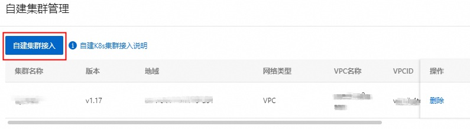

5. 在**容器管理**页面，单击**集群信息**列目标名称或对应**操作**列**查看**，进入集群详情页面。

6. 单击**命名空间**、**节点**、**应用**、**容器组**、**容器**或**运行时镜像**。

   您可以通过资产列表上的筛选框，选择和查看**命名空间**、**节点**、**应用**、**容器组**、**容器**或**运行时镜像**的资产。

   <table>
     <tr>
       <th width="105">资产</th>
       <th>相关操作</th>
     </tr>
     <tr>
       <td>命名空间</td>
       <td>• 单击命名空间名称，或单击目标命名空间<strong>操作</strong>列的<strong>处理</strong>，在空间详情页面，查看漏洞风险、告警风险、包含的容器组信息。 • 根据页面操作指引，在<strong>漏洞风险</strong>和<strong>告警风险</strong>页签，处理漏洞和风险。 • 单击目标漏洞风险<strong>操作</strong>列的<strong>查看</strong>，可查看漏洞详情和待处理漏洞列表。单击<strong>漏洞编号</strong>，展示漏洞详情和修复建议。可以选择<strong>忽略</strong>漏洞，也可以在目标资产中修复漏洞后，选择<strong>验证</strong>，确认漏洞修复成功。 • 单击目标告警风险<strong>操作</strong>列的<strong>处理</strong>，可设置处理方式为<strong>我已手工处理</strong>、<strong>忽略</strong>或<strong>加白名单</strong>。</td>
     </tr>
     <tr>
       <td>节点</td>
       <td>• 单击节点名称，或单击目标节点<strong>操作</strong>列的<strong>处理</strong>，在节点详情页面，查看漏洞信息、安全告警处理、基线检查信息。 • <strong>在漏洞信息</strong>、<strong>安全告警处理</strong>、<strong>基线检查</strong>页签，分别进行漏洞处理和风险处理。</td>
     </tr>
     <tr>
       <td>应用</td>
       <td>• 单击应用名称，或单击目标应用<strong>操作</strong>列的<strong>处理</strong>，在应用详情页面，查看漏洞风险、告警风险及包含的容器组信息。 • 根据页面操作指引，在<strong>漏洞风险</strong>和<strong>告警风险</strong>页签，处理漏洞和风险。</td>
     </tr>
     <tr>
       <td>容器组</td>
       <td>• 单击容器组名称，或单击目标容器组<strong>操作</strong>列的<strong>处理</strong>，在容器组详情页面，查看漏洞风险、告警风险及包含的容器组信息。 • 根据页面操作指引，在<strong>漏洞风险</strong>和<strong>告警风险</strong>页签，处理漏洞和风险。</td>
     </tr>
     <tr>
       <td>容器</td>
       <td>• 单击容器名称，或单击目标容器<strong>操作</strong>列的<strong>处理</strong>，在容器详情页面，查看漏洞风险、告警风险。 • 在<strong>漏洞风险</strong>和<strong>告警风险</strong>页签，处理漏洞和风险。</td>
     </tr>
     <tr>
       <td>运行时镜像</td>
       <td>• 单击可查看实例化为运行时的镜像，包括：镜像系统漏洞、镜像应用漏洞、镜像基线检查、镜像恶意样本列表。 • 单击目标漏洞操作列的查看，可查看和处理具体漏洞。 • 单击目标基线检查或恶意样本操作详情，可查看风险项或恶意样本详情和关联的容器。</td>
     </tr>
   </table>

### 3.1.2. 容器网络拓扑

您可以从互联网和集群视角，通过网络拓扑形式，查看容器中的资产。本文介绍如何查看容器中的网络拓扑。

1. 登录Apsara Uni-manager运营控制台。

2. 在控制台右上方，单击**安全**，选择**主机安全 > 容器安全**。在**容器安全**授权页面，选择**地域**并单击**角色授权访问**。

   > **说明**
   >
   > - 在多级组织模式下，所有数据的权限都将关联到组织下的资源集维度。用户可以通过控制台顶部菜单栏选择不同组织和资源集，以查看或处理所属组织和资源集的资产。
   >
   > - 上级组织具有最高的管理权限，对内容的修改将覆盖下级组织和资源集的配置。在进行对应配置的修改时，请务必注意。

3. 在左侧导航栏，选择**资产中心 > 容器网络拓扑**。

4. 在**集群总览**页面，单击**互联网视角**或**集群视角**。

5. 在**互联网视角**或**集群视角**页签，执行如下操作。

   - 通过时间筛选框，设置并查看任意7天的集群运行情况。

   - 单击  图标或  图标，开启或关闭全部集群的网络拓扑。

   - 单击  图标，刷新集群网络拓扑。

   - 单击  图标，导出集群网络拓扑快照。

   - 单击网络拓扑中的集群，查看集群信息、集群风险、镜像信息或防护策略。

### 3.1.3. 镜像管理

通过镜像管理，您可以同步资产、接入镜像仓，同时支持查看和管理所有镜像及存在风险的镜像。本文介绍如何管理镜像。

**操作步骤**

1. 登录Apsara Uni-manager运营控制台。

2. 在控制台右上方，单击**安全**，选择**主机安全 > 容器安全**。在**容器安全**授权页面，选择**地域**并单击**角色授权访问**。

   > **说明**
   >
   > - 在多级组织模式下，所有数据的权限都将关联到组织下的资源集维度。用户可以通过控制台顶部菜单栏选择不同组织和资源集，以查看或处理所属组织和资源集的资产。
   >
   > - 上级组织具有最高的管理权限，对内容的修改将覆盖下级组织和资源集的配置。在进行对应配置的修改时，请务必注意。

3. 在左侧导航栏，选择**资产中心 > 镜像管理**。

4. 在**镜像管理**页面，同步资产或镜像仓接入。

   - 单击**同步最新资产**，同步资产。

     > **说明**
     >
     > 资产同步间隔半小时生效一次，请勿频繁点击。

   - 单击**镜像仓接入**，在**镜像仓接入**面板，配置镜像信息。具体操作，请参见**第三方镜像仓接入说明**。

5. 在**镜像管理**页面，单击**操作**列**查看**。

   镜像列表分页展示了镜像的**镜像信息**、**镜像大小**、**最新发现时间**、**扫描状态**、**扫描进度**和**风险状态**。

6. 定位到有风险的镜像，单击**操作**列**处理**。

   您可以查看镜像的**镜像系统漏洞**、**镜像应用漏洞**、**镜像基线检查**、**镜像恶意样本**和**镜像指纹调查**的基本信息。您也可以单击漏洞名称或单击**操作**列的**详情**，查看对应的详细信息。

## 3.2. CI/CD安全

### 3.2.1. 镜像安全扫描

容器防护支持对镜像仓进行安全扫描，包括扫描镜像漏洞、基线问题、恶意样本等。本文介绍如何扫描镜像安全。

**背景信息**

镜像安全扫描功能支持对镜像中存在的高危系统漏洞、应用漏洞、恶意样本、配置风险和敏感数据进行检测和识别。镜像上的基础系统软件、中间件、Web应用、数据库服务等，可能会存在挖矿木马、后门程序等安全漏洞，基于风险镜像运行的容器回危害您的资产安全。执行镜像安全扫描可以帮助您检测漏洞资产中是否存在镜像漏洞和恶意样本，并提供漏洞修复方案，为您提供一站式漏洞管理能力，让镜像漏洞修复更简单。

**执行镜像安全扫描**

1. 登录Apsara Uni-manager运营控制台。

2. 在控制台右上方，单击**安全**，选择**主机安全 > 容器安全**。在**容器安全**授权页面，选择**地域**并单击**角色授权访问**。

   > **说明**
   >
   > - 在多级组织模式下，所有数据的权限都将关联到组织下的资源集维度。用户可以通过控制台顶部菜单栏选择不同组织和资源集，以查看或处理所属组织和资源集的资产。
   >
   > - 上级组织具有最高的管理权限，对内容的修改将覆盖下级组织和资源集的配置。在进行对应配置的修改时，请务必注意。

3. 在左侧导航栏，选择**CI/CD安全 > 镜像安全扫描**。

**立即执行镜像安全扫描（手动扫描）**

如果您需要立即执行镜像安全扫描，可以手动立即开始镜像扫描。仅对当前账号权限内的容器资产进行扫描。

1. 在**镜像安全扫描**页面，单击**立即扫描**。

2. 在**一键扫描**对话框中默认已选中所有镜像类型，取消选中不需要扫描的镜像类型，选择**扫描时间范围**，然后单击**确定**。

**配置镜像安全扫描周期（定期扫描）**

1. 在**镜像安全扫描**页面的右上角，单击**扫描设置**，进入**扫描设置**面板。

2. 在扫描配置页签，设置镜像**扫描周期**、**扫描时间范围**。

3. 在**镜像仓**页签，查看支持扫描的容器镜像（镜像库类型为**acr**、**defaultAcr**）和已接入的私有镜像仓库（镜像库类型为**harbor**、**quay**等）列表。

   如需扫描不在镜像仓库列表中的私有镜像仓库，您可以单击**镜像仓接入**来接入您的私有镜像仓库。

4. 在**基线配置管理**页签，单击**配置范围**右侧的**管理**，选择您要检查的基线，然后单击**确认**。

5. 单击面板右上角的关闭图标，关闭**扫描设置**面板。

完成扫描周期配置后，云盾安全中心将按照您的漏洞扫描配置，对您的镜像进行安全扫描。

**查看扫描结果**

1. 在左侧导航栏，选择**CI/CD安全 > 镜像安全扫描**。

2. 在**镜像系统漏洞**或**镜像应用漏洞**页签，单击**漏洞名称**或**操作**列**查看**。

   您可以查看漏洞详情和受影响的镜像详情。

   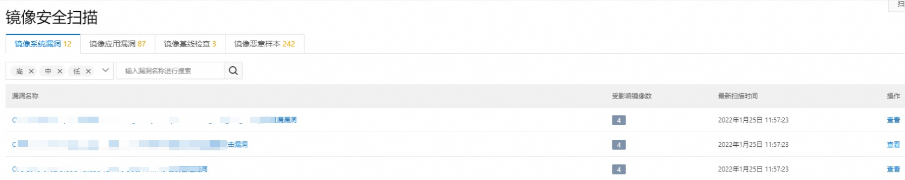

3. 在**镜像基线检查**页签，单击**操作**列**详情**。

   您可以查看对应基线**镜像地址/版本**和**检查详情/总检查项**。您还可以单击**操作**列**详情**，查看风险项的状态并对其进行**加白名单**或**取消加白**操作。

   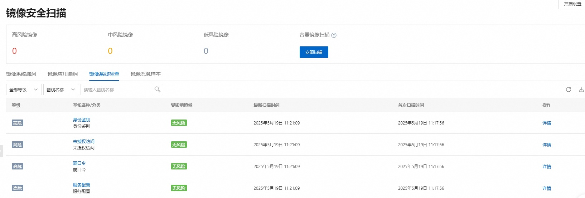

4. 在**镜像恶意样本**页签，单击**恶意样本**名称或**操作**列**详情**。

   您可以查看对应的恶意样本详情和受影响的镜像详情。

   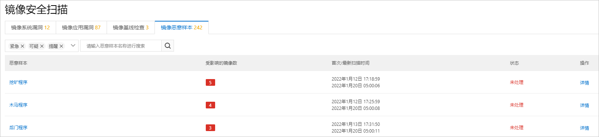

### 3.2.2. 扫描插件集成

扫描插件集成功能可帮助您在项目构建阶段发现镜像中存在的风险，并提供修复建议辅助您快速修复问题。本文介绍如何配置扫描插件。

1. 登录Apsara Uni-manager运营控制台。

2. 在控制台右上方，单击**安全**，选择**主机安全 > 容器安全**。在**容器安全**授权页面，选择**地域**并单击**角色授权访问**。

   > **说明**
   >
   > - 在多级组织模式下，所有数据的权限都将关联到组织下的资源集维度。用户可以通过控制台顶部菜单栏选择不同组织和资源集，以查看或处理所属组织和资源集的资产。
   >
   > - 上级组织具有最高的管理权限，对内容的修改将覆盖下级组织和资源集的配置。在进行对应配置的修改时，请务必注意。

3. 在左侧导航栏，选择**CI/CD安全 > 扫描插件集成**。

4. 在**扫描插件集成**页面，单击**点击查看接入引导**，查看**CI/CD扫描插件接入说明。**

5. 关闭**CI/CD扫描插件接入说明**面板，单击**接入配置**，完成扫描插件相关配置。

## 3.3. 运行时防护

### 3.3.1. 漏洞管理

漏洞管理关联安骑士漏洞管理功能，帮助您快速处理容器中的漏洞。本文介绍如何扫描和处理容器中的漏洞。

1. 登录Apsara Uni-manager运营控制台。

2. 在控制台右上方，单击**安全**，选择**主机安全 > 容器安全**。在**容器安全**授权页面，选择**地域**并单击**角色授权访问**。

   > **说明**
   >
   > - 在多级组织模式下，所有数据的权限都将关联到组织下的资源集维度。用户可以通过控制台顶部菜单栏选择不同组织和资源集，以查看或处理所属组织和资源集的资产。
   >
   > - 上级组织具有最高的管理权限，对内容的修改将覆盖下级组织和资源集的配置。在进行对应配置的修改时，请务必注意。

3. 在左侧导航栏，选择**运行时防护 > 漏洞管理**。

4. 单击**漏洞管理**页面右上角的**漏洞管理设置**，跳转到安骑士的**安全预防** > **漏洞管理**页面，单击页面右上角的**漏洞管理设置**，设置漏洞识别范围、漏洞扫描等级、漏洞白名单等信息。

5. 在**漏洞管理**页面，查看节点漏洞、最新系统漏洞发现时间等信息。

6. 单击**一键扫描**，启动漏洞扫描任务。

   > **说明**
   >
   > 漏洞扫描预计1~5分钟完成，请耐心等待，您可以手动进行页面刷新查看最新数据。

   扫描完成后，您可以在漏洞列表，查看和处理漏洞。

7. 在**漏洞管理**页面，单击**Linux软件漏洞**或<strong>应用漏洞（含应急）</strong>页签。

   <ol type="i">

   <li>

   单击漏洞公告名称或目标漏洞公告**操作**列的**查看**，在漏洞公告详情页执行如下操作：

   - 单击详情页右上角的**全局加白**，为所有涉及资产加白。

     > **说明**
     >
     > - 加入白名单后，所选漏洞未处理记录将自动删除，并且以后不再提醒。
     >
     > - 本操作加白范围为所有资产。如需管理加白范围，请到漏洞管理设置中操作。
     >
     > - 如需取消白名单、或调整加白原因，请到漏洞管理设置中操作。

   - 单击**漏洞详情**，单击漏洞列表中的漏洞编号，查看漏洞详情。

   - 单击**待处理漏洞**，单击目标漏洞**操作**列的**验证**，或选中多个漏洞后单击待处理漏洞列表下的**验证**，验证漏洞。

   - 单击**待处理漏洞**，单击目标漏洞**操作**列的**忽略**，或选中多个漏洞后单击待处理漏洞列表下的**忽略**，忽略漏洞。

   </li>

   <li>

   返回漏洞列表，选中多个漏洞，单击列表下的**加入白名单**，批量将漏洞加入白名单。

   </li>

   <li>

   在漏洞列表右上方，单击下载  图标，可导出漏洞文件。

   </li>

   </ol>

### 3.3.2. 基线检查

通过基线检查，帮助您快速识别基线中存在的问题。本文介绍如何检查和处理基线中的问题。

**基线检查策略**

1. 登录Apsara Uni-manager运营控制台。

2. 在控制台右上方，单击**安全**，选择**主机安全 > 容器安全**。在**容器安全**授权页面，选择**地域**并单击**角色授权访问**。

   > **说明**
   >
   > - 在多级组织模式下，所有数据的权限都将关联到组织下的资源集维度。用户可以通过控制台顶部菜单栏选择不同组织和资源集，以查看或处理所属组织和资源集的资产。
   >
   > - 上级组织具有最高的管理权限，对内容的修改将覆盖下级组织和资源集的配置。在进行对应配置的修改时，请务必注意。

3. 在左侧导航栏，选择**运行时防护 > 基线检查**。

4. 单击**基线检查**页面右上角的**策略管理**，单击**添加标准策略**或单击已添加标准策略**操作**列的**编辑**，完成如下配置后，单击**确认**。

   <table>
     <tr>
       <th width="121">配置项</th>
       <th>相关描述</th>
     </tr>
     <tr>
       <td>策略名称</td>
       <td>设置策略名称。策略名称设置后，不支持修改。</td>
     </tr>
     <tr>
       <td>检测周期</td>
       <td>设置检测周期，可选择：每天、每3天、每7天或每30天。</td>
     </tr>
     <tr>
       <td>检测开始时间</td>
       <td>设置检测开始时间，可选择：0:00~6:00、6:00~12:00、12:00~18:00、18:00~24:00。</td>
     </tr>
     <tr>
       <td>基线名称</td>
       <td>设置基线名称，支持： • Kubernetes(ACK) Master 国际通用安全最佳实践基线 • Kubernetes(ACK) Node 国际通用安全最佳实践基线 • 阿里云标准-Kubernetes-Master安全基线检查 • 阿里云标准-Kubernetes-Node安全基线检查</td>
     </tr>
     <tr>
       <td>生效集群</td>
       <td>设置基线检测生效集群。</td>
     </tr>
   </table>

5. 返回**基线检查**页面，单击**基线检查策略**的下拉框列表，选择已配置的基线检查策略，单击**立即检查**。

   检查完成后，您可以在基线列表，查看和验证基线问题。

6. 单击基线名称，在基线详情页执行如下操作：

   - 将光标放在资产名称上，查看受影响资产详情。

   - 单击受影响资产**操作**列的**验证**，或选中多个漏洞后单击待处理漏洞列表下的**验证**，验证受影响资产。

**风险情况**

1. 登录Apsara Uni-manager运营控制台。

2. 在控制台右上方，单击**安全**，选择**主机安全 > 容器安全**。在**容器安全**授权页面，选择**地域**并单击**角色授权访问**。

   > **说明**
   >
   > - 在多级组织模式下，所有数据的权限都将关联到组织下的资源集维度。用户可以通过控制台顶部菜单栏选择不同组织和资源集，以查看或处理所属组织和资源集的资产。
   >
   > - 上级组织具有最高的管理权限，对内容的修改将覆盖下级组织和资源集的配置。在进行对应配置的修改时，请务必注意。

3. 在左侧导航栏，选择**运行时防护 > 基线检查**。

4. 单击**风险情况**页签，查看基线检查的风险情况列表。支持通过风险等级、状态、基线分类以及输入检查项搜索。

5. 查看风险项详情：单击目标风险项的**操作**列**详情**，查看目标风险项的**详情**以及**风险处理**，详情包括风险描述、加固建议以及相关基线信息。风险处理支持对相应资产**加白名单**、**验证**及**取消加白**操作。

6. 风险项加白名单：单击目标风险项**操作**列的**加白名单**或者选择多个目标风险项，单击列表下方的**加白名单**进行批量加白操作。

### 3.3.3. 入侵告警

容器防护支持检测集群节点、容器，可提供病毒木马、外部入侵、供应链攻击、越权逃逸等维度的风险监控拦截能力。本文介绍如何配置入侵告警防护。

**背景信息**

入侵事件告警功能是基于阿里云大数据告警模型，安骑士威胁检测模块具备丰富的入侵检测能力，能够帮助用户掌握ACK环境威胁情况，有效拦截外部风险。

**操作步骤**

1. 登录Apsara Uni-manager运营控制台。

2. 在控制台右上方，单击**安全**，选择**主机安全 > 容器安全**。在**容器安全**授权页面，选择**地域**并单击**角色授权访问**。

   > **说明**
   >
   > - 在多级组织模式下，所有数据的权限都将关联到组织下的资源集维度。用户可以通过控制台顶部菜单栏选择不同组织和资源集，以查看或处理所属组织和资源集的资产。
   >
   > - 上级组织具有最高的管理权限，对内容的修改将覆盖下级组织和资源集的配置。在进行对应配置的修改时，请务必注意。

3. 在左侧导航栏，选择**运行时防护 > 入侵告警**。

4. 在**入侵告警**页面，查看风险节点数、风险容器数、全部风险数、高危风险数信息。

   您可以设置筛选条件，查看告警等级、告警名称、受影响的资产等信息。您也可以将光标放置在**受影响资产**名称上，查看该资产的详细信息。

5. 单击目标告警**操作**列的**处理**。

   您可以对该入侵事件进行**加白名单**、**忽略**、**我已手工处理**、**停止容器**和**批量处理**等操作。

6. 在**入侵事件告警**页面，单击告警名称或**操作**列**详情**。

   您可以查看该入侵告警的详情、关联异常等信息。

### 3.3.4. 容器防火墙

容器防火墙是安骑士为容器环境提供的防火墙服务。当黑客利用漏洞或恶意镜像入侵容器集群时，容器防火墙会对容器的异常行为进行告警或拦截。

**容器防火墙原理**

容器防火墙通过将容器中应用的命名空间、应用名称、镜像以及标签等信息整合为网络对象，作为区别容器应用的标签信息。然后基于容器应用的网络对象，为容器应用创建网络访问的拦截规则，检测和拦截异常访问流量。

> **说明**
>
> 如果集群的可拦截状态为异常，是无法成功开启集群防御状态的，防御规则也不会生效。您需要及时处理集群的异常状态。

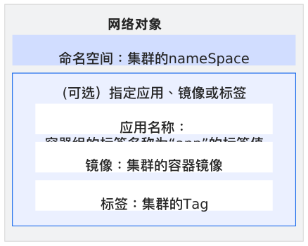

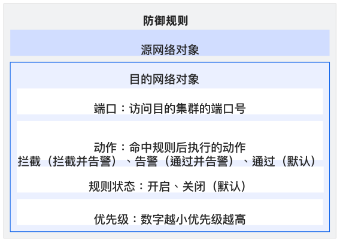

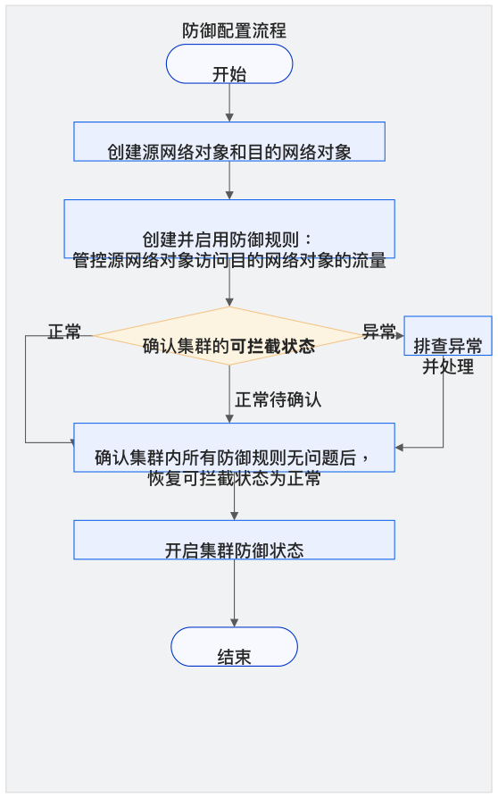

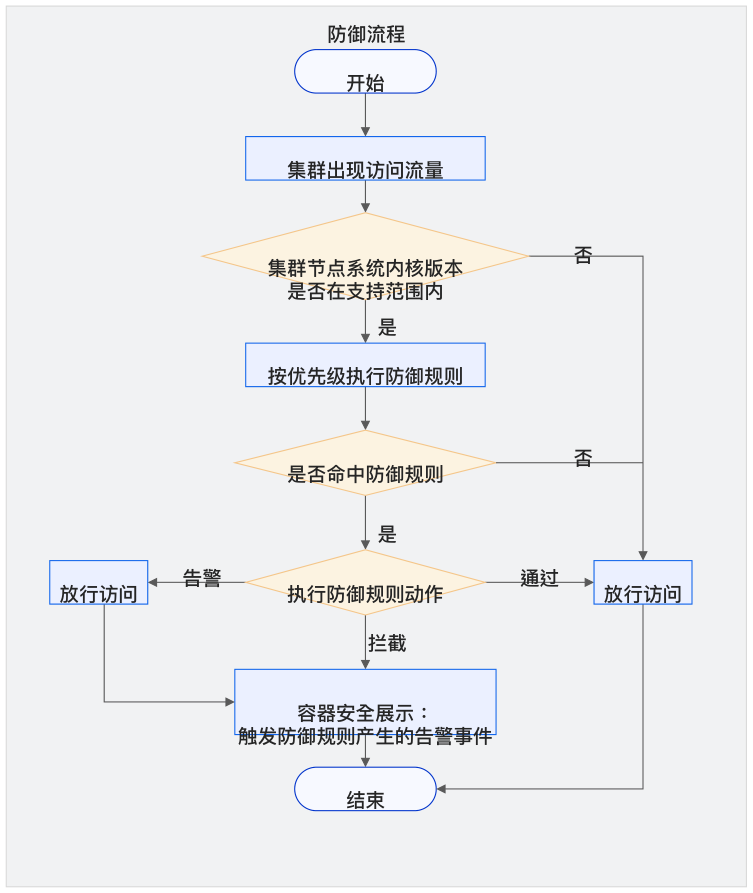

**支持的操作系统版本**

集群防御规则的正常运行依赖于恶意网络行为防御的AliNet插件（AliNet插件主要用于网络连接拦截、DNS拦截、暴力破解拦截等），使用容器防火墙功能前，请确保您的集群节点的系统内核版本在AliNet插件支持的部分系统内核版本范围内。如果集群节点的系统内核版本不在AliNet插件支持的部分系统内核版本范围内，会导致集群防御规则无法生效。容器防火墙功能支持的系统内核版本请参照《安骑士用户指南》中**客户端部署** > **客户端支持的操作系统**章节。

**使用流程**

容器防火墙的配置和使用如下：

1. 新增网络对象：新增源网络对象和目的网络对象。

2. 创建防御规则：创建并开启防御规则。

3. 防御状态与规则管理：开启集群防御。

4. 查看防护状态：查看触发防御规则产生的告警事件。

#### 3.3.4.1. 新增网络对象

使用容器安全的容器防火墙服务，首先要创建源网络对象和目的网络对象，然后再创建防御。本文介绍如何创建网络对象。

**前提条件**

已为您的资产开启了恶意网络行为防御功能。

**操作步骤**

1. 登录Apsara Uni-manager运营控制台。

2. 在控制台右上方，单击**安全**，选择**主机安全 > 容器安全**。在**容器安全**授权页面，选择**地域**并单击**角色授权访问**。

   > **说明**
   >
   > - 在多级组织模式下，所有数据的权限都将关联到组织下的资源集维度。用户可以通过控制台顶部菜单栏选择不同组织和资源集，以查看或处理所属组织和资源集的资产。
   >
   > - 上级组织具有最高的管理权限，对内容的修改将覆盖下级组织和资源集的配置。在进行对应配置的修改时，请务必注意。

3. 在左侧导航栏，选择**运行时防护 > 容器防火墙**。

4. 在**容器防火墙**页面，单击**网络对象**页签。

5. 在**网络对象**页签，单击**新增网络对象**。

6. 在**新增网络对象**面板，参考以下表格配置网络对象参数。

   <table>
     <tr>
       <th width="89">配置项</th>
       <th>说明</th>
     </tr>
     <tr>
       <td>对象名称</td>
       <td>输入网络对象的名称。</td>
     </tr>
     <tr>
       <td>对象类型</td>
       <td>选择网络对象的类型。可选择项有： • 容器 • IP • DNS域名</td>
     </tr>
     <tr>
       <td>命名空间</td>
       <td>选择或输入网络对象所在的命名空间。 说明命名空间配为集群的namesSpace，支持模糊匹配例：a*。</td>
     </tr>
     <tr>
       <td>应用名称</td>
       <td>选择或输入网络对象所属应用的名称。 说明应用名称为容器组的标签名称为“app”的标签值，支持后缀模糊匹配，例：abc*。</td>
     </tr>
     <tr>
       <td>镜像</td>
       <td>选择或输入要防御的网络对象所使用的容器镜像。 说明镜像为集群的容器镜像，支持后缀模糊匹配。例：a*。</td>
     </tr>
     <tr>
       <td>标签</td>
       <td>选择或输入要防御的容器组的标签。您可以选择多个标签。标签是指K8s集群中的容器启动后，自身附带的业务属性。您可以添加自定义标签来识别容器组，标签是隔离规则里最基本的匹配条件。 说明标签为集群的tag，支持后缀模糊匹配。例：a*。</td>
     </tr>
   </table>

7. 单击确定。

   新增的网络对象会出现在网络对象列表中。

   - 您可单击网络对象**操作**列的**编辑**或**删除**，修改或删除该网络对象。

   - 您也可以选中多个网络对象，然后单击下方的**批量删除**，批量删除网络对象。

     > **说明**
     >
     > 网络对象没有应用在任何容器防火墙规则中时，才可以被删除。

**后续步骤**

创建了源网络对象和目的网络对象后，您可以在这两个网络对象之间创建访问流量防御规则，即设置对源网络访问目的网络的异常流量是放行、告警还是拦截。

#### 3.3.4.2. 创建防御规则

您可以在两个网络对象之间创建访问流量的防御规则，实现源网络对象访问目的网络对象的流量管控。本文介绍如何创建防御规则。

**前提条件**

已分别添加源网络对象和目的网络对象。具体操作，请参见新增网络对象。

**背景信息**

容器防火墙的防御规则可以实现网络的隔离，它由一个源网络对象、一个目的网络对象、一组端口范围、一个过滤动作和规则优先级这五部分组成。

**操作步骤**

1. 登录Apsara Uni-manager运营控制台。

2. 在控制台右上方，单击**安全**，选择**主机安全 > 容器安全**。在**容器安全**授权页面，选择**地域**并单击**角色授权访问**。

   > **说明**
   >
   > - 在多级组织模式下，所有数据的权限都将关联到组织下的资源集维度。用户可以通过控制台顶部菜单栏选择不同组织和资源集，以查看或处理所属组织和资源集的资产。
   >
   > - 上级组织具有最高的管理权限，对内容的修改将覆盖下级组织和资源集的配置。在进行对应配置的修改时，请务必注意。

3. 在左侧导航栏，选择**运行时防护 > 容器防火墙**。

4. 在**容器防火墙**页面，单击**防护管理**页签。

5. 在**防护管理**页签下的集群列表中，定位到要创建防御规则的集群，单击其**操作**列的**规则管理**。

6. 在**防御规则**面板上，单击**创建防御规则**。

7. 在**创建规则**面板上为该集群创建防御规则。

   <ol type="i">

   <li>

   **源配置**

   您需要进行以下配置：

   - **规则名称**：为该防御规则设置名称。

   - **网络对象**：选择源网络对象，即访问流量的来源。

   </li>

   <li>

   单击**下一步**。

   </li>

   <li>

   **目的配置**

   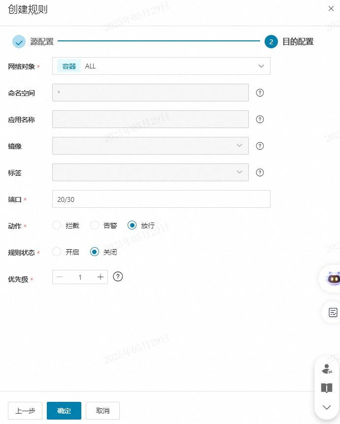

   您需要进行以下配置：

   <table>
     <tr>
       <th width="89">配置项</th>
       <th>说明</th>
     </tr>
     <tr>
       <td>网络对象</td>
       <td>选择访问流量的目的对象。</td>
     </tr>
     <tr>
       <td>端口</td>
       <td>输入访问的端口范围。 说明最多支持设置8组端号范围，端号范围不可重复。多个端口范围使用半角逗号（,）隔开，例如：20/30,80/90。</td>
     </tr>
     <tr>
       <td>动作</td>
       <td>选择规则的执行动作。取值： • <strong>拦截</strong>：对访问流量进行拦截。 • <strong>告警</strong>：对访问流量放行并进行告警。 • <strong>放行</strong>：对访问流量放行（不会告警）。</td>
     </tr>
     <tr>
       <td>规则状态</td>
       <td>防御规则的状态。取值： • <strong>开启</strong>：该防御规则创建成功后为生效状态。 • <strong>关闭</strong>：该防御规则创建成功后为不生效状态。</td>
     </tr>
     <tr>
       <td>优先级</td>
       <td>设置该防御规则的优先级。优先级为1~1000，数字越小优先级越高。</td>
     </tr>
   </table>

   </li>

   </ol>

8. 单击**确定**。

   新创建的防御规则会展示在防御规则列表中，并按照优先级由高到低的顺序排列。新建的防御规则默认为关闭状态，您需要开启防御规则，规则才会生效。开启防护规则的具体操作，请参见防御状态与规则管理。

   防御规则启用后，该集群的防御规则会按照您新建防御规则时设置的优先级顺序依次执行。

   > **重要**
   >
   > 如果防御规则列表中的第一条规则未命中，则继续尝试匹配规则列表中的第二条规则，直到命中规则后，按规则中的动作来执行。如果没有命中任何规则，容器防火墙会执行放行的动作。

#### 3.3.4.3. 防御状态与规则管理

创建防御规则后，您可以对集群防御状态进行开启或关闭，也可对该集群下的防御规则进行启用、停用、编辑等操作。如果您的业务已不再需要某个防御策略，您可以删除该防御策略。本文介绍如何对集群的防御规则进行启用、停用、编辑和删除。

**前提条件**

已为该集群创建了防御规则。创建防御规则的具体操作，请参见创建防御规则。

**背景信息**

集群防御规则的可拦截状态为正常时，该集群的防御规则才能生效。如果集群防御规则的可拦截状态异常，您需要及时处理该异常状态。

**防御状态管理**

1. 登录Apsara Uni-manager运营控制台。

2. 在控制台右上方，单击**安全**，选择**主机安全 > 容器安全**。在**容器安全**授权页面，选择**地域**并单击**角色授权访问**。

   > **说明**
   >
   > - 在多级组织模式下，所有数据的权限都将关联到组织下的资源集维度。用户可以通过控制台顶部菜单栏选择不同组织和资源集，以查看或处理所属组织和资源集的资产。
   >
   > - 上级组织具有最高的管理权限，对内容的修改将覆盖下级组织和资源集的配置。在进行对应配置的修改时，请务必注意。

3. 在左侧导航栏，选择**运行时防护 > 容器防火墙**。

4. 在**容器防火墙**页面，单击防护管理页签。

5. 在**防护管理**页签下的集群列表中，定位到要管理防御状态的集群，对该集群的**防御状态**进行管理。

   单击目标防御规则**防御状态**列的  或  图标，开启或关闭该集群的防御状态。您也可以选中多个集

   群，单击下方的**批量开启**或**批量关闭**，对多个集群防御状态进行管理。

   > **重要**
   >
   > 只有集群防御规则的**可拦截状态**显示为**正常**，该集群的防御规则才能正常开启。如果集群的防御规则的**可拦截状态**显示为**异常**或**正常待确认**，该集群的防御规则无法开启。

**防御规则管理**

1. 登录Apsara Uni-manager运营控制台。

2. 在控制台右上方，单击**安全**，选择**主机安全 > 容器安全**。在**容器安全**授权页面，选择**地域**并单击**角色授权访问**。

   > **说明**
   >
   > - 在多级组织模式下，所有数据的权限都将关联到组织下的资源集维度。用户可以通过控制台顶部菜单栏选择不同组织和资源集，以查看或处理所属组织和资源集的资产。
   >
   > - 上级组织具有最高的管理权限，对内容的修改将覆盖下级组织和资源集的配置。在进行对应配置的修改时，请务必注意。

3. 在左侧导航栏，选择**运行时防护 > 容器防火墙**。

4. 在**容器防火墙**页面，单击防护管理页签。

5. 在**防护管理**页签下的集群列表中，定位到要管理防御规则的集群，对该集群下的防御规则进行管理。

   <ol type="i">

   <li>

   单击目标集群**操作**列的**规则管理**，展开**防御规则**面板。

   </li>

   <li>

   在**防御规则**面板上的集群防御规则列表中，定位到要管理的防御规则。

   - 开启或关闭规则

     单击目标防御规则**启用状态**列的  或  图标，开启或关闭该防御规则。

     选中多个防御规则，单击列表下方的**批量开启**或**批量关闭**，对多个防御规则进行批量开启或关闭。

   - 查看规则详情

     单击**操作**列的**详情**，在规则**详情**面板查看该规则的源网络对象、目的网络对象以及规则详情。

   - 编辑规则

     单击**操作**列的**编辑**展开**编辑规则**面板，对该规则进行修改。

     > **说明**
     >
     > 集群防御规则修改最长需要1分钟生效。

   - 删除规则

     单击目标防御规则**操作**列的**删除**，删除该规则。

     选中多个防御规则，单击列表下方的**批量删除**，对多个防御规则进行批量删除操作。

     > **说明**
     >
     > 集群防御规则删除最长需要1分钟生效。

   </li>

   </ol>

#### 3.3.4.4. 查看防护状态

防御规则创建并启用后，该防御规则开始对访问该集群的流量进行放行、告警和拦截的防御动作。您可以通过防护状态功能查看触发防御规则产生的告警事件。本文介绍如何查看容器防火墙的防护状态。

**背景信息**

防护状态功能页签下只展示告警或拦截的防御动作产生的告警事件。如果防御规则动作为放行，则不会产生告警事件。

**操作步骤**

1. 登录Apsara Uni-manager运营控制台。

2. 在控制台右上方，单击**安全**，选择**主机安全 > 容器安全**。在**容器安全**授权页面，选择**地域**并单击**角色授权访问**。

   > **说明**
   >
   > - 在多级组织模式下，所有数据的权限都将关联到组织下的资源集维度。用户可以通过控制台顶部菜单栏选择不同组织和资源集，以查看或处理所属组织和资源集的资产。
   >
   > - 上级组织具有最高的管理权限，对内容的修改将覆盖下级组织和资源集的配置。在进行对应配置的修改时，请务必注意。

3. 在左侧导航栏，选择**运行时防护 > 容器防火墙**。

4. 在**容器防火墙**页面，单击**防护状态**页签。

5. 在**防护状态**页签下，查看容器防火墙的防护状态。

   防护状态页签分为防御总览和告警事件列表两个区域。

   - 防御总览

     防御总览区域为您展示**最近24小时风险数**、**最近30天风险数**、**最近180天风险数**、**未防护集群/总集群数** 、**规则总数**。

     

   - 告警事件列表

     防御列表中按照防御规则触发的时间由近到远，为您展示已触发防御规则（规则执行动作为告警和拦截）的告警事件。相同源容器组、目的容器组、端口号和集群的告警事件，按自然天被归类为一条告警事件，多次告警在**尝试次数**列累计尝试访问的次数。

     您可以单击告警事件操作列的**编辑规则**对该告警事件的防御规则进行修改。您也可以单击**编辑规则**右侧

     的  修改该告警事件的对应防御规则执行的动作。

     > **说明**
     >
     > 防御规则修改最长需要1分钟生效。

     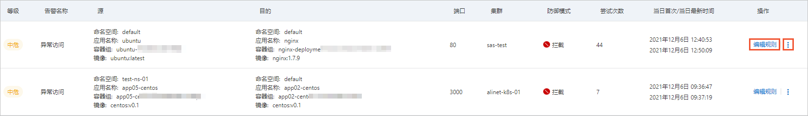

### 3.3.5. 容器文件防御

容器文件防御功能可实时监控容器内目录或文件，并在容器内目录或文件被恶意篡改时产生告警或拦截篡改行为，避免应用被植入非法信息或恶意代码文件，保障容器环境正常运行。

**前提条件**

- 已在需要防护的集群部署的服务器中安装了容器安全客户端。具体操作，请参见《安骑士用户指南》的**主机设置** > **安装客户端**章节。

- 已安装客户端的服务器内核需支持AliWebGuard插件，支持范围请参见《安骑士用户指南》的**客户端支持的操作系统** > **AliWebGuard支持的操作系统及内核版本**。

**新建规则**

1. 登录Apsara Uni-manager运营控制台。

2. 在控制台右上方，单击**安全**，选择**主机安全 > 容器安全**。在**容器安全**授权页面，选择**地域**并单击**角色授权访问**。

   > **说明**
   >
   > - 在多级组织模式下，所有数据的权限都将关联到组织下的资源集维度。用户可以通过控制台顶部菜单栏选择不同组织和资源集，以查看或处理所属组织和资源集的资产。
   >
   > - 上级组织具有最高的管理权限，对内容的修改将覆盖下级组织和资源集的配置。在进行对应配置的修改时，请务必注意。

3. 在左侧导航栏，选择**运行时防护 > 容器文件防御**。

4. 在**容器文件防御**页面，单击**新建规则**。

5. 在**新建规则**面板，配置规则参数，单击**下一步**。

   <table>
     <tr>
       <th colspan="2">配置项</th>
       <th>描述</th>
       <th>配置示例</th>
     </tr>
     <tr>
       <td colspan="2">规则名称</td>
       <td>输入规则名称。长度为6~50个字符，以字母或者中文字符开头，可包含数字、下划线（_）和短划线（-）。</td>
       <td>Cluster01</td>
     </tr>
     <tr>
       <td rowspan="3">规则配置</td>
       <td>文件防护目录</td>
       <td>设置需要防护的目录。配置文件防护目录需满足以下要求： • 以/开始。仅支持输入一个目录。 • 防护目录路径长度需小于500字符。 • 一条规则只能防护一个目录。如需防护多个目录，可以单击<strong>操作</strong>的<strong>增加</strong>配置多条目录。 • 单个容器文件防御规则最多支持配置10条防护目录。</td>
       <td>/home/app/label</td>
     </tr>
     <tr>
       <td>进程白名单</td>
       <td>设置可以修改防护目录的进程名单，加入白名单的进程修改文件时不会触发告警或拦截。配置进程白名单需满足以下要求： • 仅支持配置容器视角的进程路径。 • 单个进程长度不超过50字符。 • 多个进程用半角分号（;）分隔。 • 一个文件防护目录下，最多支持配置10个白名单进程。</td>
       <td>/bin/cp;/usr/bin/mv;/bi n/vi</td>
     </tr>
     <tr>
       <td>执行动作</td>
       <td>在下拉列表中选择检测到篡改行为时的执行动作。可选项： • <strong>告警</strong>：识别到文件防护目录被篡改时，只产生告警。 • <strong>拦截</strong>：识别到文件防护目录被篡改时，产生告警并拦截对应进程。 说明建议先开启告警模式。在确定正常情况下业务不会触发文件防御告警后，再开启拦截模式，以避免误拦截正常进程。如果正常业务被拦截，可以将相应进程加入进程白名单。</td>
       <td>告警</td>
     </tr>
   </table>

6. 选择规则生效的集群名称和容器组标签，单击**确定**。

   推荐选择以 `app` 为开头的容器组标签。Kubernetes中的标签（Label）是一种键值对，用于标记和分类Kubernetes资源（例如Pod、Deployment、Service等）。请根据应用场景、功能或用途等自定义标签，以便更好地管理和操作Kubernetes资源。以 `app` 开头的键是一种围绕应用（application）概念组织资源的方式。

   如果下拉列表中无可选的容器组标签，需要手动输入容器组标签。如需规则对同一个集群中的多个容器组标签或多个集群生效，请单击**操作**列的**增加**配置多条集群和容器组标签信息。

**管理规则**

新建规则后，在**容器文件防御**页面的规则列表中，可以根据需要执行以下操作：

- 复制规则

  单击目标规则**操作**列的**复制**，可以通过复制已有的规则，快速新建规则。

- 启用或禁用规则

  打开或关闭目标规则**启用开关**列的开关，可以开启或关闭该规则。

- 编辑规则

  单击目标规则**操作**列的**编辑**，可以修改规则名称、规则配置和生效范围。

- 删除规则

  > **重要**
  >
  > 规则删除后不可恢复，请确认无需使用该规则后，再执行删除操作。

  单击目标规则**操作**列的**删除**，并在提示对话框，单击**确定**，删除该规则。

**查看告警结果**

创建并开启容器文件防御规则后，在容器安全控制台的**入侵告警**页面，告警类型选择**容器主动防御**，告警名称为**文件防御**的告警即为容器文件防御功能产生的告警。根据规则配置的执行动作分别产生以下告警：

- 执行动作为**告警**的规则产生的安全告警为**未处理**状态，建议您及时处理相关告警。具体操作，请参见入侵告警。

- 执行动作为**拦截**的规则产生的安全告警为**拦截成功**状态，容器安全已自动处理了此类告警，您可以在已处理告警列表中查看此类告警。

### 3.3.6. 容器主动防御

容器主动防御功能从镜像自身安全、运行时安全、运行环境安全多维度主动检测容器启动或运行时存在的安全风险。通过配置相应规则，可以拦截风险镜像运行、停止不可信进程和阻断容器逃逸行为，提升整体容器运行环境的安全水位。

**规则说明**

请可以参考以下信息，根据实际需要选择对应的防御规则。

<table>
  <tr>
    <th width="138">规则类型</th>
    <th>规则说明</th>
  </tr>
  <tr>
    <td>非镜像程序防御</td>
    <td>创建非镜像程序防御规则后，可检测并拦截镜像外的程序启动，主动防御恶意软件的入侵，防御已知或未知的攻击模式。</td>
  </tr>
  <tr>
    <td>容器防逃逸</td>
    <td>容器防逃逸功能可以从进程、文件、系统调用等多种维度检测高风险行为，在容器与宿主机之间建立防护屏障，有效阻断逃逸行为保障容器运行时安全。该功能可拦截攻击者利用容器漏洞逃逸到宿主服务器上的攻击，有助于提升服务器系统的安全性。</td>
  </tr>
</table>

**非镜像程序防御**

**管理系统规则**

容器安全默认提供非镜像程序防御系统规则，且为未配置过非镜像程序防御自定义规则的用户默认开启系统规则。系统规则会为所有已接入服务的集群开启非镜像程序启动告警。可以在**容器主动防御**页面的**非镜像程序防御**规则的**系统规则**页签下，查看非镜像程序防御系统规则。

系统规则的规则动作为告警，即发生非镜像程序启动行为时，只提供告警，不拦截。支持启用或关闭系统规则，修改系统规则生效的集群范围。如果集群有变更或者新增集群资产时，系统规则会自动将新增集群加入防护范围。

初次使用非镜像程序防御功能时，建议充分观察系统规则告警是否存在误报。系统规则不支持设置白名单，也不支持拦截风险行为。如需设置白名单或拦截风险行为，可以新建自定义规则。新建自定义规则后，系统规则会被自动关闭且不支持再次开启。如需开启系统规则，需要删除所有自定义规则。

**新建自定义规则**

1. 登录Apsara Uni-manager运营控制台。

2. 在控制台右上方，单击**安全**，选择**主机安全 > 容器安全**。在**容器安全**授权页面，选择**地域**并单击**角色授权访问**。

   > **说明**
   >
   > - 在多级组织模式下，所有数据的权限都将关联到组织下的资源集维度。用户可以通过控制台顶部菜单栏选择不同组织和资源集，以查看或处理所属组织和资源集的资产。
   >
   > - 上级组织具有最高的管理权限，对内容的修改将覆盖下级组织和资源集的配置。在进行对应配置的修改时，请务必注意。

3. 在左侧导航栏，选择**运行时防护 > 容器主动防御**。

4. 在**规则类型**列表处，单击**非镜像程序防御**。

5. 在**自定义规则**页签，单击**新建规则**。

6. 在**新建规则**面板，定义规则，并单击**下一步**，在弹出的提示对话框，单击**确定**。

   <table>
     <tr>
       <th width="152">配置项</th>
       <th>说明</th>
     </tr>
     <tr>
       <td>规则名称</td>
       <td>输入规则名称。</td>
     </tr>
     <tr>
       <td>规则描述</td>
       <td>输入规则描述。</td>
     </tr>
     <tr>
       <td>开关状态</td>
       <td>打开或关闭规则。可选项： • 打开：该规则创建后为开启状态，会自动防护在防护范围内的集群。 • 关闭：该规则创建后为关闭状态，防护规则不生效。</td>
     </tr>
     <tr>
       <td>防御动作</td>
       <td>选择规则的防御动作。可选项： • <strong>告警</strong>：识别到不可信进程时，只产生告警。 • <strong>拦截</strong>：识别到不可信进程时，产生告警并拦截对应进程。 说明建议先开启告警模式。在确定正常情况下业务不会在容器运行期间安装并启动不属于镜像的可执行程序后，再开启拦截模式，以避免误拦截正常进程。</td>
     </tr>
     <tr>
       <td>加文件目录白名单</td>
       <td>输入需要加白名单的文件目录，单击<strong>新增规则</strong>进行添加。 使用换行可输入多个文件目录。配置示例：<code> /user/name1 </code>。</td>
     </tr>
     <tr>
       <td>加镜像白名单</td>
       <td>输入需要加白名单的镜像名，单击<strong>新增规则</strong>进行添加。以镜像地址yundun-example-registry.cn-hangzhou.aliyuncs.com/yundun-example/yun-repo:test为例，可以填写部分关键字进行模糊匹配。以下白名单配置方式均有效： • yun-repo • test • yun-repo:test • repo:test</td>
     </tr>
   </table>

7. 选择当前规则生效的集群，单击**确定**。

   一个集群只支持配置一个防御规则，如果某集群已属于其他规则的防护范围内，将无法再次选择该集群。

**查看告警结果**

创建并开启非镜像程序防御规则后，在容器安全控制台的**入侵告警**页面，将告警类型选择为**容器主动防御**，告警名称为**非镜像程序启动**的告警即为非镜像程序防御功能产生的告警。根据规则配置的防御动作分别产生以下告警：

- 防御动作为**告警**的规则产生的安全告警为**未处理**状态，建议您及时处理相关告警。具体操作，请参见入侵告警。

- 防御动作为**拦截**的规则产生的告警为**目标进程不存在**或**结束进程成功**状态，容器安全已自动处理了此类告警，您可以在已处理告警列表中查看此类告警。以下是两种状态的说明：

  - **目标进程不存在**：表示该进程行，无需再处理。

  - **结束进程成功**：表示容器安全已拦截该进程的运行，无需您手动处理。

**容器防逃逸**

**管理系统规则**

容器安全提供多种容器防逃逸规则，默认为所有已接入的集群全量开启容器防逃逸规则，默认开启的容器防逃逸规则统称为系统规则。可以在**容器主动防御**页面**容器防逃逸**规则的**系统规则**页签下，查看系统规则的详细信息。

系统规则的规则动作为告警，即当发生逃逸行为时系统规则只告警，不拦截逃逸行为。支持启用或关闭系统规则，修改系统规则生效的集群范围。如果集群有变更或者新增集群资产时，系统规则会自动将新增集群加入防护范围。

初次使用容器防逃逸功能时，建议在系统规则下充分观察告警是否有误报。在确认无误报时，可以将规则动作变更为拦截。系统规则不支持设置白名单，也不支持拦截风险行为。如需设置白名单或拦截风险行为，可以新建自定义规则。新建指定规则的自定义规则后，对应的系统规则会被自动关闭。

**新建自定义规则**

自定义规则和系统规则可选择的规则是相同，自定义规则支持配置白名单和拦截风险操作。

1. 登录Apsara Uni-manager运营控制台。

2. 在控制台右上方，单击**安全**，选择**主机安全 > 容器安全**。在**容器安全**授权页面，选择**地域**并单击**角色授权访问**。

   > **说明**
   >
   > - 在多级组织模式下，所有数据的权限都将关联到组织下的资源集维度。用户可以通过控制台顶部菜单栏选择不同组织和资源集，以查看或处理所属组织和资源集的资产。
   >
   > - 上级组织具有最高的管理权限，对内容的修改将覆盖下级组织和资源集的配置。在进行对应配置的修改时，请务必注意。

3. 在左侧导航栏，选择**运行时防护 > 容器主动防御**。

4. 在**规则类型**列表处，单击**容器防逃逸**。

5. 在**自定义规则**页签，单击**新建规则**。

6. 在**新建规则**面板，定义规则，单击**下一步**，在弹出的对话框，单击**确定**。

   <table>
     <tr>
       <th width="89">配置项</th>
       <th>说明</th>
     </tr>
     <tr>
       <td>规则名称</td>
       <td>输入规则名称。</td>
     </tr>
     <tr>
       <td>规则类型</td>
       <td>在下拉列表中，根据防护需求选择规则类型。选择规则类型后，默认选中该类型支持的所有检测项。如果不需要开启指定检测项，可以取消选中该检测项的复选框。 • <strong>修改宿主机用户配置文件</strong>：常见于容器启动时挂载了系统用户配置文件如/etc/passwd、ssh服务配置目录等，导致攻击者可通过在容器内修改该类文件获取宿主机节点用户权限。 • <strong>利用漏洞或配置不当逃逸</strong>：常见于利用容器启动时配置了较高权限、挂载伪文件系统等，导致攻击者可在容器内使用core_pattern、cgroup等系统机制进行逃逸。 • <strong>高危系统调用</strong>：常见于利用内核漏洞提权、逃逸行为中使用的关键系统调用。 • <strong>写入宿主机高危目录逃逸</strong>：常见于容器启动时挂载了系统定时启动任务目录(如/etc/crontab等)、自启动任务目录(如/etc/init.d等)、触发式任务目录(如/etc/profile等)，kubernetes静态pod配置目录等等，攻击者可向该类目录写入恶意代码被宿主机自动执行以获取权限。 • <strong>运行容器逃逸工具</strong>：检测到容器内启动了逃逸工具。常见于攻击者入侵容器后，试图突破容器与宿主节点之间的隔离，以获得节点主机的访问控制权限。</td>
     </tr>
     <tr>
       <td>防御动作</td>
       <td>选择防御动作。可选项： • <strong>告警</strong>：识别到规则中定义的风险时，只产生告警。 • <strong>拦截</strong>：识别到规则中定义的风险时，产生告警并拦截对应进程或操作。 说明在某些正常业务场景下可能会触发规则。配置规则时，建议在告警模式下充分观察后，再为该规则开启拦截模式。</td>
     </tr>
     <tr>
       <td>加白名单</td>
       <td>单击<strong>+新增规则</strong>填写需要加入白名单的镜像名。最多可设置20个白名单。支持填写部分关键字进行模糊匹配。以镜像地址yundun-example-registry.cn-hangzhou.aliyuncs.com/yundun-example/yun-repo:test为例，可以填写部分关键字进行模糊匹配。以下白名单配置方式均有效： • yun-repo • test • yun-repo:test • repo:test 说明将镜像加入规则白名单后，不会对该镜像检查逃逸行为，请谨慎操作。</td>
     </tr>
   </table>

   完成该步骤后，即可在规则列表中创建对应规则。

7. 选择需要防护的集群，并单击**确定**。

**查看告警结果**

创建并开启容器防逃逸规则后，在容器安全控制台的**入侵告警**页面，将告警类型选择为**容器防逃逸**，即可查看容器防逃逸功能相关告警。根据容器防逃逸规则配置的防御动作分别产生以下告警：

- 防御动作为**告警**的规则产生的安全告警为**未处理**状态，建议您及时处理相关告警。具体操作，请参见入侵告警。

- 防御动作为**拦截**的规则产生的告警为**拦截成功**状态，表示容器安全已自动拦截逃逸行为，无需您手动处理。

### 3.3.7. 容器签名

容器签名功能可实现对容器镜像的可信签名，确保只允许部署您认可的容器镜像，防止未经签名授权的镜像启动，从根本上帮助您提升资产的安全性。

**前提条件**

- 已创建**非对称加密算法的KMS密钥**。

  > **重要**
  >
  > 仅**非对称密钥算法**支持容器签名功能。创建KMS密钥时，**密钥类型**必须选择RSA_2048，**密钥用途**必须选择SIGN/VERIFY。

- 已创建Kubernetes集群，且集群安装了 `kritis-validation-hook` 组件。

**操作步骤**

1. 登录Apsara Uni-manager运营控制台。

2. 在控制台右上方，单击**安全**，选择**主机安全 > 容器安全**。在**容器安全**授权页面，选择**地域**并单击**角色授权访问**。

   > **说明**
   >
   > - 在多级组织模式下，所有数据的权限都将关联到组织下的资源集维度。用户可以通过控制台顶部菜单栏选择不同组织和资源集，以查看或处理所属组织和资源集的资产。
   >
   > - 上级组织具有最高的管理权限，对内容的修改将覆盖下级组织和资源集的配置。在进行对应配置的修改时，请务必注意。

3. 在左侧导航栏，选择**运行时防护 > 容器签名**。

4. 切换至**证明者**页签中，单击**创建证明者**，配置完成后单击**确定**。

   > **说明**
   >
   > 若已存在可用证明者，可跳过此步骤直接进入下一步配置策略。

   <table>
     <tr>
       <th width="105">配置项</th>
       <th>说明</th>
     </tr>
     <tr>
       <td>证明者名称</td>
       <td>输入便于识别的名称，用于后续安全策略中引用该证明者，对您的目标容器进行可信授权。</td>
     </tr>
     <tr>
       <td>选择证书</td>
       <td>在证书列表中选择已创建的KMS密钥。</td>
     </tr>
     <tr>
       <td>描述</td>
       <td>输入该证明者的用途或备注信息。</td>
     </tr>
   </table>

5. 在**安全策略**页签中，单击**添加策略**，完成配置后并单击**确定**，完成策略的创建。

   <table>
     <tr>
       <th width="121">配置项</th>
       <th>说明</th>
     </tr>
     <tr>
       <td>策略名称</td>
       <td>配置签名安全策略时需要选择证明者，用于对您的目标集群进行可信授权。 建议输入便于识别的名称。</td>
     </tr>
     <tr>
       <td>证明者</td>
       <td>在证明者列表中选择已创建的证明者。</td>
     </tr>
     <tr>
       <td>应用集群</td>
       <td>单击需要进行容器签名的集群分组后，选中目标<strong>集群命名空间</strong>。</td>
     </tr>
     <tr>
       <td>策略开启状态</td>
       <td>开启策略开关，创建策略后策略会立即启用。 说明默认不开启策略，未开启状态下策略将不会生效。</td>
     </tr>
     <tr>
       <td>备注</td>
       <td>输入安全策略的备注信息。</td>
     </tr>
   </table>

   成功创建并启用容器签名安全策略后，可在容器镜像服务控制台中查看，已开启安全策略的容器镜像会标识为**可信的镜像**。

## 3.4. 日志检索

日志检索功能提供容器的进程快照、网络连接、进程启动的日志查询，支持前缀模糊匹配查询。本文介绍如何检索日志。

**操作步骤**

1. 登录Apsara Uni-manager运营控制台。

2. 在控制台右上方，单击**安全**，选择**主机安全 > 容器安全**。在**容器安全**授权页面，选择**地域**并单击**角色授权访问**。

   > **说明**
   >
   > - 在多级组织模式下，所有数据的权限都将关联到组织下的资源集维度。用户可以通过控制台顶部菜单栏选择不同组织和资源集，以查看或处理所属组织和资源集的资产。
   >
   > - 上级组织具有最高的管理权限，对内容的修改将覆盖下级组织和资源集的配置。在进行对应配置的修改时，请务必注意。

3. 在左侧导航栏，单击**日志检索**。

4. 在**日志检索**页面，选择**日志源**、**字段**、**查询条件**、**关键字**，单击**搜索**。

   您可以选择的查询时间包括**24小时内**、**最近7天**，同时您还可以**自定义时间**。**自定义时间**不能超过30个自然日。

## 3.5. 功能设置

本文介绍如何管理容器的防护能力和防护模式，使服务器更高效、更安全。

**管理防护模式**

1. 登录Apsara Uni-manager运营控制台。

2. 在控制台右上方，单击**安全**，选择**主机安全 > 容器安全**。在**容器安全**授权页面，选择**地域**并单击**角色授权访问**。

   > **说明**
   >
   > - 在多级组织模式下，所有数据的权限都将关联到组织下的资源集维度。用户可以通过控制台顶部菜单栏选择不同组织和资源集，以查看或处理所属组织和资源集的资产。
   >
   > - 上级组织具有最高的管理权限，对内容的修改将覆盖下级组织和资源集的配置。在进行对应配置的修改时，请务必注意。

3. 在左侧导航栏，选择**功能设置**。

4. 打开**恶意网络行为防御**的**插件安装状态**开关，或**容器防逃逸**的**威胁检测**开关，开启对应模式的防御。

5. 单击**恶意网络行为防御**中**插件管理范围**的**管理**，选中目标资产前的复选框，单击**确定**。

# 4.云盾系统配置

## 4.1. 登录Apsara Uni-manager运营控制台

本文主要向您介绍如何登录Apsara Uni-manager运营控制台。

**前提条件**

- 登录Apsara Uni-manager运营控制台前，确认您已从部署人员处获取Apsara Uni-manager运营控制台的服务域名地址。

- 推荐使用Chrome浏览器。

**操作步骤**

1. 在浏览器地址栏中，输入Apsara Uni-manager运营控制台的服务域名地址，按回车键。

   

   > **说明**
   >
   > - 单击页面右上角的当前语言可以切换其它语言。
   >
   > - 授权登录是第三方认证中配置了全局IdP设置才会显示，且“授权登录”名称用户可按需自定义。

2. 输入正确的用户名及密码。

   > **说明**
   >
   > - 请向运营管理员获取登录控制台的用户名和密码。
   >
   > - 首次登录Apsara Uni-manager运营控制台时，需要修改登录用户名的密码，请按照提示完成密码修改。为提高安全性，密码长度必须为10~32位，且包含英文字母大小写、阿拉伯数字和特殊符号（感叹号（!）、at（@）、井号（#）、美元符号（$）、百分号（%）等）。

3. 单击**账号登录**。

4. 如果账号已激活MFA多因素认证，请根据以下两种情况进行操作：

   - **管理员强制开启MFA后的首次登录**

     <ol type="a">

     <li>

     在绑定虚拟MFA设备页面中，按页面提示步骤绑定MFA设备。

     </li>

     <li>

     按照步骤2重新输入账号和密码，单击**账号登录**。

     </li>

     </ol>

     <ol type="i" start="100">

     <li>

     输入6位MFA码后单击**认证**。

     </li>

     </ol>

   - **您已开启并绑定MFA**

     输入6位MFA码后单击**认证**。

     > **说明**
     >
     > 绑定并开启MFA的操作请参见管理多因素认证。

**相关操作**

**忘记密码**

1. 用户忘记登录密码时，单击密码输入框下方的**忘记密码**。

2. 在忘记密码页面，输入**账户名**、**邮箱**和验证码后，单击**确认**。

   

   > **说明**
   >
   > - 账户名请输入当前账号的用户名，邮箱请输入注册账号的Email地址。
   >
   > - 重置密码的链接将发至邮箱，进入链接后用户可输入新密码。

## 4.2. 规则运营

### 4.2.1. 云防火墙IPS规则运营

云防火墙内置IPS规则，用户可以根据自身的业务需求和网络环境自定义IPS规则，监控云防火墙运营状态。本文介绍如何添加和管理云防火墙的IPS规则。

**操作步骤**

1. 登录Apsara Uni-manager运营控制台。

2. 在控制台右上方，单击**安全**，选择**全局平台安全 > 系统配置**。在**系统配置**授权页面，选择**地域**并单击**角色授权访问**。

3. 在左侧导航栏，单击**规则运营**。

4. 在**云防火墙IPS规则运营**页签，单击**添加自定义规则**。完成如下配置后，单击**确定**。

   <table>
     <tr>
       <th width="89">配置项</th>
       <th>说明</th>
     </tr>
     <tr>
       <td>规则名称</td>
       <td>设置自定义IPS规则的名称，建议使用可识别规则用途的名称，便于后续管理。</td>
     </tr>
     <tr>
       <td>规则引擎</td>
       <td>在下拉栏中选择规则引擎，可选<strong>基础规则</strong>和<strong>虚拟补丁</strong>。</td>
     </tr>
     <tr>
       <td>攻击类型</td>
       <td>在下拉栏中选择该规则的攻击类型。</td>
     </tr>
     <tr>
       <td>等级</td>
       <td>在下拉栏中选择威胁等级，可选<strong>低危</strong>、<strong>中危</strong>或<strong>高危</strong>。</td>
     </tr>
     <tr>
       <td>CVE</td>
       <td>设置该规则的CVE编号。 说明通用漏洞披露CVE（Common Vulnerabilities and Exposures）列出了已公开披露的各种计算机安全缺陷。CVE编号由CVE编号管理机构（CNA）分配。</td>
     </tr>
     <tr>
       <td>攻击应用</td>
       <td>设置攻击应用名称。</td>
     </tr>
     <tr>
       <td>规则模式</td>
       <td>在下拉栏中选择IPS检测的规则模式，可选<strong>包模式</strong>和<strong>流模式</strong>。</td>
     </tr>
     <tr>
       <td>方向</td>
       <td>在下拉栏中选择IPS检测的流量方向，可选<strong>双向</strong>、<strong>入向</strong>和<strong>出向</strong>。</td>
     </tr>
     <tr>
       <td>规则内容</td>
       <td>设置规则内容，规则采用Snort语法。 说明添加规则内容时请确认正确性，不正确的规则内容可能会影响您的业务。</td>
     </tr>
     <tr>
       <td>规则描述</td>
       <td>设置规则描述信息，建议使用规则用途、影响等信息，便于后续管理。</td>
     </tr>
     <tr>
       <td>备注</td>
       <td>设置规则备注信息，建议使用规则用途、影响等信息，便于后续管理。</td>
     </tr>
   </table>

   添加自定义规则后，用户可以在规则列表，执行如下操作：

   - 查看规则详情您可以通过IPS规则列表上的筛选按钮，筛选需要查看的IPS规则。

     定位到某一规则，单击**操作**列中的**详情**，您可以查看该规则的具体信息。

   - 启用规则

     如果需要启用某个规则，则定位到该规则，单击**启用状态**列中的切换开关，将**禁用**切换为**启用**。

   - 禁用规则

     如果某个规则不适应于您的业务环境，您可以禁用该规则。

     定位到该规则，单击**启用状态**列中的切换开关，将**启用**切换为**禁用**。

### 4.2.2. Aliguard规则运营

Aliguard规则运营支持用户可以根据实际网络环境自定义DDos清洗策略、修改牵引阈值。本文介绍如何自定义DDoS的清洗策略和牵引阈值。

**操作步骤**

1. 登录Apsara Uni-manager运营控制台。

2. 在控制台右上方，单击**安全**，选择**全局平台安全 > 系统配置**。在**系统配置**授权页面，选择**地域**并单击**角色授权访问**。

3. 在左侧导航栏，单击**规则运营**。

4. 在**Aliguard规则运营**页签，单击**清洗策略**，自定义清洗策略的阈值。

   <ol type="i">

   <li>

   定位到需要调整的规则，单击**操作**列的**调整阈值**。

   </li>

   <li>

   在**调整阈值**对话框，输入阈值后，单击**确定**。

   </li>

   </ol>

5. 在**Aliguard规则运营**页签，单击**牵引阈值**，自定义牵引阈值。

   <ol type="i">

   <li>

   定位到需要调整的策略，单击**操作**列的**调整阈值**。

   </li>

   <li>

   在**调整阈值**对话框，输入阈值后，单击**确定**。

   </li>

   <li>

   <strong>可选：</strong>单击**开启DDoS自动牵引清洗**，在**开启自动牵引**对话框，单击**确定**。

   > **说明**
   >
   > **开启DDoS自动牵引清洗**开关默认关闭。

   - 自动牵引开关开启：根据用户自定义的DDos阈值触发清洗事件。受攻击IP会被自动牵引到DDoS集群进行流量清洗。

   - 自动牵引开关关闭：根据用户自定义的DDos阈值产生DDos告警事件，用户可以根据业务需要，在DDos控制台手动开始清洗和结束清洗。

   </li>

   </ol>

### 4.2.3. 安骑士规则运营

您可以在安骑士规则运营中查看漏洞情况、基线列表、主机异常列表。本文介绍如何查看安骑士规则的运营情况。

**操作步骤**

1. 登录Apsara Uni-manager运营控制台。

2. 在控制台右上方，单击**安全**，选择**全局平台安全 > 系统配置**。在**系统配置**授权页面，选择**地域**并单击**角色授权访问**。

3. 在左侧导航栏，单击**规则运营**。

4. 在**安骑士规则运营**页签，查看安骑士规则运营情况。

   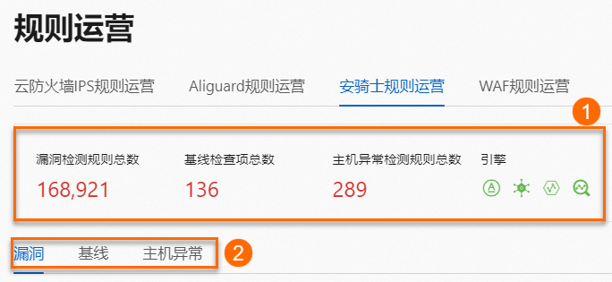

   | 项目 | 说明 |
   | --- | --- |
   | 总览（图示①） | 支持查看<strong>漏洞检测规则总数</strong>、<strong>基线检查项总数</strong>、<strong>主机异常检测规则总数</strong>、<strong>引擎</strong>信息。 |
   | 漏洞（图示②） | 在<strong>漏洞</strong>页签，查看检测到的所有漏洞及总数。 • 在搜索框选择漏洞类型、输入CVE编号、操作系统，可搜索对应漏洞。 • 在漏洞列表，查看检测到的漏洞的<strong>漏洞检测规则名称</strong>、<strong>CVE编号</strong>、<strong>操作系统</strong>、<strong>发布版</strong><strong>本</strong>、<strong>更新时间</strong>、<strong>上线时间</strong>、<strong>状态</strong>。 |
   | 基线（图示②） | 在<strong>基线</strong>页签，查看检测到的基线类型、基线检查项等数据。 • 在搜索框选择基线类型、风险等级、检查项类别、检查项名称，可搜索对应基线。 • 在基线列表，查看<strong>基线类型</strong>、<strong>检查项类别</strong>、<strong>检查项名称</strong>、<strong>风险等级</strong>、<strong>更新时间</strong>、<strong>状态</strong>。 |
   | 主机异常（图示②） | 在<strong>主机异常</strong>页签，查看<strong>规则告警类型数</strong>、<strong>WebShell&amp;恶意病毒（进程）</strong>信息。 • 在搜索框选择规则父类、风险等级、规则告警子类名称，可搜索对应主机异常事件。 • 在主机异常列表，查看<strong>子类名称</strong>、<strong>规则父类</strong>、<strong>风险等级</strong>、<strong>更新时间</strong>、<strong>来源</strong>、<strong>状态</strong>。 |

### 4.2.4. WAF规则运营

通过WAF规则运营，用户可以根据自身的业务需求和网络环境自定义WAF运营规则，监控WAF运营状态。本文介绍如何添加和管理WAF运营规则。

**操作步骤**

> **重要**
>
> 该运营规则为全局自定义规则，会对所有租户生效，请谨慎操作。

1. 登录Apsara Uni-manager运营控制台。

2. 在控制台右上方，单击**安全**，选择**全局平台安全 > 系统配置**。在**系统配置**授权页面，选择**地域**并单击**角色授权访问**。

3. 在左侧导航栏，单击**规则运营**。

4. 在**WAF规则运营**页签，单击**添加自定义规则**。完成如下配置后，单击**确定**。

   <table>
     <tr>
       <th width="121">配置项</th>
       <th>说明</th>
     </tr>
     <tr>
       <td>模式</td>
       <td>设置规则的处置模式和运行状态。 • 处置模式支持<strong>拦截</strong>、<strong>放行</strong>、<strong>观察</strong>、<strong>检测模块控制</strong>。 • 运行状态支持<strong>启用</strong>或<strong>禁用</strong>。</td>
     </tr>
     <tr>
       <td>备注</td>
       <td>填写规则的备注信息。</td>
     </tr>
     <tr>
       <td>威胁等级</td>
       <td>设置规则检测的威胁等级。可选项：<strong>无威胁</strong>、<strong>低危</strong>、<strong>中危</strong>、<strong>高危</strong>。</td>
     </tr>
     <tr>
       <td>匹配条件</td>
       <td>设置规则的<strong>匹配字段</strong>、<strong>逻辑符</strong>和<strong>匹配内容。</strong></td>
     </tr>
     <tr>
       <td>是否记录日志</td>
       <td>设置记录日志的场景。可选项： • 命中时记录 • 命中时不记录</td>
     </tr>
     <tr>
       <td>攻击类型</td>
       <td>选择规则检测的攻击类型。不支持多选。</td>
     </tr>
     <tr>
       <td>阻断状态码</td>
       <td>选择规则检测的阻断状态码。不支持多选。</td>
     </tr>
     <tr>
       <td>过期时间</td>
       <td>设置规则的过期时间。不设置时间表示规则永不过期。</td>
     </tr>
   </table>

   添加运营规则后，用户可以在规则列表，执行如下操作：

   - 通过规则列表上的筛选按钮，筛选需要查看的WAF运营规则。

   - 定位到某一规则，单击**操作**列中的**编辑**，您可以修改规则信息。

## 4.3. 告警设置

告警设置支持设置告警联系人和告警规则。当监控数据满足报警规则时，系统自动发送告警信息给报警联系人，支持钉钉消息和邮件。本文介绍如何添加和管理告警联系人。

**设置告警联系人**

1. 登录Apsara Uni-manager运营控制台。

2. 在控制台右上方，单击**安全**，选择**全局平台安全 > 系统配置**。在**系统配置**授权页面，选择**地域**并单击**角色授权访问**。

3. 在左侧导航栏，选择**告警设置 > 告警设置**页签。

4. 单击**添加联系人**。填写联系人姓名、钉钉机器人Token、邮箱、组织（支持多级组织维度）等，单击**确定**。

   添加后的联系人可以在联系人列表查看，支持**编辑**、**批量删除**。

**设置安骑士告警规则**

1. 登录Apsara Uni-manager运营控制台。

2. 在控制台右上方，单击**安全**，选择**全局平台安全 > 系统配置**。在**系统配置**授权页面，选择**地域**并单击**角色授权访问**。

3. 在左侧导航栏，选择**告警设置 > 告警设置**。

4. 在**安骑士**页签，设置要发送的告警规则后，单击**保存**。

   <table>
     <tr>
       <th>告警类型</th>
       <th>告警子类</th>
       <th>告警等级</th>
       <th>通知方式</th>
       <th>告警周期</th>
     </tr>
     <tr>
       <td>漏洞风险</td>
       <td>• Linux软件漏洞 • Windows系统漏洞 • Web-CMS漏洞 • 应用漏洞 • 应急漏洞</td>
       <td>• 低危 • 中危 • 高危</td>
       <td rowspan="6">• 邮箱 • 钉钉</td>
       <td rowspan="6">• 5分钟 • 10分钟 • 30分钟 • 1小时 • 1天 • 1周</td>
     </tr>
     <tr>
       <td>基线风险</td>
       <td>• 高风险利用 • 等保合规 • 最佳安全实践 • 弱口令</td>
       <td>• 低危 • 中危 • 高危</td>
     </tr>
     <tr>
       <td>资产暴露</td>
       <td>• 有漏洞暴露 • 无漏洞暴露</td>
       <td>全部</td>
     </tr>
     <tr>
       <td>入侵告警</td>
       <td>• 进程异常行为 • 网站后门 • 异常登录 • 异常事件 • 威胁情报 • 恶意进程(云查杀) • 异常网络连接 • 异常账号 • 应用入侵事件 • 云产品威胁检测 • 精准防御 • 恶意脚本 • 持久化后门 • 应用威胁检测</td>
       <td>• 低危 • 中危 • 高危</td>
     </tr>
     <tr>
       <td>应用白名单事件</td>
       <td>违规进程启动</td>
       <td>全部</td>
     </tr>
     <tr>
       <td>防篡改事件</td>
       <td>• 异常文件修改 • 异常文件添加 • 异常文件删除</td>
       <td>全部</td>
     </tr>
   </table>

## 4.4. 全局设置

### 4.4.1. 拦截策略设置

通过安全阻断功能，能够防御Web攻击和暴力破解。本文介绍如何启用应用攻击阻断和暴力破解阻断功能。

**操作步骤**

1. 登录Apsara Uni-manager运营控制台。

2. 在控制台右上方，单击**安全**，选择**全局平台安全 > 系统配置**。在**系统配置**授权页面，选择**地域**并单击**角色授权访问**。

3. 在左侧导航栏，单击**全局设置**。

4. 在**全局设置**页签，单击拦截类型操作列的开关，启用或关闭拦截策略。

   关闭后，相应的拦截功能将被禁用，仅提供预警功能。

## 4.5. 账号管理

### 4.5.1. 专有云账号管理

本文介绍如何查看、修改系统绑定的专有云账号信息。

> **重要**
>
> 云盾中的资产均与账号绑定，请谨慎修改。

**操作步骤**

1. 登录Apsara Uni-manager运营控制台。

2. 在控制台右上方，单击**安全**，选择**全局平台安全 > 系统配置**。在**系统配置**授权页面，选择**地域**并单击**角色授权访问**。

3. 在左侧导航栏，单击**账号管理**。

4. 在**专有云账号**页签，修改阿里云账号信息。

   <ol type="i">

   <li>

   定位到要修改的阿里云账号，单击**操作**列的**修改**。

   </li>

   <li>

   在**账号修改**对话框中，修改阿里云账号名、Access Key、Access Secret信息，单击**确定**。

   修改完成后，用户可以单击**操作**列的详情，查看阿里云账号详情。

   </li>

   </ol>

### 4.5.2. 公有云账号管理

通过在专有云中添加公有云账号，您可以在专有云中管理该公有云账号下已购买的高防IP和WAF，实现混合云功能。本文介绍如何添加公有云账号。

**操作步骤**

如果专有云中需要使用混合云功能，需要根据本文添加阿里云公有云账号。

1. 登录Apsara Uni-manager运营控制台。

2. 在控制台右上方，单击**安全**，选择**全局平台安全 > 系统配置**。在**系统配置**授权页面，选择**地域**并单击**角色授权访问**。

3. 在左侧导航栏，单击**账号管理**。

4. 在**公有云账号**页签，单击**添加**。

   在**账号添加**对话框，完成如下配置后，单击**确定**。

   | 配置项 | 说明 |
   | --- | --- |
   | Access Key | 设置要添加的公有云Access Key。 |
   | Access Secret | 设置要添加的公有云Access Secret。 |
   | 公有云产品 | 选择使用的公有云产品，支持<strong>高防IP</strong>和<strong>Web应用防护</strong>，可单选一个产品或全选。 |

   添加完成后，用户可以在账号列表查看已添加的公有云账号，支持**修改**和**删除**账号。

## 4.6. 迁移至Apsara Uni-manager运维控制台

### 4.6.1. 登录云盾运维中心

云盾运维中心是云盾产品的运营平台，可以实时监控云盾产品运行状态和业务状态，并将告警发送给用户。实时监控并根据介绍如何登录云盾运维中心。

**前提条件**

- 已从部署人员或管理员处获取Apsara Uni-manager运维控制台的访问地址、用户名和密码。

  Apsara Uni-manager运维控制台访问地址格式为*region-id*.ops.console.*intranet-domain-id*。

- 推荐使用Chrome浏览器。

**操作步骤**

1. 打开浏览器。

2. 在地址栏中，输入Apsara Uni-manager运维控制台的访问地址，按回车键。

   

   > **说明**
   >
   > 您可以单击右上角的当前语言切换其它语言。当前支持简体中文、English语言切换。

3. 输入正确的用户名及密码。

   > **说明**
   >
   > - 登录Apsara Uni-manager运维控制台的用户名和密码请从部署人员或管理员处获取。
   >
   > - 若连续输入密码错误三次，系统将启动图片验证码登录功能；若连续输入错误五次，账户将被锁定，请联系管理员进行激活。
   >
   > - 首次登录Apsara Uni-manager运维控制台时，需要修改登录用户名的密码，请按照提示完成密码修改。
   >
   >   为提高安全性，密码必须满足以下要求：
   >
   >   - 必须包含英文大小写字母。
   >
   >   - 必须包含阿拉伯数字（0~9）。
   >
   >   - 必须包含特殊符号，包括感叹号（!）、at（@）、井号（#）、美元符号（$）、百分号（%）等。
   >
   >   - 密码长度为10~20个字符。

4. 单击**同意协议并登录**。

5. 在Apsara Uni-manager运维控制台的顶部菜单栏，选择**产品运维 > 安全运维 > 云盾运维中心**。

**执行结果**

在**云盾运维中心**页面，您可以查看相关信息。

### 4.6.2. 系统监控

通过系统监控，用户可以监控已接入的云产品，及时发现异常产品，便于产品运维。本文介绍如何查看系统监控。

**操作步骤**

1. 登录云盾运维中心。

2. 在左侧导航栏，选择**监控告警** ＞ **系统监控**。

3. 在系统监控页面，查看监控总览和云产品监控数据。

   - 在**监控总览**页签，查看监控总览信息。

     - 监控数据总览：支持查看**监控产品总数**、**异常产品总数**、**监控项总数**、**异常项总数**等数据。

     - 云产品监控数据：支持查看所有已接入的云产品的**监控项数量**、**异常数**、**产品状态**数据。

   - 在云产品页签，查看各产品监控数据。

     支持监控的云产品包括：安骑士、SOC云安全管理中心、网络流量检测与响应、特权访问管理、租户侧堡垒机、漏洞扫描、容器安全、密钥管理服务（KMS）等。

- 支持监控的内容：

  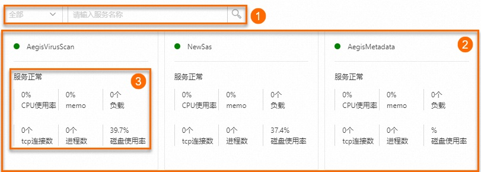

  - 单击云产品区域（图示②），查看云产品的所有服务。

  - 在云产品页签，用户可以通过服务列表上的搜索框（图示①），根据服务状态和服务名称，搜索对应服务。

  - 在服务卡片区域（图示③），查看CPU使用率、memo使用率、负载数、tcp连接数、进程数等数据。

  - 单击服务卡片区域（图示③），在服务详情页面，查看云产品服务监控详情。

    <table>
      <tr>
        <th width="90">监控项</th>
        <th>说明</th>
      </tr>
      <tr>
        <td>基础监控</td>
        <td>• 用户可以通过设置监控时间、监控视角，查看基础监控和中间件的详细监控数据。 • 监控时间：支持监控3小时、6小时、12小时、1天、2天、自定义时间段。 用户可以单击图标，手动刷新监控数据，也可以打开自动刷新开关，自动刷新监控数据。 • 监控视角：支持集群视角、单机视角。 • 支持查看的监控数据：CPU使用率（%）、memo（%）、负载（个）、tcp连接数（个）、进程数（个）或磁盘使用率（%）等数据。</td>
      </tr>
      <tr>
        <td>中间件</td>
        <td>• 用户可以通过设置监控时间、监控视角，查看基础监控和中间件的详细监控数据。 • 监控时间：支持监控3小时、6小时、12小时、1天、2天、自定义时间段。 用户可以单击图标，手动刷新监控数据，也可以打开自动刷新开关，自动刷新监控数据。 • 监控视角：支持集群视角、单机视角。 • 支持查看的监控数据：Metaq QPS、JVM Gc 次数、JVM Gc 耗时、JVM Memory、JVM Classloading、JVM Threadstate、JVM Threadcount、HSF QPS、HSF RT（ms）、数据库使用率（%）等数据。</td>
      </tr>
      <tr>
        <td>健康检查</td>
        <td>基于TCP、HTTP等探测方式，检查应用中所有主机的健康状态，以集群视角进行展示。</td>
      </tr>
    </table>

### 4.6.3. 全局设置

#### 4.6.3.1. 主机安全规则设置

1. 登录云盾运维中心。

2. 在左侧导航栏，选择**云产品管理 > 安骑士运维 > 全局设置**。

3. 在**主机安全规则设置**页签，配置全局暴破检测规则及高危命令审计静默阈值后，单击**保存并应用**。

   > **重要**
   >
   > 本规则修改后，会影响全局主机类资产的暴力破解检测规则，包括租户侧主机、平台侧物理机等。同时还会影响安骑士的攻击分析结果，请谨慎修改！

   <table>
     <tr>
       <th width="121">配置项</th>
       <th>说明</th>
     </tr>
     <tr>
       <td>主机暴力破解</td>
       <td>设置主机暴力破解的时间范围、登录失败次数。表示一定时间内，登录失败次数超过设置的阈值时，判断源IP正进行点对点暴力破解。</td>
     </tr>
     <tr>
       <td>批量异常登录</td>
       <td>设置批量异常登录的时间范围、固定账号登录的服务器数量。表示一定时间内，使用固定账号登录服务器的次数超过设置的阈值时，判断源IP正进行批量异常登录。</td>
     </tr>
     <tr>
       <td>可疑账户登录</td>
       <td>如远程登录账户在可疑账户清单内，则对此登录行为进行可疑账户登录告警。单击<strong>管理可疑账户清单</strong>，在可疑账户管理面板，手动输入可疑账号，或基于模板上传可疑账号清单，上传文件请确保大小限制在5 KB以下。由于Windows系统机制，输入Windows账户时请全部使用小写字母。</td>
     </tr>
     <tr>
       <td>高危命令审计</td>
       <td>您可以对高危命令审计规则的静默阈值进行设置。完成该设置后，该规则的告警数量到达该阈值后，将进入静默运行模式，不会产生更多告警，直至进入下一个周期后恢复。默认阈值：5分钟内同一规则触发超过100次。具体设置方法请参见《安全管理员指南》的<strong>安骑士运维 &gt; 全局设置 &gt; 主机安全规则设置</strong>章节。</td>
     </tr>
   </table>

#### 4.6.3.2. 白名单设置

1. 登录云盾运维中心。

2. 在左侧导航栏，选择**云产品管理 > 安骑士运维 > 全局设置**。

3. 在**白名单设置**页签，单击**添加**，在**添加白名单**对话框，完成如下配置后，单击**确定**。

   <table>
     <tr>
       <th width="76">配置项</th>
       <th>说明</th>
     </tr>
     <tr>
       <td>类型</td>
       <td>• <strong>全局登录白名单</strong>：符合此类型的白名单，安骑士将不会上报暴力破解事件和异常登录事件。 • <strong>暴力破解白名单</strong>：符合该类型的白名单，安骑士将不会上报暴力破解事件。</td>
     </tr>
     <tr>
       <td>源IP</td>
       <td>访问来源的IP或者IP段。</td>
     </tr>
     <tr>
       <td>目的IP</td>
       <td>访问目的IP或者IP段。类型选择为<strong>暴力破解白名单</strong>时，需配置该项。</td>
     </tr>
   </table>

   白名单添加成功后，支持**删除**不需要的白名单。

### 4.6.4. 升级中心

#### 4.6.4.1. 升级中心概述

升级中心通过自动和手动方式，对专有云云盾的特征库和版本进行升级等操作，确保专有云及时获取最新的安全保障。

升级时，用户可以按照如下步骤，进行升级：

1. 配置升级包导入方式。

   升级中心支持**在线自动导入**、**离线手动导入**。

   - 专有云环境和公网互通，可以选择**在线自动导入**升级包方式。

   - 专有云环境和公网不通，可以选择**离线手动导入**升级包方式。选择该种方式时，需要下载升级包。

2. 升级特征库、版本。具体操作，请参见升级特征库或版本。

#### 4.6.4.2. 升级特征库或版本

升级中心支持通过离线手动导入、在线自动导入升级包的方式，升级特征库或版本。本文介绍如何进行升级操作。

**操作步骤**

1. 登录云盾运维中心。

2. 在左侧导航栏，单击**升级中心**。

3. 在**升级配置**页签，配置升级包导入方式。

   - **离线手动导入**

     如果专有云环境无法与公网连通，可以通过离线手动导入升级包的方式更新特征库和版本。

     <ol type="a">

     <li>

     选择升级包导入方式为**离线手动导入**，单击**生成升级标识符**，下载升级包。

     </li>

     <li>

     单击上传导入升级包，将已下载的升级包拖动到上传虚拟框内，或单击  图标，上传升级包。

     > **说明**
     >
     > 上传升级包前，请先单击**手动导入离线升级包**对话框的网站链接，并信任此证书。

     升级包导入成功后，用户可在特征库和版本升级页面查看升级包，执行升级操作。

     </li>

     </ol>

   - **在线自动导入**

     如果专有云环境无法与公网连通，可以通过在线自动导入升级包的方式更新特征库和版本。

     > **说明**
     >
     > 导入提示：
     >
     > 1、需要云盾产品服务能够访问互联网。 2、申请或使用已有阿里云公有云账号（不建议使用个人账号），该账号将作为在线自动获取升级包的用户标识。 3、配置完成后，将自动获取云盾及相关规则库的最新升级包并自动导入，导入成功后，即可在特征库和版本更新页面查看升级包，执行升级操作。

     <ol type="a">

     <li>

     选择升级包导入方式为**在线自动导入**，完成如下配置。

     <table>
       <tr>
         <th width="138">配置项</th>
         <th>说明</th>
       </tr>
       <tr>
         <td>阿里云账号ID</td>
         <td>输入阿里云账号ID。</td>
       </tr>
       <tr>
         <td>Access Key</td>
         <td>输入Access Key。</td>
       </tr>
       <tr>
         <td>Access Secret</td>
         <td>输入Access Secret。</td>
       </tr>
       <tr>
         <td>自动升级时间段</td>
         <td>选择自动升级的时间段。支持选择： • 0~6时 • 0~8时 • 0~24时 • 22~6时</td>
       </tr>
       <tr>
         <td>SLB IP</td>
         <td>可以连接公网的SLB的IP地址。</td>
       </tr>
     </table>

     </li>

     <li>

     单击**连通性测试**。

     </li>

     </ol>

     <ol type="i" start="100">

     <li>

     无问题后，用户可以选择开启**自动更新**开关。

     启用**自动更新**后，系统能定期下载升级包。

     </li>

     </ol>

4. 特征库或版本升级。

   - **特征库升级**

     - 一键批量升级：在**特征库升级**页签，单击**一键升级**。

     - 单个云盾产品升级：在**特征库升级**页签，定位到需要升级的产品，单击**操作**列的**立即升级**。

     升级完成后，云盾产品对应的状态为**升级成功**。用户可以执行如下操作：

     - 如果升级失败，用户可以单击**操作**列的**升级记录**，定位到升级失败的特征库版本，单击操作列的**重试**。

     - 如果升级成功，用户可以执行如下操作：

       - 在**特征库升级**页签，单击**操作**列的**版本详情**，查看该产品已升级的特征库版本，**重新升级**特征库中的单个规则库。

       - 在**特征库升级**页签，单击**操作**列的**升级记录**，查看该产品已升级的特征库版本。

       - 在**特征库升级记录**面板，单击特征库版**操作**列的**详情**，查看特征库升级包详细信息。单击规则库名称**操作**列的**重新升级**，升级单个规格库。

   - **版本升级**

     - 一键批量升级：在**版本升级**页签，单击**一键升级**。

     - 单个云盾产品升级：在**版本升级**页签，定位到需要升级的产品，单击**操作**列的**立即升级**。

     升级完成后，云盾产品对应的状态为**升级成功**。

     - 如果升级失败，用户可以单击**操作**列的**升级记录**，定位到当前版本中，升级失败的特征库版本，单击操作列的**重试**。

     - 如果升级成功，用户可以执行如下操作：

       单击**操作**列的**升级记录**，查看该版本已升级成功的特征库版本，支持**重新升级**和**回滚**。
