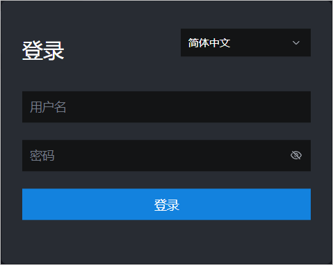
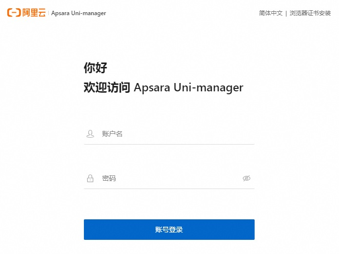
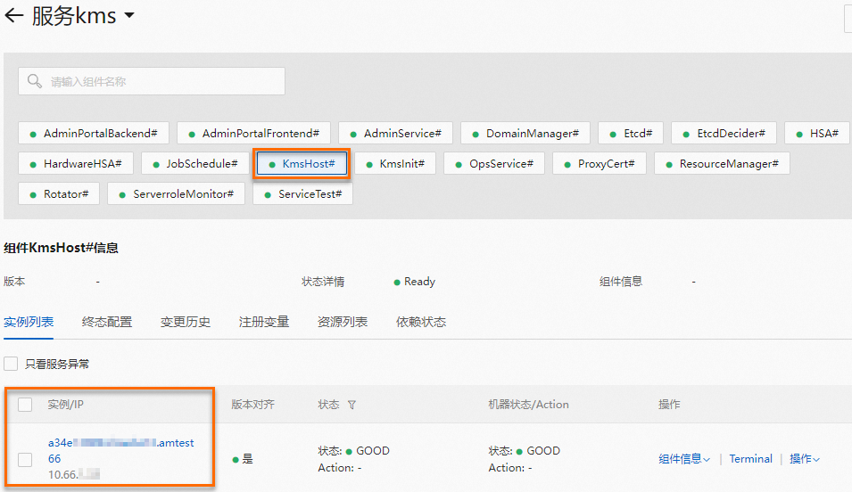
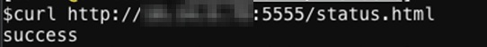
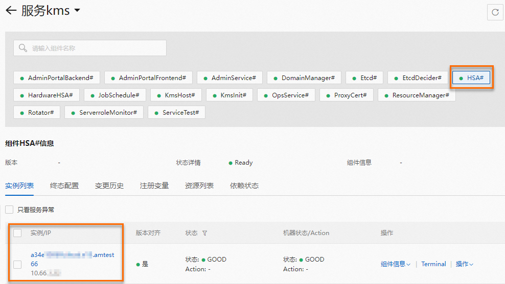
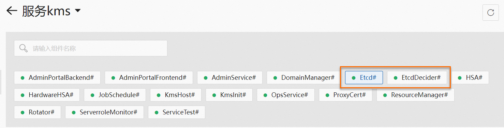
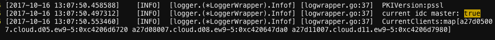
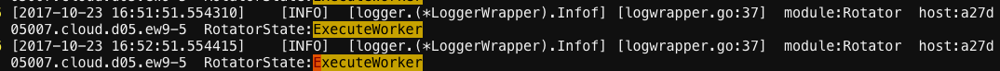
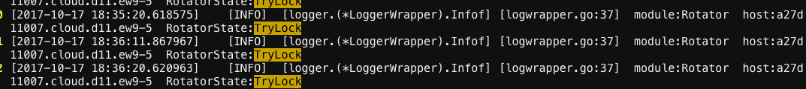
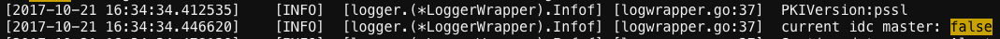

阿里云  
专有云  
密钥管理服务  
运维指南  
产品版本：V3.18.3  
文档版本：20250113

**目录**

- [1.登录KMS运维管理平台](#section-1)
- [2.配额管理](#section-2)
    - [2.1. 用户配额](#section-2-1)
    - [2.2. 流控管理](#section-2-2)
    - [2.3. 全局配额](#section-2-3)
- [3.日志分析](#section-3)
    - [3.1. 概述](#section-3-1)
    - [3.2. 查询安全审计日志](#section-3-2)
    - [3.3. 根据RequestID查看日志](#section-3-3)
    - [3.4. KMS常见的错误](#section-3-4)
        - [3.4.1. 概述](#section-3-4-1)
        - [3.4.2. 4XX错误](#section-3-4-2)
        - [3.4.3. 500错误](#section-3-4-3)
        - [3.4.4. 503错误](#section-3-4-4)
        - [3.4.5. 服务依赖降级](#section-3-4-5)
- [4.访问控制](#section-4)
    - [4.1. 管理读写权限校验开关](#section-4-1)
- [5.KMS组件运维](#section-5)
    - [5.1. 概述](#section-5-1)
    - [5.2. 登录飞天基础运维平台](#section-5-2)
    - [5.3. KMS_HOST](#section-5-3)
    - [5.4. HSA](#section-5-4)
    - [5.5. Etcd](#section-5-5)
    - [5.6. Rotator](#section-5-6)
        - [5.6.1. 主机房](#section-5-6-1)
        - [5.6.2. 备机房](#section-5-6-2)

# 1.登录KMS运维管理平台

本文为您介绍如何登录KMS运维管理平台。

**前提条件**

- 已从部署人员或管理员处获取Apsara Uni-manager运维控制台的访问地址、用户名和密码。

  Apsara Uni-manager运维控制台访问地址格式为${region}.ops.console.${intranet-domain}。

- 推荐使用Google Chrome浏览器。

**操作步骤**

1. 打开浏览器。

2. 在地址栏中，输入Apsara Uni-manager运维控制台的访问地址${region}.ops.console.${intranet-domain}，按回车键。

   

   > 您可以单击右上角的下拉列表来进行语言切换。
   >
   > **说明**

3. 输入正确的用户名及密码。

   首次登录Apsara Uni-manager运维控制台时，需要修改登录用户名的密码，请按照提示完成密码修改。

   为提高安全性，密码必须满足最小复杂度要求，即包含英文字母（A~Z、a~z）、数字（0~9）、特殊符号（！、@、#、$、% 等），并且密码长度为10~20位。

4. 单击**登录**，进入Apsara Uni-manager运维控制台。

5. 在顶部菜单栏，选择**产品运维 > 安全服务 > 安全运营中心运维云盾 > 云产品管理 > KMS运维**。

# 2.配额管理

## 2.1. 用户配额

本文为您介绍如何新建和修改用户配额。

**新建用户配额**

1. 登录云盾安全运营中心。

2. 在左侧导航栏，选择**云产品管理 > KMS运维 > 用户配额**。

3. 单击**新建用户配额**。

4. 在**新建用户配额**对话框，设置以下参数后，单击确认。

   | 配置项 | 说明 |
   | --- | --- |
   | 用户ID | 用户ID信息。 |
   | 密钥数配额 | 最大密钥配额数。 |

**修改用户配额**

1. 登录云盾安全运营中心。

2. 在左侧导航栏，选择**云产品管理 > KMS运维 > 用户配额**。

3. 定位到待修改配额的用户ID，单击**操作**列的**修改**。

4. 在**修改用户配额**对话框，设置以下参数后，单击确认。

   | 配置项 | 说明 |
   | --- | --- |
   | 密钥数配额 | 最大密钥配额数。 |
   | 别名数配额 | 最大别名数量。 |

## 2.2. 流控管理

本文为您介绍如何新建流控规则和修改流控信息。

**新建流控规则**

1. 登录云盾安全运营中心。

2. 在左侧导航栏，选择**云产品管理 > KMS运维 > 流控管理**。

3. 在**流控管理**页面，单击**新建流控规则**。

4. 在**新建流控规则**对话框，设置以下参数后，单击**OK**。

   <table>
     <tr>
       <th width="89">配置项</th>
       <th>说明</th>
     </tr>
     <tr>
       <td>资源</td>
       <td>资源名称。取值： • s：所有API共享。 • d：默认API。</td>
     </tr>
     <tr>
       <td>源</td>
       <td>申请表用户ID和服务ID的组合。取值： • d（默认值）：所有。 • d_d：默认用户ID和服务ID的组合。</td>
     </tr>
     <tr>
       <td>阈值</td>
       <td>限流阈值。</td>
     </tr>
     <tr>
       <td>流控策略</td>
       <td>• 单机整体限流：针对KMS API单个节点的整体限流。 • 单机令牌桶：针对单个用户限流。</td>
     </tr>
     <tr>
       <td>时间单位</td>
       <td>流控信息的时间单位。</td>
     </tr>
   </table>

**修改流控信息**

1. 登录云盾安全运营中心。

2. 在左侧导航栏，选择**云产品管理 > KMS运维 > 流控管理**。

3. 定位到目标资源，单击**资源**列的**修改**。

4. 在**修改流控信息**对话框，设置以下参数后，单击**确认**。

   <table>
     <tr>
       <th width="89">配置项</th>
       <th>说明</th>
     </tr>
     <tr>
       <td>阈值</td>
       <td>限流阈值。 说明您需要同时将资源为s、源为d和d_d的两条流控信息的阈值进行修改。</td>
     </tr>
     <tr>
       <td>流控策略</td>
       <td>• 单机整体限流：针对KMS API单个节点的整体限流。 • 单机令牌桶：针对单个用户限流。</td>
     </tr>
     <tr>
       <td>时间单位</td>
       <td>流控信息的时间单位。</td>
     </tr>
   </table>

## 2.3. 全局配额

本文为您介绍如何配置全局配额。

**操作步骤**

1. 登录KMS运维管理平台。

2. 在左侧导航栏，单击**全局配额**。可查看全局配额信息，全局配额只供查看不支持修改。

# 3.日志分析

## 3.1. 概述

当管理员需要对KMS过往的操作进行回溯时，可以进行安全审计。

安全审计是一项长期的安全管理活动，贯穿云服务使用的生命周期。安全审计功能收集系统安全相关数据，分析系统运行情况中的薄弱环节，并上报审计事件给管理员进行分析和改进，从而确保云服务的安全可靠。

> KMS的日志也会通过Logtail收集到SLS，再通过SLS的portal或API分析日志。如果SLS没有portal，则需要登录到KMS部署的机器，逐个机器查
>
> **说明**
>
> 看日志。

## 3.2. 查询安全审计日志

您可以登录云安全管理中心SOC，查询运维操作相关的原始日志和审计事件，以便快速定位系统故障。

**查询原始日志**

1. 登录云安全管理中心SOC。具体操作，请参见<strong>《用户指南》</strong>中<strong>《安全审计》</strong>章节的<strong>《登录云安全管理中心SOC》</strong>。

2. 在左侧导航栏，选择**运营管理 > 安全审计**。

3. 在**安全审计**页面，单击**原始日志**页签。

4. 在**原始日志**页签，设置查询条件，查询KMS在特定时间段的日志统计趋势和原始日志详情。

   <ol type="i">

   <li>

   将**审计类型**设置为**运维操作**。

   </li>

   <li>

   将**审计对象**设置为**KMS管控平台审计日志**。

   </li>

   <li>

   设置起始时间，然后单击**查询**。

   </li>

   </ol>

   > 如果您需要对比多个时间段的数据，可以设置不同时间段后，单击**新建查询**。KMS会生成不同时间段的查询页签。您可以单击页签在不同时间
   >
   > **说明**
   >
   > 段之间切换对比。

5. <strong>可选：</strong>单击**导出**，创建导出任务，然后单击**导出管理**，将原始日志下载到本地。

**查询审计事件**

1. 在左侧导航栏，选择**运营管理 > 安全审计**。

2. 在**安全审计**页面，单击**审计查询**页签。

3. 在**审计查询**页签，设置查询条件，查询KMS在特定时间段的审计日志统计趋势和审计事件详情。

   <ol type="i">

   <li>

   将**审计类型**设置为**运维操作**。

   </li>

   <li>

   将**审计对象**设置为**KMS管控平台审计日志**。

   </li>

   <li>

   设置操作类型、操作风险级别、是否告警、创建事件等筛选条件，然后单击**查询**。

   </li>

   </ol>

   > 您也可以单击**高级查询**，设置**过滤名称**、**发起者**、**目标**、**命令**、**结果**、**原因**等过滤条件。
   >
   > **说明**

4. <strong>可选：</strong>单击**导出**，创建导出任务，然后单击**导出管理**，将审计事件下载到本地。

**相关操作**

您还可以根据需求，查询审计汇总信息、管理日志源、管理审计规则、设置告警接收人、管理事件日志存档、管理导出任务和修改系统配置。

更多信息，请参见<strong>《用户指南》</strong>的<strong>《安全审计》</strong>章节。

## 3.3. 根据RequestID查看日志

KMS用户向KMS发送请求之后，会收到KMS的返回信息，返回信息中包含RequestID。本文为您介绍如何根据RequestID查看日志。

RequestID的使用场景如下：

- 通过/cloud/log/kms/KmsHost#/kms_host/audit.log查看KMS审计日志。

  可根据request_id的值查看本次访问的审计日志信息。

- 对于expected_code为非200的日志，可以在debug中进一步根据request_id查看错误信息。本地日志路径：/cloud/log/kms/KmsHost#/kms_host/debug.log

  > /cloud/log/kms/KmsHost#/kms_host/debug.log与audit.log在同一机器上。
  >
  > **说明**

- 需要知道一次完整的请求所经历的全部阶段，可通过trace日志查看详细的信息。本地日志路径：/cloud/log/kms/KmsHost#/kms_host/debug.log

  > /cloud/log/kms/KmsHost#/kms_host/debug.log与audit.log在同一机器上。
  >
  > **说明**

- 对于密码学相关API，可通过request_id关联到HSA的trace日志。本地日志路径：/cloud/log/kms/HSA#/hsa/trace.log

  > 此处/cloud/log/kms/KmsHost#/kms_host/trace.log不一定与audit.log在同一机器上。
  >
  > **说明**

- 根据其他信息检索日志。

  对于KMS的audit日志，可通过其他信息进行检索，但是关联到其他日志时，仍然需要request_id。

## 3.4. KMS常见的错误

### 3.4.1. 概述

KMS在审计日志（audit.log）中有两个HTTP StatusCode，一个是expected_code，另外一个是status_code。

通常情况下， `expected_code = status_code` ，但是也有例外。

status_code是最终返回给用户的HTTP StatusCode。

### 3.4.2. 4XX错误

KMS的4XX错误，通常都是符合KMS预期的一些错误，如：用户请求鉴权失败的403错误、用户输入参数错误的400错误等。

可根据request_id在debug中定位到具体的错误信息。

### 3.4.3. 500错误

500错误为KMS预期以外的错误，通常会是比较严重的错误，需要及时处理。

status_code为**500**的错误，通常情况下expected_code也是**500**。

可能是依赖服务发生了预期以外的错误，建议您及时联系相关的服务责任人排查问题。

可根据request_id在debug中定位到具体的错误信息。

### 3.4.4. 503错误

503错误通常是用户中断连接或KMS依赖服务异常引起的，建议您及时处理异常。

503错误主要包括以下两种情况：

- expected_code不是503，但是status_code是503的错误。错误原因如下：

  - 用户（client端）提前中断了连接。

  - KMS（server端）响应过慢，client端已经超时。

  您可以根据request_id在trace日志中判断是否是server端超时，并定位超时的模块。

- expected_code和status_code都是503的错误。

  这种错误通常是KMS的依赖服务发生了预料当中的错误，有可能是依赖服务不稳定。

  您可以根据request_id在debug中定位到具体的错误信息，建议您及时联系相关的服务负责人排查问题。

### 3.4.5. 服务依赖降级

KMS对依赖服务的数据有本地的缓存，在依赖服务不可用的情况下，KMS会采用缓存中的过期数据进行降级使用。

发生这种情况时，KMS的audit日志中status_code为200，但是会产生一条额外的debug日志。

同时，发生这种情况时，KMS可能看到的现象是部分用户访问正常（有缓存），而另一部分用户访问出现503错误（无缓存）。

# 4.访问控制

## 4.1. 管理读写权限校验开关

Apsara Uni-manager运维控制台负责进行统一的角色权限验证。读写权限校验开关默认为开启状态。您可以根据业务需要，关闭读写权限校验开关。

1. 登录KMS集群的机器。关于如何登录KMS集群的机器，请参见判断服务角色是否正常。

2. 访问读写权限校验开关配置路径 `/cloud/app/kms/AdminPortalBackend#/admin_portal_backend/current/conf.global/self/user/local/admin_portal_backend/oam_config.json` 。

3. 将KmsEnableRwPermission取值设置为true，开启读写权限校验开关。

   > **说明**
   >
   > - KmsEnableRwPermission取值为false表示关闭读写权限校验开关，即不进行读写权限校验。
   >
   > - 您需要为所有机器开启读写权限校验开关。

4. 重启AdminPortalBackend服务，确保配置变更生效。

   - 方式一：登录飞天基础运维平台，重启AdminPortalBackend。具体操作，请参见登录飞天基础运维平台。

   - 方式二：登录KMS集群的机器，关闭admin_portal_backend进程，飞天基础运维平台会自动重新启动该进程。

# 5.KMS组件运维

## 5.1. 概述

KMS的部署和运维都通过飞天基础运维平台进行。

可在飞天基础运维平台上通过**机器管理**快速登录到KMS所在的机器。

## 5.2. 登录飞天基础运维平台

本文为您介绍如何登录飞天基础运维平台。

**前提条件**

- 已从部署人员或管理员处获取Apsara Uni-manager运维控制台的访问地址、用户名和密码。

  Apsara Uni-manager运维控制台访问地址格式为${region}.*ops*.console.*intranet-domain-id*.com。

- 推荐使用Google Chrome浏览器。

**操作步骤**

1. 打开浏览器。

2. 在地址栏中，输入Apsara Uni-manager运维控制台的访问地址，按回车键。

   

   > **说明**
   >
   > 您可以单击右上角的当前语言切换其它语言。当前支持简体中文、英文、繁体中文三种语言切换。

3. 输入正确的用户名及密码。

   > **说明**
   >
   > 登录Apsara Uni-manager运维控制台的用户名和密码请从部署人员或管理员处获取。

   首次登录Apsara Uni-manager运维控制台时，需要修改登录用户名的密码，请按照提示完成密码修改。

   为提高安全性，密码必须满足最小复杂度要求，即包含英文大小写字母（A~Z、a~z）、数字（0~9）、特殊符号（！、@、#、$、% 等），并且密码长度为10~20位。

4. 单击**登录**，进入Apsara Uni-manager运维控制台。

5. 在Apsara Uni-manager运维控制台的顶部菜单栏，选择**产品运维 > 底座/云平台 > 飞天基础运维平台**。

## 5.3. KMS_HOST

本文为您介绍如何检查KMS_HOST的运行状态。

**判断服务角色是否正常**

1. 在Apsara Uni-manager运维控制台的顶部菜单栏，选择**产品运维底座/云平台飞天基础运维平台**。

2. 在**产品列表**区域，找到KMS的集群。

3. 单击集群**操作**列的**集群详情**。

4. 在**服务列表**页签，单击**kms**，在服务详情页面，查看KMS_HOST服务角色是否到达终态。

   如果<strong>KmsHost#</strong>前面小圆点为绿色，则表示其已达到终态。

5. 单击**KmsHost#**，查看并获取KMS_HOST的所有机器IP。

   

6. 选择一台机器，单击右侧操作列的**Terminal**，登录到机器。

7. 使用 `curl http://ip:5555/status.html` ，确认是否均返回**success**。

   

   > **说明**
   >
   > - IP为步骤6获取到的IP。
   >
   > - 按照此方法，对所有部署KMS_HOST的机器进行验证。

**异常定位与判断**

1. 查看/cloud/log/kms/KmsHost#/kms_host下的相关日志。

2. 确认KMS_HOST是否正常运行。

   - 如果KMS_HOST无法正常运行，即启动后很快退出，需要观察debug.log定位具体问题。

   - 如果KMS_HOST正常运行，但是功能不正常，需要查看status.log定位具体问题。

**可能的异常与错误**

| 错误提示 | 解决办法 |
| --- | --- |
| <code>xxx selfCheck error</code> 说明<em>xxx</em>指某个依赖服务。 | • 检查对应的依赖配置是否正确（可以通过debug.log定位）。 • 检查xxx服务是否正常运行。 |
| <code>exit code 1</code> | 根据debug.log查看异常退出的原因。 |

## 5.4. HSA

本文为您介绍如何检查HSA的运行状态。

**判断服务角色是否正常**

1. 在Apsara Uni-manager运维控制台的顶部菜单栏，选择**产品运维底座/云平台飞天基础运维平台**。

2. 在左侧导航栏，单击**产品集群运维**。

3. 在**产品列表**区域，找到KMS的集群。

4. 单击集群**操作**列的**集群详情**。

5. 在**服务列表**页签，单击**kms**，在服务详情页面，查看HSA服务角色是否到达终态。

   如果<strong>HSA#</strong>前面小圆点为绿色，则表示其已达到终态。

6. 单击**HSA#**，查看并获取HSA的所有机器IP。

   

7. 选择一台机器，单击右侧操作列的**Terminal**，登录到机器。

8. 使用 `curl http://ip:5555/status.html` ，确认是否均返回**success**。

   

   > **说明**
   >
   > - IP为步骤6获取到的IP。
   >
   > - 按照此方法，对所有部署HSA服务的机器进行验证。

**异常定位与判断**

1. 查看/cloud/log/kms/HSA#/hsa下的相关日志。

2. 确认HSA是否正常运行。

   - 如果HSA无法正常运行，即启动后很快退出，需要观察debug.log定位具体问题。

   - 如果HSA正常运行，但是功能不正常，需要查看status.log定位具体问题。

**可能的异常与错误**

问题： `exit code 1`

解决方法：根据debug.log查看异常退出的原因。常见原因如下：

- ETCD没有正常启动。

- ETCD正常启动，但是没有正确的数据。

  > **说明**
  >
  > 灾备场景下，备集群数据同步异常会出现该问题。

## 5.5. Etcd

本文为您介绍如何检查Etcd的运行状态。

**判断服务角色是否正常**

在飞天基础运维平台上分别观察Etcd和EtcdDecider是否到达终态。

1. 在Apsara Uni-manager运维控制台的顶部菜单栏，选择**产品运维底座/云平台飞天基础运维平台**。

2. 在左侧导航栏，单击**产品集群运维**。

3. 在**产品列表**区域，找到KMS的集群。

4. 单击集群**操作**列的**集群详情**。

5. 在**服务列表**页签，单击**kms**，在服务详情页面，查看Etcd和EtcdDecider服务角色是否到达终态。

   如果<strong>Etcd#</strong>和<strong>EtcdDecider#</strong>前面小圆点为绿色，则表示其已达到终态。

   

**异常定位与判断**

Etcd异常情况较复杂，需要通过/cloud/log/kms/Etcd#/etcd和/cloud/log/kms/EtcdDecider#/decider的日志进行分析。

**可能的异常与错误**

| 异常情况 | 解决办法 |
| --- | --- |
| Etcd启动参数计算不正确。 | 通过Etcd的debug.log，找到历史日志中正常的启动参数，手动启动Etcd。 说明请保留现场日志，联系技术支持人员定位具体原因。 |
| 在服务升级等过程中，EtcdDecider异常导致Etcd不正确。 | 通常发生在有回滚任务时，根据EtcdDecider的debug.log具体分析定位原因。 |
| Etcd数据目录丢失，Etcd无法正常启动。 | 将异常的Etcd节点先通过飞天基础运维平台缩容，完成后再进行扩容。 |

## 5.6. Rotator

### 5.6.1. 主机房

本文将指导您检查主机房Rotator的运行状态。

Rotator情况比较特殊，通过飞天基础运维平台观察到服务角色在终态，不代表其一定在正常工作。

Rotator不正常工作，对KMS的API逻辑不会造成影响。

通常只有发现预期以外的结果后（例如：RDS中数据不符合预期），再通过日志定位Rotator的错误原因。

**判断是否以主机房模式启动**

根据/cloud/log/kms/Rotator#/rotator/debug.log查看 `current idc master` ，如下图所示，判断主机房的Rotator是否以主机房模式启动。

`current idc master` 为**true**，则表示是以主机房模式启动； `current idc master` 为**false**，则表示以备机房模式启动。

**判断是否处于工作状态**

主机房的Rotator会在所有的节点部署，但是会通过分布式锁的方式，只有一个节点处于工作状态，其余处于待命状态。

根据/cloud/log/kms/Rotator#/rotator/status.log，判断其是否处于工作状态。

如工作状态和待命状态所示，其中：

- ExecuteWorker：表示该节点处于工作状态。

- TryLock：表示该节点处于待命状态。

  图 1. 工作状态

  

  图 2. 待命状态

  

**可能的异常与错误**

- RDS数据库访问异常，统计与密钥删除任务不能正常工作。

- HSA异常，密钥轮转任务不能正常工作。

- SLS服务异常，计量任务不能正常工作。

- ETCD异常，无法获取分布式锁，不会执行任务。

- Rotator的某个任务异常，可能会导致Rotator无法到达终态，也可能会让Rotator的飞天基础运维平台状态仍然是终态。

### 5.6.2. 备机房

本文将指导您检查备机房Rotator的运行状态。

备机房的Rotator会在所有的节点部署，并且所有的节点都处于工作状态，各节点工作的内容在一定时间范围内是幂等的。

**判断是否以备机房模式启动**

根据/cloud/log/kms/Rotator#/rotator/debug.log查看 `current idc master` ，如下图所示，判断备机房的Rotator是否以备机房模式启动。

`current idc master` 为**false**，则表示以备机房模式启动； `current idc master` 为**true**，则表示是以主机房模式启动。

**可能的异常与错误**

- 主机房网络异常，无法正常访问主机房ETCD。

- 主机房ETCD异常，无法正常访问主机房ETCD。

- 备机房ETCD异常，数据无法写入。

- 主机房ETCD信息错误，导致数据同步异常。

> 备机房的Rotator异常会对备机房的KMS产生严重的影响，需要及时定位并修复。
>
> **重要**
