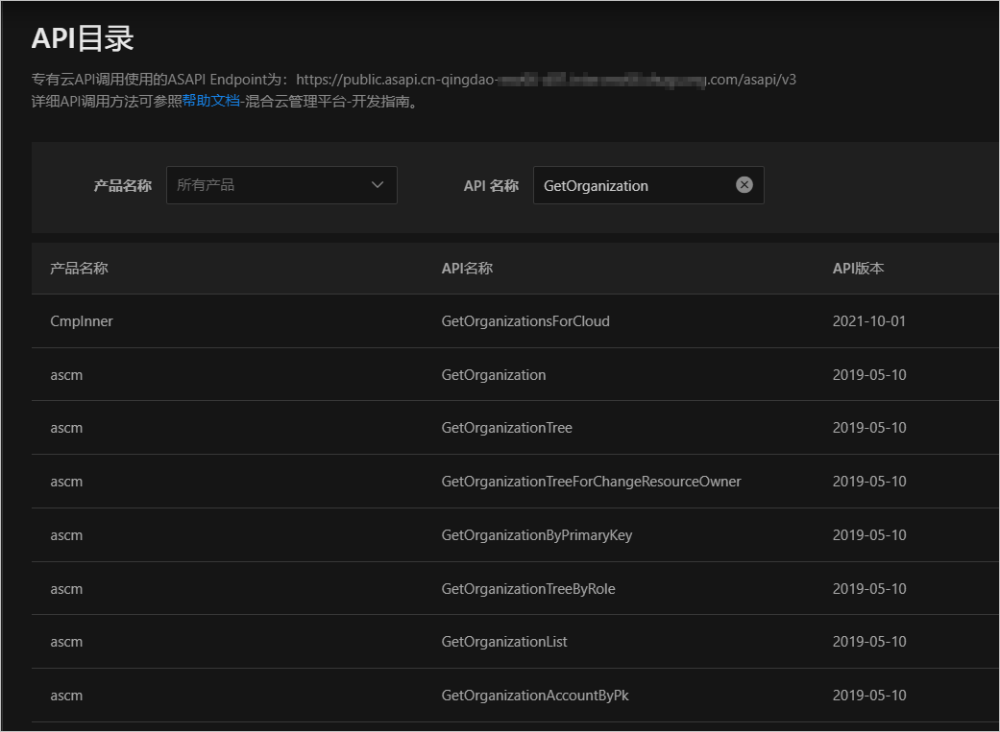
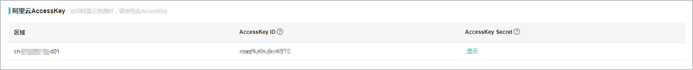

阿里云  
专有云  
密钥管理服务  
密钥管理服务 开发指南  
产品版本：V3.18.6  
文档版本：20251030

**目录**

- [1.准备工作](#section-1)
    - [1.1. 登录API与工具控制台](#section-1-1)
    - [1.2. 查看API信息](#section-1-2)
    - [1.3. 获取AccessKey](#section-1-3)
    - [1.4. 获取STS AccessKey](#section-1-4)
    - [1.5. 获取公共Header参数](#section-1-5)
    - [1.6. 获取KMS的SDK](#section-1-6)
- [2.KMS SDK for Java调用示例](#section-2)
    - [2.1. 使用手册](#section-2-1)
        - [2.1.1. 安装KMS SDK for Java](#section-2-1-1)
        - [2.1.2. 设置身份验证凭证](#section-2-1-2)
        - [2.1.3. 请求连接配置](#section-2-1-3)
        - [2.1.4. 调用KMS SDK for Java](#section-2-1-4)
        - [2.1.5. 错误处理](#section-2-1-5)
        - [2.1.6. 使用CommonRequest调用OpenAPI接口](#section-2-1-6)
- [3.KMS SDK for Python调用示例](#section-3)
    - [3.1. 使用手册](#section-3-1)
        - [3.1.1. 安装KMS SDK for Python](#section-3-1-1)
        - [3.1.2. 设置身份验证凭证](#section-3-1-2)
        - [3.1.3. 设置HTTPS请求](#section-3-1-3)
        - [3.1.4. 调用KMS SDK for Python](#section-3-1-4)
        - [3.1.5. 错误处理](#section-3-1-5)
        - [3.1.6. 使用CommonRequest调用OpenAPI接口](#section-3-1-6)
- [4.KMS SDK for Go调用示例](#section-4)
    - [4.1. 使用手册](#section-4-1)
        - [4.1.1. 安装Go SDK核心包](#section-4-1-1)
        - [4.1.2. 设置身份验证凭证](#section-4-1-2)
        - [4.1.3. 调用KMS SDK for Go](#section-4-1-3)
        - [4.1.4. 错误处理](#section-4-1-4)
        - [4.1.5. 使用CommonRequest调用OpenAPI接口](#section-4-1-5)
- [5.API参考](#section-5)
    - [5.1. KMS - KMS_API参考](#section-5-1)
        - [5.1.1. 调用方式](#section-5-1-1)
            - [5.1.1.1. 请求结构](#section-5-1-1-1)
            - [5.1.1.2. 公共参数](#section-5-1-1-2)
            - [5.1.1.3. 签名机制](#section-5-1-1-3)
            - [5.1.1.4. 返回结果](#section-5-1-1-4)
        - [5.1.2. API列表](#section-5-1-2)
            - [5.1.2.1. 标签](#section-5-1-2-1)
                - [5.1.2.1.1. TagResource](#section-5-1-2-1-1)
                - [5.1.2.1.2. ListResourceTags](#section-5-1-2-1-2)
                - [5.1.2.1.3. UntagResource](#section-5-1-2-1-3)
            - [5.1.2.2. 密钥](#section-5-1-2-2)
                - [5.1.2.2.1. GenerateAndExportDataKey](#section-5-1-2-2-1)
                - [5.1.2.2.2. ExportDataKey](#section-5-1-2-2-2)
                - [5.1.2.2.3. CreateKey](#section-5-1-2-2-3)
                - [5.1.2.2.4. GetParametersForImport](#section-5-1-2-2-4)
                - [5.1.2.2.5. ImportKeyMaterial](#section-5-1-2-2-5)
                - [5.1.2.2.6. EnableKey](#section-5-1-2-2-6)
                - [5.1.2.2.7. DisableKey](#section-5-1-2-2-7)
                - [5.1.2.2.8. ScheduleKeyDeletion](#section-5-1-2-2-8)
                - [5.1.2.2.9. DeleteKeyMaterial](#section-5-1-2-2-9)
                - [5.1.2.2.10. DescribeKey](#section-5-1-2-2-10)
                - [5.1.2.2.11. UpdateKeyDescription](#section-5-1-2-2-11)
                - [5.1.2.2.12. ListKeys](#section-5-1-2-2-12)
                - [5.1.2.2.13. CancelKeyDeletion](#section-5-1-2-2-13)
                - [5.1.2.2.14. ReEncrypt](#section-5-1-2-2-14)
                - [5.1.2.2.15. Encrypt](#section-5-1-2-2-15)
                - [5.1.2.2.16. GenerateDataKey](#section-5-1-2-2-16)
                - [5.1.2.2.17. GenerateDataKeyWithoutPlaintext](#section-5-1-2-2-17)
                - [5.1.2.2.18. Decrypt](#section-5-1-2-2-18)
                - [5.1.2.2.19. CreateAlias](#section-5-1-2-2-19)
                - [5.1.2.2.20. UpdateAlias](#section-5-1-2-2-20)
                - [5.1.2.2.21. DeleteAlias](#section-5-1-2-2-21)
                - [5.1.2.2.22. ListAliases](#section-5-1-2-2-22)
                - [5.1.2.2.23. ListAliasesByKeyId](#section-5-1-2-2-23)
                - [5.1.2.2.24. DescribeRegions](#section-5-1-2-2-24)
                - [5.1.2.2.25. CreateKeyVersion](#section-5-1-2-2-25)
                - [5.1.2.2.26. DescribeKeyVersion](#section-5-1-2-2-26)
                - [5.1.2.2.27. ListKeyVersions](#section-5-1-2-2-27)
                - [5.1.2.2.28. UpdateRotationPolicy](#section-5-1-2-2-28)
                - [5.1.2.2.29. AsymmetricDecrypt](#section-5-1-2-2-29)
                - [5.1.2.2.30. AsymmetricEncrypt](#section-5-1-2-2-30)
                - [5.1.2.2.31. AsymmetricSign](#section-5-1-2-2-31)
                - [5.1.2.2.32. AsymmetricVerify](#section-5-1-2-2-32)
                - [5.1.2.2.33. GetPublicKey](#section-5-1-2-2-33)
- [6.附录](#section-6)
    - [6.1. STS概要](#section-6-1)
        - [6.1.1. 什么是STS](#section-6-1-1)
        - [6.1.2. AssumeRole](#section-6-1-2)

<a id="section-1"></a>

# 1.准备工作

<a id="section-1-1"></a>

## 1.1. 登录API与工具控制台

您可以通过Apsara Uni-manager运营控制台登录API与工具控制台。

**前提条件**

- 登录Apsara Uni-manager运营控制台前，确认您已从部署人员处获取Apsara Uni-manager运营控制台的服务域名地址。

- 推荐使用Chrome浏览器。

**操作步骤**

1. 在浏览器地址栏中，输入Apsara Uni-manager运营控制台的服务域名地址，按回车键。

   

   > **说明**
   >
   > - 单击页面右上角的当前语言可以切换其它语言。
   >
   > - 授权登录是第三方认证中配置了全局IdP设置才会显示，且“授权登录”名称用户可按需自定义。
   >
   > - 由于浏览器证书过期或环境开启HTTPS认证等出现多次单击继续访问或无Apsara Uni-manager运营控制台地址入口等现象，此时需要安装证书才能正常访问。单击页面右上角的**浏览器证书安装**，可打开浏览器证书安装指南。

2. 输入正确的用户名及密码。

   > **说明**
   >
   > - 请向运营管理员获取登录控制台的用户名和密码。
   >
   > - 首次登录Apsara Uni-manager运营控制台时，需要修改登录用户名的密码，请按照提示完成密码修改。为提高安全性，密码长度必须为10~32位，且包含英文字母大小写、阿拉伯数字和特殊符号（感叹号（!）、at（@）、井号（#）、美元符号（$）、百分号（%）等）。

3. 单击**账号登录**。

4. 

5. 在页面顶部的菜单栏中，选择**产品 > 其他 > API与工具**。

<a id="section-1-2"></a>

## 1.2. 查看API信息

您需要获取产品名称、API名称和API版本，使用SDK时需要填写这些信息。

**背景信息**

API目录中的API仅供调用参考，具体API的使用方式需要参见云产品的开发指南。如果发生不一致情况，以开发指南支持情况为准。

**操作步骤**

1. 登录API与工具控制台。

2. 在左侧导航栏中选择**API目录**。

3. 在**API目录**页面，在下拉列表框中选择对应的产品，输入API名称的关键词进行搜索。

   

4. 查看并记录对应的产品名称、API名称和API版本。

<a id="section-1-3"></a>

## 1.3. 获取AccessKey

访问身份验证中通过使用AccessKey ID和AccessKey Secret对称加密的方法来验证某个请求的发送者身份。AccessKey ID用于标示用户，AccessKey Secret是用户用于加密签名字符串。本章节将为您描述如何获取AccessKey。

**前提条件**

只有运营管理员和一级组织管理员可以获取组织AccessKey。

**获取组织AccessKey**

获取组织AccessKey的方法如下：

1. 管理员登录Apsara Uni-manager控制台。

2. 在页面顶部菜单栏上，单击**企业**。

3. 在**企业**页面的左侧导航栏中，单击**组织管理**。

4. 在组织结构中，单击要添加的上级组织后面的  。

5. 在弹出的下拉菜单中，选择**获取accesskey**。

6. 在弹出的对话框中，查看组织Accesskey信息。

   > 一级组织的AccessKey为系统自动分配，下级组织使用一级组织的AccessKey。
   >
   > **说明**

**获取个人账号AccessKey**

获取个人账号AccessKey的方法如下：

1. 管理员登录Apsara Uni-manager控制台。

2. 在系统界面右上角，单击当前登录用户的头像，选择**个人信息**。

3. 在**阿里云AccessKey**模块，您可以查看个人账户的AccessKey信息。

   

   > Accesskey ID和AccessKey Secret是您访问云资源时的密钥，具有该账号完整的权
   >
   > **说明**
   >
   > 限，请您妥善保管。

<a id="section-1-4"></a>

## 1.4. 获取STS AccessKey

本文为您介绍如何利用STS方式，调用专有云的产品API。

**背景信息**

阿里云临时安全令牌STS（Security Token Service）是阿里云提供的一种临时访问权限管理服务。您可以选择使用STS方式，调用专有云的产品API。

STS AccessKey由AccessKey ID、AccessKey Secret及SecurityToken三元组组成，使用STS方式调用云产品API时，三元组缺一不可。更多STS内容请参见《通用内容-开发指南》中的《STS概要》章节。

**操作步骤**

1. 获取用户角色的 `RAM Role` 。

   <ol type="i">

   <li>

   登录Apsara Uni-manager运营控制台。

   </li>

   <li>

   单击页面右上角的用户头像，单击**个人信息**。

   </li>

   <li>

   单击**查看当前角色策略**。

   在**当前选择角色策略**对话框中查看 `RAM Role` 。

   </li>

   </ol>

2. 获取STS Accesskey三元组。

   > **说明**
   >
   > 以下代码示例中可变参数均需替换为您实际的相关信息，尖括号（<>）在最终代码中不保留。
   >
   > 涉及替换的可变参数如下：
   >
   > - &lt;yourRegionID>，请替换为您实际的地域ID。
   >
   > - &lt;yourAccessKeyID>，请替换为您实际的AccessKey ID。
   >
   > - &lt;yourAccessKeySecret>，请替换为您实际的AccessKey Secret。
   >
   > - &lt;yourRoleSessionName>，请替换为您当前实际的会话名称。
   >
   > - &lt;yourRoleArn>，请替换为您实际的RAM Role。
   >
   > - "sts.aliyuns.com" ，请替换为实际的STS Endpoint。

   ```xml
   public static void main(String[] args) {
       // 创建DefaultAcsClient实例并初始化。
       // 请替换为您实际的地域ID、AccessKey ID、AccessKey Secret
       DefaultProfile profile = DefaultProfile.getProfile("<yourRegionID>", "
   <yourAccessKeyID>", "<yourAccessKeySecret>");
       HttpClientConfig clientConfig = HttpClientConfig.getDefault();
       clientConfig.setIgnoreSSLCerts(true);
       clientConfig.setProtocolType(ProtocolType.HTTPS);
       profile.setHttpClientConfig(clientConfig);
       IAcsClient client = new DefaultAcsClient(profile);
       String assumeRole = callAssumeRole(client);
       if (StringUtils.isEmpty(assumeRole)) return;
       JSONObject assumeRoleJson = JSONObject.parseObject(assumeRole);
       JSONObject credentials = assumeRoleJson.getJSONObject("Credentials");
       // 获取到STS三元组
       String stsAK = credentials.getString("AccessKeyId");
       String stsSK = credentials.getString("AccessKeySecret");
       String stsToken = credentials.getString("SecurityToken");
   }

   private static String callAssumeRole(IAcsClient client) {
       CommonRequest request = new CommonRequest();
       // "sts.aliyuns.com" 请替换为实际的STS Endpoint，⼀般格式为sts-
   vpc.${global:region}.${global:internet-domain}
       request.setSysDomain("sts.aliyuns.com");
       request.setSysProduct("Sts");
       request.setSysAction("AssumeRole");
       request.setSysVersion("2015-04-01");
       request.setSysMethod(MethodType.POST);
       request.setHttpContentType(FormatType.FORM);
       // 业务参数，设置本次调⽤Session的别名，"<yourRoleSessionName>"请您替换为实际值
       request.putQueryParameter("RoleSessionName", "<yourRoleSessionName>");
       // 扮演的Role⾓⾊ARN，"<yourRoleArn>"请替换为上⼀步获取到的实际Ram Role ARN
       request.putQueryParameter("RoleArn", "<yourRoleArn>");
       try {
           CommonResponse response = client.getCommonResponse(request);
           return response.getData();
       } catch (ServerException e) {
           System.out.println(e.getErrCode());
           System.out.println(e.getErrMsg());
       } catch (ClientException e) {
           System.out.println(e.getErrCode());
           System.out.println(e.getErrMsg());
       }
       return null;
   }
   ```

3. 通过STS AccessKey三元组调用云产品的接口，下列代码以ECS的 `DescribeZones` 接口为示例。*请各云产品替换为自己产品的示例。*

   > **说明**
   >
   > 以下代码示例中可变参数均需替换为您实际的相关信息，尖括号（<>）在最终代码中不保留。
   >
   > 涉及替换的可变参数如下：
   >
   > - &lt;yourRegionID>，请替换为您实际的地域ID。
   >
   > - &lt;yourStsAccesskeyID>,请替换为您实际的STS Accesskey ID。
   >
   > - &lt;yourStsAccessKeySecret>，请替换为您实际的STS Accesskey Secret。
   >
   > - &lt;yourStsToken>，请替换为实际STS三元组中的SecurityToken。
   >
   > - &lt;yourResourceGroupID>，请替换为您实际的资源集ID。
   >
   > - &lt;yourOrganizationID>请替换为您实际的组织ID。

   ```xml
   public static void main(String[] args) {
       // "<yourRegionID>"请替换为您实际的地域ID
       // "<yourStsAccessKeyID>", "<yourStsAccessKeySecret>"请替换为前⼀步获取到的STS三元组中
   AccessKeyID、AccessKeySecret
       DefaultProfile profile = DefaultProfile.getProfile("<yourRegionID>", "
   <yourStsAccesskey>", "<yourStsAccessSecret>");
       HttpClientConfig clientConfig = HttpClientConfig.getDefault();
       clientConfig.setIgnoreSSLCerts(true);
       clientConfig.setProtocolType(ProtocolType.HTTPS);
       profile.setHttpClientConfig(clientConfig);
       IAcsClient client = new DefaultAcsClient(profile);
       CommonRequest request = new CommonRequest();
       request.setSysDomain("ecs.aliyuns.com");
       request.setSysProduct("ECS");
       request.setSysAction("DescribeZones");
       request.setSysVersion("2014-05-26");
       request.setSysMethod(MethodType.POST);
       request.setHttpContentType(FormatType.FORM);
       //"<yourRegionID>" 请替换为您实际的地域ID
       request.putHeadParameter("x-acs-regionid", "<yourRegionID>");
       // "<yourStsToken>" 请替换为您前⼀步获取到的STS三元组中SecurityToken
       request.putQueryParameter("SecurityToken", "<yourStsToken>");
       // 非必填,请替换为您实际的资源集ID
       // request.putHeadParameter("x-acs-resourcegroupid", "<yourResourceGroupID>");
       // 必填,请替换为您实际的组织ID
       request.putHeadParameter("x-acs-organizationid", "<yourOrganizationID>");
       try {
           CommonResponse response = client.getCommonResponse(request);
           System.out.println(response.getData());
       } catch (ServerException e) {
           System.out.println(e.getErrCode());
           System.out.println(e.getErrMsg());
       } catch (ClientException e) {
           System.out.println(e.getErrCode());
           System.out.println(e.getErrMsg());
       }
   }
   ```

<a id="section-1-5"></a>

## 1.5. 获取公共Header参数

调用API时需要提供多个Header参数。本文为您介绍如何获取这些参数。并对调用后的一些返回值做出解释。

**获取Region ID**

1. 管理员登录Apsara Uni-manager运营控制台。

2. 在顶部菜单栏中，单击**企业**。

3. 在左侧导航栏中，选择**资源管理**>**地域管理**。

4. 单击目标组织名称。

5. 在右侧**Region列表**中查看Region ID。

**获取组织ID**

组织ID需要通过API进行获取，获取方式请参见*Apsara Uni-manager运营控制台开发指南*中的章节*GetOrganizationList*。

**获取资源集ID**

资源集ID需要通过API进行获取，获取方式请参见*Apsara Uni-manager运营控制台开发指南*中的章节*ListResourceGroup*。

**获取实例ID**

实例ID可以通过Apsara Uni-manager运营控制台中的云产品实例列表进行获取，本文中以API网关为例，获取步骤如下：

1. 登录Apsara Uni-manager运营控制台。

2. 在顶部的菜单栏中，选择**产品**>应用服务>API网关。

3. 在左侧导航栏中，单击**实例**。

4. 在实例列表中查看**实例ID**。

**返回参数**

对于列表类的云产品资源实例接口，调用后会默认增加如下返回值。

| 名称 | 描述 |
| --- | --- |
| ResourceGroupName | 资源集名称。 |
| ResourceGroup | 资源集ID。 |
| DepartmentName | 组织名称。 |
| Department | 组织ID。 |

<a id="section-1-6"></a>

## 1.6. 获取KMS的SDK

通过POP网关调用专有云API时，需使用KMS的阿里云开发工具包（SDK）。本文为您介绍如何获取KMS的SDK。

| Alibaba Cloud SDK | KMS SDK |
| --- | --- |
| Alibaba Cloud SDK for Java | Alibaba Cloud KMS SDK for Java |
| Alibaba Cloud SDK for Python | Alibaba Cloud KMS SDK for Python |
| Alibaba Cloud SDK for Go | Alibaba Cloud KMS SDK for Go |

<a id="section-2"></a>

# 2.KMS SDK for Java调用示例

<a id="section-2-1"></a>

## 2.1. 使用手册

<a id="section-2-1-1"></a>

### 2.1.1. 安装KMS SDK for Java

安装KMS SDK for Java时，您需要先获取KMS SDK for Java，然后添加Maven依赖。

**步骤一：获取KMS SDK for Java**

阿里云专有云Java SDK支持1.8及以上版本的JDK。如果要使用KMS SDK for Java，您需要安装阿里云Java SDK核心库（4.5.17及以上版本）和KMS SDK for Java（2.15.0及以上版本）。

更多信息，请参见KMS SDK for Java。

**步骤二：添加Maven依赖**

安装SDK时，您需要在pom.xml文件中添加以下依赖。

```xml
<!-- Alibaba Cloud SDK for Java -->
<dependency>
    <groupId>com.aliyun</groupId>
    <artifactId>aliyun-java-sdk-core</artifactId>
    <version>4.5.17</version>
</dependency>
<!-- KMS SDK for Java -->
<dependency>
    <groupId>com.aliyun</groupId>
    <artifactId>aliyun-java-sdk-kms</artifactId>
    <version>2.15.0</version>
</dependency>
```

<a id="section-2-1-2"></a>

### 2.1.2. 设置身份验证凭证

当您使用阿里云专有云SDK访问阿里云专有云服务时，需要提供授权的账号进行身份验证。本文为您介绍如何设置身份验证凭证。

目前，Java SDK支持通过AccessKey进行身份验证。具体操作，请参见**获取AccessKey**。

使用AccessKey作为访问凭据时，需要在初始化客户端时设置凭据。

> **警告**
>
> 请确保包含AccessKey的代码不会泄露（例如：不要将代码提交到外部公开的GitHub项目），否则将会危及您的信息安全。

```text
DefaultProfile profile = DefaultProfile.getProfile(
    "<yourRegionID>",          //请替换为您实际的地域ID。
    "<yourAccessKeyID>",      //请替换为您实际的AccessKey ID。
    "<yourAccessKeySecret>"); //请替换为您实际的AccessKey Secret。
```

> **说明**
>
> 以上代码示例中可变参数均需替换为您实际的相关信息，尖括号（<>）在最终代码中不保留。

<a id="section-2-1-3"></a>

### 2.1.3. 请求连接配置

本文介绍了如何配置请求连接（HttpClientConfig）。

您可通过以下代码配置HttpClientConfig，具体请根据自身服务能力自行选择配置项并做相应配置。

> **说明**
>
> 以下代码示例中可变参数均需替换为您实际的相关信息，尖括号（<>）在最终代码中不保留。
>
> 涉及替换的可变参数如下：
>
> - &lt;readTimeout>，请您根据自身服务的能力，配置读取超时时间，单位为毫秒（ms）。
>
> - &lt;connectionTimeout>，请您根据自身服务的能力，配置连接超时时间，单位为毫秒（ms）。
>
> - &lt;maxRequestsPerHost>，请您根据自身服务的能力，配置每台服务器的最大请求数，数据类型为INT。
>
> - &lt;maxRequests>，请您根据自身服务的能力，配置最大请求数，数据类型为INT。
>
> - &lt;http://192.168.XX.XX:33XX>，请替换为您实际的代理IP+端口。

```text
// 获取HttpClientConfig对象
HttpClientConfig clientConfig = HttpClientConfig.getDefault();
// 设置是否忽略证书
clientConfig.setIgnoreSSLCerts(true);
// (可选)设置读取超时时间，单位毫秒（ms）
clientConfig.setReadTimeoutMillis(<readTimeout>);
// (可选)设置创建连接超时时间，单位毫秒（ms）
clientConfig.setConnectionTimeoutMillis(<connectionTimeout>);
// (可选)设置每个主机的最⼤请求数，数据类型为INT
clientConfig.setMaxRequestsPerHost(<maxRequestsPerHost>);
// (可选)设置最⼤请求数，数据类型为INT
clientConfig.setMaxRequests(<maxRequests>);
// (可选)设置协议类型
clientConfig.setProtocolType(ProtocolType.HTTP);
/** （可选）请根据实际情况判断是否设置代理，设置⽅法如下：
clientConfig.setHttpProxy("<http://192.168.XX.XX:33XX>");
或
clientConfig.setHttpsProxy("<https://192.168.XX.XX:33XX>");
请替换为您实际的代理IP+端⼝
*/
profile.setHttpClientConfig(clientConfig);
```

<a id="section-2-1-4"></a>

### 2.1.4. 调用KMS SDK for Java

本文介绍如何调用KMS SDK for Java。

**操作步骤**

1. 创建AcsClient。

   ```text
   IAcsClient client = new DefaultAcsClient(profile);
   ```

2. 创建请求。

   请求类的命名规范为 `${apiName}Request` 。其中，<strong>${apiName}</strong>为OpenAPI接口名称，例如：Encrypt。

   在引入多个KMS SDK for Java时，有可能存在Request类同名的情况，请注意按照package区分。

   ```text
   EncryptRequest request = new EncryptRequest();
   //业务参数。
   request.setKeyId("alias/Example");
   request.setPlaintext("Hello world");
   //特殊Header参数，请替换为您实际的组织ID和资源集ID，⽅便资源隔离使⽤。
   request.putHeadParameter("x-acs-organizationid", "1");
   request.putHeadParameter("x-acs-resourcegroupid", "11");
   ```

3. 发起调用并处理应答。

   ```java
   EncryptResponse response;
   try {
       response = client.getAcsResponse(request);
       System.out.println(new Gson().toJson(response));
   } catch (ServerException e) {
       e.printStackTrace();
   } catch (ClientException e) {
       e.printStackTrace();
   }
   ```

   正常情况下，应答的所有字段，都会被反序列化到请求中，您可以直接调用 `response.getXXX()` 来获取应答中的字段。

   ```text
   ciphertextBlob = response.getCiphertextBlob();
   ```

   如果出现了异常，或需要获取原始HTTP应答时，可以通过 `doAction()` 来获取原始应答。

   ```text
   HttpResponse response = client.doAction(request);
   ```

<a id="section-2-1-5"></a>

### 2.1.5. 错误处理

在使用KMS SDK for Java时，如果服务端或者SDK出错，SDK会返回服务端异常信息（ `ServerException` ）或SDK异常信息（ `ClientException` ）。这些异常信息中包含错误码（Error Code）和错误消息（Error Message）。

一般情况下，您不需要处理SDK异常信息，只需要处理服务端异常信息。

如果您需要处理SDK异常信息，可以参考如下示例编写代码：

```java
try {
    FooResponse response = client.getAcsResponse(request);
    //处理Response。
}catch (ServerException e){
    //添加您⾃⼰的异常处理逻辑。
    //例如：打印具体的异常信息。
    System.out.println("ErrorCode=" + e.getErrCode());
    System.out.println("ErrorMessage=" + e.getErrMsg());
    //如果遇到棘⼿问题，可以提交⼯单，并提供RequestId。
    System.out.println("ResponseId=" + e.getRequestId());
}catch (ClientException e){
    //添加您⾃⼰的异常处理逻辑。
    //例如：打印具体的异常信息。
    System.out.println("ErrorCode=" + e.getErrCode());
    System.out.println("ErrorMessage=" + e.getErrMsg());
}
```

<a id="section-2-1-6"></a>

### 2.1.6. 使用CommonRequest调用OpenAPI接口

当您要调用的某个产品的API没有提供SDK时，或者提供的SDK中的请求参数和返回值不符合需求时，可以采用泛用型的API调用方式（CommonRequest）。使用CommonRequest调用方式可实现任意OpenAPI接口的调用。

以下代码为调用KMS的Encrypt接口将明文加密为密文的示例。

> **说明**
>
> 以下代码示例中可变参数均需替换为您实际的相关信息，尖括号（<>）在最终代码中不保留。
>
> 涉及替换的可变参数如下：
>
> - &lt;yourRegionID>：请替换为您实际的地域ID。
>
> - &lt;yourAccessKeyID>：请替换为您实际的AccessKey ID。
>
> - &lt;yourAccessKeySecret>：请替换为您实际的AccessKey Secret。
>
> - &lt;yourSecurityToken>：请替换为您实际的Security Token。
>
> - &lt;yourResourceGroupID>：请替换为您实际的资源集ID。
>
> - &lt;yourOrganizationID>：请替换为您实际的组织ID。
>
> - &lt;http://192.168.XX.XX:33XX>：请替换为您实际的代理IP地址和端口号。
>
> - &lt;endpoint>：请替换为您实际的Endpoint。
>
> - &lt;alias/Example>：请替换为您实际的用户主密钥别名或用户主密钥ID。

```java
import com.aliyuncs.CommonRequest;
import com.aliyuncs.CommonResponse;
import com.aliyuncs.DefaultAcsClient;
import com.aliyuncs.IAcsClient;
import com.aliyuncs.exceptions.ClientException;
import com.aliyuncs.exceptions.ServerException;
import com.aliyuncs.http.HttpClientConfig;
import com.aliyuncs.http.ProtocolType;
import com.aliyuncs.profile.DefaultProfile;
public class Sample {
    public static void main(String[] args) {
        //创建并初始化DefaultAcsClient实例。
        DefaultProfile profile = DefaultProfile.getProfile(
                "<yourRegionUD>",          //请替换为您实际的地域ID。
                "<yourAccessKeyID>",      //请替换为您实际的AccessKey ID。
                "<yourAccessKeySecret>"); //请替换为您实际的AccessKey Secret。
        HttpClientConfig clientConfig = HttpClientConfig.getDefault();
        clientConfig.setIgnoreSSLCerts(true);//忽略证书。
        clientConfig.setProtocolType(ProtocolType.HTTPS);
        /**
         请根据实际情况判断是否需要设置HTTP(S)代理，请替换为您实际的代理IP地址和端⼝号。
         设置⽅法如下：
        */
        clientConfig.setHttpsProxy("<http://192.168.XX.XX:33XX>");
        profile.setHttpClientConfig(clientConfig);
        IAcsClient client = new DefaultAcsClient(profile);
        //创建API请求并设置参数。
        CommonRequest request = new CommonRequest();
        //请替换为您实际的Endpoint。
        request.setSysDomain("<endpoint>");
        request.setSysLocationProduct("Kms");
        request.setSysVersion("2016-01-20");
        request.setSysAction("Encrypt");
        request.putQueryParameter("KeyId", "<alias/Example>");
        request.putQueryParameter("Plaintext", "Hello world");
        request.putHeadParameter("x-acs-resourcegroupid", "<yourResourceGroupID>");//非
必填，请替换为您实际的资源集ID。
        request.putHeadParameter("x-acs-organizationid", "<yourOrganizationID>");//必填
，请替换为您实际的组织ID。
        request.putHeadParameter("x-acs-caller-sdk-source","ApiTestDemo");//必填，说明调
⽤来源。
        request.putHeadParameter("x-acs-regionid", "<yourRegionID>");//非必填，请替换为您实
际的地域ID。
        /**
         当使⽤STS AccessKey调⽤接⼝时，需要在参数中加上Security Token字段。
         调⽤⽅法如下：
         request.putQueryParameter("SecurityToken", "<yourSecurityToken>");
         请替换为您实际的Security Token。
         */
        try {
            CommonResponse response = client.getCommonResponse(request);
            System.out.println(response.getData());
        } catch (ServerException e) {
            // TODO Auto-generated catch block
            e.printStackTrace();
        } catch (ClientException e) {
            // TODO Auto-generated catch block
            e.printStackTrace();
        }
    }
}
```

<a id="section-3"></a>

# 3.KMS SDK for Python调用示例

<a id="section-3-1"></a>

## 3.1. 使用手册

<a id="section-3-1-1"></a>

### 3.1.1. 安装KMS SDK for Python

本文为您介绍如何安装KMS SDK for Python。

阿里云专有云Python SDK支持Python 2.6.x、2.7.x和3.x及以上版本，您可以通过pip安装专有云Python SDK。

1. 安装阿里云Python SDK核心库。

   - 如果您使用的是Python 2.x，执行以下命令。

     ```bash
     pip install aliyun-python-sdk-core
     ```

   - 如果您使用的是Python 3.x，执行以下命令。

     ```bash
     pip3 install aliyun-python-sdk-core-v3
     ```

2. 安装KMS SDK for Python。

   - 如果您使用的是Python 2.x，执行以下命令。

     ```bash
     pip install aliyun-python-sdk-kms
     ```

   - 如果您使用的是Python 3.x，执行以下命令。

     ```bash
     pip3 install aliyun-python-sdk-kms
     ```

<a id="section-3-1-2"></a>

### 3.1.2. 设置身份验证凭证

当您使用阿里云专有云SDK访问阿里云专有云服务时，需要提供授权的账号进行身份验证。本文为您介绍如何设置身份验证凭证。

目前，KMS SDK for Python支持通过AccessKey进行身份验证。具体操作，请参见**获取AccessKey**。

使用AccessKey作为访问凭据时，需要在初始化客户端时设置凭据。

> **警告**
>
> 请确保包含AccessKey的代码不会泄露（例如：不要将代码提交到外部公开的GitHub项目），否则将会危及您的信息安全。

```python
from aliyunsdkcore import client
clt = client.AcsClient(secret_id, secret_key, region_id)
```

<a id="section-3-1-3"></a>

### 3.1.3. 设置HTTPS请求

Python SDK支持使用HTTP和HTTPS协议发起 API 请求。

使用Python SDK时，您可以为某个请求指定使用HTTP或HTTPS协议，您也可以设置全局默认协议。

> 产品的默认协议（HTTP/HTTPS）优先于设置的全局默认协议。
>
> **说明**

**添加OpenSSL依赖**

Python SDK的HTTPS协议依赖Python的OpenSSL支持。要使用阿里云SDK通过HTTPS协议发送请求，您需要在Python中添加OpenSSL 支持。Open SSL支持TLS1.2及以上版本。

运行 `python -c "import ssl"` 检查Python环境是否支持OpenSSL。运行后，如果没有出现

`ImportError: No module named ssl` 的错误信息，说明已经支持OpenSSL。若没有OpenSSL，运行以下命令安装：

```bash
pip install pyopenssl
```

**设置单个请求的HTTP/HTTPS协议**

参考以下代码示例为一个接口设置HTTPS调用：

```text
request = DescribeInstancesRequest()
request.set_protocol_type("https")
# 取值："https" 或 "http"
```

**设置全局默认协议**

参考以下代码示例设置全局默认协议：

```python
import aliyunsdkcore.request
aliyunsdkcore.request.set_default_protocol_type("https")
# 创建请求并调⽤ client.do_action_with_exception() 来发送请求
```

<a id="section-3-1-4"></a>

### 3.1.4. 调用KMS SDK for Python

本文介绍如何调用KMS SDK for Python。

**操作步骤**

1. 导入KMS SDK for Python。

   ```python
   from aliyunsdkcore import client
   from aliyunsdkcore.profile import region_provider
   from aliyunsdkkms.request.v20160120 import EncryptRequest
   ```

2. 创建AcsClient。

   ```text
   client.region_provider.modify_point(product_name, region_id, endpoint)
   clt = client.AcsClient(access_key, access_secret, region_id)
   clt.set_verify(False)
   ```

3. 创建Request对象。

   ```text
   request = EncryptRequest.EncryptRequest()
   request.set_accept_format('json')
   request.set_KeyId('<alias/Example>')
   request.set_Plaintext('Hello world')
   ```

4. 发起调用并处理返回数据。

   ```text
   response = clt.do_action_with_exception(request)

   print response
   ```

<a id="section-3-1-5"></a>

### 3.1.5. 错误处理

在使用KMS SDK for Python时，如果服务端或者SDK出错，SDK会返回服务端异常信息（ `ServerException` ）或SDK异常信息（ `ClientException` ）。这些异常信息中包含错误码（Error Code）和错误消息（Error Message）。

一般情况下，您不需要处理SDK异常信息，只需要处理服务端异常信息。

如果您需要处理SDK异常信息，可以参考如下示例编写代码：

```text
#coding=utf-8
try:
    response = client.do_action_with_exception(request)
except ServerException as e:
    # 添加您⾃⼰的异常处理逻辑。
    # 例如：打印具体的异常信息。
    print e.get_http_status()
    print e.get_error_code()
    print e.get_error_msg()
```

<a id="section-3-1-6"></a>

### 3.1.6. 使用CommonRequest调用OpenAPI接口

当您要调用的某个产品的API没有提供SDK时，或者提供的SDK中的请求参数和返回值不符合需求时，可以采用泛用型的API调用方式（CommonRequest）。使用CommonRequest调用方式可实现任意OpenAPI接口的调用。

以下代码为调用KMS的Encrypt接口将明文加密为密文的示例。

> **说明**
>
> 以下代码示例中可变参数均需替换为您实际的相关信息，尖括号（<>）在最终代码中不保留。
>
> 涉及替换的可变参数如下：
>
> - &lt;yourRegionID>：请替换为您实际的地域ID。
>
> - &lt;yourAccessKeyID>：请替换为您实际的AccessKey ID。
>
> - &lt;yourAccessKeySecret>：请替换为您实际的AccessKey Secret。
>
> - &lt;yourSecurityToken>：请替换为您实际的Security Token。
>
> - &lt;yourResourceGroupID>：请替换为您实际的资源集ID。
>
> - &lt;yourOrganizationID>：请替换为您实际的组织ID。
>
> - &lt;http://192.168.XX.XX:33XX>：请替换为您实际的代理IP地址和端口号。
>
> - &lt;endpoint>：请替换为您实际的Endpoint。
>
> - &lt;alias/Example>：请替换为您实际的用户主密钥别名或用户主密钥ID。

```python
#!/usr/bin/env python
# coding=utf-8
import os

from aliyunsdkcore.client import AcsClient
from aliyunsdkcore.request import CommonRequest

# 请替换为您实际的AccessKey ID、AccessKey Secret、地域ID。
client = AcsClient('{<yourAccessKeyID>}', '{<yourAccessKeySecret>}', 
'{<yourRegionID>}')
client.set_verify(False)
# 请替换为您实际的代理IP地址和端⼝号。
os.environ['HTTPS_PROXY'] = '<http://192.168.XX.XX:33XX>'
request = CommonRequest()
request.set_product('Kms')
request.set_action_name('Encrypt')
request.set_version('2016-01-20')
request.set_domain('<endpoint>')  # 请替换为您实际的Endpoint。
# or:
# request = = CommonRequest(product='Kms', action_name='Encrypt',version='2016-01-20',domain='<endpoint>')
######
# 设置HTTPS的⽅法如下。
# request.set_protocol_type('https')
######
request.set_accept_format('json')
request.set_method('POST')
# 必填，填写产品名称。
request.add_query_param('Product', 'Kms')
# 请替换为您实际的⽤户主密钥别名或⽤户主密钥ID。
request.add_query_param('KeyId', '<alias/Example>')
request.add_query_param('Plaintext', 'Hello world')
######
# 当使⽤STS AccessKey调⽤接⼝时，需要在参数中加上Security Token字段。
# 调⽤⽅法如下：
# request.add_query_param("SecurityToken", "<yourSecurityToken>");
# 请替换为您实际的Security Token。
######
# 非必填，请替换为您实际的资源集ID。
request.add_header("x-acs-resourcegroupid", "<yourResourceGroupID>")
# 必填，请替换为您实际的组织ID。
request.add_header("x-acs-organizationid", "<yourOrganizationID>")
# 必填，说明调⽤来源。
request.add_header("x-acs-caller-sdk-source", "ApiTestDemo")
# 非必填，请替换为您实际的地域ID。
request.add_header("x-acs-regionid", "<yourRegionID>")

response = client.do_action_with_exception(request)
print(str(response, encoding='utf-8'))
```

<a id="section-4"></a>

# 4.KMS SDK for Go调用示例

<a id="section-4-1"></a>

## 4.1. 使用手册

<a id="section-4-1-1"></a>

### 4.1.1. 安装Go SDK核心包

本文档介绍如何安装 Go SDK核心包。

阿里云Go SDK支持Go 1.10.x及以上版本，您可以通过执行以下命令安装Go SDK核心包。

```text
go get -u github.com/aliyun/alibaba-cloud-sdk-go/sdk
```

<a id="section-4-1-2"></a>

### 4.1.2. 设置身份验证凭证

当使用阿里云专有云SDK访问阿里云专有云服务时，您需要提供授权的账号进行身份验证。

目前，KMS SDK for Go支持通过AccessKey进行身份验证。具体操作，请参见**获取AccessKey**。

使用AccessKey作为访问凭据时，需要在初始化客户端时设置凭据。

> **警告**
>
> 请确保包含AccessKey的代码不会泄露（例如：不要将代码提交到外部公开的GitHub项目），否则将会危及您的信息安全。

```text
//初始化客户端实例。
kmsClient, err := kms.NewClientWithAccessKey(
        "<yourRegionID>",                 //请替换为您实际的地域ID。
        "<yourAccessKeyID>",             //请替换为您实际的AccessKey ID。
        "<yourAccessKeySecret>")        //请替换为您实际的AccessKey Secret。
```

> **说明**
>
> 以上代码示例中可变参数均需替换为您实际的相关信息，尖括号（<>）在最终代码中不保留。

<a id="section-4-1-3"></a>

### 4.1.3. 调用KMS SDK for Go

本文介绍如何调用KMS SDK for Go。

**操作步骤**

1. 导入KMS SDK for Go。

   ```text
   import github.com/aliyun/alibaba-cloud-sdk-go/services/kms
   ```

2. 创建包含KMS所有OpenAPI接口的客户端。

   > **说明**
   >
   > 以下代码示例中可变参数均需替换为您实际的相关信息，尖括号（<>）在最终代码中不保留。

   ```text
   kmsClient,err := kms.NewClientWithAccessKey(
       "<yourRegionID>",  //请替换为您实际的地域ID。         
       "<yourAccessKeyID>",  //请替换为您实际的AccessKey ID。                
       "<yourAccessKeySecret>")  //请替换为您实际的AccessKey Secret。
   kmsClient.Domain = "<endpoint>" //请替换为您实际的Endpoint。
   kmsClient.SetHTTPSInsecure(true) //忽略证书。
   ```

3. 使用 `kms.CreateEncryptRequest` 方法创建请求。

   > **说明**
   >
   > Encrypt可以替换为其他OpenAPI接口名称。

   ```text
   request := kms.CreateEncryptRequest()
   request.KeyId = ""
   ```

4. 发起调用。

   ```text
   response, err := kmsClient.Encrypt(request)
   ```

<a id="section-4-1-4"></a>

### 4.1.4. 错误处理

阿里云Go SDK在服务端或者SDK端出错时，会返回相应的错误信息，即 `sdk.errors` 包下的 `ClientError` 和 `ServerError` 。这些错误是基于Go的标准错误接口实现的，您可以像处理Go标准错误一样来处理阿里云Go SDK返回的错误。

**简单处理异常**

您可以通过以下代码来简单处理异常。

```text
response,err  := kmsClient.Encrypt(request)
if err != nil {
    //获取异常信息。
   err.Error()
}
```

**ClientError**

当SDK内部的任意调用出现错误，并无法自动化处理时，SDK会返回一个 `ClientError` 。

您可以通过以下代码来获取并判断KMS  `ClientError` 中的错误信息：

```text
response, err := kmsClient.Encrypt(request)
if clientError, ok := err.(*errors.ClientError); ok{
    //获取错误码。
    clientError.ErrorCode()
    //获取错误描述。
    clientError.Message()
    //获取原始错误。
    clientError.OriginError()
}
```

> 使用具体异常结构时需要引入异常结构包 `github.com/aliyun/alibaba-cloud-sdk-`
>
> **重要**
>
> `go/sdk/errors` ，引入方法请参见以下代码：
>
> ```go
> package main
> import (
>     "github.com/aliyun/alibaba-cloud-sdk-go/services/kms"
>     "github.com/aliyun/alibaba-cloud-sdk-go/sdk/requests"
>     //新增错误包。
>     "github.com/aliyun/alibaba-cloud-sdk-go/sdk/errors"
>     "fmt"
> )
> ```

**ServerError**

当服务端返回错误的应答时，SDK会将该应答封装成 `ServerError` 返回。在这种情况下，您仍然可以从Response中获得原始的HTTP应答。

您可以通过以下代码来获取并判断KMS  `ServerError` 以及Response中的错误信息：

```text
response, err := kmsClient.Encrypt(request)    
if serverError, ok := err.(*errors.ServerError); ok{
    //获取错误码。
    serverError.ErrorCode()
    //获取错误描述。
    serverError.Message()
    //获取原始HTTP应答。
    response.GetOriginHttpResponse()
}
```

> 使用具体异常结构时需要引入异常结构包 `github.com/aliyun/alibaba-cloud-sdk-`
>
> **说明**
>
> `go/sdk/errors` ，引入方法请参见以下代码：
>
> ```go
> package main
> import (
>     "github.com/aliyun/alibaba-cloud-sdk-go/services/kms"
>     "github.com/aliyun/alibaba-cloud-sdk-go/sdk/requests"
>     //新增错误包。
>     "github.com/aliyun/alibaba-cloud-sdk-go/sdk/errors"
>     "fmt"
> )
> ```

<a id="section-4-1-5"></a>

### 4.1.5. 使用CommonRequest调用OpenAPI接口

当您要调用的某个产品的API没有提供SDK时，或者提供的SDK中的请求参数和返回值不符合需求时，可以采用泛用型的API调用方式（CommonRequest）。使用CommonRequest调用方式可实现任意OpenAPI接口的调用。

以下代码为调用KMS的Encrypt接口将明文加密为密文的示例。

> **说明**
>
> 以下代码示例中可变参数均需替换为您实际的相关信息，尖括号（<>）在最终代码中不保留。
>
> 涉及替换的可变参数如下：
>
> - &lt;yourRegionID>：请替换为您实际的地域ID。
>
> - &lt;yourAccessKeyID>：请替换为您实际的AccessKey ID。
>
> - &lt;yourAccessKeySecret>：请替换为您实际的AccessKey Secret。
>
> - &lt;yourSecurityToken>：请替换为您实际的Security Token。
>
> - &lt;yourResourceGroupID>：请替换为您实际的资源集ID。
>
> - &lt;yourOrganizationID>：请替换为您实际的组织ID。
>
> - &lt;http://192.168.XX.XX:33XX>：请替换为您实际的代理IP地址和端口号。
>
> - &lt;endpoint>：请替换为您实际的Endpoint。
>
> - &lt;alias/Example>：请替换为您实际的用户主密钥别名或用户主密钥ID。

```go
package main

import (
    "fmt"
    "github.com/aliyun/alibaba-cloud-sdk-go/sdk"
    "github.com/aliyun/alibaba-cloud-sdk-go/sdk/requests"
)

func main() {
    client, err := sdk.NewClientWithAccessKey(
        "<yourRegionID>",        //请替换为您实际的地域ID。
        "<yourAccessKeyID>",     //请替换为您实际的AccessKey ID。
        "<yourAccessKeySecret>") //请替换为您实际的AccessKey Secret。
    if err != nil {
        panic(err)
    }
    client.SetHTTPSInsecure(true) //忽略证书。
    client.SetHttpsProxy("<http://192.168.XX.XX:33XX>") //请替换为您实际的代理IP地址和端⼝号
。
    request := requests.NewCommonRequest()
    request.Method = "POST"
    request.Scheme = "HTTPS"
    request.Domain = "<endpoint>" //请替换为您实际的Endpoint。
    request.Version = "2016-01-20"
    //因为是RPC接⼝，因此需指定OpenAPI接⼝名称。
    request.ApiName = "Encrypt"
    //必填，设置产品名称。
    request.QueryParams["Product"] = "Kms"
    //业务参数。
    request.QueryParams["KeyId"] = "<alias/Example>" //请替换为您实际的⽤户主密钥别名或⽤户主
密钥ID。
    request.QueryParams["Plaintext"] = "Hello world"
    /*
       当使⽤STS AccessKey调⽤RPC接⼝时，需要在参数中加上Security Token字段。
       调⽤⽅式如下：
       request.QueryParams["SecurityToken"]="<yourSecurityToken>"
       请替换为您实际的Security Token。
    */
    request.Headers["x-acs-caller-sdk-source"] = "ApiTestDemo"         //必填，说明调⽤来
源。
    request.Headers["x-acs-regionid"] = "<yourRegionID>"               //非必填，请替换为您
实际的地域ID。
    request.Headers["x-acs-resourcegroupid"] = "<yourResourceGroupID>" //非必填，请替换为
您实际的资源集ID。
    request.Headers["x-acs-organizationid"] = "<yourOrganizationID>"   //必填，请替换为您
实际的组织ID。
    response, err := client.ProcessCommonRequest(request)
    if err != nil {
        panic(err)
    }
    fmt.Print(response.GetHttpContentString())
}
```

<a id="section-5"></a>

# 5.API参考

<a id="section-5-1"></a>

## 5.1. KMS - KMS_API参考

<a id="section-5-1-1"></a>

### 5.1.1. 调用方式

<a id="section-5-1-1-1"></a>

#### 5.1.1.1. 请求结构

本文为您介绍KMS API的服务地址、通信协议、HTTPS请求方法和请求参数等信息。

**服务地址**

KMS API的服务接入地址为kms.example.com。

**通信协议**

KMS服务只支持使用TLS加密通道发送请求。

KMS不支持SSLv2和SSLv3，仅支持TLS1.0及以上。

**请求方法**

支持HTTPS POST和GET方法发送请求，这种方式下请求参数需要包含在请求的URL中。

**请求参数**

每个请求都需要指定要执行的操作，即Action参数（例如： `CreateKey` ）。请求参数由公共请求参数和API自定义参数组成。

**字符编码**

请求及返回结果都使用UTF-8字符集编码。

<a id="section-5-1-1-2"></a>

#### 5.1.1.2. 公共参数

公共请求参数是指每个接口都需要使用到的请求参数。

**公共请求参数**

公共请求参数是指每个接口都需要使用到的请求参数。

| 名称 | 类型 | 是否必须 | 描述 |
| --- | --- | --- | --- |
| Format | String | 否 | 返回值的类型，支持JSON与XML。默认为JSON。 |
| Version | String | 是 | API版本号，为日期形式：YYYY-MM-DD，本版本对应为2016-01-20。 |
| AccessKeyId | String | 是 | 阿里云颁发给用户的访问服务所用的密钥ID。 |
| Signature | String | 是 | 签名结果串。关于签名的计算方法，请参见签名机制。 |
| SignatureMethod | String | 是 | 签名方式，目前支持HMAC-SHA1。 |
| Timestamp | String | 是 | 请求的时间戳。日期格式按照ISO8601标准表示，并需要使用UTC时间。格式为：YYYY-MM-DDThh:mm:ssZ。例如：2015-12-01T12:00:00Z（为北京时间2015年12月01日20点0分0秒）。 |
| SignatureVersion | String | 是 | 签名算法版本，目前版本是1.0。 |

示例

```text
https://kms.cn-hangzhou.example.com/?
Format=json
&Version=2016-01-20
&AccessKeyId=testid
&Signature=YlrFhyqDZQ1ThNYARrv3Ptaxqf****
&SignatureMethod=HMAC-SHA1
&Timestamp=2016-03-25T09:36:58Z
&SignatureVersion=1.0
```

**公共返回参数**

API返回结果采用统一格式，调用成功返回的数据格式有XML和JSON两种，可以在发送请求时指定返回的数据格式，默认为JSON格式。每次接口调用，无论成功与否，系统都会返回一个唯一识别码**RequestId**。

- 返回 `2xx` HTTP状态码表示调用成功。

- 返回 `4xx` 或 `5xx` HTTP状态码表示调用失败。

公共返回参数示例如下：

- XML格式

  ```xml
  <?xml version="1.0" encoding="utf-8"?> 
      <!--结果的根结点-->
      <KMS>
          <!--返回请求标签-->
          <RequestId>4C467B38-3910-447D-87BC-AC049166F216</RequestId>
          <!--返回结果数据-->
      </KMS>                        
  ```

- JSON格式

  ```json
  {
      "RequestId":"4C467B38-3910-447D-87BC-AC049166F216"
      /*返回结果数据*/
  }
  ```

<a id="section-5-1-1-3"></a>

#### 5.1.1.3. 签名机制

为保证API的安全调用，在调用API时阿里云会对每个API请求通过签名（Signature）进行身份验证。当您使用HTTPS协议提交请求时，需要在请求中包含签名信息。

**概述**

RPC API要按以下格式在API请求的Query中增加签名（Signature）。

```text
https://Endpoint/?SignatureVersion=1.0&SignatureMethod=HMAC-
SHA1&Signature=CT9X0VtwR86fNWSnsc6v8YGOjuE%3D&
```

其中：

- **SignatureMethod**：签名方式，目前支持HMAC-SHA1。

- **SignatureVersion**：签名算法版本，目前版本是1.0。

- **Signature**：使用AccessKey Secret对请求进行对称加密后生成的签名。

签名算法遵循RFC 2104 HMAC-SHA1规范，使用AccessKey Secret对编码、排序后的整个请求串计算HMAC值作为签名。签名的元素是请求自身的一些参数，由于每个API请求内容不同，所以签名的结果也不尽相同。可参考本文的操作步骤，计算签名值。

```text
Signature = Base64( HMAC-SHA1( AccessKey Secret, UTF-8-Encoding-Of(StringToSign)) )
```

**步骤一：构造待签名字符串**

1. 使用请求参数构造规范化的请求字符串（Canonicalized Query String）。

   <ol type="i">

   <li>

   按照参数名称的字典顺序对请求中所有的请求参数（包括公共请求参数和接口的自定义参数，但不包括公共请求参数中的Signature参数）进行排序。

   > 当使用GET方法提交请求时，这些参数就是请求URI中的参数部分，即URI中“?”之后
   >
   > **说明**
   >
   > 由“&”连接的部分。

   </li>

   <li>

   对排序之后的请求参数的名称和值分别用UTF-8字符集进行URL编码。编码规则请参考下表。

   | 字符 | 编码方式 |
   | --- | --- |
   | A~Z、a~z和0~9以及“-”、“_”、“.”和“~” | 不编码。 |
   | 其它字符 | 编码成 <code> %XY </code> 的格式，其中 <code> XY </code> 是字符对应ASCII码的16进制表示。例如英文的双引号（"）对应的编码为 <code> %22 </code>。 |
   | 扩展的UTF-8字符 | 编码成 <code> %XY%ZA… </code>的格式。 |
   | 英文空格 | 编码成 <code> %20 </code>，而不是加号（+）。该编码方式和一般采用的<code> application/x-www-form-</code><code>urlencoded </code>MIME格式编码算法（例如Java标准库中的<code> java.net.URLEncoder </code>的实现）存在区别。编码时可以先用标准库的方式进行编码，然后把编码后的字符串中的加号（+）替换成<code> %20 </code>，星号（\*）替换成<code> %2A </code>，<code> %7E </code>替换回波浪号（~），即可得到上述规则描述的编码字符串。本算法可以用下面的<code> percentEncode </code>方法来实现：<br><code>private static final String ENCODING = "UTF-8";</code><br><code>private static String percentEncode(String value)</code><br><code>throws UnsupportedEncodingException</code><br><code>{</code><br><code>return value != null ? URLEncoder.encode(value,</code><br><code>ENCODING).replace("+", "%20").replace("*",</code><br><code>"%2A").replace("%7E", "~") : null;</code><br><code>}</code> |

   </li>

   <li>

   将编码后的参数名称和值用英文等号（=）进行连接。

   </li>

   <li>

   将等号连接得到的参数组合按顺序依次使用“&”符号连接，即得到规范化请求字符串。

   </li>

   </ol>

2. 将构造的规范化字符串按照下面的规则构造成待签名的字符串。

   ```text
   StringToSign=
         HTTPMethod + "&" +
         percentEncode("/") + "&" +
         percentEncode(CanonicalizedQueryString)
   ```

   其中：

   - **HTTPMethod** 是提交请求用的HTTP方法，例如GET。

   - **percentEncode("/")** 是按照URL编码规则对字符“/”进行编码得到的值，即%2F。

   - **percentEncode(CanonicalizedQueryString)** 是对构造的规范化请求字符串按URL编码规则编码后得到的字符串。

**步骤二：计算签名值**

1. 按照RFC2104的定义，计算待签名字符串（StringToSign）的HMAC值。

   > 计算签名时使用的Key就是您持有的AccessKey Secret并加上一个“&”字符
   >
   > **说明**
   >
   > （ASCII:38）, 使用的哈希算法是SHA1。

2. 按照Base64编码规则把上面的HMAC值编码成字符串，即得到签名值（Signature）。

3. 将得到的签名值作为**Signature**参数添加到请求参数中。

   > 得到的签名值在作为最后的请求参数值提交时要和其它参数一样，按照RFC3986的规则
   >
   > **说明**
   >
   > 进行URL编码。

**示例**

下文以CreateKey为例，介绍签名的一个具体示例及结果。

签名前的请求URL为：

```text
https://kms.cn-hangzhou.aliyuncs.com/?Action=CreateKey
&SignatureVersion=1.0
&Format=json
&Version=2016-01-20
&AccessKeyId=testid
&SignatureMethod=HMAC-SHA1
&Timestamp=2016-03-28T03:13:08Z           
```

对应的 `StringToSign` 为：

```text
GET&%2F&AccessKeyId%3Dtestid%26Action%3DCreateKey%26Format%3Djson%26SignatureMethod%3DHMA
SHA1%26SignatureVersion%3D1.0%26Timestamp%3D2016-03-
28T03%253A13%253A08Z%26Version%3D2016-01-20
```

例如：AccessKey ID为：testid，AccessKey Secret为：testsecret，则用于计算HMAC的key为：testsecret&。

计算得到的签名值为： `41wk2SSX1GJh7fwnc5eqOfiJPF****` 。

签名后的请求URL为：

```text
https://kms.cn-hangzhou.aliyuncs.com/?Action=CreateKey
&SignatureVersion=1.0
&Format=json
&Version=2016-01-20
&AccessKeyId=testid
&SignatureMethod=HMAC-SHA1
&Timestamp=2016-03-28T03:13:08Z
&Signature=41wk2SSX1GJh7fwnc5eqOfiJPF****
```

<a id="section-5-1-1-4"></a>

#### 5.1.1.4. 返回结果

调用API服务后，系统会返回HTTP状态码。如果返回的状态码为2xx，表示调用成功。如果返回的状态码为4xx或5xx，表示调用失败。本文档中的返回示例为了便于您查看，做了格式化处理，实际返回结果没有进行换行、缩进等处理。

**正常返回示例**

`XML` 示例

```xml
<?xml version="1.0" encoding="UTF-8"?> 
<!--结果的根结点-->
<接⼝名称+Response>
    <!--返回请求标签-->
    <RequestId>4C467B38-3910-447D-87BC-AC049166F216</RequestId>
    <!--返回结果数据-->
</接⼝名称+Response>
```

`JSON` 示例

```json
{
    "RequestId": "4C467B38-3910-447D-87BC-AC049166F216",
    /* 返回结果数据 */
}
```

**异常返回示例**

调用接口出错后，将不会返回结果数据。调用方可根据每个接口对应的错误码以及公共错误码来定位错误原因。

当调用API报错后，将在response中返回HTTP状态码、错误码和错误信息，还会包括该次请求在全局的唯一标识RequestId。若您根据错误码和错误信息无法明确问题，可将RequestId提供给技术支持人员，帮忙快速定位到该条请求日志。

`XML` 示例（请求过期）

```xml
<KMS>
     <HttpStatus>400</HttpStatus>
     <Code>IllegalTimestamp</Code>
     <Message>The input parameter "Timestamp" that is mandatory for processing this request is not supplied.</Message>
     <RequestId>3b237773-bc2c-4bea-95fc-319a1a5baa68</RequestId>
</KMS>
```

`JSON` 示例（请求过期）

```json
{
     "HttpStatus": 400,
     "Code": "IllegalTimestamp",
     "Message": "The input parameter \"Timestamp\" that is mandatory for processing this request is not supplied.",
     "RequestId": "e85db688-a2d3-44ca-9790-4259f59e90d8"
}
```

**公共错误码**

| 错误代码 | 描述 | HTTP状态码 |
| --- | --- | --- |
| InternalFailure | Internal Failure | 500 |
| SerivceUnavailableTemporary | Service Unavailable Temporary | 503 |
| InvalidAccessKeyId.NotFound | The AccessKey ID provided does not exist in our records. | 404 |
| Forbidden.KeyNotFound | The specified Key is not found. | 404 |
| Forbidden.AliasNotFound | The specified Alias is not found. | 404 |
| Forbidden.NoPermission | This operation is forbidden by permission system. | 403 |
| Forbidden.AccessKey | This AccessKey is not enabled. | 403 |
| UnsupportedHTTPMethod | This http method is not supported. | 403 |
| Forbidden.UbsmsInvalidUserid | Userid Invalid For Ubsms | 403 |
| Forbidden.UbsmsInvalidBid | Your account partner does not have KMS Service | 403 |
| Forbidden.KmsServiceNotEnabl ed | Kms service is not Enabled for current user. Please get access permission first | 403 |
| Forbidden.ProhibitedByRiskCont rol | Current user is Prohibited By Risk Control | 403 |
| Forbidden.InDebtOverdue | Current user is indebted Overdue | 403 |
| Forbidden.InDebt | Current user is indebted | 403 |
| ParseRequestParameterExcepti on | Server parse parameters exception. Please check your input params. | 400 |
| MissingParameter | The parameter "&lt; parameter name &gt;" is needed but not provided. | 400 |
| InvalidParameter | The specified parameter "&lt; parameter name &gt;" is not valid. | 400 |
| IncompleteSignature | The request signature does not conform to Alibaba Cloud standards. | 400 |
| IllegalTimestamp | The input parameter "Timestamp" that is required for processing this request is not supplied. | 400 |
| Rejected.LimitExceeded | The request was rejected because user create resource limit was exceededd | 400 |
| AliasAlreadyExists | AliasName Already Exists | 400 |
| InvalidKeyMaterial | key material is invalid | 400 |
| InvalidImportToken | import token is invalid | 400 |
| ExpiredImportToken | import token is expired | 400 |
| Unsupported.Origin | This key origin is not valid for this api | 400 |
| Unsupported.Alias | Alias is not valid for this api | 400 |
| Rejected.StateModifiedFailed | Keystate modified failed | 409 |
| Rejected.Disabled | The request was rejected becasue the key state is Disabled | 409 |
| Rejetced.PendingDeletion | The request was rejected becasue the key state is PendingDeletion | 409 |
| Rejected.PendingImport | The request was rejected becasue the key state is PendingImport | 409 |

<a id="section-5-1-2"></a>

### 5.1.2. API列表

<a id="section-5-1-2-1"></a>

#### 5.1.2.1. 标签

<a id="section-5-1-2-1-1"></a>

##### 5.1.2.1.1. TagResource

调用TagResource接口为主密钥（CMK）设置标签。

每个用户主密钥可以有多个标签，一个标签由一组标签键和标签值进行定义。每个用户主密钥最多可以添加10个标签。

请求格式： `KeyId="string"&Tags=[{ "TagKey": "string","TagValue": "string"} ]`

**请求参数**

| 名称 | 类型 | 是否必选 | 示例值 | 描述 |
| --- | --- | --- | --- | --- |
| Action | String | 是 | TagResource | 要执行的操作，取值：TagResource。 |
| Tags | String | 是 | \[{\\"TagKey\\":\\"S 1key1\\",\\"TagVal ue\\":\\"S1val1\\"}, {\\"TagKey\\":\\"S1 key2\\",\\"TagValu e\\":\\"S2val2\\"}\] | 一个或多个标签。多个标签用英文逗号（,）分隔。Tag对象属性如下：<br>• TagKey：标签键。<br>• TagValue：标签值。 |
| KeyId | String | 是 | 08c33a6f-4e0a-4a1b-a3fa-7ddf\*\*\*\* | 密钥ID。主密钥的全局唯一标识符。 |

**返回数据**

| 名称 | 类型 | 示例值 | 描述 |
| --- | --- | --- | --- |
| RequestId | String | 4162a6af-bc99-40b3-a552-89dcc8aaf7c8 | 请求ID。 |

**示例**

请求示例

```text
https://kms.cn-hangzhou.aliyuncs.com/?Action=TagResource
&KeyId=08c33a6f-4e0a-4a1b-a3fa-7ddf****
&Tags=[{\"TagKey\":\"S1key1\",\"TagValue\":\"S1val1\"},
{\"TagKey\":\"S1key2\",\"TagValue\":\"S2val2\"}]
&<公共请求参数>
```

正常返回示例

`XML`  格式

```xml
<KMS>
    <RequestId>4162a6af-bc99-40b3-a552-89dcc8aaf7c8</RequestId>
</KMS>
```

`JSON`  格式

```json
{
    "RequestId": "4162a6af-bc99-40b3-a552-89dcc8aaf7c8"
}
```

**错误码**

访问公共错误码查看更多错误码。

<a id="section-5-1-2-1-2"></a>

##### 5.1.2.1.2. ListResourceTags

调用ListResourceTags获取用户主密钥（CMK）的标签。

请求格式：KeyId="string"。

**请求参数**

| 名称 | 类型 | 是否必选 | 示例值 | 描述 |
| --- | --- | --- | --- | --- |
| Action | String | 是 | ListResourceTag s | 要执行的操作，取值：ListResourceTags。 |
| KeyId | String | 是 | 1234abcd-12ab-34cd-56ef-12345678\*\*\*\* | 密钥ID。主密钥的全局唯一标识符。 |

**返回数据**

| 名称 | 类型 | 示例值 | 描述 |
| --- | --- | --- | --- |
| RequestId | String | 4162a6af-bc99-40b3-a552-89dcc8aaf7c8 | 请求ID。 |
| Tags | Array | \[{"KeyId": "33caea95-c3e5-4b3e-a9c6-cec76e4e\*\*\*\*","Ta gKey": "Project","TagValu e": "Test" }\] | 标签。 |
| KeyId | String | 33caea95-c3e5-4b3e-a9c6-cec76e4e\*\*\*\* | 密钥ID。主密钥的全局唯一标识符。 |
| TagKey | String | Project | 标签键。 |
| TagValue | String | Test | 标签值。 |

**示例**

请求示例

```text
https://kms.cn-hangzhou.aliyuncs.com/?Action=ListResourceTags
&KeyId=1234abcd-12ab-34cd-56ef-12345678****
&<其他公共参数>
```

正常返回示例

`XML`  格式

```xml
<KMS>
          <RequestId>0f900dad-c747-4170-9962-1bfb6b31436b</RequestId>
          <Tags>
                <Tag>
                      <KeyId>33caea95-c3e5-4b3e-a9c6-cec76e4e****</KeyId>
                      <TagKey>Project</TagKey>
                      <TagValue>Test</TagValue>
                </Tag>
          </Tags>
</KMS>
```

`JSON`  格式

```json
{
    "RequestId": "4162a6af-bc99-40b3-a552-89dcc8aaf7c8",
    "Tags": {
            "Tag": [
                {
                    "KeyId": "33caea95-c3e5-4b3e-a9c6-cec76e4e****",
                    "TagKey": "Project",
                    "TagValue": "Test"
                }
            ]
        }
}
```

**错误码**

| HttpCod e | 错误码 | 错误信息 | 描述 |
| --- | --- | --- | --- |
| 400 | Throttling | Request was denied due to request throttling. | 您这个时段的流量已经超限。如果不能满足现有业务要求可以提工单进行申请。 |

访问公共错误码查看更多错误码。

<a id="section-5-1-2-1-3"></a>

##### 5.1.2.1.3. UntagResource

调用UntagResource接口删除用户主密钥的指定标签。

请求格式为： `KeyId="string"&TagKeys=["tagkey1","tagkey2"]`  。

**请求参数**

| 名称 | 类型 | 是否必选 | 示例值 | 描述 |
| --- | --- | --- | --- | --- |
| Action | String | 是 | UntagResource | 要执行的操作，取值：UntagResource。 |
| TagKeys | String | 是 | \["key1"\] | 一个或多个标签键，多个标签键用英文逗号（,）分隔。长度为1~128个字节。<br>说明您只需指定标签键，不需要指定标签值。 |
| KeyId | String | 是 | 08c33a6f-4e0a-4a1b-a3fa-7ddf\*\*\*\* | 密钥ID。主密钥的全局唯一标识符。 |

**返回数据**

| 名称 | 类型 | 示例值 | 描述 |
| --- | --- | --- | --- |
| RequestId | String | 4162a6af-bc99-40b3-a552-89dcc8aaf7c8 | 请求ID。 |

**示例**

请求示例

```text
https://kms.cn-hangzhou.aliyuncs.com/?Action=UntagResource
&TagKeys=["key1"]
&KeyId=08c33a6f-4e0a-4a1b-a3fa-7ddf****
&<公共请求参数>
```

正常返回示例

`XML`  格式

```xml
<KMS>
    <RequestId>4162a6af-bc99-40b3-a552-89dcc8aaf7c8</RequestId>
</KMS>
```

`JSON`  格式

```json
{
    "RequestId": "4162a6af-bc99-40b3-a552-89dcc8aaf7c8"
}
```

**错误码**

访问公共错误码查看更多错误码。

<a id="section-5-1-2-2"></a>

#### 5.1.2.2. 密钥

<a id="section-5-1-2-2-1"></a>

##### 5.1.2.2.1. GenerateAndExportDataKey

调用GenerateAndExportDataKey接口产生数据密钥，并使用公钥和主密钥对其进行保护。

**请求参数**

| 名称 | 类型 | 是否必选 | 示例值 | 描述 |
| --- | --- | --- | --- | --- |
| Action | String | 是 | GenerateAndEx portDataKey | 要执行的操作，取值：GenerateAndExportDataKey。 |
| KeyId | String | 否 | 1234abcd-12ab-34cd-56ef-12345678\*\*\*\* | 密钥ID。主密钥的全局唯一标识符。 |
| KeySpec | String | 否 | AES_256 | 指定生成的数据密钥的长度，取值：<br>• AES_256：256位的对称密钥。<br>• AES_128：128位的对称密钥。<br>说明建议使用<code> KeySpec </code>或者<code> NumberOfBytes </code>来指定数据密钥长度。如果两者都不指定，KMS生成256位的数据密钥；如果两者都被指定，KMS会忽略<code> KeySpec </code>参数。 |
| PublicKeyBlob | String | 是 | MIIBIjANBgkqhki G9w0BAQEFAAO CAQ8AMIIBCgKC AQEAs5Yu9AEgA TN2/e3nUz1K\\nE y6ng8MSPutcse 2/VECG/NUF9C6 D4IsJ64ShzY3dc n34WYzTOe916 eMJFxyrNrSw\\nH tc4UOR5AvaoRrf pgu2uq+i70/ZXr WL+pGb1hgZV8 cWheIHMxwrR3Ii QlM5qN7EF\\n9B dyWtyBfUGsp0B n1VqlPc5G0x0a 9xU2z9YtP994y DenNVIoIQ6Cov 1lIEuwXAb2\\n7b oC41ePXwD0JWt 41sP+rgCmpjBx 00puIG+IlnoReE gI1ZGYmK98Gg A/XzmNjZiD\\nyv XJZAcM33Ue85 +PkR5iHTtSEbi4 QAoqpJabprUzz3 Fin2j1dRrcacxG b7p31A9c\\nJQID AQAB | 外部应用的公钥，使用该公钥保护数据密钥。采用DER格式，并使用Base64编码。 |
| WrappingKeyS pec | String | 否 | EC_SM2 | 公钥类型，取值：<br>• RSA_2048<br>• EC_SM2 |
| WrappingAlgor ithm | String | 是 | SM2PKE | 公钥加密算法，取值：<br>• RSAES_PKCS1_V1_5<br>• RSAES_OAEP_SHA_1<br>• RSAES_OAEP_SHA_256<br>• SM2PKE |
| NumberOfByte s | Integer | 否 | 32 | 指定生成的数据密钥的长度。取值范围：1~1024。单位：字节。 |
| EncryptionCon text | Json | 否 | {"Example":"Ex ample"} | key/value对的JSON字符串。如果指定了该参数，则在调用<code> Decrypt </code>时需要提供同样的参数。 |

**返回数据**

| 名称 | 类型 | 示例值 | 描述 |
| --- | --- | --- | --- |
| KeyId | String | 1234abcd-12ab-34cd-56ef-12345678\*\*\*\* | 密钥ID。主密钥的全局唯一标识符。 |
| KeyVersionId | String | 2ab1a983-7072-4bbc-a582-584b5bd8\*\*\*\* | 密钥版本ID。主密钥版本的全局唯一标识符。 |
| ExportedData Key | String | BQKP+1zK6+ZEMx TP5qaVzcsgXtWplY BKm0NXdSnB5Fzli FxE1bSiu4dnEIlca2J peH7yz1/S6fed630 H+hIH6DoM25fTLN cKj+mFB0Xnh9m2 +HN59Mn4qyTfcU eadnfCXSWcGBouh XFwcdd2rJ3n337bz Tf4jm659gZu3L0i6 PLuxM9p7mqdwO0 cKJPfGVfhnfMz+f4a lMg79WB/NNyE2ly X7/qxvV49ObNrrJb KSFiz8Djocaf0IESN LMbfYI5bXjWkJlX92 DQbKhibtQW8ZOJ//ZC6t0AWcUoKL6Q Dm/dg5koQalcleRi npB+QadFm894sL bVZ9+N4GVsv1Wb jwg== | 外部公钥保护的数据密钥。 |
| CiphertextBlob | String | ODZhOWVmZDktM 2QxNi00ODk0LWJk NGYtMWZjNDNmM 2YyYWJmS7FmDBB Q0BkKsQrtRnidtPwi rmDcS0ZuJCU41xx AAWk4Z8qsADfbV0 b+i6kQmlvj79dJdG OvtX69Uycs901qOj op4bTSl0oQ | 数据密钥被指定主密钥的主版本加密后的密文。 |
| RequestId | String | 7021b6ec-4be7-4d3c-8a68-1e85d4d515a0 | 请求ID。 |

**示例**

请求示例

```text
https://kms.cn-hangzhou.aliyuncs.com/?Action=GenerateAndExportDataKey
&KeyId=1234abcd-12ab-34cd-56ef-12345678****
&PublicKeyBlob=MIIBIjANBgkqhkiG9w0BAQEFAAOCAQ8AMIIBCgKCAQEAs5Yu9AEgATN2/e3nUz1K\nEy6ng8MS
tcse2/VECG/NUF9C6D4IsJ64ShzY3dcn34WYzTOe916eMJFxyrNrSw\nHtc4UOR5AvaoRrfpgu2uq+i70/ZXrWL+p
1hgZV8cWheIHMxwrR3IiQlM5qN7EF\n9BdyWtyBfUGsp0Bn1VqlPc5G0x0a9xU2z9YtP994yDenNVIoIQ6Cov1lIE
XAb2\n7boC41ePXwD0JWt41sP+rgCmpjBx00puIG+IlnoReEgI1ZGYmK98GgA/XzmNjZiD\nyvXJZAcM33Ue85+Pk
iHTtSEbi4QAoqpJabprUzz3Fin2j1dRrcacxGb7p31A9c\nJQIDAQAB
&WrappingAlgorithm=SM2PKE
&WrappingKeySpec=EC_SM2
&<公共请求参数>
```

正常返回示例

`XML`  格式

```xml
<KMS> 
    
<CiphertextBlob>ODZhOWVmZDktM2QxNi00ODk0LWJkNGYtMWZjNDNmM2YyYWJmS7FmDBBQ0BkKsQrtRnidtPwir
cS0ZuJCU41xxAAWk4Z8qsADfbV0b+i6kQmlvj79dJdGOvtX69Uycs901qOjop4bTSl0oQ</CiphertextBlob>
    <KeyId>1234abcd-12ab-34cd-56ef-12345678****</KeyId>
    <KeyVersionId>2ab1a983-7072-4bbc-a582-584b5bd8****</KeyVersionId>
    
<ExportedDataKey>BQKP+1zK6+ZEMxTP5qaVzcsgXtWplYBKm0NXdSnB5FzliFxE1bSiu4dnEIlca2JpeH7yz1/S
ed630H+hIH6DoM25fTLNcKj+mFB0Xnh9m2+HN59Mn4qyTfcUeadnfCXSWcGBouhXFwcdd2rJ3n337bzTf4jm659gZ
L0i6PLuxM9p7mqdwO0cKJPfGVfhnfMz+f4alMg79WB/NNyE2lyX7/qxvV49ObNrrJbKSFiz8Djocaf0IESNLMbfYI
XjWkJlX92DQbKhibtQW8ZOJ//ZC6t0AWcUoKL6QDm/dg5koQalcleRinpB+QadFm894sLbVZ9+N4GVsv1Wbjwg==
</ExportedDataKey>
    <RequestId>7021b6ec-4be7-4d3c-8a68-1e85d4d515a0</RequestId>
</KMS> 
```

`JSON`  格式

```json
{
    "CiphertextBlob": 
"ODZhOWVmZDktM2QxNi00ODk0LWJkNGYtMWZjNDNmM2YyYWJmS7FmDBBQ0BkKsQrtRnidtPwirmDcS0ZuJCU41xxA
k4Z8qsADfbV0b+i6kQmlvj79dJdGOvtX69Uycs901qOjop4bTSl0oQ",
    "KeyId": "1234abcd-12ab-34cd-56ef-12345678****",
    "KeyVersionId": "2ab1a983-7072-4bbc-a582-584b5bd8****",
    "ExportedDataKey": 
"BQKP+1zK6+ZEMxTP5qaVzcsgXtWplYBKm0NXdSnB5FzliFxE1bSiu4dnEIlca2JpeH7yz1/S6fed630H+hIH6DoM
fTLNcKj+mFB0Xnh9m2+HN59Mn4qyTfcUeadnfCXSWcGBouhXFwcdd2rJ3n337bzTf4jm659gZu3L0i6PLuxM9p7mq
O0cKJPfGVfhnfMz+f4alMg79WB/NNyE2lyX7/qxvV49ObNrrJbKSFiz8Djocaf0IESNLMbfYI5bXjWkJlX92DQbKh
tQW8ZOJ//ZC6t0AWcUoKL6QDm/dg5koQalcleRinpB+QadFm894sLbVZ9+N4GVsv1Wbjwg==",
    "RequestId": "7021b6ec-4be7-4d3c-8a68-1e85d4d515a0"
}
```

**错误码**

访问公共错误码查看更多错误码。

<a id="section-5-1-2-2-2"></a>

##### 5.1.2.2.2. ExportDataKey

调用ExportDataKey接口解密CiphertextBlob中的密文，使用公钥保护输出。

**请求参数**

| 名称 | 类型 | 是否必选 | 示例值 | 描述 |
| --- | --- | --- | --- | --- |
| Action | String | 是 | ExportDataKey | 要执行的操作，取值：ExportDataKey。 |
| CiphertextBlob | String | 是 | ODZhOWVmZDk tM2QxNi00ODk0 LWJkNGYtMWZj NDNmM2YyYWJ mS7FmDBBQ0B kKsQrtRnidtPwir mDcS0ZuJCU41 xxAAWk4Z8qsA DfbV0b+i6kQml vj79dJdGOvtX69 Uycs901qOjop4 bTSl0oQ | 数据密钥被指定主密钥的主版本加密后的密文。 |
| EncryptionCon text | Json | 否 | {"Example":"Ex ample"} | key/value对的JSON字符串。如果生成数据密钥时指定了该参数，则在调用该接口时需要提供同样的参数。 |
| PublicKeyBlob | String | 是 | MIIBIjANBgkqhki G9w0BAQEFAAO CAQ8AMIIBCgKC AQEAs5Yu9AEgA TN2/e3nUz1K\\nE y6ng8MSPutcse 2/VECG/NUF9C6 D4IsJ64ShzY3dc n34WYzTOe916 eMJFxyrNrSw\\nH tc4UOR5AvaoRrf pgu2uq+i70/ZXr WL+pGb1hgZV8 cWheIHMxwrR3Ii QlM5qN7EF\\n9B dyWtyBfUGsp0B n1VqlPc5G0x0a 9xU2z9YtP994y DenNVIoIQ6Cov 1lIEuwXAb2\\n7b oC41ePXwD0JWt 41sP+rgCmpjBx 00puIG+IlnoReE gI1ZGYmK98Gg A/XzmNjZiD\\nyv XJZAcM33Ue85 +PkR5iHTtSEbi4 QAoqpJabprUzz3 Fin2j1dRrcacxG b7p31A9c\\nJQID AQAB | 外部应用的公钥，使用该公钥保护数据密钥。采用DER格式，并使用Base64编码。 |
| WrappingKeyS pec | String | 否 | EC_SM2 | 公钥类型，取值：<br>• RSA_2048<br>• EC_SM2 |
| WrappingAlgor ithm | String | 是 | SM2PKE | 公钥加密算法，取值：<br>• RSAES_PKCS1_V1_5<br>• RSAES_OAEP_SHA_1<br>• RSAES_OAEP_SHA_256<br>• SM2PKE |

**返回数据**

| 名称 | 类型 | 示例值 | 描述 |
| --- | --- | --- | --- |
| KeyId | String | 1234abcd-12ab-34cd-56ef-12345678\*\*\*\* | 密钥ID。主密钥的全局唯一标识符。 |
| KeyVersionId | String | 2ab1a983-7072-4bbc-a582-584b5bd8\*\*\*\* | 密钥版本ID。主密钥版本的全局唯一标识符。 |
| ExportedData Key | String | BQKP+1zK6+ZEMx TP5qaVzcsgXtWplY BKm0NXdSnB5Fzli FxE1bSiu4dnEIlca2J peH7yz1/S6fed630 H+hIH6DoM25fTLN cKj+mFB0Xnh9m2 +HN59Mn4qyTfcU eadnfCXSWcGBouh XFwcdd2rJ3n337bz Tf4jm659gZu3L0i6 PLuxM9p7mqdwO0 cKJPfGVfhnfMz+f4a lMg79WB/NNyE2ly X7/qxvV49ObNrrJb KSFiz8Djocaf0IESN LMbfYI5bXjWkJlX92 DQbKhibtQW8ZOJ//ZC6t0AWcUoKL6Q Dm/dg5koQalcleRi npB+QadFm894sL bVZ9+N4GVsv1Wb jwg== | 外部公钥保护的数据密钥。 |
| RequestId | String | 7021b6ec-4be7-4d3c-8a68-1e85d4d515a0 | 请求ID。 |

**示例**

请求示例

```text
https://kms.cn-hangzhou.aliyuncs.com/?Action=ExportDataKey
&CiphertextBlob=ODZhOWVmZDktM2QxNi00ODk0LWJkNGYtMWZjNDNmM2YyYWJmS7FmDBBQ0BkKsQrtRnidtPwir
cS0ZuJCU41xxAAWk4Z8qsADfbV0b+i6kQmlvj79dJdGOvtX69Uycs901qOjop4bTSl0oQ
&PublicKeyBlob=MIIBIjANBgkqhkiG9w0BAQEFAAOCAQ8AMIIBCgKCAQEAs5Yu9AEgATN2/e3nUz1K\nEy6ng8MS
tcse2/VECG/NUF9C6D4IsJ64ShzY3dcn34WYzTOe916eMJFxyrNrSw\nHtc4UOR5AvaoRrfpgu2uq+i70/ZXrWL+p
1hgZV8cWheIHMxwrR3IiQlM5qN7EF\n9BdyWtyBfUGsp0Bn1VqlPc5G0x0a9xU2z9YtP994yDenNVIoIQ6Cov1lIE
XAb2\n7boC41ePXwD0JWt41sP+rgCmpjBx00puIG+IlnoReEgI1ZGYmK98GgA/XzmNjZiD\nyvXJZAcM33Ue85+Pk
iHTtSEbi4QAoqpJabprUzz3Fin2j1dRrcacxGb7p31A9c\nJQIDAQAB
&WrappingAlgorithm=SM2PKE
&WrappingKeySpec=EC_SM2
&<公共请求参数>
```

正常返回示例

`XML`  格式

```xml
<KMS>
          <KeyId>1234abcd-12ab-34cd-56ef-12345678****</KeyId>
          <KeyVersionId>2ab1a983-7072-4bbc-a582-584b5bd8****</KeyVersionId>
          
<ExportedDataKey>BQKP+1zK6+ZEMxTP5qaVzcsgXtWplYBKm0NXdSnB5FzliFxE1bSiu4dnEIlca2JpeH7yz1/S
ed630H+hIH6DoM25fTLNcKj+mFB0Xnh9m2+HN59Mn4qyTfcUeadnfCXSWcGBouhXFwcdd2rJ3n337bzTf4jm659gZ
L0i6PLuxM9p7mqdwO0cKJPfGVfhnfMz+f4alMg79WB/NNyE2lyX7/qxvV49ObNrrJbKSFiz8Djocaf0IESNLMbfYI
XjWkJlX92DQbKhibtQW8ZOJ//ZC6t0AWcUoKL6QDm/dg5koQalcleRinpB+QadFm894sLbVZ9+N4GVsv1Wbjwg==
</ExportedDataKey>
          <RequestId>7021b6ec-4be7-4d3c-8a68-1e85d4d515a0</RequestId>
</KMS>
```

`JSON`  格式

```json
{
        "KeyId": "1234abcd-12ab-34cd-56ef-12345678****",
        "KeyVersionId": "2ab1a983-7072-4bbc-a582-584b5bd8****",
        "ExportedDataKey": 
"BQKP+1zK6+ZEMxTP5qaVzcsgXtWplYBKm0NXdSnB5FzliFxE1bSiu4dnEIlca2JpeH7yz1/S6fed630H+hIH6DoM
fTLNcKj+mFB0Xnh9m2+HN59Mn4qyTfcUeadnfCXSWcGBouhXFwcdd2rJ3n337bzTf4jm659gZu3L0i6PLuxM9p7mq
O0cKJPfGVfhnfMz+f4alMg79WB/NNyE2lyX7/qxvV49ObNrrJbKSFiz8Djocaf0IESNLMbfYI5bXjWkJlX92DQbKh
tQW8ZOJ//ZC6t0AWcUoKL6QDm/dg5koQalcleRinpB+QadFm894sLbVZ9+N4GVsv1Wbjwg==",
        "RequestId": "7021b6ec-4be7-4d3c-8a68-1e85d4d515a0"
}
```

**错误码**

访问公共错误码查看更多错误码。

<a id="section-5-1-2-2-3"></a>

##### 5.1.2.2.3. CreateKey

调用CreateKey接口创建一个主密钥。

主密钥可以是对称密钥或非对称密钥。

对称密钥通常用于生成可以加密大量数据的数据密钥，也可以用于加密少量数据（少于6KB）。非对称密钥无法生成数据密钥。

各种密钥类型和支持的操作见下表：

| 密钥类型 | KeySpec | 说明 | 加密解密 | 签名验签 |
| --- | --- | --- | --- | --- |
| 对称密钥 | Aliyun_AES_256 | AES密钥，长度为256比特。 | 支持 | 不支持 |
| 对称密钥 | Aliyun_SM4 | SM4密钥。 | 支持 | 不支持 |
| 非对称密钥 | RSA_2048 | RSA密钥，模长为2048比特。 | 支持 | 支持 |
| 非对称密钥 | EC_P256 | NIST推荐椭圆曲线P-256（secp256r1）。 | 不支持 | 支持 |
| 非对称密钥 | EC_P256K | SECG椭圆曲线secp256k1 。 | 不支持 | 支持 |
| 非对称密钥 | EC_SM2 | GBT32918定义的素数域256位椭圆曲线。 | 支持 | 支持 |

> **说明**
>
> - 对称密钥KeySpec在标准密钥类型前加上 `Aliyun_` 前缀，表示使用标准密钥的密码算法，但是会生成非标准密文；非对称密钥产生标准密文或者签名。
>
> - RSA密钥使用方式仅支持ENCRYPT/DECRYPT、SIGN/VERIFY两者之一，单个密钥无法同时支持两种操作。
>
> - SM4和SM2为中国国家密码管理局批准的密码算法，KMS通过部署在中国内地的托管密码机提供支持。

**请求参数**

| 名称 | 类型 | 是否必选 | 示例值 | 描述 |
| --- | --- | --- | --- | --- |
| Action | String | 是 | CreateKey | 要执行的操作，取值：CreateKey。 |
| Description | String | 否 | key description example | 密钥的描述。长度为0~8192个字符。 |
| KeySpec | String | 否 | Aliyun_AES_256 | 密钥的类型，取值：<br>• Aliyun_AES_256<br>• Aliyun_SM4<br>• RSA_2048<br>• EC_P256<br>• EC_P256K<br>• EC_SM2<br>默认值：<br>• 在中国内地使用托管密码机创建的密钥：Aliyun_SM4。<br>• 其余情况：Aliyun_AES_256。 |
| KeyUsage | String | 否 | ENCRYPT/DECRY PT | 密钥的用途，取值：<br>• ENCRYPT/DECRYPT：数据加密和解密。<br>• SIGN/VERIFY：产生和验证数字签名。 |
| Origin | String | 否 | Aliyun_KMS | 密钥材料来源，取值：<br>• Aliyun_KMS（默认值）<br>• EXTERNAL<br>说明<br>• 请注意区分大小写。<br>• 当KeySpec为非对称密钥类型时禁止选择EXTERNAL。<br>• 如果选择EXTERNAL，您需要导入密钥材料。 |
| ProtectionLeve l | String | 否 | SOFTWARE | 密钥的保护级别，取值：<br>• SOFTWARE（默认值）：软件。<br>• HSM：硬件。<br>说明<br>• 请注意区分大小写。<br>• 当取值为HSM时，如果Origin参数为Aliyun_KMS，则会在托管密码机中生成密钥，用于执行密码运算；如果Origin参数为EXTERNAL，您可以将外部密钥导入到托管密码机中，用于执行密码运算。 |
| EnableAutoma ticRotation | Boolean | 否 | false | 是否开启自动密钥轮转，取值：<br>• true<br>• false（默认值）<br>说明当Origin为EXTERNAL或KeySpec为非对称密钥类型时，不支持自动轮转。 |
| RotationInterv al | String | 否 | 365d | 自动轮转的时间周期。格式为integer\[unit\]，其中integer表示时间长度，unit表示时间单位。合法的unit单位为：d（天）、h（小时）、m（分钟）、s（秒）。例如：7d或者604,800s均表示7天。取值范围：7~730天。<br>说明当EnableAutomaticRotation参数为true时，必须设置此参数；反之，将忽略此参数。 |

**返回数据**

| 名称 | 类型 | 示例值 | 描述 |
| --- | --- | --- | --- |
| KeyMetadata | Struct | 参见返回示例 | 主密钥（CMK）的metadata。 |
| Arn | String | acs:kms:cn-hangzhou:123456: key/08c33a6f-4e0a-4a1b-a3fa-7ddf\*\*\*\* | 云资源ARN。 |
| AutomaticRota tion | String | Enabled | 是否开启自动密钥轮转，取值：<br>• Enabled：自动轮转处于开启状态。<br>• Disabled：自动轮转处于未开启状态。<br>• Suspended：自动轮转被暂停执行。<br>说明仅适用于对称类型的CMK，非对称类型的CMK不支持自动轮转。 |
| CreationDate | String | 2016-03-25T10:42:40Z | 创建主密钥的日期和时间（UTC）。 |
| Creator | String | 123456 | 主密钥创建者。 |
| DeleteDate | String | 2020-07-06T18:22:03Z | 主密钥的预计删除时间。<br>说明只有当KeyState值为PendingDeletion时，返回该值。 |
| Description | String | key description example | 主密钥的描述。 |
| KeyId | String | 08c33a6f-4e0a-4a1b-a3fa-7ddf\*\*\*\* | 主密钥的全局唯一标识符。 |
| KeySpec | String | Aliyun_AES_256 | 主密钥的类型。 |
| KeyState | String | Enabled | 主密钥的状态。取值：<br>• Enabled：启用。<br>• Disabled：禁用。<br>• PendingDeletion：待删除。<br>• PendingImport：待导入。 |
| KeyUsage | String | ENCRYPT/DECRYPT | 主密钥的用途。取值：<br>• ENCRYPT/DECRYPT：数据加密和解密。<br>• SIGN/VERIFY：产生和验证数字签名。 |
| LastRotationD ate | String | 2019-06-06T18:22:03Z | 最近一次轮转的时间（UTC）。如果是新创建密钥，则为初始密钥版本生成时间。 |
| MaterialExpire Time | String | 2020-07-06T18:22:03Z | 密钥材料的过期时间（UTC）。当该值为空时，表示密钥材料不会过期。 |
| NextRotationD ate | String | 2020-07-06T18:22:03Z | 下一次轮转的时间。<br>说明只有当AutomaticRotation参数值为Enabled或Suspended时，返回该值。 |
| Origin | String | Aliyun_KMS | 主密钥的密钥材料来源。 |
| PrimaryKeyVer sion | String | 0ec2d249-9f64-4d8f-9587-1215525e\*\*\*\* | 对称类型主密钥的当前主版本标志符。<br>说明<br>• 主版本是对称类型主密钥的活跃加密密钥，密钥管理使用主版本处理加密请求。<br>• 不适用于非对称类型的主密钥。 |
| ProtectionLeve l | String | SOFTWARE | 密钥的保护级别。取值：<br>• SOFTWARE：软件。<br>• HSM：硬件。 |
| RotationInterv al | String | 31536000s | 密钥自动轮转的周期（秒数）。格式为整数值后加上字符s。例如：7天的轮转周期为604800s。只有当AutomaticRotation参数值为Enabled或Suspended时，返回该值。 |
| RequestId | String | 3455b9b4-95c1-419d-b310-db6a53b09a39 | 请求ID。 |

**示例**

请求示例

```text
https://kms.cn-hangzhou.aliyuncs.com/?Action=CreateKey
&<公共请求参数>
```

正常返回示例

`XML`  格式

```xml
<KMS>
    <KeyMetadata>
        <CreationDate>2016-03-25T10:42:40Z</CreationDate>
        <Description>key description example</Description>
        <KeyId>08c33a6f-4e0a-4a1b-a3fa-7ddfa1d4****</KeyId>
        <KeySpec>Aliyun_AES_256</KeySpec>
        <KeyState>Enabled</KeyState>
        <KeyUsage>ENCRYPT/DECRYPT</KeyUsage>
        <PrimaryKeyVersion>0ec2d249-9f64-4d8f-9587-1215525e****</PrimaryKeyVersion>
        <DeleteDate></DeleteDate>
        <Creator>123456</Creator>
        <Arn>acs:kms:cn-hangzhou:123456:key/08c33a6f-4e0a-4a1b-a3fa-7ddfa1d4****</Arn>
        <Origin>Aliyun_KMS</Origin>
        <MaterialExpireTime></MaterialExpireTime>
        <ProtectionLevel>SOFTWARE</ProtectionLevel>
        <LastRotationDate>2016-03-25T10:42:40Z</LastRotationDate>
        <AutomaticRotation>Enabled</AutomaticRotation>
        <RotationInterval>31536000s</RotationInterval>
        <NextRotationDate>2017-03-25T10:42:40Z</NextRotationDate>
    </KeyMetadata>
    <RequestId>3455b9b4-95c1-419d-b310-db6a53b09a39</RequestId>
</KMS>
```

`JSON`  格式

```json
{
        "KeyMetadata": {
                "CreationDate": "2016-03-25T10:42:40Z",
                "Description": "key description example",
                "KeyId": "08c33a6f-4e0a-4a1b-a3fa-7ddfa1d4****",
                "KeySpec": "Aliyun_AES_256",
                "KeyState": "Enabled",
                "KeyUsage": "ENCRYPT/DECRYPT",
                "PrimaryKeyVersion": "0ec2d249-9f64-4d8f-9587-1215525e****",
                "DeleteDate": "",
                "Creator":"123456",
                "Arn":"acs:kms:cn-hangzhou:123456:key/08c33a6f-4e0a-4a1b-a3fa-7ddfa1d4**
**",
                "Origin":"Aliyun_KMS",
                "MaterialExpireTime":"",
                "ProtectionLevel":"SOFTWARE",
                "LastRotationDate":"2016-03-25T10:42:40Z",
                "AutomaticRotation": "Enabled",
                "RotationInterval": "31536000s",
                "NextRotationDate":"2017-03-25T10:42:40Z"
        },
        "RequestId": "3455b9b4-95c1-419d-b310-db6a53b09a39"
}
```

**错误码**

访问公共错误码查看更多错误码。

<a id="section-5-1-2-2-4"></a>

##### 5.1.2.2.4. GetParametersForImport

调用GetParametersForImport接口获取导入主密钥（CMK）材料的参数。

返回的参数可用于执行ImportKeyMaterial。

> **说明**
>
> - 主密钥材料来源必须是外部，即Origin为EXTERNAL。
>
> - API会返回用于加密密钥材料的公钥（PublicKey）、导入密钥材料的令牌（ImportToken）以及令牌的过期时间。公钥是Base64编码，令牌的有效期为24小时。
>
> - 本次调用返回的公钥和令牌，只能用于本次调用中指定的主密钥。
>
> - 同一次调用返回的公钥和令牌必须搭配使用。
>
> - 加密密钥材料时所使用的算法必须是调用API时指定的加密算法。
>
> - 每次调用返回的公钥与令牌都不相同。

您需要指定用于加密密钥材料的公钥类型以及加密算法，如下表所示。

| 公钥类型 | 加密算法 | 说明 |
| --- | --- | --- |
| RSA_2048 | • RSAES_PKCS1_V1_5<br>• RSAES_OAEP_SHA_1<br>• RSAES_OAEP_SHA_256 | 支持所有地域、任意保护级别的密钥。 |
| EC_SM2 | SM2PKE | 仅支持导入保护级别为HSM的密钥，且密码机检测类型为国家密码管理局商用密码检测认证的地域。 |

**请求参数**

| 名称 | 类型 | 是否必选 | 示例值 | 描述 |
| --- | --- | --- | --- | --- |
| Action | String | 是 | GetParametersF orImport | 要执行的操作，取值：GetParametersForImport。 |
| KeyId | String | 是 | 1234abcd-12ab-34cd-56ef-12345678\*\*\*\* | 密钥ID。主密钥的全局唯一标识符。<br>说明密钥材料来源必须是外部（Origin为EXTERNAL）。 |
| WrappingAlgor ithm | String | 是 | RSAES_PKCS1_V 1_5 | 用于加密密钥材料的算法。 |
| WrappingKeyS pec | String | 是 | RSA_2048 | 用于加密密钥材料的公钥类型。 |

**返回数据**

| 名称 | 类型 | 示例值 | 描述 |
| --- | --- | --- | --- |
| ImportToken | String | Base64String | 导入令牌。后续调用ImportKeyMaterial时需要指定该参数。 |
| KeyId | String | 1234abcd-12ab-34cd-56ef-12345678\*\*\*\* | 密钥ID。主密钥全局唯一标识符。后续调用ImportKeyMaterial时需要指定该参数。 |
| PublicKey | String | MIIBIjANBgkqhkiG9 w0BAQEFAAOCAQ8 AMIIBCgKCAQEAlls 4uIBxD0GG84C+lG BO6Dhpf1J3XimC6 cPmPNaKKJMOzoX4 tD+C+r7aZv8lZ3v nPfxuxvy/YwG+wh UxTEEFUdqJTOIzhP fYucupqKM92crVHI uG+xtMVeHKjyTr+ UrtKCsQikqHT+19y DRN/RMoo2HUx0g mEnRyXd8t3JyUXu n9FdoxKA08GrsV7 nodb9ZsoBLhnev7t TLcXvLyKW6XG1Z QCQm6dPnbnwLeD XR7uK0Lqn9PM28 mBIdaiQUQxj2XbM 1CoJA+JiyVX3Ptdb +4rqukb4Rb05B80 Bs9xV/cf7FIku08l7 xGhrGiQFq+DFXw QWtwihXHZxz3Lhl dU+4ZPwIDAQAB | 用于加密密钥材料的公钥。 |
| RequestId | String | 8cdf51fd-bcd6-d79a-0ef4-e52c9b5466dc | 请求ID。 |
| TokenExpireTi me | String | 2018-01-25T00:01:02Z | 导入令牌的过期时间。 |

**示例**

请求示例

```text
https://kms.cn-hangzhou.aliyuncs.com/?Action=GetParametersForImport
&KeyId=1234abcd-12ab-34cd-56ef-12345678****
&WrappingAlgorithm=RSAES_PKCS1_V1_5
&WrappingKeySpec=RSA_2048
&<公共请求参数>
```

正常返回示例

`XML`  格式

```xml
<KMS>
    <ImportToken>Base64String</ImportToken>
    
<PublicKey>MIIBIjANBgkqhkiG9w0BAQEFAAOCAQ8AMIIBCgKCAQEAlls4uIBxD0GG84C+lGBO6Dhpf1J3XimC6c
PNaKKJMOzoX4tD+C+r7aZv8lZ3vnPfxuxvy/YwG+whUxTEEFUdqJTOIzhPfYucupqKM92crVHIuG+xtMVeHKjyTr+
tKCsQikqHT+19yDRN/RMoo2HUx0gmEnRyXd8t3JyUXun9FdoxKA08GrsV7nodb9ZsoBLhnev7tTLcXvLyKW6XG1ZQ
m6dPnbnwLeDXR7uK0Lqn9PM28mBIdaiQUQxj2XbM1CoJA+JiyVX3Ptdb+4rqukb4Rb05B80Bs9xV/cf7FIku08l7x
rGiQFq+DFXwQWtwihXHZxz3LhldU+4ZPwIDAQAB</PublicKey>
    <KeyId>1234abcd-12ab-34cd-56ef-12345678****</KeyId>
    <TokenExpireTime>2018-01-25T00:01:02Z</TokenExpireTime>
    <RequestId>8cdf51fd-bcd6-d79a-0ef4-e52c9b5466dc</RequestId>
</KMS>
```

`JSON`  格式

```json
{
        "ImportToken":"Base64String",
        
"PublicKey":"MIIBIjANBgkqhkiG9w0BAQEFAAOCAQ8AMIIBCgKCAQEAlls4uIBxD0GG84C+lGBO6Dhpf1J3XimC
PmPNaKKJMOzoX4tD+C+r7aZv8lZ3vnPfxuxvy/YwG+whUxTEEFUdqJTOIzhPfYucupqKM92crVHIuG+xtMVeHKjyT
UrtKCsQikqHT+19yDRN/RMoo2HUx0gmEnRyXd8t3JyUXun9FdoxKA08GrsV7nodb9ZsoBLhnev7tTLcXvLyKW6XG1
CQm6dPnbnwLeDXR7uK0Lqn9PM28mBIdaiQUQxj2XbM1CoJA+JiyVX3Ptdb+4rqukb4Rb05B80Bs9xV/cf7FIku08l
GhrGiQFq+DFXwQWtwihXHZxz3LhldU+4ZPwIDAQAB",
        "KeyId":"1234abcd-12ab-34cd-56ef-12345678****",
        "TokenExpireTime":"2018-01-25T00:01:02Z",
        "RequestId":"8cdf51fd-bcd6-d79a-0ef4-e52c9b5466dc"
}
```

**错误码**

访问公共错误码查看更多错误码。

<a id="section-5-1-2-2-5"></a>

##### 5.1.2.2.5. ImportKeyMaterial

调用ImportKeyMaterial接口导入密钥材料。

调用CreateKey接口创建主密钥（CMK）时，您可以选择其密钥材料来源为外部，即将Origin设置为EXTERNAL。此API用于将密钥材料导入符合上述描述的CMK中。

> **说明**
>
> - 对密钥类型为Aliyun_AES_256的CMK，密钥材料必须为256位；对密钥类型为Aliyun_SM4的CMK，密钥材料必须为128位。
>
> - 您可以为密钥材料设置过期时间，也可以设置其永不过期。
>
> - 您可以随时为指定的CMK重新导入密钥材料，并重新指定过期时间，但必须导入相同的密钥材料。
>
> - 导入的密钥材料过期或者被删除后，指定的CMK将无法使用，需要再次导入相同的密钥材料才可正常使用。
>
> - 同样的密钥材料可导入不同的CMK中，但使用其中一个CMK加密的数据或生成的数据密钥（Data Key）无法使用另一个CMK解密。

**请求参数**

| 名称 | 类型 | 是否必选 | 示例值 | 描述 |
| --- | --- | --- | --- | --- |
| Action | String | 是 | ImportKeyMateri al | 要执行的操作，取值：ImportKeyMaterial。 |
| EncryptedKey Material | String | 是 | bCPZx7I6v6KXs qEpr2OXKxuj2C CRtKdwp75Bw+ BGncYqBdfjFBYR tOE6HRlT0oeiRD Wzwnw9OA54O L36smDJrq4Lo9x 0CyYDiuKnRkcKt MtlzW0din7Pd7Il ZWWRdVueiw2q pzl7PkUWQGTds dbzpfJJQ+qj/cRIr k/E83UGyeyytSp gnb+lu0xEYcPaj RyWNsbi98N3pq qQzHXNNHO2NJ qHlnQgglqTiBEjk GeKFhfKmTc3vj ulIdVa3EaVIN6l wWfgx+UUYSrv bA77WDYKlDsZ 4SbK2/T7za9Tp1 qU7Ynqba7OKG VVj7PMbiaO80A xWZnjUMYCgEp 5w7V+seOXqw == | 使用GetParametersForImport返回的公钥加密并用Base64编码后的密钥材料。 |
| ImportToken | String | 是 | Base64String | 通过调用GetParametersForImport获得的导入令牌。 |
| KeyId | String | 是 | 1234abcd-12ab-34cd-56ef-12345678\*\*\*\* | 待导入的主密钥ID。 |
| KeyMaterialEx pireUnix | Long | 是 | 0 | 密钥材料过期时间。不指定该参数或取值为0，表示密钥材料不会过期。<br>说明取值不可早于调用该API的时间（以服务器时间为准）。 |

**返回数据**

| 名称 | 类型 | 示例值 | 描述 |
| --- | --- | --- | --- |
| RequestId | String | ec1017cf-ead4-f3ca-babc-c3b34f3dbecb | 请求ID。 |

**示例**

请求示例

```text
https://kms.cn-hangzhou.aliyuncs.com/?Action=ImportKeyMaterial
&EncryptedKeyMaterial=bCPZx7I6v6KXsqEpr2OXKxuj2CCRtKdwp75Bw+BGncYqBdfjFBYRtOE6HRlT0oeiRDW
nw9OA54OL36smDJrq4Lo9x0CyYDiuKnRkcKtMtlzW0din7Pd7IlZWWRdVueiw2qpzl7PkUWQGTdsdbzpfJJQ+qj/c
rk/E83UGyeyytSpgnb+lu0xEYcPajRyWNsbi98N3pqqQzHXNNHO2NJqHlnQgglqTiBEjkGeKFhfKmTc3vjulIdVa3
VIN6lwWfgx+UUYSrvbA77WDYKlDsZ4SbK2/T7za9Tp1qU7Ynqba7OKGVVj7PMbiaO80AxWZnjUMYCgEp5w7V+seOX
==
&ImportToken=Base64String
&KeyId=1234abcd-12ab-34cd-56ef-12345678****
&KeyMaterialExpireUnix=0
&<公共请求参数>
```

正常返回示例

`XML`  格式

```xml
<KMS>
    <RequestId>ec1017cf-ead4-f3ca-babc-c3b34f3dbecb</RequestId>
</KMS>
```

`JSON`  格式

```json
{
        "RequestId":"ec1017cf-ead4-f3ca-babc-c3b34f3dbecb"
}
```

**错误码**

访问公共错误码查看更多错误码。

<a id="section-5-1-2-2-6"></a>

##### 5.1.2.2.6. EnableKey

调用EnableKey接口将一个指定的主密钥（CMK）标记为启用状态。您可以使用它进行加解密。

**请求参数**

| 名称 | 类型 | 是否必选 | 示例值 | 描述 |
| --- | --- | --- | --- | --- |
| Action | String | 是 | EnableKey | 要执行的操作，取值：EnableKey。 |
| KeyId | String | 是 | 1234abcd-12ab-34cd-56ef-12345678\*\*\*\* | 密钥ID。主密钥的全局唯一标识符。 |

**返回数据**

| 名称 | 类型 | 示例值 | 描述 |
| --- | --- | --- | --- |
| RequestId | String | efb1cbbd-a093-4278-bc03-639dd4fcc207 | 请求ID。 |

**示例**

请求示例

```text
https://kms.cn-hangzhou.aliyuncs.com/?Action=EnableKey
&KeyId=1234abcd-12ab-34cd-56ef-12345678****
&<公共请求参数>
```

正常返回示例

`XML`  格式

```xml
<KMS>
    <RequestId>efb1cbbd-a093-4278-bc03-639dd4fcc207</RequestId>
</KMS>
```

`JSON`  格式

```json
{
    "RequestId": "efb1cbbd-a093-4278-bc03-639dd4fcc207"
}
```

**错误码**

访问公共错误码查看更多错误码。

<a id="section-5-1-2-2-7"></a>

##### 5.1.2.2.7. DisableKey

调用DisableKey接口将一个指定的主密钥（CMK）标记为禁用状态。

处于禁用状态的主密钥无法用于加密、解密操作。

恢复至启用状态之前，原来使用该主密钥加密的密文也无法解密。

**请求参数**

| 名称 | 类型 | 是否必选 | 示例值 | 描述 |
| --- | --- | --- | --- | --- |
| Action | String | 是 | DisableKey | 要执行的操作，取值：DisableKey。 |
| KeyId | String | 是 | 1234abcd-12ab-34cd-56ef-12345678\*\*\*\* | 密钥ID。主密钥的全局唯一标识符。 |

**返回数据**

| 名称 | 类型 | 示例值 | 描述 |
| --- | --- | --- | --- |
| RequestId | String | 2fe70ce2-3303-4fd6-b3ac-472fb2705c62 | 请求ID。 |

**示例**

请求示例

```text
https://kms.cn-hangzhou.aliyuncs.com/?Action=DisableKey
&KeyId=1234abcd-12ab-34cd-56ef-12345678****
&<公共请求参数>
```

正常返回示例

`XML`  格式

```xml
<KMS>
      <RequestId>2fe70ce2-3303-4fd6-b3ac-472fb2705c62</RequestId>
</KMS>
```

`JSON`  格式

```json
{
    "RequestId": "2fe70ce2-3303-4fd6-b3ac-472fb2705c62"
}
```

**错误码**

访问公共错误码查看更多错误码。

<a id="section-5-1-2-2-8"></a>

##### 5.1.2.2.8. ScheduleKeyDeletion

调用ScheduleKeyDeletion接口申请删除一个指定的主密钥（CMK)。

在密钥预删除期间，密钥状态处于待删除状态，无法用于加密、解密、产生数据密钥操作。

主密钥一旦删除，将无法恢复，使用该主密钥加密的内容及产生的数据密钥也将无法解密。因此，对于主密钥的删除，KMS只提供申请删除的方式，而不提供直接删除的方式。如果您有删除密钥方面的需求，可以通过DisableKey禁用密钥。

在申请删除主密钥的同时，需要指定一个预删除周期，该周期最少为7天，最多为30天。

**请求参数**

| 名称 | 类型 | 是否必选 | 示例值 | 描述 |
| --- | --- | --- | --- | --- |
| Action | String | 是 | ScheduleKeyDel etion | 要执行的操作，取值：ScheduleKeyDeletion。 |
| KeyId | String | 是 | 1234abcd-12ab-34cd-56ef-12345678\*\*\*\* | 密钥ID。主密钥的全局唯一标识符。 |
| PendingWindowI nDays | Integer | 否 | 7 | 密钥预删除周期。在这段时间内，您可以撤销删除处于待删除状态的密钥；预删除时间过后无法撤销删除。取值范围：7~30。单位：天。 |

**返回数据**

| 名称 | 类型 | 示例值 | 描述 |
| --- | --- | --- | --- |
| RequestId | String | 3da5b8cc-8107-40ac-a170-793cd181d7b7 | 请求ID。 |

**示例**

请求示例

```text
https://kms.cn-hangzhou.aliyuncs.com/?Action=ScheduleKeyDeletion
&KeyId=1234abcd-12ab-34cd-56ef-12345678****
&PendingWindowInDays=7
&<公共请求参数>
```

正常返回示例

`XML`  格式

```xml
<KMS>
    <RequestId>3da5b8cc-8107-40ac-a170-793cd181d7b7</RequestId>
</KMS>
```

`JSON`  格式

```json
{
   "RequestId": "3da5b8cc-8107-40ac-a170-793cd181d7b7"
}
```

**错误码**

| HttpCod e | 错误码 | 错误信息 | 描述 |
| --- | --- | --- | --- |
| 400 | Throttling | Request was denied due to request throttling. | 您这个时段的流量已经超限。如果不能满足现有业务要求可以提工单进行申请。 |
| 404 | Forbidden.KeyNotF ound | The specified Key is not found. | 指定的密钥不存在。 |

访问公共错误码查看更多错误码。

<a id="section-5-1-2-2-9"></a>

##### 5.1.2.2.9. DeleteKeyMaterial

调用DeleteKeyMaterial接口删除已导入的密钥材料。

此操作不会删除密钥材料对应的主密钥（CMK）。

如果主密钥处于待删除状态，删除密钥材料不会改变密钥状态和预计删除时间；如果主密钥不处于待删除状态，删除密钥材料会使得密钥状态变更为等待导入。

删除密钥材料后，您可以重新导入密钥材料，但必须与之前的密钥材料相同。

**请求参数**

| 名称 | 类型 | 是否必选 | 示例值 | 描述 |
| --- | --- | --- | --- | --- |
| Action | String | 是 | DeleteKeyMateri al | 要执行的操作，取值：DeleteKeyMaterial。 |
| KeyId | String | 是 | 1234abcd-12ab-34cd-56ef-12345678\*\*\*\* | 密钥ID。主密钥的全局唯一标识符。 |

**返回数据**

| 名称 | 类型 | 示例值 | 描述 |
| --- | --- | --- | --- |
| RequestId | String | 4162a6af-bc99-40b3-a552-89dcc8aaf7c8 | 请求ID。 |

**示例**

请求示例

```text
https://kms.cn-hangzhou.aliyuncs.com/?Action=DeleteKeyMaterial
&KeyId=1234abcd-12ab-34cd-56ef-12345678****
&<公共请求参数>
```

正常返回示例

`XML`  格式

```xml
<KMS>
       <RequestId>4162a6af-bc99-40b3-a552-89dcc8aaf7c8</RequestId>
</KMS>
```

`JSON`  格式

```json
{
       "RequestId": "4162a6af-bc99-40b3-a552-89dcc8aaf7c8"
}
```

**错误码**

访问公共错误码查看更多错误码。

<a id="section-5-1-2-2-10"></a>

##### 5.1.2.2.10. DescribeKey

调用DescribeKey接口返回指定主密钥（CMK）的相关信息。

**请求参数**

| 名称 | 类型 | 是否必选 | 示例值 | 描述 |
| --- | --- | --- | --- | --- |
| Action | String | 是 | DescribeKey | 要执行的操作，取值：DescribeKey。 |
| KeyId | String | 是 | 1234abcd-12ab-34cd-56ef-12345678\*\*\*\* | 密钥ID。CMK的全局唯一标识符。该参数也可以指定为CMK的别名。 |

**返回数据**

| 名称 | 类型 | 示例值 | 描述 |
| --- | --- | --- | --- |
| RequestId | String | 3455b9b4-95c1-419d-b310-db6a53b09a39 | 请求ID。 |
| KeyMetadata | Struct | 参见返回示例 | CMK的metadata。 |
| CreationDate | String | 2016-03-25T10:42:40Z | 创建CMK的日期和时间（UTC）。 |
| Description | String | key description example | CMK的描述。 |
| KeyId | String | 08c33a6f-4e0a-4a1b-a3fa-7ddf\*\*\*\* | CMK的全局唯一标识符。 |
| KeyState | String | Enabled | CMK的状态，取值：<br>• Enabled：启用。<br>• Disabled：禁用。<br>• PendingDeletion：待删除。<br>• PendingImport：待导入。 |
| KeyUsage | String | ENCRYPT/DECRYPT | CMK的用途，取值：<br>• ENCRYPT/DECRYPT：数据加密和解密。<br>• SIGN/VERIFY：产生和验证数字签名。 |
| DeleteDate | String | 2020-07-06T18:22:03Z | CMK的预计删除时间。<br>说明只有当KeyState值为PendingDeletion时，返回该值。 |
| Creator | String | 123456 | CMK创建者。 |
| Arn | String | acs:kms:cn-hangzhou:123456: key/08c33a6f-4e0a-4a1b-a3fa-7ddf\*\*\*\* | 云资源ARN。 |
| Origin | String | Aliyun_KMS | CMK的密钥材料来源。 |
| MaterialExpire Time | String | 2020-07-06T18:22:03Z | 密钥材料的过期时间（UTC）。当该值为空时，表示密钥材料不会过期。 |
| ProtectionLeve l | String | SOFTWARE | 密钥的保护级别，取值：<br>• SOFTWARE：软件。<br>• HSM：硬件。 |
| PrimaryKeyVer sion | String | 0ec2d249-9f64-4d8f-9587-1215525e\*\*\*\* | 对称类型CMK的当前的主版本标志符。主版本是对称类型CMK的活跃加密密钥，KMS使用主版本处理加密请求。不适用于非对称类型的CMK。 |
| LastRotationD ate | String | 2019-06-06T18:22:03Z | 最近一次轮转的时间（UTC）。如果是新创建密钥，则为初始密钥版本生成时间。 |
| AutomaticRota tion | String | Enabled | 是否开启自动密钥轮转，取值：<br>• Enabled：自动轮转处于开启状态。<br>• Disabled：自动轮转处于未开启状态。<br>• Suspended：自动轮转被暂停执行。仅适用于对称类型的CMK。非对称类型的CMK不支持自动轮转。 |
| RotationInterv al | String | 31536000s | 密钥自动轮转的周期（秒数）。格式为整数值后加上字符s。例如：7天的轮转周期为604800s。只有当AutomaticRotation参数值为Enabled或Suspended时，返回该值。 |
| NextRotationD ate | String | 2020-07-06T18:22:03Z | 下一次轮转的时间。<br>说明只有当AutomaticRotation参数值为Enabled或Suspended时，返回该值。 |
| KeySpec | String | Aliyun_AES_256 | CMK的类型。 |

**示例**

请求示例

```text
https://kms.cn-hangzhou.aliyuncs.com/?Action=DescribeKey
&KeyId=1234abcd-12ab-34cd-56ef-12345678****
&<公共请求参数>
```

正常返回示例

`XML`  格式

```xml
<KMS>
    <KeyMetadata>
        <CreationDate>2016-03-25T10:42:40Z</CreationDate>
        <Description>key description example</Description>
        <KeyId>08c33a6f-4e0a-4a1b-a3fa-7ddf****</KeyId>
        <KeySpec>Aliyun_AES_256</KeySpec>
        <KeyState>Enabled</KeyState>
        <KeyUsage>ENCRYPT/DECRYPT</KeyUsage>
        <PrimaryKeyVersion>0ec2d249-9f64-4d8f-9587-1215525e****</PrimaryKeyVersion>
        <DeleteDate></DeleteDate>
        <Creator>123456</Creator>
        <Arn>acs:kms:cn-hangzhou:123456:key/08c33a6f-4e0a-4a1b-a3fa-7ddf****</Arn>
        <Origin>Aliyun_KMS</Origin>
        <MaterialExpireTime></MaterialExpireTime>
        <ProtectionLevel>SOFTWARE</ProtectionLevel>
        <LastRotationDate>2019-06-06T18:22:03Z</LastRotationDate>
        <AutomaticRotation>Enabled</AutomaticRotation>
        <RotationInterval>31536000s</RotationInterval>
        <NextRotationDate>2020-07-06T18:22:03Z</NextRotationDate>
    </KeyMetadata>
    <RequestId>3455b9b4-95c1-419d-b310-db6a53b09a39</RequestId>
</KMS>
```

`JSON`  格式

```json
{
        "KeyMetadata": {
                "CreationDate": "2016-03-25T10:42:40Z",
                "Description": "key description example",
                "KeyId": "08c33a6f-4e0a-4a1b-a3fa-7ddf****",
                "KeySpec": "Aliyun_AES_256",
                "KeyState": "Enabled",
                "KeyUsage": "ENCRYPT/DECRYPT",
                "PrimaryKeyVersion": "0ec2d249-9f64-4d8f-9587-1215525e****",
                "DeleteDate": "",
                "Creator":"123456",
                "Arn":"acs:kms:cn-hangzhou:123456:key/08c33a6f-4e0a-4a1b-a3fa-7ddf****",
                "Origin":"Aliyun_KMS",
                "MaterialExpireTime":"",
                "ProtectionLevel":"SOFTWARE",
                "LastRotationDate": "2019-06-06T18:22:03Z",
                "AutomaticRotation": "Enabled",
                "RotationInterval": "31536000s",
                "NextRotationDate": "2020-07-06T18:22:03Z"
        },
        "RequestId": "3455b9b4-95c1-419d-b310-db6a53b09a39"
}
```

**错误码**

访问公共错误码查看更多错误码。

<a id="section-5-1-2-2-11"></a>

##### 5.1.2.2.11. UpdateKeyDescription

调用UpdateKeyDescription接口更新主密钥（CMK）的描述信息。

将主密钥的描述信息（DescribeKey接口中的Description属性）替换为用户传入的值。使用此API可以对密钥的描述信息进行添加、更新操作。

**请求参数**

| 名称 | 类型 | 是否必选 | 示例值 | 描述 |
| --- | --- | --- | --- | --- |
| Action | String | 是 | UpdateKeyDescr iption | 要执行的操作，取值：UpdateKeyDescription。 |
| Description | String | 是 | key description example | 主密钥的描述性信息。通常用于描述主密钥的用途，例如：主密钥保护的数据类型、可使用主密钥的应用等。 |
| KeyId | String | 是 | 1234abcd-12ab-34cd-56ef-12345678\*\*\*\* | 密钥ID。主密钥的全局唯一标识符。 |

**返回数据**

| 名称 | 类型 | 示例值 | 描述 |
| --- | --- | --- | --- |
| RequestId | String | 3455b9b4-95c1-419d-b310-db6a53b09a39 | 请求ID。 |

**示例**

请求示例

```text
https://kms.cn-hangzhou.aliyuncs.com/?Action=UpdateKeyDescription
&Description=key description example
&KeyId=1234abcd-12ab-34cd-56ef-12345678****
&<公共请求参数>
```

正常返回示例

`XML`  格式

```xml
<KMS>
      <RequestId>3455b9b4-95c1-419d-b310-db6a53b09a39</RequestId>
</KMS>
```

`JSON`  格式

```json
{
    "RequestId": "3455b9b4-95c1-419d-b310-db6a53b09a39"
}
```

**错误码**

访问公共错误码查看更多错误码。

<a id="section-5-1-2-2-12"></a>

##### 5.1.2.2.12. ListKeys

调用ListKeys查询调用者在调用区域的所有主密钥（CMK）ID。

**请求参数**

| 名称 | 类型 | 是否必选 | 示例值 | 描述 |
| --- | --- | --- | --- | --- |
| Action | String | 是 | ListKeys | 要执行的操作，取值：ListKeys。 |
| PageNumber | Integer | 否 | 1 | 当前页数。取值范围：大于0。默认值：1。 |
| PageSize | Integer | 否 | 10 | 每页返回值的个数。取值范围：1~100。默认值：10。 |

**返回数据**

| 名称 | 类型 | 示例值 | 描述 |
| --- | --- | --- | --- |
| TotalCount | Integer | 3 | 主密钥的总数。 |
| PageNumber | Integer | 1 | 当前页数。 |
| PageSize | Integer | 10 | 每页返回值的个数。 |
| RequestId | String | 1050b8f1-b264-496d-a782-6299cbaf15f8 | 请求ID。 |

<table>
  <tr>
    <td>Keys</td>
    <td>Array</td>
    <td>[{"KeyId": "80e9409f-78fa-42ab-84bd-83f40c81****","Key Arn": "acs:kms:cn-hangzhou:123456: key/80e9409f-78fa-42ab-84bd-83f40c81****" }, {"KeyId": "8fbb1226-a06f-4c57-8887-daa5b627****", "KeyArn": "acs:kms:cn-hangzhou:123456: key/8fbb1226-a06f-4c57-8887-daa5b627****"}, ]</td>
    <td>主密钥。</td>
  </tr>
  <tr>
    <td>KeyId</td>
    <td>String</td>
    <td>08c33a6f-4e0a-4a1b-a3fa-7ddfa1d4****</td>
    <td>主密钥ID。主密钥的全局唯一标识符。</td>
  </tr>
  <tr>
    <td>KeyArn</td>
    <td>String</td>
    <td>acs:kms:cn-hangzhou:123456: key/80e9409f-78fa-42ab-84bd-83f40c81****</td>
    <td>主密钥ARN。</td>
  </tr>
</table>

**示例**

请求示例

```text
https://kms.cn-hangzhou.aliyuncs.com/?Action=ListKeys
&PageNumber=1
&PageSize=10
&<公共请求参数>
```

正常返回示例

`XML`  格式

```xml
<KMS>
        <Keys>
                <Key>
                        <KeyId>80e9409f-78fa-42ab-84bd-83f40c81****</KeyId>
                        <KeyArn>acs:kms:cn-hangzhou:123456:key/80e9409f-78fa-42ab-84bd-8
3f40c81****</KeyArn>
                </Key>
                <Key>
                        <KeyId>8fbb1226-a06f-4c57-8887-daa5b627****</KeyId>
                        <KeyArn>acs:kms:cn-hangzhou:123456:key/8fbb1226-a06f-4c57-8887-d
aa5b627****</KeyArn>
                </Key>
                    </Keys>
        <TotalCount>3</TotalCount>
        <PageNumber>1</PageNumber>
        <PageSize>10</PageSize>
        <RequestId>bc29ec35-3373-48d1-8202-520fd78d****</RequestId>
</KMS>
```

`JSON`  格式

```json
{
        "Keys": {
                "Key": [
                        {
                                "KeyId": "80e9409f-78fa-42ab-84bd-83f40c81****",
                                "KeyArn": "acs:kms:cn-hangzhou:123456:key/80e9409f-78fa-
42ab-84bd-83f40c81****"                        
                        },
                        {
                                "KeyId": "8fbb1226-a06f-4c57-8887-daa5b627****",
                                "KeyArn": "acs:kms:cn-hangzhou:123456:key/8fbb1226-a06f-
4c57-8887-daa5b627****"
                        },
                            ]
                "TotalCount": 3,
        "PageNumber": 1,
        "PageSize": 10,
        "RequestId": "bc29ec35-3373-48d1-8202-520fd78d****"
}
```

**错误码**

| HttpCod e | 错误码 | 错误信息 | 描述 |
| --- | --- | --- | --- |
| 400 | Throttling | Request was denied due to request throttling. | 您这个时段的流量已经超限。如果不能满足现有业务要求可以提工单进行申请。 |

访问公共错误码查看更多错误码。

<a id="section-5-1-2-2-13"></a>

##### 5.1.2.2.13. CancelKeyDeletion

调用CancelKeyDeletion接口撤销密钥删除。

当密钥删除的申请撤销成功以后，密钥会处于启用状态。

**调试**

您可以在OpenAPI Explorer中直接运行该接口，免去您计算签名的困扰。运行成功后，OpenAPI Explorer可以自动生成SDK代码示例。

**请求参数**

| 名称 | 类型 | 是否必选 | 示例值 | 描述 |
| --- | --- | --- | --- | --- |
| Action | String | 是 | CancelKeyDeleti on | 要执行的操作，取值：CancelKeyDeletion。 |
| KeyId | String | 是 | 1234abcd-12ab-34cd-56ef-12345678\*\*\*\* | 主密钥的全局唯一标识符。 |

**返回数据**

| 名称 | 类型 | 示例值 | 描述 |
| --- | --- | --- | --- |
| RequestId | String | 3da5b8cc-8107-40ac-a170-793cd181d7b7 | 本次请求的ID。 |

**示例**

请求示例

```text
http(s)://[Endpoint]/?Action=CancelKeyDeletion
&KeyId=1234abcd-12ab-34cd-56ef-12345678****
&<公共请求参数>
```

正常返回示例

`XML`  格式

```xml
<KMS>
      <RequestId>3da5b8cc-8107-40ac-a170-793cd181d7b7</RequestId>
</KMS>
```

`JSON`  格式

```json
{
"RequestId": "3da5b8cc-8107-40ac-a170-793cd181d7b7"
}
```

<a id="section-5-1-2-2-14"></a>

##### 5.1.2.2.14. ReEncrypt

调用ReEncrypt接口对密文进行转加密。即先解密密文，然后将解密得到的数据或者数据密钥使用新的主密钥再次进行加密，返回加密结果。

ReEncrypt使用场景如下：

- 主密钥（CMK）进行轮转后，使用轮转后最新的密钥版本对数据进行重新加密。

- 主密钥不变，改变加密上下文的内容，进行重新加密。

- 将主密钥加密的数据或者数据密钥在KMS内部使用其它的主密钥进行重新加密。

ReEncrypt权限设置如下：

- 需要有操作源主密钥的kms:ReEncryptFrom权限。

- 需要有操作目的主密钥的kms:ReEncryptTo权限。

- 可以设置kms:ReEncrypt\*用于表示上述两个操作的权限。

**调试**

您可以在OpenAPI Explorer中直接运行该接口，免去您计算签名的困扰。运行成功后，OpenAPI Explorer可以自动生成SDK代码示例。

**请求参数**

| 名称 | 类型 | 是否必选 | 示例值 | 描述 |
| --- | --- | --- | --- | --- |
| Action | String | 是 | ReEncrypt | 要执行的操作，取值：ReEncrypt。 |
| CiphertextBlob | String | 是 | ODZhOWVmZDk tM2QxNi00ODk0 LWJkNGYtMWZj NDNmM2YyYWJ mS7FmDBBQ0B kKsQrtRnidtPwir mDcS0ZuJCU41 xxAAWk4Z8qsA DfbV0b+i6kQml vj79dJdGOvtX69 Uycs901q\*\*\*\*\*\*\* \* | 待转加密的密文。该参数可以为对称加密或非对称加密返回的密文数据。<br>• 对称加密：调用Encrypt、GenerateDataKey、GenerateDataKeyWithoutPlaintext或GenerateAndExportDataKey接口返回的密文数据。<br>• 非对称加密：可以是调用GenerateAndExportDataKey接口返回的公钥加密数据，也可以是外部系统使用非对称公钥加密的数据。 |
| DestinationKe yId | String | 是 | 1234abcd-12ab-34cd-56ef-12345678\*\*\*\* | 对密文解密后再次加密时使用的对称主密钥ID。 |
| SourceKeyId | String | 否 | 5c438b18-05be-40ad-b6c2-3be6752c\*\*\*\* | 解密密文时使用的主密钥ID。主密钥的全局唯一标识符。<br>说明当CiphertextBlob是非对称加密返回的公钥加密数据时需要指定该参数。 |
| SourceKeyVers ionId | String | 否 | 2ab1a983-7072-4bbc-a582-584b5bd8\*\*\*\* | 用于解密密文的密钥版本标识符。<br>说明当CiphertextBlob是非对称加密返回的公钥加密数据时需要指定该参数。 |
| SourceEncrypt ionAlgorithm | String | 否 | RSAES_OAEP_SH A_256 | CiphertextBlob是公钥加密结果时，指定公钥加密的算法。算法详情，请参见AsymmetricDecrypt。取值：<br>• RSAES_OAEP_SHA_256<br>• RSAES_OAEP_SHA_1<br>• SM2PKE<br>说明当CiphertextBlob是非对称加密返回的公钥加密数据时需要指定该参数。 |
| SourceEncrypt ionContext | Json | 否 | {"Example":"Ex ample"} | key/value的JSON字符串。如果在Encrypt、GenerateDataKey、GenerateDataKeyWithoutPlaintext或GenerateAndExportDataKey API中指定了该参数，则需要提供同样的参数才能解密。<br>说明当CiphertextBlob是对称加密返回的密文数据时需要指定该参数。 |
| DestinationEnc ryptionContext | Json | 否 | {"Example":"Ex ample"} | key/value的JSON字符串，用于目标主密钥加密时的加密上下文。 |

**返回数据**

| 名称 | 类型 | 示例值 | 描述 |
| --- | --- | --- | --- |
| CiphertextBlob | String | DZhOWVmZDktM2 QxNi00ODk0LWJkN GYtMWZjNDNmM2 YyYWJmaaSl+TztSI Me43nbTH/Z1Wr4X fLftKhAciUmDQXu MRl4WTvKhxjMThj K\*\*\*\* | 使用指定的主密钥进行再次加密得到的密文。 |
| KeyId | String | 2ab1a983-7072-4bbc-a582-584b5bd8\*\*\*\* | 解密密文使用的主密钥ID。主密钥的全局唯一标识符。 |
| KeyVersionId | String | 202b9877-5a25-46e3-a763-e20791b5\*\*\*\* | 主密钥下用于解密密文的密钥版本标识符。 |
| RequestId | String | 207596a2-36d3-4840-b1bd-f87044699bd7 | 请求ID。 |

**示例**

请求示例

```text
http(s)://[Endpoint]/?Action=ReEncrypt
&CiphertextBlob=ODZhOWVmZDktM2QxNi00ODk0LWJkNGYtMWZjNDNmM2YyYWJmS7FmDBBQ0BkKsQrtRnidtPwir
cS0ZuJCU41xxAAWk4Z8qsADfbV0b+i6kQmlvj79dJdGOvtX69Uycs901q********
&DestinationKeyId=1234abcd-12ab-34cd-56ef-12345678****
&<公共请求参数>
```

正常返回示例

`XML`  格式

```xml
<KMS>
          <KeyId>202b9877-5a25-46e3-a763-e20791b5****</KeyId>
          <KeyVersionId>2ab1a983-7072-4bbc-a582-584b5bd8****</KeyVersionId>
          
<CiphertextBlob>DZhOWVmZDktM2QxNi00ODk0LWJkNGYtMWZjNDNmM2YyYWJmaaSl+TztSIMe43nbTH/Z1Wr4Xf
tKhAciUmDQXuMRl4WTvKhxjMThjK****</CiphertextBlob>
          <RequestId>4bd560a1-729e-45f1-a3d9-b2a33d61046b</RequestId>
</KMS>
```

`JSON`  格式

```json
{
    "KeyId": "202b9877-5a25-46e3-a763-e20791b5****",
    "KeyVersionId": "2ab1a983-7072-4bbc-a582-584b5bd8****",
    "CiphertextBlob": 
"DZhOWVmZDktM2QxNi00ODk0LWJkNGYtMWZjNDNmM2YyYWJmaaSl+TztSIMe43nbTH/Z1Wr4XfLftKhAciUmDQXuM
4WTvKhxjMThjK****",
    "RequestId": "4bd560a1-729e-45f1-a3d9-b2a33d61046b"
}
```

**错误码**

| HttpCod e | 错误码 | 错误信息 | 描述 |
| --- | --- | --- | --- |
| 500 | InternalFailure | Internal Failure. | 内部错误。建议重试，如果多次重试报错请提交工单。 |

访问错误中心查看更多错误码。

<a id="section-5-1-2-2-15"></a>

##### 5.1.2.2.15. Encrypt

调用Encrypt接口使用对称主密钥（Symmetric CMK）将明文加密为密文。

- KMS使用指定主密钥（CMK）的主版本对传入数据进行加密。

- 最多可加密6KB的数据，例如：RSA密钥、数据库密码或其他敏感信息。

- 如果将加密数据从一个地域迁移到另一个地域，您可以调用Encrypt接口在新地域中加密从另一个地域中转移过来的明文数据密钥。新地域中会生成一个加密后的数据密钥，您可以在新地域调用Decrypt将其解密。

**请求参数**

| 名称 | 类型 | 是否必选 | 示例值 | 描述 |
| --- | --- | --- | --- | --- |
| Action | String | 是 | Encrypt | 要执行的操作，取值：Encrypt。 |
| KeyId | String | 是 | 1234abcd-12ab-34cd-56ef-12345678\*\*\*\* | 密钥ID。主密钥（CMK）的全局唯一标识符。该参数也可以被指定为CMK绑定的别名。 |
| Plaintext | String | 是 | SGVsbG8gd29y\* \*\*\* | 待加密明文。<br>说明必须经过Base64编码。 |
| EncryptionCon text | Json | 否 | {"Example":"Ex ample"} | key/value的JSON字符串。如果指定了该参数，则在调用Decrypt时需要提供同样的参数。 |

**返回数据**

| 名称 | 类型 | 示例值 | 描述 |
| --- | --- | --- | --- |
| CiphertextBlob | String | DZhOWVmZDktM2 QxNi00ODk0LWJkN GYtMWZjNDNmM2 YyYWJmaaSl+TztSI Me43nbTH/Z1Wr4X fLftKhAciUmDQXu MRl4WTvKhxjMThj K\*\*\*\* | 数据被指定CMK的主版本加密后的密文。 |
| KeyId | String | 1234abcd-12ab-34cd-56ef-12345678\*\*\*\* | 密钥ID。主密钥的全局唯一标识符。如果请求中的KeyId参数使用了CMK的别名，在响应中会返回别名对应的CMK标识符。 |
| KeyVersionId | String | 86a9efd9-3d16-4894-bd4f-1fc43f3f\*\*\*\* | 密钥版本ID。主密钥版本的全局唯一标识符。 |
| RequestId | String | 475f1620-b9d3-4d35-b5c6-3fbdd941423d | 请求ID。 |

**示例**

请求示例

```text
https://kms.cn-hangzhou.aliyuncs.com/?Action=Encrypt
&KeyId=1234abcd-12ab-34cd-56ef-12345678****
&Plaintext=SGVsbG8gd29y****
&<公共请求参数>
```

正常返回示例

`XML`  格式

```xml
<KMS>
        <RequestId>475f1620-b9d3-4d35-b5c6-3fbdd941423d</RequestId>
        
<CiphertextBlob>DZhOWVmZDktM2QxNi00ODk0LWJkNGYtMWZjNDNmM2YyYWJmaaSl+TztSIMe43nbTH/Z1Wr4Xf
tKhAciUmDQXuMRl4WTvKhxjMThjK****</CiphertextBlob>
        <KeyId>1234abcd-12ab-34cd-56ef-12345678****</KeyId>
        <KeyVersionId>86a9efd9-3d16-4894-bd4f-1fc43f3f****</KeyVersionId>
</KMS>
```

`JSON`  格式

```json
{
    "RequestId":"475f1620-b9d3-4d35-b5c6-3fbdd941423d",
    
"CiphertextBlob":"DZhOWVmZDktM2QxNi00ODk0LWJkNGYtMWZjNDNmM2YyYWJmaaSl+TztSIMe43nbTH/Z1Wr4
LftKhAciUmDQXuMRl4WTvKhxjMThjK****",
    "KeyId":"1234abcd-12ab-34cd-56ef-12345678****",
    "KeyVersionId":"86a9efd9-3d16-4894-bd4f-1fc43f3f****"
}
```

**错误码**

访问公共错误码查看更多错误码。

<a id="section-5-1-2-2-16"></a>

##### 5.1.2.2.16. GenerateDataKey

调用GenerateDataKey接口生成一个随机的数据密钥，您可以用数据密钥进行本地数据的加密。

此API随机生成一个数据密钥，并通过您指定的主密钥（CMK）加密后，返回数据密钥的密文和明文。您可以使用返回的数据密钥明文，在KMS之外对数据进行本地离线加密。在存储加密后的数据时，也需要存储数据密钥的密文。您可以通过响应中的Plaintext字段获取数据密钥的明文，通过CiphertextBlob字段获取数据密钥的密文。

在请求中指定的主密钥（CMK），仅会被用作数据密钥的加密，和数据密钥的生成无关。KMS不会记录或存储随机生成的数据密钥，您需要负责对数据密钥（密文）进行持久化。

建议您使用以下方式在本地进行数据加密：

- 调用GenerateDataKey接口，获得数据加密密钥。

- 使用数据密钥的明文（通过响应中的Plaintext字段返回），在本地完成离线数据加密，随后清除内存中的数据密钥明文。

- 将数据密钥的密文（通过响应中的CiphertextBlob字段返回），和本地离线加密后的数据一并进行存储。

建议您使用以下方式在本地进行数据解密：

- 调用Decrypt 接口解密本地存储的数据密钥的密文。这一操作将返回数据密钥的明文。

- 使用数据密钥的明文，在本地完成离线数据解密，随后清除内存中的数据密钥明文。

**请求参数**

| 名称 | 类型 | 是否必选 | 示例值 | 描述 |
| --- | --- | --- | --- | --- |
| Action | String | 是 | GenerateDataKe y | 要执行的操作，取值：GenerateDataKey。 |
| KeyId | String | 是 | 1234abcd-12ab-34cd-56ef-12345678\*\*\*\* | 密钥ID。主密钥的全局唯一标识符。该参数也可以被指定为主密钥绑定的别名。 |
| KeySpec | String | 否 | AES_256 | 指定生成的数据密钥的长度，取值：<br>• AES_256：256比特的对称密钥。<br>• AES_128：128比特的对称密钥。<br>说明建议使用KeySpec或者NumberOfBytes来指定数据密钥长度。如果两者都不指定，KMS生成256比特的数据密钥；如果两者都被指定，KMS会忽略KeySpec参数。 |
| NumberOfByte s | Integer | 否 | 256 | 指定生成的数据密钥的长度。取值范围：1~1024。单位：字节 |
| EncryptionCon text | Json | 否 | {"Example":"Ex ample"} | key/value对的JSON字符串。如果指定了该参数，则在调用Decrypt时需要提供同样的参数。 |

**返回数据**

| 名称 | 类型 | 示例值 | 描述 |
| --- | --- | --- | --- |
| CiphertextBlob | String | ODZhOWVmZDktM 2QxNi00ODk0LWJk NGYtMWZjNDNmM 2YyYWJmS7FmDBB Q0BkKsQrtRnidtPwi rmDcS0ZuJCU41xx AAWk4Z8qsADfbV0 b+i6kQmlvj79dJdG OvtX69Uycs901qOj op4bTSl0oQ | 数据密钥被指定主密钥的主版本加密后的密文。 |
| KeyId | String | 599fa825-17de-417e-9554-bb032cc6\*\*\*\* | 密钥ID。主密钥的全局唯一标识符。<br>如果请求中的KeyId参数使用说明的是CMK的别名，在响应中会返回别名对应的CMK标志符。 |
| KeyVersionId | String | 2ab1a983-7072-4bbc-a582-584b5bd8\*\*\*\* | 密钥版本ID。主密钥版本的全局唯一标识符。 |
| Plaintext | String | QmFzZTY0IGVuY29 kZWQgcGxhaW50Z Xh0 | 数据密钥的明文经过Base64编码的后的值。 |
| RequestId | String | 7021b6ec-4be7-4d3c-8a68-1e85d4d515a0 | 请求ID。 |

**示例**

请求示例

```text
https://kms.cn-hangzhou.aliyuncs.com/?Action=GenerateDataKey
&KeyId=1234abcd-12ab-34cd-56ef-12345678****
&<公共请求参数>
```

正常返回示例

`XML`  格式

```xml
<KMS>
          
<CiphertextBlob>ODZhOWVmZDktM2QxNi00ODk0LWJkNGYtMWZjNDNmM2YyYWJmS7FmDBBQ0BkKsQrtRnidtPwir
cS0ZuJCU41xxAAWk4Z8qsADfbV0b+i6kQmlvj79dJdGOvtX69Uycs901qOjop4bTSl0oQ</CiphertextBlob>
          <KeyId>599fa825-17de-417e-9554-bb032cc6****</KeyId>
          <KeyVersionId>2ab1a983-7072-4bbc-a582-584b5bd8****</KeyVersionId>
          <Plaintext>QmFzZTY0IGVuY29kZWQgcGxhaW50ZXh0</Plaintext>
          <RequestId>7021b6ec-4be7-4d3c-8a68-1e85d4d515a0</RequestId>
</KMS>
```

`JSON`  格式

```json
{
        "CiphertextBlob": 
"ODZhOWVmZDktM2QxNi00ODk0LWJkNGYtMWZjNDNmM2YyYWJmS7FmDBBQ0BkKsQrtRnidtPwirmDcS0ZuJCU41xxA
k4Z8qsADfbV0b+i6kQmlvj79dJdGOvtX69Uycs901qOjop4bTSl0oQ",
        "KeyId": "599fa825-17de-417e-9554-bb032cc6****",
        "KeyVersionId": "2ab1a983-7072-4bbc-a582-584b5bd8****",
        "Plaintext": "QmFzZTY0IGVuY29kZWQgcGxhaW50ZXh0",
        "RequestId": "7021b6ec-4be7-4d3c-8a68-1e85d4d515a0"
}
```

**错误码**

| HttpCod e | 错误码 | 错误信息 | 描述 |
| --- | --- | --- | --- |
| 400 | Throttling | Request was denied due to request throttling. | 您这个时段的流量已经超限。如果不能满足现有业务要求可以提工单进行申请。 |

访问公共错误码查看更多错误码。

<a id="section-5-1-2-2-17"></a>

##### 5.1.2.2.17. GenerateDataKeyWithoutPlaintext

调用GenerateDataKeyWithoutPlaintext接口生成一个随机的数据密钥。您可以用数据密钥进行本地数据的加密。

此API随机生成一个数据密钥，并通过您指定的对称主密钥（Symmetric CMK）加密后，返回数据密钥的密文。此API和GenerateDataKey提供完全相同的功能，唯一的区别是此API不会返回数据密钥的明文。

您在请求中指定的CMK，仅用于数据密钥的加密，不会用于数据密钥的生成。KMS不会记录或存储随机生成的数据密钥。

> **说明**
>
> - 此API适用于不需要立即使用数据密钥完成数据加密的系统。系统需要加密时，通过调用Decrypt接口解开数据密钥的密文。
>
> - 此API也适用于具有不同信任等级的分布式系统。例如：您的系统将数据按照既定划分策略存储到不同的分区中。其中的一个模块会预先创建不同的数据分区，对每一个分区分别产生不同的数据密钥。这一模块完成控制平面的初始化之后，并不参与数据的生产和消费，它是密钥分发者。而数据平面的模块，在产生和消费数据的时候，首先获取分区的数据密钥密文，在解开之后使用数据密钥的明文对数据执行加密或者解密操作，随后清除内存中的数据密钥明文。在这样的系统中，密钥分发者不需要获取到数据密钥的明文，只需要使用相关CMK的GenerateDataKeyWithoutPlaintext的权限；而数据的生产和消费者，不需要产生新的数据密钥，只需要使用相关CMK的Decrypt的权限。

**请求参数**

| 名称 | 类型 | 是否必选 | 示例值 | 描述 |
| --- | --- | --- | --- | --- |
| Action | String | 是 | GenerateDataKe yWithoutPlainte xt | 要执行的操作，取值：GenerateDataKeyWithoutPlaintext。 |
| KeyId | String | 是 | 1234abcd-12ab-34cd-56ef-12345678\*\*\*\* | 密钥ID。主密钥（CMK）的全局唯一标识符。该参数也可以被指定为CMK绑定的别名。 |
| KeySpec | String | 否 | AES_256 | 指定生成的数据密钥的长度，取值：<br>• AES_256：256位的对称密钥。<br>• AES_128：128位的对称密钥。<br>说明建议使用KeySpec或者NumberOfBytes来指定数据密钥长度。如果两者都不指定，KMS生成256位的数据密钥；如果两者都被指定，KMS会忽略KeySpec参数。 |
| NumberOfByte s | Integer | 否 | 256 | 指定生成的数据密钥的长度。取值：1~1024。单位：字节。 |
| EncryptionCon text | Json | 否 | {"Example":"Ex ample"} | key/value对的JSON字符串，如果指定了该参数，则在调用Decrypt 时需要提供同样的参数。 |

**返回数据**

| 名称 | 类型 | 示例值 | 描述 |
| --- | --- | --- | --- |
| CiphertextBlob | String | ODZhOWVmZDktM 2QxNi00ODk0LWJk NGYtMWZjNDNmM 2YyYWJmS7FmDBB Q0BkKsQrtRnidtPwi rmDcS0ZuJCU41xx AAWk4Z8qsADfbV0 b+i6kQmlvj79dJdG OvtX69Uycs901qOj op4bTS\*\*\*\* | 数据密钥被指定CMK的主版本加密后的密文。 |
| KeyId | String | 599fa825-17de-417e-9554-bb032cc6\*\*\*\* | 密钥ID。主密钥的全局唯一标识符。<br>说明如果请求中的KeyId参数使用的是CMK的别名，在响应中会返回别名对应的CMK标识符。 |
| KeyVersionId | String | 2ab1a983-7072-4bbc-a582-584b5bd8\*\*\*\* | 密钥版本ID。主密钥版本的全局唯一标识符。 |
| RequestId | String | 7021b6ec-4be7-4d3c-8a68-1e85d4d515a0 | 请求ID。 |

**示例**

请求示例

```text
https://kms.cn-hangzhou.aliyuncs.com/?Action=GenerateDataKeyWithoutPlaintext
&KeyId=1234abcd-12ab-34cd-56ef-12345678****
&<公共请求参数>
```

正常返回示例

`XML`  格式

```xml
<KMS>
         <RequestId>7021b6ec-4be7-4d3c-8a68-1e85d4d515a0</RequestId>
         
<CiphertextBlob>ODZhOWVmZDktM2QxNi00ODk0LWJkNGYtMWZjNDNmM2YyYWJmS7FmDBBQ0BkKsQrtRnidtPwir
cS0ZuJCU41xxAAWk4Z8qsADfbV0b+i6kQmlvj79dJdGOvtX69Uycs901qOjop4bTS****</CiphertextBlob>
         <KeyId>599fa825-17de-417e-9554-bb032cc6****</KeyId>
         <KeyVersionId>2ab1a983-7072-4bbc-a582-584b5bd8****</KeyVersionId>
</KMS>
```

`JSON`  格式

```json
{
    "RequestId":"7021b6ec-4be7-4d3c-8a68-1e85d4d515a0",
    
"CiphertextBlob":"ODZhOWVmZDktM2QxNi00ODk0LWJkNGYtMWZjNDNmM2YyYWJmS7FmDBBQ0BkKsQrtRnidtPw
mDcS0ZuJCU41xxAAWk4Z8qsADfbV0b+i6kQmlvj79dJdGOvtX69Uycs901qOjop4bTS****",
    "KeyId":"599fa825-17de-417e-9554-bb032cc6****",
    "KeyVersionId":"2ab1a983-7072-4bbc-a582-584b5bd8****"
}
```

**错误码**

访问公共错误码查看更多错误码。

<a id="section-5-1-2-2-18"></a>

##### 5.1.2.2.18. Decrypt

调用Decrypt接口解密CiphertextBlob中的密文。

密文可以通过以下API生成：

- GenerateDataKey

- Encrypt

- GenerateDataKeyWithoutPlaintext

**请求参数**

| 名称 | 类型 | 是否必选 | 示例值 | 描述 |
| --- | --- | --- | --- | --- |
| Action | String | 是 | Decrypt | 要执行的操作，取值：Decrypt。 |
| CiphertextBlob | String | 是 | DZhOWVmZDkt M2QxNi00ODk0 LWJkNGYtMWZj NDNmM2YyYWJ maaSl+TztSIMe 43nbTH/Z1Wr4X fLftKhAciUmDQX uMRl4WTvKhxjM ThjK\*\*\*\* | 待解密的密文。 |
| EncryptionCon text | Json | 否 | {"Example":"Ex ample"} | key/value的JSON字符串。如果指定了该参数，则在解密时需要提供同样的参数。 |

**返回数据**

| 名称 | 类型 | 示例值 | 描述 |
| --- | --- | --- | --- |
| KeyId | String | 202b9877-5a25-46e3-a763-e20791b5\*\*\*\* | 解密密文使用的主密钥ID。主密钥的全局唯一标识符。 |
| KeyVersionId | String | 2ab1a983-7072-4bbc-a582-584b5bd8\*\*\*\* | 密钥版本ID。主密钥下用于解密密文的密钥版本标识符。 |
| Plaintext | String | tRYXuCwgja12xxO 1N/gZERDDCLw9d oZEQiPDk/Bv\*\*\*\* | 解密后的明文。 |
| RequestId | String | 207596a2-36d3-4840-b1bd-f87044699bd7 | 请求ID。 |

**示例**

请求示例

```text
https://kms.cn-hangzhou.aliyuncs.com/?Action=Decrypt
&CiphertextBlob=DZhOWVmZDktM2QxNi00ODk0LWJkNGYtMWZjNDNmM2YyYWJmaaSl+TztSIMe43nbTH/Z1Wr4Xf
tKhAciUmDQXuMRl4WTvKhxjMThjK****
&<公共请求参数>
```

正常返回示例

`XML`  格式

```xml
<KMS>
          <KeyId>202b9877-5a25-46e3-a763-e20791b5****</KeyId>
          <KeyVersionId>2ab1a983-7072-4bbc-a582-584b5bd8****</KeyVersionId>
          <Plaintext>tRYXuCwgja12xxO1N/gZERDDCLw9doZEQiPDk/Bv****</Plaintext>
          <RequestId>4bd560a1-729e-45f1-a3d9-b2a33d61046b</RequestId>
</KMS>
```

`JSON`  格式

```json
{
    "KeyId": "202b9877-5a25-46e3-a763-e20791b5****",
    "KeyVersionId": "2ab1a983-7072-4bbc-a582-584b5bd8****",
    "Plaintext": "tRYXuCwgja12xxO1N/gZERDDCLw9doZEQiPDk/Bv****",
    "RequestId": "207596a2-36d3-4840-b1bd-f87044699bd7"
}
```

**错误码**

访问公共错误码查看更多错误码。

<a id="section-5-1-2-2-19"></a>

##### 5.1.2.2.19. CreateAlias

调用CreateAlias接口给主密钥（CMK）创建一个别名。

> **说明**
>
> - 每个别名只能表示一个主密钥。
>
> - 同一地域内的主密钥别名必须唯一。

**请求参数**

| 名称 | 类型 | 是否必选 | 示例值 | 描述 |
| --- | --- | --- | --- | --- |
| Action | String | 是 | CreateAlias | 要执行的操作，取值：CreateAlias。 |
| AliasName | String | 是 | alias/example | 要操作的别名。长度为1~255个字符，必须包含前缀<code> alias/ </code>。 |
| KeyId | String | 是 | 1234abcd-12ab-34cd-56ef-12345678\*\*\*\* | 密钥ID。主密钥的全局唯一标识符。 |

**返回数据**

| 名称 | 类型 | 示例值 | 描述 |
| --- | --- | --- | --- |
| RequestId | String | 1d2baaf3-d357-46c2-832e-13560c2bd9cd | 请求ID。 |

**示例**

请求示例

```text
https://kms.cn-hangzhou.aliyuncs.com/?Action=CreateAlias
&KeyId=1234abcd-12ab-34cd-56ef-12345678****
&AliasName=alias/example
&<公共请求参数>
```

正常返回示例

`XML`  格式

```xml
<KMS>
        <RequestId>1d2baaf3-d357-46c2-832e-13560c2bd9cd</RequestId>
</KMS>
```

`JSON`  格式

```json
{
       "RequestId": "1d2baaf3-d357-46c2-832e-13560c2bd9cd"
}
```

**错误码**

| HttpCod e | 错误码 | 错误信息 | 描述 |
| --- | --- | --- | --- |
| 400 | Throttling | Request was denied due to request throttling. | 您这个时段的流量已经超限。如果不能满足现有业务要求可以提工单进行申请。 |

访问公共错误码查看更多错误码。

<a id="section-5-1-2-2-20"></a>

##### 5.1.2.2.20. UpdateAlias

调用UpdateAlias接口更新已存在的别名所代表的主密钥（CMK）ID。

**请求参数**

| 名称 | 类型 | 是否必选 | 示例值 | 描述 |
| --- | --- | --- | --- | --- |
| Action | String | 是 | UpdateAlias | 要执行的操作，取值：UpdateAlias。 |
| AliasName | String | 是 | alias/example | 要操作的别名。长度为1~255个字符，必须包含前缀alias/。 |
| KeyId | String | 是 | 1234abcd-12ab-34cd-56ef-12345678\*\*\*\* | 新的密钥ID。主密钥的全局唯一标识符。 |

**返回数据**

| 名称 | 类型 | 示例值 | 描述 |
| --- | --- | --- | --- |
| RequestId | String | 1d2baaf3-d357-46c2-832e-13560c2bd9cd | 请求ID。 |

**示例**

请求示例

```text
https://kms.cn-hangzhou.aliyuncs.com/?Action=UpdateAlias
&AliasName=alias/example
&KeyId=1234abcd-12ab-34cd-56ef-12345678****
&<公共请求参数>
```

正常返回示例

`XML`  格式

```xml
<KMS>
          <RequestId>1d2baaf3-d357-46c2-832e-13560c2bd9cd</RequestId>
</KMS>
```

`JSON`  格式

```json
{
        "RequestId": "1d2baaf3-d357-46c2-832e-13560c2bd9cd"
}
```

**错误码**

| HttpCod e | 错误码 | 错误信息 | 描述 |
| --- | --- | --- | --- |
| 400 | Throttling | Request was denied due to request throttling. | 您这个时段的流量已经超限。如果不能满足现有业务要求可以提工单进行申请。 |
| 404 | Forbidden.KeyNotF ound | The specified Key is not found. | 指定的密钥不存在。 |

访问公共错误码查看更多错误码。

<a id="section-5-1-2-2-21"></a>

##### 5.1.2.2.21. DeleteAlias

调用DeleteAlias接口删除别名。

**请求参数**

| 名称 | 类型 | 是否必选 | 示例值 | 描述 |
| --- | --- | --- | --- | --- |
| Action | String | 是 | DeleteAlias | 要执行的操作，取值：DeleteAlias。 |
| AliasName | String | 是 | alias/example | 要操作的别名。长度为1~255个字符，必须包含前缀alias/。 |

**返回数据**

| 名称 | 类型 | 示例值 | 描述 |
| --- | --- | --- | --- |
| RequestId | String | 4c8ae23f-3a42-6791-a4ba-1faa77831c28 | 请求ID。 |

**示例**

请求示例

```text
https://kms.cn-hangzhou.aliyuncs.com/?Action=DeleteAlias
&AliasName=alias/example
&<公共请求参数>
```

正常返回示例

`XML`  格式

```xml
<KMS>
        <RequestId>4c8ae23f-3a42-6791-a4ba-1faa77831c28</RequestId>
</KMS>
```

`JSON`  格式

```json
{
        "RequestId": "4c8ae23f-3a42-6791-a4ba-1faa77831c28"
}
```

**错误码**

访问公共错误码查看更多错误码。

<a id="section-5-1-2-2-22"></a>

##### 5.1.2.2.22. ListAliases

调用ListAliases查询当前用户所在地域的所有别名。

**请求参数**

| 名称 | 类型 | 是否必选 | 示例值 | 描述 |
| --- | --- | --- | --- | --- |
| Action | String | 是 | ListAliases | 要执行的操作，取值：ListAliases。 |
| PageNumber | Integer | 否 | 1 | 当前页数。取值范围：大于0的整数。默认值：1。 |
| PageSize | Integer | 否 | 10 | 每页返回的结果个数。取值范围：0~101。默认值：10。 |

**返回数据**

| 名称 | 类型 | 示例值 | 描述 |
| --- | --- | --- | --- |
| TotalCount | Integer | 1 | 返回的主密钥（CMK）总数。 |
| PageNumber | Integer | 1 | 当前页数。 |
| PageSize | Integer | 10 | 每页的返回结果个数。 |
| RequestId | String | 1b57992c-834b-4811-a889-f8bac1ba0353 | 请求ID。 |
| Aliases | Array | \[{"AliasName": "alias/ExampleAlias 1","KeyId": "08c33a6f-4e0a-4a1b-a3fa-7ddfa1d\*\*\*\*","Alias Arn": "acs:kms:cn-hangzhou:123456: alias/ExampleAlias 1"}\] | 用户别名。 |
| KeyId | String | 08c33a6f-4e0a-4a1b-a3fa-7ddfa1d\*\*\*\* | 别名对应的CMK。 |
| AliasName | String | alias/ExampleAlias 1 | 别名的唯一标识符。 |
| AliasArn | String | acs:kms:cn-hangzhou:123456: alias/ExampleAlias 1 | 别名的ARN。 |

**示例**

请求示例

```text
https://kms.cn-hangzhou.aliyuncs.com/?Action=ListAliases
&PageNumber=1
&PageSize=10
&<公共请求参数>
```

正常返回示例

`XML`  格式

```xml
<KMS>
        <Aliases>
                <Alias>
                        <AliasName>alias/ExampleAlias1</AliasName>
                        <KeyId>08c33a6f-4e0a-4a1b-a3fa-7ddfa1****</KeyId>
                        <AliasArn>acs:kms:cn-
hangzhou:123456:alias/ExampleAlias1</AliasArn>
                </Alias>
        </Aliases>
        <TotalCount>1</TotalCount>
        <PageNumber>1</PageNumber>
        <PageSize>10</PageSize>
        <RequestId>1b57992c-834b-4811-a889-f8bac1ba0353</RequestId>
</KMS>
```

`JSON`  格式

```json
{
        "Aliases": {
                "Alias": [
                        {
                                "AliasName": "alias/ExampleAlias1",
                                "KeyId": "08c33a6f-4e0a-4a1b-a3fa-7ddfa1d****",
                                "AliasArn": "acs:kms:cn-
hangzhou:123456:alias/ExampleAlias1"
                        }
        ]
        },
        "TotalCount": 1,
        "PageNumber": 1,
        "PageSize": 10,
        "RequestId": "1b57992c-834b-4811-a889-f8bac1ba0353"
}
```

**错误码**

| HttpCod e | 错误码 | 错误信息 | 描述 |
| --- | --- | --- | --- |
| 400 | Throttling | Request was denied due to request throttling. | 您这个时段的流量已经超限。如果不能满足现有业务要求可以提工单进行申请。 |

访问公共错误码查看更多错误码。

<a id="section-5-1-2-2-23"></a>

##### 5.1.2.2.23. ListAliasesByKeyId

调用ListAliasesByKeyId查询指定主密钥（CMK）对应的所有别名。

**请求参数**

| 名称 | 类型 | 是否必选 | 示例值 | 描述 |
| --- | --- | --- | --- | --- |
| Action | String | 是 | ListAliasesByKey Id | 要执行的操作，取值：ListAliasesByKeyId。 |
| KeyId | String | 是 | 1234abcd-12ab-34cd-56ef-12345678\*\*\*\* | 密钥ID。主密钥的全局唯一标识符。 |
| PageNumber | Integer | 否 | 1 | 当前页数。取值范围：大于0的整数。默认值：1。 |
| PageSize | Integer | 否 | 10 | 每页返回的结果个数。取值范围：0~101。默认值：10。 |

**返回数据**

| 名称 | 类型 | 示例值 | 描述 |
| --- | --- | --- | --- |
| TotalCount | Integer | 1 | 返回的CMK总数。 |
| PageNumber | Integer | 1 | 当前页数。 |
| PageSize | Integer | 10 | 每页的返回结果个数。 |
| RequestId | String | 1b57992c-834b-4811-a889-f8bac1ba0353 | 请求ID。 |
| Aliases | Array | \[ {"AliasName": "alias/ExampleAlias 1","KeyId": "08c33a6f-4e0a-4a1b-a3fa-7ddfa1d4\*\*\*\*", "AliasArn": "acs:kms:cn-hangzhou:123456: alias/ExampleAlias 1"} \] | 别名。 |
| KeyId | String | 08c33a6f-4e0a-4a1b-a3fa-7ddfa1d4\*\*\*\* | 别名对应的密钥ID。 |
| AliasName | String | alias/ExampleAlias 1 | 别名的唯一标识符。 |
| AliasArn | String | acs:kms:cn-hangzhou:123456: alias/ExampleAlias 1 | 别名的ARN。 |

**示例**

请求示例

```text
https://kms.cn-hangzhou.aliyuncs.com/?Action=ListAliasesByKeyId
&PageNumber=1
&PageSize=10
&KeyId=1234abcd-12ab-34cd-56ef-12345678****
&<公共请求参数>
```

正常返回示例

`XML`  格式

```xml
<KMS>
        <Aliases>
                <Alias>
                        <AliasName>alias/ExampleAlias1</AliasName>
                        <KeyId>08c33a6f-4e0a-4a1b-a3fa-7ddfa1d4****</KeyId>
                        <AliasArn>acs:kms:cn-
hangzhou:123456:alias/ExampleAlias1</AliasArn>
                </Alias>
        </Aliases>
        <TotalCount>1</TotalCount>
        <PageNumber>1</PageNumber>
        <PageSize>10</PageSize>
        <RequestId>1b57992c-834b-4811-a889-f8bac1ba0353</RequestId>
</KMS>
```

`JSON`  格式

```json
{
        "Aliases": {
                "Alias": [
                        {
                                "AliasName": "alias/ExampleAlias1",
                                "KeyId": "08c33a6f-4e0a-4a1b-a3fa-7ddfa1d4****",
                                "AliasArn": "acs:kms:cn-
hangzhou:123456:alias/ExampleAlias1"
                        }
        ]
        },
        "TotalCount": 1,
        "PageNumber": 1,
        "PageSize": 10,
        "RequestId": "1b57992c-834b-4811-a889-f8bac1ba0353"
}
```

**错误码**

| HttpCod e | 错误码 | 错误信息 | 描述 |
| --- | --- | --- | --- |
| 400 | Throttling | Request was denied due to request throttling. | 您这个时段的流量已经超限。如果不能满足现有业务要求可以提工单进行申请。 |

访问公共错误码查看更多错误码。

<a id="section-5-1-2-2-24"></a>

##### 5.1.2.2.24. DescribeRegions

调用DescribeRegions接口查询当前账户的可用地域列表。

**请求参数**

| 名称 | 类型 | 是否必选 | 示例值 | 描述 |
| --- | --- | --- | --- | --- |
| Action | String | 是 | DescribeRegions | 要执行的操作，取值：DescribeRegions。 |

**返回数据**

| 名称 | 类型 | 示例值 | 描述 |
| --- | --- | --- | --- |
| Regions | Array |  | 地域。 |
| Region | Array |  | 地域。 |
| RegionId | String | cn-hangzhou | 地域ID。 |
| RequestId | String | 815240e2-aa37-4c26-9cca-05d4df3e8fe6 | 请求ID。 |

**示例**

请求示例

```text
https://kms.cn-hangzhou.aliyuncs.com/?Action=DescribeRegions
&<公共请求参数>
```

正常返回示例

`XML`  格式

```xml
<KMS>
      <Regions>
            <Region>
                  <RegionId>cn-beijing</RegionId>
            </Region>
            <Region>
                  <RegionId>cn-hangzhou</RegionId>
            </Region>
      </Regions>
      <RequestId>815240e2-aa37-4c26-9cca-05d4df3e8fe6</RequestId>
</KMS>
```

`JSON`  格式

```json
{
        "Regions": {
                "Region": [
                        {
                                "RegionId": "cn-beijing"
                        },
                        {
                                "RegionId": "cn-hangzhou"
                        }
                ]
        },
        "RequestId": "815240e2-aa37-4c26-9cca-05d4df3e8fe6"
}
```

**错误码**

访问公共错误码查看更多错误码。

<a id="section-5-1-2-2-25"></a>

##### 5.1.2.2.25. CreateKeyVersion

调用CreateKeyVersion接口为主密钥（CMK）创建一个新的密钥版本。

> **说明**
>
> - CreateKeyVersion仅适用于非对称类型主密钥，且主密钥必须处于开启（Enabled）状态。
>
> - 创建密钥版本的最小间隔为7天，如果在上次创建密钥版本（通过LastRotationDate属性查看）的7天之内调用此接口，将返回错误码Rejected.UnsupportedOperation。
>
> - 每个用户在每个地域最多持50个非对称密钥版本。

**请求参数**

| 名称 | 类型 | 是否必选 | 示例值 | 描述 |
| --- | --- | --- | --- | --- |
| Action | String | 是 | CreateKeyVersio n | 要执行的操作，取值：CreateKeyVersion。 |
| KeyId | String | 是 | 0b30658a-ed1a-4922-b8f7-a673ca9c\*\*\*\* | 密钥ID。主密钥（CMK）的全局唯一标识符。 |

**返回数据**

| 名称 | 类型 | 示例值 | 描述 |
| --- | --- | --- | --- |
| RequestId | String | b96f250a-4b75-498c-91be-22c6928f85be | 请求ID。 |
| KeyVersion | Struct | {"KeyId": "0b30658a-ed1a-4922-b8f7-a673ca9c\*\*\*\*","Ke yVersionId": "c0a3d5dc-0b47-4199-a050-b289349a\*\*\*\*", "CreationDate": "2019-08-02T10:38:27Z"} | 密钥版本的元数据。 |
| KeyId | String | 0b30658a-ed1a-4922-b8f7-a673ca9c\*\*\*\* | 密钥ID。主密钥的全局唯一标识符。 |
| KeyVersionId | String | c0a3d5dc-0b47-4199-a050-b289349a\*\*\*\* | 密钥版本ID。主密钥版本的全局唯一标识符。 |
| CreationDate | String | 2019-08-02T10:38:27Z | 创建密钥版本时的日期和时间（UTC时间）。 |

**示例**

请求示例

```text
https://kms.cn-hangzhou.aliyuncs.com/?Action=CreateKeyVersion
&KeyId=0b30658a-ed1a-4922-b8f7-a673ca9c****
&<公共请求参数>
```

正常返回示例

`XML`  格式

```xml
<KMS>
    <KeyVersion>
        <KeyId>0b30658a-ed1a-4922-b8f7-a673ca9c****</KeyId>
        <KeyVersionId>c0a3d5dc-0b47-4199-a050-b289349a****</KeyVersionId>
        <CreationDate>2019-08-02T10:38:27Z</CreationDate>
    </KeyVersion>
    <RequestId>b96f250a-4b75-498c-91be-22c6928f85be</RequestId>
</KMS>
```

`JSON`  格式

```json
{
        "KeyVersion": {
                "KeyId": "0b30658a-ed1a-4922-b8f7-a673ca9c****",
                "KeyVersionId": "c0a3d5dc-0b47-4199-a050-b289349a****",
                "CreationDate": "2019-08-02T10:38:27Z"
        },
        "RequestId": "b96f250a-4b75-498c-91be-22c6928f85be"
}
```

**错误码**

访问公共错误码查看更多错误码。

<a id="section-5-1-2-2-26"></a>

##### 5.1.2.2.26. DescribeKeyVersion

调用DescribeKeyVersion接口查询指定密钥版本信息。

**请求参数**

| 名称 | 类型 | 是否必选 | 示例值 | 描述 |
| --- | --- | --- | --- | --- |
| Action | String | 是 | DescribeKeyVer sion | 要执行的操作，取值：DescribeKeyVersion。 |
| KeyId | String | 是 | 1234abcd-12ab-34cd-56ef-12345678\*\*\*\* | 密钥ID。主密钥（CMK）的全局唯一标识符。 |
| KeyVersionId | String | 是 | 2ab1a983-7072-4bbc-a582-584b5bd8\*\*\*\* | 密钥版本ID。主密钥版本的全局唯一标识符。 |

**返回数据**

| 名称 | 类型 | 示例值 | 描述 |
| --- | --- | --- | --- |
| KeyVersion | Struct | {"CreationDate":"2 016-03-25T10:42:40Z","Ke yId":"599fa825-17de-417e-9554-bb032cc6\*\*\*\*","Ke yVersionId":"2ab1a 983-7072-4bbc-a582-584b5bd8\*\*\*\*"} | 密钥版本的元数据。 |
| CreationDate | String | 2016-03-25T10:42:40Z | 创建密钥版本时的日期和时间（UTC时间）。 |
| KeyId | String | 599fa825-17de-417e-9554-bb032cc6\*\*\*\* | 密钥ID。主密钥的全局唯一标识符。<br>说明如果请求中的KeyId参数使用的是CMK的别名，在响应中会返回别名对应的密钥ID。 |
| KeyVersionId | String | 2ab1a983-7072-4bbc-a582-584b5bd8\*\*\*\* | 密钥版本的全局唯一标识符。 |
| RequestId | String | 7021b6ec-4be7-4d3c-8a68-1e85d4d515a0 | 请求ID。 |

**示例**

请求示例

```text
http(s)://[Endpoint]/?Action=DescribeKeyVersion
&KeyId=1234abcd-12ab-34cd-56ef-12345678****
&KeyVersionId=2ab1a983-7072-4bbc-a582-584b5bd8****
&<公共请求参数>
```

正常返回示例

`XML`  格式

```xml
<KMS>
         <RequestId>7021b6ec-4be7-4d3c-8a68-1e85d4d515a0</RequestId>
         <KeyVersion>
                   <CreationDate>2016-03-25T10:42:40Z</CreationDate>
                   <KeyId>599fa825-17de-417e-9554-bb032cc6****</KeyId>
                   <KeyVersionId>2ab1a983-7072-4bbc-a582-584b5bd8****</KeyVersionId>
         </KeyVersion>
</KMS>
```

`JSON`  格式

```json
{
    "RequestId":"7021b6ec-4be7-4d3c-8a68-1e85d4d515a0",
    "KeyVersion":{
        "CreationDate":"2016-03-25T10:42:40Z",
        "KeyId":"599fa825-17de-417e-9554-bb032cc6****",
        "KeyVersionId":"2ab1a983-7072-4bbc-a582-584b5bd8****"
        }
}
```

**错误码**

访问公共错误码查看更多错误码。

<a id="section-5-1-2-2-27"></a>

##### 5.1.2.2.27. ListKeyVersions

调用ListKeyVersions接口列出主密钥（CMK）的所有密钥版本。

**请求参数**

| 名称 | 类型 | 是否必选 | 示例值 | 描述 |
| --- | --- | --- | --- | --- |
| Action | String | 是 | ListKeyVersions | 要执行的操作，取值：ListKeyVersions。 |
| KeyId | String | 是 | 0b30658a-ed1a-4922-b8f7-a673ca9c\*\*\*\* | 密钥ID。主密钥（CMK）的全局唯一标识符。该参数也可以被指定为主密钥绑定的别名。 |
| PageNumber | Integer | 是 | 1 | 当前页数。取值为大于0的整数。默认值：1。 |
| PageSize | Integer | 否 | 10 | 每页返回的结果个数。取值范围：0~101。默认值：10。 |

**返回数据**

| 名称 | 类型 | 示例值 | 描述 |
| --- | --- | --- | --- |
| KeyVersions | Array |  | 返回的密钥版本数组。 |
| KeyVersion | Array |  | 返回的密钥版本。 |
| CreationDate | String | 2016-03-25T10:42:40Z | 创建密钥版本时的日期和时间（UTC时间）。 |
| KeyId | String | 0b30658a-ed1a-4922-b8f7-a673ca9c\*\*\*\* | 密钥ID。主密钥的全局唯一标识符。<br>说明如果请求中的KeyId参数使用的是CMK的别名，在响应中会返回别名对应的CMK标识符。 |
| KeyVersionId | String | 1e3304fd-68ac-4d5b-8886-ae5f01a1\*\*\*\* | 密钥版本ID。主密钥版本的全局唯一标识符。 |
| PageNumber | Integer | 1 | 当前页数。 |
| PageSize | Integer | 10 | 每页的返回结果个数。 |
| RequestId | String | f71204c4-53cd-4eea-b405-653ba2db7e86 | 请求ID。 |
| TotalCount | Integer | 3 | 返回的密钥版本总数。 |

**示例**

请求示例

```text
https://kms.cn-hangzhou.aliyuncs.com/?Action=ListKeyVersions
&KeyId=1234abcd-12ab-34cd-56ef-12345678****
&PageNumber=1
&<公共请求参数>
```

正常返回示例

`XML`  格式

```xml
<KMS>
          <RequestId>f71204c4-53cd-4eea-b405-653ba2db7e86</RequestId>
          <KeyVersions>
                    <KeyVersion>
                              <KeyId>0b30658a-ed1a-4922-b8f7-a673ca9c****</KeyId>
                              <KeyVersionId>1e3304fd-68ac-4d5b-8886-ae5f01a1****
</KeyVersionId>
                              <CreationDate>2019-08-06T10:22:03Z</CreationDate>
                    </KeyVersion>
                    <KeyVersion>
                              <KeyId>0b30658a-ed1a-4922-b8f7-a673ca9c****</KeyId>
                              <KeyVersionId>2ab1a983-7072-4bbc-a582-584b5bd8****
</KeyVersionId>
                              <CreationDate>2019-08-06T10:19:18Z</CreationDate>
                    </KeyVersion>
                    <KeyVersion>
                              <KeyId>0b30658a-ed1a-4922-b8f7-a673ca9c****</KeyId>
                              <KeyVersionId>6a69c763-388a-4708-9fc0-4322266b****
</KeyVersionId>
                              <CreationDate>2019-08-06T10:17:04Z</CreationDate>
                    </KeyVersion>
          </KeyVersions>
          <TotalCount>3</TotalCount>
          <PageNumber>1</PageNumber>
          <PageSize>10</PageSize>
</KMS>
```

`JSON`  格式

```json
{
    "KMS": {
        "RequestId": "f71204c4-53cd-4eea-b405-653ba2db7e86",
        "KeyVersions": {
            "KeyVersion": [
                {
                    "KeyId": "0b30658a-ed1a-4922-b8f7-a673ca9c****",
                    "KeyVersionId": "1e3304fd-68ac-4d5b-8886-ae5f01a1****",
                    "CreationDate": "2019-08-06T10:22:03Z"
                },
                {
                    "KeyId": "0b30658a-ed1a-4922-b8f7-a673ca9c****",
                    "KeyVersionId": "2ab1a983-7072-4bbc-a582-584b5bd8****",
                    "CreationDate": "2019-08-06T10:19:18Z"
                },
                {
                    "KeyId": "0b30658a-ed1a-4922-b8f7-a673ca9c****",
                    "KeyVersionId": "6a69c763-388a-4708-9fc0-4322266b****",
                    "CreationDate": "2019-08-06T10:17:04Z"
                }
            ]
        },
        "TotalCount": 3,
        "PageNumber": 1,
        "PageSize": 10
    }
}
```

**错误码**

访问公共错误码查看更多错误码。

<a id="section-5-1-2-2-28"></a>

##### 5.1.2.2.28. UpdateRotationPolicy

调用UpdateRotationPolicy接口更新密钥轮转策略。

如果开启自动轮转，将在上一次轮转时间加上轮转周期天数后，自动创建一个新的密钥版本，并将它设置为主版本。下列情况不允许配置自动轮转策略：

- 指定的主密钥（CMK）为非对称密钥。

- 指定的主密钥为云产品托管的默认密钥。

- 指定的主密钥为用户自带密钥（外部导入到KMS的密钥）。

- 指定的主密钥处于Enabled之外的状态。

**请求参数**

| 名称 | 类型 | 是否必选 | 示例值 | 描述 |
| --- | --- | --- | --- | --- |
| Action | String | 是 | UpdateRotationP olicy | 要执行的操作，取值：UpdateRotationPolicy。 |
| EnableAutoma ticRotation | Boolean | 是 | true | 是否开启自动密钥轮转。取值：<br>• true<br>• false |
| KeyId | String | 是 | 1234abcd-12ab-34cd-56ef-12345678\*\*\*\* | 密钥ID。主密钥的全局唯一标识符。 |
| RotationInterv al | String | 否 | 30d | 自动轮转的时间周期。格式为integer\[unit\]，其中integer表示时间长度，unit表示时间单位。合法的unit单位为：d（天）、h（小时）、m（分钟）、s（秒）。7d或者604,800s均表示7天的周期。取值范围：7~730。单位：天。<br>说明当EnableAutomaticRotation参数为true时，必须设置该参数；反之，将忽略该参数。 |

**返回数据**

| 名称 | 类型 | 示例值 | 描述 |
| --- | --- | --- | --- |
| RequestId | String | efb1cbbd-a093-4278-bc03-639dd4fcc207 | 请求ID。 |

**示例**

请求示例

```text
https://kms.cn-hangzhou.aliyuncs.com/?Action=UpdateRotationPolicy
&EnableAutomaticRotation=true
&KeyId=1234abcd-12ab-34cd-56ef-12345678****
&RotationInterval=30d
&<公共请求参数>
```

正常返回示例

`XML`  格式

```xml
<KMS>
    <RequestId>efb1cbbd-a093-4278-bc03-639dd4fcc207</RequestId>
</KMS>
```

`JSON`  格式

```json
{
    "RequestId": "efb1cbbd-a093-4278-bc03-639dd4fcc207"
}
```

**错误码**

访问公共错误码查看更多错误码。

<a id="section-5-1-2-2-29"></a>

##### 5.1.2.2.29. AsymmetricDecrypt

调用AsymmetricDecrypt接口使用非对称密钥进行解密。

仅支持密钥用途为ENCRYPT/DECRYPT的非对称密钥。支持的加密算法如下表：

| KeySpec | Algorithm | 说明 | 密文长度（字节） |
| --- | --- | --- | --- |
| RSA_2048 | RSAES_OAEP_SHA_256 | RSAES-OAEP using SHA-256 and MGF1 with SHA-256 | 256 |
| RSA_2048 | RSAES_OAEP_SHA_1 | RSAES-OAEP using SHA1 and MGF1 with SHA1 | 256 |
| EC_SM2 | SM2PKE | SM2椭圆曲线公钥加密算法 | 最大6144 |

密文可以通过AsymmetricEncrypt接口生成，也可以通过以上加密算法生成。

**请求参数**

| 名称 | 类型 | 是否必选 | 示例值 | 描述 |
| --- | --- | --- | --- | --- |
| Action | String | 是 | AsymmetricDecr ypt | 要执行的操作，取值：AsymmetricDecrypt。 |
| Algorithm | String | 是 | RSAES_OAEP_SH A_1 | 解密算法。 |

<table>
  <tr>
    <td>CiphertextBlob</td>
    <td>String</td>
    <td>是</td>
    <td>BQKP+1zK6+ZE MxTP5qaVzcsgX tWplYBKm0NXd SnB5FzliFxE1bSi u4dnEIlca2JpeH 7yz1/S6fed630H +hIH6DoM25fTL NcKj+mFB0Xnh 9m2+HN59Mn4 qyTfcUeadnfCXS WcGBouhXFwcd d2rJ3n337bzTf4j m659gZu3L0i6P LuxM9p7mqdwO 0cKJPfGVfhnfMz +f4alMg79WB/N NyE2lyX7/qxvV4 9ObNrrJbKSFiz8 Djocaf0IESNLMb fYI5bXjWkJlX92D QbKhibtQW8ZOJ//ZC6t0AWcUoK L6QDm/dg5koQ alcleRinpB+Qad Fm894sLbVZ9+ N4GVsv1Wbjwg ==</td>
    <td>解密密文。<br>说明使用Base64编码。</td>
  </tr>
  <tr>
    <td>KeyId</td>
    <td>String</td>
    <td>是</td>
    <td>5c438b18-05be-40ad-b6c2-3be6752c****</td>
    <td>密钥ID。主密钥的全局唯一标识符。<br>说明该参数也可以被指定为CMK绑定的别名。</td>
  </tr>
  <tr>
    <td>KeyVersionId</td>
    <td>String</td>
    <td>是</td>
    <td>2ab1a983-7072-4bbc-a582-584b5bd8****</td>
    <td>密钥版本ID。主密钥版本的全局唯一标识符。</td>
  </tr>
</table>

**返回数据**

| 名称 | 类型 | 示例值 | 描述 |
| --- | --- | --- | --- |
| KeyId | String | 5c438b18-05be-40ad-b6c2-3be6752c\*\*\*\* | 密钥ID。主密钥的全局唯一标识符。<br>说明如果请求中的KeyId参数使用的是主密钥的别名，在响应中会返回别名对应的主密钥标志符。 |
| KeyVersionId | String | 2ab1a983-7072-4bbc-a582-584b5bd8\*\*\*\* | 密钥版本ID。主密钥版本的全局唯一标识符。 |
| Plaintext | String | SGVsbG8gd29ybG Q= | 解密后的明文，使用Base64编码。 |
| RequestId | String | 475f1620-b9d3-4d35-b5c6-3fbdd941423d | 请求ID。 |

**示例**

请求示例

```text
https://kms.cn-hangzhou.aliyuncs.com/?Action=AsymmetricDecrypt
&Algorithm=RSAES_OAEP_SHA_1
&CiphertextBlob=BQKP+1zK6+ZEMxTP5qaVzcsgXtWplYBKm0NXdSnB5FzliFxE1bSiu4dnEIlca2JpeH7yz1/S6
d630H+hIH6DoM25fTLNcKj+mFB0Xnh9m2+HN59Mn4qyTfcUeadnfCXSWcGBouhXFwcdd2rJ3n337bzTf4jm659gZu
0i6PLuxM9p7mqdwO0cKJPfGVfhnfMz+f4alMg79WB/NNyE2lyX7/qxvV49ObNrrJbKSFiz8Djocaf0IESNLMbfYI5
jWkJlX92DQbKhibtQW8ZOJ//ZC6t0AWcUoKL6QDm/dg5koQalcleRinpB+QadFm894sLbVZ9+N4GVsv1Wbjwg==&KeyId=5c438b18-05be-40ad-b6c2-3be6752c****
&KeyVersionId=2ab1a983-7072-4bbc-a582-584b5bd8****
&<公共请求参数>
```

正常返回示例

`XML`  格式

```xml
<KMS>
    <KeyId>5c438b18-05be-40ad-b6c2-3be6752c****</KeyId>
    <KeyVersionId>2ab1a983-7072-4bbc-a582-584b5bd8****</KeyVersionId>
    <Plaintext>SGVsbG8gd29ybGQ=</Plaintext>
    <RequestId>475f1620-b9d3-4d35-b5c6-3fbdd941423d</RequestId>
</KMS>
```

`JSON`  格式

```json
{
  "KeyId": "5c438b18-05be-40ad-b6c2-3be6752c****",
  "KeyVersionId": "2ab1a983-7072-4bbc-a582-584b5bd8****",
  "Plaintext": "SGVsbG8gd29ybGQ=",
  "RequestId": "475f1620-b9d3-4d35-b5c6-3fbdd941423d"
}
```

**错误码**

访问公共错误码查看更多错误码。

<a id="section-5-1-2-2-30"></a>

##### 5.1.2.2.30. AsymmetricEncrypt

调用AsymmetricEncrypt接口使用非对称密钥加密数据。

仅支持密钥用途为ENCRYPT/DECRYPT的非对称密钥。支持的加密算法如下表：

| KeySpec | Algorithm | 说明 | 密文长度（字节） |
| --- | --- | --- | --- |
| RSA_2048 | RSAES_OAEP_SHA_256 | RSAES-OAEP using SHA-256 and MGF1 with SHA-256 | 190 |
| RSA_2048 | RSAES_OAEP_SHA_1 | RSAES-OAEP using SHA1 and MGF1 with SHA1 | 214 |
| EC_SM2 | SM2PKE | SM2椭圆曲线公钥加密算法 | 最大6047 |

**请求参数**

| 名称 | 类型 | 是否必选 | 示例值 | 描述 |
| --- | --- | --- | --- | --- |
| Action | String | 是 | AsymmetricEncr ypt | 要执行的操作，取值：AsymmetricEncrypt。 |
| Algorithm | String | 是 | RSAES_OAEP_SH A_1 | 加密算法。 |
| KeyId | String | 是 | 5c438b18-05be-40ad-b6c2-3be6752c\*\*\*\* | 密钥ID。主密钥（CMK）的全局唯一标识符。<br>说明该参数也可以被指定为主密钥绑定的别名。 |
| KeyVersionId | String | 是 | 2ab1a983-7072-4bbc-a582-584b5bd8\*\*\*\* | 密钥版本ID。主密钥版本的全局唯一标识符。 |
| Plaintext | String | 是 | SGVsbG8gd29yb GQ= | 要加密的明文，使用Base64编码。 |

**返回数据**

| 名称 | 类型 | 示例值 | 描述 |
| --- | --- | --- | --- |
| KeyId | String | 5c438b18-05be-40ad-b6c2-3be6752c\*\*\*\* | 密钥ID。主密钥的全局唯一标识符。<br>说明如果请求中的KeyId参数使用的是主密钥的别名，在响应中会返回别名对应的主密钥标识符。 |
| KeyVersionId | String | 2ab1a983-7072-4bbc-a582-584b5bd8\*\*\*\* | 密钥版本ID。主密钥版本的全局唯一标识符。 |
| CiphertextBlob | String | BQKP+1zK6+ZEMx TP5qaVzcsgXtWplY BKm0NXdSnB5Fzli FxE1bSiu4dnEIlca2J peH7yz1/S6fed630 H+hIH6DoM25fTLN cKj+mFB0Xnh9m2 +HN59Mn4qyTfcU eadnfCXSWcGBouh XFwcdd2rJ3n337bz Tf4jm659gZu3L0i6 PLuxM9p7mqdwO0 cKJPfGVfhnfMz+f4a lMg79WB/NNyE2ly X7/qxvV49ObNrrJb KSFiz8Djocaf0IESN LMbfYI5bXjWkJlX92 DQbKhibtQW8ZOJ//ZC6t0AWcUoKL6Q Dm/dg5koQalcleRi npB+QadFm894sL bVZ9+N4GVsv1Wb jwg== | 加密后的密文。<br>说明使用Base64编码。 |
| RequestId | String | 475f1620-b9d3-4d35-b5c6-3fbdd941423d | 请求ID。 |

**示例**

请求示例

```text
https://kms.cn-hangzhou.aliyuncs.com/?Action=AsymmetricEncrypt
&KeyId=5c438b18-05be-40ad-b6c2-3be6752c****
&KeyVersionId=2ab1a983-7072-4bbc-a582-584b5bd8****
&Algorithm=RSAES_OAEP_SHA_1
&Plaintext=SGVsbG8gd29ybGQ=
&<公共请求参数>
```

正常返回示例

`XML`  格式

```xml
<KMS>
    <KeyId>5c438b18-05be-40ad-b6c2-3be6752c****</KeyId>
    <KeyVersionId>2ab1a983-7072-4bbc-a582-584b5bd8****</KeyVersionId>
    
<CiphertextBlob>RKF5WeXJtusIrvuPOjpkA/55EKzi8Wmc/eJ2fQUKphvL750jtInSX1wijw/7jGxUaTHTW6tgI
2ReN1aI1/wxqGxdzScwsMHxCBncnzQsZF+Fi4UFpI9pr4A1wc2u5Ngwyx9uA4K/kJ5bkS4NvmanxssAPZfSfbJSrA
CP11tS0Cd54tQVGj4XK9tP9bJDKzKis1NClsOXZtNPX88kUqr3LkgFCsD07IwiePAfI2tn2fzeisje1Q7/d6VkF48
ZE0DAmnLRujt3yRRGDaKUkI6SUDjuKD4yqBUX15/DKfJtya+JIPQGiO2IEPlhL7+NMT17U0tKtK5ZPNEwxfZw==
</CiphertextBlob>
    <RequestId>475f1620-b9d3-4d35-b5c6-3fbdd941423d</RequestId>
</KMS>
```

`JSON`  格式

```json
{
  "KeyId": "5c438b18-05be-40ad-b6c2-3be6752c****",
  "KeyVersionId": "2ab1a983-7072-4bbc-a582-584b5bd8****",
  "CiphertextBlob": 
"RKF5WeXJtusIrvuPOjpkA/55EKzi8Wmc/eJ2fQUKphvL750jtInSX1wijw/7jGxUaTHTW6tgIJl2ReN1aI1/wxqG
zScwsMHxCBncnzQsZF+Fi4UFpI9pr4A1wc2u5Ngwyx9uA4K/kJ5bkS4NvmanxssAPZfSfbJSrAWlCP11tS0Cd54tQ
j4XK9tP9bJDKzKis1NClsOXZtNPX88kUqr3LkgFCsD07IwiePAfI2tn2fzeisje1Q7/d6VkF48c3ZE0DAmnLRujt3
RGDaKUkI6SUDjuKD4yqBUX15/DKfJtya+JIPQGiO2IEPlhL7+NMT17U0tKtK5ZPNEwxfZw==",
  "RequestId": "475f1620-b9d3-4d35-b5c6-3fbdd941423d"
}
```

**错误码**

访问公共错误码查看更多错误码。

<a id="section-5-1-2-2-31"></a>

##### 5.1.2.2.31. AsymmetricSign

调用AsymmetricSign接口使用非对称密钥进行签名。

仅支持密钥用途为SIGN/VERIFY的非对称密钥。支持的签名算法如下表：

| KeySpec | Algorithm | 说明 |
| --- | --- | --- |
| RSA_2048 | RSA_PSS_SHA_256 | RSASSA-PSS using SHA-256 and MGF1 with SHA-256 |
| RSA_2048 | RSA_PKCS1_SHA_256 | RSASSA-PKCS1-v1_5 using SHA-256 |
| EC_P256 | ECDSA_SHA_256 | ECDSA on the P-256 Curve(secp256r1) with a SHA-256 digest |
| EC_P256K | ECDSA_SHA_256 | ECDSA on the P-256K Curve(secp256k1) with a SHA-256 digest |
| EC_SM2 | SM2DSA | SM2椭圆曲线数字签名算法 |

> 按照国家标准GBT32918，计算SM2签名值时，Digest参数不是对原始消息直接计算SM3
>
> **说明**
>
> 摘要，而是对Z(A)和M的拼接值计算的摘要，其中M是待签名的原始消息，Z(A)是GBT32918中定义的用户A的杂凑值。

**请求参数**

| 名称 | 类型 | 是否必选 | 示例值 | 描述 |
| --- | --- | --- | --- | --- |
| Action | String | 是 | AsymmetricSign | 要执行的操作，取值：AsymmetricSign。 |
| Algorithm | String | 是 | RSA_PSS_SHA_2 56 | 签名算法。 |
| Digest | String | 是 | ZOyIygCyaOW6 GjVnihtTFtIS9PN mskdyMlNKiuyjfz w= | 使用Algorithm中对应的哈希算法，对原始消息生成的摘要。<br>说明使用Base64编码。 |
| KeyId | String | 是 | 5c438b18-05be-40ad-b6c2-3be6752c\*\*\*\* | 密钥ID。主密钥（CMK）的全局唯一标识符。<br>说明该参数也可以被指定为主密钥绑定的别名。 |
| KeyVersionId | String | 是 | 2ab1a983-7072-4bbc-a582-584b5bd8\*\*\*\* | 密钥版本ID。主密钥版本的全局唯一标识符。 |

**返回数据**

| 名称 | 类型 | 示例值 | 描述 |
| --- | --- | --- | --- |
| KeyId | String | 5c438b18-05be-40ad-b6c2-3be6752c\*\*\*\* | 密钥ID。主密钥的全局唯一标识符。<br>说明如果请求中的KeyId参数使用的是主密钥的别名，在响应中会返回别名对应的主密钥标识符。 |
| KeyVersionId | String | 2ab1a983-7072-4bbc-a582-584b5bd8\*\*\*\* | 密钥版本ID。主密钥版本的全局唯一标识符。 |

<table>
  <tr>
    <td>Value</td>
    <td>String</td>
    <td>M2CceNZH00ZgL9 ED/ZHFp21YRAvYe ZHknJUc207OCZ0N 9wNn9As4z2bON3F F3je+1Nu+2+/8Zj 50HpMTpzYpMp2R 93cYmACCmhaYoK ydxylbyGzJR8y9lik ZRCrkD38lRoS40a BBvv/6iRKzQuo9EG YVcel36cMNg00Vm YNBy3pa1rwg3gA4 l3cy6kjayZja1WGP kVhrVKsrJMdbpl0A pLjXKuD8rw1n1XL CwCUEL5eLPljTZaA veqdOFQOiZnZEGI 27qIiZe7I1fN8tcz6a nS/gTM7xRKE++5 egEvRWlTQQTJeAp nPSiUPA+8ZykNdel QsOQh5SrGoyI4A5 pq3a/w==</td>
    <td>计算出来的签名。<br>说明使用Base64编码。</td>
  </tr>
  <tr>
    <td>RequestId</td>
    <td>String</td>
    <td>475f1620-b9d3-4d35-b5c6-3fbdd941423d</td>
    <td>请求ID。</td>
  </tr>
</table>

**示例**

请求示例

```text
https://kms.cn-hangzhou.aliyuncs.com/?Action=AsymmetricSign
&KeyId=5c438b18-05be-40ad-b6c2-3be6752c****
&KeyVersionId=2ab1a983-7072-4bbc-a582-584b5bd8****
&Algorithm=RSA_PSS_SHA_256
&Digest=ZOyIygCyaOW6GjVnihtTFtIS9PNmskdyMlNKiuyjfzw=
&<公共请求参数>
```

正常返回示例

`XML`  格式

```xml
<KMS>
    <KeyId>5c438b18-05be-40ad-b6c2-3be6752c****</KeyId>
    <KeyVersionId>2ab1a983-7072-4bbc-a582-584b5bd8****</KeyVersionId>
    
<Value>M2CceNZH00ZgL9ED/ZHFp21YRAvYeZHknJUc207OCZ0N9wNn9As4z2bON3FF3je+1Nu+2+/8Zj50HpMTpz
Mp2R93cYmACCmhaYoKydxylbyGzJR8y9likZRCrkD38lRoS40aBBvv/6iRKzQuo9EGYVcel36cMNg00VmYNBy3pa1
g3gA4l3cy6kjayZja1WGPkVhrVKsrJMdbpl0ApLjXKuD8rw1n1XLCwCUEL5eLPljTZaAveqdOFQOiZnZEGI27qIiZ
I1fN8tcz6anS/gTM7xRKE++5egEvRWlTQQTJeApnPSiUPA+8ZykNdelQsOQh5SrGoyI4A5pq3a/w==</Value>
    <RequestId>475f1620-b9d3-4d35-b5c6-3fbdd941423d</RequestId>
</KMS>
```

`JSON`  格式

```json
{
  "KeyId": "5c438b18-05be-40ad-b6c2-3be6752c****",
  "KeyVersionId": "2ab1a983-7072-4bbc-a582-584b5bd8****",
  "Value": 
"M2CceNZH00ZgL9ED/ZHFp21YRAvYeZHknJUc207OCZ0N9wNn9As4z2bON3FF3je+1Nu+2+/8Zj50HpMTpzYpMp2R
cYmACCmhaYoKydxylbyGzJR8y9likZRCrkD38lRoS40aBBvv/6iRKzQuo9EGYVcel36cMNg00VmYNBy3pa1rwg3gA
3cy6kjayZja1WGPkVhrVKsrJMdbpl0ApLjXKuD8rw1n1XLCwCUEL5eLPljTZaAveqdOFQOiZnZEGI27qIiZe7I1fN
cz6anS/gTM7xRKE++5egEvRWlTQQTJeApnPSiUPA+8ZykNdelQsOQh5SrGoyI4A5pq3a/w==",
  "RequestId": "475f1620-b9d3-4d35-b5c6-3fbdd941423d"
}
```

**错误码**

访问公共错误码查看更多错误码。

<a id="section-5-1-2-2-32"></a>

##### 5.1.2.2.32. AsymmetricVerify

调用AsymmetricVerify接口使用非对称密钥进行验签。

仅支持Usage为SIGN/VERIFY的非对称密钥。支持的签名算法如下表：

| KeySpec | Algorithm | 说明 |
| --- | --- | --- |
| RSA_2048 | RSA_PSS_SHA_256 | RSASSA-PSS using SHA-256 and MGF1 with SHA-256 |
| RSA_2048 | RSA_PKCS1_SHA_256 | RSASSA-PKCS1-v1_5 using SHA-256 |
| EC_P256 | ECDSA_SHA_256 | ECDSA on the P-256 Curve(secp256r1) with a SHA-256 digest |
| EC_P256K | ECDSA_SHA_256 | ECDSA on the P-256K Curve(secp256k1) with a SHA-256 digest |
| EC_SM2 | SM2DSA | SM2椭圆曲线数字签名算法 |

> 按照国家标准GBT32918，计算SM2签名值时，Digest参数不是对原始消息直接计算SM3
>
> **说明**
>
> 摘要，而是对Z(A)和M的拼接值计算的摘要，其中M是待签名的原始消息，Z(A)是GBT32918中定义的用户A的杂凑值。

**请求参数**

| 名称 | 类型 | 是否必选 | 示例值 | 描述 |
| --- | --- | --- | --- | --- |
| Action | String | 是 | AsymmetricVerif y | 要执行的操作，取值：AsymmetricVerify。 |
| Algorithm | String | 是 | RSA_PSS_SHA_2 56 | 签名算法。 |
| Digest | String | 是 | ZOyIygCyaOW6 GjVnihtTFtIS9PN mskdyMlNKiuyjfz w= | 使用Algorithm中对应的哈希算法，对原始消息生成的摘要。<br>说明使用Base64编码。 |
| KeyId | String | 是 | 5c438b18-05be-40ad-b6c2-3be6752c\*\*\*\* | 密钥ID。主密钥（CMK）的全局唯一标识符。<br>说明该参数也可以被指定为主密钥绑定的别名。 |
| KeyVersionId | String | 是 | 2ab1a983-7072-4bbc-a582-584b5bd8\*\*\*\* | 密钥版本ID。主密钥版本的全局唯一标识符。 |
| Value | String | 是 | M2CceNZH00Zg L9ED/ZHFp21YR AvYeZHknJUc20 7OCZ0N9wNn9A s4z2bON3FF3je +1Nu+2+/8Zj50 HpMTpzYpMp2R 93cYmACCmhaY oKydxylbyGzJR8 y9likZRCrkD38lR oS40aBBvv/6iRK zQuo9EGYVcel3 6cMNg00VmYNB y3pa1rwg3gA4l 3cy6kjayZja1WG PkVhrVKsrJMdbp l0ApLjXKuD8rw1 n1XLCwCUEL5eL PljTZaAveqdOFQ OiZnZEGI27qIiZ e7I1fN8tcz6anS/gTM7xRKE++5e gEvRWlTQQTJeA pnPSiUPA+8Zyk NdelQsOQh5SrG oyI4A5pq3a/w= = | 待验证的签名值。<br>说明使用Base64编码。 |

**返回数据**

| 名称 | 类型 | 示例值 | 描述 |
| --- | --- | --- | --- |
| KeyId | String | 5c438b18-05be-40ad-b6c2-3be6752c\*\*\*\* | 密钥ID。主密钥的全局唯一标识符。<br>说明如果请求中的KeyId参数使用的是主密钥的别名，在响应中会返回别名对应的主密钥标志符。 |
| KeyVersionId | String | 2ab1a983-7072-4bbc-a582-584b5bd8\*\*\*\* | 密钥版本ID。主密钥版本的全局唯一标识符。 |
| Value | Boolean | true | 签名验证是否通过。 |
| RequestId | String | 475f1620-b9d3-4d35-b5c6-3fbdd941423d | 请求ID。 |

**示例**

请求示例

```text
https://kms.cn-hangzhou.aliyuncs.com/?Action=AsymmetricVerify
&KeyId=5c438b18-05be-40ad-b6c2-3be6752c****
&KeyVersionId=2ab1a983-7072-4bbc-a582-584b5bd8****
&Algorithm=RSA_PSS_SHA_256
&Digest=ZOyIygCyaOW6GjVnihtTFtIS9PNmskdyMlNKiuyjfzw=
&Value=M2CceNZH00ZgL9ED/ZHFp21YRAvYeZHknJUc207OCZ0N9wNn9As4z2bON3FF3je+1Nu+2+/8Zj50HpMTpz
Mp2R93cYmACCmhaYoKydxylbyGzJR8y9likZRCrkD38lRoS40aBBvv/6iRKzQuo9EGYVcel36cMNg00VmYNBy3pa1
g3gA4l3cy6kjayZja1WGPkVhrVKsrJMdbpl0ApLjXKuD8rw1n1XLCwCUEL5eLPljTZaAveqdOFQOiZnZEGI27qIiZ
I1fN8tcz6anS/gTM7xRKE++5egEvRWlTQQTJeApnPSiUPA+8ZykNdelQsOQh5SrGoyI4A5pq3a/w==
&<公共请求参数>
```

正常返回示例

`XML`  格式

```xml
<KMS>
    <KeyId>5c438b18-05be-40ad-b6c2-3be6752c****</KeyId>
    <KeyVersionId>2ab1a983-7072-4bbc-a582-584b5bd8****</KeyVersionId>
    <Value>true</Value>
    <RequestId>475f1620-b9d3-4d35-b5c6-3fbdd941423d</RequestId>
</KMS>
```

`JSON`  格式

```json
{
  "KeyId": "5c438b18-05be-40ad-b6c2-3be6752c****",
  "KeyVersionId": "2ab1a983-7072-4bbc-a582-584b5bd8****",
  "Value": true,
  "RequestId": "475f1620-b9d3-4d35-b5c6-3fbdd941423d"
}
```

**错误码**

访问公共错误码查看更多错误码。

<a id="section-5-1-2-2-33"></a>

##### 5.1.2.2.33. GetPublicKey

获取非对称密钥的公钥。用户可以在本地使用公钥进行加密和验签。

**请求参数**

| 名称 | 类型 | 是否必选 | 示例值 | 描述 |
| --- | --- | --- | --- | --- |
| Action | String | 是 | GetPublicKey | 要执行的操作，取值：GetPublicKey。 |
| KeyId | String | 是 | 5c438b18-05be-40ad-b6c2-3be6752c\*\*\*\* | 密钥ID。主密钥（CMK）的全局唯一标识符。该参数也可以指定为CMK的别名。 |
| KeyVersionId | String | 是 | 2ab1a983-7072-4bbc-a582-584b5bd8\*\*\*\* | 密钥版本的全局唯一标识符。 |

**返回数据**

| 名称 | 类型 | 示例值 | 描述 |
| --- | --- | --- | --- |
| PublicKey | String | -----BEGIN PUBLIC KEY-----\\nMIIBIjANBgkqhki G9w0BAQEFAAOCA Q8AMIIBCgKCAQEA s5Yu9AEgATN2/e3 nUz1K\\nEy6ng8MS Putcse2/VECG/NUF 9C6D4IsJ64ShzY3d cn34WYzTOe916e MJFxyrNrSw\\nHtc4 UOR5AvaoRrfpgu2 uq+i70/ZXrWL+pG b1hgZV8cWheIHM xwrR3IiQlM5qN7EF \\n9BdyWtyBfUGsp0 Bn1VqlPc5G0x0a9x U2z9YtP994yDenN VIoIQ6Cov1lIEuwX Ab2\\n7boC41ePXw D0JWt41sP+rgCmp jBx00puIG+IlnoReE gI1ZGYmK98GgA/X zmNjZiD\\nyvXJZAc M33Ue85+PkR5iHT tSEbi4QAoqpJabpr Uzz3Fin2j1dRrcacx Gb7p31A9c\\nJQIDA QAB\\n-----END PUBLIC KEY-----\\n | PEM格式的公钥。 |
| KeyId | String | 5c438b18-05be-40ad-b6c2-3be6752c\*\*\*\* | 密钥ID。CMK的全局唯一标识符。<br>说明如果请求中的KeyId参数使用的是CMK的别名，在响应中会返回别名对应的密钥ID。 |
| RequestId | String | 475f1620-b9d3-4d35-b5c6-3fbdd941423d | 请求ID。 |
| KeyVersionId | String | 2ab1a983-7072-4bbc-a582-584b5bd8\*\*\*\* | 对明文数据进行加密的主密钥版本号。 |

**示例**

请求示例

```text
https://kms.cn-hangzhou.aliyuncs.com/?Action=GetPublicKey
&KeyId=5c438b18-05be-40ad-b6c2-3be6752c****
&KeyVersionId=2ab1a983-7072-4bbc-a582-584b5bd8****
&<公共请求参数>
```

正常返回示例

`XML`  格式

```xml
<KMS>
    <KeyId>5c438b18-05be-40ad-b6c2-3be6752c****</KeyId>
    <KeyVersionId>2ab1a983-7072-4bbc-a582-584b5bd8****</KeyVersionId>
    <PublicKey>-----BEGIN PUBLIC KEY-----
MIIBIjANBgkqhkiG9w0BAQEFAAOCAQ8AMIIBCgKCAQEAl8FS40RYCB2IWt6VZdDS
MLoUu/UYLr3l62IoRui1iXLZEUdoFHs1Tz4IscAGnavS7z6MKhfI88z4DuKrPb+B
zc3iuhNcq9YoV96xatbRogRvLYsZt91w3/jiV72T8bVin6Fg3+FIvwf5oUHDCxxb
ImbSMCgyybNnEx6sR3C5CIQO75Vv6Qrdg5lgXfyL6F9MyqFzCbLj/M7dFyhTq/bJ
SNb0bgi61Xsn1oQb3vjEbn1hnMi4bVgNJCg65vwk2asC1445snkERoO7uWtYO6jr
CWMduQxw/hCzCyTIegMlp0apDoStj633fZFJwO4PYmM1WGpkyhmubGZZ5sIbLeLA
iwIDAQAB
-----END PUBLIC KEY-----
</PublicKey>
    <RequestId>475f1620-b9d3-4d35-b5c6-3fbdd941423d</RequestId>
</KMS>
```

`JSON`  格式

```json
{
  "KeyId": "5c438b18-05be-40ad-b6c2-3be6752c****",
  "KeyVersionId": "2ab1a983-7072-4bbc-a582-584b5bd8****",
  "PublicKey": "-----BEGIN PUBLIC KEY-----
\nMIIBIjANBgkqhkiG9w0BAQEFAAOCAQ8AMIIBCgKCAQEAs5Yu9AEgATN2/e3nUz1K\nEy6ng8MSPutcse2/VECG/
F9C6D4IsJ64ShzY3dcn34WYzTOe916eMJFxyrNrSw\nHtc4UOR5AvaoRrfpgu2uq+i70/ZXrWL+pGb1hgZV8cWheI
xwrR3IiQlM5qN7EF\n9BdyWtyBfUGsp0Bn1VqlPc5G0x0a9xU2z9YtP994yDenNVIoIQ6Cov1lIEuwXAb2\n7boC4
PXwD0JWt41sP+rgCmpjBx00puIG+IlnoReEgI1ZGYmK98GgA/XzmNjZiD\nyvXJZAcM33Ue85+PkR5iHTtSEbi4QA
pJabprUzz3Fin2j1dRrcacxGb7p31A9c\nJQIDAQAB\n-----END PUBLIC KEY-----\n",
  "RequestId": "475f1620-b9d3-4d35-b5c6-3fbdd941423d"
}
```

**错误码**

访问公共错误码查看更多错误码。

<a id="section-6"></a>

# 6.附录

<a id="section-6-1"></a>

## 6.1. STS概要

<a id="section-6-1-1"></a>

### 6.1.1. 什么是STS

阿里云STS（Security Token Service）是阿里云提供的一种临时访问权限管理服务。RAM提供RAM用户和RAM角色两种身份。其中，RAM角色不具备永久身份凭证，而只能通过STS获取可以自定义时效和访问权限的临时身份凭证，即安全令牌（STS Token）。

**使用RAM用户扮演角色时获取STS Token**

有权限的RAM用户可以使用其访问密钥调用AssumeRole接口，以获取某个RAM角色的STS Token，从而使用STS Token访问阿里云资源。

**产品优势**

- 使用STS Token，减少长期访问密钥（Accesskey）泄露的风险。

- STS Token具有时效性，可以自定义有效期，到期后将自动失效，无需定期轮换。

- 可以为STS Token绑定自定义权限策略，提供更加灵活和精细的云资源授权。

<a id="section-6-1-2"></a>

### 6.1.2. AssumeRole

RAM用户调用AssumeRole接口获取一个扮演RAM角色的临时身份凭证（STS Token）。该接口中RAM用户扮演的是可信实体为阿里云账号类型的RAM角色。

**请求参数**

| 名称 | 类型 | 是否必选 | 示例值 | 描述 |
| --- | --- | --- | --- | --- |
| Action | String | 是 | AssumeRole | 要执行的操作。取值：AssumeRole |
| RoleArn | String | 是 | acs:ram::123456 789012\*\*\*\*:role/adminrole | 要扮演的RAM角色ARN。该角色是可信实体为阿里云账号类型的RAM角色。 |
| RoleSessionNa me | String | 是 | alice | 角色会话名称。该参数为用户自定义参数。通常设置为调用该API的用户身份，例如：用户名。在操作审计日志中，即使是同一个RAM角色执行的操作，也可以根据不同的<strong>RoleSessionName</strong>来区分实际操作者，以实现用户级别的访问审计。长度为2~64个字符，可包含英文字母、数字、半角句号（.）、at（@）、短划线（-）和下划线（_）。 |
| Policy | String | 否 | {"Statement": \[{"Action": \["\*"\],"Effect": "Allow","Resourc e": \["\*"\]}\],"Version":" 1"} | 为STS Token额外添加的一个权限策略，进一步限制STS Token的权限。具体如下：长度为1~1024个字符。 |

**返回结果**

| 名称 | 类型 | 示例值 | 描述 |
| --- | --- | --- | --- |
| RequestId | String | 6894B13B-6D71-4EF5-88FA-F32781734A7F | 请求ID。 |
| Credentials | 无 | 无 | 访问凭证。 |
| AccessKeyId | String | STS.L4aBSCSJVMuK g5U1\*\*\*\* | 访问密钥ID。 |
| AccessKeySecret | String | wyLTSmsyPGP1ohv vw8xYgB29dlGI8KM iH2pK\*\*\*\* | 访问密钥。 |
| SecurityToken | String | \*\*\*\*\*\*\*\* | 安全令牌。 |
| Expiration | String | 2015-04-09T11:52:19Z | 失效时间。 |
| AssumedRoleUser | 无 | 无 | 角色扮演时的临时身份。 |
| Arn | String | acs:ram::12345678 9012\*\*\*\*:role/admi nrole/alice | 临时身份的ARN。 |
| AssumedRoleId | String | 34458433936495\*\* \*\*:alice | 临时身份的ID。 |

**示例**

**引入Pom依赖**

操作需要依赖阿里云核心库来实现，在Pom中引入阿里云核心库包的操作如下:

```xml
    <dependency>
      <groupId>com.aliyun</groupId>
      <artifactId>aliyun-java-sdk-core</artifactId>
      <version>[4.4.9,5.0.0)</version>
    </dependency>
```

**调用API获取STS AccessKey三元组**

以下代码示例为通过调用 `Sts::AssumeRole::2015-04-01` 获取STS AccessKey三元组信息。

```xml
package com.aliyuns.test;

import com.alibaba.fastjson.JSONObject;
import com.aliyuncs.CommonRequest;
import com.aliyuncs.CommonResponse;
import com.aliyuncs.DefaultAcsClient;
import com.aliyuncs.IAcsClient;
import com.aliyuncs.exceptions.ClientException;
import com.aliyuncs.exceptions.ServerException;
import com.aliyuncs.http.FormatType;
import com.aliyuncs.http.HttpClientConfig;
import com.aliyuncs.http.MethodType;
import com.aliyuncs.http.ProtocolType;
import com.aliyuncs.profile.DefaultProfile;
import org.apache.commons.lang3.StringUtils;

public class STSAccessKeyDemo {
    public static void main(String[] args) {
        // 创建DefaultAcsClient实例并初始化。
        DefaultProfile profile = DefaultProfile.getProfile("<yourRegionID>", "
<yourAccessKeyID>", "<yourAccessKeySecret>");
        HttpClientConfig clientConfig = HttpClientConfig.getDefault();
        clientConfig.setIgnoreSSLCerts(true);
        clientConfig.setProtocolType(ProtocolType.HTTPS);
        profile.setHttpClientConfig(clientConfig);
        IAcsClient client = new DefaultAcsClient(profile);
        CommonRequest request = new CommonRequest();
        // "sts.aliyuns.com"要替换为实际的STS Endpoint，⼀般格式为sts-
vpc.${global:region}.${global:internet-domain}
        request.setSysDomain("sts.aliyuns.com");
        request.setSysProduct("Sts");
        request.setSysAction("AssumeRole");
        request.setSysVersion("2015-04-01");
        request.setSysMethod(MethodType.POST);
        request.setHttpContentType(FormatType.FORM);
        // 业务参数，设置本次调⽤Session的别名，"<yourRoleSessionName>"请替换为实际值
        request.putQueryParameter("RoleSessionName", "<yourRoleSessionName>");
        // 扮演的Role⾓⾊ARN，"<yourRoleArn>"请替换为上⼀步获取到的实际Ram Role ARN
        request.putQueryParameter("RoleArn", "<yourRoleArn>");
        try {
            CommonResponse response = client.getCommonResponse(request);
            String assumeRole = response.getData();
            if (StringUtils.isEmpty(assumeRole)) return;
            JSONObject assumeRoleJson = JSONObject.parseObject(assumeRole);
            JSONObject credentials = assumeRoleJson.getJSONObject("Credentials");
            // 获取到STS三元组
            String stsAK = credentials.getString("AccessKeyId");
            String stsSK = credentials.getString("AccessKeySecret");
            String stsToken = credentials.getString("SecurityToken");
            System.out.println("stsAk: " + stsAK +"\nstsSk: " + stsSK + "\nstsToken: " 
+ stsToken);
        } catch (ServerException e) {
            System.out.println(e.getErrCode());
            System.out.println(e.getErrMsg());
        } catch (ClientException e) {
            System.out.println(e.getErrCode());
            System.out.println(e.getErrMsg());
        }
    }
}
```

**调用示例**

下列代码以调用ECS的 `DescribeZones` 接口为示例。

```xml
package com.aliyuns.test;

import com.aliyuncs.CommonRequest;
import com.aliyuncs.CommonResponse;
import com.aliyuncs.DefaultAcsClient;
import com.aliyuncs.IAcsClient;
import com.aliyuncs.exceptions.ClientException;
import com.aliyuncs.exceptions.ServerException;
import com.aliyuncs.http.FormatType;
import com.aliyuncs.http.HttpClientConfig;
import com.aliyuncs.http.MethodType;
import com.aliyuncs.http.ProtocolType;
import com.aliyuncs.profile.DefaultProfile;

public class DescribeZonesDemo {
    public static void main(String[] args) {
        // "<yourRegionID>"替换为真实的RegionID
        // "<yourStsAccesskey>", "<yourStsAccessKeySecret>"替换为上⾯获取到的STS三元组中
stsAk、stsSk
        DefaultProfile profile = DefaultProfile.getProfile("<yourRegionID>", "
<yourStsAccessKey>", "<yourStsAccessKeySecret>");
        HttpClientConfig clientConfig = HttpClientConfig.getDefault();
        clientConfig.setIgnoreSSLCerts(true);
        clientConfig.setProtocolType(ProtocolType.HTTPS);
        profile.setHttpClientConfig(clientConfig);
        IAcsClient client = new DefaultAcsClient(profile);
        CommonRequest request = new CommonRequest();
        request.setSysDomain("ecs.aliyuns.com");
        request.setSysProduct("Ecs");
        request.setSysAction("DescribeZones");
        request.setSysVersion("2014-05-26");
        request.setSysMethod(MethodType.POST);
        request.setHttpContentType(FormatType.FORM);
        //"<yourRegionID>"替换为真实的RegionId
        request.putHeadParameter("x-acs-regionid", "<yourRegionID>");
        // "<yourStsToken>"替换为上⾯获取到的STS三元组中stsToken
        request.putQueryParameter("SecurityToken", "<yourStsToken>");
        // 非必填,资源集id
        // request.putHeadParameter("x-acs-resourcegroupid", "<yourResourceGroupID>");
        // 必填,组织id
        request.putHeadParameter("x-acs-organizationid", "<yourOrganizationID>");
        try {
            CommonResponse response = client.getCommonResponse(request);
            System.out.println(response.getData());
        } catch (ServerException e) {
            System.out.println(e.getErrCode());
            System.out.println(e.getErrMsg());
        } catch (ClientException e) {
            System.out.println(e.getErrCode());
            System.out.println(e.getErrMsg());
        }
    }
}
```

**错误码**

| HttpCode | 错误码 | 错误信息 | 描述 |
| --- | --- | --- | --- |
| 400 | InvalidParameter | The parameter RoleArn is wrongly formed. | 角色ARN格式错误。 |
| 400 | InvalidParameter.Role Arn | The parameter RoleArn is wrongly formed. | 角色ARN格式错误 |
| 400 | InvalidParameter.Role SessionName | The parameter RoleSessionName is wrongly formed. | <strong>RoleSessionName</strong>格式错误，支持输入2~64个字符，请输入至少2个字符，允许输入英文字母、数字、半角句号（.）、at（@）、短划线（-）和下划线（_）。 |
| 400 | InvalidParameter.Dura tionSeconds | The Min/Max value of DurationSeconds is 15min/1hr. | <strong>DurationSeconds</strong>参数设置错误，过期时间最小值为900秒，最大值为<strong>MaxSessionDurati</strong> <strong>on</strong>设置的时间。 |
| 400 | InvalidParameter.Polic yGrammar | The parameter Policy has not passed grammar check. | 权限策略语法错误。 |
| 400 | InvalidParameter.Polic ySize | The size of Policy must be smaller than 1024 bytes. | 权限策略长度超限，最大不超过1024字符。 |
| 403 | NoPermission | You are not authorized to do this action. You should be authorized by RAM. | STS Token没有权限。 |
| 404 | EntityNotExist.Role | The specified Role not exists. | 指定的RAM角色不存在。 |
| 500 | InternalError | STS Server Internal Error happened. | 服务器内部错误。 |
