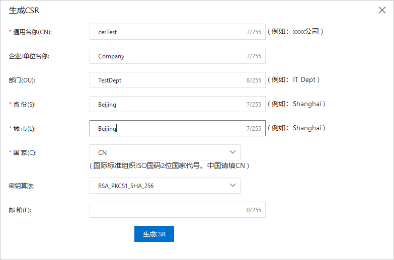
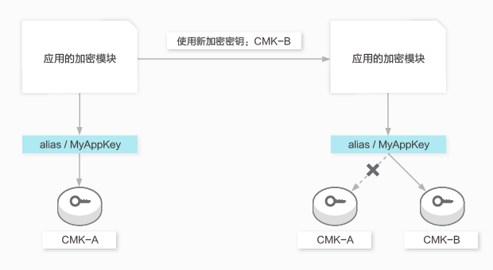

阿里云  
专有云  
密钥管理服务  
密钥管理服务 用户指南  
产品版本：V3.18.6  
文档版本：20251030

**目录**

- [1.使用须知](#section-1)
- [2.快速入门](#section-2)
    - [2.1. 登录Apsara Uni-manager运营控制台](#section-2-1)
    - [2.2. 用户权限说明](#section-2-2)
- [3.管理密钥](#section-3)
    - [3.1. 创建密钥](#section-3-1)
    - [3.2. 查看密钥详情](#section-3-2)
    - [3.3. 启用密钥](#section-3-3)
    - [3.4. 禁用密钥](#section-3-4)
    - [3.5. 计划删除密钥](#section-3-5)
    - [3.6. 设置密钥轮转策略](#section-3-6)
    - [3.7. 生成数据密钥](#section-3-7)
    - [3.8. 生成证书请求文件CSR](#section-3-8)
- [4.使用RAM实现访问控制](#section-4)
- [5.别名使用说明](#section-5)
- [6.用户主密钥概览](#section-6)
- [7.使用对称密钥](#section-7)
    - [7.1. 对称加密简介](#section-7-1)
    - [7.2. EncryptionContext说明](#section-7-2)
    - [7.3. 导入和删除密钥材料](#section-7-3)
- [8.使用非对称密钥](#section-8)
    - [8.1. 非对称密钥简介](#section-8-1)
    - [8.2. 非对称数据加解密](#section-8-2)
    - [8.3. 非对称数字签名](#section-8-3)
- [9.密钥的轮转](#section-9)
    - [9.1. 密钥轮转概述](#section-9-1)
    - [9.2. 自动轮转密钥](#section-9-2)
    - [9.3. 人工轮转主密钥](#section-9-3)

<a id="section-1"></a>

# 1.使用须知

在登录云盾控制台前，您需要确认本地PC符合以下配置。

本地PC需要满足如配置要求表中配置要求，才可以正常登录云盾控制台。

表 1. 配置要求表

<table>
  <tr>
    <th width="90">内容</th>
    <th>要求</th>
  </tr>
  <tr>
    <td>浏览器</td>
    <td>• Internet Explorer浏览器：11及以上版本<br>• Chrome浏览器（推荐）：42.0.0及以上版本<br>• Firefox浏览器：30及以上版本<br>• Safari浏览器：9.0.2版本及以上版本</td>
  </tr>
  <tr>
    <td>操作系统</td>
    <td>• Windows XP版本<br>• Windows 7及以上版本<br>• Mac系统</td>
  </tr>
</table>

<a id="section-2"></a>

# 2.快速入门

<a id="section-2-1"></a>

## 2.1. 登录Apsara Uni-manager运营控制台

本文主要向您介绍如何登录Apsara Uni-manager运营控制台。

**前提条件**

- 登录Apsara Uni-manager运营控制台前，确认您已从部署人员处获取Apsara Uni-manager运营控制台的服务域名地址。

- 推荐使用Chrome浏览器。

**操作步骤**

1. 在浏览器地址栏中，输入Apsara Uni-manager运营控制台的服务域名地址，按回车键。

   

   > **说明**
   >
   > - 单击页面右上角的当前语言可以切换其它语言。
   >
   > - 授权登录是第三方认证中配置了全局IdP设置才会显示，且“授权登录”名称用户可按需自定义。

2. 输入正确的用户名及密码。

   > **说明**
   >
   > - 请向运营管理员获取登录控制台的用户名和密码。
   >
   > - 首次登录Apsara Uni-manager运营控制台时，需要修改登录用户名的密码，请按照提示完成密码修改。为提高安全性，密码长度必须为10~32位，且包含英文字母大小写、阿拉伯数字和特殊符号（感叹号（!）、at（@）、井号（#）、美元符号（$）、百分号（%）等）。

3. 单击**账号登录**。

4. 如果账号已激活MFA多因素认证，请根据以下两种情况进行操作：

   - **管理员强制开启MFA后的首次登录**

     <ol type="a">

     <li>

     在绑定虚拟MFA设备页面中，按页面提示步骤绑定MFA设备。

     </li>

     <li>

     按照步骤2重新输入账号和密码，单击**账号登录**。

     </li>

     </ol>

     <ol type="i" start="100">

     <li>

     输入6位MFA码后单击**认证**。

     </li>

     </ol>

   - **您已开启并绑定MFA**

     输入6位MFA码后单击**认证**。

     > **说明**
     >
     > 绑定并开启MFA的操作请参见管理多因素认证。

**相关操作**

**忘记密码**

1. 用户忘记登录密码时，单击密码输入框下方的**忘记密码**。

2. 在忘记密码页面，输入**账户名**、**邮箱**和验证码后，单击**确认**。

   

   > **说明**
   >
   > - 账户名请输入当前账号的用户名，邮箱请输入注册账号的Email地址。
   >
   > - 重置密码的链接将发至邮箱，进入链接后用户可输入新密码。

<a id="section-2-2"></a>

## 2.2. 用户权限说明

本文介绍了云盾涉及的用户角色。

支持自定义角色，也支持使用默认角色。在登录云盾安全中心前，您需要确认自己的账号已经分配云盾相关的角色。

表 1. 云盾默认角色

<table>
  <tr>
    <th width="170">角色名称</th>
    <th>角色说明</th>
  </tr>
  <tr>
    <td>组织安全管理员</td>
    <td>负责单个组织内的安全管理工作，包括云安全管理中心SOC、主机安全、应用安全、网络安全等，以及ECS类安全产品的管理工作。</td>
  </tr>
  <tr>
    <td>全局组织安全管理员</td>
    <td>负责通过云安全管理中心SOC，进行云平台及所有租户的安全管理工作和ECS类安全产品的管理工作。</td>
  </tr>
</table>

如果您没有相关账号和角色，请联系管理员创建用户及授予角色，具体步骤，请参见<strong>《Apsara Uni-manager运营控制台用户指南》</strong>中**创建用户**。

<a id="section-3"></a>

# 3.管理密钥

<a id="section-3-1"></a>

## 3.1. 创建密钥

本文为您介绍如何创建用户主密钥，用于后续的加密和解密操作。

**操作步骤**

1. 登录Apsara Uni-manager运营控制台。

2. 在页面顶部导航栏，选择**产品 > 安全 > 密钥管理服务**。

3. 在**用户主密钥**页面，单击**创建密钥**。

4. 在**创建密钥**页面，选择**组织**，系统默认填写**资源集**和**地域**信息。

5. 在**基本配置**区域，设置以下参数。

   <table>
     <tr>
       <th width="89">参数</th>
       <th>说明</th>
     </tr>
     <tr>
       <td>密钥类型</td>
       <td>取值：<br>• 对称密钥的类型：<br>• Aliyun_AES_256<br>• 非对称密钥的类型：<br>• RSA_2048<br>• EC_P256<br>• EC_P256K</td>
     </tr>
     <tr>
       <td>密钥用途</td>
       <td>取值：<br>• ENCRYPT/DECRYPT：数据加密和解密。<br>• SIGN/VERIFY：产生和验证数字签名。</td>
     </tr>
     <tr>
       <td>保护级别</td>
       <td>取值：<br>• SOFTWARE：通过软件模块对密钥进行保护。</td>
     </tr>
     <tr>
       <td>别名</td>
       <td>用户主密钥的可选标识。更多信息，请参见别名使用说明。</td>
     </tr>
     <tr>
       <td>描述</td>
       <td>用户主密钥的说明信息。</td>
     </tr>
   </table>

6. 在**高级配置**区域，设置以下参数。

   <table>
     <tr>
       <th width="121">参数</th>
       <th>说明</th>
     </tr>
     <tr>
       <td>轮转周期</td>
       <td>取值：<br>• 不开启：不设置自动轮转。<br>• 开启：设置自动轮转。您可以选择自动轮转天数或者自定义天数。<br>说明<br>• 仅密钥类型为Aliyun_AES_256的对称密钥支持设置轮转周期。<br>• 当密钥材料来源为外部时，不支持自动轮转。</td>
     </tr>
     <tr>
       <td>密钥材料来源</td>
       <td>取值：<br>• 阿里云KMS：密钥材料将由KMS生成。<br>• 外部：KMS将不会生成密钥材料，您需要将自己的密钥材料导入KMS。<br>说明仅密钥类型为Aliyun_AES_256的对称密钥支持将外部密钥材料导入KMS。</td>
     </tr>
   </table>

7. 单击**确认订单**。

<a id="section-3-2"></a>

## 3.2. 查看密钥详情

密钥创建后，您可以查看密钥状态、密钥用途及创建日期等信息。

**操作步骤**

1. 登录Apsara Uni-manager运营控制台。

2. 在页面顶部导航栏，选择**产品 > 安全 > 密钥管理服务**。

3. 在**用户主密钥**页面，根据**保护级别**、**密钥状态**、**密钥用途**、**密钥类别**、**区域性**和**别名**等信息，筛选要查询的密钥。

4. 选择待查看的密钥，单击其别名或选择**更多**>**密钥详情**。

   > **说明**
   >
   > 在密钥列表中，您可以将光标放在**密钥ID**上，会提示密钥的描述信息，便于您区分密钥。

5. 在**密钥详情**区域，查看密钥状态、密钥用途及创建日期等信息。

<a id="section-3-3"></a>

## 3.3. 启用密钥

本文为您介绍如何将一个禁用状态的密钥重新启用。

**操作步骤**

1. 登录Apsara Uni-manager运营控制台。

2. 在页面顶部导航栏，选择**产品 > 安全 > 密钥管理服务**。

3. 在**用户主密钥**页面，选择一个密钥状态为**已禁用**的密钥，单击右侧**操作**列的**启用**。

4. 在弹出的**启用密钥**对话框，单击**确定**。

   启用密钥成功后，密钥状态由**已禁用**变更为**启用中**。

<a id="section-3-4"></a>

## 3.4. 禁用密钥

本文为您介绍如何禁用密钥。

**背景信息**

处于禁用状态的密钥无法用于加密和解密操作。若密钥未重新启用，则使用该密钥加密的密文无法被解密。

**操作步骤**

1. 登录Apsara Uni-manager运营控制台。

2. 在页面顶部导航栏，选择**产品 > 安全 > 密钥管理服务**。

3. 在**用户主密钥**页面，选择一个密钥状态为**启用中**的密钥，单击右侧**操作**列的**禁用**。

4. 在弹出的**禁用密钥**对话框，单击**确定**。

   成功禁用密钥后，密钥状态由**启用中**变更为**已禁用**。

<a id="section-3-5"></a>

## 3.5. 计划删除密钥

您可以指定一个预删除周期，申请删除用户主密钥。

**背景信息**

您需要指定一个预删除周期，该周期最少为7天，最多为30天。计划删除密钥的注意事项如下：

- 在密钥预删除期间，密钥处于待删除状态，无法用于加密、解密和产生数据密钥的操作。

- 删除主密钥可能对数据可用性产生严重影响，通常情况下，我们建议您选择禁用密钥。

- 主密钥一旦被删除，将无法被恢复，使用该主密钥加密的内容及使用该主密钥产生的数据密钥均无法再被解密。因此，KMS不提供直接删除主密钥的功能，而是采用申请删除的方式。

- KMS将在预删除周期结束后的24小时内完成密钥的删除。

  例如：如果您在2024年09月10日14:00申请了一个主密钥删除，预计删除时间在七天以后，那么密钥管理服务将在2024年09月17日14:00之后的24小时内完成删除。

**操作步骤**

1. 登录Apsara Uni-manager运营控制台。

2. 在页面顶部导航栏，选择**产品 > 安全 > 密钥管理服务**。

3. 在**用户主密钥**页面，选择待计划删除的密钥，在右侧**操作**列选择**更多**>**计划删除密钥**。

4. 在**计划删除密钥**对话框，设置**预删除周期（7~30天）**。

5. 单击**确定**。

**执行结果**

完成后，密钥状态变为**待删除**状态。

> **说明**
>
> 在预删除周期结束前，您可选择**更多**>**取消删除密钥**，取消计划删除密钥。

<a id="section-3-6"></a>

## 3.6. 设置密钥轮转策略

本文为您介绍如何设置密钥轮转策略。

**操作步骤**

1. 登录Apsara Uni-manager运营控制台。

2. 在页面顶部导航栏，选择**产品 > 安全 > 密钥管理服务**。

3. 在**用户主密钥**页面，选择**密钥类型**为Aliyun_AES_256的对称密钥，在右侧**操作**列选择**更多**>**密钥详情**。

4. 在**密钥版本**区域，单击**设置轮转策略**。

5. 在**设置轮转策略**对话框，选择**轮转周期**。

   - 不开启：不开启密钥自动轮转。

   - 30天、90天、180天、365天：选择密钥自动轮转的周期。

   - 自定义：输入您自定义的密钥自动轮转的周期。

6. 单击**确定**。

<a id="section-3-7"></a>

## 3.7. 生成数据密钥

数据密钥可以用于本地数据的加解密。本文为您介绍如何生成数据密钥。

**操作步骤**

1. 登录Apsara Uni-manager运营控制台。

2. 在页面顶部导航栏，选择**产品 > 安全 > 密钥管理服务**。

3. 在**用户主密钥**页面，选择密钥用途为**Encrypt/Decrypt**的对称密钥，单击其别名的链接或选择**更多**>**密钥详情**。

   > **说明**
   >
   > 对称密钥的密钥类型为Aliyun_AES_256。

4. 在**数据密钥使用**区域，单击**数据密钥管理**。

5. 单击**产生数据密钥**页签，设置相关参数，然后单击**提交**。

   <ol type="i">

   <li>

   在**生成数据密钥参数**区域，选择**密钥类型**，输入**加密上下文**。

   </li>

   <li>

   在**生成数据密钥参数**区域，选择**是否使用公钥加密导出**。

   - **是**：使用公钥加密导出。您需要在**指定导出公钥**区域，选择**公钥类型**和**加密算法**，输入**公钥**。

   - **否**：不使用公钥加密导出。您可以直接生成数据密钥。

   > **说明**
   >
   > 生成数据密钥成功后，您可以在弹出的**数据密钥导出结果**对话框查看数据密钥密文。

   </li>

   </ol>

6. （可选）单击**数据密钥转保护**页签，设置相关参数，然后单击**提交**。

   <table>
     <tr>
       <th width="137">转保护场景</th>
       <th>相关操作</th>
     </tr>
     <tr>
       <td>使用公钥转保护</td>
       <td>i. 在<strong>导出数据密钥参数</strong>区域，输入<strong>数据密钥密文</strong>和<strong>加密上下文</strong>。ii. 在<strong>指定导出公钥</strong>区域，选择<strong>公钥类型</strong>和<strong>加密算法</strong>，输入<strong>公钥</strong>。</td>
     </tr>
   </table>

   <table>
     <tr>
       <th width="184">数据密钥同地域转保护</th>
       <th>i. 在<strong>导出数据密钥参数</strong>区域，输入<strong>数据密钥密文</strong>和<strong>源加密上下文</strong>。ii. 在<strong>目标密钥参数</strong>区域，输入<strong>目标密钥ID</strong>和<strong>目标加密上下文</strong>。</th>
     </tr>
     <tr>
       <td>数据密钥跨地域转保护</td>
       <td>i. 在<strong>导出数据密钥参数</strong>区域，输入<strong>数据密钥密文</strong>和<strong>源加密上下文</strong>。ii. 在<strong>目标密钥参数</strong>区域，选择<strong>目标地域</strong>，输入<strong>目标地域非对称密钥ID</strong>、<strong>目</strong><strong>标非对称密钥版本ID</strong>、<strong>目标密钥ID</strong>和<strong>目标加密上下文</strong>。</td>
     </tr>
   </table>

   > **说明**
   >
   > 数据密钥转保护成功后，您可以在弹出的**数据密钥转保护结果**对话框查看数据密钥密文。

<a id="section-3-8"></a>

## 3.8. 生成证书请求文件CSR

生成证书时，您需要将证书请求文件CSR提交给权威的证书颁发机构。本文为您介绍如何生成证书请求文件CSR。

**操作步骤**

1. 登录Apsara Uni-manager运营控制台。

2. 在页面顶部导航栏，选择**产品 > 安全 > 密钥管理服务**。

3. 在**用户主密钥**页面，选择密钥用途为**Sign/Verify**的非对称密钥，单击其别名的链接或选择**更多**>**密钥详情**。

   > **说明**
   >
   > 非对称密钥的密钥类型为RSA_2048、EC_P256、EC_P256K。

4. 在**密钥版本**区域，单击**操作**列的**生成CSR**。

5. 在弹出的**生成CSR**对话框，根据控制台提示填写证书信息。

   

6. 单击**生成CSR**。

7. 单击**下载CSR文件**，将CSR文件保存到您的电脑。

<a id="section-4"></a>

# 4.使用RAM实现访问控制

密钥管理服务KMS（Key Management Service）通过访问控制RAM（Resource Access Management）实现对资源的访问控制。本文为您介绍KMS定义的资源类型、操作和策略条件。

阿里云账号对自己的资源拥有完整的操作权限，RAM用户和角色则需要通过授权获取对应资源的操作权限。

**KMS定义的资源类型**

下表列出了KMS定义的所有资源类型以及对应的资源名称（ARN），用于RAM权限策略的**Resource**元素。

<table>
  <tr>
    <th width="122">资源类型</th>
    <th>ARN</th>
  </tr>
  <tr>
    <td>抽象密钥容器</td>
    <td>acs:kms:${region}:${account}:key</td>
  </tr>
  <tr>
    <td>抽象别名容器</td>
    <td>acs:kms:${region}:${account}:alias</td>
  </tr>
  <tr>
    <td>密钥</td>
    <td>acs:kms:${region}:${account}:key/${key-id}</td>
  </tr>
  <tr>
    <td>别名</td>
    <td>acs:kms:${region}:${account}:alias/${alias-name}</td>
  </tr>
</table>

**KMS定义的操作**

针对每一个需要进行访问控制的接口，KMS都定义了用于RAM权限策略的操作（Action），通常为 `kms:${api-name}` 。

> DescribeRegions不需要进行访问控制，只要请求可以通过认证校验，即可调用。调用者
>
> **说明**
>
> 可以是阿里云账号、RAM用户或RAM角色。

以下表格列出了KMS接口的对应RAM权限策略操作，以及接口所访问的资源类型。

- 密钥服务接口

  | KMS接口 | Action | 资源类型 |
  | --- | --- | --- |
  | ListKeys | kms:ListKeys | 抽象密钥容器 |
  | CreateKey | kms:CreateKey | 抽象密钥容器 |
  | DescribeKey | kms:DescribeKey | 密钥 |
  | UpdateKeyDescription | kms:UpdateKeyDescription | 密钥 |
  | EnableKey | kms:EnableKey | 密钥 |
  | DisableKey | kms:DisableKey | 密钥 |
  | ScheduleKeyDeletion | kms:ScheduleKeyDeletion | 密钥 |
  | CancelKeyDeletion | kms:CancelKeyDeletion | 密钥 |
  | GetParametersForImport | kms:GetParametersForImport | 密钥 |
  | ImportKeyMaterial | kms:ImportKeyMaterial | 密钥 |
  | DeleteKeyMaterial | kms:DeleteKeyMaterial | 密钥 |
  | ListAliases | kms:ListAliases | 抽象别名容器 |
  | CreateAlias | kms:CreateAlias | 别名和密钥 |
  | UpdateAlias | kms:UpdateAlias | 别名和密钥 |
  | DeleteAlias | kms:DeleteAlias | 别名和密钥 |
  | ListAliasesByKeyId | kms:ListAliasesByKeyId | 密钥 |
  | CreateKeyVersion | kms:CreateKeyVersion | 密钥 |
  | DescribeKeyVersion | kms:DescribeKeyVersion | 密钥 |
  | ListKeyVersions | kms:ListKeyVersions | 密钥 |
  | UpdateRotationPolicy | kms:UpdateRotationPolicy | 密钥 |
  | Encrypt | kms:Encrypt | 密钥 |
  | Decrypt | kms:Decrypt | 密钥 |
  | ReEncrypt | • kms:ReEncryptFrom<br>• kms:ReEncryptTo<br>• kms:ReEncrypt\* | 密钥 |
  | GenerateDataKey | kms:GenerateDataKey | 密钥 |
  | GenerateDataKeyWithoutPlaint ext | kms:GenerateDataKeyWithout Plaintext | 密钥 |
  | ExportDataKey | kms:ExportDataKey | 密钥 |
  | GenerateAndExportDataKey | kms:GenerateAndExportDataK ey | 密钥 |
  | AsymmetricSign | kms:AsymmetricSign | 密钥 |
  | AsymmetricVerify | kms:AsymmetricVerify | 密钥 |
  | AsymmetricEncrypt | kms:AsymmetricEncrypt | 密钥 |
  | AsymmetricDecrypt | kms:AsymmetricDecrypt | 密钥 |
  | GetPublicKey | kms:GetPublicKey | 密钥 |

- 标签管理接口

  | KMS 接口 | Action | 资源类型 |
  | --- | --- | --- |
  | ListResourceTags | kms:ListResourceTags | 密钥 |
  | UntagResource | kms:UntagResource | 密钥 |
  | TagResource | kms:TagResource | 密钥 |

**KMS支持的策略条件**

您可以在RAM权限策略中设定条件控制对KMS的访问，只有当条件满足时，权限验证才能通过。例如：您可以使用 `acs:CurrentTime` 条件限制权限策略有效的时间。

除了全局条件，您也可以使用标签作为条件关键字，限制对Encrypt、Decrypt、GenerateDataKey等密码运算API的使用。条件关键字的格式为 `kms:tag/${tag-key}` 。

**常见的权限策略示例**

- 允许访问所有的KMS资源

  ```json
  {
    "Version": "1",
    "Statement": [
      {
        "Effect": "Allow",
        "Action": [
          "kms:*"
        ],
        "Resource": [
          "*"
        ]
      }
    ]
  }               
  ```

- 密钥只读访问权限，即列出和查看密钥、查看别名以及使用密钥权限。

  ```json
  {
    "Version": "1",
    "Statement": [
      {
        "Effect": "Allow",
        "Action": [
          "kms:List*", "kms:Describe*",
          "kms:Encrypt", "kms:Decrypt", "kms:GenerateDataKey"
        ],
        "Resource": [
          "*"
        ]
      }
    ]
  }             
  ```

- 允许使用含有下列标签的密钥进行密码运算：

  - 标签键： `Project`

  - 标签值： `Apollo`

  ```json
  {
      "Version": "1",
      "Statement": [
          {
              "Effect": "Allow",
              "Action": [
                  "kms:Encrypt", "kms:Decrypt", "kms:GenerateDataKey"
              ],
              "Resource": [
                  "*"
              ],
              "Condition": {
                  "StringEqualsIgnoreCase": {
                      "kms:tag/Project": [
                          "Apollo"
                      ]
                  }
              }
          }
      ]
  }               
  ```

<a id="section-5"></a>

# 5.别名使用说明

别名是用户主密钥的可选标识，在一个阿里云账号、一个地域中具有唯一性。同一个阿里云账号在不同地域下可以拥有相同的别名。 每个别名只能指向同地域的一个用户主密钥，但是每个用户主密钥可以拥有多个别名。

**别名概览**

一个别名一定会指向一个用户主密钥，但是别名是独立于用户主密钥存在的一个资源。别名具有以下特点：

- 可以调用UpdateAlias接口更改别名关联的用户主密钥，而不会影响用户主密钥。

- 删除别名不会删除其关联的用户主密钥。

- RAM用户操作别名，需要有别名相关资源的授权。更多信息，请参见使用RAM实现访问控制。

- 别名不可更改。可以通过为一个用户主密钥创建新的别名，并且删除旧的别名来达到修改别名的目的。

当一个别名与某一个用户主密钥相关联时，在以下API接口中，可以将访问参数中的密钥ID用别名代替：

- DescribeKey

- Encrypt

- GenerateDataKey

- GenerateDataKeyWithoutPlaintext

> **说明**
>
> API接口详情，请参见 <strong>《开发指南》</strong>手册中的 <strong>《API参考》</strong>章节。

当RAM用户使用别名代替密钥ID进行上述操作时，RAM用户必须拥有对应密钥的权限，无需拥有对应别名的权限。

任何情况下使用别名时，都必须使用完整的别名，示例如下：

```text
//包含前缀“alias/”的完整别名
alias/example
```

**创建别名**

别名必须拥有前缀 `alias/` 。除前缀以外，支持英文字母、数字、下划线（_）、短划线（-）以及正斜线（/）。除前缀以外，长度限制在1~255个字符。

当RAM用户创建别名时，您需要创建自定义权限策略，并授予该RAM用户，使其拥有别名和关联密钥的权限。以用户123456为密钥08ec3bb9-034f-485b-b1cd-3459baa8\*\*\*\*创建别名 `alias/example` 为例，RAM权限策略内容如下：

```json
{
  "Version": "1",
  "Statement": [
    {
      "Effect": "Allow",
      "Action": [
        "kms:CreateAlias"
      ],
      "Resource": [
        "acs:kms:cn-hangzhou:123456:key/08ec3bb9-034f-485b-b1cd-3459baa8****",
        "acs:kms:cn-hangzhou:123456:alias/example"
      ]
    }
  ]
}
```

> **说明**
>
> 为同一个用户主密钥创建新的别名不会影响已有别名。

您可以通过以下方式创建别名：

- 控制台：

  <ol type="i">

  <li>

  登录Apsara Uni-manager运营控制台。

  </li>

  <li>

  在页面顶部导航栏，选择**产品 > 安全 > 密钥管理服务**。

  </li>

  <li>

  在**用户主密钥**页面，定位到目标密钥，单击其别名或选择**更多**>**密钥详情**。

  </li>

  <li>

  在**别名**区域，单击**创建别名**。

  </li>

  <li>

  在弹出的**创建别名**对话框，输入别名名称。

  </li>

  <li>

  单击**确定**。

  </li>

  </ol>

- API：调用CreateAlias接口创建别名。

- ALIYUN CLI：通过命令 `aliyun kms CreateAlias` 创建别名。

  ```bash
  aliyun kms CreateAlias --KeyId 08ec3bb9-034f-485b-b1cd-3459baa8**** --AliasName alias/example
  ```

**更新别名**

更新别名可以将已有的别名关联到其他用户主密钥。

当RAM用户更新别名时，您需要创建自定义权限策略，并授予该RAM用户，使其拥有原密钥、目标密钥以及别名的权限。以用户123456将密钥08ec3bb9-034f-485b-b1cd-3459baa8\*\*\*\*关联的别名 `alias/example` 关联到新密钥127d2f84-ee5f-4f4d-9d41-dbc1aca2\*\*\*\*为例，RAM权限策略内容如下：

```json
{
  "Version": "1",
  "Statement": [
    {
      "Effect": "Allow",
      "Action": [
        "kms:UpdateAlias"
      ],
      "Resource": [
        "acs:kms:cn-hangzhou:123456:key/08ec3bb9-034f-485b-b1cd-3459baa8****",
        "acs:kms:cn-hangzhou:123456:key/127d2f84-ee5f-4f4d-9d41-dbc1aca2****",
        "acs:kms:cn-hangzhou:123456:alias/example"
      ]
    }
  ]
}
```

您可以通过以下方式更新别名：

- API：调用UpdateAlias接口更新别名。

- ALIYUN CLI：通过命令 `aliyun kms UpdateAlias` 更新别名。

  ```bash
  aliyun kms UpdateAlias --AliasName alias/example --KeyId 127d2f84-ee5f-4f4d-9d41-dbc1aca2****
  ```

**删除别名**

如果您不再需要别名，可以直接删除别名，删除别名不会影响其关联的密钥。

当RAM用户删除别名时，您需要创建自定义权限策略，并授予该RAM用户，使其拥有别名及其关联密钥的权限。以用户123456删除密钥127d2f84-ee5f-4f4d-9d41-dbc1aca2\*\*\*\*关联的别名 `alias/example` 为例，RAM权限策略内容如下：

```json
{
  "Version": "1",
  "Statement": [
    {
      "Effect": "Allow",
      "Action": [
        "kms:DeleteAlias"
      ],
      "Resource": [
        "acs:kms:cn-hangzhou:123456:key/127d2f84-ee5f-4f4d-9d41-dbc1aca2****",
        "acs:kms:cn-hangzhou:123456:alias/example"
      ]
    }
  ]
}
```

您可以通过以下方式删除别名：

- 控制台：

  <ol type="i">

  <li>

  登录Apsara Uni-manager运营控制台。

  </li>

  <li>

  在页面顶部导航栏，选择**产品 > 安全 > 密钥管理服务**。

  </li>

  <li>

  在**用户主密钥**页面，定位到目标密钥，单击其别名或选择**更多**>**密钥详情**。

  </li>

  <li>

  在**别名**区域，单击待删除别名右侧的**删除别名**。

  </li>

  <li>

  在弹出的**删除别名**对话框，单击**确定**。

  </li>

  </ol>

- API：调用DeleteAlias接口删除别名。

- ALIYUN CLI：通过命令 `aliyun kms DeleteAlias` 删除别名。

  ```bash
  aliyun kms DeleteAlias --AliasName alias/example
  ```

**查询别名列表**

查询别名列表可以查询当前用户在当前地域的所有别名。

当RAM用户查询别名列表时，您需要创建自定义权限策略，并授予该RAM用户，使其拥有别名资源类型的权限。以用户123456查询别名列表为例，RAM权限策略内容如下：

```json
{
  "Version": "1",
  "Statement": [
    {
      "Effect": "Allow",
      "Action": [
        "kms:ListeAliases"
      ],
      "Resource": [
        "acs:kms:cn-hangzhou:123456:alias"
      ]
    }
  ]
}
```

您可以通过以下方式查询别名列表：

- API：调用ListAliases接口查询别名列表。

- ALIYUN CLI：通过命令 `aliyun kms ListAliases` 查询别名列表。

  ```bash
  aliyun kms ListAliases
  ```

**查询指定密钥关联的别名**

查询指定密钥关联的别名只会返回与指定密钥相关联的别名信息。

当RAM用户查询指定密钥关联的别名时，您需要创建自定义权限策略，并授予该RAM用户，使其拥有指定密钥的权限。以用户123456查询密钥127d2f84-ee5f-4f4d-9d41-dbc1aca2\*\*\*\*关联的所有别名为例，RAM权限策略内容如下：

```json
{
  "Version": "1",
  "Statement": [
    {
      "Effect": "Allow",
      "Action": [
        "kms:ListAliasesByKeyId"
      ],
      "Resource": [
        "acs:kms:cn-hangzhou:123456:key/127d2f84-ee5f-4f4d-9d41-dbc1aca2****"
      ]
    }
  ]
}
```

您可以通过以下方式查询指定密钥关联的别名：

- API：调用ListAliasesByKeyId接口查询指定密钥关联的别名。

- ALIYUN CLI：通过命令 `aliyun kms ListAliasesByKeyId` 查询指定密钥关联的别名。

  ```bash
  aliyun kms ListAliasesByKeyId --KeyId 127d2f84-ee5f-4f4d-9d41-dbc1aca2****
  ```

<a id="section-6"></a>

# 6.用户主密钥概览

密钥服务是KMS的核心组件，提供密钥的全托管和保护能力，支持基于云原生接口的极简数据加密和数字签名。

**密钥的算法**

KMS对加密算法的支持情况请参见如下表格。

| 密码算法大类 | 密码算法子类 | 是否支持加密、解密 | 是否支持签名、验签 |
| --- | --- | --- | --- |
| 对称密钥 | AES | 支持 | 不支持 |
| 非对称密钥 | RSA | 支持 | 支持 |
| 非对称密钥 | ECC | 不支持 | 支持 |

对称密钥主要用于数据的加密保护场景。如果您不指定具体的密钥规格（KeySpec），则KMS默认创建的是对称密钥。通过使用KMS加解密的接口，您无需获得密钥的明文材料就可以完成对数据的加密操作和解密操作。更多信息，请参见对称加密简介。

非对称密钥可用于数据加密和数字签名。您在KMS创建的非对称用户主密钥（CMK），由一对关联的公钥和私钥构成。公钥可以被分发给任何人，而私钥必须被安全的保护起来。KMS保证私钥的安全性，不提供任何接口导出非对称密钥的私钥，您可以通过私钥运算的接口来使用私钥进行数据解密或者数字签名。任何获得公钥的人，都可以使用公钥进行数据加密或者验证私钥产生的签名。更多信息，请参见非对称密钥简介。

> **说明**
>
> - 仅KMS高级版支持RSA和ECC。

**密钥的托管者**

通常情况下，您是KMS中的用户主密钥的托管者。在此情况下，密钥的Creator属性为您的阿里云账号的标识符。

在云产品集成KMS进行服务端加密的场景里，为了更方便您使用入门级的数据加密功能，缩减您在密钥生命周期和权限管理等方面的开销，KMS支持特定云产品为您自动托管一个加密密钥，专门用于相应的云产品对您的数据进行加密保护。这类由云产品（云服务）托管的密钥被称为服务密钥。为了方便您辩识，服务密钥的Creator属性为相应的云产品代码，同时被关联了特殊的别名，格式为 `acs/<`云产品代码`>` 。例如：对象存储服务OSS为用户托管的服务密钥，Creator属性为OSS，同时被关联了别名acs/oss。

<a id="section-7"></a>

# 7.使用对称密钥

<a id="section-7-1"></a>

## 7.1. 对称加密简介

对称加密是最常用的数据加密保护方式。KMS提供了简单易用的接口，方便您在云上轻松实现数据加解密功能。

> **说明**
>
> API接口详情，请参见 <strong>《开发指南》</strong>手册中的 <strong>《API参考》</strong>章节。

如果您不指定具体的密钥规格（KeySpec），KMS默认创建对称密钥。阿里云支持主流的对称密钥算法并且提供足够的安全强度，保证数据加密的安全性。

**对称密钥的类型**

KMS支持的对称密钥算法类型如下：

| 算法 | 密钥长度 | 密钥规格 | 数据加密模式 | 保护级别 |
| --- | --- | --- | --- | --- |
| AES | 256比特 | Aliyun_AES_256 | GCM | • Software |

**加解密特性**

加密时，您只需要指定主密钥的标识符（或者主密钥别名），KMS使用指定的主密钥完成加密后，返回密文数据。调用Decrypt接口进行解密时，您只需要传入密文数据，而不需要再次指定主密钥的标识符，这适用于调用Encrypt、GenerateDataKey、GenerateDataKeyWithoutPlaintext产生的密文数据。

**使用额外认证数据**

KMS的对称密钥使用了分组密码算法的GCM模式，支持您传入额外的认证数据AAD（Additional Authenticated Data），为需要加密的数据提供额外的完整性保护。KMS对额外认证数据的传入进行了封装，更方便的支持您自定义认证数据。更多信息，请参见EncryptionContext说明。

**信封加密**

KMS通过GenerateDataKey和GenerateDataKeyWithoutPlaintext接口，一次性产生两级密钥结构，支持更快速的实现信封加密。

信封加密详情，请参见<strong>《产品白皮书》</strong> 手册中 <strong>《产品功能》</strong>章节的 **《信封加密服务》**。

**轮转对称加密密钥**

KMS生成的对称主密钥支持多个密钥版本，同时支持用户主密钥基于密钥版本进行自动轮转，您可以自定义密钥轮转的策略。

在CMK包含多个版本时，KMS的加密动作（包含Encrypt、GenerateDataKey、GenerateDataKeyWithoutPlaintext）使用指定CMK的最新的密钥版本对数据进行加密。解密时，您不需要传入CMK标识符和版本标识符，KMS自动发现传入密文数据使用的CMK以及对应的加密密钥版本，使用相应版本的密钥材料对数据进行解密。

密钥的自动轮转通过产生新的密钥版本来实现，轮转后，调用KMS接口产生的密文数据自动使用最新版本；而轮转之前产生的密文数据仍然可以使用旧的密钥版本解密。更多信息，请参见自动轮转密钥。

**使用自带密钥**

为了满足更高的安全合规要求，KMS支持您使用自带密钥（BYOK）用于云上数据的加密保护。对于自带密钥的情形，我们推荐您使用托管密码机对密钥进行保护，将您的密钥导入到保护级别为HSM的CMK中。导入到托管密码机中的密钥只能被销毁，其明文无法被导出。

<a id="section-7-2"></a>

## 7.2. EncryptionContext说明

EncryptionContext是在KMS的Encrypt、GenerateDataKey、Decrypt等API中可能用到的JSON字符串。

**EncryptionContext的作用**

EncryptionContext只能是String-String形式的JSON字符串，用于保护数据的完整性。

如果加密（Encrypt、GenerateDataKey）时指定了该参数，解密（Decrypt）密文时，需要传入等价的EncryptionContext参数，才能正确的解密。EncryptionContext虽然与解密相关，但是并不会存在密文（CipherBlob）中。

**EncryptionContext有效值**

EncryptionContext的有效值是一个总长度在8192个字符数以内的JSON字符串，并且只能是String-String形式。当您直接调用API填写EncryptionContext时，请注意转义问题。

有效的EncryptionContext示例如下：

```json
{"ValidKey":"ValidValue"}
{"Key1":"Value1","Key2":"Value2"}
```

无效的EncryptionContext（部分）示例如下：

```json
[{"Key":"Value"}] //JSON数组
{"Key":12345} //String-int
{"Key":["value1","value2"]} //String-数组         
```

**等价的EncryptionContext**

EncryptionContext的本质是一个String-String的map（hashtable）, 因此在作为参数时，只需要保证JSON字符串所表示的key-value含义是一致的，则EncryptionContext是等价的。与加密时输入的EncryptionContext等价的EncryptionContext即可用于正确的解密，而不用保持完全一致的字符串。

等价的EncryptionContext示例如下：

```json
{"Key1":"Value1","Key2":"Value2"} 与 {"Key2":"Value2","Key1":"Value1"} 等价           
```

<a id="section-7-3"></a>

## 7.3. 导入和删除密钥材料

本文为您介绍如何导入外部密钥材料以及删除已导入的外部密钥材料。

**背景信息**

用户主密钥（CMK）是KMS的基本资源，是由密钥ID、基本元数据（如密钥状态等）以及用于加密、解密数据的密钥材料组成。默认情况下，当您调用CreateKey接口创建主密钥时，会由KMS生成密钥材料。 您可以选择创建密钥材料来源为外部的密钥，此时，KMS将不会为您创建的用户主密钥生成密钥材料，您可以将自己的密钥材料导入到CMK中。 您可以通过调用DescribeKey接口来判断密钥材料来源情况。

> **说明**
>
> API接口详情，请参见 <strong>《开发指南》</strong>手册中的 <strong>《API参考》</strong>章节。

根据密钥材料的来源不同，密钥可分为普通密钥和外部密钥，具体如下：

- 当KeyMetadata中**Origin**为Aliyun_KMS时，说明密钥材料由KMS生成，该密钥称为**普通密钥**。

- 当**Origin**为EXTERNAL时，说明密钥材料由外部导入，该密钥称为**外部密钥**。

在您选择密钥材料来源为外部，使用您自己导入的密钥材料时，需要注意以下几点：

- 请确保您使用了符合要求的随机源生成密钥材料。

- 请确保密钥材料的可靠性。

  - KMS可以确保导入密钥材料高可用，但是不能确保导入密钥材料与KMS生成的密钥材料具有相同的可靠性。

  - 您导入的密钥材料可以直接调用DeleteKeyMaterial接口进行删除，也可以设置过期时间，在密钥材料过期后进行删除（CMK不会被删除）。KMS生成的密钥材料无法直接被删除，只能通过调用ScheduleKeyDeletion接口，在等待7到30天后，随着CMK一起被删除。

  - 当导入的密钥材料被删除后，可以再次导入相同的密钥材料使得CMK再次可用，因此您需要自行保存密钥材料的副本。

- 每个CMK只能拥有一个导入密钥材料。当您将一个密钥材料导入CMK时，CMK将与密钥材料绑定，即便密钥材料已经过期或者被删除，也不能导入其他密钥材料。如果您需要轮换使用外部密钥材料的CMK，只能创建一个新的CMK然后导入新的密钥材料。

- CMK具有独立性。例如：您使用CMK加密的数据，无法使用其他CMK进行解密，即便这些CMK都使用相同的密钥材料。

- 只能导入256位对称密钥作为密钥材料。

**导入密钥材料**

1. 创建外部密钥。

   您可以通过以下两种方法创建外部密钥：

   - 方法一：在控制台创建密钥的高级选项中，选择密钥材料来源为外部。详情请参见创建密钥。

   - 方法二：调用CreateKey接口，指定参数**Origin**为EXTERNAL。

     ```text
     ./aliyun --skip-secure-verify  --region ${please-repleace-your-region}  --endpoint 
     ${please-repleace-your-endpoint} --access-key-id ${please-repleace-your-access-
     key-id} --access-key-secret ${please-repleace-your-access-key-secret} kms CreateKey--Origin EXTERNAL --Description "External key"
     ```

2. 获取导入密钥材料参数。

   导入密钥材料参数包括一个用于加密密钥材料的公钥，以及一个导入令牌。您可以通过以下两种方法获取导入密钥材料参数：

   - 方法一：通过控制台获取导入密钥材料的参数。

   - 方法二：调用GetParametersForImport接口获取导入密钥材料参数。

     ```text
     ./aliyun --skip-secure-verify  --region ${please-repleace-your-region}  --endpoint 
     ${please-repleace-your-endpoint} --access-key-id ${please-repleace-your-access-
     key-id} --access-key-secret ${please-repleace-your-access-key-secret} kms GetParametersForImport --KeyId 1339cb7d-54d3-47e0-b595-c7d3dba8**** --WrappingAlgorithm RSAE
     S_OAEP_SHA_1 --WrappingKeySpec RSA_2048
     ```

3. 导入密钥材料。

   > **说明**
   >
   > - 导入密钥材料时，可以将从未导入过密钥材料的外部密钥进行导入，也可以重新导入已经过期和已被删除的密钥材料，或者重置密钥材料的过期时间。
   >
   > - 导入令牌与加密密钥材料的公钥具有绑定关系，一个令牌只能为其生成时指定的主密钥导入密钥材料。
   >
   > - 导入令牌的有效期为24小时，在有效期内可以重复使用，失效以后需要获取新的导入令牌和加密公钥。

   <ol type="i">

   <li>

   使用加密公钥对密钥材料进行加密。

   加密公钥是一个2048比特的RSA公钥，使用的加密算法需要与获取导入密钥材料参数时指定的一致。由于API返回的加密公钥经过Base64编码，因此在使用时需要先进行Base64解码。目前KMS支持的加密算法有RSAES_OAEP_SHA_256和RSAES_PKCS1_V1_5。

   </li>

   <li>

   将加密后的密钥材料进行Base64编码。

   </li>

   <li>

   将编码后的密钥材料与导入令牌一起，作为ImportKeyMaterial接口的参数导入KMS。

   ```text
   ./aliyun --skip-secure-verify  --region ${please-repleace-your-region}  --endpoint 
   ${please-repleace-your-endpoint} --access-key-id ${please-repleace-your-access-
   key-id} --access-key-secret ${please-repleace-your-access-key-secret} kms ImportKey
   Material --KeyId 1339cb7d-54d3-47e0-b595-c7d3dba8**** --EncryptedKeyMaterial xxx --
   ImportToken xxxx
   ```

   </li>

   </ol>

**删除密钥材料**

当您导入密钥材料后，即可像使用普通密钥一样使用外部密钥。与普通密钥不同，外部密钥的密钥材料可能会过期，也可以直接删除。当密钥材料过期或者被删除以后，密钥将无法继续使用，由该密钥加密的密文也无法被解密。除非您重新导入相同的密钥材料。

如果密钥在密钥材料过期或者密钥材料删除时处于待删除（PendingDeletion）状态时，密钥状态不会改变，否则密钥状态会变为等待导入（PendingImport）。

您可以通过以下两种方法删除密钥材料：

- 方法一：通过控制台删除密钥材料。

- 方法二：调用DeleteKeyMaterial接口删除密钥材料。

  ```text
  ./aliyun --skip-secure-verify  --region ${please-repleace-your-region}  --endpoint ${
  please-repleace-your-endpoint} --access-key-id ${please-repleace-your-access-key-id} 
  --access-key-secret ${please-repleace-your-access-key-secret} kms DeleteKeyMaterial --KeyId 1339cb7d-54d3-47e0-b595-c7d3dba8****    
  ```

**使用OPENSSL加密密钥材料并上传**

1. 创建一个外部密钥。

2. 创建一个密钥材料。

   密钥材料必须是256位的对称密钥，使用OPENSSL产生一个32字节的随机数进行演示。

   ```bash
   openssl rand -out KeyMaterial.bin 32
   ```

3. 获取导入密钥材料参数。

4. 加密密钥材料。

   <ol type="i">

   <li>

   将加密公钥进行Base64解码。

   </li>

   <li>

   根据指定的加密算法（以RSAES_OAEP_SHA_1为例）加密密钥材料。

   </li>

   <li>

   将加密后的密钥材料进行Base64编码，保存为文本文件。

   ```bash
   openssl rand -out KeyMaterial.bin 32
   openssl enc -d -base64 -A -in PublicKey_base64.txt -out PublicKey.bin
   openssl rsautl -encrypt -in KeyMaterial.bin -oaep -inkey PublicKey.bin  -keyform DE
   R  -pubin -out EncryptedKeyMaterial.bin
   openssl enc -e -base64 -A -in EncryptedKeyMaterial.bin -out 
   EncryptedKeyMaterial_base64.txt
   ```

   </li>

   <li>

   上传加密后的密钥材料与导入令牌。

   </li>

   </ol>

**操作样例**

使用Java SDK加密密钥材料并上传。

```java
//使⽤最新KMS Java SDK
//KmsClient.java

import com.aliyuncs.DefaultAcsClient;
import com.aliyuncs.exceptions.ClientException;
import com.aliyuncs.http.FormatType;
import com.aliyuncs.kms.model.v20160120.*;
import com.aliyuncs.profile.DefaultProfile;

//KMS API封装
public class KmsClient {
    DefaultAcsClient client;

    public KmsClient(String regionId, String ak, String secret) {
        DefaultProfile profile = DefaultProfile.getProfile(regionId, ak, secret);
        this.client = new DefaultAcsClient(profile);
    }
    
    //使⽤⾃定义Endpoint。通常⽤于访问VPC Endpoint或者专有云无法⽤regionId查找IP地址的场景。
    public KmsClient(String regionId, String ak, String secret, String endpoint) {
        DefaultProfile.addEndpoint(regionId, "kms", endpoint);
        DefaultProfile profile = DefaultProfile.getProfile(regionId, ak, secret);
        this.client = new DefaultAcsClient(profile);
    }

    public CreateKeyResponse createKey() throws Exception {
        CreateKeyRequest request = new CreateKeyRequest();
        request.setOrigin("EXTERNAL"); //创建外部密钥。
        return this.client.getAcsResponse(request);
    }

    public GetParametersForImportResponse getParametersForImport(String keyId, String wrappingKeySpec, String wrappingAlgorithm) throws ClientException {
        GetParametersForImportRequest request = new GetParametersForImportRequest();
        request.setAcceptFormat(FormatType.JSON);
        request.setKeyId(keyId);
        request.setWrappingKeySpec(wrappingKeySpec);
        request.setWrappingAlgorithm(wrappingAlgorithm);
        return this.client.getAcsResponse(request);
    }

    public ImportKeyMaterialResponse importKeyMaterial(String keyId, String 
importToken, String encryptedKeyMaterial, Long expireTimestamp) throws ClientException 
{
        ImportKeyMaterialRequest request = new ImportKeyMaterialRequest();
        request.setAcceptFormat(FormatType.JSON);
        request.setKeyId(keyId);
        request.setImportToken(importToken);
        request.setEncryptedKeyMaterial(encryptedKeyMaterial);
        request.setKeyMaterialExpireUnix(expireTimestamp);
        return this.client.getAcsResponse(request);
    }

    //... 省略，其余API类似。
}

//example.java
import com.aliyuncs.kms.model.v20160120.*;

import javax.crypto.Cipher;
import javax.crypto.spec.OAEPParameterSpec;
import javax.crypto.spec.PSource.PSpecified;
import javax.xml.bind.DatatypeConverter;
import java.security.KeyFactory;
import java.security.PublicKey;
import java.security.spec.MGF1ParameterSpec;
import java.security.spec.X509EncodedKeySpec;
import java.util.Random;

public class CreateAndImportExample {
    public static void main(String[] args) {
        String regionId = "cn-hangzhou";
        String accessKeyId = "*** Provide your AccessKeyId ***";
        String accessKeySecret = "*** Provide your AccessKeySecret ***";
        KmsClient kmsclient = new KmsClient(regionId, accessKeyId, accessKeySecret);
        //String endpoint = "*** VPC Endpoint ***";
        //KmsClient kmsclient = new KmsClient(regionId, accessKeyId, accessKeySecret, endpoint);
        //Create External Key
        try {
            CreateKeyResponse keyResponse = kmsclient.createKey();
            String keyId = keyResponse.getKeyMetadata().getKeyId();
            //产⽣⼀个32字节随机数。
            byte[] keyMaterial = new byte[32];
            new Random().nextBytes(keyMaterial);
            //获取导入密钥材料参数。
            GetParametersForImportResponse paramResponse = 
kmsclient.getParametersForImport(keyId, "RSA_2048", "RSAES_OAEP_SHA_256");
            String importToken = paramResponse.getImportToken();
            String encryptPublicKey = paramResponse.getPublicKey();
            //Base64解码加密公钥。
            byte[] publicKeyDer = 
DatatypeConverter.parseBase64Binary(encryptPublicKey);
            //解析成RSA的公钥。
            KeyFactory keyFact = KeyFactory.getInstance("RSA");
            X509EncodedKeySpec spec = new X509EncodedKeySpec(publicKeyDer);
            PublicKey publicKey = keyFact.generatePublic(spec);
            //加密密钥材料。
            Cipher oaepFromAlgo = Cipher.getInstance("RSA/ECB/OAEPWithSHA-
1AndMGF1Padding");
            String hashFunc = "SHA-256";
            OAEPParameterSpec oaepParams = new OAEPParameterSpec(hashFunc, "MGF1", new 
MGF1ParameterSpec(hashFunc), PSpecified.DEFAULT);
            oaepFromAlgo.init(Cipher.ENCRYPT_MODE, publicKey, oaepParams);
            byte[] cipherDer = oaepFromAlgo.doFinal(keyMaterial);
            //加密后的密钥材料，需要进⾏Base64编码。
            String encryptedKeyMaterial = 
DatatypeConverter.printBase64Binary(cipherDer);
            //导入密钥材料。
            Long expireTimestamp = 1546272000L; //Unix时间戳。精确到秒，0表示永不过期。
            kmsclient.importKeyMaterial(keyId, importToken, encryptedKeyMaterial, 
expireTimestamp);
        } catch (Exception e) {
            //... 省略
        }
    }
}
```

<a id="section-8"></a>

# 8.使用非对称密钥

<a id="section-8-1"></a>

## 8.1. 非对称密钥简介

相比对称加密，非对称密钥通常用于在信任程度不对等的系统之间，实现数字签名验签或者加密传递敏感信息。

您可以在KMS中创建非对称类型的用户主密钥，非对称密钥由一对公钥和私钥组成，他们在密码学上互相关联，其中的公钥可以被分发给任何人，而私钥必须被安全的保护起来，只有受信任者可以使用。KMS支持主流的非对称密钥算法并且提供足够的安全强度，保证数据加密和数字签名的安全性。

**非对称密钥的类型**

KMS支持的非对称密钥算法类型如下：

| 算法 | 密钥规格 | 说明 | 用途 |
| --- | --- | --- | --- |
| RSA | RSA_2048 | RSA非对称密码 | • 数据的加解密运算<br>• 数字签名 |
| ECC | • EC_P256：NIST推荐的椭圆曲线P-256<br>• EC_P256K：SECG椭圆曲线secp256k1 | 椭圆曲线密码（Elliptic Curve Cryptography） | 数字签名 |

**数据加密**

非对称密钥用于数据加密，通常适用于传递敏感信息，一个典型的场景包含以下步骤：

1. 信息接收者将加密公钥分发给信息传送者。

2. 信息传送者使用公钥对敏感信息进行加密保护。

3. 信息传送者将敏感信息的密文传递给信息接收者。

4. 信息接收者使用私钥将敏感信息的密文解密。

由于解密的私钥只有信息接收者可以使用，因此可以确保敏感信息的明文在传递过程中不被恶意者截获。这种敏感信息传递的方式，被广泛用于各类密钥交换场景。例如：在TLS中交换会话密钥、在不同的密码机之间导入导出加密密钥。

更多信息，请参见非对称数据加解密。

**数字签名**

非对称密钥更广泛的用途是数字签名，即使用私钥对消息或者信息产生签名。由于私钥受到严格保护，只有受信者可以使用私钥来产生签名，使用公钥验证签名可以实现以下目的：

- 验证数据的完整性（integrity）：如果数据和签名不匹配，数据可能受到了篡改。

- 验证消息的真实性（authenticity）：如果消息和签名不匹配，消息传送者不是真实持有私钥的用户。

- 为签名提供不可抵赖性（non-repudiation）：如果数据和签名能够匹配，签名者不可以否认此签名。

典型的签名验签场景如下：

1. 签名者将验签公钥分发给消息接收者。

2. 签名者使用签名私钥，对数据产生签名。

3. 签名者将数据以及签名传递给消息接收者。

4. 消息接收者获得数据和签名后，使用公钥针对数据验证签名的合法性。

数字签名被广泛用于数据防篡改、身份认证等相关技术领域。

更多信息，请参见非对称数字签名。

**密钥版本**

由于公私钥使用场景的特殊性，KMS不支持对非对称的用户主密钥进行自动轮转。您可以调用CreateKeyVersion接口，在指定用户主密钥中创建新的密钥版本，生成全新的一对公钥和私钥。如果您使用新的版本进行数字签名或者数据加密，则需要重新分发新版本的公钥。

除此之外，和对称类型的用户主密钥不同，非对称的用于主密钥没有主版本（PrimaryKeyVersion）的概念，因此使用非对称密码运算的接口除需指定用户主密钥标志符（或别名）之外，还需指定密钥版本。

**公钥运算的方式**

大多数情况下，公钥加密、公钥验签的操作，都可以调用GetPublicKey接口获取公钥，之后分发给公钥使用者。使用者在业务端通过OpenSSL、Java JCE等常用的密码运算库进行本地计算。

KMS也提供公钥运算的接口AsymmetricEncrypt和AsymmetricVerify，满足您的业务需求。和在业务端使用公钥本地运算相比，调用KMS的公钥运算接口可以帮助您更方便的记录调用日志，或者通过访问控制服务对公钥的使用场景进行一些限制，满足您的特定需求。

**私钥运算的方式**

您仅能通过KMS提供的私钥运算的接口AsymmetricDecrypt和AsymmetricSign，来使用私钥进行数据解密或者数字签名。

<a id="section-8-2"></a>

## 8.2. 非对称数据加解密

本文以CLI使用为例，简单描述了使用非对称CMK进行数据加密和解密的场景。

非对称加解密场景，通常包含以下步骤：

1. 信息接收者将加密公钥分发给信息传送者。

2. 信息传送者使用公钥对敏感信息进行加密保护。

3. 信息传送者将敏感信息的密文传递给信息接收者。

4. 信息接收者使用私钥将敏感信息的密文解密。

**开始之前**

您需要调用CreateKey接口，在KMS中创建恰当类型的非对称密钥（设定KeySpec参数），并且设定Usage参数为 `ENCRYPT/DECRYPT` 。

创建RSA加密密钥：

```bash
aliyun kms CreateKey --KeySpec=RSA_2048 --KeyUsage=ENCRYPT/DECRYPT --
ProtectionLevel=HSM
```

**获取公钥**

1. 您需要调用GetPublicKey接口获取非对称密钥的公钥。

```bash
aliyun kms GetPublicKey --KeyId=**** --KeyVersionId=****
```

返回结果如下：

```json
{
        "RequestId": "82c383eb-c377-4mf6-bxx8-81hkc1g5g7ab",
        "KeyId": "****",
        "KeyVersionId": "****",
        "PublicKey": "PublicKey-DataBlob"
}
```

2. 将公钥存入名为rsa_publickey.pub的文件中（PublicKey-DataBlob是占位符，请替换为真实的公

钥）：

```bash
echo PublicKey-DataBlob > rsa_publickey.pub
```

**使用公钥加密数据**

1. 创建一个示例明文文件plaintext-file.txt，包含内容“this is plaintext"：

```bash
echo "this is plaintext" > plaintext-file.txt
```

2. 使用OpenSSL对文件加密，得到的二进制密文写入文件plaintext-file.enc：

```bash
openssl pkeyutl -encrypt -in plaintext-file.txt \ 
  -inkey rsa_publickey.pub -pubin \
  -pkeyopt rsa_padding_mode:oaep \
  -pkeyopt rsa_oaep_md:sha256 \
  -pkeyopt rsa_mgf1_md:sha256 \
  -out plaintext-file.enc
```

**调用KMS解密数据**

您需要调用KMS接口使用私钥解密数据。

1. 在对密文数据进行网络传输之前，首先需要对其进行Base64编码。

```bash
openssl base64 -in plaintext-file.enc
```

预期输出 ：

```text
5kdCB06HHeAwgfH9ARY4/9Nv5vlpQ94GXZcmaC9FE59Aw8v8RYdozT6ggSbyZbi+
8STKVq9402MEfmUDmwJLuu0qgAZsCe5wU4JWHh1y84Qn6HT068j0qOy5X2HIlrjs
fCdetgtMtVorSgb3bbERk2RV67nHWrDkecNbUaz+6ik4AlZxv2uWrV62eQ9yUBYm
Jb956LbqnfWdCFxUSHH/qB5QCnLpijzvPmfNlZr653H4nF08gpZjnmlF4FjTu3i2
mGLzK4J3Rh/l7PQHiVMdc4hSnXosg68QmMVdZBGLK9/cD9SYngPDiirU7z0q7Git
dIeloyCAUDFyuQC6a+SqzA==
```

2. 将Base64编码后的密文传入KMS，解密数据。

```bash
aliyun kms AsymmetricDecrypt \
  --KeyId 5c438b18-05be-40ad-b6c2-3be6752c**** \
  --KeyVersionId 2ab1a983-7072-4bbc-a582-584b5bd8**** \
  --Algorithm RSAES_OAEP_SHA_256 \
  --CiphertextBlob 
5kdCB06HHeAwgfH9ARY4/9Nv5vlpQ94GXZcmaC9FE59Aw8v8RYdozT6ggSbyZbi+8STKVq9402MEfmUDmwJLuu0qg
sCe5wU4JWHh1y84Qn6HT068j0qOy5X2HIlrjsfCdetgtMtVorSgb3bbERk2RV67nHWrDkecNbUaz+6ik4AlZxv2uW
62eQ9yUBYmJb956LbqnfWdCFxUSHH/qB5QCnLpijzvPmfNlZr653H4nF08gpZjnmlF4FjTu3i2mGLzK4J3Rh/l7PQ
VMdc4hSnXosg68QmMVdZBGLK9/cD9SYngPDiirU7z0q7GitdIeloyCAUDFyuQC6a+SqzA==
```

预期输出：

```json
{
        "KeyId": "5c438b18-05be-40ad-b6c2-3be6752c****",
        "KeyVersionId": "2ab1a983-7072-4bbc-a582-584b5bd8****",
        "Plaintext": "dGhpcyBpcyBwbGFpbnRleHQgDQo=",
        "RequestId": "6be7a8e4-35b9-4549-ad05-c5b1b535a22c"
}
```

3. 返回结果中的Plaintext经过Base64编码，对其进行Base64解码。

```bash
echo dGhpcyBpcyBwbGFpbnRleHQgDQo= | openssl base64 -d
```

解密后的明文数据如下：

```text
this is plaintext
```

<a id="section-8-3"></a>

## 8.3. 非对称数字签名

本文以ALIYUN CLI使用为例，简单描述了使用非对称CMK生成数字签名以及验证签名的场景。您也可以通过KMS的SDK来实现。

非对称加密场景，通常包含以下步骤：

1. 签名者将验签公钥分发给消息接收者。

2. 签名者使用签名私钥，对数据产生签名。

3. 签名者将数据以及签名传递给消息接收者。

4. 消息接收者获得数据和签名后，使用公钥针对数据验证签名的合法性。

**开始之前**

您需要调用CreateKey接口，在KMS中创建恰当类型的非对称密钥（设定KeySpec参数），并且设定Usage参数为 `SIGN/VERIFY` 。

- 创建RSA签名密钥：

  ```bash
  aliyun kms CreateKey --KeySpec=RSA_2048 --KeyUsage=SIGN/VERIFY --ProtectionLevel=HSM
  ```

- 创建NIST P-256签名密钥：

  ```bash
  aliyun kms CreateKey --KeySpec=EC_P256 --KeyUsage=SIGN/VERIFY --ProtectionLevel=HSM
  ```

- 创建secp256k1签名密钥：

  ```bash
  aliyun kms CreateKey --KeySpec=EC_P256K --KeyUsage=SIGN/VERIFY --ProtectionLevel=HSM
  ```

**签名预处理：计算消息摘要**

无论是RSA还是ECC的签名运算，都是针对需要签名的消息首先计算摘要，随后对摘要进行签名运算。

> 获取摘要的算法和调用KMS计算签名的算法需要一致。例如：签名算法ECDSA_SHA_256
>
> **说明**
>
> 需要结合SHA-256摘要算法使用，如果使用SHA-384算法计算摘要，则和ECDSA_SHA_256算法不匹配。

示例中均使用SHA-256摘要算法。

1. 把需要签名的消息“this is message”存入文件message-file.txt：

```bash
echo "this is message" > message-file.txt
```

2. 计算消息的SHA-256摘要，二进制摘要存入文件message-sha256.bin：

```bash
openssl dgst -sha256 -binary -out message-sha256.bin  message-file.txt
```

**调用KMS计算签名**

您需要调用KMS接口使用私钥计算消息的签名。

1. 在对消息摘要进行网络传输之前，首先需要对其进行Base64编码：

```bash
openssl base64 -in message-sha256.bin
```

得到Base64编码后的摘要如下：

```text
uCx5YpLfBrqoYMP8Hf9H7j9/1zT+PPxq1qJRW6uQbos=
```

2. 随后可以将Base64编码后的摘要传入KMS，产生签名。

> 这一步针对不同的密钥和签名算法，调用KMS时传入的参数以及生成的结果均不相同。示
>
> **说明**
>
> 例中产生的每种签名结果，被分别存入了不同的文件中。

- **RSASSA-PSS**

  RSA密钥可以使用RSASSA-PSS算法结合SHA-256摘要进行签名，执行以下ALIYUN CLI命令：

  ```bash
  aliyun kms AsymmetricSign --KeyId=**** --KeyVersionId=**** \
      --Algorithm=RSA_PSS_SHA_256 --Digest=hRP2cu...
  {
          "KeyId": "****",
          "KeyVersionId": "****",
          "Value": "J7xmdnZ...",
          "RequestId": "70f78da9-c1b6-4119-9635-0ce4427cd424"
  }
  ```

  对签名结果Value进行Base64解码并输出二进制签名到文件rsa_pss_signature.bin：

  ```bash
  echo J7xmdnZ... | openssl base64 -d -out rsa_pss_signature.bin
  ```

- **RSASSA_PKCS1_V1_5** RSA密钥可以使用RSASSA_PKCS1_V1_5算法结合SHA-256摘要进行签名，执行以下ALIYUN CLI命令：

  ```bash
  aliyun kms AsymmetricSign --KeyId=**** --KeyVersionId=**** \
      --Algorithm=RSA_PKCS1_SHA_256 --Digest=hRP2cu...
  {
          "KeyId": "****",
          "KeyVersionId": "****",
          "Value": "qreBkH/u...",
          "RequestId": "4be57288-f477-4ecd-b7be-ad8688390fbc"
  }
  ```

  对签名结果Value进行Base64解码并输出二进制签名到文件rsa_pkcs1_signature.bin：

  ```bash
  echo qreBkH/u... | openssl base64 -d -out rsa_pkcs1_signature.bin
  ```

- **NIST P-256**

  NIST曲线P-256可以使用ECDSA算法结合SHA-256摘要进行签名，执行以下ALIYUN CLI命令：

  ```bash
  aliyun kms AsymmetricSign --KeyId=**** --KeyVersionId=**** \
      --Algorithm=ECDSA_SHA_256 --Digest=hRP2cu...
  {
          "KeyId": "****",
          "KeyVersionId": "****",
          "Value": "MEYCIQD33Y98...",
          "RequestId": "472d789c-d4be-4271-96bb-367f7f0f8ec3"
  }
  ```

  对签名结果Value进行Base64解码并输出二进制签名到文件ec_p256_signature.bin：

  ```bash
  echo MEYCIQD33Y98... | openssl base64 -d -out ec_p256_signature.bin
  ```

- **secp256k1**

  执行以下ALIYUN CLI命令：

  ```bash
  aliyun kms AsymmetricSign --KeyId=**** --KeyVersionId=**** \
      --Algorithm=ECDSA_SHA_256 --Digest=hRP2cu...
  {
          "KeyId": "****",
          "KeyVersionId": "****",
          "Value": "MEYCIQDWuuI...",
          "RequestId": "fe41abed-91e7-4069-9f6b-0048f5bf4de5"
  }
  ```

  对签名结果Value进行Base64解码并输出二进制签名到文件ec_p256k_signature.bin：

  ```bash
  echo MEYCIQDWuuI... | openssl base64 -d -out ec_p256k_signature.bin
  ```

**获取公钥**

您可以从KMS得到相应的非对称密钥的公钥。对应于上述示例，我们做如下假定：

- 将RSA密钥的公钥存入：rsa_publickey.pub

- 将NIST P-256密钥的公钥存入：ec_p256_publickey.pub

- 将secp256k1密钥的公钥存入：ec_p256k_publickey.pub

**使用公钥验证签名**

根据不同的密钥使用不同类型算法，分别使用如下的命令行进行签名的验证：

- **RSASSA-PSS**

  ```bash
  openssl dgst \
      -verify rsa_publickey.pub \
      -sha256 \
      -sigopt rsa_padding_mode:pss \
      -sigopt rsa_pss_saltlen:-1 \
      -signature rsa_pss_signature.bin \
      message-file.txt
  ```

- **RSASSA_PKCS1_V1_5**

  ```bash
  openssl dgst \
      -verify rsa_publickey.pub \
      -sha256 \
      -signature rsa_pkcs1_signature.bin \
      message-file.txt
  ```

- **NIST P-256**

  ```bash
  openssl dgst \
      -verify ec_p256_publickey.pub \
      -sha256 \
      -signature ec_p256_signature.bin \
      message-file.txt
  ```

- **secp256k1**

  ```bash
  openssl dgst \
      -verify ec_p256k_publickey.pub \
      -sha256 \
      -signature ec_p256k_signature.bin \
      message-file.txt
  ```

如果验证成功，您应当看到如下输出：

```text
Verified OK
```

<a id="section-9"></a>

# 9.密钥的轮转

<a id="section-9-1"></a>

## 9.1. 密钥轮转概述

密钥常用于保护特定的数据，因此，数据的安全依赖于密钥的安全。您可以通过密钥版本化和定期轮转来加强密钥使用的安全性，实现数据保护的安全策略和最佳实践。

**实现安全目标**

您可以通过周期性轮转密钥，达成以下安全目标：

- 减少每个密钥加密的数据量

  一个密钥的安全性与被它加密的数据量呈反相关。数据量通常是指同一个密钥加密的数据总字节数或总消息数。例如，NIST将GCM模式下一个密钥的安全生命周期定义为基于其加密的总消息数。通过定期轮转密钥而改变加密密钥的方式，可以使得每个密钥具有更高的安全阈值和更小的密码分析攻击面。

- 提前具备响应安全事件的能力

  在系统设计的早期，引入密钥轮转的功能并将其作为日常运维手段。这样可以使系统在特定安全事件发生时具备实际执行能力，符合软件工程中Fail Early、Fail Often的原则。如果第一次执行（突发性）密钥轮转是在响应具体事件的情形下，并且发生在运行中的系统上，则发生故障的概率会被无限放大。

- 对数据形成逻辑上的隔离

  轮转加密密钥使得轮转前后产生的密文数据形成事实上的隔离效果。特定密钥的安全事件可以被快速定义影响范围，从而采取进一步措施。

- 减小破解密钥的时间窗口

  如果在定期轮转加密密钥的基础上，将旧的加密密钥产生的密文数据用新的加密密钥轮转加密，则轮转周期即为一个密钥的破解时间窗口。这意味着恶意者只有在两次轮转事件之间完成破解，才能拿到数据。这对于保护数据不受密码分析（Cryptanalysis）攻击具有很强的实践意义。

**满足合规规范**

密钥的周期性轮转功能可以方便企业符合各种合规规范。与密钥轮转相关的合规规范包含（但不限于）：

- 支付卡行业数据安全标准（PCI DSS）。

- 中国国家密码管理局发布的密码行业相关标准，例如：GM/T 0051-2016。

- 美国国家标准技术委员会（NIST）发布的密码使用相关标准，例如：NIST Publication 800-38D。

<a id="section-9-2"></a>

## 9.2. 自动轮转密钥

本文为您介绍如何对密钥管理服务KMS（Key Management Service）中的用户主密钥（CMK）进行自动轮转。

**密钥版本**

KMS中的CMK支持多个密钥版本。每一个密钥版本是一个独立生成的密钥，同一个CMK下的多个密钥版本在密码学上互不相关。KMS通过生成一个新的密钥版本来实现密钥的自动轮转。

CMK的密钥版本分为以下两种：

- 主版本（Primary Key Version）

  - 主版本是CMK的活跃加密密钥（Active Encryption Key）。每个CMK在任何时间点上有且仅有1个主版本。

  - 调用GenerateDataKey、Encrypt等加密API时，KMS使用指定CMK的主版本对明文进行加密。

  - 可以通过DescribeKey返回的响应，查看**PrimaryKeyVersion**属性。

- 非主版本（Non-primary Key Version）

  - 非主版本是CMK的非活跃加密密钥（Inactive Encryption Key）。每个CMK可以有0到多个非主版本。

  - 非主版本历史上曾经是主版本，当时被用作活跃加密密钥。

  - 密钥轮转产生新的主版本后，KMS不会删除或禁用非主版本，它们需要被用作解密数据。

> 加密API使用指定CMK的主版本，解密API使用传入密文的对应加密密钥版本。
>
> **说明**

您可以通过以下两种方式生成密钥版本：

- 创建CMK

  通过调用CreateKey创建CMK。如果指定参数**Origin**为Aliyun_KMS，则KMS会生成初始密钥版本，并且将其设置为主版本。

- KMS执行自动轮转策略

  CMK配置自动轮转策略，配置的策略由KMS定期执行，周期性产生新的密钥版本。

**自动轮转**

配置轮转策略

当您调用CreateKey创建CMK时，可以指定CMK的自动轮转策略，也可以调用UpdateRotationPolicy变更当前的自动轮转策略。调用时，需配置以下参数：

- **EnableAutomaticRotation**：是否开启自动轮转。

- **RotationInterval**：自动轮转的周期。

您可以通过调用DescribeKey查询所配置的轮转策略，返回的相关参数为：

- **AutomaticRotation**：自动轮转的开启状态。Disabled表示用户未开启自动轮转；Enabled表示用户已开启自动轮转；Suspended表示用户开启了自动轮转，但是KMS暂停执行。

- **RotationInterval**：自动轮转的周期。

KMS执行策略

如果您指定开启自动轮转，则KMS会按照以下方式计算下次轮转的时间。

```xml
<NextRotationTime> = <LastRotationTime> + <RotationInterval>
```

参数含义如下：

- `LastRotationTime` ：生成上一个密钥版本的时间。您可以通过DescribeKey返回的 `LastRotationDate` 字段查询此参数值。

- `NextRotationTime` ：KMS会在计算出来的下一次轮转时间到来之后，执行轮转任务，创建新的密钥版本。您可以通过DescribeKey返回的 `NextRotationDate` 字段查询此参数值。

> 更新轮转策略所指定的轮转周期，可能会导致KMS计算出来的下次轮转时间成为过去的某
>
> **重要**
>
> 个时间点。这并不影响KMS执行轮转策略的规则，即在下一次轮转时间到来之后生成新的密钥版本。如果更新后的策略指向的下一次轮转时间已经在当前时间之前，则立即满足了KMS触发密钥轮转的标准。

**主密钥状态对轮转的影响**

只有在启用状态的主密钥（**KeyState**为Enabled）才能产生新的密钥版本。您需要注意以下情形：

- 如果一个主密钥处于Disabled或者PendingDeletion状态，请勿调用UpdateRotationPolicy变更主密钥的轮转策略。

- 如果一个主密钥在用户开启自动轮转后，进入到Disabled或者PendingDeletion状态，则KMS暂停执行自动轮转。此时通过DescribeKey查看到的轮转状态（**AutomaticRotation**属性）为Suspended。当主密钥重新回到启用状态时，之前配置的轮转策略会重新生效。

**不适用范围**

KMS管理的以下类型的密钥不支持多个版本：

- 云产品托管密钥：特定云产品托管在KMS上的、用于加密保护您的数据的默认密钥。这类密钥由特定云产品为用户代为管理，为您的数据提供最基本的加密保护。

- 用户自带密钥：您导入到KMS中的密钥，详情请参见导入和删除密钥材料。这类CMK的**Origin**属性为External，KMS不负责为用户生成密钥材料，无法自动发起轮转行为。

因此，以上两种类型的密钥不支持以自动或人工的方式进行基于版本的密钥轮转。此外，KMS也不支持自带密钥的多版本功能。一方面，自带密钥的持久性和生命周期由用户强管控，本身就具有较高的管理难度和易错风险（例如您需要有云下的密钥管理设施，云上云下信息需要同步，云上删除密钥材料没有任何缓冲期），而多版本带来的复杂度升级会超线性地升高易错性，从而带来数据风险；另一方面，每个密钥版本，包括用于加密和解密的主版本以及仅用于解密的非主版本，都可能在不同的时间点上不可用（例如在不同时间点上过期而被KMS删除，或者过期后被重新分别导入），导致无法同步主密钥和被保护数据的可用性，很难保证系统设计的完整性。

> 对于上述不支持基于版本进行密钥轮转的场景，替代方案请参见人工轮转主密钥。
>
> **说明**

<a id="section-9-3"></a>

## 9.3. 人工轮转主密钥

如果您使用的密钥类型不支持基于密钥版本的自动轮转，您可以基于使用场景，直接轮转使用的用户主密钥（CMK），通过人工的方式实现密钥轮转。由于这种方式建立在CMK之上，对于支持和不支持自动轮转的CMK而言，都可以作为特殊场景下的替代技术方案。

**应用自定义加密场景**

云上或者云下的应用可以调用KMS API实现自定义的数据加密，例如：

- 在将身份证号、信用卡号、家庭地址等敏感信息写入数据库之前进行加密。

- 在上传数据到OSS之前，进行客户端加密。

- 对包含敏感信息的应用配置文件、SSL私钥证书等服务配置文件进行加密。

您可以通过KMS提供的密钥别名功能，实现对应用中加密密钥的轮转。KMS的解密API不需要您提供密钥的ID或者别名。



这一抽象的轮转场景包括以下步骤：

1. 初始设置

   <ol type="i">

   <li>

   管理员创建CMK，假定ID为CMK-A。

   </li>

   <li>

   管理员为上述CMK-A绑定别名alias/MyAppKey。

   </li>

   <li>

   应用加密模块调用Encrypt接口时，在**KeyId**参数传入别名alias/MyAppKey：KMS发现alias/MyAppKey绑定了ID为CMK-A的主密钥，因此使用CMK-A执行加密。

   </li>

   <li>

   应用解密模块调用Decrypt接口时，不传入**KeyId**参数，KMS使用实际用于加密数据的CMK执行解密。

   </li>

   </ol>

2. 人工轮转密钥

   <ol type="i">

   <li>

   管理员创建新的CMK，假定ID为CMK-B。

   </li>

   <li>

   管理员调用UpdateAlias，将别名alias/MyAppKey绑定到CMK-B。

   </li>

   <li>

   应用加密模块调用Encrypt接口时，在**KeyId**参数传入别名alias/MyAppKey：KMS发现alias/MyAppKey绑定了ID为CMK-B的主密钥，因此使用CMK-B执行加密。

   </li>

   <li>

   应用解密模块调用Decrypt接口时，不传入**KeyId**参数，KMS使用实际用于加密数据的CMK执行解密。

   </li>

   </ol>

**云产品服务端加密场景**

云产品通过集成KMS API，可以对其管理的数据进行服务端加密。云产品服务端加密的场景，从密钥轮转角度可能出现以下情形：

- KMS侧配置自动轮转策略对云产品服务端加密产生效果

  这种情形通常是因为云产品配置指定CMK加密之后，会持续性调用KMS的GenerateDataKey产生新的数据密钥，因此KMS产生新的主版本后，云产品会使用到新的主版本来加密新产生的数据密钥。这类云产品包括OSS等。对于这类情况，如果您希望具备自动轮转密钥的能力，则不能使用服务托管的默认密钥，也不能使用自带密钥（您导入到KMS的外部密钥），因为它们并不支持密钥自动轮转。

- KMS侧配置自动轮转策略对云产品服务端加密不产生效果

  这种情形通常是因为云产品配置指定CMK加密之后，只会对特定资源调用一次KMS的加密API，因此KMS即便轮转CMK产生新的密钥版本，云产品也无法使用。例如ECS对云盘的加密，只会一次性调用KMS的GenerateDataKey产生数据密钥用于卷加密，后续不会再对整个磁盘的卷加密密钥（Volume Encryption Key）进行更新。

如果您在第一种情形中使用了自带密钥或者希望对数据密钥也进行变更轮转，或者应用场景属于第二种情形，则可以通过变更配置、拷贝数据等方式达成密钥轮转的目的。这类解决方案依赖于云产品的特定功能，更多信息，请参见相关云产品文档。
