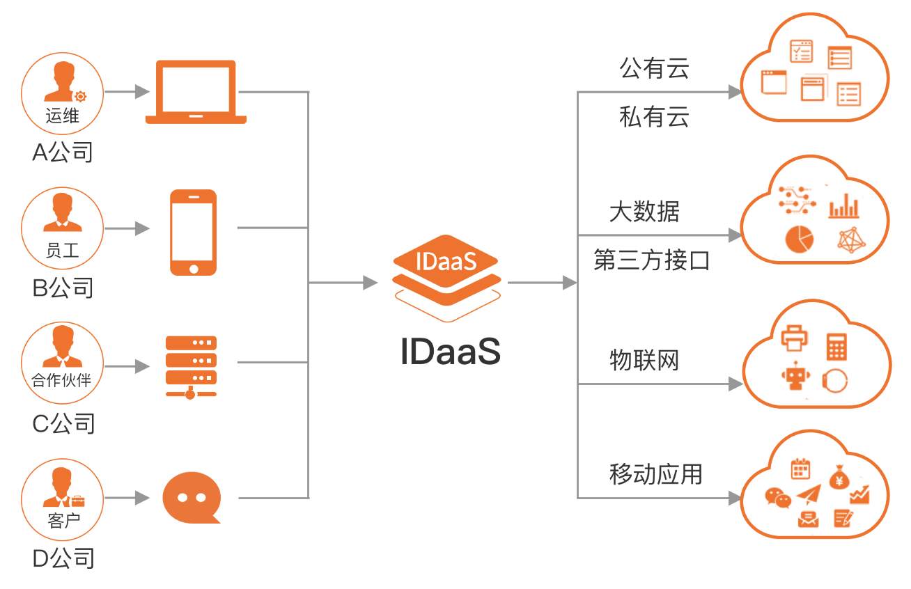
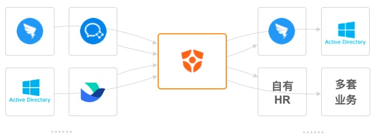

阿里云  
专有云  
应用身份服务  
产品简介  
产品版本：V3.18.6  
文档版本：20251216

**目录**

- [1.什么是应用身份服务？](#section-1)
- [2.IDaaS术语表](#section-2)
- [3.应用场景](#section-3)

# 1.什么是应用身份服务？

阿里云IDaaS是一款云原生身份及权限管理服务，为企业提供组织架构管理、账户全生命周期管控和单点登录（SSO）等一站式能力，适用于企业内部身份管理及多账号体系桥接场景，助力企业高效安全管理身份权限。

**概述**

应用身份服务【IDaaS】（Identity-as-a-Service）是阿里云为企业用户提供的一种云原生身份及权限管理体系。它提供了一站式的组织架构、账户全生命周期管理、应用接入实现单点登录（SSO），并控制账号所具备的权限等能力。

**核心能力**

- 对管理者而言，IDaaS提供一站式组织架构、账户全生命周期管理、应用接入实现单点登录（SSO），并控制账号所具备的权限等能力。

- 对用户而言，IDaaS提供应用访问门户、独立登录体系、账号自服务能力。

**产品优势**

您可以使用IDaaS，统一管理各应用中分散的账号，并集中分配应用访问控制权限，极大降低低效、重复的账号访问配置和运维消耗，解放生产力。

- **云原生**：标准、安全、稳定，与云产品身份集成。

- **更开放**：面向开发者、云产品深度集成、场景模板快速积累。

**使用场景**

- **企业内部身份管理**：统一管理各应用中分散的账号，并集中分配应用访问控制权限，极大降低低效、重复的账号访问配置和运维消耗，解放生产力。

- **桥接不同账号体系**：允许应用和企业既有通讯录与IDaaS的账号体系打通。您可以将IDaaS当做企业账号管理系统来使用，也可仅将IDaaS当做不同账号体系之间的桥接。

IDaaS不仅提供了强大的身份管理功能，还确保了系统的高可用性和安全性。无论是企业内部的身份管理，还是作为不同账号体系之间的桥接，IDaaS EIAM都能帮助企业实现高效、安全的身份管理。欢迎使用并体验其核心能力。

# 2.IDaaS术语表

**产品相关**

**IDaaS**

Identity-as-a-Service，身份即服务，企业云身份管理中心，阿里云提供的云身份服务。

**EIAM**

Enterprise Identity Access Management，企业员工身份管理系统、传统意义上的统一身份认证平台、IAM系统、4A平台。面向企业内部ToE员工、实习生、临时工与ToB合作伙伴、供应商、门店职工的身份管理。阿里云提供的云身份服务。

**CIAM**

Customer Identity Access Management，企业外部用户身份管理系统，面向消费者、会员、公民市民等外部身份。阿里云提供的云身份服务。

**国际化**

指产品使用、界面、图片、文档、运营、支持的多语言化。IDaaS目前支持中、英两种语言。

**安全认证**

安全认证。阿里云提供的身份认证服务，提供号码认证、IIFAA、WebAuthn、短信认证、OTP等一揽子无密码登录方式，对接一套SDK即全部可用。

**零信任**

零信任是一套新兴网络架构，行业内普遍采用。零信任架构打破了原有的可信网络环境边界，要求所有服务访问均需要可信身份、合理授权，有效提高了整体网络架构安全性和使用便捷性，在远程办公、多云架构、BYOD等现代办公条件中应用。

**私有化**

私有化IDaaS指代将IDaaS部署到您指定的环境中，无论部署在您的阿里云VPC、AWS、还是线下机房等，均属于私有化范畴。

**身份提供方**

**IdP**

Identity Provider，身份提供方，即IDaaS。源自于SAML协议中定义，IdP为进行用户认证、鉴权，并返回SAML Response结果信息给SP的身份提供方，后通用化指统一身份管理平台。在当前场景中，IDaaS即是IdP。

**SP**

Service Provider，服务提供方，即应用。源自于SAML协议中定义，SP为接收IdP返回结果的解析方，后通用化指接入IdP的应用。

**AD活动目录**

微软Active Directory，微软用于企业办公场景中，对组织、账户、权限进行管理的组件，可单独部署。由于其极广的适用性，很多现代应用也支持AD作为其账号体系。由于AD普遍存在的体验和兼容性问题，通常企业会寻找其他身份方案，比如IDaaS。

**LDAP**

Lightweight Directory Access Protocol，轻量级目录访问协议，最常用于和AD、OpenLDAP企业目录进行交互，但同样采用与Apache Directory等其他系统。

**OpenLDAP**

广泛使用的，基于LDAP协议的开源身份目录。

**ADFS**

Active Directory Federation Service，AD联邦服务，Windows Server的一个默认组件，用于加强传统AD在链接外部应用时不够灵活的弊端，使用麻烦、需要维护。

**钉钉通讯录**

IDaaS增强钉钉通讯录的能力，实现钉钉通讯录到其他企业账号体系之间身份同步、身份提供等场景。

**账户**

**组织架构**

企业以部门为单位的树形结构。

**组织**

亦称组织机构、Organizational Unit、OU、部门等，企业树形组织架构中的节点，一般对应企业部门。

**根组织节点**

每个IDaaS实例只有一个根节点，对应企业本身，在IDaaS中可以修改根节点名称。

**账户**

每个用户理论上应有且只有一个IDaaS账户。账户可登录IDaaS应用门户，接入应用SSO后，亦可以授权登录应用。

**账户生命周期管理**

账户从创建（入职）到终止（离职）的全生命周期管理流程，包含禁用、锁定、移动、编辑等操作。

**组**

组是账户的集合，用于统一进行权限分配，设定同步范围。

**同步**

在IDaaS场景中，同步普遍指代账户、组织在不同系统之间的传递。同步可分为增量、全量，可分为即时、定时，还可按照出方向（从IDaaS同步到外部系统）、入方向（外部系统同步到IDaaS）划分。

**SCIM**

System for Cross-domain Identity Management，跨域身份管理系统，专用于不同系统之间账户、组织同步的国际通用规范，国内外有大量应用支持接收SCIM协议同步请求，以实现不同系统身份的互用性Interoperability。

**应用**

**单点登录（SSO）**

Single Sign-On。指用户仅需一次登录，即可访问全部应用的实现，在历史中根据应用变化，SSO也有多种实现形态。在IDaaS的语境中，我们只把基于SAML、OIDC等标准协议的身份联邦机制，称为单点登录。

**IdP发起的单点登录**

IdP-init SSO。用户先访问到IDaaS应用门户，已处于登录状态后，然后访问应用触发的单点登录。在此流程中，请求由IDaaS（IdP）发起。

**SP发起的单点登录**

SP-init SSO。用户访问到应用，由应用判断是否要进行登录。如果需要登录，应跳转到IDaaS（IdP）完成认证后，回跳到应用中。在此流程中，请求由应用（SP）发起。

**应用账户**

Application User，指在单点登录时，已登录IDaaS账户在目标应用中所扮演的身份。举例：zhangsan（IDaaS账户）在“运营平台”应用中是admin（应用账户）。IDaaS支持多种应用账户与IDaaS账户的关联方式。在同一个应用中，当同时可扮演多个身份时，用户需要选择一个身份进行访问。

**签名/验签**

基于非对称性加密算法，衍生出的常见使用。举例：IDaaS在OIDC SSO时，对签发的 `id_token` 使用RSA-256算法私钥签名，应用使用公钥验签，确保令牌未经伪造、篡改。

**加密/解密**

基于对称或非对称加密算法实现。举例：IDaaS应用进行同步时，IDaaS支持将同步内容使用AES-256加密后传输。应用使用对称密钥，将内容解密后，才能获取到其中内容，确保在不安全网络环境中内容私密性、准确性。

**授权**

主体（组织、账户）与客体（应用或其他资源）之间的权限分配。IDaaS中可以统一分配所有接入应用的访问权限，实现企业统一权限管理。在IDaaS中，授权特定组织到应用后，组织内账户才拥有访问应用的权限。

**SAML**

Security Assertion Markup Language安全断言标记语言，基于XML，全球使用广泛的单点登录协议，相较OIDC而言较为复杂。IDaaS支持SAML 2.0。

**OIDC**

OpenID Connect。OIDC协议于2014年发布，结合了OpenID认证协议和OAuth 2.0授权协议的优势，是全球通用的现代身份联邦协议，用于实现SSO、鉴权、委托认证等场景。

**JWT**

Json Web Token（RFC7519） 狭义上是一种基于JSON的信息传输格式。由于传输的内容支持签名和加密，在中国IAM语境中，JWT又经常代表一种简化的、部分基于OIDC隐式流的单点登录实现方式。

**CAS**

Central Authentication Service。全球通用的单点登录协议，支持B/S网页应用。

**OAuth 2.0**

授权协议，虽不是为了SSO设计，但也经常用于实现SSO。由于OIDC协议基于OAuth 2.0协议实现，两者很多支持的模式是互通的。

**access_token/id_token/refresh_token**

`access_token` 是授权令牌，用于调用IdP提供的接口。

`id_token` 是身份令牌，可通过解析 `id_token` 内容，获取当前已登录账户信息。

`refresh_token` 是刷新令牌，在 `access_token` 令牌过期后，可以使用 `refresh_token` 获取新令牌。

**OIDC/OAuth客户端模式/客户端流**

Client Credentials模式，被授权方不是用户/账户，而是应用服务，用于应用获取调用对应资源/接口的权限。IDaaS提供 `client_id` ,  `client_secret`  给应用，应用可借其换取 `access_token` ， 调用IDaaS指定接口。

**OAuth授权码模式/授权码流**

Authorization Code模式，被授权方是用户，应用通过授权码模式，可获取三方系统身份信息，并以该身份进行登录。常见的钉钉登录、微信登录等均采用授权码模式。

**OAuth设备模式/设备流**

Device Flow，用于特定硬件设备中，在设备/终端不支持展示IDaaS登录页面时，允许用户在PC/手机浏览器中访问IDaaS登录页，完成登录后，身份将传递到设备/终端，完成登录。

**登录**

**密码复杂度**

企业下属账户的密码必须达到的复杂度要求。

**懒加载**

Lazy Loading、Just-in-time Provisioning，当用户登录时，若IDaaS中未找到身份信息，自动转发向企业原有身份体系发起认证请求，当认证通过，该账户信息在IDaaS中保存。通常用于密码在原有系统中无法导入 IDaaS，只能使用懒加载逐步导入的场景。

**二次认证（MFA/2FA）**

Multi-Factor Authentication多因素认证、Two-Factor Authentication双因素/二次认证，指在登录时需要提供多种身份认证因子，交叉确认访问者身份。由于密码天然的安全弱点，通常用于加强账号+密码登录方式。IDaaS中支持对账密认证开启短信、邮件或动态令牌（OTP）二次认证。

**OTP**

One Time Password动态口令，一次有效的验证码机制。最常用的OTP为TOTP（Time-based One-Time Password），通常30s一变，服务端和客户端（APP）需提前对齐种子、提前校对时间。在同一时间窗口内，客户端（APP）计算的动态口令（OTP）应与服务端一致，从而通过认证。

**应用门户**

IDaaS提供的企业访问门户页，可在此页面发起到所有应用的单点登录。

# 3.应用场景

IDaaS可以打破身份孤岛，将不同部门、不同组织内的全生命周期应用账户管理起来，实现统一访问控制，允许企业成员使用一个账号畅游所有应用。

如下举例3个常见使用场景。

**核心场景一、研发团队账户管理**

当企业中研发、运维、IT等团队人数达到数十人至数百人时，由于使用应用数量多，在应用的账户、密码管理上会出现瓶颈。近些年账户权限导致的问题层出不穷，为了确保企业资产安全，往往只有团队管理者可对各系统账户进行管理。当应用较多时，针对各应用账户的改密、解锁、权限分配等，日常会消耗掉管理人员可观的宝贵精力。对追求精益求精的团队来讲，此类管理操作低效、重复、价值低，账户分散管理风险大、不可控。人工管理难以接受。IDaaS可以将研发、运维工作相关的应用尽数打通，实现一套账户登录、统一授权管理。安全价值高，配置简化，效率高。常见的文档、任务管理、代码管理、接口管理、资源运维、日志告警、沟通交流等工作，全部可由IDaaS统一实现SSO。每个应用配置短至5分钟，即可开始使用<strong>。</strong>

**核心场景二、业务应用账户管理**

IDaaS支持员工、临时工、实习生、合作伙伴、生态公司等各类账户的统一管理，并统筹账户到业务、财务、HRSaaS、等各类企业应用的访问权限。

同时，企业可以将各类自研应用接入IDaaS统一进行访问控制。

**核心场景三、企业账户连接器**

若您正在使用AD、钉钉、企业微信等企业账户，会发现系统和系统间、系统和应用间的账户难以打通。部分应用有自己的规范，无法按照AD、钉钉的同步接口要求进行调整，导致账户变更需要在多点重复操作，容易导致错配、漏配问题，且消耗时间精力，是低价值重复劳动。IDaaS能作为桥梁，将不同体系中的身份贯通在一起，可以即时将钉钉、AD的变更同步给所有企业身份源，或将其他应用中的变更同步给钉钉、AD。每个身份源都会有字段映射、字段缺失、失败处理、时间策略等难题，IDaaS通过极其简单的配置，提供强大的、整套的身份连接和转化能力，帮助企业弥合身份间的孤岛。

