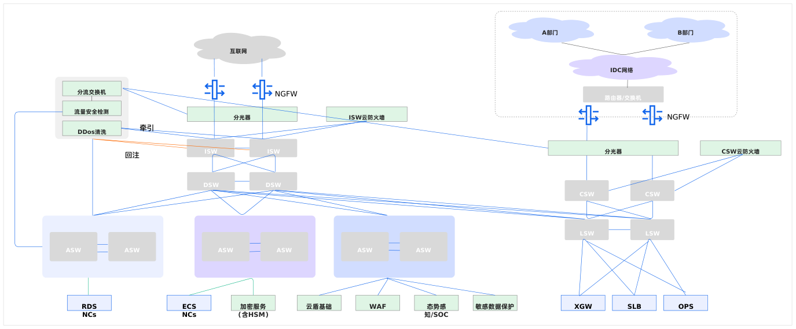

阿里云  
专有云  
云盾网络检测与响应  
产品简介  
产品版本：V3.18.6  
文档版本：20251030

**目录**

- [1.什么是NDR](#section-1)
- [2.产品优势](#section-2)
- [3.产品架构](#section-3)
- [4.功能特性](#section-4)
- [5.应用场景](#section-5)
- [6.基本概念](#section-6)

# 1.什么是NDR

NDR即网络流量检测与响应，通过多种威胁检测引擎和威胁情报，对互联网边界和内网边界流量中的网络攻击行为进行检测，并采取相应的响应措施。

**概述**

- 网络流量检测与响应是一套微秒级大数据实时分析产品，是纵深安全防御中的第一道大门。通过对机房入口镜像流量进行深度包分析，实时检测各种攻击和异常行为。同时，通过用户自定义的阈值，精准识别网络威胁，并与其他安全系统产生联动。

- 网络流量检测与响应致力于从事前、事中、事后的攻击视角对网络流量进行检测和响应。在事前阶段，提供端口防扫描、威胁情报等预防措施；在事中阶段，提供IDS、WEBIDS、行为分析、一键封禁等检测和封禁能力；在事后阶段，提供全流量协议日志采集、攻击者报文留存等追溯能力。此外，还可以与SOAR联合使用，进行检测响应编排，实现全流量的自动化运营。

# 2.产品优势

作为云上安全先行者，阿里云云盾拥有多项权威认证，通过成熟的安全体系、先进的安全技术，帮助专有云用户全面保障专有云环境的安全。

**云上安全先行者**

阿里安全团队从2005年起护航阿里巴巴集团内部所有业务系统的信息安全，不断积累安全经验。自2011年首次推出云盾产品，全方位保障云上安全，成为云上安全先行者。

云盾保护全国超过40%的网站，每天防御全中国一半以上的大流量攻击，每天抵挡36亿次恶意攻击，过去一年中帮助用户修复超过613万个漏洞。

**体系完整，技术领先**

十年攻防，一朝成盾。在经历了为阿里巴巴集团自身业务十年来的安全护航后，阿里巴巴积累了大量的安全研究成果、安全数据、安全运营和安全管理方法，形成了一支专业的云安全专家团队。 云盾是集合这些安全专家多年攻防经验开发出来的面向云计算平台安全最佳实现的成熟体系，可有效保护专有云用户云平台、云网络环境和云业务系统的安全。

**与传统安全产品对比**

| 特点 | 传统安全产品 | 云盾 |
| --- | --- | --- |
| 顶级互联网企业安全能力完整输出 | 传统安全厂商都有各自擅长的产品，但在其他产品上存在短板，无法形成整体安全防护体系。 | 阿里巴巴集团在与黑客攻击对抗过程中沉淀了大量的情报能力，及时发现流行的互联网攻击行为以及0 Day攻击手段，为用户提供完整的安全能力。 |
| 提前研判、预知风险爆发 | 传统安全厂商缺少完整的监控业务场景，无法准确研判风险的爆发。 | 对于重大漏洞、重大安全事件能够进行分析并及时响应，避免安全问题的爆发。 |
| 安全大数据建模分析 | 传统安全厂商使用单一的特征检测方式无法发现未知威胁；日志分析展现仍停留在数据统计、报表展现，无法实现真正的安全数据建模分析。 | 通过大数据建模分析方式，发现全网安全威胁，并全量展示安全态势。模型包含30多种算法模型，结合历史数据、网络数据、主机数据，实现真正的态势感知能力。 |
| 弹性扩容，与硬件解耦合 | 基于自身定制的硬件设备实现；软件化后的安全产品，也是基于虚拟化平台上的虚拟主机实现。 | • 硬件解耦合：采用云架构设计，所有功能模块都基于通用的X86硬件平台，对硬件无依赖性。 • 弹性扩容：在性能不足时，无需改造网络结构，直接平滑地扩展硬件数量即可。 |
| 体系化建设，联合检测响应 | 通过设备的堆叠来实现安全能力覆盖。各设备之间不能有效的联动，一般只能通过管理平台将各个设备的日志、状态进行统一收集、展现。 | 提供完整的网络、主机、应用、数据、身份防护能力，各防护组件通过自动化的运营方式实现联动响应、情报共享。 |
| 兼容所有的IDC环境，和云平台解耦合 | 大部分的传统安全厂商仍然基于硬件盒子的形态提供安全产品。在SDN技术越来越普及的情况下，这样的形态无法与云环境兼容。 | 采用“网络出口检测 + 服务器操作系统联动”架构；采用数据分析方式发现安全威胁。通过这种架构及方式，避开了IDC内部复杂的网络结构，完全兼容所有的IDC环境。 |

# 3.产品架构

NDR是通过流量镜像的方式对出入流量进行逐包检测分析。

**产品网络架构图**

NDR是一款旁路接入、业务无感知的产品。在网络架构上需要借助于分光器和分流器等网络设备将ISW、CSW、LSW上联口流量镜像到NDR集群。

**名词解释**

<table>
  <tr>
    <th width="106">名字</th>
    <th>解释</th>
  </tr>
  <tr>
    <td>NDR</td>
    <td>网络流量检测和响应。</td>
  </tr>
  <tr>
    <td>分光器</td>
    <td>分光器是一种无源器件，又称光分路器，它们不需要外部能量，只要有输入光即可。分光器由入射和出射狭缝、反射镜和色散元件组成，其作用是将所需要的共振吸收线分离出来。分光器的关键部件是色散元件，现在商品仪器都是使用光栅。</td>
  </tr>
  <tr>
    <td>分流交换机</td>
    <td>通过对网络分流器输入数据，进行复制、汇聚、过滤，通过协议转换把万兆POS数据转换成千兆LAN数据，按照特定的算法进行负载均衡输出，输出的同时保证同一会话的所有数据包，或者同一IP用户的所有数据包从同一个接口输出。 说明专有云beaver有两种分流器：商用分流器和自研分流器。自研分流器叫TSW，实质是交换机来实现流量复制分发，他不具备过滤的功能。商用分流器有光迅、恒为、恒光等。</td>
  </tr>
  <tr>
    <td>ISW</td>
    <td>互联交换机，互联ISP（互联网服务提供商Internet Service Provider，指的是面向公众提供下列信息服务的经营者）或用户网络骨干。</td>
  </tr>
  <tr>
    <td>DSW</td>
    <td>核心交换机（分布层交换机），用于连接各个ASW接入交换机。</td>
  </tr>
  <tr>
    <td>ASW</td>
    <td>接入交换机，数据交换模块接入交换机，接入云服务器，上行互联核心交换机DSW。</td>
  </tr>
  <tr>
    <td>CSW</td>
    <td>内网接入交换机（Customer Switch），接入用户内网骨干，实现云网络内外部的路由分发交互，包括VPC专线接入，CSW可以实现专线侧到XGW的VxLAN封装。</td>
  </tr>
  <tr>
    <td>LSW</td>
    <td>综合接入交换机，接入各云产品的各类服务网关设备。综合接入模块，云产品服务接入交换机，主要提供VPC和SLB等服务。各类云产品服务器（XGW/SLB/OPS）分别与两台LSW互联，通过OSPF交换路由信息；两台LSW之间通过iBGP交互路由信息；LSW与DSW、CSW之间通过eBGP交换路由信息。</td>
  </tr>
</table>

# 4.功能特性

本文NDR功能特性进行介绍说明。

**一级特性**

**二级特性**

**三级特性**

**特性描述**

网络威胁检测响应系统支持旁路部署模式，可以选择对云网络到互

部署模式

旁路部署

联网（ISW侧）、云网络到企业内网（CSW侧）、云网络ECS ENI网卡流量（VPC流量镜像）进行安全分析。

流量检测

网络性能

吞吐与检测性能

单集群最大支持处理20G流量，威胁检测处理10G流量。

dos攻击检测，支持检测针对Web、MySQL、FTP、Samba、

DDoS攻击检测

OpenLDAP、Redis等服务的拒绝服务攻击行为。

支持检测SQL注入攻击行为，可以防护常见的SQL注入攻击行为和

SQL注入检测

SQL注入盲注行为。

Webshell检测

支持Webshell上传攻击行为检测，发现中国菜刀、恶意文件上传。

勒索软件行为检

勒索软件行为检测，支持buran、clop、yatron、samsam、

测

badrabbit等勒索软件家族的检测。

反弹shell行为检

反弹Shell行为检测，支持检测Linux、Windows操作系统中存在的

测

反弹Shell行为。

异常连接检测

支持DNStunnel、PowerShell等异常连接行为检测。

支持AWVS、Acunetix、masscan、Nessus、nmap、

恶意扫描检测

BurpSuite、ZedAttack、appscan、WVS、tangscan、eEye等扫描器的恶意扫描行为进行检测。

挖矿行为检测，支持对DecredMiner、xmrig等主机挖矿软件行为

挖矿行为检测

进行检测，发现消耗主机资源的挖矿行为。

支持针对WordPress、MicrosoftSharePoint、

敏感数据泄漏检

OracleApplicationServer、Apache、WebCMS、Nginx、

测

OracleDB、MySQL、ES等服务的数据泄漏攻击行为进行检测。

暴力破解检测

支持暴力破解攻击行为检测。

威胁检测

木马行为检测，支持对FireEye、BlackRAT、SoreFang、Azorult、Rifdoor等数百种后门软件的通信行为以及Webshell远控

木马行为检测

通信行为的检测。

威胁检测

支持威胁检测白名单的配置管理，命中白名单匹配条加后将不再产

白名单策略

生威胁检测告警。

Web攻击，支持目录遍历、目录穿越、任意文件上传、任意文件读

目录遍历检测

取、SSRF、CSRF等Web类攻击的检测。

缓冲区溢出检测

支持常见缓冲区溢出攻击行为检测。

支持威胁检测事件和封禁日志的异步导出，可在下载任务管理中查

网络威胁处置

看导出任务，支持下载导出内容或删除导出任务。

蠕虫病毒行为检

支持蠕虫病毒行为的检测，防止蠕虫病毒在网络中下载、传播、通

测

信。

跨站脚本检测

支持跨站脚本攻击行为的检测。

远程代码执行检

支持对远程代码执行、远程命令执行的攻击行为进行检测。

测

支持对Microsftsharepoint、Dynamics365、

远程代码执行漏

OracleWebLogicServer、Apache、CMS等应用的远程代码执行

洞检测

漏洞利用行为进行检测。

远程文件包含检

支持远程文件包含和本地文件包含攻击行为检测。

测

支持统计封禁日志的源IP和目的IPTop5信息，告警数量变化趋势

封禁TOP信息

图。

封禁日志

命中防护策略的流量，会生成封禁日志，封禁日志支持查看流量的

封禁日志

源、目的、攻击次数、命中的策略ID以及命中的规则的名称，支持修改策略的防护动作。

支持查看攻击过程的详情，支持攻击详细信息的payload和pcap包

攻击过程

下载。

攻击者画

攻击者画

像

像

从攻击者的视图对入侵者的基础信息、威胁情报、攻击手法、攻击

攻击者行为

目标、攻击过程进行统一的分析展示。

支持通过时间范围、所属组织、日志类型的组合条件及逻辑表达式

检索条件

进行日志检索查询。

日志导出任务

支持日志导出任务管理，可进行异步日志导出。

日志转换

支持小工具进行日志特殊格式字段转换。

日志检索

日志检索

支持日志全部字段导出、选择字段导出，支持日志详情PCAP包导

日志导出字段

出。

支持选择日志中需要展示的字段，并对任意字段内容添加检索条

检索模板

件，支持将检索条件保存为模板，方便后续查看过滤。

支持查看1小时、4小时、8小时、24小时、7天、30天的流量日志

流量日志检索

和安全事件日志。

支持4300+预置网络入侵攻击检测规则，支持检测规则的配置管理，可针对单条规则进行启用或禁用配置，支持自定义规则，可配

入侵检测规则

置规则名称、规则引擎、攻击类型、等级、CVE、攻击应用、规则模式、方向、规则内容、规则描述、备注等规则属性。

内网资产IP地址

支持内网IP地址识别配置，应用于网络流量方向判别。

池

支持IP地址簿管理，可以批量管理IP地址，并在防护策略中引用地址

地址簿管理

簿。

支持应用层防护策略，基于HTTP报文的字段内容设置观察与阻断策

策略管理

策略管理

HTTP自定义策略

略，支持设置策略生效时间。

支持1200+预置Web入侵攻击检测规则，包括Webshell上传、

WEB应用检测配

SQL注入、跨站脚本、代码执行、CRLF、本地文件包含等多种攻击

置

行为检测，支持Web应用检测规则的配置管理，支持启用和禁用Web应用检测规则。

端口扫描欺骗策

支持端口扫描欺骗策略，可添加需要防护的IP和端口，对恶意端口扫

略

描行为进行欺骗。

支持四层防护策略，根据基于源IP、目的IP及端口设置流量观察与阻

网络层策略

断策略。

支持DGA域名和DNS隧道检测功能，检测可疑DNS请求并产生告

DNS行为分析

警，并支持异步导出，支持自定义检测时间范围、请求次数、域名总长度，支持可疑域名数量和趋势的统计。

行为分析

行为分析

支持SSL加密流量特征检测，发现加密流量中的恶意软件通信行为特

加密流量分析

征并产生告警，支持告警内容的异步导出。

支持全局组织安全管理员角色用户新建网络报文捕获任务，进行

网络抓包

网络抓包

网络抓包

TCP/UDP/ICMP协议报文抓取。

<table>
  <tr>
    <td rowspan="7">流量分析</td>
    <td rowspan="4">互联网边界</td>
    <td>互联网边界流量统计</td>
    <td>统计从互联网边界到云主机的出入方向网络流量记录，包括出入方向的活跃IP数、流量的应用类型数量、均值流量大小和峰值流量大小，支持查看最近1小时、24小时、7天3个维度的统计数据。</td>
  </tr>
  <tr>
    <td>互联网边界流量排序</td>
    <td>支持对互联网边界活跃IP地址的网络流量大小、访问IP数、应用类型数、会话数进行排序。</td>
  </tr>
  <tr>
    <td>互联网边界访问记录详情</td>
    <td>支持查看每个IP的网络访问记录详情，查看IP地址的网络流量趋势图、关联的ECS资产，历史网络会话记录，支持查看最近1小时、24小时、7天3个维度的统计数据。</td>
  </tr>
  <tr>
    <td>互联网边界一键封禁</td>
    <td>支持对可疑的网络访问行为进行一键封禁，禁止可疑IP地址出和入方向的网络访问。</td>
  </tr>
  <tr>
    <td rowspan="3">内网边界</td>
    <td>内网边界访问记录详情</td>
    <td>支持查看每个IP的网络访问记录详情，查看IP地址的网络流量趋势图、关联的ECS资产，历史网络会话记录。支持查看最近1小时、24小时、7天3个维度的统计数据。</td>
  </tr>
  <tr>
    <td>内网边界流量统计</td>
    <td>统计从IDC网络到云主机的出入方向网络流量记录，包括出入方向的活跃IP数、流量的应用类型数量、均值流量大小和峰值流量大小，支持查看最近1小时、24小时、7天3个维度的统计数据。</td>
  </tr>
  <tr>
    <td>内网边界流量排序</td>
    <td>支持对IDC网络到云内主机活跃IP地址的网络流量大小、访问IP数、应用类型数、会话数进行排序。</td>
  </tr>
  <tr>
    <td rowspan="3">流量趋势</td>
    <td rowspan="3">流量趋势</td>
    <td>入方向会话流量趋势</td>
    <td>支持根据网络流量大小统计出从互联网、IDC IP地址访问云内主机的流量排名TOP5，应用类型的分布，支持云内主机网络访问流量的排名，支持查看最近1小时、24小时、7天3个维度的统计数据。</td>
  </tr>
  <tr>
    <td>出方向会话流量趋势</td>
    <td>支持根据网络流量大小统计云内主机到云外的流量排名TOP5，应用类型的分布，支持云内主机对外网络访问流量的排名，支持查看最近1小时、24小时、7天3个维度的统计数据。</td>
  </tr>
  <tr>
    <td>总流量趋势</td>
    <td>支持统计总的网络流量变化趋势，可以查看最近1小时、24小时、7天系统检测到的网络带宽变化趋势和网络报文数量的变化趋势。</td>
  </tr>
</table>

# 5.应用场景

NDR为不同规模、不同行业的用户提供灵活的、可扩展的网络安全解决方案，主要用于工业、农业、交通、政务、金融、交通、教育等各个方面。

**专有云等保**

阿里云专有云通过帮助用户在计算资源平台部署专有云云盾主机安全、网络安全、应用安全、数据安全、运维审计和统一管理安全体系，实现纵深防御，实时掌握平台和业务安全风险，满足等保三级和四级合规安全技术要求。同时通过安全运营驻场服务和等保咨询服务，保障客户业务安全和稳定运行，满足等保2.0三级和四级合规安全管理和测评要求。

**政务专有云**

政务专有云通过构建专有云政务统一服务平台，建设智能便民服务和智能政务办公，大幅提升内部工作效率和便捷为民服务。客户部署云端DDoS和Web防护形成最外侧第一道防线，并通过专有云云盾安全产品保障政务云业务系统的运行安全、数据安全、运维安全，通过安全服务帮助用户构建安全管理组织结构、管理制度和安全工作意识。

**金融专有云**

金融专有云建设安全纵深防护体系，在专有云出口部署NDR、Aliguard、云防火墙进行网络层攻击的深度检测及防护；在应用层，部署WAF对应用层攻击进行过滤；在主机上部署安骑士主机防护客户端，对终端安全进行防护。在此基础上，收集全网安全日志，进行统一安全大数据建模分析，打通安全孤岛。安全防护系统基于X86架构进行云化部署，告别传统安全专用硬件。

# 6.基本概念

本文介绍NDR相关的基本概念。

**分光器**

分光器是一种无源器件，又称光分路器，它们不需要外部能量，只要有输入光即可。分光器由入射和出射狭缝、反射镜和色散元件组成，其作用是将所需要的共振吸收线分离出来。分光器的关键部件是色散元件，现在商品仪器都是使用光栅。

**分流交换机**

通过对网络分流器输入数据，进行复制、汇聚、过滤，通过协议转换把万兆POS数据转换成千兆LAN数据，按照特定的算法进行负载均衡输出，输出的同时保证同一会话的所有数据包，或者同一IP用户的所有数据包从同一个接口输出。

**IDS检测**

入侵检测系统（intrusion detection system，简称“IDS”）是一种对网络传输进行即时监视，在发现可疑传输时发出警报或者采取主动反应措施的网络安全设备。

**DDoS攻击**

分布式拒绝服务（Distributed Denial of Service，简称DDoS），指借助于客户/服务器技术，将多个计算机联合起来作为攻击平台，对一个或多个目标发动DDoS攻击，从而成倍地提高拒绝服务攻击的威力。

**SQL注入**

通过把SQL命令插入到Web表单提交或输入域名或页面请求的查询字符串，最终达到欺骗服务器执行恶意的SQL命令。

**流量清洗**

流量清洗服务对进入机房的数据流量进行实时监控，及时发现包括DDoS攻击在内的异常流量。在不影响正常业务的前提下，清洗掉异常流量。

**密码暴力破解**

根据密码命名规则的部分条件确定密码的大致范围，并在此范围内对所有可能的情况逐一验证，直到全部情况验证完毕。

**网站后门**

一段运行在服务器端的网页代码，主要以ASP和PHP代码为主，攻击者通过这段代码，在服务器端进行某些危险的操作，获得某些敏感的技术信息或者通过渗透、提权的方式获得服务器的控制权。

**SOAR**

SOAR是专有云云盾下的一款安全管理服务，可通过SOAR安全自动化编排，将安全事件运营自动化、流程化，提升安全响应速度。
