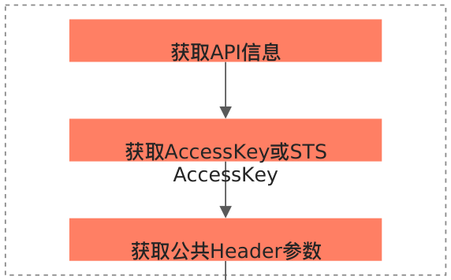
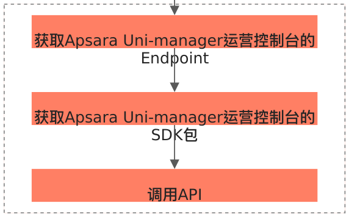

阿里云  
专有云  
云盾网络检测与响应  
开发指南  
产品版本：V3.18.6  
文档版本：20251030

**目录**

- [1.快速入门](#section-1)
    - [1.1. 开发文档使用说明](#section-1-1)
    - [1.2. API调用流程说明](#section-1-2)
- [2.准备工作](#section-2)
    - [2.1. 获取API信息及其EndPoint](#section-2-1)
    - [2.2. 登录开发者门户控制台](#section-2-2)
    - [2.3. 获取AccessKey](#section-2-3)
    - [2.4. 获取STS AccessKey](#section-2-4)
- [3.调用方式](#section-3)
    - [3.1. 请求结构](#section-3-1)
    - [3.2. 签名机制](#section-3-2)
    - [3.3. 公共参数](#section-3-3)
    - [3.4. 返回结构](#section-3-4)
- [4.调用示例](#section-4)
    - [4.1. Java SDK调用示例](#section-4-1)
        - [4.1.1. 使用手册](#section-4-1-1)
            - [4.1.1.1. 安装Java SDK](#section-4-1-1-1)
            - [4.1.1.2. 使用CommonRequest进行调用](#section-4-1-1-2)
    - [4.2. Python SDK调用示例](#section-4-2)
        - [4.2.1. 使用手册](#section-4-2-1)
            - [4.2.1.1. 安装Python SDK](#section-4-2-1-1)
            - [4.2.1.2. 使用CommonRequest进行调用](#section-4-2-1-2)
    - [4.3. Go SDK调用示例](#section-4-3)
        - [4.3.1. 使用手册](#section-4-3-1)
            - [4.3.1.1. 安装Go SDK核心包](#section-4-3-1-1)
            - [4.3.1.2. 使用CommonRequest进行调用](#section-4-3-1-2)
- [5.API参考](#section-5)
    - [5.1. 流量趋势](#section-5-1)
        - [5.1.1. DescribeNtaTrafficTrend](#section-5-1-1)
        - [5.1.2. DescribeNtaTrafficTopInfo](#section-5-1-2)
    - [5.2. 流量分析](#section-5-2)
        - [5.2.1. DescribeNtaTrafficListByIp](#section-5-2-1)
        - [5.2.2. DescribeVpcInfoByUid](#section-5-2-2)
        - [5.2.3. DescribeNtaTrafficStatisticsByUid](#section-5-2-3)
        - [5.2.4. DescribeSessionByApp](#section-5-2-4)
        - [5.2.5. DescribeNtaTrafficListByApp](#section-5-2-5)
        - [5.2.6. DescribeIncAppInfo](#section-5-2-6)
        - [5.2.7. DescribeEcsByIp](#section-5-2-7)
        - [5.2.8. DescribeAssetByIp](#section-5-2-8)
        - [5.2.9. DescribeNtaAppTrend](#section-5-2-9)
        - [5.2.10. DescribeSessionByIp](#section-5-2-10)
    - [5.3. 日志检索](#section-5-3)
        - [5.3.1. DescribeHitLogColumns](#section-5-3-1)
        - [5.3.2. DescribeSearchTemplate](#section-5-3-2)
        - [5.3.3. UpdateVisibleLogFields](#section-5-3-3)
        - [5.3.4. ExportHitlogs](#section-5-3-4)
        - [5.3.5. DescribeGivenFieldStatistics](#section-5-3-5)
        - [5.3.6. DescribeHitLogColumnsData](#section-5-3-6)
        - [5.3.7. DescribeHitStatistics](#section-5-3-7)
        - [5.3.8. DescribeLogFieldIntroduction](#section-5-3-8)
        - [5.3.9. DescribeHitDetailList](#section-5-3-9)
        - [5.3.10. DescribeLogFields](#section-5-3-10)
        - [5.3.11. DescribeLogType](#section-5-3-11)
        - [5.3.12. DelSearchTemplate](#section-5-3-12)
        - [5.3.13. AddSearchTemplate](#section-5-3-13)
    - [5.4. 攻击者画像](#section-5-4)
        - [5.4.1. DescribeAggAttackProcess](#section-5-4-1)
        - [5.4.2. ExportAggAttackEventMergePcap](#section-5-4-2)
        - [5.4.3. DescribeAttackEventRecords](#section-5-4-3)
        - [5.4.4. DescribeAggAttackEventList](#section-5-4-4)
        - [5.4.5. DescribeAggAttackEventMergePcapCount](#section-5-4-5)
        - [5.4.6. ExportAttackEventPcap](#section-5-4-6)
        - [5.4.7. DescribeExportMergePcapTaskByUuid](#section-5-4-7)
    - [5.5. 威胁检测](#section-5-5)
        - [5.5.1. 威胁检测](#section-5-5-1)
            - [5.5.1.1. AddCustomTag](#section-5-5-1-1)
            - [5.5.1.2. ExportAttackRecordsPcap](#section-5-5-1-2)
            - [5.5.1.3. DescribeAggAttackTopIPRecords](#section-5-5-1-3)
            - [5.5.1.4. DescribeDeptInfo](#section-5-5-1-4)
            - [5.5.1.5. AddIDSWhiteRule](#section-5-5-1-5)
            - [5.5.1.6. DescribeExportTaskByUuid](#section-5-5-1-6)
            - [5.5.1.7. DeleteIDSWhiteRules](#section-5-5-1-7)
            - [5.5.1.8. DescribeAggAttackTopStatistics](#section-5-5-1-8)
            - [5.5.1.9. DescribeAttackRecordList](#section-5-5-1-9)
            - [5.5.1.10. DescribeThreatSrcIPInfo](#section-5-5-1-10)
            - [5.5.1.11. ModifyCustomAttackLogFields](#section-5-5-1-11)
            - [5.5.1.12. DescribeAggAttackPPS](#section-5-5-1-12)
            - [5.5.1.13. AddAttackDisposal](#section-5-5-1-13)
            - [5.5.1.14. DescribeCustomAttackLogFields](#section-5-5-1-14)
            - [5.5.1.15. TagAttackRecodes](#section-5-5-1-15)
            - [5.5.1.16. DescribeAggAttackVulLevel](#section-5-5-1-16)
            - [5.5.1.17. DescribeAggAttackType](#section-5-5-1-17)
            - [5.5.1.18. DescribeAggAttackRecords](#section-5-5-1-18)
            - [5.5.1.19. DescribeAttackRecord](#section-5-5-1-19)
            - [5.5.1.20. DescribeIDSWhiteRules](#section-5-5-1-20)
            - [5.5.1.21. DescribeCustomTags](#section-5-5-1-21)
            - [5.5.1.22. ExportAggAttackRecords](#section-5-5-1-22)
            - [5.5.1.23. DescribeAggAttackEventDetail](#section-5-5-1-23)
            - [5.5.1.24. DescribeIDSRuleInfo](#section-5-5-1-24)
        - [5.5.2. 封禁日志](#section-5-5-2)
            - [5.5.2.1. DescribeAggResetData](#section-5-5-2-1)
            - [5.5.2.2. DescribeAggResetTopIPRecordsData](#section-5-5-2-2)
            - [5.5.2.3. ExportAggResetRecords](#section-5-5-2-3)
            - [5.5.2.4. DescribeAggResetPPS](#section-5-5-2-4)
            - [5.5.2.5. DescribeAggResetTopIPRecords](#section-5-5-2-5)
            - [5.5.2.6. DescribeAggResetRecords](#section-5-5-2-6)
            - [5.5.2.7. DescribeAggResetDayCount](#section-5-5-2-7)
            - [5.5.2.8. DescribeAggResetRecordsData](#section-5-5-2-8)
    - [5.6. 行为分析](#section-5-6)
        - [5.6.1. DNS行为分析](#section-5-6-1)
            - [5.6.1.1. GetBhaAggDnsTunnelRule](#section-5-6-1-1)
            - [5.6.1.2. GetBhaDnsWhiteList](#section-5-6-1-2)
            - [5.6.1.3. GetBhaDnsTunnelAggTopHost](#section-5-6-1-3)
            - [5.6.1.4. AddBhaDnsWhiteList](#section-5-6-1-4)
            - [5.6.1.5. ExportBhaAggDnsRecords](#section-5-6-1-5)
            - [5.6.1.6. GetBhaAggDnsRecords](#section-5-6-1-6)
            - [5.6.1.7. GetBhaAggDnsRecordsDetail](#section-5-6-1-7)
            - [5.6.1.8. UpdateBhaAggDnsTunnelRule](#section-5-6-1-8)
            - [5.6.1.9. DeleteBhaDnsWhiteList](#section-5-6-1-9)
            - [5.6.1.10. GetBhaAggAttackDnsHost](#section-5-6-1-10)
            - [5.6.1.11. GetBhaDgaAggTopHost](#section-5-6-1-11)
        - [5.6.2. 加密流量分析](#section-5-6-2)
            - [5.6.2.1. AddBhaEncryptWhiteList](#section-5-6-2-1)
            - [5.6.2.2. GetBhaTLsTopApp](#section-5-6-2-2)
            - [5.6.2.3. DeleteBhaEncryptWhiteList](#section-5-6-2-3)
            - [5.6.2.4. GetBhaTLsTopDstIP](#section-5-6-2-4)
            - [5.6.2.5. GetBhaEncryptWhiteList](#section-5-6-2-5)
            - [5.6.2.6. GetBhaAggTlsRecordsDetail](#section-5-6-2-6)
            - [5.6.2.7. GetBhaTLsTopSrcIP](#section-5-6-2-7)
            - [5.6.2.8. GetBhaAggTlsRecords](#section-5-6-2-8)
            - [5.6.2.9. GetBhaTLsTopTools](#section-5-6-2-9)
            - [5.6.2.10. ExportBhaAggTlsRecords](#section-5-6-2-10)
    - [5.7. 策略配置](#section-5-7)
        - [5.7.1. 网络层策略](#section-5-7-1)
            - [5.7.1.1. ModL4RuleAction](#section-5-7-1-1)
            - [5.7.1.2. ModifySafetySwitch](#section-5-7-1-2)
            - [5.7.1.3. AddL4Rule](#section-5-7-1-3)
            - [5.7.1.4. ModifyL4Rule](#section-5-7-1-4)
            - [5.7.1.5. ImportSrcIpFile](#section-5-7-1-5)
            - [5.7.1.6. DelL4Rule](#section-5-7-1-6)
            - [5.7.1.7. ImportL4Rules](#section-5-7-1-7)
            - [5.7.1.8. DescribeOssInfo](#section-5-7-1-8)
            - [5.7.1.9. DescribeSafetySwitchStatus](#section-5-7-1-9)
            - [5.7.1.10. SwitchL4RuleStatus](#section-5-7-1-10)
            - [5.7.1.11. ExportL4Rules](#section-5-7-1-11)
            - [5.7.1.12. DescribeL4Rule](#section-5-7-1-12)
        - [5.7.2. 应用层策略](#section-5-7-2)
            - [5.7.2.1. AddL7Rule](#section-5-7-2-1)
            - [5.7.2.2. ModifyL7Rule](#section-5-7-2-2)
            - [5.7.2.3. DescribeL7Rule](#section-5-7-2-3)
            - [5.7.2.4. DelL7Rule](#section-5-7-2-4)
            - [5.7.2.5. SwitchL7RuleStatus](#section-5-7-2-5)
            - [5.7.2.6. ExportL7Rules](#section-5-7-2-6)
            - [5.7.2.7. GetWafRules](#section-5-7-2-7)
            - [5.7.2.8. DescribeAllHttpFields](#section-5-7-2-8)
            - [5.7.2.9. UpdateWafRuleAction](#section-5-7-2-9)
        - [5.7.3. 端口扫描欺骗策略](#section-5-7-3)
            - [5.7.3.1. DescribePortScanProtectRules](#section-5-7-3-1)
            - [5.7.3.2. UpdatePortScanProtectRule](#section-5-7-3-2)
            - [5.7.3.3. DeletePortScanProtectRule](#section-5-7-3-3)
            - [5.7.3.4. SwitchPortProtectRuleStatus](#section-5-7-3-4)
            - [5.7.3.5. DescribeAssetsAddressAndPorts](#section-5-7-3-5)
            - [5.7.3.6. AddPortScanProtectRule](#section-5-7-3-6)
            - [5.7.3.7. DescribeAssetsAddressTypes](#section-5-7-3-7)
        - [5.7.4. 地址簿管理](#section-5-7-4)
            - [5.7.4.1. ModifyAddressGroup](#section-5-7-4-1)
            - [5.7.4.2. DelAddressGroup](#section-5-7-4-2)
            - [5.7.4.3. AddAddressGroup](#section-5-7-4-3)
            - [5.7.4.4. GetAllAddressGroupName](#section-5-7-4-4)
            - [5.7.4.5. DescribeAddressGroup](#section-5-7-4-5)
        - [5.7.5. 入侵检测规则](#section-5-7-5)
            - [5.7.5.1. DescribeIdsRulesList](#section-5-7-5-1)
            - [5.7.5.2. UpdateSingleIdsDefaultStatus](#section-5-7-5-2)
            - [5.7.5.3. AddCustomIdsRule](#section-5-7-5-3)
            - [5.7.5.4. DeleteIdsRule](#section-5-7-5-4)
            - [5.7.5.5. UpdateIdsDefaultStatus](#section-5-7-5-5)
            - [5.7.5.6. UpdateIdsRule](#section-5-7-5-6)
        - [5.7.6. 内网资产IP地址池](#section-5-7-6)
            - [5.7.6.1. ModifyIpSegment](#section-5-7-6-1)
            - [5.7.6.2. CreateIpSegment](#section-5-7-6-2)
            - [5.7.6.3. DescribeRegionName](#section-5-7-6-3)
            - [5.7.6.4. DescribeIpSegment](#section-5-7-6-4)
            - [5.7.6.5. DeleteIpSegment](#section-5-7-6-5)
            - [5.7.6.6. CheckIpSegment](#section-5-7-6-6)
    - [5.8. 下载任务管理](#section-5-8)
        - [5.8.1. DescribeDownloadTasks](#section-5-8-1)
        - [5.8.2. DescribeDownloadModules](#section-5-8-2)
        - [5.8.3. DeleteDownloadTaskByUuid](#section-5-8-3)
    - [5.9. 一键封禁](#section-5-9)
        - [5.9.1. AddToBlackList](#section-5-9-1)
        - [5.9.2. AddToWhiteList](#section-5-9-2)
        - [5.9.3. DelFromBlackList](#section-5-9-3)
        - [5.9.4. DelFromWhiteList](#section-5-9-4)
        - [5.9.5. DescribeBlackList](#section-5-9-5)
        - [5.9.6. DescribeWhiteList](#section-5-9-6)
- [6.API公共参数](#section-6)
- [7.错误代码表](#section-7)

<a id="section-1"></a>

# 1.快速入门

<a id="section-1-1"></a>

## 1.1. 开发文档使用说明

本文为您介绍在使用专有云API进行开发工作时，如何查看所需要的产品文档。

**使用流程**

您可以按照以下流程图中步骤，判断自己所需要使用的开发文档。


**前提条件**

通过运维人员或运营管理员获取专有云的版本。

**操作步骤**

您可以通过阿里云专有云文档中心，获取需要的产品文档。

1. 通过浏览器打开专有云文档中心。

2. 根据专有云的版本单击**企业版**、**敏捷版**或**一体机**标签。

3. 在下拉列表中，选择对应的专有云版本。

   

4. 在左侧导航栏中，选择目标产品名称。

5. 单击目标文档区域的**查看详情**或**下载PDF**。

<a id="section-1-2"></a>

## 1.2. API调用流程说明

阿里云专有云支持通过POP网关调用专有云API，为了使您拥有与公有云一致的体验，自企业版V3.16.0开始，专有云API默认使用POP网关方式调用。本文介绍如何通过POP网关调用专有云API。

**流程图**




准备工




正式调

**调用步骤**

1. 获取AccessKey。

   获取调用时所需要的AccessKey参数，请参见获取AccessKey或获取STS AccessKey。

   > **说明**
   >
   > 推荐使用个人AccessKey或STS AccessKey调用Apsara Uni-manager运营控制台及云产品接口。

2. 获取RegionID。

3. 获取组织ID与资源集ID。

   组织ID需要通过API进行获取，获取方式请参见*Apsara Uni-manager运营控制台开发指南*中的*GetOrga nizationList章节*。

   资源集ID需要通过API进行获取，获取方式请参见*Apsara Uni-manager运营控制台开发指南*中的*ListRe sourceGroup章节*。

   > **说明**
   >
   > 调用API时，请在Header参数中增加组织ID  和资源集ID ， 指定资源所属的组织和资源集，实现实例资源的隔离查询。
   >
   > - 不指定组织ID  ，则默认获取当前用户所属的组织。
   >
   > - 不指定资源集ID  ，则默认为空，如果指定资源集需要同时指定组织ID。

4. 获取对应的API参考文档。

   您需要查看目标云产品的开发指南，了解API的功能与使用方式，开发指南的使用流程及获取方法请参见开发文档使用说明。

5. 获取云产品Endpoint。

6. 获取云产品SDK并调用云产品API。

<a id="section-2"></a>

# 2.准备工作

<a id="section-2-1"></a>

## 2.1. 获取API信息及其EndPoint

首先，您需要了解产品开放API接口的相关信息，包括产品名称（code）、开放API接口名称、API版本。

**背景信息**

Apsara Uni-manager运营控制台API目录中的API信息仅供调用参考，具体API的使用方式需要参见云产品的开发指南。如果发生不一致情况，以开发指南支持情况为准。

**操作步骤**

1. 登录Apsara Uni-manager运营控制台。

2. 在顶部菜单栏选择**产品** > **应用服务** > **开发者门户**。

3. 在**开发者门户**页面，选择**API集成** > **API调试**。

   

4. 在左侧导航栏中选择目标云产品。

5. 在**版本**下拉列表中，选择目标API版本。

6. 在下方API列表中可浏览当前版本的所有API接口。

7. 选中对应接口，在参数名下获取云产品的POP Endpoint信息。

   

<a id="section-2-2"></a>

## 2.2. 登录开发者门户控制台

您可以通过Apsara Uni-manager运营控制台登录开发者门户控制台。

**前提条件**

- 登录Apsara Uni-manager运营控制台前，确认您已从部署人员处获取Apsara Uni-manager运营控制台的服务域名地址。

- 推荐使用Chrome浏览器

**操作步骤**

1. 在浏览器地址栏中，输入Apsara Uni-manager运营控制台的服务域名地址，按回车键。

2. 输入正确的用户名及密码。

   请向运营管理员获取登录控制台的用户名和密码。

   > **说明**
   >
   > 首次登录Apsara Uni-manager运营控制台时，需要修改登录用户名的密码，请按照提示完成密码修改。为提高安全性，密码长度必须为10~32位，且至少包含以下两种类型：
   >
   > - 英文大写或小写字母（A~Z、a~z）
   >
   > - 阿拉伯数字（0~9）
   >
   > - 特殊符号（感叹号（!）、at（@）、井号（#）、美元符号（$）、百分号（%）等）

3. 单击**登录**。

4. 如果账号已激活MFA多因素认证，请根据以下两种情况进行操作：

   - 管理员强制开启MFA后的首次登录：

     <ol type="a">

     <li>

     在绑定虚拟MFA设备页面中，按页面提示步骤绑定MFA设备。

     </li>

     <li>

     按照步骤2重新输入账号和密码，单击**登录**。

     </li>

     </ol>

     <ol type="i" start="100">

     <li>

     输入6位MFA码后单击**认证**。

     </li>

     </ol>

   - 您已开启并绑定MFA：

     输入6位MFA码后单击**认证**。

     > **说明**
     >
     > 绑定并开启MFA的操作请参见<strong>《Apsara Uni-manager运营控制台用户指南》</strong>中的<strong>《绑定并开启虚拟MFA设备》</strong>章节。

5. 在页面顶部的菜单栏中，选择**产品 > 应用服务 > 开发者门户**。

<a id="section-2-3"></a>

## 2.3. 获取AccessKey

AccessKey支持RAM和STS两种授权模式，在发起调用时选择使用其中一种AccessKey即可。本文将为您介绍如何获取通过RAM授权的AccessKey。

**背景信息**

AccessKey通过使用AccessKey ID和AccessKey Secret对称加密，实现验证某个请求发送者的身份的功能。其中AccessKey ID用于标示用户，AccessKey Secret是用户用于加密签名的字符串。

AccessKey的两种授权模式如下：

- 通过RAM授权给第三方请求者的AccessKey ID和AccessKey Secret。

- 通过STS授权给第三方请求者的AccessKey ID、AccessKey Secret和Security Token。获取方式请参见获取STS AccessKey。

Apsara Uni-manager运营控制台提供了个人AccessKey和组织AccessKey（只有运营管理员和一级组织管理员可以获取组织AccessKey），推荐使用个人账号AccessKey调用Apsara Uni-manager运营控制台及云产品相关接口。如果使用个人账号AccessKey，需要在Header中添加以下限制性参数，否则可能提示权限不足：

> 个人账号AccessKey是由Apsara Uni-manager运营控制台权限体系管控的受限
>
> **警告**
>
> AccessKey，组织AccessKey相对权限较大，需要管理员确认操作的安全性。

<table>
  <tr>
    <th width="206">参数名称</th>
    <th>描述</th>
  </tr>
  <tr>
    <td>x-acs-regionid</td>
    <td>地域，如：cn-hangzhou-*。</td>
  </tr>
  <tr>
    <td>x-acs-organizationid</td>
    <td>Apsara Uni-manager运营控制台中对应的组织ID。获取方法可参见<strong>《Apsara Uni-manager运营控制台开</strong><strong>发指南》</strong>中的<strong>《GetOrganizationList》</strong>文档。</td>
  </tr>
  <tr>
    <td>x-acs-resourcegroupid</td>
    <td>Apsara Uni-manager运营控制台中对应的资源集ID。获取方法可参见<strong>《Apsara Uni-manager运营控制台</strong><strong>开发指南》</strong>中的<strong>《ListResourceGroup》</strong>文档。</td>
  </tr>
  <tr>
    <td>x-acs-instanceid</td>
    <td>进行操作的实例ID，例如，ECS的实例ID可以从ECS列表中查询到。</td>
  </tr>
</table>

**获取个人账号AccessKey**

获取个人账号AccessKey的方法如下：

1. 登录Apsara Uni-manager运营控制台。

2. 在系统界面右上角，单击当前登录用户头像，单击**个人信息**。

3. 在**阿里云AccessKey**区域，您可以查看个人账户的AccessKey信息。

   

   > Accesskey ID和AccessKey Secret是您访问云资源时的密钥，具有该账号完整的权
   >
   > **说明**
   >
   > 限，请您妥善保管。

**获取组织AccessKey**

获取组织AccessKey的方法如下：

1. 管理员登录Apsara Uni-manager运营控制台。

2. 在顶部菜单栏，单击**企业**。

3. 在左侧导航栏中，选择**资源管理 > 组织管理**。

4. 在组织结构中，单击目标一级组织名称。

5. 单击**管理Accesskey**。

6. 在弹出的对话框中，查看组织AccessKey信息。

<a id="section-2-4"></a>

## 2.4. 获取STS AccessKey

本文为您介绍如何利用STS方式，调用专有云的产品API。

**背景信息**

阿里云临时安全令牌STS（Security Token Service）是阿里云提供的一种临时访问权限管理服务。您可以选择使用STS方式，调用专有云的产品API。

STS AccessKey由AccessKey ID、AccessKey Secret及Security Token三元组组成，使用STS方式调用云产品API时，三元组缺一不可。

**操作步骤**

1. 获取用户角色的 `RAM Role` 。

   <ol type="i">

   <li>

   登录Apsara Uni-manager运营控制台。

   </li>

   <li>

   单击页面右上角的用户头像，单击**个人信息**。

   </li>

   <li>

   单击**查看当前角色策略**。

   在**当前选择角色策略**对话框中查看 `RAM Role` 。

   </li>

   </ol>

2. 获取STS Accesskey三元组。

   > **说明**
   >
   > 以下代码示例中可变参数均需替换为您实际的相关信息，尖括号（<>）在最终代码中不保留。
   >
   > 涉及替换的可变参数如下：
   >
   > - &lt;yourRegionID>：请替换为您实际的地域ID。
   >
   > - &lt;yourAccessKeyID>：请替换为您实际的AccessKey ID。
   >
   > - &lt;yourAccessKeySecret>：请替换为您实际的AccessKey Secret。
   >
   > - &lt;yourRoleSessionName>：请替换为您当前实际的会话名称。
   >
   >   该名称为用户自定义，通常设置为调用该API的用户身份，例如：用户名。在同一个RAM角色执行的操作中，可以根据不同的 `RoleSessionName` 来区分实际操作者，以实现用户级别的访问审计。长度为2~64个字符，可包含英文字母、数字、半角句号（.）、at（@）、短划线（-）和下划线（_）。
   >
   > - &lt;yourRoleArn>：请替换为您实际的RAM Role。
   >
   > - "sts.aliyuns.com" ：请替换为实际的STS Endpoint。

   ```xml
   public static void main(String[] args) {
       // 创建DefaultAcsClient实例并初始化。
       // 请替换为您实际的地域ID、AccessKey ID、AccessKey Secret。
       DefaultProfile profile = DefaultProfile.getProfile("<yourRegionID>", "
   <yourAccessKeyID>", "<yourAccessKeySecret>");
       HttpClientConfig clientConfig = HttpClientConfig.getDefault();
       clientConfig.setIgnoreSSLCerts(true);
       clientConfig.setProtocolType(ProtocolType.HTTPS);
       profile.setHttpClientConfig(clientConfig);
       IAcsClient client = new DefaultAcsClient(profile);
       String assumeRole = callAssumeRole(client);
       if (StringUtils.isEmpty(assumeRole)) return;
       JSONObject assumeRoleJson = JSONObject.parseObject(assumeRole);
       JSONObject credentials = assumeRoleJson.getJSONObject("Credentials");
       // 获取到STS三元组。
       String stsAK = credentials.getString("AccessKeyId");
       String stsSK = credentials.getString("AccessKeySecret");
       String stsToken = credentials.getString("SecurityToken");
   }

   private static String callAssumeRole(IAcsClient client) {
       CommonRequest request = new CommonRequest();
       // "sts.aliyuns.com" 请替换为实际的STS Endpoint，⼀般格式为sts-
   vpc.${global:region}.${global:internet-domain}。
       request.setSysDomain("sts.aliyuns.com");
       request.setSysProduct("Sts");
       request.setSysAction("AssumeRole");
       request.setSysVersion("2015-04-01");
       request.setSysMethod(MethodType.POST);
       request.setHttpContentType(FormatType.FORM);
       // 业务参数，设置本次调⽤Session的别名，"<yourRoleSessionName>"请您替换为实际值。
       request.putQueryParameter("RoleSessionName", "<yourRoleSessionName>");
       // 扮演的Role⾓⾊ARN，"<yourRoleArn>"请替换为上⼀步获取到的实际Ram Role ARN。
       request.putQueryParameter("RoleArn", "<yourRoleArn>");
       try {
           CommonResponse response = client.getCommonResponse(request);
           return response.getData();
       } catch (ServerException e) {
           System.out.println(e.getErrCode());
           System.out.println(e.getErrMsg());
       } catch (ClientException e) {
           System.out.println(e.getErrCode());
           System.out.println(e.getErrMsg());
       }
       return null;
   }
   ```

3. 通过STS AccessKey三元组调用云产品的接口，下列代码以ECS的 `DescribeZones` 接口为示例。

   > **说明**
   >
   > 以下代码示例中可变参数均需替换为您实际的相关信息，尖括号（<>）在最终代码中不保留。
   >
   > 涉及替换的可变参数如下：
   >
   > - &lt;yourRegionID>：请替换为您实际的地域ID。
   >
   > - &lt;yourStsAccesskeyID>：请替换为您实际的STS Accesskey ID。
   >
   > - &lt;yourStsAccessKeySecret>：请替换为您实际的STS Accesskey Secret。
   >
   > - &lt;yourStsToken>：请替换为实际STS三元组中的SecurityToken。
   >
   > - &lt;yourResourceGroupID>：请替换为您实际的资源集ID。
   >
   > - &lt;yourOrganizationID>：请替换为您实际的组织ID。

   ```xml
   public static void main(String[] args) {
       // "<yourRegionID>"请替换为您实际的地域ID。
       // "<yourStsAccessKeyID>"、"<yourStsAccessKeySecret>"请替换为前⼀步获取到的STS三元组中
   AccessKeyID、AccessKeySecret。
       DefaultProfile profile = DefaultProfile.getProfile("<yourRegionID>", "
   <yourStsAccesskey>", "<yourStsAccessSecret>");
       HttpClientConfig clientConfig = HttpClientConfig.getDefault();
       clientConfig.setIgnoreSSLCerts(true);
       clientConfig.setProtocolType(ProtocolType.HTTPS);
       profile.setHttpClientConfig(clientConfig);
       IAcsClient client = new DefaultAcsClient(profile);
       CommonRequest request = new CommonRequest();
       request.setSysDomain("ecs.aliyuns.com");
       request.setSysProduct("Ecs");
       request.setSysAction("DescribeZones");
       request.setSysVersion("2014-05-26");
       request.setSysMethod(MethodType.POST);
       request.setHttpContentType(FormatType.FORM);
       //"<yourRegionID>" 请替换为您实际的地域ID。
       request.putHeadParameter("x-acs-regionid", "<yourRegionID>");
       // "<yourStsToken>" 请替换为您前⼀步获取到的STS三元组中SecurityToken。
       request.putQueryParameter("SecurityToken", "<yourStsToken>");
       // 非必填，请替换为您实际的资源集ID。
       // request.putHeadParameter("x-acs-resourcegroupid", "<yourResourceGroupID>");
       // 非必填，请替换为您实际的组织ID。
       request.putHeadParameter("x-acs-organizationid", "<yourOrganizationID>");
       try {
           CommonResponse response = client.getCommonResponse(request);
           System.out.println(response.getData());
       } catch (ServerException e) {
           System.out.println(e.getErrCode());
           System.out.println(e.getErrMsg());
       } catch (ClientException e) {
           System.out.println(e.getErrCode());
           System.out.println(e.getErrMsg());
       }
   }
   ```

<a id="section-3"></a>

# 3.调用方式

<a id="section-3-1"></a>

## 3.1. 请求结构

云盾的API是RPC风格，本文介绍API请求格式。

**请求结构说明**

您可以通过发送HTTP请求的方式调用API，具体请求结构如下：

```text
http://endpoint/?Action=xx&parameters
```

其中：

- `endpoint` ，表示调用的云服务接入点，流量安全监控功能的接入点是 `secspy. [RegionId].example.com` 。

- `Action` ，表示要执行的操作，即接口名。

  例如，使用DescribeFeatures获取当前已经部署的云盾功能模块列表。

- `parameters` ，表示请求参数，包括公共参数和API自定义参数，每个参数之间使用 & 分隔。

  - 公共参数：包含API版本号、身份验证等信息。

  - API自定义参数：包含接口自定义的请求参数，具体参考各接口说明。

**举例说明**

调用DescribeFeatures获取当前已部署的云盾功能模块列表。

```text
https://secspy.[RegionId].example.com/?Action=DescribeFeatures&AccessKeyId=key-test&Format=JSON&SecureTransport=true&SignatureMethod=HMAC-
SHA1&SignatureNonce=15215528852396&SignatureVersion=1.0&SourceIp=1xxxx6&Timestamp=2019-12-02Txxxxxxx&Version=2019-08-05&Signature=xxxx%xxxx%3D
```

为了方便阅读，在文档中以如下格式展示API请求。

```text
https://secspy.[RegionId].example.com/?Action=DescribeFeatures
&Format=JSON
&Version=2019-08-05
&Signature=xxxx%xxxx%3D
&SignatureMethod=HMAC-SHA1
&SignatureNonce=15215528852396
&SignatureVersion=1.0
&AccessKeyId=key-test
&Timestamp=2019-12-02T12:00:00Z
```

<a id="section-3-2"></a>

## 3.2. 签名机制

云盾服务会对每个访问的请求进行身份验证，使用HTTP或HTTPS协议提交请求时，都需要在请求中包含签名（Signature）信息。

**API授权**

为了确保您的账号安全，建议您使用子账号的身份凭证调用API。如果您使用RAM账号调用专有网络API，您需要为该RAM账号创建、附加相应的授权策略。

**API签名**

为保证API的安全调用，在调用API时阿里云会对每个API请求通过签名（Signature）进行身份验证。当您手动发起API请求时，需要按照RFC 2104的定义，使用AccessKey Secret对编码、排序后的整个请求串计算HMAC值作为签名。

本文以如下原始访问参数为例，说明制作API签名的流程：

| 参数 | 内容 |
| --- | --- |
| 接入点 | <code>http://secspy.[RegionId].example.com/?</code> |
| API自定义参数 | <code>Action=DescribeFeatures</code> |
| 公共参数（不包含<strong>Signature</strong>） | <code>&amp;Timestamp=2019-12-01T12:46:24Z</code><br><code>&amp;Format=JSON</code><br><code>&amp;AccessKeyId=&lt;yourAccessKeyId&gt;</code><br><code>&amp;SignatureMethod=HMAC-SHA1</code><br><code>&amp;SignatureNonce=3ee8c1b8-83d3-44af-a94f-4e0ad82fd6cf</code><br><code>&amp;Version=2019-08-05</code><br><code>&amp;SignatureVersion=1.0</code> |
| AccessKey Secret | <code>&lt;yourAccessKeySecret&gt;</code> |

1. 使用请求参数构造规范化的请求字符串（Canonicalized Query String）。

   > 请求参数包含公共请求参数（不包括Signature参数自身）和API自定义参数。
   >
   > **重要**

   <ol type="i">

   <li>

   参数排序。

   排序规则以首字母顺序排序，排序参数包括公共请求参数和接口自定义参数，不包括公共请求参数中的**Signature**参数。

   > 当使用GET方法提交请求时，这些参数就是请求URL中的参数部分，即URL中问号
   >
   > **说明**
   >
   > （?）之后由与号（&）连接的部分。

   </li>

   <li>

   参数编码。对排序之后请求参数的名称和值分别用UTF-8字符集进行URL编码。编码的规则如下：

   - 对于字符 A~Z、a~z、0~9 以及字符短划线（-）、下划线（_）、半角句号（.）、波浪线（~）不编码。

   - 对于其他字符编码成“%XY”的格式，其中XY是字符对应ASCII码的16进制表示。比如英文的双引号（”）对应的编码就是%22。

   - 对于扩展的UTF-8字符，编码成“%XY%ZA…”的格式。

   - 需要说明的是英文空格（ ）要被编码是 %20，而不是加号（+）。

   </li>

   <li>

   将编码后的参数名称和值用英文等号（=）进行连接。

   </li>

   <li>

   将等号连接得到的参数组合按步骤(a)排好的顺序依次使用&符号连接，即得到规范化请求字符串。

   </li>

   </ol>

2. 将上一步构造的规范化字符串按照下面的规则构造成待签名的字符串。

   ```text
   StringToSign=HTTPMethod + “&” + percentEncode(“/”) + ”&” +
   percentEncode(CanonicalizedQueryString)
   ```

3. 按照RFC 2104的定义，计算待签名字符串StringToSign的HMAC值。

   > 计算签名时使用的Key就是用户持有的AccessKey Secret并加上一个&字符
   >
   > **说明**
   >
   > （ASCII:38），使用的哈希算法是SHA1。

4. 按照Base64编码规则把上面的HMAC值编码成字符串，即得到签名值（Signature）。

   ```text
   LEW8N4y7Uasop******
   ```

5. 将得到的签名值作为Signature参数添加到请求参数中，即完成对请求签名的过程。

<a id="section-3-3"></a>

## 3.3. 公共参数

公共参数是指每个API接口都需要使用到的请求参数，包含API版本号、身份验证等信息。

| 名称 | 类型 | 是否必须 | 描述 |
| --- | --- | --- | --- |
| Version | String | 是 | API版本号，为日期形式：YYYY-MM-DD。需配置为2019-08-05。 |
| AccessKeyId | String | 是 | 阿里云颁发给用户的访问服务所用的密钥ID。 |
| Signature | String | 是 | 签名结果串。 |
| SignatureMethod | String | 是 | 签名方式。需配置为HMAC-SHA1。 |
| Timestamp | String | 是 | 请求的时间戳。日期格式按照ISO8601标准表示，并需要使用UTC时间。格式为：<code> YYYY-MM-DDThh:mm:ssZ </code><br>例如，2019-12-01T12:00:00Z（为北京时间 2019年12月01日12点0分0秒）。 |
| SignatureVersion | String | 是 | 签名算法版本。需配置为1.0。 |
| SignatureNonce | String | 是 | 唯一随机数，用于防止网络重放攻击。用户在不同请求间要使用不同的随机数值。 |
| ResourceOwnerA ccount | String | 否 | 本次API请求访问到的资源拥有者账户，即登录用户名。 |
| Format | String | 否 | 返回响应的格式。取值：JSON或XML。<br>说明默认值为XML。 |

<a id="section-3-4"></a>

## 3.4. 返回结构

云盾API返回结构支持XML和JSON两种格式。用户发送的每次接口调用请求，无论成功与否，系统都会返回一个唯一识别码**RequestId**。

**XML返回结构示例**

```xml
<?xml version="1.0" encoding="UTF-8"?>
<!--结果的根结点-->
<接⼝名称+Response>
    <!--返回请求标签-->
    <RequestId>4C467B38-3910-447D-87BC-AC049166F216</RequestId>
    <!--返回结果数据-->
</接⼝名称+Response>
```

**JSON返回结构示例**

```json
{
"RequestId": "4C467B38-3910-447D-87BC-AC049166F216",
/* 返回结果数据 */
}
```

<a id="section-4"></a>

# 4.调用示例

<a id="section-4-1"></a>

## 4.1. Java SDK调用示例

<a id="section-4-1-1"></a>

### 4.1.1. 使用手册

<a id="section-4-1-1-1"></a>

#### 4.1.1.1. 安装Java SDK

本文介绍如何安装及调用云盾Java SDK。

阿里云专有云Java SDK支持1.8及以上版本的JDK，可以通过添加Maven依赖或下载阿里云开发工具包（SDK）的方式安装专有云Java SDK。

要使用云盾的开发工具包，必须安装阿里云Java SDK核心库。SDK核心库推荐使用4.5.17及以上版本。

您在安装阿里云Java SDK核心库时，需要在pom.xml文件中添加以下依赖。关于准确的SDK版本号，请参见阿里云开发工具包（SDK）。

```xml
<!-- Alibaba Cloud SDK for Java -->
<dependency>
    <groupId>com.aliyun</groupId>
    <artifactId>aliyun-java-sdk-core</artifactId>
    <version>4.5.17</version>
</dependency>
```

<a id="section-4-1-1-2"></a>

#### 4.1.1.2. 使用CommonRequest进行调用

通过POP Java SDK访问产品域名，需要了解该产品调用方式(RPC或ROA)。

**前提条件**

目前专有云推荐使用CommonRequest进行调用，可以在Apsara Uni-manager运营控制台**产品** > **应用服务** > **开发者门户**，选择**API集成** > **SDK示例**查看推荐SDK版本以及示例代码。

> **重要**
>
> 不建议直接从SDK中心下载SDK到专有云场景下使用，公有云的SDK不一定支持专有云的API，可能存在兼容性问题，请谨慎使用！

**使用CommonRequest**

阿里云产品的API有RPC和RESTful两种风格，不同风格的API的CommonRequest的调用方法也不同。

通常API参数中包含Action参数的是RPC风格，包含PathPattern参数的是RESTful风格。一般情况下，每个产品内，所有API的调用风格是统一的。每个API仅支持特定的一种风格调用，传入错误的标识，可能会调用到其他API，或收到 `ApiNotFound` 的错误信息。

发起一次CommonRequest请求，您需要获取以下几个参数的值。您可以在文档中心文档中心各产品的API文档中获取以下参数的值。此外，部分产品也可以通过OpenAPI 开发者门户来获取API的参数信息。

- 接入点（endpoint）：该产品的服务地址。

- API版本（version）：该API的版本号，格式为YYYY-MM-DD。

- 接口信息：要调用的接口名称。

  - 当调用的API为RPC风格（大部分阿里云产品API为RPC风格，如Sas）时，需要获取Action参数，使用 `request.ApiName = "`" 的方式来指定API名称。

  - 当调用的API为RESTful风格（如容器服务）时，需要获取PathPattern参数，使用 `request.PathPattern = "`" 的方式来指定RESTful路径。

**示例：调用RPC风格的API**

以下代码展示了如何使用CommonRequest的方式调用云盾的接口：

```java
import com.aliyuncs.CommonRequest;
import com.aliyuncs.CommonResponse;
import com.aliyuncs.DefaultAcsClient;
import com.aliyuncs.IAcsClient;
import com.aliyuncs.exceptions.ClientException;
import com.aliyuncs.exceptions.ServerException;
import com.aliyuncs.profile.DefaultProfile;
public class Sample {
    public static void main(String[] args) {
        // 创建DefaultAcsClient实例并初始化
        DefaultProfile profile = DefaultProfile.getProfile(
            "<your-region-id>",          // 您的地域ID
            "<your-access-key-id>",      // 您的AccessKey ID
            "<your-access-key-secret>"); // 您的AccessKey Secret
        IAcsClient client = new DefaultAcsClient(profile);
        // 创建API请求并设置参数
        CommonRequest request = new CommonRequest();
        request.setDomain("<your-endpoint>");// 当前产品实际的Endpoint
        request.setVersion("<API-version>");// 接⼝的版本
        request.setAction("<your-action>");// 接⼝的名称
        request.putQueryParameter("PageNumber", "1");
        request.putQueryParameter("PageSize", "30");
        try {
            CommonResponse response = client.getCommonResponse(request);
            System.out.println(response.getData());
        } catch (ServerException e) {
            // TODO Auto-generated catch block
            e.printStackTrace();
        } catch (ClientException e) {
            // TODO Auto-generated catch block
            e.printStackTrace();
        }
    }
}
```

**示例：调用RESTful（ROA）风格的API**

以下代码展示了如何使用CommonRequest的方式调用容器服务的查看所有集群实例接口：

```java
import com.aliyuncs.CommonRequest;
import com.aliyuncs.CommonResponse;
import com.aliyuncs.DefaultAcsClient;
import com.aliyuncs.IAcsClient;
import com.aliyuncs.exceptions.ClientException;
import com.aliyuncs.exceptions.ServerException;
import com.aliyuncs.profile.DefaultProfile;
public class Sample {
    public static void main(String[] args) {
        // 创建DefaultAcsClient实例并初始化
        DefaultProfile profile = DefaultProfile.getProfile(
                // 您的地域ID
                "<your-region-id>",
                // 从环境变量获取RAM账号的AccessKey ID
                System.getenv("ALIBABA_CLOUD_ACCESS_KEY_ID"),
                // 从环境变量获取RAM账号的AccessKey ID
                System.getenv("ALIBABA_CLOUD_ACCESS_KEY_SECRET"));
        IAcsClient client = new DefaultAcsClient(profile);
        // 创建API请求并设置参数
        CommonRequest request = new CommonRequest();
        request.setSysDomain("cs.aliyuncs.com");
        request.setSysVersion("2015-12-15");
        request.setSysUriPattern("/clusters");
        try {
            CommonResponse response = client.getCommonResponse(request);
            System.out.println(response.getData());
        } catch (ServerException e) {
            // TODO Auto-generated catch block
            e.printStackTrace();
        } catch (ClientException e) {
            // TODO Auto-generated catch block
            e.printStackTrace();
        }
    }
}
```

<a id="section-4-2"></a>

## 4.2. Python SDK调用示例

<a id="section-4-2-1"></a>

### 4.2.1. 使用手册

<a id="section-4-2-1-1"></a>

#### 4.2.1.1. 安装Python SDK

本文档介绍如何安装及调用Python SDK。

阿里云专有云Python SDK支持Python 2.6.x、2.7.x和3.x及以上环境，您可以通过pip安装专有云Python SDK。

> 使用产品的开发工具包，都必须安装阿里云Python SDK核心库。
>
> **说明**

- 如果您使用的是Python 2.x，执行以下命令，安装阿里云SDK核心库：

  ```bash
  pip install aliyun-python-sdk-core
  ```

- 如果您使用的是Python 3.x，执行以下命令，安装阿里云SDK核心库：

  ```bash
  pip3 install aliyun-python-sdk-core-v3
  ```

<a id="section-4-2-1-2"></a>

#### 4.2.1.2. 使用CommonRequest进行调用

使用CommonRequest进行调用介绍。

**前提条件**

目前专有云推荐使用CommonRequest进行调用，可以在Apsara Uni-manager运营控制台**产品** > **应用服务** > **开发者门户**，选择**API集成** > **SDK示例**查看推荐SDK版本以及示例代码。

> **重要**
>
> 不建议直接从SDK中心下载SDK到专有云场景下使用，公有云的SDK不一定支持专有云的API，可能存在兼容性问题，请谨慎使用！

**使用CommonRequest**

阿里云产品的API有RPC和RESTful两种风格，不同风格的API的CommonRequest的调用方法也不同。

通常API参数中包含Action参数的是RPC风格，包含PathPattern参数的是RESTful风格。一般情况下，每个产品内，所有API的调用风格是统一的。每个API仅支持特定的一种风格调用，传入错误的标识，可能会调用到其他API，或收到 `ApiNotFound` 的错误信息。

发起一次CommonRequest请求，您需要获取以下几个参数的值。您可以在文档中心文档中心各产品的API文档中获取以下参数的值。此外，部分产品也可以通过OpenAPI 开发者门户来获取API的参数信息。

- 接入点（endpoint）：该产品的服务地址。

- API版本（version）：该API的版本号，格式为YYYY-MM-DD。

- 接口信息：要调用的接口名称。

  - 当调用的API为RPC风格（大部分阿里云产品API为RPC风格，如Sas）时，需要获取Action参数，使用 `request.ApiName = "`" 的方式来指定API名称。

  - 当调用的API为RESTful风格（如容器服务）时，需要获取PathPattern参数，使用 `request.PathPattern = "`" 的方式来指定RESTful路径。

**示例：调用RPC风格的API**

以下代码展示了如何使用CommonRequest的方式调用接口：

```python
from aliyunsdkcore.client import AcsClient
from aliyunsdkcore.request import CommonRequest
client = AcsClient('{your_access_key_id}', '{your_access_key_secret}', 
'{your_region_id}') 
request = CommonRequest()
request.set_domain('<your-endpoint>') //当前产品实际的Endpoint
request.set_version('<API-version>') //接⼝的版本
request.set_action_name('<your-action>')//接⼝的名称
# or: 
# request = CommonRequest(domain='<your-endpoint>', version='<API-version>', 
action_name='your-action')
request.add_query_param('PageNumber', '1')
request.add_query_param('PageSize', '30')
response = client.do_action_with_exception(request)
```

**示例：调用RESTful（ROA）风格的API**

以下代码展示了如何使用CommonRequest的方式调用容器服务的查看所有集群实例接口：

```python
from aliyunsdkcore.client import AcsClient
from aliyunsdkcore.request import CommonRequest
client = AcsClient('{your_access_key_id}', '{your_access_key_secret}', 
'{your_region_id}')
request = CommonRequest()
request.set_domain('cs.aliyuncs.com')
request.set_version('2015-12-15')
request.set_uri_pattern('/clusters')
# or:
# request = CommonRequest(domain='ecs.aliyuncs.com', version='2014-05-26', 
uri_pattern='/clusters')
response = client.do_action_with_exception(request)
```

<a id="section-4-3"></a>

## 4.3. Go SDK调用示例

<a id="section-4-3-1"></a>

### 4.3.1. 使用手册

<a id="section-4-3-1-1"></a>

#### 4.3.1.1. 安装Go SDK核心包

本文档介绍如何安装 Go SDK核心包。

阿里云Go SDK支持Go 1.10.x及以上版本，您可以通过执行以下命令安装Go SDK核心包。

```text
go get -u github.com/aliyun/alibaba-cloud-sdk-go/sdk
```

<a id="section-4-3-1-2"></a>

#### 4.3.1.2. 使用CommonRequest进行调用

使用CommonRequest进行调用介绍。

**前提条件**

目前专有云推荐使用CommonRequest进行调用，可以在Apsara Uni-manager运营控制台**产品** > **应用服务** > **开发者门户**，选择**API集成** > **SDK示例**查看推荐SDK版本以及示例代码。

> **重要**
>
> 不建议直接从SDK中心下载SDK到专有云场景下使用，公有云的SDK不一定支持专有云的API，可能存在兼容性问题，请谨慎使用！

**使用CommonRequest**

阿里云产品的API有RPC和RESTful两种风格，不同风格的API的CommonRequest的调用方法也不同。

通常API参数中包含Action参数的是RPC风格，包含PathPattern参数的是RESTful风格。一般情况下，每个产品内，所有API的调用风格是统一的。每个API仅支持特定的一种风格调用，传入错误的标识，可能会调用到其他API，或收到 `ApiNotFound` 的错误信息。

发起一次CommonRequest请求，您需要获取以下几个参数的值。您可以在文档中心文档中心各产品的API文档中获取以下参数的值。此外，部分产品也可以通过OpenAPI 开发者门户来获取API的参数信息。

- 接入点（endpoint）：该产品的服务地址。

- API版本（version）：该API的版本号，格式为YYYY-MM-DD。

- 接口信息：要调用的接口名称。

  - 当调用的API为RPC风格（大部分阿里云产品API为RPC风格，如Sas）时，需要获取Action参数，使用 `request.ApiName = "`" 的方式来指定API名称。

  - 当调用的API为RESTful风格（如容器服务）时，需要获取PathPattern参数，使用 `request.PathPattern = "`" 的方式来指定RESTful路径。

**示例：使用RPC风格的API**

以下代码展示了如何使用CommonRequest的方式调用接口：

```go
package main
import (
    "github.com/aliyun/alibaba-cloud-sdk-go/sdk/requests"
    "github.com/aliyun/alibaba-cloud-sdk-go/sdk"
    "fmt"
)
func main() {
    client, err := sdk.NewClientWithAccessKey("cn-hangzhou", "{your_access_key_id}", "{
your_access_key_secret}")
    if err != nil {
        panic(err)
    }
    request := requests.NewCommonRequest()
    request.Domain = "<your-endpoint>"// 当前产品实际的Endpoint
    request.Version = "<API-version>"// 接⼝的版本
    request.ApiName = "<your-action>"// 接⼝的名称
    request.QueryParams["PageNumber"] = "1"
    request.QueryParams["PageSize"] = "30"
    response, err := client.ProcessCommonRequest(request)
    if err != nil {
        panic(err)
    }
    fmt.Print(response.GetHttpContentString())
}
```

**示例：调用RESTful（ROA）风格的API**

以下代码展示了如何使用CommonRequest的方式调用容器服务的查看所有集群实例接口：

```go
package main
import (
    "github.com/aliyun/alibaba-cloud-sdk-go/sdk/requests"
    "github.com/aliyun/alibaba-cloud-sdk-go/sdk"
    "fmt"
)
func main() {
    client, err := sdk.NewClientWithAccessKey("cn-hangzhou", "{your_access_key_id}", "{
your_access_key_secret}")
    if err != nil {
        panic(err)
    }
    request := requests.NewCommonRequest()
    request.Domain = "cs.aliyuncs.com"
    request.Version = "2015-12-15"
    // 因为是Restful接⼝，因此需指定PathPattern
    request.PathPattern = "/clusters"
    response, err := client.ProcessCommonRequest(request)
    if err != nil {
        panic(err)
    }
    fmt.Print(response.GetHttpContentString())
}
```

<a id="section-5"></a>

# 5.API参考

这是 API 参考内容

<a id="section-5-1"></a>

## 5.1. 流量趋势

<a id="section-5-1-1"></a>

### 5.1.1. DescribeNtaTrafficTrend

调用DescribeNtaTrafficTrend接口查询网络流量趋势图。

**授权信息**

| 操作 | 访问级别 | 资源类型 |
| --- | --- | --- |
| yundun-cloudfirewall:DescribeNtaTraffic Trend | Read | acs:yundun-cloudfirewall:\*: {#accountId}:\* |

**流量控制**

- 单用户调用频率：100QPS。

- API调用频率：200QPS。

**请求头**

该接口使用公共请求头，无特殊请求头。请参见公共请求参数文档。

**请求参数**

| 参数名称 | 类型 | 位置 | 是否必选 | 示例 | 说明 |
| --- | --- | --- | --- | --- | --- |
| Lang | Strin g | Query | 否 | zh | 语种,中文:zh 英文:en, （非业务必传参数可忽略）。 |
| AliUid | Strin g | Query | 否 | 1234567890 | 用户UID。 |
| StartTime | Strin g | Query | 否 | 1525833105 | 查询起始时间。 |
| EndTime | Strin g | Query | 否 | 1525833105 | 查询结束时间。 |
| Direction | Strin g | Query | 否 | in | 方向，in or out。 |
| SrcPublicI P | Strin g | Query | 否 | 1.1.1.1 | 源IP地址。 |
| DstPublicI P | Strin g | Query | 否 | 1.1.1.1 | 目的IP地址。 |
| NetType | Strin g | Query | 否 | isw | 网络类型，isw or csw。 |
| VpcId | Strin g | Query | 否 | vpc-test\*\*\*\* | vpc ID,(当网络类型为csw时使用该参数)。 |

**返回数据**

| 参数名称 | 类型 | 示例 | 说明 |
| --- | --- | --- | --- |
| DataList | Array |  |  |
| -InBps | Integer | 10 | 入方向Bps。 |
| -Time | Integer | 1525833105 | 时间点。 |
| -OutBps | Integer | 10 | 出方向Bps。 |
| -InPps | Integer | 10 | 入方向pps。 |
| -OutPps | Integer | 10 | 出方向pps。 |
| RequestId | String | F0A8A039-930D-5EC1-97C8-\*\*\*\*\*\*\*\*\*\*\*\* | 本次调用请求的ID，是由阿里云为该请求生成的唯一标识符，可用于排查和定位问题。 |
| MaxInBps | Integer | 100 | 入方向Bps最大值。 |
| MaxOutBps | Integer | 100 | 出方向Bps最大值。 |
| AvgInBps | Integer | 10 | 入方向Bps均值。 |
| AvgOutBps | Integer | 10 | 出方向Bps均值。 |
| Module | String | ndr\*\*\* | 模块名称。 |

**示例**

请求示例

```text
https://[Endpoint]/?Action=DescribeNtaTrafficTrend&RegionId=cn-
hangzhou&Lang=zh&AliUid=1234567890&StartTime=1525833105&EndTime=1525833105&Direction=in&S
PublicIP=1.1.1.1&DstPublicIP=1.1.1.1&NetType=isw&VpcId=vpc-test****
```

正常返回示例

`JSON`  格式

```text
HTTP/1.1 200 OK
Content-Type:application/json

{
    "RequestId":"F0A8A039-930D-5EC1-97C8-************",
    "DataList":[
        {
            "OutPps":10,
            "OutBps":10,
            "InBps":10,
            "InPps":10,
            "Time":1525833105
        }
    ],
    "MaxInBps":100,
    "MaxOutBps":100,
    "AvgInBps":10,
    "AvgOutBps":10,
    "Module":"ndr***"
}
```

`XML`  格式

```xml
HTTP/1.1 200 OK
Content-Type:application/xml

<DescribeNtaTrafficTrendResponse>
    <RequestId>F0A8A039-930D-5EC1-97C8-************</RequestId>
    <DataList>
        <InBps>10</InBps>
        <Time>1525833105</Time>
        <OutBps>10</OutBps>
        <InPps>10</InPps>
        <OutPps>10</OutPps>
    </DataList>
    <MaxInBps>100</MaxInBps>
    <MaxOutBps>100</MaxOutBps>
    <AvgInBps>10</AvgInBps>
    <AvgOutBps>10</AvgOutBps>
    <Module>ndr***</Module>
</DescribeNtaTrafficTrendResponse>
```

<a id="section-5-1-2"></a>

### 5.1.2. DescribeNtaTrafficTopInfo

调用DescribeNtaTrafficTopInfo接口查询网络流量TOP占比。

**授权信息**

| 操作 | 访问级别 | 资源类型 |
| --- | --- | --- |
| yundun-cloudfirewall:DescribeNtaTraffic TopInfo | Read | acs:yundun-cloudfirewall:\*: {#accountId}:\* |

**流量控制**

- 单用户调用频率：100QPS。

- API调用频率：200QPS。

**请求头**

该接口使用公共请求头，无特殊请求头。请参见公共请求参数文档。

**请求参数**

| 参数名称 | 类型 | 位置 | 是否必选 | 示例 | 说明 |
| --- | --- | --- | --- | --- | --- |
| Lang | Strin g | Query | 否 | zh | 语种,中文:zh 英文:en, （非业务必传参数可忽略）。 |
| Direction | Strin g | Query | 否 | in | 方向，in or out。 |
| Sort | Strin g | Query | 否 | total_bytes | 排序方式，in_bytes/out_bytes/t otal_bytes/in_packets/ou t_packets/session_count。 |
| DataType | Strin g | Query | 否 | in_dst_ip | 数据类型，入方向：in_dst_ip/in_top_app/in_t op_session；出方向：out_src_ip/out_top_app/out_top_session。 |
| StartTime | Strin g | Query | 否 | 1525833105 | 查询起始时间。 |
| EndTime | Strin g | Query | 否 | 1525833105 | 查询结束时间。 |
| Limit | Strin g | Query | 否 | 5 | 最大top数限制数,默认5,取值1-10。 |
| NetType | Strin g | Query | 否 | isw | 网络类型，isw or csw。 |
| AliUid | Strin g | Query | 否 | 1234567890 | 用户UID。 |

**返回数据**

| 参数名称 | 类型 | 示例 | 说明 |
| --- | --- | --- | --- |
| DataList | Array |  |  |
| -DataValue | String | 95 | 统计占比。 |
| -DataName | String | 1.1.1.1 | 统计类型名称，IP地址或者应用名称。 |
| -TotalBytes | Integer | 100 | 统计流量大小，单位Byte。 |
| -SessionCount | Integer | 100 | 会话数。 |
| RequestId | String | F0A8A039-930D-5EC1-97C8-\*\*\*\*\*\*\*\*\*\*\*\* | 本次调用请求的ID，是由阿里云为该请求生成的唯一标识符，可用于排查和定位问题。 |
| DataCount | Integer | 10 | 统计行数。 |
| DataType | String | in_dst_ip | 统计类型。 |
| Module | String | ndr\*\*\* | 模块名称。 |

**示例**

请求示例

```text
https://[Endpoint]/?Action=DescribeNtaTrafficTopInfo&RegionId=cn-
hangzhou&Lang=zh&Direction=in&Sort=total_bytes&DataType=in_dst_ip&StartTime=1525833105&En
ime=1525833105&Limit=5&NetType=isw&AliUid=1234567890
```

正常返回示例

`JSON`  格式

```text
HTTP/1.1 200 OK
Content-Type:application/json

{
    "RequestId":"F0A8A039-930D-5EC1-97C8-************",
    "DataList":[
        {
            "DataValue":"95",
            "TotalBytes":100,
            "SessionCount":100,
            "DataName":"1.1.1.1"
        }
    ],
    "DataCount":10,
    "DataType":"in_dst_ip",
    "Module":"ndr***"
}
```

`XML`  格式

```xml
HTTP/1.1 200 OK
Content-Type:application/xml

<DescribeNtaTrafficTopInfoResponse>
    <RequestId>F0A8A039-930D-5EC1-97C8-************</RequestId>
    <DataList>
        <DataValue>95</DataValue>
        <DataName>1.1.1.1</DataName>
        <TotalBytes>100</TotalBytes>
        <SessionCount>100</SessionCount>
    </DataList>
    <DataCount>10</DataCount>
    <DataType>in_dst_ip</DataType>
    <Module>ndr***</Module>
</DescribeNtaTrafficTopInfoResponse>
```

<a id="section-5-2"></a>

## 5.2. 流量分析

<a id="section-5-2-1"></a>

### 5.2.1. DescribeNtaTrafficListByIp

调用DescribeNtaTrafficListByIp接口基于IP查询网络流量列表信息。

**授权信息**

| 操作 | 访问级别 | 资源类型 |
| --- | --- | --- |
| yundun-cloudfirewall:DescribeNtaTraffic ListByIp | Read | acs:yundun-cloudfirewall:\*: {#accountId}:\* |

**流量控制**

- 单用户调用频率：200QPS。

- API调用频率：200QPS。

**请求头**

该接口使用公共请求头，无特殊请求头。请参见公共请求参数文档。

**请求参数**

| 参数名称 | 类型 | 位置 | 是否必选 | 示例 | 说明 |
| --- | --- | --- | --- | --- | --- |
| Lang | Strin g | Query | 否 | zh | 语种,中文:zh 英文:en, （非业务必传参数可忽略）。 |
| Direction | Strin g | Query | 否 | in | 方向，in or out。 |
| StartTime | Strin g | Query | 否 | 1525833105 | 查询起始时间。 |
| EndTime | Strin g | Query | 否 | 1525833105 | 查询结束时间。 |
| SrcIp | Strin g | Query | 否 | 1.1.1.1 | 源IP地址。 |
| DstIp | Strin g | Query | 否 | 1.1.1.1 | 目的IP地址。 |
| AliUid | Strin g | Query | 否 | 1234567890 | 用户UID。 |
| CurrentPa ge | Strin g | Query | 否 | 1 | 页码。 |
| PageSize | Strin g | Query | 否 | 10 | 每页行数。 |
| DataType | Strin g | Query | 是 | src_ip_statistic | 统计维度信息，src_ip_statistic 源ip纬度,dst_ip_statistic 目的ip纬度。 |
| NetType | Strin g | Query | 否 | isw | 网络类型，isw or csw。 |
| Sort | Strin g | Query | 否 | total_bytes | 排序方式，total_bytes/session_count/sip_count/dip_cou nt。 |
| VpcId | Strin g | Query | 否 | vpc-test\*\*\*\* | vpc ID,(当网络类型为csw时使用该参数)。 |

**返回数据**

| 参数名称 | 类型 | 示例 | 说明 |
| --- | --- | --- | --- |
| DataList | Array |  |  |
| -QueryIp | String | 1.1.1.1 | IP地址。 |
| -IpLoc | String | 北京 | 地址。 |
| -TrafficBps | String | 100 | 流量大小，Bps。 |
| -SessionCount | String | 100 | 会话行数。 |
| -PortCount | String | 100 | 端口数。 |
| -VisitIpCount | String | 100 | 访问IP数。 |
| -AppCount | String | 100 | 应用数。 |
| -StartTime | Integer | 1525833105 | 查询起始时间。 |
| -EndTime | Integer | 1525833105 | 查询结束时间。 |
| RequestId | String | F0A8A039-930D-5EC1-97C8-\*\*\*\*\*\*\*\*\*\*\*\* | 本次调用请求的ID，是由阿里云为该请求生成的唯一标识符，可用于排查和定位问题。 |
| TotalCount | Integer | 100 | 总行数。 |
| Module | String | ndr\*\*\* | 模块名称。 |
| PageInfo | Struct |  |  |
| -PageSize | Integer | 10 | 每页行数。 |
| -CurrentPage | Integer | 1 | 页码。 |
| -TotalCount | Integer | 100 | 总行数。 |

**示例**

请求示例

```text
https://[Endpoint]/?Action=DescribeNtaTrafficListByIp&RegionId=cn-
hangzhou&Lang=zh&Direction=in&StartTime=1525833105&EndTime=1525833105&SrcIp=1.1.1.1&DstIp
.1.1.1&AliUid=1234567890&CurrentPage=1&PageSize=10&DataType=src_ip_statistic&NetType=isw&
rt=total_bytes&VpcId=vpc-test****
```

正常返回示例

`JSON`  格式

```text
HTTP/1.1 200 OK
Content-Type:application/json

{
    "RequestId":"F0A8A039-930D-5EC1-97C8-************",
    "DataList":[
        {
            "IpLoc":"北京",
            "VisitIpCount":"100",
            "EndTime":1525833105,
            "AppCount":"100",
            "StartTime":1525833105,
            "QueryIp":"1.1.1.1",
            "TrafficBps":"100",
            "PortCount":"100",
            "SessionCount":"100"
        }
    ],
    "TotalCount":100,
    "PageInfo":{
        "TotalCount":100,
        "PageSize":10,
        "CurrentPage":1
    },
    "Module":"ndr***"
}
```

`XML`  格式

```xml
HTTP/1.1 200 OK
Content-Type:application/xml

<DescribeNtaTrafficListByIpResponse>
    <RequestId>F0A8A039-930D-5EC1-97C8-************</RequestId>
    <DataList>
        <QueryIp>1.1.1.1</QueryIp>
        <IpLoc>北京</IpLoc>
        <TrafficBps>100</TrafficBps>
        <SessionCount>100</SessionCount>
        <PortCount>100</PortCount>
        <VisitIpCount>100</VisitIpCount>
        <AppCount>100</AppCount>
        <StartTime>1525833105</StartTime>
        <EndTime>1525833105</EndTime>
    </DataList>
    <TotalCount>100</TotalCount>
    <PageInfo>
        <PageSize>10</PageSize>
        <CurrentPage>1</CurrentPage>
        <TotalCount>100</TotalCount>
    </PageInfo>
    <Module>ndr***</Module>
</DescribeNtaTrafficListByIpResponse>
```

<a id="section-5-2-2"></a>

### 5.2.2. DescribeVpcInfoByUid

调用DescribeVpcInfoByUid接口查询用户的VPC信息。

**授权信息**

| 操作 | 访问级别 | 资源类型 |
| --- | --- | --- |
| yundun-cloudfirewall:DescribeVpcInfoBy Uid | Read | acs:yundun-cloudfirewall:\*: {#accountId}:\* |

**流量控制**

- 单用户调用频率：10QPS。

- API调用频率：100QPS。

**请求头**

该接口使用公共请求头，无特殊请求头。请参见公共请求参数文档。

**请求参数**

| 参数名称 | 类型 | 位置 | 是否必选 | 示例 | 说明 |
| --- | --- | --- | --- | --- | --- |
| Lang | Strin g | Query | 否 | zh | 语种,中文:zh 英文:en, （非业务必传参数可忽略）。 |
| AliUid | Strin g | Query | 否 | 1234567890 | 用户UID。 |
| CurrentPa ge | Strin g | Query | 否 | 1 | 页码。 |
| PageSize | Strin g | Query | 否 | 10 | 每页行数。 |

**返回数据**

| 参数名称 | 类型 | 示例 | 说明 |
| --- | --- | --- | --- |
| DataList | Array |  |  |
| -VpcId | String | vpc-test\*\*\*\* | VPC ID。 |
| -VpcName | String | vpc-test\*\*\*\* | VPC名称。 |
| -AliUid | String | 1234567890 | 用户UID。 |
| RequestId | String | F0A8A039-930D-5EC1-97C8-\*\*\*\*\*\*\*\*\*\*\*\* | 本次调用请求的ID，是由阿里云为该请求生成的唯一标识符，可用于排查和定位问题。 |
| Module | String | ndr\*\*\* | 模块名称。 |
| PageInfo | Struct |  |  |
| -PageSize | Integer | 10 | 每页行数。 |
| -CurrentPage | Integer | 1 | 页码。 |
| -TotalCount | Integer | 100 | 总行数。 |

**示例**

请求示例

```text
https://[Endpoint]/?Action=DescribeVpcInfoByUid&RegionId=cn-
hangzhou&Lang=zh&AliUid=1234567890&CurrentPage=1&PageSize=10
```

正常返回示例

`JSON`  格式

```text
HTTP/1.1 200 OK
Content-Type:application/json

{
    "RequestId":"F0A8A039-930D-5EC1-97C8-************",
    "DataList":[
        {
            "VpcId":"vpc-test****",
            "VpcName":"vpc-test****",
            "AliUid":"1234567890"
        }
    ],
    "PageInfo":{
        "TotalCount":100,
        "PageSize":10,
        "CurrentPage":1
    },
    "Module":"ndr***"
}
```

`XML`  格式

```xml
HTTP/1.1 200 OK
Content-Type:application/xml

<DescribeVpcInfoByUidResponse>
    <RequestId>F0A8A039-930D-5EC1-97C8-************</RequestId>
    <DataList>
        <VpcId>vpc-test****</VpcId>
        <VpcName>vpc-test****</VpcName>
        <AliUid>1234567890</AliUid>
    </DataList>
    <PageInfo>
        <PageSize>10</PageSize>
        <CurrentPage>1</CurrentPage>
        <TotalCount>100</TotalCount>
    </PageInfo>
    <Module>ndr***</Module>
</DescribeVpcInfoByUidResponse>
```

<a id="section-5-2-3"></a>

### 5.2.3. DescribeNtaTrafficStatisticsByUid

调用DescribeNtaTrafficStatisticsByUid接口基于用户查询网络流量统计信息。

**授权信息**

| 操作 | 访问级别 | 资源类型 |
| --- | --- | --- |
| yundun-cloudfirewall:DescribeNtaTraffic StatisticsByUid | Read | acs:yundun-cloudfirewall:\*: {#accountId}:\* |

**流量控制**

- 单用户调用频率：100QPS。

- API调用频率：200QPS。

**请求头**

该接口使用公共请求头，无特殊请求头。请参见公共请求参数文档。

**请求参数**

| 参数名称 | 类型 | 位置 | 是否必选 | 示例 | 说明 |
| --- | --- | --- | --- | --- | --- |
| Lang | Strin g | Query | 否 | zh | 语种,中文:zh 英文:en, （非业务必传参数可忽略）。 |
| Direction | Strin g | Query | 否 | in | 方向，in or out。 |
| StartTime | Strin g | Query | 否 | 1525833105 | 查询起始时间。 |
| EndTime | Strin g | Query | 否 | 1525833105 | 查询结束时间。 |
| AliUid | Strin g | Query | 否 | 1234567890 | 用户UID。 |
| NetType | Strin g | Query | 否 | isw | 网络类型，isw or csw。 |
| VpcId | Strin g | Query | 否 | vpc-test\*\*\*\* | vpc ID,(当网络类型为csw时使用该参数)。 |

**返回数据**

| 参数名称 | 类型 | 示例 | 说明 |
| --- | --- | --- | --- |
| RequestId | String | F0A8A039-930D-5EC1-97C8-\*\*\*\*\*\*\*\*\*\*\*\* | 本次调用请求的ID，是由阿里云为该请求生成的唯一标识符，可用于排查和定位问题。 |
| SipCount | Integer | 100 | 源IP行数。 |
| DipCount | Integer | 100 | 目的IP行数。 |
| AppCount | Integer | 100 | 应用行数。 |
| SessionCount | Integer | 100 | 会话行数。 |
| AttackCount | Integer | 100 | 受攻击次数。 |
| Module | String | ndr\*\*\* | 模块名称。 |

**示例**

请求示例

```text
https://[Endpoint]/?Action=DescribeNtaTrafficStatisticsByUid&RegionId=cn-
hangzhou&Lang=zh&Direction=in&StartTime=1525833105&EndTime=1525833105&AliUid=1234567890&N
Type=isw&VpcId=vpc-test****
```

正常返回示例

`JSON`  格式

```text
HTTP/1.1 200 OK
Content-Type:application/json

{
    "RequestId":"F0A8A039-930D-5EC1-97C8-************",
    "SipCount":100,
    "DipCount":100,
    "AppCount":100,
    "SessionCount":100,
    "AttackCount":100,
    "Module":"ndr***"
}
```

`XML`  格式

```xml
HTTP/1.1 200 OK
Content-Type:application/xml

<DescribeNtaTrafficStatisticsByUidResponse>
    <RequestId>F0A8A039-930D-5EC1-97C8-************</RequestId>
    <SipCount>100</SipCount>
    <DipCount>100</DipCount>
    <AppCount>100</AppCount>
    <SessionCount>100</SessionCount>
    <AttackCount>100</AttackCount>
    <Module>ndr***</Module>
</DescribeNtaTrafficStatisticsByUidResponse>
```

<a id="section-5-2-4"></a>

### 5.2.4. DescribeSessionByApp

调用DescribeSessionByApp接口查询应用APP的会话信息。

**授权信息**

| 操作 | 访问级别 | 资源类型 |
| --- | --- | --- |
| yundun-cloudfirewall:DescribeSessionB yApp | Read | acs:yundun-cloudfirewall:\*: {#accountId}:\* |

**流量控制**

- 单用户调用频率：100QPS。

- API调用频率：200QPS。

**请求头**

该接口使用公共请求头，无特殊请求头。请参见公共请求参数文档。

**请求参数**

| 参数名称 | 类型 | 位置 | 是否必选 | 示例 | 说明 |
| --- | --- | --- | --- | --- | --- |
| Lang | Strin g | Query | 否 | zh | 语种,中文:zh 英文:en, （非业务必传参数可忽略）。 |
| Direction | Strin g | Query | 否 | in | 方向，in or out。 |
| StartTime | Strin g | Query | 否 | 1525833105 | 查询起始时间。 |
| EndTime | Strin g | Query | 否 | 1525833105 | 查询结束时间。 |
| AliUid | Strin g | Query | 否 | 1234567890 | 用户UID。 |
| App | Strin g | Query | 否 | HTTP | APP应用名称。 |
| NetType | Strin g | Query | 否 | isw | 网络类型，isw or csw。 |
| Sort | Strin g | Query | 否 | total_packet_bytes | 排序方式，total_packet_bytes/t otal_packet_count。 |
| CurrentPa ge | Strin g | Query | 否 | 1 | 页码。 |
| PageSize | Strin g | Query | 否 | 10 | 每页行数。 |
| SrcPort | Strin g | Query | 否 | 65534 | 源端口。 |
| DstPort | Strin g | Query | 否 | 8080 | 目的端口。 |
| VpcId | Strin g | Query | 否 | vpc-test\*\*\*\* | vpc ID,(当网络类型为csw时使用该参数)。 |
| Lang | Strin g | Query | 否 | zh | 语种,中文:zh 英文:en, （非业务必传参数可忽略）。 |

**返回数据**

| 参数名称 | 类型 | 示例 | 说明 |
| --- | --- | --- | --- |
| DataList | Array |  |  |
| -StartTime | Integer | 1525833105 | 会话起始时间。 |
| -SrcIp | String | 1.1.1.1 | 源IP地址。 |
| -Loction | String | 北京 | 源IP位置。 |
| -SrcPort | Integer | 80 | 源端口。 |
| -DstIp | String | 1.1.1.1 | 目的IP。 |
| -DstLoc | String | 北京 | 目的IP的位置。 |
| -DstPort | Integer | 80 | 目的端口。 |
| -App | String | HTTP | 应用名称。 |
| -PktCount | Integer | 10 | 会话包数。 |
| -TrafficBps | Integer | 10 | 流量大小。 |
| -Duration | Integer | 10 | 会话时长，单位s。 |
| -AttackType | String |  | 攻击类型，暂无返回。 |
| RequestId | String | F0A8A039-930D-5EC1-97C8-\*\*\*\*\*\*\*\*\*\*\*\* | 本次调用请求的ID，是由阿里云为该请求生成的唯一标识符，可用于排查和定位问题。 |
| TotalCount | Integer | 100 | 总行数。 |
| Module | String | ndr\*\*\* | 模块名称。 |
| PageInfo | Struct |  |  |
| -PageSize | Integer | 10 | 每页行数。 |
| -CurrentPage | Integer | 1 | 页码。 |
| -TotalCount | Integer | 100 | 总行数。 |

**示例**

请求示例

```text
https://[Endpoint]/?Action=DescribeSessionByApp&RegionId=cn-
hangzhou&Lang=zh&Direction=in&StartTime=1525833105&EndTime=1525833105&AliUid=1234567890&A
=HTTP&NetType=isw&Sort=total_packet_bytes&CurrentPage=1&PageSize=10&SrcPort=65534&DstPort
080&VpcId=vpc-test****&Lang=zh
```

正常返回示例

`JSON`  格式

```text
HTTP/1.1 200 OK
Content-Type:application/json

{
    "RequestId":"F0A8A039-930D-5EC1-97C8-************",
    "DataList":[
        {
            "App":"HTTP",
            "SrcPort":80,
            "StartTime":1525833105,
            "Loction":"北京",
            "DstIp":"1.1.1.1",
            "DstLoc":"北京",
            "PktCount":10,
            "Duration":10,
            "AttackType":"",
            "DstPort":80,
            "TrafficBps":10,
            "SrcIp":"1.1.1.1"
        }
    ],
    "TotalCount":100,
    "PageInfo":{
        "TotalCount":100,
        "PageSize":10,
        "CurrentPage":1
    },
    "Module":"ndr***"
}
```

`XML`  格式

```xml
HTTP/1.1 200 OK
Content-Type:application/xml

<DescribeSessionByAppResponse>
    <RequestId>F0A8A039-930D-5EC1-97C8-************</RequestId>
    <DataList>
        <StartTime>1525833105</StartTime>
        <SrcIp>1.1.1.1</SrcIp>
        <Loction>北京</Loction>
        <SrcPort>80</SrcPort>
        <DstIp>1.1.1.1</DstIp>
        <DstLoc>北京</DstLoc>
        <DstPort>80</DstPort>
        <App>HTTP</App>
        <PktCount>10</PktCount>
        <TrafficBps>10</TrafficBps>
        <Duration>10</Duration>
        <AttackType></AttackType>
    </DataList>
    <TotalCount>100</TotalCount>
    <PageInfo>
        <PageSize>10</PageSize>
        <CurrentPage>1</CurrentPage>
        <TotalCount>100</TotalCount>
    </PageInfo>
    <Module>ndr***</Module>
</DescribeSessionByAppResponse>
```

<a id="section-5-2-5"></a>

### 5.2.5. DescribeNtaTrafficListByApp

调用DescribeNtaTrafficListByApp接口基于应用查询网络流量列表信息。

**授权信息**

| 操作 | 访问级别 | 资源类型 |
| --- | --- | --- |
| yundun-cloudfirewall:DescribeNtaTraffic ListByApp | Read | acs:yundun-cloudfirewall:\*: {#accountId}:\* |

**流量控制**

- 单用户调用频率：100QPS。

- API调用频率：200QPS。

**请求头**

该接口使用公共请求头，无特殊请求头。请参见公共请求参数文档。

**请求参数**

| 参数名称 | 类型 | 位置 | 是否必选 | 示例 | 说明 |
| --- | --- | --- | --- | --- | --- |
| Lang | Strin g | Query | 否 | zh | 语种,中文:zh 英文:en, （非业务必传参数可忽略）。 |
| Direction | Strin g | Query | 否 | in | 方向，in or out。 |
| StartTime | Strin g | Query | 否 | 1525833105 | 查询起始时间。 |
| EndTime | Strin g | Query | 否 | 1525833105 | 查询结束时间。 |
| AliUid | Strin g | Query | 否 | 1234567890 | 用户UID。 |
| App | Strin g | Query | 否 | HTTP | APP应用名称。 |
| NetType | Strin g | Query | 否 | isw | 网络类型，isw or csw。 |
| Sort | Strin g | Query | 否 | total_bytes | 排序方式，total_bytes/session_count/sip_count/dip_cou nt。 |
| CurrentPa ge | Strin g | Query | 否 | 1 | 页码。 |
| PageSize | Strin g | Query | 否 | 10 | 每页行数。 |
| VpcId | Strin g | Query | 否 | vpc-test\*\*\*\* | vpc ID,(当网络类型为csw时使用该参数)。 |

**返回数据**

| 参数名称 | 类型 | 示例 | 说明 |
| --- | --- | --- | --- |
| DataList | Array |  |  |
| -App | String | HTTP | APP应用名称。 |
| -Proto | String | 3234 | 协议编号。 |
| -SipCount | String | 100 | 源IP行数。 |
| -DipCount | String | 100 | 目的IP行数。 |
| -SessionCount | String | 100 | 会话行数。 |
| -TrafficBps | String | 100 | 流量大小，Bps。 |
| -StartTime | Integer | 1525833105 | 查询起始时间。 |
| -EndTime | Integer | 1525833105 | 查询结束时间。 |
| RequestId | String | F0A8A039-930D-5EC1-97C8-\*\*\*\*\*\*\*\*\*\*\*\* | 本次调用请求的ID，是由阿里云为该请求生成的唯一标识符，可用于排查和定位问题。 |
| TotalCount | Integer | 100 | 总行数。 |
| Module | String | ndr\*\*\* | 模块名称。 |
| PageInfo | Struct |  |  |
| -PageSize | Integer | 10 | 每页行数。 |
| -CurrentPage | Integer | 1 | 页码。 |
| -TotalCount | Integer | 100 | 总行数。 |

**示例**

请求示例

```text
https://[Endpoint]/?Action=DescribeNtaTrafficListByApp&RegionId=cn-
hangzhou&Lang=zh&Direction=in&StartTime=1525833105&EndTime=1525833105&AliUid=1234567890&A
=HTTP&NetType=isw&Sort=total_bytes&CurrentPage=1&PageSize=10&VpcId=vpc-test****
```

正常返回示例

`JSON`  格式

```text
HTTP/1.1 200 OK
Content-Type:application/json

{
    "RequestId":"F0A8A039-930D-5EC1-97C8-************",
    "DataList":[
        {
            "App":"HTTP",
            "Proto":"3234",
            "EndTime":1525833105,
            "DipCount":"100",
            "SipCount":"100",
            "StartTime":1525833105,
            "TrafficBps":"100",
            "SessionCount":"100"
        }
    ],
    "TotalCount":100,
    "PageInfo":{
        "TotalCount":100,
        "PageSize":10,
        "CurrentPage":1
    },
    "Module":"ndr***"
}
```

`XML`  格式

```xml
HTTP/1.1 200 OK
Content-Type:application/xml

<DescribeNtaTrafficListByAppResponse>
    <RequestId>F0A8A039-930D-5EC1-97C8-************</RequestId>
    <DataList>
        <App>HTTP</App>
        <Proto>3234</Proto>
        <SipCount>100</SipCount>
        <DipCount>100</DipCount>
        <SessionCount>100</SessionCount>
        <TrafficBps>100</TrafficBps>
        <StartTime>1525833105</StartTime>
        <EndTime>1525833105</EndTime>
    </DataList>
    <TotalCount>100</TotalCount>
    <PageInfo>
        <PageSize>10</PageSize>
        <CurrentPage>1</CurrentPage>
        <TotalCount>100</TotalCount>
    </PageInfo>
    <Module>ndr***</Module>
</DescribeNtaTrafficListByAppResponse>
```

<a id="section-5-2-6"></a>

### 5.2.6. DescribeIncAppInfo

调用DescribeIncAppInfo接口查询新增应用APP。

**授权信息**

| 操作 | 访问级别 | 资源类型 |
| --- | --- | --- |
| yundun-cloudfirewall:DescribeIncAppInf o | Read | acs:yundun-cloudfirewall:\*: {#accountId}:\* |

**流量控制**

- 单用户调用频率：10QPS。

- API调用频率：100QPS。

**请求头**

该接口使用公共请求头，无特殊请求头。请参见公共请求参数文档。

**请求参数**

| 参数名称 | 类型 | 位置 | 是否必选 | 示例 | 说明 |
| --- | --- | --- | --- | --- | --- |
| Lang | Strin g | Query | 否 | zh | 语种,中文:zh 英文:en, （非业务必传参数可忽略）。 |
| Direction | Strin g | Query | 否 | in | 方向，in or out。 |
| StartTime | Strin g | Query | 否 | 1525833105 | 查询起始时间。 |
| EndTime | Strin g | Query | 否 | 1525833105 | 查询结束时间。 |
| AliUid | Strin g | Query | 否 | 1234567890 | 用户UID。 |
| NetType | Strin g | Query | 否 | isw | 网络类型，isw or csw。 |
| VpcId | Strin g | Query | 否 | vpc-test\*\*\*\* | vpc ID,(当网络类型为csw时使用该参数)。 |

**返回数据**

| 参数名称 | 类型 | 示例 | 说明 |
| --- | --- | --- | --- |
| RequestId | String | F0A8A039-930D-5EC1-97C8-\*\*\*\*\*\*\*\*\*\*\*\* | 本次调用请求的ID，是由阿里云为该请求生成的唯一标识符，可用于排查和定位问题。 |
| IncCount | Integer | 3 | APP增加数。 |
| AliUid | String | 1234567890 | 用户UID。 |
| Module | String | ndr\*\*\* | 模块名称。 |

**示例**

请求示例

```text
https://[Endpoint]/?Action=DescribeIncAppInfo&RegionId=cn-
hangzhou&Lang=zh&Direction=in&StartTime=1525833105&EndTime=1525833105&AliUid=1234567890&N
Type=isw&VpcId=vpc-test****
```

正常返回示例

`JSON`  格式

```text
HTTP/1.1 200 OK
Content-Type:application/json

{
    "RequestId":"F0A8A039-930D-5EC1-97C8-************",
    "IncCount":3,
    "AliUid":"1234567890",
    "Module":"ndr***"
}
```

`XML`  格式

```xml
HTTP/1.1 200 OK
Content-Type:application/xml

<DescribeIncAppInfoResponse>
    <RequestId>F0A8A039-930D-5EC1-97C8-************</RequestId>
    <IncCount>3</IncCount>
    <AliUid>1234567890</AliUid>
    <Module>ndr***</Module>
</DescribeIncAppInfoResponse>
```

<a id="section-5-2-7"></a>

### 5.2.7. DescribeEcsByIp

调用DescribeEcsByIp接口基于IP地址查询ecs资产信息。

**授权信息**

| 操作 | 访问级别 | 资源类型 |
| --- | --- | --- |
| yundun-cloudfirewall:DescribeEcsByIp | Read | acs:yundun-cloudfirewall:\*: {#accountId}:\* |

**流量控制**

- 单用户调用频率：10QPS。

- API调用频率：100QPS。

**请求头**

该接口使用公共请求头，无特殊请求头。请参见公共请求参数文档。

**请求参数**

| 参数名称 | 类型 | 位置 | 是否必选 | 示例 | 说明 |
| --- | --- | --- | --- | --- | --- |
| Lang | Strin g | Query | 否 | zh | 语种,中文:zh 英文:en, （非业务必传参数可忽略）。 |
| QueryIp | Strin g | Query | 否 | 1.1.1.1 | IP地址。 |
| StartTime | Strin g | Query | 否 | 1525833105 | 查询起始时间。 |
| EndTime | Strin g | Query | 否 | 1525833105 | 查询结束时间。 |
| AliUid | Strin g | Query | 否 | 1234567890 | 用户UID。 |
| NetType | Strin g | Query | 否 | isw | 网络类型，isw or csw。 |
| CurrentPa ge | Strin g | Query | 否 | 1 | 页码。 |
| PageSize | Strin g | Query | 否 | 10 | 每页行数。 |
| VpcId | Strin g | Query | 否 | vpc-test\*\*\*\* | vpc ID,(当网络类型为csw时使用该参数)。 |

**返回数据**

| 参数名称 | 类型 | 示例 | 说明 |
| --- | --- | --- | --- |
| DataList | Array | ... | 数据列表。 |
| -PrivateIp | String | 192.167.\*.\* | 私网地址。 |
| -InstanceId | String | i-test\*\*\* | 实例ID。 |
| -InstanceName | String | test_linux_9_0_x86 _64_20G_\*\*\*\*\* | 实例名称。 |
| -InstanceStatus | String | Running | 实例状态。 |
| -DeptName | String | test | 所属部门名称。 |
| -Uuid | String | f819af20-c094-4a48-98e1-\*\*\*\*\*\*\*\* | UUID。 |
| -CreateTime | String | test | 创建时间。 |
| RequestId | String | F0A8A039-930D-5EC1-97C8-\*\*\*\*\*\*\*\*\*\*\*\* | 本次调用请求的ID，是由阿里云为该请求生成的唯一标识符，可用于排查和定位问题。 |
| TotalCount | Integer | 100 | 总行数。 |
| Module | String | ndr\*\*\* | 模块名称。 |
| PageInfo | Struct | ... | 分页信息。 |
| -PageSize | Integer | 10 | 每页条数。 |
| -CurrentPage | Integer | 1 | 页码。 |
| -TotalCount | Integer | 100 | 总行数。 |

**示例**

请求示例

```text
https://[Endpoint]/?Action=DescribeEcsByIp&RegionId=cn-
hangzhou&Lang=zh&QueryIp=1.1.1.1&StartTime=1525833105&EndTime=1525833105&AliUid=123456789
NetType=isw&CurrentPage=1&PageSize=10&VpcId=vpc-test****
```

正常返回示例

`JSON`  格式

```text
HTTP/1.1 200 OK
Content-Type:application/json

{
    "RequestId":"F0A8A039-930D-5EC1-97C8-************",
    "DataList":[
        {
            "InstanceName":"test_linux_9_0_x86_64_20G_*****",
            "Uuid":"f819af20-c094-4a48-98e1-********",
            "PrivateIp":"192.167.*.*",
            "InstanceId":"i-test***",
            "InstanceStatus":"Running",
            "CreateTime":"test",
            "DeptName":"test"
        }
    ],
    "TotalCount":100,
    "PageInfo":{
        "TotalCount":100,
        "PageSize":10,
        "CurrentPage":1
    },
    "Module":"ndr***"
}
```

`XML`  格式

```xml
HTTP/1.1 200 OK
Content-Type:application/xml

<DescribeEcsByIpResponse>
    <RequestId>F0A8A039-930D-5EC1-97C8-************</RequestId>
    <DataList>
        <PrivateIp>192.167.*.*</PrivateIp>
        <InstanceId>i-test***</InstanceId>
        <InstanceName>test_linux_9_0_x86_64_20G_*****</InstanceName>
        <InstanceStatus>Running</InstanceStatus>
        <DeptName>test</DeptName>
        <Uuid>f819af20-c094-4a48-98e1-********</Uuid>
        <CreateTime>test</CreateTime>
    </DataList>
    <TotalCount>100</TotalCount>
    <PageInfo>
        <PageSize>10</PageSize>
        <CurrentPage>1</CurrentPage>
        <TotalCount>100</TotalCount>
    </PageInfo>
    <Module>ndr***</Module>
</DescribeEcsByIpResponse>
```

<a id="section-5-2-8"></a>

### 5.2.8. DescribeAssetByIp

调用DescribeAssetByIp接口基于IP地址查询资产信息。

**授权信息**

| 操作 | 访问级别 | 资源类型 |
| --- | --- | --- |
| yundun-cloudfirewall:DescribeAssetByIp | Read | acs:yundun-cloudfirewall:\*: {#accountId}:\* |

**流量控制**

- 单用户调用频率：10QPS。

- API调用频率：100QPS。

**请求头**

该接口使用公共请求头，无特殊请求头。请参见公共请求参数文档。

**请求参数**

| 参数名称 | 类型 | 位置 | 是否必选 | 示例 | 说明 |
| --- | --- | --- | --- | --- | --- |
| Lang | Strin g | Query | 否 | zh | 语种,中文:zh 英文:en, （非业务必传参数可忽略）。 |
| QueryIp | Strin g | Query | 否 | 1.1.1.1 | IP地址。 |
| StartTime | Strin g | Query | 否 | 1525833105 | 查询起始时间。 |
| EndTime | Strin g | Query | 否 | 1525833105 | 查询结束时间。 |
| AliUid | Strin g | Query | 否 | 1234567890 | 用户UID。 |
| NetType | Strin g | Query | 否 | isw | 网络类型，isw or csw。 |
| VpcId | Strin g | Query | 否 | vpc-test\*\*\*\* | vpc ID,(当网络类型为csw时使用该参数)。 |

**返回数据**

| 参数名称 | 类型 | 示例 | 说明 |
| --- | --- | --- | --- |
| RequestId | String | F0A8A039-930D-5EC1-97C8-\*\*\*\*\*\*\*\*\*\*\*\* | 本次调用请求的ID，是由阿里云为该请求生成的唯一标识符，可用于排查和定位问题。 |
| Type | String | ecs | 资产类型，ecs/eip/slb。 |
| InstanceId | String | i-test\*\*\* | 实例ID。 |
| RegionId | String | region-test | 区域ID。 |
| DeptName | String | test | 部门名称。 |
| InstanceStatus | String | in_use | 实例状态。 |
| Status | String | in_use | 实例状态。 |
| BandWidth | Integer | 10 | 带宽。 |
| Module | String | ndr\*\*\* | 模块名称。 |

**示例**

请求示例

```text
https://[Endpoint]/?Action=DescribeAssetByIp&RegionId=cn-
hangzhou&Lang=zh&QueryIp=1.1.1.1&StartTime=1525833105&EndTime=1525833105&AliUid=123456789
NetType=isw&VpcId=vpc-test****
```

正常返回示例

`JSON`  格式

```text
HTTP/1.1 200 OK
Content-Type:application/json

{
    "RequestId":"F0A8A039-930D-5EC1-97C8-************",
    "Type":"ecs",
    "InstanceId":"i-test***",
    "RegionId":"region-test",
    "DeptName":"test",
    "InstanceStatus":"in_use",
    "Status":"in_use",
    "BandWidth":10,
    "Module":"ndr***"
}
```

`XML`  格式

```xml
HTTP/1.1 200 OK
Content-Type:application/xml

<DescribeAssetByIpResponse>
    <RequestId>F0A8A039-930D-5EC1-97C8-************</RequestId>
    <Type>ecs</Type>
    <InstanceId>i-test***</InstanceId>
    <RegionId>region-test</RegionId>
    <DeptName>test</DeptName>
    <InstanceStatus>in_use</InstanceStatus>
    <Status>in_use</Status>
    <BandWidth>10</BandWidth>
    <Module>ndr***</Module>
</DescribeAssetByIpResponse>
```

<a id="section-5-2-9"></a>

### 5.2.9. DescribeNtaAppTrend

调用DescribeNtaAppTrend接口查询应用APP流量趋势。

**授权信息**

| 操作 | 访问级别 | 资源类型 |
| --- | --- | --- |
| yundun-cloudfirewall:DescribeNtaAppTr end | Read | acs:yundun-cloudfirewall:\*: {#accountId}:\* |

**流量控制**

- 单用户调用频率：100QPS。

- API调用频率：200QPS。

**请求头**

该接口使用公共请求头，无特殊请求头。请参见公共请求参数文档。

**请求参数**

| 参数名称 | 类型 | 位置 | 是否必选 | 示例 | 说明 |
| --- | --- | --- | --- | --- | --- |
| Lang | Strin g | Query | 否 | zh | 语种,中文:zh 英文:en, （非业务必传参数可忽略）。 |
| Direction | Strin g | Query | 否 | in | 方向，in or out。 |
| StartTime | Strin g | Query | 否 | 1525833105 | 查询起始时间。 |
| EndTime | Strin g | Query | 否 | 1525833105 | 查询结束时间。 |
| App | Strin g | Query | 否 | HTTP | APP应用名称。 |
| AliUid | Strin g | Query | 否 | 1234567890 | 用户UID。 |
| NetType | Strin g | Query | 否 | isw | 网络类型，isw or csw。 |
| VpcId | Strin g | Query | 否 | vpc-test\*\*\*\* | vpc ID,(当网络类型为csw时使用该参数)。 |

**返回数据**

| 参数名称 | 类型 | 示例 | 说明 |
| --- | --- | --- | --- |
| DataList | Array |  |  |
| -InBps | Integer | 10 | 入方向Bps。 |
| -Time | Integer | 1525833105 | 时间点。 |
| -OutBps | Integer | 10 | 出方向Bps。 |
| -InPps | Integer | 10 | 入方向pps。 |
| -OutPps | Integer | 10 | 出方向pps。 |
| RequestId | String | F0A8A039-930D-5EC1-97C8-\*\*\*\*\*\*\*\*\*\*\*\* | 本次调用请求的ID，是由阿里云为该请求生成的唯一标识符，可用于排查和定位问题。 |
| MaxInBps | Integer | 100 | 入方向Bps最大值。 |
| MaxOutBps | Integer | 100 | 出方向Bps最大值。 |
| AvgInBps | Integer | 10 | 入方向Bps均值。 |
| AvgOutBps | Integer | 10 | 出方向Bps均值。 |
| Module | String | ndr\*\*\* | 模块名称。 |

**示例**

请求示例

```text
https://[Endpoint]/?Action=DescribeNtaAppTrend&RegionId=cn-
hangzhou&Lang=zh&Direction=in&StartTime=1525833105&EndTime=1525833105&App=HTTP&AliUid=123
67890&NetType=isw&VpcId=vpc-test****
```

正常返回示例

`JSON`  格式

```text
HTTP/1.1 200 OK
Content-Type:application/json

{
    "RequestId":"F0A8A039-930D-5EC1-97C8-************",
    "DataList":[
        {
            "OutPps":10,
            "OutBps":10,
            "InBps":10,
            "InPps":10,
            "Time":1525833105
        }
    ],
    "MaxInBps":100,
    "MaxOutBps":100,
    "AvgInBps":10,
    "AvgOutBps":10,
    "Module":"ndr***"
}
```

`XML`  格式

```xml
HTTP/1.1 200 OK
Content-Type:application/xml

<DescribeNtaAppTrendResponse>
    <RequestId>F0A8A039-930D-5EC1-97C8-************</RequestId>
    <DataList>
        <InBps>10</InBps>
        <Time>1525833105</Time>
        <OutBps>10</OutBps>
        <InPps>10</InPps>
        <OutPps>10</OutPps>
    </DataList>
    <MaxInBps>100</MaxInBps>
    <MaxOutBps>100</MaxOutBps>
    <AvgInBps>10</AvgInBps>
    <AvgOutBps>10</AvgOutBps>
    <Module>ndr***</Module>
</DescribeNtaAppTrendResponse>
```

<a id="section-5-2-10"></a>

### 5.2.10. DescribeSessionByIp

调用DescribeSessionByIp接口查询IP地址的会话信息。

**授权信息**

| 操作 | 访问级别 | 资源类型 |
| --- | --- | --- |
| yundun-cloudfirewall:DescribeSessionB yIp | Read | acs:yundun-cloudfirewall:\*: {#accountId}:\* |

**流量控制**

- 单用户调用频率：100QPS。

- API调用频率：200QPS。

**请求头**

该接口使用公共请求头，无特殊请求头。请参见公共请求参数文档。

**请求参数**

| 参数名称 | 类型 | 位置 | 是否必选 | 示例 | 说明 |
| --- | --- | --- | --- | --- | --- |
| Lang | Strin g | Query | 否 | zh | 语种,中文:zh 英文:en, （非业务必传参数可忽略）。 |
| Direction | Strin g | Query | 否 | in | 方向，in or out。 |
| StartTime | Strin g | Query | 否 | 1525833105 | 查询起始时间。 |
| EndTime | Strin g | Query | 否 | 1525833105 | 查询结束时间。 |
| AliUid | Strin g | Query | 否 | 1234567890 | 用户UID。 |
| SrcIp | Strin g | Query | 否 | 1.1.1.1 | 源IP地址。 |
| DstIp | Strin g | Query | 否 | 1.1.1.1 | 目的IP地址。 |
| NetType | Strin g | Query | 否 | isw | 网络类型，isw or csw。 |
| Sort | Strin g | Query | 否 | total_packet_bytes | 排序方式，total_packet_bytes/t otal_packet_count。 |
| App | Strin g | Query | 否 | HTTP | APP应用名称。 |
| CurrentPa ge | Strin g | Query | 否 | 1 | 页码。 |
| PageSize | Strin g | Query | 否 | 10 | 每页行数。 |
| SrcPort | Strin g | Query | 否 | 65534 | 源端口。 |
| DstPort | Strin g | Query | 否 | 8080 | 目的端口。 |
| VpcId | Strin g | Query | 否 | vpc-test\*\*\*\* | vpc ID,(当网络类型为csw时使用该参数)。 |
| Lang | Strin g | Query | 否 | zh | 语种,中文:zh 英文:en, （非业务必传参数可忽略）。 |

**返回数据**

| 参数名称 | 类型 | 示例 | 说明 |
| --- | --- | --- | --- |
| DataList | Array |  |  |
| -StartTime | Integer | 1525833105 | 会话起始时间。 |
| -SrcIp | String | 1.1.1.1 | 源IP地址。 |
| -Loction | String | 北京 | 源IP位置。 |
| -SrcPort | Integer | 80 | 源端口。 |
| -DstIp | String | 1.1.1.1 | 目的IP。 |
| -DstLoc | String | 北京 | 目的IP的位置。 |
| -DstPort | Integer | 80 | 目的端口。 |
| -App | String | HTTP | 应用名称。 |
| -PktCount | Integer | 10 | 会话包数。 |
| -TrafficBps | Integer | 10 | 流量大小。 |
| -Duration | Integer | 10 | 会话时长，单位s。 |
| -AttackType | String |  | 攻击类型，暂无返回。 |
| RequestId | String | F0A8A039-930D-5EC1-97C8-\*\*\*\*\*\*\*\*\*\*\*\* | 本次调用请求的ID，是由阿里云为该请求生成的唯一标识符，可用于排查和定位问题。 |
| TotalCount | Integer | 100 | 总行数。 |
| Module | String | ndr\*\*\* | 模块名称。 |
| PageInfo | Struct |  |  |
| -PageSize | Integer | 10 | 每页行数。 |
| -CurrentPage | Integer | 1 | 页码。 |
| -TotalCount | Integer | 100 | 总行数。 |

**示例**

请求示例

```text
https://[Endpoint]/?Action=DescribeSessionByIp&RegionId=cn-
hangzhou&Lang=zh&Direction=in&StartTime=1525833105&EndTime=1525833105&AliUid=1234567890&S
Ip=1.1.1.1&DstIp=1.1.1.1&NetType=isw&Sort=total_packet_bytes&App=HTTP&CurrentPage=1&PageS
e=10&SrcPort=65534&DstPort=8080&VpcId=vpc-test****&Lang=zh
```

正常返回示例

`JSON`  格式

```text
HTTP/1.1 200 OK
Content-Type:application/json

{
    "RequestId":"F0A8A039-930D-5EC1-97C8-************",
    "DataList":[
        {
            "App":"HTTP",
            "SrcPort":80,
            "StartTime":1525833105,
            "Loction":"北京",
            "DstIp":"1.1.1.1",
            "DstLoc":"北京",
            "PktCount":10,
            "Duration":10,
            "AttackType":"",
            "DstPort":80,
            "TrafficBps":10,
            "SrcIp":"1.1.1.1"
        }
    ],
    "TotalCount":100,
    "PageInfo":{
        "TotalCount":100,
        "PageSize":10,
        "CurrentPage":1
    },
    "Module":"ndr***"
}
```

`XML`  格式

```xml
HTTP/1.1 200 OK
Content-Type:application/xml

<DescribeSessionByIpResponse>
    <RequestId>F0A8A039-930D-5EC1-97C8-************</RequestId>
    <DataList>
        <StartTime>1525833105</StartTime>
        <SrcIp>1.1.1.1</SrcIp>
        <Loction>北京</Loction>
        <SrcPort>80</SrcPort>
        <DstIp>1.1.1.1</DstIp>
        <DstLoc>北京</DstLoc>
        <DstPort>80</DstPort>
        <App>HTTP</App>
        <PktCount>10</PktCount>
        <TrafficBps>10</TrafficBps>
        <Duration>10</Duration>
        <AttackType></AttackType>
    </DataList>
    <TotalCount>100</TotalCount>
    <PageInfo>
        <PageSize>10</PageSize>
        <CurrentPage>1</CurrentPage>
        <TotalCount>100</TotalCount>
    </PageInfo>
    <Module>ndr***</Module>
</DescribeSessionByIpResponse>
```

<a id="section-5-3"></a>

## 5.3. 日志检索

<a id="section-5-3-1"></a>

### 5.3.1. DescribeHitLogColumns

调用DescribeHitLogColumns接口获取柱状图唯一标识UUID。

**授权信息**

| 操作 | 访问级别 | 资源类型 |
| --- | --- | --- |
| yundun-cloudfirewall:DescribeHitLogCol umns | Read | acs:yundun-cloudfirewall:\*: {#accountId}:\* |

**流量控制**

- 单用户调用频率：10QPS。

- API调用频率：100QPS。

**请求头**

该接口使用公共请求头，无特殊请求头。请参见公共请求参数文档。

**请求参数**

| 参数名称 | 类型 | 位置 | 是否必选 | 示例 | 说明 |
| --- | --- | --- | --- | --- | --- |
| Lang | Strin g | Query | 否 | zh | 语种,中文:zh 英文:en, （非业务必传参数可忽略）。 |
| AliUid | Long | Query | 否 | 123456789 | 用户ID。 |
| IndexType | Strin g | Query | 否 | ndr_reset_log | 日志类型。 |
| Query | Strin g | Query | 否 | src_ip:10.x.x.x | 查询条件。 |
| StartTime | Long | Query | 否 | 1706668721 | 开始时间时间戳。 |
| EndTime | Long | Query | 否 | 1706668721 | 结束时间时间戳。 |
| Interval | Long | Query | 否 | 5000 | 时间间隔。 |
| DeptAliUid | Strin g | Query | 否 | 1234567890 | 部门ID。 |

**返回数据**

| 参数名称 | 类型 | 示例 | 说明 |
| --- | --- | --- | --- |
| DataList | Array |  |  |
| -StartTime | Integer | 1706668721 | 开始时间时间戳。 |
| -EndTime | Integer | 1706668721 | 结束时间时间戳。 |
| -Count | Integer | 1000 | 日志数量。 |
| -Interval | Integer | 5000 | 时间间隔。 |
| RequestId | String | F0A8A039-930D-5EC1-97C8-\*\*\*\*\*\*\*\*\*\*\*\* | 本次调用请求的ID，是由阿里云为该请求生成的唯一标识符，可用于排查和定位问题。 |
| Module | String | ndr\*\*\* | 模块名称。 |
| TaskUUID | String | cfa13285-5330-402e-xxx-5075c12c6aa8 | 查询任务id。 |
| TotalCount | Integer | 100 | 当前查询总数。 |

**示例**

请求示例

```text
https://[Endpoint]/?Action=DescribeHitLogColumns&RegionId=cn-
hangzhou&Lang=zh&AliUid=123456789&IndexType=ndr_reset_log&Query=src_ip:10.x.x.x&StartTime
706668721&EndTime=1706668721&Interval=5000&DeptAliUid=1234567890
```

正常返回示例

`JSON`  格式

```text
HTTP/1.1 200 OK
Content-Type:application/json

{
    "RequestId":"F0A8A039-930D-5EC1-97C8-************",
    "Module":"ndr***",
    "TaskUUID":"cfa13285-5330-402e-xxx-5075c12c6aa8",
    "TotalCount":100,
    "DataList":[
        {
            "EndTime":1706668721,
            "StartTime":1706668721,
            "Count":1000,
            "Interval":5000
        }
    ]
}
```

`XML`  格式

```xml
HTTP/1.1 200 OK
Content-Type:application/xml

<DescribeHitLogColumnsResponse>
    <RequestId>F0A8A039-930D-5EC1-97C8-************</RequestId>
    <Module>ndr***</Module>
    <TaskUUID>cfa13285-5330-402e-xxx-5075c12c6aa8</TaskUUID>
    <TotalCount>100</TotalCount>
    <DataList>
        <StartTime>1706668721</StartTime>
        <EndTime>1706668721</EndTime>
        <Count>1000</Count>
        <Interval>5000</Interval>
    </DataList>
</DescribeHitLogColumnsResponse>
```

<a id="section-5-3-2"></a>

### 5.3.2. DescribeSearchTemplate

调用DescribeSearchTemplate接口查询搜索模板。

**授权信息**

| 操作 | 访问级别 | 资源类型 |
| --- | --- | --- |
| yundun-cloudfirewall:DescribeSearchTe mplate | Read | acs:yundun-cloudfirewall:\*: {#accountId}:\* |

**流量控制**

- 单用户调用频率：10QPS。

- API调用频率：100QPS。

**请求头**

该接口使用公共请求头，无特殊请求头。请参见公共请求参数文档。

**请求参数**

| 参数名称 | 类型 | 位置 | 是否必选 | 示例 | 说明 |
| --- | --- | --- | --- | --- | --- |
| Lang | Strin g | Query | 否 | zh | 语种,中文:zh 英文:en, （非业务必传参数可忽略）。 |
| AliUid | Long | Query | 否 | 123456789 | 用户ID。 |
| PageSize | Integ er | Query | 否 | 10 | 当前页查询限制数量。 |
| PageNo | Integ er | Query | 否 | 1 | 当前查询页码。 |
| Filter | Strin g | Query | 否 | src_ip:10.x.x.x | 查询模板的查询条件，TemName和Query的模糊查询。 |
| DeptAliUid | Strin g | Query | 否 | 1234567890 | 部门ID。 |

**返回数据**

| 参数名称 | 类型 | 示例 | 说明 |
| --- | --- | --- | --- |
| DataList | Array |  |  |
| -TemID | Integer | 1 | 模板ID。 |
| -AliUid | Long | 123456789 | 用户ID。 |
| -TemName | String | test_tem | 模板名称。 |
| -LogType | String | ndr_reset_log | 日志类型。 |
| -Query | String | src_ip:10.x.x.x | 查询模板的查询条件。 |
| -StartTime | Integer | 1706668721 | 开始时间时间戳。 |
| -EndTime | Integer | 1706668721 | 结束时间时间戳。 |
| -RangeFlag | Integer | 100000 | 时间区间。 |
| RequestId | String | F0A8A039-930D-5EC1-97C8-\*\*\*\*\*\*\*\*\*\*\*\* | 本次调用请求的ID，是由阿里云为该请求生成的唯一标识符，可用于排查和定位问题。 |
| module | String |  |  |
| TotalCount | Integer | 100 | 当前查询总数。 |
| PageSize | Integer | 10 | 当前页查询限制数量。 |
| CurrentPage | Integer | 1 | 当前查询页码。 |

**示例**

请求示例

```text
https://[Endpoint]/?Action=DescribeSearchTemplate&RegionId=cn-
hangzhou&Lang=zh&AliUid=123456789&PageSize=10&PageNo=1&Filter=src_ip:10.x.x.x&DeptAliUid=
34567890
```

正常返回示例

`JSON`  格式

```text
HTTP/1.1 200 OK
Content-Type:application/json

{
    "RequestId":"F0A8A039-930D-5EC1-97C8-************",
    "module":"",
    "TotalCount":100,
    "PageSize":10,
    "CurrentPage":1,
    "DataList":[
        {
            "Query":"src_ip:10.x.x.x",
            "EndTime":1706668721,
            "RangeFlag":100000,
            "TemID":1,
            "LogType":"ndr_reset_log",
            "StartTime":1706668721,
            "TemName":"test_tem",
            "AliUid":123456789
        }
    ]
}
```

`XML`  格式

```xml
HTTP/1.1 200 OK
Content-Type:application/xml

<DescribeSearchTemplateResponse>
    <RequestId>F0A8A039-930D-5EC1-97C8-************</RequestId>
    <module></module>
    <TotalCount>100</TotalCount>
    <PageSize>10</PageSize>
    <CurrentPage>1</CurrentPage>
    <DataList>
        <TemID>1</TemID>
        <AliUid>123456789</AliUid>
        <TemName>test_tem</TemName>
        <LogType>ndr_reset_log</LogType>
        <Query>src_ip:10.x.x.x</Query>
        <StartTime>1706668721</StartTime>
        <EndTime>1706668721</EndTime>
        <RangeFlag>100000</RangeFlag>
    </DataList>
</DescribeSearchTemplateResponse>
```

<a id="section-5-3-3"></a>

### 5.3.3. UpdateVisibleLogFields

调用UpdateVisibleLogFields接口修改可展示字段。

**授权信息**

| 操作 | 访问级别 | 资源类型 |
| --- | --- | --- |
| yundun-cloudfirewall:UpdateVisibleLogF ields | Write | acs:yundun-cloudfirewall:\*: {#accountId}:\* |

**流量控制**

- 单用户调用频率：10QPS。

- API调用频率：100QPS。

**请求头**

该接口使用公共请求头，无特殊请求头。请参见公共请求参数文档。

**请求参数**

| 参数名称 | 类型 | 位置 | 是否必选 | 示例 | 说明 |
| --- | --- | --- | --- | --- | --- |
| Lang | Strin g | Query | 否 | zh | 语种,中文:zh 英文:en, （非业务必传参数可忽略）。 |
| IndexType | Strin g | Query | 否 | ndr_reset_log | 日志类型。 |
| FieldNam e | Strin g | Query | 否 | src_ip | 要展示的字段名称。 |
| Display | Integ er | Query | 否 | 0 | 是否展示，0：不展示，可以将展示字段修改为非展示字段；1：展示，可以将非展示字段修改为可展示字段。 |

**返回数据**

| 参数名称 | 类型 | 示例 | 说明 |
| --- | --- | --- | --- |
| RequestId | String | F0A8A039-930D-5EC1-97C8-\*\*\*\*\*\*\*\*\*\*\*\* | 本次调用请求的ID，是由阿里云为该请求生成的唯一标识符，可用于排查和定位问题。 |
| Module | String | ndr\*\*\* | 模块名称。 |

**示例**

请求示例

```text
https://[Endpoint]/?Action=UpdateVisibleLogFields&RegionId=cn-
hangzhou&Lang=zh&IndexType=ndr_reset_log&FieldName=src_ip&Display=0
```

正常返回示例

`JSON`  格式

```text
HTTP/1.1 200 OK
Content-Type:application/json

{
    "RequestId":"F0A8A039-930D-5EC1-97C8-************",
    "Module":"ndr***"
}
```

`XML`  格式

```xml
HTTP/1.1 200 OK
Content-Type:application/xml

<UpdateVisibleLogFieldsResponse>
    <RequestId>F0A8A039-930D-5EC1-97C8-************</RequestId>
    <Module>ndr***</Module>
</UpdateVisibleLogFieldsResponse>
```

<a id="section-5-3-4"></a>

### 5.3.4. ExportHitlogs

调用ExportHitlogs接口导出查询命中日志。

**授权信息**

| 操作 | 访问级别 | 资源类型 |
| --- | --- | --- |
| yundun-cloudfirewall:ExportHitlogs | Write | acs:yundun-cloudfirewall:\*: {#accountId}:\* |

**流量控制**

- 单用户调用频率：10QPS。

- API调用频率：100QPS。

**请求头**

该接口使用公共请求头，无特殊请求头。请参见公共请求参数文档。

**请求参数**

| 参数名称 | 类型 | 位置 | 是否必选 | 示例 | 说明 |
| --- | --- | --- | --- | --- | --- |
| Lang | Strin g | Query | 否 | zh | 语种,中文:zh 英文:en, （非业务必传参数可忽略）。 |
| AliUid | Strin g | Query | 否 | 123456789 | 用户ID。 |
| IndexType | Strin g | Query | 否 | ndr_reset_log | 日志类型。 |
| Query | Strin g | Query | 否 | src_ip:10.x.x.x | 查询条件。 |
| StartTime | Strin g | Query | 否 | 1706668721 | 开始时间时间戳。 |
| EndTime | Strin g | Query | 否 | 1706668721 | 结束时间时间戳。 |
| Filter | Integ er | Query | 否 | 0 | 导出字段，0：表示全部字段全部导出，1：表示只导出已选字段。 |
| Sort | Strin g | Query | 否 | \[{'session_time': {'order':'desc'}}, {'source_ip: {'order':'asc'}}\] | 排序字段, json串，支持多个字段排序，默认传是session_time倒序排列，如果其他字段的排序，可在json串内以该格式追加。 |
| Size | Integ er | Query | 否 | 100 | 需要导出文件的行数。 |

**返回数据**

| 参数名称 | 类型 | 示例 | 说明 |
| --- | --- | --- | --- |
| RequestId | String | F0A8A039-930D-5EC1-97C8-\*\*\*\*\*\*\*\*\*\*\*\* | 本次调用请求的ID，是由阿里云为该请求生成的唯一标识符，可用于排查和定位问题。 |
| Module | String | ndr\*\*\* | 模块名称。 |
| TaskUUID | String | cfa13285-5330-402e-xxx-5075c12c6aa8 | 导出任务id。 |

**示例**

请求示例

```text
https://[Endpoint]/?Action=ExportHitlogs&RegionId=cn-
hangzhou&Lang=zh&AliUid=123456789&IndexType=ndr_reset_log&Query=src_ip:10.x.x.x&StartTime
706668721&EndTime=1706668721&Filter=0&Sort=[{'session_time':{'order':'desc'}},{'source_ip:{'order':'asc'}}]&Size=100
```

正常返回示例

`JSON`  格式

```text
HTTP/1.1 200 OK
Content-Type:application/json

{
    "RequestId":"F0A8A039-930D-5EC1-97C8-************",
    "Module":"ndr***",
    "TaskUUID":"cfa13285-5330-402e-xxx-5075c12c6aa8"
}
```

`XML`  格式

```xml
HTTP/1.1 200 OK
Content-Type:application/xml

<ExportHitlogsResponse>
    <RequestId>F0A8A039-930D-5EC1-97C8-************</RequestId>
    <Module>ndr***</Module>
    <TaskUUID>cfa13285-5330-402e-xxx-5075c12c6aa8</TaskUUID>
</ExportHitlogsResponse>
```

<a id="section-5-3-5"></a>

### 5.3.5. DescribeGivenFieldStatistics

调用DescribeGivenFieldStatistics接口展示指定字段的分类统计结果。

**授权信息**

| 操作 | 访问级别 | 资源类型 |
| --- | --- | --- |
| yundun-cloudfirewall:DescribeGivenFiel dStatistics | Read | acs:yundun-cloudfirewall:\*: {#accountId}:\* |

**流量控制**

- 单用户调用频率：10QPS。

- API调用频率：100QPS。

**请求头**

该接口使用公共请求头，无特殊请求头。请参见公共请求参数文档。

**请求参数**

| 参数名称 | 类型 | 位置 | 是否必选 | 示例 | 说明 |
| --- | --- | --- | --- | --- | --- |
| Lang | Strin g | Query | 否 | zh | 语种,中文:zh 英文:en, （非业务必传参数可忽略）。 |
| AliUid | Long | Query | 否 | 123456789 | 用户ID。 |
| IndexType | Strin g | Query | 否 | ndr_reset_log | 日志类型。 |
| Query | Strin g | Query | 否 | src_ip:10.x.x.x | 查询条件。 |
| StartTime | Integ er | Query | 否 | 1706668721 | 开始时间时间戳。 |
| EndTime | Integ er | Query | 否 | 1706668721 | 结束时间时间戳。 |
| FieldNam e | Strin g | Query | 否 | src_ip | 字段名称。 |
| DeptAliUid | Strin g | Query | 否 | 1234567890 | 部门ID。 |

**返回数据**

| 参数名称 | 类型 | 示例 | 说明 |
| --- | --- | --- | --- |
| DataList | Array |  |  |
| -Type | String | 1 | 类别。 |
| -Count | String | 1000 | 该条目的数目。 |
| RequestId | String | F0A8A039-930D-5EC1-97C8-\*\*\*\*\*\*\*\*\*\*\*\* | 本次调用请求的ID，是由阿里云为该请求生成的唯一标识符，可用于排查和定位问题。 |
| Module | String | ndr\*\*\* | 模块名称。 |
| TotalCount | Integer | 100 | 当前查询总数。 |

**示例**

请求示例

```text
https://[Endpoint]/?Action=DescribeGivenFieldStatistics&RegionId=cn-
hangzhou&Lang=zh&AliUid=123456789&IndexType=ndr_reset_log&Query=src_ip:10.x.x.x&StartTime
706668721&EndTime=1706668721&FieldName=src_ip&DeptAliUid=1234567890
```

正常返回示例

`JSON`  格式

```text
HTTP/1.1 200 OK
Content-Type:application/json

{
    "RequestId":"F0A8A039-930D-5EC1-97C8-************",
    "Module":"ndr***",
    "TotalCount":100,
    "DataList":[
        {
            "Type":"1",
            "Count":"1000"
        }
    ]
}
```

`XML`  格式

```xml
HTTP/1.1 200 OK
Content-Type:application/xml

<DescribeGivenFieldStatisticsResponse>
    <RequestId>F0A8A039-930D-5EC1-97C8-************</RequestId>
    <Module>ndr***</Module>
    <TotalCount>100</TotalCount>
    <DataList>
        <Type>1</Type>
        <Count>1000</Count>
    </DataList>
</DescribeGivenFieldStatisticsResponse>
```

<a id="section-5-3-6"></a>

### 5.3.6. DescribeHitLogColumnsData

调用DescribeHitLogColumnsData接口展示数据柱状图列表。

**授权信息**

| 操作 | 访问级别 | 资源类型 |
| --- | --- | --- |
| yundun-cloudfirewall:DescribeHitLogCol umnsData | Read | acs:yundun-cloudfirewall:\*: {#accountId}:\* |

**流量控制**

- 单用户调用频率：10QPS。

- API调用频率：100QPS。

**请求头**

该接口使用公共请求头，无特殊请求头。请参见公共请求参数文档。

**请求参数**

| 参数名称 | 类型 | 位置 | 是否必选 | 示例 | 说明 |
| --- | --- | --- | --- | --- | --- |
| Lang | Strin g | Query | 否 | zh | 语种,中文:zh 英文:en, （非业务必传参数可忽略）。 |
| AliUid | Long | Query | 否 | 123456789 | 用户ID。 |
| TaskUUID | Strin g | Query | 否 | cfa13285-5330-402e-xxx-5075c12c6aa8 | 查询任务id。 |
| DeptAliUid | Strin g | Query | 否 | 1234567890 | 部门ID。 |

**返回数据**

| 参数名称 | 类型 | 示例 | 说明 |
| --- | --- | --- | --- |
| RequestId | String | F0A8A039-930D-5EC1-97C8-\*\*\*\*\*\*\*\*\*\*\*\* | 本次调用请求的ID，是由阿里云为该请求生成的唯一标识符，可用于排查和定位问题。 |
| Module | String | ndr\*\*\* | 模块名称。 |
| TaskUUID | String | cfa13285-5330-402e-xxx-5075c12c6aa8 | 查询任务id。 |
| TaskStatus | Integer | 1 | 任务状态，0表示查询未完成，需要再次查询，1表示查询已完成。 |
| HitLogData | Struct |  |  |
| -DataList | Array |  |  |
| --StartTime | Integer | 1706668721 | 开始时间时间戳。 |
| --EndTime | Integer | 1706668721 | 结束时间时间戳。 |
| --Count | Integer | 1000 | 日志数量。 |
| --Interval | Integer | 5000 | 时间间隔。 |
| -TotalCount | Integer | 100 | 当前查询总数。 |

**示例**

请求示例

```text
https://[Endpoint]/?Action=DescribeHitLogColumnsData&RegionId=cn-
hangzhou&Lang=zh&AliUid=123456789&TaskUUID=cfa13285-5330-402e-xxx-
5075c12c6aa8&DeptAliUid=1234567890
```

正常返回示例

`JSON`  格式

```text
HTTP/1.1 200 OK
Content-Type:application/json

{
    "RequestId":"F0A8A039-930D-5EC1-97C8-************",
    "Module":"ndr***",
    "TaskUUID":"cfa13285-5330-402e-xxx-5075c12c6aa8",
    "TaskStatus":1,
    "HitLogData":{
        "DataList":[
            {
                "EndTime":1706668721,
                "StartTime":1706668721,
                "Count":1000,
                "Interval":5000
            }
        ],
        "TotalCount":100
    }
}
```

`XML`  格式

```xml
HTTP/1.1 200 OK
Content-Type:application/xml

<DescribeHitLogColumnsDataResponse>
    <RequestId>F0A8A039-930D-5EC1-97C8-************</RequestId>
    <Module>ndr***</Module>
    <TaskUUID>cfa13285-5330-402e-xxx-5075c12c6aa8</TaskUUID>
    <TaskStatus>1</TaskStatus>
    <HitLogData>
        <TotalCount>100</TotalCount>
        <DataList>
            <StartTime>1706668721</StartTime>
            <EndTime>1706668721</EndTime>
            <Count>1000</Count>
            <Interval>5000</Interval>
        </DataList>
    </HitLogData>
</DescribeHitLogColumnsDataResponse>
```

<a id="section-5-3-7"></a>

### 5.3.7. DescribeHitStatistics

调用DescribeHitStatistics接口查询命中日志的统计结果。

**授权信息**

| 操作 | 访问级别 | 资源类型 |
| --- | --- | --- |
| yundun-cloudfirewall:DescribeHitStatisti cs | Read | acs:yundun-cloudfirewall:\*: {#accountId}:\* |

**流量控制**

- 单用户调用频率：10QPS。

- API调用频率：100QPS。

**请求头**

该接口使用公共请求头，无特殊请求头。请参见公共请求参数文档。

**请求参数**

| 参数名称 | 类型 | 位置 | 是否必选 | 示例 | 说明 |
| --- | --- | --- | --- | --- | --- |
| Lang | Strin g | Query | 否 | zh | 语种,中文:zh 英文:en, （非业务必传参数可忽略）。 |
| AliUid | Long | Query | 否 | 123456789 | 用户ID。 |
| IndexType | Strin g | Query | 否 | ndr_reset_log | 日志类型。 |
| Query | Strin g | Query | 否 | src_ip:10.x.x.x | 查询条件。 |
| StartTime | Long | Query | 否 | 1706668721 | 开始时间时间戳。 |
| EndTime | Long | Query | 否 | 1706668721 | 结束时间时间戳。 |
| DeptAliUid | Strin g | Query | 否 | 1234567890 | 部门ID。 |

**返回数据**

| 参数名称 | 类型 | 示例 | 说明 |
| --- | --- | --- | --- |
| IndexList | Array |  |  |
| -IndexName | String | ndr_reset_log | 有数据的索引。 |
| RequestId | String | F0A8A039-930D-5EC1-97C8-\*\*\*\*\*\*\*\*\*\*\*\* | 本次调用请求的ID，是由阿里云为该请求生成的唯一标识符，可用于排查和定位问题。 |
| Module | String | ndr\*\*\* | 模块名称。 |
| TotalCount | Long | 100 | 当前查询总数。 |
| StartTime | Long | 1706668721 | 开始时间时间戳。 |
| EndTime | Long | 1706668721 | 结束时间时间戳。 |
| Interval | Long | 5000 | 时间间隔。 |

**示例**

请求示例

```text
https://[Endpoint]/?Action=DescribeHitStatistics&RegionId=cn-
hangzhou&Lang=zh&AliUid=123456789&IndexType=ndr_reset_log&Query=src_ip:10.x.x.x&StartTime
706668721&EndTime=1706668721&DeptAliUid=1234567890
```

正常返回示例

`JSON`  格式

```text
HTTP/1.1 200 OK
Content-Type:application/json

{
    "RequestId":"F0A8A039-930D-5EC1-97C8-************",
    "Module":"ndr***",
    "TotalCount":100,
    "StartTime":1706668721,
    "EndTime":1706668721,
    "Interval":5000,
    "IndexList":[
        {
            "IndexName":"ndr_reset_log"
        }
    ]
}
```

`XML`  格式

```xml
HTTP/1.1 200 OK
Content-Type:application/xml

<DescribeHitStatisticsResponse>
    <RequestId>F0A8A039-930D-5EC1-97C8-************</RequestId>
    <Module>ndr***</Module>
    <TotalCount>100</TotalCount>
    <StartTime>1706668721</StartTime>
    <EndTime>1706668721</EndTime>
    <Interval>5000</Interval>
    <IndexList>
        <IndexName>ndr_reset_log</IndexName>
    </IndexList>
</DescribeHitStatisticsResponse>
```

<a id="section-5-3-8"></a>

### 5.3.8. DescribeLogFieldIntroduction

调用DescribeLogFieldIntroduction接口查询ES日志字段说明。

**授权信息**

| 操作 | 访问级别 | 资源类型 |
| --- | --- | --- |
| yundun-cloudfirewall:DescribeLogFieldI ntroduction | Read | acs:yundun-cloudfirewall:\*: {#accountId}:\* |

**流量控制**

- 单用户调用频率：10QPS。

- API调用频率：100QPS。

**请求头**

该接口使用公共请求头，无特殊请求头。请参见公共请求参数文档。

**请求参数**

| 参数名称 | 类型 | 位置 | 是否必选 | 示例 | 说明 |
| --- | --- | --- | --- | --- | --- |
| Lang | Strin g | Query | 否 | zh | 语种,中文:zh 英文:en, （非业务必传参数可忽略）。 |

**返回数据**

| 参数名称 | 类型 | 示例 | 说明 |
| --- | --- | --- | --- |
| SecureEvents | Array |  |  |
| -FieldList | Array |  |  |
| --FieldName | String | src_ip | 字段名称。 |
| --FieldNameEn | String | src_ip | 字段英文名称。 |
| --FieldNameZh | String | src_ip | 字段中文名称。 |
| --FieldDesc | String | test | 字段描述信息。 |
| --FieldDescEn | String | test | 字段英文描述信息。 |
| --FieldType | String | text | 字段类型。 |
| -IndexName | String | ndr_attack_log | 索引名称。 |
| -Ttl | Integer | 10 | 生命周期。 |
| TrafficLogs | Array |  |  |
| -FieldList | Array |  |  |
| --FieldName | String | src_ip | 字段名称。 |
| --FieldNameEn | String | src_ip | 字段英文名称。 |
| --FieldNameZh | String | src_ip | 字段中文名称。 |
| --FieldDesc | String | test | 字段描述信息。 |
| --FieldDescEn | String | test | 字段英文描述信息。 |
| --FieldType | String | text | 字段类型。 |
| -IndexName | String | ndr_attack_log | 索引名称。 |
| -Ttl | Integer | 10 | 生命周期。 |
| RequestId | String | F0A8A039-930D-5EC1-97C8-\*\*\*\*\*\*\*\*\*\*\*\* | 本次调用请求的ID，是由阿里云为该请求生成的唯一标识符，可用于排查和定位问题。 |
| Module | String | ndr\*\*\* | 模块名称。 |

**示例**

请求示例

```text
https://[Endpoint]/?Action=DescribeLogFieldIntroduction&RegionId=cn-hangzhou&Lang=zh
```

正常返回示例

`JSON`  格式

```text
HTTP/1.1 200 OK
Content-Type:application/json

{
    "RequestId":"F0A8A039-930D-5EC1-97C8-************",
    "Module":"ndr***",
    "SecureEvents":[
        {
            "IndexName":"ndr_attack_log",
            "Ttl":10,
            "FieldList":[
                {
                    "FieldDescEn":"test",
                    "FieldNameEn":"src_ip",
                    "FieldNameZh":"src_ip",
                    "FieldName":"src_ip",
                    "FieldDesc":"test",
                    "FieldType":"text"
                }
            ]
        }
    ],
    "TrafficLogs":[
        {
            "IndexName":"ndr_attack_log",
            "Ttl":10,
            "FieldList":[
                {
                    "FieldDescEn":"test",
                    "FieldNameEn":"src_ip",
                    "FieldNameZh":"src_ip",
                    "FieldName":"src_ip",
                    "FieldDesc":"test",
                    "FieldType":"text"
                }
            ]
        }
    ]
}
```

`XML`  格式

```xml
HTTP/1.1 200 OK
Content-Type:application/xml

<DescribeLogFieldIntroductionResponse>
    <RequestId>F0A8A039-930D-5EC1-97C8-************</RequestId>
    <Module>ndr***</Module>
    <SecureEvents>
        <IndexName>ndr_attack_log</IndexName>
        <Ttl>10</Ttl>
        <FieldList>
            <FieldName>src_ip</FieldName>
            <FieldNameEn>src_ip</FieldNameEn>
            <FieldNameZh>src_ip</FieldNameZh>
            <FieldDesc>test</FieldDesc>
            <FieldDescEn>test</FieldDescEn>
            <FieldType>text</FieldType>
        </FieldList>
    </SecureEvents>
    <TrafficLogs>
        <IndexName>ndr_attack_log</IndexName>
        <Ttl>10</Ttl>
        <FieldList>
            <FieldName>src_ip</FieldName>
            <FieldNameEn>src_ip</FieldNameEn>
            <FieldNameZh>src_ip</FieldNameZh>
            <FieldDesc>test</FieldDesc>
            <FieldDescEn>test</FieldDescEn>
            <FieldType>text</FieldType>
        </FieldList>
    </TrafficLogs>
</DescribeLogFieldIntroductionResponse>
```

<a id="section-5-3-9"></a>

### 5.3.9. DescribeHitDetailList

调用DescribeHitDetailList接口查询命中结果详情列表。

**授权信息**

| 操作 | 访问级别 | 资源类型 |
| --- | --- | --- |
| yundun-cloudfirewall:DescribeHitDetailL ist | Read | acs:yundun-cloudfirewall:\*: {#accountId}:\* |

**流量控制**

- 单用户调用频率：100QPS。

- API调用频率：1000QPS。

**请求头**

该接口使用公共请求头，无特殊请求头。请参见公共请求参数文档。

**请求参数**

| 参数名称 | 类型 | 位置 | 是否必选 | 示例 | 说明 |
| --- | --- | --- | --- | --- | --- |
| Lang | Strin g | Query | 否 | zh | 语种,中文:zh 英文:en, （非业务必传参数可忽略）。 |
| AliUid | Long | Query | 否 | 123456789 | 用户ID。 |
| IndexType | Strin g | Query | 否 | ndr_reset_log | 日志类型。 |
| Query | Strin g | Query | 否 | src_ip:10.x.x.x | 查询条件。 |
| StartTime | Long | Query | 否 | 1706668721 | 开始时间时间戳。 |
| EndTime | Long | Query | 否 | 1706668721 | 结束时间时间戳。 |
| PageSize | Integ er | Query | 否 | 10 | 当前页查询限制数量。 |
| PageNo | Integ er | Query | 否 | 1 | 当前查询页码。 |
| Sort | Strin g | Query | 否 | \[{session_time: {order:desc}}, {source_ip: {order:asc}}\] | 排序字段，json串，支持多个字段排序，默认传是session_time倒序排列，如果其他字段的排序，可在json串内以该格式追加。 |
| DeptAliUid | Strin g | Query | 否 | 1234567890 | 部门ID。 |

**返回数据**

| 参数名称 | 类型 | 示例 | 说明 |
| --- | --- | --- | --- |
| DataList | Array |  |  |
| -Index | String | ndr_reset_log | 数据来源的索引名称。 |
| -Display | Map | {src_ip:10.x.x.x,dst _ip:10.x.x.x} | 可展示字段展示数据源。 |
| -Original | Map | {src_ip:10.x.x.x,dst _ip:10.x.x.x,dst_por t:80} | 原始数据展示数据源。 |
| -Mapping | Map | {test:test} | 特殊字段映射表。 |
| RequestId | String | F0A8A039-930D-5EC1-97C8-\*\*\*\*\*\*\*\*\*\*\*\* | 本次调用请求的ID，是由阿里云为该请求生成的唯一标识符，可用于排查和定位问题。 |
| Module | String | ndr\*\*\* | 模块名称。 |
| TotalCount | Integer | 100 | 当前查询总数。 |
| PageSize | Integer | 10 | 当前页查询限制数量。 |
| CurrentPage | Integer | 1 | 当前查询页码。 |

**示例**

请求示例

```text
https://[Endpoint]/?Action=DescribeHitDetailList&RegionId=cn-
hangzhou&Lang=zh&AliUid=123456789&IndexType=ndr_reset_log&Query=src_ip:10.x.x.x&StartTime
706668721&EndTime=1706668721&PageSize=10&PageNo=1&Sort=[{session_time:{order:desc}},{source_ip:{order:asc}}]&DeptAliUid=1234567890
```

正常返回示例

`JSON`  格式

```text
HTTP/1.1 200 OK
Content-Type:application/json

{
    "RequestId":"F0A8A039-930D-5EC1-97C8-************",
    "Module":"ndr***",
    "TotalCount":100,
    "PageSize":10,
    "CurrentPage":1,
    "DataList":[
        {
            "Index":"ndr_reset_log",
            "Mapping":"{test:test}",
            "Original":"{src_ip:10.x.x.x,dst_ip:10.x.x.x,dst_port:80}",
            "Display":"{src_ip:10.x.x.x,dst_ip:10.x.x.x}"
        }
    ]
}
```

`XML`  格式

```xml
HTTP/1.1 200 OK
Content-Type:application/xml

<DescribeHitDetailListResponse>
    <RequestId>F0A8A039-930D-5EC1-97C8-************</RequestId>
    <Module>ndr***</Module>
    <TotalCount>100</TotalCount>
    <PageSize>10</PageSize>
    <CurrentPage>1</CurrentPage>
    <DataList>
        <Index>ndr_reset_log</Index>
        <Display>{src_ip:10.x.x.x,dst_ip:10.x.x.x}</Display>
        <Original>{src_ip:10.x.x.x,dst_ip:10.x.x.x,dst_port:80}</Original>
        <Mapping>{test:test}</Mapping>
    </DataList>
</DescribeHitDetailListResponse>
```

<a id="section-5-3-10"></a>

### 5.3.10. DescribeLogFields

调用DescribeLogFields接口查询展示日志展示可选和不可选字段。

**授权信息**

| 操作 | 访问级别 | 资源类型 |
| --- | --- | --- |
| yundun-cloudfirewall:DescribeLogFields | Read | acs:yundun-cloudfirewall:\*: {#accountId}:\* |

**流量控制**

- 单用户调用频率：10QPS。

- API调用频率：100QPS。

**请求头**

该接口使用公共请求头，无特殊请求头。请参见公共请求参数文档。

**请求参数**

| 参数名称 | 类型 | 位置 | 是否必选 | 示例 | 说明 |
| --- | --- | --- | --- | --- | --- |
| Lang | Strin g | Query | 否 | zh | 语种,中文:zh 英文:en, （非业务必传参数可忽略）。 |
| IndexType | Strin g | Query | 否 | ndr_reset_log | 日志类型。 |

**返回数据**

| 参数名称 | 类型 | 示例 | 说明 |
| --- | --- | --- | --- |
| DisplayList | Array |  |  |
| -FieldName | String | src_ip | 字段名称。 |
| -FiledNameZh | String | src_ip | 字段中文名称。 |
| -FiledNameEn | String | src_ip | 字段英文名称。 |
| -FiledType | String | text | 字段类型。 |
| -FiledDesc | String | test | 字段描述信息。 |
| -FiledDescEn | String | test | 字段英文描述信息。 |
| -FiledsNo | Integer | 10 | 字段序号。 |
| NoDisplayList | Array |  |  |
| -FieldName | String | src_ip | 字段名称。 |
| -FiledNameZh | String | src_ip | 字段中文名称。 |
| -FiledNameEn | String | src_ip | 字段英文名称。 |
| -FiledType | String | text | 字段类型。 |
| -FiledDesc | String | test | 字段描述信息。 |
| -FiledDescEn | String | test | 字段英文描述信息。 |
| -FiledsNo | Integer | 10 | 字段序号。 |
| RequestId | String | F0A8A039-930D-5EC1-97C8-\*\*\*\*\*\*\*\*\*\*\*\* | 本次调用请求的ID，是由阿里云为该请求生成的唯一标识符，可用于排查和定位问题。 |
| Module | String | ndr\*\*\* | 模块名称。 |
| TotalCount | Integer | 100 | 当前查询总数。 |

**示例**

请求示例

```text
https://[Endpoint]/?Action=DescribeLogFields&RegionId=cn-
hangzhou&Lang=zh&IndexType=ndr_reset_log
```

正常返回示例

`JSON`  格式

```text
HTTP/1.1 200 OK
Content-Type:application/json

{
    "RequestId":"F0A8A039-930D-5EC1-97C8-************",
    "Module":"ndr***",
    "TotalCount":100,
    "DisplayList":[
        {
            "FiledNameZh":"src_ip",
            "FiledDesc":"test",
            "FiledsNo":10,
            "FiledType":"text",
            "FiledDescEn":"test",
            "FiledNameEn":"src_ip",
            "FieldName":"src_ip"
        }
    ],
    "NoDisplayList":[
        {
            "FiledNameZh":"src_ip",
            "FiledDesc":"test",
            "FiledsNo":10,
            "FiledType":"text",
            "FiledDescEn":"test",
            "FiledNameEn":"src_ip",
            "FieldName":"src_ip"
        }
    ]
}
```

`XML`  格式

```xml
HTTP/1.1 200 OK
Content-Type:application/xml

<DescribeLogFieldsResponse>
    <RequestId>F0A8A039-930D-5EC1-97C8-************</RequestId>
    <Module>ndr***</Module>
    <TotalCount>100</TotalCount>
    <DisplayList>
        <FieldName>src_ip</FieldName>
        <FiledNameZh>src_ip</FiledNameZh>
        <FiledNameEn>src_ip</FiledNameEn>
        <FiledType>text</FiledType>
        <FiledDesc>test</FiledDesc>
        <FiledDescEn>test</FiledDescEn>
        <FiledsNo>10</FiledsNo>
    </DisplayList>
    <NoDisplayList>
        <FieldName>src_ip</FieldName>
        <FiledNameZh>src_ip</FiledNameZh>
        <FiledNameEn>src_ip</FiledNameEn>
        <FiledType>text</FiledType>
        <FiledDesc>test</FiledDesc>
        <FiledDescEn>test</FiledDescEn>
        <FiledsNo>10</FiledsNo>
    </NoDisplayList>
</DescribeLogFieldsResponse>
```

<a id="section-5-3-11"></a>

### 5.3.11. DescribeLogType

调用DescribeLogType接口查询es日志类型。

**授权信息**

| 操作 | 访问级别 | 资源类型 |
| --- | --- | --- |
| yundun-cloudfirewall:DescribeLogType | Read | acs:yundun-cloudfirewall:\*: {#accountId}:\* |

**流量控制**

- 单用户调用频率：10QPS。

- API调用频率：100QPS。

**请求头**

该接口使用公共请求头，无特殊请求头。请参见公共请求参数文档。

**请求参数**

| 参数名称 | 类型 | 位置 | 是否必选 | 示例 | 说明 |
| --- | --- | --- | --- | --- | --- |
| Lang | Strin g | Query | 否 | zh | 语种,中文:zh 英文:en, （非业务必传参数可忽略）。 |

**返回数据**

| 参数名称 | 类型 | 示例 | 说明 |
| --- | --- | --- | --- |
| SecureEventLi st | Array |  |  |
| -IndexType | String | TrafficLog | 索引类型：SecureEvent表示安全事件日志，TrafficLog表示全流量日志。 |
| -IndexName | String | ndr_attack_log | 索引名称。 |
| -IndexNameEn | String | ndr_attack_log | 索引英文名称。 |
| -IndexDesc | String | test | 索引描述。 |
| -IndexCycle | String | day | 索引描索引周期，no,day,mon,year。 |
| TrafficLogList | Array |  |  |
| -IndexType | String | TrafficLog | 索引类型：SecureEvent表示安全事件日志，TrafficLog表示全流量日志。 |
| -IndexName | String | ndr_attack_log | 索引名称。 |
| -IndexNameEn | String | ndr_attack_log | 索引英文名称。 |
| -IndexDesc | String | test | 索引描述。 |
| -IndexCycle | String | day | 索引描索引周期，no,day,mon,year。 |
| BehaviorAnaly sisList | Array |  |  |
| -IndexType | String | TrafficLog | 索引类型：SecureEvent表示安全事件日志，TrafficLog表示全流量日志。 |
| -IndexName | String | ndr_attack_log | 索引名称。 |
| -IndexNameEn | String | ndr_attack_log | 索引英文名称。 |
| -IndexDesc | String | test | 索引描述。 |
| -IndexCycle | String | day | 索引描索引周期，no,day,mon,year。 |
| RequestId | String | F0A8A039-930D-5EC1-97C8-\*\*\*\*\*\*\*\*\*\*\*\* | 本次调用请求的ID，是由阿里云为该请求生成的唯一标识符，可用于排查和定位问题。 |
| Module | String | ndr\*\*\* | 模块名称。 |

**示例**

请求示例

```text
https://[Endpoint]/?Action=DescribeLogType&RegionId=cn-hangzhou&Lang=zh
```

正常返回示例

`JSON`  格式

```text
HTTP/1.1 200 OK
Content-Type:application/json

{
    "RequestId":"F0A8A039-930D-5EC1-97C8-************",
    "Module":"ndr***",
    "SecureEventList":[
        {
            "IndexName":"ndr_attack_log",
            "IndexNameEn":"ndr_attack_log",
            "IndexCycle":"day",
            "IndexDesc":"test",
            "IndexType":"TrafficLog"
        }
    ],
    "TrafficLogList":[
        {
            "IndexName":"ndr_attack_log",
            "IndexNameEn":"ndr_attack_log",
            "IndexCycle":"day",
            "IndexDesc":"test",
            "IndexType":"TrafficLog"
        }
    ],
    "BehaviorAnalysisList":[
        {
            "IndexName":"ndr_attack_log",
            "IndexNameEn":"ndr_attack_log",
            "IndexCycle":"day",
            "IndexDesc":"test",
            "IndexType":"TrafficLog"
        }
    ]
}
```

`XML`  格式

```xml
HTTP/1.1 200 OK
Content-Type:application/xml

<DescribeLogTypeResponse>
    <RequestId>F0A8A039-930D-5EC1-97C8-************</RequestId>
    <Module>ndr***</Module>
    <SecureEventList>
        <IndexType>TrafficLog</IndexType>
        <IndexName>ndr_attack_log</IndexName>
        <IndexNameEn>ndr_attack_log</IndexNameEn>
        <IndexDesc>test</IndexDesc>
        <IndexCycle>day</IndexCycle>
    </SecureEventList>
    <TrafficLogList>
        <IndexType>TrafficLog</IndexType>
        <IndexName>ndr_attack_log</IndexName>
        <IndexNameEn>ndr_attack_log</IndexNameEn>
        <IndexDesc>test</IndexDesc>
        <IndexCycle>day</IndexCycle>
    </TrafficLogList>
    <BehaviorAnalysisList>
        <IndexType>TrafficLog</IndexType>
        <IndexName>ndr_attack_log</IndexName>
        <IndexNameEn>ndr_attack_log</IndexNameEn>
        <IndexDesc>test</IndexDesc>
        <IndexCycle>day</IndexCycle>
    </BehaviorAnalysisList>
</DescribeLogTypeResponse>
```

<a id="section-5-3-12"></a>

### 5.3.12. DelSearchTemplate

调用DelSearchTemplate接口删除日志检索查询模板。

**授权信息**

| 操作 | 访问级别 | 资源类型 |
| --- | --- | --- |
| yundun-cloudfirewall:DelSearchTemplat e | Write | acs:yundun-cloudfirewall:\*: {#accountId}:\* |

**流量控制**

- 单用户调用频率：10QPS。

- API调用频率：100QPS。

**请求头**

该接口使用公共请求头，无特殊请求头。请参见公共请求参数文档。

**请求参数**

| 参数名称 | 类型 | 位置 | 是否必选 | 示例 | 说明 |
| --- | --- | --- | --- | --- | --- |
| Lang | Strin g | Query | 否 | zh | 语种,中文:zh 英文:en, （非业务必传参数可忽略）。 |
| AliUid | Long | Query | 否 | 1234567890 | 用户UID。 |
| TemID | Integ er | Query | 否 | 1024,1025 | 模板ID列表，支持批量删除。 |

**返回数据**

| 参数名称 | 类型 | 示例 | 说明 |
| --- | --- | --- | --- |
| RequestId | String | F0A8A039-930D-5EC1-97C8-\*\*\*\*\*\*\*\*\*\*\*\* | 本次调用请求的ID，是由阿里云为该请求生成的唯一标识符，可用于排查和定位问题。 |
| Module | String | ndr\*\*\* | 模块名称。 |

**示例**

请求示例

```text
https://[Endpoint]/?Action=DelSearchTemplate&RegionId=cn-
hangzhou&Lang=zh&AliUid=1234567890&TemID=1024,1025
```

正常返回示例

`JSON`  格式

```text
HTTP/1.1 200 OK
Content-Type:application/json

{
    "RequestId":"F0A8A039-930D-5EC1-97C8-************",
    "Module":"ndr***"
}
```

`XML`  格式

```xml
HTTP/1.1 200 OK
Content-Type:application/xml

<DelSearchTemplateResponse>
    <RequestId>F0A8A039-930D-5EC1-97C8-************</RequestId>
    <Module>ndr***</Module>
</DelSearchTemplateResponse>
```

<a id="section-5-3-13"></a>

### 5.3.13. AddSearchTemplate

调用AddSearchTemplate接口添加日志检索查询模板。

**授权信息**

| 操作 | 访问级别 | 资源类型 |
| --- | --- | --- |
| yundun-cloudfirewall:AddSearchTempla te | Write | acs:yundun-cloudfirewall:\*: {#accountId}:\* |

**流量控制**

- 单用户调用频率：10QPS。

- API调用频率：100QPS。

**请求头**

该接口使用公共请求头，无特殊请求头。请参见公共请求参数文档。

**请求参数**

| 参数名称 | 类型 | 位置 | 是否必选 | 示例 | 说明 |
| --- | --- | --- | --- | --- | --- |
| Lang | Strin g | Query | 否 | zh | 语种,中文:zh 英文:en, （非业务必传参数可忽略）。 |
| AliUid | Long | Query | 否 | 1234567890 | 用户UID。 |
| LogType | Strin g | Query | 否 | ndr_attack_log | 查询日志类型。 |
| Query | Strin g | Query | 否 | dest_ip:1.1.1.1 | 查询语句。 |
| StartTime | Integ er | Query | 否 | 1707148800 | 查询起始时间。 |
| EndTime | Integ er | Query | 否 | 1707185678 | 查询结束时间。 |
| TemName | Strin g | Query | 否 | test | 模板名称。 |
| rangeFlag | Integ er | Query | 否 | 1 | 前端标识字段，可忽略。 |
| DeptAliUid | Strin g | Query | 否 | 1234567890 | 部门aliuid。 |

**返回数据**

| 参数名称 | 类型 | 示例 | 说明 |
| --- | --- | --- | --- |
| RequestId | String | F0A8A039-930D-5EC1-97C8-\*\*\*\*\*\*\*\*\*\*\*\* | 本次调用请求的ID，是由阿里云为该请求生成的唯一标识符，可用于排查和定位问题。 |
| Module | String | ndr\*\*\* | 模块名称。 |

**示例**

请求示例

```text
https://[Endpoint]/?Action=AddSearchTemplate&RegionId=cn-
hangzhou&Lang=zh&AliUid=1234567890&LogType=ndr_attack_log&Query=dest_ip:1.1.1.1&StartTime
707148800&EndTime=1707185678&TemName=test&rangeFlag=1&DeptAliUid=1234567890
```

正常返回示例

`JSON`  格式

```text
HTTP/1.1 200 OK
Content-Type:application/json

{
    "RequestId":"F0A8A039-930D-5EC1-97C8-************",
    "Module":"ndr***"
}
```

`XML`  格式

```xml
HTTP/1.1 200 OK
Content-Type:application/xml

<AddSearchTemplateResponse>
    <RequestId>F0A8A039-930D-5EC1-97C8-************</RequestId>
    <Module>ndr***</Module>
</AddSearchTemplateResponse>
```

<a id="section-5-4"></a>

## 5.4. 攻击者画像

<a id="section-5-4-1"></a>

### 5.4.1. DescribeAggAttackProcess

调用DescribeAggAttackProcess接口查询攻击者画像的攻击过程。

**授权信息**

| 操作 | 访问级别 | 资源类型 |
| --- | --- | --- |
| yundun-cloudfirewall:DescribeAggAttac kProcess | Read | acs:yundun-cloudfirewall:\*: {#accountId}:\* |

**流量控制**

- 单用户调用频率：10QPS。

- API调用频率：100QPS。

**请求头**

该接口使用公共请求头，无特殊请求头。请参见公共请求参数文档。

**请求参数**

| 参数名称 | 类型 | 位置 | 是否必选 | 示例 | 说明 |
| --- | --- | --- | --- | --- | --- |
| Lang | Strin g | Query | 否 | zh | 语种,中文:zh 英文:en, （非业务必传参数可忽略）。 |
| AliUid | Long | Query | 否 | 1234567890 | 用户UID。 |
| StartTime | Long | Query | 否 | 1707118672 | 查询起始时间。 |
| EndTime | Long | Query | 否 | 1707118672 | 查询结束时间。 |
| AttackRes ult | Strin g | Query | 否 | 0 | 攻击结果，0表示尝试，1表示成功，-1表示失败。 |
| VulLevel | Strin g | Query | 否 | 1 | 威胁等级，1表示低危，2表示中危，3表示高危。 |
| SrcIP | Strin g | Query | 否 | 1.1.1.1 | 源IP地址。 |
| DeptAliUid | Strin g | Query | 否 | 1234567890 | 部门aliuid。 |
| PageSize | Integ er | Query | 否 | 10 | 每页条目数。 |
| PageNo | Integ er | Query | 否 | 1 | 页码。 |
| LinkType | Strin g | Query | 否 | 0 | 检测位置，0表示ISW，1表示CSW，2表示LSW，3表示ENI。 |

**返回数据**

| 参数名称 | 类型 | 示例 | 说明 |
| --- | --- | --- | --- |
| AttackProcess List | Array |  |  |
| -StartTime | Long | 1707118672 | 起始时间。 |
| -EndTime | Long | 1707118672 | 结束时间。 |
| -SrcIP | String | 1.1.1.1 | 源IP。 |
| -AttackerIP | String | 1.1.1.1 | 攻击者IP。 |
| -AttackType | String | web攻击 | 攻击类型。 |
| -RuleNote | String | web攻击 | 规则描述。 |
| -RuleID | Long | 12323 | 规则ID。 |
| -DstIP | String | 2.2.2.2 | 目的IP。 |
| -DstDomin | String | www.test.com | 域名。 |
| -DstIPType | String | EIP | 目的IP类型。 |
| -TotalAttackTi mes | Integer | 100 | 攻击总次数。 |
| -AttackSuccess Count | Integer | 10 | 攻击成功总次数。 |
| -AttackFailCoun t | Integer | 80 | 攻击失败总次数。 |
| -AttackTryCoun t | Integer | 10 | 攻击尝试总次数。 |
| -RelatedEcs | Map | ... | 关联ECS信息。 |
| RequestId | String | F0A8A039-930D-5EC1-97C8-\*\*\*\*\*\*\*\*\*\*\*\* | 本次调用请求的ID，是由阿里云为该请求生成的唯一标识符，可用于排查和定位问题。 |
| TotalCount | Integer | 100 | 总行数。 |
| PageSize | Integer | 10 | 每页条目数。 |
| CurrentPage | Integer | 1 | 页码。 |
| FirstAttackTim e | Long | 1707118672 | 首次攻击时间。 |
| FirstAttackedIP | String | 2.2.2.2 | 首次攻击的目的IP。 |
| Success | Boolean | true | HTTP请求是否成功。 |
| Module | String | ndr\*\*\* | 模块名称。 |
| HttpStatusCod e | Integer | 200 | HTTP请求响应码。 |

**示例**

请求示例

```text
https://[Endpoint]/?Action=DescribeAggAttackProcess&RegionId=cn-
hangzhou&Lang=zh&AliUid=1234567890&StartTime=1707118672&EndTime=1707118672&AttackResult=0
ulLevel=1&SrcIP=1.1.1.1&DeptAliUid=1234567890&PageSize=10&PageNo=1&LinkType=0
```

正常返回示例

`JSON`  格式

```text
HTTP/1.1 200 OK
Content-Type:application/json

{
    "RequestId":"F0A8A039-930D-5EC1-97C8-************",
    "TotalCount":100,
    "PageSize":10,
    "CurrentPage":1,
    "FirstAttackTime":1707118672,
    "FirstAttackedIP":"2.2.2.2",
    "AttackProcessList":[
        {
            "AttackTryCount":10,
            "DstDomin":"www.test.com",
            "EndTime":1707118672,
            "AttackFailCount":80,
            "RuleID":12323,
            "StartTime":1707118672,
            "TotalAttackTimes":100,
            "AttackType":"web攻击",
            "AttackerIP":"1.1.1.1",
            "SrcIP":"1.1.1.1",
            "DstIPType":"EIP",
            "RuleNote":"web攻击",
            "DstIP":"2.2.2.2",
            "RelatedEcs":"...",
            "AttackSuccessCount":10
        }
    ],
    "Success":true,
    "Module":"ndr***",
    "HttpStatusCode":200
}
```

`XML`  格式

```xml
HTTP/1.1 200 OK
Content-Type:application/xml

<DescribeAggAttackProcessResponse>
    <RequestId>F0A8A039-930D-5EC1-97C8-************</RequestId>
    <TotalCount>100</TotalCount>
    <PageSize>10</PageSize>
    <CurrentPage>1</CurrentPage>
    <FirstAttackTime>1707118672</FirstAttackTime>
    <FirstAttackedIP>2.2.2.2</FirstAttackedIP>
    <AttackProcessList>
        <StartTime>1707118672</StartTime>
        <EndTime>1707118672</EndTime>
        <SrcIP>1.1.1.1</SrcIP>
        <AttackerIP>1.1.1.1</AttackerIP>
        <AttackType>web攻击</AttackType>
        <RuleNote>web攻击</RuleNote>
        <RuleID>12323</RuleID>
        <DstIP>2.2.2.2</DstIP>
        <DstDomin>www.test.com</DstDomin>
        <DstIPType>EIP</DstIPType>
        <TotalAttackTimes>100</TotalAttackTimes>
        <AttackSuccessCount>10</AttackSuccessCount>
        <AttackFailCount>80</AttackFailCount>
        <AttackTryCount>10</AttackTryCount>
        <RelatedEcs>...</RelatedEcs>
    </AttackProcessList>
    <Success>true</Success>
    <Module>ndr***</Module>
    <HttpStatusCode>200</HttpStatusCode>
</DescribeAggAttackProcessResponse>
```

<a id="section-5-4-2"></a>

### 5.4.2. ExportAggAttackEventMergePcap

调用ExportAggAttackEventMergePcap接口导出攻击pcap包。

**授权信息**

| 操作 | 访问级别 | 资源类型 |
| --- | --- | --- |
| yundun-cloudfirewall:ExportAggAttackE ventMergePcap | Write | acs:yundun-cloudfirewall:\*: {#accountId}:\* |

**流量控制**

- 单用户调用频率：10QPS。

- API调用频率：100QPS。

**请求头**

该接口使用公共请求头，无特殊请求头。请参见公共请求参数文档。

**请求参数**

| 参数名称 | 类型 | 位置 | 是否必选 | 示例 | 说明 |
| --- | --- | --- | --- | --- | --- |
| Lang | Strin g | Query | 否 | zh | 语种,中文:zh 英文:en, （非业务必传参数可忽略）。 |
| StartTime | Long | Query | 否 | 1706668721 | 开始时间时间戳。 |
| EndTime | Long | Query | 否 | 1706668721 | 结束时间时间戳。 |
| SrcIP | Strin g | Query | 否 | 10.x.x.x | 源IP地址。 |
| SrcPort | Strin g | Query | 否 | 80 | 源端口。 |
| Direction | Integ er | Query | 否 | 1 | 流量的方向。 |
| Size | Integ er | Query | 否 | 100 | 导出的数量。 |
| AliUid | Long | Query | 否 | 123456789 | 用户ID。 |
| Module | Strin g | Query | 否 | dispatch_rule | 模块名。 |

**返回数据**

| 参数名称 | 类型 | 示例 | 说明 |
| --- | --- | --- | --- |
| RequestId | String | F0A8A039-930D-5EC1-97C8-\*\*\*\*\*\*\*\*\*\*\*\* | 本次调用请求的ID，是由阿里云为该请求生成的唯一标识符，可用于排查和定位问题。 |
| Module | String | ndr\*\*\* | 模块名称。 |
| TaskUUID | String | cfa13285-5330-402e-xxx-5075c12c6aa8 | 导出任务id。 |

**示例**

请求示例

```text
https://[Endpoint]/?Action=ExportAggAttackEventMergePcap&RegionId=cn-
hangzhou&Lang=zh&StartTime=1706668721&EndTime=1706668721&SrcIP=10.x.x.x&SrcPort=80&Direct
n=1&Size=100&AliUid=123456789&Module=dispatch_rule
```

正常返回示例

`JSON`  格式

```text
HTTP/1.1 200 OK
Content-Type:application/json

{
    "RequestId":"F0A8A039-930D-5EC1-97C8-************",
    "Module":"ndr***",
    "TaskUUID":"cfa13285-5330-402e-xxx-5075c12c6aa8"
}
```

`XML`  格式

```xml
HTTP/1.1 200 OK
Content-Type:application/xml

<ExportAggAttackEventMergePcapResponse>
    <RequestId>F0A8A039-930D-5EC1-97C8-************</RequestId>
    <Module>ndr***</Module>
    <TaskUUID>cfa13285-5330-402e-xxx-5075c12c6aa8</TaskUUID>
</ExportAggAttackEventMergePcapResponse>
```

<a id="section-5-4-3"></a>

### 5.4.3. DescribeAttackEventRecords

调用DescribeAttackEventRecords接口查询攻击者画像攻击事件记录。

**授权信息**

| 操作 | 访问级别 | 资源类型 |
| --- | --- | --- |
| yundun-cloudfirewall:DescribeAttackEv entRecords | Read | acs:yundun-cloudfirewall:\*: {#accountId}:\* |

**流量控制**

- 单用户调用频率：10QPS。

- API调用频率：100QPS。

**请求头**

该接口使用公共请求头，无特殊请求头。请参见公共请求参数文档。

**请求参数**

| 参数名称 | 类型 | 位置 | 是否必选 | 示例 | 说明 |
| --- | --- | --- | --- | --- | --- |
| Lang | Strin g | Query | 否 | zh | 语种,中文:zh 英文:en, （非业务必传参数可忽略）。 |
| AliUid | Long | Query | 否 | 1234567890 | 用户UID。 |
| StartTime | Long | Query | 否 | 1707118672 | 查询起始时间。 |
| EndTime | Long | Query | 否 | 1707118672 | 查询结束时间。 |
| AttackRes ult | Strin g | Query | 否 | 0 | 攻击结果，0表示尝试，1表示成功，-1表示失败。 |
| VulLevel | Strin g | Query | 否 | 1 | 威胁等级，1表示低危，2表示中危，3表示高危 |
| SrcIP | Strin g | Query | 否 | 1.1.1.1 | 攻击源IP。 |
| Sort | Strin g | Query | 否 | 10 | 排序方式，1按照得分排序，2按照时间排序。 |
| PageSize | Strin g | Query | 否 | 10 | 每页条目数。 |
| PageNo | Strin g | Query | 否 | 1 | 页码。 |
| DeptAliUid | Strin g | Query | 否 | 1234567890 | 部门AliUid。 |
| LinkType | Strin g | Query | 否 | 0 | 检测位置，0表示ISW，1表示CSW，2表示LSW，3表示ENI。 |

**返回数据**

| 参数名称 | 类型 | 示例 | 说明 |
| --- | --- | --- | --- |
| DataList | Array |  |  |
| -SessionTime | Long | 1707118672 | 会话时间。 |
| -SrcIP | String | 1.1.1.1 | 源IP。 |
| -AttackerIP | String | 1.1.1.1 | 攻击者IP。 |
| -Direction | String | in | 方向，in表示入方向，out表示出方向。 |
| -DstIP | String | 1.1.1.1 | 目的IP。 |
| -DstIPType | String | EIP | 目的IP类型。 |
| -Host | String | 1.1.1.1 | Host字段。 |
| -XFF | String | 1.1.1.1 | XFF字段。 |
| -DstPort | Integer | 80 | 目的IP端口。 |
| -RuleID | Long | 12323 | 规则ID。 |
| -RuleType | String | web攻击 | 规则类型。 |
| -RuleNote | String | web攻击 | 规则描述。 |
| -VulLevel | String | 1 | 威胁等级，1表示低危，2表示中危，3表示高危 |
| -AttackResult | String | 0 | 攻击结果，0表示尝试，1表示成功，-1表示失败。 |
| -IPProtocol | String | tcp | IP协议。 |
| -LocationZh | String | 北京 | 中文地理位置。 |
| -LocationEn | String | beijing | 英文地理位置。 |
| -StartTime | Long | 1707118672 | 起始时间。 |
| -EndTime | Long | 1707118672 | 结束时间。 |
| -ScanTool | String | Nmap | 扫描工具。 |
| -IntellLable | Integer | 1 | 威胁情报标签。 |
| -Department | String | test | 部门。 |
| -LinkType | String | 0 | 检测位置，0表示ISW，1表示CSW，2表示LSW，3表示ENI。 |
| -DstRelatedECS | Map | ... | 关联ECS信息。 |
| RequestId | String | F0A8A039-930D-5EC1-97C8-\*\*\*\*\*\*\*\*\*\*\*\* | 本次调用请求的ID，是由阿里云为该请求生成的唯一标识符，可用于排查和定位问题。 |
| TotalCount | Integer |  |  |
| PageSize | Integer |  |  |
| CurrentPage | Integer |  |  |
| Success | Boolean | true | HTTP请求是否成功。 |
| Module | String | ndr\*\*\* | 模块名称。 |
| HttpStatusCod e | Integer | 200 | HTTP请求响应码。 |

**示例**

请求示例

```text
https://[Endpoint]/?Action=DescribeAttackEventRecords&RegionId=cn-
hangzhou&Lang=zh&AliUid=1234567890&StartTime=1707118672&EndTime=1707118672&AttackResult=0
ulLevel=1&SrcIP=1.1.1.1&Sort=10&PageSize=10&PageNo=1&DeptAliUid=1234567890&LinkType=0
```

正常返回示例

`JSON`  格式

```text
HTTP/1.1 200 OK
Content-Type:application/json

{
    "RequestId":"F0A8A039-930D-5EC1-97C8-************",
    "TotalCount":"",
    "PageSize":"",
    "CurrentPage":"",
    "DataList":[
        {
            "DstRelatedECS":"...",
            "EndTime":1707118672,
            "LocationEn":"beijing",
            "RuleID":12323,
            "IPProtocol":"tcp",
            "StartTime":1707118672,
            "Host":"1.1.1.1",
            "RuleType":"web攻击",
            "DstPort":80,
            "AttackerIP":"1.1.1.1",
            "SrcIP":"1.1.1.1",
            "Direction":"in",
            "DstIPType":"EIP",
            "SessionTime":1707118672,
            "Department":"test",
            "ScanTool":"Nmap",
            "AttackResult":"0",
            "RuleNote":"web攻击",
            "IntellLable":1,
            "DstIP":"1.1.1.1",
            "XFF":"1.1.1.1",
            "LocationZh":"北京",
            "LinkType":"0",
            "VulLevel":"1"
        }
    ],
    "Success":true,
    "Module":"ndr***",
    "HttpStatusCode":200
}
```

`XML`  格式

```xml
HTTP/1.1 200 OK
Content-Type:application/xml

<DescribeAttackEventRecordsResponse>
    <RequestId>F0A8A039-930D-5EC1-97C8-************</RequestId>
    <TotalCount></TotalCount>
    <PageSize></PageSize>
    <CurrentPage></CurrentPage>
    <DataList>
        <SessionTime>1707118672</SessionTime>
        <SrcIP>1.1.1.1</SrcIP>
        <AttackerIP>1.1.1.1</AttackerIP>
        <Direction>in</Direction>
        <DstIP>1.1.1.1</DstIP>
        <DstIPType>EIP</DstIPType>
        <Host>1.1.1.1</Host>
        <XFF>1.1.1.1</XFF>
        <DstPort>80</DstPort>
        <RuleID>12323</RuleID>
        <RuleType>web攻击</RuleType>
        <RuleNote>web攻击</RuleNote>
        <VulLevel>1</VulLevel>
        <AttackResult>0</AttackResult>
        <IPProtocol>tcp</IPProtocol>
        <LocationZh>北京</LocationZh>
        <LocationEn>beijing</LocationEn>
        <StartTime>1707118672</StartTime>
        <EndTime>1707118672</EndTime>
        <ScanTool>Nmap</ScanTool>
        <IntellLable>1</IntellLable>
        <Department>test</Department>
        <LinkType>0</LinkType>
        <DstRelatedECS>...</DstRelatedECS>
    </DataList>
    <Success>true</Success>
    <Module>ndr***</Module>
    <HttpStatusCode>200</HttpStatusCode>
</DescribeAttackEventRecordsResponse>
```

<a id="section-5-4-4"></a>

### 5.4.4. DescribeAggAttackEventList

调用DescribeAggAttackEventList接口查询攻击者画像攻击事件列表。

**授权信息**

| 操作 | 访问级别 | 资源类型 |
| --- | --- | --- |
| yundun-cloudfirewall:DescribeAggAttac kEventList | Read | acs:yundun-cloudfirewall:\*: {#accountId}:\* |

**流量控制**

- 单用户调用频率：10QPS。

- API调用频率：100QPS。

**请求头**

该接口使用公共请求头，无特殊请求头。请参见公共请求参数文档。

**请求参数**

| 参数名称 | 类型 | 位置 | 是否必选 | 示例 | 说明 |
| --- | --- | --- | --- | --- | --- |
| Lang | Strin g | Query | 否 | zh | 语种,中文:zh 英文:en, （非业务必传参数可忽略）。 |
| AliUid | Long | Query | 否 | 1234567890 | 用户UID。 |
| StartTime | Long | Query | 否 | 1707118672 | 查询起始时间。 |
| EndTime | Long | Query | 否 | 1707118672 | 查询结束时间。 |
| AttackRes ult | Strin g | Query | 否 | 0 | 攻击结果，0表示尝试，1表示成功，-1表示失败。 |
| VulLevel | Strin g | Query | 否 | 1 | 威胁等级，1表示低危，2表示中危，3表示高危 |
| SrcIP | Strin g | Query | 否 | 1.1.1.1 | 攻击源IP。 |
| Sort | Strin g | Query | 否 | 10 | 排序方式，1按照得分排序，2按照时间排序。 |
| PageSize | Integ er | Query | 否 | 10 | 每页条目数。 |
| PageNo | Integ er | Query | 否 | 1 | 页码。 |
| DeptAliUid | Strin g | Query | 否 | 1234567890 | 部门AliUid。 |
| LinkType | Strin g | Query | 否 | 0 | 检测位置，0表示ISW，1表示CSW，2表示LSW，3表示ENI。 |

**返回数据**

| 参数名称 | 类型 | 示例 | 说明 |
| --- | --- | --- | --- |
| DataList | Array |  |  |
| -SrcIP | String | 1.1.1.1 | 源IP。 |
| -AttackerIP | String | 1.1.1.1 | 攻击者IP。 |
| -LocationZh | String | 北京 | 中文地理位置。 |
| -LocationEn | String | beijing | 英文地理位置。 |
| -Duration | String | 10 | 时间间隔，单位s。 |
| -StartTime | Long | 1707118672 | 攻击起始时间。 |
| -EndTime | Long | 1707118672 | 攻击结束时间。 |
| -ScanTool | String | Nmap | 扫描工具。 |
| -IntellLable | Integer | 1 | 威胁情报标签。 |
| -AttackTimes | Integer | 100 | 攻击次数。 |
| -AttackSuccess Count | Integer | 10 | 攻击结果为成功的次数。 |
| -AttackFailCoun t | Integer | 10 | 攻击结果为失败的次数。 |
| -AttackTryCoun t | Integer | 10 | 攻击结果为尝试的次数。 |
| -VulHighCount | Integer | 10 | 威胁等级为高危的次数。 |
| -VulMidCount | Integer | 10 | 威胁等级为中危的次数。 |
| -VulLowCount | Integer | 10 | 威胁等级为低危的次数。 |
| -SortScore | Long | 110 | 排序得分。 |
| -RuleInfo | Map |  | 命中规则列表信息（该字段已废弃）。 |
| -DstAddrInfo | Map |  | 目的IP地址信息（该字段已废弃）。 |
| RequestId | String | F0A8A039-930D-5EC1-97C8-\*\*\*\*\*\*\*\*\*\*\*\* | 本次调用请求的ID，是由阿里云为该请求生成的唯一标识符，可用于排查和定位问题。 |
| TotalCount | Integer | 100 | 总行数。 |
| PageSize | Integer | 10 | 每页条目数。 |
| CurrentPage | Integer | 1 | 页码。 |
| Success | Boolean | true | HTTP请求是否成功。 |
| Module | String | ndr\*\*\* | 模块名称。 |
| HttpStatusCod e | Integer | 200 | HTTP请求响应码。 |

**示例**

请求示例

```text
https://[Endpoint]/?Action=DescribeAggAttackEventList&RegionId=cn-
hangzhou&Lang=zh&AliUid=1234567890&StartTime=1707118672&EndTime=1707118672&AttackResult=0
ulLevel=1&SrcIP=1.1.1.1&Sort=10&PageSize=10&PageNo=1&DeptAliUid=1234567890&LinkType=0
```

正常返回示例

`JSON`  格式

```text
HTTP/1.1 200 OK
Content-Type:application/json

{
    "RequestId":"F0A8A039-930D-5EC1-97C8-************",
    "TotalCount":100,
    "PageSize":10,
    "CurrentPage":1,
    "DataList":[
        {
            "VulMidCount":10,
            "AttackTryCount":10,
            "AttackTimes":100,
            "EndTime":1707118672,
            "AttackFailCount":10,
            "LocationEn":"beijing",
            "VulHighCount":10,
            "StartTime":1707118672,
            "Duration":"10",
            "AttackerIP":"1.1.1.1",
            "SrcIP":"1.1.1.1",
            "VulLowCount":10,
            "DstAddrInfo":"",
            "ScanTool":"Nmap",
            "IntellLable":1,
            "LocationZh":"北京",
            "AttackSuccessCount":10,
            "RuleInfo":"",
            "SortScore":110
        }
    ],
    "Success":true,
    "Module":"ndr***",
    "HttpStatusCode":200
}
```

`XML`  格式

```xml
HTTP/1.1 200 OK
Content-Type:application/xml

<DescribeAggAttackEventListResponse>
    <RequestId>F0A8A039-930D-5EC1-97C8-************</RequestId>
    <TotalCount>100</TotalCount>
    <PageSize>10</PageSize>
    <CurrentPage>1</CurrentPage>
    <DataList>
        <SrcIP>1.1.1.1</SrcIP>
        <AttackerIP>1.1.1.1</AttackerIP>
        <LocationZh>北京</LocationZh>
        <LocationEn>beijing</LocationEn>
        <Duration>10</Duration>
        <StartTime>1707118672</StartTime>
        <EndTime>1707118672</EndTime>
        <ScanTool>Nmap</ScanTool>
        <IntellLable>1</IntellLable>
        <AttackTimes>100</AttackTimes>
        <AttackSuccessCount>10</AttackSuccessCount>
        <AttackFailCount>10</AttackFailCount>
        <AttackTryCount>10</AttackTryCount>
        <VulHighCount>10</VulHighCount>
        <VulMidCount>10</VulMidCount>
        <VulLowCount>10</VulLowCount>
        <SortScore>110</SortScore>
        <RuleInfo></RuleInfo>
        <DstAddrInfo></DstAddrInfo>
    </DataList>
    <Success>true</Success>
    <Module>ndr***</Module>
    <HttpStatusCode>200</HttpStatusCode>
</DescribeAggAttackEventListResponse>
```

<a id="section-5-4-5"></a>

### 5.4.5. DescribeAggAttackEventMergePcapCount

调用DescribeAggAttackEventMergePcapCount接口查询攻击者画像攻击证据报文的个数。

**授权信息**

| 操作 | 访问级别 | 资源类型 |
| --- | --- | --- |
| yundun-cloudfirewall:DescribeAggAttac kEventMergePcapCount | Read | acs:yundun-cloudfirewall:\*: {#accountId}:\* |

**流量控制**

- 单用户调用频率：10QPS。

- API调用频率：100QPS。

**请求头**

该接口使用公共请求头，无特殊请求头。请参见公共请求参数文档。

**请求参数**

| 参数名称 | 类型 | 位置 | 是否必选 | 示例 | 说明 |
| --- | --- | --- | --- | --- | --- |
| Lang | Strin g | Query | 否 | zh | 语种,中文:zh 英文:en, （非业务必传参数可忽略）。 |
| StartTime | Long | Query | 否 | 1707118672 | 查询起始时间。 |
| EndTime | Long | Query | 否 | 1707118672 | 查询结束时间。 |
| SrcIP | Strin g | Query | 否 | 1.1.1.1 | 攻击源IP。 |
| SrcPort | Strin g | Query | 否 | 8080 | 攻击源端口。 |
| Direction | Integ er | Query | 否 | 1 | 方向，1表示入方向，2表示出方向。 |
| AliUid | Long | Query | 否 | 1234567890 | 用户UID。 |

**返回数据**

| 参数名称 | 类型 | 示例 | 说明 |
| --- | --- | --- | --- |
| RequestId | String | F0A8A039-930D-5EC1-97C8-\*\*\*\*\*\*\*\*\*\*\*\* | 本次调用请求的ID，是由阿里云为该请求生成的唯一标识符，可用于排查和定位问题。 |
| Module | String | ndr\*\*\* | 模块名称。 |
| TotalCount | String | 10 | 攻击证据报文个数。 |

**示例**

请求示例

```text
https://[Endpoint]/?Action=DescribeAggAttackEventMergePcapCount&RegionId=cn-hangzhou&Lang=zh&StartTime=1707118672&EndTime=1707118672&SrcIP=1.1.1.1&SrcPort=8080&Direction=1&AliU
=1234567890
```

正常返回示例

`JSON`  格式

```text
HTTP/1.1 200 OK
Content-Type:application/json

{
    "RequestId":"F0A8A039-930D-5EC1-97C8-************",
    "Module":"ndr***",
    "TotalCount":"10"
}
```

`XML`  格式

```xml
HTTP/1.1 200 OK
Content-Type:application/xml

<DescribeAggAttackEventMergePcapCountResponse>
    <RequestId>F0A8A039-930D-5EC1-97C8-************</RequestId>
    <Module>ndr***</Module>
    <TotalCount>10</TotalCount>
</DescribeAggAttackEventMergePcapCountResponse>
```

<a id="section-5-4-6"></a>

### 5.4.6. ExportAttackEventPcap

调用ExportAttackEventPcap接口导出攻击日志流量包。

**授权信息**

| 操作 | 访问级别 | 资源类型 |
| --- | --- | --- |
| yundun-cloudfirewall:ExportAttackEvent Pcap | Write | acs:yundun-cloudfirewall:\*: {#accountId}:\* |

**流量控制**

- 单用户调用频率：10QPS。

- API调用频率：100QPS。

**请求头**

该接口使用公共请求头，无特殊请求头。请参见公共请求参数文档。

**请求参数**

| 参数名称 | 类型 | 位置 | 是否必选 | 示例 | 说明 |
| --- | --- | --- | --- | --- | --- |
| Lang | Strin g | Query | 否 | zh | 语种,中文:zh 英文:en, （非业务必传参数可忽略）。 |
| AliUid | Long | Query | 否 | 123456789 | 用户ID。 |
| StartTime | Long | Query | 否 | 1706668721 | 开始时间时间戳。 |
| EndTime | Long | Query | 否 | 1706668721 | 结束时间时间戳。 |
| AttackRes ult | Strin g | Query | 否 | 0 | 攻击结果，0：确认中，1：成功，2：企图，3：失陷，4：失败。 |
| VulLevel | Strin g | Query | 否 | 1 | 危险等级，1：低危，2：中危，3：高危。 |
| SrcIP | Strin g | Query | 否 | 10.x.x.x | 源IP地址。 |
| SrcPort | Strin g | Query | 否 | 80 | 源端口。 |
| DstIP | Strin g | Query | 否 | 10.x.x.x | 目的IP地址。 |
| DstPort | Strin g | Query | 否 | 80 | 目的端口。 |
| AttackTyp e | Strin g | Query | 否 | xss | 攻击类型。 |
| RuleID | Strin g | Query | 否 | 65535 | 规则id。 |

**返回数据**

| 参数名称 | 类型 | 示例 | 说明 |
| --- | --- | --- | --- |
| RequestId | String | F0A8A039-930D-5EC1-97C8-\*\*\*\*\*\*\*\*\*\*\*\* | 本次调用请求的ID，是由阿里云为该请求生成的唯一标识符，可用于排查和定位问题。 |
| Module | String | ndr\*\*\* | 模块名称。 |
| PcapName | String | test.cap | 文件名称。 |
| PcapUrl | String | https://xxx.com | 文件下载访问链接。 |
| TaskUUID | String | cfa13285-5330-402e-xxx-5075c12c6aa8 | 导出任务id。 |

**示例**

请求示例

```text
https://[Endpoint]/?Action=ExportAttackEventPcap&RegionId=cn-
hangzhou&Lang=zh&AliUid=123456789&StartTime=1706668721&EndTime=1706668721&AttackResult=0&
lLevel=1&SrcIP=10.x.x.x&SrcPort=80&DstIP=10.x.x.x&DstPort=80&AttackType=xss&RuleID=65535
```

正常返回示例

`JSON`  格式

```text
HTTP/1.1 200 OK
Content-Type:application/json

{
    "RequestId":"F0A8A039-930D-5EC1-97C8-************",
    "Module":"ndr***",
    "PcapName":"test.cap",
    "PcapUrl":"https://xxx.com",
    "TaskUUID":"cfa13285-5330-402e-xxx-5075c12c6aa8"
}
```

`XML`  格式

```xml
HTTP/1.1 200 OK
Content-Type:application/xml

<ExportAttackEventPcapResponse>
    <RequestId>F0A8A039-930D-5EC1-97C8-************</RequestId>
    <Module>ndr***</Module>
    <PcapName>test.cap</PcapName>
    <PcapUrl>https://xxx.com</PcapUrl>
    <TaskUUID>cfa13285-5330-402e-xxx-5075c12c6aa8</TaskUUID>
</ExportAttackEventPcapResponse>
```

<a id="section-5-4-7"></a>

### 5.4.7. DescribeExportMergePcapTaskByUuid

调用DescribeExportMergePcapTaskByUuid接口异步查询聚合pcap包下载任务。

**授权信息**

| 操作 | 访问级别 | 资源类型 |
| --- | --- | --- |
| yundun-cloudfirewall:DescribeExportMe rgePcapTaskByUuid | Read | acs:yundun-cloudfirewall:\*: {#accountId}:\* |

**流量控制**

- 单用户调用频率：10QPS。

- API调用频率：100QPS。

**请求头**

该接口使用公共请求头，无特殊请求头。请参见公共请求参数文档。

**请求参数**

| 参数名称 | 类型 | 位置 | 是否必选 | 示例 | 说明 |
| --- | --- | --- | --- | --- | --- |
| Lang | Strin g | Query | 否 | zh | 语种,中文:zh 英文:en, （非业务必传参数可忽略）。 |
| TaskUUID | Strin g | Query | 否 | d5b969bf-cd21-4dd0-84ff-\*\*\*\*\*\*\* | 下载任务UUID。 |

**返回数据**

| 参数名称 | 类型 | 示例 | 说明 |
| --- | --- | --- | --- |
| RequestId | String | F0A8A039-930D-5EC1-97C8-\*\*\*\*\*\*\*\*\*\*\*\* | 本次调用请求的ID，是由阿里云为该请求生成的唯一标识符，可用于排查和定位问题。 |
| Module | String | ndr\*\*\* | 模块名称。 |
| TaskUUID | String | d5b969bf-cd21-4dd0-84ff-\*\*\*\*\*\*\* | 下载任务UUID。 |
| TaskStatus | Integer | 1 | 下载任务状态，0表示进行中，1表示成功。 |
| FileUrl | String | https://test.com | 文件下载URL。 |

**示例**

请求示例

```text
https://[Endpoint]/?Action=DescribeExportMergePcapTaskByUuid&RegionId=cn-
hangzhou&Lang=zh&TaskUUID=d5b969bf-cd21-4dd0-84ff-*******
```

正常返回示例

`JSON`  格式

```text
HTTP/1.1 200 OK
Content-Type:application/json

{
    "RequestId":"F0A8A039-930D-5EC1-97C8-************",
    "Module":"ndr***",
    "TaskUUID":"d5b969bf-cd21-4dd0-84ff-*******",
    "TaskStatus":1,
    "FileUrl":"https://test.com"
}
```

`XML`  格式

```xml
HTTP/1.1 200 OK
Content-Type:application/xml

<DescribeExportMergePcapTaskByUuidResponse>
    <RequestId>F0A8A039-930D-5EC1-97C8-************</RequestId>
    <Module>ndr***</Module>
    <TaskUUID>d5b969bf-cd21-4dd0-84ff-*******</TaskUUID>
    <TaskStatus>1</TaskStatus>
    <FileUrl>https://test.com</FileUrl>
</DescribeExportMergePcapTaskByUuidResponse>
```

<a id="section-5-5"></a>

## 5.5. 威胁检测

<a id="section-5-5-1"></a>

### 5.5.1. 威胁检测

<a id="section-5-5-1-1"></a>

#### 5.5.1.1. AddCustomTag

调用AddCustomTag接口基于威胁检测日志添加自定义标签。

**授权信息**

| 操作 | 访问级别 | 资源类型 |
| --- | --- | --- |
| yundun-cloudfirewall:AddCustomTag | Write | acs:yundun-cloudfirewall:\*: {#accountId}:\* |

**流量控制**

- 单用户调用频率：10QPS。

- API调用频率：100QPS。

**请求头**

该接口使用公共请求头，无特殊请求头。请参见公共请求参数文档。

**请求参数**

| 参数名称 | 类型 | 位置 | 是否必选 | 示例 | 说明 |
| --- | --- | --- | --- | --- | --- |
| Lang | Strin g | Query | 否 | zh | 语种,中文:zh 英文:en, （非业务必传参数可忽略）。 |
| AliUid | Long | Query | 否 | 1234567890 | 用户UID。 |
| Tag | Strin g | Query | 否 | test | 标签。 |

**返回数据**

| 参数名称 | 类型 | 示例 | 说明 |
| --- | --- | --- | --- |
| RequestId | String | F0A8A039-930D-5EC1-97C8-\*\*\*\*\*\*\*\*\*\*\*\* | 本次调用请求的ID，是由阿里云为该请求生成的唯一标识符，可用于排查和定位问题。 |
| Success | Boolean | true | HTTP请求是否成功。 |
| Module | String | ndr\*\*\* | 模块名称。 |
| HttpStatusCod e | Integer | 200 | HTTP请求响应码。 |

**示例**

请求示例

```text
https://[Endpoint]/?Action=AddCustomTag&RegionId=cn-
hangzhou&Lang=zh&AliUid=1234567890&Tag=test
```

正常返回示例

`JSON`  格式

```text
HTTP/1.1 200 OK
Content-Type:application/json

{
    "RequestId":"F0A8A039-930D-5EC1-97C8-************",
    "Success":true,
    "Module":"ndr***",
    "HttpStatusCode":200
}
```

`XML`  格式

```xml
HTTP/1.1 200 OK
Content-Type:application/xml

<AddCustomTagResponse>
    <RequestId>F0A8A039-930D-5EC1-97C8-************</RequestId>
    <Success>true</Success>
    <Module>ndr***</Module>
    <HttpStatusCode>200</HttpStatusCode>
</AddCustomTagResponse>
```

<a id="section-5-5-1-2"></a>

#### 5.5.1.2. ExportAttackRecordsPcap

调用ExportAttackRecordsPcap接口下载攻击日志的pcap包。

**授权信息**

| 操作 | 访问级别 | 资源类型 |
| --- | --- | --- |
| yundun-cloudfirewall:ExportAttackRecor dsPcap | Write | acs:yundun-cloudfirewall:\*: {#accountId}:\* |

**流量控制**

- 单用户调用频率：10QPS。

- API调用频率：100QPS。

**请求头**

该接口使用公共请求头，无特殊请求头。请参见公共请求参数文档。

**请求参数**

| 参数名称 | 类型 | 位置 | 是否必选 | 示例 | 说明 |
| --- | --- | --- | --- | --- | --- |
| Lang | Strin g | Query | 否 | zh | 语种,中文:zh 英文:en, （非业务必传参数可忽略）。 |
| StartTime | Long | Query | 否 | 1706668721 | 开始时间时间戳。 |
| EndTime | Long | Query | 否 | 1706668721 | 结束时间时间戳。 |
| DstIP | Strin g | Query | 否 | 10.x.x.x | 目的IP地址。 |
| SrcIP | Strin g | Query | 否 | 10.x.x.x | 源IP地址。 |
| AliUid | Long | Query | 否 | 123456789 | 用户ID。 |
| HTTPCode | Integ er | Query | 否 | 200 | http响应码。 |
| AttackRes ult | Strin g | Query | 否 | 0 | 攻击结果，0：确认中，1：成功，2：企图，3：失陷，4：失败。 |
| RuleID | Integ er | Query | 否 | 123 | 规则ID。 |
| Origin | Integ er | Query | 否 | 1 | 规则来源，0：ids，1：waf。 |
| DstPort | Integ er | Query | 否 | 80 | 目的端口。 |

**返回数据**

| 参数名称 | 类型 | 示例 | 说明 |
| --- | --- | --- | --- |
| RequestId | String | F0A8A039-930D-5EC1-97C8-\*\*\*\*\*\*\*\*\*\*\*\* | 本次调用请求的ID，是由阿里云为该请求生成的唯一标识符，可用于排查和定位问题。 |
| PcapName | String | test.cap | 文件名称。 |
| PcapUrl | String | https://xxx.com | 文件下载访问链接。 |
| TaskUUID | String | cfa13285-5330-402e-xxx-5075c12c6aa8 | 导出任务id。 |
| Module | String | ndr\*\*\* | 模块名称。 |

**示例**

请求示例

```text
https://[Endpoint]/?Action=ExportAttackRecordsPcap&RegionId=cn-
hangzhou&Lang=zh&StartTime=1706668721&EndTime=1706668721&DstIP=10.x.x.x&SrcIP=10.x.x.x&Al
id=123456789&HTTPCode=200&AttackResult=0&RuleID=123&Origin=1&DstPort=80
```

正常返回示例

`JSON`  格式

```text
HTTP/1.1 200 OK
Content-Type:application/json

{
    "RequestId":"F0A8A039-930D-5EC1-97C8-************",
    "PcapName":"test.cap",
    "PcapUrl":"https://xxx.com",
    "TaskUUID":"cfa13285-5330-402e-xxx-5075c12c6aa8",
    "Module":"ndr***"
}
```

`XML`  格式

```xml
HTTP/1.1 200 OK
Content-Type:application/xml

<ExportAttackRecordsPcapResponse>
    <RequestId>F0A8A039-930D-5EC1-97C8-************</RequestId>
    <PcapName>test.cap</PcapName>
    <PcapUrl>https://xxx.com</PcapUrl>
    <TaskUUID>cfa13285-5330-402e-xxx-5075c12c6aa8</TaskUUID>
    <Module>ndr***</Module>
</ExportAttackRecordsPcapResponse>
```

<a id="section-5-5-1-3"></a>

#### 5.5.1.3. DescribeAggAttackTopIPRecords

调用DescribeAggAttackTopIPRecords接口查询威胁检测top5攻击IP。

**授权信息**

| 操作 | 访问级别 | 资源类型 |
| --- | --- | --- |
| yundun-cloudfirewall:DescribeAggAttac kTopIPRecords | Read | acs:yundun-cloudfirewall:\*: {#accountId}:\* |

**流量控制**

- 单用户调用频率：10QPS。

- API调用频率：100QPS。

**请求头**

该接口使用公共请求头，无特殊请求头。请参见公共请求参数文档。

**请求参数**

| 参数名称 | 类型 | 位置 | 是否必选 | 示例 | 说明 |
| --- | --- | --- | --- | --- | --- |
| Lang | Strin g | Query | 否 | zh | 语种,中文:zh 英文:en, （非业务必传参数可忽略）。 |
| StartTime | Long | Query | 否 | 1707118672 | 查询起始时间。 |
| EndTime | Long | Query | 否 | 1707118672 | 查询结束时间。 |
| DstIP | Strin g | Query | 否 | 1.1.1.1 | 目的IP地址。 |
| SrcIP | Strin g | Query | 否 | 1.1.1.1 | 源IP地址。 |
| AliUid | Long | Query | 否 | 1234567890 | 用户UID。 |
| HTTPCode | Integ er | Query | 否 | 200 | http响应码。 |
| XFF | Strin g | Query | 否 | 2.2.2.2 | XFF字段。 |
| Host | Strin g | Query | 否 | 2.2.2.2 | HOST字段。 |
| AttackRes ult | Strin g | Query | 否 | 0 | 攻击结果，0表示尝试，1表示成功，-1表示失败。 |
| RuleID | Long | Query | 否 | 12323 | 命中规则ID。 |
| Origin | Strin g | Query | 否 | 0 | 规则来源，0表示IDS，1表示WEBIDS。 |
| RuleType | Strin g | Query | 否 | Web攻击 | 规则类型。 |
| VulLevel | Strin g | Query | 否 | 1 | 威胁等级，1表示低危，2表示中危，3表示高危。 |
| DepAliUid | Strin g | Query | 否 | 1234567890 | 部门aliuid。 |
| Label | Strin g | Query | 否 | test | 标签。 |
| IPType | Strin g | Query | 否 | 1 | IP类型，0表示其他，1表示WAF，2表示SLB，3表示EIP，4表示ECS。 |
| ProtectSta tus | Strin g | Query | 否 | 0 | 防护状态，0表示未处理，1表示已封禁，2表示已加白，3表示已忽略。 |
| LinkType | Strin g | Query | 否 | 0 | 检测位置，0表示ISW，1表示CSW，2表示LSW，3表示ENI。 |

**返回数据**

| 参数名称 | 类型 | 示例 | 说明 |
| --- | --- | --- | --- |
| DataList | Array |  |  |
| -IP | String | 1.1.1.1 | IP地址。 |
| -Count | Integer | 100 | 攻击次数。 |
| -Type | String |  | 类型（忽略）。 |
| RequestId | String | F0A8A039-930D-5EC1-97C8-\*\*\*\*\*\*\*\*\*\*\*\* | 本次调用请求的ID，是由阿里云为该请求生成的唯一标识符，可用于排查和定位问题。 |
| TotalCount | Integer | 100 | 总行数。 |
| TimeOut | Boolean | false | 是否超时，true表示超时，false表示不超时。 |
| Success | Boolean | true | HTTP请求是否成功。 |
| Module | String | ndr\*\*\* | 模块名称。 |
| HttpStatusCod e | Integer | 200 | HTTP请求响应码。 |

**示例**

请求示例

```text
https://[Endpoint]/?Action=DescribeAggAttackTopIPRecords&RegionId=cn-
hangzhou&Lang=zh&StartTime=1707118672&EndTime=1707118672&DstIP=1.1.1.1&SrcIP=1.1.1.1&AliU
=1234567890&HTTPCode=200&XFF=2.2.2.2&Host=2.2.2.2&AttackResult=0&RuleID=12323&Origin=0&Ru
Type=Web攻击
&VulLevel=1&DepAliUid=1234567890&Label=test&IPType=1&ProtectStatus=0&LinkType=0
```

正常返回示例

`JSON`  格式

```text
HTTP/1.1 200 OK
Content-Type:application/json

{
    "RequestId":"F0A8A039-930D-5EC1-97C8-************",
    "TotalCount":100,
    "TimeOut":false,
    "DataList":[
        {
            "Type":"",
            "IP":"1.1.1.1",
            "Count":100
        }
    ],
    "Success":true,
    "Module":"ndr***",
    "HttpStatusCode":200
}
```

`XML`  格式

```xml
HTTP/1.1 200 OK
Content-Type:application/xml

<DescribeAggAttackTopIPRecordsResponse>
    <RequestId>F0A8A039-930D-5EC1-97C8-************</RequestId>
    <TotalCount>100</TotalCount>
    <TimeOut>false</TimeOut>
    <DataList>
        <IP>1.1.1.1</IP>
        <Count>100</Count>
        <Type></Type>
    </DataList>
    <Success>true</Success>
    <Module>ndr***</Module>
    <HttpStatusCode>200</HttpStatusCode>
</DescribeAggAttackTopIPRecordsResponse>
```

<a id="section-5-5-1-4"></a>

#### 5.5.1.4. DescribeDeptInfo

调用DescribeDeptInfo接口查询部门列表。

**授权信息**

| 操作 | 访问级别 | 资源类型 |
| --- | --- | --- |
| yundun-cloudfirewall:DescribeDeptInfo | Read | acs:yundun-cloudfirewall:\*: {#accountId}:\* |

**流量控制**

- 单用户调用频率：10QPS。

- API调用频率：100QPS。

**请求头**

该接口使用公共请求头，无特殊请求头。请参见公共请求参数文档。

**请求参数**

| 参数名称 | 类型 | 位置 | 是否必选 | 示例 | 说明 |
| --- | --- | --- | --- | --- | --- |
| Lang | Strin g | Query | 否 | zh | 语种,中文:zh 英文:en, （非业务必传参数可忽略）。 |
| AliUid | Long | Query | 否 | 1234567890 | 用户UID。 |

**返回数据**

| 参数名称 | 类型 | 示例 | 说明 |
| --- | --- | --- | --- |
| DataList | Array |  |  |
| -DeptName | String | test | 部门名称。 |
| -AliUid | Long | 1234567890 | 部门对应的aliuid。 |
| RequestId | String | F0A8A039-930D-5EC1-97C8-\*\*\*\*\*\*\*\*\*\*\*\* | 本次调用请求的ID，是由阿里云为该请求生成的唯一标识符，可用于排查和定位问题。 |
| Success | Boolean | true | HTTP请求是否成功。 |
| Module | String | ndr\*\*\* | 模块名称。 |
| HttpStatusCod e | Integer | 200 | HTTP请求响应码。 |

**示例**

请求示例

```text
https://[Endpoint]/?Action=DescribeDeptInfo&RegionId=cn-
hangzhou&Lang=zh&AliUid=1234567890
```

正常返回示例

`JSON`  格式

```text
HTTP/1.1 200 OK
Content-Type:application/json

{
    "RequestId":"F0A8A039-930D-5EC1-97C8-************",
    "DataList":[
        {
            "DeptName":"test",
            "AliUid":1234567890
        }
    ],
    "Success":true,
    "Module":"ndr***",
    "HttpStatusCode":200
}
```

`XML`  格式

```xml
HTTP/1.1 200 OK
Content-Type:application/xml

<DescribeDeptInfoResponse>
    <RequestId>F0A8A039-930D-5EC1-97C8-************</RequestId>
    <DataList>
        <DeptName>test</DeptName>
        <AliUid>1234567890</AliUid>
    </DataList>
    <Success>true</Success>
    <Module>ndr***</Module>
    <HttpStatusCode>200</HttpStatusCode>
</DescribeDeptInfoResponse>
```

<a id="section-5-5-1-5"></a>

#### 5.5.1.5. AddIDSWhiteRule

调用AddIDSWhiteRule接口添加威胁检测白名单（可用于忽略威胁已知的告警日志）。

**授权信息**

| 操作 | 访问级别 | 资源类型 |
| --- | --- | --- |
| yundun-cloudfirewall:AddIDSWhiteRule | Write | acs:yundun-cloudfirewall:\*: {#accountId}:\* |

**流量控制**

- 单用户调用频率：10QPS。

- API调用频率：100QPS。

**请求头**

该接口使用公共请求头，无特殊请求头。请参见公共请求参数文档。

**请求参数**

| 参数名称 | 类型 | 位置 | 是否必选 | 示例 | 说明 |
| --- | --- | --- | --- | --- | --- |
| Lang | Strin g | Query | 否 | zh | 语种,中文:zh 英文:en, （非业务必传参数可忽略）。 |
| IPList | Strin g | Query | 否 | 1.1.1.1,2.2.2.2 | IP列表，支持多个IP地址。 |
| SrcIP | Strin g | Query | 否 | 1.1.1.1 | 源IP地址。 |
| DstIP | Strin g | Query | 否 | 1.1.1.1 | 目的IP地址。 |
| RuleNote | Strin g | Query | 否 | 代码执行 | 规则名称。 |
| Payload | Strin g | Query | 否 | 代码执行 | 有效载荷。 |
| StartTime | Long | Query | 否 | 1704335379 | 规则生效起始时间。 |
| EndTime | Long | Query | 否 | 1704335379 | 规则生效结束时间。 |
| AliUid | Long | Query | 否 | 1234567890 | 用户UID。 |
| User | Strin g | Query | 否 | user | 操作用户。 |

**返回数据**

| 参数名称 | 类型 | 示例 | 说明 |
| --- | --- | --- | --- |
| RequestId | String | F0A8A039-930D-5EC1-97C8-\*\*\*\*\*\*\*\*\*\*\*\* | 本次调用请求的ID，是由阿里云为该请求生成的唯一标识符，可用于排查和定位问题。 |
| Success | Boolean | true | HTTP请求是否成功。 |
| Module | String | ndr\*\*\* | 模块名称。 |
| HttpStatusCod e | Integer | 200 | HTTP请求响应码。 |

**示例**

请求示例

```text
https://[Endpoint]/?Action=AddIDSWhiteRule&RegionId=cn-
hangzhou&Lang=zh&IPList=1.1.1.1,2.2.2.2&SrcIP=1.1.1.1&DstIP=1.1.1.1&RuleNote=代码执⾏&Payload=代码执⾏&StartTime=1704335379&EndTime=1704335379&AliUid=1234567890&User=user
```

正常返回示例

`JSON`  格式

```text
HTTP/1.1 200 OK
Content-Type:application/json

{
    "RequestId":"F0A8A039-930D-5EC1-97C8-************",
    "Success":true,
    "Module":"ndr***",
    "HttpStatusCode":200
}
```

`XML`  格式

```xml
HTTP/1.1 200 OK
Content-Type:application/xml

<AddIDSWhiteRuleResponse>
    <RequestId>F0A8A039-930D-5EC1-97C8-************</RequestId>
    <Success>true</Success>
    <Module>ndr***</Module>
    <HttpStatusCode>200</HttpStatusCode>
</AddIDSWhiteRuleResponse>
```

<a id="section-5-5-1-6"></a>

#### 5.5.1.6. DescribeExportTaskByUuid

调用DescribeExportTaskByUuid接口异步查询文件导出下载任务。

**授权信息**

| 操作 | 访问级别 | 资源类型 |
| --- | --- | --- |
| yundun-cloudfirewall:DescribeExportTas kByUuid | Read | acs:yundun-cloudfirewall:\*: {#accountId}:\* |

**流量控制**

- 单用户调用频率：10QPS。

- API调用频率：100QPS。

**请求头**

该接口使用公共请求头，无特殊请求头。请参见公共请求参数文档。

**请求参数**

| 参数名称 | 类型 | 位置 | 是否必选 | 示例 | 说明 |
| --- | --- | --- | --- | --- | --- |
| Lang | Strin g | Query | 否 | zh | 语种,中文:zh 英文:en, （非业务必传参数可忽略）。 |
| TaskUUID | Strin g | Query | 否 | d5b969bf-cd21-4dd0-84ff-\*\*\*\*\*\*\* | 下载任务UUID。 |

**返回数据**

| 参数名称 | 类型 | 示例 | 说明 |
| --- | --- | --- | --- |
| RequestId | String | F0A8A039-930D-5EC1-97C8-\*\*\*\*\*\*\*\*\*\*\*\* | 本次调用请求的ID，是由阿里云为该请求生成的唯一标识符，可用于排查和定位问题。 |
| Module | String | ndr\*\*\* | 模块名称。 |
| TaskUUID | String | d5b969bf-cd21-4dd0-84ff-\*\*\*\*\*\*\* | 下载任务UUID。 |
| TaskStatus | Integer | 1 | 下载任务状态，0表示进行中，1表示成功。 |
| FileUrl | String | https://test.com | 文件下载URL。 |

**示例**

请求示例

```text
https://[Endpoint]/?Action=DescribeExportTaskByUuid&RegionId=cn-
hangzhou&Lang=zh&TaskUUID=d5b969bf-cd21-4dd0-84ff-*******
```

正常返回示例

`JSON`  格式

```text
HTTP/1.1 200 OK
Content-Type:application/json

{
    "RequestId":"F0A8A039-930D-5EC1-97C8-************",
    "Module":"ndr***",
    "TaskUUID":"d5b969bf-cd21-4dd0-84ff-*******",
    "TaskStatus":1,
    "FileUrl":"https://test.com"
}
```

`XML`  格式

```xml
HTTP/1.1 200 OK
Content-Type:application/xml

<DescribeExportTaskByUuidResponse>
    <RequestId>F0A8A039-930D-5EC1-97C8-************</RequestId>
    <Module>ndr***</Module>
    <TaskUUID>d5b969bf-cd21-4dd0-84ff-*******</TaskUUID>
    <TaskStatus>1</TaskStatus>
    <FileUrl>https://test.com</FileUrl>
</DescribeExportTaskByUuidResponse>
```

<a id="section-5-5-1-7"></a>

#### 5.5.1.7. DeleteIDSWhiteRules

调用DeleteIDSWhiteRules接口删除威胁检测白名单。

**授权信息**

| 操作 | 访问级别 | 资源类型 |
| --- | --- | --- |
| yundun-cloudfirewall:DeleteIDSWhiteRu les | Write | acs:yundun-cloudfirewall:\*: {#accountId}:\* |

**流量控制**

- 单用户调用频率：10QPS。

- API调用频率：100QPS。

**请求头**

该接口使用公共请求头，无特殊请求头。请参见公共请求参数文档。

**请求参数**

| 参数名称 | 类型 | 位置 | 是否必选 | 示例 | 说明 |
| --- | --- | --- | --- | --- | --- |
| Lang | Strin g | Query | 否 | zh | 语种,中文:zh 英文:en, （非业务必传参数可忽略）。 |
| User | Strin g | Query | 否 | user | 操作用户。 |
| RuleIDList | Strin g | Query | 否 | 1024,1025 | 规则ID列表，支持批量删除。 |

**返回数据**

| 参数名称 | 类型 | 示例 | 说明 |
| --- | --- | --- | --- |
| RequestId | String | F0A8A039-930D-5EC1-97C8-\*\*\*\*\*\*\*\*\*\*\*\* | 本次调用请求的ID，是由阿里云为该请求生成的唯一标识符，可用于排查和定位问题。 |
| Success | Boolean | true | HTTP请求是否成功。 |
| Module | String | ndr\*\*\* | 模块名称。 |
| HttpStatusCod e | Integer | 200 | HTTP请求响应码。 |

**示例**

请求示例

```text
https://[Endpoint]/?Action=DeleteIDSWhiteRules&RegionId=cn-
hangzhou&Lang=zh&User=user&RuleIDList=1024,1025
```

正常返回示例

`JSON`  格式

```text
HTTP/1.1 200 OK
Content-Type:application/json

{
    "RequestId":"F0A8A039-930D-5EC1-97C8-************",
    "Success":true,
    "Module":"ndr***",
    "HttpStatusCode":200
}
```

`XML`  格式

```xml
HTTP/1.1 200 OK
Content-Type:application/xml

<DeleteIDSWhiteRulesResponse>
    <RequestId>F0A8A039-930D-5EC1-97C8-************</RequestId>
    <Success>true</Success>
    <Module>ndr***</Module>
    <HttpStatusCode>200</HttpStatusCode>
</DeleteIDSWhiteRulesResponse>
```

<a id="section-5-5-1-8"></a>

#### 5.5.1.8. DescribeAggAttackTopStatistics

调用DescribeAggAttackTopStatistics接口查询攻击者画像top5攻击统计。

**授权信息**

| 操作 | 访问级别 | 资源类型 |
| --- | --- | --- |
| yundun-cloudfirewall:DescribeAggAttac kTopStatistics | Read | acs:yundun-cloudfirewall:\*: {#accountId}:\* |

**流量控制**

- 单用户调用频率：10QPS。

- API调用频率：100QPS。

**请求头**

该接口使用公共请求头，无特殊请求头。请参见公共请求参数文档。

**请求参数**

| 参数名称 | 类型 | 位置 | 是否必选 | 示例 | 说明 |
| --- | --- | --- | --- | --- | --- |
| Lang | Strin g | Query | 否 | zh | 语种,中文:zh 英文:en, （非业务必传参数可忽略）。 |
| AliUid | Long | Query | 否 | 1234567890 | 用户UID。 |
| StartTime | Long | Query | 否 | 1707118672 | 查询起始时间。 |
| EndTime | Long | Query | 否 | 1707118672 | 查询结束时间。 |
| AttackRes ult | Strin g | Query | 否 | 0 | 攻击结果，0表示尝试，1表示成功，-1表示失败。 |
| VulLevel | Strin g | Query | 否 | 1 | 威胁等级，1表示低危，2表示中危，3表示高危。 |
| SrcIP | Strin g | Query | 否 | 1.1.1.1 | 源IP地址。 |
| DeptAliUid | Strin g | Query | 否 | 1234567890 | 部门aliuid。 |
| LinkType | Strin g | Query | 否 | 0 | 检测位置，0表示ISW，1表示CSW，2表示LSW，3表示ENI。 |

**返回数据**

| 参数名称 | 类型 | 示例 | 说明 |
| --- | --- | --- | --- |
| AttackDomain Statistics | Array |  |  |
| -AttackDomain | String | www.test.com | 攻击域名。 |
| -AttackTimes | Integer | 10 | 攻击次数。 |
| AttackIPStatisti cs | Array |  |  |
| -AttackIP | String | 1.1.1.1 | IP地址。 |
| -AttackTimes | Integer | 10 | 攻击次数。 |
| -AttackIPType | String | 1 | IP类型，0表示其他，1表示WAF，2表示SLB，3表示EIP，4表示ECS。 |
| AttackResultSt atistics | Array |  |  |
| -AttackResult | String | 0 | 攻击结果，0表示尝试，1表示成功，-1表示失败。 |
| -AttackTimes | Integer | 10 | 攻击次数。 |
| VulLevelStatist ics | Array |  |  |
| -VulLevel | String | 1 | 威胁等级，1表示低危，2表示中危，3表示高危。 |
| -AttackTimes | Integer | 10 | 攻击次数。 |
| RequestId | String | F0A8A039-930D-5EC1-97C8-\*\*\*\*\*\*\*\*\*\*\*\* | 本次调用请求的ID，是由阿里云为该请求生成的唯一标识符，可用于排查和定位问题。 |
| Module | String | ndr\*\*\* | 模块名称。 |

**示例**

请求示例

```text
https://[Endpoint]/?Action=DescribeAggAttackTopStatistics&RegionId=cn-
hangzhou&Lang=zh&AliUid=1234567890&StartTime=1707118672&EndTime=1707118672&AttackResult=0
ulLevel=1&SrcIP=1.1.1.1&DeptAliUid=1234567890&LinkType=0
```

正常返回示例

`JSON`  格式

```text
HTTP/1.1 200 OK
Content-Type:application/json

{
    "RequestId":"F0A8A039-930D-5EC1-97C8-************",
    "Module":"ndr***",
    "AttackDomainStatistics":[
        {
            "AttackTimes":10,
            "AttackDomain":"www.test.com"
        }
    ],
    "AttackIPStatistics":[
        {
            "AttackTimes":10,
            "AttackIPType":"1",
            "AttackIP":"1.1.1.1"
        }
    ],
    "AttackResultStatistics":[
        {
            "AttackTimes":10,
            "AttackResult":"0"
        }
    ],
    "VulLevelStatistics":[
        {
            "AttackTimes":10,
            "VulLevel":"1"
        }
    ]
}
```

`XML`  格式

```xml
HTTP/1.1 200 OK
Content-Type:application/xml

<DescribeAggAttackTopStatisticsResponse>
    <RequestId>F0A8A039-930D-5EC1-97C8-************</RequestId>
    <Module>ndr***</Module>
    <AttackDomainStatistics>
        <AttackDomain>www.test.com</AttackDomain>
        <AttackTimes>10</AttackTimes>
    </AttackDomainStatistics>
    <AttackIPStatistics>
        <AttackIP>1.1.1.1</AttackIP>
        <AttackTimes>10</AttackTimes>
        <AttackIPType>1</AttackIPType>
    </AttackIPStatistics>
    <AttackResultStatistics>
        <AttackResult>0</AttackResult>
        <AttackTimes>10</AttackTimes>
    </AttackResultStatistics>
    <VulLevelStatistics>
        <VulLevel>1</VulLevel>
        <AttackTimes>10</AttackTimes>
    </VulLevelStatistics>
</DescribeAggAttackTopStatisticsResponse>
```

<a id="section-5-5-1-9"></a>

#### 5.5.1.9. DescribeAttackRecordList

调用DescribeAttackRecordList接口查询威胁检测攻击日志详情列表。

**授权信息**

| 操作 | 访问级别 | 资源类型 |
| --- | --- | --- |
| yundun-cloudfirewall:DescribeAttackRe cordList | Read | acs:yundun-cloudfirewall:\*: {#accountId}:\* |

**流量控制**

- 单用户调用频率：10QPS。

- API调用频率：100QPS。

**请求头**

该接口使用公共请求头，无特殊请求头。请参见公共请求参数文档。

**请求参数**

| 参数名称 | 类型 | 位置 | 是否必选 | 示例 | 说明 |
| --- | --- | --- | --- | --- | --- |
| Lang | Strin g | Query | 否 | zh | 语种,中文:zh 英文:en, （非业务必传参数可忽略）。 |
| CurrentPa ge | Strin g | Query | 否 | 1 | 当前查询页码。 |
| PageSize | Strin g | Query | 否 | 10 | 当前页查询限制数量。 |
| StartTime | Long | Query | 否 | 1707118672 | 查询起始时间。 |
| EndTime | Long | Query | 否 | 1707118672 | 查询结束时间。 |
| DstIP | Strin g | Query | 否 | 1.1.1.1 | 目的IP地址。 |
| SrcIP | Strin g | Query | 否 | 1.1.1.1 | 源IP地址。 |
| AliUid | Long | Query | 否 | 1234567890 | 用户UID。 |
| HTTPCode | Integ er | Query | 否 | 200 | http响应码。 |
| AttackRes ult | Strin g | Query | 否 | 0 | 攻击结果，0表示尝试，1表示成功，-1表示失败。 |
| RuleID | Long | Query | 否 | 12323 | 命中规则ID。 |
| Origin | Integ er | Query | 否 | 0 | 规则来源，0表示IDS，1表示WEBIDS。 |
| DstPort | Integ er | Query | 否 | 8080 | 目的端口。 |
| Host | Strin g | Query | 否 | 1.1.1.1 | Host字段。 |
| Count | Integ er | Query | 否 | 10 | 查询行数。 |

**返回数据**

| 参数名称 | 类型 | 示例 | 说明 |
| --- | --- | --- | --- |
| DataList | Array |  |  |
| -SrcIP | String | 1.1.1.1 | 源IP。 |
| -DstIP | String | 1.1.1.1 | 目的IP。 |
| -SessionTime | Long | 1707118672 | 会话时间。 |
| -Department | String | test | 部门名称。 |
| -RuleType | String | Web攻击 | 规则类型。 |
| -RuleName | String | Web攻击 | 规则名称。 |
| -VulLevel | String | 1 | 威胁等级，1表示低危，2表示中危，3表示高危。 |
| -HTTPCode | Integer | 200 | http响应码。 |
| -AttackResult | String | 0 | 攻击结果，0表示尝试，1表示成功，-1表示失败。 |
| -XFF | String | 2.2.2.2 | XFF字段。 |
| -RuleID | Long | 12323 | 命中规则ID。 |
| -MatchData | String | GET /aaa.jsp? test=JavaSCript:ale rt(123) HTTP/1.1\*\*\* | 有效载荷。 |
| -RequsetData | String | GET /aaa.jsp? test=JavaSCript:ale rt(123) HTTP/1.1\*\*\* | 请求数据。 |
| -ResponseData | String | 404 | 响应数据。 |
| -HTTPType | Integer | 1 | http类型，0表示4层检测，1表示7层检测。 |
| -DstPort | String | 8080 | 目的端口。 |
| -SrcPort | String | 8080 | 源端口。 |
| -Tags | String | test | 标签。 |
| -IPVersion | String | 4 | IP版本，4表示IPv4，6表示IPv6。 |
| -IPProtol | String | tcp | IP协议。 |
| -RequsetLengt h | Integer | 100 | 请求信息的长度。 |
| -ResponseLeng th | Integer | 100 | 响应信息的长度。 |
| -Origin | String | 0 | 规则来源，0表示IDS，1表示WEBIDS。 |
| -LinkType | String | 0 | 检测位置，0表示ISW，1表示CSW，2表示LSW，3表示ENI。 |
| -RelatedEcs | Map | ... | 关联ECS信息。 |
| RequestId | String | F0A8A039-930D-5EC1-97C8-\*\*\*\*\*\*\*\*\*\*\*\* | 本次调用请求的ID，是由阿里云为该请求生成的唯一标识符，可用于排查和定位问题。 |
| TotalCount | Integer | 100 | 当前查询总数。 |
| PageSize | Integer | 10 | 当前页查询限制数量。 |
| CurrentPage | Integer | 1 | 当前查询页码。 |
| Success | Boolean | true | HTTP请求是否成功。 |
| Module | String | ndr\*\*\* | 模块名称。 |
| HttpStatusCod e | Integer | 200 | HTTP请求响应码。 |

**示例**

请求示例

```text
https://[Endpoint]/?Action=DescribeAttackRecordList&RegionId=cn-
hangzhou&Lang=zh&CurrentPage=1&PageSize=10&StartTime=1707118672&EndTime=1707118672&DstIP=
1.1.1&SrcIP=1.1.1.1&AliUid=1234567890&HTTPCode=200&AttackResult=0&RuleID=12323&Origin=0&D
Port=8080&Host=1.1.1.1&Count=10
```

正常返回示例

`JSON`  格式

```text
HTTP/1.1 200 OK
Content-Type:application/json

{
    "RequestId":"F0A8A039-930D-5EC1-97C8-************",
    "TotalCount":100,
    "PageSize":10,
    "CurrentPage":1,
    "DataList":[
        {
            "Origin":"0",
            "Department":"test",
            "AttackResult":"0",
            "XFF":"2.2.2.2",
            "RuleName":"Web攻击",
            "Tags":"test",
            "VulLevel":"1",
            "ResponseLength":100,
            "SrcPort":"8080",
            "HTTPType":1,
            "RuleID":12323,
            "ResponseData":"404",
            "RuleType":"Web攻击",
            "HTTPCode":200,
            "DstPort":"8080",
            "MatchData":"GET /aaa.jsp?test=JavaSCript:alert(123) HTTP/1.1***",
            "SrcIP":"1.1.1.1",
            "IPProtol":"tcp",
            "SessionTime":1707118672,
            "RequsetData":"GET /aaa.jsp?test=JavaSCript:alert(123) HTTP/1.1***",
            "DstIP":"1.1.1.1",
            "RelatedEcs":"...",
            "LinkType":"0",
            "RequsetLength":100,
            "IPVersion":"4"
        }
    ],
    "Success":true,
    "Module":"ndr***",
    "HttpStatusCode":200
}
```

`XML`  格式

```xml
HTTP/1.1 200 OK
Content-Type:application/xml

<DescribeAttackRecordListResponse>
    <RequestId>F0A8A039-930D-5EC1-97C8-************</RequestId>
    <TotalCount>100</TotalCount>
    <PageSize>10</PageSize>
    <CurrentPage>1</CurrentPage>
    <DataList>
        <SrcIP>1.1.1.1</SrcIP>
        <DstIP>1.1.1.1</DstIP>
        <SessionTime>1707118672</SessionTime>
        <Department>test</Department>
        <RuleType>Web攻击</RuleType>
        <RuleName>Web攻击</RuleName>
        <VulLevel>1</VulLevel>
        <HTTPCode>200</HTTPCode>
        <AttackResult>0</AttackResult>
        <XFF>2.2.2.2</XFF>
        <RuleID>12323</RuleID>
        <MatchData>GET /aaa.jsp?test=JavaSCript:alert(123) HTTP/1.1***</MatchData>
        <RequsetData>GET /aaa.jsp?test=JavaSCript:alert(123) HTTP/1.1***</RequsetData>
        <ResponseData>404</ResponseData>
        <HTTPType>1</HTTPType>
        <DstPort>8080</DstPort>
        <SrcPort>8080</SrcPort>
        <Tags>test</Tags>
        <IPVersion>4</IPVersion>
        <IPProtol>tcp</IPProtol>
        <RequsetLength>100</RequsetLength>
        <ResponseLength>100</ResponseLength>
        <Origin>0</Origin>
        <LinkType>0</LinkType>
        <RelatedEcs>...</RelatedEcs>
    </DataList>
    <Success>true</Success>
    <Module>ndr***</Module>
    <HttpStatusCode>200</HttpStatusCode>
</DescribeAttackRecordListResponse>
```

<a id="section-5-5-1-10"></a>

#### 5.5.1.10. DescribeThreatSrcIPInfo

调用DescribeThreatSrcIPInfo接口查询威胁情报攻击源概况。

**授权信息**

| 操作 | 访问级别 | 资源类型 |
| --- | --- | --- |
| yundun-cloudfirewall:DescribeThreatSrc IPInfo | Read | acs:yundun-cloudfirewall:\*: {#accountId}:\* |

**流量控制**

- 单用户调用频率：10QPS。

- API调用频率：100QPS。

**请求头**

该接口使用公共请求头，无特殊请求头。请参见公共请求参数文档。

**请求参数**

| 参数名称 | 类型 | 位置 | 是否必选 | 示例 | 说明 |
| --- | --- | --- | --- | --- | --- |
| Lang | Strin g | Query | 否 | zh | 语种,中文:zh 英文:en, （非业务必传参数可忽略）。 |
| SrcIP | Strin g | Query | 否 | 10.x.x.x | 情报源ip地址。 |

**返回数据**

| 参数名称 | 类型 | 示例 | 说明 |
| --- | --- | --- | --- |
| RequestId | String | F0A8A039-930D-5EC1-97C8-\*\*\*\*\*\*\*\*\*\*\*\* | 本次调用请求的ID，是由阿里云为该请求生成的唯一标识符，可用于排查和定位问题。 |
| Source | String | 10.x.x.x | 情报来源，1：公有云waf或者DDos情报，2：控制台下发，3：商业情报。 |
| VulLevel | Integer | 1 | 威胁等级，1-10数字越大风险越高。 |
| AttackType | String | IOA | 攻击类型。 |
| Tag | String | test_tag | 标签。 |
| SyncTime | Long | 1706668721 | 同步时间。 |
| Success | Boolean | true | HTTP请求是否成功。 |
| Module | String | ndr\*\*\* | 模块名称。 |
| HttpStatusCod e | Integer | 200 | HTTP请求响应码。 |

**示例**

请求示例

```text
https://[Endpoint]/?Action=DescribeThreatSrcIPInfo&RegionId=cn-
hangzhou&Lang=zh&SrcIP=10.x.x.x
```

正常返回示例

`JSON`  格式

```text
HTTP/1.1 200 OK
Content-Type:application/json

{
    "RequestId":"F0A8A039-930D-5EC1-97C8-************",
    "Source":"10.x.x.x",
    "VulLevel":1,
    "AttackType":"IOA",
    "Tag":"test_tag",
    "SyncTime":1706668721,
    "Success":true,
    "Module":"ndr***",
    "HttpStatusCode":200
}
```

`XML`  格式

```xml
HTTP/1.1 200 OK
Content-Type:application/xml

<DescribeThreatSrcIPInfoResponse>
    <RequestId>F0A8A039-930D-5EC1-97C8-************</RequestId>
    <Source>10.x.x.x</Source>
    <VulLevel>1</VulLevel>
    <AttackType>IOA</AttackType>
    <Tag>test_tag</Tag>
    <SyncTime>1706668721</SyncTime>
    <Success>true</Success>
    <Module>ndr***</Module>
    <HttpStatusCode>200</HttpStatusCode>
</DescribeThreatSrcIPInfoResponse>
```

<a id="section-5-5-1-11"></a>

#### 5.5.1.11. ModifyCustomAttackLogFields

调用ModifyCustomAttackLogFields接口修改自定义列的字段。

**授权信息**

| 操作 | 访问级别 | 资源类型 |
| --- | --- | --- |
| yundun-cloudfirewall:ModifyCustomAtta ckLogFields | Write | acs:yundun-cloudfirewall:\*: {#accountId}:\* |

**流量控制**

- 单用户调用频率：10QPS。

- API调用频率：100QPS。

**请求头**

该接口使用公共请求头，无特殊请求头。请参见公共请求参数文档。

**请求参数**

| 参数名称 | 类型 | 位置 | 是否必选 | 示例 | 说明 |
| --- | --- | --- | --- | --- | --- |
| Lang | Strin g | Query | 否 | zh | 语种,中文:zh 英文:en, （非业务必传参数可忽略）。 |
| AliUid | Long | Query | 否 | 123456789 | 用户ID。 |
| CustomFie lds | Strin g | Query | 否 | {'StartTime':true, 'RuleName':true} | 字段定义是否展示。 |

**返回数据**

| 参数名称 | 类型 | 示例 | 说明 |
| --- | --- | --- | --- |
| RequestId | String | F0A8A039-930D-5EC1-97C8-\*\*\*\*\*\*\*\*\*\*\*\* | 本次调用请求的ID，是由阿里云为该请求生成的唯一标识符，可用于排查和定位问题。 |
| Module | String | ndr\*\*\* | 模块名称。 |

**示例**

请求示例

```text
https://[Endpoint]/?Action=ModifyCustomAttackLogFields&RegionId=cn-
hangzhou&Lang=zh&AliUid=123456789&CustomFields={'StartTime':true, 'RuleName':true}
```

正常返回示例

`JSON`  格式

```text
HTTP/1.1 200 OK
Content-Type:application/json

{
    "RequestId":"F0A8A039-930D-5EC1-97C8-************",
    "Module":"ndr***"
}
```

`XML`  格式

```xml
HTTP/1.1 200 OK
Content-Type:application/xml

<ModifyCustomAttackLogFieldsResponse>
    <RequestId>F0A8A039-930D-5EC1-97C8-************</RequestId>
    <Module>ndr***</Module>
</ModifyCustomAttackLogFieldsResponse>
```

<a id="section-5-5-1-12"></a>

#### 5.5.1.12. DescribeAggAttackPPS

调用DescribeAggAttackPPS接口查询攻击趋势PPS。

**授权信息**

| 操作 | 访问级别 | 资源类型 |
| --- | --- | --- |
| yundun-cloudfirewall:DescribeAggAttac kPPS | Read | acs:yundun-cloudfirewall:\*: {#accountId}:\* |

**流量控制**

- 单用户调用频率：10QPS。

- API调用频率：100QPS。

**请求头**

该接口使用公共请求头，无特殊请求头。请参见公共请求参数文档。

**请求参数**

| 参数名称 | 类型 | 位置 | 是否必选 | 示例 | 说明 |
| --- | --- | --- | --- | --- | --- |
| Lang | Strin g | Query | 否 | zh | 语种,中文:zh 英文:en, （非业务必传参数可忽略）。 |
| StartTime | Long | Query | 否 | 1707118672 | 查询起始时间。 |
| EndTime | Long | Query | 否 | 1707118672 | 查询结束时间。 |
| DstIP | Strin g | Query | 否 | 1.1.1.1 | 目的IP地址。 |
| SrcIP | Strin g | Query | 否 | 1.1.1.1 | 源IP地址。 |
| AliUid | Long | Query | 否 | 1234567890 | 用户UID。 |
| HTTPCode | Integ er | Query | 否 | 200 | http响应码。 |
| XFF | Strin g | Query | 否 | 2.2.2.2 | XFF字段。 |
| Host | Strin g | Query | 否 | 2.2.2.2 | HOST字段。 |
| AttackRes ult | Strin g | Query | 否 | 0 | 攻击结果，0表示尝试，1表示成功，-1表示失败。 |
| RuleID | Long | Query | 否 | 12323 | 命中规则ID。 |
| Origin | Strin g | Query | 否 | 0 | 规则来源，0表示IDS，1表示WEBIDS。 |
| RuleType | Strin g | Query | 否 | Web攻击 | 规则类型。 |
| VulLevel | Strin g | Query | 否 | 1 | 威胁等级，1表示低危，2表示中危，3表示高危。 |
| DepAliUid | Strin g | Query | 否 | 1234567890 | 部门aliuid。 |
| Label | Strin g | Query | 否 | test | 标签。 |
| IPType | Strin g | Query | 否 | test | IP类型，0表示其他，1表示WAF，2表示SLB，3表示EIP，4表示ECS。 |
| ProtectSta tus | Strin g | Query | 否 | 0 | 防护状态，0表示未处理，1表示已封禁，2表示已加白，3表示已忽略。 |
| LinkType | Strin g | Query | 否 | 0 | 检测位置，0表示ISW，1表示CSW，2表示LSW，3表示ENI。 |

**返回数据**

| 参数名称 | 类型 | 示例 | 说明 |
| --- | --- | --- | --- |
| DataList | Array |  |  |
| -Date | String | 2024-02-06 00:00:00 | 日期。 |
| -PPS | Integer | 100 | 攻击次数。 |
| -Time | Long | 1707148800 | 时间戳。 |
| RequestId | String | F0A8A039-930D-5EC1-97C8-\*\*\*\*\*\*\*\*\*\*\*\* | 本次调用请求的ID，是由阿里云为该请求生成的唯一标识符，可用于排查和定位问题。 |
| TotalCount | Integer | 100 | 总行数。 |
| TimeOut | Boolean | false | 是否超时，true表示超时，false表示不超时。 |
| Success | Boolean | true | HTTP请求是否成功。 |
| Module | String | ndr\*\*\* | 模块名称。 |
| HttpStatusCod e | Integer | 200 | HTTP请求响应码。 |

**示例**

请求示例

```text
https://[Endpoint]/?Action=DescribeAggAttackPPS&RegionId=cn-
hangzhou&Lang=zh&StartTime=1707118672&EndTime=1707118672&DstIP=1.1.1.1&SrcIP=1.1.1.1&AliU
=1234567890&HTTPCode=200&XFF=2.2.2.2&Host=2.2.2.2&AttackResult=0&RuleID=12323&Origin=0&Ru
Type=Web攻击
&VulLevel=1&DepAliUid=1234567890&Label=test&IPType=test&ProtectStatus=0&LinkType=0
```

正常返回示例

`JSON`  格式

```text
HTTP/1.1 200 OK
Content-Type:application/json

{
    "RequestId":"F0A8A039-930D-5EC1-97C8-************",
    "TotalCount":100,
    "TimeOut":false,
    "DataList":[
        {
            "PPS":100,
            "Time":1707148800,
            "Date":"2024-02-06 00:00:00"
        }
    ],
    "Success":true,
    "Module":"ndr***",
    "HttpStatusCode":200
}
```

`XML`  格式

```xml
HTTP/1.1 200 OK
Content-Type:application/xml

<DescribeAggAttackPPSResponse>
    <RequestId>F0A8A039-930D-5EC1-97C8-************</RequestId>
    <TotalCount>100</TotalCount>
    <TimeOut>false</TimeOut>
    <DataList>
        <Date>2024-02-06 00:00:00</Date>
        <PPS>100</PPS>
        <Time>1707148800</Time>
    </DataList>
    <Success>true</Success>
    <Module>ndr***</Module>
    <HttpStatusCode>200</HttpStatusCode>
</DescribeAggAttackPPSResponse>
```

<a id="section-5-5-1-13"></a>

#### 5.5.1.13. AddAttackDisposal

调用AddAttackDisposal接口基于威胁检测日志增加防护状态。

**授权信息**

| 操作 | 访问级别 | 资源类型 |
| --- | --- | --- |
| yundun-cloudfirewall:AddAttackDisposal | Write | acs:yundun-cloudfirewall:\*: {#accountId}:\* |

**流量控制**

- 单用户调用频率：10QPS。

- API调用频率：100QPS。

**请求头**

该接口使用公共请求头，无特殊请求头。请参见公共请求参数文档。

**请求参数**

| 参数名称 | 类型 | 位置 | 是否必选 | 示例 | 说明 |
| --- | --- | --- | --- | --- | --- |
| Lang | Strin g | Query | 否 | zh | 语种,中文:zh 英文:en, （非业务必传参数可忽略）。 |
| StartTime | Long | Query | 否 | 1704252277 | 攻击日志起始时间。 |
| EndTime | Long | Query | 否 | 1704252277 | 攻击日志结束时间。 |
| DstIP | Strin g | Query | 否 | 1.1.1.1 | 源IP地址。 |
| SrcIP | Strin g | Query | 否 | 2.2.2.2 | 目的IP地址。 |
| AliUid | Long | Query | 否 | 1234567890 | 用户UID。 |
| HTTPCode | Integ er | Query | 否 | 404 | http响应码。 |
| XFF | Strin g | Query | 否 | 1.1.1.1 | http请求头X-Forwarded-For。 |
| Host | Strin g | Query | 否 | 1.1.1.1 | http请求头HOST。 |
| AttackRes ult | Strin g | Query | 否 | 0 | 攻击结果，0:尝试，1:成功，-1:失败。 |
| RuleID | Integ er | Query | 否 | 1024 | 命中规则ID。 |
| Origin | Strin g | Query | 否 | 0 | 规则来源，0表示IDS规则，1表示WEBIDS规则。 |
| RuleType | Strin g | Query | 否 | 代码执行 | 规则类型。 |
| VulLevel | Strin g | Query | 否 | 1 | 威胁等级,1表示低危，2表示中危，3表示高危。 |
| DepAliUid | Strin g | Query | 否 | 1234567890 | 部门aliuid。 |
| Label | Strin g | Query | 否 | test | 标签。 |
| IPType | Strin g | Query | 否 | 2 | 资产类型，0表示其他，1表示WAF，2表示SLB，3表示EIP，4表示ECS，5表示DOMAIN。 |
| ProtectSta tus | Strin g | Query | 否 | 0 | 防护状态，0表示未处理，1表示已封禁，2表示已加白，3表示已忽略。 |
| DealStatu s | Strin g | Query | 否 | 1 | 处置状态，1表示已封禁，2表示已加白，3表示已忽略。 |
| User | Strin g | Query | 否 | user | 操作用户。 |
| Payload | Strin g | Query | 否 | POST / HTTP/1.1\\r Host:1.1.1.1 | 有效载荷。 |
| GroupMd5 | Strin g | Query | 否 | 818e990abdf5967841df 467dd5098\*\*\* | 分组md5值。 |

**返回数据**

| 参数名称 | 类型 | 示例 | 说明 |
| --- | --- | --- | --- |
| RequestId | String | F0A8A039-930D-5EC1-97C8-\*\*\*\*\*\*\*\*\*\*\*\* | 本次调用请求的ID，是由阿里云为该请求生成的唯一标识符，可用于排查和定位问题。 |
| Success | Boolean | true | HTTP请求是否成功。 |
| Module | String | ndr\*\*\* | 模块名称。 |
| Error | String |  |  |
| HttpStatusCod e | Integer | 200 | HTTP请求响应码。 |

**示例**

请求示例

```text
https://[Endpoint]/?Action=AddAttackDisposal&RegionId=cn-
hangzhou&Lang=zh&StartTime=1704252277&EndTime=1704252277&DstIP=1.1.1.1&SrcIP=2.2.2.2&AliU
=1234567890&HTTPCode=404&XFF=1.1.1.1&Host=1.1.1.1&AttackResult=0&RuleID=1024&Origin=0&Rul
ype=代码执⾏
&VulLevel=1&DepAliUid=1234567890&Label=test&IPType=2&ProtectStatus=0&DealStatus=1&User=us
&Payload=POST / HTTP/1.1\rHost:1.1.1.1&GroupMd5=818e990abdf5967841df467dd5098***
```

正常返回示例

`JSON`  格式

```text
HTTP/1.1 200 OK
Content-Type:application/json

{
    "RequestId":"F0A8A039-930D-5EC1-97C8-************",
    "Success":true,
    "Module":"ndr***",
    "Error":"",
    "HttpStatusCode":200
}
```

`XML`  格式

```xml
HTTP/1.1 200 OK
Content-Type:application/xml

<AddAttackDisposalResponse>
    <RequestId>F0A8A039-930D-5EC1-97C8-************</RequestId>
    <Success>true</Success>
    <Module>ndr***</Module>
    <Error></Error>
    <HttpStatusCode>200</HttpStatusCode>
</AddAttackDisposalResponse>
```

<a id="section-5-5-1-14"></a>

#### 5.5.1.14. DescribeCustomAttackLogFields

调用DescribeCustomAttackLogFields接口查询威胁检测攻击自定义展示字段。

**授权信息**

| 操作 | 访问级别 | 资源类型 |
| --- | --- | --- |
| yundun-cloudfirewall:DescribeCustomAt tackLogFields | Read | acs:yundun-cloudfirewall:\*: {#accountId}:\* |

**流量控制**

- 单用户调用频率：10QPS。

- API调用频率：100QPS。

**请求头**

该接口使用公共请求头，无特殊请求头。请参见公共请求参数文档。

**请求参数**

| 参数名称 | 类型 | 位置 | 是否必选 | 示例 | 说明 |
| --- | --- | --- | --- | --- | --- |
| Lang | Strin g | Query | 否 | zh | 语种,中文:zh 英文:en, （非业务必传参数可忽略）。 |
| AliUid | Long | Query | 否 | 1234567890 | 用户UID。 |

**返回数据**

| 参数名称 | 类型 | 示例 | 说明 |
| --- | --- | --- | --- |
| ShowFields | Normal | \['AttackTime','Rule Name','SrcIP' ...\] | 展示字段列表。 |
| RequestId | String | F0A8A039-930D-5EC1-97C8-\*\*\*\*\*\*\*\*\*\*\*\* | 本次调用请求的ID，是由阿里云为该请求生成的唯一标识符，可用于排查和定位问题。 |

**示例**

请求示例

```text
https://[Endpoint]/?Action=DescribeCustomAttackLogFields&RegionId=cn-
hangzhou&Lang=zh&AliUid=1234567890
```

正常返回示例

`JSON`  格式

```text
HTTP/1.1 200 OK
Content-Type:application/json

{
    "RequestId":"F0A8A039-930D-5EC1-97C8-************",
    "ShowFields":"['AttackTime','RuleName','SrcIP' ...]"
}
```

`XML`  格式

```xml
HTTP/1.1 200 OK
Content-Type:application/xml

<DescribeCustomAttackLogFieldsResponse>
    <RequestId>F0A8A039-930D-5EC1-97C8-************</RequestId>
    <ShowFields>
        <ShowFields>['AttackTime','RuleName','SrcIP' ...]</ShowFields>
    </ShowFields>
</DescribeCustomAttackLogFieldsResponse>
```

<a id="section-5-5-1-15"></a>

#### 5.5.1.15. TagAttackRecodes

调用TagAttackRecodes接口设置攻击日志详情标签。

**授权信息**

| 操作 | 访问级别 | 资源类型 |
| --- | --- | --- |
| yundun-cloudfirewall:TagAttackRecodes | Write | acs:yundun-cloudfirewall:\*: {#accountId}:\* |

**流量控制**

- 单用户调用频率：10QPS。

- API调用频率：100QPS。

**请求头**

该接口使用公共请求头，无特殊请求头。请参见公共请求参数文档。

**请求参数**

| 参数名称 | 类型 | 位置 | 是否必选 | 示例 | 说明 |
| --- | --- | --- | --- | --- | --- |
| Lang | Strin g | Query | 否 | zh | 语种,中文:zh 英文:en, （非业务必传参数可忽略）。 |
| AliUid | Long | Query | 否 | 123456789 | 用户ID。 |
| Tag | Strin g | Query | 否 | test_tag | 标签。 |
| FilterParas | Strin g | Query | 否 | {AliUid:123456789,SrcIP:10.x.x.x} | 一个包含过滤条件的json串，包含每一行的AliUid,StartTime,EndTim e,SrcIP,DstIP,DstPort,Att ackResult,RuleID,Origin, Tags,Tags标签，可以写多个。 |

**返回数据**

| 参数名称 | 类型 | 示例 | 说明 |
| --- | --- | --- | --- |
| RequestId | String | F0A8A039-930D-5EC1-97C8-\*\*\*\*\*\*\*\*\*\*\*\* | 本次调用请求的ID，是由阿里云为该请求生成的唯一标识符，可用于排查和定位问题。 |
| Success | Boolean | true | HTTP请求是否成功。 |
| Module | String | ndr\*\*\* | 模块名称。 |
| HttpStatusCod e | Integer | 200 | HTTP请求响应码。 |

**示例**

请求示例

```text
https://[Endpoint]/?Action=TagAttackRecodes&RegionId=cn-
hangzhou&Lang=zh&AliUid=123456789&Tag=test_tag&FilterParas=
{AliUid:123456789,SrcIP:10.x.x.x}
```

正常返回示例

`JSON`  格式

```text
HTTP/1.1 200 OK
Content-Type:application/json

{
    "RequestId":"F0A8A039-930D-5EC1-97C8-************",
    "Success":true,
    "Module":"ndr***",
    "HttpStatusCode":200
}
```

`XML`  格式

```xml
HTTP/1.1 200 OK
Content-Type:application/xml

<TagAttackRecodesResponse>
    <RequestId>F0A8A039-930D-5EC1-97C8-************</RequestId>
    <Success>true</Success>
    <Module>ndr***</Module>
    <HttpStatusCode>200</HttpStatusCode>
</TagAttackRecodesResponse>
```

<a id="section-5-5-1-16"></a>

#### 5.5.1.16. DescribeAggAttackVulLevel

调用DescribeAggAttackVulLevel接口查询威胁检测威胁等级的统计。

**授权信息**

| 操作 | 访问级别 | 资源类型 |
| --- | --- | --- |
| yundun-cloudfirewall:DescribeAggAttac kVulLevel | Read | acs:yundun-cloudfirewall:\*: {#accountId}:\* |

**流量控制**

- 单用户调用频率：10QPS。

- API调用频率：100QPS。

**请求头**

该接口使用公共请求头，无特殊请求头。请参见公共请求参数文档。

**请求参数**

| 参数名称 | 类型 | 位置 | 是否必选 | 示例 | 说明 |
| --- | --- | --- | --- | --- | --- |
| Lang | Strin g | Query | 否 | zh | 语种,中文:zh 英文:en, （非业务必传参数可忽略）。 |
| StartTime | Long | Query | 否 | 1707118672 | 查询起始时间。 |
| EndTime | Long | Query | 否 | 1707118672 | 查询结束时间。 |
| DstIP | Strin g | Query | 否 | 1.1.1.1 | 目的IP地址。 |
| SrcIP | Strin g | Query | 否 | 1.1.1.1 | 源IP地址。 |
| AliUid | Long | Query | 否 | 1234567890 | 用户UID。 |
| HTTPCode | Integ er | Query | 否 | 200 | http响应码。 |
| XFF | Strin g | Query | 否 | 2.2.2.2 | XFF字段。 |
| Host | Strin g | Query | 否 | 2.2.2.2 | HOST字段。 |
| AttackRes ult | Strin g | Query | 否 | 0 | 攻击结果，0表示尝试，1表示成功，-1表示失败。 |
| RuleID | Long | Query | 否 | 12323 | 命中规则ID。 |
| Origin | Strin g | Query | 否 | 0 | 规则来源，0表示IDS，1表示WEBIDS。 |
| RuleType | Strin g | Query | 否 | Web攻击 | 规则类型。 |
| VulLevel | Strin g | Query | 否 | 1 | 威胁等级，1表示低危，2表示中危，3表示高危。 |
| DepAliUid | Strin g | Query | 否 | 1234567890 | 部门aliuid。 |
| Label | Strin g | Query | 否 | test | 标签。 |
| IPType | Strin g | Query | 否 | 1 | IP类型，0表示其他，1表示WAF，2表示SLB，3表示EIP，4表示ECS。 |
| ProtectSta tus | Strin g | Query | 否 | 0 | 防护状态，0表示未处理，1表示已封禁，2表示已加白，3表示已忽略。 |
| LinkType | Strin g | Query | 否 | 0 | 检测位置，0表示ISW，1表示CSW，2表示LSW，3表示ENI。 |

**返回数据**

| 参数名称 | 类型 | 示例 | 说明 |
| --- | --- | --- | --- |
| RequestId | String | F0A8A039-930D-5EC1-97C8-\*\*\*\*\*\*\*\*\*\*\*\* | 本次调用请求的ID，是由阿里云为该请求生成的唯一标识符，可用于排查和定位问题。 |
| TimeOut | Boolean | false | 是否超时，true表示超时，false表示不超时。 |
| TotalCount | Integer | 100 | 总行数。 |
| HighCount | Integer | 100 | 威胁等级为高危的攻击次数。 |
| MediumCount | Integer | 100 | 威胁等级为中危的攻击次数。 |
| LowCount | Integer | 100 | 威胁等级为低危的攻击次数。 |
| Success | Boolean | true | HTTP请求是否成功。 |
| Module | String | ndr\*\*\* | 模块名称。 |
| HttpStatusCod e | Integer | 200 | HTTP请求响应码。 |

**示例**

请求示例

```text
https://[Endpoint]/?Action=DescribeAggAttackVulLevel&RegionId=cn-
hangzhou&Lang=zh&StartTime=1707118672&EndTime=1707118672&DstIP=1.1.1.1&SrcIP=1.1.1.1&AliU
=1234567890&HTTPCode=200&XFF=2.2.2.2&Host=2.2.2.2&AttackResult=0&RuleID=12323&Origin=0&Ru
Type=Web攻击
&VulLevel=1&DepAliUid=1234567890&Label=test&IPType=1&ProtectStatus=0&LinkType=0
```

正常返回示例

`JSON`  格式

```text
HTTP/1.1 200 OK
Content-Type:application/json

{
    "RequestId":"F0A8A039-930D-5EC1-97C8-************",
    "TimeOut":false,
    "TotalCount":100,
    "HighCount":100,
    "MediumCount":100,
    "LowCount":100,
    "Success":true,
    "Module":"ndr***",
    "HttpStatusCode":200
}
```

`XML`  格式

```xml
HTTP/1.1 200 OK
Content-Type:application/xml

<DescribeAggAttackVulLevelResponse>
    <RequestId>F0A8A039-930D-5EC1-97C8-************</RequestId>
    <TimeOut>false</TimeOut>
    <TotalCount>100</TotalCount>
    <HighCount>100</HighCount>
    <MediumCount>100</MediumCount>
    <LowCount>100</LowCount>
    <Success>true</Success>
    <Module>ndr***</Module>
    <HttpStatusCode>200</HttpStatusCode>
</DescribeAggAttackVulLevelResponse>
```

<a id="section-5-5-1-17"></a>

#### 5.5.1.17. DescribeAggAttackType

调用DescribeAggAttackType接口查询威胁检测攻击类型的统计。

**授权信息**

| 操作 | 访问级别 | 资源类型 |
| --- | --- | --- |
| yundun-cloudfirewall:DescribeAggAttac kType | Read | acs:yundun-cloudfirewall:\*: {#accountId}:\* |

**流量控制**

- 单用户调用频率：10QPS。

- API调用频率：100QPS。

**请求头**

该接口使用公共请求头，无特殊请求头。请参见公共请求参数文档。

**请求参数**

| 参数名称 | 类型 | 位置 | 是否必选 | 示例 | 说明 |
| --- | --- | --- | --- | --- | --- |
| Lang | Strin g | Query | 否 | zh | 语种,中文:zh 英文:en, （非业务必传参数可忽略）。 |
| StartTime | Long | Query | 否 | 1707118672 | 查询起始时间。 |
| EndTime | Long | Query | 否 | 1707118672 | 查询结束时间。 |
| DstIP | Strin g | Query | 否 | 1.1.1.1 | 目的IP地址。 |
| SrcIP | Strin g | Query | 否 | 1.1.1.1 | 源IP地址。 |
| AliUid | Long | Query | 否 | 1234567890 | 用户UID。 |
| HTTPCode | Integ er | Query | 否 | 200 | http响应码。 |
| XFF | Strin g | Query | 否 | 2.2.2.2 | XFF字段。 |
| Host | Strin g | Query | 否 | 2.2.2.2 | HOST字段。 |
| AttackRes ult | Strin g | Query | 否 | 0 | 攻击结果，0表示尝试，1表示成功，-1表示失败。 |
| RuleID | Long | Query | 否 | 12323 | 命中规则ID。 |
| Origin | Strin g | Query | 否 | 0 | 规则来源，0表示IDS，1表示WEBIDS。 |
| RuleType | Strin g | Query | 否 | Web攻击 | 规则类型。 |
| VulLevel | Strin g | Query | 否 | 1 | 威胁等级，1表示低危，2表示中危，3表示高危。 |
| DepAliUid | Strin g | Query | 否 | 1234567890 | 部门aliuid。 |
| Label | Strin g | Query | 否 | test | 标签。 |
| IPType | Strin g | Query | 否 | 1 | IP类型，0表示其他，1表示WAF，2表示SLB，3表示EIP，4表示ECS。 |
| ProtectSta tus | Strin g | Query | 否 | 0 | 防护状态，0表示未处理，1表示已封禁，2表示已加白，3表示已忽略。 |
| LinkType | Strin g | Query | 否 | 0 | 检测位置，0表示ISW，1表示CSW，2表示LSW，3表示ENI。 |

**返回数据**

| 参数名称 | 类型 | 示例 | 说明 |
| --- | --- | --- | --- |
| DataList | Array |  |  |
| -RuleType | String | Web攻击 | 规则类型。 |
| -Count | Integer | 100 | 攻击次数。 |
| RequestId | String | F0A8A039-930D-5EC1-97C8-\*\*\*\*\*\*\*\*\*\*\*\* | 本次调用请求的ID，是由阿里云为该请求生成的唯一标识符，可用于排查和定位问题。 |
| TotalCount | Integer | 100 | 总行数。 |
| TimeOut | Boolean | false | 是否超时，true表示超时，false表示不超时。 |
| Success | Boolean | true | HTTP请求是否成功。 |
| Module | String | ndr\*\*\* | 模块名称。 |
| HttpStatusCod e | Integer | 200 | HTTP请求响应码。 |

**示例**

请求示例

```text
https://[Endpoint]/?Action=DescribeAggAttackType&RegionId=cn-
hangzhou&Lang=zh&StartTime=1707118672&EndTime=1707118672&DstIP=1.1.1.1&SrcIP=1.1.1.1&AliU
=1234567890&HTTPCode=200&XFF=2.2.2.2&Host=2.2.2.2&AttackResult=0&RuleID=12323&Origin=0&Ru
Type=Web攻击
&VulLevel=1&DepAliUid=1234567890&Label=test&IPType=1&ProtectStatus=0&LinkType=0
```

正常返回示例

`JSON`  格式

```text
HTTP/1.1 200 OK
Content-Type:application/json

{
    "RequestId":"F0A8A039-930D-5EC1-97C8-************",
    "TotalCount":100,
    "TimeOut":false,
    "DataList":[
        {
            "RuleType":"Web攻击",
            "Count":100
        }
    ],
    "Success":true,
    "Module":"ndr***",
    "HttpStatusCode":200
}
```

`XML`  格式

```xml
HTTP/1.1 200 OK
Content-Type:application/xml

<DescribeAggAttackTypeResponse>
    <RequestId>F0A8A039-930D-5EC1-97C8-************</RequestId>
    <TotalCount>100</TotalCount>
    <TimeOut>false</TimeOut>
    <DataList>
        <RuleType>Web攻击</RuleType>
        <Count>100</Count>
    </DataList>
    <Success>true</Success>
    <Module>ndr***</Module>
    <HttpStatusCode>200</HttpStatusCode>
</DescribeAggAttackTypeResponse>
```

<a id="section-5-5-1-18"></a>

#### 5.5.1.18. DescribeAggAttackRecords

调用DescribeAggAttackRecords接口查询威胁检测攻击列表。

**授权信息**

| 操作 | 访问级别 | 资源类型 |
| --- | --- | --- |
| yundun-cloudfirewall:DescribeAggAttac kRecords | Read | acs:yundun-cloudfirewall:\*: {#accountId}:\* |

**流量控制**

- 单用户调用频率：10QPS。

- API调用频率：100QPS。

**请求头**

该接口使用公共请求头，无特殊请求头。请参见公共请求参数文档。

**请求参数**

| 参数名称 | 类型 | 位置 | 是否必选 | 示例 | 说明 |
| --- | --- | --- | --- | --- | --- |
| Lang | Strin g | Query | 否 | zh | 语种,中文:zh 英文:en, （非业务必传参数可忽略）。 |
| StartTime | Long | Query | 否 | 1707118672 | 查询起始时间。 |
| EndTime | Long | Query | 否 | 1707118672 | 查询结束时间。 |
| DstIP | Strin g | Query | 否 | 1.1.1.1 | 目的IP地址。 |
| SrcIP | Strin g | Query | 否 | 1.1.1.1 | 源IP地址。 |
| AliUid | Long | Query | 否 | 1234567890 | 用户UID。 |
| HTTPCode | Integ er | Query | 否 | 200 | http响应码。 |
| XFF | Strin g | Query | 否 | 2.2.2.2 | XFF字段。 |
| Host | Strin g | Query | 否 | 2.2.2.2 | HOST字段。 |
| AttackRes ult | Strin g | Query | 否 | 0 | 攻击结果，0表示尝试，1表示成功，-1表示失败。 |
| RuleID | Long | Query | 否 | 12323 | 命中规则ID。 |
| Origin | Strin g | Query | 否 | 0 | 规则来源，0表示IDS，1表示WEBIDS。 |
| RuleType | Strin g | Query | 否 | Web攻击 | 规则类型。 |
| VulLevel | Strin g | Query | 否 | 1 | 威胁等级，1表示低危，2表示中危，3表示高危。 |
| DepAliUid | Strin g | Query | 否 | 1234567890 | 部门aliuid。 |
| Label | Strin g | Query | 否 | test | 标签。 |
| IPType | Strin g | Query | 否 | test | IP类型，0表示其他，1表示WAF，2表示SLB，3表示EIP，4表示ECS。 |
| PageSize | Integ er | Query | 否 | 10 | 每页条目数。 |
| CurrentPa ge | Integ er | Query | 否 | 1 | 页码。 |
| ProtectSta tus | Strin g | Query | 否 | 0 | 防护状态，0表示未处理，1表示已封禁，2表示已加白，3表示已忽略。 |
| LinkType | Strin g | Query | 否 | 0 | 检测位置，0表示ISW，1表示CSW，2表示LSW，3表示ENI。 |

**返回数据**

| 参数名称 | 类型 | 示例 | 说明 |
| --- | --- | --- | --- |
| DataList | Array |  |  |
| -SrcIP | String | 1.1.1.1 | 源IP。 |
| -DstIP | String | 1.1.1.1 | 目的IP。 |
| -DestPort | String | 80 | 目的端口。 |
| -StartTime | Long | 1707118672 | 攻击起始时间。 |
| -EndTime | Long | 1707118672 | 攻击结束时间。 |
| -Department | String | test | 部门名称。 |
| -RuleType | String | Web攻击 | 规则类型。 |
| -RuleName | String | Web攻击 | 规则名称。 |
| -Payload | String | GET /aaa.jsp? test=JavaSCript:ale rt(123) HTTP/1.1\*\*\* | 有效载荷。 |
| -VulLevel | String | 1 | 威胁等级，1表示低危，2表示中危，3表示高危。 |
| -HTTPCode | String | 200 | http响应码。 |
| -AttackResult | String | 0 | 攻击结果，0表示尝试，1表示成功，-1表示失败。 |
| -Count | Integer | 200 | 攻击次数。 |
| -XFF | String | 2.2.2.2 | XFF字段。 |
| -Origin | String | 0 | 规则来源，0表示IDS，1表示WEBIDS。 |
| -RuleID | String | 12323 | 命中规则ID。 |
| -Tags | String | test | 标签。 |
| -Intell | Boolean | false | 源IP是否是威胁情报。 |
| -ProtectStatus | String | 0 | 防护状态，0表示未处理，1表示已封禁，2表示已加白，3表示已忽略。 |
| -Host | String | 2.2.2.2 | HOST字段。 |
| -LinkType | String | 0 | 检测位置，0表示ISW，1表示CSW，2表示LSW，3表示ENI。 |
| -GroupMd5 | String | bdc77918a3a7d87f 1d282b7f45b43f\*\* | 分组md5。 |
| RequestId | String | F0A8A039-930D-5EC1-97C8-\*\*\*\*\*\*\*\*\*\*\*\* | 本次调用请求的ID，是由阿里云为该请求生成的唯一标识符，可用于排查和定位问题。 |
| TimeOut | Boolean | false | 是否超时，true表示超时，false表示不超时。 |
| TotalCount | Integer | 100 | 总行数。 |
| CurrentPage | Integer | 1 | 页码。 |
| PageSize | Integer | 10 | 每页条目数。 |
| Success | Boolean | true | HTTP请求是否成功。 |
| Module | String | ndr\*\*\* | 模块名称。 |
| HttpStatusCod e | Integer | 200 | HTTP请求响应码。 |

**示例**

请求示例

```text
https://[Endpoint]/?Action=DescribeAggAttackRecords&RegionId=cn-
hangzhou&Lang=zh&StartTime=1707118672&EndTime=1707118672&DstIP=1.1.1.1&SrcIP=1.1.1.1&AliU
=1234567890&HTTPCode=200&XFF=2.2.2.2&Host=2.2.2.2&AttackResult=0&RuleID=12323&Origin=0&Ru
Type=Web攻击
&VulLevel=1&DepAliUid=1234567890&Label=test&IPType=test&PageSize=10&CurrentPage=1&Protect
atus=0&LinkType=0
```

正常返回示例

`JSON`  格式

```text
HTTP/1.1 200 OK
Content-Type:application/json

{
    "RequestId":"F0A8A039-930D-5EC1-97C8-************",
    "TimeOut":false,
    "TotalCount":100,
    "CurrentPage":1,
    "PageSize":10,
    "DataList":[
        {
            "Origin":"0",
            "Intell":false,
            "EndTime":1707118672,
            "RuleID":"12323",
            "DestPort":"80",
            "StartTime":1707118672,
            "RuleType":"Web攻击",
            "Host":"2.2.2.2",
            "HTTPCode":"200",
            "Count":200,
            "SrcIP":"1.1.1.1",
            "Department":"test",
            "AttackResult":"0",
            "GroupMd5":"bdc77918a3a7d87f1d282b7f45b43f**",
            "DstIP":"1.1.1.1",
            "XFF":"2.2.2.2",
            "ProtectStatus":"0",
            "Payload":"GET /aaa.jsp?test=JavaSCript:alert(123) HTTP/1.1***",
            "LinkType":"0",
            "RuleName":"Web攻击",
            "Tags":"test",
            "VulLevel":"1"
        }
    ],
    "Success":true,
    "Module":"ndr***",
    "HttpStatusCode":200
}
```

`XML`  格式

```xml
HTTP/1.1 200 OK
Content-Type:application/xml

<DescribeAggAttackRecordsResponse>
    <RequestId>F0A8A039-930D-5EC1-97C8-************</RequestId>
    <TimeOut>false</TimeOut>
    <TotalCount>100</TotalCount>
    <CurrentPage>1</CurrentPage>
    <PageSize>10</PageSize>
    <DataList>
        <SrcIP>1.1.1.1</SrcIP>
        <DstIP>1.1.1.1</DstIP>
        <DestPort>80</DestPort>
        <StartTime>1707118672</StartTime>
        <EndTime>1707118672</EndTime>
        <Department>test</Department>
        <RuleType>Web攻击</RuleType>
        <RuleName>Web攻击</RuleName>
        <Payload>GET /aaa.jsp?test=JavaSCript:alert(123) HTTP/1.1***</Payload>
        <VulLevel>1</VulLevel>
        <HTTPCode>200</HTTPCode>
        <AttackResult>0</AttackResult>
        <Count>200</Count>
        <XFF>2.2.2.2</XFF>
        <Origin>0</Origin>
        <RuleID>12323</RuleID>
        <Tags>test</Tags>
        <Intell>false</Intell>
        <ProtectStatus>0</ProtectStatus>
        <Host>2.2.2.2</Host>
        <LinkType>0</LinkType>
        <GroupMd5>bdc77918a3a7d87f1d282b7f45b43f**</GroupMd5>
    </DataList>
    <Success>true</Success>
    <Module>ndr***</Module>
    <HttpStatusCode>200</HttpStatusCode>
</DescribeAggAttackRecordsResponse>
```

<a id="section-5-5-1-19"></a>

#### 5.5.1.19. DescribeAttackRecord

调用DescribeAttackRecord接口查询威胁检测攻击单条记录。

**授权信息**

| 操作 | 访问级别 | 资源类型 |
| --- | --- | --- |
| yundun-cloudfirewall:DescribeAttackRe cord | Read | acs:yundun-cloudfirewall:\*: {#accountId}:\* |

**流量控制**

- 单用户调用频率：10QPS。

- API调用频率：100QPS。

**请求头**

该接口使用公共请求头，无特殊请求头。请参见公共请求参数文档。

**请求参数**

| 参数名称 | 类型 | 位置 | 是否必选 | 示例 | 说明 |
| --- | --- | --- | --- | --- | --- |
| Lang | Strin g | Query | 否 | zh | 语种,中文:zh 英文:en, （非业务必传参数可忽略）。 |
| StartTime | Long | Query | 否 | 1707118672 | 查询起始时间。 |
| EndTime | Long | Query | 否 | 1707118672 | 查询结束时间。 |
| DstIP | Strin g | Query | 否 | 1.1.1.1 | 目的IP地址。 |
| SrcIP | Strin g | Query | 否 | 1.1.1.1 | 源IP地址。 |
| AliUid | Long | Query | 否 | 1234567890 | 用户UID。 |
| HTTPCode | Integ er | Query | 否 | 200 | http响应码。 |
| AttackRes ult | Strin g | Query | 否 | 0 | 攻击结果，0表示尝试，1表示成功，-1表示失败。 |
| RuleID | Long | Query | 否 | 12323 | 命中规则ID。 |
| Origin | Integ er | Query | 否 | 0 | 规则来源，0表示IDS，1表示WEBIDS。 |
| DstPort | Integ er | Query | 否 | 8080 | 目的端口。 |

**返回数据**

| 参数名称 | 类型 | 示例 | 说明 |
| --- | --- | --- | --- |
| RequestId | String | F0A8A039-930D-5EC1-97C8-\*\*\*\*\*\*\*\*\*\*\*\* | 本次调用请求的ID，是由阿里云为该请求生成的唯一标识符，可用于排查和定位问题。 |
| SrcIP | String | 1.1.1.1 | 源IP。 |
| DstIP | String | 1.1.1.1 | 目的IP。 |
| SessionTime | String | 1707118672 | 会话时间。 |
| Department | String | test | 部门名称。 |
| RuleType | String | Web攻击 | 规则类型。 |
| RuleName | String | Web攻击 | 规则名称。 |
| VulLevel | String | 1 | 威胁等级，1表示低危，2表示中危，3表示高危。 |
| HTTPCode | String | 200 | http响应码。 |
| AttackResult | String | 0 | 攻击结果，0表示尝试，1表示成功，-1表示失败。 |
| XFF | String | 2.2.2.2 | XFF字段。 |
| RuleID | String | 12323 | 命中规则ID。 |
| MatchData | String | GET /aaa.jsp? test=JavaSCript:ale rt(123) HTTP/1.1\*\*\* | 有效载荷。 |
| RequsetData | String | GET /aaa.jsp? test=JavaSCript:ale rt(123) HTTP/1.1\*\*\* | 请求数据。 |
| ResponseData | String | 404 | 响应数据。 |
| HTTPType | String | 1 | http类型，0表示4层检测，1表示7层检测。 |
| DstPort | String | 8080 | 目的端口。 |
| SrcPort | String | 8080 | 源端口。 |
| Tags | String | test | 标签。 |
| IPVersion | String | 4 | IP版本，4表示IPv4，6表示IPv6。 |
| IPProtol | String | tcp | IP协议。 |
| RequsetLengt h | Integer | 100 | 请求信息的长度。 |
| ResponseLeng th | Integer | 100 | 响应信息的长度。 |
| Origin | String | 0 | 规则来源，0表示IDS，1表示WEBIDS。 |
| LinkType | String | 0 | 检测位置，0表示ISW，1表示CSW，2表示LSW，3表示ENI。 |
| Success | Boolean | true | HTTP请求是否成功。 |
| Module | String | ndr\*\*\* | 模块名称。 |
| HttpStatusCod e | Integer | 200 | HTTP请求响应码。 |

**示例**

请求示例

```text
https://[Endpoint]/?Action=DescribeAttackRecord&RegionId=cn-
hangzhou&Lang=zh&StartTime=1707118672&EndTime=1707118672&DstIP=1.1.1.1&SrcIP=1.1.1.1&AliU
=1234567890&HTTPCode=200&AttackResult=0&RuleID=12323&Origin=0&DstPort=8080&Host=test.com&
F=1.1.1.1
```

正常返回示例

`JSON`  格式

```text
HTTP/1.1 200 OK
Content-Type:application/json

{
    "RequestId":"F0A8A039-930D-5EC1-97C8-************",
    "SrcIP":"1.1.1.1",
    "DstIP":"1.1.1.1",
    "SessionTime":"1707118672",
    "Department":"test",
    "RuleType":"Web攻击",
    "RuleName":"Web攻击",
    "VulLevel":"1",
    "HTTPCode":"200",
    "AttackResult":"0",
    "XFF":"2.2.2.2",
    "RuleID":"12323",
    "MatchData":"GET /aaa.jsp?test=JavaSCript:alert(123) HTTP/1.1***",
    "RequsetData":"GET /aaa.jsp?test=JavaSCript:alert(123) HTTP/1.1***",
    "ResponseData":"404",
    "HTTPType":"1",
    "DstPort":"8080",
    "SrcPort":"8080",
    "Tags":"test",
    "IPVersion":"4",
    "IPProtol":"tcp",
    "RequsetLength":100,
    "ResponseLength":100,
    "Origin":"0",
    "LinkType":"0",
    "Success":true,
    "Module":"ndr***",
    "HttpStatusCode":200
}
```

`XML`  格式

```xml
HTTP/1.1 200 OK
Content-Type:application/xml

<DescribeAttackRecordResponse>
    <RequestId>F0A8A039-930D-5EC1-97C8-************</RequestId>
    <SrcIP>1.1.1.1</SrcIP>
    <DstIP>1.1.1.1</DstIP>
    <SessionTime>1707118672</SessionTime>
    <Department>test</Department>
    <RuleType>Web攻击</RuleType>
    <RuleName>Web攻击</RuleName>
    <VulLevel>1</VulLevel>
    <HTTPCode>200</HTTPCode>
    <AttackResult>0</AttackResult>
    <XFF>2.2.2.2</XFF>
    <RuleID>12323</RuleID>
    <MatchData>GET /aaa.jsp?test=JavaSCript:alert(123) HTTP/1.1***</MatchData>
    <RequsetData>GET /aaa.jsp?test=JavaSCript:alert(123) HTTP/1.1***</RequsetData>
    <ResponseData>404</ResponseData>
    <HTTPType>1</HTTPType>
    <DstPort>8080</DstPort>
    <SrcPort>8080</SrcPort>
    <Tags>test</Tags>
    <IPVersion>4</IPVersion>
    <IPProtol>tcp</IPProtol>
    <RequsetLength>100</RequsetLength>
    <ResponseLength>100</ResponseLength>
    <Origin>0</Origin>
    <LinkType>0</LinkType>
    <Success>true</Success>
    <Module>ndr***</Module>
    <HttpStatusCode>200</HttpStatusCode>
</DescribeAttackRecordResponse>
```

<a id="section-5-5-1-20"></a>

#### 5.5.1.20. DescribeIDSWhiteRules

调用DescribeIDSWhiteRules接口查询IDS规则白名单。

**授权信息**

| 操作 | 访问级别 | 资源类型 |
| --- | --- | --- |
| yundun-cloudfirewall:DescribeIDSWhite Rules | Read | acs:yundun-cloudfirewall:\*: {#accountId}:\* |

**流量控制**

- 单用户调用频率：10QPS。

- API调用频率：100QPS。

**请求头**

该接口使用公共请求头，无特殊请求头。请参见公共请求参数文档。

**请求参数**

| 参数名称 | 类型 | 位置 | 是否必选 | 示例 | 说明 |
| --- | --- | --- | --- | --- | --- |
| Lang | Strin g | Query | 否 | zh | 语种,中文:zh 英文:en, （非业务必传参数可忽略）。 |
| CurrentPa ge | Strin g | Query | 否 | 1 | 当前查询页码。 |
| PageSize | Strin g | Query | 否 | 10 | 当前页查询限制数量。 |
| Query | Strin g | Query | 否 | 10.x.x.x | 模糊查询，支持规则ID和IP地址模糊查询。 |
| AliUid | Strin g | Query | 否 | 123456789 | 用户ID。 |

**返回数据**

| 参数名称 | 类型 | 示例 | 说明 |
| --- | --- | --- | --- |
| DataList | Array |  |  |
| -IpVersion | Integer | 4 | ip版本号。 |
| -IP | String | 10.x.x.x | IP地址。 |
| -StartTime | Long | 1706668721 | 开始时间时间戳。 |
| -EndTime | Long | 1706668721 | 结束时间时间戳。 |
| -RuleID | String | 100 | 规则id。 |
| -DstIP | String | 10.x.x.x | 目的IP地址。 |
| -RuleNote | String | test | 规则备注信息。 |
| -PayLoad | String | test | 规则匹配信息。 |
| -DeptName | String | yundun | 部门名称。 |
| RequestId | String | F0A8A039-930D-5EC1-97C8-\*\*\*\*\*\*\*\*\*\*\*\* | 本次调用请求的ID，是由阿里云为该请求生成的唯一标识符，可用于排查和定位问题。 |
|  |  |  |  |
| 参数名称 | 类型 | 示例 | 说明 |

<table>
  <tr>
    <td>TotalCount</td>
    <td>Integer</td>
    <td>100</td>
    <td>当前查询总数。</td>
  </tr>
  <tr>
    <td>PageSize</td>
    <td>Integer</td>
    <td>10</td>
    <td>当前页查询限制数量。</td>
  </tr>
  <tr>
    <td>CurrentPage</td>
    <td>Integer</td>
    <td>1</td>
    <td>当前查询页码。</td>
  </tr>
  <tr>
    <td>Success</td>
    <td>Boolean</td>
    <td>true</td>
    <td>HTTP请求是否成功。</td>
  </tr>
  <tr>
    <td>Module</td>
    <td>String</td>
    <td>ndr***</td>
    <td>模块名称。</td>
  </tr>
  <tr>
    <td>HttpStatusCod e</td>
    <td>Integer</td>
    <td>200</td>
    <td>HTTP请求响应码。</td>
  </tr>
</table>

**示例**

请求示例

```text
https://[Endpoint]/?Action=DescribeIDSWhiteRules&RegionId=cn-
hangzhou&Lang=zh&CurrentPage=1&PageSize=10&Query=10.x.x.x&AliUid=123456789
```

正常返回示例

`JSON`  格式

```text
HTTP/1.1 200 OK
Content-Type:application/json

{
    "RequestId":"F0A8A039-930D-5EC1-97C8-************",
    "TotalCount":100,
    "PageSize":10,
    "CurrentPage":1,
    "DataList":[
        {
            "EndTime":1706668721,
            "IpVersion":4,
            "IP":"10.x.x.x",
            "RuleID":"100",
            "RuleNote":"test",
            "StartTime":1706668721,
            "DstIP":"10.x.x.x",
            "PayLoad":"test",
            "DeptName":"yundun"
        }
    ],
    "Success":true,
    "Module":"ndr***",
    "HttpStatusCode":200
}
```

`XML`  格式

```xml
HTTP/1.1 200 OK
Content-Type:application/xml

<DescribeIDSWhiteRulesResponse>
    <RequestId>F0A8A039-930D-5EC1-97C8-************</RequestId>
    <TotalCount>100</TotalCount>
    <PageSize>10</PageSize>
    <CurrentPage>1</CurrentPage>
    <DataList>
        <IpVersion>4</IpVersion>
        <IP>10.x.x.x</IP>
        <StartTime>1706668721</StartTime>
        <EndTime>1706668721</EndTime>
        <RuleID>100</RuleID>
        <DstIP>10.x.x.x</DstIP>
        <RuleNote>test</RuleNote>
        <PayLoad>test</PayLoad>
        <DeptName>yundun</DeptName>
    </DataList>
    <Success>true</Success>
    <Module>ndr***</Module>
    <HttpStatusCode>200</HttpStatusCode>
</DescribeIDSWhiteRulesResponse>
```

<a id="section-5-5-1-21"></a>

#### 5.5.1.21. DescribeCustomTags

调用DescribeCustomTags接口查询威胁检测攻击自定义标签。

**授权信息**

| 操作 | 访问级别 | 资源类型 |
| --- | --- | --- |
| yundun-cloudfirewall:DescribeCustomT ags | Read | acs:yundun-cloudfirewall:\*: {#accountId}:\* |

**流量控制**

- 单用户调用频率：10QPS。

- API调用频率：100QPS。

**请求头**

该接口使用公共请求头，无特殊请求头。请参见公共请求参数文档。

**请求参数**

| 参数名称 | 类型 | 位置 | 是否必选 | 示例 | 说明 |
| --- | --- | --- | --- | --- | --- |
| Lang | Strin g | Query | 否 | zh | 语种,中文:zh 英文:en, （非业务必传参数可忽略）。 |
| AliUid | Long | Query | 否 | 1234567890 | 用户UID。 |

**返回数据**

| 参数名称 | 类型 | 示例 | 说明 |
| --- | --- | --- | --- |
| Tags | Normal | \['tag1','tag2','tag3'...\] | 标签列表。 |
| RequestId | String | F0A8A039-930D-5EC1-97C8-\*\*\*\*\*\*\*\*\*\*\*\* | 本次调用请求的ID，是由阿里云为该请求生成的唯一标识符，可用于排查和定位问题。 |
| Success | Boolean | true | HTTP请求是否成功。 |
| Module | String | ndr\*\*\* | 模块名称。 |
| HttpStatusCod e | Integer | 200 | HTTP请求响应码。 |

**示例**

请求示例

```text
https://[Endpoint]/?Action=DescribeCustomTags&RegionId=cn-
hangzhou&Lang=zh&AliUid=1234567890
```

正常返回示例

`JSON`  格式

```text
HTTP/1.1 200 OK
Content-Type:application/json

{
    "RequestId":"F0A8A039-930D-5EC1-97C8-************",
    "Tags":"['tag1','tag2','tag3' ...]",
    "Success":true,
    "Module":"ndr***",
    "HttpStatusCode":200
}
```

`XML`  格式

```xml
HTTP/1.1 200 OK
Content-Type:application/xml

<DescribeCustomTagsResponse>
    <RequestId>F0A8A039-930D-5EC1-97C8-************</RequestId>
    <Tags>
        <Tags>['tag1','tag2','tag3' ...]</Tags>
    </Tags>
    <Success>true</Success>
    <Module>ndr***</Module>
    <HttpStatusCode>200</HttpStatusCode>
</DescribeCustomTagsResponse>
```

<a id="section-5-5-1-22"></a>

#### 5.5.1.22. ExportAggAttackRecords

调用ExportAggAttackRecords接口调用ExportAggResetRecords接口导出攻击日志聚合信息。

**授权信息**

| 操作 | 访问级别 | 资源类型 |
| --- | --- | --- |
| yundun-cloudfirewall:ExportAggAttackR ecords | Write | acs:yundun-cloudfirewall:\*: {#accountId}:\* |

**流量控制**

- 单用户调用频率：10QPS。

- API调用频率：100QPS。

**请求头**

该接口使用公共请求头，无特殊请求头。请参见公共请求参数文档。

**请求参数**

| 参数名称 | 类型 | 位置 | 是否必选 | 示例 | 说明 |
| --- | --- | --- | --- | --- | --- |
| Lang | Strin g | Query | 否 | zh | 语种,中文:zh 英文:en, （非业务必传参数可忽略）。 |
| StartTime | Long | Query | 否 | 1706668721 | 开始时间时间戳。 |
| EndTime | Long | Query | 否 | 1706668721 | 结束时间时间戳。 |
| DstIP | Strin g | Query | 否 | 10.x.x.x | 目的IP地址。 |
| SrcIP | Strin g | Query | 否 | 10.x.x.x | 源IP地址。 |
| AliUid | Long | Query | 否 | 123456789 | 用户ID。 |
| HTTPCode | Integ er | Query | 否 | 200 | http响应码。 |
| XFF | Strin g | Query | 否 | 2.2.2.2 | x-forward-for值。 |
| Host | Strin g | Query | 否 | xxx.com | 域名。 |
| AttackRes ult | Strin g | Query | 否 | 1 | 攻击结果，0：确认中，1：成功，2：企图，3：失陷，4：失败。 |
| RuleID | Integ er | Query | 否 | 65535 | 规则id。 |
| Origin | Strin g | Query | 否 | 1 | 规则来源，0：ids，1：waf。 |
| RuleType | Strin g | Query | 否 | sql | 规则类型。 |
| VulLevel | Strin g | Query | 否 | 1 | 危险等级，1：低危，2：中危，3：高危。 |
| DepAliUid | Strin g | Query | 否 | 1234567890 | 部门ID。 |
| Label | Strin g | Query | 否 | tag1,tag2 | 标签。 |
| IPType | Strin g | Query | 否 | ipv4 | ip类型。 |
| ProtectSta tus | Strin g | Query | 否 | 1 | 防护状态，0：未处理，1：已封禁，2：已加白，3：已忽略。 |
| LinkType | Strin g | Query | 否 | tcp | 网络连接类型。 |

**返回数据**

| 参数名称 | 类型 | 示例 | 说明 |
| --- | --- | --- | --- |
| RequestId | String | F0A8A039-930D-5EC1-97C8-\*\*\*\*\*\*\*\*\*\*\*\* | 本次调用请求的ID，是由阿里云为该请求生成的唯一标识符，可用于排查和定位问题。 |
| ExportFileNam e | String | test.cap | 文件名称。 |
| ExportFileUrl | String | https://xxx.com | 文件下载访问链接。 |
| TaskUUID | String | cfa13285-5330-402e-xxx-5075c12c6aa8 | 导出任务id。 |
| Success | Boolean | true | HTTP请求是否成功。 |
| Module | String | ndr\*\*\* | 模块名称。 |
| HttpStatusCod e | Integer | 200 | HTTP请求响应码。 |

**示例**

请求示例

```text
https://[Endpoint]/?Action=ExportAggAttackRecords&RegionId=cn-
hangzhou&Lang=zh&StartTime=1706668721&EndTime=1706668721&DstIP=10.x.x.x&SrcIP=10.x.x.x&Al
id=123456789&HTTPCode=200&XFF=2.2.2.2&Host=xxx.com&AttackResult=1&RuleID=65535&Origin=1&R
eType=sql&VulLevel=1&DepAliUid=1234567890&Label=tag1,tag2&IPType=ipv4&ProtectStatus=1&Lin
ype=tcp
```

正常返回示例

`JSON`  格式

```text
HTTP/1.1 200 OK
Content-Type:application/json

{
    "RequestId":"F0A8A039-930D-5EC1-97C8-************",
    "ExportFileName":"test.cap",
    "ExportFileUrl":"https://xxx.com",
    "TaskUUID":"cfa13285-5330-402e-xxx-5075c12c6aa8",
    "Success":true,
    "Module":"ndr***",
    "HttpStatusCode":200
}
```

`XML`  格式

```xml
HTTP/1.1 200 OK
Content-Type:application/xml

<ExportAggAttackRecordsResponse>
    <RequestId>F0A8A039-930D-5EC1-97C8-************</RequestId>
    <ExportFileName>test.cap</ExportFileName>
    <ExportFileUrl>https://xxx.com</ExportFileUrl>
    <TaskUUID>cfa13285-5330-402e-xxx-5075c12c6aa8</TaskUUID>
    <Success>true</Success>
    <Module>ndr***</Module>
    <HttpStatusCode>200</HttpStatusCode>
</ExportAggAttackRecordsResponse>
```

<a id="section-5-5-1-23"></a>

#### 5.5.1.23. DescribeAggAttackEventDetail

调用DescribeAggAttackEventDetail接口查询攻击者画像基本信息。

**授权信息**

| 操作 | 访问级别 | 资源类型 |
| --- | --- | --- |
| yundun-cloudfirewall:DescribeAggAttac kEventDetail | Read | acs:yundun-cloudfirewall:\*: {#accountId}:\* |

**流量控制**

- 单用户调用频率：10QPS。

- API调用频率：100QPS。

**请求头**

该接口使用公共请求头，无特殊请求头。请参见公共请求参数文档。

**请求参数**

| 参数名称 | 类型 | 位置 | 是否必选 | 示例 | 说明 |
| --- | --- | --- | --- | --- | --- |
| Lang | Strin g | Query | 否 | zh | 语种,中文:zh 英文:en, （非业务必传参数可忽略）。 |
| AliUid | Long | Query | 否 | 1234567890 | 用户UID。 |
| StartTime | Long | Query | 否 | 1707118672 | 查询起始时间。 |
| EndTime | Long | Query | 否 | 1707118672 | 查询结束时间。 |
| SrcIP | Strin g | Query | 否 | 1.1.1.1 | 攻击源IP。 |
| AttackRes ult | Strin g | Query | 否 | 0 | 攻击结果，0表示尝试，1表示成功，-1表示失败。 |
| VulLevel | Strin g | Query | 否 | 1 | 威胁等级，1表示低危，2表示中危，3表示高危。 |
| DeptAliUid | Strin g | Query | 否 | 1234567890 | 部门AliUid。 |
| LinkType | Strin g | Query | 否 | 0 | 检测位置，0表示ISW，1表示CSW，2表示LSW，3表示ENI。 |

**返回数据**

| 参数名称 | 类型 | 示例 | 说明 |
| --- | --- | --- | --- |
| RequestId | String | F0A8A039-930D-5EC1-97C8-\*\*\*\*\*\*\*\*\*\*\*\* | 本次调用请求的ID，是由阿里云为该请求生成的唯一标识符，可用于排查和定位问题。 |
| SrcIP | String | 1.1.1.1 | 源IP。 |
| AttackerIP | String | 1.1.1.1 | 攻击者IP。 |
| LocationZh | String | 北京 | 中文地理位置。 |
| LocationEn | String | beijing | 英文地理位置。 |
| StartTime | Long | 1707118672 | 攻击起始时间。 |
| EndTime | Long | 1707118672 | 攻击结束时间。 |
| ScanTool | String | Nmap | 扫描工具。 |
| IntellLable | String | 情报 | 威胁情报标签。 |
| RuleInfo | Map | \[{'RuleID':'100030 84','RuleNote':'web攻击'}\] | 命中规则列表信息。 |
| Success | Boolean | true | HTTP请求是否成功。 |
| Module | String | ndr\*\*\* | 模块名称。 |
| HttpStatusCod e | Integer | 200 | HTTP请求响应码。 |

**示例**

请求示例

```text
https://[Endpoint]/?Action=DescribeAggAttackEventDetail&RegionId=cn-
hangzhou&Lang=zh&AliUid=1234567890&StartTime=1707118672&EndTime=1707118672&SrcIP=1.1.1.1&
tackResult=0&VulLevel=1&DeptAliUid=1234567890&LinkType=0
```

正常返回示例

`JSON`  格式

```text
HTTP/1.1 200 OK
Content-Type:application/json

{
    "RequestId":"F0A8A039-930D-5EC1-97C8-************",
    "SrcIP":"1.1.1.1",
    "AttackerIP":"1.1.1.1",
    "LocationZh":"北京",
    "LocationEn":"beijing",
    "StartTime":1707118672,
    "EndTime":1707118672,
    "ScanTool":"Nmap",
    "IntellLable":"情报",
    "RuleInfo":"[{'RuleID':'10003084','RuleNote':'web攻击'}]",
    "Success":true,
    "Module":"ndr***",
    "HttpStatusCode":200
}
```

`XML`  格式

```xml
HTTP/1.1 200 OK
Content-Type:application/xml

<DescribeAggAttackEventDetailResponse>
    <RequestId>F0A8A039-930D-5EC1-97C8-************</RequestId>
    <SrcIP>1.1.1.1</SrcIP>
    <AttackerIP>1.1.1.1</AttackerIP>
    <LocationZh>北京</LocationZh>
    <LocationEn>beijing</LocationEn>
    <StartTime>1707118672</StartTime>
    <EndTime>1707118672</EndTime>
    <ScanTool>Nmap</ScanTool>
    <IntellLable>情报</IntellLable>
    <RuleInfo>[{'RuleID':'10003084','RuleNote':'web攻击'}]</RuleInfo>
    <Success>true</Success>
    <Module>ndr***</Module>
    <HttpStatusCode>200</HttpStatusCode>
</DescribeAggAttackEventDetailResponse>
```

<a id="section-5-5-1-24"></a>

#### 5.5.1.24. DescribeIDSRuleInfo

调用DescribeIDSRuleInfo接口查询攻击日志规则详情。

**授权信息**

| 操作 | 访问级别 | 资源类型 |
| --- | --- | --- |
| yundun-cloudfirewall:DescribeIDSRuleIn fo | Read | acs:yundun-cloudfirewall:\*: {#accountId}:\* |

**流量控制**

- 单用户调用频率：10QPS。

- API调用频率：100QPS。

**请求头**

该接口使用公共请求头，无特殊请求头。请参见公共请求参数文档。

**请求参数**

| 参数名称 | 类型 | 位置 | 是否必选 | 示例 | 说明 |
| --- | --- | --- | --- | --- | --- |
| Lang | Strin g | Query | 否 | zh | 语种,中文:zh 英文:en, （非业务必传参数可忽略）。 |
| RuleID | Long | Query | 否 | 100 | 规则id。 |
| Origin | Integ er | Query | 否 | 1 | 规则来源，0：ids，1：waf。 |

**返回数据**

| 参数名称 | 类型 | 示例 | 说明 |
| --- | --- | --- | --- |
| RequestId | String | F0A8A039-930D-5EC1-97C8-\*\*\*\*\*\*\*\*\*\*\*\* | 本次调用请求的ID，是由阿里云为该请求生成的唯一标识符，可用于排查和定位问题。 |
| ReleaseTime | String | 1706668721 | 发布时间戳。 |
| RuleName | String | test | 规则名称。 |
| RuleType | String | webshell | 规则类型。 |
| VulLevel | Integer | 1 | 威胁等级，1表示低危，2表示中危，3表示高危 |
| RuleDesc | String | test | 规则描述。 |
| RuleSource | String | 1 | 规则来源：1表示ids，2表示waf，3表示威胁情报。 |
| RuleAction | String | pass | 动作类型，pass表示放行，alert表示仅日志记录，drop表示阻断。 |
| RuleStatus | Integer | 0 | 启用状态：0表示关闭状态，不生效，1表示启用状态。 |
| Success | Boolean | true | HTTP请求是否成功。 |
| Module | String | ndr\*\*\* | 模块名称。 |
| HttpStatusCod e | Integer | 200 | HTTP请求响应码。 |

**示例**

请求示例

```text
https://[Endpoint]/?Action=DescribeIDSRuleInfo&RegionId=cn-
hangzhou&Lang=zh&RuleID=100&Origin=1
```

正常返回示例

`JSON`  格式

```text
HTTP/1.1 200 OK
Content-Type:application/json

{
    "RequestId":"F0A8A039-930D-5EC1-97C8-************",
    "ReleaseTime":"1706668721",
    "RuleName":"test",
    "RuleType":"webshell",
    "VulLevel":1,
    "RuleDesc":"test",
    "RuleSource":"1",
    "RuleAction":"pass",
    "RuleStatus":0,
    "Success":true,
    "Module":"ndr***",
    "HttpStatusCode":200
}
```

`XML`  格式

```xml
HTTP/1.1 200 OK
Content-Type:application/xml

<DescribeIDSRuleInfoResponse>
    <RequestId>F0A8A039-930D-5EC1-97C8-************</RequestId>
    <ReleaseTime>1706668721</ReleaseTime>
    <RuleName>test</RuleName>
    <RuleType>webshell</RuleType>
    <VulLevel>1</VulLevel>
    <RuleDesc>test</RuleDesc>
    <RuleSource>1</RuleSource>
    <RuleAction>pass</RuleAction>
    <RuleStatus>0</RuleStatus>
    <Success>true</Success>
    <Module>ndr***</Module>
    <HttpStatusCode>200</HttpStatusCode>
</DescribeIDSRuleInfoResponse>
```

<a id="section-5-5-2"></a>

### 5.5.2. 封禁日志

<a id="section-5-5-2-1"></a>

#### 5.5.2.1. DescribeAggResetData

调用DescribeAggResetData接口查询封禁日志按天的攻击次数统计。

**授权信息**

| 操作 | 访问级别 | 资源类型 |
| --- | --- | --- |
| yundun-cloudfirewall:DescribeAggReset Data | Read | acs:yundun-cloudfirewall:\*: {#accountId}:\* |

**流量控制**

- 单用户调用频率：10QPS。

- API调用频率：100QPS。

**请求头**

该接口使用公共请求头，无特殊请求头。请参见公共请求参数文档。

**请求参数**

| 参数名称 | 类型 | 位置 | 是否必选 | 示例 | 说明 |
| --- | --- | --- | --- | --- | --- |
| Lang | Strin g | Query | 否 | zh | 语种,中文:zh 英文:en, （非业务必传参数可忽略）。 |
| TaskUUID | Strin g | Query | 否 | F0A8A039-930D-5EC1-97C8-\*\*\*\*\*\*\*\*\*\*\*\* | 异步查询任务UUID。 |
| AliUid | Strin g | Query | 否 | 1234567890 | 用户UID。 |

**返回数据**

| 参数名称 | 类型 | 示例 | 说明 |
| --- | --- | --- | --- |
| RequestId | String | F0A8A039-930D-5EC1-97C8-\*\*\*\*\*\*\*\*\*\*\*\* | 本次调用请求的ID，是由阿里云为该请求生成的唯一标识符，可用于排查和定位问题。 |
| TaskUUID | String | F0A8A039-930D-5EC1-97C8-\*\*\*\*\*\*\*\*\*\*\*\* | 异步查询任务UUID。 |
| TaskStatus | Integer | 1 | 异步查询任务状态，0表示进行中，1表示任务完成。 |
| Success | Boolean | true | HTTP请求是否成功。 |
| Module | String | ndr\*\*\* | 模块名称。 |
| HttpStatusCod e | Integer | 200 | HTTP请求响应码。 |
| ResetLogData | Struct |  |  |
| -DataList | Array |  |  |
| --Date | String | ... | 日期（弃用）。 |
| --Count | Integer | 100 | 攻击次数。 |
| --Time | Long | 1707148800 | 时间戳。 |
| -TotalCount | Integer | 100 | 总行数。 |

**示例**

请求示例

```text
https://[Endpoint]/?Action=DescribeAggResetData&RegionId=cn-
hangzhou&Lang=zh&TaskUUID=F0A8A039-930D-5EC1-97C8-************&AliUid=1234567890
```

正常返回示例

`JSON`  格式

```text
HTTP/1.1 200 OK
Content-Type:application/json

{
    "RequestId":"F0A8A039-930D-5EC1-97C8-************",
    "TaskUUID":"F0A8A039-930D-5EC1-97C8-************",
    "TaskStatus":1,
    "ResetLogData":{
        "DataList":[
            {
                "Time":1707148800,
                "Count":100,
                "Date":"..."
            }
        ],
        "TotalCount":100
    },
    "Success":true,
    "Module":"ndr***",
    "HttpStatusCode":200
}
```

`XML`  格式

```xml
HTTP/1.1 200 OK
Content-Type:application/xml

<DescribeAggResetDataResponse>
    <RequestId>F0A8A039-930D-5EC1-97C8-************</RequestId>
    <TaskUUID>F0A8A039-930D-5EC1-97C8-************</TaskUUID>
    <TaskStatus>1</TaskStatus>
    <ResetLogData>
        <TotalCount>100</TotalCount>
        <DataList>
            <Date>...</Date>
            <Count>100</Count>
            <Time>1707148800</Time>
        </DataList>
    </ResetLogData>
    <Success>true</Success>
    <Module>ndr***</Module>
    <HttpStatusCode>200</HttpStatusCode>
</DescribeAggResetDataResponse>
```

<a id="section-5-5-2-2"></a>

#### 5.5.2.2. DescribeAggResetTopIPRecordsData

调用DescribeAggResetTopIPRecordsData接口调用DescribeAggResetTopIPRecords接口异步查询封禁日志的top5 IP地址。

**授权信息**

| 操作 | 访问级别 | 资源类型 |
| --- | --- | --- |
| yundun-cloudfirewall:DescribeAggReset TopIPRecordsData | Read | acs:yundun-cloudfirewall:\*: {#accountId}:\* |

**流量控制**

- 单用户调用频率：10QPS。

- API调用频率：100QPS。

**请求头**

该接口使用公共请求头，无特殊请求头。请参见公共请求参数文档。

**请求参数**

| 参数名称 | 类型 | 位置 | 是否必选 | 示例 | 说明 |
| --- | --- | --- | --- | --- | --- |
| Lang | Strin g | Query | 否 | zh | 语种,中文:zh 英文:en, （非业务必传参数可忽略）。 |
| TaskUUID | Strin g | Query | 否 | F0A8A039-930D-5EC1-97C8-\*\*\*\*\*\*\*\*\*\*\*\* | 异步查询任务UUID。 |
| AliUid | Strin g | Query | 否 | 1234567890 | 用户UID。 |

**返回数据**

| 参数名称 | 类型 | 示例 | 说明 |
| --- | --- | --- | --- |
| RequestId | String | F0A8A039-930D-5EC1-97C8-\*\*\*\*\*\*\*\*\*\*\*\* | 本次调用请求的ID，是由阿里云为该请求生成的唯一标识符，可用于排查和定位问题。 |
| TaskUUID | String | F0A8A039-930D-5EC1-97C8-\*\*\*\*\*\*\*\*\*\*\*\* | 异步查询任务UUID。 |
| TaskStatus | Integer | 1 | 异步查询任务状态，0表示进行中，1表示任务完成。 |
| Success | Boolean | true | HTTP请求是否成功。 |
| Module | String | ndr\*\*\* | 模块名称。 |
| HttpStatusCod e | Integer | 200 | HTTP请求响应码。 |
| ResetLogData | Struct |  |  |
| -DataList | Array |  |  |
| --IP | String | 1.1.1.1 | IP地址。 |
| --Count | Integer | 100 | 攻击次数。 |
| -TotalCount | Integer | 100 | 总行数。 |

**示例**

请求示例

```text
https://[Endpoint]/?Action=DescribeAggResetTopIPRecordsData&RegionId=cn-
hangzhou&Lang=zh&TaskUUID=F0A8A039-930D-5EC1-97C8-************&AliUid=1234567890
```

正常返回示例

`JSON`  格式

```text
HTTP/1.1 200 OK
Content-Type:application/json

{
    "RequestId":"F0A8A039-930D-5EC1-97C8-************",
    "TaskUUID":"F0A8A039-930D-5EC1-97C8-************",
    "TaskStatus":1,
    "ResetLogData":{
        "DataList":[
            {
                "IP":"1.1.1.1",
                "Count":100
            }
        ],
        "TotalCount":100
    },
    "Success":true,
    "Module":"ndr***",
    "HttpStatusCode":200
}
```

`XML`  格式

```xml
HTTP/1.1 200 OK
Content-Type:application/xml

<DescribeAggResetTopIPRecordsDataResponse>
    <RequestId>F0A8A039-930D-5EC1-97C8-************</RequestId>
    <TaskUUID>F0A8A039-930D-5EC1-97C8-************</TaskUUID>
    <TaskStatus>1</TaskStatus>
    <ResetLogData>
        <TotalCount>100</TotalCount>
        <DataList>
            <IP>1.1.1.1</IP>
            <Count>100</Count>
        </DataList>
    </ResetLogData>
    <Success>true</Success>
    <Module>ndr***</Module>
    <HttpStatusCode>200</HttpStatusCode>
</DescribeAggResetTopIPRecordsDataResponse>
```

<a id="section-5-5-2-3"></a>

#### 5.5.2.3. ExportAggResetRecords

调用ExportAggResetRecords接口导出阻断聚合日志。

**授权信息**

| 操作 | 访问级别 | 资源类型 |
| --- | --- | --- |
| yundun-cloudfirewall:ExportAggResetRe cords | Write | acs:yundun-cloudfirewall:\*: {#accountId}:\* |

**流量控制**

- 单用户调用频率：10QPS。

- API调用频率：100QPS。

**请求头**

该接口使用公共请求头，无特殊请求头。请参见公共请求参数文档。

**请求参数**

| 参数名称 | 类型 | 位置 | 是否必选 | 示例 | 说明 |
| --- | --- | --- | --- | --- | --- |
| Lang | Strin g | Query | 否 | zh | 语种,中文:zh 英文:en, （非业务必传参数可忽略）。 |
| StartTime | Long | Query | 否 | 1706668721 | 开始时间时间戳。 |
| EndTime | Long | Query | 否 | 1706668721 | 结束时间时间戳。 |
| DstIP | Strin g | Query | 否 | 10.x.x.x | 目的IP地址。 |
| SrcIP | Strin g | Query | 否 | 10.x.x.x | 源IP地址。 |
| ActionTyp e | Strin g | Query | 否 | xss | 攻击类型。 |
| AliUid | Strin g | Query | 否 | 123456789 | 用户ID。 |
| RuleID | Long | Query | 否 | 65535 | 规则id。 |
| Size | Integ er | Query | 否 | 100000 | 导出数量。 |

**返回数据**

| 参数名称 | 类型 | 示例 | 说明 |
| --- | --- | --- | --- |
| RequestId | String | F0A8A039-930D-5EC1-97C8-\*\*\*\*\*\*\*\*\*\*\*\* | 本次调用请求的ID，是由阿里云为该请求生成的唯一标识符，可用于排查和定位问题。 |
| ExportFileNam e | String | test.cap | 文件名称。 |
| ExportFileUrl | String | https://xxx.com | 文件下载访问链接。 |
| TaskUUID | String | cfa13285-5330-402e-xxx-5075c12c6aa8 | 导出任务id。 |
| Success | Boolean | true | HTTP请求是否成功。 |
| Module | String | ndr\*\*\* | 模块名称。 |
| HttpStatusCod e | Integer | 200 | HTTP请求响应码。 |

**示例**

请求示例

```text
https://[Endpoint]/?Action=ExportAggResetRecords&RegionId=cn-
hangzhou&Lang=zh&StartTime=1706668721&EndTime=1706668721&DstIP=10.x.x.x&SrcIP=10.x.x.x&Ac
onType=xss&AliUid=123456789&RuleID=65535&Size=100000
```

正常返回示例

`JSON`  格式

```text
HTTP/1.1 200 OK
Content-Type:application/json

{
    "RequestId":"F0A8A039-930D-5EC1-97C8-************",
    "ExportFileName":"test.cap",
    "ExportFileUrl":"https://xxx.com",
    "TaskUUID":"cfa13285-5330-402e-xxx-5075c12c6aa8",
    "Success":true,
    "Module":"ndr***",
    "HttpStatusCode":200
}
```

`XML`  格式

```xml
HTTP/1.1 200 OK
Content-Type:application/xml

<ExportAggResetRecordsResponse>
    <RequestId>F0A8A039-930D-5EC1-97C8-************</RequestId>
    <ExportFileName>test.cap</ExportFileName>
    <ExportFileUrl>https://xxx.com</ExportFileUrl>
    <TaskUUID>cfa13285-5330-402e-xxx-5075c12c6aa8</TaskUUID>
    <Success>true</Success>
    <Module>ndr***</Module>
    <HttpStatusCode>200</HttpStatusCode>
</ExportAggResetRecordsResponse>
```

<a id="section-5-5-2-4"></a>

#### 5.5.2.4. DescribeAggResetPPS

调用DescribeAggResetPPS接口查询封禁日志的PPS。

**授权信息**

| 操作 | 访问级别 | 资源类型 |
| --- | --- | --- |
| yundun-cloudfirewall:DescribeAggReset PPS | Read | acs:yundun-cloudfirewall:\*: {#accountId}:\* |

**流量控制**

- 单用户调用频率：10QPS。

- API调用频率：100QPS。

**请求头**

该接口使用公共请求头，无特殊请求头。请参见公共请求参数文档。

**请求参数**

| 参数名称 | 类型 | 位置 | 是否必选 | 示例 | 说明 |
| --- | --- | --- | --- | --- | --- |
| Lang | Strin g | Query | 否 | zh | 语种,中文:zh 英文:en, （非业务必传参数可忽略）。 |
| StartTime | Long | Query | 否 | 1707118672 | 查询起始时间。 |
| EndTime | Long | Query | 否 | 1707118672 | 查询结束时间。 |
| DstIP | Strin g | Query | 否 | 1.1.1.1 | 目的IP地址。 |
| SrcIP | Strin g | Query | 否 | 1.1.1.1 | 源IP地址。 |
| ActionTyp e | Strin g | Query | 否 | pass | 防护类型。pass表示放行，alert表示观察，drop表示阻断 |
| AliUid | Strin g | Query | 否 | 1234567890 | 用户UID。 |
| RuleID | Long | Query | 否 | 12323 | 命中规则ID。 |

**返回数据**

| 参数名称 | 类型 | 示例 | 说明 |
| --- | --- | --- | --- |
| DataList | Array |  |  |
| -Date | String |  | 日期（弃用）。 |
| -Count | Integer | 100 | 攻击次数。 |
| -Time | Long | 1707148800 | 时间戳。 |
| RequestId | String | F0A8A039-930D-5EC1-97C8-\*\*\*\*\*\*\*\*\*\*\*\* | 本次调用请求的ID，是由阿里云为该请求生成的唯一标识符，可用于排查和定位问题。 |
| TaskUUID | String | F0A8A039-930D-5EC1-97C8-\*\*\*\*\*\*\*\*\*\*\*\* | 异步查询任务UUID。 |
| TotalCount | Integer | 100 | 总行数。 |
| Success | Boolean | true | HTTP请求是否成功。 |
| Module | String | ndr\*\*\* | 模块名称。 |
| HttpStatusCod e | Integer | 200 | HTTP请求响应码。 |

**示例**

请求示例

```text
https://[Endpoint]/?Action=DescribeAggResetPPS&RegionId=cn-
hangzhou&Lang=zh&StartTime=1707118672&EndTime=1707118672&DstIP=1.1.1.1&SrcIP=1.1.1.1&Acti
Type=pass&AliUid=1234567890&RuleID=12323
```

正常返回示例 `JSON`  格式

```text
HTTP/1.1 200 OK
Content-Type:application/json

{
    "RequestId":"F0A8A039-930D-5EC1-97C8-************",
    "TaskUUID":"F0A8A039-930D-5EC1-97C8-************",
    "TotalCount":100,
    "DataList":[
        {
            "Time":1707148800,
            "Count":100,
            "Date":""
        }
    ],
    "Success":true,
    "Module":"ndr***",
    "HttpStatusCode":200
}
```

`XML`  格式

```xml
HTTP/1.1 200 OK
Content-Type:application/xml

<DescribeAggResetPPSResponse>
    <RequestId>F0A8A039-930D-5EC1-97C8-************</RequestId>
    <TaskUUID>F0A8A039-930D-5EC1-97C8-************</TaskUUID>
    <TotalCount>100</TotalCount>
    <DataList>
        <Date></Date>
        <Count>100</Count>
        <Time>1707148800</Time>
    </DataList>
    <Success>true</Success>
    <Module>ndr***</Module>
    <HttpStatusCode>200</HttpStatusCode>
</DescribeAggResetPPSResponse>
```

<a id="section-5-5-2-5"></a>

#### 5.5.2.5. DescribeAggResetTopIPRecords

调用DescribeAggResetTopIPRecords接口查询封禁日志的top5 IP地址。

**授权信息**

| 操作 | 访问级别 | 资源类型 |
| --- | --- | --- |
| yundun-cloudfirewall:DescribeAggReset TopIPRecords | Read | acs:yundun-cloudfirewall:\*: {#accountId}:\* |

**流量控制**

- 单用户调用频率：10QPS。

- API调用频率：100QPS。

**请求头**

该接口使用公共请求头，无特殊请求头。请参见公共请求参数文档。

**请求参数**

| 参数名称 | 类型 | 位置 | 是否必选 | 示例 | 说明 |
| --- | --- | --- | --- | --- | --- |
| Lang | Strin g | Query | 否 | zh | 语种,中文:zh 英文:en, （非业务必传参数可忽略）。 |
| StartTime | Long | Query | 否 | 1707118672 | 查询起始时间。 |
| EndTime | Long | Query | 否 | 1707118672 | 查询结束时间。 |
| DstIP | Strin g | Query | 否 | 1.1.1.1 | 目的IP地址。 |
| SrcIP | Strin g | Query | 否 | 1.1.1.1 | 源IP地址。 |
| ActionTyp e | Strin g | Query | 否 | pass | 防护类型。pass表示放行，alert表示观察，drop表示阻断 |
| AliUid | Strin g | Query | 否 | 1234567890 | 用户UID。 |
| IPType | Strin g | Query | 否 | test | IP类型，0表示其他，1表示WAF，2表示SLB，3表示EIP，4表示ECS。 |
| RuleID | Long | Query | 否 | 12323 | 命中规则ID。 |

**返回数据**

| 参数名称 | 类型 | 示例 | 说明 |
| --- | --- | --- | --- |
| RequestId | String | F0A8A039-930D-5EC1-97C8-\*\*\*\*\*\*\*\*\*\*\*\* | 本次调用请求的ID，是由阿里云为该请求生成的唯一标识符，可用于排查和定位问题。 |
| TaskUUID | String | F0A8A039-930D-5EC1-97C8-\*\*\*\*\*\*\*\*\*\*\*\* | 异步查询任务UUID。 |
| TaskStatus | Integer | 1 | 异步查询任务状态，0表示进行中，1表示任务完成。 |
| Success | Boolean | true | HTTP请求是否成功。 |
| Module | String | ndr\*\*\* | 模块名称。 |
| HttpStatusCod e | Integer | 200 | HTTP请求响应码。 |
| ResetLogData | Struct |  |  |
| -DataList | Array |  |  |
| --IP | String | 1.1.1.1 | IP地址。 |
| --Count | Integer | 100 | 攻击次数。 |
| -TotalCount | Integer | 100 | 总行数。 |

**示例**

请求示例

```text
https://[Endpoint]/?Action=DescribeAggResetTopIPRecords&RegionId=cn-
hangzhou&Lang=zh&StartTime=1707118672&EndTime=1707118672&DstIP=1.1.1.1&SrcIP=1.1.1.1&Acti
Type=pass&AliUid=1234567890&IPType=test&RuleID=12323
```

正常返回示例

`JSON`  格式

```text
HTTP/1.1 200 OK
Content-Type:application/json

{
    "RequestId":"F0A8A039-930D-5EC1-97C8-************",
    "TaskUUID":"F0A8A039-930D-5EC1-97C8-************",
    "TaskStatus":1,
    "ResetLogData":{
        "DataList":[
            {
                "IP":"1.1.1.1",
                "Count":100
            }
        ],
        "TotalCount":100
    },
    "Success":true,
    "Module":"ndr***",
    "HttpStatusCode":200
}
```

`XML`  格式

```xml
HTTP/1.1 200 OK
Content-Type:application/xml

<DescribeAggResetTopIPRecordsResponse>
    <RequestId>F0A8A039-930D-5EC1-97C8-************</RequestId>
    <TaskUUID>F0A8A039-930D-5EC1-97C8-************</TaskUUID>
    <TaskStatus>1</TaskStatus>
    <ResetLogData>
        <TotalCount>100</TotalCount>
        <DataList>
            <IP>1.1.1.1</IP>
            <Count>100</Count>
        </DataList>
    </ResetLogData>
    <Success>true</Success>
    <Module>ndr***</Module>
    <HttpStatusCode>200</HttpStatusCode>
</DescribeAggResetTopIPRecordsResponse>
```

<a id="section-5-5-2-6"></a>

#### 5.5.2.6. DescribeAggResetRecords

调用DescribeAggResetRecords接口查询封禁日志的记录列表。

**授权信息**

| 操作 | 访问级别 | 资源类型 |
| --- | --- | --- |
| yundun-cloudfirewall:DescribeAggReset Records | Read | acs:yundun-cloudfirewall:\*: {#accountId}:\* |

**流量控制**

- 单用户调用频率：10QPS。

- API调用频率：100QPS。

**请求头**

该接口使用公共请求头，无特殊请求头。请参见公共请求参数文档。

**请求参数**

| 参数名称 | 类型 | 位置 | 是否必选 | 示例 | 说明 |
| --- | --- | --- | --- | --- | --- |
| Lang | Strin g | Query | 否 | zh | 语种,中文:zh 英文:en, （非业务必传参数可忽略）。 |
| CurrentPa ge | Strin g | Query | 否 | 1 | 页码。 |
| PageSize | Strin g | Query | 否 | 10 | 每页条目数。 |
| StartTime | Long | Query | 否 | 1707118672 | 查询起始时间。 |
| EndTime | Long | Query | 否 | 1707118672 | 查询结束时间。 |
| DstIP | Strin g | Query | 否 | 1.1.1.1 | 目的IP地址。 |
| SrcIP | Strin g | Query | 否 | 1.1.1.1 | 源IP地址。 |
| ActionTyp e | Strin g | Query | 否 | pass | 防护类型。pass表示放行，alert表示观察，drop表示阻断 |
| AliUid | Strin g | Query | 否 | 1234567890 | 用户UID。 |
| RuleID | Long | Query | 否 | 12323 | 命中规则ID。 |

**返回数据**

| 参数名称 | 类型 | 示例 | 说明 |
| --- | --- | --- | --- |
| RequestId | String | F0A8A039-930D-5EC1-97C8-\*\*\*\*\*\*\*\*\*\*\*\* | 本次调用请求的ID，是由阿里云为该请求生成的唯一标识符，可用于排查和定位问题。 |
| TaskUUID | String | F0A8A039-930D-5EC1-97C8-\*\*\*\*\*\*\*\*\*\*\*\* | 异步查询任务UUID。 |
| TaskStatus | Integer | 1 | 异步查询任务状态，0表示进行中，1表示任务完成。 |
| Success | Boolean | true | HTTP请求是否成功。 |
| Module | String | ndr\*\*\* | 模块名称。 |
| HttpStatusCod e | Integer | 200 | HTTP请求响应码。 |
| ResetLogData | Struct |  |  |
| -DataList | Array |  |  |
| --SrcIP | String | 1.1.1.1 | 源IP地址。 |
| --DstIP | String | 1.1.1.1 | 目的IP地址。 |
| --DstPort | String | 80 | 目的端口。 |
| --CreateTime | String | 2024-02-06T12:46:36+08:0 0 | 记录时间。 |
| --ActionType | String | pass | 防护类型。pass表示放行，alert表示观察，drop表示阻断 |
| --RuleID | String | 12323 | 命中规则ID。 |
| --Count | String | 100 | 攻击次数。 |
| --Origin | Integer | 100 | 规则源，1表示四层ACL拦截策略，2表示七层拦截策略，3表示威胁情报策略，4表示端口欺骗策略。 |
| --IsExisted | Boolean | false | 策略是否还存在，true表示存在，false表示不存在。 |
| --AliUid | Long | 1234567890 | 用户UID。 |
| --IsGlobal | Boolean | false | 策略是否是全局策略，true表示全局，false表示不是全局。 |
| --RuleName | String | test | 策略名称。 |
| -TotalCount | Integer | 100 | 总行数。 |
| -PageSize | Integer | 10 | 每页条目数。 |
| -CurrentPage | Integer | 1 | 页码。 |

**示例**

请求示例

```text
https://[Endpoint]/?Action=DescribeAggResetRecords&RegionId=cn-
hangzhou&Lang=zh&CurrentPage=1&PageSize=10&StartTime=1707118672&EndTime=1707118672&DstIP=
1.1.1&SrcIP=1.1.1.1&ActionType=pass&AliUid=1234567890&RuleID=12323
```

正常返回示例

`JSON`  格式

```text
HTTP/1.1 200 OK
Content-Type:application/json

{
    "RequestId":"F0A8A039-930D-5EC1-97C8-************",
    "TaskUUID":"F0A8A039-930D-5EC1-97C8-************",
    "TaskStatus":1,
    "ResetLogData":{
        "DataList":[
            {
                "Origin":100,
                "ActionType":"pass",
                "CreateTime":"2024-02-06T12:46:36+08:00",
                "RuleID":"12323",
                "IsExisted":false,
                "DstIP":"1.1.1.1",
                "DstPort":"80",
                "Count":"100",
                "SrcIP":"1.1.1.1",
                "IsGlobal":false,
                "RuleName":"test",
                "AliUid":1234567890
            }
        ],
        "TotalCount":100,
        "PageSize":10,
        "CurrentPage":1
    },
    "Success":true,
    "Module":"ndr***",
    "HttpStatusCode":200
}
```

`XML`  格式

```xml
HTTP/1.1 200 OK
Content-Type:application/xml

<DescribeAggResetRecordsResponse>
    <RequestId>F0A8A039-930D-5EC1-97C8-************</RequestId>
    <TaskUUID>F0A8A039-930D-5EC1-97C8-************</TaskUUID>
    <TaskStatus>1</TaskStatus>
    <ResetLogData>
        <TotalCount>100</TotalCount>
        <PageSize>10</PageSize>
        <CurrentPage>1</CurrentPage>
        <DataList>
            <SrcIP>1.1.1.1</SrcIP>
            <DstIP>1.1.1.1</DstIP>
            <DstPort>80</DstPort>
            <CreateTime>2024-02-06T12:46:36+08:00</CreateTime>
            <ActionType>pass</ActionType>
            <RuleID>12323</RuleID>
            <Count>100</Count>
            <Origin>100</Origin>
            <IsExisted>false</IsExisted>
            <AliUid>1234567890</AliUid>
            <IsGlobal>false</IsGlobal>
            <RuleName>test</RuleName>
        </DataList>
    </ResetLogData>
    <Success>true</Success>
    <Module>ndr***</Module>
    <HttpStatusCode>200</HttpStatusCode>
</DescribeAggResetRecordsResponse>
```

<a id="section-5-5-2-7"></a>

#### 5.5.2.7. DescribeAggResetDayCount

调用DescribeAggResetDayCount接口异步查询封禁日志按天的攻击次数统计。

**授权信息**

| 操作 | 访问级别 | 资源类型 |
| --- | --- | --- |
| yundun-cloudfirewall:DescribeAggReset DayCount | Read | acs:yundun-cloudfirewall:\*: {#accountId}:\* |

**流量控制**

- 单用户调用频率：10QPS。

- API调用频率：100QPS。

**请求头**

该接口使用公共请求头，无特殊请求头。请参见公共请求参数文档。

**请求参数**

| 参数名称 | 类型 | 位置 | 是否必选 | 示例 | 说明 |
| --- | --- | --- | --- | --- | --- |
| Lang | Strin g | Query | 否 | zh | 语种,中文:zh 英文:en, （非业务必传参数可忽略）。 |
| StartTime | Long | Query | 否 | 1707118672 | 查询起始时间。 |
| EndTime | Long | Query | 否 | 1707118672 | 查询结束时间。 |
| DstIP | Strin g | Query | 否 | 1.1.1.1 | 目的IP地址。 |
| SrcIP | Strin g | Query | 否 | 1.1.1.1 | 源IP地址。 |
| ActionTyp e | Strin g | Query | 否 | pass | 防护类型。pass表示放行，alert表示观察，drop表示阻断 |
| AliUid | Strin g | Query | 否 | 1234567890 | 用户UID。 |
| RuleID | Long | Query | 否 | 12323 | 命中规则ID。 |

**返回数据**

| 参数名称 | 类型 | 示例 | 说明 |
| --- | --- | --- | --- |
| DataList | Array |  |  |
| -Date | String |  | 日期（弃用）。 |
| -Count | Integer | 100 | 攻击次数。 |
| -Time | Long | 1707148800 | 时间戳。 |
| RequestId | String | F0A8A039-930D-5EC1-97C8-\*\*\*\*\*\*\*\*\*\*\*\* | 本次调用请求的ID，是由阿里云为该请求生成的唯一标识符，可用于排查和定位问题。 |
| TaskUUID | String | F0A8A039-930D-5EC1-97C8-\*\*\*\*\*\*\*\*\*\*\*\* | 异步查询任务UUID。 |
| TotalCount | Integer | 100 | 总行数。 |
| Success | Boolean | true | HTTP请求是否成功。 |
| Module | String | ndr\*\*\* | 模块名称。 |
| HttpStatusCod e | Integer | 200 | HTTP请求响应码。 |

**示例**

请求示例

```text
https://[Endpoint]/?Action=DescribeAggResetDayCount&RegionId=cn-
hangzhou&Lang=zh&StartTime=1707118672&EndTime=1707118672&DstIP=1.1.1.1&SrcIP=1.1.1.1&Acti
Type=pass&AliUid=1234567890&RuleID=12323
```

正常返回示例

`JSON`  格式

```text
HTTP/1.1 200 OK
Content-Type:application/json

{
    "RequestId":"F0A8A039-930D-5EC1-97C8-************",
    "TaskUUID":"F0A8A039-930D-5EC1-97C8-************",
    "TotalCount":100,
    "DataList":[
        {
            "Time":1707148800,
            "Count":100,
            "Date":""
        }
    ],
    "Success":true,
    "Module":"ndr***",
    "HttpStatusCode":200
}
```

`XML`  格式

```xml
HTTP/1.1 200 OK
Content-Type:application/xml

<DescribeAggResetDayCountResponse>
    <RequestId>F0A8A039-930D-5EC1-97C8-************</RequestId>
    <TaskUUID>F0A8A039-930D-5EC1-97C8-************</TaskUUID>
    <TotalCount>100</TotalCount>
    <DataList>
        <Date></Date>
        <Count>100</Count>
        <Time>1707148800</Time>
    </DataList>
    <Success>true</Success>
    <Module>ndr***</Module>
    <HttpStatusCode>200</HttpStatusCode>
</DescribeAggResetDayCountResponse>
```

<a id="section-5-5-2-8"></a>

#### 5.5.2.8. DescribeAggResetRecordsData

调用DescribeAggResetRecordsData接口异步查询封禁日志的记录列表。

**授权信息**

| 操作 | 访问级别 | 资源类型 |
| --- | --- | --- |
| yundun-cloudfirewall:DescribeAggReset RecordsData | Read | acs:yundun-cloudfirewall:\*: {#accountId}:\* |

**流量控制**

- 单用户调用频率：10QPS。

- API调用频率：100QPS。

**请求头**

该接口使用公共请求头，无特殊请求头。请参见公共请求参数文档。

**请求参数**

| 参数名称 | 类型 | 位置 | 是否必选 | 示例 | 说明 |
| --- | --- | --- | --- | --- | --- |
| Lang | Strin g | Query | 否 | zh | 语种,中文:zh 英文:en, （非业务必传参数可忽略）。 |
| TaskUUID | Strin g | Query | 否 | F0A8A039-930D-5EC1-97C8-\*\*\*\*\*\*\*\*\*\*\*\* | 异步查询任务UUID。 |
| AliUid | Strin g | Query | 否 | 1234567890 | 用户UID。 |

**返回数据**

| 参数名称 | 类型 | 示例 | 说明 |
| --- | --- | --- | --- |
| RequestId | String | F0A8A039-930D-5EC1-97C8-\*\*\*\*\*\*\*\*\*\*\*\* | 本次调用请求的ID，是由阿里云为该请求生成的唯一标识符，可用于排查和定位问题。 |
| TaskUUID | String | F0A8A039-930D-5EC1-97C8-\*\*\*\*\*\*\*\*\*\*\*\* | 异步查询任务UUID。 |
| TaskStatus | Integer | 1 | 异步查询任务状态，0表示进行中，1表示任务完成。 |
| Success | Boolean | true | HTTP请求是否成功。 |
| Module | String | ndr\*\*\* | 模块名称。 |
| HttpStatusCod e | Integer | 200 | HTTP请求响应码。 |
| ResetLogData | Struct |  |  |
| -DataList | Array |  |  |
| --SrcIP | String | 1.1.1.1 | 源IP地址。 |
| --DstIP | String | 1.1.1.1 | 目的IP地址。 |
| --DstPort | String | 80 | 目的端口。 |
| --CreateTime | String | 2024-02-06T12:46:36+08:0 0 | 记录时间。 |
| --ActionType | String | pass | 防护类型。pass表示放行，alert表示观察，drop表示阻断 |
| --RuleID | String | 12323 | 命中规则ID。 |
| --Count | String | 100 | 攻击次数。 |
| --Origin | Integer | 100 | 规则源，1表示四层ACL拦截策略，2表示七层拦截策略，3表示威胁情报策略，4表示端口欺骗策略。 |
| --IsExisted | Boolean | false | 策略是否还存在，true表示存在，false表示不存在。 |
| --AliUid | Long | 1234567890 | 用户UID。 |
| --IsGlobal | Boolean | false | 策略是否是全局策略，true表示全局，false表示不是全局。 |
| --RuleName | String | test | 策略名称。 |
| -TotalCount | Integer | 100 | 总行数。 |
| -PageSize | Integer | 10 | 每页条目数。 |
| -CurrentPage | Integer | 1 | 页码。 |

**示例**

请求示例

```text
https://[Endpoint]/?Action=DescribeAggResetRecordsData&RegionId=cn-
hangzhou&Lang=zh&TaskUUID=F0A8A039-930D-5EC1-97C8-************&AliUid=1234567890
```

正常返回示例

`JSON`  格式

```text
HTTP/1.1 200 OK
Content-Type:application/json

{
    "RequestId":"F0A8A039-930D-5EC1-97C8-************",
    "TaskUUID":"F0A8A039-930D-5EC1-97C8-************",
    "TaskStatus":1,
    "ResetLogData":{
        "DataList":[
            {
                "Origin":100,
                "ActionType":"pass",
                "CreateTime":"2024-02-06T12:46:36+08:00",
                "RuleID":"12323",
                "IsExisted":false,
                "DstIP":"1.1.1.1",
                "DstPort":"80",
                "Count":"100",
                "SrcIP":"1.1.1.1",
                "IsGlobal":false,
                "RuleName":"test",
                "AliUid":1234567890
            }
        ],
        "TotalCount":100,
        "PageSize":10,
        "CurrentPage":1
    },
    "Success":true,
    "Module":"ndr***",
    "HttpStatusCode":200
}
```

`XML`  格式

```xml
HTTP/1.1 200 OK
Content-Type:application/xml

<DescribeAggResetRecordsDataResponse>
    <RequestId>F0A8A039-930D-5EC1-97C8-************</RequestId>
    <TaskUUID>F0A8A039-930D-5EC1-97C8-************</TaskUUID>
    <TaskStatus>1</TaskStatus>
    <ResetLogData>
        <TotalCount>100</TotalCount>
        <PageSize>10</PageSize>
        <CurrentPage>1</CurrentPage>
        <DataList>
            <SrcIP>1.1.1.1</SrcIP>
            <DstIP>1.1.1.1</DstIP>
            <DstPort>80</DstPort>
            <CreateTime>2024-02-06T12:46:36+08:00</CreateTime>
            <ActionType>pass</ActionType>
            <RuleID>12323</RuleID>
            <Count>100</Count>
            <Origin>100</Origin>
            <IsExisted>false</IsExisted>
            <AliUid>1234567890</AliUid>
            <IsGlobal>false</IsGlobal>
            <RuleName>test</RuleName>
        </DataList>
    </ResetLogData>
    <Success>true</Success>
    <Module>ndr***</Module>
    <HttpStatusCode>200</HttpStatusCode>
</DescribeAggResetRecordsDataResponse>
```

<a id="section-5-6"></a>

## 5.6. 行为分析

<a id="section-5-6-1"></a>

### 5.6.1. DNS行为分析

<a id="section-5-6-1-1"></a>

#### 5.6.1.1. GetBhaAggDnsTunnelRule

调用GetBhaAggDnsTunnelRule接口查询DNS行为分析DNS隧道规则。

**授权信息**

| 操作 | 访问级别 | 资源类型 |
| --- | --- | --- |
| yundun-cloudfirewall:GetBhaAggDnsTu nnelRule | Read | acs:yundun-cloudfirewall:\*: {#accountId}:\* |

**流量控制**

- 单用户调用频率：10QPS。

- API调用频率：100QPS。

**请求头**

该接口使用公共请求头，无特殊请求头。请参见公共请求参数文档。

**请求参数**

| 参数名称 | 类型 | 位置 | 是否必选 | 示例 | 说明 |
| --- | --- | --- | --- | --- | --- |
| Lang | Strin g | Query | 否 | zh | 语种,中文:zh 英文:en, （非业务必传参数可忽略）。 |

**返回数据**

| 参数名称 | 类型 | 示例 | 说明 |
| --- | --- | --- | --- |
| RequestId | String | F0A8A039-930D-5EC1-97C8-\*\*\*\*\*\*\*\*\*\*\*\* | 本次调用请求的ID，是由阿里云为该请求生成的唯一标识符，可用于排查和定位问题。 |
| RangeTime | Integer | 100 | 时间范围。 |
| Length | Integer | 10 | 长度。 |
| Count | Integer | 10 | 数量。 |
| Success | Boolean | true | HTTP请求是否成功。 |
| Module | String | ndr\*\*\* | 模块名称。 |
| HttpStatusCod e | Integer | 200 | HTTP请求响应码。 |

**示例**

请求示例

```text
https://[Endpoint]/?Action=GetBhaAggDnsTunnelRule&RegionId=cn-hangzhou&Lang=zh
```

正常返回示例

`JSON`  格式

```text
HTTP/1.1 200 OK
Content-Type:application/json

{
    "RequestId":"F0A8A039-930D-5EC1-97C8-************",
    "RangeTime":100,
    "Length":10,
    "Count":10,
    "Success":true,
    "Module":"ndr***",
    "HttpStatusCode":200
}
```

`XML`  格式

```xml
HTTP/1.1 200 OK
Content-Type:application/xml

<GetBhaAggDnsTunnelRuleResponse>
    <RequestId>F0A8A039-930D-5EC1-97C8-************</RequestId>
    <RangeTime>100</RangeTime>
    <Length>10</Length>
    <Count>10</Count>
    <Success>true</Success>
    <Module>ndr***</Module>
    <HttpStatusCode>200</HttpStatusCode>
</GetBhaAggDnsTunnelRuleResponse>
```

<a id="section-5-6-1-2"></a>

#### 5.6.1.2. GetBhaDnsWhiteList

调用GetBhaDnsWhiteList接口查询DNS行为分析白名单。

**授权信息**

| 操作 | 访问级别 | 资源类型 |
| --- | --- | --- |
| yundun-cloudfirewall:GetBhaDnsWhiteLi st | Read | acs:yundun-cloudfirewall:\*: {#accountId}:\* |

**流量控制**

- 单用户调用频率：10QPS。

- API调用频率：100QPS。

**请求头**

该接口使用公共请求头，无特殊请求头。请参见公共请求参数文档。

**请求参数**

| 参数名称 | 类型 | 位置 | 是否必选 | 示例 | 说明 |
| --- | --- | --- | --- | --- | --- |
| Lang | Strin g | Query | 否 | zh | 语种,中文:zh 英文:en, （非业务必传参数可忽略）。 |
| AliUid | Strin g | Query | 否 | 123456789 | 用户ID。 |
| Domain | Strin g | Query | 否 | xxx.com | 域名。 |

**返回数据**

| 参数名称 | 类型 | 示例 | 说明 |
| --- | --- | --- | --- |
| DataList | Array |  |  |
| -Domain | String | xxx.com | 域名。 |
| -AliUid | String | 123456789 | 用户ID。 |
| -CreatTime | String | 2020-12-31 16:30:36 | 创建时间。 |
| -Id | String | 10 | Id值。 |
| RequestId | String | F0A8A039-930D-5EC1-97C8-\*\*\*\*\*\*\*\*\*\*\*\* | 本次调用请求的ID，是由阿里云为该请求生成的唯一标识符，可用于排查和定位问题。 |
| TotalCount | Integer | 100 | 当前查询总数。 |
| Module | String | ndr\*\*\* | 模块名称。 |

**示例**

请求示例

```text
https://[Endpoint]/?Action=GetBhaDnsWhiteList&RegionId=cn-
hangzhou&Lang=zh&AliUid=123456789&Domain=xxx.com
```

正常返回示例

`JSON`  格式

```text
HTTP/1.1 200 OK
Content-Type:application/json

{
    "RequestId":"F0A8A039-930D-5EC1-97C8-************",
    "TotalCount":100,
    "DataList":[
        {
            "CreatTime":"2020-12-31 16:30:36",
            "Id":"10",
            "Domain":"xxx.com",
            "AliUid":"123456789"
        }
    ],
    "Module":"ndr***"
}
```

`XML`  格式

```xml
HTTP/1.1 200 OK
Content-Type:application/xml

<GetBhaDnsWhiteListResponse>
    <RequestId>F0A8A039-930D-5EC1-97C8-************</RequestId>
    <TotalCount>100</TotalCount>
    <DataList>
        <Domain>xxx.com</Domain>
        <AliUid>123456789</AliUid>
        <CreatTime>2020-12-31 16:30:36</CreatTime>
        <Id>10</Id>
    </DataList>
    <Module>ndr***</Module>
</GetBhaDnsWhiteListResponse>
```

<a id="section-5-6-1-3"></a>

#### 5.6.1.3. GetBhaDnsTunnelAggTopHost

调用GetBhaDnsTunnelAggTopHost接口查询DNS行为分析DNS隧道域名统计。

**授权信息**

| 操作 | 访问级别 | 资源类型 |
| --- | --- | --- |
| yundun-cloudfirewall:GetBhaDnsTunnel AggTopHost | Read | acs:yundun-cloudfirewall:\*: {#accountId}:\* |

**流量控制**

- 单用户调用频率：10QPS。

- API调用频率：100QPS。

**请求头**

该接口使用公共请求头，无特殊请求头。请参见公共请求参数文档。

**请求参数**

| 参数名称 | 类型 | 位置 | 是否必选 | 示例 | 说明 |
| --- | --- | --- | --- | --- | --- |
| Lang | Strin g | Query | 否 | zh | 语种,中文:zh 英文:en, （非业务必传参数可忽略）。 |
| StartTime | Long | Query | 是 | 1706668721 | 开始时间时间戳。 |
| EndTime | Long | Query | 是 | 1706668721 | 结束时间时间戳。 |
| AliUid | Strin g | Query | 否 | 123456789 | 用户ID。 |
| SrcIP | Strin g | Query | 否 | 10.x.x.x | 源IP地址。 |
| Domain | Strin g | Query | 否 | xxx.com | 域名。 |
| DepAliUid | Strin g | Query | 否 | 1234567890 | 部门ID。 |

**返回数据**

| 参数名称 | 类型 | 示例 | 说明 |
| --- | --- | --- | --- |
| DataList | Array |  |  |
| -Domain | String | xxx.com | 域名。 |
| -Count | Integer | 100 | 出现次数。 |
| RequestId | String | F0A8A039-930D-5EC1-97C8-\*\*\*\*\*\*\*\*\*\*\*\* | 本次调用请求的ID，是由阿里云为该请求生成的唯一标识符，可用于排查和定位问题。 |
| TotalCount | Integer | 100 | 当前查询总数。 |
| Success | Boolean | true | HTTP请求是否成功。 |
| Module | String | ndr\*\*\* | 模块名称。 |
| HttpStatusCod e | Integer | 200 | HTTP请求响应码。 |

**示例**

请求示例

```text
https://[Endpoint]/?Action=GetBhaDnsTunnelAggTopHost&RegionId=cn-
hangzhou&Lang=zh&StartTime=1706668721&EndTime=1706668721&AliUid=123456789&SrcIP=10.x.x.x&
main=xxx.com&DepAliUid=1234567890
```

正常返回示例

`JSON`  格式

```text
HTTP/1.1 200 OK
Content-Type:application/json

{
    "RequestId":"F0A8A039-930D-5EC1-97C8-************",
    "TotalCount":100,
    "DataList":[
        {
            "Count":100,
            "Domain":"xxx.com"
        }
    ],
    "Success":true,
    "Module":"ndr***",
    "HttpStatusCode":200
}
```

`XML`  格式

```xml
HTTP/1.1 200 OK
Content-Type:application/xml

<GetBhaDnsTunnelAggTopHostResponse>
    <RequestId>F0A8A039-930D-5EC1-97C8-************</RequestId>
    <TotalCount>100</TotalCount>
    <DataList>
        <Domain>xxx.com</Domain>
        <Count>100</Count>
    </DataList>
    <Success>true</Success>
    <Module>ndr***</Module>
    <HttpStatusCode>200</HttpStatusCode>
</GetBhaDnsTunnelAggTopHostResponse>
```

<a id="section-5-6-1-4"></a>

#### 5.6.1.4. AddBhaDnsWhiteList

调用AddBhaDnsWhiteList接口添加DNS行为分析检测白名单。

**授权信息**

| 操作 | 访问级别 | 资源类型 |
| --- | --- | --- |
| yundun-cloudfirewall:AddBhaDnsWhiteL ist | Write | acs:yundun-cloudfirewall:\*: {#accountId}:\* |

**流量控制**

- 单用户调用频率：10QPS。

- API调用频率：100QPS。

**请求头**

该接口使用公共请求头，无特殊请求头。请参见公共请求参数文档。

**请求参数**

| 参数名称 | 类型 | 位置 | 是否必选 | 示例 | 说明 |
| --- | --- | --- | --- | --- | --- |
| Lang | Strin g | Query | 否 | zh | 语种,中文:zh 英文:en, （非业务必传参数可忽略）。 |
| AliUid | Strin g | Query | 否 | 1234567890 | 用户UID。 |
| Domain | Strin g | Query | 否 | test.com | 域名。 |

**返回数据**

| 参数名称 | 类型 | 示例 | 说明 |
| --- | --- | --- | --- |
| RequestId | String | F0A8A039-930D-5EC1-97C8-\*\*\*\*\*\*\*\*\*\*\*\* | 本次调用请求的ID，是由阿里云为该请求生成的唯一标识符，可用于排查和定位问题。 |
| Module | String | ndr\*\*\* | 模块名称。 |

**示例**

请求示例

```text
https://[Endpoint]/?Action=AddBhaDnsWhiteList&RegionId=cn-
hangzhou&Lang=zh&AliUid=1234567890&Domain=test.com
```

正常返回示例

`JSON`  格式

```text
HTTP/1.1 200 OK
Content-Type:application/json

{
    "RequestId":"F0A8A039-930D-5EC1-97C8-************",
    "Module":"ndr***"
}
```

`XML`  格式

```xml
HTTP/1.1 200 OK
Content-Type:application/xml

<AddBhaDnsWhiteListResponse>
    <RequestId>F0A8A039-930D-5EC1-97C8-************</RequestId>
    <Module>ndr***</Module>
</AddBhaDnsWhiteListResponse>
```

<a id="section-5-6-1-5"></a>

#### 5.6.1.5. ExportBhaAggDnsRecords

调用ExportBhaAggDnsRecords接口导出DNS行为分析攻击日志聚合。

**授权信息**

| 操作 | 访问级别 | 资源类型 |
| --- | --- | --- |
| yundun-cloudfirewall:ExportBhaAggDns Records | Write | acs:yundun-cloudfirewall:\*: {#accountId}:\* |

**流量控制**

- 单用户调用频率：10QPS。

- API调用频率：100QPS。

**请求头**

该接口使用公共请求头，无特殊请求头。请参见公共请求参数文档。

**请求参数**

| 参数名称 | 类型 | 位置 | 是否必选 | 示例 | 说明 |
| --- | --- | --- | --- | --- | --- |
| Lang | Strin g | Query | 否 | zh | 语种,中文:zh 英文:en, （非业务必传参数可忽略）。 |
| StartTime | Long | Query | 是 | 1706668721 | 开始时间时间戳。 |
| EndTime | Long | Query | 是 | 1706668721 | 结束时间时间戳。 |
| AliUid | Strin g | Query | 否 | 123456789 | 用户ID。 |
| SrcIP | Strin g | Query | 否 | 10.x.x.x | 源IP地址。 |
| Domain | Strin g | Query | 否 | xxx.com | 域名。 |
| AttackTyp e | Strin g | Query | 否 | http | 攻击类型。 |
| DepAliUid | Strin g | Query | 否 | 1234567890 | 部门ID。 |

**返回数据**

| 参数名称 | 类型 | 示例 | 说明 |
| --- | --- | --- | --- |
| RequestId | String | F0A8A039-930D-5EC1-97C8-\*\*\*\*\*\*\*\*\*\*\*\* | 本次调用请求的ID，是由阿里云为该请求生成的唯一标识符，可用于排查和定位问题。 |
| ExportFileNam e | String | test.csv | 文件名称。 |
| ExportFileUrl | String | https://xxx.com | 文件下载访问链接。 |
| TaskUUID | String | cfa13285-5330-402e-xxx-5075c12c6aa8 | 导出任务id。 |
| Success | Boolean | true | HTTP请求是否成功。 |
| Module | String | ndr\*\*\* | 模块名称。 |
| HttpStatusCod e | Integer | 200 | HTTP请求响应码。 |

**示例**

请求示例

```text
https://[Endpoint]/?Action=ExportBhaAggDnsRecords&RegionId=cn-
hangzhou&Lang=zh&StartTime=1706668721&EndTime=1706668721&AliUid=123456789&SrcIP=10.x.x.x&
main=xxx.com&AttackType=http&DepAliUid=1234567890
```

正常返回示例

`JSON`  格式

```text
HTTP/1.1 200 OK
Content-Type:application/json

{
    "RequestId":"F0A8A039-930D-5EC1-97C8-************",
    "ExportFileName":"test.csv",
    "ExportFileUrl":"https://xxx.com",
    "TaskUUID":"cfa13285-5330-402e-xxx-5075c12c6aa8",
    "Success":true,
    "Module":"ndr***",
    "HttpStatusCode":200
}
```

`XML`  格式

```xml
HTTP/1.1 200 OK
Content-Type:application/xml

<ExportBhaAggDnsRecordsResponse>
    <RequestId>F0A8A039-930D-5EC1-97C8-************</RequestId>
    <ExportFileName>test.csv</ExportFileName>
    <ExportFileUrl>https://xxx.com</ExportFileUrl>
    <TaskUUID>cfa13285-5330-402e-xxx-5075c12c6aa8</TaskUUID>
    <Success>true</Success>
    <Module>ndr***</Module>
    <HttpStatusCode>200</HttpStatusCode>
</ExportBhaAggDnsRecordsResponse>
```

<a id="section-5-6-1-6"></a>

#### 5.6.1.6. GetBhaAggDnsRecords

调用GetBhaAggDnsRecords接口查询DNS行为分析攻击日志聚合信息。

**授权信息**

| 操作 | 访问级别 | 资源类型 |
| --- | --- | --- |
| yundun-cloudfirewall:GetBhaAggDnsRe cords | Read | acs:yundun-cloudfirewall:\*: {#accountId}:\* |

**流量控制**

- 单用户调用频率：10QPS。

- API调用频率：100QPS。

**请求头**

该接口使用公共请求头，无特殊请求头。请参见公共请求参数文档。

**请求参数**

| 参数名称 | 类型 | 位置 | 是否必选 | 示例 | 说明 |
| --- | --- | --- | --- | --- | --- |
| Lang | Strin g | Query | 否 | zh | 语种,中文:zh 英文:en, （非业务必传参数可忽略）。 |
| CurrentPa ge | Integ er | Query | 否 | 1 | 当前查询页码。 |
| PageSize | Integ er | Query | 否 | 10 | 当前页查询限制数量。 |
| StartTime | Long | Query | 否 | 1706668721 | 开始时间时间戳。 |
| EndTime | Long | Query | 否 | 1706668721 | 结束时间时间戳。 |
| AliUid | Strin g | Query | 否 | 123456789 | 用户ID。 |
| SrcIP | Strin g | Query | 否 | 10.x.x.x | 源IP地址。 |
| Domain | Strin g | Query | 否 | xxx.com | 域名。 |
| AttackTyp e | Strin g | Query | 否 | http | 攻击类型。 |
| DepAliUid | Strin g | Query | 否 | 1234567890 | 部门ID。 |

**返回数据**

| 参数名称 | 类型 | 示例 | 说明 |
| --- | --- | --- | --- |
| DataList | Array |  |  |
| -LastTime | String | 2020-12-31 16:30:36 | 最后一次请求时间。 |
| -SrcIp | String | 10.x.x.x | 源IP地址。 |
| -Department | String | test | 部门。 |
| -Domain | String | xxx.com | 域名。 |
| -AttackType | String | http | 攻击类型。 |
| -Count | Integer | 10 | 个数。 |
| -CreateTime | String | 2020-12-31 16:30:36 | 创建时间。 |
| RequestId | String | F0A8A039-930D-5EC1-97C8-\*\*\*\*\*\*\*\*\*\*\*\* | 本次调用请求的ID，是由阿里云为该请求生成的唯一标识符，可用于排查和定位问题。 |
| TotalCount | Integer | 100 | 当前查询总数。 |
| PageSize | Integer | 10 | 当前页查询限制数量。 |
| CurrentPage | Integer | 1 | 当前查询页码。 |
| Success | Boolean | true | HTTP请求是否成功。 |
| Module | String | ndr\*\*\* | 模块名称。 |
| HttpStatusCod e | Integer | 200 | HTTP请求响应码。 |

**示例**

请求示例

```text
https://[Endpoint]/?Action=GetBhaAggDnsRecords&RegionId=cn-
hangzhou&Lang=zh&CurrentPage=1&PageSize=10&StartTime=1706668721&EndTime=1706668721&AliUid
23456789&SrcIP=10.x.x.x&Domain=xxx.com&AttackType=http&DepAliUid=1234567890
```

正常返回示例

`JSON`  格式

```text
HTTP/1.1 200 OK
Content-Type:application/json

{
    "RequestId":"F0A8A039-930D-5EC1-97C8-************",
    "TotalCount":100,
    "PageSize":10,
    "CurrentPage":1,
    "DataList":[
        {
            "Department":"test",
            "CreateTime":"2020-12-31 16:30:36",
            "AttackType":"http",
            "Count":10,
            "Domain":"xxx.com",
            "SrcIp":"10.x.x.x",
            "LastTime":"2020-12-31 16:30:36"
        }
    ],
    "Success":true,
    "Module":"ndr***",
    "HttpStatusCode":200
}
```

`XML`  格式

```xml
HTTP/1.1 200 OK
Content-Type:application/xml

<GetBhaAggDnsRecordsResponse>
    <RequestId>F0A8A039-930D-5EC1-97C8-************</RequestId>
    <TotalCount>100</TotalCount>
    <PageSize>10</PageSize>
    <CurrentPage>1</CurrentPage>
    <DataList>
        <LastTime>2020-12-31 16:30:36</LastTime>
        <SrcIp>10.x.x.x</SrcIp>
        <Department>test</Department>
        <Domain>xxx.com</Domain>
        <AttackType>http</AttackType>
        <Count>10</Count>
        <CreateTime>2020-12-31 16:30:36</CreateTime>
    </DataList>
    <Success>true</Success>
    <Module>ndr***</Module>
    <HttpStatusCode>200</HttpStatusCode>
</GetBhaAggDnsRecordsResponse>
```

<a id="section-5-6-1-7"></a>

#### 5.6.1.7. GetBhaAggDnsRecordsDetail

调用GetBhaAggDnsRecordsDetail接口查询DNS行为分析攻击日志详细信息。

**授权信息**

| 操作 | 访问级别 | 资源类型 |
| --- | --- | --- |
| yundun-cloudfirewall:GetBhaAggDnsRe cordsDetail | Read | acs:yundun-cloudfirewall:\*: {#accountId}:\* |

**流量控制**

- 单用户调用频率：10QPS。

- API调用频率：100QPS。

**请求头**

该接口使用公共请求头，无特殊请求头。请参见公共请求参数文档。

**请求参数**

| 参数名称 | 类型 | 位置 | 是否必选 | 示例 | 说明 |
| --- | --- | --- | --- | --- | --- |
| Lang | Strin g | Query | 否 | zh | 语种,中文:zh 英文:en, （非业务必传参数可忽略）。 |
| CurrentPa ge | Integ er | Query | 否 | 1 | 当前查询页码。 |
| PageSize | Integ er | Query | 否 | 10 | 当前页查询限制数量。 |
| StartTime | Long | Query | 否 | 1706668721 | 开始时间时间戳。 |
| EndTime | Long | Query | 否 | 1706668721 | 结束时间时间戳。 |
| AliUid | Strin g | Query | 否 | 123456789 | 用户ID。 |
| SrcIP | Strin g | Query | 否 | 10.x.x.x | 源IP地址。 |
| Domain | Strin g | Query | 否 | xxx.com | 域名。 |
| DepAliUid | Strin g | Query | 否 | 1234567890 | 部门ID。 |

**返回数据**

| 参数名称 | 类型 | 示例 | 说明 |
| --- | --- | --- | --- |
| DataList | Array |  |  |
| -Id | String | 1 | id值。 |
| -SrcIp | String | 10.x.x.x | 源IP地址。 |
| -Department | String | test | 部门。 |
| -Domain | String | xxx.com | 域名。 |
| -AttackType | String | http | 攻击类型。 |
| -Count | Integer | 10 | 次数。 |
| -CreateTime | String | 2020-12-31 16:30:36 | 创建时间。 |
| RequestId | String | F0A8A039-930D-5EC1-97C8-\*\*\*\*\*\*\*\*\*\*\*\* | 本次调用请求的ID，是由阿里云为该请求生成的唯一标识符，可用于排查和定位问题。 |
| TotalCount | Integer | 100 | 当前查询总数。 |
| PageSize | Integer | 10 | 当前页查询限制数量。 |
| CurrentPage | Integer | 1 | 当前查询页码。 |
| Success | Boolean | true | HTTP请求是否成功。 |
| Module | String | ndr\*\*\* | 模块名称。 |
| HttpStatusCod e | Integer | 200 | HTTP请求响应码。 |

**示例**

请求示例

```text
https://[Endpoint]/?Action=GetBhaAggDnsRecordsDetail&RegionId=cn-
hangzhou&Lang=zh&CurrentPage=1&PageSize=10&StartTime=1706668721&EndTime=1706668721&AliUid
23456789&SrcIP=10.x.x.x&Domain=xxx.com&DepAliUid=1234567890
```

正常返回示例

`JSON`  格式

```text
HTTP/1.1 200 OK
Content-Type:application/json

{
    "RequestId":"F0A8A039-930D-5EC1-97C8-************",
    "TotalCount":100,
    "PageSize":10,
    "CurrentPage":1,
    "DataList":[
        {
            "Department":"test",
            "CreateTime":"2020-12-31 16:30:36",
            "AttackType":"http",
            "Id":"1",
            "Count":10,
            "Domain":"xxx.com",
            "SrcIp":"10.x.x.x"
        }
    ],
    "Success":true,
    "Module":"ndr***",
    "HttpStatusCode":200
}
```

`XML`  格式

```xml
HTTP/1.1 200 OK
Content-Type:application/xml

<GetBhaAggDnsRecordsDetailResponse>
    <RequestId>F0A8A039-930D-5EC1-97C8-************</RequestId>
    <TotalCount>100</TotalCount>
    <PageSize>10</PageSize>
    <CurrentPage>1</CurrentPage>
    <DataList>
        <Id>1</Id>
        <SrcIp>10.x.x.x</SrcIp>
        <Department>test</Department>
        <Domain>xxx.com</Domain>
        <AttackType>http</AttackType>
        <Count>10</Count>
        <CreateTime>2020-12-31 16:30:36</CreateTime>
    </DataList>
    <Success>true</Success>
    <Module>ndr***</Module>
    <HttpStatusCode>200</HttpStatusCode>
</GetBhaAggDnsRecordsDetailResponse>
```

<a id="section-5-6-1-8"></a>

#### 5.6.1.8. UpdateBhaAggDnsTunnelRule

调用UpdateBhaAggDnsTunnelRule接口修改DNS隧道规则。

**授权信息**

| 操作 | 访问级别 | 资源类型 |
| --- | --- | --- |
| yundun-cloudfirewall:UpdateBhaAggDns TunnelRule | Write | acs:yundun-cloudfirewall:\*: {#accountId}:\* |

**流量控制**

- 单用户调用频率：10QPS。

- API调用频率：100QPS。

**请求头**

该接口使用公共请求头，无特殊请求头。请参见公共请求参数文档。

**请求参数**

| 参数名称 | 类型 | 位置 | 是否必选 | 示例 | 说明 |
| --- | --- | --- | --- | --- | --- |
| Lang | Strin g | Query | 否 | zh | 语种,中文:zh 英文:en, （非业务必传参数可忽略）。 |
| RangeTim e | Integ er | Query | 是 | 100 | 时间范围，单位：分钟。 |
| Length | Integ er | Query | 是 | 10 | DNS域名总长度，单位：字符。 |
| Count | Integ er | Query | 是 | 10 | 请求次数。 |

**返回数据**

| 参数名称 | 类型 | 示例 | 说明 |
| --- | --- | --- | --- |
| RequestId | String | F0A8A039-930D-5EC1-97C8-\*\*\*\*\*\*\*\*\*\*\*\* | 本次调用请求的ID，是由阿里云为该请求生成的唯一标识符，可用于排查和定位问题。 |
| Module | String | ndr\*\*\* | 模块名称。 |
| Success | Boolean | true | HTTP请求是否成功。 |
| HttpStatusCod e | Integer | 200 | HTTP请求响应码。 |

**示例**

请求示例

```text
https://[Endpoint]/?Action=UpdateBhaAggDnsTunnelRule&RegionId=cn-
hangzhou&Lang=zh&RangeTime=100&Length=10&Count=10
```

正常返回示例

`JSON`  格式

```text
HTTP/1.1 200 OK
Content-Type:application/json

{
    "RequestId":"F0A8A039-930D-5EC1-97C8-************",
    "Module":"ndr***",
    "Success":true,
    "HttpStatusCode":200
}
```

`XML`  格式

```xml
HTTP/1.1 200 OK
Content-Type:application/xml

<UpdateBhaAggDnsTunnelRuleResponse>
    <RequestId>F0A8A039-930D-5EC1-97C8-************</RequestId>
    <Module>ndr***</Module>
    <Success>true</Success>
    <HttpStatusCode>200</HttpStatusCode>
</UpdateBhaAggDnsTunnelRuleResponse>
```

<a id="section-5-6-1-9"></a>

#### 5.6.1.9. DeleteBhaDnsWhiteList

调用DeleteBhaDnsWhiteList接口删除DNS行为分析白名单。

**授权信息**

| 操作 | 访问级别 | 资源类型 |
| --- | --- | --- |
| yundun-cloudfirewall:DeleteBhaDnsWhit eList | Write | acs:yundun-cloudfirewall:\*: {#accountId}:\* |

**流量控制**

- 单用户调用频率：10QPS。

- API调用频率：100QPS。

**请求头**

该接口使用公共请求头，无特殊请求头。请参见公共请求参数文档。

**请求参数**

| 参数名称 | 类型 | 位置 | 是否必选 | 示例 | 说明 |
| --- | --- | --- | --- | --- | --- |
| Lang | Strin g | Query | 否 | zh | 语种,中文:zh 英文:en, （非业务必传参数可忽略）。 |
| AliUid | Strin g | Query | 否 | 1234567890 | 用户UID。 |
| Domain | Strin g | Query | 否 | test.com | 域名。 |

**返回数据**

| 参数名称 | 类型 | 示例 | 说明 |
| --- | --- | --- | --- |
| RequestId | String | F0A8A039-930D-5EC1-97C8-\*\*\*\*\*\*\*\*\*\*\*\* | 本次调用请求的ID，是由阿里云为该请求生成的唯一标识符，可用于排查和定位问题。 |
| Module | String | ndr\*\*\* | 模块名称。 |

**示例**

请求示例

```text
https://[Endpoint]/?Action=DeleteBhaDnsWhiteList&RegionId=cn-
hangzhou&Lang=zh&AliUid=1234567890&Domain=test.com
```

正常返回示例

`JSON`  格式

```text
HTTP/1.1 200 OK
Content-Type:application/json

{
    "RequestId":"F0A8A039-930D-5EC1-97C8-************",
    "Module":"ndr***"
}
```

`XML`  格式

```xml
HTTP/1.1 200 OK
Content-Type:application/xml

<DeleteBhaDnsWhiteListResponse>
    <RequestId>F0A8A039-930D-5EC1-97C8-************</RequestId>
    <Module>ndr***</Module>
</DeleteBhaDnsWhiteListResponse>
```

<a id="section-5-6-1-10"></a>

#### 5.6.1.10. GetBhaAggAttackDnsHost

调用GetBhaAggAttackDnsHost接口查询DNS行为分析可疑DNS域名解析趋势。

**授权信息**

| 操作 | 访问级别 | 资源类型 |
| --- | --- | --- |
| yundun-cloudfirewall:GetBhaAggAttack DnsHost | Read | acs:yundun-cloudfirewall:\*: {#accountId}:\* |

**流量控制**

- 单用户调用频率：10QPS。

- API调用频率：100QPS。

**请求头**

该接口使用公共请求头，无特殊请求头。请参见公共请求参数文档。

**请求参数**

| 参数名称 | 类型 | 位置 | 是否必选 | 示例 | 说明 |
| --- | --- | --- | --- | --- | --- |
| Lang | Strin g | Query | 否 | zh | 语种,中文:zh 英文:en, （非业务必传参数可忽略）。 |
| StartTime | Integ er | Query | 是 | 1706668721 | 开始时间时间戳。 |
| EndTime | Integ er | Query | 是 | 1706668721 | 结束时间时间戳。 |
| AliUid | Strin g | Query | 否 | 123456789 | 用户ID。 |
| SrcIP | Strin g | Query | 否 | 10.x.x.x | 源IP地址。 |
| Domain | Strin g | Query | 否 | xxx.com | 域名。 |
| AttackTyp e | Strin g | Query | 否 | http | 攻击类型。 |
| DepAliUid | Strin g | Query | 否 | 1234567890 | 部门ID。 |

**返回数据**

| 参数名称 | 类型 | 示例 | 说明 |
| --- | --- | --- | --- |
| DataList | Array |  |  |
| -Date | String | 2020-12-31 16:30:36 | 日期。 |
| -Time | Integer | 1706668721 | 时间戳。 |
| -Count | Integer | 10 | 可疑域名个数。 |
| RequestId | String | F0A8A039-930D-5EC1-97C8-\*\*\*\*\*\*\*\*\*\*\*\* | 本次调用请求的ID，是由阿里云为该请求生成的唯一标识符，可用于排查和定位问题。 |
| TotalCount | Integer | 100 | 当前查询总数。 |
| Success | Boolean | true | HTTP请求是否成功。 |
| Module | String | ndr\*\*\* | 模块名称。 |
| HttpStatusCod e | Integer | 200 | HTTP请求响应码。 |

**示例**

请求示例

```text
https://[Endpoint]/?Action=GetBhaAggAttackDnsHost&RegionId=cn-
hangzhou&Lang=zh&StartTime=1706668721&EndTime=1706668721&AliUid=123456789&SrcIP=10.x.x.x&
main=xxx.com&AttackType=http&DepAliUid=1234567890
```

正常返回示例

`JSON`  格式

```text
HTTP/1.1 200 OK
Content-Type:application/json

{
    "RequestId":"F0A8A039-930D-5EC1-97C8-************",
    "TotalCount":100,
    "DataList":[
        {
            "Time":1706668721,
            "Count":10,
            "Date":"2020-12-31 16:30:36"
        }
    ],
    "Success":true,
    "Module":"ndr***",
    "HttpStatusCode":200
}
```

`XML`  格式

```xml
HTTP/1.1 200 OK
Content-Type:application/xml

<GetBhaAggAttackDnsHostResponse>
    <RequestId>F0A8A039-930D-5EC1-97C8-************</RequestId>
    <TotalCount>100</TotalCount>
    <DataList>
        <Date>2020-12-31 16:30:36</Date>
        <Time>1706668721</Time>
        <Count>10</Count>
    </DataList>
    <Success>true</Success>
    <Module>ndr***</Module>
    <HttpStatusCode>200</HttpStatusCode>
</GetBhaAggAttackDnsHostResponse>
```

<a id="section-5-6-1-11"></a>

#### 5.6.1.11. GetBhaDgaAggTopHost

调用GetBhaDgaAggTopHost接口查询DNS行为分析DGA域名统计。

**授权信息**

| 操作 | 访问级别 | 资源类型 |
| --- | --- | --- |
| yundun-cloudfirewall:GetBhaDgaAggTo pHost | Read | acs:yundun-cloudfirewall:\*: {#accountId}:\* |

**流量控制**

- 单用户调用频率：10QPS。

- API调用频率：100QPS。

**请求头**

该接口使用公共请求头，无特殊请求头。请参见公共请求参数文档。

**请求参数**

| 参数名称 | 类型 | 位置 | 是否必选 | 示例 | 说明 |
| --- | --- | --- | --- | --- | --- |
| Lang | Strin g | Query | 否 | zh | 语种,中文:zh 英文:en, （非业务必传参数可忽略）。 |
| StartTime | Long | Query | 是 | 1706668721 | 开始时间时间戳。 |
| EndTime | Long | Query | 是 | 1706668721 | 结束时间时间戳。 |
| AliUid | Strin g | Query | 否 | 123456789 | 用户ID。 |
| SrcIP | Strin g | Query | 否 | 10.x.x.x | 源IP地址。 |
| Domain | Strin g | Query | 否 | xxx.com | 域名。 |
| DepAliUid | Strin g | Query | 否 | 1234567890 | 部门ID。 |

**返回数据**

| 参数名称 | 类型 | 示例 | 说明 |
| --- | --- | --- | --- |
| DataList | Array |  |  |
| -Domain | String | xxx.com | 域名。 |
| -Count | Integer | 100 | 出现次数。 |
| RequestId | String | F0A8A039-930D-5EC1-97C8-\*\*\*\*\*\*\*\*\*\*\*\* | 本次调用请求的ID，是由阿里云为该请求生成的唯一标识符，可用于排查和定位问题。 |
| TotalCount | Integer | 100 | 当前查询总数。 |
| Success | Boolean | true | HTTP请求是否成功。 |
| Module | String | ndr\*\*\* | 模块名称。 |
| HttpStatusCod e | Integer | 200 | HTTP请求响应码。 |

**示例**

请求示例

```text
https://[Endpoint]/?Action=GetBhaDgaAggTopHost&RegionId=cn-
hangzhou&Lang=zh&StartTime=1706668721&EndTime=1706668721&AliUid=123456789&SrcIP=10.x.x.x&
main=xxx.com&DepAliUid=1234567890
```

正常返回示例

`JSON`  格式

```text
HTTP/1.1 200 OK
Content-Type:application/json

{
    "RequestId":"F0A8A039-930D-5EC1-97C8-************",
    "TotalCount":100,
    "DataList":[
        {
            "Count":100,
            "Domain":"xxx.com"
        }
    ],
    "Success":true,
    "Module":"ndr***",
    "HttpStatusCode":200
}
```

`XML`  格式

```xml
HTTP/1.1 200 OK
Content-Type:application/xml

<GetBhaDgaAggTopHostResponse>
    <RequestId>F0A8A039-930D-5EC1-97C8-************</RequestId>
    <TotalCount>100</TotalCount>
    <DataList>
        <Domain>xxx.com</Domain>
        <Count>100</Count>
    </DataList>
    <Success>true</Success>
    <Module>ndr***</Module>
    <HttpStatusCode>200</HttpStatusCode>
</GetBhaDgaAggTopHostResponse>
```

<a id="section-5-6-2"></a>

### 5.6.2. 加密流量分析

<a id="section-5-6-2-1"></a>

#### 5.6.2.1. AddBhaEncryptWhiteList

调用AddBhaEncryptWhiteList接口添加加密流量分析检测白名单。

**授权信息**

| 操作 | 访问级别 | 资源类型 |
| --- | --- | --- |
| yundun-cloudfirewall:AddBhaEncryptWh iteList | Write | acs:yundun-cloudfirewall:\*: {#accountId}:\* |

**流量控制**

- 单用户调用频率：10QPS。

- API调用频率：100QPS。

**请求头**

该接口使用公共请求头，无特殊请求头。请参见公共请求参数文档。

**请求参数**

| 参数名称 | 类型 | 位置 | 是否必选 | 示例 | 说明 |
| --- | --- | --- | --- | --- | --- |
| Lang | Strin g | Query | 否 | zh | 语种,中文:zh 英文:en, （非业务必传参数可忽略）。 |
| AliUid | Strin g | Query | 否 | 1234567890 | 用户UID。 |
| Ip | Strin g | Query | 是 | 1.1.1.1 | IP地址。 |

**返回数据**

| 参数名称 | 类型 | 示例 | 说明 |
| --- | --- | --- | --- |
| RequestId | String | F0A8A039-930D-5EC1-97C8-\*\*\*\*\*\*\*\*\*\*\*\* | 本次调用请求的ID，是由阿里云为该请求生成的唯一标识符，可用于排查和定位问题。 |
| Module | String | ndr\*\*\* | 模块名称。 |

**示例**

请求示例

```text
https://[Endpoint]/?Action=AddBhaEncryptWhiteList&RegionId=cn-
hangzhou&Lang=zh&AliUid=1234567890&Ip=1.1.1.1
```

正常返回示例

`JSON`  格式

```text
HTTP/1.1 200 OK
Content-Type:application/json

{
    "RequestId":"F0A8A039-930D-5EC1-97C8-************",
    "Module":"ndr***"
}
```

`XML`  格式

```xml
HTTP/1.1 200 OK
Content-Type:application/xml

<AddBhaEncryptWhiteListResponse>
    <RequestId>F0A8A039-930D-5EC1-97C8-************</RequestId>
    <Module>ndr***</Module>
</AddBhaEncryptWhiteListResponse>
```

<a id="section-5-6-2-2"></a>

#### 5.6.2.2. GetBhaTLsTopApp

调用GetBhaTLsTopApp接口查询加密流量分析加密流量类型统计TLS。

**授权信息**

| 操作 | 访问级别 | 资源类型 |
| --- | --- | --- |
| yundun-cloudfirewall:GetBhaTLsTopApp | Read | acs:yundun-cloudfirewall:\*: {#accountId}:\* |

**流量控制**

- 单用户调用频率：10QPS。

- API调用频率：100QPS。

**请求头**

该接口使用公共请求头，无特殊请求头。请参见公共请求参数文档。

**请求参数**

| 参数名称 | 类型 | 位置 | 是否必选 | 示例 | 说明 |
| --- | --- | --- | --- | --- | --- |
| Lang | Strin g | Query | 否 | zh | 语种,中文:zh 英文:en, （非业务必传参数可忽略）。 |
| StartTime | Long | Query | 是 | 1706668721 | 开始时间时间戳。 |
| EndTime | Long | Query | 是 | 1706668721 | 结束时间时间戳。 |
| AliUid | Strin g | Query | 否 | 123456789 | 用户ID。 |
| SrcIP | Strin g | Query | 否 | 10.x.x.x | 源IP地址。 |
| DstIP | Strin g | Query | 否 | 10.x.x.x | 目的IP地址。 |
| AttackTool s | Strin g | Query | 否 | Burpsuite | 攻击工具。 |
| DepAliUid | Strin g | Query | 否 | 1234567890 | 部门ID。 |

**返回数据**

| 参数名称 | 类型 | 示例 | 说明 |
| --- | --- | --- | --- |
| DataList | Array |  |  |
| -AppName | String | DNS | top app值。 |
| -Count | Integer | 100 | 出现次数。 |
| RequestId | String | F0A8A039-930D-5EC1-97C8-\*\*\*\*\*\*\*\*\*\*\*\* | 本次调用请求的ID，是由阿里云为该请求生成的唯一标识符，可用于排查和定位问题。 |
| TotalCount | Integer | 100 | 当前查询总数。 |
| Success | Boolean | true | HTTP请求是否成功。 |
| Module | String | ndr\*\*\* | 模块名称。 |
| HttpStatusCod e | Integer | 200 | HTTP请求响应码。 |

**示例**

请求示例

```text
https://[Endpoint]/?Action=GetBhaTLsTopApp&RegionId=cn-
hangzhou&Lang=zh&StartTime=1706668721&EndTime=1706668721&AliUid=123456789&SrcIP=10.x.x.x&
tIP=10.x.x.x&AttackTools=Burpsuite&DepAliUid=1234567890
```

正常返回示例

`JSON`  格式

```text
HTTP/1.1 200 OK
Content-Type:application/json

{
    "RequestId":"F0A8A039-930D-5EC1-97C8-************",
    "TotalCount":100,
    "DataList":[
        {
            "Count":100,
            "AppName":"DNS"
        }
    ],
    "Success":true,
    "Module":"ndr***",
    "HttpStatusCode":200
}
```

`XML`  格式

```xml
HTTP/1.1 200 OK
Content-Type:application/xml

<GetBhaTLsTopAppResponse>
    <RequestId>F0A8A039-930D-5EC1-97C8-************</RequestId>
    <TotalCount>100</TotalCount>
    <DataList>
        <AppName>DNS</AppName>
        <Count>100</Count>
    </DataList>
    <Success>true</Success>
    <Module>ndr***</Module>
    <HttpStatusCode>200</HttpStatusCode>
</GetBhaTLsTopAppResponse>
```

<a id="section-5-6-2-3"></a>

#### 5.6.2.3. DeleteBhaEncryptWhiteList

调用DeleteBhaEncryptWhiteList接口删除加密流量行为分析白名单。

**授权信息**

| 操作 | 访问级别 | 资源类型 |
| --- | --- | --- |
| yundun-cloudfirewall:DeleteBhaEncrypt WhiteList | Write | acs:yundun-cloudfirewall:\*: {#accountId}:\* |

**流量控制**

- 单用户调用频率：10QPS。

- API调用频率：100QPS。

**请求头**

该接口使用公共请求头，无特殊请求头。请参见公共请求参数文档。

**请求参数**

| 参数名称 | 类型 | 位置 | 是否必选 | 示例 | 说明 |
| --- | --- | --- | --- | --- | --- |
| Lang | Strin g | Query | 否 | zh | 语种,中文:zh 英文:en, （非业务必传参数可忽略）。 |
| AliUid | Strin g | Query | 否 | 1234567890 | 用户UID。 |
| Ip | Strin g | Query | 是 | 1.1.1.1 | IP地址。 |

**返回数据**

| 参数名称 | 类型 | 示例 | 说明 |
| --- | --- | --- | --- |
| RequestId | String | F0A8A039-930D-5EC1-97C8-\*\*\*\*\*\*\*\*\*\*\*\* | 本次调用请求的ID，是由阿里云为该请求生成的唯一标识符，可用于排查和定位问题。 |
| Module | String | ndr\*\*\* | 模块名称。 |

**示例**

请求示例

```text
https://[Endpoint]/?Action=DeleteBhaEncryptWhiteList&RegionId=cn-
hangzhou&Lang=zh&AliUid=1234567890&Ip=1.1.1.1
```

正常返回示例

`JSON`  格式

```text
HTTP/1.1 200 OK
Content-Type:application/json

{
    "RequestId":"F0A8A039-930D-5EC1-97C8-************",
    "Module":"ndr***"
}
```

`XML`  格式

```xml
HTTP/1.1 200 OK
Content-Type:application/xml

<DeleteBhaEncryptWhiteListResponse>
    <RequestId>F0A8A039-930D-5EC1-97C8-************</RequestId>
    <Module>ndr***</Module>
</DeleteBhaEncryptWhiteListResponse>
```

<a id="section-5-6-2-4"></a>

#### 5.6.2.4. GetBhaTLsTopDstIP

调用GetBhaTLsTopDstIP接口查询加密流量分析目的IP的Top值。

**授权信息**

| 操作 | 访问级别 | 资源类型 |
| --- | --- | --- |
| yundun-cloudfirewall:GetBhaTLsTopDstI P | Read | acs:yundun-cloudfirewall:\*: {#accountId}:\* |

**流量控制**

- 单用户调用频率：10QPS。

- API调用频率：100QPS。

**请求头**

该接口使用公共请求头，无特殊请求头。请参见公共请求参数文档。

**请求参数**

| 参数名称 | 类型 | 位置 | 是否必选 | 示例 | 说明 |
| --- | --- | --- | --- | --- | --- |
| Lang | Strin g | Query | 否 | zh | 语种,中文:zh 英文:en, （非业务必传参数可忽略）。 |
| StartTime | Long | Query | 是 | 1706668721 | 开始时间时间戳。 |
| EndTime | Long | Query | 是 | 1706668721 | 结束时间时间戳。 |
| AliUid | Strin g | Query | 否 | 123456789 | 用户ID。 |
| SrcIP | Strin g | Query | 否 | 10.x.x.x | 源IP地址。 |
| DstIP | Strin g | Query | 否 | 10.x.x.x | 目的IP地址。 |
| AttackTool s | Strin g | Query | 否 | Burpsuite | 攻击工具。 |
| DepAliUid | Strin g | Query | 否 | 1234567890 | 部门ID。 |

**返回数据**

| 参数名称 | 类型 | 示例 | 说明 |
| --- | --- | --- | --- |
| DataList | Array |  |  |
| -Ip | String | 10.x.x.x | top ip值。 |
| -Count | Integer | 100 | 出现次数。 |
| RequestId | String | F0A8A039-930D-5EC1-97C8-\*\*\*\*\*\*\*\*\*\*\*\* | 本次调用请求的ID，是由阿里云为该请求生成的唯一标识符，可用于排查和定位问题。 |
| TotalCount | Integer | 100 | 当前查询总数。 |
| Success | Boolean | true | HTTP请求是否成功。 |
| Module | String | ndr\*\*\* | 模块名称。 |
| HttpStatusCod e | Integer | 200 | HTTP请求响应码。 |

**示例**

请求示例

```text
https://[Endpoint]/?Action=GetBhaTLsTopDstIP&RegionId=cn-
hangzhou&Lang=zh&StartTime=1706668721&EndTime=1706668721&AliUid=123456789&SrcIP=10.x.x.x&
tIP=10.x.x.x&AttackTools=Burpsuite&DepAliUid=1234567890
```

正常返回示例

`JSON`  格式

```text
HTTP/1.1 200 OK
Content-Type:application/json

{
    "RequestId":"F0A8A039-930D-5EC1-97C8-************",
    "TotalCount":100,
    "DataList":[
        {
            "Ip":"10.x.x.x",
            "Count":100
        }
    ],
    "Success":true,
    "Module":"ndr***",
    "HttpStatusCode":200
}
```

`XML`  格式

```xml
HTTP/1.1 200 OK
Content-Type:application/xml

<GetBhaTLsTopDstIPResponse>
    <RequestId>F0A8A039-930D-5EC1-97C8-************</RequestId>
    <TotalCount>100</TotalCount>
    <DataList>
        <Ip>10.x.x.x</Ip>
        <Count>100</Count>
    </DataList>
    <Success>true</Success>
    <Module>ndr***</Module>
    <HttpStatusCode>200</HttpStatusCode>
</GetBhaTLsTopDstIPResponse>
```

<a id="section-5-6-2-5"></a>

#### 5.6.2.5. GetBhaEncryptWhiteList

调用GetBhaEncryptWhiteList接口查询加密流量分析白名单。

**授权信息**

| 操作 | 访问级别 | 资源类型 |
| --- | --- | --- |
| yundun-cloudfirewall:GetBhaEncryptWh iteList | Read | acs:yundun-cloudfirewall:\*: {#accountId}:\* |

**流量控制**

- 单用户调用频率：10QPS。

- API调用频率：100QPS。

**请求头**

该接口使用公共请求头，无特殊请求头。请参见公共请求参数文档。

**请求参数**

| 参数名称 | 类型 | 位置 | 是否必选 | 示例 | 说明 |
| --- | --- | --- | --- | --- | --- |
| Lang | Strin g | Query | 否 | zh | 语种,中文:zh 英文:en, （非业务必传参数可忽略）。 |
| AliUid | Strin g | Query | 否 | 123456789 | 用户ID。 |
| Ip | Strin g | Query | 否 | 10.x.x.x | IP地址。 |

**返回数据**

| 参数名称 | 类型 | 示例 | 说明 |
| --- | --- | --- | --- |
| DataList | Array |  |  |
| -Ip | String | 10.x.x.x | IP地址。 |
| -AliUid | String | 123456789 | 用户ID。 |
| -CreatTime | String | 2020-12-31 16:30:36 | 创建时间。 |
| -Id | String | 10 | Id值。 |
| RequestId | String | F0A8A039-930D-5EC1-97C8-\*\*\*\*\*\*\*\*\*\*\*\* | 本次调用请求的ID，是由阿里云为该请求生成的唯一标识符，可用于排查和定位问题。 |
| TotalCount | Integer | 100 | 当前查询总数。 |
| Success | Boolean | true | HTTP请求是否成功。 |
| Module | String | ndr\*\*\* | 模块名称。 |
| HttpStatusCod e | Integer | 200 | HTTP请求响应码。 |

**示例**

请求示例

```text
https://[Endpoint]/?Action=GetBhaEncryptWhiteList&RegionId=cn-
hangzhou&Lang=zh&AliUid=123456789&Ip=10.x.x.x
```

正常返回示例

`JSON`  格式

```text
HTTP/1.1 200 OK
Content-Type:application/json

{
    "RequestId":"F0A8A039-930D-5EC1-97C8-************",
    "TotalCount":100,
    "DataList":[
        {
            "CreatTime":"2020-12-31 16:30:36",
            "Ip":"10.x.x.x",
            "Id":"10",
            "AliUid":"123456789"
        }
    ],
    "Success":true,
    "Module":"ndr***",
    "HttpStatusCode":200
}
```

`XML`  格式

```xml
HTTP/1.1 200 OK
Content-Type:application/xml

<GetBhaEncryptWhiteListResponse>
    <RequestId>F0A8A039-930D-5EC1-97C8-************</RequestId>
    <TotalCount>100</TotalCount>
    <DataList>
        <Ip>10.x.x.x</Ip>
        <AliUid>123456789</AliUid>
        <CreatTime>2020-12-31 16:30:36</CreatTime>
        <Id>10</Id>
    </DataList>
    <Success>true</Success>
    <Module>ndr***</Module>
    <HttpStatusCode>200</HttpStatusCode>
</GetBhaEncryptWhiteListResponse>
```

<a id="section-5-6-2-6"></a>

#### 5.6.2.6. GetBhaAggTlsRecordsDetail

调用GetBhaAggTlsRecordsDetail接口查询加密流量分析攻击日志详情信息。

**授权信息**

| 操作 | 访问级别 | 资源类型 |
| --- | --- | --- |
| yundun-cloudfirewall:GetBhaAggTlsRec ordsDetail | Read | acs:yundun-cloudfirewall:\*: {#accountId}:\* |

**流量控制**

- 单用户调用频率：10QPS。

- API调用频率：100QPS。

**请求头**

该接口使用公共请求头，无特殊请求头。请参见公共请求参数文档。

**请求参数**

| 参数名称 | 类型 | 位置 | 是否必选 | 示例 | 说明 |
| --- | --- | --- | --- | --- | --- |
| Lang | Strin g | Query | 否 | zh | 语种,中文:zh 英文:en, （非业务必传参数可忽略）。 |
| CurrentPa ge | Integ er | Query | 否 | 1 | 当前查询页码。 |
| PageSize | Integ er | Query | 否 | 10 | 当前页查询限制数量。 |
| StartTime | Long | Query | 否 | 1706668721 | 开始时间时间戳。 |
| EndTime | Long | Query | 否 | 1706668721 | 结束时间时间戳。 |
| AliUid | Strin g | Query | 否 | 123456789 | 用户ID。 |
| SrcIP | Strin g | Query | 否 | 10.x.x.x | 源IP地址。 |
| DstIP | Strin g | Query | 否 | 10.x.x.x | 目的IP地址。 |
| AttackTool s | Strin g | Query | 否 | Burpsuite | 攻击工具。 |
| DepAliUid | Strin g | Query | 否 | 1234567890 | 部门ID。 |

**返回数据**

| 参数名称 | 类型 | 示例 | 说明 |
| --- | --- | --- | --- |
| DataList | Array |  |  |
| -SrcIp | String | 10.x.x.x | 源IP地址。 |
| -DstIp | String | 10.x.x.x | 目的IP地址。 |
| -DstPort | String | 8080 | 目的端口。 |
| -Protocol | String | http | 异常类型。 |
| -AttackTools | String | Burpsuite | 攻击工具。 |
| -Count | Integer | 20 | 请求次数。 |
| -CreateTime | String | 2020-12-31 16:30:36 | 创建时间。 |
| -Department | String | test | 部门。 |
| -LastTime | String | 2020-12-31 16:30:36 | 最后一次请求时间。 |
| RequestId | String | F0A8A039-930D-5EC1-97C8-\*\*\*\*\*\*\*\*\*\*\*\* | 本次调用请求的ID，是由阿里云为该请求生成的唯一标识符，可用于排查和定位问题。 |
| TotalCount | Integer | 100 | 当前查询总数。 |
| PageSize | Integer | 10 | 当前页查询限制数量。 |
| CurrentPage | Integer | 1 | 当前查询页码。 |
| Success | Boolean | true | HTTP请求是否成功。 |
| Module | String | ndr\*\*\* | 模块名称。 |
| HttpStatusCod e | Integer | 200 | HTTP请求响应码。 |

**示例**

请求示例

```text
https://[Endpoint]/?Action=GetBhaAggTlsRecordsDetail&RegionId=cn-
hangzhou&Lang=zh&CurrentPage=1&PageSize=10&StartTime=1706668721&EndTime=1706668721&AliUid
23456789&SrcIP=10.x.x.x&DstIP=10.x.x.x&AttackTools=Burpsuite&DepAliUid=1234567890
```

正常返回示例

`JSON`  格式

```text
HTTP/1.1 200 OK
Content-Type:application/json

{
    "RequestId":"F0A8A039-930D-5EC1-97C8-************",
    "TotalCount":100,
    "PageSize":10,
    "CurrentPage":1,
    "DataList":[
        {
            "Department":"test",
            "AttackTools":"Burpsuite",
            "CreateTime":"2020-12-31 16:30:36",
            "DstIp":"10.x.x.x",
            "DstPort":"8080",
            "Count":20,
            "Protocol":"http",
            "SrcIp":"10.x.x.x",
            "LastTime":"2020-12-31 16:30:36"
        }
    ],
    "Success":true,
    "Module":"ndr***",
    "HttpStatusCode":200
}
```

`XML`  格式

```xml
HTTP/1.1 200 OK
Content-Type:application/xml

<GetBhaAggTlsRecordsDetailResponse>
    <RequestId>F0A8A039-930D-5EC1-97C8-************</RequestId>
    <TotalCount>100</TotalCount>
    <PageSize>10</PageSize>
    <CurrentPage>1</CurrentPage>
    <DataList>
        <SrcIp>10.x.x.x</SrcIp>
        <DstIp>10.x.x.x</DstIp>
        <DstPort>8080</DstPort>
        <Protocol>http</Protocol>
        <AttackTools>Burpsuite</AttackTools>
        <Count>20</Count>
        <CreateTime>2020-12-31 16:30:36</CreateTime>
        <Department>test</Department>
        <LastTime>2020-12-31 16:30:36</LastTime>
    </DataList>
    <Success>true</Success>
    <Module>ndr***</Module>
    <HttpStatusCode>200</HttpStatusCode>
</GetBhaAggTlsRecordsDetailResponse>
```

<a id="section-5-6-2-7"></a>

#### 5.6.2.7. GetBhaTLsTopSrcIP

调用GetBhaTLsTopSrcIP接口查询加密流量分析源IP的Top值。

**授权信息**

| 操作 | 访问级别 | 资源类型 |
| --- | --- | --- |
| yundun-cloudfirewall:GetBhaTLsTopSrcI P | Read | acs:yundun-cloudfirewall:\*: {#accountId}:\* |

**流量控制**

- 单用户调用频率：10QPS。

- API调用频率：100QPS。

**请求头**

该接口使用公共请求头，无特殊请求头。请参见公共请求参数文档。

**请求参数**

| 参数名称 | 类型 | 位置 | 是否必选 | 示例 | 说明 |
| --- | --- | --- | --- | --- | --- |
| Lang | Strin g | Query | 否 | zh | 语种,中文:zh 英文:en, （非业务必传参数可忽略）。 |
| StartTime | Long | Query | 是 | 1706668721 | 开始时间时间戳。 |
| EndTime | Long | Query | 是 | 1706668721 | 结束时间时间戳。 |
| AliUid | Strin g | Query | 否 | 123456789 | 用户ID。 |
| SrcIP | Strin g | Query | 否 | 10.x.x.x | 源IP地址。 |
| DstIP | Strin g | Query | 否 | 10.x.x.x | 目的IP地址。 |
| AttackTool s | Strin g | Query | 否 | Burpsuite | 攻击工具。 |
| DepAliUid | Strin g | Query | 否 | 1234567890 | 部门ID。 |

**返回数据**

| 参数名称 | 类型 | 示例 | 说明 |
| --- | --- | --- | --- |
| DataList | Array |  |  |
| -Ip | String | 10.x.x.x | top ip值。 |
| -Count | Integer | 100 | 出现次数。 |
| RequestId | String | F0A8A039-930D-5EC1-97C8-\*\*\*\*\*\*\*\*\*\*\*\* | 本次调用请求的ID，是由阿里云为该请求生成的唯一标识符，可用于排查和定位问题。 |
| TotalCount | Integer | 100 | 当前查询总数。 |
| Success | Boolean | true | HTTP请求是否成功。 |
| Module | String | ndr\*\*\* | 模块名称。 |
| HttpStatusCod e | Integer | 200 | HTTP请求响应码。 |

**示例**

请求示例

```text
https://[Endpoint]/?Action=GetBhaTLsTopSrcIP&RegionId=cn-
hangzhou&Lang=zh&StartTime=1706668721&EndTime=1706668721&AliUid=123456789&SrcIP=10.x.x.x&
tIP=10.x.x.x&AttackTools=Burpsuite&DepAliUid=1234567890
```

正常返回示例

`JSON`  格式

```text
HTTP/1.1 200 OK
Content-Type:application/json

{
    "RequestId":"F0A8A039-930D-5EC1-97C8-************",
    "TotalCount":100,
    "DataList":[
        {
            "Ip":"10.x.x.x",
            "Count":100
        }
    ],
    "Success":true,
    "Module":"ndr***",
    "HttpStatusCode":200
}
```

`XML`  格式

```xml
HTTP/1.1 200 OK
Content-Type:application/xml

<GetBhaTLsTopSrcIPResponse>
    <RequestId>F0A8A039-930D-5EC1-97C8-************</RequestId>
    <TotalCount>100</TotalCount>
    <DataList>
        <Ip>10.x.x.x</Ip>
        <Count>100</Count>
    </DataList>
    <Success>true</Success>
    <Module>ndr***</Module>
    <HttpStatusCode>200</HttpStatusCode>
</GetBhaTLsTopSrcIPResponse>
```

<a id="section-5-6-2-8"></a>

#### 5.6.2.8. GetBhaAggTlsRecords

调用GetBhaAggTlsRecords接口查询加密流量分析攻击日志聚合信息。

**授权信息**

| 操作 | 访问级别 | 资源类型 |
| --- | --- | --- |
| yundun-cloudfirewall:GetBhaAggTlsRec ords | Read | acs:yundun-cloudfirewall:\*: {#accountId}:\* |

**流量控制**

- 单用户调用频率：10QPS。

- API调用频率：100QPS。

**请求头**

该接口使用公共请求头，无特殊请求头。请参见公共请求参数文档。

**请求参数**

| 参数名称 | 类型 | 位置 | 是否必选 | 示例 | 说明 |
| --- | --- | --- | --- | --- | --- |
| Lang | Strin g | Query | 否 | zh | 语种,中文:zh 英文:en, （非业务必传参数可忽略）。 |
| CurrentPa ge | Integ er | Query | 是 | 1 | 当前查询页码。 |
| PageSize | Integ er | Query | 是 | 10 | 当前页查询限制数量。 |
| StartTime | Long | Query | 是 | 1706668721 | 开始时间时间戳。 |
| EndTime | Long | Query | 是 | 1706668721 | 结束时间时间戳。 |
| AliUid | Strin g | Query | 否 | 123456789 | 用户ID。 |
| SrcIP | Strin g | Query | 否 | 10.x.x.x | 源IP地址。 |
| DstIP | Strin g | Query | 否 | 10.x.x.x | 目的IP地址。 |
| AttackTool s | Strin g | Query | 否 | Burpsuite | 攻击工具。 |
| DepAliUid | Strin g | Query | 否 | 1234567890 | 部门ID。 |

**返回数据**

| 参数名称 | 类型 | 示例 | 说明 |
| --- | --- | --- | --- |
| DataList | Array |  |  |
| -SrcIp | String | 10.x.x.x | 源IP地址。 |
| -DstIp | String | 10.x.x.x | 目的IP地址。 |
| -DstPort | String | 8080 | 目的端口。 |
| -Protocol | String | http | 异常类型。 |
| -AttackTools | String | Burpsuite | 攻击工具。 |
| -Count | Integer | 20 | 请求次数。 |
| -CreateTime | String | 2020-12-31 16:30:36 | 创建时间。 |
| -Department | String | test | 部门。 |
| -LastTime | String | 2020-12-31 16:30:36 | 最后一次请求时间。 |
| RequestId | String | F0A8A039-930D-5EC1-97C8-\*\*\*\*\*\*\*\*\*\*\*\* | 本次调用请求的ID，是由阿里云为该请求生成的唯一标识符，可用于排查和定位问题。 |
| TotalCount | Integer | 100 | 当前查询总数。 |
| PageSize | Integer | 10 | 当前页查询限制数量。 |
| CurrentPage | Integer | 1 | 当前查询页码。 |
| Success | Boolean | true | HTTP请求是否成功。 |
| Module | String | ndr\*\*\* | 模块名称。 |
| HttpStatusCod e | Integer | 200 | HTTP请求响应码。 |

**示例**

请求示例

```text
https://[Endpoint]/?Action=GetBhaAggTlsRecords&RegionId=cn-
hangzhou&Lang=zh&CurrentPage=1&PageSize=10&StartTime=1706668721&EndTime=1706668721&AliUid
23456789&SrcIP=10.x.x.x&DstIP=10.x.x.x&AttackTools=Burpsuite&DepAliUid=1234567890
```

正常返回示例

`JSON`  格式

```text
HTTP/1.1 200 OK
Content-Type:application/json

{
    "RequestId":"F0A8A039-930D-5EC1-97C8-************",
    "TotalCount":100,
    "PageSize":10,
    "CurrentPage":1,
    "DataList":[
        {
            "Department":"test",
            "AttackTools":"Burpsuite",
            "CreateTime":"2020-12-31 16:30:36",
            "DstIp":"10.x.x.x",
            "DstPort":"8080",
            "Count":20,
            "Protocol":"http",
            "SrcIp":"10.x.x.x",
            "LastTime":"2020-12-31 16:30:36"
        }
    ],
    "Success":true,
    "Module":"ndr***",
    "HttpStatusCode":200
}
```

`XML`  格式

```xml
HTTP/1.1 200 OK
Content-Type:application/xml

<GetBhaAggTlsRecordsResponse>
    <RequestId>F0A8A039-930D-5EC1-97C8-************</RequestId>
    <TotalCount>100</TotalCount>
    <PageSize>10</PageSize>
    <CurrentPage>1</CurrentPage>
    <DataList>
        <SrcIp>10.x.x.x</SrcIp>
        <DstIp>10.x.x.x</DstIp>
        <DstPort>8080</DstPort>
        <Protocol>http</Protocol>
        <AttackTools>Burpsuite</AttackTools>
        <Count>20</Count>
        <CreateTime>2020-12-31 16:30:36</CreateTime>
        <Department>test</Department>
        <LastTime>2020-12-31 16:30:36</LastTime>
    </DataList>
    <Success>true</Success>
    <Module>ndr***</Module>
    <HttpStatusCode>200</HttpStatusCode>
</GetBhaAggTlsRecordsResponse>
```

<a id="section-5-6-2-9"></a>

#### 5.6.2.9. GetBhaTLsTopTools

调用GetBhaTLsTopTools接口查询加密流量分析攻击工具类型分析。

**授权信息**

| 操作 | 访问级别 | 资源类型 |
| --- | --- | --- |
| yundun-cloudfirewall:GetBhaTLsTopTool s | Read | acs:yundun-cloudfirewall:\*: {#accountId}:\* |

**流量控制**

- 单用户调用频率：10QPS。

- API调用频率：100QPS。

**请求头**

该接口使用公共请求头，无特殊请求头。请参见公共请求参数文档。

**请求参数**

| 参数名称 | 类型 | 位置 | 是否必选 | 示例 | 说明 |
| --- | --- | --- | --- | --- | --- |
| Lang | Strin g | Query | 否 | zh | 语种,中文:zh 英文:en, （非业务必传参数可忽略）。 |
| StartTime | Long | Query | 是 | 1706668721 | 开始时间时间戳。 |
| EndTime | Long | Query | 是 | 1706668721 | 结束时间时间戳。 |
| AliUid | Strin g | Query | 否 | 123456789 | 用户ID。 |
| SrcIP | Strin g | Query | 否 | 10.x.x.x | 源IP地址。 |
| DstIP | Strin g | Query | 否 | 10.x.x.x | 目的IP地址。 |
| AttackTool s | Strin g | Query | 否 | Burpsuite | 攻击工具。 |
| DepAliUid | Strin g | Query | 否 | 1234567890 | 部门ID。 |

**返回数据**

| 参数名称 | 类型 | 示例 | 说明 |
| --- | --- | --- | --- |
| DataList | Array |  |  |
| -AppName | String | Burpsuite | 攻击工具名称。 |
| -Count | Integer | 100 | 出现次数。 |
| RequestId | String | F0A8A039-930D-5EC1-97C8-\*\*\*\*\*\*\*\*\*\*\*\* | 本次调用请求的ID，是由阿里云为该请求生成的唯一标识符，可用于排查和定位问题。 |
| TotalCount | Integer | 100 | 当前查询总数。 |
| Success | Boolean | true | HTTP请求是否成功。 |
| Module | String | ndr\*\*\* | 模块名称。 |
| HttpStatusCod e | Integer | 200 | HTTP请求响应码。 |

**示例**

请求示例

```text
https://[Endpoint]/?Action=GetBhaTLsTopTools&RegionId=cn-
hangzhou&Lang=zh&StartTime=1706668721&EndTime=1706668721&AliUid=123456789&SrcIP=10.x.x.x&
tIP=10.x.x.x&AttackTools=Burpsuite&DepAliUid=1234567890
```

正常返回示例

`JSON`  格式

```text
HTTP/1.1 200 OK
Content-Type:application/json

{
    "RequestId":"F0A8A039-930D-5EC1-97C8-************",
    "TotalCount":100,
    "DataList":[
        {
            "Count":100,
            "AppName":"Burpsuite"
        }
    ],
    "Success":true,
    "Module":"ndr***",
    "HttpStatusCode":200
}
```

`XML`  格式

```xml
HTTP/1.1 200 OK
Content-Type:application/xml

<GetBhaTLsTopToolsResponse>
    <RequestId>F0A8A039-930D-5EC1-97C8-************</RequestId>
    <TotalCount>100</TotalCount>
    <DataList>
        <AppName>Burpsuite</AppName>
        <Count>100</Count>
    </DataList>
    <Success>true</Success>
    <Module>ndr***</Module>
    <HttpStatusCode>200</HttpStatusCode>
</GetBhaTLsTopToolsResponse>
```

<a id="section-5-6-2-10"></a>

#### 5.6.2.10. ExportBhaAggTlsRecords

调用ExportBhaAggTlsRecords接口导出加密流量分析攻击日志聚合信息。

**授权信息**

| 操作 | 访问级别 | 资源类型 |
| --- | --- | --- |
| yundun-cloudfirewall:ExportBhaAggTlsR ecords | Write | acs:yundun-cloudfirewall:\*: {#accountId}:\* |

**流量控制**

- 单用户调用频率：10QPS。

- API调用频率：100QPS。

**请求头**

该接口使用公共请求头，无特殊请求头。请参见公共请求参数文档。

**请求参数**

| 参数名称 | 类型 | 位置 | 是否必选 | 示例 | 说明 |
| --- | --- | --- | --- | --- | --- |
| Lang | Strin g | Query | 否 | zh | 语种,中文:zh 英文:en, （非业务必传参数可忽略）。 |
| CurrentPa ge | Integ er | Query | 是 | 1 | 当前查询页码。 |
| PageSize | Integ er | Query | 是 | 10 | 当前页查询限制数量。 |
| StartTime | Long | Query | 是 | 1706668721 | 开始时间时间戳。 |
| EndTime | Long | Query | 是 | 1706668721 | 结束时间时间戳。 |
| AliUid | Strin g | Query | 否 | 123456789 | 用户ID。 |
| SrcIP | Strin g | Query | 否 | 10.x.x.x | 源IP地址。 |
| DstIP | Strin g | Query | 否 | 10.x.x.x | 目的IP地址。 |
| AttackTool s | Strin g | Query | 否 | Burpsuite | 攻击工具。 |
| DepAliUid | Strin g | Query | 否 | 1234567890 | 部门ID。 |

**返回数据**

| 参数名称 | 类型 | 示例 | 说明 |
| --- | --- | --- | --- |
| RequestId | String | F0A8A039-930D-5EC1-97C8-\*\*\*\*\*\*\*\*\*\*\*\* | 本次调用请求的ID，是由阿里云为该请求生成的唯一标识符，可用于排查和定位问题。 |
| ExportFileNam e | String | test.csv | 文件名称。 |
| ExportFileUrl | String | https://xxx.com | 文件下载访问链接。 |
| TaskUUID | String | cfa13285-5330-402e-xxx-5075c12c6aa8 | 导出任务id。 |
| Success | Boolean | true | HTTP请求是否成功。 |
| Module | String | ndr\*\*\* | 模块名称。 |
| HttpStatusCod e | Integer | 200 | HTTP请求响应码。 |

**示例**

请求示例

```text
https://[Endpoint]/?Action=ExportBhaAggTlsRecords&RegionId=cn-
hangzhou&Lang=zh&CurrentPage=1&PageSize=10&StartTime=1706668721&EndTime=1706668721&AliUid
23456789&SrcIP=10.x.x.x&DstIP=10.x.x.x&AttackTools=Burpsuite&DepAliUid=1234567890
```

正常返回示例

`JSON`  格式

```text
HTTP/1.1 200 OK
Content-Type:application/json

{
    "RequestId":"F0A8A039-930D-5EC1-97C8-************",
    "ExportFileName":"test.csv",
    "ExportFileUrl":"https://xxx.com",
    "TaskUUID":"cfa13285-5330-402e-xxx-5075c12c6aa8",
    "Success":true,
    "Module":"ndr***",
    "HttpStatusCode":200
}
```

`XML`  格式

```xml
HTTP/1.1 200 OK
Content-Type:application/xml

<ExportBhaAggTlsRecordsResponse>
    <RequestId>F0A8A039-930D-5EC1-97C8-************</RequestId>
    <ExportFileName>test.csv</ExportFileName>
    <ExportFileUrl>https://xxx.com</ExportFileUrl>
    <TaskUUID>cfa13285-5330-402e-xxx-5075c12c6aa8</TaskUUID>
    <Success>true</Success>
    <Module>ndr***</Module>
    <HttpStatusCode>200</HttpStatusCode>
</ExportBhaAggTlsRecordsResponse>
```

<a id="section-5-7"></a>

## 5.7. 策略配置

<a id="section-5-7-1"></a>

### 5.7.1. 网络层策略

<a id="section-5-7-1-1"></a>

#### 5.7.1.1. ModL4RuleAction

调用ModL4RuleAction接口修改网络层策略动作。

**授权信息**

| 操作 | 访问级别 | 资源类型 |
| --- | --- | --- |
| yundun-cloudfirewall:ModL4RuleAction | Write | acs:yundun-cloudfirewall:\*: {#accountId}:\* |

**流量控制**

- 单用户调用频率：10QPS。

- API调用频率：100QPS。

**请求头**

该接口使用公共请求头，无特殊请求头。请参见公共请求参数文档。

**请求参数**

| 参数名称 | 类型 | 位置 | 是否必选 | 示例 | 说明 |
| --- | --- | --- | --- | --- | --- |
| Lang | Strin g | Query | 否 | zh | 语种,中文:zh 英文:en, （非业务必传参数可忽略）。 |
| AliUid | Long | Query | 否 | 123456789 | 用户ID。 |
| RuleIdList | Strin g | Query | 否 | 100,101 | 策略ID，多个指令用','分割。 |
| RuleUuidL ist | Strin g | Query | 否 | cfa13285-5330-xxx-xxx-5075c12c6aa8,cfa13285 -5330-xxx-xxx-5075c12c6aa8 | 指令规则uuid列表，多个指令用','分割。 |
| ActionTyp e | Strin g | Query | 否 | pass | 动作：pass表示放行，alert表示仅日志记录，即观察，drop表示阻断。 |
| User | Strin g | Query | 否 | admin | 用户名。 |

**返回数据**

| 参数名称 | 类型 | 示例 | 说明 |
| --- | --- | --- | --- |
| RequestId | String | F0A8A039-930D-5EC1-97C8-\*\*\*\*\*\*\*\*\*\*\*\* | 本次调用请求的ID，是由阿里云为该请求生成的唯一标识符，可用于排查和定位问题。 |
| Module | String | ndr\*\*\* | 模块名称。 |

**示例**

请求示例

```text
https://[Endpoint]/?Action=ModL4RuleAction&RegionId=cn-
hangzhou&Lang=zh&AliUid=123456789&RuleIdList=100,101&RuleUuidList=cfa13285-5330-xxx-xxx-5075c12c6aa8,cfa13285-5330-xxx-xxx-5075c12c6aa8&ActionType=pass&User=admin
```

正常返回示例

`JSON`  格式

```text
HTTP/1.1 200 OK
Content-Type:application/json

{
    "RequestId":"F0A8A039-930D-5EC1-97C8-************",
    "Module":"ndr***"
}
```

`XML`  格式

```xml
HTTP/1.1 200 OK
Content-Type:application/xml

<ModL4RuleActionResponse>
    <RequestId>F0A8A039-930D-5EC1-97C8-************</RequestId>
    <Module>ndr***</Module>
</ModL4RuleActionResponse>
```

<a id="section-5-7-1-2"></a>

#### 5.7.1.2. ModifySafetySwitch

调用ModifySafetySwitch接口修改安全开关的状态。

**授权信息**

| 操作 | 访问级别 | 资源类型 |
| --- | --- | --- |
| yundun-cloudfirewall:ModifySafetySwitc h | Write | acs:yundun-cloudfirewall:\*: {#accountId}:\* |

**流量控制**

- 单用户调用频率：10QPS。

- API调用频率：100QPS。

**请求头**

该接口使用公共请求头，无特殊请求头。请参见公共请求参数文档。

**请求参数**

| 参数名称 | 类型 | 位置 | 是否必选 | 示例 | 说明 |
| --- | --- | --- | --- | --- | --- |
| Lang | Strin g | Query | 否 | zh | 语种,中文:zh 英文:en, （非业务必传参数可忽略）。 |
| AliUid | Long | Query | 否 | 123456789 | 用户ID。 |
| SwitchTyp e | Strin g | Query | 否 | ids | 开关类型，black，表示批量封禁，ids：表示IDS防护，threat：表示威胁情报，waf：表示waf。 |
| SwitchStat us | Strin g | Query | 否 | on | 开关状态：on表示开，off表示关。 |
| User | Strin g | Query | 否 | admin | 用户名。 |

**返回数据**

| 参数名称 | 类型 | 示例 | 说明 |
| --- | --- | --- | --- |
| RequestId | String | F0A8A039-930D-5EC1-97C8-\*\*\*\*\*\*\*\*\*\*\*\* | 本次调用请求的ID，是由阿里云为该请求生成的唯一标识符，可用于排查和定位问题。 |
| Module | String | ndr\*\*\* | 模块名称。 |

**示例**

请求示例

```text
https://[Endpoint]/?Action=ModifySafetySwitch&RegionId=cn-
hangzhou&Lang=zh&AliUid=123456789&SwitchType=ids&SwitchStatus=on&User=admin
```

正常返回示例

`JSON`  格式

```text
HTTP/1.1 200 OK
Content-Type:application/json

{
    "RequestId":"F0A8A039-930D-5EC1-97C8-************",
    "Module":"ndr***"
}
```

`XML`  格式

```xml
HTTP/1.1 200 OK
Content-Type:application/xml

<ModifySafetySwitchResponse>
    <RequestId>F0A8A039-930D-5EC1-97C8-************</RequestId>
    <Module>ndr***</Module>
</ModifySafetySwitchResponse>
```

<a id="section-5-7-1-3"></a>

#### 5.7.1.3. AddL4Rule

调用AddL4Rule接口添加网络层策略。

**授权信息**

| 操作 | 访问级别 | 资源类型 |
| --- | --- | --- |
| yundun-cloudfirewall:AddL4Rule | Write | acs:yundun-cloudfirewall:\*: {#accountId}:\* |

**流量控制**

- 单用户调用频率：10QPS。

- API调用频率：100QPS。

**请求头**

该接口使用公共请求头，无特殊请求头。请参见公共请求参数文档。

**请求参数**

| 参数名称 | 类型 | 位置 | 是否必选 | 示例 | 说明 |
| --- | --- | --- | --- | --- | --- |
| Lang | Strin g | Query | 否 | zh | 语种,中文:zh 英文:en, （非业务必传参数可忽略）。 |
| RuleName | Strin g | Query | 否 | test | 规则名称。 |
| RuleDescr iption | Strin g | Query | 否 | test | 规则描述。 |
| Direction | Strin g | Query | 否 | in | 方向,仅支持入方向，in表示入,out表示出。 |
| ActionTyp e | Strin g | Query | 否 | alert | 动作类型，pass表示放行，alert表示观察，drop表示阻断。 |
| SourceAd dressCidrL ist | Strin g | Query | 否 | 10.82.0.10/32,10.82.0.1 0/23,10.82.0.10/16 | 源IP地址列表。 |
| SourceAd dressGrou pUuidList | Strin g | Query | 否 | cfa13285-5330-402e-980c-\*\*\*\*\*\*\*\*,cfa13285-5330-402e-980c-\*\*\*\*\*\* | 源地址簿列表（地址簿的UUID）。 |
| DestAddre ssCidrList | Strin g | Query | 否 | 10.82.0.10/32,10.82.0.1 0/23,10.82.0.10/16 | 目的IP地址列表。 |
| DestAddre ssGroupU uidList | Strin g | Query | 否 | cfa13285-5330-402e-980c-\*\*\*\*\*\*\*\*,cfa13285-5330-402e-980c-\*\*\*\*\*\* | 目的地址簿列表（地址簿的UUID）。 |
| SwitchStat us | Strin g | Query | 否 | online | 开关状态，online表示启用，offline表示关闭。 |
| StartTime | Strin g | Query | 否 | 1943432341 | 规则生效起始时间。 |
| EndTime | Strin g | Query | 否 | 1943432341 | 规则生效结束时间。 |
| AliUid | Long | Query | 否 | 1234567890 | 用户UID。 |
| RuleType | Strin g | Query | 否 | src_ip | 规则类型，src_ip表示仅源IP，dst_ip表示仅目的IP，src_dst_ip表示源IP+目的IP。 |
| AddressCi drList | Strin g | Query | 否 | 127.85.10.10;10.25.0.0/16;10.126.11.26:8888;1 0.126.11.8:80 | IP地址列表。 |
| AddressFil eNameList | Strin g | Query | 否 | test.csv | 上传文件列表。 |
| AddressFil eUrlList | Strin g | Query | 否 | ... | 上传文件地址列表。 |
| AddressFil eObjList | Strin g | Query | 否 | ... | 上传文件object列表。 |
| User | Strin g | Query | 否 | user | 操作用户。 |

**返回数据**

| 参数名称 | 类型 | 示例 | 说明 |
| --- | --- | --- | --- |
| RequestId | String | F0A8A039-930D-5EC1-97C8-\*\*\*\*\*\*\*\*\*\*\*\* | 本次调用请求的ID，是由阿里云为该请求生成的唯一标识符，可用于排查和定位问题。 |
| RuleId | Long | 100 | 策略ID。 |
| RuleUuid | String | cfa13285-5330-xxx-xxx-5075c12c6aa8 | 指令规则uuid。 |
| Module | String | ndr\*\*\* | 模块名称。 |

**示例**

请求示例

```text
https://[Endpoint]/?Action=AddL4Rule&RegionId=cn-
hangzhou&Lang=zh&RuleName=test&RuleDescription=test&Direction=in&ActionType=alert&SourceA
ressCidrList=10.82.0.10/32,10.82.0.10/23,10.82.0.10/16&SourceAddressGroupUuidList=cfa1328
5330-402e-980c-********,cfa13285-5330-402e-980c-
******&DestAddressCidrList=10.82.0.10/32,10.82.0.10/23,10.82.0.10/16&DestAddressGroupUuid
st=cfa13285-5330-402e-980c-********,cfa13285-5330-402e-980c-
******&SwitchStatus=online&StartTime=1943432341&EndTime=1943432341&AliUid=1234567890&Rule
pe=src_ip&AddressCidrList=127.85.10.10;10.25.0.0/16;10.126.11.26:8888;10.126.11.8:80&Addr
sFileNameList=test.csv&AddressFileUrlList=...&AddressFileObjList=...&User=user
```

正常返回示例

`JSON`  格式

```text
HTTP/1.1 200 OK
Content-Type:application/json

{
    "RequestId":"F0A8A039-930D-5EC1-97C8-************",
    "RuleId":100,
    "RuleUuid":"cfa13285-5330-xxx-xxx-5075c12c6aa8",
    "Module":"ndr***"
}
```

`XML`  格式

```xml
HTTP/1.1 200 OK
Content-Type:application/xml

<AddL4RuleResponse>
    <RequestId>F0A8A039-930D-5EC1-97C8-************</RequestId>
    <RuleId>100</RuleId>
    <RuleUuid>cfa13285-5330-xxx-xxx-5075c12c6aa8</RuleUuid>
    <Module>ndr***</Module>
</AddL4RuleResponse>
```

<a id="section-5-7-1-4"></a>

#### 5.7.1.4. ModifyL4Rule

调用ModifyL4Rule接口修改网络层策略详情。

**授权信息**

| 操作 | 访问级别 | 资源类型 |
| --- | --- | --- |
| yundun-cloudfirewall:ModifyL4Rule | Write | acs:yundun-cloudfirewall:\*: {#accountId}:\* |

**流量控制**

- 单用户调用频率：10QPS。

- API调用频率：100QPS。

**请求头**

该接口使用公共请求头，无特殊请求头。请参见公共请求参数文档。

**请求参数**

| 参数名称 | 类型 | 位置 | 是否必选 | 示例 | 说明 |
| --- | --- | --- | --- | --- | --- |
| Lang | Strin g | Query | 否 | zh | 语种,中文:zh 英文:en, （非业务必传参数可忽略）。 |
| RuleName | Strin g | Query | 否 | bot_scanner_block | 规则名称。 |
| RuleDescr iption | Strin g | Query | 否 | test | 规则描述。 |
| Direction | Strin g | Query | 否 | in | reset方向，流方向即syn方向，in表示入机房方向，out表示出机房方向。 |
| ActionTyp e | Strin g | Query | 否 | pass | 动作类型，pass表示放行，alert表示仅日志记录，drop表示阻断。 |
| SourceAd dressCidrL ist | Strin g | Query | 否 | 10.82.x.10/32,10.82.x.10/23,10.82.x.10/16 | 源ip地址列表。 |
| SourceAd dressGrou pUuidList | Strin g | Query | 否 | cfa13285-5330-xxx-xxx-5075c12c6aa8 | 源地址薄列表。 |
| DestAddre ssCidrList | Strin g | Query | 否 | 10.82.x.10/32,10.82.x.10/23,10.82.x.10/16 | 目的ip地址列表。 |
| DestAddre ssGroupU uidList | Strin g | Query | 否 | cfa13285-5330-xxx-xxx-5075c12c6aa8 | 目的地址薄列表。 |
| SwitchStat us | Strin g | Query | 否 | online | 开关状态，online：开启规则，offline：先配置不开启。 |
| StartTime | Long | Query | 否 | 1706668721 | 规则生效时间戳。 |
| EndTime | Long | Query | 否 | 1706668721 | 规则失效时间戳。 |
| AliUid | Long | Query | 否 | 123456789 | 用户ID。 |
| RuleType | Strin g | Query | 否 | 1 | 规则类型，1：仅源ip，上传文件：fileNameList，形成地址簿，手动输入：sourceAddressCidrList，地址簿：sourceAddressGroupUui d；2：仅目的ip，上传文件：fileNameList, 形成地址簿，手动输入：destAddressCidrList，地址簿：destAddressGroupUuid；3：源ip+目的ip/端口，使用字段：addressCidrList。 |
| AddressCi drList | Strin g | Query | 否 | 10.82.x.10/32,10.82.x.10/23,10.82.x.10/16 | 地址列表。 |
| AddressFil eNameList | Strin g | Query | 否 | filename1,filename2 | 文件名列表。 |
| AddressFil eUrlList | Strin g | Query | 否 | fileUrl1,fileUrl2 | 文件路由列表。 |
| AddressFil eObjList | Strin g | Query | 否 | fileObj1,fileObj2 | 文件对象列表。 |
| RuleUuid | Strin g | Query | 否 | cfa13285-5330-xxx-xxx-5075c12c6aa8,cfa13285 -5330-xxx-xxx-5075c12c6aa8 | 指令规则uuid列表，多个指令用','分割。 |
| User | Strin g | Query | 否 | admin | 用户名。 |

**返回数据**

| 参数名称 | 类型 | 示例 | 说明 |
| --- | --- | --- | --- |
| RequestId | String | F0A8A039-930D-5EC1-97C8-\*\*\*\*\*\*\*\*\*\*\*\* | 本次调用请求的ID，是由阿里云为该请求生成的唯一标识符，可用于排查和定位问题。 |
| Module | String | ndr\*\*\* | 模块名称。 |

**示例**

请求示例

```text
https://[Endpoint]/?Action=ModifyL4Rule&RegionId=cn-
hangzhou&Lang=zh&RuleName=bot_scanner_block&RuleDescription=test&Direction=in&ActionType=
ss&SourceAddressCidrList=10.82.x.10/32,10.82.x.10/23,10.82.x.10/16&SourceAddressGroupUuid
st=cfa13285-5330-xxx-xxx-
5075c12c6aa8&DestAddressCidrList=10.82.x.10/32,10.82.x.10/23,10.82.x.10/16&DestAddressGro
UuidList=cfa13285-5330-xxx-xxx-
5075c12c6aa8&SwitchStatus=online&StartTime=1706668721&EndTime=1706668721&AliUid=123456789
uleType=1&AddressCidrList=10.82.x.10/32,10.82.x.10/23,10.82.x.10/16&AddressFileNameList=f
ename1,filename2&AddressFileUrlList=fileUrl1,fileUrl2&AddressFileObjList=fileObj1,fileObj
RuleUuid=cfa13285-5330-xxx-xxx-5075c12c6aa8,cfa13285-5330-xxx-xxx-
5075c12c6aa8&User=admin
```

正常返回示例

`JSON`  格式

```text
HTTP/1.1 200 OK
Content-Type:application/json

{
    "RequestId":"F0A8A039-930D-5EC1-97C8-************",
    "Module":"ndr***"
}
```

`XML`  格式

```xml
HTTP/1.1 200 OK
Content-Type:application/xml

<ModifyL4RuleResponse>
    <RequestId>F0A8A039-930D-5EC1-97C8-************</RequestId>
    <Module>ndr***</Module>
</ModifyL4RuleResponse>
```

<a id="section-5-7-1-5"></a>

#### 5.7.1.5. ImportSrcIpFile

调用ImportSrcIpFile接口上传文件。

**授权信息**

| 操作 | 访问级别 | 资源类型 |
| --- | --- | --- |
| yundun-cloudfirewall:ImportSrcIpFile | Write | acs:yundun-cloudfirewall:\*: {#accountId}:\* |

**流量控制**

- 单用户调用频率：10QPS。

- API调用频率：100QPS。

**请求头**

该接口使用公共请求头，无特殊请求头。请参见公共请求参数文档。

**请求参数**

| 参数名称 | 类型 | 位置 | 是否必选 | 示例 | 说明 |
| --- | --- | --- | --- | --- | --- |
| Lang | Strin g | Query | 否 | zh | 语种,中文:zh 英文:en, （非业务必传参数可忽略）。 |
| AliUid | Long | Query | 否 | 123456789 | 用户ID。 |
| ModuleNa me | Strin g | Query | 否 | RuleConfig | 模块名称：不同模块使用的url不一样，RuleConfig表示策略配置模块的导入接口，AddressBook表示地址簿管理木块的导入接口。 |
| FileName | Strin g | Query | 否 | test | 待上传文件名称。 |

**返回数据**

| 参数名称 | 类型 | 示例 | 说明 |
| --- | --- | --- | --- |
| RequestId | String | F0A8A039-930D-5EC1-97C8-\*\*\*\*\*\*\*\*\*\*\*\* | 本次调用请求的ID，是由阿里云为该请求生成的唯一标识符，可用于排查和定位问题。 |
| Host | String | https://xxx.com | 文件下载访问域名。 |
| AccessId | String | xxxyyyzzz | 身份验证公钥。 |
| AccessKeySecr et | String | xxxyyyzzz | 身份验证密钥。 |
| Key | String | Import/test | bucket加文件名称。 |
| Policy | String | 策略信息 | 策略信息。 |
| Signature | String | 签名认证信息 | 签名认证。 |
| Authorization | String | 授权信息 | 授权信息。 |
| Module | String | ndr\*\*\* | 模块名称。 |

**示例**

请求示例

```text
https://[Endpoint]/?Action=ImportSrcIpFile&RegionId=cn-
hangzhou&Lang=zh&AliUid=123456789&ModuleName=RuleConfig&FileName=test
```

正常返回示例

`JSON`  格式

```text
HTTP/1.1 200 OK
Content-Type:application/json

{
    "RequestId":"F0A8A039-930D-5EC1-97C8-************",
    "Host":"https://xxx.com",
    "AccessId":"xxxyyyzzz",
    "AccessKeySecret":"xxxyyyzzz",
    "Key":"Import/test",
    "Policy":"策略信息",
    "Signature":"签名认证信息",
    "Authorization":"授权信息",
    "Module":"ndr***"
}
```

`XML`  格式

```xml
HTTP/1.1 200 OK
Content-Type:application/xml

<ImportSrcIpFileResponse>
    <RequestId>F0A8A039-930D-5EC1-97C8-************</RequestId>
    <Host>https://xxx.com</Host>
    <AccessId>xxxyyyzzz</AccessId>
    <AccessKeySecret>xxxyyyzzz</AccessKeySecret>
    <Key>Import/test</Key>
    <Policy>策略信息</Policy>
    <Signature>签名认证信息</Signature>
    <Authorization>授权信息</Authorization>
    <Module>ndr***</Module>
</ImportSrcIpFileResponse>
```

<a id="section-5-7-1-6"></a>

#### 5.7.1.6. DelL4Rule

调用DelL4Rule接口删除网络层策略。

**授权信息**

| 操作 | 访问级别 | 资源类型 |
| --- | --- | --- |
| yundun-cloudfirewall:DelL4Rule | Write | acs:yundun-cloudfirewall:\*: {#accountId}:\* |

**流量控制**

- 单用户调用频率：10QPS。

- API调用频率：100QPS。

**请求头**

该接口使用公共请求头，无特殊请求头。请参见公共请求参数文档。

**请求参数**

| 参数名称 | 类型 | 位置 | 是否必选 | 示例 | 说明 |
| --- | --- | --- | --- | --- | --- |
| Lang | Strin g | Query | 否 | zh | 语种,中文:zh 英文:en, （非业务必传参数可忽略）。 |
| AliUid | Long | Query | 否 | 1234567890 | 用户UID。 |
| RuleUuidL ist | Strin g | Query | 否 | 13285-5330-402e-980c-5075c12c6xx8，13285-5330-402e-980c-5075c12c6yy8 | 规则uuid列表，支持批量删除。 |
| User | Strin g | Query | 否 | user | 操作用户。 |

**返回数据**

| 参数名称 | 类型 | 示例 | 说明 |
| --- | --- | --- | --- |
| RequestId | String | F0A8A039-930D-5EC1-97C8-\*\*\*\*\*\*\*\*\*\*\*\* | 本次调用请求的ID，是由阿里云为该请求生成的唯一标识符，可用于排查和定位问题。 |
| Module | String | ndr\*\*\* | 模块名称。 |

**示例**

请求示例

```text
https://[Endpoint]/?Action=DelL4Rule&RegionId=cn-
hangzhou&Lang=zh&AliUid=1234567890&RuleUuidList=13285-5330-402e-980c-
5075c12c6xx8，13285-5330-402e-980c-5075c12c6yy8&User=user
```

正常返回示例

`JSON`  格式

```text
HTTP/1.1 200 OK
Content-Type:application/json

{
    "RequestId":"F0A8A039-930D-5EC1-97C8-************",
    "Module":"ndr***"
}
```

`XML`  格式

```xml
HTTP/1.1 200 OK
Content-Type:application/xml

<DelL4RuleResponse>
    <RequestId>F0A8A039-930D-5EC1-97C8-************</RequestId>
    <Module>ndr***</Module>
</DelL4RuleResponse>
```

<a id="section-5-7-1-7"></a>

#### 5.7.1.7. ImportL4Rules

调用ImportL4Rules接口导入网络层策略。

**授权信息**

| 操作 | 访问级别 | 资源类型 |
| --- | --- | --- |
| yundun-cloudfirewall:ImportL4Rules | Write | acs:yundun-cloudfirewall:\*: {#accountId}:\* |

**流量控制**

- 单用户调用频率：10QPS。

- API调用频率：100QPS。

**请求头**

该接口使用公共请求头，无特殊请求头。请参见公共请求参数文档。

**请求参数**

| 参数名称 | 类型 | 位置 | 是否必选 | 示例 | 说明 |
| --- | --- | --- | --- | --- | --- |
| Lang | Strin g | Query | 否 | zh | 语种,中文:zh 英文:en, （非业务必传参数可忽略）。 |
| AliUid | Long | Query | 否 | 123456789 | 用户ID。 |
| ImportTyp e | Integ er | Query | 否 | 1 | 导入类型，0：下载模板，1：增量导入，2：全量导入。 |
| FileName | Strin g | Query | 否 | test.csv | 文件名称。 |
| FileUrl | Strin g | Query | 否 | https://xxx.com | 文件下载访问链接。 |
| Object | Strin g | Query | 否 | xxx | 上传文件的key。 |
| User | Strin g | Query | 否 | admin | 用户名。 |

**返回数据**

| 参数名称 | 类型 | 示例 | 说明 |
| --- | --- | --- | --- |
| RequestId | String | F0A8A039-930D-5EC1-97C8-\*\*\*\*\*\*\*\*\*\*\*\* | 本次调用请求的ID，是由阿里云为该请求生成的唯一标识符，可用于排查和定位问题。 |
| TemplateNam e | String | test.csv | 文件名称。 |
| TemplateUrl | String | https://xxx.com | 文件下载访问链接。 |
| Module | String | ndr\*\*\* | 模块名称。 |

**示例**

请求示例

```text
https://[Endpoint]/?Action=ImportL4Rules&RegionId=cn-
hangzhou&Lang=zh&AliUid=123456789&ImportType=1&FileName=test.csv&FileUrl=https://xxx.com&
ject=xxx&User=admin
```

正常返回示例

`JSON`  格式

```text
HTTP/1.1 200 OK
Content-Type:application/json

{
    "RequestId":"F0A8A039-930D-5EC1-97C8-************",
    "TemplateName":"test.csv",
    "TemplateUrl":"https://xxx.com",
    "Module":"ndr***"
}
```

`XML`  格式

```xml
HTTP/1.1 200 OK
Content-Type:application/xml

<ImportL4RulesResponse>
    <RequestId>F0A8A039-930D-5EC1-97C8-************</RequestId>
    <TemplateName>test.csv</TemplateName>
    <TemplateUrl>https://xxx.com</TemplateUrl>
    <Module>ndr***</Module>
</ImportL4RulesResponse>
```

<a id="section-5-7-1-8"></a>

#### 5.7.1.8. DescribeOssInfo

调用DescribeOssInfo接口查询oss信息。

**授权信息**

| 操作 | 访问级别 | 资源类型 |
| --- | --- | --- |
| yundun-cloudfirewall:DescribeOssInfo | Read | acs:yundun-cloudfirewall:\*: {#accountId}:\* |

**流量控制**

- 单用户调用频率：10QPS。

- API调用频率：100QPS。

**请求头**

该接口使用公共请求头，无特殊请求头。请参见公共请求参数文档。

**请求参数**

| 参数名称 | 类型 | 位置 | 是否必选 | 示例 | 说明 |
| --- | --- | --- | --- | --- | --- |
| Lang | Strin g | Query | 否 | zh | 语种,中文:zh 英文:en, （非业务必传参数可忽略）。 |
| AliUid | Long | Query | 否 | 123456789 | 用户ID。 |
| ModuleNa me | Strin g | Query | 否 | RuleConfig | 模块名称：不同模块使用的url不一样，RuleConfig表示策略配置模块的导入接口，AddressBook表示地址簿管理木块的导入接口。 |
| FileName | Strin g | Query | 否 | test | 待上传文件名称。 |

**返回数据**

| 参数名称 | 类型 | 示例 | 说明 |
| --- | --- | --- | --- |
| RequestId | String | F0A8A039-930D-5EC1-97C8-\*\*\*\*\*\*\*\*\*\*\*\* | 本次调用请求的ID，是由阿里云为该请求生成的唯一标识符，可用于排查和定位问题。 |
| Host | String | https://xxx.com | 文件下载访问域名。 |
| AccessId | String | xxxyyyzzz | 身份验证公钥。 |
| AccessKeySecr et | String | xxxyyyzzz | 身份验证密钥。 |
| Key | String | Import/test | bucket加文件名称。 |
| Policy | String | 策略信息 | 策略信息。 |
| Signature | String | 签名认证信息 | 签名认证。 |
| Authorization | String | 授权信息 | 授权信息。 |
| SignedURL | String | https://xxx.com | 认证路径。 |
| Module | String | ndr\*\*\* | 模块名称。 |

**示例**

请求示例

```text
https://[Endpoint]/?Action=DescribeOssInfo&RegionId=cn-
hangzhou&Lang=zh&AliUid=123456789&ModuleName=RuleConfig&FileName=test
```

正常返回示例

`JSON`  格式

```text
HTTP/1.1 200 OK
Content-Type:application/json

{
    "RequestId":"F0A8A039-930D-5EC1-97C8-************",
    "Host":"https://xxx.com",
    "AccessId":"xxxyyyzzz",
    "AccessKeySecret":"xxxyyyzzz",
    "Key":"Import/test",
    "Policy":"策略信息",
    "Signature":"签名认证信息",
    "Authorization":"授权信息",
    "SignedURL":"https://xxx.com",
    "Module":"ndr***"
}
```

`XML`  格式

```xml
HTTP/1.1 200 OK
Content-Type:application/xml

<DescribeOssInfoResponse>
    <RequestId>F0A8A039-930D-5EC1-97C8-************</RequestId>
    <Host>https://xxx.com</Host>
    <AccessId>xxxyyyzzz</AccessId>
    <AccessKeySecret>xxxyyyzzz</AccessKeySecret>
    <Key>Import/test</Key>
    <Policy>策略信息</Policy>
    <Signature>签名认证信息</Signature>
    <Authorization>授权信息</Authorization>
    <SignedURL>https://xxx.com</SignedURL>
    <Module>ndr***</Module>
</DescribeOssInfoResponse>
```

<a id="section-5-7-1-9"></a>

#### 5.7.1.9. DescribeSafetySwitchStatus

调用DescribeSafetySwitchStatus接口查询安全开关状态。

**授权信息**

| 操作 | 访问级别 | 资源类型 |
| --- | --- | --- |
| yundun-cloudfirewall:DescribeSafetySwi tchStatus | Read | acs:yundun-cloudfirewall:\*: {#accountId}:\* |

**流量控制**

- 单用户调用频率：10QPS。

- API调用频率：100QPS。

**请求头**

该接口使用公共请求头，无特殊请求头。请参见公共请求参数文档。

**请求参数**

| 参数名称 | 类型 | 位置 | 是否必选 | 示例 | 说明 |
| --- | --- | --- | --- | --- | --- |
| Lang | Strin g | Query | 否 | zh | 语种,中文:zh 英文:en, （非业务必传参数可忽略）。 |
| AliUid | Long | Query | 否 | 123456789 | 用户ID。 |

**返回数据**

| 参数名称 | 类型 | 示例 | 说明 |
| --- | --- | --- | --- |
| DataList | Array |  |  |
| -SwitchType | String | black | 开关类型，black：表示批量封禁，ids：表示IDS防护，threat：表示威胁情报，waf：表示waf。 |
| -SwitchStatus | String | on | 开关状态：on表示开，off表示关。 |
| RequestId | String | F0A8A039-930D-5EC1-97C8-\*\*\*\*\*\*\*\*\*\*\*\* | 本次调用请求的ID，是由阿里云为该请求生成的唯一标识符，可用于排查和定位问题。 |
| Module | String | ndr\*\*\* | 模块名称。 |

**示例**

请求示例

```text
https://[Endpoint]/?Action=DescribeSafetySwitchStatus&RegionId=cn-
hangzhou&Lang=zh&AliUid=123456789
```

正常返回示例

`JSON`  格式

```text
HTTP/1.1 200 OK
Content-Type:application/json

{
    "RequestId":"F0A8A039-930D-5EC1-97C8-************",
    "DataList":[
        {
            "SwitchType":"black",
            "SwitchStatus":"on"
        }
    ],
    "Module":"ndr***"
}
```

`XML`  格式

```xml
HTTP/1.1 200 OK
Content-Type:application/xml

<DescribeSafetySwitchStatusResponse>
    <RequestId>F0A8A039-930D-5EC1-97C8-************</RequestId>
    <DataList>
        <SwitchType>black</SwitchType>
        <SwitchStatus>on</SwitchStatus>
    </DataList>
    <Module>ndr***</Module>
</DescribeSafetySwitchStatusResponse>
```

<a id="section-5-7-1-10"></a>

#### 5.7.1.10. SwitchL4RuleStatus

调用SwitchL4RuleStatus接口修改网络层策略开关状态。

**授权信息**

| 操作 | 访问级别 | 资源类型 |
| --- | --- | --- |
| yundun-cloudfirewall:SwitchL4RuleStatu s | Write | acs:yundun-cloudfirewall:\*: {#accountId}:\* |

**流量控制**

- 单用户调用频率：10QPS。

- API调用频率：100QPS。

**请求头**

该接口使用公共请求头，无特殊请求头。请参见公共请求参数文档。

**请求参数**

| 参数名称 | 类型 | 位置 | 是否必选 | 示例 | 说明 |
| --- | --- | --- | --- | --- | --- |
| Lang | Strin g | Query | 否 | zh | 语种,中文:zh 英文:en, （非业务必传参数可忽略）。 |
| User | Strin g | Query | 否 | user | 操作用户。 |
| AliUid | Long | Query | 否 | 123456789 | 用户ID。 |
| RuleUuidL ist | Strin g | Query | 否 | cfa13285-5330-xxx-xxx-5075c12c6aa8,cfa13285 -5330-xxx-xxx-5075c12c6aa8 | 指令规则uuid列表，多个指令用','分割。 |
| SwitchStat us | Strin g | Query | 否 | online | online表示上线生效，offline表示下线失效。 |

**返回数据**

| 参数名称 | 类型 | 示例 | 说明 |
| --- | --- | --- | --- |
| RequestId | String | F0A8A039-930D-5EC1-97C8-\*\*\*\*\*\*\*\*\*\*\*\* | 本次调用请求的ID，是由阿里云为该请求生成的唯一标识符，可用于排查和定位问题。 |
| Module | String | ndr\*\*\* | 模块名称。 |

**示例**

请求示例

```text
https://[Endpoint]/?Action=SwitchL4RuleStatus&RegionId=cn-
hangzhou&Lang=zh&User=user&AliUid=123456789&RuleUuidList=cfa13285-5330-xxx-xxx-5075c12c6aa8,cfa13285-5330-xxx-xxx-5075c12c6aa8&SwitchStatus=online
```

正常返回示例

`JSON`  格式

```text
HTTP/1.1 200 OK
Content-Type:application/json

{
    "RequestId":"F0A8A039-930D-5EC1-97C8-************",
    "Module":"ndr***"
}
```

`XML`  格式

```xml
HTTP/1.1 200 OK
Content-Type:application/xml

<SwitchL4RuleStatusResponse>
    <RequestId>F0A8A039-930D-5EC1-97C8-************</RequestId>
    <Module>ndr***</Module>
</SwitchL4RuleStatusResponse>
```

<a id="section-5-7-1-11"></a>

#### 5.7.1.11. ExportL4Rules

调用ExportL4Rules接口导出网络层策略。

**授权信息**

| 操作 | 访问级别 | 资源类型 |
| --- | --- | --- |
| yundun-cloudfirewall:ExportL4Rules | Write | acs:yundun-cloudfirewall:\*: {#accountId}:\* |

**流量控制**

- 单用户调用频率：10QPS。

- API调用频率：100QPS。

**请求头**

该接口使用公共请求头，无特殊请求头。请参见公共请求参数文档。

**请求参数**

| 参数名称 | 类型 | 位置 | 是否必选 | 示例 | 说明 |
| --- | --- | --- | --- | --- | --- |
| Lang | Strin g | Query | 否 | zh | 语种,中文:zh 英文:en, （非业务必传参数可忽略）。 |
| AliUid | Long | Query | 否 | 123456789 | 用户ID。 |
| ExportTyp e | Strin g | Query | 否 | batch | 导出类型：batch表示批量导出，此时必须有参数RuleUuidList，total表示全量导出。 |
| RuleUuidL ist | Strin g | Query | 否 | cfa13285-5330-402e-xxx-5075c12c6aa8,cfa13285 -5330-402e-xxx-5075c12c6aa8 | 规则uuid列表。 |

**返回数据**

| 参数名称 | 类型 | 示例 | 说明 |
| --- | --- | --- | --- |
| RequestId | String | F0A8A039-930D-5EC1-97C8-\*\*\*\*\*\*\*\*\*\*\*\* | 本次调用请求的ID，是由阿里云为该请求生成的唯一标识符，可用于排查和定位问题。 |
| ExportFileNam e | String | test.csv | 文件名称。 |
| ExportFileUrl | String | https://xxx.com | 文件下载访问链接。 |
| TaskUUID | String | cfa13285-5330-402e-xxx-5075c12c6aa8 | 导出任务id。 |
| Module | String | ndr\*\*\* | 模块名称。 |

**示例**

请求示例

```text
https://[Endpoint]/?Action=ExportL4Rules&RegionId=cn-
hangzhou&Lang=zh&AliUid=123456789&ExportType=batch&RuleUuidList=cfa13285-5330-402e-xxx-5075c12c6aa8,cfa13285-5330-402e-xxx-5075c12c6aa8
```

正常返回示例

`JSON`  格式

```text
HTTP/1.1 200 OK
Content-Type:application/json

{
    "RequestId":"F0A8A039-930D-5EC1-97C8-************",
    "ExportFileName":"test.csv",
    "ExportFileUrl":"https://xxx.com",
    "TaskUUID":"cfa13285-5330-402e-xxx-5075c12c6aa8",
    "Module":"ndr***"
}
```

`XML`  格式

```xml
HTTP/1.1 200 OK
Content-Type:application/xml

<ExportL4RulesResponse>
    <RequestId>F0A8A039-930D-5EC1-97C8-************</RequestId>
    <ExportFileName>test.csv</ExportFileName>
    <ExportFileUrl>https://xxx.com</ExportFileUrl>
    <TaskUUID>cfa13285-5330-402e-xxx-5075c12c6aa8</TaskUUID>
    <Module>ndr***</Module>
</ExportL4RulesResponse>
```

<a id="section-5-7-1-12"></a>

#### 5.7.1.12. DescribeL4Rule

调用DescribeL4Rule接口查询网络层策略。

**授权信息**

| 操作 | 访问级别 | 资源类型 |
| --- | --- | --- |
| yundun-cloudfirewall:DescribeL4Rule | Read | acs:yundun-cloudfirewall:\*: {#accountId}:\* |

**流量控制**

- 单用户调用频率：10QPS。

- API调用频率：100QPS。

**请求头**

该接口使用公共请求头，无特殊请求头。请参见公共请求参数文档。

**请求参数**

| 参数名称 | 类型 | 位置 | 是否必选 | 示例 | 说明 |
| --- | --- | --- | --- | --- | --- |
| Lang | Strin g | Query | 否 | zh | 语种,中文:zh 英文:en, （非业务必传参数可忽略）。 |
| RuleName | Strin g | Query | 否 | bot_scanner_block | 规则名称。 |
| AliUid | Long | Query | 否 | 123456789 | 用户ID。 |
| CurrentPa ge | Integ er | Query | 否 | 1 | 当前查询页码。 |
| PageSize | Integ er | Query | 否 | 10 | 当前页查询限制数量。 |
| ActionTyp e | Strin g | Query | 否 | pass | 动作类型，pass表示放行，alert表示仅日志记录，drop表示阻断。 |
| Direction | Strin g | Query | 否 | in | reset方向，流方向即syn方向，in表示入机房方向，out表示出机房方向。 |
| Query | Strin g | Query | 否 | 10.x.x.x | 模糊搜索项。 |
| QueryTim eType | Integ er | Query | 否 | 1 | 查询时间类型，1：创建时间早于，2：创建时间等于，3：创建时间晚于，4：创建时间范围，5：失效时间早于，6：失效时间等于，7：失效时间晚于，8：失效时间范围。 |
| QueryStar tTime | Long | Query | 否 | 1706668721 | 开始时间时间戳。 |
| QueryEnd Time | Long | Query | 否 | 1706668721 | 结束时间时间戳。 |

**返回数据**

| 参数名称 | 类型 | 示例 | 说明 |
| --- | --- | --- | --- |
| DataList | Array |  |  |
| -AddressFileGr oupList | Array |  |  |
| --AddresGroupU uid | String | cfa13285-5330-xxx-xxx-5075c12c6aa8 | 地址薄uuid。 |
| --FileName | String | test | 文件名称。 |
| --FileNameUrl | String | https://xxx.com | 文件下载访问域名。 |
| -RuleId | Integer | 13282 | 规则id。 |
| -RuleUuid | String | cfa13285-5330-402e-xxx-5075c12c6aa8 | 规则uuid。 |
| -AliUid | Long | 123456789 | 用户ID。 |
| -RuleName | String | test | 规则名称。 |
| -RuleDescriptio n | String | test | 规则描述。 |
| -Direction | String | in | reset方向，流方向即syn方向，in表示入机房方向，out表示出机房方向。 |
| -ActionType | String | pass | 规则动作：pass表示放行，alert表示仅日志记录，drop表示阻断。 |
| -SourceAddress CidrList | String | 10.82.x.10/32,10.8 2.x.10/23,10.82.x.1 0/16 | 源ip地址列表。 |
| -SourceAddress GroupUuidList | String | cfa13285-5330-xxx-xxx-5075c12c6aa8 | 源地址薄uuid。 |
| -DestAddressCi drList | String | 10.82.x.10/32,10.8 2.x.10/23,10.82.x.1 0/16 | 目的ip地址列表。 |
| -DestAddressGr oupUuidList | String | cfa13285-5330-xxx-xxx-5075c12c6aa8 | 目的地址薄uuid。 |
| -SwitchStatus | String | online | 规则状态，init表示该指令添加在初始状态待操作，online表示该指令正在上线/生效中，offline表示该指令正在下线/失效中。 |
| -StartTime | Long | 1706668721 | 开始时间时间戳。 |
| -EndTime | Long | 1706668721 | 结束时间时间戳。 |
| -HitTimes | Integer | 1706668721 | 规则命中时间戳。 |
| -RuleType | String | 1 | 规则类型，1：仅源ip，上传文件：fileNameList，形成地址簿，手动输入：sourceAddressCidrList，地址簿：sourceAddressGroupUuid；2：仅目的ip，上传文件：fileNameList, 形成地址簿，手动输入：destAddressCidrList，地址簿：destAddressGroupUuid；3：源ip+目的ip/端口，使用字段：addressCidrList。 |
| -AddressCidrLis t | String | 10.82.x.10/32,10.8 2.x.10/23,10.82.x.1 0/16 | 地址列表。 |
| -Modifier | String | admin | 最后修改者。 |
| -CreateTime | String | 1706668721 | 创建时间时间戳。 |
| -AddressFileNa meList | String | filename1,filename 2 | 文件名列表。 |
| -DeptName | String | yundun | 部门名称。 |
| RequestId | String | F0A8A039-930D-5EC1-97C8-\*\*\*\*\*\*\*\*\*\*\*\* | 本次调用请求的ID，是由阿里云为该请求生成的唯一标识符，可用于排查和定位问题。 |
| TotalCount | Integer | 100 | 当前查询总数。 |
| PageSize | Integer | 10 | 当前页查询限制数量。 |
| CurrentPage | Integer | 1 | 当前查询页码。 |
| Success | Boolean | true | HTTP请求是否成功。 |
| Module | String | ndr\*\*\* | 模块名称。 |
| HttpStatusCod e | Integer | 200 | HTTP请求响应码。 |

**示例**

请求示例

```text
https://[Endpoint]/?Action=DescribeL4Rule&RegionId=cn-
hangzhou&Lang=zh&RuleName=bot_scanner_block&AliUid=123456789&CurrentPage=1&PageSize=10&Ac
onType=pass&Direction=in&Query=10.x.x.x&QueryTimeType=1&QueryStartTime=1706668721&QueryEn
ime=1706668721
```

正常返回示例

`JSON`  格式

```text
HTTP/1.1 200 OK
Content-Type:application/json

{
    "RequestId":"F0A8A039-930D-5EC1-97C8-************",
    "TotalCount":100,
    "PageSize":10,
    "CurrentPage":1,
    "DataList":[
        {
            "RuleDescription":"test",
            "ActionType":"pass",
            "AddressCidrList":"10.82.x.10/32,10.82.x.10/23,10.82.x.10/16",
            "EndTime":1706668721,
            "RuleId":13282,
            "CreateTime":"1706668721",
            "StartTime":1706668721,
            "DestAddressGroupUuidList":"cfa13285-5330-xxx-xxx-5075c12c6aa8",
            "SourceAddressGroupUuidList":"cfa13285-5330-xxx-xxx-5075c12c6aa8",
            "RuleType":"1",
            "RuleUuid":"cfa13285-5330-402e-xxx-5075c12c6aa8",
            "Direction":"in",
            "SourceAddressCidrList":"10.82.x.10/32,10.82.x.10/23,10.82.x.10/16",
            "HitTimes":1706668721,
            "DestAddressCidrList":"10.82.x.10/32,10.82.x.10/23,10.82.x.10/16",
            "AddressFileGroupList":[
                {
                    "FileNameUrl":"https://xxx.com",
                    "AddresGroupUuid":"cfa13285-5330-xxx-xxx-5075c12c6aa8",
                    "FileName":"test"
                }
            ],
            "DeptName":"yundun",
            "Modifier":"admin",
            "AddressFileNameList":"filename1,filename2",
            "RuleName":"test",
            "SwitchStatus":"online",
            "AliUid":123456789
        }
    ],
    "Success":true,
    "Module":"ndr***",
    "HttpStatusCode":200
}
```

`XML`  格式

```xml
HTTP/1.1 200 OK
Content-Type:application/xml

<DescribeL4RuleResponse>
    <RequestId>F0A8A039-930D-5EC1-97C8-************</RequestId>
    <TotalCount>100</TotalCount>
    <PageSize>10</PageSize>
    <CurrentPage>1</CurrentPage>
    <DataList>
        <RuleId>13282</RuleId>
        <RuleUuid>cfa13285-5330-402e-xxx-5075c12c6aa8</RuleUuid>
        <AliUid>123456789</AliUid>
        <RuleName>test</RuleName>
        <RuleDescription>test</RuleDescription>
        <Direction>in</Direction>
        <ActionType>pass</ActionType>
        
<SourceAddressCidrList>10.82.x.10/32,10.82.x.10/23,10.82.x.10/16</SourceAddressCidrList>

        <SourceAddressGroupUuidList>cfa13285-5330-xxx-xxx-
5075c12c6aa8</SourceAddressGroupUuidList>
        
<DestAddressCidrList>10.82.x.10/32,10.82.x.10/23,10.82.x.10/16</DestAddressCidrList>
        <DestAddressGroupUuidList>cfa13285-5330-xxx-xxx-
5075c12c6aa8</DestAddressGroupUuidList>
        <SwitchStatus>online</SwitchStatus>
        <StartTime>1706668721</StartTime>
        <EndTime>1706668721</EndTime>
        <HitTimes>1706668721</HitTimes>
        <RuleType>1</RuleType>
        <AddressCidrList>10.82.x.10/32,10.82.x.10/23,10.82.x.10/16</AddressCidrList>
        <Modifier>admin</Modifier>
        <CreateTime>1706668721</CreateTime>
        <AddressFileGroupList>
            <AddresGroupUuid>cfa13285-5330-xxx-xxx-5075c12c6aa8</AddresGroupUuid>
            <FileName>test</FileName>
            <FileNameUrl>https://xxx.com</FileNameUrl>
        </AddressFileGroupList>
        <AddressFileNameList>filename1,filename2</AddressFileNameList>
        <DeptName>yundun</DeptName>
    </DataList>
    <Success>true</Success>
    <Module>ndr***</Module>
    <HttpStatusCode>200</HttpStatusCode>
</DescribeL4RuleResponse>
```

<a id="section-5-7-2"></a>

### 5.7.2. 应用层策略

<a id="section-5-7-2-1"></a>

#### 5.7.2.1. AddL7Rule

调用AddL7Rule接口添加应用层策略。

**授权信息**

| 操作 | 访问级别 | 资源类型 |
| --- | --- | --- |
| yundun-cloudfirewall:AddL7Rule | Write | acs:yundun-cloudfirewall:\*: {#accountId}:\* |

**流量控制**

- 单用户调用频率：10QPS。

- API调用频率：100QPS。

**请求头**

该接口使用公共请求头，无特殊请求头。请参见公共请求参数文档。

**请求参数**

| 参数名称 | 类型 | 位置 | 是否必选 | 示例 | 说明 |
| --- | --- | --- | --- | --- | --- |
| Lang | Strin g | Query | 否 | zh | 语种,中文:zh 英文:en, （非业务必传参数可忽略）。 |
| AliUid | Long | Query | 否 | 1234567890 | 用户UID。 |
| RuleName | Strin g | Query | 否 | test | 规则名称。 |
| RuleDescr iption | Strin g | Query | 否 | test | 规则描述。 |
| Direction | Strin g | Query | 否 | in | 方向,in表示入,out表示出。 |
| ActionTyp e | Strin g | Query | 否 | alert | 动作类型，pass表示放行，alert表示观察，drop表示阻断。 |
| SwitchStat us | Strin g | Query | 否 | online | 开关状态，online表示启用，offline表示关闭。 |
| StartTime | Long | Query | 否 | 1943432341 | 规则生效起始时间。 |
| EndTime | Long | Query | 否 | 1943432341 | 规则生效结束时间。 |
| Matchs | Strin g | Query | 否 | W3siaGVhZGVyX25hbW UiOiJIb3N0IiwiY29udGVu dCI6WyIxLjEuMS4xIl0sI m5vY2FzZSI6MCwibWF0 Y2hfdHlwZSI6ImZ1enp5I iwieF9wb3NpdGlvbiI6MH 1d | 规则内容，类似于\[{'header_name':'Host',' content': \['1.1.1.1'\],'nocase':0,'ma tch_type':'fuzzy','x_positi on':0}\]的base64加密。 |
| User | Strin g | Query | 否 | user | 操作用户。 |

**返回数据**

| 参数名称 | 类型 | 示例 | 说明 |
| --- | --- | --- | --- |
| RequestId | String | F0A8A039-930D-5EC1-97C8-\*\*\*\*\*\*\*\*\*\*\*\* | 本次调用请求的ID，是由阿里云为该请求生成的唯一标识符，可用于排查和定位问题。 |
| RuleId | Long | 100 | 策略ID。 |
| RuleUuid | String | cfa13285-5330-xxx-xxx-5075c12c6aa8 | 指令规则uuid。 |
| Success | Boolean | true | HTTP请求是否成功。 |
| Module | String | ndr\*\*\* | 模块名称。 |
| HttpStatusCod e | Integer | 200 | HTTP请求响应码。 |

**示例**

请求示例

```text
https://[Endpoint]/?Action=AddL7Rule&RegionId=cn-
hangzhou&Lang=zh&AliUid=1234567890&RuleName=test&RuleDescription=test&Direction=in&Action
pe=alert&SwitchStatus=online&StartTime=1943432341&EndTime=1943432341&Matchs=W3siaGVhZGVyX
hbWUiOiJIb3N0IiwiY29udGVudCI6WyIxLjEuMS4xIl0sIm5vY2FzZSI6MCwibWF0Y2hfdHlwZSI6ImZ1enp5Iiwi
9wb3NpdGlvbiI6MH1d&User=user
```

正常返回示例

`JSON`  格式

```text
HTTP/1.1 200 OK
Content-Type:application/json

{
    "RequestId":"F0A8A039-930D-5EC1-97C8-************",
    "RuleId":100,
    "RuleUuid":"cfa13285-5330-xxx-xxx-5075c12c6aa8",
    "Success":true,
    "Module":"ndr***",
    "HttpStatusCode":200
}
```

`XML`  格式

```xml
HTTP/1.1 200 OK
Content-Type:application/xml

<AddL7RuleResponse>
    <RequestId>F0A8A039-930D-5EC1-97C8-************</RequestId>
    <RuleId>100</RuleId>
    <RuleUuid>cfa13285-5330-xxx-xxx-5075c12c6aa8</RuleUuid>
    <Success>true</Success>
    <Module>ndr***</Module>
    <HttpStatusCode>200</HttpStatusCode>
</AddL7RuleResponse>
```

<a id="section-5-7-2-2"></a>

#### 5.7.2.2. ModifyL7Rule

调用ModifyL7Rule接口修改应用层策略。

**授权信息**

| 操作 | 访问级别 | 资源类型 |
| --- | --- | --- |
| yundun-cloudfirewall:ModifyL7Rule | Write | acs:yundun-cloudfirewall:\*: {#accountId}:\* |

**流量控制**

- 单用户调用频率：10QPS。

- API调用频率：100QPS。

**请求头**

该接口使用公共请求头，无特殊请求头。请参见公共请求参数文档。

**请求参数**

| 参数名称 | 类型 | 位置 | 是否必选 | 示例 | 说明 |
| --- | --- | --- | --- | --- | --- |
| Lang | Strin g | Query | 否 | zh | 语种,中文:zh 英文:en, （非业务必传参数可忽略）。 |
| AliUid | Long | Query | 否 | 123456789 | 用户ID。 |
| RuleUuid | Strin g | Query | 否 | cfa13285-5330-xxx-xxx-5075c12c6aa8 | 地址簿uuid。 |
| RuleName | Strin g | Query | 否 | bot_scanner_block | 规则名称。 |
| RuleDescr iption | Strin g | Query | 否 | test | 规则描述。 |
| Direction | Strin g | Query | 否 | in | reset方向，流方向即syn方向，in表示入机房方向，out表示出机房方向。 |
| ActionTyp e | Strin g | Query | 否 | pass | 动作类型，pass表示放行，alert表示仅日志记录，drop表示阻断。 |
| SwitchStat us | Strin g | Query | 否 | online | init表示该指令添加后等待其他操作，再编辑或手动生效，online表示该指令立刻上线/生效。 |
| StartTime | Long | Query | 否 | 1706668721 | 规则生效时间戳。 |
| EndTime | Long | Query | 否 | 1706668721 | 规则失效时间戳。 |
| Matchs | Strin g | Query | 否 | 匹配项内容 | 规则匹配项。 |
| User | Strin g | Query | 否 | admin | 用户名。 |

**返回数据**

| 参数名称 | 类型 | 示例 | 说明 |
| --- | --- | --- | --- |
| RequestId | String | F0A8A039-930D-5EC1-97C8-\*\*\*\*\*\*\*\*\*\*\*\* | 本次调用请求的ID，是由阿里云为该请求生成的唯一标识符，可用于排查和定位问题。 |
| Success | Boolean | true | HTTP请求是否成功。 |
| Module | String | ndr\*\*\* | 模块名称。 |
| HttpStatusCod e | Integer | 200 | HTTP请求响应码。 |

**示例**

请求示例

```text
https://[Endpoint]/?Action=ModifyL7Rule&RegionId=cn-
hangzhou&Lang=zh&AliUid=123456789&RuleUuid=cfa13285-5330-xxx-xxx-
5075c12c6aa8&RuleName=bot_scanner_block&RuleDescription=test&Direction=in&ActionType=pass
witchStatus=online&StartTime=1706668721&EndTime=1706668721&Matchs=匹配项内容&User=admin
```

正常返回示例 `JSON`  格式

```text
HTTP/1.1 200 OK
Content-Type:application/json

{
    "RequestId":"F0A8A039-930D-5EC1-97C8-************",
    "Success":true,
    "Module":"ndr***",
    "HttpStatusCode":200
}
```

`XML`  格式

```xml
HTTP/1.1 200 OK
Content-Type:application/xml

<ModifyL7RuleResponse>
    <RequestId>F0A8A039-930D-5EC1-97C8-************</RequestId>
    <Success>true</Success>
    <Module>ndr***</Module>
    <HttpStatusCode>200</HttpStatusCode>
</ModifyL7RuleResponse>
```

<a id="section-5-7-2-3"></a>

#### 5.7.2.3. DescribeL7Rule

调用DescribeL7Rule接口查询应用层http策略。

**授权信息**

| 操作 | 访问级别 | 资源类型 |
| --- | --- | --- |
| yundun-cloudfirewall:DescribeL7Rule | Read | acs:yundun-cloudfirewall:\*: {#accountId}:\* |

**流量控制**

- 单用户调用频率：10QPS。

- API调用频率：100QPS。

**请求头**

该接口使用公共请求头，无特殊请求头。请参见公共请求参数文档。

**请求参数**

| 参数名称 | 类型 | 位置 | 是否必选 | 示例 | 说明 |
| --- | --- | --- | --- | --- | --- |
| Lang | Strin g | Query | 否 | zh | 语种,中文:zh 英文:en, （非业务必传参数可忽略）。 |
| RuleStatu s | Strin g | Query | 否 | online | 规则状态，online表示上线生效，offline表示下线失效。 |
| AliUid | Long | Query | 否 | 123456789 | 用户ID。 |
| CurrentPa ge | Integ er | Query | 否 | 1 | 当前查询页码。 |
| PageSize | Integ er | Query | 否 | 10 | 当前页查询限制数量。 |
| ActionTyp e | Strin g | Query | 否 | pass | 动作类型，pass表示放行，alert表示仅日志记录，drop表示阻断。 |
| Direction | Strin g | Query | 否 | in | reset方向，流方向即syn方向，in表示入机房方向，out表示出机房方向。 |
| Query | Strin g | Query | 否 | 10.x.x.x | 查询字符串。 |
| QueryTim eType | Integ er | Query | 否 | 1 | 查询时间类型，1：创建时间早于，2：创建时间等于，3：创建时间晚于，4：创建时间范围，5：失效时间早于，6：失效时间等于，7：失效时间晚于，8：失效时间范围。 |
| QueryStar tTime | Long | Query | 否 | 1706668721 | 开始时间时间戳。 |
| QueryEnd Time | Long | Query | 否 | 1706668721 | 结束时间时间戳。 |
| WhiteRule ID | Long | Query | 否 | 13282 | 白名单规则id。 |
| BlackRuleI D | Long | Query | 否 | 13282 | 黑名单规则id。 |

**返回数据**

| 参数名称 | 类型 | 示例 | 说明 |
| --- | --- | --- | --- |
| DataList | Array |  |  |
| -MatchsDesc | Normal | url包含a.com,host包含1.1.1.1 | 对HTTP指令匹配项的描述。 |
| -MatchsDescEn | Normal | url contain a.com,host equal 1.1.1.1 | 对HTTP指令匹配项的描述的国际化适配。 |
| -matchs | Array |  |  |
| --Content | Normal |  |  |
| --HeaderName | String | x-forward-for | HTTP头的名称，大小写匹配不敏感。 |
| --MatchType | String | strict | 规则匹配状态，strict：严格匹配，等于；fuzzy：模糊匹配，包含，notexist：HTTP header不存在。 |
| --NoCase | Integer | 1 | 大小写敏感度，1：大小写不敏感，0：大小写敏感。 |
| --XPosition | Integer | 1 | x-forward-for等Header中IP的匹配位置，从1开始，-1或者小于0表示任意位置。 |
| --TcpOptionKind | Integer | 28 | tcp_option，类型10进制。 |
| -RuleId | Integer | 13282 | 规则id。 |
| -RuleUuid | String | cfa13285-5330-402e-xxx-5075c12c6aa8 | 规则uuid。 |
| -AliUid | Long | 123456789 | 用户ID。 |
| -RuleName | String | test | 规则名称。 |
| -RuleDescriptio n | String | test | 规则描述。 |
| -Direction | String | in | reset方向，流方向即syn方向，in表示入机房方向，out表示出机房方向。 |
| -ActionType | String | pass | 规则动作：pass表示放行，alert表示仅日志记录，drop表示阻断。 |
| -SwitchStatus | String | online | 规则状态，init表示该指令添加在初始状态待操作，online表示该指令正在上线/生效中，offline表示该指令正在下线/失效中。 |
| -Modifier | String | admin | 最后修改者。 |
| -ModifiedTime | String | 2018-05-14 14:50:54 | 规则更新时间。 |
| -OnlineTime | String | 2018-05-14 14:50:54 | 规则生效时间。 |
| -ExpiredTime | String | 2018-05-14 14:50:54 | 规则预期失效时间。 |
| -OfflineTime | String | 2018-05-14 14:50:54 | 规则实际失效时间。 |
| -CreateTime | String | 2018-05-14 14:50:54 | 规则创建时间。 |
| -StartTime | Long | 1706668721 | 开始时间时间戳。 |
| -EndTime | Long | 1706668721 | 结束时间时间戳。 |
| -HitTimes | Integer | 1706668721 | 规则命中时间戳。 |
| -DeptName | String | yundun | 部门名称。 |
| RequestId | String | F0A8A039-930D-5EC1-97C8-\*\*\*\*\*\*\*\*\*\*\*\* | 本次调用请求的ID，是由阿里云为该请求生成的唯一标识符，可用于排查和定位问题。 |
| TotalCount | Integer | 100 | 当前查询总数。 |
| PageSize | Integer | 10 | 当前页查询限制数量。 |
| CurrentPage | Integer | 1 | 当前查询页码。 |
| Success | Boolean | true | HTTP请求是否成功。 |
| Module | String | ndr\*\*\* | 模块名称。 |
| HttpStatusCod e | Integer | 200 | HTTP请求响应码。 |

**示例**

请求示例

```text
https://[Endpoint]/?Action=DescribeL7Rule&RegionId=cn-
hangzhou&Lang=zh&RuleStatus=online&AliUid=123456789&CurrentPage=1&PageSize=10&ActionType=
ss&Direction=in&Query=10.x.x.x&QueryTimeType=1&QueryStartTime=1706668721&QueryEndTime=170
68721&WhiteRuleID=13282&BlackRuleID=13282
```

正常返回示例

`JSON`  格式

```text
HTTP/1.1 200 OK
Content-Type:application/json

{
    "RequestId":"F0A8A039-930D-5EC1-97C8-************",
    "TotalCount":100,
    "PageSize":10,
    "CurrentPage":1,
    "DataList":[
        {
            "RuleDescription":"test",
            "MatchsDescEn":"url contain a.com,host equal 1.1.1.1",
            "ActionType":"pass",
            "OfflineTime":"2018-05-14 14:50:54",
            "matchs":[
                {
                    "XPosition":1,
                    "MatchType":"strict",
                    "HeaderName":"x-forward-for",
                    "TcpOptionKind":28,
                    "NoCase":1
                }
            ],
            "EndTime":1706668721,
            "RuleId":13282,
            "CreateTime":"2018-05-14 14:50:54",
            "StartTime":1706668721,
            "OnlineTime":"2018-05-14 14:50:54",
            "RuleUuid":"cfa13285-5330-402e-xxx-5075c12c6aa8",
            "Direction":"in",
            "ModifiedTime":"2018-05-14 14:50:54",
            "HitTimes":1706668721,
            "ExpiredTime":"2018-05-14 14:50:54",
            "DeptName":"yundun",
            "MatchsDesc":"url包含a.com,host包含1.1.1.1",
            "Modifier":"admin",
            "RuleName":"test",
            "SwitchStatus":"online",
            "AliUid":123456789
        }
    ],
    "Success":true,
    "Module":"ndr***",
    "HttpStatusCode":200
}
```

`XML`  格式

```xml
HTTP/1.1 200 OK
Content-Type:application/xml

<DescribeL7RuleResponse>
    <RequestId>F0A8A039-930D-5EC1-97C8-************</RequestId>
    <TotalCount>100</TotalCount>
    <PageSize>10</PageSize>
    <CurrentPage>1</CurrentPage>
    <DataList>
        <RuleId>13282</RuleId>
        <RuleUuid>cfa13285-5330-402e-xxx-5075c12c6aa8</RuleUuid>
        <AliUid>123456789</AliUid>
        <RuleName>test</RuleName>
        <RuleDescription>test</RuleDescription>
        <Direction>in</Direction>
        <ActionType>pass</ActionType>
        <SwitchStatus>online</SwitchStatus>
        <Modifier>admin</Modifier>
        <ModifiedTime>2018-05-14 14:50:54</ModifiedTime>
        <OnlineTime>2018-05-14 14:50:54</OnlineTime>
        <ExpiredTime>2018-05-14 14:50:54</ExpiredTime>
        <OfflineTime>2018-05-14 14:50:54</OfflineTime>
        <CreateTime>2018-05-14 14:50:54</CreateTime>
        <StartTime>1706668721</StartTime>
        <EndTime>1706668721</EndTime>
        <HitTimes>1706668721</HitTimes>
        <matchs>
            <HeaderName>x-forward-for</HeaderName>
            <Content>
                <String></String>
            </Content>
            <MatchType>strict</MatchType>
            <NoCase>1</NoCase>
            <XPosition>1</XPosition>
            <TcpOptionKind>28</TcpOptionKind>
        </matchs>
        <MatchsDesc>
            <String>url包含a.com,host包含1.1.1.1</String>
        </MatchsDesc>
        <MatchsDescEn>
            <String>url contain a.com,host equal 1.1.1.1</String>
        </MatchsDescEn>
        <DeptName>yundun</DeptName>
    </DataList>
    <Success>true</Success>
    <Module>ndr***</Module>
    <HttpStatusCode>200</HttpStatusCode>
</DescribeL7RuleResponse>
```

<a id="section-5-7-2-4"></a>

#### 5.7.2.4. DelL7Rule

调用DelL7Rule接口删除应用层策略。

**授权信息**

| 操作 | 访问级别 | 资源类型 |
| --- | --- | --- |
| yundun-cloudfirewall:DelL7Rule | Write | acs:yundun-cloudfirewall:\*: {#accountId}:\* |

**流量控制**

- 单用户调用频率：10QPS。

- API调用频率：100QPS。

**请求头**

该接口使用公共请求头，无特殊请求头。请参见公共请求参数文档。

**请求参数**

| 参数名称 | 类型 | 位置 | 是否必选 | 示例 | 说明 |
| --- | --- | --- | --- | --- | --- |
| Lang | Strin g | Query | 否 | zh | 语种,中文:zh 英文:en, （非业务必传参数可忽略）。 |
| AliUid | Long | Query | 否 | 1234567890 | 用户UID。 |
| RuleUuidL ist | Strin g | Query | 否 | 13285-5330-402e-980c-5075c12c6xx8，13285-5330-402e-980c-5075c12c6yy8 | 规则uuid列表，支持批量删除。 |
| User | Strin g | Query | 否 | user | 操作用户。 |

**返回数据**

| 参数名称 | 类型 | 示例 | 说明 |
| --- | --- | --- | --- |
| RequestId | String | F0A8A039-930D-5EC1-97C8-\*\*\*\*\*\*\*\*\*\*\*\* | 本次调用请求的ID，是由阿里云为该请求生成的唯一标识符，可用于排查和定位问题。 |
| Success | Boolean | true | HTTP请求是否成功。 |
| Module | String | ndr\*\*\* | 模块名称。 |
| HttpStatusCod e | Integer | 200 | HTTP请求响应码。 |

**示例**

请求示例

```text
https://[Endpoint]/?Action=DelL7Rule&RegionId=cn-
hangzhou&Lang=zh&AliUid=1234567890&RuleUuidList=13285-5330-402e-980c-
5075c12c6xx8，13285-5330-402e-980c-5075c12c6yy8&User=user
```

正常返回示例

`JSON`  格式

```text
HTTP/1.1 200 OK
Content-Type:application/json

{
    "RequestId":"F0A8A039-930D-5EC1-97C8-************",
    "Success":true,
    "Module":"ndr***",
    "HttpStatusCode":200
}
```

`XML`  格式

```xml
HTTP/1.1 200 OK
Content-Type:application/xml

<DelL7RuleResponse>
    <RequestId>F0A8A039-930D-5EC1-97C8-************</RequestId>
    <Success>true</Success>
    <Module>ndr***</Module>
    <HttpStatusCode>200</HttpStatusCode>
</DelL7RuleResponse>
```

<a id="section-5-7-2-5"></a>

#### 5.7.2.5. SwitchL7RuleStatus

调用SwitchL7RuleStatus接口修改应用层策略开关状态。

**授权信息**

| 操作 | 访问级别 | 资源类型 |
| --- | --- | --- |
| yundun-cloudfirewall:SwitchL7RuleStatu s | Write | acs:yundun-cloudfirewall:\*: {#accountId}:\* |

**流量控制**

- 单用户调用频率：10QPS。

- API调用频率：100QPS。

**请求头**

该接口使用公共请求头，无特殊请求头。请参见公共请求参数文档。

**请求参数**

| 参数名称 | 类型 | 位置 | 是否必选 | 示例 | 说明 |
| --- | --- | --- | --- | --- | --- |
| Lang | Strin g | Query | 否 | zh | 语种,中文:zh 英文:en, （非业务必传参数可忽略）。 |
| AliUid | Long | Query | 否 | 123456789 | 用户ID。 |
| RuleUuidL ist | Strin g | Query | 否 | cfa13285-5330-xxx-xxx-5075c12c6aa8,cfa13285 -5330-xxx-xxx-5075c12c6aa8 | 指令规则uuid列表，多个指令用','分割。 |
| SwitchStat us | Strin g | Query | 否 | online | online表示上线生效，offline表示下线失效。 |
| User | Strin g | Query | 否 | admin | 用户名。 |

**返回数据**

| 参数名称 | 类型 | 示例 | 说明 |
| --- | --- | --- | --- |
| RequestId | String | F0A8A039-930D-5EC1-97C8-\*\*\*\*\*\*\*\*\*\*\*\* | 本次调用请求的ID，是由阿里云为该请求生成的唯一标识符，可用于排查和定位问题。 |
| Success | Boolean | true | HTTP请求是否成功。 |
| Module | String | ndr\*\*\* | 模块名称。 |
| HttpStatusCod e | Integer | 200 | HTTP请求响应码。 |

**示例**

请求示例

```text
https://[Endpoint]/?Action=SwitchL7RuleStatus&RegionId=cn-
hangzhou&Lang=zh&AliUid=123456789&RuleUuidList=cfa13285-5330-xxx-xxx-
5075c12c6aa8,cfa13285-5330-xxx-xxx-5075c12c6aa8&SwitchStatus=online&User=admin
```

正常返回示例

`JSON`  格式

```text
HTTP/1.1 200 OK
Content-Type:application/json

{
    "RequestId":"F0A8A039-930D-5EC1-97C8-************",
    "Success":true,
    "Module":"ndr***",
    "HttpStatusCode":200
}
```

`XML`  格式

```xml
HTTP/1.1 200 OK
Content-Type:application/xml

<SwitchL7RuleStatusResponse>
    <RequestId>F0A8A039-930D-5EC1-97C8-************</RequestId>
    <Success>true</Success>
    <Module>ndr***</Module>
    <HttpStatusCode>200</HttpStatusCode>
</SwitchL7RuleStatusResponse>
```

<a id="section-5-7-2-6"></a>

#### 5.7.2.6. ExportL7Rules

调用ExportL7Rules接口导出应用层策略。

**授权信息**

| 操作 | 访问级别 | 资源类型 |
| --- | --- | --- |
| yundun-cloudfirewall:ExportL7Rules | Write | acs:yundun-cloudfirewall:\*: {#accountId}:\* |

**流量控制**

- 单用户调用频率：10QPS。

- API调用频率：100QPS。

**请求头**

该接口使用公共请求头，无特殊请求头。请参见公共请求参数文档。

**请求参数**

| 参数名称 | 类型 | 位置 | 是否必选 | 示例 | 说明 |
| --- | --- | --- | --- | --- | --- |
| Lang | Strin g | Query | 否 | zh | 语种,中文:zh 英文:en, （非业务必传参数可忽略）。 |
| AliUid | Long | Query | 否 | 123456789 | 用户ID。 |
| ExportTyp e | Strin g | Query | 否 | batch | 导出类型：batch表示批量导出，此时必须有参数RuleUuidList，total表示全量导出。 |
| RuleUuidL ist | Strin g | Query | 否 | cfa13285-5330-402e-xxx-5075c12c6aa8,cfa13285 -5330-402e-xxx-5075c12c6aa8 | 规则uuid列表。 |

**返回数据**

| 参数名称 | 类型 | 示例 | 说明 |
| --- | --- | --- | --- |
| RequestId | String | F0A8A039-930D-5EC1-97C8-\*\*\*\*\*\*\*\*\*\*\*\* | 本次调用请求的ID，是由阿里云为该请求生成的唯一标识符，可用于排查和定位问题。 |
| ExportFileNam e | String | test.csv | 文件名称。 |
| ExportFileUrl | String | https://xxx.com | 文件下载访问链接。 |
| TaskUUID | String | cfa13285-5330-402e-xxx-5075c12c6aa8 | 导出任务id。 |
| Success | Boolean | true | HTTP请求是否成功。 |
| Module | String | ndr\*\*\* | 模块名称。 |
| HttpStatusCod e | Integer | 200 | HTTP请求响应码。 |

**示例**

请求示例

```text
https://[Endpoint]/?Action=ExportL7Rules&RegionId=cn-
hangzhou&Lang=zh&AliUid=123456789&ExportType=batch&RuleUuidList=cfa13285-5330-402e-xxx-5075c12c6aa8,cfa13285-5330-402e-xxx-5075c12c6aa8
```

正常返回示例

`JSON`  格式

```text
HTTP/1.1 200 OK
Content-Type:application/json

{
    "RequestId":"F0A8A039-930D-5EC1-97C8-************",
    "ExportFileName":"test.csv",
    "ExportFileUrl":"https://xxx.com",
    "TaskUUID":"cfa13285-5330-402e-xxx-5075c12c6aa8",
    "Success":true,
    "Module":"ndr***",
    "HttpStatusCode":200
}
```

`XML`  格式

```xml
HTTP/1.1 200 OK
Content-Type:application/xml

<ExportL7RulesResponse>
    <RequestId>F0A8A039-930D-5EC1-97C8-************</RequestId>
    <ExportFileName>test.csv</ExportFileName>
    <ExportFileUrl>https://xxx.com</ExportFileUrl>
    <TaskUUID>cfa13285-5330-402e-xxx-5075c12c6aa8</TaskUUID>
    <Success>true</Success>
    <Module>ndr***</Module>
    <HttpStatusCode>200</HttpStatusCode>
</ExportL7RulesResponse>
```

<a id="section-5-7-2-7"></a>

#### 5.7.2.7. GetWafRules

调用GetWafRules接口查询waf规则。

**授权信息**

| 操作 | 访问级别 | 资源类型 |
| --- | --- | --- |
| yundun-cloudfirewall:GetWafRules | Read | acs:yundun-cloudfirewall:\*: {#accountId}:\* |

**流量控制**

- 单用户调用频率：10QPS。

- API调用频率：100QPS。

**请求头**

该接口使用公共请求头，无特殊请求头。请参见公共请求参数文档。

**请求参数**

| 参数名称 | 类型 | 位置 | 是否必选 | 示例 | 说明 |
| --- | --- | --- | --- | --- | --- |
| Lang | Strin g | Query | 否 | zh | 语种,中文:zh 英文:en, （非业务必传参数可忽略）。 |
| PageSize | Integ er | Query | 否 | 10 | 当前页查询限制数量。 |
| CurrentPa ge | Integ er | Query | 否 | 1 | 当前查询页码。 |
| RuleStatu s | Strin g | Query | 否 | online | 规则状态查询：online表示上线，offline表示下线。 |
| RuleId | Strin g | Query | 否 | 100 | 规则ID。 |
| IpBlockSta tus | Strin g | Query | 否 | disable | 启用状态，enable：开启，disable：关闭。 |
| ActionTyp e | Strin g | Query | 否 | pass | 命中动作查询：pass表示放行，alert表示仅日志记录，drop表示阻断。 |
| RuleName | Strin g | Query | 否 | test | 规则名称。 |
| ProtectTy pe | Strin g | Query | 否 | 防护类型 | 防护类型。 |
| CveID | Strin g | Query | 否 | cve | CVE编号。 |
| RuleActio nType | Strin g | Query | 否 | enableDrop | 规则动作类型区分，enableDrop：可阻断，disableDrop：不可阻断。 |
| AppType | Strin g | Query | 否 | 应用类型 | 应用类型。 |
| VulLevel | Strin g | Query | 否 | mid | 威胁等级查询，low：低危，mid：中危，hight：高危。 |

**返回数据**

| 参数名称 | 类型 | 示例 | 说明 |
| --- | --- | --- | --- |
| DataList | Array |  |  |
| -ID | Integer | 10 | 查询规则的序号。 |
| -RuleId | String | 100 | 规则ID。 |
| -Action | String | pass | 命中动作查询：pass表示放行，alert表示仅日志记录，drop表示阻断。 |
| -RuleStatus | String | online | 规则状态查询：online表示上线，offline表示下线。 |
| -RuleName | String | test | 规则名称。 |
| -RuleDesc | String | test | 规则描述。 |
| -AppType | String | 应用类型 | 应用类型。 |
| -RuleActionTyp e | String | pass | 命中动作查询：pass表示放行，alert表示仅日志记录，drop表示阻断。 |
| -ProtectType | String | 防护类型 | 防护类型。 |
| -VulLevel | String | mid | 威胁等级查询，low：低危，mid：中危，hight：高危。 |
| -CVE | String | cve | CVE编号。 |
| -IPBlockStatus | String | disable | 启用状态，enable：开启，disable：关闭。 |
| -HitIntervalSec | Integer | 10 | 命中间隔。 |
| -HitCount | Integer | 100 | 命中数量。 |
| -TimeoutTempl atName | String | test | 超时模板名称。 |
| -UpdateTime | String | 2020-12-31 16:30:36 | 更新时间。 |
| RequestId | String | F0A8A039-930D-5EC1-97C8-\*\*\*\*\*\*\*\*\*\*\*\* | 本次调用请求的ID，是由阿里云为该请求生成的唯一标识符，可用于排查和定位问题。 |
| TotalCount | Integer | 100 | 当前查询总数。 |
| CurrentPage | Integer | 1 | 当前查询页码。 |
| PageSize | Integer | 10 | 当前页查询限制数量。 |
| Success | Boolean | true | HTTP请求是否成功。 |
| Module | String | ndr\*\*\* | 模块名称。 |
| HttpStatusCod e | Integer | 200 | HTTP请求响应码。 |

**示例**

请求示例

```text
https://[Endpoint]/?Action=GetWafRules&RegionId=cn-
hangzhou&Lang=zh&PageSize=10&CurrentPage=1&RuleStatus=online&RuleId=100&IpBlockStatus=dis
le&ActionType=pass&RuleName=test&ProtectType=防护类型
&CveID=cve&RuleActionType=enableDrop&AppType=应⽤类型&VulLevel=mid
```

正常返回示例

`JSON`  格式

```text
HTTP/1.1 200 OK
Content-Type:application/json

{
    "RequestId":"F0A8A039-930D-5EC1-97C8-************",
    "TotalCount":100,
    "CurrentPage":1,
    "PageSize":10,
    "DataList":[
        {
            "RuleActionType":"pass",
            "Action":"pass",
            "HitCount":100,
            "RuleId":"100",
            "TimeoutTemplatName":"test",
            "CVE":"cve",
            "IPBlockStatus":"disable",
            "UpdateTime":"2020-12-31 16:30:36",
            "RuleDesc":"test",
            "ProtectType":"防护类型",
            "RuleStatus":"online",
            "ID":10,
            "AppType":"应⽤类型",
            "RuleName":"test",
            "HitIntervalSec":10,
            "VulLevel":"mid"
        }
    ],
    "Success":true,
    "Module":"ndr***",
    "HttpStatusCode":200
}
```

`XML`  格式

```xml
HTTP/1.1 200 OK
Content-Type:application/xml

<GetWafRulesResponse>
    <RequestId>F0A8A039-930D-5EC1-97C8-************</RequestId>
    <TotalCount>100</TotalCount>
    <CurrentPage>1</CurrentPage>
    <PageSize>10</PageSize>
    <DataList>
        <ID>10</ID>
        <RuleId>100</RuleId>
        <Action>pass</Action>
        <RuleStatus>online</RuleStatus>
        <RuleName>test</RuleName>
        <RuleDesc>test</RuleDesc>
        <AppType>应⽤类型</AppType>
        <RuleActionType>pass</RuleActionType>
        <ProtectType>防护类型</ProtectType>
        <VulLevel>mid</VulLevel>
        <CVE>cve</CVE>
        <IPBlockStatus>disable</IPBlockStatus>
        <HitIntervalSec>10</HitIntervalSec>
        <HitCount>100</HitCount>
        <TimeoutTemplatName>test</TimeoutTemplatName>
        <UpdateTime>2020-12-31 16:30:36</UpdateTime>
    </DataList>
    <Success>true</Success>
    <Module>ndr***</Module>
    <HttpStatusCode>200</HttpStatusCode>
</GetWafRulesResponse>
```

<a id="section-5-7-2-8"></a>

#### 5.7.2.8. DescribeAllHttpFields

调用DescribeAllHttpFields接口查询应用层策略的匹配字段。

**授权信息**

| 操作 | 访问级别 | 资源类型 |
| --- | --- | --- |
| yundun-cloudfirewall:DescribeAllHttpFie lds | Read | acs:yundun-cloudfirewall:\*: {#accountId}:\* |

**流量控制**

- 单用户调用频率：10QPS。

- API调用频率：100QPS。

**请求头**

该接口使用公共请求头，无特殊请求头。请参见公共请求参数文档。

**请求参数**

| 参数名称 | 类型 | 位置 | 是否必选 | 示例 | 说明 |
| --- | --- | --- | --- | --- | --- |
| Lang | Strin g | Query | 否 | zh | 语种,中文:zh 英文:en, （非业务必传参数可忽略）。 |

**返回数据**

| 参数名称 | 类型 | 示例 | 说明 |
| --- | --- | --- | --- |
| HttpFileds | Normal | \['Method', 'URL', 'Host', 'X-Forwarded-For', 'Cookie', 'User-Agent'\] | 字段列表。 |
| RequestId | String | F0A8A039-930D-5EC1-97C8-\*\*\*\*\*\*\*\*\*\*\*\* | 本次调用请求的ID，是由阿里云为该请求生成的唯一标识符，可用于排查和定位问题。 |
| Success | Boolean | true | HTTP请求是否成功。 |
| Module | String | ndr\*\*\* | 模块名称。 |
| HttpStatusCod e | Integer | 200 | HTTP请求响应码。 |

**示例**

请求示例

```text
https://[Endpoint]/?Action=DescribeAllHttpFields&RegionId=cn-hangzhou&Lang=zh
```

正常返回示例

`JSON`  格式

```text
HTTP/1.1 200 OK
Content-Type:application/json

{
    "RequestId":"F0A8A039-930D-5EC1-97C8-************",
    "HttpFileds":[
        "Method",
        "URL",
        "Host",
        "X-Forwarded-For",
        "Cookie",
        "User-Agent"
    ],
    "Success":true,
    "Module":"ndr***",
    "HttpStatusCode":200
}
```

`XML`  格式

```xml
HTTP/1.1 200 OK
Content-Type:application/xml

<DescribeAllHttpFieldsResponse>
    <RequestId>F0A8A039-930D-5EC1-97C8-************</RequestId>
    <HttpFileds>
        <string>['Method', 'URL', 'Host', 'X-Forwarded-For', 'Cookie', 'User-Agent']</string>
    </HttpFileds>
    <Success>true</Success>
    <Module>ndr***</Module>
    <HttpStatusCode>200</HttpStatusCode>
</DescribeAllHttpFieldsResponse>
```

<a id="section-5-7-2-9"></a>

#### 5.7.2.9. UpdateWafRuleAction

调用UpdateWafRuleAction接口更新waf规则动作。

**授权信息**

| 操作 | 访问级别 | 资源类型 |
| --- | --- | --- |
| yundun-cloudfirewall:UpdateWafRuleAct ion | Write | acs:yundun-cloudfirewall:\*: {#accountId}:\* |

**流量控制**

- 单用户调用频率：10QPS。

- API调用频率：100QPS。

**请求头**

该接口使用公共请求头，无特殊请求头。请参见公共请求参数文档。

**请求参数**

| 参数名称 | 类型 | 位置 | 是否必选 | 示例 | 说明 |
| --- | --- | --- | --- | --- | --- |
| Lang | Strin g | Query | 否 | zh | 语种,中文:zh 英文:en, （非业务必传参数可忽略）。 |
| RuleId | Strin g | Query | 否 | 100 | 规则ID。 |
| ActionTyp e | Strin g | Query | 否 | pass | 命中动作，pass表示放行，alert表示仅日志记录，drop表示阻断。 |
| RuleStatu s | Strin g | Query | 否 | online | 规则状态，online表示该指令上线、生效，offline表示该指令下线、失效。 |

**返回数据**

| 参数名称 | 类型 | 示例 | 说明 |
| --- | --- | --- | --- |
| RequestId | String | F0A8A039-930D-5EC1-97C8-\*\*\*\*\*\*\*\*\*\*\*\* | 本次调用请求的ID，是由阿里云为该请求生成的唯一标识符，可用于排查和定位问题。 |
| Success | Boolean | true | HTTP请求是否成功。 |
| Module | String | ndr\*\*\* | 模块名称。 |
| HttpStatusCod e | Integer | 200 | HTTP请求响应码。 |

**示例**

请求示例

```text
https://[Endpoint]/?Action=UpdateWafRuleAction&RegionId=cn-
hangzhou&Lang=zh&RuleId=100&ActionType=pass&RuleStatus=online
```

正常返回示例

`JSON`  格式

```text
HTTP/1.1 200 OK
Content-Type:application/json

{
    "RequestId":"F0A8A039-930D-5EC1-97C8-************",
    "Success":true,
    "Module":"ndr***",
    "HttpStatusCode":200
}
```

`XML`  格式

```xml
HTTP/1.1 200 OK
Content-Type:application/xml

<UpdateWafRuleActionResponse>
    <RequestId>F0A8A039-930D-5EC1-97C8-************</RequestId>
    <Success>true</Success>
    <Module>ndr***</Module>
    <HttpStatusCode>200</HttpStatusCode>
</UpdateWafRuleActionResponse>
```

<a id="section-5-7-3"></a>

### 5.7.3. 端口扫描欺骗策略

<a id="section-5-7-3-1"></a>

#### 5.7.3.1. DescribePortScanProtectRules

调用DescribePortScanProtectRules接口查询端口扫描防护策略。

**授权信息**

| 操作 | 访问级别 | 资源类型 |
| --- | --- | --- |
| yundun-cloudfirewall:DescribePortScan ProtectRules | Read | acs:yundun-cloudfirewall:\*: {#accountId}:\* |

**流量控制**

- 单用户调用频率：10QPS。

- API调用频率：100QPS。

**请求头**

该接口使用公共请求头，无特殊请求头。请参见公共请求参数文档。

**请求参数**

| 参数名称 | 类型 | 位置 | 是否必选 | 示例 | 说明 |
| --- | --- | --- | --- | --- | --- |
| Lang | Strin g | Query | 否 | zh | 语种,中文:zh 英文:en, （非业务必传参数可忽略）。 |
| AliUid | Long | Query | 否 | 123456789 | 用户ID。 |
| DeptAliUid | Long | Query | 否 | 1234567890 | 部门ID。 |
| AddressTy pe | Integ er | Query | 否 | 1 | 地址类型，1：表示WAF，2：表示SLB，3：表示EIP，4：自定义，默认不传表示查询所有。 |
| AssetType | Strin g | Query | 否 | WAF | 资产类型。 |
| Address | Strin g | Query | 否 | 10.x.x.x | IP地址。 |
| Query | Strin g | Query | 否 | 80 | 模糊查询，支持防护地址，防护端口，规则ID。 |
| PageSize | Integ er | Query | 否 | 10 | 当前页查询限制数量。 |
| PageNo | Integ er | Query | 否 | 1 | 当前查询页码。 |

**返回数据**

| 参数名称 | 类型 | 示例 | 说明 |
| --- | --- | --- | --- |
| DataList | Array |  |  |
| -RuleID | Integer | 1 | 策略id。 |
| -AliUid | Long | 123456789 | 用户ID。 |
| -Dept | String | yundun | 部门名称。 |
| -AddressType | String | 1 | 地址类型，1：表示WAF，2：表示SLB，3：表示EIP，4：自定义，默认不传表示查询所有。 |
| -Address | String | 10.x.x.x | IP地址。 |
| -ProtectPorts | String | 8080 | 防护端口。 |
| -ProtectMode | Integer | 0 | 防护模式，0：表示观察，1：表示防护。 |
| -EnableStatus | Integer | 1 | 开启状态，0：表示关闭，1：表示开启。 |
| RequestId | String | F0A8A039-930D-5EC1-97C8-\*\*\*\*\*\*\*\*\*\*\*\* | 本次调用请求的ID，是由阿里云为该请求生成的唯一标识符，可用于排查和定位问题。 |
| TotalCount | Integer | 100 | 当前查询总数。 |
| PageSize | Integer | 10 | 当前页查询限制数量。 |
| CurrentPage | Integer | 1 | 当前查询页码。 |
| Success | Boolean | true | HTTP请求是否成功。 |
| Module | String | ndr\*\*\* | 模块名称。 |
| HttpStatusCod e | Integer | 200 | HTTP请求响应码。 |

**示例**

请求示例

```text
https://[Endpoint]/?Action=DescribePortScanProtectRules&RegionId=cn-
hangzhou&Lang=zh&AliUid=123456789&DeptAliUid=1234567890&AddressType=1&AssetType=WAF&Addre
=10.x.x.x&Query=80&PageSize=10&PageNo=1
```

正常返回示例

`JSON`  格式

```text
HTTP/1.1 200 OK
Content-Type:application/json

{
    "RequestId":"F0A8A039-930D-5EC1-97C8-************",
    "TotalCount":100,
    "PageSize":10,
    "CurrentPage":1,
    "DataList":[
        {
            "ProtectPorts":"8080",
            "Address":"10.x.x.x",
            "Dept":"yundun",
            "EnableStatus":1,
            "RuleID":1,
            "AddressType":"1",
            "AliUid":123456789,
            "ProtectMode":0
        }
    ],
    "Success":true,
    "Module":"ndr***",
    "HttpStatusCode":200
}
```

`XML`  格式

```xml
HTTP/1.1 200 OK
Content-Type:application/xml

<DescribePortScanProtectRulesResponse>
    <RequestId>F0A8A039-930D-5EC1-97C8-************</RequestId>
    <TotalCount>100</TotalCount>
    <PageSize>10</PageSize>
    <CurrentPage>1</CurrentPage>
    <DataList>
        <RuleID>1</RuleID>
        <AliUid>123456789</AliUid>
        <Dept>yundun</Dept>
        <AddressType>1</AddressType>
        <Address>10.x.x.x</Address>
        <ProtectPorts>8080</ProtectPorts>
        <ProtectMode>0</ProtectMode>
        <EnableStatus>1</EnableStatus>
    </DataList>
    <Success>true</Success>
    <Module>ndr***</Module>
    <HttpStatusCode>200</HttpStatusCode>
</DescribePortScanProtectRulesResponse>
```

<a id="section-5-7-3-2"></a>

#### 5.7.3.2. UpdatePortScanProtectRule

调用UpdatePortScanProtectRule接口编辑端口扫描防护策略。

**授权信息**

| 操作 | 访问级别 | 资源类型 |
| --- | --- | --- |
| yundun-cloudfirewall:UpdatePortScanPr otectRule | Write | acs:yundun-cloudfirewall:\*: {#accountId}:\* |

**流量控制**

- 单用户调用频率：10QPS。

- API调用频率：100QPS。

**请求头**

该接口使用公共请求头，无特殊请求头。请参见公共请求参数文档。

**请求参数**

| 参数名称 | 类型 | 位置 | 是否必选 | 示例 | 说明 |
| --- | --- | --- | --- | --- | --- |
| Lang | Strin g | Query | 否 | zh | 语种,中文:zh 英文:en, （非业务必传参数可忽略）。 |
| AliUid | Long | Query | 否 | 123456789 | 用户ID。 |
| DeptAliUid | Long | Query | 否 | 1234567890 | 部门ID。 |
| AddressTy pe | Integ er | Query | 否 | 1 | 地址类型，1，表示WAF，2，表示SLB，3：表示EIP，4：自定义。全局角色可以选择 EIP、SLB、WAF、自定义，租户角色只可选择EIP和SLB。 |
| AssetType | Strin g | Query | 否 | slb | 资产类型。 |
| Address | Strin g | Query | 否 | 10.x.x.x | 防护IP地址，可根据部门和地址类型来筛选IP地址，进行下拉筛选；当地址类型为自定义时，防护ip地址允许用户自己填写。 |
| ProtectPor ts | Strin g | Query | 否 | 1-65535 | 防护端口白名单，多个端口需要用英文逗号隔开；支持输入端口范围，如1-65535；前后端校验，单个端口不可大于65535和小于0。 |
| ProtectMo de | Integ er | Query | 否 | 0 | 防护模式，0：表示观察，1：表示防护。 |
| RuleID | Integ er | Query | 否 | 100 | 编辑行对应的规则ID。 |

**返回数据**

| 参数名称 | 类型 | 示例 | 说明 |
| --- | --- | --- | --- |
| RequestId | String | F0A8A039-930D-5EC1-97C8-\*\*\*\*\*\*\*\*\*\*\*\* | 本次调用请求的ID，是由阿里云为该请求生成的唯一标识符，可用于排查和定位问题。 |
| Success | Boolean | true | HTTP请求是否成功。 |
| Module | String | ndr\*\*\* | 模块名称。 |
| HttpStatusCod e | Integer | 200 | HTTP请求响应码。 |

**示例**

请求示例

```text
https://[Endpoint]/?Action=UpdatePortScanProtectRule&RegionId=cn-
hangzhou&Lang=zh&AliUid=123456789&DeptAliUid=1234567890&AddressType=1&AssetType=slb&Addre
=10.x.x.x&ProtectPorts=1-65535&ProtectMode=0&RuleID=100
```

正常返回示例

`JSON`  格式

```text
HTTP/1.1 200 OK
Content-Type:application/json

{
    "RequestId":"F0A8A039-930D-5EC1-97C8-************",
    "Success":true,
    "Module":"ndr***",
    "HttpStatusCode":200
}
```

`XML`  格式

```xml
HTTP/1.1 200 OK
Content-Type:application/xml

<UpdatePortScanProtectRuleResponse>
    <RequestId>F0A8A039-930D-5EC1-97C8-************</RequestId>
    <Success>true</Success>
    <Module>ndr***</Module>
    <HttpStatusCode>200</HttpStatusCode>
</UpdatePortScanProtectRuleResponse>
```

<a id="section-5-7-3-3"></a>

#### 5.7.3.3. DeletePortScanProtectRule

调用DeletePortScanProtectRule接口删除端口扫描防护白名单。

**授权信息**

| 操作 | 访问级别 | 资源类型 |
| --- | --- | --- |
| yundun-cloudfirewall:DeletePortScanPro tectRule | Write | acs:yundun-cloudfirewall:\*: {#accountId}:\* |

**流量控制**

- 单用户调用频率：10QPS。

- API调用频率：100QPS。

**请求头**

该接口使用公共请求头，无特殊请求头。请参见公共请求参数文档。

**请求参数**

| 参数名称 | 类型 | 位置 | 是否必选 | 示例 | 说明 |
| --- | --- | --- | --- | --- | --- |
| Lang | Strin g | Query | 否 | zh | 语种,中文:zh 英文:en, （非业务必传参数可忽略）。 |
| RuleIdList | Strin g | Query | 否 | 1024,1025 | 规则ID列表，支持批量删除。 |
| User | Strin g | Query | 否 | user | 操作用户。 |

**返回数据**

| 参数名称 | 类型 | 示例 | 说明 |
| --- | --- | --- | --- |
| RequestId | String | F0A8A039-930D-5EC1-97C8-\*\*\*\*\*\*\*\*\*\*\*\* | 本次调用请求的ID，是由阿里云为该请求生成的唯一标识符，可用于排查和定位问题。 |
| Success | Boolean | true | HTTP请求是否成功。 |
| Module | String | ndr\*\*\* | 模块名称。 |
| HttpStatusCod e | Integer | 200 | HTTP请求响应码。 |

**示例**

请求示例

```text
https://[Endpoint]/?Action=DeletePortScanProtectRule&RegionId=cn-
hangzhou&Lang=zh&RuleIdList=1024,1025&User=user
```

正常返回示例

`JSON`  格式

```text
HTTP/1.1 200 OK
Content-Type:application/json

{
    "RequestId":"F0A8A039-930D-5EC1-97C8-************",
    "Success":true,
    "Module":"ndr***",
    "HttpStatusCode":200
}
```

`XML`  格式

```xml
HTTP/1.1 200 OK
Content-Type:application/xml

<DeletePortScanProtectRuleResponse>
    <RequestId>F0A8A039-930D-5EC1-97C8-************</RequestId>
    <Success>true</Success>
    <Module>ndr***</Module>
    <HttpStatusCode>200</HttpStatusCode>
</DeletePortScanProtectRuleResponse>
```

<a id="section-5-7-3-4"></a>

#### 5.7.3.4. SwitchPortProtectRuleStatus

调用SwitchPortProtectRuleStatus接口修改端口扫描防护策略的开关状态。

**授权信息**

| 操作 | 访问级别 | 资源类型 |
| --- | --- | --- |
| yundun-cloudfirewall:SwitchPortProtect RuleStatus | Write | acs:yundun-cloudfirewall:\*: {#accountId}:\* |

**流量控制**

- 单用户调用频率：10QPS。

- API调用频率：100QPS。

**请求头**

该接口使用公共请求头，无特殊请求头。请参见公共请求参数文档。

**请求参数**

| 参数名称 | 类型 | 位置 | 是否必选 | 示例 | 说明 |
| --- | --- | --- | --- | --- | --- |
| Lang | Strin g | Query | 否 | zh | 语种,中文:zh 英文:en, （非业务必传参数可忽略）。 |
| RuleIdList | Strin g | Query | 否 | 1001,1002,1003 | 规则ID，支持单个修改和批量修改。 |
| EnableSta tus | Integ er | Query | 否 | 0 | 开启状态，0：关闭，1：开启。 |
| User | Strin g | Query | 否 | admin | 用户名。 |

**返回数据**

| 参数名称 | 类型 | 示例 | 说明 |
| --- | --- | --- | --- |
| RequestId | String | F0A8A039-930D-5EC1-97C8-\*\*\*\*\*\*\*\*\*\*\*\* | 本次调用请求的ID，是由阿里云为该请求生成的唯一标识符，可用于排查和定位问题。 |
| Success | Boolean | true | HTTP请求是否成功。 |
| Module | String | ndr\*\*\* | 模块名称。 |
| HttpStatusCod e | Integer | 200 | HTTP请求响应码。 |

**示例**

请求示例

```text
https://[Endpoint]/?Action=SwitchPortProtectRuleStatus&RegionId=cn-
hangzhou&Lang=zh&RuleIdList=1001,1002,1003&EnableStatus=0&User=admin
```

正常返回示例

`JSON`  格式

```text
HTTP/1.1 200 OK
Content-Type:application/json

{
    "RequestId":"F0A8A039-930D-5EC1-97C8-************",
    "Success":true,
    "Module":"ndr***",
    "HttpStatusCode":200
}
```

`XML`  格式

```xml
HTTP/1.1 200 OK
Content-Type:application/xml

<SwitchPortProtectRuleStatusResponse>
    <RequestId>F0A8A039-930D-5EC1-97C8-************</RequestId>
    <Success>true</Success>
    <Module>ndr***</Module>
    <HttpStatusCode>200</HttpStatusCode>
</SwitchPortProtectRuleStatusResponse>
```

<a id="section-5-7-3-5"></a>

#### 5.7.3.5. DescribeAssetsAddressAndPorts

调用DescribeAssetsAddressAndPorts接口查询资产地址以及其监听端口。

**授权信息**

| 操作 | 访问级别 | 资源类型 |
| --- | --- | --- |
| yundun-cloudfirewall:DescribeAssetsAd dressAndPorts | Read | acs:yundun-cloudfirewall:\*: {#accountId}:\* |

**流量控制**

- 单用户调用频率：10QPS。

- API调用频率：100QPS。

**请求头**

该接口使用公共请求头，无特殊请求头。请参见公共请求参数文档。

**请求参数**

| 参数名称 | 类型 | 位置 | 是否必选 | 示例 | 说明 |
| --- | --- | --- | --- | --- | --- |
| Lang | Strin g | Query | 否 | zh | 语种,中文:zh 英文:en, （非业务必传参数可忽略）。 |
| AliUid | Long | Query | 否 | 1234567890 | 用户UID。 |
| DeptAliUid | Long | Query | 否 | 1234567890 | 部门aliuid。 |
| AddressTy pe | Integ er | Query | 否 | EIP | 地址类型（已弃用）。 |
| AssetType | Strin g | Query | 否 | EIP | 资产类型，EIP, SLB, WAF等。 |

**返回数据**

| 参数名称 | 类型 | 示例 | 说明 |
| --- | --- | --- | --- |
| DataList | Array |  |  |
| -Address | String | 1.1.1.1 | IP地址。 |
| -Ports | String | 80,8080 | 监听端口。 |
| RequestId | String | F0A8A039-930D-5EC1-97C8-\*\*\*\*\*\*\*\*\*\*\*\* | 本次调用请求的ID，是由阿里云为该请求生成的唯一标识符，可用于排查和定位问题。 |
| TotalCount | Integer | 100 | 总行数。 |
| Success | Boolean | true | HTTP请求是否成功。 |
| Module | String | ndr\*\*\* | 模块名称。 |
| HttpStatusCod e | Integer | 200 | HTTP请求响应码。 |

**示例**

请求示例

```text
https://[Endpoint]/?Action=DescribeAssetsAddressAndPorts&RegionId=cn-
hangzhou&Lang=zh&AliUid=1234567890&DeptAliUid=1234567890&AddressType=EIP&AssetType=EIP
```

正常返回示例 `JSON`  格式

```text
HTTP/1.1 200 OK
Content-Type:application/json

{
    "RequestId":"F0A8A039-930D-5EC1-97C8-************",
    "TotalCount":100,
    "DataList":[
        {
            "Address":"1.1.1.1",
            "Ports":"80,8080"
        }
    ],
    "Success":true,
    "Module":"ndr***",
    "HttpStatusCode":200
}
```

`XML`  格式

```xml
HTTP/1.1 200 OK
Content-Type:application/xml

<DescribeAssetsAddressAndPortsResponse>
    <RequestId>F0A8A039-930D-5EC1-97C8-************</RequestId>
    <TotalCount>100</TotalCount>
    <DataList>
        <Address>1.1.1.1</Address>
        <Ports>80,8080</Ports>
    </DataList>
    <Success>true</Success>
    <Module>ndr***</Module>
    <HttpStatusCode>200</HttpStatusCode>
</DescribeAssetsAddressAndPortsResponse>
```

<a id="section-5-7-3-6"></a>

#### 5.7.3.6. AddPortScanProtectRule

调用AddPortScanProtectRule接口添加端口欺骗策略。

**授权信息**

| 操作 | 访问级别 | 资源类型 |
| --- | --- | --- |
| yundun-cloudfirewall:AddPortScanProte ctRule | Write | acs:yundun-cloudfirewall:\*: {#accountId}:\* |

**流量控制**

- 单用户调用频率：10QPS。

- API调用频率：100QPS。

**请求头**

该接口使用公共请求头，无特殊请求头。请参见公共请求参数文档。

**请求参数**

| 参数名称 | 类型 | 位置 | 是否必选 | 示例 | 说明 |
| --- | --- | --- | --- | --- | --- |
| Lang | Strin g | Query | 否 | zh | 语种,中文:zh 英文:en, （非业务必传参数可忽略）。 |
| User | Strin g | Query | 否 | user | 操作用户。 |
| AliUid | Long | Query | 否 | 1234567890 | 用户UID。 |
| DeptAliUid | Long | Query | 否 | 1234567890 | 部门aliuid（在角色为全局组织安全管理员时会到该参数）。 |
| AddressTy pe | Integ er | Query | 否 | 3 | 地址类型（v318版本之前使用）。1：表示WAF，2：表示SLB 3：表示EIP，4：表示自定义。 |
| AssetType | Strin g | Query | 否 | EIP | 资产类型类型。 |
| Address | Strin g | Query | 否 | 1.1.1.1 | 资产地址。 |
| ProtectPor ts | Strin g | Query | 否 | 80,90 | 防护端口白名单。1. 支持多个端口可以用英文逗号隔开，2. 支持输入端口范围，如80-90。 |
| ProtectMo de | Integ er | Query | 否 | 0 | 防护模式。0表示观察，1表示防护。 |

**返回数据**

| 参数名称 | 类型 | 示例 | 说明 |
| --- | --- | --- | --- |
| RequestId | String | F0A8A039-930D-5EC1-97C8-\*\*\*\*\*\*\*\*\*\*\*\* | 本次调用请求的ID，是由阿里云为该请求生成的唯一标识符，可用于排查和定位问题。 |
| Success | Boolean | true | HTTP请求是否成功。 |
| Module | String | ndr\*\*\* | 模块名称。 |
| HttpStatusCod e | Integer | 200 | HTTP请求响应码。 |

**示例**

请求示例

```text
https://[Endpoint]/?Action=AddPortScanProtectRule&RegionId=cn-
hangzhou&Lang=zh&User=user&AliUid=1234567890&DeptAliUid=1234567890&AddressType=3&AssetTyp
EIP&Address=1.1.1.1&ProtectPorts=80,90&ProtectMode=0
```

正常返回示例

`JSON`  格式

```text
HTTP/1.1 200 OK
Content-Type:application/json

{
    "RequestId":"F0A8A039-930D-5EC1-97C8-************",
    "Success":true,
    "Module":"ndr***",
    "HttpStatusCode":200
}
```

`XML`  格式

```xml
HTTP/1.1 200 OK
Content-Type:application/xml

<AddPortScanProtectRuleResponse>
    <RequestId>F0A8A039-930D-5EC1-97C8-************</RequestId>
    <Success>true</Success>
    <Module>ndr***</Module>
    <HttpStatusCode>200</HttpStatusCode>
</AddPortScanProtectRuleResponse>
```

<a id="section-5-7-3-7"></a>

#### 5.7.3.7. DescribeAssetsAddressTypes

调用DescribeAssetsAddressTypes接口查询资产的类型。

**授权信息**

| 操作 | 访问级别 | 资源类型 |
| --- | --- | --- |
| yundun-cloudfirewall:DescribeAssetsAd dressTypes | Read | acs:yundun-cloudfirewall:\*: {#accountId}:\* |

**流量控制**

- 单用户调用频率：10QPS。

- API调用频率：100QPS。

**请求头**

该接口使用公共请求头，无特殊请求头。请参见公共请求参数文档。

**请求参数**

| 参数名称 | 类型 | 位置 | 是否必选 | 示例 | 说明 |
| --- | --- | --- | --- | --- | --- |
| Lang | Strin g | Query | 否 | zh | 语种,中文:zh 英文:en, （非业务必传参数可忽略）。 |
| AliUid | Long | Query | 否 | 1234567890 | 用户UID。 |
| DeptAliUid | Long | Query | 否 | 1234567890 | 部门aliuid。 |

**返回数据**

| 参数名称 | 类型 | 示例 | 说明 |
| --- | --- | --- | --- |
| Types | Normal | \['EIP','WAF', 'Public SLB'\] | 资产类型列表。 |
| RequestId | String | F0A8A039-930D-5EC1-97C8-\*\*\*\*\*\*\*\*\*\*\*\* | 本次调用请求的ID，是由阿里云为该请求生成的唯一标识符，可用于排查和定位问题。 |
| Success | Boolean | true | HTTP请求是否成功。 |
| Module | String | ndr\*\*\* | 模块名称。 |
| HttpStatusCod e | Integer | 200 | HTTP请求响应码。 |

**示例**

请求示例

```text
https://[Endpoint]/?Action=DescribeAssetsAddressTypes&RegionId=cn-
hangzhou&Lang=zh&AliUid=1234567890&DeptAliUid=1234567890
```

正常返回示例

`JSON`  格式

```text
HTTP/1.1 200 OK
Content-Type:application/json

{
    "RequestId":"F0A8A039-930D-5EC1-97C8-************",
    "Types":[
        "EIP",
        "WAF",
        "Public SLB"
    ],
    "Success":true,
    "Module":"ndr***",
    "HttpStatusCode":200
}
```

`XML`  格式

```xml
HTTP/1.1 200 OK
Content-Type:application/xml

<DescribeAssetsAddressTypesResponse>
    <RequestId>F0A8A039-930D-5EC1-97C8-************</RequestId>
    <Types>
        <Types>['EIP','WAF', 'Public SLB']</Types>
    </Types>
    <Success>true</Success>
    <Module>ndr***</Module>
    <HttpStatusCode>200</HttpStatusCode>
</DescribeAssetsAddressTypesResponse>
```

<a id="section-5-7-4"></a>

### 5.7.4. 地址簿管理

<a id="section-5-7-4-1"></a>

#### 5.7.4.1. ModifyAddressGroup

调用ModifyAddressGroup接口修改地址薄。

**授权信息**

| 操作 | 访问级别 | 资源类型 |
| --- | --- | --- |
| yundun-cloudfirewall:ModifyAddressGro up | Write | acs:yundun-cloudfirewall:\*: {#accountId}:\* |

**流量控制**

- 单用户调用频率：10QPS。

- API调用频率：100QPS。

**请求头**

该接口使用公共请求头，无特殊请求头。请参见公共请求参数文档。

**请求参数**

| 参数名称 | 类型 | 位置 | 是否必选 | 示例 | 说明 |
| --- | --- | --- | --- | --- | --- |
| Lang | Strin g | Query | 否 | zh | 语种,中文:zh 英文:en, （非业务必传参数可忽略）。 |
| AliUid | Long | Query | 否 | 123456789 | 用户ID。 |
| GroupNa me | Strin g | Query | 否 | GroupName | 地址簿名称。 |
| GroupTyp e | Strin g | Query | 否 | ip | Group类型。 |
| ActionTyp e | Strin g | Query | 否 | pass | 动作类型，pass表示放行，alert表示仅日志记录，drop表示阻断。 |
| Descriptio n | Strin g | Query | 否 | test | 描述信息。 |
| AddressLi st | Strin g | Query | 否 | 10.82.x.10/32,10.82.x.10/23,10.82.x.10/16 | ip地址列表。 |
| AddressTy pe | Strin g | Query | 否 | mdi | 地址类型，fileImport：文件导入，需要传入fileUrl和fileName；mdi：手动输入，默认为手动输入，传入的字段为addressList。 |
| FileUrl | Strin g | Query | 否 | http://xxx.com | 文件url。 |
| FileName | Strin g | Query | 否 | test | 文件名称。 |
| AddressGr oupUuid | Strin g | Query | 否 | cfa13285-5330-xxx-xxx-5075c12c6aa8 | 地址簿uuid。 |
| FileObj | Strin g | Query | 否 | test_obj | 文件object。 |
| User | Strin g | Query | 否 | admin | 用户名。 |

**返回数据**

| 参数名称 | 类型 | 示例 | 说明 |
| --- | --- | --- | --- |
| RequestId | String | F0A8A039-930D-5EC1-97C8-\*\*\*\*\*\*\*\*\*\*\*\* | 本次调用请求的ID，是由阿里云为该请求生成的唯一标识符，可用于排查和定位问题。 |
| Module | String | ndr\*\*\* | 模块名称。 |

**示例**

请求示例

```text
https://[Endpoint]/?Action=ModifyAddressGroup&RegionId=cn-
hangzhou&Lang=zh&AliUid=123456789&GroupName=GroupName&GroupType=ip&ActionType=pass&Descri
ion=test&AddressList=10.82.x.10/32,10.82.x.10/23,10.82.x.10/16&AddressType=mdi&FileUrl=ht
://xxx.com&FileName=test&AddressGroupUuid=cfa13285-5330-xxx-xxx-
5075c12c6aa8&FileObj=test_obj&User=admin
```

正常返回示例

`JSON`  格式

```text
HTTP/1.1 200 OK
Content-Type:application/json

{
    "RequestId":"F0A8A039-930D-5EC1-97C8-************",
    "Module":"ndr***"
}
```

`XML`  格式

```xml
HTTP/1.1 200 OK
Content-Type:application/xml

<ModifyAddressGroupResponse>
    <RequestId>F0A8A039-930D-5EC1-97C8-************</RequestId>
    <Module>ndr***</Module>
</ModifyAddressGroupResponse>
```

<a id="section-5-7-4-2"></a>

#### 5.7.4.2. DelAddressGroup

调用DelAddressGroup接口删除地址簿。

**授权信息**

| 操作 | 访问级别 | 资源类型 |
| --- | --- | --- |
| yundun-cloudfirewall:DelAddressGroup | Write | acs:yundun-cloudfirewall:\*: {#accountId}:\* |

**流量控制**

- 单用户调用频率：10QPS。

- API调用频率：100QPS。

**请求头**

该接口使用公共请求头，无特殊请求头。请参见公共请求参数文档。

**请求参数**

| 参数名称 | 类型 | 位置 | 是否必选 | 示例 | 说明 |
| --- | --- | --- | --- | --- | --- |
| Lang | Strin g | Query | 否 | zh | 语种,中文:zh 英文:en, （非业务必传参数可忽略）。 |
| User | Strin g | Query | 否 | user | 操作用户。 |
| AliUid | Long | Query | 否 | 1234567890 | 用户UID。 |
| AddressGr oupUuidLi st | Strin g | Query | 否 | 13285-5330-402e-980c-5075c12c6xx8，13285-5330-402e-980c-5075c12c6yy8 | 地址簿uuid列表，支持多个。 |

**返回数据**

| 参数名称 | 类型 | 示例 | 说明 |
| --- | --- | --- | --- |
| RequestId | String | F0A8A039-930D-5EC1-97C8-\*\*\*\*\*\*\*\*\*\*\*\* | 本次调用请求的ID，是由阿里云为该请求生成的唯一标识符，可用于排查和定位问题。 |
| Module | String | ndr\*\*\* | 模块名称。 |

**示例**

请求示例

```text
https://[Endpoint]/?Action=DelAddressGroup&RegionId=cn-
hangzhou&Lang=zh&User=user&AliUid=1234567890&AddressGroupUuidList=13285-5330-402e-980c-5075c12c6xx8，13285-5330-402e-980c-5075c12c6yy8
```

正常返回示例

`JSON`  格式

```text
HTTP/1.1 200 OK
Content-Type:application/json

{
    "RequestId":"F0A8A039-930D-5EC1-97C8-************",
    "Module":"ndr***"
}
```

`XML`  格式

```xml
HTTP/1.1 200 OK
Content-Type:application/xml

<DelAddressGroupResponse>
    <RequestId>F0A8A039-930D-5EC1-97C8-************</RequestId>
    <Module>ndr***</Module>
</DelAddressGroupResponse>
```

<a id="section-5-7-4-3"></a>

#### 5.7.4.3. AddAddressGroup

调用AddAddressGroup接口添加地址簿。

**授权信息**

| 操作 | 访问级别 | 资源类型 |
| --- | --- | --- |
| yundun-cloudfirewall:AddAddressGroup | Write | acs:yundun-cloudfirewall:\*: {#accountId}:\* |

**流量控制**

- 单用户调用频率：10QPS。

- API调用频率：100QPS。

**请求头**

该接口使用公共请求头，无特殊请求头。请参见公共请求参数文档。

**请求参数**

| 参数名称 | 类型 | 位置 | 是否必选 | 示例 | 说明 |
| --- | --- | --- | --- | --- | --- |
| Lang | Strin g | Query | 否 | zh | 语种,中文:zh 英文:en, （非业务必传参数可忽略）。 |
| AliUid | Long | Query | 否 | 1234567890 | 用户UID。 |
| GroupNa me | Strin g | Query | 否 | test | 地址簿名称。 |
| GroupTyp e | Strin g | Query | 否 | ip | 地址簿类型，默认为ip。 |
| ActionTyp e | Strin g | Query | 否 | pass | 动作类型，默认为pass。 |
| Descriptio n | Strin g | Query | 否 | test | 地址簿信息描述。 |
| AddressTy pe | Strin g | Query | 否 | mdi | 地址簿填写类型,手动:mdi，文件导入:fileImport。 |
| AddressLi st | Strin g | Query | 否 | 1.1.1.1,2.2.2.2 | 地址列表, 地址簿填写类型为手动时，使用该参数。 |
| FileUrl | Strin g | Query | 否 | https://bucket.test.com | 文件待上传的URL, 地址簿填写类型为文件导入时，使用该参数。 |
| FileName | Strin g | Query | 否 | test.csv | 待上传的文件名称, 地址簿填写类型为文件导入时，使用该参数。 |
| FileObj | Strin g | Query | 否 | test_object.csv | 文件待上传的oss object,地址簿填写类型为文件导入时，使用该参数。 |
| User | Strin g | Query | 否 | test | 操作用户信息。 |

**返回数据**

| 参数名称 | 类型 | 示例 | 说明 |
| --- | --- | --- | --- |
| RequestId | String | F0A8A039-930D-5EC1-97C8-\*\*\*\*\*\*\*\*\*\*\*\* | 本次调用请求的ID，是由阿里云为该请求生成的唯一标识符，可用于排查和定位问题。 |
| Success | Boolean | true | 是否响应成功。 |
| Module | String | dispatch_rule | 模块名称。 |
| Error | String | error | 错误信息。 |
| HttpStatusCod e | Integer | 404 | 错误码。 |

**示例**

请求示例

```text
https://[Endpoint]/?Action=AddAddressGroup&RegionId=cn-
hangzhou&Lang=zh&AliUid=1234567890&GroupName=test&GroupType=ip&ActionType=pass&Descriptio
test&AddressType=mdi&AddressList=1.1.1.1,2.2.2.2&FileUrl=https://bucket.test.com&FileName
est.csv&FileObj=test_object.csv&User=test
```

正常返回示例

`JSON`  格式

```text
HTTP/1.1 200 OK
Content-Type:application/json

{
    "RequestId":"F0A8A039-930D-5EC1-97C8-************",
    "Success":true,
    "Module":"dispatch_rule",
    "Error":"error",
    "HttpStatusCode":404
}
```

`XML`  格式

```xml
HTTP/1.1 200 OK
Content-Type:application/xml

<AddAddressGroupResponse>
    <RequestId>F0A8A039-930D-5EC1-97C8-************</RequestId>
    <Success>true</Success>
    <Module>dispatch_rule</Module>
    <Error>error</Error>
    <HttpStatusCode>404</HttpStatusCode>
</AddAddressGroupResponse>
```

<a id="section-5-7-4-4"></a>

#### 5.7.4.4. GetAllAddressGroupName

调用GetAllAddressGroupName接口查询所有的地址簿信息。

**授权信息**

| 操作 | 访问级别 | 资源类型 |
| --- | --- | --- |
| yundun-cloudfirewall:GetAllAddressGro upName | Read | acs:yundun-cloudfirewall:\*: {#accountId}:\* |

**流量控制**

- 单用户调用频率：10QPS。

- API调用频率：100QPS。

**请求头**

该接口使用公共请求头，无特殊请求头。请参见公共请求参数文档。

**请求参数**

| 参数名称 | 类型 | 位置 | 是否必选 | 示例 | 说明 |
| --- | --- | --- | --- | --- | --- |
| Lang | Strin g | Query | 否 | zh | 语种,中文:zh 英文:en, （非业务必传参数可忽略）。 |
| GroupTyp e | Strin g | Query | 否 | ip | 地址簿类型。 |
| AliUid | Strin g | Query | 否 | 123456789 | 用户ID。 |

**返回数据**

| 参数名称 | 类型 | 示例 | 说明 |
| --- | --- | --- | --- |
| DataList | Array |  |  |
| -AddressGroup Uuid | String | cfa13285-5330-xxx-xxx-5075c12c6aa8 | 地址簿uuid。 |
| -GroupName | String | GroupName | 地址簿名称。 |
| RequestId | String | F0A8A039-930D-5EC1-97C8-\*\*\*\*\*\*\*\*\*\*\*\* | 本次调用请求的ID，是由阿里云为该请求生成的唯一标识符，可用于排查和定位问题。 |
| TotalCount | Integer | 100 | 当前查询总数。 |
| Success | Boolean | true | HTTP请求是否成功。 |
| Module | String | ndr\*\*\* | 模块名称。 |
| HttpStatusCod e | Integer | 200 | HTTP请求响应码。 |

**示例**

请求示例

```text
https://[Endpoint]/?Action=GetAllAddressGroupName&RegionId=cn-
hangzhou&Lang=zh&GroupType=ip&AliUid=123456789
```

正常返回示例

`JSON`  格式

```text
HTTP/1.1 200 OK
Content-Type:application/json

{
    "RequestId":"F0A8A039-930D-5EC1-97C8-************",
    "TotalCount":100,
    "DataList":[
        {
            "GroupName":"GroupName",
            "AddressGroupUuid":"cfa13285-5330-xxx-xxx-5075c12c6aa8"
        }
    ],
    "Success":true,
    "Module":"ndr***",
    "HttpStatusCode":200
}
```

`XML`  格式

```xml
HTTP/1.1 200 OK
Content-Type:application/xml

<GetAllAddressGroupNameResponse>
    <RequestId>F0A8A039-930D-5EC1-97C8-************</RequestId>
    <TotalCount>100</TotalCount>
    <DataList>
        <AddressGroupUuid>cfa13285-5330-xxx-xxx-5075c12c6aa8</AddressGroupUuid>
        <GroupName>GroupName</GroupName>
    </DataList>
    <Success>true</Success>
    <Module>ndr***</Module>
    <HttpStatusCode>200</HttpStatusCode>
</GetAllAddressGroupNameResponse>
```

<a id="section-5-7-4-5"></a>

#### 5.7.4.5. DescribeAddressGroup

调用DescribeAddressGroup接口查询地址簿。

**授权信息**

| 操作 | 访问级别 | 资源类型 |
| --- | --- | --- |
| yundun-cloudfirewall:DescribeAddressG roup | Read | acs:yundun-cloudfirewall:\*: {#accountId}:\* |

**流量控制**

- 单用户调用频率：10QPS。

- API调用频率：100QPS。

**请求头**

该接口使用公共请求头，无特殊请求头。请参见公共请求参数文档。

**请求参数**

| 参数名称 | 类型 | 位置 | 是否必选 | 示例 | 说明 |
| --- | --- | --- | --- | --- | --- |
| Lang | Strin g | Query | 否 | zh | 语种,中文:zh 英文:en, （非业务必传参数可忽略）。 |
| AliUid | Long | Query | 否 | 1234567890 | 用户UID。 |
| ActionTyp e | Strin g | Query | 否 | none | 动作模式，默认为none。 |
| GroupTyp e | Strin g | Query | 否 | ip | 地址簿模式，默认为ip。 |
| Query | Strin g | Query | 否 | test | 模糊筛选条件，支持名称，描述，IP地址模糊查询。 |
| CurrentPa ge | Integ er | Query | 否 | 1 | 页码。 |
| PageSize | Integ er | Query | 否 | 10 | 每页条目数。 |

**返回数据**

| 参数名称 | 类型 | 示例 | 说明 |
| --- | --- | --- | --- |
| AddressGroup s | Array |  |  |
| -GroupName | String | test | 地址簿名称。 |
| -Description | String | test | 地址簿描述。 |
| -AddressList | String | 223.5.5.0/24,1.1.1.1/32 | 地址列表。 |
| -AddressGroup Uuid | String | cfa13285-5330-402e-980c-5075c12c6aa8 | 地址簿UUID。 |
| -ActionType | String | none | 动作类型。 |
| -GroupType | String | ip | 地址簿模式，默认为ip。 |
| -AliUid | Long | 1234567890 | 用户UID。 |
| -AddressType | String | mdi | 地址输入类型，fileImport表示文件导入，mdi表示手动输入。 |
| -FileName | String | test.csv | 文件名称，地址输入类型为文件导入时使用。 |
| -FileUrl | String | https//:bucket.oss.t est.com | 文件导入的可下载地址。 |
| -UseCount | Integer | 2 | 地址簿被引用次数。 |
| -DeptName | String | test | 部门名称。 |
| RequestId | String | F0A8A039-930D-5EC1-97C8-\*\*\*\*\*\*\*\*\*\*\*\* | 本次调用请求的ID，是由阿里云为该请求生成的唯一标识符，可用于排查和定位问题。 |
| TotalCount | Integer | 100 | 总行数。 |
| PageSize | Integer | 10 | 每页条目数。 |
| CurrentPage | Integer | 1 | 页码。 |
| Module | String | ndr\*\*\* | 模块名称。 |

**示例**

请求示例

```text
https://[Endpoint]/?Action=DescribeAddressGroup&RegionId=cn-
hangzhou&Lang=zh&AliUid=1234567890&ActionType=none&GroupType=ip&Query=test&CurrentPage=1&
geSize=10
```

正常返回示例

`JSON`  格式

```text
HTTP/1.1 200 OK
Content-Type:application/json

{
    "RequestId":"F0A8A039-930D-5EC1-97C8-************",
    "TotalCount":100,
    "PageSize":10,
    "CurrentPage":1,
    "AddressGroups":[
        {
            "GroupName":"test",
            "FileUrl":"https//:bucket.oss.test.com",
            "Description":"test",
            "ActionType":"none",
            "GroupType":"ip",
            "UseCount":2,
            "FileName":"test.csv",
            "DeptName":"test",
            "AddressList":"223.5.5.0/24,1.1.1.1/32",
            "AddressType":"mdi",
            "AddressGroupUuid":"cfa13285-5330-402e-980c-5075c12c6aa8",
            "AliUid":1234567890
        }
    ],
    "Module":"ndr***"
}
```

`XML`  格式

```xml
HTTP/1.1 200 OK
Content-Type:application/xml

<DescribeAddressGroupResponse>
    <RequestId>F0A8A039-930D-5EC1-97C8-************</RequestId>
    <TotalCount>100</TotalCount>
    <PageSize>10</PageSize>
    <CurrentPage>1</CurrentPage>
    <AddressGroups>
        <GroupName>test</GroupName>
        <Description>test</Description>
        <AddressList>223.5.5.0/24,1.1.1.1/32</AddressList>
        <AddressGroupUuid>cfa13285-5330-402e-980c-5075c12c6aa8</AddressGroupUuid>
        <ActionType>none</ActionType>
        <GroupType>ip</GroupType>
        <AliUid>1234567890</AliUid>
        <AddressType>mdi</AddressType>
        <FileName>test.csv</FileName>
        <FileUrl>https//:bucket.oss.test.com</FileUrl>
        <UseCount>2</UseCount>
        <DeptName>test</DeptName>
    </AddressGroups>
    <Module>ndr***</Module>
</DescribeAddressGroupResponse>
```

<a id="section-5-7-5"></a>

### 5.7.5. 入侵检测规则

<a id="section-5-7-5-1"></a>

#### 5.7.5.1. DescribeIdsRulesList

调用DescribeIdsRulesList接口查询IDS规则列表。

**授权信息**

| 操作 | 访问级别 | 资源类型 |
| --- | --- | --- |
| yundun-cloudfirewall:DescribeIdsRulesLi st | Read | acs:yundun-cloudfirewall:\*: {#accountId}:\* |

**流量控制**

- 单用户调用频率：10QPS。

- API调用频率：100QPS。

**请求头**

该接口使用公共请求头，无特殊请求头。请参见公共请求参数文档。

**请求参数**

| 参数名称 | 类型 | 位置 | 是否必选 | 示例 | 说明 |
| --- | --- | --- | --- | --- | --- |
| Lang | Strin g | Query | 否 | zh | 语种,中文:zh 英文:en, （非业务必传参数可忽略）。 |
| PageNo | Strin g | Query | 否 | 1 | 当前查询页码。 |
| PageSize | Strin g | Query | 否 | 10 | 当前页查询限制数量。 |
| OtherRule | Strin g | Query | 否 | 规则名称 | 规则其他项，规则id，规则名称，攻击应用。 |
| RuleEngin e | Repe atList | Query | 否 | basicRule | 规则引擎，basicRule:基础规则，patchRule：虚拟规则。 |
| DefaultSta tus | Repe atList | Query | 否 | 1 | 规则状态，0：禁用，1：启用。 |
| VulLevel | Repe atList | Query | 否 | 危险等级详情 | 危险等级。 |
| AttackTyp e | Repe atList | Query | 否 | 1 | 攻击类型，1：异常连接，2：命令执行，3：暴力破解，4：扫描，5：其他，6：信息泄露，7：DoS攻击，8：溢出攻击，9：web攻击，10：木马后门，11：病毒蠕虫，12：挖矿行为，13：反弹shell，14：异常链接。 |
| DefaultMo de | Repe atList | Query | 否 | 0 | 默认模式，0：pass，1：alert，2：drop，4：log，5：观察/拦截。 |
| RuleDirect ion | Repe atList | Query | 否 | in | 规则方向，in：入方向，out：出方向。 |

**返回数据**

| 参数名称 | 类型 | 示例 | 说明 |
| --- | --- | --- | --- |
| Rules | Array |  |  |
| -RuleMode | Integer | 规则模式详情 | 规则模式。 |
| -UpdateTime | String | 1706668721 | 规则更新时间时间戳。 |
| -EventDetailEn | String | 事件详情英文 | 事件详情英文。 |
| -Remark | String | 规则备注信息 | 规则备注信息。 |
| -RuleStatus | Integer | 1 | 规则状态，0：禁用，1：启用。 |
| -AttackApp | String | 攻击目标 | 攻击目标。 |
| -ManualCheck | Integer | 手动检查 | 手动检查。 |
| -RuleContent | String | 规则内容详情 | 规则内容。 |
| -Reference | String | 关联信息详情 | 关联信息。 |
| -DefaultStatus | String | 1 | 规则状态，0：禁用，1：启用。 |
| -Cve | String | cve编号 | cve编号。 |
| -AttackType | Integer | 1 | 攻击类型，1：异常连接，2：命令执行，3：暴力破解，4：扫描，5：其他，6：信息泄露，7：DoS攻击，8：溢出攻击，9：web攻击，10：木马后门，11：病毒蠕虫，12：挖矿行为，13：反弹shell，14：异常链接。 |
| -RuleUuid | String | 规则Uuid | 规则Uuid。 |
| -CreateTime | String | 1706668721 | 规则创建时间时间戳。 |
| -DefaultMode | Integer | 0 | 默认模式，0：pass，1：alert，2：drop，4：log，5：观察/拦截。 |
| -InvadeDetect | Integer | 防护类型详情 | 防护类型。 |
| -RuleName | String | 规则名称详情 | 规则名称。 |
| -MaySkip | Integer | 是否忽略 | 是否忽略。 |
| -VulLevel | Integer | 危险等级详情 | 危险等级。 |
| -EventDetail | String | 事件详情 | 事件详情。 |
| -ReferenceEn | String | 关联信息英文详情 | 关联信息英文。 |
| -VulId | String | 规则实际ID | 规则实际ID。 |
| -Operation | String | 操作类型详情 | 操作类型。 |
| -RuleSource | String | 规则数据源详情 | 规则数据源。 |
| -RuleEngine | String | basicRule | 规则引擎，basicRule:基础规则，patchRule：虚拟规则。 |
| -Description | String | 规则描述详情 | 规则描述。 |
| -DescriptionEn | String | 规则英文描述详情 | 规则英文描述。 |
| -RuleDirection | String | in | 规则方向，in：入方向，out：出方向。 |
| -RuleOwner | String | 规则创建者 | 规则创建者。 |
| RequestId | String | F0A8A039-930D-5EC1-97C8-\*\*\*\*\*\*\*\*\*\*\*\* | 本次调用请求的ID，是由阿里云为该请求生成的唯一标识符，可用于排查和定位问题。 |
| PageNo | Integer | 1 | 当前查询页码。 |
| PageSize | Integer | 10 | 当前页查询限制数量。 |
| TotalCount | Integer | 100 | 查询规则总数。 |

**示例**

请求示例

```text
https://[Endpoint]/?Action=DescribeIdsRulesList&RegionId=cn-
hangzhou&Lang=zh&PageNo=1&PageSize=10&OtherRule=规则名称
&RuleEngine.1=basicRule&DefaultStatus.1=1&VulLevel.1=危险等级详情
&AttackType.1=1&DefaultMode.1=0&RuleDirection.1=in
```

正常返回示例 `JSON`  格式

```text
HTTP/1.1 200 OK
Content-Type:application/json

{
    "RequestId":"F0A8A039-930D-5EC1-97C8-************",
    "PageNo":1,
    "PageSize":10,
    "Rules":[
        {
            "RuleSource":"规则数据源详情",
            "Description":"规则描述详情",
            "ReferenceEn":"关联信息英⽂详情",
            "RuleMode":"规则模式详情",
            "RuleContent":"规则内容详情",
            "EventDetail":"事件详情",
            "Operation":"操作类型详情",
            "Remark":"规则备注信息",
            "DefaultStatus":"1",
            "ManualCheck":"⼿动检查",
            "RuleOwner":"规则创建者",
            "VulId":"规则实际ID",
            "RuleName":"规则名称详情",
            "VulLevel":"危险等级详情",
            "RuleEngine":"basicRule",
            "Reference":"关联信息详情",
            "DescriptionEn":"规则英⽂描述详情",
            "CreateTime":"1706668721",
            "EventDetailEn":"事件详情英⽂",
            "AttackType":1,
            "RuleUuid":"规则Uuid",
            "RuleDirection":"in",
            "MaySkip":"是否忽略",
            "Cve":"cve编号",
            "UpdateTime":"1706668721",
            "RuleStatus":1,
            "InvadeDetect":"防护类型详情",
            "AttackApp":"攻击⽬标",
            "DefaultMode":0
        }
    ],
    "TotalCount":100
}
```

`XML`  格式

```xml
HTTP/1.1 200 OK
Content-Type:application/xml

<DescribeIdsRulesListResponse>
    <RequestId>F0A8A039-930D-5EC1-97C8-************</RequestId>
    <PageNo>1</PageNo>
    <PageSize>10</PageSize>
    <Rules>
        <RuleMode>规则模式详情</RuleMode>
        <UpdateTime>1706668721</UpdateTime>
        <EventDetailEn>事件详情英⽂</EventDetailEn>
        <Remark>规则备注信息</Remark>
        <RuleStatus>1</RuleStatus>
        <AttackApp>攻击⽬标</AttackApp>
        <ManualCheck>⼿动检查</ManualCheck>
        <RuleContent>规则内容详情</RuleContent>
        <Reference>关联信息详情</Reference>
        <DefaultStatus>1</DefaultStatus>
        <Cve>cve编号</Cve>
        <AttackType>1</AttackType>
        <RuleUuid>规则Uuid</RuleUuid>
        <CreateTime>1706668721</CreateTime>
        <DefaultMode>0</DefaultMode>
        <InvadeDetect>防护类型详情</InvadeDetect>
        <RuleName>规则名称详情</RuleName>
        <MaySkip>是否忽略</MaySkip>
        <VulLevel>危险等级详情</VulLevel>
        <EventDetail>事件详情</EventDetail>
        <ReferenceEn>关联信息英⽂详情</ReferenceEn>
        <VulId>规则实际ID</VulId>
        <Operation>操作类型详情</Operation>
        <RuleSource>规则数据源详情</RuleSource>
        <RuleEngine>basicRule</RuleEngine>
        <Description>规则描述详情</Description>
        <DescriptionEn>规则英⽂描述详情</DescriptionEn>
        <RuleDirection>in</RuleDirection>
        <RuleOwner>规则创建者</RuleOwner>
    </Rules>
    <TotalCount>100</TotalCount>
</DescribeIdsRulesListResponse>
```

<a id="section-5-7-5-2"></a>

#### 5.7.5.2. UpdateSingleIdsDefaultStatus

调用UpdateSingleIdsDefaultStatus接口更新单条IDS规则默认状态。

**授权信息**

| 操作 | 访问级别 | 资源类型 |
| --- | --- | --- |
| yundun-cloudfirewall:UpdateSingleIdsD efaultStatus | Write | acs:yundun-cloudfirewall:\*: {#accountId}:\* |

**流量控制**

- 单用户调用频率：10QPS。

- API调用频率：100QPS。

**请求头**

该接口使用公共请求头，无特殊请求头。请参见公共请求参数文档。

**请求参数**

| 参数名称 | 类型 | 位置 | 是否必选 | 示例 | 说明 |
| --- | --- | --- | --- | --- | --- |
| Lang | Strin g | Query | 否 | zh | 语种,中文:zh 英文:en, （非业务必传参数可忽略）。 |
| RuleEngin e | Strin g | Query | 否 | basicRule | 规则引擎，basicRule:基础规则，patchRule：虚拟规则。 |
| RuleUuid | Strin g | Query | 否 | 规则Uuid | 规则Uuid。 |
| DefaultSta tus | Long | Query | 否 | 1 | 规则状态，0：禁用，1：启用。 |

**返回数据**

| 参数名称 | 类型 | 示例 | 说明 |
| --- | --- | --- | --- |
| RequestId | String | F0A8A039-930D-5EC1-97C8-\*\*\*\*\*\*\*\*\*\*\*\* | 本次调用请求的ID，是由阿里云为该请求生成的唯一标识符，可用于排查和定位问题。 |
| Code | Integer | 200 | HTTP请求响应码。 |
| Module | String | ndr\*\*\* | 模块名称。 |
| Message | String | success | 请求响应信息。 |

**示例**

请求示例

```text
https://[Endpoint]/?Action=UpdateSingleIdsDefaultStatus&RegionId=cn-
hangzhou&Lang=zh&RuleEngine=basicRule&RuleUuid=规则Uuid&DefaultStatus=1
```

正常返回示例

`JSON`  格式

```text
HTTP/1.1 200 OK
Content-Type:application/json

{
    "RequestId":"F0A8A039-930D-5EC1-97C8-************",
    "Code":200,
    "Module":"ndr***",
    "Message":"success"
}
```

`XML`  格式

```xml
HTTP/1.1 200 OK
Content-Type:application/xml

<UpdateSingleIdsDefaultStatusResponse>
    <RequestId>F0A8A039-930D-5EC1-97C8-************</RequestId>
    <Code>200</Code>
    <Module>ndr***</Module>
    <Message>success</Message>
</UpdateSingleIdsDefaultStatusResponse>
```

<a id="section-5-7-5-3"></a>

#### 5.7.5.3. AddCustomIdsRule

调用AddCustomIdsRule接口添加自定义IDS规则。

**授权信息**

| 操作 | 访问级别 | 资源类型 |
| --- | --- | --- |
| yundun-cloudfirewall:AddCustomIdsRul e | Write | acs:yundun-cloudfirewall:\*: {#accountId}:\* |

**流量控制**

- 单用户调用频率：10QPS。

- API调用频率：100QPS。

**请求头**

该接口使用公共请求头，无特殊请求头。请参见公共请求参数文档。

**请求参数**

| 参数名称 | 类型 | 位置 | 是否必选 | 示例 | 说明 |
| --- | --- | --- | --- | --- | --- |
| Lang | Strin g | Query | 否 | zh | 语种,中文:zh 英文:en, （非业务必传参数可忽略）。 |
| RuleEngin e | Strin g | Query | 否 | basicRule | 规则引擎，basicRule:基础规则，patchRule：虚拟规则。 |
| RuleConte nt | Strin g | Query | 否 | 规则内容详情 | 规则内容。 |
| RuleMode | Long | Query | 否 | 规则模式详情 | 规则模式。 |
| VulLevel | Long | Query | 否 | 危险等级详情 | 危险等级。 |
| RuleName | Strin g | Query | 否 | 规则名称详情 | 规则名称。 |
| RuleName En | Strin g | Query | 否 | 规则英文名称详情 | 规则英文名称。 |
| Descriptio n | Strin g | Query | 否 | 规则描述详情 | 规则描述。 |
| Descriptio nEn | Strin g | Query | 否 | 规则英文描述详情 | 规则英文描述。 |
| RuleOwne r | Strin g | Query | 否 | 规则创建者 | 规则创建者。 |
| AttackTyp e | Long | Query | 否 | 1 | 攻击类型，1：异常连接，2：命令执行，3：暴力破解，4：扫描，5：其他，6：信息泄露，7：DoS攻击，8：溢出攻击，9：web攻击，10：木马后门，11：病毒蠕虫，12：挖矿行为，13：反弹shell，14：异常链接。 |
| InvadeDet ect | Long | Query | 否 | 防护类型详情 | 防护类型。 |
| EventDeta il | Strin g | Query | 否 | 事件详情 | 事件详情。 |
| EventDeta ilEn | Strin g | Query | 否 | 事件详情英文 | 事件详情英文。 |
| Reference | Strin g | Query | 否 | 关联信息详情 | 关联信息。 |
| Reference En | Strin g | Query | 否 | 关联信息英文详情 | 关联信息英文。 |
| Operation | Strin g | Query | 否 | 操作类型详情 | 操作类型。 |
|  |  |  |  |  |  |
| 参数名称 | 类型 | 位置 | 是否必选 | 示例 | 说明 |

<table>
  <tr>
    <td>ManualCh eck</td>
    <td>Long</td>
    <td>Query</td>
    <td>否</td>
    <td>手动检查</td>
    <td>手动检查。</td>
  </tr>
  <tr>
    <td>MaySkip</td>
    <td>Long</td>
    <td>Query</td>
    <td>否</td>
    <td>是否忽略</td>
    <td>是否忽略。</td>
  </tr>
  <tr>
    <td>AttackApp</td>
    <td>Strin g</td>
    <td>Query</td>
    <td>否</td>
    <td>攻击目标</td>
    <td>攻击目标。</td>
  </tr>
  <tr>
    <td>DefaultMo de</td>
    <td>Long</td>
    <td>Query</td>
    <td>否</td>
    <td>0</td>
    <td>默认模式，0：pass，1：alert，2：drop，4：log，5：观察/拦截。</td>
  </tr>
  <tr>
    <td>Cve</td>
    <td>Strin g</td>
    <td>Query</td>
    <td>否</td>
    <td>cve编号</td>
    <td>cve编号。</td>
  </tr>
  <tr>
    <td>Remark</td>
    <td>Strin g</td>
    <td>Query</td>
    <td>否</td>
    <td>规则备注信息</td>
    <td>规则备注信息。</td>
  </tr>
  <tr>
    <td>DefaultSta tus</td>
    <td>Long</td>
    <td>Query</td>
    <td>否</td>
    <td>1</td>
    <td>规则状态，0：禁用，1：启用。</td>
  </tr>
  <tr>
    <td>RuleDirect ion</td>
    <td>Strin g</td>
    <td>Query</td>
    <td>否</td>
    <td>in</td>
    <td>规则方向，in：入方向，out：出方向。</td>
  </tr>
</table>

**返回数据**

| 参数名称 | 类型 | 示例 | 说明 |
| --- | --- | --- | --- |
| RequestId | String | F0A8A039-930D-5EC1-97C8-\*\*\*\*\*\*\*\*\*\*\*\* | 本次调用请求的ID，是由阿里云为该请求生成的唯一标识符，可用于排查和定位问题。 |
| Code | Integer | 200 | HTTP请求响应码。 |
| Module | String | ndr\*\*\* | 模块名称。 |
| Message | String | success | 请求响应信息。 |

**示例**

请求示例

```text
https://[Endpoint]/?Action=AddCustomIdsRule&RegionId=cn-
hangzhou&Lang=zh&RuleEngine=basicRule&RuleContent=规则内容详情&RuleMode=规则模式详情&VulLevel=危险等级详情&RuleName=规则名称详情&RuleNameEn=规则英⽂名称详情&Description=规则描述详情&DescriptionEn=规则英⽂描述详情&RuleOwner=规则创建者&AttackType=1&InvadeDetect=防护类型详情
&EventDetail=事件详情&EventDetailEn=事件详情英⽂&Reference=关联信息详情&ReferenceEn=关联信息英
⽂详情&Operation=操作类型详情&ManualCheck=⼿动检查&MaySkip=是否忽略&AttackApp=攻击⽬标&Default
Mode=0&Cve=cve编号&Remark=规则备注信息&DefaultStatus=1&RuleDirection=in
```

正常返回示例

`JSON`  格式

```text
HTTP/1.1 200 OK
Content-Type:application/json

{
    "RequestId":"F0A8A039-930D-5EC1-97C8-************",
    "Code":200,
    "Module":"ndr***",
    "Message":"success"
}
```

`XML`  格式

```xml
HTTP/1.1 200 OK
Content-Type:application/xml

<AddCustomIdsRuleResponse>
    <RequestId>F0A8A039-930D-5EC1-97C8-************</RequestId>
    <Code>200</Code>
    <Module>ndr***</Module>
    <Message>success</Message>
</AddCustomIdsRuleResponse>
```

<a id="section-5-7-5-4"></a>

#### 5.7.5.4. DeleteIdsRule

调用DeleteIdsRule接口删除IDS规则。

**授权信息**

| 操作 | 访问级别 | 资源类型 |
| --- | --- | --- |
| yundun-cloudfirewall:DeleteIdsRule | Write | acs:yundun-cloudfirewall:\*: {#accountId}:\* |

**流量控制**

- 单用户调用频率：10QPS。

- API调用频率：100QPS。

**请求头**

该接口使用公共请求头，无特殊请求头。请参见公共请求参数文档。

**请求参数**

| 参数名称 | 类型 | 位置 | 是否必选 | 示例 | 说明 |
| --- | --- | --- | --- | --- | --- |
| Lang | Strin g | Query | 否 | zh | 语种,中文:zh 英文:en, （非业务必传参数可忽略）。 |
| RuleUuid | Strin g | Query | 否 | 规则Uuid | 规则Uuid。 |
| RuleEngin e | Strin g | Query | 否 | basicRule | 规则引擎，basicRule:基础规则，patchRule：虚拟规则。 |

**返回数据**

| 参数名称 | 类型 | 示例 | 说明 |
| --- | --- | --- | --- |
| RequestId | String | F0A8A039-930D-5EC1-97C8-\*\*\*\*\*\*\*\*\*\*\*\* | 本次调用请求的ID，是由阿里云为该请求生成的唯一标识符，可用于排查和定位问题。 |
| Code | Integer | 200 | HTTP请求响应码。 |
| Module | String | ndr\*\*\* | 模块名称。 |
| Message | String | success | 请求响应信息。 |

**示例**

请求示例

```text
https://[Endpoint]/?Action=DeleteIdsRule&RegionId=cn-hangzhou&Lang=zh&RuleUuid=规则Uuid&
RuleEngine=basicRule
```

正常返回示例

`JSON`  格式

```text
HTTP/1.1 200 OK
Content-Type:application/json

{
    "RequestId":"F0A8A039-930D-5EC1-97C8-************",
    "Code":200,
    "Module":"ndr***",
    "Message":"success"
}
```

`XML`  格式

```xml
HTTP/1.1 200 OK
Content-Type:application/xml

<DeleteIdsRuleResponse>
    <RequestId>F0A8A039-930D-5EC1-97C8-************</RequestId>
    <Code>200</Code>
    <Module>ndr***</Module>
    <Message>success</Message>
</DeleteIdsRuleResponse>
```

<a id="section-5-7-5-5"></a>

#### 5.7.5.5. UpdateIdsDefaultStatus

调用UpdateIdsDefaultStatus接口更新IDS规则默认状态。

**授权信息**

| 操作 | 访问级别 | 资源类型 |
| --- | --- | --- |
| yundun-cloudfirewall:UpdateIdsDefaultS tatus | Write | acs:yundun-cloudfirewall:\*: {#accountId}:\* |

**流量控制**

- 单用户调用频率：10QPS。

- API调用频率：100QPS。

**请求头**

该接口使用公共请求头，无特殊请求头。请参见公共请求参数文档。

**请求参数**

| 参数名称 | 类型 | 位置 | 是否必选 | 示例 | 说明 |
| --- | --- | --- | --- | --- | --- |
| Lang | Strin g | Query | 否 | zh | 语种,中文:zh 英文:en, （非业务必传参数可忽略）。 |
| RuleUuidL ist | Repe atList | Query | 否 | Uuid1,Uuid2 | 规则Uuid列表。 |

**返回数据**

| 参数名称 | 类型 | 示例 | 说明 |
| --- | --- | --- | --- |
| RequestId | String | F0A8A039-930D-5EC1-97C8-\*\*\*\*\*\*\*\*\*\*\*\* | 本次调用请求的ID，是由阿里云为该请求生成的唯一标识符，可用于排查和定位问题。 |
| Code | Integer | 200 | HTTP请求响应码。 |
| Module | String | ndr\*\*\* | 模块名称。 |
| Message | String | success | 请求响应信息。 |

**示例**

请求示例

```text
https://[Endpoint]/?Action=UpdateIdsDefaultStatus&RegionId=cn-
hangzhou&Lang=zh&RuleUuidList.1=Uuid1,Uuid2
```

正常返回示例

`JSON`  格式

```text
HTTP/1.1 200 OK
Content-Type:application/json

{
    "RequestId":"F0A8A039-930D-5EC1-97C8-************",
    "Code":200,
    "Module":"ndr***",
    "Message":"success"
}
```

`XML`  格式

```xml
HTTP/1.1 200 OK
Content-Type:application/xml

<UpdateIdsDefaultStatusResponse>
    <RequestId>F0A8A039-930D-5EC1-97C8-************</RequestId>
    <Code>200</Code>
    <Module>ndr***</Module>
    <Message>success</Message>
</UpdateIdsDefaultStatusResponse>
```

<a id="section-5-7-5-6"></a>

#### 5.7.5.6. UpdateIdsRule

调用UpdateIdsRule接口更新IDS规则。

**授权信息**

| 操作 | 访问级别 | 资源类型 |
| --- | --- | --- |
| yundun-cloudfirewall:UpdateIdsRule | Write | acs:yundun-cloudfirewall:\*: {#accountId}:\* |

**流量控制**

- 单用户调用频率：10QPS。

- API调用频率：100QPS。

**请求头**

该接口使用公共请求头，无特殊请求头。请参见公共请求参数文档。

**请求参数**

| 参数名称 | 类型 | 位置 | 是否必选 | 示例 | 说明 |
| --- | --- | --- | --- | --- | --- |
| Lang | Strin g | Query | 否 | zh | 语种,中文:zh 英文:en, （非业务必传参数可忽略）。 |
| RuleEngin e | Strin g | Query | 否 | basicRule | 规则引擎，basicRule:基础规则，patchRule：虚拟规则。 |
| RuleConte nt | Strin g | Query | 否 | 规则内容详情 | 规则内容。 |
| RuleMode | Long | Query | 否 | 规则模式详情 | 规则模式。 |
| VulLevel | Long | Query | 否 | 危险等级详情 | 危险等级。 |
| RuleName | Strin g | Query | 否 | 规则名称详情 | 规则名称。 |
| RuleName En | Strin g | Query | 否 | 规则英文名称详情 | 规则英文名称。 |
| Descriptio n | Strin g | Query | 否 | 规则描述详情 | 规则描述。 |
| Descriptio nEn | Strin g | Query | 否 | 规则英文描述详情 | 规则英文描述。 |
| RuleOwne r | Strin g | Query | 否 | 规则创建者 | 规则创建者。 |
| AttackTyp e | Long | Query | 否 | 1 | 攻击类型，1：异常连接，2：命令执行，3：暴力破解，4：扫描，5：其他，6：信息泄露，7：DoS攻击，8：溢出攻击，9：web攻击，10：木马后门，11：病毒蠕虫，12：挖矿行为，13：反弹shell，14：异常链接。 |
| InvadeDet ect | Long | Query | 否 | 防护类型详情 | 防护类型。 |
| EventDeta il | Strin g | Query | 否 | 事件详情 | 事件详情。 |
| EventDeta ilEn | Strin g | Query | 否 | 事件详情英文 | 事件详情英文。 |
| Reference | Strin g | Query | 否 | 关联信息详情 | 关联信息。 |
| Reference En | Strin g | Query | 否 | 关联信息英文详情 | 关联信息英文。 |
| Operation | Strin g | Query | 否 | 操作类型详情 | 操作类型。 |
| ManualCh eck | Long | Query | 否 | 手动检查 | 手动检查。 |
| MaySkip | Long | Query | 否 | 是否忽略 | 是否忽略。 |
| AttackApp | Strin g | Query | 否 | 攻击目标 | 攻击目标。 |
| DefaultMo de | Long | Query | 否 | 0 | 默认模式，0：pass，1：alert，2：drop，4：log，5：观察/拦截。 |
| Cve | Strin g | Query | 否 | cve编号 | cve编号。 |
| Remark | Strin g | Query | 否 | 规则备注信息 | 规则备注信息。 |
| DefaultSta tus | Long | Query | 否 | 1 | 规则状态，0：禁用，1：启用。 |
| RuleDirect ion | Strin g | Query | 否 | in | 规则方向，in：入方向，out：出方向。 |
| RuleUuid | Strin g | Query | 否 | 规则Uuid | 规则Uuid。 |
| VulId | Strin g | Query | 否 | 规则实际ID | 规则实际ID。 |

**返回数据**

| 参数名称 | 类型 | 示例 | 说明 |
| --- | --- | --- | --- |
| RequestId | String | F0A8A039-930D-5EC1-97C8-\*\*\*\*\*\*\*\*\*\*\*\* | 本次调用请求的ID，是由阿里云为该请求生成的唯一标识符，可用于排查和定位问题。 |
| Code | Integer | 200 | HTTP请求响应码。 |
| Module | String | ndr\*\*\* | 模块名称。 |
| Message | String | success | 请求响应信息。 |

**示例**

请求示例

```text
https://[Endpoint]/?Action=UpdateIdsRule&RegionId=cn-
hangzhou&Lang=zh&RuleEngine=basicRule&RuleContent=规则内容详情&RuleMode=规则模式详情&VulLevel=危险等级详情&RuleName=规则名称详情&RuleNameEn=规则英⽂名称详情&Description=规则描述详情&DescriptionEn=规则英⽂描述详情&RuleOwner=规则创建者&AttackType=1&InvadeDetect=防护类型详情
&EventDetail=事件详情&EventDetailEn=事件详情英⽂&Reference=关联信息详情&ReferenceEn=关联信息英
⽂详情&Operation=操作类型详情&ManualCheck=⼿动检查&MaySkip=是否忽略&AttackApp=攻击⽬标&Default
Mode=0&Cve=cve编号&Remark=规则备注信息&DefaultStatus=1&RuleDirection=in&RuleUuid=规则
Uuid&VulId=规则实际ID
```

正常返回示例

`JSON`  格式

```text
HTTP/1.1 200 OK
Content-Type:application/json

{
    "RequestId":"F0A8A039-930D-5EC1-97C8-************",
    "Code":200,
    "Module":"ndr***",
    "Message":"success"
}
```

`XML`  格式

```xml
HTTP/1.1 200 OK
Content-Type:application/xml

<UpdateIdsRuleResponse>
    <RequestId>F0A8A039-930D-5EC1-97C8-************</RequestId>
    <Code>200</Code>
    <Module>ndr***</Module>
    <Message>success</Message>
</UpdateIdsRuleResponse>
```

<a id="section-5-7-6"></a>

### 5.7.6. 内网资产IP地址池

<a id="section-5-7-6-1"></a>

#### 5.7.6.1. ModifyIpSegment

调用ModifyIpSegment接口修改流量采集网段信息。

**授权信息**

| 操作 | 访问级别 | 资源类型 |
| --- | --- | --- |
| yundun-cloudfirewall:ModifyIpSegment | Write | acs:yundun-cloudfirewall:\*: {#accountId}:\* |

**流量控制**

- 单用户调用频率：10QPS。

- API调用频率：100QPS。

**请求头**

该接口使用公共请求头，无特殊请求头。请参见公共请求参数文档。

**请求参数**

| 参数名称 | 类型 | 位置 | 是否必选 | 示例 | 说明 |
| --- | --- | --- | --- | --- | --- |
| Lang | Strin g | Query | 否 | zh | 语种,中文:zh 英文:en, （非业务必传参数可忽略）。 |
| IpSegmen tName | Strin g | Query | 否 | 1.1.1.0/24 | 网段信息。 |
| IpId | Strin g | Query | 否 | 1024 | 策略ID。 |
| InfoName | Strin g | Query | 否 | region-test | 区域信息。 |

**返回数据**

| 参数名称 | 类型 | 示例 | 说明 |
| --- | --- | --- | --- |
| RequestId | String | F0A8A039-930D-5EC1-97C8-\*\*\*\*\*\*\*\*\*\*\*\* | 本次调用请求的ID，是由阿里云为该请求生成的唯一标识符，可用于排查和定位问题。 |

**示例**

请求示例

```text
https://[Endpoint]/?Action=ModifyIpSegment&RegionId=cn-
hangzhou&Lang=zh&IpSegmentName=1.1.1.0/24&IpId=1024&InfoName=region-test
```

正常返回示例

`JSON`  格式

```text
HTTP/1.1 200 OK
Content-Type:application/json

{
    "RequestId":"F0A8A039-930D-5EC1-97C8-************"
}
```

`XML`  格式

```xml
HTTP/1.1 200 OK
Content-Type:application/xml

<ModifyIpSegmentResponse>
    <RequestId>F0A8A039-930D-5EC1-97C8-************</RequestId>
</ModifyIpSegmentResponse>
```

<a id="section-5-7-6-2"></a>

#### 5.7.6.2. CreateIpSegment

调用CreateIpSegment接口添加流量采集网段。

**授权信息**

| 操作 | 访问级别 | 资源类型 |
| --- | --- | --- |
| yundun-cloudfirewall:CreateIpSegment | Write | acs:yundun-cloudfirewall:\*: {#accountId}:\* |

**流量控制**

- 单用户调用频率：10QPS。

- API调用频率：100QPS。

**请求头**

该接口使用公共请求头，无特殊请求头。请参见公共请求参数文档。

**请求参数**

| 参数名称 | 类型 | 位置 | 是否必选 | 示例 | 说明 |
| --- | --- | --- | --- | --- | --- |
| Lang | Strin g | Query | 否 | zh | 语种,中文:zh 英文:en, （非业务必传参数可忽略）。 |
| InfoType | Strin g | Query | 否 | distribution | 信息类型，默认distribution。 |
| IpSegmen tName | Strin g | Query | 否 | 1.1.1.0/24 | 网段信息。 |
| InfoName | Strin g | Query | 否 | region-test | 区域信息。 |

**返回数据**

| 参数名称 | 类型 | 示例 | 说明 |
| --- | --- | --- | --- |
| RequestId | String | F0A8A039-930D-5EC1-97C8-\*\*\*\*\*\*\*\*\*\*\*\* | 本次调用请求的ID，是由阿里云为该请求生成的唯一标识符，可用于排查和定位问题。 |

**示例**

请求示例

```text
https://[Endpoint]/?Action=CreateIpSegment&RegionId=cn-
hangzhou&Lang=zh&InfoType=distribution&IpSegmentName=1.1.1.0/24&InfoName=region-test
```

正常返回示例

`JSON`  格式

```text
HTTP/1.1 200 OK
Content-Type:application/json

{
    "RequestId":"F0A8A039-930D-5EC1-97C8-************"
}
```

`XML`  格式

```xml
HTTP/1.1 200 OK
Content-Type:application/xml

<CreateIpSegmentResponse>
    <RequestId>F0A8A039-930D-5EC1-97C8-************</RequestId>
</CreateIpSegmentResponse>
```

<a id="section-5-7-6-3"></a>

#### 5.7.6.3. DescribeRegionName

调用DescribeRegionName接口查询区域信息。

**授权信息**

| 操作 | 访问级别 | 资源类型 |
| --- | --- | --- |
| yundun-cloudfirewall:DescribeRegionNa me | Read | acs:yundun-cloudfirewall:\*: {#accountId}:\* |

**流量控制**

- 单用户调用频率：10QPS。

- API调用频率：100QPS。

**请求头**

该接口使用公共请求头，无特殊请求头。请参见公共请求参数文档。

**请求参数**

| 参数名称 | 类型 | 位置 | 是否必选 | 示例 | 说明 |
| --- | --- | --- | --- | --- | --- |
| Lang | Strin g | Query | 否 | zh | 语种,中文:zh 英文:en, （非业务必传参数可忽略）。 |

**返回数据**

| 参数名称 | 类型 | 示例 | 说明 |
| --- | --- | --- | --- |
| RegionNameLi st | Array |  |  |
| -Code | String | region-test | 区域信息code。 |
| -CodeName | String | region-test | 区域信息名称。 |
| -CodeType | String | distribution | code类型，默认distribution。 |
| -Description | String | distribution | code类型，默认distribution。 |
| RequestId | String | F0A8A039-930D-5EC1-97C8-\*\*\*\*\*\*\*\*\*\*\*\* | 本次调用请求的ID，是由阿里云为该请求生成的唯一标识符，可用于排查和定位问题。 |

**示例**

请求示例

```text
https://[Endpoint]/?Action=DescribeRegionName&RegionId=cn-hangzhou&Lang=zh
```

正常返回示例

`JSON`  格式

```text
HTTP/1.1 200 OK
Content-Type:application/json

{
    "RequestId":"F0A8A039-930D-5EC1-97C8-************",
    "RegionNameList":[
        {
            "CodeName":"region-test",
            "Description":"distribution",
            "CodeType":"distribution",
            "Code":"region-test"
        }
    ]
}
```

`XML`  格式

```xml
HTTP/1.1 200 OK
Content-Type:application/xml

<DescribeRegionNameResponse>
    <RequestId>F0A8A039-930D-5EC1-97C8-************</RequestId>
    <RegionNameList>
        <Code>region-test</Code>
        <CodeName>region-test</CodeName>
        <CodeType>distribution</CodeType>
        <Description>distribution</Description>
    </RegionNameList>
</DescribeRegionNameResponse>
```

<a id="section-5-7-6-4"></a>

#### 5.7.6.4. DescribeIpSegment

调用DescribeIpSegment接口查询流量采集网段配置信息。

**授权信息**

| 操作 | 访问级别 | 资源类型 |
| --- | --- | --- |
| yundun-cloudfirewall:DescribeIpSegmen t | Read | acs:yundun-cloudfirewall:\*: {#accountId}:\* |

**流量控制**

- 单用户调用频率：10QPS。

- API调用频率：100QPS。

**请求头**

该接口使用公共请求头，无特殊请求头。请参见公共请求参数文档。

**请求参数**

| 参数名称 | 类型 | 位置 | 是否必选 | 示例 | 说明 |
| --- | --- | --- | --- | --- | --- |
| Lang | Strin g | Query | 否 | zh | 语种,中文:zh 英文:en, （非业务必传参数可忽略）。 |
| IpSegmen t | Strin g | Query | 否 | 1.1.1.0/24 | 网段信息。 |
| Distributio n | Strin g | Query | 否 | region-test | 区域信息。 |
| InfoType | Strin g | Query | 否 | distribution | 信息类型，默认distribution。 |
| CurrentPa ge | Strin g | Query | 否 | 1 | 当前页码。 |
| PageSize | Strin g | Query | 否 | 10 | 每页条目数。 |

**返回数据**

| 参数名称 | 类型 | 示例 | 说明 |
| --- | --- | --- | --- |
| IpSegmentList | Array |  |  |
| -Id | Integer | 1024 | 策略ID。 |
| -GmtCreate | String | 2024-01-03T10:38:41Z | 创建时间。 |
| -GmtModified | String | 2024-01-03T10:38:41Z | 修改时间。 |
| -InfoType | String | distribution | 信息类型，默认distribution。 |
| -InfoName | String | region-test | 区域信息。 |
| -IpExpressions | String | 1.1.1.0/24 | 网段信息。 |
| -IpType | String | ipv4 | IP类型。 |
| -RegionName | String | region-test | 区域信息。 |
| RequestId | String | F0A8A039-930D-5EC1-97C8-\*\*\*\*\*\*\*\*\*\*\*\* | 本次调用请求的ID，是由阿里云为该请求生成的唯一标识符，可用于排查和定位问题。 |
| TotalCount | Integer | 100 | 总行数。 |
| PageSize | Integer | 10 | 每页条目数。 |
| CurrentPage | Integer | 1 | 当前页码。 |

**示例**

请求示例

```text
https://[Endpoint]/?Action=DescribeIpSegment&RegionId=cn-
hangzhou&Lang=zh&IpSegment=1.1.1.0/24&Distribution=region-
test&InfoType=distribution&CurrentPage=1&PageSize=10
```

正常返回示例

`JSON`  格式

```text
HTTP/1.1 200 OK
Content-Type:application/json

{
    "RequestId":"F0A8A039-930D-5EC1-97C8-************",
    "TotalCount":100,
    "PageSize":10,
    "CurrentPage":1,
    "IpSegmentList":[
        {
            "IpExpressions":"1.1.1.0/24",
            "GmtCreate":"2024-01-03T10:38:41Z",
            "IpType":"ipv4",
            "RegionName":"region-test",
            "GmtModified":"2024-01-03T10:38:41Z",
            "Id":1024,
            "InfoName":"region-test",
            "InfoType":"distribution"
        }
    ]
}
```

`XML`  格式

```xml
HTTP/1.1 200 OK
Content-Type:application/xml

<DescribeIpSegmentResponse>
    <RequestId>F0A8A039-930D-5EC1-97C8-************</RequestId>
    <TotalCount>100</TotalCount>
    <PageSize>10</PageSize>
    <CurrentPage>1</CurrentPage>
    <IpSegmentList>
        <Id>1024</Id>
        <GmtCreate>2024-01-03T10:38:41Z</GmtCreate>
        <GmtModified>2024-01-03T10:38:41Z</GmtModified>
        <InfoType>distribution</InfoType>
        <InfoName>region-test</InfoName>
        <IpExpressions>1.1.1.0/24</IpExpressions>
        <IpType>ipv4</IpType>
        <RegionName>region-test</RegionName>
    </IpSegmentList>
</DescribeIpSegmentResponse>
```

<a id="section-5-7-6-5"></a>

#### 5.7.6.5. DeleteIpSegment

调用DeleteIpSegment接口删除流量采集网段。

**授权信息**

| 操作 | 访问级别 | 资源类型 |
| --- | --- | --- |
| yundun-cloudfirewall:DeleteIpSegment | Write | acs:yundun-cloudfirewall:\*: {#accountId}:\* |

**流量控制**

- 单用户调用频率：10QPS。

- API调用频率：100QPS。

**请求头**

该接口使用公共请求头，无特殊请求头。请参见公共请求参数文档。

**请求参数**

| 参数名称 | 类型 | 位置 | 是否必选 | 示例 | 说明 |
| --- | --- | --- | --- | --- | --- |
| Lang | Strin g | Query | 否 | zh | 语种,中文:zh 英文:en, （非业务必传参数可忽略）。 |
| IpId | Strin g | Query | 否 | 1024 | 策略ID。 |

**返回数据**

| 参数名称 | 类型 | 示例 | 说明 |
| --- | --- | --- | --- |
| RequestId | String | F0A8A039-930D-5EC1-97C8-\*\*\*\*\*\*\*\*\*\*\*\* | 本次调用请求的ID，是由阿里云为该请求生成的唯一标识符，可用于排查和定位问题。 |

**示例**

请求示例

```text
https://[Endpoint]/?Action=DeleteIpSegment&RegionId=cn-hangzhou&Lang=zh&IpId=1024
```

正常返回示例

`JSON`  格式

```text
HTTP/1.1 200 OK
Content-Type:application/json

{
    "RequestId":"F0A8A039-930D-5EC1-97C8-************"
}
```

`XML`  格式

```xml
HTTP/1.1 200 OK
Content-Type:application/xml

<DeleteIpSegmentResponse>
    <RequestId>F0A8A039-930D-5EC1-97C8-************</RequestId>
</DeleteIpSegmentResponse>
```

<a id="section-5-7-6-6"></a>

#### 5.7.6.6. CheckIpSegment

调用CheckIpSegment接口检查流量采集网段策略。

**授权信息**

| 操作 | 访问级别 | 资源类型 |
| --- | --- | --- |
| yundun-cloudfirewall:CheckIpSegment | Write | acs:yundun-cloudfirewall:\*: {#accountId}:\* |

**流量控制**

- 单用户调用频率：10QPS。

- API调用频率：100QPS。

**请求头**

该接口使用公共请求头，无特殊请求头。请参见公共请求参数文档。

**请求参数**

| 参数名称 | 类型 | 位置 | 是否必选 | 示例 | 说明 |
| --- | --- | --- | --- | --- | --- |
| Lang | Strin g | Query | 否 | zh | 语种,中文:zh 英文:en, （非业务必传参数可忽略）。 |
| IpSegmen tName | Strin g | Query | 否 | 1.1.1.0/24 | 网段信息。 |
| InfoName | Strin g | Query | 否 | region-test | 区域信息。 |
| InfoType | Strin g | Query | 否 | distribution | 信息类型，默认distribution。 |

**返回数据**

| 参数名称 | 类型 | 示例 | 说明 |
| --- | --- | --- | --- |
| RequestId | String | F0A8A039-930D-5EC1-97C8-\*\*\*\*\*\*\*\*\*\*\*\* | 本次调用请求的ID，是由阿里云为该请求生成的唯一标识符，可用于排查和定位问题。 |

**示例**

请求示例

```text
https://[Endpoint]/?Action=CheckIpSegment&RegionId=cn-
hangzhou&Lang=zh&IpSegmentName=1.1.1.0/24&InfoName=region-test&InfoType=distribution
```

正常返回示例

`JSON`  格式

```text
HTTP/1.1 200 OK
Content-Type:application/json

{
    "RequestId":"F0A8A039-930D-5EC1-97C8-************"
}
```

`XML`  格式

```xml
HTTP/1.1 200 OK
Content-Type:application/xml

<CheckIpSegmentResponse>
    <RequestId>F0A8A039-930D-5EC1-97C8-************</RequestId>
</CheckIpSegmentResponse>
```

<a id="section-5-8"></a>

## 5.8. 下载任务管理

<a id="section-5-8-1"></a>

### 5.8.1. DescribeDownloadTasks

调用DescribeDownloadTasks接口查询下载管理任务列表。

**授权信息**

| 操作 | 访问级别 | 资源类型 |
| --- | --- | --- |
| yundun-cloudfirewall:DescribeDownload Tasks | Read | acs:yundun-cloudfirewall:\*: {#accountId}:\* |

**流量控制**

- 单用户调用频率：10QPS。

- API调用频率：100QPS。

**请求头**

该接口使用公共请求头，无特殊请求头。请参见公共请求参数文档。

**请求参数**

| 参数名称 | 类型 | 位置 | 是否必选 | 示例 | 说明 |
| --- | --- | --- | --- | --- | --- |
| Lang | Strin g | Query | 否 | zh | 语种,中文:zh 英文:en, （非业务必传参数可忽略）。 |
| AliUid | Long | Query | 否 | 1234567890 | 用户UID。 |
| Module | Strin g | Query | 否 | 威胁检测 | 模块名称。 |
| PageNo | Strin g | Query | 否 | 1 | 页码。 |
| PageSize | Strin g | Query | 否 | 10 | 每页大小。 |

**返回数据**

| 参数名称 | 类型 | 示例 | 说明 |
| --- | --- | --- | --- |
| DataList | Array |  |  |
| -StartTime | Long | 1707118672 | 任务起始时间。 |
| -EndTime | Long | 1707118672 | 任务结束时间。 |
| -TaskUUID | String | d5b969bf-cd21-4dd0-84ff-8e57c95ef\*\*\* | 任务UUID。 |
| -FileName | String | test.pcap | 文件名称。 |
| -Process | Integer | 100 | 下载任务进度。 |
| -Module | String | ndr\*\*\* | 模块名称。 |
| -Status | Integer | 1 | 下载任务状态，0表示进行中，1表示成功。 |
| -SignUrl | String | https://test.com | 文件下载URL。 |
| RequestId | String | F0A8A039-930D-5EC1-97C8-\*\*\*\*\*\*\*\*\*\*\*\* | 本次调用请求的ID，是由阿里云为该请求生成的唯一标识符，可用于排查和定位问题。 |
| TotalCount | Integer | 100 | 总行数。 |
| PageSize | Integer | 10 | 每页大小。 |
| CurrentPage | Integer | 1 | 页码。 |
| Success | Boolean | true | HTTP请求是否成功。 |
| Module | String | ndr\*\*\* | 模块名称。 |
| HttpStatusCod e | Integer | 200 | HTTP请求响应码。 |

**示例**

请求示例

```text
https://[Endpoint]/?Action=DescribeDownloadTasks&RegionId=cn-
hangzhou&Lang=zh&AliUid=1234567890&Module=威胁检测&PageNo=1&PageSize=10
```

正常返回示例

`JSON`  格式

```text
HTTP/1.1 200 OK
Content-Type:application/json

{
    "RequestId":"F0A8A039-930D-5EC1-97C8-************",
    "TotalCount":100,
    "PageSize":10,
    "CurrentPage":1,
    "DataList":[
        {
            "Status":1,
            "SignUrl":"https://test.com",
            "EndTime":1707118672,
            "FileName":"test.pcap",
            "StartTime":1707118672,
            "TaskUUID":"d5b969bf-cd21-4dd0-84ff-8e57c95ef***",
            "Process":100,
            "Module":"ndr***"
        }
    ],
    "Success":true,
    "Module":"ndr***",
    "HttpStatusCode":200
}
```

`XML`  格式

```xml
HTTP/1.1 200 OK
Content-Type:application/xml

<DescribeDownloadTasksResponse>
    <RequestId>F0A8A039-930D-5EC1-97C8-************</RequestId>
    <TotalCount>100</TotalCount>
    <PageSize>10</PageSize>
    <CurrentPage>1</CurrentPage>
    <DataList>
        <StartTime>1707118672</StartTime>
        <EndTime>1707118672</EndTime>
        <TaskUUID>d5b969bf-cd21-4dd0-84ff-8e57c95ef***</TaskUUID>
        <FileName>test.pcap</FileName>
        <Process>100</Process>
        <Module>ndr***</Module>
        <Status>1</Status>
        <SignUrl>https://test.com</SignUrl>
    </DataList>
    <Success>true</Success>
    <Module>ndr***</Module>
    <HttpStatusCode>200</HttpStatusCode>
</DescribeDownloadTasksResponse>
```

<a id="section-5-8-2"></a>

### 5.8.2. DescribeDownloadModules

调用DescribeDownloadModules接口查询下载管理模块列表。

**授权信息**

| 操作 | 访问级别 | 资源类型 |
| --- | --- | --- |
| yundun-cloudfirewall:DescribeDownload Modules | Read | acs:yundun-cloudfirewall:\*: {#accountId}:\* |

**流量控制**

- 单用户调用频率：10QPS。

- API调用频率：100QPS。

**请求头**

该接口使用公共请求头，无特殊请求头。请参见公共请求参数文档。

**请求参数**

| 参数名称 | 类型 | 位置 | 是否必选 | 示例 | 说明 |
| --- | --- | --- | --- | --- | --- |
| Lang | Strin g | Query | 否 | zh | 语种,中文:zh 英文:en, （非业务必传参数可忽略）。 |
| AliUid | Long | Query | 否 | 1234567890 | 用户UID。 |

**返回数据**

| 参数名称 | 类型 | 示例 | 说明 |
| --- | --- | --- | --- |
| Modules | Normal | \['日志检索','攻击者画像' ...\] | 模块列表。 |
| RequestId | String | F0A8A039-930D-5EC1-97C8-\*\*\*\*\*\*\*\*\*\*\*\* | 本次调用请求的ID，是由阿里云为该请求生成的唯一标识符，可用于排查和定位问题。 |
| Success | Boolean | true | HTTP请求是否成功。 |
| Module | String | ndr\*\*\* | 模块名称。 |
| HttpStatusCod e | Integer | 200 | HTTP请求响应码。 |

**示例**

请求示例

```text
https://[Endpoint]/?Action=DescribeDownloadModules&RegionId=cn-
hangzhou&Lang=zh&AliUid=1234567890
```

正常返回示例

`JSON`  格式

```text
HTTP/1.1 200 OK
Content-Type:application/json

{
    "RequestId":"F0A8A039-930D-5EC1-97C8-************",
    "Modules":"['⽇志检索','攻击者画像' ...]",
    "Success":true,
    "Module":"ndr***",
    "HttpStatusCode":200
}
```

`XML`  格式

```xml
HTTP/1.1 200 OK
Content-Type:application/xml

<DescribeDownloadModulesResponse>
    <RequestId>F0A8A039-930D-5EC1-97C8-************</RequestId>
    <Modules>
        <string>['⽇志检索','攻击者画像' ...]</string>
    </Modules>
    <Success>true</Success>
    <Module>ndr***</Module>
    <HttpStatusCode>200</HttpStatusCode>
</DescribeDownloadModulesResponse>
```

<a id="section-5-8-3"></a>

### 5.8.3. DeleteDownloadTaskByUuid

调用DeleteDownloadTaskByUuid接口删除下载任务。

**授权信息**

| 操作 | 访问级别 | 资源类型 |
| --- | --- | --- |
| yundun-cloudfirewall:DeleteDownloadT askByUuid | Write | acs:yundun-cloudfirewall:\*: {#accountId}:\* |

**流量控制**

- 单用户调用频率：10QPS。

- API调用频率：100QPS。

**请求头**

该接口使用公共请求头，无特殊请求头。请参见公共请求参数文档。

**请求参数**

| 参数名称 | 类型 | 位置 | 是否必选 | 示例 | 说明 |
| --- | --- | --- | --- | --- | --- |
| Lang | Strin g | Query | 否 | zh | 语种,中文:zh 英文:en, （非业务必传参数可忽略）。 |
| User | Strin g | Query | 否 | user | 操作用户。 |
| TaskUUID | Strin g | Query | 否 | F0A8A039-930D-5EC1-97C8-\*\*\*\*\*\*\*\*\*\*\*\* | 任务UUID。 |

**返回数据**

| 参数名称 | 类型 | 示例 | 说明 |
| --- | --- | --- | --- |
| RequestId | String | F0A8A039-930D-5EC1-97C8-\*\*\*\*\*\*\*\*\*\*\*\* | 本次调用请求的ID，是由阿里云为该请求生成的唯一标识符，可用于排查和定位问题。 |
| Success | Boolean | true | HTTP请求是否成功。 |
| Module | String | ndr\*\*\* | 模块名称。 |
| HttpStatusCod e | Integer | 200 | HTTP请求响应码。 |

**示例**

请求示例

```text
https://[Endpoint]/?Action=DeleteDownloadTaskByUuid&RegionId=cn-
hangzhou&Lang=zh&User=user&TaskUUID=F0A8A039-930D-5EC1-97C8-************
```

正常返回示例

`JSON`  格式

```text
HTTP/1.1 200 OK
Content-Type:application/json

{
    "RequestId":"F0A8A039-930D-5EC1-97C8-************",
    "Success":true,
    "Module":"ndr***",
    "HttpStatusCode":200
}
```

`XML`  格式

```xml
HTTP/1.1 200 OK
Content-Type:application/xml

<DeleteDownloadTaskByUuidResponse>
    <RequestId>F0A8A039-930D-5EC1-97C8-************</RequestId>
    <Success>true</Success>
    <Module>ndr***</Module>
    <HttpStatusCode>200</HttpStatusCode>
</DeleteDownloadTaskByUuidResponse>
```

<a id="section-5-9"></a>

## 5.9. 一键封禁

<a id="section-5-9-1"></a>

### 5.9.1. AddToBlackList

添加黑名单。

**请求参数**

| 名称 | 类型 | 是否必选 | 示例值 | 描述 |
| --- | --- | --- | --- | --- |
| Action | String | 是 | AddToBlackList | 系统规定参数。取值：<strong>AddToBlackList</strong>。 |
| Lang | String | 否 | zh | 请求和接收消息的语言类型。<br>• <strong>zh</strong>：中文。<br>• <strong>en</strong>：英文。 |
| SrcIp | String | 否 | 183.100.XX.XX | 源IP。 |
| DstIp | String | 否 | 120.223.XX.XX | 目的IP。 |
| DstPort | String | 否 | 8080 | 开始端口。 |
| DstPortEnd | String | 否 | 8081 | 结束端口。 |
| LiveTime | String | 否 | 5 | 生效时长，单位：分钟。 |
| Filter | String | 否 | 无 | 不涉及。 |
| AliUid | String | 否 | 1234567890 | 用户名。 |
| IpType | String | 否 | 4 | 流量IP的类型。<br>• <strong>4</strong>：IPv4类型。<br>• <strong>6</strong>：IPv6类型。 |
| Note | String | 否 | 无 | 备注信息。 |

**返回数据**

| 名称 | 类型 | 示例值 | 描述 |
| --- | --- | --- | --- |
| RequestId | String | CFE6DXXX-XXX-XXXX-XXXX-99XX99XX99XX | 本次调用请求的ID。 |
| message | String | success | 接口返回描述信息。 |

**示例**

请求示例

```text
http(s)://[Endpoint]/?Action=AddToBlackList
&<公共请求参数>
```

正常返回示例

`XML` 格式

```xml
<RequestId>CFE6DXXX-XXX-XXXX-XXXX-99XX99XX99XX</RequestId>
<message>success</message>
```

`JSON` 格式

```json
{
    "RequestId": "CFE6DXXX-XXX-XXXX-XXXX-99XX99XX99XX",
    "message": "success"
}
```

<a id="section-5-9-2"></a>

### 5.9.2. AddToWhiteList

添加白名单。

**请求参数**

| 名称 | 类型 | 是否必选 | 示例值 | 描述 |
| --- | --- | --- | --- | --- |
| Action | String | 是 | AddToWhiteList | 系统规定参数。取值：<strong>AddToWhiteList</strong>。 |
| Lang | String | 否 | zh | 请求和接收消息的语言类型。<br>• <strong>zh</strong>：中文。<br>• <strong>en</strong>：英文。 |
| SrcIp | String | 否 | 183.100.XX.XX | 源IP。 |
| DstIp | String | 否 | 120.223.XX.XX | 目的IP。 |
| DstPort | String | 否 | 8080 | 开始端口。 |
| DstPortEnd | String | 否 | 8081 | 结束端口。 |
| LiveTime | String | 否 | 5 | 生效时长，单位：分钟。 |
| AliUid | String | 否 | 1234567890 | 用户名。 |
| IpType | String | 否 | 4 | 流量IP的类型。<br>• <strong>4</strong>：IPv4类型。<br>• <strong>6</strong>：IPv6类型。 |
| Note | String | 否 | 无 | 备注信息。 |

**返回数据**

| 名称 | 类型 | 示例值 | 描述 |
| --- | --- | --- | --- |
| RequestId | String | CFE6DXXX-XXX-XXXX-XXXX-99XX99XX99XX | 本次调用请求的ID。 |
| message | String | success | 接口返回描述信息。 |

**示例**

请求示例

```text
http(s)://[Endpoint]/?Action=AddToWhiteList
&<公共请求参数>
```

正常返回示例

`XML` 格式

```xml
<RequestId>CFE6DXXX-XXX-XXXX-XXXX-99XX99XX99XX</RequestId>
<message>success</message>
```

`JSON` 格式

```json
{
    "RequestId": "CFE6DXXX-XXX-XXXX-XXXX-99XX99XX99XX",
    "message": "success"
}
```

<a id="section-5-9-3"></a>

### 5.9.3. DelFromBlackList

删除黑名单。

**请求参数**

| 名称 | 类型 | 是否必选 | 示例值 | 描述 |
| --- | --- | --- | --- | --- |
| Action | String | 是 | DelFromBlackLis t | 系统规定参数。取值：<strong>DelFromBlackList</strong>。 |
| Lang | String | 否 | zh | 请求和接收消息的语言类型。<br>• <strong>zh</strong>：中文。<br>• <strong>en</strong>：英文。 |
| SrcIp | String | 否 | 183.100.XX.XX | 源IP。 |
| DstIp | String | 否 | 120.223.XX.XX | 目的IP。 |
| DstPort | String | 否 | 8080 | 开始端口。 |
| DstPortEnd | String | 否 | 8081 | 结束端口。 |
| LiveTime | String | 否 | 5 | 生效时长，单位：分钟。 |
| Filter | String | 否 | 无 | 不涉及。 |
| AliUid | String | 否 | 1234567890 | 用户名。 |
| IpType | String | 否 | 4 | 流量IP的类型。<br>• <strong>4</strong>：IPv4类型。<br>• <strong>6</strong>：IPv6类型。 |

**返回数据**

| 名称 | 类型 | 示例值 | 描述 |
| --- | --- | --- | --- |
| RequestId | String | CFE6DXXX-XXX-XXXX-XXXX-99XX99XX99XX | 本次调用请求的ID。 |
| message | String | success | 接口返回描述信息。 |

**示例**

请求示例

```text
http(s)://[Endpoint]/?Action=DelFromBlackList
&<公共请求参数>
```

正常返回示例

`XML` 格式

```xml
<RequestId>CFE6DXXX-XXX-XXXX-XXXX-99XX99XX99XX </RequestId>
<message>success</message>
```

`JSON` 格式

```json
{
    "RequestId": "CFE6DXXX-XXX-XXXX-XXXX-99XX99XX99XX",
    "message": "success"
}
```

<a id="section-5-9-4"></a>

### 5.9.4. DelFromWhiteList

删除白名单。

**请求参数**

| 名称 | 类型 | 是否必选 | 示例值 | 描述 |
| --- | --- | --- | --- | --- |
| Action | String | 是 | DelFromWhiteLi st | 系统规定参数。取值：<strong>DelFromWhiteList</strong>。 |
| Lang | String | 否 | zh | 请求和接收消息的语言类型。<br>• <strong>zh</strong>：中文。<br>• <strong>en</strong>：英文。 |
| SrcIp | String | 否 | 183.100.XX.XX | 源IP。 |
| DstIp | String | 否 | 120.223.XX.XX | 目的IP。 |
| DstPort | String | 否 | 8080 | 开始端口。 |
| DstPortEnd | String | 否 | 8081 | 结束端口。 |
| LiveTime | String | 否 | 5 | 生效时长，单位：分钟。 |
| AliUid | String | 否 | 1234567890 | 用户名。 |
| IpType | String | 否 | 4 | 流量IP的类型。<br>• <strong>4</strong>：IPv4类型。<br>• <strong>6</strong>：IPv6类型。 |

**返回数据**

| 名称 | 类型 | 示例值 | 描述 |
| --- | --- | --- | --- |
| RequestId | String | CFE6DXXX-XXX-XXXX-XXXX-99XX99XX99XX | 本次调用请求的ID。 |
| message | String | success | 接口返回描述信息。 |

**示例**

请求示例

```text
http(s)://[Endpoint]/?Action=DelFromWhiteList
&<公共请求参数>
```

正常返回示例

`XML` 格式

```xml
<RequestId>CFE6DXXX-XXX-XXXX-XXXX-99XX99XX99XX</RequestId>
<message>success</message>
```

`JSON` 格式

```json
{
    "RequestId": "CFE6DXXX-XXX-XXXX-XXXX-99XX99XX99XX",
    "message": "success"
}
```

<a id="section-5-9-5"></a>

### 5.9.5. DescribeBlackList

获取黑明单明细。

**请求参数**

| 名称 | 类型 | 是否必选 | 示例值 | 描述 |
| --- | --- | --- | --- | --- |
| Action | String | 是 | DescribeBlackLis t | 系统规定参数。取值：<strong>DescribeBlackList</strong>。 |
| Lang | String | 否 | zh | 请求和接收消息的语言类型。<br>• <strong>zh</strong>：中文。<br>• <strong>en</strong>：英文。 |
| DstPort | String | 否 | 8080 | 目的端口。 |
| AliUid | String | 否 | 1234567890 | 用户名。 |
| SrcIp | String | 否 | 183.100.XX.XX | 源IP。 |
| DstIp | String | 否 | 120.223.XX.XX | 目的IP。 |
| StartTime | Long | 否 | 1630996231000 | 开始时间，单位：毫秒。 |
| EndTime | Long | 否 | 1630996411000 | 结束时间，单位：毫秒。 |
| IpType | String | 否 | 4 | 流量IP的类型。<br>• <strong>4</strong>：IPv4类型。<br>• <strong>6</strong>：IPv6类型。 |

**返回数据**

| 名称 | 类型 | 示例值 | 描述 |
| --- | --- | --- | --- |
| Count | Integer | 1 | 返回数据列表容量。 |
| DataList | Array of valve |  | 返回数据列表。 |
| DstIp | String | 120.223.XX.XX | 目的IP。 |
| DstPort | Integer | 8080 | 开始端口。 |
| DstPortEnd | Integer | 8081 | 结束端口。 |
| EndTime | String | 1630996411 | 结束时间，单位：秒。 |
| Filter | String | 无 | 不涉及。 |
| HitTimes | String | 10000 | 攻击次数。 |
| IpType | String | 4 | 流量IP的类型。<br>• <strong>4</strong>：IPv4类型。<br>• <strong>6</strong>：IPv6类型。 |
| LiveTime | String | 5 | 生效时长，单位：分钟。 |
| Note | String | 无 | 备注信息。 |
| SrcIp | String | 183.100.XX.XX | 源IP。 |
| StartTime | String | 1630996231 | 开始时间，单位：秒。 |
| Module | String | dispatch_rule | 应用标识。 |
| RequestId | String | CFE6DXXX-XXX-XXXX-XXXX-99XX99XX99XX | 本次调用请求的ID。 |

**示例**

请求示例

```text
http(s)://[Endpoint]/?Action=DescribeBlackList
&<公共请求参数>
```

正常返回示例

`XML` 格式

```xml
<DataList>
    <LiveTime>5</LiveTime>
    <EndTime>1630996411</EndTime>
    <IpType>4</IpType>
    <Filter>无</Filter>
    <HitTimes>10000</HitTimes>
    <DstPortEnd>8081</DstPortEnd>
    <Note>无</Note>
    <StartTime>1630996231</StartTime>
    <DstIp>120.223.XX.XX</DstIp>
    <DstPort>8080</DstPort>
    <SrcIp>183.100.XX.XX</SrcIp>
</DataList>
<RequestId>CFE6DXXX-XXX-XXXX-XXXX-99XX99XX99XX</RequestId>
<Count>1</Count>
<Module> dispatch_rule</Module>
```

`JSON` 格式

```json
{
    "DataList": {
        "LiveTime": 5,
        "EndTime": 1630996411,
        "IpType": 4,
        "Filter": "无",
        "HitTimes": 10000,
        "DstPortEnd": 8081,
        "Note": "无",
        "StartTime": 1630996231,
        "DstIp": "120.223.XX.XX",
        "DstPort": 8080,
        "SrcIp": "183.100.XX.XX"
    },
    "RequestId": "CFE6DXXX-XXX-XXXX-XXXX-99XX99XX99XX",
    "Count": 1,
    "Module": "dispatch_rule"
}
```

<a id="section-5-9-6"></a>

### 5.9.6. DescribeWhiteList

获取白名单明细。

**请求参数**

| 名称 | 类型 | 是否必选 | 示例值 | 描述 |
| --- | --- | --- | --- | --- |
| Action | String | 是 | DescribeWhiteLi st | 系统规定参数。取值：<strong>DescribeWhiteList</strong>。 |
| Lang | String | 否 | zh | 请求和接收消息的语言类型。<br>• <strong>zh</strong>：中文。<br>• <strong>en</strong>：英文。 |
| DstPort | String | 否 | 8080 | 目的端口。 |
| AliUid | String | 否 | 1234567890 | 用户名。 |
| SrcIp | String | 否 | 183.100.XX.XX | 源IP。 |
| DstIp | String | 否 | 120.223.XX.XX | 目的IP。 |
| StartTime | Long | 否 | 1630996231000 | 开始时间，单位：毫秒。 |
| EndTime | Long | 否 | 1630996411000 | 结束时间，单位：毫秒。 |
| IpType | String | 否 | 4 | 流量IP的类型。<br>• <strong>4</strong>：IPv4类型。<br>• <strong>6</strong>：IPv6类型。 |

**返回数据**

| 名称 | 类型 | 示例值 | 描述 |
| --- | --- | --- | --- |
| Count | Integer | 1 | 返回数据列表容量。 |
| DataList | Array of valve |  | 返回数据列表。 |
| DstIp | String | 120.223.XX.XX | 目的IP。 |
| DstPort | Integer | 8080 | 开始端口。 |
| DstPortEnd | Integer | 8081 | 结束端口。 |
| EndTime | String | 1630996411 | 结束时间，单位：秒。 |
| Filter | String | 无 | 不涉及。 |
| HitTimes | String | 10000 | 攻击次数。 |
| IpType | String | 4 | 流量IP的类型。<br>• <strong>4</strong>：IPv4类型。<br>• <strong>6</strong>：IPv6类型。 |
| LiveTime | String | 5 | 生效时长，单位：分钟。 |
| Note | String | 无 | 备注信息。 |
| SrcIp | String | 183.100.XX.XX | 源IP。 |
| StartTime | String | 1630996231 | 开始时间，单位：秒。 |
| Module | String | dispatch_rule | 应用标识。 |
| RequestId | String | CFE6DXXX-XXX-XXXX-XXXX-99XX99XX99XX | 本次调用请求的ID。 |

**示例**

请求示例

```text
http(s)://[Endpoint]/?Action=DescribeWhiteList
&<公共请求参数>
```

正常返回示例

`XML` 格式

```xml
<DataList>
    <LiveTime>5</LiveTime>
    <EndTime>1630996411</EndTime>
    <IpType>4</IpType>
    <Filter>无</Filter>
    <HitTimes>10000</HitTimes>
    <DstPortEnd>8081</DstPortEnd>
    <Note>无</Note>
    <StartTime>1630996231</StartTime>
    <DstIp>120.223.XX.XX</DstIp>
    <DstPort>8080</DstPort>
    <SrcIp>183.100.XX.XX</SrcIp>
</DataList>
<RequestId>CFE6DXXX-XXX-XXXX-XXXX-99XX99XX99XX</RequestId>
<Count>1</Count>
<Module>dispatch_rule</Module>
```

`JSON` 格式

```json
{
    "DataList": {
        "LiveTime": 5,
        "EndTime": 1630996411,
        "IpType": 4,
        "Filter": "无",
        "HitTimes": 10000,
        "DstPortEnd": 8081,
        "Note": "无",
        "StartTime": 1630996231,
        "DstIp": "120.223.XX.XX",
        "DstPort": 8080,
        "SrcIp": "183.100.XX.XX"
    },
    "RequestId": "CFE6DXXX-XXX-XXXX-XXXX-99XX99XX99XX",
    "Count": 1,
    "Module": "dispatch_rule"
}
```

<a id="section-6"></a>

# 6.API公共参数

**公共请求参数**

公共请求参数是每个接口调用都需要提供的请求参数。

表 1. 公共请求参数表

| 名称 | 类型 | 是否必须 | 描述 |
| --- | --- | --- | --- |
| Format | Strin g | 否 | 返回值的类型，仅支持JSON。 |
| Version | Strin g | 是 | API版本号，以日期形式YYYY-MM-DD输入，取值：<br>• Auditprivate：<strong>2018-01-16</strong>。<br>• yundunnextsoc：<strong>2019-07-23</strong>。<br>• Sas：<strong>2018-12-03</strong>。<br>• aegis：<strong>2016-11-11</strong>。<br>• yundun-css：<strong>2021-10-11</strong>。<br>• secspy：<strong>2019-08-05</strong>。<br>• Ddosprivate：<strong>2018-01-16</strong>。<br>• hsm-private：<strong>2018-06-30</strong>。<br>• Cloudfw：<strong>2017-12-07</strong>。<br>• Sddp：<strong>2019-01-03</strong>。<br>• semawaf：<strong>2020-07-01</strong>。<br>• soar：<strong>2018-12-03</strong>。 |
| AccessKeyId | Strin g | 是 | 访问服务使用的密钥ID。 |
| AccessKeySe cret | Strin g | 是 | 访问服务使用的密钥值。 |
| RegionId | Strin g | 是 | 服务所使用的地域ID。 |
| Product | Strin g | 是 | 接口对应的产品名称。取值：<br>• <strong>Auditprivate</strong>：云盾基础组件。<br>• <strong>yundunnextsoc</strong>：云安全管理中心（SOC）。<br>• <strong>Sas</strong>：态势感知。<br>• <strong>aegis</strong>：安骑士。<br>• <strong>yundun-css</strong>：容器防护。<br>• <strong>secspy</strong>：网络流量检测与响应。<br>• <strong>Ddosprivate</strong>：DDos 清洗。<br>• <strong>hsm-private</strong>：加密服务。<br>• <strong>Cloudfw</strong>：云防火墙。<br>• <strong>Sddp</strong>：敏感数据保护。<br>• <strong>semawaf</strong>：Web应用防火墙。<br>• <strong>soar</strong>：云安全管理中心（SOC）-编排响应。 |
| EndpointPre | Strin g | 是 | 接口对应的域名前缀。取值：<br>• <strong>auditprivate</strong>：云盾基础组件。<br>• <strong>yundunnextsoc-pop</strong>：云安全管理中心（SOC）。<br>• <strong>tds</strong>：态势感知。<br>• <strong>aegis</strong>：安骑士。<br>• <strong>yundun-css</strong>：容器防护。<br>• <strong>secspy-share</strong>：网络流量检测与响应。<br>• <strong>ddosprivate</strong>：DDos 清洗。<br>• <strong>hsmprivate</strong>：加密服务。<br>• <strong>cloudfw</strong>：云防火墙。<br>• <strong>sddp-api</strong>：敏感数据保护。<br>• <strong>semawaf</strong>：Web应用防火墙。<br>• <strong>soar</strong>：云安全管理中心（SOC）-编排响应。 |

**公共返回参数**

API返回结果采用统一格式，通过返回HTTP状态码来表示状态：

- 返回2xx HTTP状态码代表调用成功。

- 返回4xx或5xx HTTP状态码代表调用失败。

调用成功返回的数据格式为JSON，每次接口调用，无论成功与否，系统都会返回一个唯一识别码RequestId。

<a id="section-7"></a>

# 7.错误代码表

本文介绍云盾API返回的错误代码信息。

表 1. 云盾通用错误代码

| 错误代码 | 错误信息 | 说明 |
| --- | --- | --- |
| yd.error.all.10001 | 权限不够 | 请检查账户权限。 |
| yd.error.all.10002 | 系统错误，请稍后重试 | 请稍后重试。 |
| yd.error.all.10003 | 参数错误 | 请检查请求参数后重试。 |
| yd.error.all.other | 系统异常 | 请稍后重试。 |
| yd.error.all.ConsoleSystemError _1001 | 未知异常 | 请稍后重试。 |
| yd.error.all.ConsoleSystemError _1007 | api已下线 | 请联系阿里云技术支持人员。 |
| yd.error.all.ConsoleSystemError _1008 | postOnly校验失败 | 请检查公共请求参数后重试。 |
| yd.error.all.ConsoleSystemError _1009 | csrfToken为空 | 请检查公共请求参数后重试。 |
| yd.error.all.ConsoleSystemError _1010 | csrfToken校验失败 | 请检查公共请求参数后重试。 |
| yd.error.all.ConsoleSystemError _1011 | regionId为空 | 请检查RegionId请求参数。 |
| yd.error.all.ConsoleSystemError _1012 | regionId格式错误 | 请检查RegionId请求参数。 |
| yd.error.all.ConsoleSystemError _1013 | 参数为空 | 请检查请求参数后重试。 |
| yd.error.all.ConsoleSystemError _1014 | 参数格式错误 | 请检查请求参数后重试。 |
| yd.error.all.ConsoleNeedLogin | 未登录 | 请检查账户权限。 |
| yd.error.all.InvalidApi | 接口异常 | 请稍后重试。 |
| yd.error.all.InvalidParameter | 参数异常 | 请检查请求参数后重试。 |
| yd.error.all.InvalidResult | 返回值异常 | 请稍后重试。 |
| yd.error.all.PropertyConvertFail ed | 转换异常 | 请稍后重试。 |
| yd.error.all.NoPermission | 无权限 | 请检查账户权限。 |
| yd.error.all.ServerError | 服务器异常 | 请稍后重试或联系阿里云技术支持人员。 |
| yd.error.all.UnkownError | 未知异常 | 请稍后重试或联系阿里云技术支持人员。 |

表 2. 态势感知错误代码

| 错误代码 | 错误信息 | 说明 |
| --- | --- | --- |
| yd.error.sas.1 | 您要查询的字段并不在元数据里 | 请检查后重试。 |
| yd.error.sas.2 | 调用任务引擎失败，请重试 | 请稍后重试。 |
| yd.error.sas.3 | 启动任务失败，请重试 | 请稍后重试。 |
| yd.error.sas.4 | 停止任务失败，请重试 | 请稍后重试。 |
| yd.error.sas.5 | 重启任务失败，请重试 | 请稍后重试。 |
| yd.error.sas.6 | 获取任务状态失败，请重试 | 请稍后重试。 |
| yd.error.sas.7 | 删除任务失败，请重试 | 请稍后重试。 |
| yd.error.sas.8 | 您要查询的表还没有配置元数据 | 请检查后重试。 |
| yd.error.sas.100 | 当前请求失败，建议您刷新页面或者稍后重试 | 请稍后重试。 |
| yd.error.sas.101 | 参数错误 | 请检查后重试。 |
| yd.error.sas.103 | 请求失败 | 请稍后重试。 |
| yd.error.sas.400 | 该资产的防护状态为在线，请先卸载安骑士客户端后再尝试删除 | 请先从该主机中卸载安骑士Agent客户端后重试。 |
| yd.error.sas.500 | 系统错误 | 请联系阿里云技术支持人员。 |
| yd.error.sas.501 | 当前版本无此功能 | 您当前版本不支持此功能。 |
| yd.error.sas.502 | 用户没有这台机器的权限 | 您没有操作该主机的权限。 |

表 3. DDoS防护错误代码

| 错误代码 | 错误信息 | 说明 |
| --- | --- | --- |
| yd.error.ddos.400 | 访问服务端异常，请检查请求重试 | 请检查后重试。 |
| yd.error.ddos.500 | 服务端异常，请联系研发 | 请联系阿里云技术支持人员。 |
| yd.error.ddos.UNKNOWN_EXCE PTION | 未知异常 | 请联系阿里云技术支持人员。 |
| yd.error.ddos.REQUEST_TIMEO UT | 请求超时 | 请稍后重试。 |
| yd.error.ddos.SERVER_FAILED | 操作失败 | 请联系阿里云技术支持人员。 |
| yd.error.ddos.NOT_AUTHORIZE D | 没有权限 | 请检查账户权限。 |
| yd.error.ddos.PARAMETER_INVA LID | 参数无效或缺少 | 请求参数有误，请检查后重试。 |
| yd.error.ddos.IP_SEGMENT_INV ALID | IP段不合法，请检查后重新输入 | 请检查请求参数中的IP网段。 |
| yd.error.ddos.IP_SEGMENT_REP EAT | 同一网段不能配置不同区域，请检查后重新输入 | 请检查请求参数中的IP网段。 |
| yd.error.ddos.IP_SEGMENT_ALR EADY | 网段已存在，请重新输入 | 请检查请求参数中的IP网段。 |
| yd.error.ddos.IP_SEGMENT_MAS K_LENGTH_ERR | 掩码长度需小于或等于24字符 | 请检查请求参数中的IP网段的掩码。 |
| yd.error.ddos.QUERY_REGION_L IST_ERR | 读取区域列表失败 | 请稍后重试。 |
| yd.error.ddos.IP_SEGMENT_OPE RATION_ERR | 处理网段操作失败 | 请稍后重试。 |
| yd.error.ddos.QUERY_IP_SEGME NT_ERR | 读取网段信息失败 | 请稍后重试。 |
| yd.error.ddos.MODIFY_IP_SEGM ENT_ERR | 修改网段信息失败 | 请稍后重试。 |
| yd.error.ddos.IP_SEGMENT_TYP E_ERR | 请检查是否设置网段类型（外网网段或内网网段） | 请检查网段类型后重试。 |
| yd.error.ddos.CANCEL_FLOW_C LEAN_ERR | 取消清洗失败，请确认与beaver的网络连接是否正常 | 请检查与流量安全监控模块的网络连接后重试。 |
| yd.error.ddos.QUERY_FLOW_AN ALYSIS_ERR | 获取流量分析结果失败，请确认与beaver的网络连接是否正常 | 请检查与流量安全监控模块的网络连接后重试。 |
| yd.error.ddos.QUERY_BEAVER_URL_ERR | 获取beaver Url失败 | 请检查与流量安全监控模块的网络连接后重试。 |
| yd.error.ddos.SET_VALVE_INVA LID | 阈值校验失败，请确认各阈值后重新输入 | 请检查阈值参数后重试。 |
| yd.error.ddos.VALVE_DEFAULT_ALREADY | 无效的请求，不允许再次添加default阈值 | 无法再次添加默认阈值，只能修改。 |
| yd.error.ddos.NOT_BELONG_BE AVER_IP_SEGMENT | 请检查输入网段是否属于Beaver内网网段 | 请检查网段是否属于流量监控内网网段。 |
| yd.error.ddos.VALVE_DELETE_E RR | default或128.0.XX.XX/XX，阈值不允许删除 | 默认阈值或128.0.XX.XX/XX网段的阈值无法删除 |
| yd.error.ddos.QUERY_CODE_ER R | 读取字典异常 | 请稍后重试。 |
| yd.error.ddos.IS_OPENED | 已开启 | 指定开关已处于开启状态，无法再次开启。 |
| yd.error.ddos.IS_CLOSED | 已关闭 | 指定开关已处于关闭状态，无法再次关闭。 |

表 4. 安骑士错误代码

| 错误代码 | 错误信息 | 说明 |
| --- | --- | --- |
| yd.error.aqs.REQUEST_FAILED | 请求失败， 请稍后重试 | 请稍后重试。 |

表 7. 云防火墙错误码

| 错误代码 | 错误信息 |
| --- | --- |
| yd.error.code.200 | 请求成功 |
| yd.error.code.-360100 | 请求方式错误 |
| yd.error.code.-360101 | 认证失败 |
| yd.error.code.-360102 | 本地调用错误 |
| yd.error.code.-360103 | 参数错误，请重试 |
| yd.error.code.-360104 | 应用选择错误，请重试 |
| yd.error.code.-360105 | 获取日志失败 |
| yd.error.code.-360106 | 获取日志失败 |
| yd.error.code.-360107 | uid错误，请重试 |
| yd.error.code.-360108 | 分页错误 |
| yd.error.code.-360109 | 产品不支持 |
| yd.error.code.-360110 | IP地址格式错误，请重新输入 |
| yd.error.code.-360111 | 时间选择错误，请重新选择 |
| yd.error.code.-360112 | 解析错误 |
| yd.error.code.-360113 | 防火墙名错误，请重新输入 |
| yd.error.code.-360114 | 互通类型选择错误，请重新选择 |
| yd.error.code.-360115 | VPC选择错误，请重新选择 |
| yd.error.code.-360116 | 地域选择错误，请重新输入 |
| yd.error.code.-360117 | 目标网段错误，请正确配置目标网段 |
| yd.error.code.-360118 | 指定的VPC防火墙不存在，请重新选择 |
| yd.error.code.-360119 | 防火墙已配置，不能重复新建 |
| yd.error.code.-360120 | 未授权，不可访问，请先授权防火墙权限 |
| yd.error.code.-360121 | 安全组错误 |
| yd.error.code.-360122 | 安全组错误 |
| yd.error.code.-360123 | 调用ECS接口错误 |
| yd.error.code.-360124 | 调用VPC接口错误 |
| yd.error.code.-360125 | 网段CIDR格式错误，请重新选择 |
| yd.error.code.-360126 | 创建交换机错误 |
| yd.error.code.-360127 | 创建网络接口错误 |
| yd.error.code.-360128 | 删除网络接口错误 |
| yd.error.code.-360129 | 未授权，请重试 |
| yd.error.code.-360130 | ECS不可用 |
| yd.error.code.-360131 | 未知错误 |
| yd.error.code.-360132 | 路由表查找失败 |
| yd.error.code.-360133 | 防火墙ID错误 |
| yd.error.code.-360134 | 防火墙状态错误，请稍后再试 |
| yd.error.code.-360135 | 防火墙开关参数错误，请重新选择 |
| yd.error.code.-360136 | 防火墙状态参数错误，请重新选择 |
| yd.error.code.-360137 | 未知用户，请重试 |
| yd.error.code.-360138 | 防火墙VPC参数错误，请重新选择 |
| yd.error.code.-360139 | 防火墙VPC参数错误，请重新选择 |
| yd.error.code.-360140 | 指定的防火墙不存在，请重新选择 |
| yd.error.code.-360141 | 防火墙未配置，请先新建配置 |
| yd.error.code.-360142 | 防火墙已开启 |
| yd.error.code.-360143 | 防火墙已关闭 |
| yd.error.code.-360144 | 防火墙状态错误，不能开启，请稍后再试 |
| yd.error.code.-360145 | 防火墙状态错误，不能关闭，请稍后再试 |
| yd.error.code.-360146 | 防火墙网卡错误，请确认网卡配置 |
| yd.error.code.-360147 | 目标网段错误，请重新选择 |
| yd.error.code.-360148 | 相同网段不能重复配置，请重新选择网段 |
| yd.error.code.-360149 | 目标网段数量超过最大数量限制，请减少网段数量 |
| yd.error.code.-360150 | 防火墙ID错误 |
| yd.error.code.-360151 | 网络接口状态错误 |
| yd.error.code.-360152 | 网络接口错误 |
| yd.error.code.-360153 | 网络接口错误 |
| yd.error.code.-360154 | 网络接口创建超时 |
| yd.error.code.-360155 | 网络接口删除超时 |
| yd.error.code.-360156 | 权限不足，请重试 |
| yd.error.code.-360157 | 路由表不存在 |
| yd.error.code.-360158 | 路由条目错误 |
| yd.error.code.-360159 | 路由创建失败 |
| yd.error.code.-360160 | 路由删除失败 |
| yd.error.code.-360161 | 路由创建超时 |
| yd.error.code.-360162 | 路由删除超时 |
| yd.error.code.-360163 | 路由非法 |
| yd.error.code.-360164 | 任务状态错误 |
| yd.error.code.-360165 | 防火墙开启失败，请重试 |
| yd.error.code.-360166 | 防火墙关闭失败，请重试 |
| yd.error.code.-360167 | 参数错误，请重试 |
| yd.error.code.-360168 | 参数错误，请重试 |
| yd.error.code.-360169 | 参数错误，请重试 |
| yd.error.code.-360170 | 参数错误，请重试 |
| yd.error.code.-360171 | Region错误 |
| yd.error.code.-360172 | 路由操作太频繁 |
| yd.error.code.-360173 | 已配置的VPC防火墙达到最大数量，请购买扩容 |
| yd.error.code.-360174 | 已配置的VPC防火墙达到最大数量，请购买扩容 |
| yd.error.code.-360175 | 参数错误，请重试 |
| yd.error.code.-360176 | 参数错误，请重试 |
| yd.error.code.-360177 | 参数错误，请重试 |
| yd.error.code.-360178 | 未知错误 |
| yd.error.code.-360179 | 调用接口失败 |
| yd.error.code.-360180 | cen对应的VPC数量不足 |
| yd.error.code.-360181 | cen的防火墙已经覆盖，不需要再新建 |
| yd.error.code.-360182 | 安全组不存在 |
| yd.error.code.-360183 | 安全组无法删除 |
| yd.error.code.-360184 | 未知错误 |
| yd.error.code.-360185 | 更新防火墙路由失败 |
| yd.error.code.-360186 | 当前防火墙状态，不允许配置 |
| yd.error.code.-360187 | 此地域VPC数量不足，无法开启VPC防火墙 |
| yd.error.code.-360188 | 配额不足，无法配置VPC防火墙，请先增加配额 |
| yd.error.code.-360189 | 删除时ECS不存在 |
| yd.error.code.-360190 | 调用接口失败 |
| yd.error.code.-360191 | 参数错误，请重试 |
| yd.error.code.-360192 | 所属账号错误，请重新输入 |
| yd.error.code.-360193 | 所属账号未授权，未购买云防火墙 |
| yd.error.code.-360194 | 配置IPS失败 |
| yd.error.code.-360195 | 云企业网VPC数量不足，无法开启VPC边界防火墙 |
| yd.error.code.-360196 | VPC边界防火墙仅支持同地域，不支持跨地域 |
| yd.error.code.-360197 | 任务冲突 |
| yd.error.code.-360198 | 目标网段为空，不允许创建 |
| yd.error.code.-360199 | 加入cen超时 |
| yd.error.code.-360200 | VSwitch创建超时 |
| yd.error.code.-360201 | VSwitch删除超时 |
| yd.error.code.-360202 | 网络实例ID非法 |
| yd.error.code.-360203 | VPC不存在 |
| yd.error.code.-360204 | 创建VPC超时 |
| yd.error.code.-360205 | 创建VPC超时 |
| yd.error.code.-360206 | ECS实例不存在 |
| yd.error.code.-360207 | ECS实例关闭失败，请重试 |
| yd.error.code.-360208 | 获取备份ECS实例失败 |
| yd.error.code.-360209 | HUB VPC不允许创建防火墙 |
| yd.error.code.-360210 | cen ID错误 |
| yd.error.code.-360211 | 参数错误，请重试 |
| yd.error.code.-360212 | 云企业网VPC数量限制，无法开启VPC边界防火墙 |
| yd.error.code.-360213 | cen未找到 |
| yd.error.code.-360214 | 请求超时，请重试 |
| yd.error.code.-360215 | 参数错误，请重试 |
| yd.error.code.-360216 | IDC专线错误 |
| yd.error.code.-360217 | 防火墙模式错误 |
| yd.error.code.-360218 | 调用xnet接口失败 |
| yd.error.code.-360300 | 后台错误 |
| yd.error.code.-360301 | 后台错误 |
| yd.error.code.-360302 | 后台错误 |
| yd.error.code.-360303 | 后台错误 |
| yd.error.code.-360304 | 后台错误 |
| yd.error.code.-360305 | 后台错误 |
| yd.error.code.-360306 | 后台错误 |
| yd.error.code.-360307 | 后台错误 |
| yd.error.code.-360308 | 查询集群ID失败 |
| yd.error.code.-360309 | 更新集群信息失败 |
| yd.error.code.-360310 | 更新物理专线失败 |
| yd.error.code.-360311 | 插入Vlan失败 |
| yd.error.code.-360312 | 查询IP池失败 |
| yd.error.code.-360313 | 更新IP池失败 |
| yd.error.code.-360314 | 更新VPC路由信息失败 |
| yd.error.code.-360315 | 更新VPC状态失败 |
| yd.error.code.-360316 | 插入防火墙ns失败 |
| yd.error.code.-360317 | 更新Vlan失败 |
| yd.error.code.-360318 | 更新防火墙接口信息失败 |
| yd.error.code.-360319 | 更新防火墙网络信息失败 |
| yd.error.code.-360320 | 更新健康检查配置失败 |
| yd.error.code.-360321 | 更新路由表失败 |
| yd.error.code.-360322 | 更新IDC专线失败 |
| yd.error.code.-360323 | 更新IDC路由信息失败 |
| yd.error.code.-360400 | 未知错误 |
| yd.error.code.-360401 | 没有可用的Vlan |
| yd.error.code.-360402 | 调用VPC接口失败 |
| yd.error.code.-360403 | 创建虚墙失败 |
| yd.error.code.-360404 | 物理专线创建失败 |
| yd.error.code.-360405 | 物理专线使能失败 |
| yd.error.code.-360406 | 创建VBR失败 |
| yd.error.code.-360407 | 更新VBR属性失败 |
| yd.error.code.-360408 | 查询VBR失败 |
| yd.error.code.-360409 | 创建RI失败 |
| yd.error.code.-360410 | 更新RI属性失败 |
| yd.error.code.-360411 | 连接RI失败 |
| yd.error.code.-360412 | IDC专线创建失败 |
| yd.error.code.-360413 | IDC专线使能失败 |
| yd.error.code.-360414 | 查询RI失败 |
| yd.error.code.-360415 | 查询VPC探测IP列表失败（VPC-VPC） |
| yd.error.code.-360416 | 查询VPC探测IP列表失败（IDC-VPC） |
| yd.error.code.-360417 | VPC探测模式异常 |
| yd.error.code.-360418 | 实例状态无效 |
| yd.error.code.-193000 | 未知错误 |
| yd.error.code.-193001 | HTTP请求方法不匹配 |
| yd.error.code.-193002 | HTTP调用失败 |
| yd.error.code.-193003 | 操作权限不足 |
| yd.error.code.-193004 | 不支持的操作 |
| yd.error.code.-193005 | 认证错误 |
| yd.error.code.-193006 | DB访问错误 |
| yd.error.code.-193007 | 访问了本地方法 |
| yd.error.code.-193101 | JSON编码失败 |
| yd.error.code.-193102 | JSON解析失败 |
| yd.error.code.-193103 | 解析INT失败 |
| yd.error.code.-193104 | 解析BOOL失败 |
| yd.error.code.-193105 | 解析HTTP BODY失败 |
| yd.error.code.-193201 | 参数不足 |
| yd.error.code.-193202 | 参数超范围 |
| yd.error.code.-193203 | 时间参数超范围 |
| yd.error.code.-193204 | 无效的参数 |
| yd.error.code.-193205 | IP不在引流配置网段内 |
| yd.error.code.-193301 | 重复的网段 |
| yd.error.code.-193302 | 无效的防火墙UUID |
| yd.error.code.-193303 | FW模式正在切换中 |
| yd.error.code.-193304 | FW模式无效 |
| yd.error.code.-193305 | FW模式非法切换 |
| yd.error.code.-193306 | 设备模式切换中 |
| yd.error.code.-193307 | 实例健康检查异常，实例模式无法切换为正常模式 |
| yd.error.code.-193308 | 所有设备均旁路，无法切换实例模式 |
| yd.error.code.-193309 | 实例的工作模式高于设备的工作模式 |
| yd.error.code.-193310 | 传递过来的页码无效 |
| yd.error.code.-193311 | 路由类型错误 |
| yd.error.code.-193312 | 路由删除失败 |
| yd.error.code.-193313 | 路由删除失败 |
| yd.error.code.-193314 | 路由添加失败 |
| yd.error.code.-193315 | 路由添加失败 |
| yd.error.code.-193316 | 错误的防火墙实例ID |
| yd.error.code.-193317 | 防火墙实例不能为空 |
| yd.error.code.-200100 | 请求方式错误 |
| yd.error.code.-200101 | 认证失败 |
| yd.error.code.-200102 | 本地调用错误 |
| yd.error.code.-200103 | 参数错误，请重试 |
| yd.error.code.-200104 | uid错误，请重试 |
| yd.error.code.-200105 | 分页错误 |
| yd.error.code.-200106 | 地址簿IP地址错误，请检查输入 |
| yd.error.code.-200107 | 地址簿已存在 |
| yd.error.code.-200108 | 请求错误，请稍后重试 |
| yd.error.code.-200109 | 地址簿在使用中，无法删除 |
| yd.error.code.-200110 | 参数无效 |
| yd.error.code.-200111 | 参数无效 |
| yd.error.code.-200112 | 参数无效 |
| yd.error.code.-200113 | 参数无效 |
| yd.error.code.-200114 | 参数无效 |
| yd.error.code.-200115 | 参数无效 |
| yd.error.code.-200116 | 参数无效 |
| yd.error.code.-200117 | 安全组规则不存在 |
| yd.error.code.-200118 | 优先级配置错误或已经达到规则数目上限 |
| yd.error.code.-200119 | 优先级配置错误或已经达到规则数目上限 |
| yd.error.code.-200120 | 请求错误，请稍后重试 |
| yd.error.code.-200121 | 域名参数错误，请检查输入 |
| yd.error.code.-200122 | 地址簿内地址数量超出上限 |
| yd.error.code.-200123 | 参数无效 |
| yd.error.code.-200124 | 参数无效 |
| yd.error.code.-200125 | 参数无效 |
| yd.error.code.-200126 | 参数无效 |
| yd.error.code.-200127 | 地址簿内端口数量超出上限 |
| yd.error.code.-200128 | 地址簿端口错误，请检查输入 |
| yd.error.code.-200129 | 地址簿数量超出上限 |
| yd.error.code.-200130 | 地址簿数量超出上限 |
| yd.error.code.-200200 | 后台错误 |
| yd.error.code.-200201 | 后台错误 |
| yd.error.code.-200202 | 后台错误 |
| yd.error.code.-200203 | 后台错误 |
| yd.error.code.-200300 | 后台错误 |
| yd.error.code.-200301 | 后台错误 |
| yd.error.code.-200302 | 后台错误 |
| yd.error.code.-200400 | 未知错误 |
| yd.error.code.-200500 | API调用错误 |
| yd.error.code.200 | 请求成功 |
| yd.error.code.-210100 | 请求方式错误 |
| yd.error.code.-210101 | 认证失败 |
| yd.error.code.-210102 | 本地调用错误 |
| yd.error.code.-210103 | 参数错误，请重试 |
| yd.error.code.-210104 | uid错误，请重试 |
| yd.error.code.-210105 | 分页错误，请重试 |
| yd.error.code.-210106 | 参数错误，请重试 |
| yd.error.code.-210107 | 参数错误，请重试 |
| yd.error.code.-210108 | 参数错误，请重试 |
| yd.error.code.-210109 | 参数错误，请重试 |
| yd.error.code.-210110 | 参数错误，请重试 |
| yd.error.code.-210111 | 参数错误，请重试 |
| yd.error.code.-210200 | 后台错误 |
| yd.error.code.-210201 | 后台错误 |
| yd.error.code.-210202 | 后台错误 |
| yd.error.code.-210203 | 后台错误 |
| yd.error.code.-210300 | 后台错误 |
| yd.error.code.-210301 | 后台错误 |
| yd.error.code.-210302 | 请求错误，请稍后重试 |
| yd.error.code.-210400 | 请求错误，请稍后重试 |
| yd.error.code.200 | 成功 |
| yd.error.code.-230100 | 请求方法错误 |
| yd.error.code.-230101 | 认证失败 |
| yd.error.code.-230102 | 本地请求失败 |
| yd.error.code.-230103 | 接口认证失败 |
| yd.error.code.-230104 | 参数失败 |
| yd.error.code.-230105 | 策略模板已存在 |
| yd.error.code.-230106 | 策略模板不存在 |
| yd.error.code.-230107 | 用户ID错误 |
| yd.error.code.-230108 | 安全组ID错误 |
| yd.error.code.-230109 | 安全组ID错误 |
| yd.error.code.-230110 | 规则方向错误 |
| yd.error.code.-230111 | IP协议错误 |
| yd.error.code.-230112 | 规则策略错误 |
| yd.error.code.-230113 | 策略优先级错误，请重新输入 |
| yd.error.code.-230114 | 策略端口错误，请重新输入 |
| yd.error.code.-230115 | 网段地址错误，请重新输入 |
| yd.error.code.-230116 | 描述内容错误，请重新输入 |
| yd.error.code.-230117 | 策略已存在 |
| yd.error.code.-230118 | 策略不存在 |
| yd.error.code.-230119 | 规则ID错误 |
| yd.error.code.-230120 | 策略数超过规格限制，请排查删除多余的策略 |
| yd.error.code.-230121 | 分页错误 |
| yd.error.code.-230122 | 规则发布中，请稍后重试 |
| yd.error.code.-230123 | 提交状态错误 |
| yd.error.code.-230124 | 策略组回退 |
| yd.error.code.-230125 | 提交信息错误 |
| yd.error.code.-230126 | 没有规则变化，不需要发布 |
| yd.error.code.-230127 | 安全组ID错误 |
| yd.error.code.-230128 | 规则地址铺错误 |
| yd.error.code.-230129 | 规则的网络类型错误，请重选 |
| yd.error.code.-230130 | 规则操作错误 |
| yd.error.code.-230131 | 策略不支持提交 |
| yd.error.code.-230150 | 策略组不存在，请重选 |
| yd.error.code.-230151 | 策略组超出限制 |
| yd.error.code.-230152 | 策略组不允许修改 |
| yd.error.code.-230153 | 策略组前置 |
| yd.error.code.-230154 | 规则ID不合法 |
| yd.error.code.-230200 | 后台错误 |
| yd.error.code.-230300 | 后台错误 |
| yd.error.code.-230301 | 后台错误 |
| yd.error.code.-230302 | 后台错误 |
| yd.error.code.-230400 | 未知错误 |

**流量安全监控**

| 错误代码 | 错误信息 | 说明 |
| --- | --- | --- |
| ErrorNeedLogin.-210204 | need login（未登录） | 未登录，需要进行登录后访问。 |
| ErrorAuthentication.-210101 | authentication error（身份验证错误） | 身份验证错误，请使用正确的角色登录访问。 |
| ErrorParametersAliUid.-210902 | invalid AliUid（无效AliUid参数） | AliUid参数无效，需要传入正确的AliUid。 |
| ErrorParametersIpType.-210920 | invalid para ip type（无效的IP类型参数） | ipType参数无效，需要传入有效的ipType。 |
| ErrorParametersSrcIP.-210919 | invalid para src ip（无效的源IP参数） | SrcIP参数无效，需要传入有效的SrcIP。 |
| ErrorParametersDstIP.-210921 | invalid para dst ip（无效的目的IP参数） | dstIP参数无效，需要传入有效的dstIP。 |
| ErrorParametersPort.-210208 | invalid port, must 0~65535（无效的端口，端口范围0~65535） | 无效的端口参数，端口范围0~65535。 |
| ErrorParametersLiveTime.-210922 | invalid para live time（无效的liveTime参数） | liveTime参数无效，需要传入有效的liveTime。 |
| ErrorDBInsert.-210122 | internal error: sql insert（内部错误:sql insert发生错误） | 内部错误：sql insert发生错误。 |
| ErrorInnerUuid.-210606 | internal error: uuid list is 0（内部错误：UUID列表为空） | 内部错误：UUID列表为空。 |
| ErrorDBSelect.-210124 | internal error: sql select（内部错误:sql select发生错误） | 内部错误:sql select发生错误。 |
| ErrorParasAddressCidrFeild.-210915 | paras addressCidrList filed （重置addressCidrList规则失败） | 重置addressCidrList规则失败。 |
| ErrorPortAddressGroup.-210303 | get port in address group failed（在群组中获取prot失败） | 在群组中获取prot失败。 |
| ErrorPortAddressGroup.-210303 | get port in address group failed（在群组中获取prot失败） | 在群组中获取prot失败。 |
| ErrorSourceAddressGroup.-210304 | get source address in address group failed（在群组中获取源地址失败） | 在群组中获取源地址失败。 |
| ErrorSourceAddressRange.-210306 | source address range error, must be like \\"192.168.XX.XX/192.168.XX.X X\\"（源地址范围错误，举例：\\"192.168.XX.XX/192.168.XX.X X\\"） | 源地址范围错误，举例：\\"192.168.XX.XX/192.168.XX.X X\\"。 |
| ErrorDestAddressGroup.-210305 | get dest address in address group failed（在群组中获取目的地址失败） | 在群组中获取目的地址失败。 |
| ErrorNoBeaverRules.-210226 | no beaver rules for online（没有对应的beaver rules） | 没有对应的beaver rules。 |
| ErrorDBUpdate.-210121 | internal error: sql update（内部错误：sql update发生错误） | 内部错误：sql update发生错误。 |
| ErrorDBDelete.-210123 | internal error: sql delete（内部错误：sql delete发生错误） | 内部错误：sql delete发生错误。 |
| ErrorMarshalJSON.-210125 | internal error: marshal json（内部错误：marshal json发生错误） | 内部错误：marshal json发生错误。 |
