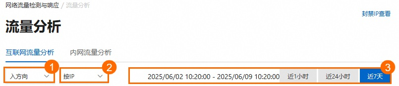
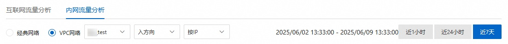
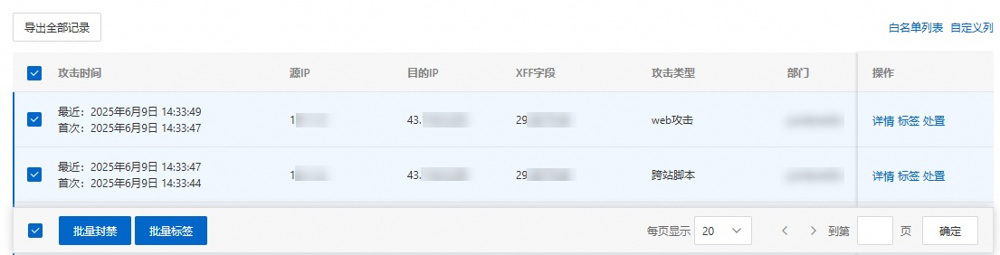
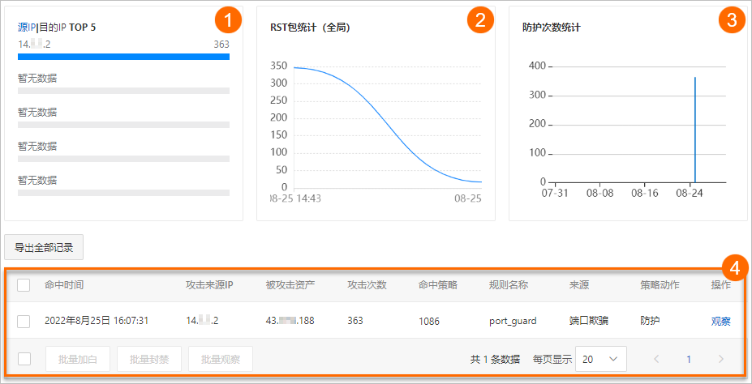
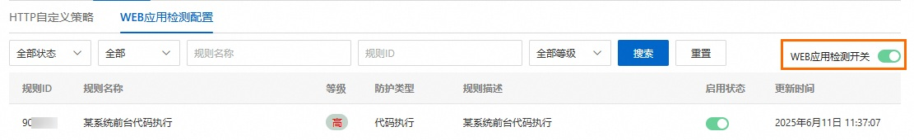
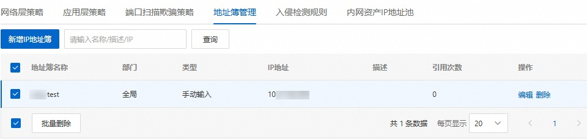

阿里云  
专有云  
云盾网络检测与响应  
用户指南  
产品版本：V3.18.6  
文档版本：20251212

**目录**

- [1.使用须知](#section-1)
- [2.快速入门](#section-2)
    - [2.1. 用户权限说明](#section-2-1)
    - [2.2. 登录Apsara Uni-manager运营控制台](#section-2-2)
- [3.网络流量检测与响应（租户侧）](#section-3)
    - [3.1. 切换组织查看对应菜单](#section-3-1)
    - [3.2. 流量趋势](#section-3-2)
    - [3.3. 查看流量分析](#section-3-3)
        - [3.3.1. 互联网流量分析](#section-3-3-1)
        - [3.3.2. 内网流量分析](#section-3-3-2)
    - [3.4. 日志检索](#section-3-4)
    - [3.5. 攻击者画像](#section-3-5)
    - [3.6. 威胁检测](#section-3-6)
        - [3.6.1. 威胁检测](#section-3-6-1)
        - [3.6.2. 封禁日志](#section-3-6-2)
    - [3.7. 行为分析](#section-3-7)
        - [3.7.1. DNS行为分析](#section-3-7-1)
        - [3.7.2. 加密流量分析](#section-3-7-2)
    - [3.8. 策略配置](#section-3-8)
        - [3.8.1. 配置网络层策略](#section-3-8-1)
        - [3.8.2. 配置应用层策略](#section-3-8-2)
        - [3.8.3. 配置端口扫描欺骗策略](#section-3-8-3)
        - [3.8.4. 管理地址簿](#section-3-8-4)
        - [3.8.5. 管理网络检测响应IDS规则](#section-3-8-5)
        - [3.8.6. 管理内网采集网段](#section-3-8-6)

# 1.使用须知

本文介绍在使用安全编排自动化响应用户指南前，您需要了解的信息，以及在登录云盾控制台前，您需要确认本地PC符合的配置要求。

**用户指南使用说明**

为了形成专有云安全运营和响应的一体化，安全编排自动化响应产品的功能融合到了云安全管理中心产品中。

本手册仅介绍安全编排自动化响应产品独有的功能，如果您需要了解关于云安全管理中心功能的更多说明，请参考《云安全管理中心用户指南》。

**本地PC配置要求**

本地PC需要满足如配置要求表中配置要求，才可以正常登录云盾控制台。

表 1. 配置要求表

<table>
  <tr>
    <th width="90">内容</th>
    <th>要求</th>
  </tr>
  <tr>
    <td>浏览器</td>
    <td>• Internet Explorer浏览器：11及以上版本 • Chrome浏览器（推荐）：42.0.0及以上版本 • Firefox浏览器：30及以上版本 • Safari浏览器：9.0.2版本及以上版本</td>
  </tr>
  <tr>
    <td>操作系统</td>
    <td>• Windows XP版本 • Windows 7及以上版本 • Mac系统</td>
  </tr>
</table>

# 2.快速入门

## 2.1. 用户权限说明

本文介绍了云盾涉及的用户角色。

所有云盾安全中心角色均为默认角色，无法自定义添加。在登录云盾安全中心前，您需要确认自己的账号已经分配云盾相关的角色，具体角色说明，请参见云盾默认角色。

表 1. 云盾默认角色

<table>
  <tr>
    <th width="170">角色名称</th>
    <th>角色说明</th>
  </tr>
  <tr>
    <td>组织安全管理员</td>
    <td>负责单个组织内的安全管理工作，包括云安全管理中心SOC、主机安全、应用安全、网络安全等安全产品的管理工作。</td>
  </tr>
  <tr>
    <td>全局组织安全管理员</td>
    <td>负责通过云安全管理中心SOC，进行所有租户的安全管理工作。</td>
  </tr>
  <tr>
    <td>全局组织安全监察员</td>
    <td>负责通过云安全管理中心SOC查看全部组织的安全状况。</td>
  </tr>
  <tr>
    <td>自定义角色</td>
    <td>可自定义所有组织、本组织及级联下级组织、资源集的运营管理权限，可区分读写、自定义配置产品功能菜单界面。 说明当前的自定义所有组织，不包含平台权限，与全局组织安全管理员的数据权限范围存在差异。</td>
  </tr>
</table>

如果您没有相关账号和角色，请联系管理员创建用户及授予角色，具体步骤，请参见<strong>《Apsara Uni-manager运营控制台用户指南》</strong>中**创建用户**。

## 2.2. 登录Apsara Uni-manager运营控制台

本文主要向您介绍如何登录Apsara Uni-manager运营控制台。

**前提条件**

- 登录Apsara Uni-manager运营控制台前，确认您已从部署人员处获取Apsara Uni-manager运营控制台的服务域名地址。

- 推荐使用Chrome浏览器。

**操作步骤**

1. 在浏览器地址栏中，输入Apsara Uni-manager运营控制台的服务域名地址，按回车键。

   

   > **说明**
   >
   > - 单击页面右上角的当前语言可以切换其它语言。
   >
   > - 授权登录是第三方认证中配置了全局IdP设置才会显示，且“授权登录”名称用户可按需自定义。

2. 输入正确的用户名及密码。

   > **说明**
   >
   > - 请向运营管理员获取登录控制台的用户名和密码。
   >
   > - 首次登录Apsara Uni-manager运营控制台时，需要修改登录用户名的密码，请按照提示完成密码修改。为提高安全性，密码长度必须为10~32位，且包含英文字母大小写、阿拉伯数字和特殊符号（感叹号（!）、at（@）、井号（#）、美元符号（$）、百分号（%）等）。

3. 单击**账号登录**。

4. 如果账号已激活MFA多因素认证，请根据以下两种情况进行操作：

   - **管理员强制开启MFA后的首次登录**

     <ol type="a">

     <li>

     在绑定虚拟MFA设备页面中，按页面提示步骤绑定MFA设备。

     </li>

     <li>

     按照步骤2重新输入账号和密码，单击**账号登录**。

     </li>

     </ol>

     <ol type="i" start="100">

     <li>

     输入6位MFA码后单击**认证**。

     </li>

     </ol>

   - **您已开启并绑定MFA**

     输入6位MFA码后单击**认证**。

     > **说明**
     >
     > 绑定并开启MFA的操作请参见管理多因素认证。

**相关操作**

**忘记密码**

1. 用户忘记登录密码时，单击密码输入框下方的**忘记密码**。

2. 在忘记密码页面，输入**账户名**、**邮箱**和验证码后，单击**确认**。

   

   > **说明**
   >
   > - 账户名请输入当前账号的用户名，邮箱请输入注册账号的Email地址。
   >
   > - 重置密码的链接将发至邮箱，进入链接后用户可输入新密码。

# 3.网络流量检测与响应（租户侧）

## 3.1. 切换组织查看对应菜单

网络流量检测与响应根据不同级别的组织展示全量或者部分菜单。本文介绍如何切换组织查看全局菜单。

顶部组织的筛选或资源集的筛选会影响菜单的展示。当前多级组织和资源集的筛选只适配日志检索和威胁检测两个页面。

- 安全管理员：可查看网络流量检测与响应的全局菜单，即流量趋势、流量分析、网络抓包、日志检索、攻击者画像、威胁检测、行为分析、策略配置。

- 一级及以下组织：可查看日志检索、威胁检测。

  如果一级及以下组织需要查看全局菜单，可以将组织切换到安全管理员层级。

**操作步骤**

1. 登录Apsara Uni-manager运营控制台。具体操作，请参见《**Apsara Uni-manager运营控制台 用户指南**》的**登录Apsara Uni-manager运营控制台**。

2. 在控制台顶部菜单栏，单击**安全**，选择**网络安全 > 网络流量检测与响应**。在**网络流量检测与响应**授权页面，选择**地域**并单击**角色授权访问**。

3. 如果是一级及以下组织，可以在顶部菜单栏，单击  图标，将组织切换到安全管理员层级（root）即

   可查看全量菜单。

## 3.2. 流量趋势

组织安全管理员和全局组织安全管理员通过分析流量趋势，可以定位流量速率、流量的高峰和低谷时段等分布规律；同时通过查看Top 5流量的IP，甄别恶意的IP访问。本文介绍如何查看网络流量趋势、入口流量统计和出口流量统计。

**操作步骤**

1. 登录Apsara Uni-manager运营控制台。

2. 在控制台顶部菜单栏，单击**安全**，选择**网络安全 > 网络流量检测与响应**。在**网络流量检测与响应**授权页面，选择**地域**并单击**角色授权访问**。

3. 在顶部菜单栏，单击  图标，将组织切换到安全管理员层级（root），查看全量菜单。

4. 在左侧导航栏，单击**流量趋势**。

5. 在**流量趋势**页面，设置时间，按**近1小时**、**近24小时**或**近7天**维度筛选。

6. 查看网络流量信息。

   - 网络流量趋势

     查看在选择的时间段内的网络流量趋势，包括均值流量、峰值流量、入流量和出流量的bps和pps。

   - 网络入方向

     查看网络入方向的会话、应用和Top访问目的IP等统计信息。

   - 网络出方向

     查看网络出方向的会话、应用和Top访问源IP等统计信息。

## 3.3. 查看流量分析

### 3.3.1. 互联网流量分析

网络流量检测与响应支持查看互联网边界的流量。通过流量信息，您可以识别出互联网异常流量。本文介绍如何查看互联网边界流量。

**前提条件**

已采购和部署**网络流量检测与响应（NDR）-用于互联网边界出入流量的全流量审计和分析管控**。

**操作步骤**

1. 登录Apsara Uni-manager运营控制台。

2. 在控制台顶部菜单栏，单击**安全**，选择**网络安全 > 网络流量检测与响应**。在**网络流量检测与响应**授权页面，选择**地域**并单击**角色授权访问**。

3. 在顶部菜单栏，单击  图标，将组织切换到安全管理员层级（root），查看全量菜单。

4. 在左侧导航栏，单击**流量分析**。

5. 在**互联网流量分析**页签，查看互联网边界流量信息。

   <ol type="i">

   <li>

   设置流量筛选条件。

   

   <table>
     <tr>
       <th width="89">图示位置</th>
       <th>筛选条件说明</th>
     </tr>
     <tr>
       <td>①</td>
       <td>设置查看的流量方向，支持<strong>入方向</strong>和<strong>出方向</strong>。 • <strong>入方向</strong>：从互联网访问内网。 • <strong>出方向</strong>：从内网访问互联网。</td>
     </tr>
     <tr>
       <td>②</td>
       <td>设置<strong>按IP</strong>和<strong>按应用</strong>查看互联网边界流量。</td>
     </tr>
     <tr>
       <td>③</td>
       <td>设置查看的时间范围，支持<strong>近1小时</strong>、<strong>近24小时</strong>和<strong>近7天</strong>。</td>
     </tr>
   </table>

   </li>

   <li>

   查看互联网边界流量详细信息。

   - **流量统计**信息

     - 在**IP访问情况**区域，查看**源IP数**、**目的IP数**、**应用数**。

     - 在右侧流量曲线图，查看**均值流量**、**峰值流量**和流量趋势。

   - **流量列表**

     **流量列表**支持按流量大小、访问目的IP数、应用数、会话数排序。

     - 查看流量信息。

       - 当流量方向选择为**入方向**时，可按**源IP维度**或**目的IP维度**查看。

       - 当流量方向选择为**出方向**时，可直接查看。

     - 单击目标IP**操作**列的**详情**，查看源IP的网络流量趋势、基本信息或网络会话。

   </li>

   </ol>

### 3.3.2. 内网流量分析

网络流量检测与响应支持查看内网的流量。通过流量信息，您可以识别出内网异常流量。本文介绍如何查看内网流量。

**前提条件**

已采购和部署**网络流量检测与响应（NDR）- 用于IDC和VPC的内网专线出入流量的全流量审计和分析管控**。

**操作步骤**

1. 登录Apsara Uni-manager运营控制台。

2. 在控制台顶部菜单栏，单击**安全**，选择**网络安全 > 网络流量检测与响应**。在**网络流量检测与响应**授权页面，选择**地域**并单击**角色授权访问**。。

3. 在顶部菜单栏，单击  图标，将组织切换到安全管理员层级（root），查看全量菜单。

4. 在左侧导航栏，单击**流量分析**。

5. 在**内网流量分析**页签，管理内网流量信息。

   <ol type="i">

   <li>

   设置流量筛选条件。

   

   <table>
     <tr>
       <th width="90">选项</th>
       <th>筛选条件说明</th>
     </tr>
     <tr>
       <td>经典网络</td>
       <td>如使用SLB IP，但流量没有VLAN标签。</td>
     </tr>
     <tr>
       <td>VPC网络</td>
       <td>支持VLAN标签，提供更高的灵活性、安全性和管理能力。</td>
     </tr>
     <tr>
       <td>VPC实例</td>
       <td>在下拉框中选择VPC实例名称。</td>
     </tr>
     <tr>
       <td>流量方向</td>
       <td>设置查看的流量方向，支持<strong>入方向</strong>和<strong>出方向</strong>。 • <strong>入方向</strong>：从互联网访问内网。 • <strong>出方向</strong>：从内网访问互联网。</td>
     </tr>
     <tr>
       <td>查看方式</td>
       <td>设置<strong>按IP</strong>和<strong>按应用</strong>查看内网边界流量。</td>
     </tr>
     <tr>
       <td>时间范围</td>
       <td>设置查看的时间范围，支持<strong>近1小时</strong>、<strong>近24小时</strong>和<strong>近7天</strong>。</td>
     </tr>
   </table>

   </li>

   <li>

   查看内网流量详细信息。

   - **流量统计**信息

     - 在**IP访问情况**区域，查看**源IP数**、**目的IP数**、**应用数**。

     - 在右侧流量曲线图，查看**均值流量**、**峰值流量**和流量趋势。

   - **流量列表**

     **流量列表**支持按流量大小、访问目的IP数、应用数、会话数排序。

     - 查看流量信息。

       - 当流量方向选择为**入方向**时，可按**源IP维度**或**目的IP维度**查看。

       - 当流量方向选择为**出方向**时，可直接查看。

     - 单击目标IP**操作**列的**详情**，查看源IP的网络流量趋势、基本信息或网络会话。

   </li>

   </ol>

## 3.4. 日志检索

本文介绍如何检索和查看日志。

1. 登录Apsara Uni-manager运营控制台。

2. 在控制台顶部菜单栏，单击**安全**，选择**网络安全 > 网络流量检测与响应**。在**网络流量检测与响应**授权页面，选择**地域**并单击**角色授权访问**。

3. 在左侧导航栏，单击**日志检索**。

4. 在**日志检索**页面，设置搜索条件。

   <table>
     <tr>
       <th width="105">搜索项</th>
       <th>说明</th>
     </tr>
     <tr>
       <td>今天</td>
       <td>设置检索日志的时间段。可选值：<strong>最近一小时</strong>、<strong>最近4小时</strong>、<strong>最近8小时</strong>、<strong>今</strong><strong>天</strong>、<strong>最近7天</strong>、<strong>最近14天</strong>、<strong>最近30天</strong>、<strong>自定义</strong>。</td>
     </tr>
     <tr>
       <td>全部部门</td>
       <td>选择检索日志的所属部门。 说明 • 仅当组织为安全管理员层级（root）时，支持选择检索日志的所属部门。 • 如果是一级及以下组织，可以在顶部菜单栏，单击图标，将  组织切换到安全管理员层级（root），即可使用该功能。</td>
     </tr>
     <tr>
       <td>日志类型</td>
       <td>选择检索日志的类型，分为<strong>安全事件日志</strong>、<strong>全流量日志</strong>、<strong>行为分析日志</strong>三大类。默认展示<strong>安全事件日志/攻击检测原始日志</strong>。</td>
     </tr>
     <tr>
       <td>搜索模板</td>
       <td>选择检索日志的模板。模板是先前搜索条件保存的模板。</td>
     </tr>
     <tr>
       <td>请输入内容</td>
       <td>输入日志的相关内容。搜索语句要求符合类lucene搜索语法。</td>
     </tr>
   </table>

5. 单击  图标，查看搜索结果。

   - **清除**：如果不需要原来设置的搜索条件，单击**清除**。

   - **保存**：如果以后需要重用这个搜索条件，单击**保存**，并设置**名称**。

   根据查询条件，系统会以柱状图的形式为您展示平台日志。您可以通过柱状图，了解指定时间范围内不同时间的日志数量。

   在日志检索页面下方，您可以查看查询到的日志详细信息。单击日志列表的参数，可以直接将参数加到搜索条件。

   - 选择日志列表的展示字段：在日志检索页面的左下方选择展示字段。

   - 导出检索日志的全部字段：单击**日志检索**页面上的**导出全部字段**。全部字段包含**展示字段**和**可选字段**，即**日志检索**页面左下方列的所有字段。您可以单击页面右上角的**下载任务管理**查看导出结果。

   - 导出检索日志的已选字段：单击**日志检索**页面上的**导出已选字段**。您可以单击页面右上角的**下载任务管理**查看导出结果。

   - 查看日志详情：单击日志列表**操作**列的**详情**。

   - 查看字段信息：单击**日志检索**页面右上角的**帮助文档**。

   - 字段参数解码：单击**日志检索**页面右上角的**解码小工具**。支持**Unicode编码**、**UTF-8编码**、**URL编码**、**Hex编码**、**Base64编码**。

   - 查看某字段的百分比：单击**日志检索**页面左下方字段后的圆形图标  ，再次点击图标，数据消失。

   - 查看某字段的含义：鼠标**悬停**在字段之上可显示。

## 3.5. 攻击者画像

攻击者画像从攻击者的视图，展示攻击者的基础信息、威胁情报、攻击手法、攻击目标、攻击过程，并进行统一的分析展示。本文介绍如何查看攻击者画像。

1. 登录Apsara Uni-manager运营控制台。

2. 在控制台顶部菜单栏，单击**安全**，选择**网络安全 > 网络流量检测与响应**。在**网络流量检测与响应**授权页面，选择**地域**并单击**角色授权访问**。

3. 在顶部菜单栏，单击  图标，将组织切换到安全管理员层级（root），查看全量菜单。

4. 在左侧导航栏，单击**攻击者画像**。

5. 在**攻击者画像**页面，设置搜索条件。

   <table>
     <tr>
       <th width="138">搜索项</th>
       <th>说明</th>
     </tr>
     <tr>
       <td>最近1小时</td>
       <td>设置攻击时间段。可选值：<strong>最近一小时</strong>、<strong>最近4小时</strong>、<strong>最近8小时</strong>、<strong>今天</strong>、<strong>最近7</strong><strong>天</strong>、<strong>最近14天</strong>、<strong>最近30天</strong>、<strong>自定义</strong>。</td>
     </tr>
     <tr>
       <td>全部部门</td>
       <td>选择所属部门。仅全局组织安全管理员可以查看所有租户的数据，组织安全管理员仅能查看所属租户的数据。</td>
     </tr>
     <tr>
       <td>攻击结果</td>
       <td>选择攻击结果的类型，攻击结果包括<strong>尝试</strong>、<strong>成功</strong>或<strong>失败</strong>。</td>
     </tr>
     <tr>
       <td>威胁等级</td>
       <td>选择攻击的威胁类型，可选值有：<strong>低危</strong>、<strong>中危</strong>、<strong>高危</strong>。</td>
     </tr>
     <tr>
       <td>请输入攻击者IP</td>
       <td>输入攻击者的IP地址。</td>
     </tr>
   </table>

6. 在**列表**区域，查看符合搜索条件的攻击列表。

7. 单击**列表**区域的目标攻击，查看该目标攻击信息。

   - 单击**基本信息**页签，您可以查看攻击的基本信息。您可以单击**基本信息**页签右上角的**攻击证据报文下载**按钮，下载攻击证据报文，然后单击页面右上角的**下载任务管理**查看下载结果。

   - 单击**攻击手法**页签，您可以查看攻击事件、攻击结果、目的IP、目的ECS、部门、IP类型、监听端口。

   - 单击**目的IP TOP**页签，您可以查看受攻击数为前五的攻击目标HOST、IP数量，还可以查看尝试攻击和攻击成功的攻击数量、不同威胁等级的攻击数量。

   - 单击**攻击过程**页签，查看攻击的详细过程。单击**攻击过程**中的<strong>></strong>可查看该类攻击的详细数据。

## 3.6. 威胁检测

### 3.6.1. 威胁检测

本文介绍如何查看威胁检测的信息记录。

**背景信息**

威胁检测的部分功能仅组织为安全管理员层级（root）时才可操作，例如选择部门、设置自定义列、查看白

名单列表、设置攻击处置、设置攻击标签等。如果您是一级及以下组织，可以在顶部菜单栏，单击  图

标，将组织切换到安全管理员层级（root），即可使用威胁检测的全部功能。

**操作步骤**

1. 登录Apsara Uni-manager运营控制台。

2. 在控制台顶部菜单栏，单击**安全**，选择**网络安全 > 网络流量检测与响应**。在**网络流量检测与响应**授权页面，选择**地域**并单击**角色授权访问**。

3. 在左侧导航栏，单击**威胁检测**。

4. 在**威胁检测**页签，单击**展开详情**，设置查询条件。

   <table>
     <tr>
       <th width="120">搜索项</th>
       <th>说明</th>
     </tr>
     <tr>
       <td>时间</td>
       <td>选择检测的时间段。可选值：<strong>最近1小时</strong>、<strong>最近4小时</strong>、<strong>最近8小时</strong>、<strong>今天</strong>、<strong>最近</strong><strong>7天</strong>、<strong>最近14天</strong>、<strong>最近30天</strong>、<strong>自定义</strong>。</td>
     </tr>
     <tr>
       <td>源IP</td>
       <td>输入攻击的源IP。</td>
     </tr>
     <tr>
       <td>威胁等级</td>
       <td>选择攻击的风险等级，可选值：<strong>全选</strong>、<strong>低危</strong>、<strong>中危</strong>、<strong>高危</strong>。</td>
     </tr>
     <tr>
       <td>攻击类型</td>
       <td>选择攻击类型。可选值：<strong>全选</strong>、<strong>异常连接</strong>、<strong>命令执行</strong>、<strong>暴力破解</strong>、<strong>扫描</strong>、<strong>其</strong><strong>他</strong>、<strong>信息泄露</strong>、<strong>DoS攻击</strong>、<strong>溢出攻击</strong>、<strong>web攻击</strong>、<strong>木马后门</strong>、<strong>病毒蠕虫</strong>、<strong>挖矿行</strong><strong>为</strong>、<strong>反弹shell</strong>、<strong>远程文件包含</strong>、<strong>webshell上传</strong>、<strong>SQL注入</strong>、<strong>跨站脚本</strong>、<strong>代码</strong><strong>执行</strong>、<strong>CRLF</strong>、<strong>本地文件包含</strong>。</td>
     </tr>
     <tr>
       <td>目的IP</td>
       <td>输入攻击的目的IP。</td>
     </tr>
     <tr>
       <td>HTTP响应码</td>
       <td>输入HTTP响应码。</td>
     </tr>
     <tr>
       <td>XFF字段</td>
       <td>输入XFF字段。</td>
     </tr>
     <tr>
       <td>域名</td>
       <td>输入域名。</td>
     </tr>
     <tr>
       <td>规则ID</td>
       <td>输入规则ID。</td>
     </tr>
     <tr>
       <td>攻击结果</td>
       <td>选择攻击结果。可选值：<strong>全选</strong>、<strong>尝试</strong>、<strong>成功</strong>、<strong>失败</strong>。</td>
     </tr>
     <tr>
       <td>告警来源</td>
       <td>选择告警来源。可选值：<strong>全选</strong>、<strong>IDS</strong>、<strong>WEBIDS</strong>。</td>
     </tr>
     <tr>
       <td>部门</td>
       <td>选择一级部门。</td>
     </tr>
     <tr>
       <td>标签</td>
       <td>选择攻击所属标签。</td>
     </tr>
     <tr>
       <td>防护状态</td>
       <td>选择防护状态。可选值：<strong>全选</strong>、<strong>未处理</strong>、<strong>已封禁</strong>、<strong>已加白</strong>、<strong>已忽略</strong>。</td>
     </tr>
   </table>

5. 单击**查询**，查看查询结果。

   如果不需要原来设置的搜索条件，单击**重置**，搜索条件回到初始状态。

   根据查询条件，系统会以图表的形式为您进行攻击分析。

   - 您可以通过**告警类型统计图**，了解不同告警类型的攻击数量。

   - 您可以通过二维条形图，了解**源IP|目的IP Top 5**的攻击数量。

   - 您可以通过**告警趋势图**，了解指定时间范围内攻击的数量趋势。

   - 您可以在攻击防护页面的下方查看攻击列表，攻击列表可以查看详细攻击信息。

     

     - 设置自定义列：单击**自定义列**，可以选择需要在告警列表中展示的列。

     - 查看攻击详情：单击**详情**，查看攻击的**基本信息**、**规则详情**、**原始告警列表**。

     - 设置攻击标签：单击**标签**，设置攻击的自定义标签。

     - 设置攻击处置：单击**处置**，设置攻击处置。支持的处置操作包括：**阻断**、**威胁检测白名单**、**忽略**。

       > **说明**
       >
       > 当检测位置为<strong>弹性网卡（ENI）</strong>时，操作列中的处置将无法进行。

       - **阻断**：通过网络层访问控制策略对攻击IP和七层XFF进行阻断。

         - **网络封禁**

           | 配置项 | 说明 |
           | --- | --- |
           | 封禁类型 | 选择<strong>封禁类型</strong>为<strong>网络封禁</strong>，对满足访问控制策略的攻击IP进行阻断。 |
           | 源IP | 告警中的攻击源IP。 |
           | 目的IP | 告警中的被攻击资产的IP地址。 |
           | 目的端口 | 攻击的目的端口。 |
           | 生效时间 | 支持设置处置操作的生效时间：一<strong>天</strong>、<strong>一周</strong>、<strong>一个月</strong>、<strong>自定义</strong>、<strong>永久生效</strong>。 |

         - **XFF封禁**

           | 配置项 | 说明 |
           | --- | --- |
           | 封禁类型 | 选择<strong>封禁类型</strong>为<strong>XFF封禁</strong>，对满足访问控制策略的七层进行阻断。 |
           | XFF字段 | 告警中的XFF字段。 |
           | 生效时间 | 支持设置处置操作的生效时间：一<strong>天</strong>、<strong>一周</strong>、<strong>一个月</strong>、<strong>自定义</strong>、<strong>永久生效</strong>。 |

       - **威胁检测白名单**：

         - 选择要加入白名单的攻击来源IP、被攻击资产、攻击名称、攻击payload。同时选中时，全部命中才会被加入白名单，即同一攻击源、攻击目的、攻击类型的攻击不再产生告警。加入白名单后会记录到**白名单列表**里，在**白名单列表**可以删除和新增白名单。

         - 设置生效时长：支持设置处置操作的生效时间：一**天**、**一周**、**一个月**、**自定义**、**永久生效**。

       - **忽略**：忽略单条告警，后续攻击依旧会产生告警。

       攻击列表中的防护状态，展示用户执行过的处置操作。默认未处置。用户执行任意处置操作后，更新防护状态。防护状态与处置操作一一对应，设置**阻断**则显示**已封禁**、设置**威胁检测白名单**则显示**已加白**、设置**忽略**则显示**已忽略**。

       用户也可以选中多个攻击，单击**批量封禁**、**批量标签**，批量处置攻击。

     - 导出攻击列表：单击**导出全部记录**，导出查询到的攻击列表，导出结果可以在页面右上角单击**下载任务管理**查看。

### 3.6.2. 封禁日志

封禁日志是命中封禁策略的流量产生的日志。本文介绍了如何查看封禁日志。

1. 登录Apsara Uni-manager运营控制台。

2. 在控制台顶部菜单栏，单击**安全**，选择**网络安全 > 网络流量检测与响应**。在**网络流量检测与响应**授权页面，选择**地域**并单击**角色授权访问**。

3. 在顶部菜单栏，单击  图标，将组织切换到安全管理员层级（root），查看全量菜单。

4. 在左侧导航栏，单击**威胁检测**。

5. 在**封禁日志**页签，设置查询条件。

   <table>
     <tr>
       <th width="89">搜索项</th>
       <th>说明</th>
     </tr>
     <tr>
       <td>时间</td>
       <td>选择查询的时间段。可选值：<strong>最近1小时</strong>、<strong>最近4小时</strong>、<strong>最近8小时</strong>、<strong>今天</strong>、<strong>最近</strong><strong>7天</strong>、<strong>最近14天</strong>、<strong>最近30天</strong>、<strong>自定义</strong>。</td>
     </tr>
     <tr>
       <td>防护结果</td>
       <td>选择防护结果。可选值：<strong>全部动作</strong>、<strong>放行</strong>、<strong>观察</strong>、<strong>阻断</strong>。</td>
     </tr>
     <tr>
       <td>策略ID</td>
       <td>输入攻击命中策略ID。</td>
     </tr>
     <tr>
       <td>源IP</td>
       <td>输入攻击的源IP。</td>
     </tr>
     <tr>
       <td>目的IP</td>
       <td>输入攻击的目的IP。</td>
     </tr>
   </table>

6. 单击**查询**，查看查询结果。

   

   - 您可以在**源IP|目的IP TOP 5**区域（图示①），通过二维条形图，了解时间周期内Top 5的源IP、目的IP的攻击数量。

   - 您可以在<strong>RST包统计（全局）</strong>区域（图示②），通过二维折线图，了解不同时间的RST包数量。

   - 您可以在**防护次数统计**区域（图示③），通过二维柱状图，了解指定时间的攻击防护次数。

   - 您可以在封禁日志列表区域（图示④），查看封禁日志的详细信息，或管理封禁日志。

     - 导出封禁日志的记录：单击封禁日志列表上方的**导出全部记录**，导出查询到的封禁日志列表。导出结果可以在页面右上角单击**下载任务管理**查看。

     - 设置封禁日志命中策略的策略动作：在封禁日志列表**操作**列，通过单击**封禁**、**加白**、**观察**，设置对应**命中策略**的策略动作为**阻断**、**加白**或**观察**。该设置不会修改已生成日志的策略动作，而是修改日志**命中策略**的对应规则，当有新日志再次命中该策略时，新日志将使用修改后的策略动作。

       > **说明**
       >
       > **来源**为**端口欺骗**时，不支持修改策略动作，只能设置为**观察**。

       - **阻断**：系统检测到符合封禁策略的流量后产生告警并对访问进行阻断。

       - **观察**：系统检测到符合封禁策略的流量后产生告警但不阻断流量。

       - **加白**：对加白的IP地址流量不产生告警。

     - 批量设置封禁日志命中策略的策略动作：选中多个记录，单击封禁日志列表下的**批量加白**、**批量封禁**或**批量观察**。

## 3.7. 行为分析

### 3.7.1. DNS行为分析

DNS行为分析可以通过行为特征分析可疑DNS域名，发现可疑行为，本文介绍如何查看DNS行为分析的数据。

1. 登录Apsara Uni-manager运营控制台。

2. 在控制台顶部菜单栏，单击**安全**，选择**网络安全 > 网络流量检测与响应**。在**网络流量检测与响应**授权页面，选择**地域**并单击**角色授权访问**。

3. 在顶部菜单栏，单击  图标，将组织切换到安全管理员层级（root），查看全量菜单。

4. 在左侧导航栏，单击**行为分析**。

5. 在**DNS行为分析**页签，设置搜索条件。

   <table>
     <tr>
       <th width="89">搜索项</th>
       <th>说明</th>
     </tr>
     <tr>
       <td>时间</td>
       <td>选择查询的时间段。可选值：<strong>最近1小时</strong>、<strong>最近4小时</strong>、<strong>最近8小时</strong>、<strong>今天</strong>、<strong>最近</strong><strong>7天</strong>、<strong>最近14天</strong>、<strong>最近30天</strong>、<strong>自定义</strong>。</td>
     </tr>
     <tr>
       <td>部门</td>
       <td>选择所属部门。</td>
     </tr>
     <tr>
       <td>域名</td>
       <td>输入域名。</td>
     </tr>
     <tr>
       <td>源IP</td>
       <td>输入源IP。</td>
     </tr>
     <tr>
       <td>异常类型</td>
       <td>选择异常类型。可选值：<strong>全部</strong>、<strong>DGA域名</strong>、<strong>DNS隧道域名</strong>。</td>
     </tr>
   </table>

6. 单击**查询**，查看**DGA域名统计**或**DNS隧道域名统计**、**可疑DNS域名解析趋势**、DNS行为列表。

   在DNS行为列表，您可以执行如下操作：

   - 查看DNS行为详细信息：单击目标DNS行为**操作**列的**详情**。

   - 加白DNS行为：单击目标DNS行为**操作**列的**加白**，或选中多个DNS行为，单击列表下方的**批量加白**。

   - 导出DNS行为列表：单击列表上方的**导出全部记录**。导出结果可以在页面右上角单击**下载任务管理**查看。

   - 查看白名单列表：单击列表上方的**白名单列表**。**白名单列表**支持新增、搜索、删除白名单。

   - 设置DNS隧道规则：单击**DNS隧道规则**，配置请求范围、请求次数或DNS域名总长度，单击**确定**。

### 3.7.2. 加密流量分析

加密流量分析可以通过行为特征分析的方式发现可疑的加密通信行为。本文介绍如何查看加密流量分析的数据。

1. 登录Apsara Uni-manager运营控制台。

2. 在控制台顶部菜单栏，单击**安全**，选择**网络安全 > 网络流量检测与响应**。在**网络流量检测与响应**授权页面，选择**地域**并单击**角色授权访问**。

3. 在顶部菜单栏，单击  图标，将组织切换到安全管理员层级（root），查看全量菜单。

4. 在左侧导航栏，单击**行为分析**。

5. 在**加密流量分析**页签，设置搜索条件。

   <table>
     <tr>
       <th width="121">搜索项</th>
       <th>说明</th>
     </tr>
     <tr>
       <td>时间</td>
       <td>选择查询的时间段。可选值：<strong>最近1小时</strong>、<strong>最近4小时</strong>、<strong>最近8小时</strong>、<strong>今天</strong>、<strong>最近</strong><strong>7天</strong>、<strong>最近14天</strong>、<strong>最近30天</strong>、<strong>自定义</strong>。</td>
     </tr>
     <tr>
       <td>部门</td>
       <td>选择所属部门。</td>
     </tr>
     <tr>
       <td>源IP</td>
       <td>输入源IP。</td>
     </tr>
     <tr>
       <td>目的IP</td>
       <td>输入目的IP。</td>
     </tr>
     <tr>
       <td>攻击工具类型</td>
       <td>选择攻击工具类型。可选值：<strong>全</strong><strong>部</strong>、<strong>Awvs</strong>、<strong>Burpsuite</strong>、<strong>Bxss</strong>、<strong>Nessus</strong>、<strong>Nimbostratus</strong>、<strong>Nmap</strong>、<strong>Sq</strong> <strong>lmap</strong>、<strong>Whatweb</strong>。</td>
     </tr>
   </table>

6. 单击**查询**，查看**加密流量类型分析**、**攻击工具类型分析**、**源IP|目的IP Top5**或加密行为列表。

   在加密行为列表，您可以执行如下操作：

   - 查看加密行为详细信息：单击目标加密行为**操作**列的**详情**。

   - 加白加密行为：单击目标加密行为**操作**列的**加白**，或选中多个加密行为，单击列表下方的**批量加白**。

   - 导出加密行为列表：单击列表上方的**导出全部记录**。导出结果可以在页面右上角单击**下载任务管理**查看。

   - 查看白名单列表：单击列表上方的**白名单列表**。**白名单列表**支持新增、搜索、删除白名单。

## 3.8. 策略配置

### 3.8.1. 配置网络层策略

本文介绍了如何新增网络层策略和查看网络层策略。

**新增网络层策略**

1. 登录Apsara Uni-manager运营控制台。

2. 在控制台顶部菜单栏，单击**安全**，选择**网络安全 > 网络流量检测与响应**。在**网络流量检测与响应**授权页面，选择**地域**并单击**角色授权访问**。

3. 在顶部菜单栏，单击  图标，将组织切换到安全管理员层级（root），查看全量菜单。

4. 在左侧导航栏，单击**策略配置**。

5. 新增网络层策略。

   - 单条新增网络层策略

     在**网络层策略**页签，单击**新增策略**。完成如下配置后，单击**确定**。

     <table>
       <tr>
         <th width="89">配置项</th>
         <th>说明</th>
       </tr>
       <tr>
         <td>策略名称</td>
         <td>设置策略的名称。</td>
       </tr>
       <tr>
         <td>策略描述</td>
         <td>设置策略的信息描述。</td>
       </tr>
       <tr>
         <td>方向</td>
         <td>策略的方向。</td>
       </tr>
       <tr>
         <td>策略类型</td>
         <td>设置策略的类型，可选值：<strong>仅源IP</strong>、<strong>仅目的IP</strong>、<strong>源IP、目的IP/端口</strong>。</td>
       </tr>
       <tr>
         <td>规则</td>
         <td>设置策略规则。可选值：<strong>手动输入</strong>、<strong>导入文件</strong>、<strong>地址簿</strong>。可设置多个策略规则。 说明支持IPV4类型或者IPV6类型，不支持混合添加。</td>
       </tr>
       <tr>
         <td>是否开启</td>
         <td>通过开关设置是否可以实行策略。</td>
       </tr>
       <tr>
         <td>动作</td>
         <td>选择策略的行为动作，可选值：<strong>放行</strong>、<strong>观察</strong>、<strong>阻断</strong>。</td>
       </tr>
       <tr>
         <td>生效时间</td>
         <td>选择策略的生效时长，可选值：<strong>永久生效</strong>、<strong>一天</strong>、<strong>一周</strong>、<strong>一个月</strong>、<strong>自定</strong><strong>义</strong>。</td>
       </tr>
     </table>

   - 增量导入网络层策略

     <ol type="a">

     <li>

     在**网络层策略**页签，选择**导入策略 > 下载模板**。

     </li>

     <li>

     填写网络层策略模板后，选择**导入策略 > 增量导入**。单击**请选择文件**，导入填写好的网络层策略模板，单击**确定**。

     </li>

     </ol>

**查看网络层策略**

在**网络层策略**页签，您可以通过选择策略的规则动作、方向，输入规则名称、规则描述、规则ID、UUID信息，设置策略创建或失效时间，搜索和查看策略列表。

在策略列表，您还可以进行如下操作：

- 开启或关闭策略：单击目标策略**是否开启**列的  图标或  图标。

   图标表示该策略已启用。

   图标表示该策略已停用。

- 编辑策略：单击目标策略**操作**列的**编辑**。仅在策略未开启时，支持编辑策略。

- 删除策略：单击目标策略**操作**列的**删除**。仅在策略未开启时，支持删除策略。

- 启用网络策略全局：单击策略列表上方**网络策略全局开关**的  图标。

- 启用威胁情报过滤：单击策略列表上方**启用威胁情报过滤**的  图标。启用威胁情报过滤后，威胁情报匹配

  的流量默认将被阻断。

- 导出全量网络层策略：单击列表下的**全量导出**。导出结果可以在页面右上角单击**下载任务管理**查看。

- 批量管理网络层策略：选中多个网络层策略，单击策略列表下方的**批量操作**。支持**批量删除**、**批量开启**、**批量关闭**、**批量导出**。

### 3.8.2. 配置应用层策略

本文介绍如何新增应用层策略、查看应用层策略和查看Web应用检测配置。

**新增应用层策略**

1. 登录Apsara Uni-manager运营控制台。

2. 在控制台顶部菜单栏，单击**安全**，选择**网络安全 > 网络流量检测与响应**。在**网络流量检测与响应**授权页面，选择**地域**并单击**角色授权访问**。

3. 在顶部菜单栏，单击  图标，将组织切换到安全管理员层级（root），查看全量菜单。

4. 在左侧导航栏，单击**策略配置**。

5. 在**应用层策略**页签，单击**HTTP自定义策略**页签。

6. 单击**新增策略**，完成如下配置后，单击**确定**。

   <table>
     <tr>
       <th width="90">配置项</th>
       <th>说明</th>
     </tr>
     <tr>
       <td>策略名称</td>
       <td>设置策略的名称。</td>
     </tr>
     <tr>
       <td>匹配条件</td>
       <td>策略的核心内容，添加多个匹配条件，仅当有符合匹配条件的流量发起时，才通过策略进行<strong>放行</strong>、<strong>观察</strong>、<strong>阻断</strong>。通过选择<strong>匹配字段</strong>、<strong>逻辑符号</strong>，输入<strong>匹</strong><strong>配内容</strong>和设置<strong>英文大小写敏感</strong>来添加匹配条件。</td>
     </tr>
     <tr>
       <td>方向</td>
       <td>选择策略的方向，可选值：<strong>入方向</strong>、<strong>出方向</strong>。</td>
     </tr>
   </table>

   | 动作 | 选择策略的行为动作，可选值：<strong>放行</strong>、<strong>观察</strong>、<strong>阻断</strong>。 |
   | --- | --- |
   | 是否开启 | 通过开关设置是否可以实行策略。 |
   | 生效时间 | 选择策略的生效时长，可选值：<strong>永久生效</strong>、<strong>一天</strong>、<strong>一周</strong>、<strong>一个月</strong>、<strong>自定义</strong>。 |

**查看应用层策略**

在**应用层策略**页签下的**HTTP自定义策略**页签，您可以通过选择策略的规则动作、状态和方向，输入匹配字段内容，设置策略创建或失效时间，搜索和查看策略列表。

在策略列表，您还可以进行如下操作：

- 开启或关闭策略：单击目标策略**状态**列的  图标或  图标。

   图标表示该策略**生效中**。

   图标表示该策略**已失效**。

- 编辑策略：单击目标策略**操作**列的**编辑**。

- 删除策略：单击目标策略**操作**列的**删除**。

- 批量管理应用层策略：选中多个应用层策略，单击策略列表下方的**批量操作**。支持**批量删除**、**批量开启**、**批量关闭**、**批量导出**。导出结果可以在页面右上角单击**下载任务管理**查看。

**查看Web应用检测配置**

1. 登录Apsara Uni-manager运营控制台。

2. 在控制台顶部菜单栏，单击**安全**，选择**网络安全 > 网络流量检测与响应**。在**网络流量检测与响应**授权页面，选择**地域**并单击**角色授权访问**。

3. 在顶部菜单栏，单击  图标，将组织切换到安全管理员层级（root），查看全量菜单。

4. 在左侧导航栏，单击**策略配置**。

5. 在**应用层策略**页签，单击**WEB应用检测配置**页签。

6. 您可以通过设置策略的启动状态、防护类型、规则名称、规则ID和威胁等级，搜索和查看Web应用检测配置列表。

   在策略列表，您还可以单击目标规则**启用状态**列的  图标或  图标，设置单条规则的Web应用配置检测

   状态。

    图标表示该规则**生效中**。

    图标表示该规则**已失效**。

7. 单击策略列表右上角**WEB应用检测开关**的  图标或  图标，设置全局Web应用检测状态。

   

    图标表示全部规则**生效中**。

    图标表示全部规则**已失效**。

### 3.8.3. 配置端口扫描欺骗策略

端口扫描欺骗策略通过欺骗攻击者原本不存在的端口存活，让攻击者发起攻击尝试，从而暴露恶意攻击行为。本文介绍如何配置端口扫描欺骗策略。

**新增端口扫描欺骗策略**

1. 登录Apsara Uni-manager运营控制台。

2. 在控制台顶部菜单栏，单击**安全**，选择**网络安全 > 网络流量检测与响应**。在**网络流量检测与响应**授权页面，选择**地域**并单击**角色授权访问**。

3. 在顶部菜单栏，单击  图标，将组织切换到安全管理员层级（root），查看全量菜单。

4. 在左侧导航栏，单击**策略配置**。

5. 在**端口扫描欺骗策略**页签，单击**新增策略**。完成如下配置后，单击**确定**。

   <table>
     <tr>
       <th width="137">配置项</th>
       <th>说明</th>
     </tr>
     <tr>
       <td>组织</td>
       <td>当前平台的组织列表。</td>
     </tr>
     <tr>
       <td>地址类型</td>
       <td>通过安全组件的接口，获取租户已经配置的IP地址和端口。可选值：<strong>WAF</strong>、<strong>Public SLB</strong>、<strong>EIP</strong>、<strong>自定义</strong>。</td>
     </tr>
     <tr>
       <td>防护地址</td>
       <td>获取地址列表。</td>
     </tr>
     <tr>
       <td>防护端口白名单</td>
       <td>填写防护端口白名单。白名单以内的端口不会进行扫描欺骗，白名单以外的其他全部端口则开启扫描欺骗。</td>
     </tr>
     <tr>
       <td>防护模式</td>
       <td>选择防护模式，可选值：<strong>观察</strong>、<strong>防护</strong>。<strong>观察</strong>表示产生告警，不拦截。<strong>阻断</strong>表示产生告警，且拦截。</td>
     </tr>
   </table>

**查看端口扫描欺骗策略**

在**端口扫描欺骗策略**页签，您可以通过选择部门、地址类型，输入防护地址、规则ID、防护端口，搜索和查看策略列表。

在策略列表中，您还可以进行如下操作：

- 编辑策略：单击目标策略**操作**列的**编辑**。

- 删除策略：单击目标策略**操作**列的**删除**。

- 批量删除策略：选中多条目标策略，单击**批量删除**。

- 设置策略状态：单击目标策略**开启状态**列的  图标或  图标。

   图标表示该策略已启用。

   图标表示该策略已停用。

### 3.8.4. 管理地址簿

为了方便您引用IP地址，实现IP地址的灵活配置，您可以将多个IP地址指定成一个地址簿。本文介绍了如何新增和查看地址簿。

**新增地址簿**

1. 登录Apsara Uni-manager运营控制台。

2. 在控制台顶部菜单栏，单击**安全**，选择**网络安全 > 网络流量检测与响应**。在**网络流量检测与响应**授权页面，选择**地域**并单击**角色授权访问**。

3. 在顶部菜单栏，单击  图标，将组织切换到安全管理员层级（root），查看全量菜单。

4. 在左侧导航栏，单击**策略配置**。

5. 在**地址簿管理**页签，单击**新增IP地址簿**。完成如下配置后，单击**确定**。

   <table>
     <tr>
       <th width="105">配置项</th>
       <th>说明</th>
     </tr>
     <tr>
       <td>地址簿名称</td>
       <td>设置地址簿的名称。</td>
     </tr>
     <tr>
       <td>地址类型</td>
       <td>设置地址簿的地址来源类型，可选值：<strong>文件导入</strong>、<strong>手动输入</strong>。</td>
     </tr>
     <tr>
       <td>选择附件</td>
       <td>当<strong>地址类型</strong>为<strong>文件导入</strong>时，选择本地文件导入。</td>
     </tr>
     <tr>
       <td>IP地址</td>
       <td>当<strong>地址类型</strong>为<strong>手动输入</strong>时，需要手动输入32位IP地址。每个地址簿的IP地址，必须全部为IPv4地址或全部为IPv6地址，不能同时包含IPv4地址和IPv6地址。</td>
     </tr>
     <tr>
       <td>地址簿描述</td>
       <td>设置地址簿的信息描述。</td>
     </tr>
   </table>

**查看地址簿**

在**地址簿管理**页签，查看地址簿列表。

- 搜索地址簿：在列表上方输入框，输入地址簿名称、地址簿描述、IP地址，单击**查询**。

- 编辑地址簿：在地址簿列表的**操作**列，单击**编辑**。

- 删除地址簿：在地址簿列表的**操作**列，单击**删除**。

- 批量删除地址簿：选中需要删除的地址簿前的复选框，单击**批量删除**。

### 3.8.5. 管理网络检测响应IDS规则

网络检测响应内置IDS规则，您可以根据自身的业务需求和网络环境自定义IDS规则。本文介绍如何添加和管理网络检测响应IDS规则。

**操作步骤**

1. 登录Apsara Uni-manager运营控制台。

2. 在控制台顶部菜单栏，单击**安全**，选择**网络安全 > 网络流量检测与响应**。在**网络流量检测与响应**授权页面，选择**地域**并单击**角色授权访问**。

3. 在顶部菜单栏，单击  图标，将组织切换到安全管理员层级（root），查看全量菜单。

4. 在左侧导航栏，单击**策略配置**。

5. 在**入侵检测规则**页签，单击**添加自定义规则**。完成如下配置后，单击**确定**。

   <table>
     <tr>
       <th width="89">配置项</th>
       <th>说明</th>
     </tr>
     <tr>
       <td>规则名称</td>
       <td>设置自定义IDS规则的名称，建议使用可识别规则用途的名称，便于后续管理。</td>
     </tr>
     <tr>
       <td>规则引擎</td>
       <td>在下拉栏中选择规则引擎，可选<strong>基础规则</strong>和<strong>虚拟补丁</strong>。</td>
     </tr>
     <tr>
       <td>攻击类型</td>
       <td>在下拉栏中选择该规则的攻击类型。可选值：<strong>异常连接</strong>、<strong>命令执行</strong>、<strong>暴力破</strong><strong>解</strong>、<strong>扫描</strong>、<strong>信息泄露</strong>、<strong>DoS攻击</strong>、<strong>溢出攻击</strong>、<strong>Web攻击</strong>、<strong>木马后门</strong>、<strong>病毒蠕</strong><strong>虫</strong>、<strong>挖矿行为</strong>、<strong>反弹shell</strong>、<strong>异常链接</strong>、<strong>其他</strong>。</td>
     </tr>
     <tr>
       <td>等级</td>
       <td>在下拉栏中选择威胁等级，可选<strong>低危</strong>、<strong>中危</strong>和<strong>高危</strong>。</td>
     </tr>
     <tr>
       <td>CVE</td>
       <td>设置该规则的CVE编号。 说明通用漏洞披露CVE（Common Vulnerabilities and Exposures）列出了已公开披露的各种计算机安全缺陷。CVE编号由CVE编号管理机构（CNA）分配。</td>
     </tr>
     <tr>
       <td>攻击应用</td>
       <td>设置攻击应用名称。</td>
     </tr>
     <tr>
       <td>规则模式</td>
       <td>在下拉栏中选择IDS检测的规则模式，可选<strong>包模式</strong>和<strong>流模式</strong>。</td>
     </tr>
     <tr>
       <td>方向</td>
       <td>在下拉栏中选择IDS检测的流量方向，可选<strong>双向</strong>、<strong>入向</strong>和<strong>出向</strong>。</td>
     </tr>
     <tr>
       <td>规则内容</td>
       <td>设置规则内容，规则采用Snort语法。 说明添加规则内容时请确认正确性，不正确的规则内容可能会影响您的业务。</td>
     </tr>
     <tr>
       <td>规则描述</td>
       <td>设置规则描述信息，建议使用规则用途、影响等信息，便于后续管理。</td>
     </tr>
     <tr>
       <td>备注</td>
       <td>设置规则备注信息，建议使用规则用途、影响等信息，便于后续管理。</td>
     </tr>
   </table>

完成以上配置后，您可以在网络检测响应IDS规则列表，管理网络检测响应IDS规则。

- 查看规则详情

  您可以通过IDS规则列表上的筛选按钮，筛选需要查看的IDS规则。

  定位到某一规则，单击**操作**列中的**详情**，您可以查看该规则的具体信息。

- 启用规则

  如果需要启用某个规则，则定位到该规则，单击**启用状态**列中的切换开关，将**禁用**切换为**启用**。

- 禁用规则

  如果某个规则不适用于您的业务环境，您可以禁用该规则。

  定位到该规则，单击**启用状态**列中的切换开关，将**启用**切换为**禁用**。

### 3.8.6. 管理内网采集网段

网段设置主要针对流量安全监控模块进行网段配置，并且支持更改监控的网段范围，方便安全管理员根据需求调整监控的网段。配置的监控网段仅对所属区域机房生效。本文介绍如何添加和管理内网采集网段。

> **说明**
>
> - 网段设置更改后立即对流量监控生效，不需要安全管理员进行其他操作。
>
> - 流量安全监控模块的采集网段设置和区域设置中如果配置同一网段，则区域信息必须一致。

**操作步骤**

1. 登录Apsara Uni-manager运营控制台。

2. 在控制台顶部菜单栏，单击**安全**，选择**网络安全 > 网络流量检测与响应**。在**网络流量检测与响应**授权页面，选择**地域**并单击**角色授权访问**。

3. 在顶部菜单栏，单击  图标，将组织切换到安全管理员层级（root），查看全量菜单。

4. 在左侧导航栏，单击**策略配置**。

5. 在**内网资产IP地址池**页签，单击**添加**。

6. 在**新建**对话框中，设置监控网段参数后，单击**确定**。

   - **网段**：填写流量采集网段。

     > **说明**
     >
     > 所填写的网段必须是合法网段，并且不允许重复添加。

   - **区域**：设置数据中心的区域。

完成以上配置后，您可以在网段列表，管理内网采集网段。

- 查看流量采集网段和区域信息

  选择**区域**，输入查询网段，单击**查询**。

- 修改流量采集网段

  定位到目标网段，单击**操作**列的**修改**，修改流量采集网段所属区域。

- 删除流量采集网段

  定位到目标网段，单击**操作**列的**删除**，可删除该流量采集网段。
