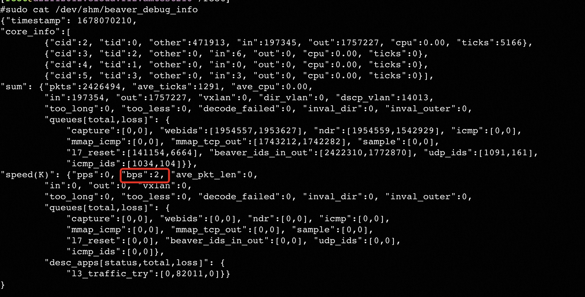
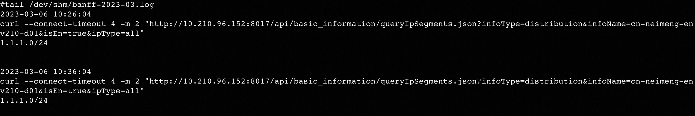
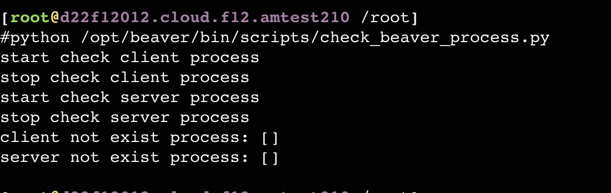
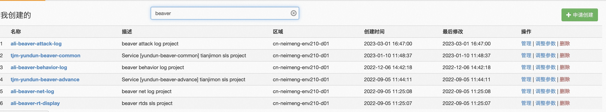
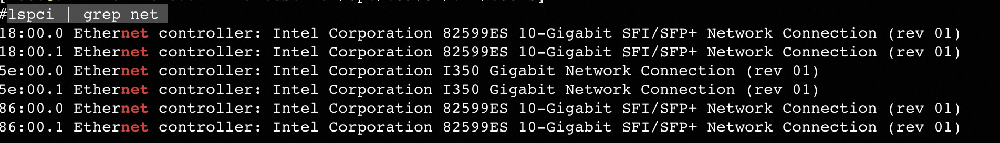
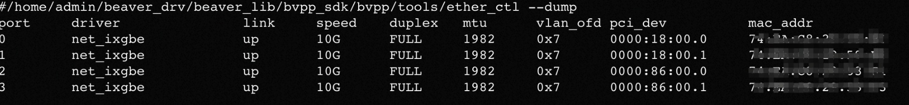
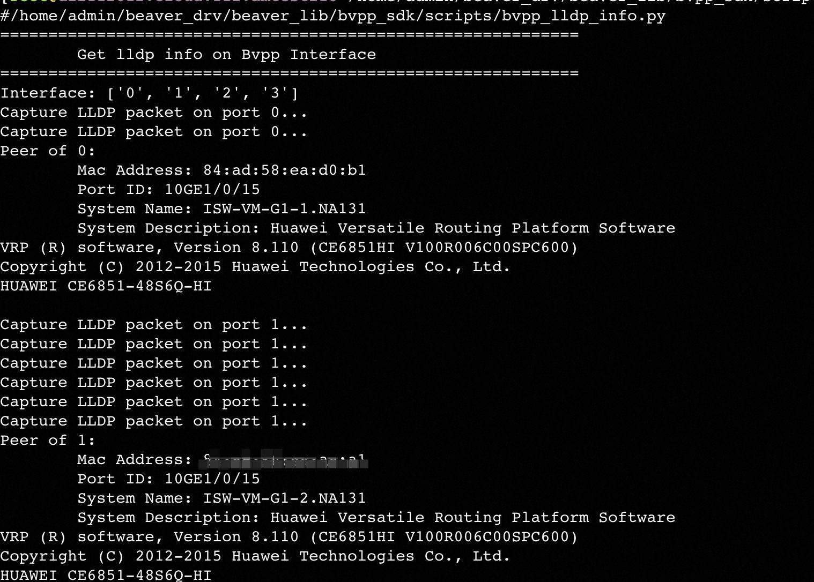
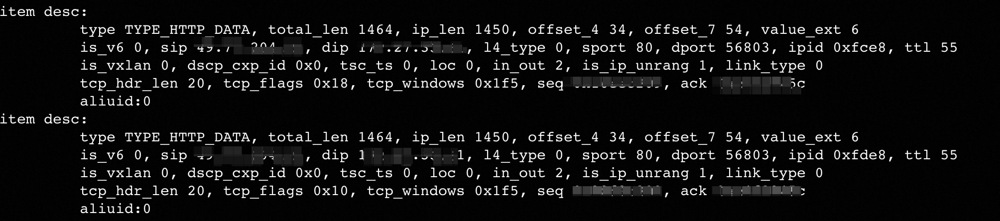

阿里云  
专有云  
云盾网络检测与响应  
运维指南  
产品版本：V3.18.6  
文档版本：20250529

**目录**

- [1.登录飞天基础运维平台](#section-1)
- [2.检查服务状态](#section-2)
    - [2.1. 基础巡检](#section-2-1)
    - [2.2. 高级巡检](#section-2-2)
- [3.常见运维操作](#section-3)
    - [3.1. 重启beaver_drv进程](#section-3-1)
    - [3.2. 卸载Beaver模块](#section-3-2)
    - [3.3. SLS日志查看及项目说明](#section-3-3)
    - [3.4. 快速进入数据库](#section-3-4)
    - [3.5. 查看网卡类型及其状态](#section-3-5)
    - [3.6. 抓包工具](#section-3-6)
    - [3.7. 回放流量包](#section-3-7)
    - [3.8. 查询机型相关信息](#section-3-8)
    - [3.9. 关闭TCP阻断功能](#section-3-9)
    - [3.10. 启用TCPDump抓包功能](#section-3-10)

<a id="section-1"></a>

# 1.登录飞天基础运维平台

本文介绍如何登录飞天基础运维平台。

**前提条件**

- 已从部署人员或管理员处获取Apsara Uni-manager运维控制台的访问地址、用户名和密码。

  Apsara Uni-manager运维控制台访问地址格式为*ops*.asconsole.*intranet-domain-id*.com。

- 推荐使用Chrome浏览器。

**操作步骤**

1. 打开浏览器。

2. 在地址栏中，输入Apsara Uni-manager运维控制台的访问地址*ops*.asconsole.*intranet-domain-id*.com，按回车键。

   

   > 您可以单击页面右上角的下拉按钮来进行语言切换。
   >
   > **说明**

3. 输入正确的用户名及密码。

   > 登录Apsara Uni-manager运维控制台的用户名和密码请从部署人员或管理员处获取。
   >
   > **说明**

   首次登录Apsara Uni-manager运维控制台时，需要修改登录用户名的密码，请按照提示完成密码修改。

   为提高安全性，密码必须满足以下要求：

   - 英文大小写字母

   - 阿拉伯数字（0~9）

   - 特殊符号，包括感叹号（！）、at（@）、井号（#）、美元符号（$）、百分号（%）等

   - 密码长度10~20个字符

4. 单击**登录**。

5. 在Apsara Uni-manager运维控制台的顶部菜单栏，选择**产品运维 > 云平台运维 > 飞天基础运维平台**。

<a id="section-2"></a>

# 2.检查服务状态

本文介绍如何去检查NDR的服务状态

<a id="section-2-1"></a>

## 2.1. 基础巡检

网络检测与响应（以下简称NDR）基础巡检内容为产品状态巡查。本文介绍如何进行基础巡检。

**操作步骤**

1. 登录飞天基础运维平台。

2. 单击**运维集群运维**。

3. 在**产品|集群**搜索框输入**BeaverCluster**。

   

4. 单击 BeaverClusterForTAPSW-A-xx 集群**操作**列的**集群详情**。

5. 在集群详情页面，单击**服务列表**页签。

6. 在**服务**搜索框，输入**yundun-beaver-advance**后，查看服务状态是否正常。

<a id="section-2-2"></a>

## 2.2. 高级巡检

云盾网络检测与响应高级巡检内容主要为服务状态和功能检查。本文介绍如何进行高级巡检。

**操作步骤**

1. 登录飞天基础运维平台。

2. 登录Beaver的两台物理机。

   <ol type="i">

   <li>

   单击**运维集群运维**。

   </li>

   <li>

   在**产品|集群**搜索框输入**BeaverCluster**。

   

   </li>

   <li>

   单击 BeaverClusterForTAPSW-A-xx 集群**操作**列的**集群详情**。

   </li>

   <li>

   在集群详情页面，单击**服务列表**页签。

   </li>

   <li>

   在**服务**搜索框，输入**yundun-beaver-advance**后，单击**详情**，进入**服务详情**页面。

   </li>

   <li>

   在**组件列表**区域，单击<strong>BeaverAdvance#</strong>分页，查看机器信息。

   </li>

   <li>

   在**实例列表**页签，定位到目标实例后，单击**操作**列的**Terminal**。

   </li>

   </ol>

3. 查看Beaver日志状态。

   执行 `sudo tail /var/log/messages` ，如果有内容输出，则表示日志正常。

4. 查看镜像流量状态。

   执行 `sudo cat /dev/shm/beaver_debug_info`  ，如果输出内容中倒数第二行**speed(K)中的bps**不为0，则表示镜像基本正常。

   

5. 查看防护IP网段配置。

   执行 `tail -f /dev/shm/banff-<`年`>-<`月`>.log` ，其中<em><年></em>用当年的年份替代，<em><月></em>用当年的月份替代，比如现在是2023年3月就是banff-2023-03.log。输出内容中的IP段应为经典网络SLB/EIP网段（如果已接入CSW侧，则配置VPC网段）。

   

6. 查看NDR所有的进程状态。

   执行python /opt/beaver/bin/scripts/check_beaver_process.py，如果client not exist process后的列表为空，并且server not exist process后的列表也为空，则表示正常，NDR服务进程已全部正常。

   

7. 查看清洗服务器配置。

   执行 `cat /home/admin/beaver-dj-schedule/conf/dj.conf` ，确认未注释的aliguard_smart配置中ip字段是否是域名aliguard. ${global:internet-domain}对应的dns vip； 并且是否能够ping通。

   

<a id="section-3"></a>

# 3.常见运维操作

<a id="section-3-1"></a>

## 3.1. 重启beaver_drv进程

**背景信息**

参考以下操作步骤，重启beaver_drv进程：

**操作步骤**

1. 登录Beaver物理服务器。

2. 切换到root账号。

3. 执行以下命令，重启Beaver进程。 `/home/admin/beaver_drv/bin/beaver_drv.sh stop` 执行5次，然后等待其自动拉起。

<a id="section-3-2"></a>

## 3.2. 卸载Beaver模块

**背景信息**

参考以下操作步骤，卸载流量安全监控（Beaver）模块：

**操作步骤**

1. 登录Beaver物理服务器。

2. 切换到root账号。

3. 执行以下命令，卸载Beaver模块。

   ```text
    bash /opt/beaver/bin/uninstall.sh 
   ```

<a id="section-3-3"></a>

## 3.3. SLS日志查看及项目说明

本文介绍NDR系统日志存储sls的登陆方式和项目说明。

**登陆SLS**

1. 获取sls登陆信息

   ```bash
   cat /beaver.def | grep sls
   sls_account_accessid=xxxx
   sls_account_accesskey=xxxxxxx
   sls_domain_dataendpoint=data.xxxx
   ```

2. 将sls_domain_dataendpoint前面的data修改为portal, 填充到浏览器URL输入框。

3. 在登陆界面，使用accessid和accesskey进行登陆。

**NDR日志项目说明**



项目名称

日志库

日志库说明

此日志库是

**tjm-yundun-beaver-**

beavercommon服务接

**beavercommon**

**common**

入tianjimon的日志。

此日志库是

**tjm-yundun-beaver-**

beaveradvance服务接入

**beaveradvance**

**advance**

tianjimon的日志。

行为分析DGA日志

**ndr_attack_behavior_dga**

行为分析登陆暴力破解日

**ndr_attack_behavior_login_brute_cra**

志

**ck**

行为分析进程监控日志

**ndr_attack_behavior_monitor_log**

行为分析SSL日志

**ndr_attack_behavior_ssl**

行为分析弱口令日志

**ndr_attack_behavior_weak_pwd**

行为分析通信状态日志

**ali-beaver-behavior-log**

**ndr_behavior_access_stats**

行为分析DNS白名单

**ndr_behavior_dns_whitelist**

行为分析加密白名单

**ndr_behavior_encrypt_whitelist**

行为分析原始日志

**ndr_behavior_log**

行为分析任务监控详情日

**ndr_monitor_task_detail_log**

志

行为分析攻击确认日志

**ndr_web_attack_check**

五元组日志

**ndr_log_5tuple**

DNS日志

**ndr_log_dns**

http日志

**ndr_log_http**

协议日志

**ndr_log_protocol**

SSH日志

**ndr_log_ssh**

SSL日志

**ndr_log_ssl**

攻击日志pcap留存日志

**ndr_pcap_index**

**ali-beaver-net-log**

dns日志(v317版本+弃

**odl_beaver_log_dns**

用)

http reauest日志(v317

**odl_beaver_log_http_request**

版本+弃用)

http response日志

**odl_beaver_log_http_response**

(v317版本+弃用)

mysql日志(v317版本+弃

**odl_beaver_log_mysql**

用)

sla日志(v317版本+弃用)

**odl_beaver_log_sla**

tcp日志(v317版本+弃用)

**odl_beaver_log_tcp_session**

udp日志(v317版本+弃

**odl_beaver_log_udp_session**

用)

4层威胁检测日志(v316版

**beaver_cc_detail**

本+弃用)

7层威胁检测日志(v316版

**beaver_rtds_scan**

本+弃用)

威胁检测告警日志

**ndr_attack_alert**

**ali-beaver-rt-display**

威胁检测记录日志

**ndr_attack_log**

四七层阻断日志

**ndr_reset_log**

slb https访问日志(v316

**slb_https_access_log**

版本+弃用)

<a id="section-3-4"></a>

## 3.4. 快速进入数据库

本文介绍如何从NDR服务器快速进入依赖的三个数据库。

**NDR数据库**

```text
/opt/beaver/bin/tools/mysql_jifei_ctl
```

**secureconsole数据库**

```text
/opt/beaver/bin/tools/mysql_secureconsole_ctl
```

**soc数据库**

```text
/opt/beaver/bin/tools/mysql_yundunsoc_ctl
```

<a id="section-3-5"></a>

## 3.5. 查看网卡类型及其状态

本文介绍如何查看网卡类型、启用状态、链路状态。

**网卡类型**

```text
lspci | grep net
```



> **说明**
>
> NDR服务器的网卡分为管理口网卡和业务口网卡。
>
> 管理口网卡是服务器本机的网卡，一般是千兆网卡，如上图，类型为I350。
>
> 业务口网卡是接受镜像流量的网卡，目前支持的是万兆网卡，如上图，类型为82599ES。

> **重要**
>
> 业务口网卡支持的类型是需要适配的，并非所有的网卡都可以支持。
>
> 目前支持的网卡类型列表如下：
>
> ```json
> ["RP2000","RP1000","MT28800","MT27800", "MT27700", "MT27710", "X710", "XL710", "X520", "82599ES", "82599EB", "82599"]
> ```

**业务网卡启用状态**

```text
/home/admin/beaver_drv/beaver_lib/bvpp_sdk/bvpp/tools/ether_ctl --dump
```



> **说明**
>
> 重点关注link的状态，如果状态为down，需要针对接线或者光模块进行排查。

**链路状态**

```text
/home/admin/beaver_drv/beaver_lib/bvpp_sdk/scripts/bvpp_lldp_info.py
```



> **说明**
>
> 通过该脚本可以查看对段链接的设备和端口信息。

<a id="section-3-6"></a>

## 3.6. 抓包工具

本文介绍NDR系统内置的一些抓包工具，方便问题排查。

**dpdk工具**

```text
/home/admin/beaver_drv/bin/example_no_dpdk pkt_desc  1  -1 <指定IP>
```

日志输出如下：



> **说明**
>
> is_v6： 是否是IPv6 0表示否，1表示是
>
> sip： 源IP
>
> dip： 目的IP
>
> sport： 源端口
>
> dport： 目的端口
>
> dscp_cxp_id： vlanID的十六进制数， 在判断流量是否在vlanID是很有用。
>
> aliuid： 租户UID 在租户区分流量时很有用。
>
> 如果aliuid值为0，有三种情况，1.非租户资产，2.NDR资产同步有问题，3.镜像的流量存在问题

**captool工具**

```text
#/home/admin/beaver_drv/beaver_lib/bvpp_sdk/bvpp/tools/captool
CapTool git info: 691f6a7, compile at 2022-02-23 19:32:40
must specific the action param, dump to screen or dump to file
Usage:
/home/admin/beaver_drv/beaver_lib/bvpp_sdk/bvpp/tools/captool --time [0-3600], 0 means infinite, default 0
         --count [0-10000], 0 means infinite, default 0
         --intf [0-63]
         --vlan [0-4095]
         --core [0-63]
         --ether [0xXXXX]]
         --tunnel-id [xxxxx]
         --proto [0-255]]
         --src-ip [src ipaddr]
         --dst-ip [dst ipaddr]
         --ip [dst or src ipaddr]
         --port [0-65535]
         --inner-proto [0-255]]
         --inner-src-ip [inner src ipaddr]
         --inner-dst-ip [inner dst ipaddr]
         --inner-ip [inner dst or src ipaddr]
         --inner-port [0-65535]
         --direction 
rx|tx|drop|kernel|pre_routing|local_in|post_routing|pre_routing6|local_in6|post_routing6

         --file     file path to write in cap format
         --screen   dump to screen
         --unix    capture on which master, default main
         --stop
         --help
         --version
```

> **说明**
>
> captool工具可以显示在屏幕，也可以输出pcap包，缺点：无法判断是否标记上租户uid。

<a id="section-3-7"></a>

## 3.7. 回放流量包

本文介绍如何使用dpdk工具进行流量包回放，进而去自测NDR系统的功能运行状况。

**回放命令**

```text
#/home/admin/beaver_drv/beaver_lib/bvpp_sdk/bvpp/tools/pkt_replay <cap file> <speed> <replay_loops> <Interval>
Userage ./pkt_repaly <cap file> <speed(Kpps)> <time(Second), 0 means nolimit> <replay_loops, 0:replay persist, other replay n times> <Interval time(us) for frame,0 means nolimit>
```

<a id="section-3-8"></a>

## 3.8. 查询机型相关信息

本文介绍如何查询对应机型的相关信息。

**获取服务器的SN**

```text
dmidecode |grep "Serial Number" 
# 第⼀⾏Serial Number对应的值就是SN
```

**执行查询命令**

```bash
curl "localhost:7070/api/v3/column/m.*?m.sn=机器sn"
```

<a id="section-3-9"></a>

## 3.9. 关闭TCP阻断功能

**该文档适用于v3.13版本及以下**

**背景信息**

参考以下操作步骤，关闭流量安全监控模块的TCP阻断功能：

**操作步骤**

1. 登录Beaver物理服务器。

2. 切换到root账号。

3. 编辑所有Beaver服务器上的/beaver_client.sh文件，在 `./tcp_reset` 行前添加 `#` 号，注释该行。

4. 在所有Beaver服务器上执行以下命令，关闭TCP阻断功能。

   ```text
    killall tcp_reset 
   ```

<a id="section-3-10"></a>

## 3.10. 启用TCPDump抓包功能

**该文档适用于V2的beaver版本，V3版本不再支持**

**背景信息**

参考以下操作步骤，启用流量安全监控（Beaver）模块的TCPDump抓包功能：

**操作步骤**

1. 登录Beaver物理服务器。

2. 切换到root账号。

3. 执行以下命令，启用抓包功能。

   ```bash
    echo 1 > /proc/ixgbe_debug_dispatch 
   ```

   > **说明**
   >
   > 启用此功能会影响流量安全监控模块的工作性能。抓包完成后，建议执行以下命令，关闭此功能。
   >
   > ```bash
   >  echo 0 > /proc/ixgbe_debug_dispatch 
   > ```
