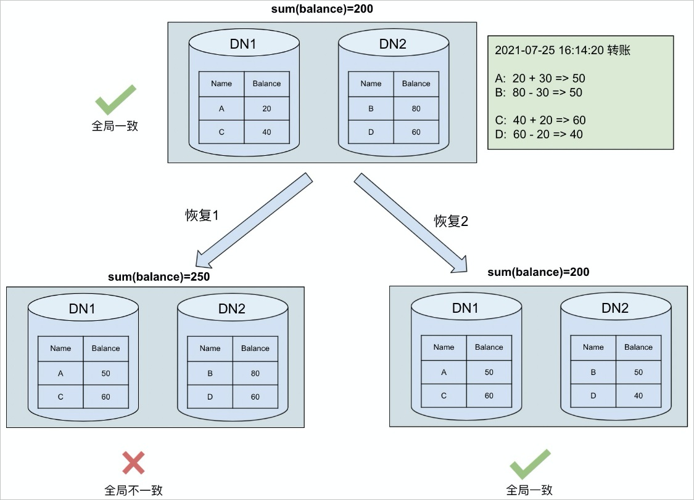

阿里云  
专有云  
云原生关系型数据库 PolarDB  
用户指南（PolarDB-X）  
产品版本：V3.18.3  
文档版本：20241025

**目录**

- [1.登录云原生分布式数据库控制台](#section-1)
- [2.实例管理](#section-2)
    - [2.1. 创建实例](#section-2-1)
    - [2.2. 实例变配](#section-2-2)
    - [2.3. 增加节点](#section-2-3)
    - [2.4. 释放实例](#section-2-4)
    - [2.5. 重启实例](#section-2-5)
    - [2.6. 只读实例](#section-2-6)
    - [2.7. 标签管理](#section-2-7)
- [3.网络与连接](#section-3)
    - [3.1. 连接数据库](#section-3-1)
    - [3.2. 集群地址和只读地址](#section-3-2)
    - [3.3. 申请和释放外网地址](#section-3-3)
- [4.账号和安全](#section-4)
    - [4.1. 管理数据库账号](#section-4-1)
    - [4.2. 设置白名单](#section-4-2)
    - [4.3. 设置SSL加密](#section-4-3)
    - [4.4. 三权分立](#section-4-4)
        - [4.4.1. 功能介绍](#section-4-4-1)
        - [4.4.2. 开启或关闭三权分立](#section-4-4-2)
        - [4.4.3. 管理三权分立系统账号](#section-4-4-3)
        - [4.4.4. 权限验证](#section-4-4-4)
- [5.参数设置](#section-5)
- [6.性能监控](#section-6)
    - [6.1. 计算资源监控](#section-6-1)
    - [6.2. 存储资源监控](#section-6-2)
    - [6.3. 日志资源监控](#section-6-3)
- [7.诊断与优化](#section-7)
    - [7.1. SQL审计与分析](#section-7-1)
    - [7.2. 实例会话](#section-7-2)
    - [7.3. 慢日志](#section-7-3)
    - [7.4. 空间分析](#section-7-4)
    - [7.5. 锁分析](#section-7-5)
    - [7.6. 性能趋势](#section-7-6)
    - [7.7. 实时性能](#section-7-7)
- [8.SQL日志明细](#section-8)
- [9.备份与恢复](#section-9)
    - [9.1. 备份数据](#section-9-1)
    - [9.2. 恢复数据](#section-9-2)
    - [9.3. 日志备份](#section-9-3)

<a id="section-1"></a>

# 1.登录云原生分布式数据库控制台

本节以Chrome浏览器为例，介绍云产品用户如何登录到云原生分布式数据库PolarDB-X控制台。

**前提条件**

- 登录统一云管平台前，确认您已从部署人员处获取统一云管平台的服务域名地址。

- 推荐使用Chrome浏览器。

**操作步骤**

1. 在浏览器地址栏中，输入统一云管平台的服务域名地址，按回车键。

   > **说明**
   >
   > - 单击右上角的当前语言可以切换其它语言。

2. 输入正确的用户名及密码。

   请向运营管理员获取登录控制台的用户名和密码。

   > **说明**
   >
   > 首次登录统一云管平台时，需要修改登录用户名的密码，请按照提示完成密码修改。为提高安全性，密码长度必须为10~32位，且至少包含以下两种类型：
   >
   > - 英文大写或小写字母（A~Z、a~z）
   >
   > - 阿拉伯数字（0~9）
   >
   > - 特殊符号（感叹号（!）、at（@）、井号（#）、美元符号（$）、百分号（%）等）

3. 单击**账号登录**。

4. 在页面顶部的菜单栏中，单击**产品 > 数据库 > 云原生分布式数据库PolarDB-X 2.0**。

<a id="section-2"></a>

# 2.实例管理

<a id="section-2-1"></a>

## 2.1. 创建实例

本文主要介绍如何创建PolarDB-X实例。

**操作步骤**

1. 登录云原生分布式数据库控制台。

   > **说明**
   >
   > 控制台支持以下功能：
   >
   > ：单击可刷新实例列表信息。
   >
   > 
   >
   > ：单击可选择采用**默认**或者**紧凑**模式显示实例列表。
   >
   > 
   >
   > ：单击可选择实例列表中显示的实例属性。
   >
   > 
   >
   > ：单击可选择全屏模式或退出全屏模式。
   >
   > 
   >
   > ：单击可将实例列表信息导出到本地。
   >
   > 

2. 在右上角单击**创建新实例**。

3. 在**创建PolarDB-X 2.0**页面，设置如下参数。

   <table>
     <tr>
       <th width="138">选项</th>
       <th>说明</th>
     </tr>
     <tr>
       <td>组织</td>
       <td>选择实例所属组织。</td>
     </tr>
     <tr>
       <td>资源集</td>
       <td>选择实例所属资源集。</td>
     </tr>
     <tr>
       <td>地域</td>
       <td>选择实例所属地域。</td>
     </tr>
     <tr>
       <td>系列</td>
       <td>可选择<strong>企业版</strong>或<strong>标准版</strong>。</td>
     </tr>
     <tr>
       <td>部署方式</td>
       <td>可选择<strong>单可用区</strong>或<strong>多可用区</strong>。<br>• 单可用区：仅需选择主可用区，备节点和日志节点将自动部署在同一个可用区。<br>• 多可用区：选择多可用区，各个节点将会分别部署在不同的可用区，因此多可用区实例具备了机房级别的容灾能力。</td>
     </tr>
     <tr>
       <td>部署模式</td>
       <td>固定值为<strong>默认</strong>。</td>
     </tr>
     <tr>
       <td>主可用区</td>
       <td>选择实例所属的主可用区。</td>
     </tr>
     <tr>
       <td>备可用区</td>
       <td>选择实例的备可用区，仅部署方式为多可用区时选择。</td>
     </tr>
     <tr>
       <td>第三可用区</td>
       <td>选择实例的次备可用区，仅部署方式为多可用区时选择。</td>
     </tr>
     <tr>
       <td>芯片架构</td>
       <td>可选择<strong>海光</strong>、<strong>鲲鹏</strong>、<strong>飞腾</strong>、<strong>英特尔</strong>。</td>
     </tr>
     <tr>
       <td>兼容性</td>
       <td>可选择<strong>MySQL 5.7</strong>或<strong>MySQL 8.0</strong>。</td>
     </tr>
     <tr>
       <td>共享类型</td>
       <td>可选择<strong>通用</strong>或<strong>独享</strong>。<br>• 独享规格：每个实例会独占所分配到的计算资源（如CPU），而不会与同一服务器上的其他实例共享资源，性能表现更加稳定。<br>• 通用规格：同一硬件资源下的不同实例，会互相充分利用彼此空闲的计算资源（如CPU），通过复用计算资源享受规模红利，性价比更高。</td>
     </tr>
     <tr>
       <td>计算节点规格</td>
       <td>选择计算节点的规格。<br>说明仅系列为<strong>企业版</strong>时需要配置此选项。</td>
     </tr>
     <tr>
       <td>计算节点组数量</td>
       <td>选择计算节点组数量。<br>说明仅系列为<strong>企业版</strong>时需要配置此选项。</td>
     </tr>
     <tr>
       <td>存储节点规格</td>
       <td>选择存储节点的规格。<br>说明仅系列为<strong>企业版</strong>时需要配置此选项。</td>
     </tr>
     <tr>
       <td>存储节点组数量</td>
       <td>选择存储节点组数量。<br>说明仅系列为<strong>企业版</strong>时需要配置此选项。</td>
     </tr>
     <tr>
       <td>存储空间</td>
       <td>选择存储空间。</td>
     </tr>
     <tr>
       <td>实例规格</td>
       <td>选择实例规格。<br>说明仅系列为<strong>标准版</strong>时需要配置此选项。</td>
     </tr>
     <tr>
       <td>节点组数量</td>
       <td>选择节点组数量，最小为2。<br>说明仅系列为<strong>标准版</strong>时需要配置此选项。</td>
     </tr>
     <tr>
       <td>网络类型</td>
       <td>无需选择，默认为<strong>专有网络</strong>。</td>
     </tr>
     <tr>
       <td>专有网络vpc</td>
       <td>选择VPC。</td>
     </tr>
     <tr>
       <td>交换机vswich</td>
       <td>选择交换机。</td>
     </tr>
   </table>

4. 单击**提交**，跳转至控制台查看创建成功的实例。

<a id="section-2-2"></a>

## 2.2. 实例变配

一个PolarDB-X实例是由多个节点组成的分布式集群。单个节点承担了SQL路由、数据合并、聚合等功能。通过实例变配，您可以变更实例的节点规格，在业务繁忙时进行升配，承载更多的业务流量QPS，在业务空闲时进行降配，避免资源浪费。

**注意事项**

降配过程中由于应用与实例连接会中断，可能在短时间内会产生闪断 ，请确保应用程序具备重连机制。

**操作步骤**

1. 登录云原生分布式数据库控制台。

   > **说明**
   >
   > 控制台支持以下功能：
   >
   > ：单击可刷新实例列表信息。
   >
   > 
   >
   > ：单击可选择采用**默认**或者**紧凑**模式显示实例列表。
   >
   > 
   >
   > ：单击可选择实例列表中显示的实例属性。
   >
   > 
   >
   > ：单击可选择全屏模式或退出全屏模式。
   >
   > 
   >
   > ：单击可将实例列表信息导出到本地。
   >
   > 

2. 在目标实例右侧的**操作**栏中，单击**变配**。

3. 在**变配**页面，选择目标节点规格和存储空间。

   > 变配完成后，计算层和存储的节点都会升配或降配到相同的目标节点规格。
   >
   > **说明**

4. 单击**提交**，完成变配。

<a id="section-2-3"></a>

## 2.3. 增加节点

一个PolarDB-X实例是由多个节点组成的分布式集群。PolarDB-X支持通过增加节点来对实例进行扩容。

**操作步骤**

1. 登录云原生分布式数据库控制台。

   > **说明**
   >
   > 控制台支持以下功能：
   >
   > ：单击可刷新实例列表信息。
   >
   > 
   >
   > ：单击可选择采用**默认**或者**紧凑**模式显示实例列表。
   >
   > 
   >
   > ：单击可选择实例列表中显示的实例属性。
   >
   > 
   >
   > ：单击可选择全屏模式或退出全屏模式。
   >
   > 
   >
   > ：单击可将实例列表信息导出到本地。
   >
   > 

2. 在目标实例右侧的**操作**栏中，单击**增加节点**。

3. 在弹出页面，选择目标节点数量。

4. 单击**去开通**。

   执行成功后，在控制台可查看到实例状态变更为**增加节点中**。

<a id="section-2-4"></a>

## 2.4. 释放实例

本文介绍如何释放PolarDB-X实例。

**操作步骤**

1. 登录云原生分布式数据库控制台。

   > **说明**
   >
   > 控制台支持以下功能：
   >
   > ：单击可刷新实例列表信息。
   >
   > 
   >
   > ：单击可选择采用**默认**或者**紧凑**模式显示实例列表。
   >
   > 
   >
   > ：单击可选择实例列表中显示的实例属性。
   >
   > 
   >
   > ：单击可选择全屏模式或退出全屏模式。
   >
   > 
   >
   > ：单击可将实例列表信息导出到本地。
   >
   > 

2. 单击目标实例名称。

3. 在**基本信息**界面，单击**释放实例**。

   > 实例释放后不可恢复，请谨慎操作。
   >
   > **警告**

4. 在弹出的对话框中，单击**确定**，释放实例成功。

<a id="section-2-5"></a>

## 2.5. 重启实例

当PolarDB-X实例出现连接数满或性能问题时，您可以在控制台上手动重启实例。本文将介绍如何重启实例。

**操作步骤**

1. 登录云原生分布式数据库控制台。

   > **说明**
   >
   > 控制台支持以下功能：
   >
   > ：单击可刷新实例列表信息。
   >
   > 
   >
   > ：单击可选择采用**默认**或者**紧凑**模式显示实例列表。
   >
   > 
   >
   > ：单击可选择实例列表中显示的实例属性。
   >
   > 
   >
   > ：单击可选择全屏模式或退出全屏模式。
   >
   > 
   >
   > ：单击可将实例列表信息导出到本地。
   >
   > 

2. 找到目标实例，单击实例名称。

3. 在**基本信息**页面，单击右上角**重启实例**。

   > 重启实例会造成连接中断，重启前请做好业务安排，谨慎操作。
   >
   > **警告**

4. 在弹出的对话框中，单击**确定**，完成实例重启。

<a id="section-2-6"></a>

## 2.6. 只读实例

本文将介绍如何为主实例添加只读实例。

**背景信息**

主实例存储节点采用了基于Paxos的三副本高可用架构。而只读实例的存储节点，则通过增加Learner副本的方式来保证物理资源隔离，同时能够基于全局时钟来确保只读查询的强一致性。

**注意事项**

- 只读实例与主实例必须属于同一个地域，但是可以在不同的可用区。

- 只读实例无法单独存在，必须隶属于某个主实例。若您在主实例上创建了数据库，该数据库也会被复制到只读实例上。同理，若您在主实例上删除数据库时，只读实例上对应的数据库也会被删除。

**操作步骤**

1. 登录云原生分布式数据库控制台。

   > **说明**
   >
   > 控制台支持以下功能：
   >
   > ：单击可刷新实例列表信息。
   >
   > 
   >
   > ：单击可选择采用**默认**或者**紧凑**模式显示实例列表。
   >
   > 
   >
   > ：单击可选择实例列表中显示的实例属性。
   >
   > 
   >
   > ：单击可选择全屏模式或退出全屏模式。
   >
   > 
   >
   > ：单击可将实例列表信息导出到本地。
   >
   > 

2. 在目标实例右侧的**操作**栏中，单击

   图标，单击**只读实例**。

   

   您还可以单击实例名称，进入实例详情页面，在页面右侧的**只读实例**区域中，单击**添加只读实例**。

3. 在弹出的对话框中，设置如下参数。

   | 选项 | 说明 |
   | --- | --- |
   | 资源集 | 无需选择，采用默认值。 |
   | 地域 | 选择实例所属地域。 |
   | 可用区 | 选择实例所属可用区。 |
   | 网络类型 | 无需选择，默认为<strong>专有网络</strong>。 |
   | 专有网络vpc | 选择VPC。 |
   | 交换机vswich | 选择交换机。 |
   | 兼容性 | 无需选择，默认为<strong>MySQL 5.7</strong> |
   | 实例规格 | 选择实例规格。 |
   | 节点组数量 | 选择节点组数量，最小为2。 |
   | 存储空间 | 选择存储空间，最小为50 GB。 |

4. 单击**提交**，跳转至控制台查看创建成功的实例。

<a id="section-2-7"></a>

## 2.7. 标签管理

在实例数量较多的情况下，您可以创建多个标签，为实例绑定不同的标签对其进行分类，之后通过标签进行实例筛选。

**绑定标签**

1. 登录云原生分布式数据库控制台。

2. 在左侧导航栏单击**实例列表。**

3. 在**实例列表**页面，单击目标实例**标签**列中的

   图标。

   

4. 在**编辑标签**对话框中，分别填写**标签键**和**标签值。**

5. 单击**确定**，即可完成标签创建<strong>。</strong>

**批量绑定标签**

1. 登录云原生分布式数据库控制台。

2. 在左侧导航栏单击**实例列表**，然后单击目标实例**标签**列中的

   图标<strong>。</strong>

   

3. 在**编辑标签**对话框中，单击右上角**标签管理**，进入**标签管理**页面<strong>。</strong>

4. 在**创建/选择标签并绑定资源**对话框中，单击<strong>+创建/选择标签并绑定资源</strong>，然后分别选择**标签键**和**标签值。**

5. 单击**下一步**，然后依次**选择资源所在的组织和资源集**、**选择资源所在的区域**、**选择云产品**、选中目标实例<strong>。</strong>

6. 单击**下一步**，再单击**确认**，即可完成对多个实例批量绑定标签<strong>。</strong>

**使用标签筛选实例**

1. 登录云原生分布式数据库控制台。

2. 在左侧导航栏单击**实例列表。**

3. 单击**高级筛选**。

4. 在**标签筛选**文本框输入需要搜索的标签键或标签值<strong>。</strong>

5. 单击**搜索。**

**查看实例绑定的标签**

1. 登录云原生分布式数据库控制台。

2. 在左侧导航栏单击**实例列表。**

3. 在**实例列表**页面的标签列中，即可看到绑定的标签。

> **说明**
>
> 标签列中出现  ，鼠标悬浮其上即可看到所有该实例绑定的所有标签。

**解绑标签**

1. 登录云原生分布式数据库控制台。

2. 在左侧导航栏单击**实例列表。**

3. 在**实例列表**页面， 将鼠标移动到目标实例**标签**列的

   图标上<strong>。</strong>

   

4. 在**编辑标签**对话框中，单击需要删除标签对应的

   图标。

   

5. 单击**确定。**

<a id="section-3"></a>

# 3.网络与连接

<a id="section-3-1"></a>

## 3.1. 连接数据库

PolarDB-X支持通过数据管理DMS、MySQL命令行、第三方客户端以及符合MySQL官方交互协议的第三方程序代码进行连接。本文主要介绍如何通过MySQL命令行连接到PolarDB-X数据库。

**前提条件**

如果您是首次使用PolarDB-X，需要先完成创建实例、创建账号、创建数据库等。

如果您的服务器尚未安装MySQL客户端，请前往MySQL网站下载安装。

> 不推荐8.0.x版本的MySQL客户端。
>
> **说明**

**通过MySQL命令行连接到数据库**

1. 登录云原生分布式数据库控制台。

   > **说明**
   >
   > 控制台支持以下功能：
   >
   > ：单击可刷新实例列表信息。
   >
   > 
   >
   > ：单击可选择采用**默认**或者**紧凑**模式显示实例列表。
   >
   > 
   >
   > ：单击可选择实例列表中显示的实例属性。
   >
   > 
   >
   > ：单击可选择全屏模式或退出全屏模式。
   >
   > 
   >
   > ：单击可将实例列表信息导出到本地。
   >
   > 

2. 找到目标实例，单击实例名称。

3. 在**连接信息**区域，找到内外网地址和内外网端口信息。

   > 如果您需要通过外网地址进行访问试用，请单击**申请外网地址**，使用**外网地址**和**外网端**
   >
   > **说明**
   >
   > **口**进行连接。为确保数据库安全，建议您正式访问时使用内网连接地址。

4. 获取**连接信息**后，执行以下命令获取本地对应的公网IP并将其加入实例白名单。

   ```bash
    curl 'https://api.ipify.org'
   ```

5. 通过如下MySQL命令行进行连接：

   ```text
   mysql -h<连接地址> -P<端⼝> -u<⽤户名> -p -D<数据库名称>
   ```

   | 选项 | 说明 | 示例 |
   | --- | --- | --- |
   | <code>-h</code> | 实例的内网连接地址或外网连接地址。 | <code>pxc-</code><br><code>******************.public.polarx.rds</code><br><code>.aliyuncs.com</code> |
   | <code>-P</code> | 实例的端口号。<br>• 若使用内网连接，需输入实例的内网端口。<br>• 若使用外网连接，需输入实例的外网端口。<br>说明<br>• 此处<code> -P </code>为大写字母。<br>• 默认端口为3306。 | <code>3306</code> |
   | <code>-u</code> | 实例中的账号名称。 | <code>testuser</code> |
   | <code>-p</code> | 以上账号的密码。<br>说明<br>• 为保障密码安全，<code> -p </code>后请不要填写密码，会在执行整行命令后提示您输入密码，输入后按回车即可登录。<br>• 如果填写该参数，<code> -p </code>与密码之间不能有空格。 | <code>passWord123</code> |
   | <code>-D</code> | 需要登录的数据库名称。<br>说明<br>• 该参数非必填参数。<br>• 可以不输入<code> -D </code>仅输入数据库名称。 | <code>mysql</code> |

**通过第三方客户端连接到数据库**

PolarDB-X支持通过如下第三方客户端进行连接，您可以去对应的官方网站下载客户端。

- MySQL Workbench（推荐）

- SQLyog

- Sequel Pro

- Navicat for MySQL

> 第三方GUI客户端可执行基础的数据库操作，包括数据的增删改查和DDL操作，对于工具
>
> **说明**
>
> 高级特性，PolarDB-X可能并不支持。

**通过第三方程序代码连接到数据库**

PolarDB-X支持通过如下符合MySQL官方交互协议的第三方程序代码进行连接：

- JDBC Driver for MySQL (Connector/J)

- Python Driver for MySQL (Connector/Python)

- C++ Driver for MySQL (Connector/C++)

- C Driver for MySQL (Connector/C)

- ADO.NET Driver for MySQL (Connector/NET)

- ODBC Driver for MySQL (Connector/ODBC)

- PHP Drivers for MySQL (mysqli, ext/mysqli, PDO_MYSQL, PHP_MYSQLND)

- Perl Driver for MySQL (DBD::mysql)

- Ruby Driver for MySQL (ruby-mysql)

以下为JDBC Driver for MySQL （Connector/J）程序代码示例。

```text
//JDBC
Class.forName("com.mysql.jdbc.Driver"); 
Connection conn = DriverManager.getConnection("jdbc:mysql://pxc-
******************.public.polarx.rds.aliyuncs.com:3306/doc_test","doc_test","doc_test_pas
ord");
//...
conn.close();    
```

以下为应用端连接池配置示例。

```xml
<bean id="dataSource" class="com.alibaba.druid.pool.DruidDataSource" init-method="init" 
destroy-method="close"> 
<property name="url" value="jdbc:mysql://pxc-
******************.public.polarx.rds.aliyuncs.com:3306/doc_test" />
<property name="username" value="doc_test" />
<property name="password" value="doc_test_password" />
<property name="filters" value="stat" />
<property name="maxActive" value="100" />
<property name="initialSize" value="20" />
<property name="maxWait" value="60000" />
<property name="minIdle" value="1" />
<property name="timeBetweenEvictionRunsMillis" value="60000" />
<property name="minEvictableIdleTimeMillis" value="300000" />
<property name="testWhileIdle" value="true" />
<property name="testOnBorrow" value="false" />
<property name="testOnReturn" value="false" />
<property name="poolPreparedStatements" value="true" />
<property name="maxOpenPreparedStatements" value="20" />
<property name="asyncInit" value="true" />
</bean>
```

> 推荐使用Druid连接池连接。
>
> **说明**

<a id="section-3-2"></a>

## 3.2. 集群地址和只读地址

本文将介绍实例的连接地址及设置项。

**背景信息**

当您只创建了主实例时，只会有一个连接地址，也叫集群地址（Cluster Endpoint），主要面向在线通用业务场景。 在主实例页面上，如果添加了只读实例，每个只读实例页面上会提供一个只读地址（Read Only Endpoint），专注离线拖数、跑批等资源链路隔离场景，确保只读资源可被独享。在HTAP场景下，创建了主实例和只读实例，您可以使用集群地址（Cluster Endpoint）和只读地址（Read Only Endpoint）。

**配置集群地址**

1. 登录云原生分布式数据库控制台。

2. 找到目标实例，单击实例名称。

3. 在**连接信息**区域，单击集群地址的  图标。

4. 单击**配置管理**，查看集群地址配置项。

   配置项说明：

   - 只读实例自动加入：若创建了只读实例，可以选择将只读实例加入主实例管理中，这样可以通过读写分离技术，将主实例的复杂查询流量路由给只读实例集群。

   - 智能读写分离：开启后会自动识别出查询负载，将AP流量路由给只读实例去计算，分担主实例压力。如果用户没有创建只读实例或者只读实例未加入到主实例管理中，可以忽略该选项。

配置项说明：

<table>
  <tr>
    <th width="170">参数</th>
    <th>说明</th>
  </tr>
  <tr>
    <td>资源配置</td>
    <td>若已成功创建只读实例，可以选择将需要分担流量的只读实例加入到主实例资源池中，未加入的将不分担主实例的流量。</td>
  </tr>
  <tr>
    <td>只读实例自动加入</td>
    <td>控制新创建的只读实例是否加入到主实例资源池，默认开启。</td>
  </tr>
  <tr>
    <td>智能读写分离</td>
    <td>此功能默认为开启，会自动将AP流量路由给多个只读实例去计算，并做MPP并行加速。</td>
  </tr>
  <tr>
    <td>只读流量占比</td>
    <td>将原本路由给主实例存储的读查询按一定的比例规则路由给只读实例存储。</td>
  </tr>
  <tr>
    <td>数据读一致性</td>
    <td>• 强一致性：路由到只读实例的请求，保证一定能够查询到读请求执行前在主实例上已完成更新的数据，提供外部强一致性；<br>• 弱一致性：路由到只读实例的请求，读请求仅访问只读实例上当前的最新数据，会因为主从异步复制的架构产生数据读取延迟。<br>说明在主从复制延迟的条件下，强一致性读会等待直到读取到已完成更新的数据，默认的等待超时是3s。</td>
  </tr>
  <tr>
    <td>只读实例延迟阈值</td>
    <td>超过该阈值后只读流量会发送给其他延迟正常的只读实例，或者根据只读实例可用性决定是否切回主库。</td>
  </tr>
  <tr>
    <td>只读流量切回主实例</td>
    <td>当所有只读实例的延迟超过阈值或者出现HA状态，则认为当前所有只读实例处于不可用的状态，判断是否将只读流量回切主库（建议只读实例个数≥2来提升可用性）。</td>
  </tr>
</table>

**配置只读地址**

1. 登录云原生分布式数据库控制台。

2. 找到目标实例，单击实例名称。

3. 单击只读地址的  。

4. 单击**配置管理**，查看只读地址配置项。

   配置项说明：

   - 强一致性：通过只读地址可以查看到主实例上提交的最新数据，满足全局数据查询一致性。如果主备延迟过大，提交的查询会等待。

   - 弱一致性：通过只读地址可以查看到当前只读实例上最新数据，如果在主实例和只读实例间数据同步有延迟的话，不会等待，查询到数据立即返回。

<a id="section-3-3"></a>

## 3.3. 申请和释放外网地址

PolarDB-X实例会默认分配一个内网地址，应用和MySQL客户端可以在阿里云ECS上连接PolarDB-X实例的数据库。如果需要从外网访问PolarDB-X，则需要为PolarDB-X实例申请外网地址。本文将介绍如何申请和释放外网地址。

**申请外网地址**

1. 登录云原生分布式数据库控制台。

   > **说明**
   >
   > 控制台支持以下功能：
   >
   > ：单击可刷新实例列表信息。
   >
   > 
   >
   > ：单击可选择采用**默认**或者**紧凑**模式显示实例列表。
   >
   > 
   >
   > ：单击可选择实例列表中显示的实例属性。
   >
   > 
   >
   > ：单击可选择全屏模式或退出全屏模式。
   >
   > 
   >
   > ：单击可将实例列表信息导出到本地。
   >
   > 

2. 找到目标实例，单击实例名称。

3. 在**基本信息**页面中间的**连接信息**区域，单击右上角**申请外网地址**。

4. 在弹出的对话框中，单击**确定**。

   > **说明**
   >
   > 如果您需要通过申请的外网地址来连接实例，您还需要将连接实例的客户端所属的公网IP地址加入到实例的白名单中，详细操作请参见设置白名单。

**释放外网地址**

1. 登录云原生分布式数据库控制台。

   > **说明**
   >
   > 控制台支持以下功能：
   >
   > ：单击可刷新实例列表信息。
   >
   > 
   >
   > ：单击可选择采用**默认**或者**紧凑**模式显示实例列表。
   >
   > 
   >
   > ：单击可选择实例列表中显示的实例属性。
   >
   > 
   >
   > ：单击可选择全屏模式或退出全屏模式。
   >
   > 
   >
   > ：单击可将实例列表信息导出到本地。
   >
   > 

2. 找到目标实例，单击实例名称。

3. 在**基本信息**页面中间的**连接信息**区域，单击右上角**释放外网地址**。

4. 在弹出的对话框中，单击**确定**。

   > **说明**
   >
   > 释放外网地址后，将无法继续通过外网地址连接到该实例。同时，为保障数据安全性，建议您在白名单设置中删除对应的公网IP地址。

<a id="section-4"></a>

# 4.账号和安全

<a id="section-4-1"></a>

## 4.1. 管理数据库账号

PolarDB-X实例支持高权限账号和普通账号，本文介绍账号的相关管理操作。

**账号类型**

PolarDB-X实例支持如下两种数据库账号类型：

<table>
  <tr>
    <th width="106">账号类型</th>
    <th>说明</th>
  </tr>
  <tr>
    <td>高权限账号</td>
    <td>• 只能通过控制台或API进行创建和管理。<br>• 一个实例中只能创建一个高权限账号，可以管理所有普通账号和数据库。<br>• 拥有更多权限，可满足个性化和精细化的权限管理需求，例如可按用户分配不同表的查询权限。<br>• 拥有实例下所有数据库的所有权限，可以断开任意账号的连接。</td>
  </tr>
  <tr>
    <td>普通账号</td>
    <td>• 可以通过控制台、API或SQL语句进行创建和管理。<br>• 一个实例可以创建多个普通账号，具体的数量与实例内核有关。<br>• 需要手动给普通账号授予特定数据库的权限。<br>• 普通账号不能创建和管理其他账号，也不能断开其他账号的连接。</td>
  </tr>
</table>

> **说明**
>
> 账号创建后无法切换账号类型，但您可以删除该账号后重新创建一个账号类型不同但名称相同的账号。

您可以在控制台上对账号进行如下操作：

- 创建账号

- 重置密码

- 修改普通账号的权限

- 删除账号

**创建账号**

1. 登录云原生分布式数据库控制台。

   > **说明**
   >
   > 控制台支持以下功能：
   >
   > ：单击可刷新实例列表信息。
   >
   > 
   >
   > ：单击可选择采用**默认**或者**紧凑**模式显示实例列表。
   >
   > 
   >
   > ：单击可选择实例列表中显示的实例属性。
   >
   > 
   >
   > ：单击可选择全屏模式或退出全屏模式。
   >
   > 
   >
   > ：单击可将实例列表信息导出到本地。
   >
   > 

2. 找到目标实例，单击实例ID。

3. 在左侧导航栏中，单击**配置与管理 > 账号管理**。

4. 单击**创建账号**，在弹出的对话框中，设置如下参数。

   <table>
     <tr>
       <th width="106">参数</th>
       <th>说明</th>
     </tr>
     <tr>
       <td>账号名</td>
       <td>填写账号名称。<br>说明账号名称需满足如下要求：<br>• 由小写字母、数字或下划线组成，长度不超过16个字符。<br>• 以字母开头，以字母或数字结尾。<br>• 不能和已有的账号名重复。</td>
     </tr>
     <tr>
       <td>账号类型</td>
       <td>您可以选择账号类型为<strong>高权限账号</strong>或<strong>普通账号</strong>。<br>说明每个PolarDB-X实例最多只允许创建1个高权限账号。</td>
     </tr>
     <tr>
       <td>授权数据库</td>
       <td>可将选定的数据库配置为未授权数据库或者已授权数据库。</td>
     </tr>
     <tr>
       <td>密码</td>
       <td>设置账号密码。<br>说明账号密码需满足如下要求：<br>• 密码长度需为8~20个字符。<br>• 由大写字母、小写字母、数字、特殊字符中的任意三种组成。<br>• 特殊字符为： @#$%^&amp;+=</td>
     </tr>
     <tr>
       <td>确认密码</td>
       <td>再次输入密码。</td>
     </tr>
     <tr>
       <td>备注说明</td>
       <td>备注该账号的相关信息，便于后续账号管理。该参数为非必填项，最多支持256个字符。</td>
     </tr>
   </table>

**重置密码**

1. 登录云原生分布式数据库控制台。

   > **说明**
   >
   > 控制台支持以下功能：
   >
   > ：单击可刷新实例列表信息。
   >
   > 
   >
   > ：单击可选择采用**默认**或者**紧凑**模式显示实例列表。
   >
   > 
   >
   > ：单击可选择实例列表中显示的实例属性。
   >
   > 
   >
   > ：单击可选择全屏模式或退出全屏模式。
   >
   > 
   >
   > ：单击可将实例列表信息导出到本地。
   >
   > 

2. 找到目标实例，单击实例ID。

3. 在左侧导航栏中，单击**配置与管理 > 账号管理**。

4. 在**账号管理**页，单击目标账号右侧**操作**栏中的**修改密码**。

5. 在弹出的对话框中，输入新密码并确认密码，单击**确定**。

   > **说明**
   >
   > 账号密码需满足如下要求：
   >
   > - 密码长度需为8~20个字符。
   >
   > - 需由大写字母、小写字母、数字、特殊字符中的任意三种组成。
   >
   > - 特殊字符为： @#$%^&+=

**修改普通账号的权限**

1. 登录云原生分布式数据库控制台。

   > **说明**
   >
   > 控制台支持以下功能：
   >
   > ：单击可刷新实例列表信息。
   >
   > 
   >
   > ：单击可选择采用**默认**或者**紧凑**模式显示实例列表。
   >
   > 
   >
   > ：单击可选择实例列表中显示的实例属性。
   >
   > 
   >
   > ：单击可选择全屏模式或退出全屏模式。
   >
   > 
   >
   > ：单击可将实例列表信息导出到本地。
   >
   > 

2. 找到目标实例，单击实例ID。

3. 在左侧导航栏中，单击**配置与管理 > 账号管理**。

4. 在**账号管理**页，单击目标账号右侧**操作**栏中的**修改权限**。

   > **说明**
   >
   > 高权限账号拥有所有数据库的全部权限，因此不需要**修改授权**。

5. 在弹出的对话框中，选中一个或多个数据库，单击

   图标将其从左侧**未授权数据库**添加到右侧**已授权数**

   

   **据库**。

6. 在右侧**已授权数据库**中，为目标数据库选择权限。

   > **说明**
   >
   > - 支持的权限为**读写**、**只读**、**仅DML**和**仅DDL**。
   >
   > - 如果要为多个数据库批量设置相同的权限，可以单击**已授权数据库**框右上角的对应权限按钮，如**全部仅DDL**。

7. 单击**确定**。

**删除账号**

1. 登录云原生分布式数据库控制台。

   > **说明**
   >
   > 控制台支持以下功能：
   >
   > ：单击可刷新实例列表信息。
   >
   > 
   >
   > ：单击可选择采用**默认**或者**紧凑**模式显示实例列表。
   >
   > 
   >
   > ：单击可选择实例列表中显示的实例属性。
   >
   > 
   >
   > ：单击可选择全屏模式或退出全屏模式。
   >
   > 
   >
   > ：单击可将实例列表信息导出到本地。
   >
   > 

2. 找到目标实例，单击实例ID。

3. 在左侧导航栏中，单击**配置与管理 > 账号管理**。

4. 在**账号管理**页，单击目标账号右侧**操作**栏中的**删除**。

5. 在弹出的对话框中，单击**确定**。

<a id="section-4-2"></a>

## 4.2. 设置白名单

PolarDB-X实例支持白名单设置，设置白名单并不会影响PolarDB-X实例的正常运行。您可以通过定期维护白名单，保证PolarDB-X实例得到高级别的访问安全保护。本文将介绍白名单的相关操作。

**注意事项**

- 数据库创建完成后，默认的IP白名单分组内只包含IP地址 `127.0.0.1` ，表示任何IP地址均无法访问该数据库。出于数据安全考虑，建议仅将您的WEB服务器外网IP或IP段加入白名单。

- 目前支持创建50个IP白名单分组，每个IP白名单分组内最多添加300个IP或IP段。

**新增白名单分组**

1. 登录云原生分布式数据库控制台。

   > **说明**
   >
   > 控制台支持以下功能：
   >
   > ：单击可刷新实例列表信息。
   >
   > 
   >
   > ：单击可选择采用**默认**或者**紧凑**模式显示实例列表。
   >
   > 
   >
   > ：单击可选择实例列表中显示的实例属性。
   >
   > 
   >
   > ：单击可选择全屏模式或退出全屏模式。
   >
   > 
   >
   > ：单击可将实例列表信息导出到本地。
   >
   > 

2. 找到目标实例，单击实例ID。

3. 在左侧导航栏中，单击**配置与管理 > 安全管理**。

4. 在**白名单设置**页签，单击左上角**新增白名单分组**。

5. 在**新增白名单分组**面板，配置以下参数。

   <table>
     <tr>
       <th width="105">参数</th>
       <th>说明</th>
     </tr>
     <tr>
       <td>分组名称</td>
       <td>输入白名单分组名称。</td>
     </tr>
     <tr>
       <td>组内白名单</td>
       <td>输入IP地址。<br>说明<br>• 您可以填写IP地址（如192.168.0.1）或IP段（如192.168.0.0/24）。<br>• 每个IP白名单分组最多添加300个IP或IP段。<br>• 多个IP地址间用英文逗号（,）隔开（如192.168.0.1,192.168.0.0/24）。<br>• 您可以通过输入127.0.0.1禁止任何IP地址访问。</td>
     </tr>
   </table>

6. 单击**确定**即可。

   > **说明**
   >
   > 修改白名单后，需要等待约1分钟才会生效。

**修改组内白名单**

1. 登录云原生分布式数据库控制台。

   > **说明**
   >
   > 控制台支持以下功能：
   >
   > ：单击可刷新实例列表信息。
   >
   > 
   >
   > ：单击可选择采用**默认**或者**紧凑**模式显示实例列表。
   >
   > 
   >
   > ：单击可选择实例列表中显示的实例属性。
   >
   > 
   >
   > ：单击可选择全屏模式或退出全屏模式。
   >
   > 
   >
   > ：单击可将实例列表信息导出到本地。
   >
   > 

2. 找到目标实例，单击实例ID。

3. 在左侧导航栏中，单击**配置与管理 > 安全管理**。

4. 在**白名单设置**页签，找到目标白名单分组名称，单击右侧**操作**栏中的**配置**。

5. 在**配置白名单**面板，对**组内白名单**进行修改。

   <table>
     <tr>
       <th width="105">参数</th>
       <th>说明</th>
     </tr>
     <tr>
       <td>组内白名单</td>
       <td>输入IP地址。<br>说明<br>• 您可以填写IP地址（如192.168.0.1）或IP段（如192.168.0.0/24）。<br>• 每个IP白名单分组最多添加300个IP或IP段。<br>• 多个IP地址间用英文逗号（,）隔开（如192.168.0.1,192.168.0.0/24）。<br>• 您可以通过输入127.0.0.1禁止任何IP地址访问。</td>
     </tr>
   </table>

6. 单击**确定**即可。

   > **说明**
   >
   > 修改白名单后，需要等待约1分钟才会生效。

**删除白名单分组**

1. 登录云原生分布式数据库控制台。

   > **说明**
   >
   > 控制台支持以下功能：
   >
   > ：单击可刷新实例列表信息。
   >
   > 
   >
   > ：单击可选择采用**默认**或者**紧凑**模式显示实例列表。
   >
   > 
   >
   > ：单击可选择实例列表中显示的实例属性。
   >
   > 
   >
   > ：单击可选择全屏模式或退出全屏模式。
   >
   > 
   >
   > ：单击可将实例列表信息导出到本地。
   >
   > 

2. 找到目标实例，单击实例ID。

3. 在左侧导航栏中，单击**配置与管理 > 安全管理**。

4. 在**白名单设置**页签，找到目标白名单分组名称，单击右侧**操作**栏中的**删除**。

5. 在弹出的对话框中，单击**确定**即可。

<a id="section-4-3"></a>

## 4.3. 设置SSL加密

为了提高链路安全性，您可以启用SSL（Secure Sockets Layer）加密，并安装SSL CA证书到需要的应用服务。SSL在传输层对网络连接进行加密，能提升通信数据的安全性和完整性，但会同时增加网络连接响应时间。

**注意事项**

- SSL的证书有效期为1年，请及时更新证书有效期并重新下载配置CA证书，否则使用加密连接的客户端程序将无法正常连接。

- 由于SSL加密的实现原理，启用SSL加密会显著增加CPU使用率，建议您仅在外网链路有加密需求的时候启用SSL加密。内网链路相对较安全，一般无需对链路加密。

- 开启或关闭SSL加密会重启实例，请谨慎操作。

**开启SSL加密**

1. 登录云原生分布式数据库控制台。

   > **说明**
   >
   > 控制台支持以下功能：
   >
   > ：单击可刷新实例列表信息。
   >
   > 
   >
   > ：单击可选择采用**默认**或者**紧凑**模式显示实例列表。
   >
   > 
   >
   > ：单击可选择实例列表中显示的实例属性。
   >
   > 
   >
   > ：单击可选择全屏模式或退出全屏模式。
   >
   > 
   >
   > ：单击可将实例列表信息导出到本地。
   >
   > 

2. 找到目标实例，单击实例ID。

3. 在左侧导航栏中，单击**配置与管理 > 安全管理**。

4. 单击**SSL配置**页签，打开**SSL配置**的开关。

   > **说明**
   >
   > 开启SSL加密时，默认选择内网地址为**SSL受保护的地址**。您也可以将受保护的地址修改为公网地址，详情请参见修改SSL受保护地址。

5. 在弹出的对话框中，单击**确定**。

   > **重要**
   >
   > 开启或关闭SSL加密会重启实例，建议在业务低峰期操作，并确保您的应用具备自动重连机制。

6. 开通成功后，单击**下载CA证书**。

   下载的文件为压缩包，包含如下三个文件：

   - .p7b文件：可用于在Windows平台应用（例如IIS、MSExchangeserver）中导入CA证书。

   - .pem文件：用于在其他应用（例如MySQLWorkbench、Navicat）中导入CA证书。

   - .jks文件：Java中的truststore证书存储文件，密码统一为apsaradb，用于Java程序中导入CA证书链。

     > **说明**
     >
     > 在Java中使用JKS证书文件时，jdk7和jdk8需要修改默认的jdk安全配置，在应用程序所在主机的 `jre/lib/security/java.security` 文件中，修改如下两项配置：
     >
     > ```text
     > jdk.tls.disabledAlgorithms=SSLv3, RC4, DH keySize < 224
     > jdk.certpath.disabledAlgorithms=MD2, RSA keySize < 1024
     > ```
     >
     > 若不修改jdk安全配置，会报如下错误。其它类似报错，一般也都由Java安全配置导致。
     >
     > ```text
     > javax.net.ssl.SSLHandshakeException: DHPublicKey does not comply to algorithm constraints
     > ```

**配置SSL CA证书**

开通SSL加密后，应用或者客户端连接PolarDB-X时需要配置SSL CA证书。本文以MySQL Workbench和Navicat为例，介绍SSL CA证书安装方法。其它应用或者客户端请参见对应产品的使用说明。

**MySQL Workbench配置方法**

1. 打开MySQL Workbench。

2. 选择**Database > Manage Connections**。

3. 启用**Use SSL**，并导入SSL CA证书。

**Navicat配置方法**

1. 打开Navicat。

2. 在目标数据库上单击鼠标右键，选择**编辑连接**。

3. 选择**SSL**页签，选择.pem格式CA证书的路径。

4. 单击**确定**。

   > **说明**
   >
   > 如果报 `connection is being used` 错误，是由于之前的会话未断开，请关闭Navicat重新打开。

5. 双击目标数据库测试能否正常连接。

**更新证书有效期**

> **说明**
>
> - **更新有效期**操作将会重启实例，建议在业务低峰期操作，并确保您的应用具备自动重连机制。
>
> - **更新有效期**后需要重新下载及配置CA证书。

**修改SSL受保护地址**

> **说明**
>
> 申请外网地址后，可选择将外网地址设置为受保护的地址，详情请参见申请外网地址。

1. 登录云原生分布式数据库控制台。

   > **说明**
   >
   > 控制台支持以下功能：
   >
   > ：单击可刷新实例列表信息。
   >
   > 
   >
   > ：单击可选择采用**默认**或者**紧凑**模式显示实例列表。
   >
   > 
   >
   > ：单击可选择实例列表中显示的实例属性。
   >
   > 
   >
   > ：单击可选择全屏模式或退出全屏模式。
   >
   > 
   >
   > ：单击可将实例列表信息导出到本地。
   >
   > 

2. 找到目标实例，单击实例ID。

3. 在左侧导航栏中，单击**配置与管理 > 安全管理**。

4. 单击**SSL配置**页签。

5. 单击**设置SSL**。

6. 在弹出的对话框中，选择目标地址为受保护的地址。

   > **说明**
   >
   > - 开通SSL时，默认选择内网地址为**SSL受保护的地址**，您可以将其修改为公网地址。
   >
   > - 修改SSL受保护地址操作将会重启实例，建议在业务低峰期操作，并确保您的应用具备自动重连机制。
   >
   > - 修改SSL受保护地址后需要重新下载及配置CA证书。

7. 单击**确定**即可。

**关闭SSL加密**

> **说明**
>
> - 关闭SSL加密会重启实例，建议您在业务低峰期操作，并确保您的应用具备自动重连机制。
>
> - SSL加密关闭后，数据库访问性能会有一定程度提升，但安全性上有削弱，故非安全环境下不建议关闭SSL加密。

1. 登录云原生分布式数据库控制台。

   > **说明**
   >
   > 控制台支持以下功能：
   >
   > ：单击可刷新实例列表信息。
   >
   > 
   >
   > ：单击可选择采用**默认**或者**紧凑**模式显示实例列表。
   >
   > 
   >
   > ：单击可选择实例列表中显示的实例属性。
   >
   > 
   >
   > ：单击可选择全屏模式或退出全屏模式。
   >
   > 
   >
   > ：单击可将实例列表信息导出到本地。
   >
   > 

2. 找到目标实例，单击实例ID。

3. 在左侧导航栏中，单击**配置与管理 > 安全管理**。

4. 单击**SSL配置**页签。

5. 关闭**SSL配置**的开关。

6. 在弹出的对话框中单击**确定**即可。

<a id="section-4-4"></a>

## 4.4. 三权分立

<a id="section-4-4-1"></a>

### 4.4.1. 功能介绍

PolarDB-X新增三权分立模式，您可以将高权限账号拥有的权限分给系统管理员、安全管理员和审计管理员这3个角色，避免因权限高度集中带来的风险，增强数据库的安全性。

**风险与解决方案**

- **风险**传统数据库运维模式下，数据库管理员DBA（Database Administrator）拥有的权限过高且集中，容易在某些场景下给业务带来风险：

  - DBA误判导致系统安全事故。

  - DBA出于某种目的进行非法操作。

  - DBA、第三方外包人员或程序开发人员越权访问敏感信息。

- **解决方案**

  PolarDB-X新增支持三权分立模式，打破传统数据库运维由DBA行使特权的独立控制体系，使得数据库管理员DBA、安全管理员DSA（Department Security Administrator）和审计管理员DAA（Data Audit Administrator）3者的权责更加清晰。其中：

  - 数据库管理员（DBA）：只具备DDL（Data Definition Language）权限。

  - 安全管理员（DSA）：只具备管理角色（Role）或用户（User）以及为其他账号授予权限的权限。

  - 审计管理员（DAA）：只具备查看审计日志的权限。

**数据库系统账号的权限对比**

下表展示了在默认模式和三权分立模式下，不同数据库系统账号的权限对比。

> **说明**
>
> - 默认模式下的高权限账号即系统管理员账号。
>
> - 开启或关闭三权分立模式，仅对系统账号（即高权限账号、系统管理员账号、安全管理员账号和审计管理员账号）的权限有影响，普通账号权限不受模式变更的影响。
>
> - 三权分立模式下，虽然所有系统账号均不具备DML（Data Manipulation Language）、DQL（Data Query Language）或DAL（Data Administration Language）权限，但安全管理员仍然能够将这些权限授予给普通账号。
>
> - 表中✔️表示具备该权限，表示不具备该权限。

<table>
  <tr>
    <th colspan="2">权限</th>
    <th>默认模式</th>
    <th colspan="3">三权分立模式</th>
  </tr>
  <tr>
    <td>分类</td>
    <td>说明</td>
    <td>高权限账号</td>
    <td>系统管理员账号</td>
    <td>安全管理员账号</td>
    <td>审计管理员账号</td>
  </tr>
  <tr>
    <td>DDL</td>
    <td>• ALTER TABLE<br>• CREATE TABLE<br>• CREATE VIEW<br>• CREATE INDEX<br>• CREATE CCL_RULE<br>• DROP VIEW<br>• DROP INDEX<br>• DROP TABLE<br>• TRUNCATE TABLE</td>
    <td>✔️</td>
    <td>✔️</td>
    <td></td>
    <td></td>
  </tr>
  <tr>
    <td>DML</td>
    <td>• DELETE<br>• UPDATE<br>• INSERT</td>
    <td rowspan="3">✔️</td>
    <td rowspan="3"></td>
    <td rowspan="3"></td>
    <td rowspan="3"></td>
  </tr>
  <tr>
    <td>DQL</td>
    <td>• SELECT<br>• EXPLAIN</td>
  </tr>
  <tr>
    <td>DAL</td>
    <td>• SHOW CCL_RULE<br>• SHOW INDEX</td>
  </tr>
  <tr>
    <td>账号或角色相关</td>
    <td>账号权限管理角色权限管理</td>
    <td>✔️</td>
    <td></td>
    <td>✔️</td>
    <td></td>
  </tr>
  <tr>
    <td>查看审计日志</td>
    <td>查看如下两张表中的审计日志信息：<br><code>• information_schema.polardbx_a</code><br><code>udit_log</code><br><code>• information_schema.polardbx_d</code><br><code>dl_log</code></td>
    <td>✔️</td>
    <td></td>
    <td></td>
    <td>✔️</td>
  </tr>
</table>

**使用限制**

三权分立模式下的系统账号（包括系统管理员账号、安全管理员账号和审计管理员账号）存在如下限制：

- 不支持对系统账号执行GRANT ROLE或REVOKE ROLE命令。

- 不支持对系统账号执行GRANT PRIVILEGES或REVOKE PRIVILEGES命令。

- 系统账号的密码只能由对应的账号修改，如系统管理员账号的密码仅能由系统管理员账号修改，不能被其他帐号修改。

- 系统账号均不支持SET DEFAULT ROLE命令。

<a id="section-4-4-2"></a>

### 4.4.2. 开启或关闭三权分立

您可以在控制台上开启或关闭三权分立模式。开启后，高权限账号自动转换为系统管理员账号，同时还需创建安全管理员账号和审计管理员账号。本文介绍开启或关闭三权分立的相关操作步骤。

**开启三权分立**

1. 登录云原生分布式数据库控制台。

   > **说明**
   >
   > 控制台支持以下功能：
   >
   > ：单击可刷新实例列表信息。
   >
   > 
   >
   > ：单击可选择采用**默认**或者**紧凑**模式显示实例列表。
   >
   > 
   >
   > ：单击可选择实例列表中显示的实例属性。
   >
   > 
   >
   > ：单击可选择全屏模式或退出全屏模式。
   >
   > 
   >
   > ：单击可将实例列表信息导出到本地。
   >
   > 

2. 找到目标实例，单击实例ID。

3. 在左侧导航栏选择**配置与管理 > 安全管理**。

4. 单击**账号三权分立**页签，在页面右上角打开**当前账户安全模式**开关。

   > 开启三权分立模式前，请确保已创建高权限账号。
   >
   > **说明**

5. 在**创建三权分立账号**面板中，设置以下参数。

   <table>
     <tr>
       <th width="89">参数</th>
       <th>说明</th>
     </tr>
     <tr>
       <td>账号名</td>
       <td>填写账号名称。<br>说明账号名称需满足如下要求：<br>• 由小写字母、数字或下划线组成，长度不超过16个字符。<br>• 以字母开头，以字母或数字结尾。<br>• 不能和已有的账号名重复。</td>
     </tr>
     <tr>
       <td>账号类型</td>
       <td>固定为<strong>安全管理员账号</strong>，无需选择。</td>
     </tr>
     <tr>
       <td>密码</td>
       <td>设置账号密码。<br>说明账号密码需满足如下要求：<br>• 密码长度需为8~20个字符。<br>• 由大写字母、小写字母、数字、特殊字符中的任意三种组成。<br>• 特殊字符为：<br>@#$%^&amp;+=</td>
     </tr>
     <tr>
       <td>确认密码</td>
       <td>再次输入密码。</td>
     </tr>
     <tr>
       <td>备注说明</td>
       <td>备注该账号的相关信息，便于后续账号管理。该参数为非必填项，最多支持256个字符。</td>
     </tr>
   </table>

6. 单击**下一步**，并设置以下参数。

   <table>
     <tr>
       <th width="89">参数</th>
       <th>说明</th>
     </tr>
     <tr>
       <td>账号名</td>
       <td>填写账号名称。<br>说明账号名称需满足如下要求：<br>• 由小写字母、数字或下划线组成，长度不超过16个字符。<br>• 以字母开头，以字母或数字结尾。<br>• 不能和已有的账号名重复。</td>
     </tr>
     <tr>
       <td>账号类型</td>
       <td>固定为<strong>审计管理员账号</strong>，无需选择。</td>
     </tr>
     <tr>
       <td>密码</td>
       <td>设置账号密码。<br>说明账号密码需满足如下要求：<br>• 密码长度需为8~20个字符。<br>• 由大写字母、小写字母、数字、特殊字符中的任意三种组成。<br>• 特殊字符为：<br>@#$%^&amp;+=</td>
     </tr>
     <tr>
       <td>确认密码</td>
       <td>再次输入密码。</td>
     </tr>
     <tr>
       <td>备注说明</td>
       <td>备注该账号的相关信息，便于后续账号管理。该参数为非必填项，最多支持256个字符。</td>
     </tr>
   </table>

7. 单击**确定**即可。

   > 开启后请等待3~5秒，新设置才会生效。
   >
   > **说明**

**关闭三权分立**

1. 登录云原生分布式数据库控制台。

   > **说明**
   >
   > 控制台支持以下功能：
   >
   > ：单击可刷新实例列表信息。
   >
   > 
   >
   > ：单击可选择采用**默认**或者**紧凑**模式显示实例列表。
   >
   > 
   >
   > ：单击可选择实例列表中显示的实例属性。
   >
   > 
   >
   > ：单击可选择全屏模式或退出全屏模式。
   >
   > 
   >
   > ：单击可将实例列表信息导出到本地。
   >
   > 

2. 找到目标实例，单击实例ID。

3. 在左侧导航栏选择**配置与管理 > 安全管理**。

4. 选择**账号三权分立**页签，在页面右上角关闭**当前账户安全模式**开关。

5. 在弹出的对话框中，单击**确定**。

6. 在弹出的**高权限账号密码验证**对话框中，输入高权限账号的密码并单击**确定**。

   > 关闭后请等待3~5秒，新设置才会生效。
   >
   > **说明**

<a id="section-4-4-3"></a>

### 4.4.3. 管理三权分立系统账号

开启三权分立模式后，您可以在控制台上查看三权分立系统账号的名称或修改密码。本文介绍相关操作步骤。

**使用限制**

三权分立模式下的系统账号（包括系统管理员账号、安全管理员账号和审计管理员账号）存在如下限制：

- 不支持对系统账号执行GRANT ROLE或REVOKE ROLE命令。

- 不支持对系统账号执行GRANT PRIVILEGES或REVOKE PRIVILEGES命令。

- 系统账号的密码只能由对应的账号修改，如系统管理员账号的密码仅能由系统管理员账号修改，不能被其他账号修改。

- 系统账号均不支持SET DEFAULT ROLE命令。

**查看账号**

1. 登录云原生分布式数据库控制台。

   > **说明**
   >
   > 控制台支持以下功能：
   >
   > ：单击可刷新实例列表信息。
   >
   > 
   >
   > ：单击可选择采用**默认**或者**紧凑**模式显示实例列表。
   >
   > 
   >
   > ：单击可选择实例列表中显示的实例属性。
   >
   > 
   >
   > ：单击可选择全屏模式或退出全屏模式。
   >
   > 
   >
   > ：单击可将实例列表信息导出到本地。
   >
   > 

2. 找到目标实例，单击实例ID。

3. 您可以选择如下任意方式查看三权分立系统账号信息：

   - 方式一：在**安全管理**页面查看。

     <ol type="a">

     <li>

     在左侧导航栏选择**配置与管理 > 安全管理**。

     </li>

     <li>

     单击**账号三权分立**页签，即可查看三权分立模式下的系统管理员、安全管理员和审计管理员账号的账号名称和备注信息等详情。

     </li>

     </ol>

   - 方式二：在**账号管理**页面查看。

     <ol type="a">

     <li>

     在左侧导航栏选择**配置与管理 > 账号管理**。

     </li>

     <li>

     在**账号管理**页面，除了可以查看三权分立模式的系统账号（包括系统管理员、安全管理员和审计管理员）的信息，还可以查看普通账号的信息，如账号类型，所属数据库和拥有的权限等。

     </li>

     </ol>

**重置密码**

1. 登录云原生分布式数据库控制台。

   > **说明**
   >
   > 控制台支持以下功能：
   >
   > ：单击可刷新实例列表信息。
   >
   > 
   >
   > ：单击可选择采用**默认**或者**紧凑**模式显示实例列表。
   >
   > 
   >
   > ：单击可选择实例列表中显示的实例属性。
   >
   > 
   >
   > ：单击可选择全屏模式或退出全屏模式。
   >
   > 
   >
   > ：单击可将实例列表信息导出到本地。
   >
   > 

2. 找到目标实例，单击实例ID。

3. 在左侧导航栏选择**配置与管理 > 安全管理**。

4. 单击**账号三权分立**页签。

5. 在账号列表中，单击目标账号右侧**操作**栏中的**修改密码**。

6. 在弹出的对话框中，输入新密码并确认。

   > 账号密码需满足如下要求：
   >
   > **说明**
   >
   > - 密码长度需为8~32个字符。
   >
   > - 由大写字母、小写字母、数字、特殊字符中的任意三种组成。
   >
   > - 特殊字符为：
   >
   >   @#$%^&+=

7. 单击**确定**即可。

<a id="section-4-4-4"></a>

### 4.4.4. 权限验证

开启三权分立模式后，高权限账号自动转换为系统管理员账号，同时还需创建安全管理员账号和审计管理员账号，三个账号拥有不同的权限，当您对数据库执行不同操作时，需要对应的管理员进行权限验证。本文将介绍权限验证的相关操作步骤。

**系统管理员（高权限账号）权限验证**

关闭三权分立模式时，需要通过系统管理员（高权限账号）的验证。关闭三权分立模式的操作步骤，详情请参见关闭三权分立。

**安全管理员权限验证**

需要由系统管理员进行验证的操作包括：

- 删除普通账号。

- 修改普通账号的权限。

- 修改普通账号的密码。

- 创建数据库时给普通账户授权。

本文以删除普通账号为例介绍相关验证操作步骤。

1. 登录云原生分布式数据库控制台。

   > **说明**
   >
   > 控制台支持以下功能：
   >
   > ：单击可刷新实例列表信息。
   >
   > 
   >
   > ：单击可选择采用**默认**或者**紧凑**模式显示实例列表。
   >
   > 
   >
   > ：单击可选择实例列表中显示的实例属性。
   >
   > 
   >
   > ：单击可选择全屏模式或退出全屏模式。
   >
   > 
   >
   > ：单击可将实例列表信息导出到本地。
   >
   > 

2. 找到目标实例，单击实例ID。

3. 在左侧导航栏选择**配置与管理 > 账号管理**。

4. 在**账号管理**页面，找到目标普通账号，单击右侧**操作**栏中的**删除**。

5. 在弹出的**删除账号**对话框中，单击**确定**。

6. 在弹出的**账号授权确认**对话框中，输入安全管理员账号的密码，并单击**确定**。

**审计管理员权限验证**

1. 登录云原生分布式数据库控制台。

   > **说明**
   >
   > 控制台支持以下功能：
   >
   > ：单击可刷新实例列表信息。
   >
   > 
   >
   > ：单击可选择采用**默认**或者**紧凑**模式显示实例列表。
   >
   > 
   >
   > ：单击可选择实例列表中显示的实例属性。
   >
   > 
   >
   > ：单击可选择全屏模式或退出全屏模式。
   >
   > 
   >
   > ：单击可将实例列表信息导出到本地。
   >
   > 

2. 找到目标实例，单击实例ID。

3. 在左侧导航栏选择**诊断与优化 > SQL日志明细**。

4. 在弹出的**审计权限确认**对话框中，输入审计管理员账号的密码，并单击**确定**。

<a id="section-5"></a>

# 5.参数设置

PolarDB-X支持查看计算层和存储层的相关参数说明，您还可以在控制台上自定义修改这些参数值。

**操作步骤**

1. 登录云原生分布式数据库控制台。

   > **说明**
   >
   > 控制台支持以下功能：
   >
   > ：单击可刷新实例列表信息。
   >
   > 
   >
   > ：单击可选择采用**默认**或者**紧凑**模式显示实例列表。
   >
   > 
   >
   > ：单击可选择实例列表中显示的实例属性。
   >
   > 
   >
   > ：单击可选择全屏模式或退出全屏模式。
   >
   > 
   >
   > ：单击可将实例列表信息导出到本地。
   >
   > 

2. 找到目标实例，单击实例名称。

3. 在左侧导航栏中，单击**配置与管理 > 参数设置**，您可以选择修改**计算层**或**存储层**的参数。

   修改计算层参数

   <ol type="i">

   <li>

   在**计算层**页签下找到目标参数，在**当前值**对话框中输入新的参数值。

   </li>

   </ol>

   修改存储层参数

   <ol type="i">

   <li>

   单击**存储层**页签。

   </li>

   <li>

   找到目标参数，在**当前值**对话框中输入新的参数值。

   </li>

   </ol>

   > **说明**
   >
   > - 请输入目标参数右侧**修改范围**栏规定的参数值，否则当您**批量提交**时会出现错误提示。
   >
   > - 您可以单击参数名称后面的  图标查看目标参数的详细说明。

4. 单击**批量提交**，在**保存改动**界面确认待修改参数的信息，单击**确定**。

5. 单击页面右上角**重启实例**。

   > **说明**
   >
   > 对于**是否重启**栏显示为**是**的参数，**批量提交**新的**运行参数值**后，您需要重启实例新参数值才会生效。

<a id="section-6"></a>

# 6.性能监控

<a id="section-6-1"></a>

## 6.1. 计算资源监控

为方便您掌握实例的运行状态，PolarDB-X提供监控查询功能。您可以在控制台上查看计算资源监控、存储资源监控和日志资源监控信息。其中计算资源监控展示了实例计算层资源的性能数据，本文将介绍如何查看计算资源监控信息。

**操作步骤**

1. 登录云原生分布式数据库控制台。

   > **说明**
   >
   > 控制台支持以下功能：
   >
   > ：单击可刷新实例列表信息。
   >
   > 
   >
   > ：单击可选择采用**默认**或者**紧凑**模式显示实例列表。
   >
   > 
   >
   > ：单击可选择实例列表中显示的实例属性。
   >
   > 
   >
   > ：单击可选择全屏模式或退出全屏模式。
   >
   > 
   >
   > ：单击可将实例列表信息导出到本地。
   >
   > 

2. 找到目标实例，单击实例名称。

3. 在左侧导航栏中，单击**性能监控 > 计算资源监控**。

4. 在**计算资源监控**页面，您可以查看实例、集群和节点的以下监控项。

   | 监控项 | 说明 |
   | --- | --- |
   | CPU | CPU使用率的平均值。 |
   | 平均响应时间/逻辑响应时间 | 逻辑请求（用户请求）的平均响应时间。 |
   | 物理响应时间 | 物理请求（发送给DN的请求）的平均响应时间。 |
   | 内存/内存使用率 | JVM堆内存使用率。 |
   | QPS/逻辑QPS | 平均每秒处理用户请求的个数。 |
   | TPS/逻辑TPS | 平均每秒处理的事务数。 |
   | 物理QPS | 平均每秒处理的发送给DN节点的请求的个数。 |
   | 逻辑慢SQL | 每秒逻辑（用户请求）慢SQL数量。 |
   | 物理慢SQL | 每秒物理（发送给DN的请求）慢SQL数量。 |
   | 网络接收/网络接收量 | 网络输入流量的总和，单位为Kbps。存储节点返回数据到计算节点，会产生网络输入流量。 |
   | 网络输出/网络输出量 | 网络输出流量的总和，单位为Kbps。计算节点发送物理SQL到存储节点，计算节点返回数据到应用，均会产生网络输出流量。 |
   | 总会话数 | 每秒总会话的个数。 |
   | 活跃会话数 | 每秒活跃会话的个数。 |
   | Young GC时间 | 每秒花在Young GC上的时间。 |
   | Full GC时间 | 每秒花在Full GC上的时间。 |

   - 查看实例性能监控：单击**实例**页签，设置查询的时间段，单击**确定**。

   - 查看集群性能监控：单击**集群**页签，设置查询的时间段，单击**确定**。

   - 查看节点性能监控：单击**节点**页签，从页面中间的下拉框中选择目标节点，并设置查询的时间段，单击**确定**。

<a id="section-6-2"></a>

## 6.2. 存储资源监控

为方便您掌握实例的运行状态，PolarDB-X提供监控查询功能。您可以在控制台上查看计算资源监控、存储资源监控和日志资源监控信息。其中存储资源监控展示了实例存储层资源的性能数据，本文将介绍如何查看存储资源监控信息。

**操作步骤**

1. 登录云原生分布式数据库控制台。

   > **说明**
   >
   > 控制台支持以下功能：
   >
   > ：单击可刷新实例列表信息。
   >
   > 
   >
   > ：单击可选择采用**默认**或者**紧凑**模式显示实例列表。
   >
   > 
   >
   > ：单击可选择实例列表中显示的实例属性。
   >
   > 
   >
   > ：单击可选择全屏模式或退出全屏模式。
   >
   > 
   >
   > ：单击可将实例列表信息导出到本地。
   >
   > 

2. 找到目标实例，单击实例名称。

3. 在左侧导航栏中，单击**性能监控 > 存储资源监控**。

4. 在**存储资源监控**页面，您可以查看实例、节点或集群的以下监控项。

   | 监控项 | 说明 |
   | --- | --- |
   | CPU | 实例存储节点CPU使用率的平均值。 |

   内存/内存使用率

   JVM Old Generation的内存使用率。内存使用率波动属于正常现象。

   实例空间使用量，单位为MB。

   数据空间使用量，单位为MB。

   存储空间

   日志空间使用量，单位为MB。

   临时空间使用量，单位为MB。

   其他空间使用量，存储系统文件的空间使用量，单位为MB。

   实例空间使用率

   实例空间的使用率，单位为%。

   输入流量

   实例平均每秒钟的输入流量。

   输出流量

   实例平均每秒钟的输出流量。

   活跃会话数，当前活跃连接数。

   连接数

   总会话数，当前总连接数。

   每秒读取的数据量

   实例每秒读取的数据量，单位：KB。

   每秒写入的数据量

   实例每秒写入的数据量，单位：KB。

   每秒读写次数，包括每秒读写总次数、每秒读次数、每秒写次数。

   IOPS

   IOPS使用率

   IOPS使用率，单位：%。

   每秒请求数。

   QPS

   每秒事务数。

   TPS

   缓冲池的脏块率。

   内存缓冲池

   缓冲池的读命中率。

   缓冲池的利用率。

   InnoDB写入量，实例存储节点中InnoDB平均每秒钟写入的数据量，单位为KB/s。

   InnoDB读写数量

   InnoDB读取量，实例存储节点中InnoDB平均每秒钟读取的数据量，单位为KB/s。

   缓冲池的每秒读次数。

   InnoDB缓冲池请求数

   缓冲池的每秒写次数。

   实例存储节点的平均每秒日志写请求数。

   InnoDB日志写

   平均每秒向日志文件的物理写次数。

   平均每秒向日志文件完成的fsync()写数量。

   临时表

   实例存储节点每秒创建的临时表数量。

   每秒Delete数。

   每秒Insert数。

   每秒Insert_Select数。

   操作

   每秒Replace数。

   每秒Replace_Select数。

   每秒Select数。

   每秒Update数。

   锁等待时间

   每秒中锁等待的时间为多少毫秒。

   锁等待次数

   每秒锁等待的次数。

   慢SQL

   平均每秒慢SQL的个数。

   备库延迟

   备实例的复制延迟，单位：秒。

   - 查看实例监控项：单击**实例**页签，设置查询的时间段，单击**确定**。

   - 查看节点监控项：单击**节点**页签，在下拉框中选择目标存储节点并设置查询的时间段，单击**确定**。

   - 查看集群监控项：单击**集群**页签，设置查询的时间段，单击**确定**。

<a id="section-6-3"></a>

## 6.3. 日志资源监控

本文将介绍如何在PolarDB-X控制台上查看日志资源监控信息。

**操作步骤**

1. 登录云原生分布式数据库控制台。

   > **说明**
   >
   > 控制台支持以下功能：
   >
   > ：单击可刷新实例列表信息。
   >
   > 
   >
   > ：单击可选择采用**默认**或者**紧凑**模式显示实例列表。
   >
   > 
   >
   > ：单击可选择实例列表中显示的实例属性。
   >
   > 
   >
   > ：单击可选择全屏模式或退出全屏模式。
   >
   > 
   >
   > ：单击可将实例列表信息导出到本地。
   >
   > 

2. 找到目标实例，单击实例名称。

3. 在左侧导航栏中，单击**性能监控 > 日志资源监控**。

4. 在**日志资源监控**页面，您可以查看集群或节点的以下监控项。

   <table>
     <tr>
       <th width="122">监控项</th>
       <th>描述</th>
     </tr>
     <tr>
       <td>处理延迟</td>
       <td>处理binlog事件的延迟，单位为毫秒。</td>
     </tr>
     <tr>
       <td>处理数据量</td>
       <td>处理binlog的数据量，单位为字节/秒。</td>
     </tr>
     <tr>
       <td>CPU利用率</td>
       <td>CPU使用率，单位为%。</td>
     </tr>
     <tr>
       <td>内存利用率</td>
       <td>JVM堆内存使用率。计算方法：堆内存使用总量/堆内存分配的大小*100%，单位为%。</td>
     </tr>
     <tr>
       <td>处理事件个数</td>
       <td>每秒处理binlog事件的个数。</td>
     </tr>
     <tr>
       <td>处理事务个数</td>
       <td>每秒处理事务的个数。</td>
     </tr>
   </table>

   - 查看集群监控项：单击**集群**页签，设置查询的时间段，单击**确定**。

   - 查看节点监控项：单击**节点**页签，在下拉框中选择目标日志节点并设置查询的时间段，单击**确定**。

<a id="section-7"></a>

# 7.诊断与优化

<a id="section-7-1"></a>

## 7.1. SQL审计与分析

本文介绍了查询SQL语句的方法。

**操作步骤**

1. 登录云原生分布式数据库控制台。

   > **说明**
   >
   > 控制台支持以下功能：
   >
   > ：单击可刷新实例列表信息。
   >
   > 
   >
   > ：单击可选择采用**默认**或者**紧凑**模式显示实例列表。
   >
   > 
   >
   > ：单击可选择实例列表中显示的实例属性。
   >
   > 
   >
   > ：单击可选择全屏模式或退出全屏模式。
   >
   > 
   >
   > ：单击可将实例列表信息导出到本地。
   >
   > 

2. 找到目标实例，单击实例名称。

3. 在左侧导航栏中，单击**诊断与优化 > SQL审计与分析**。

4. 选择时间段和日期。

5. 输入**数据库名称**、**数据库用户**、**事务ID**、**节点ID**或**TraceID**，单击**查询**。在下方列表中可查看搜索出的SQL信息。

<a id="section-7-2"></a>

## 7.2. 实例会话

PolarDB-X支持查看实例的会话及其统计信息。当您的实例突然出现CPU飙升、活跃会话升高或响应时间飙升的告警时，PolarDB-X提供10秒SQL分析的功能帮助您对10秒内的实时SQL进行分析。

**会话管理**

1. 登录云原生分布式数据库控制台。

2. 找到目标实例，单击实例ID。

3. 在左侧导航栏中，单击**诊断与优化 > 实例会话**，可查看**实例会话**和**会话统计**等详细信息。

   - 可以在**实例会话**区域进行如下操作：

     - 查看实例会话信息：可以查看异常、活跃会话、最大执行时间、CPU使用率和连接使用率等信息。

     - 10秒SQL分析：单击页面右上角的**10秒SQL分析**，在弹出的对话框内查看10秒内的SQL统计、慢日志及SQL概览等信息。

     - SQL限流：单击SQL限流，在弹出的SQL限流页面配置限流参数，对符合限流条件的实例会话进行SQL限流。

     - 优化：单击优化，对目标实例会话进行优化。

     - 导出活跃会话。

     - 结束会话。

       > **警告**
       >
       > 结束会话有业务中断的风险，请谨慎操作。

   - 您可以在**会话统计**区域进行如下操作：

     - 查看会话统计信息：可以查看会话概要（如会话总数、运行中会话总数和运行中会话最长时间），查看按用户、按访问来源和按数据库等条件统计的会话总数及活跃数。

       > **说明**
       >
       > 统计信息可以帮助您发现总会话数、 活跃会话总数、 会话执行最长耗时（秒）、 超过3秒的会话数、 没有走索引的查询等会话信息。

     - 导出会话统计信息：可以按概要、按用户统计、按访问来源统计和按数据库统计等条件导出会话统计信息。

**SQL限流**

1. 登录云原生分布式数据库控制台。

2. 找到目标实例，单击实例ID。

3. 在左侧导航栏中，单击**诊断与优化 > 实例会话**。

4. 在**实例会话**页面，单击**SQL限流**。

5. 在弹出的**SQL限流**对话框中，配置如下参数。

   <table>
     <tr>
       <th width="203">参数</th>
       <th>说明</th>
     </tr>
     <tr>
       <td>限流模式</td>
       <td>根据需要选择限流模式，支持如下两种模式：<br>• 通过SQL模板ID限流：对SQL模板ID进行匹配从而限流，可从SQL日志、会话、EXPLAIN执行结果中获得SQL模板ID。<br>说明SQL模板ID是长度为8的16进制字符串。<br>• 通过执行耗时限流：根据SQL执行时间进行限流。创建了该类限流模式的规则后，当指定类型SQL的执行时间超过设定的阈值时，该类型SQL所属的模板ID会被自动加入到限流规则中，SQL会按照规则指定的并发度执行。<br>说明您可以同时设置限流SQL模板ID数量上限，达到上限后，便不再自动对其他SQL创建限流规则。</td>
     </tr>
     <tr>
       <td>SQL类型</td>
       <td>选择SQL类型，取值如下：<strong>SELECT</strong>、<strong>UPDATE</strong>、<strong>DELETE</strong>、<strong>INSERT</strong>。</td>
     </tr>
     <tr>
       <td>最大并发度</td>
       <td>SQL最大并发数，允许设置的最小值为1。当同时执行的满足限流策略的SQL数达到最大并发数时触发SQL限流。</td>
     </tr>
     <tr>
       <td>限流时间</td>
       <td>SQL限流的生效时间。SQL限流是应急措施，建议您按实际需求设置限流时长，用完及时关闭。</td>
     </tr>
     <tr>
       <td>模板ID</td>
       <td>需要限流的SQL模板ID，多个SQL模板ID间用英文逗号（,）分隔。<br>说明<strong>限流模式</strong>为<strong>通过SQL模板ID限流</strong>时，需要配置此参数。</td>
     </tr>
     <tr>
       <td>SQL执行时间</td>
       <td>SQL执行时间的阈值，当SQL的执行时间大于设置的阈值时，系统会将该类型SQL所属的SQL模板ID加入到限流规则中。<br>说明<strong>限流模式</strong>为<strong>通过执行耗时限流</strong>时，需要配置此参数。</td>
     </tr>
     <tr>
       <td>限流SQL ID数量上限</td>
       <td>通过执行耗时限流的SQL模板ID数量上限，达到上限后，系统不再对其他执行时间大于设置阈值的SQL创建限流规则。<br>说明<strong>限流模式</strong>为<strong>通过执行耗时限流</strong>时，需要配置此参数。</td>
     </tr>
     <tr>
       <td>被限流SQL的数据库账号</td>
       <td>被限流SQL所属的数据库账号。<br>说明<strong>限流模式</strong>为<strong>通过SQL模板ID限流</strong>时，需要配置此参数。</td>
     </tr>
   </table>

6. 单击**创建**。

   SQL限流规则创建完成后，您可以在SQL限流列表查看SQL规则的状态。

   如您需要提前**关闭**或**修改**限流规则，可单击目标规则右侧**操作**栏的**关闭**或**修改**按钮。

**10秒SQL分析**

该功能帮助您对实例10秒内的SQL进行实时分析。在10秒中，每隔一秒执行一次 `show processlist` ，然后将所有的结果集进行统计分析，您可看到在这10秒中，哪些SQL执行的次数最多，是否存在慢SQL等。

1. 登录云原生分布式数据库控制台

2. 找到目标实例，单击实例ID。

3. 在左侧导航栏中，单击**诊断与优化 > 实例会话**。

4. 单击**10秒SQL分析**按钮。

5. 10秒后即可查看在这10秒中，哪些SQL执行的次数最多，是否存在慢SQL等。

<a id="section-7-3"></a>

## 7.3. 慢日志

本文介绍了PolarDB-X的慢日志查询功能。

PolarDB-X提供慢日志查询功能，并且将CPU使用率和慢日志数量的视角结合在一起，能帮助您快速发现影响数据库性能的关键SQL。慢日志功能提供交互页面，您可以查看格式化的慢SQL模板、慢SQL明细，以及每条慢SQL执行次数、耗时、返回行数等关键信息。同时，您可以对慢SQL进行诊断优化。在分析慢SQL执行计划的基础上，为您推荐出包括局部索引和全局二级索引在内的合适索引方案，并提供优化后的预期收益明细。

计算节点（CN）慢SQL和数据节点（DN）慢SQL的定义如下：

- 计算节点（CN）慢SQL：即逻辑慢SQL，客户端发送到PolarDB-X的慢SQL。

- 数据节点（DN）慢SQL：即物理慢SQL，PolarDB-X发送到存储层节点的慢SQL，不支持优化操作。

每个PolarDB-X节点最多保存30天慢日志，超过时间将会被自动删除。

**慢日志查看**

1. 登录云原生分布式数据库控制台。

2. 找到目标实例，单击实例ID。

3. 在左侧导航栏中，单击**诊断与优化 > 慢日志**。

4. 单击页面上方<strong>计算节点（CN）</strong>或<strong>数据节点（DN）</strong>页签，可以分别查看计算节点慢SQL和数据节点慢SQL。

**慢日志优化**

1. 登录云原生分布式数据库控制台。

2. 找到目标实例，单击实例ID。

3. 在左侧导航栏中，单击**诊断与优化 > 慢日志**。

4. 在下方慢日志统计页签中查看慢SQL模版列表，单击**优化**按钮（目前仅支持CN节点的慢日志优化）。

5. 查看慢SQL优化建议。

<a id="section-7-4"></a>

## 7.4. 空间分析

PolarDB-X空间分析功能支持查看实例的空间使用概况、空间剩余可用天数，以及数据库中某个表的空间使用情况、空间碎片、空间异常诊断等。本文介绍如何使用PolarDB-X空间分析功能。

**操作步骤**

1. 登录云原生分布式数据库控制台。

2. 找到目标实例，单击实例ID。

3. 在左侧导航栏中，单击**诊断与优化 > 空间分析**。

4. 在**空间分析**页面，您可直观地查看该实例的**空间概况**和**数据空间**页签中的**异常列表**、**空间变化趋势**等信息，详细说明见如下表。

   <table>
     <tr>
       <th width="122">参数</th>
       <th>说明</th>
     </tr>
     <tr>
       <td>空间概况</td>
       <td>您可直观的查看空间近一周日均增长量，空间可用天数、已用空间等信息。</td>
     </tr>
     <tr>
       <td>数据空间</td>
       <td>您可查看每个数据空间和单个表空间的使用情况，单击表名可查看对应表的字段、索引、拆分方式、物理表空间等信息。</td>
     </tr>
     <tr>
       <td>异常列表</td>
       <td>• 实例的空间使用率检查：检查实例空间使用率是否大于90%。<br>• 实例的剩余空间检查：检查实例空间剩余可用天数是否不足7天。</td>
     </tr>
     <tr>
       <td>空间变化趋势</td>
       <td>您可查看数据空间、已用空间、日志空间和临时空间数据趋势。</td>
     </tr>
     <tr>
       <td>表空间</td>
       <td>您可查看每张表的数据空间，索引空间，GSI 空间，碎片率等信息。单击表名可查看对应表的字段、索引、拆分方式、物理表空间等信息。</td>
     </tr>
   </table>

<a id="section-7-5"></a>

## 7.5. 锁分析

本文介绍了锁分析的具体操作步骤。

**操作步骤**

1. 登录云原生分布式数据库控制台。

2. 找到目标实例，单击实例ID。

3. 在左侧导航栏中，单击**诊断与优化 > 锁分析**。

4. 在**锁分析**页面，单击左侧**立即诊断**。

5. 在新生成的死锁诊断列表右侧，单击**详情**栏中的**查看详情**。

6. 在锁分析对话框中，查看死锁诊断详情列表，您也可以单击**查看死锁日志**，查看最近一次的死锁日志详情。

<a id="section-7-6"></a>

## 7.6. 性能趋势

本文介绍了PolarDB-X性能趋势的查看方式。

PolarDB-X集成DAS的性能趋势功能，提供计算节点（CN）、存储节点（DN）、GMS节点和日志节点（CDC）的监控指标查看能力。同时支持多种查看性能趋势的方式，不仅支持性能趋势区间查看，也支持性能趋势对比查看和自定义性能趋势查看。

**性能趋势查看**

1. 登录云原生分布式数据库控制台。

2. 找到目标实例，单击实例ID。

3. 在左侧导航栏中，单击**诊断与优化 > 性能趋势**。

   - 单击页面上的页签分别查看计算节点（CN）、存储节点（DN）、GMS节点和日志节点（CDC）的监控指标。具体指标请参见性能指标说明。

     节点列表展示了节点的规格、CPU使用率、内存使用率和当前活跃连接数等。

   - 在**性能趋势**页签，查看选定时间段内各个指标的性能趋势。

     - 单击**更多指标**，可以选择需要查看性能趋势的指标。

     - 在任意指标趋势图中，使用鼠标拖拽选择一段时间，可以对选择时段的性能趋势进行诊断，查看选定时间段内指标是否正常。

     - 单击某个监控指标趋势图中的**详情**，放大该监控指标的趋势图，并且可以修改时间查看该监控指标不同时间段的变化趋势。

   - 在**性能趋势对比查看**页签。设置任意两个时间段，单击**查看**可查看时间段内的性能对比趋势图表。

   - 在**自定义图表**页签，您可以根据业务需要，自定义多个性能监控大盘，将需要的多个性能监控指标在同一个图标中进行展示，便于问题排查和分析。

     > **说明**
     >
     > 如果您是首次使用，需要先创建监控大盘。

**执行性能诊断**

除了性能趋势查看外，在任意节点的趋势图上, 按住鼠标拖动选择一段时间, 即可针对该节点在这段时间范围内的资源利用率，慢SQL状况进行诊断。

> **说明**
>
> 目前仅计算节点和存储节点支持性能诊断，GMS节点和日志节点不支持。

1. 登录云原生分布式数据库控制台。

2. 找到目标实例，单击实例ID。

3. 在左侧导航栏中，单击**诊断与优化 > 性能趋势**。

4. 在任意节点的趋势图上, 按住鼠标拖动选择一段时间，点击诊断按钮。

5. 在诊断详情页待诊断任务完成即可查看资源利用率和慢SQL的异常情况。

**性能指标说明**

**计算节点**

| 指标 | 单位 | 含义 |
| --- | --- | --- |
| polardbx.cpu_usage | % | CPU使用率的平均值。 |
| polardbx.mem_usage | % | JVM的内存使用率，内存使用率波动属于正常现象。 |
| polardbx.active_connection | Count | 连接总数。 |
| polardbx.running_thread | Count | 活跃连接总数。 |
| polardbx.network_in_bytes | Byte | 网络输入流量的总和。 |
| polardbx.network_out_bytes | Byte | 网络输出流量的总和。 |
| polardbx.logic_qps | Per Second | 每秒处理的逻辑SQL语句数目的总和。 |
| polardbx.physical_qps | Per Second | 每秒处理的物理SQL语句数目的总和。 |
| polardbx.logic_rt | Ms | 逻辑SQL平均响应时间。 |
| polardbx.physical_rt | Ms | 物理SQL平均响应时间。 |
| polardbx.slow_request_count | Per Second | 逻辑慢SQL数量。 |
| polardbx.physical_slow_request _count | Per Second | 物理慢SQL数量。 |

**存储节点与GMS节点**

| 指标 | 单位 | 含义 |
| --- | --- | --- |
| mysql.tps | Per Second | 每秒事务数。 |
| mysql.qps | Per Second | 每秒请求数。 |
| mysql.total_session | Count | 当前全部会话。 |
| mysql.active_session | Count | 当前活跃会话。 |
| mysql.bytes_received | KByte | 平均每秒从所有客户端接收到的字节数。 |
| mysql.bytes_sent | KByte | 平均每秒发送给所有客户端的字节数。 |
| mysql.tb.tmp.disk | Count | MySQL执行语句时在硬盘上自动创建的临时表的数量。 |
| mysql.insert_ps | Per Second | 平均每秒insert语句执行次数。 |
| mysql.select_ps | Per Second | 平均每秒select语句执行次数。 |
| mysql.update_ps | Per Second | 平均每秒update语句执行次数。 |
| mysql.delete_ps | Per Second | 平均每秒delete语句执行次数。 |
| mysql.replace_ps | Per Second | 平均每秒replace语句执行次数。 |
| mysql.innodb_data_written | KByte | InnoDB平均每秒写字节数。 |
| mysql.innodb_data_read | KByte | InnoDB平均每秒读字节数。 |
| mysql.innodb_buffer_pool_read s_requests | Count | InnoDB平均每秒从Buffer Pool读取页的次数（逻辑读）。 |
| mysql.innodb_bp_dirty_pct | % | InnoDB Buffer Pool脏页比率，计算公式：Innodb_buffer_pool_pages_dirty/Innodb_buffer_pool_pages_data ×100%。 |
| mysql.innodb_bp_hit | % | InnoDB Buffer Pool读缓存命中率，计算公式：(Innodb_buffer_pool_read_requ ests -Innodb_buffer_pool_reads)/Innodb_buffer_pool_read_reque sts×100%。 |
| mysql.innodb_bp_usage_pct | % | InnoDB Buffer Pool使用率，计算公式：innodb_buffer_pool_pages_data/ (innodb_buffer_pool_pages_data +innodb_buffer_pool_pages_fre e )×100%。 |
| mysql.innodb_log_writes | Per Second | Innodb平均每秒物理写Redo Log File次数。 |
| mysql.innodb_os_log_fsyncs | Per Second | 平均每秒向日志文件完成的fsync()写数量。 |
| mysql.innodb_rows_deleted | Per Second | InnoDB平均每秒删除的行数。 |
| mysql.innodb_rows_read | Per Second | InnoDB平均每秒读取的行数。 |
| mysql.innodb_rows_inserted | Per Second | InnoDB平均每秒插入的行数。 |
| mysql.innodb_rows_updated | Per Second | InnoDB平均每秒更新的行数。 |
| mysql.mem_usage | % | MySQL实例内存使用率（占操作系统总数）。 |
| mysql.cpu_usage | % | MySQL服务进程CPU使用率（阿里云数据库最高100%）。 |
| mysql.data.size | MByte | 数据空间。 |
| mysql.tmp.size | MByte | 临时表空间。 |
| mysql.other.size | MByte | 系统空间。 |
| mysql.instance.size | MByte | MySQL实例总空间使用量。 |
| mysql.log.size | MByte | 日志空间。 |
| mysql.iops | Count | MySQL读写次数。 |

**日志节点**

| 指标 | 单位 | 含义 |
| --- | --- | --- |
| polardbx_cdc.cpu_usage | % | CPU使用率。 |
| polardbx_cdc.mem_usage | % | 内存使用率。 |
| polardbx_cdc.dumper_heapUsa ge | % | 堆内存使用率。 |
| polardbx_cdc.dumper_delay | ms | 处理Binlog事件的延迟。 |

<a id="section-7-7"></a>

## 7.7. 实时性能

PolarDB-X提供实例级别的实时性能，帮助您在压测或者大促期间，实时确认数据库性能。

**操作步骤**

1. 登录云原生分布式数据库控制台。

2. 找到目标实例，单击实例ID。

3. 在左侧导航栏中，单击**诊断与优化 > 实时性能**。

4. 进入**实时性能**详情页，查看相关性能指标。

   详情页相关操作说明：

   - 单击**参数说明**，可查看相关指标的具体描述。

   - 单击**计算节点(CN)**、**数据节点(DN)**、**GMS节点**或**集群**页签，可分别查看相关节点的性能信息。

   - 单击**选择节点**下拉列表可查看不同节点的性能信息。

   > PolarDB-X支持**实时图表**和**实时表格**两种视图。
   >
   > **说明**

<a id="section-8"></a>

# 8.SQL日志明细

本文介绍了如何查看SQL日志明细。

**操作步骤**

1. 登录云原生分布式数据库控制台。

   > **说明**
   >
   > 控制台支持以下功能：
   >
   > ：单击可刷新实例列表信息。
   >
   > 
   >
   > ：单击可选择采用**默认**或者**紧凑**模式显示实例列表。
   >
   > 
   >
   > ：单击可选择实例列表中显示的实例属性。
   >
   > 
   >
   > ：单击可选择全屏模式或退出全屏模式。
   >
   > 
   >
   > ：单击可将实例列表信息导出到本地。
   >
   > 

2. 找到目标实例，单击实例名称。

3. 在左侧导航栏中，单击**诊断与优化 > SQL日志明细**。

4. 在弹出的**审计权限确认**对话框，输入审计账号名和密码，单击**确定**。

5. 选择需要查询的日志时间段，支持查询24小时内的日志。下方页面会展示出该时间段内的SQL语句信息。

   也可以根据数据库名称、数据库用户、事务ID等信息查询SQL语句。

<a id="section-9"></a>

# 9.备份与恢复

<a id="section-9-1"></a>

## 9.1. 备份数据

PolarDB-X支持自动备份及手动备份，方便您恢复历史数据。 本文介绍数据备份的相关功能。

**备份类型**

PolarDB-X的备份由数据备份和日志备份组成。

- **数据备份**：系统对数据进行备份，并生成备份集，目前采用的是物理备份。您可以恢复备份集所在时间点的数据。

- **日志备份**：也叫增量备份，备份了记录数据变更的binlog日志。开启日志备份后，基于“数据备份+日志备份”，您可以恢复时间范围内任意时间点（精确至秒）的数据。例如，实例中创建了2021年01月01日00:00:01的数据备份集以及该时间之后的日志，则可以恢复2021年01月01日00:00:01以来任意时间点（精确至秒）的数据。

**注意事项**

- 备份过程中不要进行实例的扩容，升降配等操作，避免备份失败。

- 备份过程中不要执行DDL命令，避免因锁表到导致备份失败。

- 数据备份、日志备份暂不支持下载。

**设置自动备份**

1. 登录云原生分布式数据库控制台。

   > **说明**
   >
   > 控制台支持以下功能：
   >
   > ：单击可刷新实例列表信息。
   >
   > 
   >
   > ：单击可选择采用**默认**或者**紧凑**模式显示实例列表。
   >
   > 
   >
   > ：单击可选择实例列表中显示的实例属性。
   >
   > 
   >
   > ：单击可选择全屏模式或退出全屏模式。
   >
   > 
   >
   > ：单击可将实例列表信息导出到本地。
   >
   > 

2. 找到目标实例，单击实例名称。

3. 在左侧导航栏中，单击**数据恢复 > 备份恢复**。

4. 单击**备份策略**。

5. 在**数据备份设置**页签，设置以下参数。

   | 参数 | 说明 |
   | --- | --- |
   | 开启备份 | 自动备份默认为开启状态。 |
   | 备份集保留时间 | 设置自动备份的具体保留天数，取值范围为7~730天。<br>说明超过保留天数的备份会被自动删除。 |
   | 备份开始时间段 | 设置自动备份开始的时间，可以设置为任意时段，以小时为单位，建议设置为业务低峰期时间。 |
   | 备份周期 | 设置自动备份的周期。<br>说明出于安全考虑，建议自动备份的频率为每周至少2次。 |
   | 日志备份保留时间 | 日志备份文件的保留天数，取值范围为7~730天。<br>说明超过保留天数的备份会被自动删除。 |

6. 单击**确定**即可。

**本地日志备份设置**

1. 登录云原生分布式数据库控制台。

   > **说明**
   >
   > 控制台支持以下功能：
   >
   > ：单击可刷新实例列表信息。
   >
   > 
   >
   > ：单击可选择采用**默认**或者**紧凑**模式显示实例列表。
   >
   > 
   >
   > ：单击可选择实例列表中显示的实例属性。
   >
   > 
   >
   > ：单击可选择全屏模式或退出全屏模式。
   >
   > 
   >
   > ：单击可将实例列表信息导出到本地。
   >
   > 

2. 找到目标实例，单击实例名称。

3. 在左侧导航栏中，单击**数据恢复 > 备份恢复**。

4. 单击**备份策略**。

5. 在**本地日志设置**页签，设置以下参数：

   <table>
     <tr>
       <th width="154">参数</th>
       <th>说明</th>
     </tr>
     <tr>
       <td>保留时长</td>
       <td>日志备份在实例存储空间的保留时长。默认值为7小时。表示开启日志备份功能后，本地只保存最近7个小时内的日志备份文件，7个小时之前的日志备份将被清理。取值：0~168。</td>
     </tr>
     <tr>
       <td>空间使用率不超过</td>
       <td>本地空间使用率=本地日志备份（Binlog）大小/实例总可用空间大小，默认值为30%，表示本地日志备份空间使用率大于30%时，系统会从最早日志备份（Binlong）开始清理。取值：0~50 。</td>
     </tr>
     <tr>
       <td>可用空间保护</td>
       <td>该功能默认开启，表示当实例总空间使用率超过80%或实例剩余可用空间不足50 GB时，会强制从最早的日志备份（Binlog）开始清理，直到总空间使用率降到80%以下且实例剩余可用空间大于50 GB。</td>
     </tr>
   </table>

**手动创建备份**

1. 登录云原生分布式数据库控制台。

   > **说明**
   >
   > 控制台支持以下功能：
   >
   > ：单击可刷新实例列表信息。
   >
   > 
   >
   > ：单击可选择采用**默认**或者**紧凑**模式显示实例列表。
   >
   > 
   >
   > ：单击可选择实例列表中显示的实例属性。
   >
   > 
   >
   > ：单击可选择全屏模式或退出全屏模式。
   >
   > 
   >
   > ：单击可将实例列表信息导出到本地。
   >
   > 

2. 找到目标实例，单击实例名称。

3. 在左侧导航栏中，单击**数据恢复 > 备份恢复**。

4. 单击**创建备份**。

5. 在弹出的对话框中，单击**确定**即可。

<a id="section-9-2"></a>

## 9.2. 恢复数据

PolarDB-X支持通过备份恢复历史数据。本文介绍恢复数据的相关操作步骤。

**恢复方式**

PolarDB-X支持按备份集恢复和按时间点恢复两种数据恢复方式。

- 按备份集恢复：依赖数据备份恢复数据，仅支持将数据恢复至数据备份的时刻。

- 按时间点恢复：依赖数据备份和日志备份恢复数据，支持将数据恢复至备份时间范围内任意时间点（精确至秒）。例如，实例已创建了2021年01月01日00:00:01的数据备份集以及该时间之后的日志，则可以恢复2021年01月01日00:00:01以来任意时间点（精确至秒）的数据。

**全局一致性**

PolarDB-X是一款分布式数据库，数据存放在多个数据节点（DN）上，当分布式事务存在的情况下，恢复后的实例需要保证多个数据节点间的数据一致性。下图通过转账测试给出了全局一致性的示例：



PolarDB-X中存放了一张用户的账户余额表，该表的数据分布在两个数据节点中，总的账户金额是200元。业务持续地使用分布式事务在不同的账号间进行转账。

某一时刻（2021-07-25 16:14:20），账户C向账户A转账了30元，账户D向账户C转账了20元。如果将数据恢复至该时刻，全局一致性要求恢复出的数据要么是转账前的状态，要么是转账完成后的状态，即账户的总金额需仍为200元（如恢复2），不能出现转账过程中的数据状态（如恢复1），恢复1中账户总金额为250元，数据是全局不一致的。

**恢复数据的位置**

PolarDB-X当前仅支持恢复数据至新实例，恢复完成后建议通过DTS等工具将数据导回原实例。

- 新实例的白名单设置、备份设置、参数设置和当前实例保持一致。

- 新实例内的数据与备份文件或指定恢复时间点时的数据一致。

- 新实例带有备份文件或时间点当时的账号信息。

- 新实例的拓扑与原实例一致，即节点个数相同。

**按时间点恢复**

1. 登录云原生分布式数据库控制台。

   > **说明**
   >
   > 控制台支持以下功能：
   >
   > ：单击可刷新实例列表信息。
   >
   > 
   >
   > ：单击可选择采用**默认**或者**紧凑**模式显示实例列表。
   >
   > 
   >
   > ：单击可选择实例列表中显示的实例属性。
   >
   > 
   >
   > ：单击可选择全屏模式或退出全屏模式。
   >
   > 
   >
   > ：单击可将实例列表信息导出到本地。
   >
   > 

2. 找到目标实例，单击实例名称。

3. 在左侧导航栏中，单击**数据恢复 > 备份恢复**。

4. 单击**时间点恢复**。

5. 设置恢复实例相关参数，单击**创建实例**。

   创建成功的实例已克隆了原集群的全部数据，您可以选择使用新集群或者将新集群的数据迁移至原集群。

**按备份集恢复**

1. 登录云原生分布式数据库控制台。

   > **说明**
   >
   > 控制台支持以下功能：
   >
   > ：单击可刷新实例列表信息。
   >
   > 
   >
   > ：单击可选择采用**默认**或者**紧凑**模式显示实例列表。
   >
   > 
   >
   > ：单击可选择实例列表中显示的实例属性。
   >
   > 
   >
   > ：单击可选择全屏模式或退出全屏模式。
   >
   > 
   >
   > ：单击可将实例列表信息导出到本地。
   >
   > 

2. 找到目标实例，单击实例名称。

3. 在左侧导航栏中，单击**数据恢复 > 备份恢复**。

4. 在**备份恢复**页面，单击待恢复的备份集操作列下的**恢复**。

5. 设置恢复实例相关参数，单击**创建实例**。

   创建成功的实例已克隆了原集群的全部数据，您可以选择使用新集群或者将新集群的数据迁移至原集群。

<a id="section-9-3"></a>

## 9.3. 日志备份

本文介绍了在日志备份界面下载全局Binlog文件的方法。

1. 登录云原生分布式数据库控制台。

   > **说明**
   >
   > 控制台支持以下功能：
   >
   > ：单击可刷新实例列表信息。
   >
   > 
   >
   > ：单击可选择采用**默认**或者**紧凑**模式显示实例列表。
   >
   > 
   >
   > ：单击可选择实例列表中显示的实例属性。
   >
   > 
   >
   > ：单击可选择全屏模式或退出全屏模式。
   >
   > 
   >
   > ：单击可将实例列表信息导出到本地。
   >
   > 

2. 找到目标实例，单击实例名称。

3. 在左侧导航栏中，单击**数据恢复 > 日志备份**。

4. 页面展示了已经备份好的所有Binlog文件，在操作列单击**下载**，可下载对应的Binlog文件。

   > **说明**
   >
   > - Binlog文件大小约为500 MB。
   >
   > - 默认保存周期为15天。
   >
   > - 如果在保存周期内下载链接失效，请刷新页面，会生成新的下载链接。
