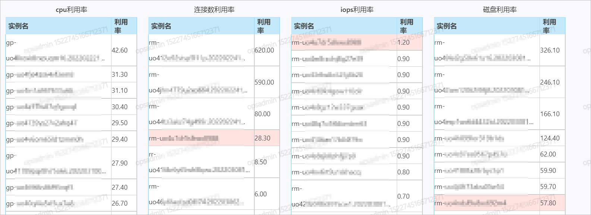

阿里云  
专有云  
云原生关系型数据库 PolarDB  
PolarDB for MySQL本地盘版 运  
维指南  
产品版本：V3.18.6  
文档版本：20251217

**目录**

- [1.产品架构](#section-1)
    - [1.1. 系统架构](#section-1-1)
    - [1.2. 组件架构](#section-1-2)
- [2.登录杜康-数据库管理平台](#section-2)
- [3.杜康-数据库管理平台运维](#section-3)
    - [3.1. 首页](#section-3-1)
    - [3.2. 实例管理](#section-3-2)
        - [3.2.1. 实例批量管理](#section-3-2-1)
            - [3.2.1.1. 批量迁移实例](#section-3-2-1-1)
            - [3.2.1.2. 批量实例参数刷新](#section-3-2-1-2)
            - [3.2.1.3. 批量DIY参数刷新](#section-3-2-1-3)
            - [3.2.1.4. 批量任务管理](#section-3-2-1-4)
            - [3.2.1.5. 批量任务类型管理](#section-3-2-1-5)
            - [3.2.1.6. SQL模板管理](#section-3-2-1-6)
        - [3.2.2. 单实例管理](#section-3-2-2)
            - [3.2.2.1. 概述](#section-3-2-2-1)
            - [3.2.2.2. 查看实例](#section-3-2-2-2)
            - [3.2.2.3. RDS MySQL升级至PolarDB集群](#section-3-2-2-3)
            - [3.2.2.4. 后续操作](#section-3-2-2-4)
            - [3.2.2.5. 实例诊断](#section-3-2-2-5)
            - [3.2.2.6. 应急处理方案](#section-3-2-2-6)
            - [3.2.2.7. 实例大盘](#section-3-2-2-7)
            - [3.2.2.8. 实例计划迁移管理](#section-3-2-2-8)
    - [3.3. 主机管理](#section-3-3)
        - [3.3.1. 新建主机](#section-3-3-1)
        - [3.3.2. 批量配置主机](#section-3-3-2)
        - [3.3.3. 查看主机信息](#section-3-3-3)
    - [3.4. 集群管理](#section-3-4)
        - [3.4.1. 新建集群](#section-3-4-1)
        - [3.4.2. 管理服务类型](#section-3-4-2)
        - [3.4.3. 管理服务节点](#section-3-4-3)
        - [3.4.4. DB配置模板](#section-3-4-4)
        - [3.4.5. 方寸山集群管理](#section-3-4-5)
        - [3.4.6. Location管理](#section-3-4-6)
    - [3.5. 任务管理](#section-3-5)
        - [3.5.1. 管理中断任务](#section-3-5-1)
        - [3.5.2. 临时关闭任务管理](#section-3-5-2)
    - [3.6. 系统管理](#section-3-6)
- [4.安全维护](#section-4)
    - [4.1. 网络安全维护](#section-4-1)
    - [4.2. 账号密码维护](#section-4-2)
- [5.故障处理](#section-5)
    - [5.1. 故障应急机制](#section-5-1)
    - [5.2. 建立备货机制](#section-5-2)
    - [5.3. 故障处理方法](#section-5-3)
    - [5.4. 常见故障处理](#section-5-4)
        - [5.4.1. 磁盘空间不足](#section-5-4-1)
        - [5.4.2. 设备维修或者下线](#section-5-4-2)
        - [5.4.3. 复制中断](#section-5-4-3)
        - [5.4.4. Swap不足](#section-5-4-4)
        - [5.4.5. Load过高](#section-5-4-5)
        - [5.4.6. 复制延迟](#section-5-4-6)
        - [5.4.7. 进程异常](#section-5-4-7)
        - [5.4.8. 模块异常](#section-5-4-8)
    - [5.5. 硬件故障处理](#section-5-5)
        - [5.5.1. 磁盘故障](#section-5-5-1)
        - [5.5.2. 内存、主板、CPU、电源等需要停机更换](#section-5-5-2)
- [6.高危操作](#section-6)

<a id="section-1"></a>

# 1.产品架构

<a id="section-1-1"></a>

## 1.1. 系统架构

本文介绍云原生数据库PolarDB MySQL的系统架构。

**备份系统**

云原生数据库PolarDB MySQL可以随时发起数据库的备份，能够根据备份策略将数据库恢复至任意时刻，提高了数据可回溯性。

- 自动备份：PolarDB提供多种备份类型，备份开始时间可由用户根据自己的业务低峰灵活配置。

- 手动备份：您可在需要时随时发起手动备份操作。

- 克隆实例：克隆实例是指新建一个实例，可以复制出与主实例一模一样的内容，包括实例数据和实例设置。克隆实例主要用于恢复主实例数据，或批量创建相同实例。

- 备份文件下载：您可以在用户备份文件保留期间登录PolarDB管理控制台，下载备份文件至本地。

**数据迁移系统**

云原生数据库PolarDB MySQL提供了数据迁移服务DTS（Data Transmission Service）工具，方便您快速迁移数据库。

- 实例间复制数据库：PolarDB提供实例间数据库迁移功能，可非常简便地将数据库迁移至其他实例。

- 数据迁入迁出：PolarDB提供专业工具和向导式迁移服务来帮助用户将数据迁入或迁出PolarDB。

**监控系统**

云原生数据库PolarDB MySQL提供物理层、网络层、应用层等多方位的监控服务，保证业务可用性。

- 性能监控：PolarDB提供近20种系统性能监控项，包括磁盘容量、IOPS、连接数、CPU利用率、网络流量、TPS、QPS、缓存命中率等等。

- SQL审计：系统会记录发往PolarDB实例的SQL语句及其他附加信息，包括连接IP、访问数据库名称、访问账号、执行时间、返回记录数等。您可依此查找问题和对实例的安全性进行排查。

- 阈值报警：当实例出现状态或性能异常时，PolarDB提供短信报警功能。

- Web操作日志：系统对PolarDB控制台中所有修改类操作进行日志记录，供管理员查看，最长可保留30天。

**控制系统**

当实例主机或者实例出现异常crash后，PolarDB高可用组件检查到异常后会在30秒内进行切换，保证应用的正常运行，保障PolarDB高可用。

**任务调度系统**

用户可通过PolarDB控制台或者通过PolarDB API进行实例创建、删除、内外切换，后端以任务的形式进行调度，可对实例所有操作进行跟踪和展示。

<a id="section-1-2"></a>

## 1.2. 组件架构

本文列举云原生数据库PolarDB MySQL的各组件及其作用。

| 组件 | 作用 |
| --- | --- |
| 元数据库（包括整体元数据库、杜康、FTP、DRC、性能库） | 负责各组件元数据管理以及任务流。 |
| proxy | 负责数据库的分库分表以及数据路由、数据防火墙等功能。 |
| 茅台 | 负责云原生数据库PolarDB MySQL的资源、任务、备份、性能、发布、SQL调优等功能。 |
| aurora | 负责整个DB节点的高可用。 |
| PolarDB API | 负责与前端API进行交互。 |
| DB节点 | 负责存储用户数据。 |
| DRC | 负责用户入云的数据导入以及实例间的数据迁移。 |
| REDIS | 负责存储实例的SQL明细、性能数据等。 |
| 杜康 | 用于后台数据库管理平台系统。 |
| 消息中心 | 负责控制节点跟DB节点之间的消息通信。 |
| Jstorm/kafka/zookee per | 用户SQL存储到kafka，然后再通过jstorm写入到sls中，zookeeper用于配置文件管理。 |
| FTP | 提供Windows用户备份集上传服务。 |
| Bianque | 负责函数诊断。 |
| Logagent | 负责主机日志收集。 |
| Erlbox | 负责管理各日志收集组件。 |
| Mscheck | 负责主备数据校验。 |
| Mysqlpcap | 负责将用户SQL信息收集到Redis。 |
| Tcprt | 负责收集用户链路的响应时间。 |
| Webdump | 负责收集用户的公网流量。 |

<a id="section-2"></a>

# 2.登录杜康-数据库管理平台

本文介绍如何登录杜康平台。

**前提条件**

- 已从部署人员或管理员处获取Apsara Uni-manager运维控制台的访问地址、用户名和密码。

  Apsara Uni-manager运维控制台访问地址格式为*ops*.asconsole.*intranet-domain-id*.com。

- 推荐使用Chrome浏览器。

**操作步骤**

1. 打开浏览器。

2. 在地址栏中，输入Apsara Uni-manager运维控制台的访问地址，按回车键。

   

   > **说明**
   >
   > 您可以单击右上角的下拉列表切换语言。

3. 输入正确的用户名及密码。

   > **说明**
   >
   > - 登录Apsara Uni-manager运维控制台的用户名和密码请从部署人员或管理员处获取。
   >
   > - 若连续输入密码错误三次，系统将启动图片验证码登录功能；若连续输入错误五次，账户将被锁定，请联系管理员进行激活。
   >
   > - 首次登录Apsara Uni-manager运维控制台时，需要修改登录用户名的密码，请按照提示完成密码修改。
   >
   >   为提高安全性，密码必须满足以下要求：
   >
   >   - 必须包含英文大小写字母。
   >
   >   - 必须包含阿拉伯数字（0~9）。
   >
   >   - 必须包含特殊符号，包括感叹号（!）、at（@）、井号（#）、美元符号（$）、百分号（%）等。
   >
   >   - 密码长度为10~20个字符。

4. 单击**同意协议并登录**。

5. 在Apsara Uni-manager运维控制台的顶部菜单栏单击**产品运维**。在**数据库运维**下选择**PolarDB运维·杜康**。

<a id="section-3"></a>

# 3.杜康-数据库管理平台运维

<a id="section-3-1"></a>

## 3.1. 首页

首页显示整体大盘信息及异常展示、实例查询、高级查询入口等。

**操作步骤**

登录杜康-数据库管理平台，系统显示云数据库产品管理首页，在该页面中，用户可以及时发现和处理PolarDB的告警，对现有的监控项不断进行改进和优化。

您可以单击异常信息后的数量，了解异常信息详情。如单击**备份异常**中的数量，进入**异常实例信息**页面。该界面显示所有的PolarDB异常信息，请分别点开处理。

<a id="section-3-2"></a>

## 3.2. 实例管理

<a id="section-3-2-1"></a>

### 3.2.1. 实例批量管理

<a id="section-3-2-1-1"></a>

#### 3.2.1.1. 批量迁移实例

本文介绍批量迁移实例的操作步骤。

**操作步骤**

1. 登录杜康-数据库管理平台。

2. 在**杜康-数据库管理平台**首页，单击**实例管理 > 实例列表**。

3. 在**实例列表**页面上方，单击**实例批量管理**，进入**实例批量操作**页面。

4. 单击**实例批量操作**栏下的**批量实例迁移**。

5. 单击**批量实例迁移等待列表**页面中的**下载模板文件**，根据模板文件填写内容。

6. 单击**选择文件**。

7. 选择填写完毕的模板文件后单击**提交**。

> **说明**
>
> - HaProxy链路实例只有在同集群内迁移才不会发生闪断。
>
> - 该批量实例迁移操作不经过审批，请谨慎操作！

**后续步骤**

您可以单击**实例批量迁移**页面上方的**批量实例迁移已成功列表**和**批量实例迁移失败列表**，查看已迁移实例的详情信息。

<a id="section-3-2-1-2"></a>

#### 3.2.1.2. 批量实例参数刷新

本文介绍如何对批量实例参数进行刷新。

**操作步骤**

1. 登录杜康-数据库管理平台。

2. 在**杜康-数据库管理平台**首页，单击**实例管理 > 实例列表**。

3. 在**实例列表**页面上方，单击**实例批量管理**，进入**实例批量操作**页面。

4. 单击**实例批量操作**栏下的**批量实例参数刷新**。

5. 选择需要刷新的实例集群，单击**选择参数模板**。

   > **重要**
   >
   > 实例参数变更有可能引起实例闪断或不可用等风险，请在使用时参见控制台提示进行必要操作。

6. 选择数据库参数模板并单击**下一步**。

7. 选择实例，单击**提交**。

**后续步骤**

您可以单击**批量实例参数刷新**页面上方的**批量刷新参数实例已成功列表**和**批量刷新参数实例失败列表**，查看已刷新过的实例参数的详情信息。

<a id="section-3-2-1-3"></a>

#### 3.2.1.3. 批量DIY参数刷新

本文介绍如何对批量DIY参数进行刷新。

**操作步骤**

1. 登录杜康-数据库管理平台。

2. 在**杜康-数据库管理平台**首页，单击**实例管理 > 实例列表**。

3. 在**实例列表**页面上方，单击**实例批量管理**，进入**实例批量操作**页面。

4. 单击**实例批量操作**栏下的**批量DIY参数刷新**。

5. 在**批量DIY刷新参数等待列表**页面中，配置以下信息。

   <table>
     <tr>
       <th width="81">配置项</th>
       <th>说明</th>
     </tr>
     <tr>
       <td>实例名</td>
       <td>您需要在<strong>实例名</strong>后的文本框中输入需要进行DIY参数刷新的实例。<br>说明<br>• 请确保每次输入的实例名都是同类型同版本的数据库实例。<br>• 所有的输入请规范，去掉空格、tab、空行。<br>• 只支持免重启的参数。</td>
     </tr>
     <tr>
       <td>db类型</td>
       <td>数据库类型。选择输入的实例的数据库类型。</td>
     </tr>
     <tr>
       <td>db版本</td>
       <td>数据库版本。选择对应数据库版本。</td>
     </tr>
     <tr>
       <td>备注</td>
       <td>输入备注信息。</td>
     </tr>
   </table>

6. 信息配置完成后，单击**去选择参数**。

7. 单击弹出的**确认**对话框中的**确定**。

8. 选中需要修改的参数，并且在最右侧填写修改值。

9. 单击左下方**保存**。

**后续步骤**

您可以单击**批量实例参数刷新**页面上方的**批量刷新参数实例已成功列表**或**批量刷新参数实例失败列表**，查看已刷新过的DIY参数的详情信息。

<a id="section-3-2-1-4"></a>

#### 3.2.1.4. 批量任务管理

本文介绍如何管理批量任务。

**创建任务**

1. 登录杜康-数据库管理平台。

2. 在**杜康-数据库管理平台**首页，单击**实例管理 > 实例列表**。

3. 在**实例列表**页面上方，单击**实例批量管理**，进入**实例批量操作**页面。

4. 单击**实例批量操作**栏下的**批量任务管理**。

5. 单击页面上方**创建任务**，进入**创建任务**页面。

6. 在弹出的**创建任务**页面中，配置如下参数信息：

   <table>
     <tr>
       <th width="137">配置</th>
       <th>说明</th>
     </tr>
     <tr>
       <td>任务类型</td>
       <td>您可根据实际情况选择目标任务类型。例如：<strong>批量开启SQL WALL</strong>、<strong>批量链路切换</strong>、<strong>批</strong><strong>量实例小版本升级</strong>等等。</td>
     </tr>
     <tr>
       <td>任务提示</td>
       <td>系统将根据不同的任务类型提示您对应任务的注意事项。</td>
     </tr>
     <tr>
       <td>任务参数</td>
       <td>不同的任务类型对应不同的任务参数，请您按照实际任务进行选择。</td>
     </tr>
     <tr>
       <td>时间规则</td>
       <td>• <strong>立即下发</strong>：立刻执行任务。<br>• <strong>运维时间</strong>：在运维时间才会执行任务。<br>• <strong>指定时间</strong>：指定时间段内才会执行任务。</td>
     </tr>
     <tr>
       <td>发送短信</td>
       <td>是否发送短信提醒：<br>• 是<br>• 否</td>
     </tr>
     <tr>
       <td>实例来源</td>
       <td>可选择实例的来源为<strong>集群</strong>或<strong>Sql模板</strong>。</td>
     </tr>
     <tr>
       <td>请选择来源集群</td>
       <td><strong>实例来源</strong>为<strong>集群</strong>时可选。选择来源集群填充<strong>输入实例</strong>。</td>
     </tr>
   </table>

   <table>
     <tr>
       <th width="133">请选择Sql模板</th>
       <th><strong>实例来源</strong>为<strong>Sql模板</strong>时可选。选择Sql模板填充<strong>输入实例</strong>。<br>说明单击右侧<strong>创建模板</strong>可以跳转至<strong>SQL模板管理</strong>页面创建SQL脚本。</th>
     </tr>
     <tr>
       <td>输入实例</td>
       <td>输入需要批量执行任务的实例，一行一个实例名。</td>
     </tr>
     <tr>
       <td>备注</td>
       <td>填写备注内容。<br>说明此项为选填内容。</td>
     </tr>
   </table>

7. 单击**提交**。

<a id="section-3-2-1-5"></a>

#### 3.2.1.5. 批量任务类型管理

本文介绍新增任务类型的操作步骤。

**操作步骤**

1. 登录杜康-数据库管理平台。

2. 在**杜康-数据库管理平台**首页，单击**实例管理 > 实例列表**。

3. 在**实例列表**页面上方，单击**实例批量管理**，进入**实例批量操作**页面。

4. 单击**实例批量操作**栏下的**批量任务类型管理**。

5. 单击页面上方**新建类型**，进入**新建类型**页面。

6. 在弹出的**新建类型**页面中，配置如下参数信息：

   | 配置 | 说明 |
   | --- | --- |
   | 名称 | 新任务类型名称。 |
   | 编号 | 新任务类型编号。 |
   | API | 新任务的API名称。 |
   | api实例参数名 | • API实例的参数名称。<br>• 默认为<strong>DBInstanceName</strong>。 |
   | 提示信息 | 系统给出的提示信息、注意事项内容。 |
   | 参数规则 | 包括参数名、API参数名、参数类型等等。 |
   | 校验规则 | 包括校验关系、属性名、校验规则、校验值等等。 |
   | 最高并发 | 最高并发数。 |
   | 停止失败率 | 任务停止或失败的概率。 |
   | 备注 | 填写备注内容。 |

7. 单击**提交**。

<a id="section-3-2-1-6"></a>

#### 3.2.1.6. SQL模板管理

本文介绍新增SQL模板的操作步骤。

**操作步骤**

1. 登录杜康-数据库管理平台。

2. 在**杜康-数据库管理平台**首页，单击**实例管理 > 实例列表**。

3. 在**实例列表**页面上方，单击**实例批量管理**，进入**实例批量操作**页面。

4. 单击**实例批量操作**栏下的**SQL模板管理**。

5. 单击页面上方**新增模板**，进入**NewTemplate**页面。

6. 在弹出的**NewTemplate**页面中，配置如下参数信息：

   | 配置 | 说明 |
   | --- | --- |
   | 模板名称 | 填写新模板名称。 |
   | 模板类型 | 选择模板类型。 |
   | 数据库名称 | 选择目标数据库。 |
   | 数据库类型 | 选择目标数据库类型。 |
   | Sql脚本 | 填写SQL脚本。 |
   | 新增原因 | 填写新增模板原因。 |

   > **说明**
   >
   > 自定义SQL模板只允许SELECT语句，且目前仅能用于dbaas库的查询。所有SQL模板的创建均需要BPMS审批。为保证SQL模板不会被其余同学误执行，导致批量任务下发给错误的实例，请在SQL模板中详细描述模板名称和新增原因。

7. 单击**提交**。

<a id="section-3-2-2"></a>

### 3.2.2. 单实例管理

<a id="section-3-2-2-1"></a>

#### 3.2.2.1. 概述

实例列表能够查看单个实例的基本信息、数据链路、数据库信息、账号信息等。

**操作步骤**

1. 登录杜康-数据库管理平台。

2. 在**杜康-数据库管理平台**首页，单击**实例管理 > 实例列表**。

   在实例列表页面中，您可以进行如下操作：

   - 单击页面上方**批量查询**按钮，输入实例名批量查询实例。

   - 单击页面上方**高级搜索**按钮，通过数据库类型、实例状态等作为搜索条件，查询目标实例。

   - 单击目标实例名，进入单个实例的实例详情页面，查询实例信息或管理实例。

   - 更多操作，请参见查看实例、实例诊断、应急处理方案、实例大盘、实例计划迁移管理。

<a id="section-3-2-2-2"></a>

#### 3.2.2.2. 查看实例

在单个实例的页面可以查看实例的基本信息、查询实例性能等。

**操作步骤**

1. 登录杜康-数据库管理平台。

2. 在左侧导航栏中，选择**实例管理 > 实例列表**。

3. 在实例列表中定位到目标实例，并单击对应的**用户实例名**。

   > **说明**
   >
   > 您也可以通过在搜索框中输入关键词快速查询目标实例。单击**高级搜索**筛选更多过滤条件，精准定位目标实例。

4. 在**基本信息**页签中可以查看实例基本信息，通过左侧的功能选项可以进行备份恢复、查看实例变更记录、查询实例SQL信息等操作。

<a id="section-3-2-2-3"></a>

#### 3.2.2.3. RDS MySQL升级至PolarDB集群

在单个实例的页面中将RDS MySQL集群升级至PolarDB MySQL集群。

**注意事项**

- 不支持RDS MySQL5.6，仅支持5.7和8.0。

- 确保需要升级的RDS MySQL实例处于健康状态且运行正常，未处于其他流程中。具体要求如下：

  - 主备同步状态正常，无同步延迟（即主备同步延迟为0）。

  - 主实例与只读实例同步延迟为0。

  - CPU及内存利用率低于75%。

- 若主实例存在关联的只读实例，则主实例及其只读实例将一起切换至PolarDB，不支持单独切换。

- 在存量RDS MySQL局点完成PolarDB-MySQL本地盘版的部署后，**该局点与PolarDB-M本地盘使用相同厂商CPU物理机**的RDS MySQL 5.7、8.0以及miniRDS 8.0数据库实例的内核版本将统一采用PolarDB-MySQL内核。具体而言，存量实例支持一键升级至PolarDB-MySQL内核，新建实例统一采用PolarDB-MySQL内核；在备库重建等场景中，默认优先使用PolarDB-MySQL内核。

- RDS MySQL一键升级PolarDB-MySQL本地盘功能，为确保数据一致性与系统稳定性，**升级完成后，默认将不再支持回退至RDS MySQL**。

**业务影响**

- **对应用的影响**：内核小版本升级过程中会触发一次主备节点的HA倒换，业务连接不会中断，但应用读写数据库可能会出现秒级中断（通常为10秒左右）。

- **API访问方式变更**：切换后，产品代码将更新为PolarDB。通过API方式访问的服务（如云平台外的第三方监控工具、管理工具等），需在切换后调整为PolarDB的配置。

- **上下游生态工具与对接产品**：切换后，相关功能仍需支持以PolarDB-MySQL本地盘模式正常运行，部分配置信息可能需要更新为PolarDB-MySQL的格式。涉及的场景包括：

  - 内部运维平台：如ASO、CMS等；

  - 生态工具：DTS、DBS、云盾日志审计、DataWorks等；

  - 同城容灾与异地备份：ASRDR/BR等。

**操作步骤**

1. 登录杜康-数据库管理平台。

2. 在左侧导航栏中，选择**实例管理 > 实例列表**。

3. 在实例列表中定位到目标实例，并单击对应的**用户实例名**。

   > **说明**
   >
   > 您也可以通过在搜索框中输入关键词快速查询目标实例。单击**高级搜索**筛选更多过滤条件，精准定位目标实例。

4. 在**基本信息**页签中选择**其他信息**选择**一键升级PolarDB**。

5. 在**一键升级PolarDB**，选择**提交**，在提示对话框选择**确认**或**取消**。

6. 登录ascm控制台，确认实例已经切换到了PolarDB产品下，查看目标实例信息。

**回滚**

<strong>场景1：</strong>若发生异常，需要将切换到PolarDB-MySQL的实例回滚到RDS MySQL实例，则参考如下步骤。

- **回滚元数据**

  同一个实例的主实例、只读实例、备用只读需要在同一个事务中完成。

- **回滚SQL：**

  - rds-yaochi.phoenixrds:

    ```text
    UPDATE rds_instancesetproduct_code='rds',gmt_modified=now() WHERE instance_id = xxxlimit1;
    ```

  - rds-maotai.dbaas：

    ```text
    DELETE FROM custins_param WHERE custins_id = xxx AND name = "pop_code" AND  VALUES 
    = "polardb" limit 1;
    DELETE FROM custins_param WHERE custins_id = xxx AND name = "upgrade_to_polardb" limit 1;
    ```

<strong>场景2：</strong>如果是节点在版本升级的过程中出现故障，可以通过在杜康上执行备库重搭来恢复节点和实例。

<a id="section-3-2-2-4"></a>

#### 3.2.2.4. 后续操作

本文介绍实例相关的操作，包括导出实例列表、实例迁移等。

**操作步骤**

1. 登录杜康-数据库管理平台。

2. 在左侧导航栏中，选择**实例管理 > 实例列表**。

3. 在页面的搜索框右侧，可执行如下操作：

   - 单击页面上方的**实例批量管理**，可进行批量实例操作。

   - 单击页面上方的**实例计划迁移管理**，可迁移实例。

     > **重要**
     >
     > 实例迁移属于高危操作，请在业务低峰期进行。

   - 单击页面上方的**实例大盘**，可查看实例的CPU、连接数、IOPS、磁盘利用率。

   - 单击页面上方的**mysql主备延迟**，可查看实例主备节点的具体延迟。

<a id="section-3-2-2-5"></a>

#### 3.2.2.5. 实例诊断

您可以通过实例诊断功能，查看实例的各项性能数据。

**操作步骤**

1. 登录杜康-数据库管理平台。

2. 在左侧导航栏中，选择**实例管理** > **实例列表**。

3. 在实例列表中找到目标实例，然后单击对应的**用户实例名**。

4. 在**实例详情**导航栏中选择**实例诊断**。您可以在实例诊断中查看实例性能信息。

**相关参考**

不同引擎实例的不同版本、不同存储方式涉及的性能数据存在差异，如下为MySQL的常用性能指标项示例，其他引擎或版本，请以控制台为准。

| 指标项 | 说明 |
| --- | --- |
| MySQL_NetworkTraffic | 实例平均每秒钟的输入流量，实例平均每秒钟的输出流量。单位：KB/秒。 |
| MySQL_QPSTPS | 平均每秒SQL语句执行次数（单位：次/秒），平均每秒事务数（单位：个/秒）。 |
| MySQL_Sessions | 当前活跃连接数，当前总连接数。单位：个。 |
| MySQL_InnoDBBufferRatio | InnoDB缓冲池的读命中率，InnoDB缓冲池的使用率，InnoDB缓冲池脏块的百分率。单位：百分比（%）。 |
| MySQL_InnoDBDataReadWriten | InnoDB平均每秒钟读取的数据量，InnoDB平均每秒钟写入的数据量。单位：KB。 |
| MySQL_InnoDBLogRequests | 平均每秒向InnoDB缓冲池的读次数，平均每秒向InnoDB缓冲池的写次数。单位：次/秒。 |
| MySQL_InnoDBLogWrites | 平均每秒日志写请求数，平均每秒向日志文件的物理写次数，平均每秒向日志文件完成的<code> fsync() </code>写数量。单位：次/秒。 |
| MySQL_TempDiskTableCreates | 执行语句时在硬盘上自动创建的临时表的数量。单位：个。 |
| MySQL_COMDML | 平均每秒Delete语句执行次数、平均每秒Insert语句执行次数、 平均每秒Insert_Select语句执行次数、平均每秒Replace语句执行次数、平均每秒Replace_Select语句执行次数、平均每秒Select语句执行次数和平均每秒Update语句执行次数。单位：次/秒。 |
| MySQL_RowDML | 平均每秒从InnoDB表读取的行数、平均每秒从InnoDB表更新的行数、平均每秒从InnoDB表删除的行数、平均每秒从InnoDB表插入的行数和平均每秒向日志文件的物理写次数。单位：行/秒或次/秒。 |
| MySQL_MemCpuUsage | 非Serverless实例CPU使用率（占操作系统总数）和MySQL实例内存使用率（占操作系统总数）。单位：百分比（%）。 |
| MySQL_IOPS | 实例的IOPS（每秒IO请求次数）。单位：次/秒。 |
| MySQL_DetailedSpaceUsage | 实例总空间使用量、数据空间、日志空间、临时空间和系统空间。单位：MB。 |
| slavestat | 只读实例延迟。单位：秒。 |
| MySQL_ThreadStatus | 活跃线程和线程连接数。单位：个。 |
| MySQL_ReplicationDelay | 备实例的复制延迟。单位：秒。 |
| MySQL_ReplicationThread | IO复制线程状态和SQL复制线程状态。1表示正常，0表示线程丢失。 |
| MySQL_ROW_LOCK | 最大等待行级锁时间（单位：毫秒）、平均等待行级锁时间（单位：毫秒）以及等待行级锁的次数（单位：次）。 |
| MySQL_SelectScan | 实例进行全表扫描的次数。单位：次。 |

<a id="section-3-2-2-6"></a>

#### 3.2.2.6. 应急处理方案

本文介绍实例相关的应急处理方案的相关操作。

**操作步骤**

1. 登录杜康-数据库管理平台。

2. 在**杜康-数据库管理平台**首页，单击**实例管理 > 实例列表**。

3. 在**实例列表**页面上方单击**应急处理方案**。

4. 在页面右侧的搜索框中输入关键词，搜索出对应实例并选中实例左侧的复选框。

5. 单击页面上方的**实例列表Excel导出**，可将实例信息导出到本地。

   > **说明**
   >
   > 禁止无搜索条件导出。

<a id="section-3-2-2-7"></a>

#### 3.2.2.7. 实例大盘

您可以在实例大盘中查看实例的CPU利用率、连接数利用率等。

**操作步骤**

1. 登录杜康-数据库管理平台。

2. 在**杜康-数据库管理平台**首页，单击**实例管理 > 实例列表**。

3. 在**实例列表**页面上方单击**实例大盘**。

4. 您可查看到实例的CPU、连接数、IOPS、磁盘利用率。

   

<a id="section-3-2-2-8"></a>

#### 3.2.2.8. 实例计划迁移管理

实例计划迁移列表上传有两种方式，分别按实例或者按主机IP进行批量提交。本文介绍实例计划迁移的具体操作。

**操作步骤**

1. 登录杜康-数据库管理平台。

2. 在**杜康-数据库管理平台**首页，单击**实例管理 > 实例列表**。

3. 在**实例列表**页面上方单击**实例计划迁移管理**。

4. 选择实例计划迁移列表上传方式。

   > **说明**
   >
   > - 方式一：按实例提交时，在遇到不可迁移的实例时会全部阻止提交。
   >
   > - 方式二：按主机IP提交时，会直接过滤不可迁移的实例。

5. 单击右侧**下载模板文件**，根据模板文件填写内容。

6. 单击**选择文件**，选择填写完毕的模板文件。

7. 单击**提交**。

**后续步骤**

您可以单击**实例计划迁移管理**页面上方的**推送成功列表**或**已删除列表**，查看详情信息。

<a id="section-3-3"></a>

## 3.3. 主机管理

<a id="section-3-3-1"></a>

### 3.3.1. 新建主机

本文介绍如何新建主机。

**操作步骤**

1. 登录杜康-数据库管理平台。

2. 在**杜康-数据库管理平台**首页，选择**主机管理 > 系统主机**。

3. 单击页面上方的**应急处理方案**。

4. 单击**新建主机**。

5. 配置主机参数，单击**提交**。

<a id="section-3-3-2"></a>

### 3.3.2. 批量配置主机

本文介绍如何批量配置主机。

**操作步骤**

1. 登录杜康-数据库管理平台。

2. 在左侧导航栏，选择**主机管理 > 系统主机**。

3. 选中需要批量配置主机信息的主机，在页面上方单击**批量配置**。

4. 配置参数并单击**提交**。

<a id="section-3-3-3"></a>

### 3.3.3. 查看主机信息

文本介绍如何查看主机信息。

**操作步骤**

1. 登录杜康-数据库管理平台。

2. 在**杜康-数据库管理平台**页面，选择**主机管理 > 系统主机**。

3. 可根据IP或者主机名，筛选出对应的主机。

4. 单击目标IP，在**主机详情**页面中，查看主机详情信息，例如CPU、内存、实例个数、磁盘用量等。

   您也可以单击左侧功能选项，查看主机实例信息、性能信息、备份信息和账号信息等。

<a id="section-3-4"></a>

## 3.4. 集群管理

<a id="section-3-4-1"></a>

### 3.4.1. 新建集群

本文介绍如何新建集群。

**新建系统集群**

1. 登录杜康-数据库管理平台。

2. 在左侧导航栏，单击**集群管理**。

3. 在**系统集群**页面中，单击**新建集群**。

4. 选择**数据库类型**，单击**确定**。

5. 在弹出的**创建集群**页面配置集群参数，单击**确认**。

   > **说明**
   >
   > 请参见参数界面上的提示，获取详细的配置项说明。

**新建用户集群模板**

1. 登录杜康-数据库管理平台。

2. 在左侧导航栏，单击**集群管理**。

3. 做左侧导航栏中单击**用户集群**，单击**集群模板**。

4. 在弹出的对话框中，单击**创建集群模板**。

5. 在**创建集群模板**页面配置参数，单击**提交**。

   > **说明**
   >
   > 请参见参数界面上的提示，获取详细的配置项说明。

<a id="section-3-4-2"></a>

### 3.4.2. 管理服务类型

本文介绍如何管理服务类型。

**操作步骤**

1. 登录杜康-数据库管理平台。

2. 在**杜康-数据库管理平台**页面，单击**集群管理**。

3. 单击**服务类型管理**打开**服务类型管理**页面。

   - 单击目标服务类型右侧**操作**列的**编辑**，修改服务类型。

   - 单击目标服务类型右侧**操作**列的**删除**，删除服务类型。

<a id="section-3-4-3"></a>

### 3.4.3. 管理服务节点

本文介绍如何新建、编辑或删除服务节点。

**操作步骤操作步骤**

1. 登录杜康-数据库管理平台。

2. 在**杜康-数据库管理平台**页面，选择**集群管理**。

3. 在左侧导航栏，单击**服务节点管理**。

   - 单击页面上方的**新建服务节点**，配置相关参数，单击**确定**。

   - 单击目标节点右侧**操作**列的**编辑**，修改服务节点。

   - 单击目标节点右侧**操作**列的**删除**，删除服务节点。

<a id="section-3-4-4"></a>

### 3.4.4. DB配置模板

本文介绍如何管理DB模板。

**操作步骤**

1. 登录杜康-数据库管理平台。

2. 在**杜康-数据库管理平台**页面，选择**集群管理**。

3. 在左侧导航栏中，单击**DB配置模板**打开**DB配置模板**页面。

   - 单击页面上方的**新建DB模板**按钮，填写模板信息，单击**操作**列下的**保存**。

   - 单击**操作**列的**编辑**，修改已有模板，单击**操作**列下的**保存**。

   - 单击**操作**列的**删除**，删除已有模板，单击**确定**。

<a id="section-3-4-5"></a>

### 3.4.5. 方寸山集群管理

本文介绍方寸山集群的管理操作。

**操作步骤**

1. 登录杜康-数据库管理平台。

2. 在**杜康-数据库管理平台**页面，选择**集群管理**。

3. 在左侧导航栏中，单击**方寸山集群管理**进入**集群组配置**页面。

4. 在页面上方，单击**新建集群组**。

5. 选择**区域**，输入**集群组**名称，单击**确定**。

6. 单击新集群**操作**列下的**设置集群**，设置资源类型，单击**确定**。

7. （可选）单击目标集群**操作**列下的**修改集群组**，修改集群组名称。

8. （可选）单击目标集群**操作**列下的**删除集群组**，删除集群组。

<a id="section-3-4-6"></a>

### 3.4.6. Location管理

本文介绍如何配置集群的Location。

**操作步骤**

1. 登录杜康-数据库管理平台。

2. 在**杜康-数据库管理平台**页面左侧导航栏，单击**集群管理**。

3. 在左侧导航栏中，单击**Location**打开Location页面。

4. 您可以搜索框中输入关键字查询集群，并在查询结果中对目标集群进行管理。

   > **说明**
   >
   > 您也可以在页面下方进行集群一致性检查和子域一致性检查操作。

   - 添加集群Location节点：单击目标单元、地区或可用区后的**添加**按钮，参数填写完成后单击**提交**。

   - 管理参数：单击目标单元、地区、可用区或子域后的**参数**按钮，新增、编辑或删除参数。

   - 删除单元、地区、可用区或子域：单击目标单元、地区、可用区或子域后的**删除**按钮。

<a id="section-3-5"></a>

## 3.5. 任务管理

<a id="section-3-5-1"></a>

### 3.5.1. 管理中断任务

本文介绍如何管理中断任务，包括用户实例任务、主机实例任务、主机任务。本文以用户实例任务为例，介绍如何管理中断任务。

**操作步骤**

1. 登录杜康-数据库管理平台。

2. 在**杜康-数据库管理平台**页面，单击**任务管理**，在**实例任务**页面左上角的框中选择**中断的任务**。

   > **说明**
   >
   > - 如果有失败的任务，请按如下步骤处理。
   >
   > - 如果没有失败的任务，则结束本操作。

3. 单击**任务名称**列的任务，查看分析任务失败原因。

   > **说明**
   >
   > 通常情况下，如果遇到从库状态异常、连接超时或密码错误等问题时，可以通过使用问题实例的IP地址登录目标实例，并对异常进行修复。

4. 完成修复后，单击**操作**列下的**操作**，跳转到任务详情页面。

5. 单击**执行任务**。

6. 在弹出的**重新执行任务**窗口中，单击**当前步骤重试**，重新执行任务。

   > **重要**
   >
   > 如果您需要从指定步骤开始执行，可以单击**从指定步骤继续**。在不理解任务及步骤功能的时，请勿操作。

7. 在任务管理中选择**运行的任务**，查看任务执行情况。

   > **说明**
   >
   > 如果任务执行失败，按本步骤重新排查。

<a id="section-3-5-2"></a>

### 3.5.2. 临时关闭任务管理

本文介绍如何管理临时关闭的任务。

**操作步骤**

1. 登录杜康-数据库管理平台。

2. 在**杜康-数据库管理平台**页面，单击**任务管理**，在跳转到的页面左上角的选框中单击**临时关闭的任务**。

   - 单击**任务名称**中的某个任务名查看任务的执行步骤。

   - 单击**操作对象**中的某个操作对象名，查看该操作对象下的任务日志。

   - 单击**执行人**中的某个执行人名字，查看该执行人的详细信息。

   - 单击**操作**栏中的**操作**按钮，查看临时关闭的任务原因。

     - 在弹出的窗口中，单击**执行任务**，重新执行任务。

     - 在弹出的窗口中，单击**干预记录**，查看任务干预记录详情。

   - 单击**添加备注**为任务添加备注信息。

<a id="section-3-6"></a>

## 3.6. 系统管理

本文介绍系统管理的各项功能特性。

表 1. 系统管理

| 功能特性 | 作用 | 备注 |
| --- | --- | --- |
| 系统设置 | 新建套餐、系统配置、数据库参数模板、系统参数配置、流量统计规则、性能配置、运营商信息、组件异常级别配置、linux内核参数设置。 | 高危操作。 |
| 权限配置 | 添加角色、权限码管理。 | 权限码管理为高危操作。 |
| 通用配置 | AclCache开关、邮件开关、新建集群信息、发送集群信息。 | 无。 |
| 标签列表 | 添加标签，查看标签类型、别名、取值等。 | 无。 |
| 分组管理 | 新建分组用于监控。 | 无。 |
| 集群管理 | 新建集群、刷新管理机白名单、刷新同步模式、刷新资源缓存等。 | 高危操作。 |
| 白名单管理 | 查看或刷新区域白名单。 | 无。 |
| 服务类型管理 | 修改或删除服务类型。 | 新建服务类型为高危操作。 |
| 迁移主机屏蔽信息 | 添加或删除屏蔽主机IP。 | 无。 |
| AccessKey管理 | 新建key、查看AccessKey、查看运维API日志。 | 高危操作。 |
| 方寸山集群配置 | 查看集群组配置、新建集群组等。 | 高危操作。 |
| Petadata集群统计 | 查看Petadata集群信息。 | 无。 |
| 容灾管理 | 包括链路组件巡检、管控组件巡检、容灾切换、容灾任务。 | 无。 |
| 定时任务管理 | 管理系统中的各项定时任务。 | 无。 |

<a id="section-4"></a>

# 4.安全维护

<a id="section-4-1"></a>

## 4.1. 网络安全维护

网络安全维护包括设备安全和网络安全。

**设备安全**

检查网络设备，启用设备的安全管理协议和配置。

检查网络设备软件版本，及时升级到更安全的版本。

具体安全维护方法请参见各设备的产品文档。

**网络安全**

根据系统网络的现状，可以适当选配入侵检测系统（IDS）或入侵防御系统（IPS）对来自外部或者内部网络的数据流量进行检测，实时防御网络内的异常行为和攻击行为。

<a id="section-4-2"></a>

## 4.2. 账号密码维护

账号密码包括PolarDB系统密码和设备密码。

为了保证账号安全，请定期修改系统和设备密码，并使用高复杂度的密码。

<a id="section-5"></a>

# 5.故障处理

<a id="section-5-1"></a>

## 5.1. 故障应急机制

为减少故障对业务的影响，需要建立故障应急机制。

**响应机制**

维护人员应该建立故障应急响应机制，以保证出现故障或者安全事故后，可以快速联系到责任人，尽快排除故障，恢复生产。

<a id="section-5-2"></a>

## 5.2. 建立备货机制

对于易损硬件，维护人员应该建立备货机制，以防止硬件故障长时间影响生产恢复。

<a id="section-5-3"></a>

## 5.3. 故障处理方法

故障发生后，运维人员应当根据故障现象及时排查，本文介绍处理故障的流程。

维护人员在日常维护中发现系统故障后，可以通过运维管理平台了解故障详细信息，根据日志信息分析故障原因及解决故障。

如遇不能解决的故障，请收集故障信息（包括系统信息、故障现象等），联系阿里云技术支持工程师，并在技术支持工程师的指导下解决问题。

故障解决后，维护人员应及时对问题进行回顾、总结和改进。

<a id="section-5-4"></a>

## 5.4. 常见故障处理

<a id="section-5-4-1"></a>

### 5.4.1. 磁盘空间不足

磁盘空间不足会导致各类操作无法进行。

**可能原因**

监控日志、MySQL数据文件、MySQL日志文件过大。

**解决方法**

- 如果是监控日志，一般放在(/usr/local/rds/log)，可以将之前的日志删掉。

- 如果是MySQL数据文件（/u01），需要将实例进行扩容或者迁移到其他机器上。

- 如果是MySQL日志文件（/u02），可以在杜康系统上清理日志。

<a id="section-5-4-2"></a>

### 5.4.2. 设备维修或者下线

设备故障时需要将设备下线后进行相应操作。

**可能原因**

设备硬件损坏或者设备过保。

**处理方法**

1. 在杜康上先将该机器上的所有实例进行迁移。

2. 待实例迁移完成后，在杜康上的主机管理里面将该机器进行删除。

3. 在aromy里面将该机器移动到buffer分组，然后将状态改成offline。

<a id="section-5-4-3"></a>

### 5.4.3. 复制中断

主库数据复制到备库时可能会出现复制中断的故障。

**可能原因**

主备数据不一致、网络不通、表损坏。

**解决方法**

- 如果是主备数据不一致建议直接重新搭建从库。

  在杜康平台上，实例管理中，选择进入具体的实例，单击**备库重搭**，重新搭建从库。

- 如果是网络不通，可以先试着ping实例地址，确定是否网络问题。

- 如果是表损坏导致，可以通过备实例修复损坏的表。

  命令如下：

  ```text
   repair table a; 
   start slave; 
  ```

<a id="section-5-4-4"></a>

### 5.4.4. Swap不足

本文介绍Swap不足的可能原因以及解决方法。

**可能原因**

实例太多或者程序异常导致消耗内存太多。

**解决方法**

- 如果是因为该机器上实例太多，建议直接将部分实例迁移到其他机器上。

- 如果是其他原因，按如下方法处理：

  <ol type="i">

  <li>

  如果是主库，将服务切换到从库。

  </li>

  <li>

  执行如下命令，释放cache。

  ```text
   /proc/sys/vm/drop_caches; 
  ```

  </li>

  <li>

  清理swap。

  ```text
   swapoff -a ; date ; swapon –a; 
  ```

  </li>

  </ol>

<a id="section-5-4-5"></a>

### 5.4.5. Load过高

本文介绍Load过高的可能原因以及解决方法。

**可能原因**

正在备份、或者程序并发太多、SQL执行效率不高。

**解决方法**

- 如果是备份，可先不处理。

- 如果程序并发太多，可以联系对应开发将并发降下来。

- 如果SQL执行效率不高，先试着explain下。如果不能通过索引来进行优化，需要联系开发进行确认。

- 降低对CPU、IO的资源限制。

<a id="section-5-4-6"></a>

### 5.4.6. 复制延迟

本文介绍导致复制延迟的原因以及解决方法。

**可能原因**

系统正在备份、无主键、io瓶颈、大事务等。

**解决方法**

- 如果是短时间的延迟（延迟小于5000ms）并且可以看到延迟在降低时，可能是由于大事务引起，可不用处理。

- 打开并行处理。

- 登录到实例，执行如下命令：

  ```text
   stop slave; 
   set global slave_parallel_workers=8; 
   start slave; 
  ```

<a id="section-5-4-7"></a>

### 5.4.7. 进程异常

本文介绍导致进程异常的可能原因以及解决方法。

**可能原因**

进程未启动或者异常退出，可以从alimontior上的报警看出是什么程序。

**解决方法**

看下该程序的日志，如果是未启动，执行如下命令，启动该进程。

`/usr/local/rds/$`程序`/package/service.sh start`

<a id="section-5-4-8"></a>

### 5.4.8. 模块异常

本文介绍模块异常的可能原因及解决方法。

**可能原因**

模块未加载。

**解决方法**

执行如下命令，加载模块。

`insmod $`模块文件`.ko`

或者

`modprode $`模块文件`.ko`

<a id="section-5-5"></a>

## 5.5. 硬件故障处理

<a id="section-5-5-1"></a>

### 5.5.1. 磁盘故障

由于DB节点都是做的raid5，所以当坏了一块盘时，可直接进行更换，对业务无影响。

<a id="section-5-5-2"></a>

### 5.5.2. 内存、主板、CPU、电源等需要停机更换

本文介绍停机前的操作步骤。

当需要进行停机维修时：

- 如果能进入到系统，则按正常步骤停止该机器上面的服务。

  <ol type="i">

  <li>

  关闭实例，视设备性能，大概需要1分钟。

  ```text
   /bin/bash /etc/init.d/mysql stop 
  ```

  </li>

  <li>

  查询是否还有MySQL实例。

  ```text
   ps -ef|grep mysql; 
  ```

  </li>

  <li>

  所有实例都正常关闭后，再关闭主机。

  ```text
   shutdown -h now 
  ```

  </li>

  <li>

  如果不能进入系统，只有强制关机。

  当机器修好后，可能会出现部分slave坏掉的情况，维护人员可以登录**杜康-数据库管理平台**进行备库重搭。

  </li>

  </ol>

<a id="section-6"></a>

# 6.高危操作

**功能类型**

**高风险操作**

**影响**

释放外网地址

客户端将无法通过原外网连接地址连接实例。

- 切换过程会有30秒闪断，请确保应用程序具有重连机制。

连接实例

切换虚拟交换机

- 客户端缓存会导致只能读取数据，无法写入数据，请及时清理缓存。

更改网络类型

经典网络切换成专有网络后，不可恢复。

重启实例

会造成30秒左右的连接中断。建议在重启前停止业务写入，请谨慎操作。

释放实例

实例被释放后，会立即被清除，数据不再保存。

管理实例

- 实例进入回收站后，实例内的数据库账号均会被释放。

实例回收站

- 销毁实例会同时销毁所有备份，请谨慎操作。

- 出现一次约30秒的闪断。

变更配置

- 部分情况下，数据库、账号、网络等相关的大部分操作都无法执行。

- 变配期间，请勿进行DDL操作。

- 主备实例切换过程中会出现闪断，请您确保应用程序具有自动重连机制。

主备切换

- 只读实例的数据会有几分钟的延迟。

- 切换时会发生闪断。请您确保应用程序具有自动重连机制。如果没有重连机制，需手动重连。

迁移可用区

- 切换时实例可用性会受到短暂影响。

变更实例

设置可维护时间

可维护时间段内，实例会发生1到2次连接闪断。请您确保应用程序具有自

段

动重连机制。

应用程序可能无法连接上数据库。

修改连接地址

> **说明**
>
> 连接地址或端口修改后，应用程序内的连接地址或端口也需要修改。

<table>
  <tr>
    <td rowspan="2">升级版本</td>
    <td>升级实例版本</td>
    <td>• 实例版本升级后无法回退。<br>• 会造成虚拟IP（VIP）的变更。<br>• 升级时实例会有几分钟不可用。<br>• 大版本升级可能会出现兼容性问题。</td>
  </tr>
  <tr>
    <td>升级内核小版本</td>
    <td>• 内核小版本升级后无法回退。<br>• 升级时实例会有几分钟不可用。</td>
  </tr>
  <tr>
    <td>管理参数</td>
    <td>设置实例参数</td>
    <td>部分参数修改后，在提交参数时会立即重启实例。</td>
  </tr>
  <tr>
    <td>账号与权限</td>
    <td>删除账号</td>
    <td>删除高权限账号会导致主备复制、主实例和只读实例复制、HA高可用、备份等功能不可用。</td>
  </tr>
  <tr>
    <td rowspan="2">管理数据库</td>
    <td>修改字符集排序规则与时区</td>
    <td>修改过程中会重启实例，实例将处于不可用状态。</td>
  </tr>
  <tr>
    <td>删除数据库</td>
    <td>删除数据库会导致无法访问数据库。</td>
  </tr>
  <tr>
    <td rowspan="2">数据安全</td>
    <td>设置白名单</td>
    <td>在白名单中添加0.0.0.0/0表示允许所有IP地址访问该实例。该操作存在高安全风险，请谨慎设置。</td>
  </tr>
  <tr>
    <td>切换为高安全白名单模式</td>
    <td>切换后无法切回通用白名单模式。</td>
  </tr>
</table>
