阿里云  
专有云  
云原生关系型数据库 PolarDB  
PolarDB for PostgreSQL本地盘  
版 用户指南  
产品版本：V3.18.6  
文档版本：20250704

**目录**

- [1.登录PolarDB PostgreSQL版专有云控制台](#section-1)
- [2.实例规格](#section-2)
- [3.快速入门](#section-3)
    - [3.1. 使用限制](#section-3-1)
    - [3.2. 使用流程](#section-3-2)
- [4.一键迁移](#section-4)
    - [4.1. RDS PostgreSQL到PolarDB PostgreSQL白屏化迁移方案](#section-4-1)
    - [4.2. 前置检查](#section-4-2)
        - [4.2.1. 语法兼容性检查](#section-4-2-1)
        - [4.2.2. 插件兼容性检查](#section-4-2-2)
        - [4.2.3. RDS Postgres到PolarDB Postgres的账号迁移](#section-4-2-3)
    - [4.3. DTS数据迁移](#section-4-3)
        - [4.3.1. 数据迁移](#section-4-3-1)
        - [4.3.2. 数据同步](#section-4-3-2)
        - [4.3.3. 查看迁移列表](#section-4-3-3)
- [5.实例管理](#section-5)
    - [5.1. 创建实例](#section-5-1)
    - [5.2. 重启实例](#section-5-2)
    - [5.3. 变更配置](#section-5-3)
    - [5.4. 设置可维护时间段](#section-5-4)
    - [5.5. 主备库切换](#section-5-5)
    - [5.6. 释放实例](#section-5-6)
    - [5.7. 本地盘回收站](#section-5-7)
    - [5.8. 只读实例](#section-5-8)
        - [5.8.1. 概述](#section-5-8-1)
        - [5.8.2. 创建只读实例](#section-5-8-2)
        - [5.8.3. 查询只读实例详情](#section-5-8-3)
    - [5.9. 设置实例参数](#section-5-9)
    - [5.10. 标签](#section-5-10)
- [6.数据库连接](#section-6)
    - [6.1. 通过客户端连接PolarDB数据库](#section-6-1)
    - [6.2. 通过DMS登录PolarDB数据库](#section-6-2)
    - [6.3. 临时混访方案（同时保留经典网络和专有网络地址）](#section-6-3)
    - [6.4. 管理内网地址和端口](#section-6-4)
    - [6.5. 切换网络类型](#section-6-5)
- [7.账号管理](#section-7)
    - [7.1. 创建账号](#section-7-1)
    - [7.2. 重置密码](#section-7-2)
    - [7.3. 删除账号](#section-7-3)
- [8.数据库管理](#section-8)
    - [8.1. 创建数据库](#section-8-1)
    - [8.2. 删除数据库](#section-8-2)
- [9.监控与报警](#section-9)
    - [9.1. 查看监控数据](#section-9-1)
    - [9.2. 设置报警规则](#section-9-2)
- [10.数据安全性](#section-10)
    - [10.1. 设置IP白名单](#section-10-1)
    - [10.2. 设置SSL加密](#section-10-2)
    - [10.3. 设置透明数据加密TDE](#section-10-3)
    - [10.4. SQL审计](#section-10-4)
- [11.备份与恢复](#section-11)
    - [11.1. 备份数据](#section-11-1)
    - [11.2. 下载数据备份和日志备份](#section-11-2)
    - [11.3. 数据恢复](#section-11-3)
- [12.支持插件列表](#section-12)
- [13.日志管理](#section-13)
- [14.CloudDBA](#section-14)
    - [14.1. CloudDBA简介](#section-14-1)
    - [14.2. 一键诊断](#section-14-2)
    - [14.3. 慢SQL](#section-14-3)

<a id="section-1"></a>

# 1.登录PolarDB PostgreSQL版专有云控制台

本节以Chrome浏览器为例，介绍云产品用户如何登录到云原生关系型数据库PolarDB PostgreSQL版。

**前提条件**

- 登录Apsara Uni-manager运营控制台前，确认您已从部署人员处获取Apsara Uni-manager运营控制台的服务域名地址。

- 推荐使用Chrome浏览器。

**操作步骤**

1. 在浏览器地址栏中，输入Apsara Uni-manager运营控制台的服务域名地址，按回车键。

2. 输入正确的用户名及密码。请向运营管理员获取登录控制台的用户名和密码。

   > **说明**
   >
   > 首次登录Apsara Uni-manager运营控制台时，需要修改登录用户名的密码，请按照提示完成密码修改。为提高安全性，密码长度必须为10~32位，且至少包含以下两种类型：
   >
   > - 英文大写或小写字母（A~Z、a~z）
   >
   > - 阿拉伯数字（0~9）
   >
   > - 特殊符号（感叹号（!）、at（@）、井号（#）、美元符号（$）、百分号（%）等）

3. 单击**账号登录**。

4. 在页面顶部的菜单栏中，单击**产品**>**数据库**>**云原生关系型数据库PolarDB**。

<a id="section-2"></a>

# 2.实例规格

本文介绍PolarDB的实例规格。

**子系列**

**规格代码**

**CPU/内存**

2核 8GB

polardb.g4.medium.2

2核 16GB

polardb.g8.medium.2

4核 16GB

polardb.g4.large.2

4核 32GB

polardb.g8.large.2

通用规格

8核 32GB

polardb.g4.xlarge.2

8核 64GB

polardb.g8.xlarge.2

16核 64GB

polardb.g4.2xlarge.2

16核 128GB

polardb.g8.2xlarge.2

2核 8GB

polardb.x4.medium.2

2核 16GB

polardb.x8.medium.2

4核 16GB

polardb.x4.large.2

4核 32GB

polardb.x8.large.2

8核 32GB

polardb.x4.xlarge.2

8核 64GB

polardb.x8.xlarge.2

独享规格

16核 64GB

polardb.x4.2xlarge.2

16核 128GB

polardb.x8.2xlarge.2

32核 128GB

polardb.x4.4xlarge.2

32核 256GB

polardb.x8.4xlarge.2

64核512GB

polardb.x8.8xlarge.2

88核710GB

polardb.x8.12xlarge.2

<a id="section-3"></a>

# 3.快速入门

<a id="section-3-1"></a>

## 3.1. 使用限制

为保障实例的稳定及安全，PolarDB PostgreSQL本地盘版有部分使用上的约束，详情如下表所示：

| 约束项 | 使用约束 |
| --- | --- |
| 实例参数 | 大部分实例参数可以在PolarDB PostgreSQL版专有云控制台或使用API进行修改。出于安全和稳定性考虑，部分参数不支持修改。 |
| 数据库root权限 | 不提供root或者sa权限。 |
| 数据库备份 | • 可使用命令行或图形界面进行逻辑备份。<br>• 仅限通过PolarDB PostgreSQL版专有云控制台或API进行物理备份。 |
| 数据库还原 | • 可使用命令行或图形界面进行逻辑数据还原。<br>• 仅限通过PolarDB PostgreSQL版专有云控制台或API进行物理还原。 |
| 搭建数据库复制 | PostgreSQL本身提供主备复制架构的双节点集群，无需您手动搭建。其中主备复制架构集群的备（slave）实例不对您开放，您的应用不可直接访问。 |
| 重启PolarDB实例 | 必须通过PolarDB PostgreSQL版专有云控制台或API重启实例。 |
| 账号和数据库管理 | 默认需要通过PolarDB PostgreSQL版专有云控制台进行账号和数据库管理。同时，PostgreSQL也支持您通过创建高权限账号的方式来自行管理用户、密码和数据库。 |
| 普通账号 | • 不可以进行授权。<br>• 控制台有账号管理和数据库管理的界面。<br>• 支持创建普通账号的实例也支持创建高权限账号。 |
| 高权限账号 | • 可以为普通账号授权。<br>• PolarDB PostgreSQL版专有云控制台上账号管理和数据库管理的界面消失，相关操作只能通过代码进行。<br>• 开通高权限账号后无法回退。 |

<a id="section-3-2"></a>

## 3.2. 使用流程

快速使用PolarDB PostgreSQL本地盘版的基本流程包括创建PolarDB PostgreSQL本地盘版实例、设置白名单、创建数据库、创建账号、连接实例。本章节向您介绍使用PolarDB PostgreSQL本地盘版的基本步骤，旨在引导您一站式完成PolarDB PostgreSQL本地盘版实例的搭建。

通常，从创建实例到可以开始使用实例，您需要完成以下操作：

1. 创建实例

   实例是虚拟化的数据库服务器，您可以根据业务需求创建合适的实例。您可以在一个实例中创建和管理多个数据库。

2. 设置IP白名单

   为保障数据库的安全稳定性，创建PolarDB PostgreSQL本地盘版实例后，您需要将待访问实例的IP地址或IP段加入白名单中，以允许外部设备访问该实例。

   白名单可以使得PolarDB PostgreSQL本地盘版实例得到高级别的访问安全保护，建议您定期维护白名单。设置白名单不会影响实例的正常运行。

3. 创建数据库和创建账号

   在使用数据库之前，您需要在PolarDB PostgreSQL本地盘版实例中创建数据库和账号。

4. 通过DMS登录PolarDB数据库

   完成创建实例、设置白名单、创建数据库和账号等操作后，您可以使用通用数据库客户端连接到PolarDB实例。

<a id="section-4"></a>

# 4.一键迁移

<a id="section-4-1"></a>

## 4.1. RDS PostgreSQL到PolarDB PostgreSQL白屏化迁移方案

本文为您介绍RDS PostgreSQL到PolarDB PostgreSQL白屏化迁移方案，帮助您快速完成迁移操作。

**一.概述**

整体方案如下：新建PolarDB PostgreSQL的实例后，通过DTS进行数据迁移，迁移后切换地址即可。

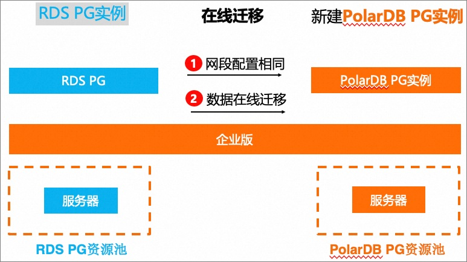

**用户告知**

- 需得到客户许可时操作。

- 迁移过程涉及实例连接地址的切换，建议在业务低峰期执行。

**优势说明**

- 支持连接地址迁移：支持DNS连接，应用端无需改动连接地址（限DNS方式）。

- 支持迁移回滚：支持随时回滚。

- 迁移进度随时查看：随时查看当前的迁移进度。

- 支持增量迁移，停机时间小于10分钟：通过DTS实现增量迁移。

**限制说明**

- 不支持跨地域迁移：仅支持同一个Region中的实例进行迁移，不支持跨Region迁移。

- 跨Postgres版本语法差异，需要迁移方自行评估：由于PolarDB PostgreSQL 14版本、16版本与Postgres 14、16版本完全兼容，当用户从低版本升级到高版本的时候，语法需要自行评估。阿里云提供外部方式，可供应用进行初步的参考。

- 连接地址切换的限制：切换地址仅进行DNS的切换，实际使用中有如下限制：

  - 带地址切换只会切换RDS和PolarDB的域名；Vswitch、Vip等配置不会切换。

  - 端口不会发生切换：带地址切换不会切换端口，一键升级时创建的PolarDB集群，除自定义地址端口外，其他端口均与RDS对应地址的端口一致，如需修改端口，请参见《RDS PostgreSQL用户指南》中数据库连接下查看和修改内网地址和端口章节。

  - DNS缓存问题：切换域名后，可能会存在DNS解析缓存问题，在缓存过期时间内可能会出现连接不上数据库或数据库只支持读操作无法执行写入操作等情况，建议刷新一下服务器的DNS缓存。

- DTS迁移的时候不支持：插件迁移，账号迁移。

**二.创建PolarDB Postgres实例**

执行迁移操作前需创建PolarDB Postgres实例。建议在迁移正式版本前，先进行测试数据的迁移和演练，避免误操作导致的数据错误或混乱。

**注意事项**

- 实例规格：推荐创建的实例规格与RDS Postgres规格一致。

- VPC网络：建议选择与现有环境一致的VPC网络，如果选择了不同的VPC，请迁移前确认VPC网络可以被应用端访问。

- 网络白名单：创建后，需要配置与RDS Postgres一致的网络白名单，避免应用无法访问。

由于迁移前后的实例ID发生了变化，如果涉及到如下场景，建议提前与相关系统沟通，确保迁移后相关系统的切换。本次迁移不影响连接字串信息，对于已有的连接地址不受影响，但是当进行变更配置的时候，需要在如下的系统中重新配置：

- 数据库产品：DTS，DMS 通过云实例方式访问。

- 大数据产品： DataWorks，Datahub通过云实例方式访问。

- 云监控系统：将监控新的实例系统。

> **说明**
>
> 使用时需注意安全审计产品SDDP目前不支持PolarDB。

**三.RDS Postgres升级前置检查**

**RDS Postgres内核参数配置检查**

- RDS PostgreSQL实例不可以为空库，即数据库数量为0。

- 内核参数 `wal_level` 必须为logical。

- 内核参数 `max_replication_slots` 参数必须大于需要搭建的DTS双向链路数量，建议大于数据库数量。

- 内核参数 `max_wal_senders` 参数必须大于需要搭建的DTS双向链路数量，建议大于数据库数量。

**语法兼容性检查**

PolarDB Postgres 100%兼容RDS Postgres的语法（不含插件），因此相关语法兼容性详细说明可通过Postgres官网进行查询或使用阿里云提供的pg_upgrade最佳实践进行语法评估。

**（可选）pg_upgrade语法兼容性评估最佳实践**

pg_upgrade工具：官方提供的一个工具，用于支持跨版本的就地升级，不需要执行导出和导入操作。 `pg_upgrade` 可以支持从PostgreSQL 8.4.X到最新版本的升级，包括快照版本和测试版本。它提供了升级前的兼容性检查功能，可以发现插件、数据类型不兼容等问题。

示例如下：

专有云3.16.2上RDS-PG13内核版本为13.14，PolarDB-PG14内核版本为14.13，可以用如下方式进行验证。

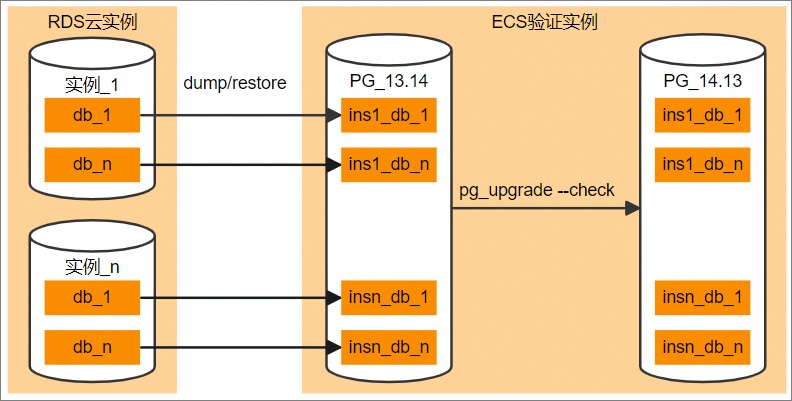

操作步骤：

1. 在专有云申请一台ECS安装centos7.9操作系统（或其他版本OS），当前仅以此为例。

2. 在官网下载开源postgresql 13.14和14.13的安装包及其依赖。

3. 安装13.14、14.13版本的开源postgres（替换为rpm包安装）。

   ```bash
   # postgresql 13.14
   rpm -ivh libicu-50.2-4.el7_7.x86_64.rpm
   rpm -ivh postgresql13-libs-13.14-1PGDG.rhel7.x86_64.rpm
   rpm -ivh postgresql13-13.14-1PGDG.rhel7.x86_64.rpm
   rpm -ivh postgresql13-server-13.14-1PGDG.rhel7.x86_64.rpm
   # postgresql 14.13
   rpm -ivh postgresql14-libs-14.13-2PGDG.rhel7.x86_64.rpm
   rpm -ivh postgresql14-14.13-2PGDG.rhel7.x86_64.rpm
   rpm -ivh postgresql14-server-14.13-2PGDG.rhel7.x86_64.rpm
   ```

4. 启动postgresql。

   ```bash
   # postgresql 13.14
   sudo /usr/pgsql-13/bin/postgresql-13-setup initdb
   sudo systemctl enable postgresql-13
   sudo systemctl start postgresql-13
   /usr/pgsql-13/bin/psql --version
   # postgresql 14.13
   sudo /usr/pgsql-14/bin/postgresql-14-setup initdb
   sudo systemctl enable postgresql-14
   sudo systemctl start postgresql-14
   /usr/pgsql-14/bin/psql --version
   ```

5. 使用高权限账号，例如：aurora，在rds-pg 13上通过pg_dump导出所有的结构和数据。

   <ol type="i">

   <li>

   获取aurora用户密码。

   </li>

   <li>

   执行如下命令导出数据：

   ```text
    pg_dump -h <host> -p 5432 -U aurora -F c -f rds_pg_13.dump <database> 
   ```

   </li>

   </ol>

6. 通过执行pg_restore命令导入postgres13.x。

   ```text
    pg_restore -h <host> -p 5432 -U postgres -d <database> -F c rds_pg_13.dump 
   ```

7. 执行如下命令，停止postgres13.x和postgres14.x。

   ```bash
   sudo systemctl stop postgresql-13
   sudo systemctl stop postgresql-14
   ```

8. 通过pg_upgrade验证兼容性。

   ```text
   # 切换⽤户
   su - postgres
   # 执⾏检查
   /usr/pgsql-14/bin/pg_upgrade \
     --old-bindir=/usr/pgsql-13/bin \
     --new-bindir=/usr/pgsql-14/bin \
     --old-datadir=/var/lib/pgsql/13/data \
     --new-datadir=/var/lib/pgsql/14/data \
     --check
   ```

检查通过的结果示例如下：

```text
[root@iZuf6dpv3pu9lsc2zt2dnlZ ~]# su - postgres
上⼀次登录：⼀ 12⽉  9 21:11:51 CST 2024pts/0 上
-bash-4.2$
-bash-4.2$ /usr/pgsql-14/bin/pg_upgrade \
>   --old-bindir=/usr/pgsql-13/bin \
>   --new-bindir=/usr/pgsql-14/bin \
>   --old-datadir=/var/lib/pgsql/13/data \
>   --new-datadir=/var/lib/pgsql/14/data \
>   --check
Performing Consistency Checks
-----------------------------
Checking cluster versions                                   ok
Checking database user is the install user                  ok
Checking database connection settings                       ok
Checking for prepared transactions                          ok
Checking for system-defined composite types in user tables  ok
Checking for reg* data types in user tables                 ok
Checking for contrib/isn with bigint-passing mismatch       ok
Checking for user-defined encoding conversions              ok
Checking for user-defined postfix operators                 ok
Checking for incompatible polymorphic functions             ok
Checking for presence of required libraries                 ok
Checking database user is the install user                  ok
Checking for prepared transactions                          ok
Checking for new cluster tablespace directories             ok

*Clusters are compatible*
```

如果有不兼容项，建议用户按照官方手册进行切换。

**插件兼容性检查**

分别在RDS Postgres实例和PolarDB Postgres上进行检查插件，确认插件的兼容性。

插件的兼容性可参考RDS Postgres支持插件列表和PolarDB Postgres支持插件列表。

**RDS Postgres到PolarDB Postgres的账号迁移**

操作步骤：

1. rds源库导出用户权限，用户清单为上文梳理的结果。

   <ol type="i">

   <li>

   使用高权限账号，例如：aurora。

   </li>

   <li>

   执行如下命令，导出用户权限信息：

   ```text
     pg_dumpall -h <host> -p 5432 -U aurora --roles-only --no-role-passwords > 
   rds_pg_13_roles.sql 
   ```

   </li>

   </ol>

   导出的SQL如下所示：

   ```text
   --
   -- PostgreSQL database cluster dump
   --

   SET default_transaction_read_only = off;

   SET client_encoding = 'UTF8';
   SET standard_conforming_strings = on;

   --
   -- Roles
   --

   CREATE ROLE aurora;
   ALTER ROLE aurora WITH SUPERUSER INHERIT NOCREATEROLE NOCREATEDB LOGIN NOREPLICATION 
   NOBYPASSRLS;
   CREATE ROLE juhuan;
   ALTER ROLE juhuan WITH NOSUPERUSER INHERIT NOCREATEROLE NOCREATEDB LOGIN REPLICATION 
   NOBYPASSRLS;
   COMMENT ON ROLE juhuan IS 'polar_superuser';
   CREATE ROLE polar_gawr_admin;
   ALTER ROLE polar_gawr_admin WITH NOSUPERUSER INHERIT NOCREATEROLE NOCREATEDB NOLOGIN 
   NOREPLICATION NOBYPASSRLS;
   CREATE ROLE polar_gawr_user;
   ALTER ROLE polar_gawr_user WITH NOSUPERUSER INHERIT NOCREATEROLE NOCREATEDB NOLOGIN N
   OREPLICATION NOBYPASSRLS;
   CREATE ROLE polardb_admin;
   ALTER ROLE polardb_admin WITH SUPERUSER INHERIT CREATEROLE CREATEDB LOGIN REPLICATION 
   BYPASSRLS;
   CREATE ROLE replicator;
   ALTER ROLE replicator WITH SUPERUSER INHERIT NOCREATEROLE NOCREATEDB LOGIN 
   REPLICATION NOBYPASSRLS;
   CREATE ROLE rs_user;
   ALTER ROLE rs_user WITH NOSUPERUSER INHERIT NOCREATEROLE NOCREATEDB LOGIN 
   NOREPLICATION NOBYPASSRLS;
   --
   -- User Configurations
   --

   --
   -- User Config "aurora"
   --

   ALTER ROLE aurora SET "TimeZone" TO 'UTC';
   --
   -- User Config "aurora"
   --

   ALTER ROLE aurora SET "DateStyle" TO 'ISO,YMD';
   --
   -- User Config "aurora"
   --

   ALTER ROLE aurora SET extra_float_digits TO '0';
   --
   -- User Config "aurora"
   --

   ALTER ROLE aurora SET lock_timeout TO '0';
   --
   -- User Config "aurora"
   --

   ALTER ROLE aurora SET statement_timeout TO '0';
   --
   -- User Config "aurora"
   --

   ALTER ROLE aurora SET idle_session_timeout TO '0';
   --
   -- User Config "aurora"
   --

   ALTER ROLE aurora SET polar_transaction_timeout TO '0';
   --
   -- User Config "aurora"
   --

   ALTER ROLE aurora SET idle_in_transaction_session_timeout TO '3600000';
   --
   -- User Config "aurora"
   --

   ALTER ROLE aurora SET temp_file_limit TO '10000000';
   --
   -- User Configurations
   --

   --
   -- User Config "replicator"
   --

   ALTERROLEreplicatorSET"TimeZone"TO'UTC';
   --
   -- User Config "replicator"
   --

   ALTER ROLE replicator SET "DateStyle" TO 'ISO,YMD';
   --
   -- User Config "replicator"
   --

   ALTER ROLE replicator SET extra_float_digits TO '0';
   --
   -- User Config "replicator"
   --

   ALTER ROLE replicator SET lock_timeout TO '0';
   --
   -- User Config "replicator"
   --

   ALTER ROLE replicator SET statement_timeout TO '0';
   --
   -- User Config "replicator"
   --

   ALTER ROLE replicator SET idle_session_timeout TO '0';
   --
   -- User Config "replicator"
   --

   ALTER ROLE replicator SET polar_transaction_timeout TO '0';
   --
   -- User Config "replicator"
   --

   ALTER ROLE replicator SET idle_in_transaction_session_timeout TO '3600000';
   --
   -- User Config "replicator"
   --

   ALTER ROLE replicator SET temp_file_limit TO '10000000';
   --
   -- User Configurations
   --

   --
   -- User Config "rs_user"
   --

   ALTER ROLE rs_user SET default_transaction_read_only TO 'on';


   --
   -- Role memberships
   --

   GRANT pg_polar_superuser TO juhuan GRANTED BY aurora;


   --
   -- PostgreSQL database cluster dump complete
   --
   ```

2. 检查并改写roles.sql，过滤系统用户等数据。

   RDS默认系统用户**alicloud_rds_admin**、**aurora**。

3. 执行如下命令，为PolarDB目标库导入用户权限。

   ```text
    psql -h <host> -p 5432 -U aurora -f rewrite_rds_pg_13_roles.sql 
   ```

4. 执行如下查询命令，进行权限验证。

   ```text
   SELECT privilege_type
   FROM information_schema.table_privileges
   WHERE grantee = 'app_user'
   AND table_name = '<TABLE_NAME>'
   AND table_schema = 'public';
   ```

**四.DTS数据迁移**

**数据迁移操作步骤**

> **说明**
>
> 数据迁移用于整库迁移场景。

1. 登录DTS控制台，在**数据迁移**页面右侧单击**创建迁移任务**，选择地区并填写要创建的实例数量。

   > **说明**
   >
   > 整个迁移过程中涉及到几次断数据库连接的操作，数据迁移的用户不建议使用应用用到的db owner用户。新建高权限用户在迁移某些对象时可能报权限不足，此处建议直接使用rds和polar的超级用户aurora来执行DTS迁移。

2. 在迁移任务列表中，找到刚创建的数据迁移实例，单击**配置任务**，配置源库及目标库相关信息。

   > **说明**
   >
   > 注意源库、目标库避免使用域名连接，后续会置换域名。

   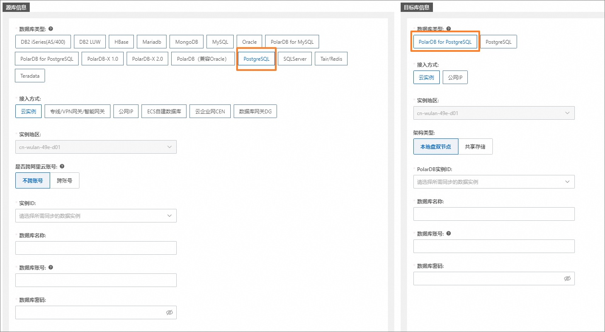

   **类别**

   **配置**

   **说明**

   选择**PostgreSQL**。

   **数据库类型**

   选择**云实例**。

   **接入方式**

   创建数据迁移实例时已指定，不可变更。

   **实例地区**

   **是否跨阿里云账**

   选择**不跨账号**。

   **号**

   源库信息

   选择需要迁移的数据库ID。

   **实例ID**

   填入源数据库实例中待迁移的数据库名。

   **数据库名称**

   源数据库具有读写权限的账号。

   **数据库账号**

   源数据库账号对应的密码。

   **数据库密码**

   选择**PolarDB for PostgreSQL**。

   **数据库类型**

   选择**云实例**。

   **接入方式**

   创建数据迁移实例时已指定，不可变更。

   **实例地区**

   选择目标数据库的架构类型。

   **架构类型**

   目标库信息

   选择目标数据库实例ID。

   **实例ID**

   填入目标数据库实例中待迁入数据的数据库名

   **数据库名称**

   填入目标数据库账号。该账号需具备待迁入数据库的读写权限。

   **数据库账号**

   填入该数据库账号的密码。

   **数据库密码**

3. 配置完成后，单击页面下方的**测试连接以进行下一步**。

4. 选择迁移对象及迁移类型。

   | 配置 | 说明 |
   | --- | --- |
   | 任务步骤 | • 如果只需要进行全量数据迁移，同时选中<strong>库表结构迁移</strong>和<strong>全量迁移</strong>。<br>• 如果需要进行不停机迁移，同时选中<strong>库表结构迁移</strong>、<strong>全量迁移</strong>和<strong>增量迁移</strong>。<br>说明如果未选中<strong>增量迁移</strong>，为保障数据一致性，全量数据迁移期间请勿在源数据库中写入新的数据。 |
   | 目标已存在表的处理模式 | • <strong>预检查并报错拦截</strong>：检查目标数据库中是否有同名的表。如果目标数据库中没有同名的表，则通过该检查项目；如果目标数据库中有同名的表，则在预检查阶段提示错误，数据迁移任务不会被启动。<br>• <strong>忽略报错并继续执行</strong>：跳过目标数据库中是否有同名表的检查项。<br>警告选择<strong>忽略报错并继续执行</strong>，可能导致数据不一致，给业务带来风险，例如：<br>• 表结构一致的情况下，在目标库遇到与源库主键的值相同的记录，则会保留目标库中的该条记录，即源库中的该条记录不会迁移至目标库中。<br>• 表结构不一致的情况下，可能导致只能迁移部分列的数据或迁移失败。 |
   | 源库对象 | 在<strong>源库对象</strong>框中单击待迁移的对象，然后单击图标将其移动至<strong>已选择对象</strong>框。<br>说明迁移对象选择的粒度为库、表或列。 |
   | 已选择对象 | 默认情况下，迁移对象在目标库中的名称与源库保持一致。<br>说明<br>• 如需按库或表级别选择迁移的SQL操作，请在<strong>已选择对象</strong>中右击待迁移对象，并在弹出的对话框中选择所需迁移的SQL操作。<br>• 如果使用了对象名映射功能，可能会导致依赖这个对象的其他对象迁移失败。 |

5. 单击**下一步高级配置**，进行高级配置。

   | 配置项目 | 配置说明 |
   | --- | --- |
   | 源库、目标库无法连接后的重试时间 | 在迁移任务启动后，若源库或目标库连接失败则DTS会报错。对于可预期的报错，DTS会立即进行持续的重试连接，默认重试720分钟，您也可以在取值范围（10~1440分钟）内自定义重试时间，建议设置30分钟以上。如果DTS在设置的时间内重新连接上源、目标库，迁移任务将自动恢复。否则，迁移任务将失败。<br>说明针对同源或者同目标的多个DTS实例，如DTS实例A和DTS实例B，设置网络重试时间时A设置30分钟，B设置60分钟，则重试时间以低的30分钟为准。 |
   | 配置ETL功能 | 当前链路暂不支持配置ETL功能，请选择<strong>否</strong>。 |

6. 上述配置完成后，单击页面下方的**下一步预检查并启动**。

   > **重要**
   >
   > - 在数据迁移任务正式启动之前，会先进行预检查。只有预检查通过后，才能成功启动数据迁移任务。
   >
   > - 如果预检查失败，请单击**查看详情**并根据提示修复问题，然后重新进行预检查。

7. **预检查通过率**显示为100%时，单击**返回列表**。

   > **说明**
   >
   > 如果未选择增量数据迁移，您只需等待迁移任务完成即可，迁移任务会自动结束；如果选择了增量数据迁移，迁移任务不会自动结束，您需要等待迁移任务处于**运行中**且无延迟时，手动结束迁移任务。

**数据同步操作步骤**

> **说明**
>
> 数据同步用于表级数据传输及上云。

1. 登录DTS控制台，在**数据同步**页面右侧单击**创建同步任务**，选择地区并填写要创建的实例数量。

2. 在同步任务列表中，找到刚创建的数据同步实例，单击**配置任务**，配置源库及目标库相关信息。

   <table>
     <tr>
       <th>类别</th>
       <th>配置</th>
       <th>说明</th>
     </tr>
     <tr>
       <td rowspan="8">源库信息</td>
       <td>数据库类型</td>
       <td>选择<strong>PostgreSQL</strong>。</td>
     </tr>
     <tr>
       <td>接入方式</td>
       <td>选择<strong>云实例</strong>。</td>
     </tr>
     <tr>
       <td>实例地区</td>
       <td>创建数据同步实例时已指定，不可变更。</td>
     </tr>
     <tr>
       <td>是否跨阿里云账号</td>
       <td>选择<strong>不跨账号</strong>。</td>
     </tr>
     <tr>
       <td>实例ID</td>
       <td>选择源RDS PostgreSQL实例ID。</td>
     </tr>
     <tr>
       <td>数据库名称</td>
       <td>填入源RDS PostgreSQL实例中待同步的数据库名。</td>
     </tr>
     <tr>
       <td>数据库账号</td>
       <td>填入源RDS PostgreSQL的高权限账号，且需为所选数据库的owner（授权账号）。</td>
     </tr>
     <tr>
       <td>数据库密码</td>
       <td>填入该数据库账号的密码。</td>
     </tr>
     <tr>
       <td rowspan="7">目标库信息</td>
       <td>数据库类型</td>
       <td>选择<strong>PolarDB for PostgreSQL</strong>。</td>
     </tr>
     <tr>
       <td>接入方式</td>
       <td>选择<strong>云实例</strong>。</td>
     </tr>
     <tr>
       <td>实例地区</td>
       <td>创建数据同步实例时已指定，不可变更。</td>
     </tr>
     <tr>
       <td>实例ID</td>
       <td>选择目标数据库实例ID。</td>
     </tr>
     <tr>
       <td>数据库名称</td>
       <td>填入目标数据库实例中待同步数据的数据库名</td>
     </tr>
     <tr>
       <td>数据库账号</td>
       <td>填入目标数据库账号。该账号需具备待同步数据库的读写权限。</td>
     </tr>
     <tr>
       <td>数据库密码</td>
       <td>填入该数据库账号的密码。</td>
     </tr>
   </table>

3. 配置完成后，单击页面下方的**测试连接以进行下一步**。

4. 选择同步对象及同步类型。

   <table>
     <tr>
       <th width="215">配置项目</th>
       <th>说明</th>
     </tr>
     <tr>
       <td>任务步骤</td>
       <td>固定选中<strong>增量同步</strong>。默认情况下，您还需要同时选中<strong>库表结构同步</strong>和<strong>全量同步</strong>。预检查完成后，DTS会将源实例中待同步对象的全量数据在目标集群中初始化，作为后续增量同步数据的基线数据。</td>
     </tr>
     <tr>
       <td>目标已存在表的处理模式</td>
       <td>• <strong>预检查并报错拦截</strong>：检查目标数据库中是否有同名的表。如果目标数据库中没有同名的表，则通过该检查项目；如果目标数据库中有同名的表，则在预检查阶段提示错误，数据迁移任务不会被启动。<br>• <strong>忽略报错并继续执行</strong>：跳过目标数据库中是否有同名表的检查项。<br>警告选择<strong>忽略报错并继续执行</strong>，可能导致数据不一致，给业务带来风险，例如：<br>• 表结构一致的情况下，在目标库遇到与源库主键的值相同的记录，则会保留目标库中的该条记录，即源库中的该条记录不会迁移至目标库中。<br>• 表结构不一致的情况下，可能导致只能迁移部分列的数据或迁移失败。</td>
     </tr>
     <tr>
       <td>同步拓扑</td>
       <td>选择<strong>单向同步</strong>。</td>
     </tr>
     <tr>
       <td>目标库对象名称大小写策略</td>
       <td>可以配置目标实例中同步对象的库名、表名和列名的英文大小写策略。默认情况下选择<strong>DTS默认策略</strong>，您也可以选择与源库、目标库默认策略保持一致。</td>
     </tr>
     <tr>
       <td>源库对象</td>
       <td>在<strong>源库对象</strong>框中单击待同步的对象（库或表），然后单击图标将其移动至<strong>已</strong><br><strong>选择对象</strong>框。<br>说明同步对象选择的粒度为库、表或列。</td>
     </tr>
     <tr>
       <td>已选择对象</td>
       <td>默认情况下，同步对象的名称保持不变。如果您需要改变同步对象在目标实例中的名称，请使用对象名映射功能。<br>说明<br>• 若您使用了多表归并功能，则需将表名称修改为待同步的表在目标库中的表名。<br>• 如果使用了对象名映射功能，可能会导致依赖这个对象的其他对象同步失败。</td>
     </tr>
   </table>

5. 单击**下一步高级配置**，进行高级配置。

   | 配置项目 | 配置说明 |
   | --- | --- |
   | 源库、目标库无法连接后的重试时间 | 在同步任务启动后，若源库或目标库连接失败则DTS会报错。对于可预期的报错，DTS会立即进行持续的重试连接，默认持续重试时间为720分钟，您也可以在取值范围（10~1440分钟）内自定义重试时间，建议设置30分钟以上。如果DTS在设置的重试时间内重新连接上源库、目标库，同步任务将自动恢复。否则，同步任务将会失败。<br>说明针对同源或者同目标的多个DTS实例，如DTS实例A和DTS实例B，设置网络重试时间时A设置30分钟，B设置60分钟，则重试时间以低的30分钟为准。 |
   | 配置ETL功能 | 选择是否配置ETL功能。<br>• <strong>是</strong>：配置ETL功能，并在文本框中填写数据处理语句。<br>• <strong>否</strong>：不配置ETL功能。 |

6. 上述配置完成后，单击页面下方的**下一步预检查并启动**。

   > **重要**
   >
   > - 在数据同步任务正式启动之前，会先进行预检查。只有预检查通过后，才能成功启动数据同步任务。
   >
   > - 如果预检查失败，请单击**查看详情**根据提示修复问题，然后重新进行预检查。

7. 预检查通过率显示为100%时，单击**返回列表**。

**数据库禁写**

操作步骤：

> **说明**
>
> 此处假设应用系统使用的用户为app_user。

1. 修改app_user为只读。

2. 断开app_user连接，确保只读生效。需要应用的数据库连接池支持重建数据库连接。

3. 检查app_user已经是只读（insert、update一张测试表）。

   ```sql
   -- 修改指定⽤户为只读
   ALTER USER app_user SET default_transaction_read_only TO ON;
   -- 断指定⽤户连接
   SELECT pg_terminate_backend(pid) FROM pg_stat_activity where usename= 'app_user';
   -- 检查指定⽤户连接
   SELECT * FROM pg_stat_activity where usename= 'app_user';
   SELECT * FROM pg_catalog.pg_user WHERE usename='app_user';
   ```

   全局禁写方式：

   ```text
   ALTER SYSTEM SET default_transaction_read_only TO on;
   SELECT pg_reload_conf();
   SHOW default_transaction_read_only;
   ```

**记录禁写时间点**

执行如下语句，备份恢复时间点：

```text
SELECT CURRENT_TIMESTAMP AT TIME ZONE 'Asia/Shanghai';
```

注意关注和白屏时间点是否一致。

**数据校验**

操作步骤：

1. 数据同步结束判断。

   流量=0；延迟=1；

2. DTS全量校验。

   登录DTS运维平台，创建全量校验任务，可根据数据量适当调整参数。

   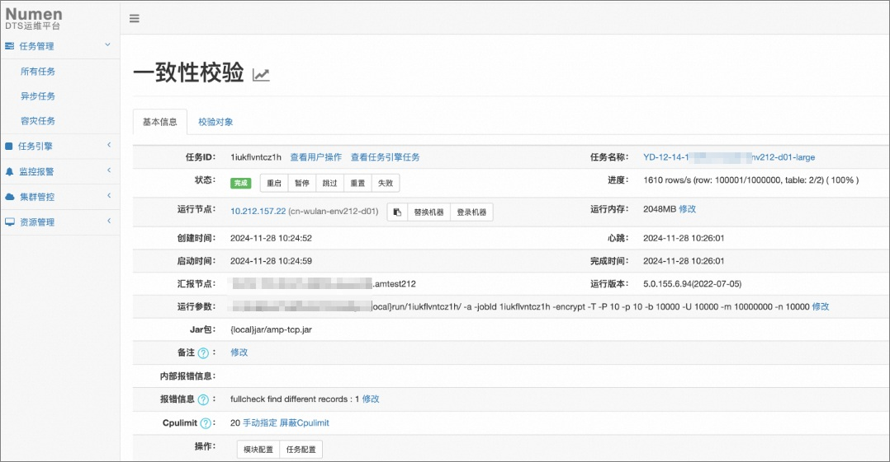

   运行参数说明：

   <table>
     <tr>
       <th width="124">参数</th>
       <th>说明</th>
     </tr>
     <tr>
       <td>-P 10</td>
       <td>抽样校验百分比，默认全量校验。</td>
     </tr>
     <tr>
       <td>-p 10</td>
       <td>线程数。</td>
     </tr>
     <tr>
       <td>-b 10000</td>
       <td>切片大小。</td>
     </tr>
     <tr>
       <td>-U 10000</td>
       <td>元数据保存差异数，取决于数据总量和抽样百分比，比如100万数据，抽样1%，校验数据只有1万，元数据差异数理论应该就是1万。</td>
     </tr>
     <tr>
       <td>-m 1000000</td>
       <td>单表最大差异上限。</td>
     </tr>
     <tr>
       <td>-n 10000</td>
       <td>无主键单表校验数据上限。</td>
     </tr>
   </table>

   校验结果示例：

   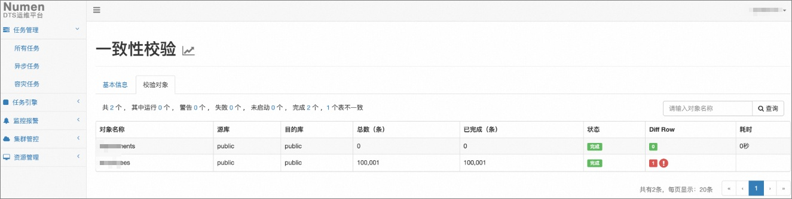

3. 数据量校验（SQL）。

   抽查应用流水表。

**五.切换数据库地址连接**

在迁移中单击切换即可。DNS切换后，客户端有缓存，可能还是会继续连接源数据库，需要断开源数据库的数据库连接。

```sql
-- 断指定⽤户连接
SELECT pg_terminate_backend(pid) FROM pg_stat_activity where usename= 'app_user';
-- 检查指定⽤户连接
SELECT * FROM pg_stat_activity where usename= 'app_user';
```

**六.迁移回滚（可选）**

再次执行步骤五切换数据库地址链接即可将地址进行回迁。

<a id="section-4-2"></a>

## 4.2. 前置检查

<a id="section-4-2-1"></a>

### 4.2.1. 语法兼容性检查

本文为您介绍如何进行语法兼容性检查，帮助您快速完成操作。

**概述**

PolarDB Postgres 100%兼容RDS Postgres的语法（不含插件），因此相关语法兼容性详细说明可通过Postgres官网进行查询或使用阿里云提供的pg_upgrade最佳实践进行语法评估。

**pg_upgrade语法兼容性评估最佳实践**

pg_upgrade工具：官方提供的一个工具，用于支持跨版本的就地升级，不需要执行导出和导入操作。 `pg_upgrade` 可以支持从PostgreSQL 8.4.X到最新版本的升级，包括快照版本和测试版本。它提供了升级前的兼容性检查功能，可以发现插件、数据类型不兼容等问题。

示例如下：

专有云3.16.2上RDS-PG13内核版本为13.14，PolarDB-PG14内核版本为14.13，可以用如下方式进行验证。


操作步骤：

1. 在专有云申请一台ECS安装centos7.9操作系统（或其他版本OS），当前仅以此为例。

2. 在官网下载开源postgresql 13.14和14.13的安装包及其依赖。

3. 安装13.14、14.13版本的开源postgres（替换为rpm包安装）。

   ```bash
   # postgresql 13.14
   rpm -ivh libicu-50.2-4.el7_7.x86_64.rpm
   rpm -ivh postgresql13-libs-13.14-1PGDG.rhel7.x86_64.rpm
   rpm -ivh postgresql13-13.14-1PGDG.rhel7.x86_64.rpm
   rpm -ivh postgresql13-server-13.14-1PGDG.rhel7.x86_64.rpm
   # postgresql 14.13
   rpm -ivh postgresql14-libs-14.13-2PGDG.rhel7.x86_64.rpm
   rpm -ivh postgresql14-14.13-2PGDG.rhel7.x86_64.rpm
   rpm -ivh postgresql14-server-14.13-2PGDG.rhel7.x86_64.rpm
   ```

4. 启动postgresql。

   ```bash
   # postgresql 13.14
   sudo /usr/pgsql-13/bin/postgresql-13-setup initdb
   sudo systemctl enable postgresql-13
   sudo systemctl start postgresql-13
   /usr/pgsql-13/bin/psql --version
   # postgresql 14.13
   sudo /usr/pgsql-14/bin/postgresql-14-setup initdb
   sudo systemctl enable postgresql-14
   sudo systemctl start postgresql-14
   /usr/pgsql-14/bin/psql --version
   ```

5. 使用高权限账号，例如：aurora，在rds-pg 13上通过pg_dump导出所有的结构和数据。

   <ol type="i">

   <li>

   获取aurora用户密码。

   </li>

   <li>

   执行如下命令导出数据：

   ```text
    pg_dump -h <host> -p 5432 -U aurora -F c -f rds_pg_13.dump <database> 
   ```

   </li>

   </ol>

6. 通过执行pg_restore命令导入postgres13.x。

   ```text
    pg_restore -h <host> -p 5432 -U postgres -d <database> -F c rds_pg_13.dump 
   ```

7. 执行如下命令，停止postgres13.x和postgres14.x。

   ```bash
   sudo systemctl stop postgresql-13
   sudo systemctl stop postgresql-14
   ```

8. 通过pg_upgrade验证兼容性。

   ```text
   # 切换⽤户
   su - postgres
   # 执⾏检查
   /usr/pgsql-14/bin/pg_upgrade \
     --old-bindir=/usr/pgsql-13/bin \
     --new-bindir=/usr/pgsql-14/bin \
     --old-datadir=/var/lib/pgsql/13/data \
     --new-datadir=/var/lib/pgsql/14/data \
     --check
   ```

检查通过的结果示例如下：

```text
[root@iZuf6dpv3pu9lsc2zt2dnlZ ~]# su - postgres
上⼀次登录：⼀ 12⽉  9 21:11:51 CST 2024pts/0 上
-bash-4.2$
-bash-4.2$ /usr/pgsql-14/bin/pg_upgrade \
>   --old-bindir=/usr/pgsql-13/bin \
>   --new-bindir=/usr/pgsql-14/bin \
>   --old-datadir=/var/lib/pgsql/13/data \
>   --new-datadir=/var/lib/pgsql/14/data \
>   --check
Performing Consistency Checks
-----------------------------
Checking cluster versions                                   ok
Checking database user is the install user                  ok
Checking database connection settings                       ok
Checking for prepared transactions                          ok
Checking for system-defined composite types in user tables  ok
Checking for reg* data types in user tables                 ok
Checking for contrib/isn with bigint-passing mismatch       ok
Checking for user-defined encoding conversions              ok
Checking for user-defined postfix operators                 ok
Checking for incompatible polymorphic functions             ok
Checking for presence of required libraries                 ok
Checking database user is the install user                  ok
Checking for prepared transactions                          ok
Checking for new cluster tablespace directories             ok

*Clusters are compatible*
```

如果有不兼容项，建议用户按照官方手册进行切换。

<a id="section-4-2-2"></a>

### 4.2.2. 插件兼容性检查

本文为您介绍插件兼容性检查，帮助您快速完成操作。

分别在RDS Postgres实例和PolarDB Postgres上进行检查插件，确认插件的兼容性。

插件的兼容性可参考RDS Postgres支持插件列表和PolarDB Postgres支持插件列表。

<a id="section-4-2-3"></a>

### 4.2.3. RDS Postgres到PolarDB Postgres的账号迁移

本文为您介绍如何进行RDS Postgres到PolarDB Postgres的账号迁移，帮助您快速完成操作。

**操作步骤**

1. RDS源库导出用户权限，用户清单为上文梳理的结果。

   <ol type="i">

   <li>

   使用高权限账号，例如：aurora。

   </li>

   <li>

   执行如下命令，导出用户权限信息：

   ```text
     pg_dumpall -h <host> -p 5432 -U aurora --roles-only --no-role-passwords > 
   rds_pg_13_roles.sql 
   ```

   </li>

   </ol>

   导出的SQL如下所示：

   ```text
   --
   -- PostgreSQL database cluster dump
   --

   SET default_transaction_read_only = off;

   SET client_encoding = 'UTF8';
   SET standard_conforming_strings = on;

   --
   -- Roles
   --

   CREATE ROLE aurora;
   ALTER ROLE aurora WITH SUPERUSER INHERIT NOCREATEROLE NOCREATEDB LOGIN NOREPLICATION 
   NOBYPASSRLS;
   CREATE ROLE juhuan;
   ALTER ROLE juhuan WITH NOSUPERUSER INHERIT NOCREATEROLE NOCREATEDB LOGIN REPLICATION 
   NOBYPASSRLS;
   COMMENT ON ROLE juhuan IS 'polar_superuser';
   CREATE ROLE polar_gawr_admin;
   ALTER ROLE polar_gawr_admin WITH NOSUPERUSER INHERIT NOCREATEROLE NOCREATEDB NOLOGIN 
   NOREPLICATION NOBYPASSRLS;
   CREATE ROLE polar_gawr_user;
   ALTER ROLE polar_gawr_user WITH NOSUPERUSER INHERIT NOCREATEROLE NOCREATEDB NOLOGIN N
   OREPLICATION NOBYPASSRLS;
   CREATE ROLE polardb_admin;
   ALTER ROLE polardb_admin WITH SUPERUSER INHERIT CREATEROLE CREATEDB LOGIN REPLICATION 
   BYPASSRLS;
   CREATE ROLE replicator;
   ALTER ROLE replicator WITH SUPERUSER INHERIT NOCREATEROLE NOCREATEDB LOGIN 
   REPLICATION NOBYPASSRLS;
   CREATE ROLE rs_user;
   ALTER ROLE rs_user WITH NOSUPERUSER INHERIT NOCREATEROLE NOCREATEDB LOGIN 
   NOREPLICATION NOBYPASSRLS;
   --
   -- User Configurations
   --

   --
   -- User Config "aurora"
   --

   ALTER ROLE aurora SET "TimeZone" TO 'UTC';
   --
   -- User Config "aurora"
   --

   ALTER ROLE aurora SET "DateStyle" TO 'ISO,YMD';
   --
   -- User Config "aurora"
   --

   ALTER ROLE aurora SET extra_float_digits TO '0';
   --
   -- User Config "aurora"
   --

   ALTER ROLE aurora SET lock_timeout TO '0';
   --
   -- User Config "aurora"
   --

   ALTER ROLE aurora SET statement_timeout TO '0';
   --
   -- User Config "aurora"
   --

   ALTER ROLE aurora SET idle_session_timeout TO '0';
   --
   -- User Config "aurora"
   --

   ALTER ROLE aurora SET polar_transaction_timeout TO '0';
   --
   -- User Config "aurora"
   --

   ALTER ROLE aurora SET idle_in_transaction_session_timeout TO '3600000';
   --
   -- User Config "aurora"
   --

   ALTER ROLE aurora SET temp_file_limit TO '10000000';
   --
   -- User Configurations
   --

   --
   -- User Config "replicator"
   --

   ALTER ROLE replicator SET "TimeZone" TO 'UTC';
   --
   -- User Config "replicator"
   --

   ALTER ROLE replicator SET "DateStyle" TO 'ISO,YMD';
   --
   -- User Config "replicator"
   --

   ALTER ROLE replicator SET extra_float_digits TO '0';
   --
   -- User Config "replicator"
   --

   ALTER ROLE replicator SET lock_timeout TO '0';
   --
   -- User Config "replicator"
   --

   ALTER ROLE replicator SET statement_timeout TO '0';
   --
   -- User Config "replicator"
   --

   ALTER ROLE replicator SET idle_session_timeout TO '0';
   --
   -- User Config "replicator"
   --

   ALTER ROLE replicator SET polar_transaction_timeout TO '0';
   --
   -- User Config "replicator"
   --

   ALTER ROLE replicator SET idle_in_transaction_session_timeout TO '3600000';
   --
   -- User Config "replicator"
   --

   ALTER ROLE replicator SET temp_file_limit TO '10000000';
   --
   -- User Configurations
   --

   --
   -- User Config "rs_user"
   --

   ALTER ROLE rs_user SET default_transaction_read_only TO 'on';


   --
   -- Role memberships
   --

   GRANT pg_polar_superuser TO juhuan GRANTED BY aurora;


   --
   -- PostgreSQL database cluster dump complete
   --
   ```

2. 检查并改写roles.sql，过滤系统用户等数据。

   RDS默认系统用户**alicloud_rds_admin**、**aurora**。

3. 执行如下命令，为PolarDB目标库导入用户权限。

   ```text
    psql -h <host> -p 5432 -U aurora -f rewrite_rds_pg_13_roles.sql 
   ```

4. 执行如下查询命令，进行权限验证。

   ```text
   SELECT privilege_type
   FROM information_schema.table_privileges
   WHERE grantee = 'app_user'
   AND table_name = '<TABLE_NAME>'
   AND table_schema = 'public';
   ```

<a id="section-4-3"></a>

## 4.3. DTS数据迁移

<a id="section-4-3-1"></a>

### 4.3.1. 数据迁移

本文为您介绍如何进行数据迁移，帮助您完成迁移操作。

> **说明**
>
> 数据迁移主要用将本地数据库、自建数据库、三方数据库整库迁移至阿里云数据库，主要用于上云迁移、数据库拆分或扩容等一次性任务。

1. 登录DTS控制台，在**数据迁移**页面右侧单击**创建迁移任务**，选择地区并填写要创建的实例数量。

   > **说明**
   >
   > 整个迁移过程中涉及到几次断数据库连接的操作，数据迁移的用户不建议使用应用用到的db owner用户。新建高权限用户在迁移某些对象时可能报权限不足，此处建议直接使用rds和polar的超级用户aurora来执行DTS迁移。

2. 在迁移任务列表中，找到刚创建的数据迁移实例，单击**配置任务**。，配置源库及目标库相关信息。

   > **说明**
   >
   > 注意源库、目标库避免使用域名连接，后续会置换域名。

   

   **类别**

   **配置**

   **说明**

   选择**PostgreSQL**。

   **数据库类型**

   选择**云实例**。

   **接入方式**

   **实例地区**

   创建数据迁移实例时已指定，不可变更。

   **是否跨阿里云账**

   选择**不跨账号**。

   **号**

   源库信息

   选择需要迁移的数据库ID。

   **实例ID**

   填入源数据库实例中待迁移的数据库名。

   **数据库名称**

   源数据库具有读写权限的账号。

   **数据库账号**

   源数据库账号对应的密码。

   **数据库密码**

   选择**PolarDB for PostgreSQL**。

   **数据库类型**

   选择**云实例**。

   **接入方式**

   创建数据迁移实例时已指定，不可变更。

   **实例地区**

   选择目标数据库的架构类型。

   **架构类型**

   目标库信息

   选择目标数据库实例ID。

   **实例ID**

   填入目标数据库实例中待迁入数据的数据库名

   **数据库名称**

   填入目标数据库账号。该账号需具备待迁入数据库的读写权限。

   **数据库账号**

   填入该数据库账号的密码。

   **数据库密码**

3. 配置完成后，单击页面下方的**测试连接以进行下一步**。

4. 选择迁移对象及迁移类型。

   | 配置 | 说明 |
   | --- | --- |
   | 任务步骤 | • 如果只需要进行全量数据迁移，同时选中<strong>库表结构迁移</strong>和<strong>全量迁移</strong>。<br>• 如果需要进行不停机迁移，同时选中<strong>库表结构迁移</strong>、<strong>全量迁移</strong>和<strong>增量迁移</strong>。<br>说明如果未选中<strong>增量迁移</strong>，为保障数据一致性，全量数据迁移期间请勿在源数据库中写入新的数据。 |
   | 目标已存在表的处理模式 | • <strong>预检查并报错拦截</strong>：检查目标数据库中是否有同名的表。如果目标数据库中没有同名的表，则通过该检查项目；如果目标数据库中有同名的表，则在预检查阶段提示错误，数据迁移任务不会被启动。<br>• <strong>忽略报错并继续执行</strong>：跳过目标数据库中是否有同名表的检查项。<br>警告选择为<strong>忽略报错并继续执行</strong>，可能导致数据不一致，给业务带来风险，例如：<br>• 表结构一致的情况下，在目标库遇到与源库主键的值相同的记录，则会保留目标库中的该条记录，即源库中的该条记录不会迁移至目标库中。<br>• 表结构不一致的情况下，可能导致只能迁移部分列的数据或迁移失败。 |
   | 源库对象 | 在<strong>源库对象</strong>框中单击待迁移的对象，然后单击图标将其移动至<strong>已选择对象</strong>框。<br>说明迁移对象选择的粒度为库、表或列。 |
   | 已选择对象 | 默认情况下，迁移对象在目标库中的名称与源库保持一致。<br>说明<br>• 如需按库或表级别选择迁移的SQL操作，请在<strong>已选择对象</strong>中右击待迁移对象，并在弹出的对话框中选择所需迁移的SQL操作。<br>• 如果使用了对象名映射功能，可能会导致依赖这个对象的其他对象迁移失败。 |

5. 单击**下一步高级配置**，进行高级配置。

   | 配置项目 | 配置说明 |
   | --- | --- |
   | 源库、目标库无法连接后的重试时间 | 在迁移任务启动后，若源库或目标库连接失败则DTS会报错。对于可预期的报错，DTS会立即进行持续的重试连接，默认重试720分钟，您也可以在取值范围（10~1440分钟）内自定义重试时间，建议设置30分钟以上。如果DTS在设置的时间内重新连接上源、目标库，迁移任务将自动恢复。否则，迁移任务将失败。<br>说明针对同源或者同目标的多个DTS实例，如DTS实例A和DTS实例B，设置网络重试时间时A设置30分钟，B设置60分钟，则重试时间以低的30分钟为准。 |
   | 配置ETL功能 | 当前链路暂不支持配置ETL功能，请选择<strong>否</strong>。 |

6. 上述配置完成后，单击页面下方的**下一步预检查并启动**。

   > **重要**
   >
   > - 在数据迁移任务正式启动之前，会先进行预检查。只有预检查通过后，才能成功启动数据迁移任务。
   >
   > - 如果预检查失败，请单击**查看详情**并根据提示修复问题，然后重新进行预检查。

7. **预检查通过率**显示为100%时，单击**返回列表**。

   > **说明**
   >
   > 如果未选择增量数据迁移，您只需等待迁移任务完成即可，迁移任务会自动结束；如果选择了增量数据迁移，迁移任务不会自动结束，您需要等待迁移任务处于**运行中**且无延迟时，手动结束迁移任务。

<a id="section-4-3-2"></a>

### 4.3.2. 数据同步

本文为您介绍如何进行数据同步，帮助您完成同步操作。

> **说明**
>
> 数据同步主要用于表级持续性任务，如异地多活、数据灾备、跨云数据同步、查询与报表分流、云BI及实时数据仓库等持续性任务。

1. 登录DTS控制台，在**数据同步**页面右侧单击**创建同步任务**，选择地区并填写要创建的实例数量。

2. 在同步任务列表中，找到刚创建的数据同步实例，单击**配置任务**，配置源库及目标库相关信息。

   **类别**

   **配置**

   **说明**

   选择**PostgreSQL**。

   **数据库类型**

   选择**云实例**。

   **接入方式**

   创建数据同步实例时已指定，不可变更。

   **实例地区**

   **是否跨阿里云**

   选择**不跨账号**。

   **账号**

   **源库信息**

   选择源RDS PostgreSQL实例ID。

   **实例ID**

   填入源RDS PostgreSQL实例中待同步的数据库名。

   **数据库名称**

   填入源RDS PostgreSQL的高权限账号，且需为所选数据库的owner（授

   **数据库账号**

   权账号）。

   填入该数据库账号的密码。

   **数据库密码**

   选择**PolarDB for PostgreSQL**。

   **数据库类型**

   选择**云实例**。

   **接入方式**

   创建数据同步实例时已指定，不可变更。

   **实例地区**

   选择目标数据库实例ID。

   **实例ID**

   **目标库信息**

   填入目标数据库实例中待同步数据的数据库名

   **数据库名称**

   填入目标数据库账号。该账号需具备待同步数据库的读写权限。

   **数据库账号**

   填入该数据库账号的密码。

   **数据库密码**

3. 配置完成后，单击页面下方的**测试连接以进行下一步**。

4. 选择同步对象及同步类型。

   <table>
     <tr>
       <th width="215">配置项目</th>
       <th>说明</th>
     </tr>
     <tr>
       <td>任务步骤</td>
       <td>固定选中<strong>增量同步</strong>。默认情况下，您还需要同时选中<strong>库表结构同步</strong>和<strong>全量同步</strong>。预检查完成后，DTS会将源实例中待同步对象的全量数据在目标集群中初始化，作为后续增量同步数据的基线数据。</td>
     </tr>
     <tr>
       <td>目标已存在表的处理模式</td>
       <td>• <strong>预检查并报错拦截</strong>：检查目标数据库中是否有同名的表。如果目标数据库中没有同名的表，则通过该检查项目；如果目标数据库中有同名的表，则在预检查阶段提示错误，数据迁移任务不会被启动。<br>• <strong>忽略报错并继续执行</strong>：跳过目标数据库中是否有同名表的检查项。<br>警告选择<strong>忽略报错并继续执行</strong>，可能导致数据不一致，给业务带来风险，例如：<br>• 表结构一致的情况下，在目标库遇到与源库主键的值相同的记录，则会保留目标库中的该条记录，即源库中的该条记录不会迁移至目标库中。<br>• 表结构不一致的情况下，可能导致只能迁移部分列的数据或迁移失败。</td>
     </tr>
     <tr>
       <td>同步拓扑</td>
       <td>选择<strong>单向同步</strong>。</td>
     </tr>
     <tr>
       <td>目标库对象名称大小写策略</td>
       <td>可以配置目标实例中同步对象的库名、表名和列名的英文大小写策略。默认情况下选择<strong>DTS默认策略</strong>，您也可以选择与源库、目标库默认策略保持一致。</td>
     </tr>
     <tr>
       <td>源库对象</td>
       <td>在<strong>源库对象</strong>框中单击待同步的对象（库或表），然后单击图标将其移动至<strong>已</strong><br><strong>选择对象</strong>框。<br>说明同步对象选择的粒度为库、表或列。</td>
     </tr>
     <tr>
       <td>已选择对象</td>
       <td>默认情况下，同步对象的名称保持不变。如果您需要改变同步对象在目标实例中的名称，请使用对象名映射功能。<br>说明<br>• 若您使用了多表归并功能，则需将表名称修改为待同步的表在目标库中的表名。<br>• 如果使用了对象名映射功能，可能会导致依赖这个对象的其他对象同步失败。</td>
     </tr>
   </table>

5. 单击**下一步高级配置**，进行高级配置。

   | 配置项目 | 配置说明 |
   | --- | --- |
   | 源库、目标库无法连接后的重试时间 | 在同步任务启动后，若源库或目标库连接失败则DTS会报错。对于可预期的报错，DTS会立即进行持续的重试连接，默认持续重试时间为720分钟，您也可以在取值范围（10~1440分钟）内自定义重试时间，建议设置30分钟以上。如果DTS在设置的重试时间内重新连接上源库、目标库，同步任务将自动恢复。否则，同步任务将会失败。<br>说明针对同源或者同目标的多个DTS实例，如DTS实例A和DTS实例B，设置网络重试时间时A设置30分钟，B设置60分钟，则重试时间以低的30分钟为准。 |
   | 配置ETL功能 | 选择是否配置ETL功能。<br>• <strong>是</strong>：配置ETL功能，并在文本框中填写数据处理语句。<br>• <strong>否</strong>：不配置ETL功能。 |

6. 上述配置完成后，单击页面下方的**下一步预检查并启动**。

   > **重要**
   >
   > - 在数据同步任务正式启动之前，会先进行预检查。只有预检查通过后，才能成功启动数据同步任务。
   >
   > - 如果预检查失败，请单击**查看详情**根据提示修复问题，然后重新进行预检查。

7. 预检查通过率显示为100%时，单击**返回列表**。

<a id="section-4-3-3"></a>

### 4.3.3. 查看迁移列表

本文为您介绍如何查看迁移任务和任务状态信息。

**操作步骤**

1. 登录数据传输服务控制台。

2. 在左侧导航栏，单击**数据迁移**。

3. 选择目标迁移实例，查看迁移状态和迁移进度等信息。

   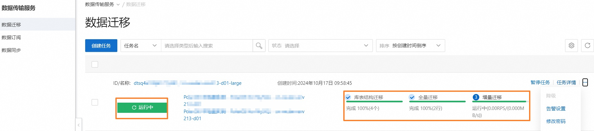

> **说明**
>
> 如果需要看更具体的信息，可以单击操作列中**任务详情**进行查看。

<a id="section-5"></a>

# 5.实例管理

<a id="section-5-1"></a>

## 5.1. 创建实例

本文介绍如何通过PolarDB PostgreSQL版专有云控制台创建PolarDB PostgreSQL本地盘版实例。

**前提条件**

在创建实例前，需要先申请可以登录阿里云控制台的账号。

**操作步骤**

1. 登录PolarDB PostgreSQL版专有云控制台。

2. 在**本地盘实例列表**页面中，单击右上角的**创建实例**。

3. 设置如下参数。

   **类别**

   **配置**

   **说明**

   实例所属组织。

   **组织**

   实例所属资源集。

   **资源集**

   实例所属地域。不同地域之间的产品内网不互通，创建实例后不支持更换地域。

   **地域**

   实例部署方案，目前支持**单可用区部署**和**多可用区部署**两种方案。

   **部署方案**

   **主节点可用**

   **基本信息**

   实例主节点所属的可用区。

   **区**

   实例备节点所属的可用区。

   > **说明**
   >
   > - 仅当部署方案选择**多可用区部署**时，需要配置该选项。

   **备节点可用区**

   > - 如果选择了和主节点相同的可用区，则效果等同于**单可用区部署**。

   实例所属主机的芯片架构。

   **芯片架构**

   选择数据库类型。

   **数据库类型**

   - **PostgreSQL 语法兼容**

   - **Oracle 语法兼容**

   数据库语法兼容版本，支持如下版本：

   - **16**

     > **说明**

   **语法兼容**

   > 仅**数据库类型**为**PostgreSQL 语法兼容**时支持选择该版本。

   - **14**

   数据库的系列，目前支持**双机高可用版本**和**只读实例**两种系列。

   **系列**

   数据库的存储类型，固定为**本地SSD**。

   **存储类型**

   选择是否开启TDE功能。

   > **说明**
   >
   > - TDE功能开启后无法关闭。

   **开启TDE**

   > - 仅支持在创建实例过程中开启TDE功能，实例创建后无法修改TDE功能状态。
   >
   > - 当**语法兼容**为**16**时不支持开启TDE功能。

   选择加密算法，默认值为aes-256。取值如下：

   - aes-256

   - sm4

   **加密算法**

   > **说明**
   >
   > - 当开启TDE时，需要配置该参数。
   >
   > - 实例创建后无法更改。

   在下拉框中选择加密key。当开启TDE时，需要配置该参数。您可以选择使用由阿里云自动生成的密钥，也可以在密钥管理服务中创建一个**加密Key**。创建加密

   **加密key**

   key请参见<strong>《密钥管理服务》</strong>的**用户指南 > 创建密钥**章节。

   实例的规格，不同的内存大小对应不同的最大连接数和IOPS，具体请以控制台界

   **实例规格**

   面为准。

   存储空间包括数据空间、系统文件空间、Binlog文件空间和事务文件空间。实际

   **存储空间**

   可用存储空间请以控制台界面为准。

   实例支持的网络连接类型：

   - **公网连接**：通过该连接地址可以从外网访问数据库。

   - **内网连接**：通过该连接地址可以从内网访问数据库。

   **网络连接类型**

   > **说明**
   >
   > 实例创建完成后无法修改，请谨慎选择。

   实例支持的网络类型：

   - **经典网络**：经典网络中的云服务在网络上不进行隔离，只能依靠云服务自身的安全组或白名单策略来阻挡非法访问。

   - **专有网络**：专有网络VPC（Virtual Private Cloud）帮助用户在阿里云上构建出一个隔离的网络环境。用户可以自定义专有网络里面的路由表、IP地址范围

   **网络类型**

   和网关。建议您选择专有网络，更加安全。

   > **说明**
   >
   > 选择专有网络后，需要选择对应的专有网络VPC和交换机VSwitch。

   选择您的VPC。

   **网络**

   > **说明**

   **VPC**

   > 当**网络类型**为**专有网络**时，需要填写该参数。

   选择VPC下的交换机的可用区。

   > **说明**

   **交换机可用区**

   > 当**网络类型**为**专有网络**时，需要填写该参数。

   选择VPC下的交换机。

   > **说明**

   **VSwitch**

   > 当**网络类型**为**专有网络**时，需要填写该参数。

   添加IP地址，允许这些IP地址访问该PolarDB实例。

   **IP白名单**

   PolarDB支持批量创建实例。此处可以指定需要创建的PolarDB实例个数，默认

   **创建数量**

   为1个。

   **实例设置**

   实例的名称。 实例名称需满足如下要求：

   - 以字母或中文开头，支持数字、“:”、“_”和“-”特殊字符。

   **实例名称**

   - 长度为2~64个字符。

   - 不能以 `http://` 或 `https://` 开头。

4. 完成上述参数配置后，单击**提交**。

<a id="section-5-2"></a>

## 5.2. 重启实例

当实例出现连接数满或性能问题时，您可以手动重启实例。

**前提条件**

实例必须处于**运行中**状态。

**操作步骤**

1. 登录PolarDB PostgreSQL版专有云控制台。

2. 在**本地盘实例列表**页面，单击目标实例ID或者单击实例右侧**操作**列下的**管理**，打开**基本信息**页面。

3. 单击右上角的**重启实例**。

   > **说明**
   >
   > 重启实例会造成连接中断，因此在重启前请做好业务安排，谨慎操作。

4. 在弹出的窗口中，单击**确定**。

<a id="section-5-3"></a>

## 5.3. 变更配置

本文介绍如何变更实例的规格、存储空间。

**操作步骤**

1. 登录PolarDB PostgreSQL版专有云控制台。

2. 在**本地盘实例列表**页面，单击目标实例ID。

3. 在**基本信息**页面的**配置信息**区域，单击**变更配置**。

4. 在**PolarDB本地盘变配**页面，选择**系列**、**存储类型**、**实例规格**、**存储空间**和**变配时间**。

5. 完成参数配置后，单击**提交**。

<a id="section-5-4"></a>

## 5.4. 设置可维护时间段

您可以根据业务需求设置PolarDB PostgreSQL本地盘版实例的可运维时间段。

**背景信息**

为保障PolarDB PostgreSQL本地盘版实例的稳定性，后端系统会不定期对实例进行维护操作。默认可维护时间段为02:00~06:00，您可以根据业务规律将可维护时间段设置在业务低峰期，以避免维护过程中可能对业务造成的影响。

**注意事项**

- 实例维护当天，为保障整个维护过程的稳定性，实例会在可维护时间段之前进入**实例维护中**的状态。当实例处于该状态时，对数据库的访问以及查询类操作（如性能监控）不会受到任何影响，但除了账号管理、数据库管理和IP白名单设置外的变更操作（如升降级、重启等）均暂时无法使用。

- 在可维护时间段内，实例会发生1到2次连接闪断，请确保应用程序具有重连机制。

**操作步骤**

1. 登录PolarDB PostgreSQL版专有云控制台。

2. 在**本地盘实例列表**页面，单击实例ID或选择**操作 > 管理**。

3. 在**配置信息**区域，单击**可维护时间段**后的**设置**。

   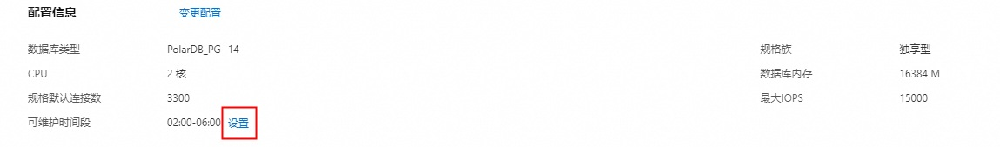

4. 选择一个可维护时间段，单击**确定**。

   > **说明**
   >
   > 时间段为北京时间。

<a id="section-5-5"></a>

## 5.5. 主备库切换

为保证数据库的高可用性，PolarDB提供主备实例切换功能，在主实例不可用时自动切换到备实例。您也可以在需要时手动切换至备实例。本文介绍如何手动切换至备实例。

**背景信息**

PolarDB本地盘版实例的架构支持在至多1个节点故障的场景下保证服务的可用性。当主节点出现故障时，备节点将被提升为主节点。如果备节点故障，或者原来的主节点被降级为备节点，PolarDB本地盘版实例的管控组件会首先尝试等待备节点恢复并与当前的主节点重新建立数据同步。如果等待时间超过阈值，管控组件将发起跨机重搭任务，重新在第三台机器上建立新的备节点，已废弃的备节点将由定期触发的巡检任务释放和回收资源。

PolarDB实例主备节点的数据会实时同步，您只能访问主实例，备实例仅作为备份形式存在，不提供业务访问。当主备切换后，原来的主实例会变成备实例。

> **说明**
>
> 主备实例切换过程中可能会有闪断，请在业务低峰期进行并确保您的应用程序具有自动重连机制。

**操作步骤**

1. 登录PolarDB PostgreSQL版专有云控制台。

2. 在**本地盘实例列表**页面，单击目标实例ID或者单击实例右侧**操作**列下的**管理**，打开**基本信息**页面。

3. 在页面左侧导航栏中，选择**服务可用性**。

4. 在**实例可用性**区域，单击**主备库切换**。

5. 在弹出的**实例主备切换**对话框中，单击**确定**。

   > **说明**
   >
   > - 在主备库切换期间，有很多操作无法执行，例如管理数据库和账号、切换网络类型等，建议您选择可维护时间内进行切换。
   >
   > - 若您要修改可维护时间，请参见设置可维护时间段。

<a id="section-5-6"></a>

## 5.6. 释放实例

根据业务需求，您可以手动释放实例。

**注意事项**

- 只有在运行状态下的实例才能被手动释放。

- 释放后，实例立即被清除，数据不再保留，请提前备份数据。

**操作步骤**

1. 登录PolarDB PostgreSQL版专有云控制台。

2. 在**本地盘实例列表**页面，单击目标实例对应操作栏中的**释放实例**。

3. 在弹出的对话框中，单击**确定**。

<a id="section-5-7"></a>

## 5.7. 本地盘回收站

PolarDB实例进入回收站后，您可以在回收站中重建或销毁实例。

**功能说明**

PolarDB PostgreSQL本地盘实例在手动释放后会进入回收站。但如下情况除外：

- 手动释放已创建未超过7天的实例。

- 任何情况下的**只读实例**。

**重建实例**

手动释放已创建超过7天的实例后，实例备份将继续保留8天，在这8天里，您可以通过重建恢复功能，将实例备份恢复到一个新实例。实例被释放后第9天，实例备份不再保留。

1. 登录PolarDB PostgreSQL版专有云控制台。

2. 在页面左上方选择实例所在的组织，单击左侧导航栏的**本地盘回收站**。

3. 找到被释放的实例，单击右侧操作列的**重建恢复**。

4. 在跳转的**PolarDB本地盘恢复**页面，选择新实例的**存储空间**和**网络类型**，单击**提交**。

   > **说明**
   >
   > - 如果**网络类型**为**专有网络**，则还需要配置专有网络**VPC**和交换机**VSwitch**。
   >
   > - 其他配置与源实例一致，无法更改。

**销毁实例**

您可以在回收站中销毁不再使用的PolarDB实例。

> **警告**
>
> 销毁实例会同时销毁该实例的**所有**备份，包括常规数据备份、归档备份和日志备份且**无法恢复**，请谨慎操作。

1. 登录PolarDB PostgreSQL版专有云控制台。

2. 在页面左上方选择实例所在的组织，单击左侧导航栏的**本地盘回收站**。

3. 找到目标实例，单击**立即销毁**，并在弹出的窗口中单击**确定**。

<a id="section-5-8"></a>

## 5.8. 只读实例

<a id="section-5-8-1"></a>

### 5.8.1. 概述

PolarDB PostgreSQL版的实例支持添加只读实例，在对数据库有大量读请求和少量写请求时，只读实例用于分担主实例的数据库压力。本章节主要介绍只读实例的功能特点以及功能限制。

为了实现读取能力的弹性扩展，分担数据库压力，您可以在某个地域中创建一个或多个只读实例，利用只读实例满足大量的数据库读取需求，以此增加应用的吞吐量。

只读实例必须跟主实例在同一地域，但可以在不同的可用区。只读实例拓扑图如下所示：

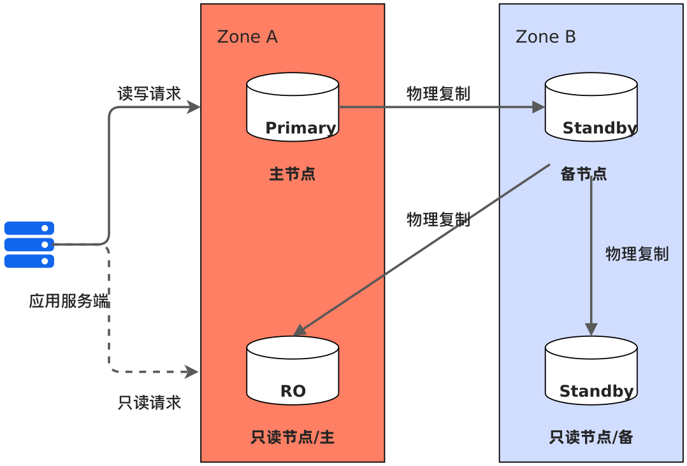

**只读实例有如下功能特点**：

- 规格可以与主实例不一致，并可以随时更改规格（没有时间限制），便于弹性升降级。

- 不需要维护账号与数据库，全部通过主实例同步。

- 独立的白名单配置。

- 提供系统性能监控。

- 提供优化建议：PolarDB提供多种优化建议。例如存储引擎检查、主键检查、大表检查、索引偏多、缺失索引等。用户可以根据优化建议并结合自身的应用来对数据库进行优化。

<a id="section-5-8-2"></a>

### 5.8.2. 创建只读实例

您可以通过创建只读实例满足大量的数据库读取需求，增加应用的吞吐量，满足业务需求。

**注意事项**

- 1个主实例最多可以创建5个只读实例。

- 只读实例不支持备份设置以及临时备份。

- 只读实例不支持实例恢复。

- 只读实例不支持创建和删除数据库。

- 只读实例不支持创建账号、删除帐号、帐号授权以及修改帐号密码。

- 创建只读实例后，主实例将不支持通过备份集直接覆盖实例来恢复数据。

**操作步骤**

1. 登录PolarDB PostgreSQL版专有云控制台。

2. 在**本地盘实例列表**页面，单击目标实例ID或者单击实例右侧**操作**列下的**管理**，打开**基本信息**页面。

3. 在**基本信息**页面的**实例分布**区域中，单击只读实例右侧的**添加**。

4. 在**PolarDB本地盘创建只读实例**页面设置只读实例的参数。

   <table>
     <tr>
       <th>项目</th>
       <th>参数</th>
       <th>说明</th>
     </tr>
     <tr>
       <td>区域</td>
       <td>地域</td>
       <td>PolarDB实例所在地域。</td>
     </tr>
     <tr>
       <td rowspan="6">规格配置</td>
       <td>数据库类型</td>
       <td>只读实例的数据库类型，与主实例一致，不可修改。</td>
     </tr>
     <tr>
       <td>数据库版本</td>
       <td>只读实例的数据库版本，与主实例一致，不可修改。</td>
     </tr>
     <tr>
       <td>系列</td>
       <td>固定为<strong>只读实例</strong></td>
     </tr>
     <tr>
       <td>存储类型</td>
       <td>只读实例的存储类型。</td>
     </tr>
     <tr>
       <td>实例规格</td>
       <td>只读实例规格。可以与主实例不一致，并且只读实例可以随时更改规格，便于弹性升降级。</td>
     </tr>
     <tr>
       <td>存储空间</td>
       <td>只读实例的存储空间，为保证数据同步有足够的I/O性能支撑，只读实例的规格和存储空间必须大于等于主实例。</td>
     </tr>
     <tr>
       <td rowspan="3">网络类型</td>
       <td>网络类型</td>
       <td>只读实例的网络类型，与主实例一致，不可修改。</td>
     </tr>
     <tr>
       <td>专有网络vpc</td>
       <td>网络类型为专有网络时，您需要选择对应的VPC。</td>
     </tr>
     <tr>
       <td>交换机vswitch</td>
       <td>网络类型为专有网络时，您需要选择对应的交换机。</td>
     </tr>
   </table>

5. 完成上述参数配置后，单击**提交**。

<a id="section-5-8-3"></a>

### 5.8.3. 查询只读实例详情

本章节介绍如何查询只读实例详情。您可以通过实例列表页面直接进入只读实例的管理页面，也可以通过主实例的只读实例列表进入只读实例的管理页面。管理方式与常规实例的管理类似，可执行的管理操作请以实际界面为准。

**直接通过只读实例查询实例详情**

1. 登录PolarDB PostgreSQL版专有云控制台。

2. 在**本地盘实例列表**页面，单击目标只读实例的ID，进入实例的**基本信息**页面。

   在实例列表中，**实例类型**为**只读实例**的就是只读实例。

**通过主实例查询只读实例详情**

1. 登录PolarDB PostgreSQL版专有云控制台。

2. 在**本地盘实例列表**页面，单击目标实例ID或者单击实例右侧**操作**列下的**管理**，打开**基本信息**页面。

3. 在**基本信息**页面，将鼠标移动到**实例分布**窗口中的**只读实例**的数字上，就会显示只读实例ID。

4. 单击只读实例ID，即进入只读实例的管理页面。

<a id="section-5-9"></a>

## 5.9. 设置实例参数

您可以通过控制台查看和修改部分参数的值，并查询参数修改记录。

**修改参数值**

1. 登录PolarDB PostgreSQL版专有云控制台。

2. 在**本地盘实例列表**页面，单击目标实例ID或者单击实例右侧**操作**列下的**管理**，打开**基本信息**页面。

3. 在左侧导航栏中，单击**参数设置**。

4. 此时您可以进行如下操作：

   - 导出参数

     单击**导出参数**会将TXT格式的参数文件保存到本地。该TXT文件包含该实例的所有参数值。

   - 批量修改参数文件并导入参数。

     <ol type="a">

     <li>

     导出的参数文件修改完成后，可以单击**导入参数**，将参数文件内容粘贴到对话框中。

     </li>

     <li>

     单击**确定**。

     </li>

     </ol>

     <ol type="i" start="100">

     <li>

     在右上角单击**提交参数**。

     > **说明**
     >
     > - 如果修改的参数需要重启实例才能生效，系统会提示您是否重启，建议您在业务低峰期操作，并确保应用程序具有重连机制。
     >
     > - 参数的修改未提交时，如果想取消修改，请单击**撤销**。

     </li>

     </ol>

   - 修改单个参数

     <ol type="a">

     <li>

     在**可修改参数**列表内找到需要修改的参数，单击**运行参数值**列的

     。

     

     </li>

     <li>

     根据提示的取值范围输入参数值。

     </li>

     </ol>

     <ol type="i" start="100">

     <li>

     单击**确定**。

     </li>

     <li value="500">

     在右上角单击**提交参数**。

     > **说明**
     >
     > - 如果修改的参数需要重启实例才能生效，系统会提示您是否重启，建议您在业务低峰期操作，并确保应用程序具有重连机制。
     >
     > - 参数的修改未提交时，如果想取消修改，请单击**撤销**。

     </li>

     </ol>

**查看参数修改记录**

1. 登录PolarDB PostgreSQL版专有云控制台。

2. 在**本地盘实例列表**页面，单击目标实例ID或者单击实例右侧**操作**列下的**管理**，打开**基本信息**页面。

3. 在左侧导航栏中，单击**参数设置**。

4. 单击**修改历史**页签。

5. 选择时间范围并单击**查询**。

<a id="section-5-10"></a>

## 5.10. 标签

在实例数量较多的情况下，您可以创建多个标签，为实例绑定不同的标签对其进行分类，之后通过标签进行实例筛选。本文介绍标签的使用。

**注意事项**

- 标签由一对键值组成，键在同账号同地域下唯一，值无此限制。

- 每个实例最多可绑定20个标签。

- 标签从一个实例解绑后，如果没有绑定到其他资源，则该标签自动被删除。

**绑定标签**

1. 登录PolarDB PostgreSQL版专有云控制台。

2. 在**本地盘实例列表**页面，单击目标实例**标签**栏  按钮。

3. 在**编辑标签**对话框，输入标签键和标签值，单击**确定**。

**根据标签筛选实例**

1. 登录PolarDB PostgreSQL版专有云控制台。

2. 在**本地盘实例列表**页面，单击**高级筛选**按钮。

3. 您可以通过**实例ID/名称**、**VIP**和**标签筛选**过滤您的实例。在**标签筛选**的下拉框中选择目标标签。

4. 选择标签后，实例列表将显示所有绑定该标签的实例。

**查看实例绑定的标签**

1. 登录PolarDB PostgreSQL版专有云控制台。

2. 在**本地盘实例列表**页面，将鼠标移动到目标实例**标签**栏  图标上，查看目标实例绑定的标签。

**解绑标签**

1. 登录PolarDB PostgreSQL版专有云控制台。

2. 在**本地盘实例列表**页面，单击目标实例**标签**栏  按钮。

3. 在**编辑标签**对话框，单击目标标签右侧  按钮，单击**确定**。

<a id="section-6"></a>

# 6.数据库连接

<a id="section-6-1"></a>

## 6.1. 通过客户端连接PolarDB数据库

本文介绍如何通过pgAdmin4客户端连接PolarDB数据库。

**通过客户端登录**

1. 将要访问PolarDB实例的IP地址加入PolarDB白名单中。关于如何设置白名单，请参见设置IP白名单。

2. 启动pgAdmin 4客户端。

   > **说明**
   >
   > 如果您还没有安装pgAdmin4客户端，请单击此处获取。

3. 右击**Servers**，选择**创建 > 服务器**，如下图所示。

   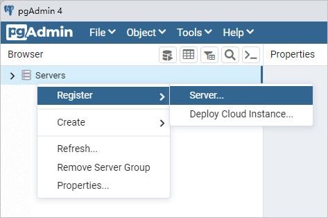

4. 在**创建-服务器**页面的**通常**标签页面中，输入服务器名称，如下图所示。

   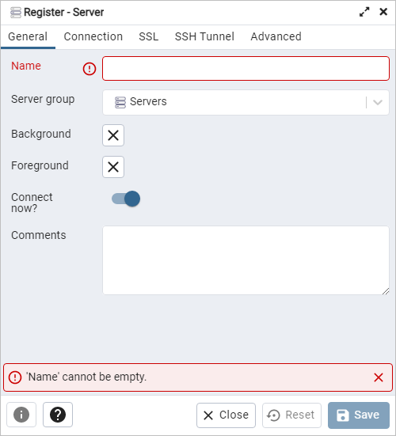

5. 选择**Connection**标签页，输入要连接的实例信息，如下图所示。

   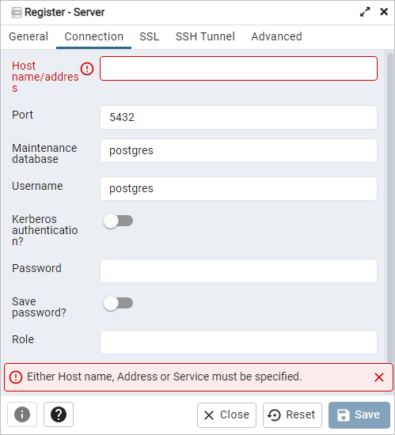

   | 参数 | 说明 |
   | --- | --- |
   | 主机名称/地址 | PolarDB实例的内网地址。如何查看内网地址请参见管理内网地址和端口。 |
   | 端口 | PolarDB实例的内网端口。如何查看内网端口请参见管理内网地址和端口。 |
   | 用户名 | PolarDB实例的初始账号名称。 |
   | 密码 | PolarDB实例的初始账号所对应的密码。 |

6. 单击**保存**。

7. 若连接信息无误，选择**Servers > 服务器名称 > 数据库 > postgres**，会出现如下界面，则表示连接成功。

   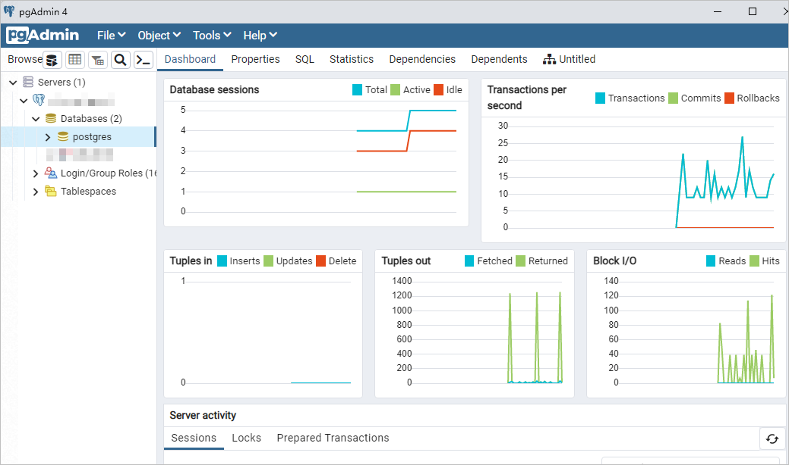

   > **重要**
   >
   > postgres是PolarDB实例默认的系统数据库，请勿在该数据库中进行任何操作。

<a id="section-6-2"></a>

## 6.2. 通过DMS登录PolarDB数据库

您可以通过阿里云的数据管理服务DMS登录PolarDB实例的数据库。

**前提条件**

已经设置好IP白名单，设置IP白名单的方法请参见设置IP白名单。

**操作步骤**

1. 登录PolarDB PostgreSQL版专有云控制台。

2. 在**本地盘实例列表**页面，单击目标实例ID或者单击实例右侧**操作**列下的**管理**，打开**基本信息**页面。

3. 单击页面右上角的**登录数据库**。

4. 在自动跳转的**数据管理DMS**控制台的**登录实例**窗口中，检查**数据库类型**、**实例地区**、**连接串地址**是否正确。若信息正确，填写**数据库账号**和**数据库密码**。

   | 参数 | 说明 |
   | --- | --- |
   | 数据库类型 | 目标数据库的类型，系统默认为当前需要连接的数据库类型。 |
   | 实例地区 | 目标实例所在的地域，系统默认为当前实例所在地域。 |
   | 连接串地址 | 目标实例的连接串地址，系统默认为当前实例的连接串地址。 |
   | 数据库账号 | 目标数据库的账号。 |
   | 数据库密码 | 目标数据库账号对应的密码。 |

5. 单击**登录**。

   > **说明**
   >
   > 若您希望浏览器记住该账号的密码，可以先勾选**记住密码**，再单击**登录**。

<a id="section-6-3"></a>

## 6.3. 临时混访方案（同时保留经典网络和专有网络地址）

为满足日益增多的网络迁移需求，PolarDB PostgreSQL本地盘实例新增了网络混访功能，可实现在无访问中断的情况下将经典网络平滑迁移到VPC上。

**前提条件**

- 实例的网络类型是经典网络。

- 实例所在可用区已有可用的VPC和交换机。

**背景信息**

以往将PolarDB实例从经典网络迁移到VPC时，经典网络的内网地址会变为VPC的内网地址（连接字符串没有变化，背后的IP地址有变化），会造成1次30秒内的闪断，而且经典网络中的ECS将不能再通过内网访问该PolarDB实例，为了能够平滑迁移网络，PolarDB新增了网络混访功能。

混访是指PolarDB实例可以同时被经典网络和专有网络中的ECS访问。在混访期间，PolarDB实例会保留原经典网络的内网地址并新增一个VPC下的内网地址，迁移网络时不会出现闪断。

基于安全性及性能的考虑，我们推荐您仅使用VPC，因此混访期有一定的期限，原经典网络的内网地址在保留时间到期后会被自动释放，应用将无法通过经典网络的内网地址访问数据库。为避免对业务造成影响，您需要在混访期中将VPC下的内网地址配置到您所有的应用中，以实现平滑的网络迁移。

例如，某一公司要将经典网络迁移至VPC时，若选用混访的迁移方式，在混访期内，一部分应用通过VPC访问数据库，一部分应用仍通过原经典网络的内网地址访问数据库，等所有应用都可以通过VPC访问数据库时，就可以将原经典网络的内网地址释放掉，如下图所示。

经典网络平滑迁移至VPC

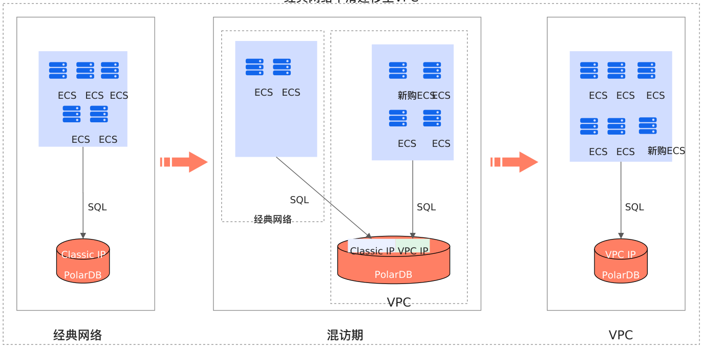

**功能限制**

在混访期间，有如下功能限制：

- 不支持切换成经典网络。

- 不支持迁移可用区。

**从经典网络切换至VPC**

1. 登录PolarDB PostgreSQL版专有云控制台。

2. 在**本地盘实例列表**页面，单击目标实例ID或者单击实例右侧**操作**列下的**管理**，打开**基本信息**页面。

3. 在左侧导航栏中单击**数据库连接**。

4. 单击**切换专有网络**。

5. 在弹出的对话框中，选择VPC和交换机，以及是否保留经典网络地址。

   选择是否勾选**保留经典网络**，具体说明如下表所述。

   - **不勾选**：不保留经典网络地址，原经典网络地址变为VPC地址。

     如果不保留经典网络地址，则切换网络类型时，PolarDB实例会发生一次30秒的闪断，而且经典网络的ECS对该PolarDB实例的内网访问会立即断开。

   - **勾选**：保留经典网络地址，同时生成一个新的VPC地址。表示使用混访模式，即PolarDB可以同时被经典网络和VPC的ECS通过内网访问。

     如果保留经典网络地址，则切换网络类型时，PolarDB实例不会发生闪断，而且经典网络的ECS对该PolarDB实例的内网访问也不会断开，直到经典网络地址到期才断开。

     选择保留经典网络地址的有效时间，在这个时间到期前，请将VPC地址配置到VPC的ECS中，以实现业务平滑迁移到VPC。

6. 将VPC的ECS内网IP地址添加到PolarDB实例的专有网络白名单分组，使得ECS可以通过内网访问PolarDB。如果没有专有网络的分组，请新建分组。如何添加白名单请参见设置IP白名单。

<a id="section-6-4"></a>

## 6.4. 管理内网地址和端口

在连接PolarDB实例时，您需要填写PolarDB的内网地址和端口。本文将介绍如何在PolarDB控制台上查看以及修改内网地址和端口。

**查看内网地址和端口**

1. 登录PolarDB PostgreSQL版专有云控制台。

2. 在**本地盘实例列表**页面，单击目标实例ID或者单击实例右侧**操作**列下的**管理**，打开**基本信息**页面。

3. 在**基本信息**栏中，即可查看内外网地址及内网端口信息。

   > **说明**
   >
   > 要先设置实例的白名单，才会显示地址信息。

**修改内网地址和端口**

1. 登录PolarDB PostgreSQL版专有云控制台。

2. 在**本地盘实例列表**页面，单击目标实例ID或者单击实例右侧**操作**列下的**管理**，打开**基本信息**页面。

3. 在左侧导航栏中单击**数据库连接**。

4. 单击页面右侧的**修改连接地址**。

5. 在弹出的对话框中，选择**连接类型**为**内网地址**。

6. 设置内网连接地址前缀及端口号，单击**确定**。

   > **说明**
   >
   > - 连接地址前缀以小写字母开头，8~64个字符，支持字母、数字和连字符（-）。
   >
   > - 端口范围为1000~5999。

**常见问题**

- Q：修改连接地址或端口后是否需要修改应用程序内的连接地址或端口？

  A：需要修改，否则应用程序无法连接上数据库。

- Q：修改连接地址或端口是立即生效吗？是否需要重启实例？

  A：是立即生效，不需要重启实例。

<a id="section-6-5"></a>

## 6.5. 切换网络类型

您可以根据业务需求将实例的网络类型在经典网络和专有网络之间切换。

**背景信息**

- 经典网络：实例之间不通过网络进行隔离，只能依靠实例自身的白名单策略来阻挡非法访问。

- 专有网络（VPC）：一个VPC就是一个隔离的网络环境。VPC的安全性较高，推荐您使用VPC网络。

  您可以自定义VPC中的路由表、IP 地址范围和网关。此外，您还可以通过专线或者VPN的方式将自建机房与阿里云VPC组合成一个虚拟机房，实现应用平滑上云。

**从专有网络（VPC）切换为经典网络**

PolarDB实例切换为经典网络后，内网地址不变（连接字符串不变，该字符串对应的IP地址会改变），VPC中的ECS将不能再通过该内网地址访问该PolarDB实例，请注意变更应用端的连接地址。

> **说明**
>
> 在切换网络类型时，PolarDB服务可能会出现一次30秒的闪断，请您尽量在业务低峰期执行切换操作，或确保您的应用有自动重连机制，以避免闪断造成的影响。

1. 登录PolarDB PostgreSQL版专有云控制台。

2. 在**本地盘实例列表**页面，单击目标实例ID或者单击实例右侧**操作**列下的**管理**，打开**基本信息**页面。

3. 在左侧导航栏，单击**数据库连接**。

4. 在**数据库连接**页面，单击**切换为经典网络**。

5. 在弹出的对话框中，单击**确定**。

   > **说明**
   >
   > 网络类型切换完成后，只有经典网络的ECS才能通过内网访问该PolarDB，请在经典网络的ECS上配置PolarDB连接地址。

6. 设置PolarDB的白名单，使ECS可以通过内网访问PolarDB。

**从经典网络切换为专有网络（VPC）**

1. 登录PolarDB PostgreSQL版专有云控制台。

2. 在**本地盘实例列表**页面，单击目标实例ID或者单击实例右侧**操作**列下的**管理**，打开**基本信息**页面。

3. 在左侧导航栏，单击**数据库连接**。

4. 在**数据库连接**页面，单击**切换专有网络**。

5. 在弹出的对话框中，选择VPC和交换机，以及是否**保留原经典网络**地址，单击**确定**。

<a id="section-7"></a>

# 7.账号管理

<a id="section-7-1"></a>

## 7.1. 创建账号

要使用PolarDB，您需要在实例中创建账号。本文介绍如何为PolarDB实例创建账号。

**注意事项**

- 同一实例下的数据库共享该实例下的所有资源。每个PolarDB类型的实例支持创建一个初始账号、一个高权限账号以及多个普通账号，您还可以通过SQL命令创建、管理普通账号。

- 如果您要迁移本地数据库到PolarDB，请在PolarDB实例中创建与本地数据库一致的迁移账号和数据库。

- 分配数据库账号权限时，请按最小权限原则和业务角色创建账号，并合理分配只读和读写权限。必要时可以把数据库账号和数据库拆分成更小粒度，使每个数据库账号只能访问其业务之内的数据。如果不需要数据库写入操作，请分配只读权限。

- 为保障数据库的安全，请将数据库账号的密码设置为强密码，并定期更换。

- 初始账号创建后无法删除。

**创建高权限账号**

1. 登录PolarDB PostgreSQL版专有云控制台。

2. 在**本地盘实例列表**页面，单击目标实例ID或者单击实例右侧**操作**列下的**管理**，打开**基本信息**页面。

3. 在左侧导航栏中，单击**账号管理。**

4. 单击**创建账号**。

5. 设置以下参数。

   <table>
     <tr>
       <th width="105">参数</th>
       <th>说明</th>
     </tr>
     <tr>
       <td>数据库账号</td>
       <td>填写账号名称。要求如下：<br>• 长度为1~32个字符。<br>• 以字母开头，以字母或数字结尾。<br>• 由小写字母、大写字母、数字或下划线（_）组成。</td>
     </tr>
     <tr>
       <td>账号类型</td>
       <td>选择高权限账号。</td>
     </tr>
     <tr>
       <td>密码</td>
       <td>设置账号密码。要求如下：<br>• 长度为8~32个字符。<br>• 必须包含大写字母、小写字母、数字或特殊字符中的任意三种或以上类型。<br>• 特殊字符包括：<br>!@#$%^&amp;*()_+-=</td>
     </tr>
     <tr>
       <td>确认密码</td>
       <td>再次输入密码。</td>
     </tr>
     <tr>
       <td>备注</td>
       <td>非必填。备注该账号的相关信息，便于后续账号管理。最多支持256个字符。</td>
     </tr>
   </table>

6. 单击**确认**。

**创建普通账号**

1. 登录PolarDB PostgreSQL版专有云控制台。

2. 在**本地盘实例列表**页面，单击目标实例ID或者单击实例右侧**操作**列下的**管理**，打开**基本信息**页面。

3. 在左侧导航栏中，单击**账号管理**。

4. 单击**创建账号**。

5. 设置以下参数。

   <table>
     <tr>
       <th width="105">参数</th>
       <th>说明</th>
     </tr>
     <tr>
       <td>数据库账号</td>
       <td>填写账号名称。要求如下：<br>• 长度为1~32个字符。<br>• 以字母开头，以字母或数字结尾。<br>• 由小写字母、大写字母、数字或下划线（_）组成。</td>
     </tr>
     <tr>
       <td>账号类型</td>
       <td>选择普通账号。</td>
     </tr>
     <tr>
       <td>授权数据库</td>
       <td>为该账号授予一个或多个数据库的权限。本参数可以留空，在创建账号后再给账号授权。<br>i. 从左侧选中一个或多个数据库，单击<code> &gt; </code>添加到右侧。<br>ii. 在右侧框中，为某个数据库选择<strong>读写</strong>、<strong>只读</strong>、<strong>仅DDL</strong>或<strong>仅DML</strong>。如果要为多个数据库批量设置相同的权限，则单击右侧框中右上角的按钮，比如<strong>全部设读</strong><strong>写</strong>。</td>
     </tr>
     <tr>
       <td>密码</td>
       <td>设置账号密码。要求如下：<br>• 长度为8~32个字符。<br>• 必须包含大写字母、小写字母、数字或特殊字符中的任意三种或以上类型。<br>• 特殊字符为：<br>!@#$%^&amp;*()_+-=</td>
     </tr>
     <tr>
       <td>确认密码</td>
       <td>再次输入密码。</td>
     </tr>
     <tr>
       <td>备注说</td>
       <td>非必填。备注该账号的相关信息，便于后续账号管理。最多支持256个字符。</td>
     </tr>
   </table>

6. 单击**确定。**

<a id="section-7-2"></a>

## 7.2. 重置密码

在使用PolarDB过程中，如果忘记数据库账号密码，您可以通过控制台重新设置密码。

**前提条件**

实例状态为**运行中**。

**操作步骤**

1. 登录PolarDB PostgreSQL版专有云控制台。

2. 在**本地盘实例列表**页面，单击目标实例ID或者单击实例右侧**操作**列下的**管理**，打开**基本信息**页面。

3. 在左侧导航栏中，单击**账号管理**。

4. 在目标账号右侧的操作栏中，单击**重置密码**。

5. 在弹出的对话框中，输入新密码并确认后，单击**确定**。

   > **说明**
   >
   > 密码要求如下：
   >
   > - 长度为8~32个字符。
   >
   > - 必须包含大写字母、小写字母、数字或特殊字符中的任意三种或以上类型。
   >
   > - 特殊字符为：
   >
   >   !@#$%^&\*()_+-=

<a id="section-7-3"></a>

## 7.3. 删除账号

您可以通过控制台删除数据库账号。

**前提条件**

因业务结束或改变时，您可以在控制台上删除不需要的高权限账号、普通账号。

**操作步骤**

1. 登录PolarDB PostgreSQL版专有云控制台。

2. 在**本地盘实例列表**页面，单击目标实例ID或者单击实例右侧**操作**列下的**管理**，打开**基本信息**页面。

3. 在左侧导航栏中，单击**账号管理**。

4. 在目标账号所对应的操作栏中，单击**删除**。

5. 在弹出的确认框中，单击**确定**。

   > **说明**
   >
   > 当账号状态为处理中时，无法删除。

<a id="section-8"></a>

# 8.数据库管理

<a id="section-8-1"></a>

## 8.1. 创建数据库

若要使用PolarDB，您需要在实例中创建数据库。本文介绍如何为PolarDB实例创建数据库。

**前提条件**

已创建PolarDB实例。详情请参见创建实例。

**操作步骤**

1. 登录PolarDB PostgreSQL版专有云控制台。

2. 在**本地盘实例列表**页面，单击目标实例ID或者单击实例右侧**操作**列下的**管理**，打开**基本信息**页面。

3. 单击页面右上角的**登录数据库**。

4. 在自动跳转的**数据管理DMS**控制台的**登录实例**窗口中，检查**数据库类型**、**实例地区**、**连接串地址**是否正确。若信息正确，填写**数据库账号**和**数据库密码**，如下图所示。

   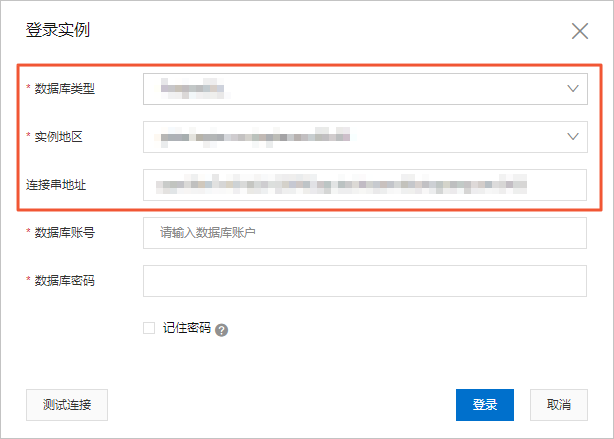

   | 参数 | 说明 |
   | --- | --- |
   | 数据库类型 | 目标数据库的类型，系统默认为当前需要连接的数据库类型。 |
   | 实例地区 | 目标实例所在的地域，系统默认为当前实例所在地域。 |
   | 连接串地址 | 目标实例的连接串地址，系统默认为当前实例的连接串地址。 |
   | 数据库账号 | 目标数据库的账号。 |
   | 数据库密码 | 目标数据库账号对应的密码。 |

5. 单击**登录**。若您希望浏览器记住该账号的密码，可以先勾选**记住密码**，再单击**登录**。

   > **说明**
   >
   > 若出现无法建立连接提示，如下图所示。则可能是白名单设置出现问题，需要在控制台重新设置白名单。详情请参见设置IP白名单。

6. 成功登录PolarDB实例后，会直接跳转到**SQLConsole**页面，在SQL窗口中输入如下命令，创建数据库。

   ```sql
   CREATE DATABASE name
    [ [ WITH ] [ OWNER [=] user_name ]
           [ TEMPLATE [=] template ]
           [ ENCODING [=] encoding ]
           [ LC_COLLATE [=] lc_collate ]
           [ LC_CTYPE [=] lc_ctype ]
           [ TABLESPACE [=] tablespace_name ]
           [ CONNECTION LIMIT [=] connlimit ] ]
   ```

   例如，若您要创建一个名称为test的数据库，可以执行如下命令：

   ```sql
   create database test;
   ```

7. 单击**执行(F8)**，完成创建数据库。

<a id="section-8-2"></a>

## 8.2. 删除数据库

本文介绍如何删除PolarDB的数据库。

**操作步骤**

1. 登录PolarDB PostgreSQL版专有云控制台。

2. 在**本地盘实例列表**页面，单击目标实例ID或者单击实例右侧**操作**列下的**管理**，打开**基本信息**页面。

3. 单击页面右上角的**登录数据库**。

4. 在自动跳转的**数据管理DMS**控制台的**登录实例**窗口中，检查**数据库类型**、**实例地区**、**连接串地址**是否正确。若信息正确，填写**数据库账号**和**数据库密码**，如下图所示。

   

   | 参数 | 说明 |
   | --- | --- |
   | 数据库类型 | 目标数据库的类型，系统默认为当前需要连接的数据库类型。 |
   | 实例地区 | 目标实例所在的地域，系统默认为当前实例所在地域。 |
   | 连接串地址 | 目标实例的连接串地址，系统默认为当前实例的连接串地址。 |
   | 数据库账号 | 目标数据库的账号。 |
   | 数据库密码 | 目标数据库账号对应的密码。 |

5. 单击**登录**。若您希望浏览器记住该账号的密码，可以先勾选**记住密码**，再单击**登录**。

   > **说明**
   >
   > 若出现无法建立连接提示，如下图所示。则可能是白名单设置出现问题，需要在控制台重新设置白名单。详情请参见设置IP白名单。

6. 成功登录PolarDB实例后，会直接跳转到**SQLConsole**页面，在SQL窗口中输入如下命令，删除数据库：

   ```text
   drop database <database name>;
   ```

7. 单击**执行(F8)**，删除数据库。

<a id="section-9"></a>

# 9.监控与报警

<a id="section-9-1"></a>

## 9.1. 查看监控数据

PolarDDB提供了丰富的性能监控项，您可以通过PolarDB管理控制台查看实例的资源监控数据。

**操作步骤**

1. 登录PolarDB PostgreSQL版专有云控制台。

2. 在**本地盘实例列表**页面，单击目标实例ID或者单击实例右侧**操作**列下的**管理**，打开**基本信息**页面。

3. 在左侧导航栏中，单击**监控与报警**。

4. 在**监控**页签选择查询时间，即可查看相应的监控数据，具体监控项介绍如下。

   | 监控项 | 说明 |
   | --- | --- |
   | 内存使用率 | 实例的内存使用率。 |
   | CPU使用率 | 实例的CPU使用率。 |
   | IOPS | 实例的数据盘每秒I/O请求次数和日志盘每秒I/O请求次数。 |
   | 本地存储空间 | 实例的本地存储空间。 |
   | 网络 | 实例网络接收/发送的数据量。 |
   | 网络重传 | 实例的网络重传数。 |
   | 连接 | 实例的连接总数、活跃连接数、等待连接数以及空闲连接数。 |
   | 扫描行数 | 实例每秒读取、插入、更新、返回以及删除的行数。 |
   | TPS | 实例每秒处理事务数量。 |
   | 当前最长事务的持续时间 | 实例当前最长事务的持续时间。 |
   | 延迟 | 实例主发送、备回放以及逻辑复制的延迟大小。 |
   | 慢SQL | 实例的慢SQL信息。 |
   | 长事务 | 实例的长事务数。 |
   | 两阶段长事务 | 实例的两阶段长事务数。 |

<a id="section-9-2"></a>

## 9.2. 设置报警规则

您可以通过PolarDB PostgreSQL版专有云控制台创建报警规则，帮助您及时了解实例的监控数据异常并快速进行处理。

**操作步骤**

1. 登录PolarDB PostgreSQL版专有云控制台。

2. 在**本地盘实例列表**页面，单击目标实例ID或者单击实例右侧**操作**列下的**管理**，打开**基本信息**页面。

3. 在左侧导航栏中，单击**监控与报警**。

4. 在**报警**页签，单击**报警规则设置**。

5. 在**报警规则**页面，单击**创建告警规则**。

6. 在**创建告警规则**页面，设置以下参数。

   <table>
     <tr>
       <th width="138">参数</th>
       <th>说明</th>
     </tr>
     <tr>
       <td>云产品选择</td>
       <td>选择<strong>云原生关系型数据库PolarDB（本地盘）</strong>。</td>
     </tr>
     <tr>
       <td>资源范围</td>
       <td>报警规则的作用范围，取值范围如下：<br>• <strong>实例维度</strong>：选择当前组织资源集下的一个或多个目标实例。<br>• <strong>资源集维度</strong>：选择当前组织和地域下的目标资源集。<br>• <strong>应用分组维度</strong>：选择当前组织和地域下的应用分组。<br>• <strong>全部资源</strong>：报警规则作用于指定云产品的全部资源上，对于新加入的资源生效。</td>
     </tr>
     <tr>
       <td>报警规则描述</td>
       <td>报警规则的主体。当监控数据满足报警条件时，触发报警规则。规则描述的设置方法如下：<br>i. 单击<strong>创建报警规则</strong>。ii. 在<strong>创建报警规则</strong>页面，设置<strong>规则名称</strong>、<strong>监控指标</strong>、<strong>监控维度、</strong>阈值及报警级别等。iii. 单击<strong>确定</strong>。</td>
     </tr>
     <tr>
       <td>沉默通道周期</td>
       <td>报警发生后未恢复正常，间隔多久重复发送一次报警通知。取值：<strong>5分钟</strong>、<strong>15分钟</strong>、<strong>30</strong><strong>分钟</strong>、<strong>1小时</strong>、<strong>3小时</strong>、<strong>6小时</strong>、<strong>12小时</strong>和<strong>24小时</strong>。当某监控指标超出报警阈值时触发报警，如果监控指标在通道沉默周期内持续超过报警阈值，在通道沉默周期内不会重复发送报警通知；如果监控指标在通道沉默周期后仍未恢复正常，则云监控将再次发送报警通知。例如，当<strong>通道沉默周期</strong>设置为<strong>12小时</strong>时，如果超出报警阈值的监控指标在首次触发报警后12小时仍未恢复正常，云监控将再次发送报警通知。</td>
     </tr>
     <tr>
       <td>生效时间</td>
       <td>报警规则的生效时间。报警规则只在生效时间内检查监控数据是否超出报警阈值。</td>
     </tr>
     <tr>
       <td>报警回调</td>
       <td>用于接收云监控通过POST请求推送报警消息的回调地址。<br>说明报警回调地址必须是云监控可访问的域名地址，仅支持HTTP协议，不支持填写IP。</td>
     </tr>
     <tr>
       <td>无数据处理方法</td>
       <td>无报警时的处理方法。取值范围如下：<br>• <strong>不做任何处理</strong>：无报警时不做任何处理。<br>• <strong>发送无数据报警</strong>：无报警时发送无数据报警给报警联系人。</td>
     </tr>
     <tr>
       <td>报警联系人</td>
       <td>选择报警信息发送的用户。</td>
     </tr>
   </table>

7. 单击**确定**。

<a id="section-10"></a>

# 10.数据安全性

<a id="section-10-1"></a>

## 10.1. 设置IP白名单

为了数据库的安全稳定，在创建PolarDB PostgreSQL本地盘版实例后，需要先修改实例的白名单，将需要访问实例的IP地址或者IP段加入到PolarDB PostgreSQL本地盘版实例的白名单中。

**背景信息**

白名单可以让PolarDB PostgreSQL本地盘版实例得到高级别的访问安全保护，建议您定期维护白名单。设置白名单不会影响PolarDB PostgreSQL本地盘版实例的正常运行。

设置白名单包括两种操作：

- 设置IP白名单：添加IP地址，允许这些IP地址访问该PolarDB PostgreSQL本地盘版实例。

- 设置ECS安全组：添加ECS安全组，允许ECS安全组内的ECS实例访问该PolarDB PostgreSQL本地盘版实例。

**操作步骤**

1. 登录PolarDB PostgreSQL版专有云控制台。

2. 在**本地盘实例列表**页面，单击目标实例ID或者单击实例右侧**操作**列下的**管理**，打开**基本信息**页面。

3. 在左侧导航栏中，单击**数据安全性**。

4. 在**白名单设置**页签中，单击**default**白名单分组中的**修改**。

   > **说明**
   >
   > - 若需要ECS实例通过内网地址连接到PolarDB PostgreSQL本地盘版实例，请确保两者处于同一地域内且网络类型相同，否则设置了白名单也无法连接成功。
   >
   > - 您也可以单击**添加白名单分组**新建自定义分组。

5. 在**修改白名单分组**对话框中，填写需要访问该实例的IP地址或IP段，单击**确定**。

   - 若填写IP段，如10.10.10.0/24，则表示10.10.10.X的IP地址都可以访问该PolarDB PostgreSQL本地盘版实例。

   - 若您需要添加多个IP地址或IP段，请用英文逗号（,）隔开，逗号前后不能有空格，例如192.168.0.1,172.16.213.9。

   - 单击**加载ECS内网IP**后，将显示您当前阿里云账号下所有ECS实例的IP地址，可快速添加ECS内网IP地址到白名单中。

   > **说明**
   >
   > 当您在**default**分组中添加新的IP地址或IP段后，默认地址127.0.0.1会被自动删除。

<a id="section-10-2"></a>

## 10.2. 设置SSL加密

为了提高链路安全性，您可以启用SSL（Secure Sockets Layer）加密，并安装SSL CA证书到需要的应用服务。SSL在传输层对网络连接进行加密，能提升通信数据的安全性和完整性，但会同时增加网络连接响应时间。

**注意事项**

- SSL的证书有效期为1年，请及时更新证书有效期并重新下载和配置CA证书，否则使用加密连接的客户端程序将无法正常连接。

- 由于SSL加密的固有缺陷，启用SSL加密会显著增加CPU使用率，建议您仅在外网链路有加密需求的时候启用SSL加密。内网链路相对较安全，一般无需对链路加密。

- 关闭SSL加密会重启实例，请谨慎操作。

**开启SSL加密和下载证书**

1. 登录PolarDB PostgreSQL版专有云控制台。

2. 在**本地盘实例列表**页面，单击目标实例ID或者单击实例右侧**操作**列下的**管理**，打开**基本信息**页面。

3. 在左侧导航栏中，单击**数据安全性**，打开**数据安全性**页面。

4. 在**SSL**页签，选择证书类型，支持**使用云端证书**和**使用自定义证书**。

5. 在目标证书类型页面，单击<strong>配置数据库证书（防止伪装数据库）</strong>右侧**配置**，开启SSL加密。

6. 在弹出的对话框中，选择受保护的地址，如**使用自定义证书**，同时上传**服务器证书**和**服务器证书私钥**，单击**确定**。

   > **说明**
   >
   > 修改服务器证书后，证书会自动更新，同时重启您的数据库实例，更新证书前请做好业务安排，谨慎操作。

7. **SSL链路加密功能**为**开启**且**配置的状态**为**成功**时，单击**下载CA证书**。

   下载的文件为压缩包，包含如下三个文件：

   - p7b文件：用于Windows系统中导入CA证书。

   - pem文件：用于其他系统或应用中导入CA证书。

   - jks文件：Java中的truststore证书存储文件，密码统一为apsaradb，用于Java程序中导入CA证书链。

     > **说明**
     >
     > 在Java中使用JKS证书文件时，jdk7和jdk8需要修改默认的jdk安全配置，在连接PolarDB数据库的服务器的 `jre/lib/security/java.security` 文件中，修改如下两项配置：
     >
     > ```text
     > jdk.tls.disabledAlgorithms=SSLv3, RC4, DH keySize < 224
     > jdk.certpath.disabledAlgorithms=MD2, RSA keySize < 1024
     > ```
     >
     > 若不修改jdk安全配置，会报如下错误。其它类似报错，一般也都由Java安全配置导致。
     >
     > ```text
     > javax.net.ssl.SSLHandshakeException: DHPublicKey does not comply to algorithm constraints
     > ```

**更新证书有效期**

如果您修改了SSL连接地址或证书即将到期，您需要参考以下步骤更新证书有效期。

1. 登录PolarDB PostgreSQL版专有云控制台。

2. 在**本地盘实例列表**页面，单击目标实例ID或者单击实例右侧**操作**列下的**管理**，打开**基本信息**页面。

3. 在左侧导航栏中，单击**数据安全性**，打开**数据安全性**页面。

4. 在**SSL**页签，在目标证书类型页面，单击<strong>配置数据库证书（防止伪装数据库）</strong>右侧**修改**，更新数据库有效期。

   > **说明**
   >
   > 更新有效期操作将会重启实例，请做好业务安排，谨慎操作。

5. 更新有效期后，重新下载和配置证书。

   > **说明**
   >
   > 下载证书请参见开启SSL加密和下载证书步骤七。

**配置客户端CA证书或客户端证书吊销文件**

开通SSL加密后，可按需配置客户端CA证书验证客户端身份，同时可以增加客户端证书吊销文件验证已发行证书的有效性，最大限度的保护数据库的访问安全。

1. 登录PolarDB PostgreSQL版专有云控制台。

2. 在**本地盘实例列表**页面，单击目标实例ID或者单击实例右侧**操作**列下的**管理**，打开**基本信息**页面。

3. 在左侧导航栏中，单击**数据安全性**，打开**数据安全性**页面。

4. 在**SSL**页签，**配置客户端CA证书**位置，单击**启用客户端CA证书**，在弹窗页面填写客户端CA证书公钥，单击**确定**。

   > **说明**
   >
   > 修改客户端CA证书，实例将自动重新启动，请做好业务安排，谨慎操作。

5. 启用客户端CA证书后，可按需配置客户端证书吊销文件。在**上传或更新客户端证书吊销**文件位置，单击**启用证书吊销文件**，在弹窗页面填写吊销文件内容，单击**确定**。

   > **说明**
   >
   > 修改客户端证书吊销文件，实例将自动重新启动，请做好业务安排，谨慎操作。

6. （可选）上传证书成功后，您可单击**查看客户端CA证书详情**，确认当前证书配置。如不再使用相关证书，按需单击**清除客户端CA证书**或**清除证书吊销文件**。

**配置ACL**

启用SSL加密后，可按需配置客户端通过SSL连接数据库的ACL级别。

1. 登录PolarDB PostgreSQL版专有云控制台。

2. 在**本地盘实例列表**页面，单击目标实例ID或者单击实例右侧**操作**列下的**管理**，打开**基本信息**页面。

3. 在左侧导航栏中，单击**数据安全性**，打开**数据安全性**页面。

4. 在**SSL**页签，单击**配置ACL**右侧**修改**，在弹窗页面选择SSL认证方法，支持以下选项：

   > **说明**
   >
   > - 配置ACL后，实例将自动重新启动，请做好业务安排，谨慎操作。
   >
   > - 仅在配置客户端CA证书或客户端证书吊销文件后支持选择**verify-ca**/**verify-full**/**cert**认证方式。

   - **prefer**：优先加密数据链路。客户端可以按需使用SSL连接。

   - **required**：加密数据链路。拒绝非SSL的客户端连接，允许密码验证登录数据库，不强制进行客户端/服务器的证书验证和CN名一致性验证。

   - **verify-ca**：加密数据链路，同时检查客户端认证真伪。

   - **verify-full**：加密数据链路，同时检查客户端认证真伪，检查证书CN与数据库用户名匹配。

   - **cert**：使用证书代替密码登录，加密数据链路，同时检查客户端证书真伪，检查证书CN与数据库用户名匹配。

**关闭SSL加密**

> **说明**
>
> - 关闭SSL加密会重启实例，建议您在业务低峰期操作。
>
> - SSL加密关闭后，数据库访问性能会有一定程度提升，但安全性上有削弱，故非安全环境下不建议关闭SSL加密。

1. 登录PolarDB PostgreSQL版专有云控制台。

2. 在**本地盘实例列表**页面，单击目标实例ID或者单击实例右侧**操作**列下的**管理**，打开**基本信息**页面。

3. 在左侧导航栏中，单击**数据安全性**，打开**数据安全性**页面。

4. 在**SSL**页签，单击**SSL链路加密功能**右侧**关闭SSL**，关闭SSL加密。

5. 在弹窗页面，单击**确定**。

<a id="section-10-3"></a>

## 10.3. 设置透明数据加密TDE

PolarDB提供了透明数据加密TDE（Transparent Data Encryption）功能。TDE可对数据文件执行实时I/O加密和解密，数据在写入磁盘之前进行加密，从磁盘读入内存时进行解密。TDE不会增加数据文件的大小，开发人员无需更改任何应用程序，即可使用TDE功能。

**背景信息**

TDE通过在数据库层执行静止数据加密，阻止可能的攻击者绕过数据库直接从存储中读取敏感信息。经过数据库身份验证的应用和用户可以继续透明地访问应用数据（不需要更改应用代码或配置），而尝试读取表空间文件中的敏感数据的OS用户以及尝试读取磁盘或备份信息的不法之徒将不允许访问明文数据。

如需使用TDE功能，需要同时购买密钥管理服务（KMS）服务，PolarDB不提供加密所需的密钥和证书。您不仅可以使用阿里云自动生成的密钥，也可以使用自带的密钥材料生成数据密钥，然后授权PolarDB使用。

**注意事项**

- TDE开通后无法关闭。

- 仅支持在创建PolarDB实例的过程中开启TDE。

- 开通TDE后，如果是I/O密集型（I/O bound）场景，可能会对数据库性能产生一定影响。

- 使用已有自定义密钥时，需要注意：

  - 禁用密钥、设置密钥删除计划或者删除密钥材料都会造成密钥不可用。

  - 撤销授权关系后，重启PolarDB实例会导致PolarDB实例不可用。

  - 需要使用主账号或者具有AliyunSTSAssumeRoleAccess权限的账号。

**开启TDE**

1. 登录PolarDB PostgreSQL版专有云控制台。

2. 在**本地盘实例列表**页面中，单击右上角的**创建实例**。

3. 在**创建PolarDB本地盘实例**页面，配置实例信息，选择**开启TDE**。

   > **说明**
   >
   > 更多关于创建实例页面的信息，请参见创建实例。

4. 单击页面下方的**提交**。

**查看TDE状态**

1. 登录PolarDB PostgreSQL版专有云控制台。

2. 在**本地盘实例列表**页面，单击目标实例ID或者单击实例右侧**操作**列下的**管理**，打开**基本信息**页面。

3. 在左侧导航栏中，单击**数据安全性**，打开**数据安全性**页面。

4. 在**TDE**页签，查看**TDE状态**。

<a id="section-10-4"></a>

## 10.4. SQL审计

您可以通过PolarDB的SQL审计功能查看SQL明细、定期审计SQL。开通SQL审计功能后，实例性能不会受到影响。

**注意事项**

- 开通SQL审计功能后，实例性能不会受到影响。

- SQL审计的保存时间为30天。

- SQL审计导出的文件可以保存2天，超过2天的会被系统定时清理。

- SQL审计默认关闭，需要手动开启。

- 开启SQL审计功能之前的记录无法查看到。

**查看SQL审计信息**

1. 登录PolarDB PostgreSQL版专有云控制台。

2. 在**本地盘实例列表**页面，单击目标实例ID或者单击实例右侧**操作**列下的**管理**，打开**基本信息**页面。

3. 在左侧导航栏中，单击**数据安全性**。

4. 单击**SQL审计**页签。

   您可以通过时间、数据库名称、数据库用户或关键字等条件查询SQL信息。

**关闭SQL审计**

您可以在不需要审计SQL时关闭SQL审计功能，详细步骤如下。

> **说明**
>
> SQL审计功能关闭后，包括历史审计内容在内的SQL审计记录会被清空。请将SQL审计内容导出并妥善保存至本地后，再关闭SQL审计功能。

1. 登录PolarDB PostgreSQL版专有云控制台。

2. 在**本地盘实例列表**页面，单击目标实例ID或者单击实例右侧**操作**列下的**管理**，打开**基本信息**页面。

3. 在左侧导航栏中，单击**数据安全性**。

4. 单击**SQL审计**页签。

5. 单击**导出文件**，将SQL审计内容导出并妥善保存至本地。

6. 导出文件后，单击**关闭SQL审计**。

7. 在弹出的确认框中，单击**确定**。

<a id="section-11"></a>

# 11.备份与恢复

<a id="section-11-1"></a>

## 11.1. 备份数据

您可以通过设置备份策略调整PolarDB数据备份和日志备份的周期来实现自动备份，也可以手动备份PolarDB数据。

**注意事项**

- 备份期间不要执行DDL操作，避免锁表导致备份失败。

- 尽量选择业务低峰期进行备份。

- 若数据量较大，花费的时间可能较长，请耐心等待。

- 备份文件有保留时间，请及时下载需要保留的备份文件到本地。

**备份说明**

| 数据库类型 | 数据备份 | 日志备份 |
| --- | --- | --- |
| PolarDB | 支持全量物理备份 | WAL（16MB/个）产生完后立即压缩上传，24小时内删除本地文件。 |

**设置备份策略实现自动备份**

阿里云数据库会执行用户设定的备份策略，自动备份数据库。

1. 登录PolarDB PostgreSQL版专有云控制台。

2. 在**本地盘实例列表**页面，单击目标实例ID或者单击实例右侧**操作**列下的**管理**，打开**基本信息**页面。

3. 在左侧导航栏中，单击**备份恢复**。

4. 在 **备份恢复**页面中选择**备份设置**标签页，单击**编辑**。

5. 在弹出的对话框中设置备份规格，单击**保存**。参数说明如下：

   | 参数 | 说明 |
   | --- | --- |
   | 数据备份保留天数 | 默认为7天，可以设置为 7~730 天。 |
   | 备份周期 | 可以设置为一星期中的某几天。<br>说明为了您的数据安全，一周至少需要备份两次。 |
   | 备份时间 | 可以设置为任意时段，以小时为单位。 |
   | 日志备份 | 日志备份的开关。<br>重要关闭日志备份会导致所有日志备份被清除，并且无法使用按时间点恢复数据的功能。 |
   | 日志备份保留 | • 日志备份文件保留的天数，默认为 7 天。<br>• 可以设置为 7~730 天，且必须小于等于数据备份天数。 |

**手动备份**

1. 登录PolarDB PostgreSQL版专有云控制台。

2. 在**本地盘实例列表**页面，单击目标实例ID或者单击实例右侧**操作**列下的**管理**，打开**基本信息**页面。

3. 单击页面右上角的**备份实例**，打开备份实例对话框。

4. 设置好备份方式，单击**确定**。

   > **说明**
   >
   > 备份方式和备份策略仅**全量备份**和**实例备份**可选。

5. 单击右上角的

   图标进入**任务进度**列表查看任务进度，等待任务完成。

   

   > **说明**
   >
   > 数据备份暂不提供下载到本地。

**常见问题**

1. PolarDB的数据备份是否可以关闭？

   答：不可以关闭。可以减少备份频率，一周至少2次。数据备份保留天数最少7天，最多730天。

2. PolarDB的日志备份是否可以关闭？

   答：可以关闭。备份设置内关闭日志备份开关即可。

<a id="section-11-2"></a>

## 11.2. 下载数据备份和日志备份

为保障您的权益，PolarDB提供了未加密数据备份和日志备份下载，方便存档，也可用于恢复到本地数据库。

**操作步骤**

1. 登录PolarDB PostgreSQL版专有云控制台。

2. 在**本地盘实例列表**页面，单击目标实例ID或者单击实例右侧**操作**列下的**管理**，打开**基本信息**页面。

3. 在左侧导航栏中，选择**备份恢复**，进入**备份恢复**页面。

4. 根据想要下载的备份类型，选择相应的标签页：

   - 下载数据备份：选择**数据备份**页签。

   - 下载日志备份：选择<strong>日志备份（原：归档列表）</strong>页签。

5. 选择要查询的时间范围。

6. 找到目标的数据备份或日志备份，并单击其对应**操作**列中的**下载**。

   > **说明**
   >
   > - 若数据备份用于数据恢复，请选择离要恢复的时间点最近的数据备份文件。
   >
   > - 若日志备份是用于恢复到本地数据库，请注意如下事项：
   >
   >   - 日志备份的Redolog所在实例编号必须与数据备份的备份所在实例编号一致。
   >
   >   - 日志备份的起始时间段必须在您选择的数据备份时间点之后，在要恢复数据的时间点之前。

7. 在弹出的**实例备份文件下载**对话框中，选择下载方式。

   <table>
     <tr>
       <th width="170">下载方式</th>
       <th>说明</th>
     </tr>
     <tr>
       <td>已了解，要公网下载</td>
       <td>直接下载备份文件。</td>
     </tr>
     <tr>
       <td>复制内网地址</td>
       <td>仅复制内网下载地址。当ECS与PolarDB在相同地域时，您可以在ECS上使用内网地址下载备份文件，更快更安全。</td>
     </tr>
     <tr>
       <td>复制外网地址</td>
       <td>仅复制外网下载地址。当您要通过其他工具下载备份文件时，可以采用此方式。</td>
     </tr>
   </table>

   > **说明**
   >
   > 在Linux系统中下载时，可以使用如下命令：
   >
   > ```bash
   > wget -c '<备份⽂件下载地址>' -O <⽂件名称>
   > ```
   >
   > - -c：启用断点续传模式。
   >
   > - -O：将下载的结果保存为指定的文件名，建议您使用URL中包含的原文件名。
   >
   > - 下载地址有多个参数时建议为下载地址添加单引号，避免下载失败。
   >
   > 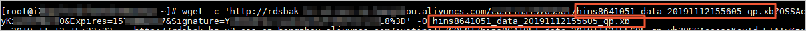

<a id="section-11-3"></a>

## 11.3. 数据恢复

克隆实例是指新建一个实例，可以复制出与主实例一模一样的内容，包括实例数据和实例设置。克隆实例主要用于恢复主实例数据，或批量创建相同实例。

**前提条件**

创建克隆实例时，主实例需要满足如下条件：

- 主实例状态为运行中。

- 当前没有迁移任务。

- 已开启数据备份和日志备份。

- 若要按备份集克隆实例，则主实例必须至少有一个已完成备份的备份集。

**背景信息**

创建克隆实例有两种方式，分为指定备份集创建和指定有效期内备份的时间点创建。

> **说明**
>
> - 克隆实例仅复制主实例的内容，不复制主实例下只读实例的内容。复制内容包括主实例的数据库信息、账号信息和实例设置。例如白名单设置、备份设置、参数设置、阈值报警设置等。
>
> - 克隆实例的数据库类型需要与主实例一致，其它设置均可与主实例不同。例如系列、可用区、网络类型、实例规格、存储空间等。若创建克隆实例是用于恢复主实例数据，建议您选择大于主实例的规格和存储空间，否则因性能限制，数据恢复所需时间可能会较长。
>
> - 克隆实例的账号类型需要与主实例一致，但可以修改克隆实例的账号密码。

**操作步骤**

1. 登录PolarDB PostgreSQL版专有云控制台。

2. 在**本地盘实例列表**页面，单击目标实例ID或者单击实例右侧**操作**列下的**管理**，打开**基本信息**页面。

3. 在左侧导航栏中，单击**备份恢复**。

4. 在**数据备份**的备份列表中，找到要恢复的备份，单击操作栏中的**恢复**。

5. 在弹出的**恢复**窗口中，单击**确定**

6. 在**PolarDB本地盘恢复**页面，设置如下参数。

   **项目**

   **选项**

   **说明**

   PolarDB实例所在地域。

   **区域**

   **地域**

   主实例数据的还原方式，支持以下两种：

   **还原方式**

   - **按时间点**

   - **按备份集**

   选择需要还原到的时间。

   **还原时间**

   > **说明**
   >
   > 当**还原方式**为**按时间点**时，需要填写该参数。

   **数据库恢复**

   选择需要还原的备份集。

   **备份集**

   > **说明**
   >
   > 当**还原方式**为**按备份集**时，需要填写该参数。

   <table>
     <tr>
       <td rowspan="7">规格配置</td>
       <td>实例名称</td>
       <td>克隆实例的名称。</td>
     </tr>
     <tr>
       <td>数据库类型</td>
       <td>数据库的类型，不可修改。</td>
     </tr>
     <tr>
       <td>数据库版本</td>
       <td>数据库的版本，不可修改。</td>
     </tr>
     <tr>
       <td>系列</td>
       <td>数据库的系列，请以控制台界面为准。</td>
     </tr>
     <tr>
       <td>存储类型</td>
       <td>数据库的存储类型，请以控制台界面为准。</td>
     </tr>
     <tr>
       <td>实例规格</td>
       <td>克隆实例的实例规格。<br>说明建议您选择大于主实例的规格和存储空间，否则因性能限制，数据恢复所需时间可能较长。</td>
     </tr>
     <tr>
       <td>存储空间</td>
       <td>存储空间包括数据空间、系统文件空间、Binlog文件空间和事务文件空间。实际可用存储空间请以控制台界面为准。<br>说明本地SSD盘的独享套餐等规格，由于资源独享的原因，存储空间大小和实例规格绑定。</td>
     </tr>
     <tr>
       <td rowspan="3">网络类型</td>
       <td>网络类型</td>
       <td>PolarDB实例支持的网络类型：<br>• 经典网络：经典网络中的云服务在网络上不进行隔离，只能依靠云服务自身的安全组或白名单策略来阻挡非法访问。<br>• 专有网络：（Virtual Private Cloud，简称VPC）专有网络帮助用户在阿里云上构建出一个隔离的网络环境。用户可以自定义专有网络内的路由表、IP地址范围和网关。建议您选择专有网络，更加安全。</td>
     </tr>
     <tr>
       <td>VPC</td>
       <td>选择您的VPC。<br>说明当<strong>网络类型</strong>为<strong>专有网络</strong>时，需要填写该参数。</td>
     </tr>
     <tr>
       <td>VSwitch</td>
       <td>选择VPC下的交换机。<br>说明当<strong>网络类型</strong>为<strong>专有网络</strong>时，需要填写该参数。</td>
     </tr>
   </table>

7. 完成上述参数配置后，单击**提交**。

<a id="section-12"></a>

# 12.支持插件列表

本文列出PolarDB支持的插件及其版本。

**PolarDB支持插件和版本号**

> **说明**
>
> 本文仅列举PolarDB内核小版本14.13.29.0中常用插件，实际插件的支持情况应以您的具体版本为准。您可以通过以下SQL查询更多插件的支持情况：
>
> ```sql
> SELECT * FROM pg_available_extensions;
> ```

| 插件名 | 版本号 | 描述 |
| --- | --- | --- |
| address_standardizer | 3.3.7 | 提供地址标准化计算。 |
| address_standardizer_data _us | 3.3.7 | 地址标准化美国数据。 |
| age | 1.5.0 | 数据库的图插件，使用Cypher语言对数据库中的图进行查询。 |
| bloom | 1.0 | 提供一种基于布鲁姆过滤器的索引访问方法。 |
| btree_gin | 1.3.1 | 提供一个为多种数据类型和所有enum类型实现B树等价行为的GIN操作符类示例。 |
| btree_gist | 1.6.1 | 提供一个为多种数据类型和所有enum类型实现B树等价行为的GiST操作符类示例。 |
| citext | 1.6 | 提供一种大小写不敏感的字符串类型。 |
| cube | 1.5 | 提供一种数据类型来表示多维立方体。 |
| dblink | 1.2 | 跨库操作表。 |
| decoderbufs | 0.10.0 | 根据Protocol Buffers协议，输出能够适配Debezium平台的数据。 |
| dict_int | 1.0 | 附加全文搜索词典模板的示例。 |
| earthdistance | 1.1 | 提供两种不同的方法来计算地球表面的大圆距离。 |
| fuzzystrmatch | 1.1 | 判断字符串之间的相似性和距离。 |
| ganos_geometry | 7.3 | 提供空间几何类型的计算分析功能。 |
| ganos_geometry_pyramid | 7.3 | 用于二维空间几何大数据的快速显示。 |
| ganos_geometry_sfcgal | 7.3 | 提供空间几何sfcgal插件扩展功能。 |
| ganos_geometry_topology | 7.3 | 提供空间几何类型的计算分析功能。 |
| ganos_geomgrid | 7.3 | 提供地理网格对象的计算分析功能。 |
| ganos_networking | 7.3 | 提供空间几何网络类型的计算分析功能。 |
| ganos_pointcloud | 7.3 | 提供点云的存储计算分析功能。 |
| ganos_pointcloud_geometr y | 7.3 | 提供点云的存储计算分析功能。 |
| ganos_raster | 7.3 | 提供空间栅格数据的存储计算分析功能。 |
| ganos_spatialref | 7.3 | 提供空间参考的计算分析功能。 |
| ganos_scene | 7.3 | 提供实景模型的计算分析功能。 |
| ganos_tiger_geocoder | 7.3 | 提供USCB Tiger数据类型支持。 |
| ganos_trajectory | 7.3 | ganos移动对象（MOD）数据计算分析功能。 |
| ganos_tsdb | 7.1 | 专门设计用于高效存储和处理时间序列数据的数据库系统。 |
| hll | 2.17 | 快速预估PV、UV等业务指标。 |
| hstore | 1.8 | 在单一PostgreSQL值中存储键值对。 |
| intagg | 1.1 | 提供一个整数聚集器和一个枚举器。 |
| intarray | 1.5 | 提供一些有用的函数和操作符来操纵不含空值的整数数组。 |
| isn | 1.2 | 按照一个硬编码的前缀列表对输入进行验证，也被用来在输出时连接号码。 |
| ltree | 1.2 | 用于表示存储在一个层次树状结构中的数据的标签。 |
| oss_fdw | 1.1 | 读写OSS里的数据。 |
| pase | 0.0.1 | 高效向量检索。 |
| pg_bigm | 1.2 | 创建一个二元语法（2-gram）的GIN索引来加速全文搜索过程。 |
| pg_buffercache | 1.5 | 提供一种方法实时检查共享缓冲区。 |
| pg_cron | 1.5 | 通过<code> cron </code>语法定时执行SQL。 |
| pg_freespacemap | 1.2 | 检查空闲空间映射（FSM）。 |
| pg_jieba | 1.1.0 | 对中文全文实现分词。 |
| pg_hint_plan | 1.4.1 | 通过特殊的注释语句提示，使PostgreSQL改变其既定的执行计划。 |
| pg_prewarm | 1.2 | 提供一种方便的方法将数据载入到操作系统缓冲区或者PostgreSQL缓冲区。 |
| pg_repack | 1.5.1-1 | 在线清理表空间功能。 |
| pg_sphere | 1.0 | 提供PostgreSQL的球面的数据类型、函数、运算符和索引。 |
| pg_stat_statements | 1.9.2 | 提供一种方法追踪服务器执行的所有SQL语句的执行统计信息。 |
| pg_trgm | 1.6 | 提供字母数字文本相似度的函数和操作符，以及支持快速搜索相似字符串的索引操作符类。 |
| pgaudit | 1.6.2 | 提供详细的会话和对象审计日志记录。 |
| pgcrypto | 1.3 | 为PostgreSQL提供了密码函数。 |
| pgrouting | 3.4.2 | 提供空间几何网络的计算分析功能。 |
| pgrowlocks | 1.2 | 提供一个函数来显示指定表的行锁定信息。 |
| pgstattuple | 1.5 | 提供多种函数来获得元组层的统计信息。 |
| pgvector | 0.8.0 | 高维向量相似度搜索插件。 |
| plperl | 1.0 | 提供Perl过程语言。 |
| plpgsql | 1.0 | 提供SQL过程语言。 |
| pltcl | 1.0 | 提供tcl过程语言。 |
| postgis | 3.3.7 | PostGIS空间地理信息相关扩展。 |
| postgis_sfcgal | 3.3.7 | PostGIS SFCGAL空间地理信息相关扩展。 |
| postgis_tiger_geocoder | 3.3.7 | PostGIS TIGER数据空间地理信息相关扩展。 |
| roaringbitmap | 0.5 | 使用位图功能，提高查询性能。 |
| rum | 1.3 | 高速全文检索。 |
| sequential_uuid | 1.0.2 | 具有顺序模式的UUID生成器。 |
| sslinfo | 1.2 | 提供当前客户端提供的SSL证书的有关信息。 |
| tablefunc | 1.0 | 包括多个返回表的函数。 |
| timescaledb | 2.16.1 | 支持时序数据的自动分片、高效写入、检索和准实时聚合等。 |
| tsm_system_rows | 1.0 | 提供表采样方法SYSTEM_ROWS。 |
| tsm_system_time | 1.0 | 提供表采样方法SYSTEM_TIME。 |
| unaccent | 1.1 | 文本搜索字典，能从词位中移除重音（附加符号）。 |
| uuid-ossp | 1.1 | 提供函数使用几种标准算法之一产生通用唯一标识符（UUID）。 |
| varbitx | 1.1 | 支持多种BIT操作。 |
| xml2 | 1.1 | 提供XPath查询和XSLT功能。 |
| zhparser | 1.0 | 中文全文搜索。 |

<a id="section-13"></a>

# 13.日志管理

所有PolarDB实例都支持日志管理，您可以通过控制台查询实例的主备库切换日志，帮助故障定位分析。本文介绍日志管理的方法。

**操作步骤**

1. 登录PolarDB PostgreSQL版专有云控制台。

2. 在**本地盘实例列表**页面，单击目标实例ID或者单击实例右侧**操作**列下的**管理**，打开**基本信息**页面。

3. 在左侧导航栏中，单击**日志管理**。

4. 在**日志管理**页面，选择查询**错误日志**、**慢日志明细**或者**主备切换日志**，选择时间范围，单击**查询**。

   | 查询项 | 内容 |
   | --- | --- |
   | 错误日志 | 记录1个月内数据库运行出错的日志。 |
   | 慢日志明细 | 记录1个月内数据库中执行时间超过1秒的SQL语句，并进行相似语句去重。 |
   | 主备切换日志 | 记录主备实例切换的日志。 |

<a id="section-14"></a>

# 14.CloudDBA

<a id="section-14-1"></a>

## 14.1. CloudDBA简介

CloudDBA是一种基于机器学习和专家经验实现数据库自感知、自修复、自优化、自运维及自安全的云服务，帮助用户消除数据库管理的复杂性及人工操作引发的服务故障，有效保障数据库服务的稳定、安全及高效。

**功能介绍**

PolarDB的CloudDBA主要包含如下功能：

一键诊断：诊断实例，并提供可视化的诊断结果供您查看。

慢SQL：查看慢日志趋势和统计信息。

<a id="section-14-2"></a>

## 14.2. 一键诊断

CloudDBA提供PolarDB PostgreSQL一键诊断功能，可以诊断实例并提供可视化的诊断结果。

**进入一键诊断页面**

1. 登录PolarDB PostgreSQL版专有云控制台。

2. 在**本地盘实例列表**页面，单击目标实例ID或者单击实例右侧**操作**列下的**管理**，打开**基本信息**页面。

3. 在左侧导航栏中，单击**CloudDBA > 一键诊断**。

4. 单击**一键诊断**页签。

   > **说明**
   >
   > 详细说明请参见 **《数据库自治服务DAS > 用户指南中的一键诊断章节》。**

<a id="section-14-3"></a>

## 14.3. 慢SQL

CloudDBA提供PolarDB慢SQL功能，可以查看慢日志趋势、慢日志执行情况和慢日志优化建议。

**进入慢SQL页面**

1. 登录PolarDB PostgreSQL版专有云控制台。

2. 在**本地盘实例列表**页面，单击目标实例ID或者单击实例右侧**操作**列下的**管理**，打开**基本信息**页面。

3. 在左侧导航栏中，单击**CloudDBA > 慢SQL**。

   > **说明**
   >
   > 详细说明请参见 **《数据库自治服务DAS > 用户指南中的慢SQL章节。》**
