阿里云  
专有云  
云原生关系型数据库 PolarDB  
PolarDB-X 2.0版 运维指南  
产品版本：V3.18.6  
文档版本：20250627

**目录**

- [1.登录杜康-数据库管理平台](#section-1)
- [2.实例管理](#section-2)
    - [2.1. 实例详情](#section-2-1)
    - [2.2. 实例变更记录](#section-2-2)
- [3.任务管理](#section-3)
    - [3.1. 工作流运维](#section-3-1)
    - [3.2. 任务失败处理](#section-3-2)
- [4.集群管理](#section-4)
- [5.主动运维](#section-5)
    - [5.1. 查看HA日志和节点重搭任务](#section-5-1)
    - [5.2. 主机下线](#section-5-2)
    - [5.3. 备库重搭](#section-5-3)

# 1.登录杜康-数据库管理平台

本节介绍运维工程师等相关用户如何登录到杜康-数据库管理平台。

**前提条件**

- 通过访问地址登录杜康-数据库管理平台前，确认您已从部署人员或系统管理人员处获取杜康-数据库管理平台的访问地址、用户名和密码。

- 通过DBStack控制台登录杜康-数据库管理平台前，确认您已从部署人员或系统管理人员处获取杜康-数据库管理平台的用户名和密码。

- 推荐使用Chrome浏览器。

**通过访问地址登录**

1. 在浏览器中输入已获取的杜康-数据库管理平台的访问地址。

2. 输入**用户名**和**密码**，单击**登录**。

**通过Apsara Uni-manager运维控制台登录**

1. 登录Apsara Uni-manager运维控制台。

2. 在顶部菜单栏单击**产品运维**。

3. 单击**数据库运维 > RDS运维·杜康**。

# 2.实例管理

## 2.1. 实例详情

本文介绍了如何查看实例详情及拓扑结构等相关功能。

**PolarDB-X实例结构**

PolarDB-X集群实例分为四部分，计算节点（CN）集群、存储节点（DN）集群、元数据服务节点（GMS）、日志节点（CDC），实例架构如下图所示：

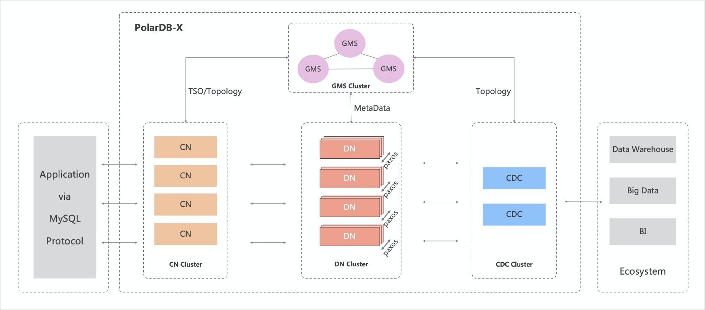

**核心组件**

- 元数据服务（Global Meta Service，GMS），主要提供分布式的元数据，提供全局授时服务（TSO）、维护Table/Schema、Statistic等Meta信息、维护账号、权限等安全信息。

- 计算节点（Compute Node，CN），主要提供分布式SQL引擎，包含核心的优化器和执行器。基于无状态的SQL引擎提供分布式路由和计算，解决分布式事务2PC协调、分布式DDL执行、全局索引维护等。

- 存储节点 （Date Node，DN），主要提供数据存储引擎，基于多数派Paxos共识协议提供高可靠存储、分布式事务的MVCC多版本存储，另外提供计算下推能力满足分布式的计算下推要求（比如Project/Filter/Join/Agg等下推计算），可支持本地盘和共享存储。

- 日志节点（Change Data Capture，CDC），主要提供兼容MySQL生态的主备复制协议，兼容Binlog协议和数据格式、支持主备复制Replication的协议和交互。

**查询实例详情**

1. 登录杜康-数据库管理平台。

2. 单击**实例管理 > 实例列表**。

3. 通过上方**高级搜索**筛选想要查看的实例。

4. 定位到目标实例，单击**用户实例名**打开**基本信息**页面，查看实例拓扑结构。

   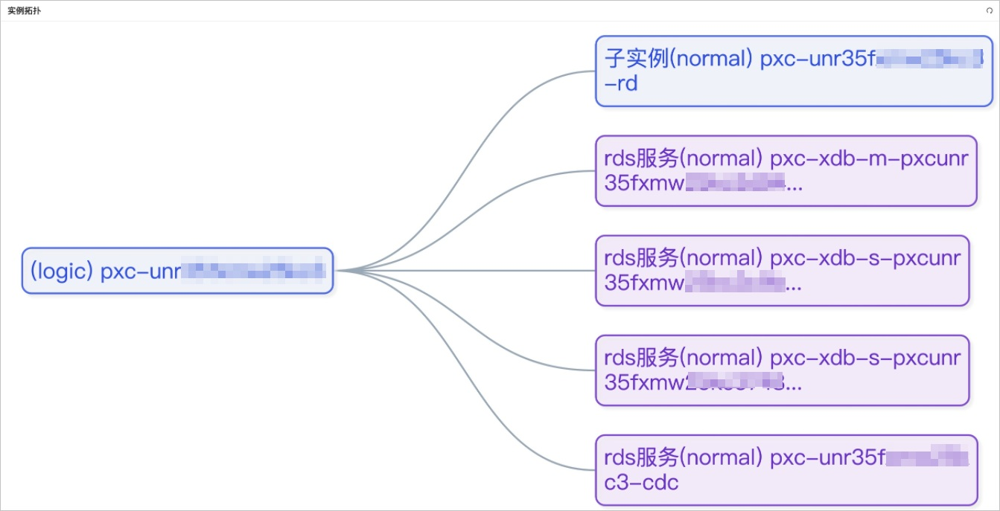

   拓扑结构说明：

   - logic实例：整个集群的逻辑实例名。绝大部分运维操作和用户视角看到的都是这个集群逻辑实例。

   - normal子实例 ：计算节点集群，下挂管理PolarDB-X的计算节点集群，不会有针对该子实例的运维任务。进入该子实例的实例详情页，可以看见计算节点的信息。

   - rds服务normal实例 （pxc-xdb-m-\*\*\*\*）：云数据服务（GMS）实例，该实例只会有一个，同时也是一个独立可运维的RDS MySQL实例。

   - rds服务normal实例 （pxc-xdb-s-\*\*\*\*）： 存储节点集群，同时每个存储节点又是一个独立的RDS MySQL实例，在杜康平台中搜索该实例名称，可进入该实例的杜康运维页面，RDS MySQL所有的运维操作对该实例都适用。PolarDB-X引擎是通过接口调用的方式对其运维的，例如PolarDB-X的创建、变配、升级、释放任务，都会触发RDS的创建、变配、升级、释放任务。

   - rds服务normal实例（pxc-\*\*\*\*\*\*-cdc）：是PolarDB-X集群下的日志节点，该实例虽然是RDS MySQL实例，但它不是独立可运维的。它负责将所有存储节点的Binlog整合成一份PolarDB-X实例的逻辑Binlog，提供分布式数据库下同单机数据库一致的Binlog服务。

**SLB功能**

1. 登录杜康-数据库管理平台。

2. 单击**实例管理 > 实例列表**。

3. 通过上方**高级搜索**筛选想要查看的实例。

4. 定位到目标实例，单击**用户实例名**打开**基本信息**页面，单击**性能信息**。

5. 在**VIP列表**表格ID中单击**详情**。

   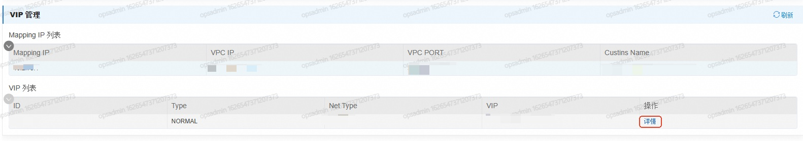

6. 在**详情信息**页面，您可根据需求修改权重，单击**修改**。

**实例资源配置**

1. 登录杜康-数据库管理平台。

2. 单击**实例管理 > 实例列表**。

3. 通过上方**高级搜索**筛选想要查看的实例。

4. 定位到目标实例，单击**用户实例名**打开**配置实例**页面。

5. 在**实例资源配置**页面，您可选择**设置IOPS**和**设置CPU**。

## 2.2. 实例变更记录

本文介绍了如何查看API日志和HA日志。

**查看API日志**

1. 登录杜康-数据库管理平台。

2. 单击**实例管理 > 实例列表**。

3. 通过上方**高级搜索**筛选想要查看的实例。

4. 定位到目标实例，单击**用户实例名**。

5. 左侧菜单栏单击**实例变更记录**，单击**API日志**页签。

   API日志中记录了实例通过RDS API调用的请求详情，包含请求时间、请求接口、来源IP等。日常运维时可用来获取实例请求参数、报错、请求ID等调用信息。

**查看HA日志**

1. 登录杜康-数据库管理平台。

2. 单击**实例管理 > 实例列表**。

3. 通过上方**高级搜索**筛选想要查看的实例。

4. 定位到目标实例，单击**用户实例名**。

5. 左侧菜单栏单击**实例变更记录**，单击**HA日志**页签。

   HA日志中记录了实例发生HA切换的原因及结果。日常运维时可用来排查实例切换原因或切换失败问题。

# 3.任务管理

## 3.1. 工作流运维

本文介绍了查看任务列表和工作流运维的方法。

数据库各种实例的运维操作，例如创建实例、重启、变配等流程，都会触发一个任务流，当任务流正常结束时，相关操作才会完成；如果工作流某个步骤失败，需要进行排查和处理。

**查看任务列表**

1. 登录杜康-数据库管理平台。

2. 单击**实例管理 > 实例列表**。

3. 通过上方**高级搜索**筛选想要查看的PolarDB-X实例。

4. 定位到目标实例，单击**用户实例名**。

5. 左侧菜单栏中单击**任务列表**，页面右侧可以查看该实例的所有任务、正在中断中任务、等待任务、中断任务、临时关闭任务、暂停任务、运行任务，支持筛选条件和自定义列表项。

**查看工作流详情页**

在任务列表页，单击**任务ID**，可进入工作流详情页。

- **基本信息**：展示工作流的基本信息，包括任务ID、工作流ID、工作流耗时、工作流开始/结束时间等信息。

  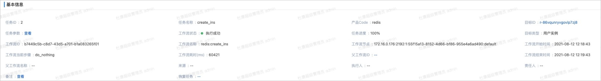

- **当前步骤执行日志**：展示了当前步骤的执行日志详情。

  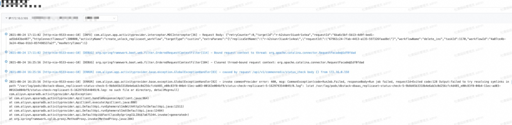

- **工作流步骤**：此页面展示了工作流每一个步骤的执行详情（执行时间、参数、状态、耗时等），以及步骤的运维操作（重试、步骤跳转、临时关闭等）。

  步骤正常执行结束。

  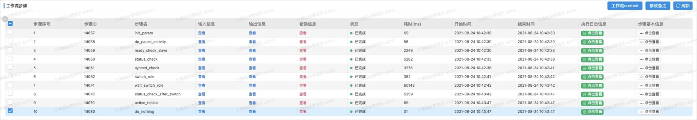

  步骤执行失败时，支持重试、步骤跳转、临时关闭操作。

- **任务干预日志**：展示了每一次工作流运维的操作信息。

  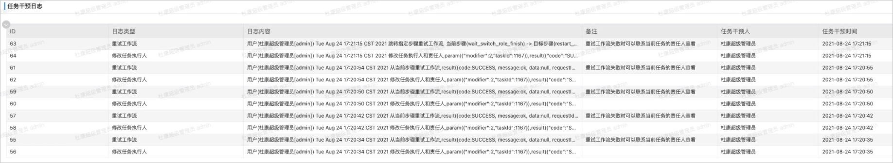

- **中断工作流运维**：任务列表页进入中断任务页签，单击中断任务的ID进入工作流详情页，针对中断步骤进行运维。

  - 重试：单击后重试当前步骤，如果步骤仍然中断，请联系阿里云技术支持。

  - 临时关闭：当某个工作流不需要处理或者暂时不需要处理时，关闭该工作流，以免影响其他工作流运行。执行该操作前请联系阿里云技术支持。

  - 跳转到指定步骤：向前或者向后跳转到某一步骤执行。执行该操作前请联系阿里云技术支持。

## 3.2. 任务失败处理

PolarDB-X集群下挂的存储节点和GMS节点都是独立可运维的RDS MySQL实例，因此在PolarDB-X的创建、变配、升级、释放、增加节点的任务中，都会触发RDS MySQL的任务流。如果RDS MySQL的任务流失败，那么父类的PolarDB-X的任务也会失败。PolarDB-X所有任务步骤都是保障幂等，可以进行重试。但是有些情况是需要特殊处理的，例如RDS任务失败时，本文介绍了常见的几种RDS MySQL任务失败时的处理方法。

**PolarDB-X创建任务失败**

如果PolarDB-X创建任务失败，卡在create_polardbx_cluster任务的wait_create_xdb_complete步骤，可能原因是PolarDB-X等待下挂的参与本次存储节点和GMS节点创建超时导致失败。

解决方法：首先检查这些RDS MySQL节点的创建任务是否正常，然后参见《RDS MySQL运维指南》对任务进行重试等操作。

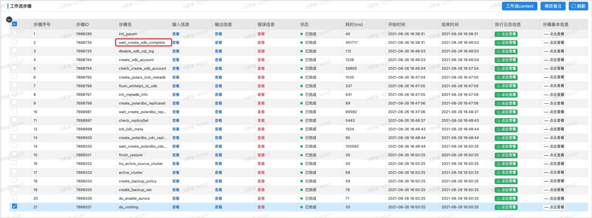

在PolarDB-X实例详情页，单击对应的RDS实例，在打开的页面左侧菜单栏中单击**任务列表**，可以找到对应存储节点和GMS节点的任务流。

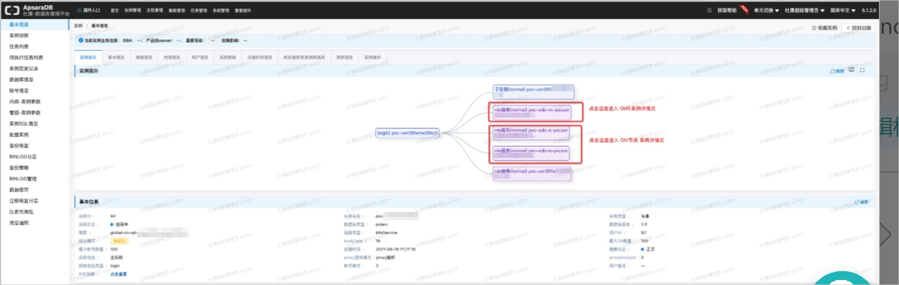

**PolarDB-X释放任务失败**

- 如果delete_polardbx_cluster任务卡在drop_storage或者drop_meta_db，这两步分别是释放GMS的请求和释放存储节点的请求，可以一直重试。（如果RDS的实例状态为非运行中，需要等待RDS其他任务执行完成后，才能继续重试。）

- 如果delete_polardbx_cluster任务卡在wait_drop_storage这一步，是在等待RDS的释放任务完成，需要去检查这些RDS MySQL节点的释放任务是否正常。然后参见《RDS MySQL运维指南》对任务进行重试等操作。

**PolarDB-X变配任务失败**

- 如果modify_polardbx_cluster任务卡在modify_storage_srv_class，这一步是变配存储节点和GMS节点的请求，如果集群资源不足会导致失败。可以添加集群资源，如果没有资源添加可以跳转到do_disable_aurora这一步 ，继续变配计算节点。

- 如果modify_polardbx_cluster任务卡在wait_xdb_status_activation，这一步是在等待RDS的变配任务完成，需要检查这些RDS MySQL节点的变配任务是否正常，然后参见《RDS MySQL运维指南》对任务进行重试等操作。

**PolarDB-X内核版本升级任务失败**

- 如果upgrade_polardbx_cluster任务卡在upgrade_storage_version，这一步是升级存储节点和GMS节点的请求，如果RDS实例状态是非运行中会导致失败，可以等待其他RDS任务运行结束后，重试此任务即可。

- 如果upgrade_polardbx_cluster任务卡在 wait_xdb_status_activation，这一步是在等待RDS的变配任务完成，需要去检查这些RDS MySQL节点的升级任务是否正常，然后参见《RDS MySQL运维指南》对任务进行重试等操作。

**PolarDB-X增加节点任务失败**

如果add_node_polardbx_cluster任务卡在wait_new_storage_activation，这一步是在等待新存储节点的创建任务完成，需要去检查这些RDS MySQL节点的创建任务是否正常。然后参见《RDS MySQL运维指南》对任务进行重试等操作。

**PolarDB-X备份任务失败**

- 如果卡在wait_backup_job_finished这一步，是在等待新存储节点的备份任务完成。

- 如果卡在additional_backup_set_info这一步，是获取RDS备份集的信息，比例备份集大小等。这一步会失败，是因为wait_backup_job_finished时，显示任务完成，但是完成的备份集不可用，同样需要检查存储节点的备份任务完成情况。

在每个存储节点的实例详情页，单击左侧**备份恢复**，即可查看备份任务情况。

# 4.集群管理

1. 登录杜康-数据库管理平台。

2. 左侧菜单栏单击**集群管理**。

3. 通过上方搜索框筛选需要查看的集群。

4. 单击**集群名称**，进入集群详情列表。

   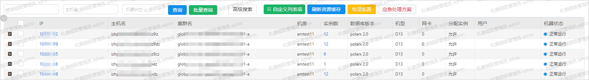

5. 在待查看的机器所在行，单机**详情**，可以看到具体的实例分配信息。

# 5.主动运维

除了以上运维手段，您还有部分主动运维操作可以进行。

**HA主备切换和节点重搭**

PolarDB-X实例是多Master （计算节点集群）同时提供服务，不具备主备切换能力，但是在单个节点异常时，会自动摘除流量，并触发节点重搭任务。

- HA摘除动作可以在**任务管理 > 日志信息 > HA切换日志**中查看。

- 节点重搭任务的执行情况可以在**任务管理 > 任务列表**中查看。

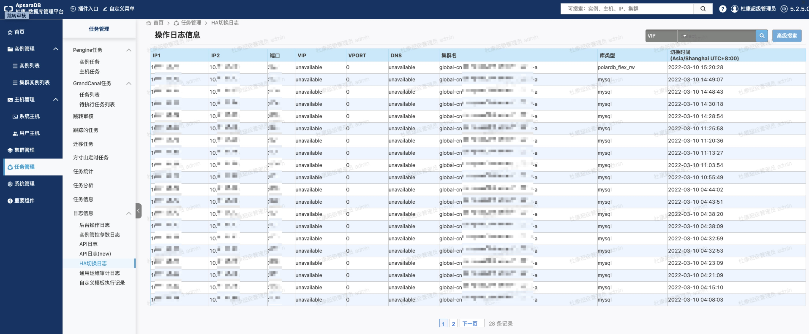

**主机下线**

PolarDB-X支持在**主机管理 > 系统主机**的主机详情中，将某台主机标记宕机下线，此时会自动对主机上的所有计算节点下发节点重搭任务。

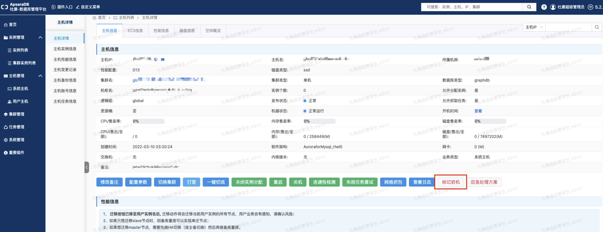

## 5.1. 查看HA日志和节点重搭任务

PolarDB-X实例是多Master （计算节点集群）同时提供服务，不具备主备切换能力，但是在单个节点异常时，会自动摘除流量，并触发节点重搭任务。

在杜康数据平台左侧菜单栏中，单击**实例列表**，单击**用户实例名**，单击**实例变更记录**。

- HA摘除动作可以在HA日志记录里查看：

  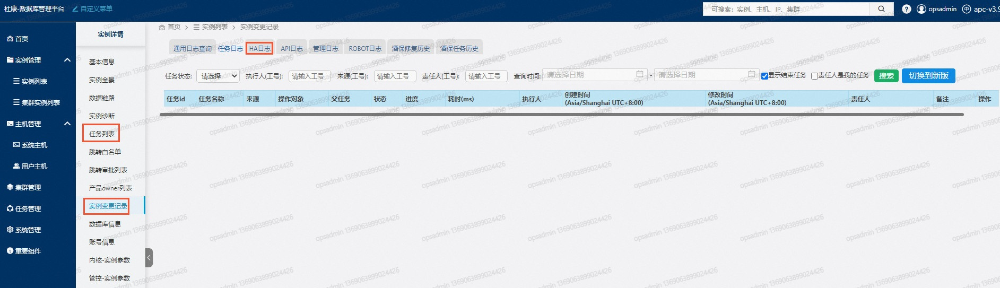

- 节点重搭任务执行情况可以在**任务列表**中查看。

## 5.2. 主机下线

在杜康数据平台左侧菜单栏中，选择**系统主机**或**用户主机**，单击主机IP或操作列的**详情**，打开主机详情页面。

PolarDB-X支持将某台主机标记宕机下线，此时会自动对主机上的所有计算节点下发节点重搭任务。

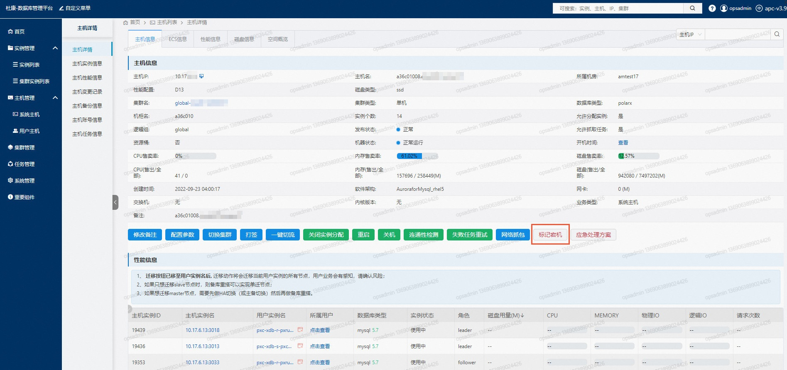

## 5.3. 备库重搭

当备库发生异常时，您可以执行备库重搭操作，保障主备高可用架构的持续性。

**操作步骤**

1. 登录杜康-数据库管理平台。

2. 在左侧导航栏中，选择**实例管理 > 实例列表**。

3. 单击目标用户实例名，页面将跳转至**基本信息**页面。

4. 在页面底部，单击**重搭[备库重搭|节点重搭]**。

5. 在弹出的对话框中，选择**本地重搭**或**异地重搭**，并单击**提交**。

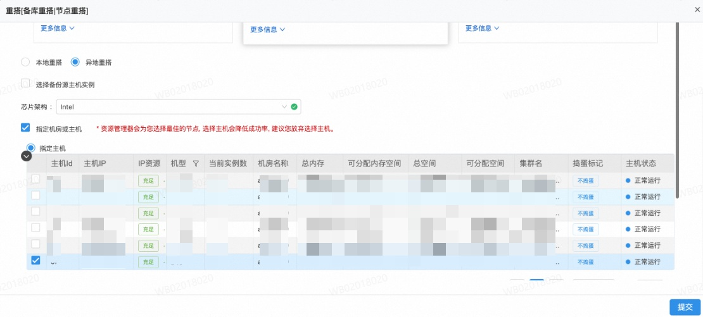

完成操作后，系统即开始执行备库重搭的工作流。
