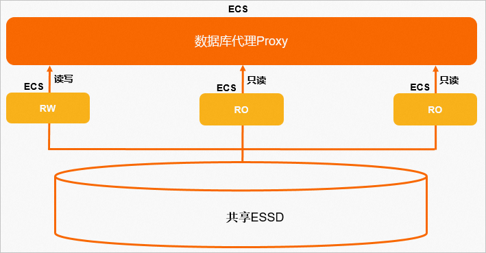

阿里云  
专有云  
云原生关系型数据库 PolarDB  
产品简介  
产品版本：V3.18.6  
文档版本：20251217

**目录**

- [1.什么是PolarDB MySQL版](#section-1)
- [2.核心功能](#section-2)
- [3.产品优势](#section-3)
- [4.应用场景](#section-4)
- [5.PolarDB MySQL版功能特性](#section-5)
    - [5.1. 本地盘版](#section-5-1)
    - [5.2. 共享存储版](#section-5-2)

# 1.什么是PolarDB MySQL版

PolarDB MySQL版是阿里巴巴自研的云原生关系型数据库。PolarDB MySQL版100%兼容原生MySQL的多个版本，包括MySQL 5.7和MySQL 8.0。PolarDB MySQL版基于云原生架构、计算存储分离、软硬件一体化设计，为用户提供具备超高弹性和性能、高可用和高可靠保障、高性价比的数据库服务。

PolarDB MySQL版采用计算与存储分离的架构，数据库代理和计算节点分别采用独立的ECS进行部署，共享存储层使用ESSD云盘，极大的降低了用户使用PolarDB的成本。

<strong>说明：</strong>上述产品架构为一写多读的多节点架构。如果您购买PolarDB MySQL版时选择了1个节点，则PolarDB MySQL版将采用单节点架构，单节点架构仅一个数据库计算节点承担读写功能。

- 单节点架构支持通过增加只读节点操作添加节点变为多节点架构，添加节点后允许用户开启数据库代理。

- 多节点架构也支持通过删除只读节点操作删除节点变为单节点架构。

**为什么选择PolarDB MySQL版**

PolarDB MySQL版采用通用的专有云基础设施，用户使用较低的成本即可享受到PolarDB的核心能力。

- PolarDB MySQL版采用阿里云多年深度优化的PolarDB数据库内核，相对开源的内核大幅提升了数据库性能。

- 采用最新一代阿里云高性能计算和存储基础设施，客户使用成本大幅下降。

- 云原生的计算和存储分离架构，一写多读，灵活弹性，配置升降级和增加节点分钟级生效。

- 多个计算节点共享存储，新增只读节点时只需支付计算节点费用，大大降低了扩容成本。

# 2.核心功能

**超级MySQL**

- 100%兼容原生MySQL和阿里云RDS MySQL，您可以在不修改应用程序任何代码和配置的情况下，将MySQL数据库迁移至PolarDB MySQL版。

- 持续提供高价值特性：一写多读或多写多读、共享存储、60亿行数据稳定运行、秒级DDL、主从切换无闪断、闪回查询、分区表增强等。

# 3.产品优势

您可以像使用MySQL一样使用PolarDB MySQL版。此外，PolarDB MySQL版还有传统数据库不具备的优势：

- **高性价比**

  - 多个计算节点共享存储，新增只读节点时只需支付计算节点费用，大大降低扩容成本。

- **超高弹性**

  - 分钟级增删节点。

  - 存储容量在线扩容，无需中断业务。

- **超高性能**

  深度优化数据库内核，同时采用物理复制、高速网络和分布式共享存储，大幅提高性能，相比开源MySQL性能最大提升6倍。

- **高可用和高可靠保障，数据安全可靠**

  - 共享分布式存储的设计，彻底解决了主从异步复制所带来的备库数据非强一致的缺陷，使得整个数据库集群在应对任何单点故障时，可以保证数据零丢失。

  - 热备集群部署在PolarDB MySQL 版集群所在地域的备可用区或者同一可用区下的不同机房，具有独立的存储能力，用于集群的热备切换。当PolarDB整个集群或者主可用区不可用时，热备集群会快速切换为主集群承担集群的读写业务。

- 数据安全

  - 采用白名单、VPC网络、数据多副本存储等全方位的手段，对数据库数据访问、存储、管理等各个环节提供安全保障。

- **无锁备份**

  - 利用底层分布式存储的快照技术，只需分钟级别即可完成对上TB数据量大小的数据库的备份，且整个备份过程不需要加锁，效率更高，影响更小。

# 4.应用场景

- PolarDB MySQL版的单节点架构是个人用户测试、学习的最佳选择，也可作为初创企业的入门级产品。

- PolarDB MySQL版的多节点架构适用于有大量流量高峰读请求和数据智能分析需求的大中型企业的生产数据库场景，如政务系统、互联网新零售行业、汽车制造行业、教育行业、企业大型ERP系统等。

# 5.PolarDB MySQL版功能特性

本文主要介绍阿里云PolarDB MySQL的功能特性，帮助您快速了解产品功能。

## 5.1. 本地盘版

本文主要介绍阿里云PolarDB MySQL本地盘版的功能特性，帮助您快速了解产品功能。

**功能分类**

**描述**

创建实例

创建PolarDB MySQL本地盘版实例。

重启实例

提供实例重启能力，用于快速恢复实例状态。

当实例配置无法满足应用的要求，或者当前实例的配置过高或者过

变更配置

低，可以变更实例的配置，例如规格、存储空间。

默认可维护时间段为02:00~06:00，可以根据业务规律将可维护

设置可维护时间段

时间段设置在业务低峰期，以避免维护过程中可能对业务造成的影响。

实例管理

确保该实例下所有数据库已删除后，可以释放实例，并恢复资源库

释放实例

存。

支持自动升级或手动升级内核小版本，内核小版本的升级涉及性能

升级内核小版本

提升、新功能或问题修复等。

设置实例参数

支持查看和修改部分参数的值，查询参数修改记录。

支持添加只读实例，在对数据库有大量读请求和少量写请求时，只

只读实例

读实例用于分担主实例的数据库压力。

支持创建多个标签，为实例绑定不同的标签对其进行分类，之后通

标签管理

过标签进行实例筛选。

提供数据库账号权限体系。支持两种数据库账号：高权限账号和普

账号管理

通账号。

创建PolarDB MySQL本地盘版实例以及设置好白名单之后，需要

创建数据库

在实例中创建数据库和账号。

删除数据库

支持删除已经废弃的数据库。

数据库管理

- 支持查看和修改数据库的连接地址。

- 支持通过阿里云的数据管理服务DMS登录PolarDB MySQL本地盘版实例的数据库。

数据库链接

- 支持网络混访功能，可实现在无访问中断的情况下将经典网络平滑迁移到VPC上。

- 支持实例网络类型在经典网络和专有网络之间切换。

- 支持切换PolarDB实例的专有网络VPC和虚拟交换机。

提供数据库独享代理服务，基于独享代理提供更多高级功能，例如

数据库代理

读写分离、连接池、事务拆分等。

查看系统资源和引擎

提供了丰富的性能监控项，选择查询时间即可查看相应的监控数

监控

据。

监控与报警

创建报警规则，可以及时了解实例的监控数据异常并快速进行处

设置报警规则

理。

设置白名单

支持设置白名单，增加数据库安全稳定。

启用SSL（Secure Sockets Layer）加密，并安装SSL CA证书到

设置SSL加密

需要的应用服务，可提高链路安全性。

数据安全性

透明数据加密TDE（Transparent Data Encryption）可对数据

设置透明数据加密

文件执行实时I/O加密和解密，数据在写入磁盘之前进行加密，从

TDE

磁盘读入内存时进行解密。

SQL审计

支持查看SQL明细、定期审计SQL。

设置主备实例自动切换或手动切换，切换后原来的主实例会变成备

自动或手动主备切换

实例。

服务可用性

设置PolarDB MySQL本地盘版的主备实例之间的数据复制方式，

修改数据复制方式

以提高云数据库的可用性。

备份方式

支持手动备份和自动备份两种方式。

下载数据备份和日志

支持未加密的数据备份和日志备份下载，方便用户存档，也可用于

备份

恢复到本地数据库。

一键上传Binlog

支持一键上传Binlog，将日志备份上传到OSS保存。

备份恢复

新建一个实例，可以复制出与主实例一模一样的内容，包括实例数

数据库恢复

据和实例设置。克隆实例主要用于恢复主实例数据，或批量创建相同实例。

一键诊断

支持一键诊断功能，可以诊断实例并提供可视化的诊断结果。

会话管理

支持实例会话功能，可以查看、管理目标实例的会话。

实时性能

支持查看MySQL的实时性能。

支持空间分析功能，能够帮助您及时发现数据库中的空间异常，避

空间分析

免影响数据库稳定性。

自治服务

锁分析

支持查看和分析数据库最近一次发生的死锁。

支持多种查看性能趋势的方式，不仅支持性能趋势区间查看，也支

性能趋势

持性能趋势对比查看和自定义性能趋势查看。

慢SQL

查看慢日志趋势、慢日志执行情况和慢日志优化建议。

诊断报告

支持创建和查看诊断报告。

查询实例的错误日志、慢日志明细和主备切换日志，帮助故障定位

日志管理

日志查询

分析。

支持实例级别回收站，实例删除后，可通过回收站进行恢复，可对

恢复实例

回收站的保存周期进行修改。

回收站

销毁实例会同时销毁除跨地域备份外的所有备份，包括常规数据备

销毁实例

份、日志备份、永久备份。

## 5.2. 共享存储版

本文主要介绍阿里云PolarDB MySQL共享存储版的功能特性，帮助您快速了解产品功能。

**功能分类**

**描述**

创建集群

创建PolarDB MySQL共享存储版集群。

可以查看集群的基本信息、白名单配置信息、链接地址信息、数据

查看集群基本信息

库节点信息和分布式存储等信息

变更配置

手动升级或降级PolarDB集群的规格。

可以根据实际需求手动增加期望规格的只读节点或删除不需要的只

增加或删除节点

读节点。

集群保护锁

开启集群保护锁，防止手动误删除集群。

集群管理

释放集群

可以根据业务需求手动释放集群。

提供了重启节点功能，可以在控制台上手动重启节点解决数据库连

重启节点

接和性能问题。

支持手动开启Binlog，开启Binlog后您就可以连接ElasticSearch、AnalyticDB等数据产品，也可以搭建PolarDB到

开启Binlog

RDS、RDS到PolarDB或PolarDB之间的数据实时同步。

可以通过资源列表下载按钮，将集群列表中的集群信息导出到本

资源列表下载

地。

PolarDB的主可用区内包含了多个节点（计算节点），其中一个节

多节点部署

点是主节点，其他节点为只读节点。

高可用部署架构

自动主备切换

当系统发生故障时，PolarDB集群会自动进行主备切换。

支持高权限账号和普通账号这两种数据库账号，可以在控制台管理

创建数据库账号

所有账号。

支持管理数据库账号，包括重置高权限账号权限、修改普通账号权

管理数据库账号

限、修改账号密码以及删除账号等。

账号管理

账号权限

分为高权限账号和普通账号两种。

系统账号说明

提供了多种类型的系统内部账号，用于后台管控运维等操作。

创建数据库

支持通过控制台创建数据库。

数据库管理

删除数据库

支持通过控制台删除数据库。

集群的连接地址（又称为Endpoint）分为集群地址和主地址两种

集群地址和主地址

类型。在连接PolarDB MySQL版集群时，可以填写PolarDB MySQL版集群的集群地址或主地址。

- 支持通过控制台申请公网和经典网络的集群地址和主地址。

- 支持通过控制台自定义集群地址。

申请集群地址和主地

- 支持查看连接地址和端口。

址

- 支持修改连接地址。

- 支持释放连接地址。

目前支持三种方式连接集群：

- 使用DMS连接集群。

连接数据库集群

- 使用客户端连接集群。

- 使用命令行连接集群。

PolarDB MySQL版集群自带读写分离功能。应用程序只需连接一个可读可写（自动读写分离）模式的集群地址，写请求会自动转发

数据库代理

到主节点，读请求会自动根据各节点的负载（当前未完成的请求数）转发到主节点或只读节点。

读写分离功能主要包含以下特性：

- 负载均衡：支持基于连接数负载均衡和基于活跃请求数负载均衡两种负载均衡策略，来保证多个只读节点间的负载均衡。

读写分离

- 一致性级别：提供了三种一致性级别：最终一致性、会话一致性和全局一致性，满足在不同场景下对一致性级别的要求。

- 连接池：支持会话级连接池和事务级连接池，可以根据业务场景选择合适的连接池，帮助降低因大量连接导致的数据库负载压力。

- 过载保护：当触发过载保护后，目前代理会使用历史数据的中位数作为上限对用户的活跃连接数进行限流。

数据库代理默认的规格可以满足用户绝大部分的应用场景，当客户进行压力测试或者业务吞吐量很高的时候，可以考虑升级数据库代

升级数据库代理的规

理的规格，避免数据库代理成为瓶颈。

格

配置数据库代理

通过PolarDB MySQL版的集群地址来配置数据库代理。

支持设置集群的IP白名单，并创建集群的初始账号，只有已添加到

设置白名单

白名单中的IP地址或安全组中的ECS实例才能访问该集群。

ECS安全组是一种虚拟防火墙，用于控制安全组中的ECS实例的出

选择安全组

入流量。

为了提高链路安全性，可以启用SSL（Secure Sockets Layer）加密，并安装SSL CA证书到需要的应用服务。SSL在传输层对网

设置SSL加密

络连接进行加密，能提升通信数据的安全性和完整性，但会同时增加网络连接响应时间。

数据安全和加密

透明数据加密TDE（Transparent Data Encryption）可对数据

设置透明数据加密

文件执行实时I/O加密和解密，数据在写入磁盘之前进行加密，从磁盘读入内存时进行解密。TDE不会增加数据文件的大小，开发人

TDE

员无需更改任何应用程序，即可使用TDE功能。

PolarDB MySQL版数据库代理（Proxy）提供了SQL防火墙功

SQL防火墙

能，该功能通过设置黑白名单规则来识别需要放行和拦截的SQL语句。

动态脱敏

PolarDB MySQL版数据库代理（Proxy）提供的动态脱敏功能。

从RDS MySQL迁移至

数据迁移

PolarDB支持将RDS MySQL迁移至PolarDB MySQL版。

PolarDB MySQL版

备份设置

支持数据备份和Redo物理日志备份。

自动备份默认开启，PolarDB MySQL版会按照设置的备份策略自动备份数据，以达到定时定期备份的效果，保证数据的安全性。集

自动备份

群创建之初，PolarDB MySQL版即会按照每日备份一次的频率，自动进行数据备份。

备份恢复

手动备份即主动备份，可以根据业务需求随时进行手动备份，达到

手动备份

即时备份的效果，确保数据可靠性。

恢复

全量恢复支持从备份集恢复和恢复到过去时间点两种恢复方式。

PolarDB集群架构共三层：数据库代理Proxy、数据库内核引擎DB

版本管理

版本管理

和数据库分布式存储Store。可以根据实际情况单独升级Proxy或内核引擎，也可以绑定一起升级。

日志与审计

SQL洞察

SQL洞察功能可对SQL语句进行健康情况诊断和性能问题排查。

可以通过查看性能监控指标，来掌握集群的运行状态并通过细粒度

监控与优化

查看性能监控指标

的监控数据快速定位运维问题。

诊断与优化

错误日志

可以通过查看错误日志，对数据库进行故障分析等操作。

PolarDB MySQL版提供慢SQL分析功能，能够查看慢日志统计信

慢SQL

息，并且提供SQL建议和诊断分析。

PolarDB集群创建完成后，您可以通过控制台来修改集群参数，并

设置集群参数

且可以将修改后的集群参数导出为模板。

PolarDB支持将集群规格相关的参数设置为表达式的形式，当集群

参数配置

参数表达式

规格发生变更时，使用表达式设置的参数值会适应规格的变更而自动变化，使集群始终保持最优或最稳定的状态。

在配置集群时，如果多个集群中包含一个或多个参数的配置相同，

使用参数模板

您可以使用参数模板功能，对参数进行集中管理，并快速应用至集群，以提升参数管理效率和集群配置效率。

高性能参数模板

支持高性能参数模板功能。

PolarDB MySQL版8.0版本重磅推出弹性并行查询框架，当您的查

弹性并行查询

弹性并行查询

询数据量到达一定阈值，就会自动启动并行查询框架，从而使查询耗时指数级下降。
