阿里云  
专有云  
云原生多模数据库Lindorm  
开发指南  
产品版本：V3.18.6  
文档版本：20250825

**目录**

- [1.宽表引擎](#section-1)
    - [1.1. 连接并使用宽表引擎](#section-1-1)
        - [1.1.1. 开发概览](#section-1-1-1)
        - [1.1.2. 通过Lindorm-cli连接并使用宽表引擎](#section-1-1-2)
        - [1.1.3. 基于SQL的应用开发](#section-1-1-3)
            - [1.1.3.1. 安装宽表SQL Driver](#section-1-1-3-1)
            - [1.1.3.2. 使用Java语言JDBC接口的应用开发](#section-1-1-3-2)
            - [1.1.3.3. 通过Java连接池Druid连接宽表引擎](#section-1-1-3-3)
            - [1.1.3.4. 使用Go语言database/sql接口的应用开发](#section-1-1-3-4)
            - [1.1.3.5. 使用Python DB-API的应用开发](#section-1-1-3-5)
            - [1.1.3.6. 通过Python连接池DBUtils连接宽表引擎](#section-1-1-3-6)
        - [1.1.4. 通过HBase API连接并使用宽表引擎](#section-1-1-4)
            - [1.1.4.1. HBase SDK 安装](#section-1-1-4-1)
            - [1.1.4.2. 通过HBase Java API连接并使用宽表引擎](#section-1-1-4-2)
            - [1.1.4.3. 通过HBase非Java API连接并使用宽表引擎](#section-1-1-4-3)
            - [1.1.4.4. 通过HBase Shell连接并使用宽表引擎](#section-1-1-4-4)
            - [1.1.4.5. 通过HBaseue Shell连接并使用宽表引擎](#section-1-1-4-5)
            - [1.1.4.6. 使用限制](#section-1-1-4-6)
        - [1.1.5. 使用第三方工具连接并使用宽表引擎](#section-1-1-5)
            - [1.1.5.1. 通过Spark访问宽表引擎](#section-1-1-5-1)
            - [1.1.5.2. 通过Flink访问宽表引擎](#section-1-1-5-2)
    - [1.2. 导入导出](#section-1-2)
        - [1.2.1. 数据导入方式](#section-1-2-1)
            - [1.2.1.1. 使用DataWorks或者DataX导入数据](#section-1-2-1-1)
        - [1.2.2. 导入MongoDB数据](#section-1-2-2)
    - [1.3. 开发指南](#section-1-3)
        - [1.3.1. 动态列](#section-1-3-1)
        - [1.3.2. 二级索引](#section-1-3-2)
    - [1.4. Lindorm SQL语法介绍](#section-1-4)
        - [1.4.1. 使用限制](#section-1-4-1)
        - [1.4.2. 名词解释](#section-1-4-2)
        - [1.4.3. 数据类型](#section-1-4-3)
            - [1.4.3.1. 基础数据类型](#section-1-4-3-1)
            - [1.4.3.2. 空间数据类型](#section-1-4-3-2)
        - [1.4.4. 函数说明](#section-1-4-4)
            - [1.4.4.1. As函数](#section-1-4-4-1)
            - [1.4.4.2. 聚合函数](#section-1-4-4-2)
                - [1.4.4.2.1. Count函数](#section-1-4-4-2-1)
                - [1.4.4.2.2. Max函数和Min函数](#section-1-4-4-2-2)
                - [1.4.4.2.3. Sum函数](#section-1-4-4-2-3)
                - [1.4.4.2.4. Avg函数](#section-1-4-4-2-4)
            - [1.4.4.3. 时空函数](#section-1-4-4-3)
                - [1.4.4.3.1. 函数概览](#section-1-4-4-3-1)
                - [1.4.4.3.2. 输出函数](#section-1-4-4-3-2)
                - [1.4.4.3.3. 构造函数](#section-1-4-4-3-3)
                - [1.4.4.3.4. 访问函数](#section-1-4-4-3-4)
                - [1.4.4.3.5. 关系函数](#section-1-4-4-3-5)
                - [1.4.4.3.6. 处理函数](#section-1-4-4-3-6)
                - [1.4.4.3.7. 量测函数](#section-1-4-4-3-7)
                - [1.4.4.3.8. 聚合函数](#section-1-4-4-3-8)
        - [1.4.5. DDL](#section-1-4-5)
            - [1.4.5.1. 概览](#section-1-4-5-1)
            - [1.4.5.2. DESCRIBE/SHOW/USE](#section-1-4-5-2)
            - [1.4.5.3. CREATE DATABASE](#section-1-4-5-3)
            - [1.4.5.4. DROP DATABASE](#section-1-4-5-4)
            - [1.4.5.5. CREATE TABLE](#section-1-4-5-5)
            - [1.4.5.6. CREATE TABLE LIKE](#section-1-4-5-6)
            - [1.4.5.7. ALTER TABLE](#section-1-4-5-7)
            - [1.4.5.8. TRUNCATE TABLE](#section-1-4-5-8)
            - [1.4.5.9. DROP TABLE](#section-1-4-5-9)
            - [1.4.5.10. CREATE INDEX](#section-1-4-5-10)
            - [1.4.5.11. ALTER INDEX](#section-1-4-5-11)
            - [1.4.5.12. BUILD INDEX](#section-1-4-5-12)
            - [1.4.5.13. SHOW INDEX](#section-1-4-5-13)
            - [1.4.5.14. DROP INDEX](#section-1-4-5-14)
            - [1.4.5.15. OFFLINE TABLE](#section-1-4-5-15)
            - [1.4.5.16. ONLINE TABLE](#section-1-4-5-16)
            - [1.4.5.17. CREATE SEARCH INDEX](#section-1-4-5-17)
            - [1.4.5.18. DROP SEARCH INDEX](#section-1-4-5-18)
            - [1.4.5.19. ALTER SEARCH INDEX](#section-1-4-5-19)
            - [1.4.5.20. SHOW SEARCH INDEX](#section-1-4-5-20)
        - [1.4.6. DML](#section-1-4-6)
            - [1.4.6.1. SELECT](#section-1-4-6-1)
            - [1.4.6.2. UPSERT](#section-1-4-6-2)
            - [1.4.6.3. DELETE](#section-1-4-6-3)
        - [1.4.7. DCL](#section-1-4-7)
            - [1.4.7.1. 概述](#section-1-4-7-1)
            - [1.4.7.2. SHOW USERS](#section-1-4-7-2)
            - [1.4.7.3. CREATE USER](#section-1-4-7-3)
            - [1.4.7.4. ALTER USER](#section-1-4-7-4)
            - [1.4.7.5. DROP USER](#section-1-4-7-5)
            - [1.4.7.6. GRANT PRIVILEGE](#section-1-4-7-6)
            - [1.4.7.7. REVOKE PRIVILEGE](#section-1-4-7-7)
        - [1.4.8. EXPLAIN](#section-1-4-8)
        - [1.4.9. HINT](#section-1-4-9)
            - [1.4.9.1. HINT简介](#section-1-4-9-1)
            - [1.4.9.2. 多版本数据管理](#section-1-4-9-2)
    - [1.5. 最佳实践](#section-1-5)
        - [1.5.1. 如何在较大结果集中使用ORDER BY](#section-1-5-1)
        - [1.5.2. 如何设计宽表主键](#section-1-5-2)
- [2.时序引擎](#section-2)
    - [2.1. 连接指南](#section-2-1)
        - [2.1.1. 通过Lindorm-cli连接并使用Lindorm时序引擎](#section-2-1-1)
        - [2.1.2. Java Native SDK](#section-2-1-2)
            - [2.1.2.1. 客户端初始化](#section-2-1-2-1)
            - [2.1.2.2. 接口说明](#section-2-1-2-2)
            - [2.1.2.3. 异常处理](#section-2-1-2-3)
            - [2.1.2.4. 版本说明](#section-2-1-2-4)
            - [2.1.2.5. 教程：通过Java Native SDK连接并使用Lindorm时序引擎](#section-2-1-2-5)
        - [2.1.3. Java JDBC Driver开发手册](#section-2-1-3)
            - [2.1.3.1. 支持的接口与方法](#section-2-1-3-1)
            - [2.1.3.2. JDBC连接地址说明](#section-2-1-3-2)
            - [2.1.3.3. 教程：通过Druid连接池连接并访问时序引擎](#section-2-1-3-3)
            - [2.1.3.4. 教程：通过JDBC Driver连接并访问Lindorm时序引擎](#section-2-1-3-4)
        - [2.1.4. HTTP API SQL接口开发手册](#section-2-1-4)
        - [2.1.5. 行协议写入](#section-2-1-5)
    - [2.2. 导入数据](#section-2-2)
        - [2.2.1. 通过DataWorks导入数据](#section-2-2-1)
        - [2.2.2. 通过DataX导入RDS数据](#section-2-2-2)
        - [2.2.3. 通过DataX导入Prometheus数据](#section-2-2-3)
    - [2.3. 开发指南](#section-2-3)
        - [2.3.1. 时序引擎应用开发简介](#section-2-3-1)
        - [2.3.2. 数据建模](#section-2-3-2)
        - [2.3.3. 数据模型](#section-2-3-3)
        - [2.3.4. 数据写入](#section-2-3-4)
        - [2.3.5. 数据查询](#section-2-3-5)
        - [2.3.6. 连续查询](#section-2-3-6)
        - [2.3.7. 预降采样](#section-2-3-7)
        - [2.3.8. Schema约束](#section-2-3-8)
        - [2.3.9. 使用限制](#section-2-3-9)
    - [2.4. SQL语法参考](#section-2-4)
        - [2.4.1. 数据类型](#section-2-4-1)
        - [2.4.2. 常用时序函数](#section-2-4-2)
        - [2.4.3. DDL](#section-2-4-3)
            - [2.4.3.1. CREATE DATABASE](#section-2-4-3-1)
            - [2.4.3.2. CREATE TABLE](#section-2-4-3-2)
            - [2.4.3.3. CREATE USER](#section-2-4-3-3)
            - [2.4.3.4. CREATE CONTINUOUS QUERY](#section-2-4-3-4)
            - [2.4.3.5. ALTER DATABASE](#section-2-4-3-5)
            - [2.4.3.6. ALTER TABLE](#section-2-4-3-6)
            - [2.4.3.7. ALTER SYSTEM](#section-2-4-3-7)
            - [2.4.3.8. ALTER USER](#section-2-4-3-8)
            - [2.4.3.9. DROP DATABASE](#section-2-4-3-9)
            - [2.4.3.10. DROP TABLE](#section-2-4-3-10)
            - [2.4.3.11. DROP USER](#section-2-4-3-11)
            - [2.4.3.12. DROP CONTINUOUS QUERY](#section-2-4-3-12)
            - [2.4.3.13. DESCRIBE DATABASE](#section-2-4-3-13)
            - [2.4.3.14. DESCRIBE TABLE](#section-2-4-3-14)
            - [2.4.3.15. SHOW](#section-2-4-3-15)
            - [2.4.3.16. SHOW PARAMETER](#section-2-4-3-16)
            - [2.4.3.17. SHOW CONTINUOUS QUERIES](#section-2-4-3-17)
            - [2.4.3.18. USE](#section-2-4-3-18)
            - [2.4.3.19. SHOW PROCESSLIST](#section-2-4-3-19)
            - [2.4.3.20. KILL QUERY](#section-2-4-3-20)
            - [2.4.3.21. CREATE PREDOWNSAMPLE](#section-2-4-3-21)
            - [2.4.3.22. SHOW PREDOWNSAMPLES](#section-2-4-3-22)
            - [2.4.3.23. DROP PREDOWNSAMPLE](#section-2-4-3-23)
        - [2.4.4. DML](#section-2-4-4)
            - [2.4.4.1. 数据写入](#section-2-4-4-1)
            - [2.4.4.2. 基本查询](#section-2-4-4-2)
            - [2.4.4.3. 降采样查询](#section-2-4-4-3)
            - [2.4.4.4. 最新值查询](#section-2-4-4-4)
            - [2.4.4.5. 时序异常检测](#section-2-4-4-5)
        - [2.4.5. DCL](#section-2-4-5)
            - [2.4.5.1. GRANT](#section-2-4-5-1)
            - [2.4.5.2. REVOKE](#section-2-4-5-2)
        - [2.4.6. 常见错误码](#section-2-4-6)
            - [2.4.6.1. 常见错误码参考](#section-2-4-6-1)
    - [2.5. 最佳实践](#section-2-5)
        - [2.5.1. 如何设计时序数据表](#section-2-5-1)
        - [2.5.2. 如何高效地写入数据](#section-2-5-2)
        - [2.5.3. 如何高效地查询时序数据](#section-2-5-3)
    - [2.6. 第三方工具](#section-2-6)
        - [2.6.1. 通过Telegraf写入时序引擎](#section-2-6-1)
        - [2.6.2. 使用Flink写入时序引擎](#section-2-6-2)
        - [2.6.3. 通过Grafana访问时序引擎](#section-2-6-3)
        - [2.6.4. 通过Prometheus访问时序引擎](#section-2-6-4)
    - [2.7. 性能白皮书](#section-2-7)
        - [2.7.1. 测试环境与工具](#section-2-7-1)
        - [2.7.2. 写入测试结果](#section-2-7-2)
        - [2.7.3. 查询测试结果](#section-2-7-3)
    - [2.8. TSQL语法介绍](#section-2-8)
        - [2.8.1. 名词解释](#section-2-8-1)
        - [2.8.2. 数据类型](#section-2-8-2)
        - [2.8.3. DDL](#section-2-8-3)
            - [2.8.3.1. CREATE TABLE](#section-2-8-3-1)
            - [2.8.3.2. SHOW TABLES](#section-2-8-3-2)
            - [2.8.3.3. DESCRIBE TABLE](#section-2-8-3-3)
        - [2.8.4. DML](#section-2-8-4)
            - [2.8.4.1. SELECT](#section-2-8-4-1)
            - [2.8.4.2. 降采样](#section-2-8-4-2)
            - [2.8.4.3. 最新值](#section-2-8-4-3)
            - [2.8.4.4. INSERT](#section-2-8-4-4)
    - [2.9. HTTP API参考](#section-2-9)
        - [2.9.1. HTTP API 概览](#section-2-9-1)
        - [2.9.2. 调用方式](#section-2-9-2)
            - [2.9.2.1. 请求结构](#section-2-9-2-1)
            - [2.9.2.2. 返回结果](#section-2-9-2-2)
            - [2.9.2.3. 签名机制](#section-2-9-2-3)
        - [2.9.3. 单值写入操作](#section-2-9-3)
            - [2.9.3.1. 单值数据写入](#section-2-9-3-1)
            - [2.9.3.2. 开发代码示例（依赖包无法下载）](#section-2-9-3-2)
        - [2.9.4. 多值数据写入](#section-2-9-4)
        - [2.9.5. 多值查询](#section-2-9-5)
            - [2.9.5.1. 多值查询最新数据点](#section-2-9-5-1)
            - [2.9.5.2. 多值数据查询](#section-2-9-5-2)
        - [2.9.6. 查询Tagk下的Tagv](#section-2-9-6)
        - [2.9.7. 查询Metric, Field, TagK, TagV](#section-2-9-7)
        - [2.9.8. 设置数据时效](#section-2-9-8)
        - [2.9.9. 删除数据](#section-2-9-9)
        - [2.9.10. 删除时间线](#section-2-9-10)
        - [2.9.11. 数据清空](#section-2-9-11)
        - [2.9.12. 响应状态码](#section-2-9-12)
- [3.LTS服务](#section-3)
    - [3.1. LTS（原BDS）服务介绍](#section-3-1)
    - [3.2. 购买并登录LTS](#section-3-2)
    - [3.3. 数据源管理](#section-3-3)
        - [3.3.1. 添加HBase数据源](#section-3-3-1)
        - [3.3.2. 添加Lindorm宽表数据源](#section-3-3-2)
        - [3.3.3. 添加Kafka数据源](#section-3-3-3)
        - [3.3.4. 添加HDFS数据源](#section-3-3-4)
        - [3.3.5. 添加OSS数据源](#section-3-3-5)
    - [3.4. Lindorm/HBase迁移](#section-3-4)
        - [3.4.1. HBase数据迁移](#section-3-4-1)
- [4.SDK参考](#section-4)
    - [4.1. 宽表引擎](#section-4-1)
        - [4.1.1. HBase API](#section-4-1-1)
            - [4.1.1.1. HBase Java SDK 安装&升级](#section-4-1-1-1)
            - [4.1.1.2. HBase 非Java SDK 安装&访问](#section-4-1-1-2)
            - [4.1.1.3. 历史版本适配（Maven方式）](#section-4-1-1-3)
            - [4.1.1.4. 历史版本适配（Jar包替换）](#section-4-1-1-4)
        - [4.1.2. Cassandra CQL Driver](#section-4-1-2)
            - [4.1.2.1. Cassandra CQL Java Driver 安装和升级](#section-4-1-2-1)
        - [4.1.3. Phoenix SQL API](#section-4-1-3)
            - [4.1.3.1. PhoenixSQL Java SDK安装](#section-4-1-3-1)
    - [4.2. 时序引擎](#section-4-2)
        - [4.2.1. 使用详解](#section-4-2-1)
            - [4.2.1.1. 配置 TSDBConfig 类](#section-4-2-1-1)
            - [4.2.1.2. 写入数据](#section-4-2-1-2)
            - [4.2.1.3. 查询数据](#section-4-2-1-3)
            - [4.2.1.4. 调用其他接口](#section-4-2-1-4)
            - [4.2.1.5. 关闭客户端](#section-4-2-1-5)
        - [4.2.2. 常用类及其方法](#section-4-2-2)
            - [4.2.2.1. SDK 常用类概览](#section-4-2-2-1)
            - [4.2.2.2. TSDBClient](#section-4-2-2-2)
            - [4.2.2.3. TSDBConfig](#section-4-2-2-3)
            - [4.2.2.4. TSDBConfig.Builder](#section-4-2-2-4)
            - [4.2.2.5. TSDBClientFactory](#section-4-2-2-5)
            - [4.2.2.6. Point](#section-4-2-2-6)
            - [4.2.2.7. Point.MetricBuilder](#section-4-2-2-7)
            - [4.2.2.8. Query](#section-4-2-2-8)
            - [4.2.2.9. Query.Builder](#section-4-2-2-9)
            - [4.2.2.10. SubQuery](#section-4-2-2-10)
            - [4.2.2.11. SubQuery.Builder](#section-4-2-2-11)
            - [4.2.2.12. QueryResult](#section-4-2-2-12)
        - [4.2.3. SDK多值示例](#section-4-2-3)
            - [4.2.3.1. SDK多值写入](#section-4-2-3-1)
            - [4.2.3.2. SDK多值读取](#section-4-2-3-2)
            - [4.2.3.3. SDK多值获取最新数据](#section-4-2-3-3)
        - [4.2.4. 异常处理](#section-4-2-4)
        - [4.2.5. 版本说明](#section-4-2-5)

<a id="section-1"></a>

# 1.宽表引擎

<a id="section-1-1"></a>

## 1.1. 连接并使用宽表引擎

<a id="section-1-1-1"></a>

### 1.1.1. 开发概览

云原生多模数据库Lindorm宽表引擎支持多种方式的应用开发，可以满足不同业务场景的访问需求。

具体的方式如下表：

<table>
  <tr>
    <th>方式</th>
    <th>相关文档</th>
  </tr>
  <tr>
    <td rowspan="3">基于SQL的应用开发</td>
    <td>使用Java语言JDBC接口的应用开发</td>
  </tr>
  <tr>
    <td>使用Python DB-API的应用开发</td>
  </tr>
  <tr>
    <td>通过Java框架访问Lindorm宽表引擎示例</td>
  </tr>
  <tr>
    <td>基于开源API的应用开发</td>
    <td>通过HBase Java API连接并使用宽表引擎</td>
  </tr>
</table>

<a id="section-1-1-2"></a>

### 1.1.2. 通过Lindorm-cli连接并使用宽表引擎

本文介绍通过Lindorm-cli连接宽表引擎的具体操作和使用示例。

**前提条件**

已获取Lindorm宽表SQL的连接地址。具体操作，请参见**Lindorm用户指南**手册中**实例管理**目录下的**查看连接地址**章节。

**连接Lindorm宽表使用的网络类型**

<table>
  <tr>
    <th width="154">网络类型</th>
    <th>说明</th>
  </tr>
  <tr>
    <td>专有网络（推荐）</td>
    <td>专有网络VPC（Virtual Private Cloud）是您自己的云上私有网络，不同的专有网络之间二层逻辑隔离，具有较高的安全性。Lindorm-cli部署在ECS实例上时，通过专有网络连接至Lindorm宽表，可获得更高的安全性和更低的网络延迟。</td>
  </tr>
  <tr>
    <td>经典网络</td>
    <td>当本地设备需要测试或管理Lindorm宽表时，可在本地设备上部署Lindorm-cli，然后通过经典网络连接至Lindorm宽表。<br>说明<br>• 通过经典网络连接不会产生流量费用，但存在一定的安全风险，推荐通过专有网络连接以获取更高的安全性。<br>• 经典网络地址需要在控制台开通。如何开通，请参见<strong>Lindorm用户指南</strong>手册中<strong>实例管理</strong>目录下的<strong>开通经典网络地址</strong>章节。</td>
  </tr>
</table>

**常用命令**

关于Lindorm宽表SQL的语法使用请参见Lindorm SQL语法。

- **!help**：查看帮助命令。

- **!connect**：连接服务器命令。

- **exit**、**quit**和**ctrl+d**：退出当前连接。

**操作步骤**

1. 下载Lindorm-cli。您可以根据不同的客户端下载Lindorm-cli，下载链接如下表所示。

   | 客户端 | 下载链接 |
   | --- | --- |
   | Linux | lindorm-cli for linux |
   | Mac | lindorm-cli for mac |
   | Windows | lindorm-cli for windows-x64 |

2. 解压Lindorm-cli压缩包。

3. 获取连接信息并执行下述命令连接Lindorm宽表。

   - 如果您的客户端部署在Linux或Mac操作系统上，请跳转至Lindorm-cli所在目录下，执行以下语句：

     ```text
     ./lindorm-cli -url <jdbc url> -username <⽤户名> -password <密码>
     ```

   - 如果您的客户端部署在Windows系统上，请跳转至Lindorm-cli.exe所在目录下，执行以下语句：

     ```text
     lindorm-cli -url <jdbc url> -username <⽤户名> -password <密码>
     ```

   <table>
     <tr>
       <th>参数</th>
       <th>示例值</th>
       <th>获取方法</th>
     </tr>
     <tr>
       <td>jdbc url</td>
       <td>jdbc:lindorm:table:url=http://l d-bp17j28j2y7pm****-proxy-lindorm-pub.lindorm.rds.aliyuncs.com: 30060</td>
       <td>Lindorm宽表SQL的连接地址，获取方法请参见Lindorm用户指南手册中实例管理目录下的查看连接地址章节。</td>
     </tr>
     <tr>
       <td>用户名</td>
       <td>root</td>
       <td rowspan="2">如果您忘记用户名密码，可以通过Lindorm宽表引擎的集群管理系统修改密码，具体操作请参见Lindorm用户指南手册中宽表引擎目录下的用户管理章节。<br>重要修改密码后，请通过控制台重启引擎。</td>
     </tr>
     <tr>
       <td>密码</td>
       <td>root</td>
     </tr>
   </table>

   连接成功的返回如下结果：

   ```text
   Connected to jdbc:lindorm:table:url=http://ld-bp17j28j2y7pm****-proxy-lindorm-
   pub.lindorm.rds.aliyuncs.com:30060
   lindorm-cli version: 1.0.24
   ```

4. 访问Lindorm宽表的语法示例如下。

   <ol type="i">

   <li>

   执行以下语句创建名为test的数据库。

   ```sql
   create database test; 
   ```

   </li>

   <li>

   执行以下语句使用test数据库。

   ```text
   use test; 
   ```

   </li>

   <li>

   在test数据库中创建名为tb的数据表，并插入一条数据。

   ```sql
   create table tb (id varchar, name varchar, address varchar,  primary key(id, name)) ; 
   upsert into tb (id, name, address) values ('001', 'jack',  'hz'); 
   ```

   </li>

   <li>

   查询tb表中的数据。

   ```sql
   select * from tb;
   ```

   返回如下结果：

   ```text
   +-----+-------+---------+
   | id  | name  | address |
   +-----+-------+---------+
   | 001 | jack  | hz      |
   +-----+-------+---------+
   1 rows in set (24 ms)
   ```

   > 您可以自定义数据的输出格式，具体操作，请参见数据格式。
   >
   > **说明**

   </li>

   </ol>

**数据格式**

数据有多种输出格式，包括表格输出、CSV格式输出以及每一行中的列竖直输出，其中表格输出为默认输出格式。您可以通过 `format` 命令自定义数据的输出格式，修改数据的输出格式后，通过SELECT语句查询的数据将按指定格式输出。

> `format` 命令仅支持在Lindorm-cli工具中使用。
>
> **重要**

**表格输出**

```text
format table;
```

数据输出效果如下：

```text
+-----+-------+---------+
| id  | name  | address |
+-----+-------+---------+
| 001 | jack  | hz      |
+-----+-------+---------+
1 rows in set (99 ms)
```

**CSV格式输出**

```text
format csv;
```

数据输出效果如下：

```text
id,name,address
001,jack,hz
```

**每一行中的列竖直输出**

```text
format vertical;
```

数据输出效果如下：

```yaml
********************* 1. row *********************
id:      001
name:    jack
address: hz
1 rows in set (99 ms)
```

<a id="section-1-1-3"></a>

### 1.1.3. 基于SQL的应用开发

<a id="section-1-1-3-1"></a>

#### 1.1.3.1. 安装宽表SQL Driver

本文面向应用开发者概要介绍了Lindorm宽表引擎提供的SQL应用开发的开发套件与工具。

**数据库驱动**

Lindorm面向目前主流的应用开发语言分别提供了以下数据库驱动（Database Driver，可以简单理解为执行SQL的SDK）。

- **Java**

  Lindorm面向Java语言应用开发提供了遵循JDBC接口规范的Driver。

  关于该Driver的安装和使用，请参见使用Java语言JDBC接口的应用开发。

- **Go**

  Lindorm面向Go语言应用开发提供了遵循Go语言database/sql接口的Driver。

  关于该Driver的安装和使用，请参见使用Go语言database/sql接口的应用开发。

- **Python**

  Lindorm面向Python语言应用开发提供了遵循Python语言DB-API接口规范的Driver。

  关于该Driver的安装和使用，请参见使用Python DB-API的应用开发。

**SQL的开发与测试**

需要编写在应用逻辑中的SQL语句建议在开发阶段先进行充分验证后再固化在业务逻辑中。面向开发阶段的SQL验证与测试，Lindorm提供了一个可交互式的SQL命令行工具 **lindorm-cli** 帮助开发人员。关于lindorm-cli的安装与使用，请参见通过Lindorm-cli连接并使用宽表引擎。

<a id="section-1-1-3-2"></a>

#### 1.1.3.2. 使用Java语言JDBC接口的应用开发

本文介绍通过Java语言的标准JDBC接口使用SQL开发Lindorm宽表应用的方法和示例。

**前提条件**

- 已安装Java环境，要求安装JDK 1.8及以上版本。

- 已获取Lindorm宽表SQL的连接地址。具体操作，请参见**Lindorm用户指南**手册中**实例管理**目录下的**查看连接地址**章节。

**使用限制**

本文操作仅适用于Lindorm宽表模式，不支持Lindorm宽表Serverless模式。

**操作步骤**

> **说明**
>
> 您可以使用操作步骤中的示例代码，也可以直接下载示例代码在本地编译和运行。本文中示例代码在 `com.aliyun.lindorm.sql.demo.BasicDemo` 类中。

1. 下载Lindorm客户端。以Maven项目为例，在pom.xml文件的 `dependencies` 中添加依赖项。示例代码如下：

   ```xml
   <dependency> 
     <groupId>com.aliyun.lindorm</groupId>  
     <artifactId>lindorm-all-client</artifactId>
     <version>2.1.2</version>
   </dependency>
   ```

2. 初始化Lindorm客户端。在Project中输入下述代码，然后根据下表描述修改代码。

   ```text
   //Lindorm宽表SQL的连接地址。
   String url = "jdbc:lindorm:table:url=http://ld-bp17j28j2y7pm****-proxy-lindorm-
   pub.lindorm.rds.aliyuncs.com:30060";
   //Lindorm控制台获取的数据库⽤户名。
   String username = "root";
   //Lindorm控制台获取的数据库密码。
   String password = "root";
   //建立连接时可指定某⼀database。若不指定database，默认使⽤default。
   String database = "default";
   Properties properties = new Properties();
   properties.put("user", username);
   properties.put("password", password);
   properties.put("database", database);
   ```

   参数

   示例值

   获取方法

   jdbc:lindorm:table:url=http://l d-bp17j28j2y7pm\*\*\*\*-proxy-

   Lindorm宽表SQL的连接地址。获取方法，请参见**Lindorm用户指南**手册

   url

   lindorm-

   中**实例管理**目录下的**查看连接地址**章节。

   pub.lindorm.rds.aliyuncs.com: 30060

   username

   root

   如果您忘记用户密码，可以通过Lindorm宽表引擎的集群管理系统修改密码。具体操作，请参见**Lindorm用户指南**手册中**宽表引擎**目录下的**用户管**

   password

   root

   **理**章节。

   <table>
     <tr>
       <td>database</td>
       <td>default</td>
       <td>需要连接的数据库名称。默认连接default数据库。</td>
     </tr>
   </table>

3. 执行以下语句建立Lindorm客户端和数据之间的连接。

   ```text
   //获取连接
   Connection connection = DriverManager.getConnection(url, properties);
   ```

   > **重要**
   >
   > 为了提高资源利用率，在连接Lindorm客户端空闲十分钟后，服务端会主动断开连接。如果此时复用该连接，会出

   现 `com.aliyun.lindorm.client.shaded.org.apache.calcite.avatica.http.ConnectionDisconnectedException` 报

   > 错，重新建立连接即可解决。

4. 建立连接后，使用Lindorm宽表SQL Java API访问Lindorm宽表。示例代码如下：

   ```java
   /* -------------- 基于JDBC的CRUD示例 ----------------- */

   String tableName = "sql_table_" + new Random().nextInt(1000);
   //创建表
   try (Statement statement = connection.createStatement()) {
     String sql = "create table if not exists " + tableName + "(id VARCHAR, name VARCHAR, primary 
   key(id))";
     int ret = statement.executeUpdate(sql);
     System.out.println(ret);
   }

   //插入数据
   String upsertSql = "upsert into " + tableName + "(id,name) values(?,?)";
   try (PreparedStatement ps = connection.prepareStatement(upsertSql)) {
     int batchSize = 100;
     for (int i = 0; i < batchSize; i++) {
       ps.setString(1, "aa" + i);
       ps.setString(2, "bb" + i);
       //加入批次
       ps.addBatch();
     }
     //执⾏全部批次的写入。
     //出于性能和稳定性考量，添加的批次数量不宜过⼤。
     //建议⼀次executeBatch()写入的批次数最多在百级别。
     int[] ret = ps.executeBatch();
     System.out.println(Arrays.toString(ret));
   }

   //查询数据
   String querySql = "select * from " + tableName + " where id=?";
   try (PreparedStatement ps = connection.prepareStatement(querySql)) {
     ps.setString(1, "aa");
     ResultSet rs = ps.executeQuery();
     while (rs.next()) {
       String id = rs.getString(1);
       String name = rs.getString(2);
       System.out.println("id=" + id);
       System.out.println("name=" + name);
     }
   }

   //删除数据
   String deleteSql = "delete from " + tableName + " where id=?";
   try (PreparedStatement ps = connection.prepareStatement(deleteSql)) {
     ps.setString(1, "aa");
     ps.executeUpdate();
   }

   //关闭连接，当结束操作时要确保连接被关闭，否则会造成连接泄漏。
   connection.close();
   ```

**常用框架访问宽表引擎的示例**

为了满足更多用户的需求，下文汇总了不同Java框架访问Lindorm宽表引擎的代码示例：

- 通过Druid框架访问Lindorm宽表引擎，代码示例请参见Druid访问示例。

- 通过Spring框架访问Lindorm宽表引擎，代码示例请参见Spring访问示例。

- 通过Mybatis框架访问Lindorm宽表SQL，代码示例请参见Mybatis访问示例。

- 通过Hibernate框架访问Lindorm宽表SQL，代码示例请参见Hibernate访问示例。

**相关文档**

关于Lindorm宽表SQL的语法使用请参见Lindorm SQL语法。

<a id="section-1-1-3-3"></a>

#### 1.1.3.3. 通过Java连接池Druid连接宽表引擎

本文介绍基于JDBC连接池Druid连接并访问Lindorm宽表引擎的使用方法。

**前提条件**

- 已安装Java环境，要求安装JDK 1.8及以上版本。

- 宽表引擎的版本为2.3.1及以上版本，如何升级版本，请参见**Lindorm用户指南**手册中**实例管理**目录下的**版本升级**章节。

**准备工作**

- 通过连接池Druid连接Lindorm宽表引擎前，需要安装连接池Druid和Lindorm JDBC Driver。以Maven项目为例，在pom.xml文件的dependencies中添加以下依赖项。

  ```xml
  <dependency>
    <groupId>com.alibaba</groupId>
    <artifactId>druid</artifactId>
    <version>1.2.11</version>
  </dependency>
  <dependency>
    <groupId>com.aliyun.lindorm</groupId>
    <artifactId>lindorm-all-client</artifactId>
    <version>2.1.2</version>
  </dependency>
  ```

- 当通过druid-spring-boot-starter使用Druid连接池时，需要先排除druid-spring-boot-starter依赖的druid组件，然后显式依赖druid组件，如下所示。

  ```xml
  <dependency>
     <groupId>com.alibaba</groupId>
     <artifactId>druid-spring-boot-starter</artifactId>
     <version>1.2.11</version>
     <exclusions>
        <exclusion>
           <groupId>com.alibaba</groupId>
           <artifactId>druid</artifactId>
        </exclusion>
     </exclusions>
  </dependency>
  <dependency>
    <groupId>com.alibaba</groupId>
    <artifactId>druid</artifactId>
    <version>1.2.11</version>
  </dependency>
  <dependency>
    <groupId>com.aliyun.lindorm</groupId>
    <artifactId>lindorm-all-client</artifactId>
    <version>2.1.2</version>
  </dependency>
  ```

**操作步骤**

> 您可以直接下载示例代码在本地编译和运行，也可以使用示例代码开发您的项目代码。
>
> **说明**

1. 配置连接池Druid的参数。在Maven项目的src/main/resources目录中新建druid.properties文件，并在文件中添加以下内容。

   ```text
   # 驱动类名，无需替换
   driverClassName=com.aliyun.lindorm.table.client.Driver
   # url、username、password需要替换为业务实际的内容，可以在Lindorm控制台上获取
   url=jdbc:lindorm:table:url=http://ld-bp17j28j2y7pm****.lindorm.rds.aliyuncs.com:30060
   username=****
   password=****
   # 连接属性，指定要连接的database，需根据实际情况将****替换为实际的内容
   connectionProperties=database=****

   # 初始化连接池即创建连接，建议保持不变
   init=true
   # 初始化连接池时建立连接的个数，可以根据实际情况调整
   initialSize=10
   # 连接池中允许的最⼩空闲连接数量，可以根据实际情况调整
   minIdle=10
   # 连接池中允许的最⼤连接数量，可以根据实际情况调整
   maxActive=20
   # 获取连接最⼤等待时间，单位毫秒，建议保持不变
   maxWait=30000

   # 连接保活配置项，建议保持不变，否则可能出现连接断开
   # 异常ConnectionDisconnectedException
   druid.keepAlive=true
   druid.keepAliveBetweenTimeMillis=30000
   minEvictableIdleTimeMillis=600000
   maxEvictableIdleTimeMillis=900000
   timeBetweenEvictionRunsMillis=5000

   # 连接验证配置项，建议保持不变
   validationQuery=SELECT 1
   testWhileIdle=true
   testOnBorrow=false
   testOnReturn=false

   # PreparedStatement缓存配置项，这⾥配置为关闭缓存，建议保持不变
   # 否则运⾏时可能会出现NoSuchStatement异常
   poolPreparedStatements=false
   maxOpenPreparedStatements=-1
   druid.maxPoolPreparedStatementPerConnectionSize=-1
   ```

   > **说明**
   >
   > - 请根据注释说明替换或者调整以下配置项：
   >
   >   - `url` ：连接宽表引擎的连接地址，获取方法请参见**Lindorm用户指南**手册中**实例管理**目录下的**查看连接地址**章节。
   >
   >   - `username` ：访问宽表引擎的用户名，JLindorm宽表引擎的集群管理系统查看，具体请参见**Lindorm用户指南**手册中**实例管理**目录下的**用户管理**章节。
   >
   >   - `password` ：访问宽表引擎的密码，如果您忘记了密码，可以通过Lindorm宽表引擎的集群管理系统修改密码，具体操作请参见**Lindorm用户指南**手册中**实例管理**目录下的**用户管理**章节。
   >
   > - 更多配置项的说明请参见DruidDataSource配置属性列表。

2. 加载连接池Druid的参数并初始化连接池Druid。

   ```text
   // 加载参数
   Properties properties = new Properties();
   InputStream inputStream = 
   DruidPoolDemo.class.getClassLoader().getResourceAsStream("druid.properties");
   properties.load(inputStream);
   // 初始化连接池
   DataSource dataSource = DruidDataSourceFactory.createDataSource(properties);
   ```

3. 通过连接池Druid获取JDBC的连接信息并访问Lindorm宽表引擎。

   ```java
   /* -------------- 基于JDBC的访问示例 ----------------- */

   String tableName = "sql_table_" + new Random().nextInt(1000);
   // 创建表
   try (Connection connection = dataSource.getConnection()) {
       try (Statement statement = connection.createStatement()) {
           String sql = "create table if not exists " + tableName + "(id VARCHAR, name VARCHAR, primary key(id))";
           int ret = statement.executeUpdate(sql);
           System.out.println(ret);
       }
   }

   // 插入数据
   try (Connection connection = dataSource.getConnection()) {
       String sql = "upsert into " + tableName + "(id,name) values(?,?)";
       try (PreparedStatement ps = connection.prepareStatement(sql)) {
           ps.setString(1, "aa");
           ps.setString(2, "bb");

           int ret = ps.executeUpdate();
           System.out.println(ret);
       }
   }

   // 查询数据
   try (Connection connection = dataSource.getConnection()) {
       String sql = "select * from " + tableName + " where id=?";
       try (PreparedStatement ps = connection.prepareStatement(sql)) {
           ps.setString(1, "aa");
           ResultSet rs = ps.executeQuery();
           while (rs.next()) {
               String id = rs.getString(1);
               String name = rs.getString(2);
               System.out.println("id=" + id);
               System.out.println("name=" + name);
           }
       }
   }

   // 删除数据
   try (Connection connection = dataSource.getConnection()) {
       String sql = "delete from " + tableName + " where id=?";
       try (PreparedStatement ps = connection.prepareStatement(sql)) {
           ps.setString(1, "aa");
           ps.executeUpdate();
       }
   }
   ```

<a id="section-1-1-3-4"></a>

#### 1.1.3.4. 使用Go语言database/sql接口的应用开发

本文介绍通过Go语言的database/sql包使用SQL开发Lindorm宽表应用的方法和示例。

**前提条件**

已下载并安装Go环境，建议安装Go 1.17及以上版本。

**使用限制**

本文操作仅适用于Lindorm宽表模式，不支持Lindorm宽表Serverless模式。

**操作步骤**

1. 在Go项目程序的go.mod文件中添加以下依赖：

   ```text
   require github.com/apache/calcite-avatica-go/v5 v5.0.0
   replace github.com/apache/calcite-avatica-go/v5 => github.com/aliyun/alibabacloud-lindorm-go-sql-driver/v5 v5.0.1
   ```

2. 在 `.go` 文件中添加数据库驱动的依赖，内容如下：

   ```text
   import (
       avatica "github.com/apache/calcite-avatica-go/v5"
   )
   ```

3. 在 `.go` 文件的main方法中初始化连接池并配置以下参数，示例如下：

   ```text
   databaseUrl := "http://localhost:30060" 

   conn := avatica.NewConnector(databaseUrl).(*avatica.Connector)
   conn.Info = map[string]string{
       "user":     "sql",     
       "password": "test",   
       "database": "default", 
   }
   db := sql.OpenDB(conn)
   // 设置连接池参数
   db.SetConnMaxIdleTime(8 * time.Minute)
   db.SetMaxOpenConns(20)
   db.SetMaxIdleConns(2)
   ```

   参数说明如下：

   | 参数 | 是否必选 | 说明 |
   | --- | --- | --- |
   | databaseUrl | 是 | Lindorm宽表SQL地址，例如：<code> http://ld-</code><code>bp12pc23yfb38****-proxy-</code><code>lindorm.lindorm.rds.aliyuncs.com:30060 </code>。查看方法，请参见<strong>Lindorm用户指南</strong>手册中<strong>实例管理</strong>目录下的<strong>查看连接</strong><strong>地址</strong>章节。 |
   | user | 是 | 访问宽表引擎的用户名。 |
   | password | 是 | 访问宽表引擎的密码，如果您忘记了密码，可以通过Lindorm宽表引擎的集群管理系统修改密码，具体请参见<strong>Lindorm用户指南</strong>手册中<strong>宽表引擎</strong>目录下的<strong>集群管理系统</strong>章节。 |
   | database | 是 | 数据库名。 |
   | SetConnMaxIdleTime | 否 | 设置最大空闲时间。默认值为0，表示不超时。 |
   | SetMaxOpenConns | 否 | 设置连接池中允许的最大连接数。默认值为0，表示没有限制。 |
   | SetMaxIdleConns | 否 | 设置连接池中允许的最大空闲连接数。默认值为2。 |

4. 在宽表引擎中进行创建表、写入数据、查询数据、删除数据操作，示例如下：

   - 创建表

     ```text
     _, err := db.Exec("create table if not exists user_test(id int, name varchar,age int, primary key(id))")
     if err != nil {
         fmt.Println("create table error ", err)
         return
     }
     ```

   - 写入数据

     - 方法一：直接写入数据。

       ```text
       _, err = db.Exec("upsert into user_test(id,name,age) values(1,'zhangsan',17)")
       if err != nil {
           fmt.Println("insert data error", err)
           return
       }
       ```

     - 方法二：通过绑定参数的方式进行写入数据。

       ```text
       stmt, err := db.Prepare("upsert into user_test(id,name,age) values(?,?,?)")
       if err != nil {
           fmt.Println("prepare error", err)
           return
       }
       _, err = stmt.Exec(1, "zhangsan", 17)
       if err != nil {
           fmt.Println("upsert error", err)
           return
       }
       ```

   - 查询数据

     - 方法一：直接查询数据。

       ```text
       rows, err := db.Query("select * from user_test")
       if err != nil {
           fmt.Println("query data error", err)
           return
       }
       defer rows.Close()
       var id int
       var name string
       var age int
       for rows.Next() {
           err = rows.Scan(&id, &name, &age)
           if err != nil {
                  fmt.Println("scan data error", err)
               return
           }
           fmt.Println("id:", id, "name:", name, "age:", age)
       }
       ```

     - 方法二：通过绑定参数的方式查询数据。

       ```text
       stmt, err = db.Prepare("select * from user_test where id=?")
       if err != nil {
           fmt.Println("prepare error", err)
           return
       }
       rows, err := stmt.Query(1)
       if err != nil {
           fmt.Println("query data error", err)
           return
       }
       defer rows.Close()
       var id int
       var name string
       var age int
       for rows.Next() {
           err = rows.Scan(&id, &name, &age)
           if err != nil {
                  fmt.Println("scan data error", err)
               return
           }
           fmt.Println("id:", id, "name:", name, "age:", age)
       }
       ```

   - 删除数据

     ```text
     _, err = db.Exec("delete from user_test where id=1")
     if err != nil {
         fmt.Println("delete data error", err)
         return
     }
     ```

   > 完整的示例代码请参见代码示例和通过绑定参数写入和查询数据。
   >
   > **说明**

<a id="section-1-1-3-5"></a>

#### 1.1.3.5. 使用Python DB-API的应用开发

本文介绍通过使用Python DB-API开发Lindorm宽表应用的方法和示例。

**前提条件**

- 已获取云原生多模数据库Lindorm宽表引擎的连接地址，具体操作，请参见**Lindorm用户指南**手册中**实例管理**目录下的**查看连接地址**章节。

- 已安装Python环境，且Python版本为3.7及以上版本。

**使用限制**

本文操作仅适用于Lindorm宽表模式，不支持Lindorm宽表Serverless模式。

**操作步骤**

1. 执行 `pip install phoenixdb` 命令安装phoenixdb，以1.2.0版本为例。

   ```bash
   pip install phoenixdb==1.2.0
   ```

2. 指定连接数据库的名称、用户名以及密码，初始化连接参数。

   ```text
   connect_kw_args = {'lindorm_user': 'Lindorm控制台获取的数据库⽤户名', 'lindorm_password': 'Lindorm控制台获
   取的数据库密码', 'database': '业务指定的数据库名称'}
   ```

   参数说明

   <table>
     <tr>
       <th>参数</th>
       <th>示例</th>
       <th>说明</th>
     </tr>
     <tr>
       <td>lindorm_user</td>
       <td>root</td>
       <td rowspan="2">用户名、密码。您可以通过云原生多模数据库Lindorm集群管理系统查看用户名和密码，如果您忘记密码，可以通过Lindorm宽表引擎的集群管理系统修改密码，具体操作请参见<strong>Lindorm用户指</strong><strong>南</strong>手册中<strong>实例管理</strong>目录下的<strong>用户管理</strong>章节。</td>
     </tr>
     <tr>
       <td>lindorm_password</td>
       <td>root</td>
     </tr>
     <tr>
       <td>database</td>
       <td>default</td>
       <td>数据库名称。您可以连接任意有权限且已存在的数据库，如果没有指定连接的数据库，则默认连接default数据库。</td>
     </tr>
   </table>

3. 指定数据库连接地址**database_url**和连接的初始化参数**connect_kw_args**，创建数据库连接。

   ```text
   connection = phoenixdb.connect(database_url, autocommit=True, **connect_kw_args)
   ```

   参数说明

   <table>
     <tr>
       <th width="163">参数</th>
       <th>说明</th>
     </tr>
     <tr>
       <td>database_url</td>
       <td>Lindorm宽表SQL地址，例如：http://ld-bp10m54739kg9****-proxy-lindorm.lindorm.rds.aliyuncs.com:30060。获取连接地址的具体操作，请参见<strong>Lindorm用户指南</strong>手册中<strong>实例管理</strong>目录下的<strong>查看连接地址</strong>章节。</td>
     </tr>
     <tr>
       <td>autocommit</td>
       <td>自动提交，取值必须为true。</td>
     </tr>
     <tr>
       <td>connect_kw_args</td>
       <td>初始化连接参数，您无需修改。</td>
     </tr>
   </table>

4. 建立连接后，执行DDL操作和DML操作，示例代码如下。

   ```text
   with connection.cursor() as statement:
       # 创建表
       sql_create_table = "create table if not exists test_python(c1 integer, c2 integer, primary key(c1
   ))"
       print(sql_create_table)
       statement.execute(sql_create_table)

       # 插入⼀⾏数据
       sql_upsert = "upsert into test_python(c1, c2) values(1,1)"
       print(sql_upsert)
       statement.execute(sql_upsert)

       # 插入多⾏数据
       with connection.cursor() as stat:
           sql_upsert = "upsert into test_python(c1, c2) values(?,?)"
           print(sql_upsert)
           stat.executemany(sql_upsert, [(2, 2), (3, 3)])

           # 删除数据
       sql_delete = "delete from test_python where c1=2"
       print(sql_delete)
       statement.execute(sql_delete)

       # 修改数据
       sql_update = "upsert into test_python(c1, c2) values(1,10)"
       print(sql_update)
       statement.execute(sql_update)

       # 查询
       sql_select = "select * from test_python"
       print(sql_select)
       statement.execute(sql_select)
       rows = statement.fetchall()
       print(rows)

       # 禁⽤表,删除表之前需要先禁⽤表
       sql_offline_table = "offline table test_python"
       print(sql_offline_table)
       statement.execute(sql_offline_table)

       # 删除表
       sql_drop_table = "drop table if exists test_python"
       print(sql_drop_table)
       statement.execute(sql_drop_table)

   # 关闭连接
   connection.close()
   ```

   > 完整的示例代码请参见Python使用示例。
   >
   > **说明**

**语法参考**

关于Lindorm宽表SQL的语法使用请参见Lindorm SQL语法。

<a id="section-1-1-3-6"></a>

#### 1.1.3.6. 通过Python连接池DBUtils连接宽表引擎

本文介绍如何通过Python连接池DBUtils连接Lindorm宽表引擎。

**前提条件**

- 已安装Python环境，要求安装Python 3.8及以上版本。

- 已获取Lindorm宽表SQL的连接地址，具体操作，请参见**Lindorm用户指南**手册中**实例管理**目录下的**查看连接地址**章节。

- 宽表引擎内核版本需为2.3.1及以上版本。如何升级版本，请参见**Lindorm用户指南**手册中**实例管理**目录下的**版本升级**章节。

**准备工作**

安装phoenixdb 1.2.0版本和DBUtils 3.0.2版本，示例代码如下：

```bash
pip install phoenixdb==1.2.0
pip install DBUtils==3.0.2
```

**使用示例**

```python
#!/usr/bin/python3

from dbutils.pooled_db import PooledDB
import importlib


class DBUtilsDemo:

    def __init__(self, url, user, password, database):
        config = {
            'url': url,
            'lindorm_user': user,
            'lindorm_password': password,
            'database': database,
            'autocommit': True
        }
        db_creator = importlib.import_module("phoenixdb")
        # 基于DBUtils的连接池
        self.pooled = PooledDB(db_creator,
                               maxcached=10,  
                               # 连接池的最⼤空闲连接数,可以根据实际需要调整
                               maxconnections=50,  
                               # 连接池的最⼤连接数, 可以根据实际需要调整
                               blocking=True,  
                               # 如果连接池没有空闲的连接，是否等待。True：等待空闲连接；False：不等待并报错。
                               ping=1,  
                               # 检查服务端是否可⽤
                               **config)

    # 从连接池获取连接
    def _connect(self):
        try:
            r = self.pooled.connection()
            return r
        except Exception as e:
            print("Failed to connect:" + str(e))

    # 归还连接到连接池
    def _close(self, conn, stmt):
        if stmt:
            stmt.close()
        if conn:
            conn.close()

    # 查询单条记录
    def select_row(self, sql):
        connection = self._connect()
        statement = None
        try:
            statement = connection.cursor()
            statement.execute(sql)
            row = statement.fetchone()
            return row
        except Exception as e:
            print(e)
        finally:
            self._close(connection, statement)

    # 查询多条记录
    def select_rows(self, sql):
        connection = self._connect()
        statement = None
        try:
            statement = connection.cursor()
            print(sql)
            statement.execute(sql)
            rows = statement.fetchall()
            return rows
        except Exception as e:
            print(e)
        finally:
            self._close(connection, statement)

    # 更新与插入
    def upsert_data(self, sql_upsert):
        connection = self._connect()
        statement = None
        try:
            statement = connection.cursor()
            statement.execute(sql_upsert)
            connection.commit()
        except Exception as e:
            print(e)
        finally:
            self._close(connection, statement)

    # 更新与插入带参数
    def upsert_data_prams(self, sql_upsert, prams):
        connection = self._connect()
        statement = None
        try:
            statement = connection.cursor()
            statement.execute(sql_upsert, prams)
            connection.commit()
        except Exception as e:
            print(e)
        finally:
            self._close(connection, statement)

if __name__ == '__main__':
    # Lindorm宽表SQL的连接地址
    url = 'http://xxxx-proxy-lindorm.lindorm.rds.aliyuncs.com:30060'
    # ⽤户名，根据实际情况做替换。您可以通过Lindorm集群管理系统查看⽤户名和密码。
    user = 'root'
    # 密码，根据实际情况做替换
    password = 'root'
    # 连接的数据库名称，根据实际情况做替换
    database = 'test'

    poolUtils = DBUtilsDemo(url, user, password, database)

    rows = poolUtils.select_rows('SELECT * FROM dt')
    print(rows)
```

> **重要**
>
> - DBUtils创建的连接支持使用ping方法探测，phoenixdb创建的连接不支持使用ping方法探测。
>
> - 在长时间不使用连接时（目前时间为10分钟），会出现NoSuchConnection异常，您需要重新从连接池获取连接。

<a id="section-1-1-4"></a>

### 1.1.4. 通过HBase API连接并使用宽表引擎

<a id="section-1-1-4-1"></a>

#### 1.1.4.1. HBase SDK 安装

Java SDK 安装请参见HBase Java SDK 安装&升级。

Java API的使用和连接参数请参见通过HBase Java API连接并使用宽表引擎。

非Java（C++/Python/Go等） SDK安装及访问请参见HBase 非Java SDK 安装&访问。

<a id="section-1-1-4-2"></a>

#### 1.1.4.2. 通过HBase Java API连接并使用宽表引擎

**前提条件**

已完成Java SDK安装。具体请参考HBase Java SDK 安装&升级。

**配置连接Lindorm客户端**

您可以通过以下两种方式，来配置连接Lindorm的客户端。

- 在配置文件hbase-site.xml中增加以下配置项：

  ```xml
  <configuration>
        <!--
      集群的连接地址，在控制台⻚⾯的数据库连接界⾯获得(注意公⽹地址和VPC内⽹地址)
      -->
      <property>
          <name>hbase.zookeeper.quorum</name>
          <value>ld-xxxx-proxy-hbaseue.lindormue.xxx.rds.aliyuncs.com:30020</value>
      </property>
      <!--
      设置⽤户名密码，默认root:root，可根据实际情况调整
      -->
      <property>
          <name>hbase.client.username</name>
          <value>root</value>
      </property>
      <property>
          <name>hbase.client.password</name>
          <value>root</value>
      </property>
      <!--
      如果您直接依赖了阿⾥云HBase客户端，则无需配置connection.impl参数，如果您依赖了alihbase-connector，则需要配置
  此参数
      -->
      <!--property>
          <name>hbase.client.connection.impl</name>
          <value>org.apache.hadoop.hbase.client.AliHBaseUEClusterConnection</value>
      </property-->
  </configuration>
  ```

- 通过以下代码新建Configuration，然后增加相关配置。

  ```text
  //新建⼀个Configuration。
  Configuration conf = HBaseConfiguration.create();
  //集群的连接地址，在控制台⻚⾯的数据库连接界⾯获得(注意公⽹地址和VPC内⽹地址)。
  conf.set("hbase.zookeeper.quorum", "ld-xxxx-proxy-hbaseue.hbaseue.xxx.rds.aliyuncs.com:30020");
  //设置⽤户名密码，默认root:root，可根据实际情况调整。
  conf.set("hbase.client.username", "root")
  conf.set("hbase.client.password", "root")

  //如果您直接依赖了阿⾥云Lindorm客户端，则无需配置connection.impl参数，如果您依赖了alihbase-connector，则需要配置
  此参数。
  //conf.set("hbase.client.connection.impl", AliHBaseUEClusterConnection.class.getName());
  ```

**创建连接**

通过配置conf创建Connection，Conf的生成详见上一节中的代码新建Configuration。

```text
//创建HBase连接，在程序⽣命周期内只需创建⼀次，该连接线程安全，可以共享给所有线程使⽤。在程序结束后，需要将Connection对
象关闭，否则会造成连接泄露。也可以采⽤try finally⽅式防⽌泄露。
Connection connection = ConnectionFactory.createConnection(conf);
```

**使用API**

建立完连接后，即可使用HBase Java API访问Lindorm集群。下面提供一些简单的Java示例。

- DDL操作

  ```text
  try (Admin admin = connection.getAdmin()){
      // 建表
      HTableDescriptor htd = new HTableDescriptor(TableName.valueOf("tablename"));
      htd.addFamily(new HColumnDescriptor(Bytes.toBytes("family")));
      // 创建⼀个只有⼀个分区的表
      // 在⽣产上建表时建议根据数据特点预先分区
      admin.createTable(htd);

      // disable 表
      admin.disableTable(TableName.valueOf("tablename"));

      // truncate 表
      admin.truncateTable(TableName.valueOf("tablename"), true);

      // 删除表
      admin.deleteTable(TableName.valueOf("tablename"));
  }
  ```

- DML操作

  ```text
  //Table 为非线程安全对象，每个线程在对Table操作时，都必须从Connection中获取相应的Table对象
  try (Table table = connection.getTable(TableName.valueOf("tablename"))) {
      // 插入数据
      Put put = new Put(Bytes.toBytes("row"));
      put.addColumn(Bytes.toBytes("family"), Bytes.toBytes("qualifier"), Bytes.toBytes("value"));
      table.put(put);

      // 单⾏读取
      Get get = new Get(Bytes.toBytes("row"));
      Result res = table.get(get);

      // 删除⼀⾏数据
      Delete delete = new Delete(Bytes.toBytes("row"));
      table.delete(delete);

      // scan 范围数据
      Scan scan = new Scan(Bytes.toBytes("startRow"), Bytes.toBytes("endRow"));
      ResultScanner scanner = table.getScanner(scan);
      for (Result result : scanner) {
          // 处理查询结果result
          // ...
      }
      scanner.close();
  }
  ```

<a id="section-1-1-4-3"></a>

#### 1.1.4.3. 通过HBase非Java API连接并使用宽表引擎

Lindorm支持通过HBase 非Java（C++/Python/Go等）API进行访问， 具体SDK安装及访问请参见HBase 非Java SDK 安装&访问。

<a id="section-1-1-4-4"></a>

#### 1.1.4.4. 通过HBase Shell连接并使用宽表引擎

**准备**

1. 获取阿里云提供的HBase tar包，有两种方式可以获得：

   - 方式一：直接下载完整压缩包，里面已经拥有了访问Lindorm所需的全部依赖，并做了功能增强。下载地址 : 数据库连接-> 连接信息 -> hbase shell下载。

   - 方式二：直接从HBase官方网站下载您所需版本的HBase的tar包。并按照历史版本适配（Jar包替换），拷贝相应版本的jar包拷贝至tar包解压后的lib目录中。

**配置**

在解压后的tar包中的conf/目录下的hbase-site.xml文件中，加入如下配置：

```xml
<configuration>
      <!--
    集群的连接地址，在控制台⻚⾯的数据库连接界⾯获得(注意公⽹地址和VPC内⽹地址)
    -->
    <property>
        <name>hbase.zookeeper.quorum</name>
        <value>ld-xxxx-proxy-hbaseue.hbaseue.xxx.rds.aliyuncs.com:30020</value>
    </property>
    <!--
    设置⽤户名密码，默认root:root，可根据实际情况调整
    -->
    <property>
        <name>hbase.client.username</name>
        <value>root</value>
    </property>
    <property>
        <name>hbase.client.password</name>
        <value>root</value>
    </property>
</configuration>
```

**使用Shell访问**

进入tar包解压路径里的bin/目录，输入 `./hbase shell` 。就可以开始使用原生的HBase Shell访问Lindorm（默认log文件在hbase tar包解压后的logs目录下）。

Shell的详细使用方法，请参见<strong>《HBase》</strong>的<strong>《HBase Shell入门》</strong>。

使用Shell连接只能做简单的DDL操作和数据读写操作，管理接口如balance、move等集群管理命令都已经被禁用,详细请参见使用限制部分。

<a id="section-1-1-4-5"></a>

#### 1.1.4.5. 通过HBaseue Shell连接并使用宽表引擎

本文介绍通过HBaseue Shell连接并使用Lindorm宽表引擎。

**前提条件**

已创建云原生多模数据库Lindorm实例。

**注意事项**

通过HBaseue Shell连接并使用Lindorm宽表引擎，强烈建议客户端部署在Linux或者macOS操作系统上。如果部署在Windows环境，可能会遇到报错或缺少库的问题，您需要根据报错信息自行在系统中添加相应的库。

**准备工作**

- 如果应用部署在ECS，您需要确保云原生多模数据库Lindorm实例和ECS实例满足以下条件，以保证网络的连通性。

  - 所在地域相同，并建议所在可用区相同（以减少网络延时）。

  - 网络类型相同。

    > **说明**
    >
    > - 专有网络具有更高的安全性，建议使用专有网络。
    >
    > - 如果网络类型为**专有网络**，需确保使用相同的专有网络ID。

- 已获取Lindorm宽表引擎的**使用HBase Java API访问**连接地址，具体操作请参见Lindorm用户指南手册中实例管理目录下的查看连接地址章节。

**操作步骤**

1. 下载HBaseue Shell工具。

   > 您可以通过HBase官网下载所需版本的tar包，然后导入JAR文件升级客户端。
   >
   > **说明**

   <ol type="i">

   <li>

   登录云原生多模数据库Lindorm

   </li>

   <li>

   在页面左上角，选择实例所属的地域。

   </li>

   <li>

   在**实例列表**页，单击目标实例ID。

   </li>

   <li>

   在左侧导航栏单击**数据库连接**，单击**宽表引擎**页签。

   </li>

   <li>

   在**HBase兼容地址**区域单击**Lindorm Shell下载**。

   </li>

   </ol>

2. 执行以下命令解压HBaseue Shell压缩包，将压缩包解压至目标文件（以alihbase-2.0.18文件为例）。

   ```bash
   tar zxvf hbaseue-shell.tar.gz
   ```

3. 配置连接参数。

   <ol type="i">

   <li>

   进入alihbase-2.0.18/conf目录，打开hbase-site.xml文件。

   ```text
   vi hbase-site.xml
   ```

   </li>

   <li>

   配置Lindorm实例的连接地址和用户名密码。

   ```xml
   <configuration>
       <property>
           <name>hbase.zookeeper.quorum</name>
           <value>ld-bp17j28j2y7pm****-proxy-lindorm-pub.lindorm.rds.aliyuncs.com:30020</value>
       </property>
       <property>
           <name>hbase.client.username</name>
           <value>testuser</value>
       </property>
       <property>
           <name>hbase.client.password</name>
           <value>password</value>
       </property>
       <property>
           <name>lindorm.rpc.only.use.seedserver</name>
           <value>true</value>
       </property>
   </configuration>
   ```

   > **说明**
   >
   > - **hbase.zookeeper.quorum**：填写为Lindorm宽表引擎的**使用HBase Java API访问**连接地址。
   >
   > - **hbase.client.username**和**hbase.client.password**：填写访问Lindorm宽表的用户名和密码，如果您忘记密码可以通过宽表引擎的**集群管理系统**修改密码，具体操作请参见Lindorm用户指南手册中宽表引擎目录下的用户管理章节。

   </li>

   </ol>

4. 通过HBaseue Shell访问Lindorm宽表引擎。进入alihbase-2.0.18/bin目录执行以下命令。

   ```text
   ./hbase shell
   ```

   返回如下信息表示成功访问。

   ```text
   Version 2.0.18, r08b8d58a9d6ce89765d5ebe2ddff425aed644c16, Mon Feb  1 12:46:39 CST 2021
   Took 0.0034 seconds
   ```

   > 通过HBaseue Shell连接Lindorm宽表引擎仅支持简单的DDL操作和数据读写操作，详情请参见使用限
   >
   > **说明**
   >
   > 制。

<a id="section-1-1-4-6"></a>

#### 1.1.4.6. 使用限制

Lindorm支持通过HBase Java API进行访问，但目前存在以下几个方面的使用限制。

- 不支持HBase的系统管理API ：Lindorm不支持HBase的集群管理相关操作的接口，如assign region、stopRegionServer等等，用户对集群的日常管理，可以通过控制台和我们提供的集群管理系统完成。

- 暂不支持Coprocessor：计划后续支持，如果有该需求的客户可以钉钉咨询。

- 有限开放Lindorm底层存储(HDFS协议兼容）：您可以直接导入或导出需求。也可以使用Spark进行分析，或者直接在Spark中调用HBase API或者使用MR的TableInputFormat。**但支持开放HDFS来进行bulkload操作。**

- 不支持用户自定义的Filter：自定义Filter指的是用户将自身实现的Filter类代码封装为jar，上传到服务器的Lib路径下或者HDFS中，并重启服务或者动态加载，使之生效。Lindorm不支持此使用方式。

如对以上的使用限制存在疑问或需求，欢迎提工单，或者加入钉群咨询。

<a id="section-1-1-5"></a>

### 1.1.5. 使用第三方工具连接并使用宽表引擎

<a id="section-1-1-5-1"></a>

#### 1.1.5.1. 通过Spark访问宽表引擎

本文介绍如何通过Spark以开源的方式访问Lindorm宽表。

**前提条件**

- 宽表引擎为2.4.3及以上版本。

- 应用部署在ECS实例。

- 已获取宽表引擎的HBase Java API专有网络连接地址。具体操作，请参见Lindorm用户指南手册中实例管理目录下的查看连接地址章节。

**注意事项**

- 当前方式**仅支持通过专有网络访问Lindorm实例**。

  > **重要**
  >
  > 如果您想要**通过经典网络访问**Lindorm实例，在执行本文操作前，需要先升级SDK并更改配置。具体操作，请参见通过HBase Java API连接并使用宽表引擎。

- 如果应用部署在ECS实例，通过专有网络访问Lindorm实例前，需要确保Lindorm实例和ECS实例满足以下条件，以保证网络的连通性。

  - 所在地域相同，并建议所在可用区相同（以减少网络延时）。

  - ECS实例与Lindorm实例属于同一专有网络。

**添加Lindorm访问配置**

- 方式一：通过配置文件添加访问配置。

  在配置文件 `hbase-site.xml` 中增加下列配置项：

  ```xml
  <configuration>
        <!--
      宽表引擎的HBase兼容地址
      -->
      <property>
          <name>hbase.zookeeper.quorum</name>
          <value>ld-xxxx-proxy-lindorm.lindorm.rds.aliyuncs.com:30020</value>
      </property>
      <property>
          <name>lindorm.rpc.only.use.seedserver</name>
          <value>true</value>
      </property>
  </configuration>
  ```

- 方式二：通过代码在Configuration中添加参数。

```text
// 新建⼀个Configuration
Configuration conf = HBaseConfiguration.create();
// 宽表引擎的HBase兼容地址
conf.set("hbase.zookeeper.quorum", "ld-xxxx-proxy-lindorm.lindorm.rds.aliyuncs.com:30020");
conf.set("lindorm.rpc.only.use.seedserver", "true");
```

**Spark访问示例**

```text
test(" test the spark sql count result") {
  //1. 添加HBaseue访问配置
  var conf = HBaseConfiguration.create
  conf.set("hbase.zookeeper.quorum", "ld-xxxx-proxy-lindorm.lindorm.rds.aliyuncs.com:30020")
  conf.set("lindorm.rpc.only.use.seedserver", "true");
  //2. 创建表
  val hbaseTableName = "testTable"
  val cf = "f"
  val column1 = cf + ":a"
  val column2 = cf + ":b"
  var rowsCount: Int = -1
  var namespace = "spark_test"
  val admin = ConnectionFactory.createConnection(conf).getAdmin()
  val tableName = TableName.valueOf(namespace, hbaseTableName)   
  val htd = new HTableDescriptor(tableName)
  htd.addFamily(new HColumnDescriptor(cf))
  admin.createTable(htd)
  //3. 插入测试数据
  val rng = new Random()
  val k: Array[Byte] = new Array[Byte](3)
  val famAndQf = KeyValue.parseColumn(Bytes.toBytes(column))
  val puts = new util.ArrayList[Put]()
  var i = 0
  for (b1 <- ('a' to 'z')) {
      for (b2 <- ('a' to 'z')) {
        for (b3 <- ('a' to 'z')) {
          if(i < 10) {
            k(0) = b1.toByte
            k(1) = b2.toByte
            k(2) = b3.toByte
            val put = new Put(k)
            put.addColumn(famAndQf(0), famAndQf(1), ("value_" + b1 + b2 + b3).getBytes())
            puts.add(put)
            i = i + 1
          }
        }
      }
  }
  val conn = ConnectionFactory.createConnection(conf)
  val table = conn.getTable(tableName)
  table.put(puts)
  //4. 创建spark表
  val sparkTableName = "spark_hbase"
  val createCmd = s"""CREATE TABLE ${sparkTableName} USING org.apache.hadoop.hbase.spark
                         |    OPTIONS ('catalog'=
                         |    '{"table":{"namespace":"$${hbaseTableName}",                   
"name":"${hbaseTableName}"},"rowkey":"rowkey",
                         |    "columns":{
                         |    "col0":{"cf":"rowkey", "col":"rowkey", "type":"string"},
                         |    "col1":{"cf":"cf1", "col":"a", "type":"string"},
                         |    "col2":{"cf":"cf1", "col":"b", "type":"String"}}}'
                         |    )""".stripMargin
  println(" createCmd: \n" + createCmd + " rows : " + rowsCount)
  sparkSession.sql(createCmd)
  //5. 执⾏count sql
  val result = sparkSession.sql("select count(*) from " + sparkTableName)
  val sparkCounts = result.collect().apply(0).getLong(0)
  println(" sparkCounts : " + sparkCounts)
```

<a id="section-1-1-5-2"></a>

#### 1.1.5.2. 通过Flink访问宽表引擎

您可以使用社区版Flink或阿里云实时计算版Flink访问云原生多模数据库Lindorm宽表。本文介绍同时适用于阿里云Flink和社区版Flink访问Lindorm宽表的方法。

**背景信息**

您可以将云原生多模数据库Lindorm宽表作为Flink中的维表或者结果表，通过Flink SQL或者Flink DataStream访问Lindorm宽表。

**前提条件**

通过社区版Flink访问Lindorm宽表时，宽表引擎为2.4.3及以上版本。如果使用阿里云Flink访问，宽表引擎版本无限制。如何查看或升级当前版本，请参见Lindorm用户指南手册中实例管理目录下的版本升级章节。

**注意事项**

- 当前方式**仅支持通过经典网络访问Lindorm实例**。

- 如果应用部署在ECS实例，通过专有网络访问Lindorm实例前，需要确保Lindorm实例和ECS实例满足以下条件，以保证网络的连通性。

  - 所在地域相同，并建议所在可用区相同（以减少网络延时）。

  - ECS实例与Lindorm实例属于同一专有网络。

- 使用Lindorm宽表作为Flink的维表或者结果表时，创建表的DDL语句需要使用连接地址。通过Flink访问Lindorm宽表使用的是Lindorm宽表引擎的**HBase Java API访问地址**。如果使用新创建的用户，请确保该用户有访问Flink表的读写权限，赋予权限的具体操作请参见**用户指南**手册中的《ACL权限管理》章节。

- 如果使用社区版Flink访问Lindorm宽表，仅支持访问HBase like表，也就是说，您通过lindorm-cli创建的SQL表不能作为社区版Flink维表或者结果表，只能通过HBaseue Shell创建HBase like表提供给社区版Flink进行访问。阿里云实时计算Flink无此限制。

- 如果您使用阿里云实时计算Flink并采用Flink SQL方式访问Lindorm宽表，那么可以直接使用Lindorm Connector。

**创建维表**

- 如果您使用社区版Flink访问Lindorm宽表，具体操作请参见创建维表。

- 如果您使用阿里云实时计算Flink访问Lindorm宽表，具体操作请参见**实时计算Flink**手册中的《云原生多模数据库Lindorm》章节。

**创建结果表**

- 如果您使用社区版Flink访问Lindorm宽表，具体操作请参见创建结果表。

- 如果您使用阿里云实时计算Flink访问Lindorm宽表，具体操作请参见**实时计算Flink**手册中的《云原生多模数据库Lindorm》章节。

<a id="section-1-2"></a>

## 1.2. 导入导出

<a id="section-1-2-1"></a>

### 1.2.1. 数据导入方式

<a id="section-1-2-1-1"></a>

#### 1.2.1.1. 使用DataWorks或者DataX导入数据

云原生多模数据库Lindorm提供LTS服务能够支持各种Lindorm版本之间相互迁移和实时同步，并且支持同步RDS、Loghub的实时数据到Lindorm。DataX是阿里巴巴集团内被广泛使用的离线数据同步工具，实现MySQL、Oracle、SqlServer、PostgreSQL、HDFS、Hive、ADS、Lindorm、TableStore(OTS)、MaxCompute(ODPS)、DRDS等各种异构数据源之间高效的数据同步功能。

**前提条件**

如果ECS与HBase增强版不在一个VPC网络下，则需要使用外网地址访问。如何开通经典网络地址，请参见Lindorm用户指南手册中实例管理目录下的开通经典网络地址章节

**使用DataX进行数据同步**

使用DataX进行数据同步有两种方法：

- 使用阿里云DataWorks的数据集成服务配置DataX任务（推荐）。

- 使用开源DataX配置同步任务。

**使用DataWorks配置DataX**

1. 创建工作空间。

2. 创建资源组，资源组类型和说明如下表。

   | 资源组类型 | 特点 | 注意事项 |
   | --- | --- | --- |
   | 独享资源组 | 独享资源组的机器由DataWorks自动买出，运维完全托管于系统，您无需担心机器服务和可用性等问题。 | 独享资源不支持跨地域使用。例如，华东2（上海）地域的独享资源，只能给华东2（上海）地域的工作空间使用（无法绑定其他区域的VPC），并且独享资源组不能夸Vswtich访问Lindorm集群。 |
   | 自定义资源组 | 仅DataWorks企业版及以上版本支持自定义资源组。自定义资源组的ECS机器由用户自己买出，用户可以将ECS买在Lindorm的VPC内，从而用内网访问Lindorm，否则只能用外网访问。 | 自定义资源组的机器完全可控、可登录访问，但是需要自行安装/运维/升级DataX版本（配置文档中有安装方法）。 |
   | 默认资源组 | 默认资源组机器无法从内网访问Lindorm所在VPC，只能通过公网访问Lindorm。 | 公网访问Lindorm会在DataWorks产生额外费用。 |

3. 创建同步任务。

4. 修改插件配置。

   ```text
   "configuration": {
     "lindorm.client.namespace" : "namespace",
     "lindorm.client.seedserver" : "host:30020",
     "lindorm.client.username" : "testuser",
     "lindorm.client.password" : "password",
     "lindorm.rpc.only.use.seedserver": "true"
   }
   ```

   > **说明**
   >
   > - lindorm.client.namespace：访问的Lindorm表所在的namespace。
   >
   > - Lindorm.client.seedserver：用户控制台上提供的Java API访问地址，用户可以参见连接集群获得。
   >
   > - Lindorm.client.username和password ：Lindorm增强版中用户自己创建的用户名和密码（默认均为root），用户必须保证提供的用户有读写Lindorm增强版中表的权限（默认提供的root用户已经具有读写所有表的权限）。

5. 配置任务资源组。

**使用开源DataX同步任务（仅支持使用HBase API访问的表）**

1. 下载DataX安装包。下载地址：安装包下载

   > 如果已经有DataX安装包，需要下载最新版本的DataX安装包，同时需要导入JAR包，下载地址为安装包下
   >
   > **说明**
   >
   > 载仅需要下载1.x版本（选择最新版本）的aliLindorm-connector-1.x jar文件，将下载的JAR包导入 `DataX/plugin/writer/hbase11xwriter/libs` 目录中，如果需要用DataX读取Lindorm增强版的数据，则需将此JAR包也导入 `DataX/plugin/reader/hbase11xreader/libs` 目录中。

2. 解压DataX安装包。

3. 编辑配置文件。在DataX中，读取Lindorm的插件为hbase11xreader，此插件的具体配置请参见hbase11xreader。写入Lindorm的插件为hbase11xwriter，此插件的具体配置请参见hbase11xwriter。读写Lindorm的Lindormconfig部分配置如下，其他部分与官方配置保持一致。

   ```text
   "hbaseConfig": {
     "hbase.client.connection.impl" : "com.alibaba.hbase.client.AliHBaseUEConnection",
     "hbase.client.endpoint" : "host:30020",
     "hbase.client.username" : "testuser",
     "hbase.client.password" : "password",
     "lindorm.rpc.only.use.seedserver": "true"
   }
   ```

   > **说明**
   >
   > - hbase.client.connection.impl：固定配置不需要修改。
   >
   > - hbase.client.endpoint：Lindorm控制台**数据库连接**页面的HBase兼容地址。
   >
   > - hbase.client.username和password ：Lindorm增强版中用户自己创建的用户名和密码（默认均为root），用户必须保证提供的用户有读写Lindorm增强版中表的权限（默认提供的root用户已经具有读写所有表的权限）。

4. 启动DataX开始迁移数据。

<a id="section-1-2-2"></a>

### 1.2.2. 导入MongoDB数据

DataWorks（大数据开发治理平台）是阿里云重要的PaaS（Platform-as-a-Service）平台产品，支持多种计算和存储引擎服务。本文介绍通过DataWorks将MongoDB的离线数据迁移至Lindorm宽表。

**背景信息**

DataWorks基于MaxCompute、Hologres、EMR、AnalyticDB、CDP等大数据引擎，为数据仓库、数据湖、湖仓一体等解决方案提供统一的全链路大数据开发治理平台。从2009年起，DataWorks不断沉淀阿里巴巴大数据建设方法论，支撑数据中台建设，同时与数万名政务、央国企、金融、零售、互联网、能源、制造、工业等行业的客户携手，不断提升数据应用效率，助力产业数字化升级。

**注意事项**

将MongoDB的离线数据迁移至Lindorm宽表时，需要将MongoDB嵌套的JSON数据展开成水平结构，并且不涉及数据的变换。

> 如果迁移过程中需要对某些数据进行处理，例如对MongoDB数据中主键进行MD5散列，需要按照如下步骤操
>
> **说明**
>
> 作：
>
> 1. 通过DataWorks将MongoDB数据迁移至MaxCompute（ODPS）。
>
> 2. 在MaxCompute（ODPS）上执行SQL处理数据。
>
> 3. 通过DataWorks将MaxCompute数据迁移至Lindorm宽表。

**准备工作**

将MongoDB的离线数据迁移至Lindorm宽表需要完成以下准备工作。

- MongoDB的数据准备如下：

  ```json
  {
     "id" : ObjectId("624573dd7c0e2eea4cc8****"),
     "title" : "MongoDB教程",
     "description" : "MongoDB是⼀个NoSQL数据库",
     "by" : "试⽤中⼼",
     "url" : "http://www.runoob.com",
     "map" : {
          "a" : "mapa",
          "b" : "mapb"
      },
     "likes" : 100
  }
  ```

- Lindorm宽表的Schema数据准备如下：

  ```sql
  CREATE TABLE t1 (
    title varchar not null primary key,
    desc varchar,
    by varchar,
    url varchar,
    a varchar,
    b varchar,
    likes int);
  ```

- 使用大数据开发治理平台DataWorks的数据集成服务配置DataX任务。

**操作步骤**

1. 在DataWorks控制台配置MongoDB数据源。

2. 通过脚本模式配置离线数据同步任务。

   <ol type="i">

   <li>

   创建业务流程。

   <ol type="a">

   <li>

   登录DataWorks控制台。

   </li>

   <li>

   在左侧导航栏，单击**工作空间列表**。

   </li>

   </ol>

   <ol type="i" start="100">

   <li>

   选择工作空间所在地域后，单击相应工作空间后的**进入数据开发**。

   </li>

   <li value="500">

   在**数据开发**页面，鼠标悬停至  图标，单击**业务流程**。

   </li>

   </ol>

   <ol type="a" start="5">

   <li>

   在**新建业务流程**对话框中，输入**业务名称**和**描述**。

   > 业务名称是由大小写字母、中文、数字、下划线（_）以及小数点（.）中的一种或多种组成，且不能超
   >
   > **说明**
   >
   > 过128个字符。

   </li>

   <li>

   单击**新建**。

   </li>

   </ol>

   </li>

   <li>

   创建离线同步节点。

   <ol type="a">

   <li>

   展开业务流程，右键单击**数据集成**。

   </li>

   <li>

   单击**新建 > 离线同步**。

   </li>

   </ol>

   <ol type="i" start="100">

   <li>

   在**新建节点**对话框中，输入**节点名称**，并选择**目标文件夹**。

   > 节点名称是由大小写字母、中文、数字、下划线（_）以及小数点（.）中的一种或多种组成，且不能超
   >
   > **说明**
   >
   > 过128个字符。

   </li>

   <li value="500">

   单击**提交**。

   </li>

   </ol>

   </li>

   <li>

   配置离线同步任务的读写端。

   <ol type="a">

   <li>

   成功创建离线同步节点后，单击工具栏中的**转换脚本**。

   </li>

   <li>

   在**提示**对话框中，单击**确认**，进入脚本模式进行开发。

   </li>

   </ol>

   <ol type="i" start="100">

   <li>

   脚本模式中已生成了基本的读取端配置，此时您可以继续手动配置离线同步任务的读取和写入端数据源，以及需要同步的表信息等。示例如下：

   ```json
   {
       "type": "job",
       "version": "2.0",
       "steps": [
           {
               "stepType": "mongodb",
               "parameter": {
                   "datasource": "test_mongo",   //MongoDB数据源名称。
                   "column": [
                       {
                           "name": "title",
                           "type": "string"
                       },
                       {
                           "name": "description",
                           "type": "string"
                       },
                       {
                           "name": "by",
                           "type": "string"
                       },
                       {
                           "name": "url",
                           "type": "string"
                       },
                       {
                           "name": "map.a",
                           "type": "document.string"
                       },
                       {
                           "name": "map.b",
                           "type": "document.string"
                       },
                       {
                           "name": "likes",
                           "type": "int"
                       }
                   ],
                   "collectionName": "testdatax"
               },
               "name": "Reader",
               "category": "reader"
           },
           {
               "stepType": "lindorm",
               "parameter": {
                   "configuration":  {
                       "lindorm.client.seedserver": "ld-xxxx-proxy-
   lindorm.lindorm.rds.aliyuncs.com:30020",
                       "lindorm.rpc.only.use.seedserver": "true",
                       "lindorm.client.username": "root",
                       "lindorm.client.namespace": "test",
                       "lindorm.client.password": "root"
                   },
                   "nullMode": "skip",
                   "datasource": "",
                   "writeMode": "api",
                   "envType": 1,
                   "columns": [
                       "title",
                       "desc",
                       "by",
                       "url",
                       "a",
                       "b",
                       "likes"
                   ],
                   "dynamicColumn": "false",
                   "table": "t1",
                   "encoding": "utf8"
               },
               "name": "Writer",
               "category": "writer"
           }
       ],
       "setting": {
           "executeMode": null,
           "errorLimit": {
               "record": ""
           },
           "speed": {
               "concurrent": 2,
               "throttle": false
           }
       },
       "order": {
           "hops": [
               {
                   "from": "Reader",
                   "to": "Writer"
               }
           ]
       }
   }
   ```

   </li>

   <li value="500">

   完成离线同步节点的配置后，请保存并单击脚本模式左上角的  图标，在**运行日志**页签中显示数据迁移过程。

   </li>

   </ol>

   </li>

   </ol>

<a id="section-1-3"></a>

## 1.3. 开发指南

<a id="section-1-3-1"></a>

### 1.3.1. 动态列

云原生多模数据库 Lindorm宽表引擎支持动态列功能，即创建表时未显式指定的列，在实际业务中动态写入数据并执行查询。本文介绍如何通过Lindorm SQL实现动态列能力的开启、写入以及查询。

**背景信息**

传统关系型数据库表的Schema必须预先定义，如果要增加列，则需要变更表属性。变更大表的表属性是一个非常耗时的操作。同时，预定义的Schema给业务的设计会带来很多不便。但是Lindorm宽表引擎原生支持动态列，列无需提前定义，您可以直接使用Lindorm SQL来对动态列进行读写操作。

**注意事项**

如果您需要使用动态列功能，需要注意以下几点：

- 确保云原生多模数据库Lindorm宽表引擎为2.2.19及以上版本，具体操作请参见**Lindorm用户指南**手册中**实例管理**目录下的**版本升级**章节。

- Lindorm宽表中动态列类型均为VARBINARY，查询动态列和写入动态列时都必须将动态列类型转化成字节数组。

- 通过Lindorm SQL管理动态列，查询动态列和写入动态列操作支持以云数据库HBase兼容方式创建和写入的表。

**开启动态列**

> 一张表的动态列功能一旦启用则无法关闭。
>
> **重要**

动态列的开启可以通过以下两种方式：

- 在创建表格时通过WITH字句开启动态列功能。

  ```sql
  CREATE TABLE tablename (p1 INT, c1 INT, c2 VARCHAR, PRIMARY KEY(p1)) WITH (DYNAMIC_COLUMNS='true');
  ```

- 通过修改表的属性开启动态列功能。

  ```sql
  ALTER TABLE tablename SET 'DYNAMIC_COLUMNS' = 'true';
  ```

  > 开启动态列后，您可以修改表的属性或者在表的Schema中增加新的列，例如执行以下语句表示新增c3
  >
  > **说明**
  >
  > 列，数据类型为INT。
  >
  > ```sql
  > ALTER TABLE t_dynamic_columns ADD COLUMN c3 int;
  > ```
  >
  > 如果您在此之前写入c3动态列，由于写入的数据类型均为VARBINARY，查询数据和写入数据时会抛出 `IllegalDataException` 异常，所以变更动态列表的Schema时需要注意数据类型不同的情况。如果新增列的数据类型为VARBINARY就不会出现这个异常。

**写入动态列**

**SQL直接写入**

写入动态列表的语法与写入普通列表的语法一致，开启动态列之后，可以写入没有预先在Schema中定义的列，但是动态列的类型只能为VARBINARY（即字节数组）。Lindorm支持用户使用Lindorm-cli直接以SQL文本的方式将数据写入动态列，此时UPSERT语句中指定的动态列的值必须为数据的十六进制字符串形式（以下简称 **HexString** ，表示字节数据的十六进制的字符串）。

> 一个字节的范围是0～255，十六进制表示为0x00~0xFF。对于一个字节数组{0x00, 0xFF}，它的
>
> **说明**
>
> HexString就是00FF，将字节数组转换为HexString的代码请参见字节数组转换为HexString的实现示例。

写入动态列的场景示例如下：

- 执行以下语句在 `t_dynamic_columns` 表中写入c3列，c3列为动态列，写入成功。

  ```text
  UPSERT INTO t_dynamic_columns (p1, c2, c3) VALUES (1, '1', '41');
  ```

- 执行以下语句在 `t_dynamic_columns` 表中写入c4列，c4列为动态列，写入成功。

  ```text
  UPSERT INTO t_dynamic_columns (p1, c4) VALUES (2, 'ef0011');
  ```

- 执行以下语句在 `t_dynamic_columns` 表中写入c5列，c5列为动态列。由于动态列c5的值 `f` 不是偶数长度的HexString，所以写入失败，需要将 `f` 修改为 `0f` 。

  ```text
  UPSERT INTO t_dynamic_columns (p1, c5) VALUES (3, 'f');
  ```

需要注意的是，以下示例尝试向表 `t_dynamic_columns` 中写入动态列c6，但由于指定的值 `gf` 不是HexString，所以该语句执行时报错。

```text
UPSERT INTO t_dynamic_columns (p1, c6) VALUES (4, 'gf');
```

**SQL绑参写入（推荐）**

相较于上述直接通过SQL文本直接写动态列，更推荐的做法是在应用程序中通过SQL绑参的方式绑定要写入的字节数组实现写入。如果您需要将字符串或者数值型的值写入动态列中，那么需要先将这些值编码成字节数组，然后通过绑参写入。使用Java代码绑参写入动态列的代码示例如下：

```text
Connection conn = DriverManager.getConnection(lindorm-jdbc-url);
String createTable = "CREATE TABLE testTable (p1 VARCHAR, c1 INT, PRIMARY KEY(p1)) 'DYNAMIC_COLUMNS' = 
'true'";
Statement statement = conn.createStatement();
statement.execute(createTable);

//插入3列，其中p1，c1为Schema预先定义好的列，c2没有预先定义，为动态列写入。
String sqlUpsert = "upsert into " + tableName + "(p1, c1, c2) values(?, ?, ?)";
try (PreparedStatement stmt = conn.prepareStatement(sqlUpsert)) {
    stmt.setString(1, "pk");
    stmt.setInt(2, 4);
    stmt.setBytes(3, new byte[] {0,1});
    int updated = stmt.executeUpdate();
    Assert.assertEquals(1, updated);
}
```

**查询动态列**

查询动态列的场景分为以下几种：

- 查询字段为动态列。查询动态列表的语法与查询普通列表的语法一致，开启动态列之后，可以查询没有预先在Schema中定义的列，如下示例，c3和c4是创建表后新增的动态列。

  ```sql
  SELECT p1, c3, c4 FROM t_dynamic_columns WHERE p1 = 1;
  ```

  返回结果如下：

  ```text
  +-----+-------+---------+
  | p1  |   c3  |   c4    |
  +-----+-------+---------+
  |  1  | A     |  null   |
  +-----+-------+---------+
  1 rows in set (43 ms)
  ```

  > 如果在Lindorm-cli中执行这样的查询，由于动态列的类型是VARBINARY，因此显示查询结果时会将动态
  >
  > **重要**
  >
  > 列的值转换为可打印字符。如果转换结果不是可打印字符，那么显示的内容可能是问号、空格等形式。
  >
  > 例如：上述查询示例中的c3的值为A，这是因为之前写入示例中该行数据中c3对应的HexString为0x41（对应的可打印字符为A）。

- 使用 `SELECT *` 查询动态列表时，Lindorm SQL为了保证结果集元数据的正确性，需要在查询语句后加LIMIT。

  ```sql
  SELECT * FROM t_dynamic_columns LIMIT 10;
  ```

  返回结果如下：

  ```text
  +-----+-------+---------+-------+------------+
  | p1  |   c1  |   c2    | c3    |     c4     |
  +-----+-------+---------+-------+------------+
  |  1  | null  |  1      | A     | null       |
  |  2  | null  |  null   | null  | ?        |
  +-----+-------+---------+-------+------------+
  2 rows in set (141 ms)
  ```

  > 对于动态列表的 `SELECT *` 查询操作，LIMIT的默认最大值为5000，超过最大值会报错。
  >
  > **重要**

- 在 `WHERE` 条件中使用动态列。为了确保查询语句的性能 `WHERE` 条件中需包含主键或索引列，如果您使用Lindorm-cli或者使用SQL查询动态列时，那么查询语句中指定动态列的过滤条件也必须为HexString。

  接续上述的示例，例如表t_dynamic_columns的列c4为动态列，那么查询成功的语句如下示例：

  ```sql
  SELECT p1, c4 FROM t_dynamic_columns WHERE p1 >= 1 AND p1 < 3 AND c4 = 'ef0011';
  ```

  作为对比，下述查询示例中由于给动态列c4指定的过滤条件 `1` 不是一个HexString，所以该查询执行失败。

  ```sql
  SELECT p1, c1, c4 FROM t_dynamic_columns WHERE p1 = 2 AND c4 = '1';
  ```

**字节数组转换为HexString的实现示例**

在Java中，使用下述代码可以将字节数组转换为HexString。

```java
private static final char[] DIGITS = {
  '0', '1', '2', '3', '4', '5', '6', '7',
  '8', '9', 'a', 'b', 'c', 'd', 'e', 'f'
  };

private static String toHexString(byte[] bytes) {
  char[] chars;
  int j = 0;
  chars = new char[bytes.length * 2];
  for (byte b : bytes) {
    chars[j++] = DIGITS[(b & 0xF0) >> 4];
    chars[j++] = DIGITS[b & 0x0F];
  }
  return new String(chars, 0, j);
}

public void testToHexString() {
  String s = "Hello, world";
  // 对于字符串类型，可以直接使⽤String的getBytes⽅法获得对象对应的byte[]
  byte[] bytes = s.getBytes(Charset.forName("UTF-8"));
  String hexString = toHexString(bytes);
  System.out.println(hexString); //打印结果为： 48656c6c6f2c20776f726c64
}
```

<a id="section-1-3-2"></a>

### 1.3.2. 二级索引

Lindorm宽表支持Tabular模型下的二级索引功能，此功能在非主键匹配的查询场景下，可以降低应用的开发复杂性、保证数据的一致性和提高写入效率。本文介绍Lindorm Tabular模型下二级索引的基本特性和使用示例。

**背景信息**

对于Lindorm Tabular模型，Lindorm宽表有表结构且表对应的列有类型预定义的。Lindorm原生二级索引功能在阿里云应用多年，经历了多次双11的考验，更加适用于解决海量数据的全局索引。Lindorm与Phoenix在索引场景下的性能对比如下图所示。

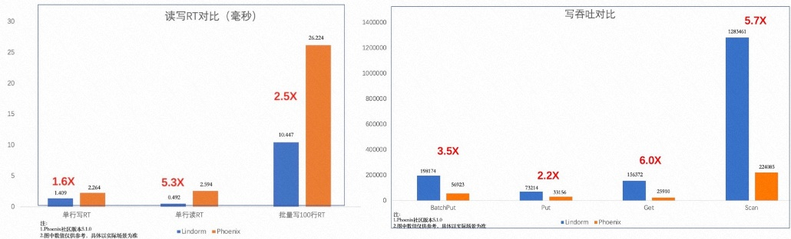

**特性介绍**

Lindorm二级索引支持为单表建多个索引，每个索引在物理上映射为一张数据表，与主表相互独立，每个索引有不同的存储策略（如采用不同的压缩算法、冷热分离策略）等属性。写主表时，Lindorm会自动更新所有索引表，并确保主表和索引表数据的一致性。读数据时，您只需针对主表发起查询，Lindorm会根据WHERE条件和SCHEMA自动选择合适的索引（包括主表）执行查询操作（支持HINT来干预优化器行为）。Lindorm二级索引的基本特性如下。

- 支持单个主表建多个索引。

- 支持组合索引（单列和多列）。

- 支持冗余索引，全冗余索引可自动冗余主表新增的列。

- 查询优化：根据WHERE语句自动选择索引，支持HINT来干预优化器的选择。

- Online Schema Change：索引变更不影响主表的正常读写，可以随时新增、删除、更新索引。

- 支持数据有效期（简称：TTL）：索引表自动继承主表的TTL设置，主表和索引表数据同时过期。

- 支持动态列：支持写入动态列和冗余动态列。

- 支持自定义数据版本：自定义时间戳后自动写入数据。

- 方便使用：与RDBMS的二级索引比较，使用Lindorm的二级索引更加方便，当您购买完Lindorm就可以直接通过Lindorm宽表SQL使用二级索引。

**使用要求**

- 服务器：使用Lindorm实例。

- 客户端：更多信息，请参见安装宽表SQL Driver。

- Lindorm-Cli客户端：更多信息，请参见通过Lindorm-cli连接并使用宽表引擎。

**基本概念**

- 强一致性：是指主表和索引表的数据一致性。为了满足数据一致性的需求，最大程度减少二级索引的额外开销，提升高吞吐的写入能力，Lindorm二级索引在强一致性中具有如下约束。

  - 不支持快照隔离性。在数据写入过程中不保证同时可见，但是返回客户端写入成功后主表和索引表数据可见。

  - 在返回客户端超时或IO出错情况下，该数据在主表和索引表中不保证可见，但最终主表和索引表数据会保持一致。

- 可选的索引组织成本：在主表有一个索引的情况下，写放大有四次操作（读主表，删除索引老数据，写索引，写主表），会大大增加维护索引的成本。但不是所有场景都会产生写放大，比如日志场景只有数据插入没有更新操作，此时索引表不存在老数据，只需要做写索引和写主表操作。所以Lindorm提出了Mutability的概念。Mutability是指对主表的写入模式进行分类，并以此组织索引数据，针对不同的需求实现最低的索引组织成本。Mutability分类和描述如下表所示。Mutability属性需要在创建表或修改表时通过Table_Options参数进行设置，具体操作，请参见CREATE TABLE。

  | Mutability分类 | 约束 | 操作成本 | 操作说明 |
  | --- | --- | --- | --- |
  | 无索引 | 无。 | 1 | 没有索引的情况下，直接写索引，为1次操作。 |
  | IMMUTABLE | 整行写入，不可更新或删除。 | 2 | 写主表，写索引表。所有场景中成本最低，性能最好。 |
  | IMMUTABLE_ROWS | 整行写入，不可更新，删除。 | 2～3 | 正常写入时：写主表，写索引表。在删除场景下需额外读一次主表。性能仅次于IMMUTABLE。 |
  | MUTABLE_LATEST | 可更新，可删除。 | 4 | 读主表，删索引，写索引，写主表。 |
  | MUTABLE_ALL | 无限制，可使用自定义时间戳写入。 | 4 | 读主表，删索引，写索引，写主表。 |

  > **说明**
  >
  > - IMMUTABLE和IMMUTABLE_ROWS不涉及数据更新，无写放大问题，成本最低。适合高吞吐写的场景，如日志、监控等。
  >
  > - IMMUTABLE不涉及删除，所以可充分利用Lindorm的多IDC部署，实现多活的数据访问。
  >
  > - 选择两类IMMUTABLE可以有效降低索引场景下的写时延，提高整体吞吐。实际的业务中，如果不满足IMMUTABLE场景，可以通过数据冗余来改造成IMMUTABLE场景。

- 更新自定义时间戳的索引：Lindorm支持自定义时间戳进行写入，可以在任意时间戳进行数据更新，由系统来判断只有时间戳最大的数据生效。自定义时间戳特性在控制数据有效期、乱序、幂等等场景中发挥着重要的作用，在HBase中有广泛的应用。Lindorm支持列级时间戳，主表支持自定义时间戳写入数据。但在支持二级索引和时间戳的NoSQL系统中，支持自定义时间戳索引更新的，就比较罕见了。因为时间戳乱序写入很难有效维护索引数据的更新和删除。Lindorm全局二级索引解决了这个问题，支持列级别自定义时间戳更新。下面是两个使用自定义时间戳的实际业务场景。

  - 导入与实时并存：在需要同时实时更新和历史数据导入的场景下，实时更新可以使用当前时间，而历史数据导入可以使用昨天23:59:59这个时间。所以当天未更新过的数据可以通过导入操作而更新，已更新过的数据也不会被导入覆盖。

  - 追消息：业务系统通过消息来触发一系列处理逻辑，在消息出现积压时，系统可以跳过积压的消息，直接处理当前消息，并在事后通过追消息来处理之前积压的任务。或者，当业务逻辑有问题时，系统也可以跳过一部分消息来规避问题，在业务修复后重新处理。此时，业务可以通过使用消息本身的时间来写入数据，以此来保证追的消息和正常消息的准确覆盖关系。

- 全冗余索引：为了避免查询索引之后再回查主表，通常会在索引表中冗余一部分主表列，也称为冗余索引或覆盖索引。全冗余索引是比较常用的冗余方案。Lindorm支持三种冗余模式，可以在主表Schema变化以及动态列场景下简单的实现全冗余索引。

  - 冗余指定的列：显示指定要冗余主表的哪些列。

  - 冗余主表Schema中的所有列：当您需要全冗余索引时，不需要在CREATE INDEX中将主表的每一列都显式添加进来，而是通过一个常量来描述冗余所有列，当主表新增列时，全冗余索引表会自动冗余这个新增列，无需重建索引。也无需担心新增列的查询会导致回查主表了。

  - 冗余动态列：Lindorm支持固定Schema和松散Schema（即动态列）。通过DYNAMIC冗余模式，索引表能够自动冗余主表中的所有动态列，也会冗余主表Schema中的所有列。

**语法参考**

关于Lindorm宽表SQL的语法使用，请参见Lindorm宽表SQL语法。

**创建二级索引**

创建完Lindorm主表后，可以为主表的相应列创建二级索引。以下是创建二级索引的示例。

创建完Lindorm主表后，可以为主表的相应列创建二级索引。以下是创建二级索引的示例。

> **说明**
>
> - 创建索引有同步创建和异步创建两种方式，在存量数据不大的情况下，可以使用同步创建。其他情况下可以使用异步创建。具体的语法请参见CREATE INDEX。
>
> - 在已有数据的表中添加新的索引时，**CREATE_INDEX**命令会同时将主表的历史数据同步到索引表中，如果主表很大时，**CREATE_INDEX**会非常耗时间（数据同步任务是在服务端执行的，即使删除Lindorm Shell进程也不会影响数据同步任务）。

**查看二级索引**

通过Lindorm宽表SQL可以查看创建的二级索引状态。以下是查看二级索引的示例。

```text
show index from shop_item_relation;
```

> 通过示例可以展示出shop_item_relation主表下创建的索引名和索引类型。
>
> **说明**

**修改二级索引状态**

创建完二级索引后，如果主表有存量数据，需要手动对索引进行一次Rebuild操作，具体语法请参见BUILD INDEX；若主表没有存量数据，则可以直接使用修改二级索引语法来修改二级索引表状态。以下是修改二级索引状态的示例：

```text
alter index idxs1 on shop_item_relation ACTIVE;
alter index idxs1 on shop_item_relation DISABLED;
```

> 当二级索引状态为DISABLED时，直接修改为ACTIVE状态会导致数据缺失，因此修改前需要进行一次
>
> **说明**
>
> Rebuild操作。

**删除二级索引**

通过以下示例删除对应主表中的相关二级索引。

```text
drop index idxs1 on shop_item_relation;
```

> 删除索引操作需要您有Trash权限。
>
> **说明**

**查询优化**

Lindorm依据RBO（Rule Based Optimization）策略进行二级索引选择。根据查询条件匹配索引表的前缀，选择匹配程度最高的索引表作为本次查询使用的索引。通过以下示例可以更好的理解。

```sql
-- 主表和索引表如下
create table dt (rowkey varchar, c1 varchar, c2 varchar, c3 varchar, c4 varchar, c5 varchar, constraintpk primary key(rowkey));
create index idx1 on dt (c1);
create index idx2 on dt (c2, c3, c4);
create index idx3 on dt (c3) include (c1, c2, c4);
create index idx4 on dt (c5) 'INDEX_COVERED_TYPE'='COVERED_ALL_COLUMNS_IN_SCHEMA';

-- 查询优化如下
select rowkey from dt where c1 = 'a';
select rowkey from dt where c2 = 'b' and c4 = 'd';
select * from dt where c2 = 'b' and c3 >= 'c' and c3 < 'f';
select * from dt where c5 = 'c';
```

> **说明**
>
> - select rowkey from dt where c1 = 'a'表示选择索引表idx1。
>
> - select rowkey from dt where c2 = 'b' and c4 = 'd'表示选择索引表idx2，从中查找所有满足c2=b条件的行，然后逐行按c4=d进行过滤。虽然c4是索引列之一，但因WHERE条件中缺少c3列，无法匹配idx2的前缀。
>
> - select \* from dt where c2 = 'b' and c3 >= 'c' and c3 < 'f'表示选择索引表idx2，由于是select \*，而索引表里并未包含主表的所有列，因此在查询索引之后，还要回查一次主表。回查主表时，回查的Rowkey可能散布在主表的各个地方，因此，可能会消耗多次RPC。回查的数据量越大，RT越长。
>
> - select \* from dt where c5 = 'c'表示选择索引表idx4，idx4是全冗余索引，所以select \*不需要回查主表。

<a id="section-1-4"></a>

## 1.4. Lindorm SQL语法介绍

<a id="section-1-4-1"></a>

### 1.4.1. 使用限制

Lindorm宽表SQL语法包括DDL（Data Definition Language）数据定义语言、DML（Data Manipulation Language）数据操作语言和DCL（Data Control Language）数据控制语言三种。本文介绍Lindorm宽表SQL语法的使用限制和关键字使用说明。

**模式限制**

Lindorm宽表Serverless模式下不支持SQL语法。

**使用限制**

- 不支持关系运算符：相加、减等。

- 不支持事务功能。

- 不支持HAVING、UDF、VIEW等操作。

- 不支持子查询和嵌套查询等复杂操作。

- 支持SUM、AVG、MIN、MAX函数。

- 有限支持ORDER BY 。

- 有限支持GROUP BY、DISTINCT、JOIN等功能。由于Lindorm使用的是全内存计算，如果数据量过大，会导致集群清理整个堆空间（Full GC）或者内存溢出（OOM）。使用前请评估数据量级和集群配置是否能满足。

- 表名和列名区分大小写。

**关键字使用说明**

如果Lindorm宽表SQL语法中使用如下关键字，请添加反引号（\`）进行转义，关键字不区分大小写。

ADD ADMIN_USER ADMIN_TRASH ALL ALLOW ALTER ANALYZE AND ANY ARRAY AS ASC ASYNC AT BERNOULLI BETWEEN BUILD BY CALL CALLED CASCADE CASE CAST CATALOGS COLUMN COLUMNS COMMENT COMMIT COMMITTED CONSTRAINT CREATE SEARCH SEARCH_QUERY INDEX INCLUDE CROSS CUBE CURRENT CURRENT_DATE CURRENT_ROLE CURRENT_TIME CURRENT_TIMESTAMP CURRENT_USER DATA DATABASE DATABASES DATE DAY DEALLOCATE DEFINER DELETE DESC DESCRIBE DETERMINISTIC DISTINCT DISTRIBUTED DROP DUPLICATE ELSE END ESCAPE EXCEPT EXCLUDING EXECUTE EXISTS EXPLAIN EXTRACT EXTERNAL FALSE FILTER FILTERING FIRST FOLLOWING FOR FORCE FORMAT FROM FULL FUNCTION FUNCTIONS GLOBAL GRANT GRANTED GRANTS GRAPHVIZ GROUP GROUPING HAVING HOUR IF IDENTIFIED IGNORE IN INCLUDING INNER INPUT INSERT INTERSECT INTERVAL INTO INVOKER IO IS ISOLATION JSON JOIN KEY LANGUAGE LAST LATERAL LEFT LEVEL LIKE LIMIT LOCALTIME LOCALTIMESTAMP LOGICAL MAP MINUTE MONTH NAME NAMESPACE NAMESPACES NATURAL NFC NFD NFKC NFKD NO NONE NORMAL_USER NORMALIZE NOT NULL NULLIF NULLS OLDPASSWORD ON ONLY ONLINE OFFLINE OFFSET OPTION OR ORDER ORDINARILY OUTER OUTPUT OVER PARTITION PARTITIONS PASSWORD POSITION PRECEDING PREPARE PRIMARY PRIVILEGES PROPERTIES RANGE READ RECURSIVE RENAME REPEATABLE REPLACE RESET RESPECT RESTRICT RETURN RETURNS REVOKE RIGHT ROLE ROLES ROLLBACK ROLLUP ROW ROWS SCHEMA SCHEMAS SECOND SECURITY SELECT SERIALIZABLE SESSION SET SETS SHOW SOME SQL START STATS SUBSTRING SYSTEM TABLE TABLES TABLESAMPLE TEXT THEN TIME TIMESTAMP TO TRASH TRANSACTION TRUE TRY_CAST TRUNCATE TYPE UESCAPE UNBOUNDED UNCOMMITTED UNION UNNEST UPDATE UPSERT USE USER USERS USING VALIDATE VALUES VERBOSE VIEW WHEN WHERE WITH WORK WRITE YEAR ZONE

<a id="section-1-4-2"></a>

### 1.4.2. 名词解释

本文介绍Lindorm宽表SQL语法的常见术语。

| 名词 | 对应Lindorm中的含义 | 描述 |
| --- | --- | --- |
| Schema | NameSpace | Schema逻辑包含很多表，类似数据库的概念。 |
| Table | Table | 表，构建表时需要定义表的schema结构，包括表的列名和列类型。 |
| PRIMARY KEY | PRIMARY KEY | 主键，用于标识一行数据，可以唯一确定一行数据的分布位置。 |
| HASH Table | HASH Table | 通过设置表的USE_HASH属性，使该表的主键具备随机打散能力，预防热点请求，但该属性对于顺序scan不支持。 |
| NUMREGIONS | NUMREGIONS | Lindorm中表示数据分区数，通过设置表的属性进行配置，建表预分区中设置的属性之一。 |
| STARTKEY和ENDKEY | STARTKEY和ENDKEY | Lindorm中表示数据分区范围，通过设置表的属性进行配置，建表预分区中设置的属性之一，可以不指定。 |
| Mutability属性 | Mutability属性 | Lindorm中构建索引时需要设置的属性，包括四种：immutable、immutable_rows、mutable_latest、mutable_all。 |
| 动态列 | 动态列 | Lindorm允许用户不预先定义列的情况下插入列。 |

<a id="section-1-4-3"></a>

### 1.4.3. 数据类型

<a id="section-1-4-3-1"></a>

#### 1.4.3.1. 基础数据类型

Lindorm宽表SQL是一种类型化语言，支持丰富的数据类型集。本文介绍Lindorm宽表SQL的基础数据类型。

**使用限制**

- 单个主键列最大长度2 KB。

- 所有主键列长度之和不超过30 KB。

- 单个非主键列最大长度不超过2 MB。

**基础数据类型**

| 数据类型 | 对应的Java类型 | 描述 |
| --- | --- | --- |
| BOOLEAN | java.lang.Boolean | 长度为1字节。布尔型，取值为true或false。 |
| TINYINT | java.lang.Byte | 长度为1字节。定长精确数值类型。值域取决于长度，以及是否为无符号。 |
| SMALLINT | java.lang.Short | 长度为2字节。定长精确数值类型。值域取决于长度，以及是否为无符号。 |
| INTEGER | java.lang.Integer | 长度为4字节。定长精确数值类型。值域取决于长度，以及是否为无符号。 |
| BIGINT | java.lang.Long | 长度为8字节。定长精确数值类型。值域取决于长度，以及是否为无符号。 |
| FLOAT | java.lang.Float | 长度为4字节。定长非精确数值类型。值域和精度取决于长度、precision和scale，以及是否为无符号。 |
| DOUBLE | java.lang.Double | 长度为8字节。定长非精确数值类型。值域和精度取决于长度、precision和scale，以及是否为无符号。走sql拼写方式按照科学计数法进行拼写double类型。 |
| DECIMAL(precision，scale) | java.lang.BigDecimal | 变长二进制类型。decimal为十进制，消耗的字节数随精度增加而增加，通常用于存储金额等高精度数据，对于精度要求不高的场景（例如监控），可以使用float或double。定义类型时需要指定precision和scale。<br>• precision：最大一共有多少位，值域是\[1，38\]。<br>• scale：小数点后最大有多少位，值域是\[0，precision\]。 |
| VARCHAR / CHAR(N) | java.lang.String | 字符串，支持中文。<br>• VARCHAR：变长字符串类型。<br>• CHAR：定长字符串类型，需要指定长度N。 |
| BINARY(N) | byte\[\] | 定长二进制类型，N表示字节数。写入数据时，包括以下两种情况。<br>• 若给出的值不足N字节，系统会自动在末尾用0补充缺的字节。<br>• 若超出N字节，则自动截断。 |
| VARBINARY | byte\[\] | 变长二进制类型，作为主键时只能是最后一列主键。 |
| DATE | java.sql.Types#DATE | 日期时间（仅存储日期，不存储时间，在时区转换过程中容易出现日期不对的现象，不推荐使用）。 |
| TIME | java.sql.Types#TIME | 时间类型。 |
| TIMESTAMP | java.sql.Types#TIMESTAMP | 时间戳。 |

**不支持的数据类型**

数组等复杂类型。

<a id="section-1-4-3-2"></a>

#### 1.4.3.2. 空间数据类型

空间数据类型是一种用来表示空间对象、地理位置和物体形状的数据类型，多用于航空、导航、城市规划等领域。本文介绍Lindorm宽表引擎支持的空间数据类型。

**空间数据类型**

Lindorm Ganos的SQL接口支持的空间数据类型如下表：

| 数据类型 | 描述 | 使用示例 |
| --- | --- | --- |
| Geometry | 表示通用的空间对象，是Point、LineString和Polygon的父类型。不建议直接将空间列定义为Geometry。 | 创建时空数据表时指定空间列的数据类型。 |
| Point | 表示点类型数据，由坐标经度x和纬度y组成。<br>说明不支持三维点坐标的计算，存储的三维点在计算时会被转为二维点。 | 车辆、船舶接收到的GPS坐标信息。 |
| LineString | 表示线类型数据，由两个或多个点组成。前一条线段的终点是下一条线段的起点。<br>说明一条线段必须有两个及以上的点，连续顶点可以相等。 | • 一条街道可能由多个LineString组成。<br>• 在一定时间范围内，某车辆的多个坐标点组成一条轨迹线。 |
| Polygon | 表示面类型数据，面的外边界是一个闭合的环，即起点和终点的坐标x、y是相等的。<br>说明一个面至少需要三个点才能组成。 | • 电子围栏。<br>• 地图中的土地区块、森林、行政区划等面状类型。<br>• 矩形、圆等图形。 |

<a id="section-1-4-4"></a>

### 1.4.4. 函数说明

<a id="section-1-4-4-1"></a>

#### 1.4.4.1. As函数

As是将请求的结果以别名方式命名。

**示例**

```sql
select count(*) as countRow from test;
select c1 as testC from test where c1 = '2';
```

<a id="section-1-4-4-2"></a>

#### 1.4.4.2. 聚合函数

<a id="section-1-4-4-2-1"></a>

##### 1.4.4.2.1. Count函数

Count函数用于计算给定列的非空值，可以对查询返回的行进行计数。

**示例**

```sql
select count(*) from test;
select count(*) from test where c1 = 1;
select count(c1) from test where c1 = 1;
```

<a id="section-1-4-4-2-2"></a>

##### 1.4.4.2.2. Max函数和Min函数

Max函数和Min函数用于计算指定列的查询返回的最大值和最小值。

**示例**

```sql
SELECT max(c1) FROM test;
SELECT min(c1) FROM test;
```

<a id="section-1-4-4-2-3"></a>

##### 1.4.4.2.3. Sum函数

Sum函数用于求和，计算指定列的查询返回值之和。

**示例**

```sql
select sum(c1) from test;
```

<a id="section-1-4-4-2-4"></a>

##### 1.4.4.2.4. Avg函数

Avg函数用于计算指定列查询返回值的平均值。

**示例**

```sql
//计算test表格中c1列的平均值。
SELECT avg(c1) FROM test;
```

<a id="section-1-4-4-3"></a>

#### 1.4.4.3. 时空函数

<a id="section-1-4-4-3-1"></a>

##### 1.4.4.3.1. 函数概览

本文介绍Lindorm GanosBase支持的时空函数。

Lindorm Ganos支持的时空函数如下表。

> 调用时空函数时不区分大小写。
>
> **说明**

**函数分类**

**相关文档**

**描述**

返回指定Geometry对象的WKT（Well-known

输出函数

输出函数

Text）格式。

返回与指定WKT字符串对应的Geometry对象。

ST_GeomFromText

构造函数

返回与指定MultiPoint对象对应的LineString对象。

ST_LineFromMultiPoint

返回构建的Point对象。

ST_MakePoint

返回指定Geometry对象的几何中心。

ST_Centroid

返回指定LineString类型的最后一个点。

ST_EndPoint

返回指定Geometry对象中顶点的个数。

ST_NPoints

返回指定LineString类型的起点。

ST_StartPoint

返回指定Point类型的X坐标值。

ST_X

访问函数

返回指定Geometry对象边界框X坐标的最大值。

ST_XMax

返回指定Geometry对象边界框X坐标的最小值。

ST_XMin

返回指定Point类型的Y坐标值。

ST_Y

返回指定Geometry对象边界框Y坐标的最大值。

ST_YMax

返回指定Geometry对象边界框Y坐标的最小值。

ST_YMin

如果Geometry对象A包含Geometry对象B，则返回

ST_Contains

true。

如果两个Geometry对象的二维平面距离在指定范围

ST_DWithin

内，则返回true。

如果两个Geometry对象的球面距离在指定范围内，

ST_DWithinSphere

则返回true。

关系函数

判断两个Geometry对象是否相交。如果两个Geometry对象有任意共享空间的部分，那么两个

ST_Intersects

Geometry对象相交，则返回true。

如果两个Geometry对象在空间上有重叠的部分，但不存在其中一个完全包含另一个的情况，则返回

ST_Overlaps

true。

如果Geometry对象A完全在Geometry对象B内，则

ST_Within

返回true。

返回指定点类型列中所有点聚合而成的轨迹的球面长度，单位为米（m）。函数将按照主键顺序读取所有

ST_Length_Rows

点，并计算这些点拼接成的轨迹的长度。

聚合函数

指定点列名、时间列名，计算所有点按时间排序后拼接成的轨迹段，并返回基于特定时间阈值分割后的轨

ST_TrajectoryProfile

迹段。通常与ST_TrajectoryProfile等空间关系查询条件联用，计算在一定区域内轨迹的出入情况。

<a id="section-1-4-4-3-2"></a>

##### 1.4.4.3.2. 输出函数

本文介绍时空输出函数 `ST_AsText` ，返回指定Geometry对象的WKT（Well-known Text）格式，不包含SRID（Spatial Reference IDentifier）信息。

**语法**

```text
string ST_AsText(geometry g);
```

**参数**

| 参数 | 说明 |
| --- | --- |
| g | 表示指定的Geometry对象。 |

> **说明**
>
> - Geometry对象支持Point、LineString、Polygon类型。
>
> - 返回时默认支持DOUBLE数据类型，最多可输出小数点后16位。

**示例**

```text
SELECT ST_AsText(ST_GeomFromText('POINT(111.1111111 1.1111111)')) AS text;
```

返回结果如下：

```text
+-------------------------------+
|             text              |
+-------------------------------+
| POINT (111.1111111 1.1111111) |
+-------------------------------+
```

<a id="section-1-4-4-3-3"></a>

##### 1.4.4.3.3. 构造函数

本文介绍时空函数中的构造函数。

**ST_GeomFromText**

调用 `ST_GeomFromText` 函数返回与指定WKT字符串对应的Geometry对象。

**语法**

```text
geometry ST_GeomFromText(string wkt);
```

**参数**

| 参数 | 描述 |
| --- | --- |
| wkt | 指定WKT字符串。 |

> **说明**
>
> - Geometry对象支持Point、LineString、Polygon类型。
>
> - 如果WKT格式中带有SRID，不支持WKT带有空间参考系信息，SRID（默认为4326）可以单独建列存储，仅作为标识。
>
> - 可以创建任意数据类型的EMPTY。

**示例**

- Geometry对象为Point类型：

  ```text
  SELECT ST_GeomFromText('POINT(1 1)');
  ```

  返回结果如下：

  ```text
  +----------------------------------------------------+
  |             "ST_GeomFromText"('POINT(1             |
  |                        1)')                        |
  +----------------------------------------------------+
  | 0020000001000010E63FF00000000000003FF0000000000000 |
  +----------------------------------------------------+
  ```

- Geometry对象为EMPTY：

  ```text
  SELECT ST_GeomFromText('POLYGON EMPTY');
  ```

  返回结果如下：

  ```text
  +--------------------------------+
  |   "ST_GeomFromText"('POLYGON   |
  |            EMPTY')             |
  +--------------------------------+
  | 0020000003000010E600000000     |
  +--------------------------------+
  ```

**ST_LineFromMultiPoint**

调用 `ST_LineFromMultiPoint` 函数返回与指定MultiPoint对象对应的LineString对象。

**语法**

```text
geometry ST_LineFromMultiPoint(geometry aMultiPoint);
```

**参数**

<table>
  <tr>
    <th width="130">参数</th>
    <th>描述</th>
  </tr>
  <tr>
    <td>aMultiPoint</td>
    <td>指定MultiPoint对象，可以使用<code> ST_Collect </code>函数将Point对象组合成MultiPoint对象。</td>
  </tr>
</table>

**示例**

```text
SELECT 
ST_AsText(ST_LineFromMultiPoint(ST_Collect(ST_MakePoint(1,2),ST_MakePoint(3,4),ST_MakePoint(5,6)))) AS astext;
```

返回结果如下：

```text
+-------------------------+
|         astext          |
+-------------------------+
| LINESTRING(1 2,3 4,5 6) |
+-------------------------+
```

**ST_MakePoint**

调用 `ST_MakePoint` 函数构建一个Point对象。

**语法**

```text
geometry ST_MakePoint(double x, double y);
```

**参数**

| 参数 | 描述 |
| --- | --- |
| x | 经度x值。DOUBLE类型，如果输入的数据类型为INTEGER或者LONG会自动转换为DOUBLE类型。 |
| y | 纬度y值。DOUBLE类型，如果输入的数据类型为INTEGER或者LONG会自动转换为DOUBLE类型。 |

> **说明**
>
> 不支持设定空间参考系和三维对象。

**示例**

```text
SELECT ST_AsText(ST_MakePoint(1, 2));
```

返回结果如下：

```text
+--------------------------------+
| "ST_AsText"("ST_MakePoint"(1,  |
|              2))               |
+--------------------------------+
| POINT (1 2)                    |
+--------------------------------+
```

<a id="section-1-4-4-3-4"></a>

##### 1.4.4.3.4. 访问函数

本文介绍时空函数中的访问函数。

**ST_Centroid**

调用 `ST_Centroid` 函数返回指定Geometry对象的几何中心。

**语法**

```text
geometry ST_Centroid(geometry g);
```

**参数**

| 参数 | 描述 |
| --- | --- |
| g | 指定的Geometry对象。 |

> 如果Geometry对象是一个空的几何体，则返回对应的空几何体。
>
> **说明**

**示例**

- 示例一：

  ```text
  SELECT ST_AsText(ST_Centroid(ST_Collect(ST_MakePoint(1,1),ST_MakePoint(-1,-1)))) AS astext;
  ```

  返回结果如下：

  ```text
  +-------------+
  |   astext    |
  +-------------+
  | POINT (0 0) |
  +-------------+
  ```

- 示例二：

  ```text
  SELECT ST_AsText(ST_Centroid(ST_GeomFromText('LINESTRING(0 0,0 1,1 2)'))) AS astext;
  ```

  返回结果如下：

  ```text
  +--------------------------------+
  |             astext             |
  +--------------------------------+
  | POINT (0.2928932188134525      |
  | 1.085786437626905)             |
  +--------------------------------+
  ```

**ST_EndPoint**

调用 `ST_EndPoint` 函数返回指定LineString对象的最后一个点。

**语法**

```text
geometry ST_EndPoint(geometry g);
```

**参数**

| 参数 | 描述 |
| --- | --- |
| g | 指定的Geometry对象。 |

> 如果Geometry对象不是LineString类型，会返回NULL。
>
> **说明**

**示例**

```text
SELECT ST_AsText(ST_EndPoint(ST_GEOMFROMTEXT('LINESTRING(1 1, 2 2, 3 3)'))) AS endpoint;
```

返回结果如下：

```text
+-------------+
|  endpoint   |
+-------------+
| POINT (3 3) |
+-------------+
```

**ST_NPoints**

调用 `ST_NPoints` 函数返回指定Geometry对象中顶点的个数，适用于任何Geometry对象。

**语法**

```text
int ST_NPoints(geometry g);
```

**参数**

| 参数 | 描述 |
| --- | --- |
| g | 指定的Geometry对象。 |

**示例**

```text
SELECT ST_NPoints(ST_GeomFromText('LINESTRING(77.29 29.07,77.42 29.26,77.27 29.31,77.29 29.07)')) AS npoints;
```

返回结果如下：

```text
+---------+
| npoints |
+---------+
| 4       |
+---------+
```

**ST_StartPoint**

调用 `ST_StartPoint` 函数返回指定LineString类型的起点。

**语法**

```text
geometry ST_StartPoint(geometry g);
```

**参数**

| 参数 | 描述 |
| --- | --- |
| g | 指定的Geometry对象。 |

> 如果Geometry对象不是LineString类型，会返回NULL。
>
> **说明**

**示例**

```text
SELECT ST_AsText(ST_StartPoint(ST_GEOMFROMTEXT('LINESTRING(0 1, 0 2)'))) AS startpoint;
```

返回结果如下：

```text
+-------------+
| startpoint  |
+-------------+
| POINT (0 1) |
+-------------+
```

**ST_X**

调用 `ST_X` 函数返回指定Point类型的X坐标值。

**语法**

```text
double ST_X(geometry a_point);
```

**参数**

| 参数 | 描述 |
| --- | --- |
| a_point | 指定的Point类型。 |

> 输入Geometry对象必须是Point类型。如果输入的Geometry对象为EMPTY或者输入值为NULL会返回
>
> **说明**
>
> NULL。

**示例**

```text
SELECT ST_X(ST_MakePoint(1.0, 2.0)) AS x;
```

返回结果如下：

```text
+---+
| x |
+---+
| 1 |
+---+
```

**ST_XMax**

调用 `ST_XMax` 函数返回指定Geometry对象边界框X坐标的最大值。

**语法**

```text
double ST_XMax(geometry g);
```

**参数**

| 参数 | 描述 |
| --- | --- |
| g | 指定的Geometry对象。 |

> **说明**
>
> - Geometry对象支持Point、LineString、Polygon类型。
>
> - 如果Geometry对象为EMPTY会返回-1。

**示例**

```text
SELECT ST_XMax(ST_GeomFromText('LINESTRING(1 3,5 6)')) AS xmax;
```

返回结果如下：

```text
+------+
| xmax |
+------+
| 5    |
+------+
```

**ST_XMin**

调用 `ST_XMin` 函数返回指定Geometry对象边界框X坐标的最小值。

**语法**

```text
double ST_XMin(geometry g);
```

**参数**

| 参数 | 描述 |
| --- | --- |
| g | 指定的Geometry对象。 |

> **说明**
>
> - Geometry对象支持Point、LineString、Polygon类型。
>
> - 如果Geometry对象为EMPTY会返回0。

**示例**

```text
SELECT ST_XMin(ST_GeomFromText('LINESTRING(1 3,5 6)')) AS xmin;
```

返回结果如下：

```text
+------+
| xmin |
+------+
| 1    |
+------+
```

**ST_Y**

调用 `ST_Y` 函数返回指定Point类型的Y坐标值。

**语法**

```text
double ST_Y(geometry a_point);
```

**参数**

| 参数 | 描述 |
| --- | --- |
| a_point | 指定的Point对象。 |

> Geometry对象必须是Point类型。如果输入的Geometry对象为EMPTY或者输入值为NULL会返回NULL。
>
> **说明**

**示例**

```text
SELECT ST_Y(ST_MakePoint(1.0, 2.0)) AS y;
```

返回结果如下：

```text
+---+
| y |
+---+
| 2 |
+---+
```

**ST_YMax**

调用 `ST_YMax` 函数返回指定Geometry对象边界框Y坐标的最大值。

**语法**

```text
double ST_YMax(geometry g);
```

**参数**

| 参数 | 描述 |
| --- | --- |
| g | 指定的Geometry对象。 |

> **说明**
>
> - Geometry对象支持Point、LineString、Polygon类型。
>
> - 如果Geometry对象为EMPTY会返回-1。

**示例**

```text
SELECT ST_YMax(ST_GeomFromText('LINESTRING(1 3,5 6)')) AS ymax;
```

返回结果如下：

```text
+------+
| ymax |
+------+
| 6    |
+------+
```

**ST_YMin**

调用 `ST_YMin` 函数返回指定Geometry对象边界框Y坐标的最小值。

**语法**

```text
double ST_YMin(geometry g);
```

**参数**

| 参数 | 描述 |
| --- | --- |
| g | 指定的Geometry对象。 |

> **说明**
>
> - Geometry对象支持Point、LineString、Polygon类型。
>
> - 如果Geometry对象为EMPTY会返回0。

**示例**

```text
SELECT ST_YMin(ST_GeomFromText('LINESTRING(1 3,5 6)')) AS ymin;
```

返回结果如下：

```text
+------+
| ymin |
+------+
| 3    |
+------+
```

<a id="section-1-4-4-3-5"></a>

##### 1.4.4.3.5. 关系函数

本文介绍时空函数中的关系函数。

**ST_Contains**

如果Geometry对象A包含Geometry对象B， `ST_Contains` 函数则返回true。

**语法**

- 判断对象geomA是否包含对象geomB

  ```text
  boolean ST_Contains(geometry geomA, geometry geomB);
  ```

- 判断对象g和点坐标（x,y）的包含关系

  ```text
  boolean ST_Contains(geometry g, double x, double y);
  ```

**参数**

| 参数 | 描述 |
| --- | --- |
| geomA | 指定的第一个Geometry对象。 |
| geomB | 指定的第二个Geometry对象。 |
| g | 指定的Geometry对象。 |
| x | 坐标经度x值。 |
| y | 坐标纬度y值。 |

> **说明**
>
> - geomB对象的所有点均在geomA对象的内部或者边界上，则geomA对象包含geomB对象。
>
> - `ST_Contains` 函数是 `ST_Within` 的反函数，即 `ST_Contains(A,B)=ST_Within(B,A)` 。

**示例**

- 示例一

  ```text
  SELECT ST_Contains(ST_GeomFromText('POLYGON((0 0, 0 10, 10 10, 10 0, 0 0))'), 
  ST_GeomFromText('POINT(5 5)')) AS iscontain;
  ```

  返回结果如下：

  ```text
  +-----------+
  | iscontain |
  +-----------+
  | true      |
  +-----------+
  ```

- 示例二

  ```text
  SELECT ST_Contains(ST_GeomFromText('POLYGON((0 0, 0 10, 10 10, 10 0, 0 0))'),5,5) AS iscontain;
  ```

  返回结果如下：

  ```text
  +-----------+
  | iscontain |
  +-----------+
  | true      |
  +-----------+
  ```

- 示例三

  ```text
  SELECT ST_Contains(ST_GeomFromText('POLYGON((0 0, 0 10, 10 10, 10 0, 0 0))'), 
  ST_GeomFromText('POINT(180 23)')) AS iscontain;
  ```

  返回结果如下：

  ```text
  +-----------+
  | iscontain |
  +-----------+
  | false     |
  +-----------+
  ```

- 示例四

  ```text
  SELECT ST_Contains(ST_GeomFromText('POLYGON((0 0, 0 10, 10 10, 10 0, 0 0))'),180,23) AS iscontain;
  ```

  返回结果如下：

  ```text
  +-----------+
  | iscontain |
  +-----------+
  | false     |
  +-----------+
  ```

**ST_DWithin**

如果两个Geometry对象的二维平面距离在指定范围内， `ST_DWithin` 函数则返回true。距离单位为degree。

**语法**

- 判断对象geomA和对象geomB的二维平面距离是否在指定范围内

  ```text
  boolean ST_DWithin(geometry geomA, geometry geomB, double distanceOfSrid);
  ```

- 判断对象g和点坐标（x,y）的二维平面距离是否在指定范围内

  ```text
  boolean ST_DWithin(geometry g, double x, double y, double distanceOfSrid);
  ```

**参数**

| 参数 | 描述 |
| --- | --- |
| geomA | 指定的第一个Geometry对象。 |
| geomB | 指定的第二个Geometry对象。 |
| distanceOfSrid | 在SRID 4326下的距离，单位为degree。 |
| g | 指定的Geometry对象。 |
| x | 坐标经度x值。 |
| y | 坐标纬度y值。 |

> Geometry对象支持Point、LineString、Polygon类型。
>
> **说明**

**示例**

- 示例一

  ```text
  SELECT ST_DWithin(ST_GeomFromText('POINT(5 5)'), ST_GeomFromText('POINT(6 6)'), 10) AS iswithin;
  ```

  返回结果如下：

  ```text
  +----------+
  | iswithin |
  +----------+
  | true     |
  +----------+
  ```

- 示例二

  ```text
  SELECT ST_DWithin(ST_GeomFromText('POINT(5 5)'),6,6,10) AS iswithin;
  ```

  返回结果如下：

  ```text
  +----------+
  | iswithin |
  +----------+
  | true     |
  +----------+
  ```

**ST_DWithinSphere**

如果两个Geometry对象的球面距离在指定范围内， `ST_DWithinSphere` 函数则返回true。距离单位为米，球面距离的判断存在一定的误差，误差为厘米级别。

**语法**

- 判断对象geomA和对象geomB的球面距离是否在指定范围内

  ```text
  boolean ST_DWithinSphere(geometry geomA, geometry geomB, double distance);
  ```

- 判断对象g和点坐标（x,y）的球面距离是否在指定范围内

  ```text
  boolean ST_DWithinSPhere(geometry g, double x, double y, double distance);
  ```

**参数**

| 参数 | 描述 |
| --- | --- |
| geomA | 指定的第一个Geometry对象。 |
| geomB | 指定的第二个Geometry对象。 |
| distance | 球面距离，单位为米。 |
| g | 指定的Geometry对象。 |
| x | 坐标经度x值。 |
| y | 坐标纬度y值。 |

> **说明**
>
> - Geometry对象支持Point、LineString、Polygon类型。
>
> - 球面距离的判断存在一定的误差，误差为厘米级别。

**示例**

- 示例一：球面上POINT(120 36)和POINT(116 40)之间的距离为566034.7930717631米，距离在指定的范围内， `ST_DWithinSphere` 函数则返回true。

  ```text
  SELECT ST_DWithinSphere(ST_GeomFromText('POINT(120 36)'), ST_GeomFromText('POINT(116 40)'), 570000) A
  S iswithin;
  ```

  返回结果如下：

  ```text
  +----------+
  | iswithin |
  +----------+
  | true     |
  +----------+
  ```

- 示例二

  ```text
  SELECT ST_DWithinSphere(ST_GeomFromText('POINT(120 36)'),116,40,570000) AS iswithin;
  ```

  返回结果如下：

  ```text
  +----------+
  | iswithin |
  +----------+
  | true     |
  +----------+
  ```

**ST_Intersects**

判断两个Geometry对象是否相交。如果两个Geometry对象有任意共享空间的部分，那么两个Geometry对象相交， `ST_Intersects` 函数则返回true。

**语法**

- 判断对象geomA和对象geomB的是否相交

  ```text
  boolean ST_ Intersects(geometry geomA, geometry geomB);
  ```

- 判断对象g和点坐标（x,y）是否相交

  ```text
  boolean ST_ Intersects(geometry g, double x, double y);
  ```

**参数**

| 参数 | 描述 |
| --- | --- |
| geomA | 指定的第一个Geometry对象。 |
| geomB | 指定的第二个Geometry对象。 |
| g | 指定的Geometry对象。 |
| x | 坐标经度x值。 |
| y | 坐标纬度y值。 |

> Geometry对象支持Point、LineString、Polygon类型。
>
> **说明**

**示例**

- 示例一

  ```text
  SELECT ST_Intersects(ST_GeomFromText('POINT(0 0)'), ST_GeomFromText('LINESTRING ( 2 0, 0 2 )')) AS isinter;
  ```

  返回结果如下：

  ```text
  +---------+
  | isinter |
  +---------+
  | false   |
  +---------+
  ```

- 示例二

  ```text
  SELECT ST_Intersects(ST_GeomFromText('LINESTRING ( 2 0, 0 2 )'), 0, 0) AS isinter;
  ```

  返回结果如下：

  ```text
  +---------+
  | isinter |
  +---------+
  | false   |
  +---------+
  ```

- 示例三

  ```text
  SELECT ST_Intersects(ST_GeomFromText('POINT(0 0)'), ST_GeomFromText('LINESTRING ( 0 0, 0 2 )')) AS isinter;
  ```

  返回结果如下：

  ```text
  +---------+
  | isinter |
  +---------+
  | true    |
  +---------+
  ```

- 示例四

  ```text
  SELECT ST_Intersects(ST_GeomFromText('LINESTRING ( 0 0, 0 2 )'), 0, 0) AS isinter;
  ```

  返回结果如下：

  ```text
  +---------+
  | isinter |
  +---------+
  | true    |
  +---------+
  ```

**ST_Overlaps**

如果两个Geometry对象在空间上有重叠的部分，但不存在其中一个完全包含另一个的情况， `ST_Overlaps` 函数则返回true。

**语法**

- 判断对象geomA和对象geomB在空间上是否有重叠的部分

  ```text
  boolean ST_Overlaps(geometry geomA, geometry geomB);
  ```

- 判断对象g和点坐标（x,y）在空间上是否有重叠的部分

  ```text
  boolean ST_Overlaps(geometry g, double x, double y);
  ```

**参数**

| 参数 | 描述 |
| --- | --- |
| geomA | 指定的第一个Geometry对象。 |
| geomB | 指定的第二个Geometry对象。 |
| g | 指定的Geometry对象。 |
| x | 坐标经度x值。 |
| y | 坐标纬度y值。 |

> Geometry对象支持Point、LineString、Polygon类型。
>
> **说明**

**示例**

- 示例一

  ```text
  SELECT ST_Overlaps(ST_GeomFromText('LINESTRING(0 0,0 2)'),ST_GeomFromText('LINESTRING(0 1,0 3)')) as overlaps;
  ```

  返回结果如下：

  ```text
  +----------+
  | overlaps |
  +----------+
  | true     |
  +----------+
  ```

- 示例二

  ```text
  SELECT ST_Overlaps(ST_GeomFromText('LINESTRING(0 0,0 2)'),ST_GeomFromText('POINT(0 1)')) as overlaps;
  ```

  返回结果如下：

  ```text
  +----------+
  | overlaps |
  +----------+
  | false    |
  +----------+
  ```

- 示例三

  ```text
  SELECT ST_Overlaps(ST_GeomFromText('LINESTRING(0 0,0 2)'), 0, 1) as overlaps;
  ```

  返回结果如下：

  ```text
  +----------+
  | overlaps |
  +----------+
  | false    |
  +----------+
  ```

**ST_Within**

如果Geometry对象A完全在Geometry对象B内， `ST_Within` 函数则返回true。

**语法**

- 判断对象geomA和对象geomB的包含关系

  ```text
  boolean ST_Within(geometry geomA, geometry geomB);
  ```

- 判断对象g和点坐标（x,y）的包含关系

  ```text
  bboolean ST_Within(double x, double y, geometry g);
  ```

**参数**

| 参数 | 描述 |
| --- | --- |
| geomA | 指定的第一个Geometry对象。 |
| geomB | 指定的第二个Geometry对象。 |
| g | 指定的Geometry对象。 |
| x | 坐标经度x值。 |
| y | 坐标纬度y值。 |

> **说明**
>
> - Geometry对象支持Point、LineString、Polygon类型。
>
> - 如果 `ST_Within(A,B)` 的返回结果与 `ST_Within(B,A)` 的返回结果都为true，则认为Geometry对象A和Geometry对象B在空间上相同。

**示例**

- 示例一

  ```text
  SELECT ST_Within(ST_GeomFromText('POINT(5 5)'), ST_GeomFromText('POLYGON((0 0, 0 10, 10 10, 10 0, 0 0
  ))')) AS iswithin;
  ```

  返回结果如下：

  ```text
  +----------+
  | iswithin |
  +----------+
  | true     |
  +----------+
  ```

- 示例二

  ```text
  SELECT ST_Within(5, 5, ST_GeomFromText('POLYGON((0 0, 0 10, 10 10, 10 0, 0 0))')) AS iswithin;
  ```

  返回结果如下：

  ```text
  +----------+
  | iswithin |
  +----------+
  | true     |
  +----------+
  ```

<a id="section-1-4-4-3-6"></a>

##### 1.4.4.3.6. 处理函数

本文介绍时空函数中的处理函数。

**ST_Buffer**

调用 `ST_Buffer` 函数返回以指定点为中心点，以指定距离为半径的所有点组成的Geometry对象，距离的单位为degree。

**语法**

```text
ST_Buffer(geometry g, double radius);
```

**参数**

| 参数 | 描述 |
| --- | --- |
| g | 指定的Geometry对象。 |
| radius | 指定的距离，即buffer半径，单位为degree。 |

> **说明**
>
> - Geometry对象支持Point、LineString、Polygon、MultiPoint、MultiLineString、MultiPolygon和GeometryCollection类型。
>
> - 如果指定的**radius**为正，返回向外扩展后的Geometry对象。如果指定的**radius**为负，返回向内收缩后的Geometry对象，返回结果可能为EMPTY。
>
> - 仅支持采用默认的buffer style，弧段分段数（quadrantSegments）默认值为8，端盖样式（endCapStyle）默认值为round。

**示例**

- 示例一：

  ```text
  SELECT ST_AsText(ST_Buffer(ST_GeomFromText('POINT(120.18 30.25)'), 0.05)) AS buffer;
  ```

  返回结果如下：

  ```text
  +--------------------------------+
  |             buffer             |
  +--------------------------------+
  | POLYGON ((120.23 30.25,        |
  | 120.22903926402017             |
  | 30.240245483899194,            |
  | 120.22619397662557             |
  | 30.230865828381745,            |
  | 120.22157348061513             |
  | 30.22222148834902,             |
  | 120.21535533905933             |
  | 30.21464466094067,             |
  | 120.20777851165099             |
  | 30.208426519384872,            |
  | 120.19913417161825             |
  | 30.203806023374437,            |
  | 120.18975451610082             |
  | 30.200960735979837, 120.18     |
  | 30.2, 120.1702454838992        |
  | 30.200960735979837,            |
  | 120.16086582838176             |
  | 30.203806023374437,            |
  | 120.15222148834903             |
  | 30.208426519384872,            |
  | 120.14464466094068             |
  | 30.21464466094067,             |
  | 120.13842651938488             |
  | 30.22222148834902,             |
  | 120.13380602337445             |
  | 30.230865828381745,            |
  | 120.13096073597984             |
  | 30.240245483899194,            |
  | 120.13000000000001             |
  | 30.25, 120.13096073597984      |
  | 30.259754516100806,            |
  | 120.13380602337445             |
  | 30.269134171618255,            |
  | 120.13842651938488             |
  | 30.27777851165098,             |
  | 120.14464466094068             |
  | 30.28535533905933,             |
  | 120.15222148834903             |
  | 30.291573480615128,            |
  | 120.16086582838176             |
  | 30.296193976625563,            |
  | 120.1702454838992              |
  | 30.299039264020163, 120.18     |
  | 30.3, 120.18975451610082       |
  | 30.299039264020163,            |
  | 120.19913417161825             |
  | 30.296193976625563,            |
  | 120.20777851165099             |
  | 30.291573480615128,            |
  | 120.21535533905933             |
  | 30.28535533905933,             |
  | 120.22157348061513             |
  | 30.27777851165098,             |
  | 120.22619397662557             |
  | 30.269134171618255,            |
  | 120.22903926402017             |
  | 30.259754516100806, 120.23     |
  | 30.25))                        |
  +--------------------------------+
  ```

- 示例二：

  ```text
  SELECT ST_AsText(ST_Buffer(ST_GeomFromText('LINESTRING (120.18 30.25, 120.16 30.23)'), 0.01)) AS buffer;
  ```

  返回结果如下：

  ```text
  +--------------------------------+
  |             buffer             |
  +--------------------------------+
  | POLYGON ((120.16707106781186   |
  | 30.222928932188132,            |
  | 120.1655557023302              |
  | 30.221685303876974,            |
  | 120.16382683432364             |
  | 30.220761204674886,            |
  | 120.16195090322016             |
  | 30.220192147195966, 120.16     |
  | 30.22, 120.15804909677983      |
  | 30.22019214719597,             |
  | 120.15617316567635             |
  | 30.22076120467489,             |
  | 120.1544442976698              |
  | 30.221685303876978,            |
  | 120.15292893218813             |
  | 30.222928932188136,            |
  | 120.15168530387697             |
  | 30.224444297669805,            |
  | 120.15076120467488             |
  | 30.226173165676354,            |
  | 120.15019214719597             |
  | 30.22804909677984,             |
  | 120.14999999999999             |
  | 30.230000000000004,            |
  | 120.15019214719597             |
  | 30.231950903220163,            |
  | 120.15076120467488             |
  | 30.233826834323654,            |
  | 120.15168530387697             |
  | 30.2355557023302,              |
  | 120.15292893218813             |
  | 30.23707106781187,             |
  | 120.17292893218814             |
  | 30.257071067811868,            |
  | 120.17444429766981             |
  | 30.258314696123026,            |
  | 120.17617316567636             |
  | 30.259238795325114,            |
  | 120.17804909677984             |
  | 30.259807852804034, 120.18     |
  | 30.26, 120.18195090322017      |
  | 30.25980785280403,             |
  | 120.18382683432365             |
  | 30.25923879532511,             |
  | 120.1855557023302              |
  | 30.258314696123023,            |
  | 120.18707106781187             |
  | 30.257071067811864,            |
  | 120.18831469612303             |
  | 30.255555702330195,            |
  | 120.18923879532512             |
  | 30.253826834323647,            |
  | 120.18980785280404             |
  | 30.25195090322016,             |
  | 120.19000000000001             |
  | 30.249999999999996,            |
  | 120.18980785280404             |
  | 30.248049096779837,            |
  | 120.18923879532512             |
  | 30.246173165676346,            |
  | 120.18831469612303             |
  | 30.2444442976698,              |
  | 120.18707106781187             |
  | 30.242928932188132,            |
  | 120.16707106781186             |
  | 30.222928932188132))           |
  +--------------------------------+
  ```

**ST_BufferSphere**

调用 `ST_BufferSphere` 函数返回以指定点为中心点，以指定距离为半径的所有点在球面上组成的Geometry对象，距离的单位为米。

**语法**

```text
ST_BufferSphere(geometry g, double radius);
```

**参数**

| 参数 | 描述 |
| --- | --- |
| g | 指定的Geometry对象。 |
| radius | 指定的距离，即buffer半径，单位为米。 |

> **说明**
>
> - Geometry对象支持Point、LineString、Polygon、MultiPoint、MultiLineString、MultiPolygon和GeometryCollection类型。
>
> - 如果指定的**radius**为正，返回向外扩展后的Geometry对象。如果指定的**radius**为负，返回向内收缩后的Geometry对象，返回结果可能为EMPTY。
>
> - 仅支持采用默认的buffer style，弧段分段数（quadrantSegments）默认值为8，端盖样式（endCapStyle）默认值为round。

**示例**

- 示例一：

  ```text
  SELECT ST_AsText(ST_BufferSphere(ST_GeomFromText('POINT(120.18 30.25)'), 500)) AS buffer;
  ```

  返回结果如下：

  ```text
  +--------------------------------+
  |             buffer             |
  +--------------------------------+
  | POLYGON ((120.1851909310331    |
  | 30.25011173053024,             |
  | 120.18511627294788             |
  | 30.249230378090658,            |
  | 120.18484500297895             |
  | 30.248378605521545,            |
  | 120.18438755060062             |
  | 30.247589145091563,            |
  | 120.1837614989031              |
  | 30.246892333708224,            |
  | 120.18299090835872             |
  | 30.24631494733322,             |
  | 120.18210539193977             |
  | 30.245879172318283,            |
  | 120.18113897716789             |
  | 30.24560175314354,             |
  | 120.18012879881775             |
  | 30.245493349257533,            |
  | 120.17911367245745             |
  | 30.245558125686234,            |
  | 120.17813260355221             |
  | 30.245793593106626,            |
  | 120.17722328930826             |
  | 30.246190703510113,            |
  | 120.17642067070908             |
  | 30.24673419777976,             |
  | 120.17575559027851             |
  | 30.247403191844143,            |
  | 120.17525360707266             |
  | 30.248171978919647,            |
  | 120.1749340144007              |
  | 30.249011017060198,            |
  | 120.17480909803247             |
  | 30.249888064116504,            |
  | 120.17488366345407             |
  | 30.250769416537622,            |
  | 120.17515485043153             |
  | 30.251621204446096,            |
  | 120.17561224212514             |
  | 30.252410693237966,            |
  | 120.17623826468355             |
  | 30.253107541687907,            |
  | 120.17700886207045             |
  | 30.253684968191145,            |
  | 120.17789442027193             |
  | 30.254120780286797,            |
  | 120.1788609054053              |
  | 30.25439822784955,             |
  | 120.17987117198402             |
  | 30.25450664710903,             |
  | 120.18088639100795             |
  | 30.254441870698788,            |
  | 120.18186754290468             |
  | 30.254206387939035,            |
  | 120.1827769178333              |
  | 30.25380924917365,             |
  | 120.1835795655716              |
  | 30.253265717837415,            |
  | 120.1842446391596              |
  | 30.252596683644782,            |
  | 120.18474658058295             |
  | 30.251827859488568,            |
  | 120.18506610289342             |
  | 30.250988792960012,            |
  | 120.1851909310331              |
  | 30.25011173053024))            |
  +--------------------------------+
  ```

- 示例二：

  ```text
  SELECT ST_AsText(ST_BufferSphere(ST_GeomFromText('LINESTRING (120.18 30.25, 120.16 30.23)'), 20)) AS buffer;
  ```

  返回结果如下：

  ```text
  +--------------------------------+
  |             buffer             |
  +--------------------------------+
  | POLYGON ((120.1601568095326    |
  | 30.229881789491696,            |
  | 120.16012723865646             |
  | 30.22985749603038,             |
  | 120.16009277809007             |
  | 30.229838678911875,            |
  | 120.16005475213065             |
  | 30.229826061263992,            |
  | 120.16001462208855             |
  | 30.22982012797305,             |
  | 120.15997393013107             |
  | 30.229821107050387,            |
  | 120.15993424001891             |
  | 30.22982896087028,             |
  | 120.15989707701289             |
  | 30.229843387615915,            |
  | 120.15986386926043             |
  | 30.229863832877875,            |
  | 120.15983589291346             |
  | 30.229889510959428,            |
  | 120.15981422308717             |
  | 30.229919435069952,            |
  | 120.15979969254388             |
  | 30.22995245524614,             |
  | 120.15979285969011             |
  | 30.22998730254394,             |
  | 120.15979398711634             |
  | 30.23002263780298,             |
  | 120.15980303150468             |
  | 30.230057103109367,            |
  | 120.15981964529222             |
  | 30.230089373979652,            |
  | 120.15984319002649             |
  | 30.230118210260056,            |
  | 120.17984317814214             |
  | 30.250118233425205,            |
  | 120.17987275990819             |
  | 30.250142523059253,            |
  | 120.17990723145967             |
  | 30.250161335607235,            |
  | 120.17994526807108             |
  | 30.250173948109982,            |
  | 120.17998540801094             |
  | 30.250179875873307,            |
  | 120.18002610871608             |
  | 30.25017889109486,             |
  | 120.18006580607275             |
  | 30.25017103161881,             |
  | 120.18010297452594             |
  | 30.250156599481485,            |
  | 120.18013618570674             |
  | 30.25013614930418,             |
  | 120.18016416332479             |
  | 30.25011046697896,             |
  | 120.18018583221566             |
  | 30.250080539466826,            |
  | 120.18020035965924             |
  | 30.250047516868772,            |
  | 120.18020718737982             |
  | 30.25001266822753,             |
  | 120.18020605299972             |
  | 30.249977332758547,            |
  | 120.18019700012098             |
  | 30.2499428683844,              |
  | 120.18018037664854             |
  | 30.249910599550603,            |
  | 120.1801568214192              |
  | 30.249881766327974,            |
  | 120.1601568095326              |
  | 30.229881789491696))           |
  +--------------------------------+
  ```

**ST_Collect**

调用 `ST_Collect` 函数将两个或者两个以上的Geometry对象组合为Multi\*（包括MultiPoint、MultiLineString、MultiPolygon）或者GeometryCollection对象并返回。

**语法**

```text
ST_Collect(geometry geomA, geometry geomB);
ST_Collect(geometry geomA, geometry geomB, ...,geometry geomN);
```

**参数**

| 参数 | 描述 |
| --- | --- |
| geomA | 指定的第一个Geometry对象。 |
| geomB | 指定的第二个Geometry对象。 |
| geomN | 指定的第N个Geometry对象。 |

> **说明**
>
> - 函数 `ST_Collect` 返回结果为Multi\*或者GeometryCollection类型，在Lindorm Ganos SQL中仅支持读取，不支持写入。
>
> - 函数 `ST_Collect` 和函数 `ST_Union` 可以相互替换来使用，但是有以下区别：
>
>   - 函数 `ST_Collect` 的返回结果为Multi\*或者GeometryCollection类型，而函数 `ST_Union` 的返回结果可能是单个Geometry对象。
>
>   - 函数 `ST_Union` 在节点相交处分割LineString，而函数 `ST_Collect` 返回的是MultiLineString类型。
>
>   - 一般情况下， `ST_Collect` 比 `ST_Union` 函数计算速度快。因为 `ST_Collect` 不会分解输入的Geometry对象的边界或者检查MultiPolygon对象是否有重叠部分，只是把输入的多个Geometry对象组合成一个Multi\*类型，或者把Multi\*类型组合成一个GeometryCollection集合类型。

**示例**

- 示例一：返回MultiPoint对象。

  ```text
  SELECT ST_AsText(ST_Collect(ST_MakePoint(0,0),ST_MakePoint(0,1))) AS g;
  ```

  返回结果如下：

  ```text
  +---------------------------+
  |             g             |
  +---------------------------+
  | MULTIPOINT ((0 0), (0 1)) |
  +---------------------------+
  ```

- 示例二：返回GeometryCollection对象。

  ```text
  SELECT ST_AsText(ST_Collect(ST_MakePoint(0,0),ST_GeomFromText('LINESTRING(0 2,0 3)'))) AS g;
  ```

  返回结果如下：

  ```text
  +--------------------------------+
  |               g                |
  +--------------------------------+
  | GEOMETRYCOLLECTION (POINT (0   |
  | 0), LINESTRING (0 2, 0 3))     |
  +--------------------------------+
  ```

**ST_Difference**

调用 `ST_Difference` 函数返回Geometry对象A与Geometry对象B不相交的部分。

**语法**

```text
ST_Difference(geometry geomA, geometry geomB);
```

**参数**

| 参数 | 描述 |
| --- | --- |
| geomA | 指定的第一个Geometry对象。 |
| geomB | 指定的第二个Geometry对象。 |

> **说明**
>
> - Geometry对象支持Point、LineString、Polygon、MultiPoint、MultiLineString、MultiPolygon和GeometryCollection类型。
>
> - 如果Geometry对象A完全被Geometry对象B包含或者Geometry对象A为EMPTY，那么返回一个空几何类型。
>
> - 如果指定的Polygon类型自身存在相交边，那么可能无法返回结果。
>
> - 该函数的返回值与输入对象的顺序有关。

**示例**

```text
SELECT ST_AsText(ST_Difference(ST_GeomFromText('LINESTRING(50 100, 50 
200)'),ST_GeomFromText('LINESTRING(50 50, 50 150)'))) AS diff;
```

返回结果如下：

```text
+-----------------------------+
|            diff             |
+-----------------------------+
| LINESTRING (50 150, 50 200) |
+-----------------------------+
```

**ST_MinimumBoundingCircle**

调用 `ST_MinimumBoundingCircle` 函数返回包含指定Geometry对象的最小Circle Polygon对象。

**语法**

```text
ST_MinimumBoundingCircle(geometry g);
```

**参数**

| 参数 | 描述 |
| --- | --- |
| g | 指定的Geometry对象。 |

> `ST_MinimumBoundingCircle` 函数通常用于处理Multi\*（包括MultiPoint、MultiLineString、
>
> **说明**
>
> MultiPolygon）或者GeometryCollection对象。虽然该函数不是一个聚合函数，但是您可以使用 `ST_Collect` 函数获取多个Geometry对象集合的最小包围圈，即 `ST_MinimumBoundingCircle(ST_Collect(geometry geomA, geometry geomB, geometry geomC, ...))` 。

**示例**

```text
SELECT ST_AsText(ST_MinimumBoundingCircle(ST_GeomFromText('POLYGON((0 0,1 0,1 1,0 1,0 0))'))) AS g;
```

返回结果如下：

```text
+--------------------------------+
|               g                |
+--------------------------------+
| POLYGON ((1.2071067811865475   |
| 0.5, 1.1935199226610738        |
| 0.3620503103585285,            |
| 1.1532814824381883             |
| 0.2294019499269015,            |
| 1.0879378012096794             |
| 0.1071525208064489, 1          |
| 0, 0.8928474791935512          |
| -0.0879378012096794,           |
| 0.7705980500730986             |
| -0.1532814824381883,           |
| 0.6379496896414716             |
| -0.1935199226610738,           |
| 0.5 -0.2071067811865476,       |
| 0.3620503103585285             |
| -0.1935199226610738,           |
| 0.2294019499269015             |
| -0.1532814824381883,           |
| 0.107152520806449              |
| -0.0879378012096794,           |
| 0 -0.0000000000000001,         |
| -0.0879378012096794            |
| 0.1071525208064489,            |
| -0.1532814824381883            |
| 0.2294019499269014,            |
| -0.1935199226610738            |
| 0.3620503103585282,            |
| -0.2071067811865476            |
| 0.4999999999999999,            |
| -0.1935199226610738            |
| 0.6379496896414716,            |
| -0.1532814824381884            |
| 0.7705980500730985,            |
| -0.0879378012096795            |
| 0.892847479193551,             |
| -0.0000000000000001            |
| 1, 0.1071525208064489          |
| 1.0879378012096794,            |
| 0.2294019499269011             |
| 1.1532814824381883,            |
| 0.3620503103585282             |
| 1.1935199226610735,            |
| 0.4999999999999999             |
| 1.2071067811865475,            |
| 0.6379496896414716             |
| 1.1935199226610738,            |
| 0.7705980500730987             |
| 1.1532814824381883,            |
| 0.8928474791935508             |
| 1.0879378012096796,            |
| 0.9999999999999999             |
| 1, 1.0879378012096794          |
| 0.892847479193551,             |
| 1.1532814824381883             |
| 0.7705980500730989,            |
| 1.1935199226610735             |
| 0.6379496896414718,            |
| 1.2071067811865475 0.5))       |
+--------------------------------+
```

**ST_MinimumBoundingRadius**

调用 `ST_MinimumBoundingRadius` 函数返回完全包含指定Geometry对象的最小圆形的半径。

**语法**

```text
ST_MinimumBoundingRadius(geometry g);
```

**参数**

| 参数 | 描述 |
| --- | --- |
| g | 指定的Geometry对象。 |

> **说明**
>
> - 返回时默认支持DOUBLE数据类型，最多可输出小数点后16位。
>
> - 该函数可以与 `ST_Collect` 函数组合使用，来获取一组Geometry对象的最小包围圈。

**示例**

```text
SELECT ST_MinimumBoundingRadius(ST_GeomFromText('POLYGON((0 1,-1 0,0 -1,1 0,0 1))')) AS radius;
```

返回结果如下：

```text
+----------+
|  radius  |
+----------+
|   1.0    |
+----------+
```

**ST_Intersection**

调用 `ST_Intersection` 函数返回Geometry对象A与Geometry对象B的交集对应的Geometry对象。

**语法**

```text
ST_Intersection(geometry geomA, geometry geomB);
```

**参数**

| 参数 | 描述 |
| --- | --- |
| geomA | 指定的第一个Geometry对象。 |
| geomB | 指定的第二个Geometry对象。 |

> **说明**
>
> - Geometry对象支持Point、LineString、Polygon、MultiPoint、MultiLineString、MultiPolygon和GeometryCollection类型。
>
> - 两个Geometry对象中任意一个为EMPTY，那么返回值也是EMPTY。
>
> - 如果指定的Polygon类型自身存在相交边，那么可能无法返回结果。

**示例**

```text
SELECT ST_AsText(ST_Intersection(ST_GeomFromText('POINT(0 0)'), ST_GeomFromText('LINESTRING ( 0 0, 0 2 
)'))) AS inter;
```

返回结果如下：

```text
+-------------+
|    inter    |
+-------------+
| POINT (0 0) |
+-------------+
```

**ST_Union**

调用 `ST_Union` 函数返回两个或者两个以上Geometry对象并集后的Geometry对象。

**语法**

```text
ST_Union(geometry g1, geometry g2, ..., geometry gn);
```

> 函数输出类型可以是Multi\*（包括MultiPoint、MultiLineString、MultiPolygon）、非Multi\*或者
>
> **说明**
>
> GeometryCollection。

**参数**

| 参数 | 描述 |
| --- | --- |
| g1 | 指定的第一个Geometry对象。 |
| g2 | 指定的第二个Geometry对象。 |
| gn | 指定的第n个Geometry对象。 |

> **说明**
>
> - Geometry对象支持Point、LineString、Polygon类型。
>
> - 该函数的输入方式分为以下两种形式：
>
>   - 输入参数为两个Geometry对象时，输出类型可能是Multi\*、非Multi\*或者GeometryCollection。如果任意一个Geometry对象为NULL，则返回值也是NULL。如果其中一个Geometry对象为EMPTY，则返回值为另一个Geometry对象。
>
>   - 输入参数为两个以上的Geometry对象时，输出类型可能是Multi\*或者非Multi\*。
>
> - 函数 `ST_Collect` 和函数 `ST_Union` 可以相互替换来使用。一般情况下， `ST_Collect` 比 `ST_Union` 函数计算速度快。因为 `ST_Collect` 不会分解输入的Geometry对象的边界或者检查MultiPolygon对象是否有重叠部分。
>
> - 如果指定的Polygon类型自身存在相交边，那么可能无法返回结果。

**示例**

```text
SELECT ST_AsText(ST_Union(ST_MakePoint(1.0, 1.0), ST_MakePoint(2.0, 2.0))) AS u;
```

返回结果如下：

```text
+---------------------------+
|             u             |
+---------------------------+
| MULTIPOINT ((1 1), (2 2)) |
+---------------------------+
```

**ST_MakeValid**

调用 `ST_MakeValid` 函数将不合法的Geometry对象转换为合法对象并返回。

**语法**

```text
geometry ST_MakeValid(geometry g);
```

**参数**

| 参数 | 描述 |
| --- | --- |
| g | 目标Geometry对象。 |

> **说明**
>
> - `ST_MakeValid` 函数可以将自相交的Polygon对象切分成由多个Polygon对象组成的MultiPolygon对象。
>
> - 对于有Polygon对象重叠的MultiPolygon对象， `ST_MakeValid` 函数可以对重叠的Polygon对象计算并集，并将重叠的Polygon对象合并成一个。

**示例**

- 示例一：将有自相交情况的Polygon对象转化成无自相交的MultiPolygon对象。

  ```sql
  SELECT ST_AsText(geom) as original, ST_AsText(ST_MakeValid(geom)) AS validated FROM mapdata WHERE id=10000001;
  ```

  返回结果如下：

  ```text
  +--------------------------------+--------------------------------+
  |            original            |           validated            |
  +--------------------------------+--------------------------------+
  | POLYGON ((0 0, 10 10, 0 10, 10 | MULTIPOLYGON (((0 0, 5 5, 10   |
  | 0, 0 0))                       | 0, 0 0)), ((5 5, 0 10, 10 10,  |
  |                                | 5 5)))                         |
  +--------------------------------+--------------------------------+
  ```

- 示例二：将有重叠的MultiPolygon对象转化成计算并集后的Polygon对象。

  ```sql
  SELECT ST_AsText(geom) as original, ST_AsText(ST_MakeValid(geom)) AS validated FROM mapdata WHERE adcode=10000002;
  ```

  返回结果如下：

  ```text
  +--------------------------------+--------------------------------+
  |            original            |           validated            |
  +--------------------------------+--------------------------------+
  | MULTIPOLYGON (((0 0, 5 6, 10   | POLYGON ((4.166666666666667    |
  | 0, 0 0)), ((5 4, 0 10, 10 10,  | 5, 0 10, 10 10,                |
  | 5 4)))                         | 5.833333333333333 5, 10 0, 0   |
  |                                | 0, 4.166666666666667 5))       |
  +--------------------------------+--------------------------------+
  ```

<a id="section-1-4-4-3-7"></a>

##### 1.4.4.3.7. 量测函数

本文介绍时空函数中的量测函数。

**ST_Area**

调用 `ST_Area` 函数返回指定多边形Geometry对象的面积。

**语法**

```text
double ST_Area(geometry g);
```

**参数**

| 参数 | 描述 |
| --- | --- |
| g | 指定的Geometry对象。 |

> **说明**
>
> - Geometry对象支持Point、LineString、Polygon、MultiPoint、MultiLineString、MultiPolygon和GeometryCollection类型。
>
> - 对于Geometry对象，使用SRID指定的单位确定二维笛卡尔区域。Lindorm Ganos SQL使用的SRID为4326，指定的单位为度（degree）。
>
> - 如果指定的Polygon类型围成多个封闭图形，则返回顺时针和逆时针围成的图形面积相减取绝对值。
>
> - 如果Geometry对象不是Polygon类型，则返回0。

**示例**

- 指定Geometry对象是Polygon类型。

  ```text
  SELECT ST_Area(ST_GeomFromText('POLYGON((2 2, 2 8, 8 8, 8 2, 2 2))')) AS area;
  ```

  返回结果如下：

  ```text
  +------+
  | area |
  +------+
  | 36   |
  +------+
  ```

- 指定Geometry对象不是Polygon类型。

  ```text
  SELECT ST_Area(ST_GeomFromText('LINESTRING(1 3,5 6)')) AS area;
  ```

  返回结果如下：

  ```text
  +------+
  | area |
  +------+
  | 0    |
  +------+
  ```

**ST_Distance**

调用 `ST_Distance` 函数返回两个Geometry对象在二维平面上的欧氏距离，单位为degree。

**语法**

```text
double ST_Distance(geometry geomA, geometry geomB);
```

**参数**

| 参数 | 描述 |
| --- | --- |
| geomA | 指定的第一个Geometry对象。 |
| geomB | 指定的第二个Geometry对象。 |

> **说明**
>
> - Geometry对象支持Point、LineString、Polygon、MultiPoint、MultiLineString、MultiPolygon和GeometryCollection类型。
>
> - 如果其中一个Geometry对象为EMPTY，则返回0。

**示例**

- 示例一

  ```text
  SELECT ST_Distance(ST_GeomFromText('POINT(-72.1235 42.3521)'),ST_GeomFromText('LINESTRING(-72.1260 42.45, -72.123 42.1546)')) AS d;
  ```

  返回结果如下：

  ```text
  +-----------------------+
  |           d           |
  +-----------------------+
  | 0.0015056772638228177 |
  +-----------------------+
  ```

- 示例二

  ```text
  SELECT ST_Distance(ST_GeomFromText('POINT(-72.1235 42.3521)'),ST_GeomFromText('LINESTRING EMPTY')) ASd;
  ```

  返回结果如下：

  ```text
  +---+
  | d |
  +---+
  | 0 |
  +---+
  ```

**ST_DistanceSphere**

调用 `ST_DistanceSphere` 函数返回两个Geometry对象在球面上的最短距离，单位为米。

**语法**

```text
double ST_DistanceSphere(geometry geomA, geometry geomB);
```

**参数**

| 参数 | 描述 |
| --- | --- |
| geomA | 指定的第一个Geometry对象。 |
| geomB | 指定的第二个Geometry对象。 |

> **说明**
>
> - Geometry对象支持Point、LineString、Polygon、MultiPoint、MultiLineString、MultiPolygon和GeometryCollection类型。
>
> - 如果其中一个Geometry对象为EMPTY，则返回0。
>
> - 如果其中一个Geometry对象为Polygon或者LineString类型，计算结果可能存在误差，误差为厘米级别。

**示例**

- 示例一：

  ```text
  SELECT ST_DistanceSphere(ST_GeomFromText('POINT(-72.1235 42.3521)'),ST_GeomFromText('LINESTRING(-72.1260 42.45, -72.123 42.1546)')) AS d;
  ```

  返回结果如下：

  ```text
  +--------------------+
  |         d          |
  +--------------------+
  | 124.53287523764577 |
  +--------------------+
  ```

- 示例二：

  ```text
  SELECT ST_DistanceSphere(ST_GeomFromText('POINT(-72.1235 42.3521)'),ST_GeomFromText('LINESTRING EMPTY
  ')) AS d;
  ```

  返回结果如下：

  ```text
  +---+
  | d |
  +---+
  | 0 |
  +---+
  ```

**ST_Length**

调用 `ST_Length` 函数返回指定Geometry对象二维空间内的长度，单位为degree。

**语法**

```text
double ST_Length(geometry g);
```

**参数**

| 参数 | 描述 |
| --- | --- |
| g | 指定的Geometry对象。 |

> **说明**
>
> - 如果Geometry对象为LineString类型，则返回LineString在笛卡尔坐标系中的长度。
>
> - 如果Geometry对象为Polygon类型，则返回0。

**示例**

- 示例一

  ```text
  SELECT ST_Length(ST_GeomFromText('LINESTRING(1 3,5 6)')) AS length;
  ```

  返回结果如下：

  ```text
  +--------+
  | length |
  +--------+
  | 5      |
  +--------+
  ```

- 示例二

  ```text
  SELECT ST_Length(ST_GeomFromText('POLYGON((2 2, 2 8, 8 8, 8 2, 2 2))')) AS length;
  ```

  返回结果如下：

  ```text
  +--------+
  | length |
  +--------+
  | 0      |
  +--------+
  ```

**ST_LengthSphere**

调用 `ST_LengthSphere` 函数返回指定的Geometry对象的球面长度，单位为米。

**语法**

```text
double ST_LengthSphere(geometry g);
```

**参数**

| 参数 | 描述 |
| --- | --- |
| g | 指定的Geometry对象。 |

> **说明**
>
> - 如果Geometry对象为LineString类型，则返回LineString在球面上的长度。
>
> - 如果Geometry对象为Polygon类型，则返回0。

**示例**

- 示例一：

  ```text
  SELECT ST_LengthSphere(ST_GeomFromText('LINESTRING(1 3,5 6)')) AS length;
  ```

  返回结果如下：

  ```text
  +------------------+
  |      length      |
  +------------------+
  | 554137.283806292 |
  +------------------+
  ```

- 示例二：

  ```text
  SELECT ST_LengthSphere(ST_GeomFromText('POLYGON((2 2, 2 8, 8 8, 8 2, 2 2))')) AS length;
  ```

  返回结果如下：

  ```text
  +--------+
  | length |
  +--------+
  | 0      |
  +--------+
  ```

**ST_IsValid**

判断指定的Geometry对象是否合法。

> Geometry对象不合法的情况可能为：Polygon对象自相交、MultiPolygon对象内的Polygon对象重叠等。
>
> **说明**

**语法**

```text
boolean ST_IsValid(geometry g);
```

**参数**

| 参数 | 描述 |
| --- | --- |
| g | 指定的Geometry对象。 |

**示例**

检查id为110000的几何对象是否合法。

```sql
SELECT ST_IsValid(geom) FROM mapdata WHERE id=110000;
```

返回结果如下：

```text
+--------------------+
| "ST_IsValid"(geom) |
+--------------------+
| true               |
+--------------------+
```

返回结果为 `true` 表示id为110000的几何对象合法。如果返回结果为 `false` ，则表示id为110000的几何对象不合法。

<a id="section-1-4-4-3-8"></a>

##### 1.4.4.3.8. 聚合函数

本文介绍时空函数中的聚合函数。

**ST_Length_Rows**

将乱序存储的点按时间进行排序并拼接为轨迹，计算并返回该轨迹的球面长度，单位为米（m）。

`ST_Length_Rows` 函数可以与 `GROUP BY` 语句联用，用于返回指定列中的点聚合而成的轨迹的球面长度。

> 您需要通过主键来保证点的顺序，否则计算出的长度可能与预期不符。例如，在车联网场景中，可以使用车辆
>
> **重要**
>
> ID和时间戳timestamp作为主键来保证点的顺序。

**语法**

```text
double ST_Length_Rows(point column);
```

**参数**

| 参数 | 描述 |
| --- | --- |
| point column | 指定的Geometry对象。类型为Point。 |

**示例**

- 计算p列中，所有ID为1的点形成的轨迹的球面长度。

  ```sql
  SELECT ST_LENGTH_ROWS(p) FROM tdrive WHERE id=1;
  ```

  返回结果：

  ```text
  +-------------------------+
  |    ST_LENGTH_ROWS(p)    |
  +-------------------------+
  | 441415.1379062134844505 |
  +-------------------------+
  ```

- 计算按ID分组聚合后，每条轨迹的球面长度。

  ```sql
  SELECT id,ST_LENGTH_ROWS(p) FROM tdrive WHERE id<4 GROUP BY id;
  ```

  返回结果：

  ```text
  +----+--------------------------+
  | id |    ST_LENGTH_ROWS(p)     |
  +----+--------------------------+
  | 1  | 441415.1379062134844505  |
  | 2  | 1672105.5085354075296573 |
  | 3  | 1336898.1989478711426478 |
  +----+--------------------------+
  ```

**ST_TrajectoryProfile**

将乱序存储的点按时间排序并拼接为轨迹，基于时间阈值将该轨迹分割为轨迹段，计算并返回每条轨迹段的起止点的坐标和时间。

`ST_TrajectoryProfile` 函数需要与 `GROUP BY` 语句联用，用于计算聚合分组后，每个组中各个轨迹段的起止点的坐标和时间。

`ST_TrajectoryProfile` 函数通常也会与ST_DWithinSphere等空间关系函数联用。用于计算轨迹段进入指定区域时第一个点的坐标和时间，以及该轨迹段离开指定区域前最后一个点的坐标和时间。

**语法**

```text
String ST_TrajectoryProfile(String geomColumnName, String timeColumnName,long thresh);
String ST_TrajectoryProfile(String xColumnName, String yColumnName, String timeColumnName,long thresh);
```

**参数**

<table>
  <tr>
    <th width="196">参数</th>
    <th>描述</th>
  </tr>
  <tr>
    <td>geomColumnName</td>
    <td>指定的Geometry对象。类型为Point。<br>说明如果您在存储点数据时，使用的数据类型是Point类型，查询时请选择该参数。</td>
  </tr>
  <tr>
    <td>xColumnName</td>
    <td>经度列。类型为DOUBLE，必须与<strong>yColumnName</strong>参数一起使用。<br>说明如果您使用区分经纬度的方式存储点数据，查询时请选择该参数。</td>
  </tr>
  <tr>
    <td>yColumnName</td>
    <td>纬度列。类型为DOUBLE，必须与<strong>xColumnName</strong>参数一起使用。<br>说明如果您使用区分经纬度的方式存储点数据，查询时请选择该参数。</td>
  </tr>
  <tr>
    <td>timeColumnName</td>
    <td>时间列，轨迹点按该时间列增序构造。</td>
  </tr>
  <tr>
    <td>thresh</td>
    <td>可选参数。时间阈值，单位为毫秒（ms）。按时间排序后，相邻两轨迹点的时间间隔小于该阈值则属于同一轨迹段，大于该阈值则分属不同轨迹段。默认值为10000 ms。</td>
  </tr>
</table>

**返回值**

返回JSON String，格式为：

{"轨迹段编号":"{\\"endY\\":终点纬度,\\"endX\\":终点经度,\\"startY\\":起点纬度,\\"startTime\\":起点时间,\\"startX\\":起点经度,\\"endTime\\":终点时间}"}。

**示例**

查询test表中，指定时间范围和空间范围内，每个设备采集到的轨迹段的出入点坐标和出入时间。

```sql
SELECT device_code, st_trajectoryprofile(lon, lat, collect_time, 30000) FROM test WHERE 
st_dwithinsphere(st_geomfromtext('POINT (120.20495 30.187485810)'), lon, lat, 1000.0) and collect_time 
>= 1660673959000 and collect_time <= 1660750359000 group by device_code;
```

> 使用时，如果查询利用了二级索引，该索引需要添加所有查询涉及到的列（包括聚合键、过滤条件列和函数参
>
> **说明**
>
> 数列）为冗余列，避免回查主表。例如，在上述示例中，二级索引需要同时冗余device_code、lon、lat和collect_time列。

返回结果：

```text
+--------------+-----------------------------------------------------------------------------------------
---------------------------------------------------------------------------------------------------------
-----------------------------------------------------------------------------------------+
| device_code  |                                                                                         
ST_TRAJECTORYPROFILE(lon, lat)                                                                           
|
+--------------+-----------------------------------------------------------------------------------------
---------------------------------------------------------------------------------------------------------
-----------------------------------------------------------------------------------------+
| 136229080991 | {"0":"
{\"endY\":30.187505,\"endX\":120.204922,\"startY\":30.187542,\"startTime\":1660722531000,\"startX\":120.2
22,\"endTime\":1660723161000}","1":"
{\"endY\":30.187467,\"endX\":120.204883,\"startY\":30.187508,\"startTime\":1660723192000,\"startX\":120.2
3,\"endTime\":1660724452000}"}|
+--------------+-----------------------------------------------------------------------------------------
---------------------------------------------------------------------------------------------------------
-----------------------------------------------------------------------------------------+
```

返回结果的示例图如下：

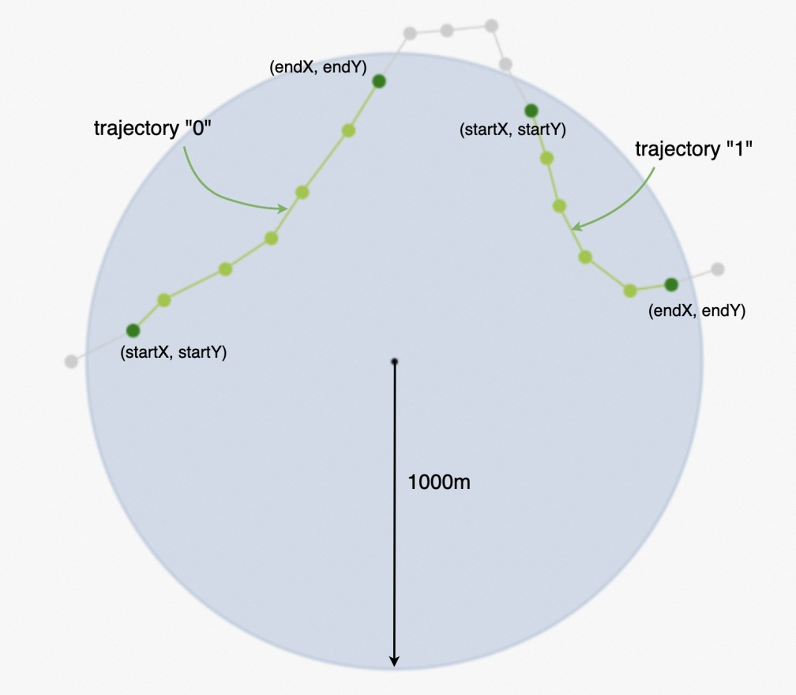

<a id="section-1-4-5"></a>

### 1.4.5. DDL

<a id="section-1-4-5-1"></a>

#### 1.4.5.1. 概览

本节介绍Lindorm宽表SQL语法的DDL语句。

| 语句 | 描述 | 相关文档 |
| --- | --- | --- |
| SHOW | 查看SCHEMA或表信息。 | SHOW |
| USE | 使用某个SCHEMA。 | USE |
| CREATE SCHEMA | 创建SCHEMA。 | CREATE DATABASE |
| DROP SCHEMA | 删除SCHEMA。 | DROP DATABASE |
| CREATE TABLE | 创建Lindorm宽表。 | CREATE TABLE |
| ALTER TABLE | 增加表的列或修改表属性。 | ALTER TABLE |
| DROP TABLE | 删除Lindorm宽表。 | DROP TABLE |
| CREATE INDEX | 创建表的二级索引。 | CREATE INDEX |
| ALTER INDEX | 修改表的二级索引属性。 | ALTER INDEX |
| SHOW INDEX | 查看表的二级索引。 | SHOW INDEX |
| DROP INDEX | 删除表的二级索引。 | DROP INDEX |
| CREATE SEARCH INDEX | 创建表的搜索索引。 | CREATE SEARCH INDEX |
| DROP SEARCH INDEX | 删除表的搜索索引。 | DROP SEARCH INDEX |
| ALTER SEARCH INDEX | 修改表的搜索索引，包括新增索引列，删除索引列和修改搜索索引属性。 | ALTER SEARCH INDEX |
| SHOW SEARCH INDEX | 查看表的搜索索引。 | SHOW SEARCH INDEX |

<a id="section-1-4-5-2"></a>

#### 1.4.5.2. DESCRIBE/SHOW/USE

可以展示DataBase（Schema）、表（Table）和索引（Index），以及使用具体的schema。

**示例**

- 以下语句可以展示所有的database。

  ```text
  show schemas;
  ```

  2.2.16版本后默认以下述语句：

  ```text
  show databases; 
  ```

- 在对应的Schema下，以下语句可以展示所有Table，默认Default Schema下的表格。

  ```text
  show tables;
  ```

- 2.2.16版本后查看表的详细信息，包括列信息，列类型。

  ```text
  show columns in/from 表名;
  ```

- 以下语句可以展示test表下的idx1索引。

  ```text
  show index from test;
  ```

- 以下语句也可以展示test表详细的信息，包括列信息，列类型。

  ```text
  describe test;
  ```

- 当我们需要使用某个特定的schema的时候，可以使用以下语句。

  ```text
  use schema;
  ```

<a id="section-1-4-5-3"></a>

#### 1.4.5.3. CREATE DATABASE

本文介绍创建Database的语法和使用说明。

**语法**

```text
create_database_statement ::=  CREATE DATABASE [ IF NOT EXISTS ] database_name
```

注意：lindorm 2.2.16版本前，默认以database的别名schema为主，默认支持等价的语法create schema [if not exists] schema_name

**示例**

```sql
create schema test; 
create database test;
```

<a id="section-1-4-5-4"></a>

#### 1.4.5.4. DROP DATABASE

删除Lindorm Database。

**语法**

```text
drop_database_statement ::=  DROP DATABASE [ IF EXISTS ] database_name
```

注意：lindorm 2.2.16版本前，默认以database的别名schema为主，默认支持等价的语法drop schema [if exists] schema_name

**示例**

```text
drop schema if exists test;
drop database if exists test;
```

<a id="section-1-4-5-5"></a>

#### 1.4.5.5. CREATE TABLE

创建Lindorm表结构。

**支持的Table_Option列表**

| 选项 | 类型 | 描述 |
| --- | --- | --- |
| COMPRESSION | String | 表的压缩算法。可选的压缩算法分别是：<br>• SNAPPY<br>• ZSTD<br>• LZ4<br>说明宽表引擎2.3.4版本前默认不指定压缩算法，宽表引擎2.3.4及以后的版本默认压缩算法为ZSTD。 |
| TTL | Int | 数据有效期，单位为秒，默认不过期。 |
| MUTABILITY | String | 索引相关，表示对主表的写入模式进行分类，可选值：<br>• IMMUTABLE<br>• IMMUTABLE_ROWS<br>• MUTABLE_LATEST<br>• MUTABLE_ALL<br>具体含义请参见二级索引。说明 |
| CONSISTENCY | String | 表的一致性。默认主表和索引表最终一致，包括以下两种级别：<br>• eventual：表示在某个时间点后主表和索引表最终保持一致。<br>• strong：表示强一致性。在任意时刻，所有表中的数据是同步一致的。 |
| NUMREGIONS | Int | 预先设置建表时的Region数。 |
| STARTKEY和ENDKEY | 与PRIMARY KEY中第一个列的数据类型相同 | 预先设置建表的Region分区起止Key。<br>说明<br>• 如果指定STARTKEY和ENDKEY，必须与NUMREGIONS同时指定。如果在未指定NUMREGIONS的情况下指定STARTKEY和ENDKEY将不会产生实际效果。<br>• STARTKEY和ENDKEY中指定的字符串常量值将会隐式转换为PRIMARY KEY中的第一个列的类型用作分区的起止Key，且当前仅支持对以下类型指定STARTKEY和ENDKEY。<br>• SMALLINT<br>• INTEGER<br>• BIGINT<br>• CHAR<br>• VARCHAR<br>• FLOAT<br>• DOUBLE |
| DYNAMIC_COLUMNS | String | 是否开启动态列。取值：<br>• True：是。<br>• False：否，默认值。<br>说明动态列只支持Varbinary类型。关于动态列的介绍，请参见动态列。 |

> Lindorm 2.2.16版本后设置表属性支持多种关键字，Lindorm 2.2.16版本前设置表属性无需添加 `WITH` 关
>
> **说明**
>
> 键字，设置表属性需要在属性关键字KEY上添加单引号（'），属性VALUE上基于类型进行设置，如果属性VALUE类型是字符串则添加单引号（'）。 但是自Lindorm 2.2.16版本，不但支持Lindorm 2.2.16版本前语法规则，而且还支持表属性前加关键字 `WITH` ，所有属性的KEY两边无需添加单引号（'），属性VALUE两边添加单引号（'）。以下示例都可以执行。

**示例**

- 通过以下两种方式创建宽表。

  - 方式一

    ```sql
    CREATE TABLE dt (
      p1 integer, p2 binary(3), c1 varchar, c2 decimal(22, 2),
      PRIMARY KEY(p1, p2 desc));
    ```

  - 方式二

    ```sql
    CREATE TABLE dt (
      p1 integer, p2 binary(3), c1 varchar, c2 decimal(22, 2),
      constraint pk PRIMARY KEY(p1, p2 desc));  
    ```

- 通过以下方式创建一张宽表并指定表的压缩算法和数据有效期。

  ```sql
  CREATE TABLE dt (
    p1 integer, p2 integer, c1 varchar, c2 bigint,
    constraint pk PRIMARY KEY(p1 desc)) WITH (COMPRESSION='ZSTD', TTL='2592000');
  ```

- 通过以下方式创建一张允许写入动态列数据的宽表。

  ```sql
  CREATE TABLE dt (
    p1 integer, p2 integer, c1 varchar, c2 bigint, PRIMARY KEY(p1)) 
    WITH (DYNAMIC_COLUMNS='TRUE');
  ```

- 通过以下方式创建一张预定义5个分区，且这5个分区的起始KEY为1000、终止KEY为9000的宽表。

  ```sql
  CREATE TABLE dt (
    p1 int, c1 int, c2 varchar, c3 varchar primary key(p1)) 
    WITH (NUMREGIONS='5', STARTKEY='1000', ENDKEY='9000');
  ```

<a id="section-1-4-5-6"></a>

#### 1.4.5.6. CREATE TABLE LIKE

如果您需要快速创建一个与原表结构一致的新表时，可以使用CREATE TABLE LIKE完成表结构的复制和新表的创建。

**示例**

假设原表的结构如下：

```sql
CREATE TABLE sensor(
  p1 INT NOT NULL,
  p2 INT NOT NULL,
  c1 VARCHAR,
  c2 BIGINT,
  PRIMARY KEY(p1, p2)
) WITH (SPLITKEYS = '100000,300000,500000,700000,900000');
```

**复制表结构**

创建一张与表 `sensor` 具有相同表结构的表 `table2` 。

```sql
CREATE TABLE table2 LIKE sensor;
```

**复制表结构和分区起始Key**

```sql
CREATE TABLE table2 LIKE sensor WITH (COPY_SPLITKEYS='true');
```

<a id="section-1-4-5-7"></a>

#### 1.4.5.7. ALTER TABLE

修改表的相关属性，包括增加列和修改表属性。

**语法**

```text
alter_table_statement   ::=  ALTER TABLE table_name alter_table_instruction
alter_table_instruction ::=  ADD [COLUMN] column_name lql_type ( ',' column_name lql_type )*
                             | SET table_options
                             | COMPACT (idcName)?
```

> **说明**
>
> - 关于 `table_options` 的选项请参见使用说明。
>
> - major_compact操作仅适用于宽表引擎2.3.4及以上版本。

**支持的功能谓词**

<table>
  <tr>
    <th width="105">谓词</th>
    <th>功能描述</th>
  </tr>
  <tr>
    <td>ADD</td>
    <td>向数据表中添加列。</td>
  </tr>
  <tr>
    <td>SET</td>
    <td>给数据表设置表属性。目前支持的表属性可参见支持的Table_Option列表。</td>
  </tr>
  <tr>
    <td>COMPACT</td>
    <td>对指定的表强制执行COMPACTION。该谓词是Lindorm扩展的SQL。</td>
  </tr>
</table>

**示例**

- 通过以下语句为test表新增c4列。

  ```sql
  ALTER TABLE test ADD COLUMN c4 VARCHAR;
  ```

- 通过以下语句为test表新增多个列。

  ```sql
  ALTER TABLE test ADD c3 INTEGER, c4 INTEGER, c5 VARCHAR;
  ```

- 通过以下语句为test表开启动态列，动态列仅支持Varbinary类型。关于动态列的介绍，请参见动态列。

  ```sql
  ALTER TABLE test SET 'DYNAMIC_COLUMNS' = 'true';
  ```

- 通过以下语句为test表设置数据有效期。

  ```sql
  ALTER TABLE test SET 'TTL' = '2592000';
  ```

- 通过以下语句为test表添加压缩算法。

  ```sql
  ALTER TABLE test SET 'COMPRESSION' = 'ZSTD';
  ```

- 通过以下语句为test表取消压缩算法。

  ```sql
  ALTER TABLE test SET 'COMPRESSION' = '';
  ```

- 通过以下语句为test表设置冷热分界线。关于冷热分离的介绍，请参见冷热分离介绍。

  ```sql
  ALTER TABLE test SET 'CHS' = '86400', 'CHS_L2' = 'storagetype=COLD';
  ```

- 通过以下语句为test表取消冷热分界线。

  ```sql
  ALTER TABLE test SET 'CHS' = '', 'CHS_L2' = '';
  ```

- 通过以下语句对test表进行major_compact。

  ```sql
  ALTER TABLE test COMPACT;
  ```

- 如果您开通了双Zone，可以指定一个或多个IDC进行major_compact。

  - 通过以下语句对特定的IDC进行major_compact。

    ```sql
    ALTER TABLE test COMPACT 'idc2';
    ```

    > 如果您未指定特定的IDC，则系统默认对idc1进行major_compact。
    >
    > **说明**

  - 通过以下语句指定多个IDC进行major_compact。以下示例表示对idc1和idc2都进行了major_compact。

    ```sql
    ALTER TABLE test COMPACT 'idc1,idc2';
    ```

<a id="section-1-4-5-8"></a>

#### 1.4.5.8. TRUNCATE TABLE

通过TRUNCATE TABLE语法可以清空表内的数据。云原生多模数据库Lindorm 2.2.16版本后为了防止误清空表的数据，必须先执行OFFLINE TABLE后才能执行TRUNCATE TABLE。

**语法**

```text
truncate_table_statement ::= TRUNCATE TABLE table_name
```

> **table_name**：目标表的名称。
>
> **说明**

**示例**

```text
TRUNCATE TABLE dt;
TRUNCATE TABLE my_schema.dt;
```

<a id="section-1-4-5-9"></a>

#### 1.4.5.9. DROP TABLE

删除表。lindorm-2.2.16版本后为了防止误删表，必须先执行offline table 后才能执行drop table。

**语法**

```text
drop_table_statement ::=  DROP TABLE [ IF EXISTS ] table_name
```

**示例**

```text
use my_schema;
DROP TABLE dt;
DROP TABLE IF EXISTS dt;
DROP TABLE my_schema.dt;
```

<a id="section-1-4-5-10"></a>

#### 1.4.5.10. CREATE INDEX

创建二级索引。

Lindorm提供了主键索引功能，即按照Primary Key的定义进行排序的索引。Lindorm SELECT可基于此主键索引高效地执行整行查询等操作。但若需要使用主键（Primary Key）之外的列进行查询，可以通过Lindorm提供的二级索引来满足上述需求。

**语法**

```text
create_index_statement ::=  CREATE INDEX [ index_name ]
                                ON table_name '(' index_identifier ')'
                              [INCLUDE include_identifier]
                              [ASYNC]
                                 [ index_options ]
index_identifier       ::=  '('column_name1 [desc],...,column_namen [desc]')'
include_identifier   ::= '('column_name1,...,column_namen ')'
```

**支持的Index_Options列表**

| 名称 | 类型 | 描述 |
| --- | --- | --- |
| COMPRESSION | String | 索引表的压缩算法，支持的压缩算法包括：<br>• SNAPPY<br>• ZSTD<br>• LZ4 |
| INDEX_COVERED_TY PE | String | 表示索引的冗余方式，支持如下方式：<br>• COVERED_ALL_COLUMNS_IN_SCHEMA表示冗余所有列。<br>• COVERED_DYNAMIC_COLUMNS表示冗余动态列。<br>• 如果没有该选项，可以使用Include表示冗余Includes的列。 |
| STARTKEY | String | 表示索引表的起始Key。 |
| ENDKEY | String | 表示索引表的终止Key。 |
| NUMREGIONS | String | 表示索引表的预分区数。 |

> **说明**
>
> - 索引表支持冗余列，冗余列可以帮助加速查询，避免回查主表。如果只是冗余某几个列可以使用Include。Include（c1,c2）表示冗余c1和c2列。
>
> - 默认表的索引构建方式是同步的，但是如果添加Async表示异步构建，需要执行BUILD INDEX命令。
>
> - 索引表数目不超过5个，数目过多会增加成本和写入RT。

**示例**

```sql
//异步建索引，执⾏后返回，后台不对历史数据建索引，如需构建，使⽤BUILD INDEX命令。
create index idx1 on test(c4 desc) include(c5,c6) async 'COMPRESSION'='ZSTD';

//同步建索引，执⾏后阻塞，对历史数据建完索引后返回。
create index idx1 on test(c4 desc) include(c5,c6)  'COMPRESSION'='ZSTD';

//冗余所有列。
create index idx1 on test(c4 desc) 
'INDEX_COVERED_TYPE'='COVERED_ALL_COLUMNS_IN_SCHEMA';

//冗余动态列。
create index idx1 on test(c4 desc) 'INDEX_COVERED_TYPE'='COVERED_DYNAMIC_COLUMNS';

//如果要设置预分区，可根据需要指定STARTKEY, ENDKEY和NUMREGIONS三个参数。

//不指定STARTKEY和ENDKEY参数。表示在全表范围内分成32个预分区。
create index idx1 on test(c4 desc) include(c5,c6)  'NUMREGIONS' ='32';
//指定STARTKEY和ENDKEY参数。表示在11111111和9999999之间分成32个预分区。
create index idx1 on test(c4 desc) include(c5,c6)  'NUMREGIONS' ='32','STARTKEY'='11111111', 'ENDKEY' =
'9999999'";
```

<a id="section-1-4-5-11"></a>

#### 1.4.5.11. ALTER INDEX

修改索引状态。

**语法**

```text
alter_index_statement ::=  ALTER INDEX [ index_name ]
                                ON table_name index_state
```

创建索引后，如果数据库中有存量历史数据需要执行 `BUILD INDEX` 操作，具体操作请参见BUILD INDEX。

**参数**

参数说明如下表：

<table>
  <tr>
    <th width="134">参数</th>
    <th>说明</th>
  </tr>
  <tr>
    <td>index_name</td>
    <td>索引表名。</td>
  </tr>
  <tr>
    <td>table_name</td>
    <td>宽表名。</td>
  </tr>
  <tr>
    <td>index_state</td>
    <td>索引状态。如果Lindorm宽表引擎为2.2.16及以上版本，支持以下索引状态：<br>• DISABLED：禁用索引。再次启用前需要进行BUILDING操作，再重新执行BUILD INDEX操作。<br>• BUILDING：重新对历史数据构建索引。索引构建完成后，索引状态会自动切换为ACTIVE。<br>• ACTIVE：将索引状态切换为有效状态。<br>说明如果Lindorm宽表引擎为2.2.16之前的版本，索引状态说明如下：<br>• DISABLE：禁用索引。再次启用前需要进行REBUILD操作。<br>• REBUILD：重新对历史数据构建索引。索引构建完成后，索引状态会自动切换为USABLE。<br>• UNUSABLE：禁用索引，再次启用前无需进行REBUILD操作，因为禁用期间主表数据会同步应用到索引表。<br>• USABLE：启用索引。</td>
  </tr>
</table>

**示例**

Lindorm宽表引擎为2.2.16及以上版本，修改索引状态的语句示例如下：

```text
ALTER INDEX idx1 ON test DISABLED;
ALTER INDEX idx1 ON test ACTIVE;
ALTER INDEX idx1 ON test BUILDING;
```

<a id="section-1-4-5-12"></a>

#### 1.4.5.12. BUILD INDEX

Lindorm 2.2.16版本后，通过 `BUILD INDEX` 语句可以单独构建二级索引。

**语法**

Lindorm 2.2.16版本后，创建完索引，如果有存量历史数据需要执行 `BUILD INDEX` 操作，请参考如下语法进行操作。该操作默认为异步构建索引。

```text
build_index_statement ::=  BUILD INDEX [ index_name ]
                                ON table_name
```

**示例**

```text
BUILD INDEX idx ON test;
```

<a id="section-1-4-5-13"></a>

#### 1.4.5.13. SHOW INDEX

索引结构展示。

**语法**

```text
showindex_statement ::= show index from table_name;    
```

**示例**

```text
show index from test;
```

<a id="section-1-4-5-14"></a>

#### 1.4.5.14. DROP INDEX

删除索引。删除索引表之前请使用ALTER INDEX方法将索引表设置成DISABLED状态。

**语法**

```text
dropindex_statement ::= drop index [if exists] index_name on table_name;
```

**示例**

```text
drop index idx1 on test;
```

<a id="section-1-4-5-15"></a>

#### 1.4.5.15. OFFLINE TABLE

Lindorm 2.2.16版本后，通过 `OFFLINE TABLE` 语句可以下线Lindorm宽表，在执行删除表操作之前需要执行 `OFFLINE TABLE` 操作。

**语法**

```text
OFFLINE TABLE table_name
```

**示例**

```text
OFFLINE TABLE test;
```

<a id="section-1-4-5-16"></a>

#### 1.4.5.16. ONLINE TABLE

Lindorm 2.2.16版本后，通过 `ONLINE TABLE` 语句上线Lindorm宽表。

**语法**

```text
ONLINE TABLE table_name;
```

**示例**

```text
ONLINE TABLE test;
```

<a id="section-1-4-5-17"></a>

#### 1.4.5.17. CREATE SEARCH INDEX

云原生多模数据库Lindorm支持通过 `CREATE SEARCH INDEX` 创建搜索索引。

**使用说明**

- 搜索索引主要适用于多维查询场景，支持任意列的排序或分页查询。

- 一张表只能生成一个搜索索引，可以在原有搜索索引基础上增加新的索引列。

- 如果历史数据中有新增的列，需要进行一次全量索引构建，支持星号（\*）创建所有列的搜索索引。

- 索引列支持的数据类型包括：TINYINT、SMALLINT、INTEGER、INT、BIGINT、LONG、FLOAT、DOUBLE、VARCHAR、BINARY、VARBINARY、BOOLEAN。

**语法**

```text
CREATE SEARCH INDEX [ IF NOT EXISTS ] index_name
        ON table_name '(' index_identifier ')'
        [ASYNC]
        [ WITH '(' index_options ')' ]

index_identifier:
(column_name'(' column_options ')' ',' ... column_name'(' column_options ')')* | "*"    
                         
column_options:
option_name '=' option_value (',' option_name '='option_value)

index_options:
option_name '=' option_value (',' option_name '='option_value)
```

**参数**

**column_options**参数的说明。

| 参数 | 类型 | 描述 |
| --- | --- | --- |
| indexed | String | 是否需要搜索索引。<br>• true：默认值，需要搜索索引。<br>• false：不需要搜索索引。 |
| rowStored | String | 是否存储原始数据。<br>• true：存储原始数据。<br>• false：默认值，不存储原始数据。 |
| columnSto red | String | 是否设置为列存储，用来加速排序分析。<br>• true：默认值，设置列存储。<br>• false：不设置列存储。 |
| type | String | 分词场景下，分词字段需要设置<strong>type</strong>参数为text，其它情况默认与宽表数据类型保持一致。<br>说明需要同时与<strong>analyzer</strong>分词器使用。 |
| analyzer | String | 分词器列表。取值：<br>• standard<br>• english<br>• ik<br>• whitespace<br>• comma<br>说明<br>• 需要同时与<strong>type</strong>参数使用。<br>• 当列在宽表中类型为数据类型（例如：INT）时，需要用standard分词器。 |

**index_options**参数的说明。

| 参数 | 类型 | 描述 |
| --- | --- | --- |
| indexState | String | 搜索索引状态，取值为：<br>• BUILDING：默认值。<br>• ACTIVE：即为USABLE，属于启用搜索索引状态。在没有历史数据的场景下，设置为ACTIVE。 |
| numShard s | String | 指定分片数，默认是搜索节点个数的两倍。 |
| RANGE_TI ME_PARTI TION_STA RT | String | 表示创建索引操作前多少天开始创建分区。适用于有历史数据的场景，如果历史数据的时间戳比开始分区的时间还要小，则会报错。<br>说明创建时间范围分区索引时必须指定此参数。 |
| RANGE_TI ME_PARTI TION_INTE RVAL | String | 表示间隔多少天创建新分区，例如RANGE_TIME_PARTITION_INTERVAL='7'，表示每隔一周创建一个新分区。<br>说明创建时间范围分区索引时必须指定此参数。 |
| RANGE_TI ME_PARTI TION_TTL | String | 表示保留多少天的分区数据，例如RANGE_TIME_PARTITION_TTL='180'，表示保留半年的分区数据，历史分区数据会被自动清理掉。不指定时则表示不会被清理。<br>说明该参数仅作用于创建时间范围分区索引。 |
| RANGE_TI ME_PARTI TION_MAX _OVERLAP | String | 如果写入的数据时间点是将来的时间，这个参数表示最多允许与当前时刻的时间间隔，单位为天。不指定时则表示无限制。<br>说明该参数仅作用于创建时间范围分区索引。 |
| RANGE_TI ME_PARTI TION_FIEL D_TIMEUNI T | String | 表示业务指定的时间分区字段单位，默认单位为毫秒（ms）。<br>• 分区字段单位设置为秒（s），数字长度为10位。<br>• 分区字段单位设置为毫秒（ms），数字长度为13位。<br>该参数仅作用于创建分区索引索引。说明 |

**示例**

1. 创建SCHEMA和表。如果SCHEMA和表已存在，可以跳过该步骤。

   ```sql
   CREATE SCHEMA test;
   USE test;
   CREATE TABLE IF NOT EXISTS tbn (p1 varchar, p2 varchar, col1 bigint, col2 varchar, col3 varchar, 
   col4 bigint, constraint primary key (p1, p2 desc));
   ```

2. 根据不同场景创建搜索索引。

   - 通过指定索引列属性的方式，系统默认会执行同步构建搜索索引，对历史数据执行索引构建，执行过程所需的时间较长。

     ```text
     CREATE SEARCH INDEX IF NOT EXISTS idx on tbn(col1, col2, col3);
     ```

   - 创建搜索索引时如果不需要执行同步构建搜索索引，可以在创建搜索索引语句后增加 `ASYNC` 。后续如果需要执行同步构建搜索索引，请参见步骤3。

     ```text
     CREATE SEARCH INDEX IF NOT EXISTS idx on tbn(col1, col2, col3) ASYNC;
     ```

   - 创建所有列的搜索索引，不指定具体列属性，均为默认值。

     ```text
     CREATE SEARCH INDEX IF NOT EXISTS idx on tbn("*");
     ```

   - 创建所有列的搜索索引，指定具体列属性。

     ```text
     CREATE SEARCH INDEX IF NOT EXISTS idx on tbn("*",col1(type=text,analyzer=ik,indexed=true));
     ```

   - 指定所有列共同属性。如果索引列有col1，col2，col3，索引列的属性都为type=text，analyzer=ik，indexed=true。

     ```text
     CREATE SEARCH INDEX IF NOT EXISTS idx on tbn("*"(type=text,analyzer=ik,indexed=true));
     ```

   - 指定列，不指定列属性。

     ```text
     CREATE SEARCH INDEX IF NOT EXISTS idx on tbn(col1, col2, col3);
     ```

   - 指定列，并指定部分列属性，同时指定搜索索引状态。

     ```text
     CREATE SEARCH INDEX IF NOT EXISTS idx on tbn(col1, col2(type=text,analyzer=ik), col3) WITH  (indexState=ACTIVE，numShards=4);
     ```

     > 当设置 `column_options` 时，type和analyzer属性需要同时设置。
     >
     > **说明**

   - 指定列，创建时间分区索引。按时间列col4分区，从30天前开始，每7天自动分区，默认保留90天的分区数据。

     ```text
     CREATE SEARCH INDEX idx ON tbn (col1, col2, col3, col4)
     partition by range time(col4) partitions 16
     with (indexState=ACTIVE, RANGE_TIME_PARTITION_START='30', RANGE_TIME_PARTITION_INTERVAL='7', RANGE_
     TIME_PARTITION_TTL='90', RANGE_TIME_PARTITION_MAX_OVERLAP='90');
     ```

3. 如果使用 `ASYNC` 方式异步构建搜索索引，并且需要历史数据也被检索，请执行以下语句，默认同步构建搜索索引。可以在LTS页面左侧导航栏选择**Lindorm Search > 全量同步**，查看REBUILD进度，具体操作请参见购买并登录LTS。

   ```text
   ALTER SEARCH INDEX IF EXISTS idx ON tbn REBUILD;
   ```

<a id="section-1-4-5-18"></a>

#### 1.4.5.18. DROP SEARCH INDEX

云原生多模数据库Lindorm支持通过 `DROP SEARCH INDEX` 删除表的搜索索引。

**前提条件**

删除搜索索引前，需要先修改搜索索引属性为 `DISABLED` ，具体操作请参见ALTER SEARCH INDEX。

**语法**

```text
DROP SEARCH INDEX [IF EXISTS] index_name ON table_name
```

**示例**

1. 创建SCHEMA和表。如果SCHEMA和表已存在，可以跳过该步骤。

   ```sql
   CREATE SCHEMA test;
   USE test;
   CREATE TABLE IF NOT EXISTS tbn (p1 varchar, p2 varchar, col1 bigint, col2 varchar, col3 varchar, 
   constraint primary key (p1, p2 desc));
   ```

2. 创建搜索索引。

   ```text
   CREATE SEARCH INDEX IF NOT EXISTS idx on tbn(col1, col2, col3);
   ```

3. 删除表的搜索索引。删除前需要修改表的搜索索引属性为禁用。

   ```text
   ALTER SEARCH INDEX IF EXISTS idx ON tbn DISABLED;
   DROP SEARCH INDEX IF EXISTS idx ON tbn;
   ```

<a id="section-1-4-5-19"></a>

#### 1.4.5.19. ALTER SEARCH INDEX

云原生多模数据库Lindorm支持通过 `ALTER SEARCH INDEX` 新增索引列，删除索引列，修改搜索索引状态。

**注意事项**

- 索引表的列属性定义后，不可更改。

- 删除索引列后不支持新增相同名称的索引列。

**使用说明**

- 执行新增索引列或删除索引列操作后，还需要执行 `REBUILD` 操作。

- 索引列支持的数据类型包括：TINYINT、SMALLINT、INTEGER、INT、BIGINT、LONG、FLOAT、DOUBLE、VARCHAR、BINARY、VARBINARY、BOOLEAN。

**新增索引列**

**语法**

```text
ALTER SEARCH INDEX [IF EXISTS] index_name ON table_name ADD COLUMNS '(' index_identifier ')'

index_identifier：
(column_name['(' column_options ')'] ',' ... column_name['(' column_options ')'])*    
           
column_options：
option_name '=' option_value (',' option_name '=' option_value)
```

**参数**

**column_options**参数的说明。

| 参数 | 类型 | 描述 |
| --- | --- | --- |
| indexed | String | 是否需要索引。<br>• true：默认值，需要索引。<br>• false：不需要索引。 |
| rowStored | String | 是否存储原始数据。<br>• true：存储原始数据。<br>• false：默认值，不存储。 |
| columnSto red | String | 是否设置为列存储，用来加速排序分析。<br>• true：默认值，设置列存储。<br>• false：不设置列存储。 |
| type | String | 分词场景下，分词字段需要设置<strong>type</strong>参数为text，其它情况默认与宽表数据类型保持一致。<br>说明需要同时与<strong>analyzer</strong>分词器使用。 |
| analyzer | String | 分词场景下需要使用分词器。取值：<br>• standard<br>• english<br>• ik<br>• whitespace<br>• comma<br>说明<br>• 需要同时与<strong>type</strong>参数使用。<br>• 当列在宽表中类型为数据类型（例如：INT）时，需要用standard分词器。 |

**示例**

1. 创建SCHEMA和表。如果SCHEMA和表已存在，可以跳过该步骤。

   ```sql
   CREATE SCHEMA test;
   USE test;
   CREATE TABLE IF NOT EXISTS tbn (p1 varchar, p2 varchar, col1 bigint, col2 varchar, col3 varchar, 
   constraint primary key (p1, p2 desc));
   ```

2. 新增一个或多个索引列。

   - 不指定具体列属性。

     ```text
     ALTER SEARCH INDEX IF EXISTS idx ON tbn ADD COLUMNS(col1,col2,col3);
     ```

   - 指定具体列属性。

     ```text
     ALTER SEARCH INDEX IF EXISTS idx ON tbn ADD COLUMNS(col1,col2,col3(type=text,analyzer=ik));
     ```

3. 有历史数据的场景，需要执行 `REBUILD` 操作，默认同步执行。执行后，可以在LTS页面左侧导航栏选择**Lindorm Search > 全量同步**，查看REBUILD进度。

   ```text
   ALTER SEARCH INDEX IF EXISTS idx ON tbn REBUILD;
   ```

**删除索引列**

**语法**

```text
ALTER SEARCH INDEX [IF EXISTS] index_name ON table_name DROP COLUMNS '(' index_identifier ')'

index_identifier：
(column_name ',' ... column_name)*
```

**示例**

- 删除多个索引列，不指定具体列属性。

  ```text
  ALTER SEARCH INDEX IF EXISTS idx ON tbn DROP COLUMNS(col2,col3);
  ```

- 删除后，需要重新构建索引，即执行 `REBUILD` 操作，默认同步执行。执行后，可以在LTS页面左侧导航栏选择**Lindorm Search > 全量同步**，查看REBUILD进度。

  ```text
  ALTER SEARCH INDEX IF EXISTS idx ON tbn REBUILD;
  ```

**修改搜索索引状态**

**语法**

```text
ALTER SEARCH INDEX [IF EXISTS] index_name ON table_name index_state_definition
                                 [ASYNC]

index_state_definition：
REBUILD | DISABLED | UNUSABLE | USABLE 
```

**参数**

**index_state_definition**参数的说明。

| 参数 | 类型 | 描述 |
| --- | --- | --- |
| DISABLED | String | 禁用搜索索引，再次启用前，需要进行<code> REBUILD </code>操作。 |
| REBUILD | String | 重新对历史数据构建搜索索引，搜索索引构建完成后，搜索索引状态会自动变为USABLE。 |
| UNUSABLE | String | 禁用搜索索引，再次启用前无需进行<code> REBUILD </code>操作，因为禁用期间主表数据会同步应用到索引表。 |
| USABLE | String | 启用搜索索引。 |

**示例**

- 禁用搜索索引。

  ```text
  ALTER SEARCH INDEX IF EXISTS idx ON tbn DISABLED;
  ```

- 重新对历史数据构建搜索索引，默认同步执行构建，也可以通过 `ASYNC` 参数指定异步执行构建。执行后，可以在LTS页面左侧导航栏选择**Lindorm Search > 全量同步**，查看REBUILD进度。

  ```text
  ALTER SEARCH INDEX IF EXISTS idx ON tbn REBUILD;
  ALTER SEARCH INDEX IF EXISTS idx ON tbn REBUILD ASYNC;
  ```

<a id="section-1-4-5-20"></a>

#### 1.4.5.20. SHOW SEARCH INDEX

云原生多模数据库Lindorm支持通过 `SHOW SEARCH INDEX` 查看表的搜索索引。

**语法**

```text
SHOW SEARCH INDEX FROM table_name
```

**示例**

1. 创建SCHEMA和表。如果SCHEMA和表已存在，可以跳过该步骤。

   ```sql
   CREATE SCHEMA test;
   USE test;
   CREATE TABLE IF NOT EXISTS tbn (p1 varchar, p2 varchar, col1 bigint, col2 varchar, col3 varchar, 
   constraint primary key (p1, p2 desc));
   ```

2. 创建搜索索引。

   ```text
   CREATE SEARCH INDEX IF NOT EXISTS idx on tbn(col1, col2, col3);
   ```

3. 查看表的搜索索引。

   ```text
   SHOW SEARCH INDEX FROM tbn;
   ```

<a id="section-1-4-6"></a>

### 1.4.6. DML

<a id="section-1-4-6-1"></a>

#### 1.4.6.1. SELECT

通过SELECT语句可以查询一个或多个表格中的行数据。

> 通过SELECT语句可以查询一个或多个表格中的行数据。
>
> **说明**

**语法**

```text
SELECT [hint_clause] ( select_clause | '*' )
    FROM table_name
    [force index(index_name)]
    [ WHERE where_clause ]
    [ ORDER BY ordering_clause ]
    [ LIMIT integer ] | [LIMIT integer, integer]
    [`ALLOW FILTERING`]
select_clause    ::=  selector [ AS identifier ] ( ',' selector [ AS identifier ] )
selector         ::=  column_name
                      | term
                      | function_name '(' [ selector ( ',' selector )* ] ')'
                      | COUNT '(' '*' ')'
where_clause     ::=  relation ( AND|OR relation )*
relation         ::=  column_name operator term
                      '(' column_name ( ',' column_name )* ')' operator tuple_literal
operator         ::=  '=' | '<' | '>' | '<=' | '>=' | '!=' | IN | IS NOT? NULL
ordering_clause  ::=  column_name [ ASC | DESC ] ( ',' column_name [ ASC | DESC ] )*

hint_clause::=/*+hint_items*/
hint_items::=hint_item(','hint_item)*
hint_item::=identifier('('hint_option(','hint_option)*')')
hint_option::=expression
```

**参数说明**

SELECT语法中部分参数说明如下：

- 执行SELECT语句时如果您需要强制选择某条索引，请在查询语句后使用 `force index(index_name)` 。

- `LIMIT` 后只跟一个数字，表示LIMIT限制。如果跟两个由英文逗号（,）分隔的数字，表示OFFSET和LIMIT条数。

- 在SELECT语句末尾添加 `ALLOW FILTERING` ，可以强制执行低效查询操作。当执行SELECT语句被Lindorm宽表引擎识别为低效查询时，为了避免这类查询语句给Lindorm带来性能稳定性风险，Lindorm宽表引擎默认不允许执行该类查询，同时会抛出异常。例如Lindorm数据库中存在一张表dt，执行 `SELECT * FROM dt WHERE nonPK=100;` 查询语句，会返回以下异常报错。如果查询语句为低效查询语句，解决方法请参见常见问题。

  ```text
  DoNotRetryIOException: Detect inefficient query: SELECT * FROM dt WHERE nonPK=100 supportEmptyResult true. This query may be a full table scan and thus may have unpredictable performance.
  ```

- Hint的使用请参见HINT简介。

**示例**

```sql
//简单查询操作

SELECT * FROM dt;            //选择全部列
SELECT c1,c2 FROM dt;                   //选择部分列
SELECT * FROM dt LIMIT 10;
SELECT * FROM dt WHERE pk = 10;
SELECT * FROM dt WHERE pk > 10 LIMIT 5, 20;           //跳过5⾏，最多返回20⾏
SELECT * FROM dt WHERE pk > 10 LIMIT 20 OFFSET 5;      //等价于limit 5,20
SELECT c1 FROM dt WHERE pk > 10;
SELECT c1 AS xx FROM dt WHERE pk > 10;

//聚合操作

SELECT count(*) FROM dt;
SELECT count(c1) FROM dt;
SELECT sum(c2) FROM dt;
SELECT sum(c2), AVG(c2),MIN(c2),MAX(c2) FROM dt;

//where条件中is null等⽤法

SELECT c1, c2 FROM dt WHERE (c1>1 OR (c2>0 AND c7 is null)) 
AND c3 <>1.0 AND c6 is not null;

//别名⽤法
SELECT count(*) AS countRow FROM dt;
SELECT c1 AS testC FROM t1 WHERE c1 = '2';

//in⽤法
SELECT * FROM dt WHERE dt in ('a', 'b');

//强制执⾏低效查询语句
SELECT * FROM dt WHERE nonPK=100 ALLOW FILTERING;
            
```

**常见问题**

- Q：什么情况下，查询语句被认为是低效查询语句？A：如果SELECT查询的条件同时满足下列三个条件，则该查询被认为是低效查询。

  - `WHERE` 语句中没有指定表的第一个主键的上下界。

  - `WHERE` 语句中没有指定索引表中第一个索引列的上下界。

  - `WHERE` 语句中存在非第一个主键（或非第一个索引列）的条件。

- Q：如果查询语句为低效查询语句，应该怎么解决？A：解决方法有以下四种。

  - 在查询语句末尾增加 `ALLOW FILTERING` ，如下语句，表示跳过该检查，强制执行低效查询操作。

    ```sql
    SELECT * FROM dt WHERE nonPK=100 ALLOW FILTERING;
    ```

  - `WHERE` 语句中增加表的主键条件。

  - 修改表的主键设计，避免大查询。

  - 使用高性能原生二级索引，具体详情请参见Lindorm用户指南手册二级索引章节。

<a id="section-1-4-6-2"></a>

#### 1.4.6.2. UPSERT

更新数据或插入数据。Upsert是Insert与Update的结合体，表示行存在时执行Update，不存在时执行Insert。执行Upsert时必须要指定完全的Primary key的相关列信息。Upsert语法支持带时间戳的插入和批量写入。

**语法**

```text
upsert_statement ::=  UPSERT INTO table_name
                      '('columns| _l_ts_')' 
                      VALUES '(' values ')'
                      [ ON DUPLICATE KEY update_column = update_value |IGNORE ]?
columns ::=  column_name, columns
values  ::=  term, values,'(' values ')'
update_column ::= column_name
update_value ::= term
```

> **说明**
>
> - 支持批量写入，指定需要写入的相关列，可以在Values关键字中确定几行数据。
>
> - 支持upsert on duplicate key操作，类似check and put操作，要求upsert指定的value值可以确定一行。如果ON DUPLICATE KEY跟随的是指定的需要更新的列和value（暂时无法做到基于原有key存在性判断进行对应value更新），如果存在则抛出异常。 如果是ON DUPLICATE KEY IGNORE表示忽略对应的确定的一行是否存在的检查，直接进行插入。
>
> - Lindorm SQL支持标准JDBC的访问方式，包括正常statement以及preparestatemt方式，但是对于标准JDBC在preparestatemt场景下的标准batch插入数据的方式仅在lindorm 2.2.16版本以后支持。

**示例**

```text
upsert into dt (p1,p2,c1,c2) values(10, 20, 30, 40);
upsert into dt (p1,p2,c2) values(10, 20, 40);   -- 仅写入⼀⾏的部分列
upsert into dt (p1,p2,c1) values(10, 20, 30);   -- 再写入同⼀⾏的其他列
-- 等价于upsert into dt (p1,p2,c2) values(10, 20, 5)，忽略on duplicate key ignore操作
upsert into dt (p1,p2,c2) values(10, 20, 5) on duplicate key ignore;
-- 条件更新，对数据源⾏p1=10，p2=20,c2=5，进⾏c1 = 30的列的数据插入。
upsert into dt (p1,p2,c2) values(10, 20, 5) on duplicate key update c1 = 30;
-- 插入的⾏，时间戳是111232
 UPSERT INTO dt (p1,p2,p3,_l_ts_) values('1','2','3',111232);
-- 批量写入
upsert into dt (p1,p2,c1,c2) values(1,2,3,4), (2,3,4,5), (3,4,5,6);
--- upsert on duplicate key ignore，如果1 2 3 4 5 确定的⾏不存在则insert
upsert into dt (p1,p2,p3,c1,c2) values (1,2,3,4,5) on duplicate key ignore;
--- upsert on duplicate key ，如果1 2 3 4 5 确定的⾏不存在则不insert，抛出异常，存在则update c2 为6
upsert into dt (p1,p2,p3,c1,c2) values (1,2,3,4,5) on duplicate key update c2 = 6;
            
```

<a id="section-1-4-6-3"></a>

#### 1.4.6.3. DELETE

删除数据，可以删除表中的一行数据（不可删除多行），可指定过滤条件。

DELETE语法是高危操作，为了确保数据安全，Lindorm将DELETE的语义限制为只能使用完备的主键删除一行数据。

**语法**

```text
delete_statement ::=  DELETE FROM table_name
                      WHERE where_clause
```

> Where_Clause必须可以唯一限定一行数据。
>
> **说明**

**语法限制**

- DELETE的WHERE子句中，必须给出能够唯一定位一行数据的完备主键条件。

- 一条DELETE语句只能删除一行数据，不支持一条语句删除多行。

- 删除操作并非是先读取再删除，而是直接写入删除标记。所以无论被删除的行是否存在，删除都会成功。

- 可以指定删除的时间戳，带时间戳的delete会删除指定行中，小于等于指定时间戳的列。

**示例**

```text
delete from dt where p1 = 10 and p2 = 20;

-- 以下语句是非法的
delete from dt where p1 = 10; -- dt表有两个主键列，p1=10无法唯⼀确定⼀⾏
delete from dt where c1 = 30; -- 必须给出主键列的条件
```

<a id="section-1-4-7"></a>

### 1.4.7. DCL

<a id="section-1-4-7-1"></a>

#### 1.4.7.1. 概述

DCL包含用户角色管理语法和权限管理语法。

**用户角色管理语法**

Lindorm宽表SQL语法使用database user来表示用户角色。定义如下：

```text
user_name ::=  identifier | string
```

**权限管理语法**

Lindorm宽表SQL语法的权限表示对于某个用户具备某个schema或者某个table的相关权限，如果权限操作没有指定具体的schema或者table。那么默认表示的是在全局级别（global level）。权限包括如下：

| 权限 | 描述 |
| --- | --- |
| READ | 表示某个表或者schema下所有表具备读的权限。 |
| WRITE | 表示某个表或者schema下所有表具备写的权限。 |
| ADMIN | 表示某个表或者schema下所有表具备ADMIN的权限。 |
| TRASH | 表示某个表或者schema下所有表具备删除的权限。 |
| SYSTEM | 表示某个表或者schema下所有表具备系统管理的权限（一般不开放）。 |
| NORMAL_USER | 权限价值等于：READ+WRITE。 |
| ADMIN_USER | 权限价值等于：READ+WRITE+ADMIN。 |
| ADMIN_TRASH | 权限价值等于：READ+WRITE+ADMIN+TRASH。 |
| ALL | 权限价值等于：READ+WRITE + ADMIN + TRASH + SYSTEM 。 |

<a id="section-1-4-7-2"></a>

#### 1.4.7.2. SHOW USERS

展示所有用户。

**示例**

```text
show users；
```

<a id="section-1-4-7-3"></a>

#### 1.4.7.3. CREATE USER

创建用户并设置密码。

**语法**

```text
create_user_statement ::=  CREATE USER user_name identified by '''password''';
password ::= string
```

**参数**

| 参数 | 说明 |
| --- | --- |
| user_name | 指定用户名称。 |
| password | 表示用户登录的密码。 |

**示例**

创建用户并指定相关的密码。

```text
create user test_user identified by 'testuserpassword';    
```

<a id="section-1-4-7-4"></a>

#### 1.4.7.4. ALTER USER

修改用户密码。

**语法**

```text
alter_user_statement ::=  ALTER USER user_name SET password='newpassord' 
            | WHERE oldpassword='oldpassword';
```

**示例**

修改用户的密码信息。

```text
 alter user test_user set password='fda.@' where oldpassword='t12a@Hi';  
```

<a id="section-1-4-7-5"></a>

#### 1.4.7.5. DROP USER

删除用户。

**语法**

```text
drop_user_statement ::=  DROP USER user_name
```

**参数**

**user_name**表示指定删除的用户名称。

**示例**

```text
DROP USER test_user;
```

<a id="section-1-4-7-6"></a>

#### 1.4.7.6. GRANT PRIVILEGE

为用户授予指定权限。

**语法**

```text
grant_permission_statement ::=  GRANT privilege_definition ON [GLOBAL|SCHEMA schema| TABLE table] resource TO user_name
privilege_definition       ::=  ALL | READ | WRITE | ADMIN | TRASH 
resource                   ::=  schema_name
                               | table_name
```

> 权限范围：GLOBAL > SCHEMA > TABLE。
>
> **说明**

**参数**

<table>
  <tr>
    <th width="201">参数</th>
    <th>说明</th>
  </tr>
  <tr>
    <td>user_name</td>
    <td>指定用户名称。</td>
  </tr>
  <tr>
    <td>privilege_definition</td>
    <td><code>• ALL</code><br>指定用户具有所有权限，包括下述四种权限。<br><code>• READ</code><br>指定用户具有“读“权限。<br><code>• WRITE</code><br>指定用户具有“写“权限。<br><code>• ADMIN</code><br>指定用户具有“管理员“权限。<br><code>• TRASH</code><br>指定用户具有“删除“权限。</td>
  </tr>
  <tr>
    <td>resource</td>
    <td>指定被授予权限的资源，如<code> ALL </code>、<code> SCHEMA  </code>、<code> TABLE </code>。</td>
  </tr>
  <tr>
    <td>schema_name</td>
    <td>指定schema名称。</td>
  </tr>
  <tr>
    <td>table_name</td>
    <td>指定表名称。</td>
  </tr>
</table>

**示例**

```sql
GRANT READ TO User1;                                                                                     

GRANT WRITE ON TABLE Table1 TO User2;                                                                    

GRANT ADMIN ON TABLE my_schema.my_table TO User2;                                                        

GRANT TRASH ON SCHEMA my_schema TO User3;
```

<a id="section-1-4-7-7"></a>

#### 1.4.7.7. REVOKE PRIVILEGE

删除某个用户指定的权限。

**语法**

```text
revoke_permission_statement ::=  REVOKE privilege_definition ON [GLOBAL | SCHEMA | TABLE] resource FROMuser_name
resource ::= schema_name | table_name
```

**参数**

<table>
  <tr>
    <th width="201">参数名</th>
    <th>说明</th>
  </tr>
  <tr>
    <td>user_name</td>
    <td>指定用户名称。</td>
  </tr>
  <tr>
    <td>privilege_definition</td>
    <td><code>• ALL</code><br>删除用户具有的所有权限，包括下述四种权限。<br><code>• READ</code><br>删除用户具有的“读“权限。<br><code>• WRITE</code><br>删除用户具有的“写“权限。<br><code>• ADMIN</code><br>删除用户具有的“管理员“权限。<br><code>• TRASH</code><br>删除用户具有的“删除“权限。</td>
  </tr>
  <tr>
    <td>resource</td>
    <td>指定被授予权限的资源，如<code> ALL  </code>、<code> SCHEMA </code>、<code> TABLE </code>。</td>
  </tr>
</table>

> 权限范围：GLOBAL > SCHEMA > TABLE。
>
> **说明**

**示例**

```text
REVOKE READ FROM User1;                                                                                  

REVOKE WRITE ON TABLE Table1 FROM User2;                                                                 

REVOKE ADMIN ON TABLE my_schema.my_table FROM User2;                                                     

REVOKE TRASH ON SCHEMA my_schema FROM User3;     
```

<a id="section-1-4-8"></a>

### 1.4.8. EXPLAIN

使用EXPLAIN查看Select语句的执行计划操作。在EXPLAIN语法的帮助下，您可以查看表中添加索引的位置，以便通过索引查找行来更快地执行语句。

**语法**

```text
explain select select_options;
```

**示例**

```text
explain select c1,c2, c3 from test where c1>1 and c2<3;    
```

<a id="section-1-4-9"></a>

### 1.4.9. HINT

<a id="section-1-4-9-1"></a>

#### 1.4.9.1. HINT简介

HINT作为一种SQL补充语法，在数据库中扮演着非常重要的角色。HINT可以改变SQL的执行方式。Lindorm宽表SQL也支持HINT语法，例如使用HINT进行多版本数据管理。本文介绍HINT的基本语法和使用场景。

**注意事项**

- 宽表引擎版本为2.3.1及以上的版本支持HINT。如何升级版本，请参见Lindorm用户指南手册中的版本升级章节。

- HINT必须在INSERT、UPSERT和SELECT关键字后使用。

- HINT仅支持简单查询，不支持子查询、分组查询等复杂查询。

- HINT不支持PreparedStatement方法。

**HINT语法**

```text
hintExpression ::= /*+ hintItems */

hintItems ::= hintItem (',' hintItem )*

hintItem ::= identifier ('(' hintOption ( ',' hintOption)* ')')?

hintOption ::= expression
```

> **说明**
>
> - HINT的格式为 `/*+ hintItems */` 。其中 `hintItems` 是HINT语句，与具体的操作相关，多个 `hintItems` 之间使用半角逗号（,）分隔。
>
> - HINT语句位于 `/*+` 与 `*/` 之间。

Lindorm宽表SQL语句中，仅允许在INSERT、UPSERT和SELECT关键字后指定HINT。示例如下：

```sql
UPSERT /*+ _l_ts_(3000) */ INTO t_test_ts(c1, c3) VALUES (1, 'c3');
SELECT /*+ _l_versions_(1) */ c1, c3, c3_l_ts FROM t_test_ts;
```

> HINT不能在其他关键字后使用，错误示例： `UPSERT INTO /*+ _l_ts_(3000) */ t_test_ts(c1, c3)`
>
> **说明**
>
> `VALUES (1, 'c3');` 。

<a id="section-1-4-9-2"></a>

#### 1.4.9.2. 多版本数据管理

本文介绍如何在Lindorm宽表SQL中通过HINT设置时间戳来实现多版本数据管理。

**功能介绍**

Lindorm宽表引擎中，写入每条数据时每列都会记录时间戳，该时间戳一般记录的是数据写入时的服务器时间。默认情况下，该时间戳会作为每列的版本标识，用户也可以在写入数据时自定义时间戳，时间戳越大说明数据的版本越新。如果宽表的列要存储多个版本的数据，需要在创建表时设置版本属性 `'VERSIONS' = 'n'` （n为正整数，表示每列最多保留的版本数）。通过时间戳查询多版本的数据时需要指定多版本属性，多版本的相关属性如下表：

| 属性名称 | 说明 | 适用语句 |
| --- | --- | --- |
| _l_ts_(N) | 自定义时间戳的值。 | UPSERT、SELECT |
| _l_versions_(N) | 表示查询结果中返回最新的N个版本的数据。 | SELECT |
| _l_ts_min_(N) | 用于过滤查询结果，表示查询结果中返回时间戳大于等于N的数据。 | SELECT |
| _l_ts_max_(N) | 用于过滤查询结果，表示查询结果中返回时间戳小于N的数据。 | SELECT |

**使用方法**

**设置时间戳并查询数据**

Lindorm宽表支持在非主键列中设置时间戳并通过时间戳查询指定版本的数据。

1. 创建测试表，语句如下：

   ```sql
   CREATE TABLE t_test_versions_2 (c1 INT , c2 INT, c3 VARCHAR(50), PRIMARY KEY(c1)) 'VERSIONS'='5';
   ```

2. 写入数据。设置时间戳时需要指定多版本属性，语句如下：

   ```text
   UPSERT /*+ _l_ts_(1000)  */ INTO t_test_versions_2(c1, c3) values (1, '11')
   UPSERT /*+ _l_ts_(2001)  */ INTO t_test_versions_2(c1, c3) values (1, '22')
   UPSERT /*+ _l_ts_(1000)  */ INTO t_test_versions_2(c1, c2) values (1, 1)
   UPSERT /*+ _l_ts_(2001)  */ INTO t_test_versions_2(c1, c2) values (2, 1)
   UPSERT /*+ _l_ts_(2002)  */ INTO t_test_versions_2(c1, c2) values (2, 2)
   UPSERT /*+ _l_ts_(2003)  */ INTO t_test_versions_2(c1, c2) values (2, 3)
   UPSERT /*+ _l_ts_(2004)  */ INTO t_test_versions_2(c1, c2) values (2, 4)
   UPSERT /*+ _l_ts_(2005)  */INTO t_test_versions_2(c1, c2) values (2, 5)
   UPSERT /*+ _l_ts_(2006)  */ INTO t_test_versions_2(c1, c2) values (2, 6)
   ```

3. 通过时间戳查询指定版本的数据。如果要查看时间戳，需要在列名后加上时间戳后缀（即 `_l_ts` ）。

   - 示例一：返回指定时间戳为1000的数据。

     ```sql
     SELECT /*+ _l_ts_(1000) */ c1, c3, c3_l_ts FROM t_test_versions_2 WHERE c1 = 1;
     ```

     返回结果：

     ```text
     +----+----+---------+
     | c1 | c3 | c3_l_ts |
     +----+----+---------+
     | 1  | 11 | 1000    |
     +----+----+---------+
     ```

   - 示例二：查询时间戳在 `[1000,2001)` 范围内的数据。

     ```sql
     SELECT /*+ _l_ts_min_(1000), _l_ts_max_(2001)  */ c1, c3, c3_l_ts FROM t_test_versions_2 WHERE c1 =1;
     ```

     返回结果：

     ```text
     +----+----+---------+
     | c1 | c3 | c3_l_ts |
     +----+----+---------+
     | 1  | 11 | 1000    |
     +----+----+---------+
     ```

   - 示例三：返回最新的N个版本的数据，需要指定 `_l_versions_(N)` 属性。

     ```sql
     SELECT /*+ _l_versions_(1) */ c1, c3, c3_l_ts FROM t_test_versions_2 WHERE c1 = 1;
     ```

     返回结果：

     ```text
     +----+----+---------+
     | c1 | c3 | c3_l_ts |
     +----+----+---------+
     | 1  | 22 | 2001    |
     +----+----+---------+
     ```

   - 示例四：每列返回最新的两个版本数据，并且按照时间戳相同的列合并为一行返回结果集。查询语句中指定 `_l_versions_(N)` 属性会返回所有非主键列的时间戳数据。

     ```sql
     SELECT /*+ _l_versions_(2)  */ * FROM t_test_versions_2;
     ```

     返回结果如下：

     ```text
     +----+------+------+---------+---------+
     | c1 |  c2  |  c3  | c2_l_ts | c3_l_ts |
     +----+------+------+---------+---------+
     | 1  | null | 22   | null    | 2001    |
     | 1  | 1    | 11   | 1000    | 1000    |
     | 2  | 6    | null | 2006    | null    |
     | 2  | 5    | null | 2005    | null    |
     +----+------+------+---------+---------+
     ```

   - 示例五：由于创建表时设置版本属性仅保留5个版本的数据，所以尽管指定 `_l_versions_(6)` 属性也只能返回5个版本的数据。

     ```sql
     SELECT /*+ _l_versions_(6)  */ c1, c2, c2_l_ts FROM t_test_versions_2 WHERE c1=2;
     ```

     返回结果如下：

     ```text
     +----+----+---------+
     | c1 | c2 | c2_l_ts |
     +----+----+---------+
     | 2  | 6  | 2006    |
     | 2  | 5  | 2005    |
     | 2  | 4  | 2004    |
     | 2  | 3  | 2003    |
     | 2  | 2  | 2002    |
     +----+----+---------+
     ```

<a id="section-1-5"></a>

## 1.5. 最佳实践

<a id="section-1-5-1"></a>

### 1.5.1. 如何在较大结果集中使用ORDER BY

本文介绍在数据量较大的结果集场景中Lindorm SQL ORDER BY的使用解决方案以及最佳案例。

**使用场景**

常见Lindorm SQL的ORDER BY语法使用场景如下：

- 在数据量较小（10万内的数据量）的结果集场景中，使用ORDER BY可以在内存中计算，没有任何使用限制。这种场景需要开启在内存中计算，具体开启的方法请提交工单。

- 在数据量较大的结果集场景中，使用ORDER BY需要依赖Lindorm本身对数据的存储规则，所以存在一定的限制。使用ORDER BY过程中不对数据做额外的排序，如果有需要排序的列，可以将此列设置为单等值前缀列。

  > 开启在内存中计算，如果结果集较大可能会导致客户端停止响应。
  >
  > **警告**

**解决方案**

一般情况下，创建表格后只能进行有限的排序，不支持任意列排序。如果有需要排序的列，可以将此列设置为单等值前缀列。例如以下代码。

```sql
CREATE TABLE test(p1,p2,p3,c1,c2,c3, primary key(p1,p2,p3))   // 其中p1,p2,p3为联合主键
SELECT * FROM test WHERE p1=? ORDER BY p2                     // 该SQL⽀持ORDER BY
SELECT * FROM test WHERE p1=? and p2=? ORDER BY p3            // 该SQL⽀持ORDER BY
SELECT * FROM test WHERE p1=? and c1=? ORDER BY p2            // 该SQL⽀持ORDER BY，p2列已设置为单等值前缀列
SELECT * FROM test ORDER BY p1                                // 该SQL⽀持ORDER BY，但是不建议这么⽤
SELECT * FROM test WHERE p1=? ORDER BY p3                     // 该SQL不⽀持ORDER BY，要求给定所有的前缀
SELECT * FROM test WHERE p1<? ORDER BY p2                     // 该SQL不⽀持ORDER BY，要求等值前缀
SELECT * FROM test WHERE p1=? and p2>? ORDER BY p3            // 该SQL不⽀持ORDER BY，要求等值前缀
SELECT * FROM test WHERE p1=? and p2=? and p3=? ORDER BY c1   // 该SQL不⽀持ORDER BY，c1为非主键列
SELECT * FROM test WHERE p1=a and p1=b ORDER BY p2            // 该SQL不⽀持ORDER BY，要求单值前缀，⽽p1给了
好⼏个值
```

在数据量较大的结果集场景中，如果您必须使用ORDER BY排序，提供以下解决方案。

- 修改表的主键。

- 为需要排序的列创建二级索引或者搜索索引。例如上述代码中的 `SELECT * FROM test WHERE p1=? ORDER BY p3` ，通过创建二级索引语句 `CREATE INDEX idx ON test(p1, p3)` 可以支持排序。

**示例**

在数据量较大的结果集场景中，如果您必须使用ORDER BY排序，可以参考如下示例。

- 由于二级索引与主表数据没有存储在同一张表中，所以在创建二级索引使用ORDER BY排序时，您需要完全指定二级索引列。代码如下：

  ```sql
  //需要排序c1列
  SELECT * FROM test WHERE p1=? ORDER BY c1

  //解决⽅案：创建⼆级索引实现c1列的排序
  CREATE INDEX idx ON test(p1, c1)
  ```

- 二级索引列排序方式与需要的常用排序方式保持一致，性能最佳。代码如下：

  ```sql
  //需要排序c1列
  SELECT * FROM test WHERE p1=? ORDER BY c1 desc

  //解决⽅案：创建⼆级索引实现c1列的排序
  CREATE INDEX idx ON test(p1, c1 desc)
  ```

- ORDER BY多列场景中，需要保证多列连续，并且在表中的顺序与ORDER BY的顺序保持一致，性能最佳。代码如下：

  ```sql
  //主表结构
  CREATE TABLE test (p1 asc,p2 asc,p3,c1,c2)

  //需要排序c1和c2索引列
  SELECT * FROM table WHERE p1 = ? ORDER BY c1 desc, c2 asc

  //创建⼆级索引实现排序时要保证c1、c2索引列与ORDER BY排序⽅式相同
  CREATE INDEX idx ON test(p1, c1 desc, c2 asc)
  ```

<a id="section-1-5-2"></a>

### 1.5.2. 如何设计宽表主键

Lindorm主键设计在数据分区和数据查询中很重要，本文介绍设计主键前需要考虑的一些问题以及设计示例。

**问题考虑**

- Q：主键是唯一的吗？

  A：相同的主键在Lindorm中被认为是同一条数据的多个版本，查询时默认返回最新版本的数据，所以通常主键都需要保证唯一，除非用到多版本特性。

  最佳设计示例：主键可以是一列，也可以是多列的组合。每个主键表示一条记录。

  - `[userid]` ：表示主键只有一列，每个用户只有一条记录。

  - `[userid][orderid]` ：表示主键为两列的组合，每个用户有多条记录。

- Q：满足哪种查询场景？A：主键的设计限制了数据的查询方式，一条 `SELECT` 查询语句，Lindorm服务器端会编译为两种查询方式。

  - 根据完整的主键查询（get方式），例如 `SELECT * FROM table WHERE userid='abc' AND orderid=123` 。

    > get方式需要知道所有的主键列，即组成主键所有字段的值都是确定的。
    >
    > **说明**

  - 根据主键的范围查询（scan方式），例如 `SELECT * FROM table WHERE userid='abc' AND 123<orderid<456` 。

    > scan方式需要指定第一列主键的范围，否则Lindorm默认会拒绝低效的全表扫描查询，具体详情请参
    >
    > **说明**
    >
    > 见SELECT。

  最佳设计示例：在有限的查询方式下如何实现复杂查询？以下方法可以帮您实现。

  - 再新建一张表作为索引表。

  - 查询条件给定非主键列范围，服务端会使用Filter过滤不需要的数据。

  - 使用二级索引。

  - 使用 `ORDER BY` 方法实现倒序（将新数据排在前面），例如 `SELECT * FROM table WHERE userid='abc' AND 123<orderid<456 ORDER BY orderid DESC` 。

    > 由于表字段原始顺序的倒序性能比正序性能差，如果大部分数据是倒序场景，可以体现在主键设计上，
    >
    > **说明**
    >
    > 主键设计为 `[userid][orderid DESC]` 。

- Q：数据足够分散，会存在堆积的热点现象吗？

  A：散列的目的是将数据分散到不同的分区，不至于产生热点使某一台服务器终止，其他服务器空闲，充分发挥分布式和并发的优势。

  最佳设计示例：

  - 设计md5散列算法，主键设计为 `[md5(userid).subStr(0,4)][userId][orderid]`  。

  - 设计反转，主键设计为 `[reverse(userid)][orderid]` 。

  - 设计取模，主键设计为 `[bucket][timestamp][hostname][log-event]; long bucket = timestamp % numBuckets` 。

  - 增加随机数，主键设计为 `[userId][orderid][random(100)]` 。

- Q：主键可以再精简点吗？

  A：精简的主键列可以减少数据量，提高数据查询和数据写入效率。

  最佳设计示例：

  - 使用Long或Int代替String，例如 `'2015122410' => Long(2015122410)`  。

  - 使用编码代替名称，例如 `'`淘宝`'=> 'tb'` 。

- Q：使用scan方式会查询出不需要的数据吗？

  A：不会。Lindorm宽表SQL支持多种数据类型，每种数据类型单独编码，具体支持的数据类型请参见基础数据类型。

**常见设计示例**

- 日志类、时间序列数据。列举出三个场景设计主键。

  - 查询某台机器某个指标某段时间内的数据，主键设计为 `[hostname][log-event][timestamp]` 。

  - 查询某台机器某个指标最新的几条数据，主键设计为 `[hostname][log-event][timestamp DESC]` 。

  - 查询的数据存在只有时间一个维度或某一个维度数据量巨大的情况，主键设计为 `long bucket = timestamp % numBuckets; [bucket][timestamp][hostname][log-event]` 。

- 交易类数据。列举出四个场景设计主键。

  - 查询某个卖家某段时间内的交易记录，主键设计为 `[seller_id][timestamp][order_number]` 。

  - 查询某个买家某段时间内的交易记录，主键设计为 `[buyer_id][timestamp][order_number]` 。

  - 根据订单号查询，主键设计为 `[order_number]` 。

  - 查询中同时满足三张表，一张买家维度表主键设计为 `[buyer_id][timestamp][order_number]` 。一张卖家维度表主键设计为 `[seller_id][timestamp][order_number]` 。一张订单索引表主键设计为 `[order_number]` 。

<a id="section-2"></a>

# 2.时序引擎

> **重要**
>
> 时序引擎自2024年09月01日起**不再支持新购**，在此之前已购买的、通过TSDB迁移数据至时序引擎的用户仍可正常使用。

<a id="section-2-1"></a>

## 2.1. 连接指南

<a id="section-2-1-1"></a>

### 2.1.1. 通过Lindorm-cli连接并使用Lindorm时序引擎

本文介绍通过Lindorm-cli连接并使用云原生多模数据库Lindorm时序引擎的方法。

> **重要**
>
> 时序引擎自2024年09月01日起**不再支持新购**，在此之前已购买的、通过TSDB迁移数据至时序引擎的用户仍可正常使用。

**前提条件**

已获取Lindorm时序引擎的连接地址，具体操作，请参见《Lindorm用户指南<strong>》</strong>手册中**实例管理**目录下的**查看连接地址**章节。

**准备工作**

下载Lindorm-cli。您可以根据不同的操作系统下载Lindorm-cli，下载链接如下表所示。

| 操作系统 | 下载链接 |
| --- | --- |
| Linux | lindorm-cli for linux |
| macOS | lindorm-cli for macOS |
| Windows | lindorm-cli for windows-x64 |
| Linux-arm64 | lindorm-cli for linux-arm64 |

**操作步骤**

1. 执行以下语句解压Lindorm-cli（以Linux操作系统为例）。

   ```bash
   tar zxvf lindorm-cli-linux-latest.tar.gz
   ```

2. 连接Lindorm时序引擎。

   - 如果客户端部署在Linux或Mac操作系统上，请跳转至**lindorm-cli.exe**的所在目录下，执行如下语句。

     ```text
     ./lindorm-cli -url <jdbc url> -username <⽤户名> -password <密码> -database <⽬标数据库名>
     ```

   - 如果客户端部署在Windows系统上，可以通过以下两种方式连接Lindorm时序引擎。

     - 打开**Lindorm-cli.exe**程序，执行以下语句：

     ```text
     connect <jdbc url> <⽤户名> <密码> -database <⽬标数据库名>
     ```

     - 跳转至**lindorm-cli.exe**的所在目录下，在cmd上执行以下语句：

     ```text
     lindorm-cli -url <jdbc url> -username <⽤户名> -password <密码> -database <⽬标数据库名>
     ```

     参数说明如下：

     | 参数 | 是否必选 | 说明 |
     | --- | --- | --- |
     | jdbc url | 是 | Lindorm时序引擎的连接地址和端口，获取方法请参见查看连接地址。例如：<code> jdbc:lindorm:tsdb:url=http://ld-bp12pc23yfb3*****-proxy-</code><code>tsdb-pub.lindorm.rds.aliyuncs.com:8242 </code>。 |
     | 用户名 | 否 | 连接Lindorm时序引擎的用户名。如果时序引擎未启用用户认证与权限校验，用户名和密码无需设置，更多信息请参见用户认证与权限校验功能的启用。 |
     | 密码 | 否 | 连接Lindorm时序引擎的密码，如果您忘记密码，可以通过Lindorm宽表引擎的集群管理系统修改用户密码，具体操作请参见修改用户密码。 |
     | 目标数据库名 | 否 | 使用Lindorm-cli连接的数据库。默认数据库名为default。连接过程中可以使用<code> use &lt;</code>目标数据库名<code>&gt; </code>语句切换至目标数据库。 |

   连接成功的返回结果如下：

   ```text
   Connected to jdbc:lindorm:tsdb:url=http://****-proxy-tsdb-pub.lindorm.rds.aliyuncs.com:8242
   lindorm-cli version: 1.0.24
   ```

3. 使用Lindorm时序引擎的语法示例。

   <ol type="i">

   <li>

   执行以下语句创建时序数据表。

   创建一个名为sensor的时序数据表。创建时序数据表时建议指定PRIMARY KEY，通常以数据源唯一标识作为PRIMARY KEY，例如物联网场景中设备ID、车联网场景中车辆唯一标识、监控场景中的应用ID或者 `ip:port` 等。时间戳列的列名必须为time，表示数据的时间，单位为毫秒（ms）。

   ```sql
   CREATE TABLE sensor (
       device_id VARCHAR TAG,
       region VARCHAR TAG,
       time TIMESTAMP,
       temperature DOUBLE,
       humidity BIGINT,
       PRIMARY KEY(device_id));//单机版请删除此⾏
   ```

   </li>

   <li>

   执行以下语句查看目标数据库中的时序数据表。

   ```text
   SHOW tables;
   ```

   查询结果如下：

   ```text
   +-------------------+
   | Tables_In_default |
   +-------------------+
   | sensor            |
   +-------------------+
   ```

   </li>

   <li>

   执行以下语句查看时序数据表的字段信息。

   ```text
   DESCRIBE table sensor;
   ```

   查询结果如下：

   ```text
   +-------------+-----------+------------+------------+
   | columnName  | typeName  | columnKind | primaryKey |
   +-------------+-----------+------------+------------+
   | device_id   | VARCHAR   | TAG        | true       |
   | region      | VARCHAR   | TAG        | false      |
   | time        | TIMESTAMP | TIMESTAMP  | false      |
   | temperature | DOUBLE    | FIELD      | false      |
   | humidity    | BIGINT    | FIELD      | false      |
   +-------------+-----------+------------+------------+
   ```

   </li>

   <li>

   执行以下语句在时序数据表中写入数据。

   > **说明**
   >
   > 如果PRIMARY KEY相同，并且时间戳列相同，那么数据被认为是同一条数据，后写入的数据会覆盖先写入的数据。

   - 单条依次写入

     ```sql
     INSERT INTO sensor (device_id, region, time, temperature, humidity) VALUES('F07A1260','north-cn',
     '2021-04-22 15:33:00',12.1,45);
     INSERT INTO sensor (device_id, region, time, temperature, humidity) VALUES('F07A1260','north-cn',
     '2021-04-22 15:33:10',13.2,47);
     INSERT INTO sensor (device_id, region, time, temperature, humidity) VALUES('F07A1260','north-cn',
     '2021-04-22 15:33:20',10.6,46);
     INSERT INTO sensor (device_id, region, time, temperature, humidity) VALUES('F07A1261','south-cn',
     '2021-04-22 15:33:00',18.1,44);
     INSERT INTO sensor (device_id, region, time, temperature, humidity) VALUES('F07A1261','south-cn',
     '2021-04-22 15:33:10',19.7,44);
     ```

   - 批量写入

     ```sql
     INSERT INTO sensor (device_id, region, time, temperature, humidity) 
     VALUES ('F07A1260','north-cn','2021-04-22 15:33:00',12.1,45),
            ('F07A1260','north-cn','2021-04-22 15:33:10',13.2,47),
            ('F07A1260','north-cn','2021-04-22 15:33:20',10.6,46),
            ('F07A1261','south-cn','2021-04-22 15:33:00',18.1,44),
            ('F07A1261','south-cn','2021-04-22 15:33:10',19.7,44);
     ```

   </li>

   <li>

   执行以下语句在时序数据表中按条件查询数据。

   > **重要**
   >
   > 写入数据后如果查询数据的结果为空，请使用 **DESCRIBE DATABASE <数据库名称>** 语句查询数据库是否设置了数据保存有效期（TTL），如果数据超过保存有效期会被自动清理并且无法查询。

   - 条件查询

     查询设备 `F07A1260` 在时间范围 `2021-04-22 15:33:00` 和 `2021-04-22 15:33:20` 之间的数据：

     ```sql
     SELECT device_id,region,time,temperature,humidity FROM sensor WHERE device_id = 'F07A1260' AND time >= '2021-04-22 15:33:00' AND time <= '2021-04-22 15:33:20';
     ```

     查询结果如下：

     ```text
     +-----------+----------+---------------------------+-------------+----------+
     | device_id |  region  |           time            | temperature | humidity |
     +-----------+----------+---------------------------+-------------+----------+
     | F07A1260  | north-cn | 2021-04-22T15:33:00+08:00 | 12.1        | 45       |
     | F07A1260  | north-cn | 2021-04-22T15:33:10+08:00 | 13.2        | 47       |
     | F07A1260  | north-cn | 2021-04-22T15:33:20+08:00 | 10.6        | 46       |
     +-----------+----------+---------------------------+-------------+----------+
     ```

   - 降采样查询（指在时序数据应用场景中降低采样率的查询，可以减少结果集的数据点数。）

     查询设备 `F07A1260` 在时间范围 `2021-04-22 15:33:00` 和 `2021-04-22 15:33:20` 之间的温度，按照20秒降采样后取最大值：

     ```sql
     SELECT device_id,region,time,max(temperature) AS max_temperature FROM sensor WHERE device_id = 'F07A1260' AND time >= '2021-04-22 15:33:00' AND time <= '2021-04-22 15:33:20' SAMPLE BY 20s;
     ```

     查询结果如下：

     ```text
     +-----------+----------+---------------------------+-----------------+
     | device_id |  region  |           time            | max_temperature |
     +-----------+----------+---------------------------+-----------------+
     | F07A1260  | north-cn | 2021-04-22T15:33:00+08:00 | 13.2            |
     | F07A1260  | north-cn | 2021-04-22T15:33:20+08:00 | 10.6            |
     +-----------+----------+---------------------------+-----------------+
     ```

   - 聚合查询

     计算所有区域的最大温度：

     ```sql
     SELECT region,max(temperature) AS max_temperature FROM sensor WHERE time >= '2021-04-22 15:33:00'
     AND time <= '2021-04-22 15:33:20' GROUP BY region;
     ```

     查询结果如下：

     ```text
     +----------+-----------------+
     |  region  | max_temperature |
     +----------+-----------------+
     | north-cn | 13.2            |
     | south-cn | 19.7            |
     +----------+-----------------+
     ```

   </li>

   </ol>

4. （可选）在时序数据表中导入或者导出CSV格式文件。

   - 执行以下命令在时序数据表 `sensor` 中导入CSV格式文件。

     ```text
     ./lindorm-cli -url http://ld-bp1y919033x1k****-proxy-tsdb-pub.lindorm.rds.aliyuncs.com:8242/ -format=csv -input /path/of/data.csv -table sensor
     ```

     > **重要**
     >
     > - 目前仅支持导入一个CSV文件。
     >
     > - 确保导入的CSV文件的字段和时序数据表的字段一一对应，否则导入时会出错。
     >
     > - 通过指定以下参数实现批量并发导入。
     >
     >   - **-batch**：表示每次执行导入操作到服务端的数据条数，默认值为2000。
     >
     >   - **-concurrent**：表示并发导入的线程数，默认值为10。

   - 执行以下命令从时序数据表 `sensor` 中导出CSV文件。

     ```text
     ./lindorm-cli -url http://ld-bp1y919033x1k****-proxy-tsdb-pub.lindorm.rds.aliyuncs.com:8242/ -execute 'select * from sensor' -format=csv -output /path/of/data.csv
     ```

**Lindorm-cli常用命令**

- `help` ：查看帮助命令。

- `connect` ：连接服务器命令。

- `precision` ：时间显示格式，支持rfc3339、h、m、s、 ms、u或ns。

- `exit` 或者 `quit` ：退出当前Lindorm时序引擎的连接。

<a id="section-2-1-2"></a>

### 2.1.2. Java Native SDK

<a id="section-2-1-2-1"></a>

#### 2.1.2.1. 客户端初始化

LindormTSDBClient是Lindorm时序引擎的Java客户端，用于读写Lindorm时序引擎的数据。使用Java SDK发起Lindorm时序引擎读写请求前，您需要初始化一个LindormTSDBClient实例，并根据需要修改ClientOptions的默认配置项。

**新建LindormTSDBClient**

新建LindormTSDBClient时，需要指定数据库连接串URL。Lindorm时序引擎连接字符串的获取方法可参见**Lindorm用户指南手册**中**实例管理**目录下的**查看连接地址**章节。在创建LindormTSDBClient时还可以配置连接超时时间、攒批写入的批次大小、最大重试次数等可选参数，示例如下所示。

```text
// 获取Lindorm时序引擎的连接串
String url = "http://ld-xxxx-proxy-tsdb-pub.lindorm.rds.aliyuncs.com:8242";
// ⽤户名
String username = "username";
// ⽤户密码
String password = "password";

// ClientOptions参数的具体含义和默认值，可以参考'配置LindormTSDBClient'⼩节的内容
ClientOptions options = ClientOptions
                // 必选
                .newBuilder(url)
                // 若实例未开启鉴权，则可选；否则必选
                .setUsername(username)
                // 若实例未开启鉴权，则可选；否则必选
                .setPassword(password)
                // 可选
                .setNumBatchThreads(1)
                // 可选
                .setMaxRetries(3)
                // 可选
                .setRetryBackoffMs(1000)
                 // 可选
                .setRequestTimeoutMs(30000)
                 // 可选
                .setConnectTimeoutMs(30000)
                 // 可选
                .setMaxWaitTimeMs(300)
                 // 可选
                .setBatchSize(500)
                 // 可选
                .setMaxPointBatches(256)  
                .build();

// 创建LindormTSDBClient实例，LindormTSDBClient线程安全，可以重复使⽤，无需频繁创建和销毁
LindormTSDBClient client = LindormTSDBFactory.connect(options);

// 关闭LindormTSDBClient实例
client.shutdown();
```

**配置LindormTSDBClient**

ClientOptions是LindormTSDBClient的配置类，您可通过此类来配置连接超时、异步攒批写入的批次大小、最大重试次数等参数。可设置的参数如下：

| 参数 | 是否必填 | 描述 | 方法 |
| --- | --- | --- | --- |
| <code>url</code> | 必填 | Lindorm时序引擎的连接地址。 | ClientOptions.Builder() |
| <code>username</code> | 若Lindorm时序引擎开启鉴权，则必须指定。如何开启鉴权，请参见<strong>Lindorm用</strong><strong>户指南手册</strong>中<strong>实</strong><strong>例管理</strong>目录下的<strong>用户及权限管</strong><strong>理</strong>章节。 | 用户名 | ClientOptions.Builder#setUsername |
| <code>password</code> | 若Lindorm时序引擎开启鉴权，则必须指定。如何开启鉴权，请参见<strong>Lindorm用</strong><strong>户指南手册</strong>中<strong>实</strong><strong>例管理</strong>目录下的<strong>用户及权限管</strong><strong>理</strong>章节。 | 密码 | ClientOptions.Builder#setPassword |
| <code>numBatchThreads</code> | 可选 | 攒批异步写入的线程数，默认为1。 | ClientOptions.Builder#setNumBatchTh reads |
| <code>maxRetries</code> | 可选 | 当写入遇到服务端内部错误或者网络错误时最大重试次数，默认值为3。 | ClientOptions.Builder#setMaxRetries |
| <code>retryBackoffMs</code> | 可选 | 写入失败后重试等待时间，单位为毫秒，默认值为1000，即失败后等待1000毫秒后再尝试发送数据。 | ClientOptions.Builder#setRetryBackoff Ms |
| <code>requestTimeoutM</code><br><code>s</code> | 可选 | 请求超时时间，单位为毫秒，默认值为90000。 | ClientOptions.Builder#setRequestTim eoutMs |
| <code>connectTimeoutM</code><br><code>s</code> | 可选 | 连接超时时间，单位为毫秒，默认值为90000。 | ClientOptions.Builder#setConnectTim eoutMs |
| <code>maxWaitTimeMs</code> | 可选 | 数据点攒批时在队列中的最大等待时间，单位毫秒，默认值为300。 | ClientOptions.Builder#setMaxWaitTim eMs |
| <code>batchSize</code> | 可选 | 攒批写入时每次向服务端发送的批次大小，默认值为500。 | ClientOptions.Builder#setBatchSize |
| <code>maxPointBatches</code> | 可选 | 攒批写入时队列中保存的最大批数，默认值为256。<br>说明队列中保存的最大点数为：maxPointBatches×batchSize。如果保存超出最大点数会阻塞写入。 | ClientOptions.Builder#setMaxPointBat ches |
| <code>defaultDatabase</code> | 可选 | 读写默认数据库，默认值为default；Lindorm时序引擎实例会默认创建一个名为default的数据库。 | ClientOptions.Builder#setDefaultData base |
| <code>queryChunkSize</code> | 可选 | 查询时的默认每批返回的行数大小，默认值为1000。 | ClientOptions.Builder#setQueryChunk Size |
| <code>schemaPolicy</code> | 可选 | 表的元数据约束策略，可设置以下Strong和Weak两种策略。默认为Strong策略。 | ClientOptions.Builder#setSchemaPolic y |


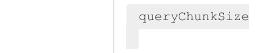

<a id="section-2-1-2-2"></a>

#### 2.1.2.2. 接口说明

本文介绍Lindorm TSDB SDK常用接口的使用方法。

Lindorm TSDB SDK的接口主要分成管理接口、写入接口以及查询接口等3类。

**管理接口**

Lindorm时序引擎支持使用SQL进行DDL、DCL操作，这里管理接口相关的示例是直接通过提交SQL实现对应的DDL和DCL操作。在Lindorm TSDB SDK中，支持以下两个重载方法向Lindorm时序引擎提交SQL实现DDL和DCL操作。

```text
// 直接提交SQL
Result execute(String sql);

// 在指定的数据库database下进⾏DDL等操作，比如在指定的database下创建表
Result execute(String database, String sql);
```

其中，Result对象表示SQL的执行结果，比如提交数据库的列表语句（"SHOW DATABASES"）后，可以通过Result获取到已经存在的数据库列表。Result对象有columns、metadata、rows等3个字段，其中，columns为结果的列名集合，metadata为对应列的数据类型集合，rows为结果的按行返回的集合。

```java
public class Result {
    private List<String> columns;
    private List<String> metadata;
    private List<List<Object>> rows;
    
    ....
 }
```

**数据库和表管理示例**

数据库和表的DDL操作主要包括创建、删除、查看等。代码示例如下：

```java
// 1.查看数据库列表
String showDatabase = "show databases";
Result result = lindormTSDBClient.execute(showDatabase);
System.out.println("before create, db list: " +  result.getRows().stream().map(e -> (String) e.get(0)).collect(Collectors.toList()));

// 2.创建数据库
String createDatabase = "create database demo";
result = lindormTSDBClient.execute(createDatabase);
System.out.println("create database:" + result.isSuccessful());

// 3.查看数据库列表
result = lindormTSDBClient.execute(showDatabase);
System.out.println("after create, db list: " +  result.getRows().stream().map(e -> (String) e.get(0)).collect(Collectors.toList()));

String database = "demo";

// 4.查看表列表
String showTables = "show tables";
result = lindormTSDBClient.execute(database, showTables);
System.out.println("before create, table list: " +  result.getRows().stream().map(e -> (String) e.get(0
)).collect(Collectors.toList()));

// 5.创建表
String createTable = "CREATE TABLE sensor (device_id VARCHAR TAG,region VARCHAR TAG,time 
BIGINT,temperature DOUBLE,humidity DOUBLE,PRIMARY KEY(device_id))";
result = lindormTSDBClient.execute(database, createTable);
System.out.println("create table: " + result.isSuccessful());

// 6.查看列表
result = lindormTSDBClient.execute(database, showTables);
System.out.println("after create, table list: " +  result.getRows().stream().map(e -> (String) e.get(0)
).collect(Collectors.toList()));

// 7.描述表详情
String describeTable = "describe table sensor";
result = lindormTSDBClient.execute(database, describeTable);
System.out.println("------------ describe table -------------------");
List<String> columns = result.getColumns();
System.out.println("columns: " + columns);
List<String> metadata = result.getMetadata();
System.out.println("metadata: " + metadata);
List<List<Object>> rows = result.getRows();
for (int i = 0, size = rows.size(); i < size; i++) {
    List<Object> row = rows.get(i);
    System.out.println("column #" + i + " : " + row);
}

System.out.println("------------ describe table -------------------");
// 8.删除表
String dropTable = "drop table sensor";
result = lindormTSDBClient.execute(database, dropTable);
System.out.println("drop table: " + result.isSuccessful());

// 9.查看表列表
result = lindormTSDBClient.execute(database, showTables);
System.out.println("after drop, table list: " +  result.getRows().stream().map(e -> (String) e.get(0)).collect(Collectors.toList()));

// 10.删除数据列表
String dropDatabase = "drop database demo";
result = lindormTSDBClient.execute(dropDatabase);
System.out.println("drop database:" + result.isSuccessful());

// 11.查看数据库列表
result = lindormTSDBClient.execute(showDatabase);
System.out.println("after drop, db list : " +  result.getRows().stream().map(e -> (String) e.get(0)).collect(Collectors.toList()));
```

运行结果示例：

```sql
before create, db list: [default]
create database:true
after create, db list: [default, demo]
before create, table list: []
create table: true
after create, table list: [sensor]
------------ describe table -------------------
columns: [columnName, typeName, columnKind]
metadata: [VARCHAR, VARCHAR, VARCHAR]
column #0 : [device_id, VARCHAR, TAG]
column #1 : [region, VARCHAR, TAG]
column #2 : [time, TIMESTAMP, TIMESTAMP]
column #3 : [temperature, DOUBLE, FIELD]
column #4 : [humidity, DOUBLE, FIELD]
------------ describe table -------------------
drop table: true
after drop, table list: []
drop database:true
after drop, db list : [default]
```

> **说明**
>
> 对于这里没有列举的其他管理相关的操作，比如连续查询的创建、删除等DDL操作，都可以根据Lindorm时序引擎的对应的SQL语法说明构造对应的SQL语句来实现。关于Lindorm时序引擎的SQL语句说明，可以参考SQL语法参考文档。

**写入接口**

Lindom TSDB SDK的写入接口为多个相同名称但参数不同的write方法，但根据处理写入结果方式，可以分成两类，分别为使用CompletableFuture&lt;WriteResult>处理写入结果的接口和使用回调函数Callback处理异步写入结果的接口。

默认情况下，LindormTSDBClient为提高写入性能，使用异步攒批的方式进行数据写入。若需要同步写入，只需要调用下write方法返回的CompletableFuture&lt;WriteResult>的join方法即可。

**写入记录**

Lindorm TSDB SDK使用Record对象表示表中的一行写入记录。Record需要指定表名、时间戳、标签和量测值。其中，时间戳和标签将用于构建索引。

默认构建Record会进行字符合法性校验，可以通过在build中添加参数'false'关闭校验。

```text
Record record = Record
    // 指定表名
    .table("sensor")
    // 指定时间戳，单位为毫秒
    .time(currentTime)
    // 指定标签
    .tag("device_id", "F07A1260")
    .tag("region", "north-cn")
    // 指定量测值
    .addField("temperature", 12.1)
    .addField("humidity", 45.0)
    .build();
```

**使用CompletableFuture处理写入结果的接口**

- 每次只提交一行记录。

```text
// 写入默认数据库 
CompletableFuture<WriteResult> future = lindormTSDBClient.write(record);

// 写入指定的数据库
String database = "demo";
CompletableFuture<WriteResult> future = lindormTSDBClient.write(database, record);
```

- 每次提交多行记录（推荐）。这种方式提交方式，可减少提交时的SDK异步队列锁竞争，效率较高。

```text
List<Record> records;
// 写入默认数据库
CompletableFuture<WriteResult> future = lindormTSDBClient.write(records);

// 写入指定的数据库
String database = "demo";
CompletableFuture<WriteResult> future = lindormTSDBClient.write(database, records);
```

- 处理CompletableFuture&lt;WriteResult>完成时的结果。这里仅是一个示例，业务上可以结合实际情况，调用CompletableFuture的其他方法进行结果处理。

```java
CompletableFuture<WriteResult> future = lindormTSDBClient.write(records);
// 处理异步写入结果
future.whenComplete((r, ex) -> {
    if (ex != null) { // 发送异常，⼀般都是写入失败
        System.out.println("Failed to write.");
        Throwable throwable = ExceptionUtils.getRootCause(ex);
        if (throwable instanceof LindormTSDBException) {
            LindormTSDBException e = (LindormTSDBException) throwable;
            System.out.println("Caught an LindormTSDBException, which means your request made it to 
Lindorm TSDB, "
                               + "but was rejected with an error response for some reason.");
            System.out.println("Error Code: " + e.getCode());
            System.out.println("SQL State:  " + e.getSqlstate());
            System.out.println("Error Message: " + e.getMessage());
        }  else {
            throwable.printStackTrace();
        }
    } else  { // ⼀般都是写入成功
        if (r.isSuccessful()) {
            System.out.println("Write successfully.");
        } else {
            System.out.println("Write failure.");
        }
    }
});
```

> **重要**
>
> 不要在CompletableFuture的whenComplete等方法中做复杂耗时的计算，否则可能会阻塞写入；若确实需要做复杂的耗时计算，请将计算逻辑提交到其他独立现场池中。关于错误码的取值和含义，请参见常见错误码参考。

**使用回调函数Callback处理异步写入结果的接口**

- 写入回调接口Callback的定义如下所示。onCompletion方法上的result表示写入结果，records表示这个回调函数关联的写入记录，异常e表示写入失败时的异常。

```text
public interface Callback {
    void onCompletion(WriteResult result, List<Record> records, Throwable e);
}
```

下面是使用Callback接口处理写入结果的一个示例。

```java
Callback callback =  new Callback() {
    @Override
    public void onCompletion(WriteResult result, List<Record> list,
                             Throwable throwable) {
        if (throwable != null) { // 写入失败
            if (throwable instanceof LindormTSDBException) {
                LindormTSDBException ex = (LindormTSDBException) throwable;
                System.out.println("errorCode: " + ex.getCode());
                System.out.println("sqlstate: " + ex.getSqlstate());
                System.out.println("message: " + ex.getMessage());
            } else {
                // 其他错误
                throwable.printStackTrace();
            }
        } else {
            if (result.isSuccessful()) {
                System.out.println("Write successfully.");
            } else {
                System.out.println("Write failure.");
            }
        }
    }
};
```

> **重要**
>
> 不要在Callback的onCompletion中做复杂耗时的计算，否则可能会阻塞写入；若确实需要做复杂的耗时计算，请将计算逻辑提交到其他独立现场池中。关于错误码的取值和含义，请参见常见错误码参考。

- 每次提交一行记录。

```text
// 写入默认数据库 
lindormTSDBClient.write(record, callback);

// 写入指定的数据库
String database = "demo";
lindormTSDBClient.write(database, record, callback);
```

- 每次提交多行记录（推荐）。这种方式提交方式，可减少提交时的SDK异步队列锁竞争，效率较高。

```text
List<Record> records;
// 写入默认数据库
lindormTSDBClient.write(records, callback);

// 写入指定的数据库
String database = "demo";
lindormTSDBClient.write(database, records, callback);
```

**查询接口**

Lindorm TSDB SDK的查询接口是通过SQL查询数据的，关于SQL语句说明可以参考SQL语法参考文档。

Lindorm TSDB SDK的查询接口如下所示，其中，入参有要查询的数据库database, 查询语句sql，查询结果每批返回的行数大小chunkSize。

```text
ResultSet query(String database, String sql, int chunkSize);
```

Lindorm TSDB SDK 使用ResultSet接口表示SQL查询结果，其定义如下所示。

```text
public interface ResultSet extends Closeable {

    QueryResult next();

    void close();
}
```

在处理查询结果时，可以循环调用ResultSet的next方法获取查询结果，当next方法返回的QueryResult对象为null时，表示已经读取完全部查询结果。 当查询结束时，调用ResultSet的close方法释放对应的IO资源。

QueryResult表示每批返回的查询结果，该对象有columns、metadata、rows等3个字段，其中，columns为查询结果的查询的列名集合，metadata为对应列的数据类型集合，rows为查询结果的按行返回的集合。其中，关于Lindorm时序引擎查询支持的数据类型集合，请参考数据类型。下面是处理查询结果ResultSet的示例。

```java
String sql = "select * from sensor";
int chunkSize = 100;
ResultSet resultSet = lindormTSDBClient.query("demo", sql, chunkSize);

// 处理查询结果
try {
    QueryResult result = null;
    // 当resultSet的next()⽅法返回为null，表示已经读取完所有的查询结果
    while ((result = resultSet.next()) != null) {
        List<String> columns = result.getColumns();
        System.out.println("columns: " + columns);
        List<String> metadata = result.getMetadata();
        System.out.println("metadata: " + metadata);
        List<List<Object>> rows = result.getRows();
        for (int i = 0, size = rows.size(); i < size; i++) {
            List<Object> row = rows.get(i);
            System.out.println("row #" + i + " : " + row);
        }
    }
} finally {
    // 查询结束后，需确保调⽤ResultSet的close⽅法，以释放IO资源
    resultSet.close();
}
```

> **重要**
>
> 不管查询是否成功，在查询结束时，都需显式调用ResultSet的close方法，以释放IO资源，否则会造成网络连接泄露。

另外，Lindorm TSDB SDK也提供了几个查询接口重载实现，如下所示，业务上可以根据实际情况选择使用不同实现。

```text
// SQL查询语句
String sql = "xxxx";

// 1.使⽤SQL语句，查询默认数据库, 默认每批返回1000⾏数据
ResultSet resultSet = lindormTSDBClient.query(sql);

String database = "demo";
// 2.使⽤SQL语句，查询指定数据库，默认每批返回1000⾏数据
ResultSet resultSet = lindormTSDBClient.query(database, sql);
```

<a id="section-2-1-2-3"></a>

#### 2.1.2.3. 异常处理

本文介绍在应用代码中如何处理Lindorm TSDB SDK抛出的异常。

Lindorm TSDB SDK 包含两类异常，一类是客户端异常ClientException, 另一类是服务端异常LindormTSDBException, 它们均继承自RuntimeException。

**ClientException**

ClientException指客户端尝试向Lindorm时序引擎发送请求以及数据传输时遇到的异常。例如，当发送请求时网络连接不可用，则会抛出ClientException。

**LindormTSDBException**

LindormTSDBException指服务器端异常，它来自于对服务器错误信息的解析。LindormTSDBException包含Lindorm时序引擎返回的错误码和错误信息，便于定位问题，并做出适当的处理。LindormTSDBException通常包含以下错误信息：

| 参数 | 描述 |
| --- | --- |
| code | Lindorm时序引擎返回的错误码。 |
| sqlstate | Lindorm时序引擎返回的sqlstate值。 |
| message | Lindorm时序引擎返回的详细错误信息。 |

> **说明**
>
> 关于Lindorm时序引擎返回的错误对应的详细错误，请参见常见错误码参考。

**异常处理示例**

以下代码用于展示异常处理：

```java
try {
    // Lindorm TSDB操作，比如查询数据等；
    lindormTSDBClient.query(....);
} catch (LindormTSDBException e) {
    System.out.println("Caught an LindormTSDBException, which means your request made it to Lindorm TSD
B, "
            + "but was rejected with an error response for some reason.");
    System.out.println("Error Code: " + e.getCode());
    System.out.println("SQL State:  " + e.getSqlstate());
    System.out.println("Error Message: " + e.getMessage());
} catch(ClientException ce) {
    System.out.println("Caught an ClientException, which means the client encountered "
            + "a serious internal problem while trying to communicate with Lindorm TSDB, "
            + "such as not being able to access the network.");
    System.out.println("Error Message: " + ce.getMessage());
} 
```

> **说明**
>
> 关于Lindorm时序引擎返回的错误对应的详细错误，请参见常见错误码参考。

<a id="section-2-1-2-4"></a>

#### 2.1.2.4. 版本说明

本文介绍Lindorm时序引擎的Java Native SDK版本说明。

> **说明**
>
> Lindorm时序引擎的Java Native SDK的所有版本均可在Maven中央仓库获取使用，更多内容，请参见maven repository。

**V1.0.4**

修复execute()接口无法解析返回结果的问题。

**V1.0.3**

- 支持将**schema_policy**指定为 `None` ，指定后数据写入时不会创建表。

- 支持通过连接池（connectionPool）设置**keepAliveMs**以及**maxIdleConn**参数。

- 支持将错误日志打印消息序列转化成可读字符。

- query()接口支持按照元信息Schema正确解析数据类型。

- 修复通过写入时间戳进行检查判断会报错的问题。

**V1.0.2**

放宽字符串校验规则。

**V1.0.1**

- 增加HTTPS支持。

- 将依赖的okhttp3库的依赖包重命名，避免依赖冲突。

- 增加带参数的同步写入方法writeSync，提高写入方式的灵活性。

- 增加强制flush方法，用于强制将异步队列中的数据发送出去。

- 增加健康检查接口**isHealth**，用于检查服务端是否健康。

- 增加在创建客户端时检查URL是否可用的功能。

- 增加服务端版本号校验，要求服务端版本最低为V3.4.8。

**V1.0.0**

首次发布，支持Basic鉴权、异步攒批写入、数据流式查询等基础功能。

<a id="section-2-1-2-5"></a>

#### 2.1.2.5. 教程：通过Java Native SDK连接并使用Lindorm时序引擎

本文介绍通过Java Native SDK连接并使用Lindorm时序引擎的方法。

**前提条件**

- 已安装Java环境，要求安装JDK 1.8及以上版本。

- 时序引擎版本为3.4.7及以上版本，如何查看或升级当前版本，请参见**Lindorm用户指南**手册中**实例管理**目录下的**版本升级**章节。

- 已获取云原生多模数据库Lindorm时序引擎的连接地址，获取方法请参见**Lindorm用户指南**手册中**实例管理**目录下的**查看连接地址**章节。

**准备工作**

通过Java Native SDK连接Lindorm时序引擎前，需要安装Java Native SDK。以1.0.0版本为例，您可以通过以下三种方式安装Java Native SDK：

- （推荐）在Maven项目中使用Lindorm TSDB Java SDK。在pom.xml文件的 `dependencies` 中添加以下依赖项。

  ```xml
  <dependency>
    <groupId>com.aliyun.lindorm</groupId>
    <artifactId>lindorm-tsdb-client</artifactId>
    <version>1.0.4</version>
  </dependency>
  ```

  > Lindorm TSDB Java SDK提供了一个基于Maven的示例工程，您可以直接下载示例工程并在本地编译和
  >
  > **说明**
  >
  > 运行，也可以以示例工程为基础开发您的项目工程。

- 在Eclipse项目中导入JAR包。

  <ol type="i">

  <li>

  下载Java SDK开发包。

  </li>

  <li>

  解压下载的Java SDK开发包。

  </li>

  <li>

  将解压后JAR包添加至Eclipse项目中。

  <ol type="a">

  <li>

  在Eclipse中打开您的项目，右键单击该项目，选择**Properties**。

  </li>

  <li>

  在弹出的对话框中，单击**Java Build Path > Libraries > Add JARs**，选择解压后的lindorm-tsdb-client-1.0.0.jar和lib文件中的JAR包。

  </li>

  </ol>

  <ol type="i" start="100">

  <li>

  单击**Apply and Close**。

  </li>

  </ol>

  </li>

  </ol>

- 在IntelliJ IDEA项目中导入JAR包。

  <ol type="i">

  <li>

  下载Java SDK开发包。

  </li>

  <li>

  解压下载的Java SDK开发包。

  </li>

  <li>

  将解压后JAR包添加至IntelliJ IDEA项目中。

  <ol type="a">

  <li>

  在IntelliJ IDEA中打开您的项目，在菜单栏单击**File > Project Structure**。

  </li>

  <li>

  在**Project Structure**对话框的左边选择**Project Structure > Modules**。

  </li>

  </ol>

  <ol type="i" start="100">

  <li>

  单击右边  ，选择**JARs or directories**。

  </li>

  <li value="500">

  在弹出的对话框中，选择解压后的lindorm-tsdb-client-1.0.0.jar和lib文件中的JAR包，并单击**OK**。

  </li>

  </ol>

  <ol type="a" start="5">

  <li>

  单击**Apply**。

  </li>

  <li>

  单击**OK**。

  </li>

  </ol>

  </li>

  </ol>

> **说明**
>
> - Lindorm时序引擎的Java Native SDK各版本可以通过Maven中央仓库获取，更多信息请参见Maven Repository。
>
> - Lindorm时序引擎的Java Native SDK各版本说明请参见版本说明。

**操作步骤**

1. 创建数据库实例。新建LindormTSDBClient时，需要指定Lindorm时序引擎的连接地址，获取方法请参见**Lindorm用户指南**手册中**实例管理**目录下的**查看连接地址**章节。

   ```text
   String url = "http://ld-bp17j28j2y7pm****-proxy-tsdb-pub.lindorm.rds.aliyuncs.com:8242";
   // LindormTSDBClient线程安全，可以重复使⽤，无需频繁创建和销毁
   ClientOptions options = ClientOptions.newBuilder(url).build();
   LindormTSDBClient lindormTSDBClient = LindormTSDBFactory.connect(options);
   ```

2. 创建数据库demo和时序表sensor。关于创建数据库和时序表的SQL语句说明，请参见CREATE DATABASE和CREATE TABLE。

   ```text
   lindormTSDBClient.execute("CREATE DATABASE demo");
   lindormTSDBClient.execute("demo","CREATE TABLE sensor (device_id VARCHAR TAG,region VARCHAR TAG,time 
   BIGINT,temperature DOUBLE,humidity DOUBLE,PRIMARY KEY(device_id))");
   ```

3. 在表中写入数据。

   > 默认情况下，为了提高写入数据的性能，LindormTSDBClient通过异步攒批的方式进行数据写入。如果需
   >
   > **说明**
   >
   > 要通过同步的方式进行数据写入，可以调用 `write()` 方法返回的 `CompletableFuture<WriteResult>` 的 `join()` 方法。

   ```java
   int numRecords = 10;
   List<Record> records = new ArrayList<>(numRecords);
   long currentTime = System.currentTimeMillis();
   for (int i = 0; i < numRecords; i++) {
       Record record = Record
           .table("sensor")
           .time(currentTime + i * 1000)
           .tag("device_id", "F07A1260")
           .tag("region", "north-cn")
           .addField("temperature", 12.1 + i)
           .addField("humidity", 45.0 + i)
           .build();
       records.add(record);
   }

   CompletableFuture<WriteResult> future = lindormTSDBClient.write("demo", records);
   // 处理异步写入结果
   future.whenComplete((r, ex) -> {
       // 处理写入失败
       if (ex != null) {
           System.out.println("Failed to write.");
           if (ex instanceof LindormTSDBException) {
               LindormTSDBException e = (LindormTSDBException) ex;
               System.out.println("Caught an LindormTSDBException, which means your request made it to Lindorm TSDB, "
                                  + "but was rejected with an error response for some reason.");
               System.out.println("Error Code: " + e.getCode());
               System.out.println("SQL State:  " + e.getSqlstate());
               System.out.println("Error Message: " + e.getMessage());
           }  else {
               ex.printStackTrace();
           }
       } else  {
           System.out.println("Write successfully.");
       }
   });
   // 这⾥作为示例, 简单同步处理写入结果
   System.out.println(future.join());
   ```

4. 查询时序表的数据。关于查询操作的SQL语句说明，请参见基本查询。

   ```java
   String sql = "select * from sensor limit 10";
   ResultSet resultSet = lindormTSDBClient.query("demo", sql);

   try {
       // 处理查询结果
       QueryResult result = null;
       // 查询结果使⽤分批的⽅式返回，默认每批1000⾏
       // 当resultSet的next()⽅法返回为null，表示已经读取完所有的查询结果
       while ((result = resultSet.next()) != null) {
           List<String> columns = result.getColumns();
           System.out.println("columns: " + columns);
           List<String> metadata = result.getMetadata();
           System.out.println("metadata: " + metadata);
           List<List<Object>> rows = result.getRows();
           for (int i = 0, size = rows.size(); i < size; i++) {
               List<Object> row = rows.get(i);
               System.out.println("row #" + i + " : " + row);
           }
       }
   } finally {
       // 查询结束后，需确保调⽤ResultSet的close⽅法，以释放IO资源
       resultSet.close();
   }
   ```

**完整的代码示例**

```java
import com.aliyun.lindorm.tsdb.client.ClientOptions;
import com.aliyun.lindorm.tsdb.client.LindormTSDBClient;
import com.aliyun.lindorm.tsdb.client.LindormTSDBFactory;
import com.aliyun.lindorm.tsdb.client.exception.LindormTSDBException;
import com.aliyun.lindorm.tsdb.client.model.QueryResult;
import com.aliyun.lindorm.tsdb.client.model.Record;
import com.aliyun.lindorm.tsdb.client.model.ResultSet;
import com.aliyun.lindorm.tsdb.client.model.WriteResult;
import com.aliyun.lindorm.tsdb.client.utils.ExceptionUtils;

import java.util.ArrayList;
import java.util.List;
import java.util.concurrent.CompletableFuture;

public class QuickStart {

    public static void main(String[] args) {

        // 1.创建客户端实例
        String url = "http://ld-xxxx-proxy-tsdb-pub.lindorm.rds.aliyuncs.com:8242";
        // LindormTSDBClient线程安全，可以重复使⽤，无需频繁创建和销毁
        ClientOptions options = ClientOptions.newBuilder(url).build();
        LindormTSDBClient lindormTSDBClient = LindormTSDBFactory.connect(options);

        // 2.创建数据库demo和表sensor
        lindormTSDBClient.execute("CREATE DATABASE demo");
        lindormTSDBClient.execute("demo","CREATE TABLE sensor (device_id VARCHAR TAG,region VARCHAR TAG,time BIGINT,temperature DOUBLE,humidity DOUBLE,PRIMARY KEY(device_id))");

        // 3.写入数据
        int numRecords = 10;
        List<Record> records = new ArrayList<>(numRecords);
        long currentTime = System.currentTimeMillis();
        for (int i = 0; i < numRecords; i++) {
            Record record = Record
                    .table("sensor")
                    .time(currentTime + i * 1000)
                    .tag("device_id", "F07A1260")
                    .tag("region", "north-cn")
                    .addField("temperature", 12.1 + i)
                    .addField("humidity", 45.0 + i)
                    .build();
            records.add(record);
        }

        CompletableFuture<WriteResult> future = lindormTSDBClient.write("demo", records);
        // 处理异步写入结果
        future.whenComplete((r, ex) -> {
            // 处理写入失败
            if (ex != null) {
                System.out.println("Failed to write.");
                Throwable throwable = ExceptionUtils.getRootCause(ex);
                if (throwable instanceof LindormTSDBException) {
                    LindormTSDBException e = (LindormTSDBException) throwable;
                    System.out.println("Caught an LindormTSDBException, which means your request made it
to Lindorm TSDB, "
                            + "but was rejected with an error response for some reason.");
                    System.out.println("Error Code: " + e.getCode());
                    System.out.println("SQL State:  " + e.getSqlstate());
                    System.out.println("Error Message: " + e.getMessage());
                }  else {
                    throwable.printStackTrace();
                }
            } else  {
                System.out.println("Write successfully.");
            }
        });
        // 这⾥作为示例, 简单同步等待
        System.out.println(future.join());

        // 4.查询数据
        String sql = "select * from sensor limit 10";
        ResultSet resultSet = lindormTSDBClient.query("demo", sql);

        try {
            // 处理查询结果
            QueryResult result = null;
            // 查询结果使⽤分批的⽅式返回，默认每批1000⾏
            // 当resultSet的next()⽅法返回为null，表示已经读取完所有的查询结果
            while ((result = resultSet.next()) != null) {
                List<String> columns = result.getColumns();
                System.out.println("columns: " + columns);
                List<String> metadata = result.getMetadata();
                System.out.println("metadata: " + metadata);
                List<List<Object>> rows = result.getRows();
                for (int i = 0, size = rows.size(); i < size; i++) {
                    List<Object> row = rows.get(i);
                    System.out.println("row #" + i + " : " + row);
                }
            }
        } finally {
            // 查询结束后，需确保调⽤ResultSet的close⽅法，以释放IO资源
            resultSet.close();
        }

        lindormTSDBClient.shutdown();
    }
}
```

<a id="section-2-1-3"></a>

### 2.1.3. Java JDBC Driver开发手册

本文介绍通过Lindorm JDBC Driver连接并访问时序引擎的具体操作，以及JDBC Driver访问时序引擎时支持的API接口和方法。

**背景信息**

Lindorm时序引擎的JDBC Driver遵循JDBC 4.1规范定义的接口。由于时序引擎自身是一个时序数据库，所以JDBC Driver中提供的实际上是JDBC 1.0定义的基础功能集中的一个子集。

**前提条件**

- 已安装Java环境，要求安装JDK 1.8及以上版本。

- 已将客户端IP地址添加至Lindorm白名单，具体操作请参见设置白名单。

- 已获取云原生多模数据库 Lindorm时序引擎的连接地址，具体操作请参见查看连接地址。

**操作步骤**

1. 通过以下两种方式安装Lindorm JDBC Driver依赖。

   - 手动安装。

     在本地自行下载JAR包集成JDBC Driver，下载链接为：Lindorm-all-client。选择需要安装的版本，以2.1.2为例，下载lindorm-all-client-2.1.2.jar包。

   - 通过Maven下载。

     如果在Maven项目中集成JDBC Driver，创建Project并在pom.xml中添加以下依赖配置，具体内容如下：

     ```xml
     <dependency>
         <groupId>com.aliyun.lindorm</groupId>  
         <artifactId>lindorm-all-client</artifactId>
         <version>2.1.2</version>
     </dependency>
     ```

     > **说明**
     >
     > lindorm-all-client的版本号根据需求填写。

2. 访问Lindorm时序引擎。完整的代码示例请参考访问示例。

   <ol type="i">

   <li>

   建立Lindorm时序引擎和数据之间的连接。

   ```text
   String url = "jdbc:lindorm:tsdb:url=http://<host:port>";
   Connection conn = DriverManager.getConnection(url);
   ```

   > **说明**
   >
   > - `host:port` ：Lindorm时序引擎的连接地址和端口，例如： `ld-bp17j28j2y7pm****-proxy-tsdb.lindorm.rds.aliyuncs.com:8242` 。
   >
   > - `jdbc:lindorm:tsdb:url=http://<host:port>` ：表示JDBC的连接地址，具体语法和连接参数说明请参见JDBC的连接地址说明。

   </li>

   <li>

   创建Lindorm时序数据库和表。

   ```text
   Statement stmt = conn.createStatement();

   stmt.execute("CREATE DATABASE test");
   stmt.execute("USE test");
   stmt.execute("CREATE TABLE sensor (device_id VARCHAR TAG,region VARCHAR TAG,time 
   TIMESTAMP,temperature DOUBLE,humidity DOUBLE,PRIMARY KEY(device_id))");
   ```

   </li>

   <li>

   在表sensor中插入数据。

   ```text
   //PreparedStatement 批量写入数据（推荐使⽤）
   PreparedStatement pstmt = conn.prepareStatement("INSERT INTO sensor (device_id, region, time, temperature, humidity) VALUES (?, ?, ?, ?, ?)");
   int batchSize = 100;
   long ts = System.currentTimeMillis();

   for (int i = 0; i < batchSize; i++) {

        //按INSERT语句中的列参数顺序依次绑定参数
        pstmt.setString(1, "F07A1260");
        pstmt.setString(2, "north-cn");
        pstmt.setLong(3, ts + i * 10000);
        pstmt.setDouble(4, 12.1);
        pstmt.setLong(5, 45);

        pstmt.addBatch();
   }

   pstmt.executeBatch();
   pstmt.clearBatch();

   //批量写入数据 
   Statement stmt = conn.createStatement();
   stmt.addBatch("INSERT INTO sensor(device_id, region, time, temperature, humidity) 
   values('F07A1260','north-cn',1619076780000,12.1,45)");
   stmt.addBatch("INSERT INTO sensor(device_id, region, time, temperature, humidity) 
   values('F07A1260','north-cn',1619076790000,13.2,47)");
   stmt.addBatch("INSERT INTO sensor(device_id, region, time, temperature, humidity) 
   values('F07A1260','north-cn',1619076800000,10.6,46)");
   stmt.addBatch("INSERT INTO sensor(device_id, region, time, temperature, humidity) 
   values('F07A1261','south-cn',1619076780000,18.1,44)");
   stmt.addBatch("INSERT INTO sensor(device_id, region, time, temperature, humidity) 
   values('F07A1261','south-cn',1619076790000,19.7,44)");
   stmt.executeBatch();
   stmt.clearBatch();

   //单条写入数据（不推荐使⽤）
   Statement stmt = conn.createStatement();
   stmt.execute("INSERT INTO sensor(device_id, region, time, temperature, humidity) 
   values('F07A1260','north-cn',1619076780000,12.1,45)");
   ```

   </li>

   <li>

   查询表sensor中的数据。

   ```java
   ResultSet rs = stmt.executeQuery("select device_id, region,time,temperature,humidity from sensor where time >= 1619076780000 and time <= 1619076800000");

   while (rs.next()) {
       String device_id = rs.getString("device_id");
       String region = rs.getString("region");
       Long time = rs.getLong("time");
       Double temperature = rs.getDouble("temperature");
       Long humidity = rs.getLong("humidity");
       System.out.printf("%s %s %d %f %d\n", device_id, region, time, temperature, humidity);
   }
   ```

   </li>

   </ol>

**支持的API接口和方法**

JDBC Driver访问时序引擎时支持的API接口和对应的方法如下表所示。

> **说明**
>
> 下表未列出的API接口部分兼容上层框架，会返回默认值。如果您有其他问题，请提交工单。

<table>
  <tr>
    <th width="183">接口</th>
    <th>支持的方法</th>
  </tr>
  <tr>
    <td>Connection</td>
    <td><code>• close()</code><br><code>• createStatement(int, int)</code><br><code>• createStatement(int, int, int)</code><br><code>• getSchema()</code><br><code>• prepareStatement(String, int, int)</code><br><code>• prepareStatement(String, int, int, int)</code><br><code>• setSchema(String)</code><br>说明由于Lindorm JDBC Driver的Connection接口实现不是线程安全的，所以建议不要在多个线程里共用同一个Connection对象。</td>
  </tr>
  <tr>
    <td>Statement</td>
    <td><code>• addBatch(String)</code><br><code>• close()</code><br><code>• execute(String)</code><br><code>• executeQuery(String)</code><br><code>• getMoreResult</code><br><code>• isClosed()</code><br><code>• setFetchSize(int)</code></td>
  </tr>
  <tr>
    <td>ResultSet</td>
    <td><code>• addBatch()</code><br><code>• clearBatch()</code><br><code>• close()</code><br><code>• execute()</code><br><code>• executeBatch()</code><br><code>• executeQuery()</code><br><code>• getParameterNumber()</code><br><code>• setNull(int)</code><br><code>• setXXX(int, T)</code><br>说明Lindorm时序引擎支持的数据类型请参见数据类型。</td>
  </tr>
  <tr>
    <td>PreparedStatement</td>
    <td><code>• close()</code><br><code>• getStatement()</code><br><code>• next()</code><br><code>• wasNull()</code><br><code>• getXXX(int)</code><br>说明Lindorm时序引擎支持的数据类型请参见数据类型。</td>
  </tr>
</table>

**JDBC的连接地址说明**

JDBC的连接地址是应用程序基于Connection接口建立数据库连接时的重要依据，通常用于指定数据库连接的协议，实际是通过JDBC Driver实现。

JDBC的连接地址语法如下所示：

```text
jdbc:lindorm:tsdb:url=http://${host:port}[;${connection_parameter}=${connection_value}]...
```

> **说明**
>
> `host:port` ：Lindorm时序引擎的连接地址和端口，例如： `ld-bp17j28j2y7pm****-proxy-tsdb.lindorm.rds.aliyuncs.com:8242` 。

JDBC的连接地址中支持的连接参数和说明如下表：

| 参数 | 说明 |
| --- | --- |
| user | Lindorm实例的用户名。用于指定连接时序引擎时进行用户认证的用户名。<br>说明当引擎的用户鉴权功能未启用时，用户名可以不指定。 |
| password | 用户名对应的密码。用于指定连接时序引擎时进行用户认证的密码。如果您忘记了密码，可以通过Lindorm宽表引擎的集群管理系统修改密码，具体操作请参见修改用户密码。<br>说明当引擎的用户鉴权功能未启用时，密码可以不指定。 |
| database | 连接访问的Database。如果该参数未指定，默认访问<code> default </code>数据库。 |
| lindorm.tsdb.driver.connect.timeout | 连接时序引擎服务端的超时时间，单位为ms（毫秒）。默认值60秒（即60000毫秒）。 |
| lindorm.tsdb.driver.socket.timeout | Socket读写间隔超时时间，单位为ms（毫秒）。默认值为-1，表示无超时。 |

> **重要**
>
> 服务端为了提高资源利用率，在连接Lindorm客户端空闲60分钟后，服务端会主动断开连接。如果还需要使用该连接，会出现 `com.aliyun.lindorm.client.shaded.org.apache.calcite.avatica.http.ConnectionDisconnectedException` 报错，重新建立连接即可解决。

**使用Druid连接池访问时序引擎**

使用Java开发访问时序引擎的应用程序时，通常建议通过JDBC Driver连接Lindorm时序引擎，但是JDBC访问逻辑的基础是需要创建Connection对象。如果每次连接时序引擎都创建一个新的Connection对象会带来很大的开销。为了降低开销，解决方法是使用连接池来执行连接的创建和管理。

目前可以选择的连接池有很多种，以下介绍开源连接池Alibaba Druid的使用步骤。

1. 在Maven项目中添加Druid连接池的依赖。打开客户端，创建Project并在pom.xml中配置Maven依赖，具体内容如下：

   ```xml
   <dependency>
         <groupId>com.alibaba</groupId>
         <artifactId>druid</artifactId>
         <version>1.2.6</version>
       </dependency>
   ```

2. 在Maven项目中添加Lindorm JDBC Driver依赖，具体请参见操作步骤中的步骤1。

3. 执行以下代码创建DataSource对象，为DataSource设置Lindorm时序引擎的JDBC连接地址。

   ```text
   dataSource = new DruidDataSource();
           try {
               
   dataSource.setDriver(DriverManager.getDriver("jdbc:lindorm:tsdb:url=http://<host:port>"));
           } catch (SQLException throwables) {
               throwables.printStackTrace();
           }
   ```

   > **说明**
   >
   > `host:port` ：Lindorm时序引擎的连接地址和端口，例如： `ld-bp17j28j2y7pm****-proxy-tsdb.lindorm.rds.aliyuncs.com:8242` 。

4. 基于DataSource创建JDBC Connection并访问Lindorm时序引擎。完整的代码如下：

   ```java
   import com.alibaba.druid.pool.DruidDataSource;
   import java.sql.*;

   public class App {
       private DruidDataSource dataSource;

       public void setUp() {
           dataSource = new DruidDataSource();
           try {
               dataSource.setDriver(DriverManager.getDriver("jdbc:lindorm:tsdb:url=http://ld-
   bp17j28j2y7pm****-proxy-tsdb-pub.lindorm.rds.aliyuncs.com:8242"));
           } catch (SQLException throwables) {
               throwables.printStackTrace();
           }
           dataSource.setUrl("jdbc:lindorm:tsdb:url=http://ld-bp17j28j2y7pm****-proxy-tsdb-
   pub.lindorm.rds.aliyuncs.com:8242");
           dataSource.setValidationQuery("select 1");
           dataSource.setMaxActive(1);
           dataSource.setUsername("username");
           dataSource.setPassword("****");
           dataSource.setKeepAlive(true);
           dataSource.setMinEvictableIdleTimeMillis(80);
           dataSource.setMaxWait(10000);
           dataSource.init();

       }

       public void close() {
           dataSource.close();
       }

       public void testQuery() {
           try (Connection conn = this.dataSource.getConnection()) {
               try (Statement stmt = conn.createStatement()) {
                   ResultSet rs = stmt.executeQuery("select * from sensor");
                   long count = 0;
                   while (rs.next()) {
                       count++;
                   }
                   System.out.println("count=" + count + " ");
               } catch (RuntimeException e) {
                   e.printStackTrace();
               } catch (SQLException e) {
                   e.printStackTrace();
               }
           } catch (RuntimeException e) {
               System.out.println("connection failed.");
               e.printStackTrace();
           } catch (SQLException e) {
               e.printStackTrace();
           }
       }

       public static void main( String[] args ) {
           App app = new App();
           app.setUp();
           app.testQuery();
           app.close();
       }
   }
   ```

<a id="section-2-1-3-1"></a>

#### 2.1.3.1. 支持的接口与方法

本文介绍JDBC Driver访问时序引擎时支持的API接口和对应的方法。

> **说明**
>
> 下表未列出的API接口部分兼容上层框架，会返回默认值。如果您有其他问题，请联系Lindorm技术支持（钉钉号：s0s3eg3）。

<table>
  <tr>
    <th width="183">接口</th>
    <th>支持的方法</th>
  </tr>
  <tr>
    <td>Connection</td>
    <td><code>• close()</code><br><code>• createStatement(int, int)</code><br><code>• createStatement(int, int, int)</code><br><code>• getSchema()</code><br><code>• prepareStatement(String, int, int)</code><br><code>• prepareStatement(String, int, int, int)</code><br><code>• setSchema(String)</code><br>说明由于Lindorm JDBC Driver的Connection接口实现不是线程安全的，建议不要在多个线程里共用同一个Connection对象。</td>
  </tr>
  <tr>
    <td>Statement</td>
    <td><code>• addBatch(String)</code><br><code>• close()</code><br><code>• execute(String)</code><br><code>• executeQuery(String)</code><br><code>• getMoreResult</code><br><code>• isClosed()</code><br><code>• setFetchSize(int)</code></td>
  </tr>
  <tr>
    <td>ResultSet</td>
    <td><code>• addBatch()</code><br><code>• clearBatch()</code><br><code>• close()</code><br><code>• execute()</code><br><code>• executeBatch()</code><br><code>• executeQuery()</code><br><code>• getParameterNumber()</code><br><code>• setNull(int)</code><br><code>• setXXX(int, T)</code><br>说明Lindorm时序引擎支持的数据类型，请参见数据类型。</td>
  </tr>
  <tr>
    <td>PreparedStatement</td>
    <td><code>• close()</code><br><code>• getStatement()</code><br><code>• next()</code><br><code>• wasNull()</code><br><code>• getXXX(int)</code><br>说明Lindorm时序引擎支持的数据类型，请参见数据类型。</td>
  </tr>
</table>

<a id="section-2-1-3-2"></a>

#### 2.1.3.2. JDBC连接地址说明

本文介绍JDBC的连接地址。

JDBC的连接地址是应用程序基于Connection接口建立数据库连接时的重要依据，通常用于指定数据库连接的协议，实际是通过JDBC Driver实现。

JDBC的连接地址语法如下：

```text
jdbc:lindorm:tsdb:url=http://${host:port}[;${connection_parameter}=${connection_value}]...
```

**参数说明**

类别

参数

示例值

说明

jdbc:lindorm: tsdb:url=http://ld-bp12pc23yfb

时序引擎的连接地址及端口。如何获取，请参见**用户指南**中的**查看连接地址**章

不涉及

host:port

3\*\*\*\*\*-proxy-

节。

tsdb-pub.lindorm.r ds.aliyuncs.c om:8242

Lindorm实例的用户名。用于指定连接时序引擎时进行用户认证的用户名。

> **说明**

username

root

> 当引擎的用户鉴权功能未启用时，用户名可以不指定

用户名对应的密码。用于指定连接时序引擎时进行用户认证的密码。

> **说明**

password

root

> 当引擎的用户鉴权功能未启用时，密码可以不指定。

connection_p

连接访问的Database。如果该参数未指定，默认访问 `default` 数据库。

database

default

arameter

lindorm.tsdb.

连接时序引擎服务端的超时时间，单位为ms（毫秒）。默认值60秒（即60000

driver.connec

60

毫秒）。

t.timeout

lindorm.tsdb.

Socket读写间隔超时时间，单位为ms（毫秒）。默认值为-1，表示无超时。

driver.socket.

60

timeout

> **重要**
>
> 服务端为了提高资源利用率，在连接Lindorm客户端空闲90s后，服务端会主动断开连接。如果还需要使用该连接，会出现 `com.aliyun.lindorm.client.shaded.org.apache.calcite.avatica.http.ConnectionDisconnectedException` 报错，重新建立连接即可解决。

<a id="section-2-1-3-3"></a>

#### 2.1.3.3. 教程：通过Druid连接池连接并访问时序引擎

本文介绍通过Druid连接池连接并访问时序引擎的方法。

**背景信息**

使用Java开发访问时序引擎的应用程序时，通常建议通过JDBC Driver连接Lindorm时序引擎。JDBC访问逻辑的基础是需要创建Connection对象，如果每次连接时序引擎都创建一个新的Connection对象，会带来很大的开销。为了降低开销，可以使用连接池来执行连接的创建和管理。

**前提条件**

- 已安装Java环境，要求安装JDK 1.8及以上版本。

- 已获取时序引擎的连接地址。如何获取，请参见**用户指南**的**查看连接地址**章节。

**操作步骤**

以开源连接池Alibaba Druid为例。

1. 在Maven项目中添加Druid连接池的依赖。打开客户端，创建Project并在pom.xml中配置Maven依赖。示例代码如下：

   ```xml
   <dependency>
         <groupId>com.alibaba</groupId>
         <artifactId>druid</artifactId>
         <version>1.2.6</version>
       </dependency>
   ```

2. 通过以下两种方式安装Lindorm JDBC Driver依赖。

   - 手动安装。

     在本地自行下载JAR包集成JDBC Driver，下载链接为：Lindorm-all-client。选择需要安装的版本，以2.1.5为例，下载lindorm-all-client-2.1.5.jar包。

   - 通过Maven下载。

     如果在Maven项目中集成JDBC Driver，创建Project并在pom.xml中添加以下依赖配置，具体内容如下：

     ```xml
     <dependency>
         <groupId>com.aliyun.lindorm</groupId>  
         <artifactId>lindorm-all-client</artifactId>
         <version>2.2.1.3</version>
     </dependency>
     ```

     > **说明**
     >
     > lindorm-all-client的版本号根据需求填写。

3. 创建DataSource对象，基于DataSource创建JDBC Connection并访问Lindorm时序引擎。示例代码如下：

   ```java
   import com.alibaba.druid.pool.DruidDataSource;
   import java.sql.*;

   public class App {
       private DruidDataSource dataSource;

       public void setUp() {
           dataSource = new DruidDataSource();
           try {
               dataSource.setDriver(DriverManager.getDriver("jdbc:lindorm:tsdb:url=http://ld-
   bp17j28j2y7pm****-proxy-tsdb-pub.lindorm.rds.aliyuncs.com:8242"));//此处为控制台上获取的连接地址
               dataSource.setUrl("jdbc:lindorm:tsdb:url=http://ld-bp17j28j2y7pm****-proxy-tsdb-
   pub.lindorm.rds.aliyuncs.com:8242");//此处为控制台上获取的连接地址
             dataSource.setValidationQuery("select 1");
             dataSource.setMaxActive(1);
             dataSource.setUsername("username");//此处为默认⽤户名或⽤户创建的⽤户名
             dataSource.setPassword("****");//此处为默认密码或⽤户创建的密码
             dataSource.setKeepAlive(true);
             dataSource.setMinEvictableIdleTimeMillis(80);
             dataSource.setMaxWait(10000);
             dataSource.init();
           } catch (SQLException throwables) {
               throwables.printStackTrace();
           }     
       }

       public void close() {
           dataSource.close();
       }

       public void testQuery() {
           try (Connection conn = this.dataSource.getConnection()) {
               try (Statement stmt = conn.createStatement()) {
                   ResultSet rs = stmt.executeQuery("select * from sensor");
                   long count = 0;
                   while (rs.next()) {
                       count++;
                   }
                   System.out.println("count=" + count + " ");
               } catch (RuntimeException e) {
                   e.printStackTrace();
               } catch (SQLException e) {
                   e.printStackTrace();
               }
           } catch (RuntimeException e) {
               System.out.println("connection failed.");
               e.printStackTrace();
           } catch (SQLException e) {
               e.printStackTrace();
           }
       }

       public static void main( String[] args ) {
           App app = new App();
           app.setUp();
           app.testQuery();
           app.close();
       }
   }
   ```

   > **说明**
   >
   > - JDBC连接地址相关参数说明，请参见JDBC连接地址说明。
   >
   > - 默认用户名及密码均为root。

<a id="section-2-1-3-4"></a>

#### 2.1.3.4. 教程：通过JDBC Driver连接并访问Lindorm时序引擎

本文介绍通过Lindorm JDBC Driver连接并访问时序引擎的具体操作。

**前提条件**

- 已安装Java环境，要求安装JDK 1.8及以上版本。

- 已获取云原生多模数据库Lindorm时序引擎的连接地址，具体操作请参见**用户指南**的**查看连接地址**章节。

**操作步骤**

1. 通过以下两种方式安装Lindorm JDBC Driver依赖。

   - 手动安装。

     在本地自行下载JAR包集成JDBC Driver，下载链接为：Lindorm-all-client。选择需要安装的版本，以2.1.5为例，下载lindorm-all-client-2.1.5.jar包。

   - 通过Maven下载。

     如果在Maven项目中集成JDBC Driver，创建Project并在pom.xml中添加以下依赖配置，具体内容如下：

     ```xml
     <dependency>
         <groupId>com.aliyun.lindorm</groupId>  
         <artifactId>lindorm-all-client</artifactId>
         <version>2.1.5</version>
     </dependency>
     ```

     > **说明**
     >
     > lindorm-all-client的版本号根据需求填写。

2. 访问Lindorm时序引擎。完整的代码示例如下。

   ```java
   import java.sql.Connection;
   import java.sql.DriverManager;
   import java.sql.ResultSet;
   import java.sql.Statement;
   import java.sql.SQLException;

   class Test {
       public static void main(String[] args) {

           String url = "jdbc:lindorm:tsdb:url=http://<host:port>";
           Connection conn = null;

           try {
               conn = DriverManager.getConnection(url);
               Statement stmt = conn.createStatement();

               //创建时序数据表，默认访问 default database
               stmt.execute("CREATE TABLE sensor (device_id VARCHAR TAG,region VARCHAR TAG,time 
   TIMESTAMP,temperature DOUBLE,humidity DOUBLE,PRIMARY KEY(device_id))");

               //单条写入数据
               //stmt.execute("INSERT INTO sensor(device_id, region, time, temperature, humidity) 
   values('F07A1260','north-cn','2021-04-22 15:33:00',12.1,45)");
               //stmt.execute("INSERT INTO sensor(device_id, region, time, temperature, humidity) 
   values('F07A1260','north-cn','2021-04-22 15:33:10',13.2,47)");
               //stmt.execute("INSERT INTO sensor(device_id, region, time, temperature, humidity) 
   values('F07A1260','north-cn','2021-04-22 15:33:20',10.6,46)");
               //stmt.execute("INSERT INTO sensor(device_id, region, time, temperature, humidity) 
   values('F07A1261','south-cn','2021-04-22 15:33:00',18.1,44)");
               //stmt.execute("INSERT INTO sensor(device_id, region, time, temperature, humidity) 
   values('F07A1261','south-cn','2021-04-22 15:33:10',19.7,44)");

               //批量写入数据
               stmt.addBatch("INSERT INTO sensor(device_id, region, time, temperature, humidity) 
   values('F07A1260','north-cn','2021-04-22 15:33:00',12.1,45)");
               stmt.addBatch("INSERT INTO sensor(device_id, region, time, temperature, humidity) 
   values('F07A1260','north-cn','2021-04-22 15:33:10',13.2,47)");
               stmt.addBatch("INSERT INTO sensor(device_id, region, time, temperature, humidity) 
   values('F07A1260','north-cn','2021-04-22 15:33:20',10.6,46)");
               stmt.addBatch("INSERT INTO sensor(device_id, region, time, temperature, humidity) 
   values('F07A1261','south-cn','2021-04-22 15:33:00',18.1,44)");
               stmt.addBatch("INSERT INTO sensor(device_id, region, time, temperature, humidity) 
   values('F07A1261','south-cn','2021-04-22 15:33:10',19.7,44)");
               stmt.executeBatch();
               stmt.clearBatch();

               //查询数据，强烈建议指定时间范围减少数据扫描
               ResultSet rs = stmt.executeQuery("select device_id, region,time,temperature,humidity from 
   sensor where time >= '2021-04-22 15:33:00' and time <= '2021-04-22 15:33:20'");
               while (rs.next()) {
                   String device_id = rs.getString("device_id");
                   String region = rs.getString("region");
                   Long time = rs.getLong("time");
                   Double temperature = rs.getDouble("temperature");
                   Long humidity = rs.getLong("humidity");
                   System.out.printf("%s %s %d %f %d\n", device_id, region, time, temperature, humidity);
               }
           } catch (SQLException e) {
               // 异常处理需要结合实际业务逻辑编写
               e.printStackTrace();
           } finally {
               try {
                   if (conn != null) {
                       conn.close();
                   }
               } catch (SQLException e) {
                   e.printStackTrace();
               }
           }
       }
   }
   ```

   > **说明**
   >
   > - JDBC连接地址相关参数说明，请参见JDBC连接地址说明。
   >
   > - JDBC Driver访问时序引擎时支持的API接口和对应的方法请参见支持的接口与方法。
   >
   > - Lindorm时序引擎支持的SQL语法请参见SQL语法参考。

<a id="section-2-1-4"></a>

### 2.1.4. HTTP API SQL接口开发手册

本文介绍时序引擎提供的基于HTTP协议的通用SQL接口的定义和用法。

**使用须知**

- 对于非Java语言的应用开发，可以使用本文的API接口直接向时序引擎发送SQL语句。

- 对于Java语言的应用开发，建议基于Java JDBC Driver构建时序引擎的应用程序，具体请参见Java JDBC Driver开发手册。

  > **说明**
  >
  > 单机版不支持此功能。

**请求路径与方法**

| 请求路径 | 请求方法 | 描述 |
| --- | --- | --- |
| /api/v2/sql | POST | 发送并执行SQL语句。 |

**请求内容**

请求上述API时，直接将SQL语句写入HTTP请求的请求体，并且建议在请求头设置 `Content-Type` 为 `text/plain` 。以Python代码为例，在Python代码中向 `/api/v2/sql` 传送一条SQL语句的示例如下：

```python
import requests

url = "http://ld-xxxx-proxy-tsdb-pub.lindorm.rds.aliyuncs.com:8242/api/v2/sql"

payload = """insert into sensor (device_id, region, time, temperature, humidity) values 
('F07A1260','north-cn','2021-04-22 15:33:00',12.1,45), 
('F07A1260','north-cn','2021-04-22 15:33:10',13.2,47), 
('F07A1260','north-cn','2021-04-22 15:33:20',10.6,46), 
('F07A1261','south-cn','2021-04-22 15:33:00',18.1,44), 
('F07A1261','south-cn','2021-04-22 15:33:10',19.7,44)"""

r = requests.post(url, payload)
if r.status_code == 200:
    print(r.content)
else:
    print(r.content)

payload = "select * from sensor"

r = requests.post(url, payload)
if r.status_code == 200:
    print(r.content)
else:
    print(r.content)
```

> **说明**
>
> 时序引擎基于SQL-92标准支持使用半角分号（;）作为SQL语句的终止符，但是在调用 `/api/v2/sql` 接口传递SQL语句时，不能在结尾使用半角分号（;）否则请求过程中会报错。

**支持的查询参数**

/api/v2/sql支持的URL查询参数如下所示：

<table>
  <tr>
    <th width="114">名称</th>
    <th>描述</th>
  </tr>
  <tr>
    <td>database</td>
    <td>SQL执行时的默认Database。当指定的SQL中写入或查询的时序表名未显式指定所属数据库名时，时序引擎默认会在该参数指定的database中搜寻操作对象的表名。未指定该查询参数时，引擎会默认在名为<code> default </code>的Database中搜寻表名。</td>
  </tr>
  <tr>
    <td>chunked</td>
    <td>是否流式返回结果数据。默认为false。当指定为true时，查询结果数据会以多个JSON块的方式返回，每个JSON块最多包含chunk_size行数据。在解析结果数据时，只需要逐个解析JSON块即可。每个JSON块的结构参考响应内容部分描述。</td>
  </tr>
  <tr>
    <td>chunk_size</td>
    <td>指定流式返回结果时每次返回的最大行数。chunked=true时生效，默认为1000。</td>
  </tr>
</table>

**用户认证信息指定**

当Lindorm时序引擎开启用户鉴权时，通过 `/api/v2/sql` 发送SQL请求时需要向HTTP请求头中填入用户认证信息。目前 `/api/v2/sql` 遵循的是 `BASIC AUTH` 认证方式，编码后的认证信息需要指定在HTTP请求头的 **Authorization** 字段中。

基本认证凭据的格式如下：

```text
BASIC {BASE64编码的认证信息}
```

其中**BASE64编码的认证信息**为 `${`用户名`}:${`对应的用户密码`}` ，以半角冒号（:）分隔。

> **说明**
>
> 各编程语言编码并填充BASIC AUTH认证信息的方法，请查询所用语言的相关类库的使用文档，不在此罗列。

对于初始用户名root和初始密码root，BASE64编码后HTTP请求头的 **Authorization** 字段应包含的信息如下所示：

```text
Authorization: Basic cm9vdDpyb290
```

**响应内容**

查询成功的HTTP响应码为200，响应内容为JSON格式数据。说明如下：

| 名称 | 类型 | 描述 |
| --- | --- | --- |
| columns | Array | 字符串数组表示返回结果集中列名。 |
| metadata | Array | 字符串数组表示返回结果集中每一列的数据类型名称。可能返回的数据类型请参见数据类型。 |
| rows | Array | 数组的数组表示返回结果集的行的集合。其中的每一个数组代表着一行数据，每行数据中的具体数据与columns中返回的列一一对应。 |

SQL执行出错时的响应消息中的HTTP响应码为400，响应消息体是一个JSON格式数据，其包含的字段说明如下：

| 名称 | 类型 | 描述 |
| --- | --- | --- |
| code | int | 错误码。 |
| sqlstate | String | SQL状态码。 |
| message | String | 错误详情。 |

> **说明**
>
> 关于错误码对应的具体错误，具体请参见常见错误码参考。

**示例**

以下示例通过常用的curl命令，展示了如果通过该HTTP接口对Lindorm时序引擎执行SQL。

- 创建名为DB1的Database。

  ```bash
  curl -X POST http://ld-xxxxxxxxx-proxy-tsdb-pub.lindorm.rds.aliyuncs.com:8242/api/v2/sql -d 'CREATE D
  ATABASE DB1'
  ```

- 在DB1下创建名为SENSOR的时序数据表。

  ```bash
  curl -X POST http://ld-xxxxxxxxx-proxy-tsdb-pub.lindorm.rds.aliyuncs.com:8242/api/v2/sql?database=DB1-d 'CREATE TABLE SENSOR (device_id VARCHAR TAG,region VARCHAR TAG,time TIMESTAMP,temperature DOUBLE,humidity DOUBLE)'
  ```

  或者

  ```bash
  curl -X POST http://ld-xxxxxxxxx-proxy-tsdb-pub.lindorm.rds.aliyuncs.com:8242/api/v2/sql -d 'CREATE T
  ABLE DB1.SENSOR (device_id VARCHAR TAG,region VARCHAR TAG,time TIMESTAMP,temperature DOUBLE,humidity 
  DOUBLE)'
  ```

- 当用户鉴权开关开启时，以一个名为  `tsdbuser` 的用户查询上述**SENSOR**时序表。

  ```bash
  curl -X POST -u tsdbuser:password http://ld-xxxxxxxxx-proxy-tsdb-
  pub.lindorm.rds.aliyuncs.com:8242/api/v2/sql?database=DB1 -d 'SELECT device_id, region, time, MAX(temperature) as max_t FROM SENSOR WHERE time >= 1619076780000 AND time <= 1619076800000 SAMPLE BY 20s'
  ```

  > **说明**
  >
  > 示例中已事先对用户tsdbuser赋予了时序表SENSOR的相关权限。

<a id="section-2-1-5"></a>

### 2.1.5. 行协议写入

本文介绍通过InfluxDB®行协议将数据写入Lindorm时序引擎的方法和示例。

**背景信息**

Lindorm时序引擎兼容InfluxDB®的行协议（Line Protocol）格式。对于通过行协议发送数据的应用或设备，都可以将数据写入Lindorm时序引擎中。

**支持的数据类型**

行协议写入语法的数据类型包括Float、Integer、String、Boolean和Timestamp。数据类型说明参见下表。

<table>
  <tr>
    <th width="116">数据类型</th>
    <th>说明</th>
  </tr>
  <tr>
    <td>Float</td>
    <td>默认解析类型，例如：1、1.0、1.e+10、1.E+10。</td>
  </tr>
  <tr>
    <td>Integer</td>
    <td>支持64位整数，通过后缀i来识别，例如：12i、101i。</td>
  </tr>
  <tr>
    <td>String</td>
    <td>字符串类型，使用双引号（“”）表示，例如：“hello world”。</td>
  </tr>
  <tr>
    <td>Boolean</td>
    <td>取值包括True和False。<br>• True支持的语法包括t、T、true、True、TRUE。<br>• False支持的语法包括f、F、false、False、FALSE。</td>
  </tr>
  <tr>
    <td>Timestamp</td>
    <td>时间戳。Timestamp目前协议上支持ns，数据存储时转换为ms存储。如果您需要修改时间戳精度，可通过<strong>precision</strong>来设置。</td>
  </tr>
</table>

**请求路径**

- 请求路径：/api/v2/write

- 请求方法：POST

发送行协议写入请求时，需要将数据按行协议写入格式编写后作为POST请求的请求体填入，参数说明如下：

| 参数 | 是否必选 | 说明 |
| --- | --- | --- |
| precision | 否 | 默认值ns，时间戳精度，取值包括ns、us、ms、s、m、h。 |
| db | 否 | 数据写入的数据库名。 |
| schema_policy | 否 | 默认为WEAK，WEAK模式下会自动创建时序表，取值为：<br>• WEAK：弱约束策略。<br>• STRONG：强约束策略。有关Schema约束策略请参见Schema约束。 |

**行协议写入格式**

行协议写入格式和参数说明如下：

```xml
<table_name>[,<tag_key>=<tag_value>[,<tag_key>=<tag_value>]] <field_key>=<field_value>[,<field_key>=<field_value>] [<timestamp>] 
```

| 参数 | 是否必选 | 说明 |
| --- | --- | --- |
| table_name | 是 | 数据写入的表名。 |
| tag_set | 否 | 数据标签，可用于搜索。 |
| field_set | 是 | 数据字段。 |
| timestamp | 否 | 时间戳，默认为当前时间，默认单位为ns。<br>说明如果您需要修改时间戳精度，可通过<strong>precision</strong>来设置。 |

> **说明**
>
> - 一次写入多条数据使用反斜线n（\\n）分隔。
>
> - 通过行协议将数据写入Lindorm时序引擎时，时序引擎的Schema约束行为属于弱约束。

**示例**

行协议写入的语句示例如下。

```text
POST /api/v2/write?precision=ms&db=default
sensor,device_id=F07A1260,region=north-cn temperature=12.1,humidity=45 1619076780000
sensor,device_id=F07A1260,region=north-cn temperature=13.2,humidity=47 1619076790000
sensor,device_id=F07A1260,region=north-cn temperature=10.6,humidity=46 1619076800000
sensor,device_id=F07A1260,region=north-cn temperature=18.1,humidity=44 1619076780000
sensor,device_id=F07A1260,region=north-cn temperature=19.7,humidity=44 1619076790000
```

行协议写入成功后返回状态码204。

<a id="section-2-2"></a>

## 2.2. 导入数据

<a id="section-2-2-1"></a>

### 2.2.1. 通过DataWorks导入数据

本文介绍如何通过DataWorks的数据集成功能，将数据从其他产品同步至Lindorm时序引擎。

**前提条件**

- 已获取**Lindorm 时序HTTP地址**。如何获取，请参见**用户指南**的**查看连接地址**章节。

- 已在DataWorks控制台上创建工作空间。如何创建，请参见DataWorks手册的**创建工作空间**章节。

**操作步骤**

**设置白名单**

- 如果您使用公共资源组，则需要将公共资源组使用的IP地址添加至Lindorm白名单中。

  <ol type="i">

  <li>

  获取DataWorks工作区所在地域的白名单网段

  </li>

  <li>

  将DataWorks工作区所在地域的白名单网段添加至Lindorm白名单。如何添加，请参见**用户指南**的**设置白名单**章节。

  </li>

  </ol>

- 如果您使用自己创建的资源组，请根据资源组将对应IP添加至Lindorm白名单。如何添加，请参见**用户指南**的**设置白名单**章节。

**创建离线同步任务**

1. 进入DataWorks的数据开发界面。

2. 新建离线同步节点。

3. 配置同步数据源。以Stream数据源为例，**数据来源**选择**Stream**，**数据去向**选择**TSDB**，**资源组方案**请根据实际业务需求选择。

4. 单击**下一步**。

**配置离线同步任务**

1. 编辑脚本，配置同步任务。

   ```json
   {
       "type": "job",
       "version": "2.0",
       "steps": [
           {
               "stepType": "stream",
               "parameter":{
                   "column":[
                       {
                           "type":"string",
                           "value":"tag1"
                       },
                       {
                           "type":"string",
                           "value":"tag2"
                       },
                       {
                           "type":"string",
                           "value":"field1"
                       },
                       {
                           "type":"double",
                           "value":10.0
                       },
                       {
                           "type":"long",
                           "value":100
                       },
                       {
                           "type":"bool",
                           "value":true
                       }
                   ],
                   "sliceRecordCount":"100000"
               },
               "name": "Reader",
               "category": "reader"
           },
           {
               "stepType": "tsdb",
               "parameter": {
                   "endpoint": "http://ld-bp12pc23yfb3*****-proxy-tsdb-
   pub.lindorm.rds.aliyuncs.com:8242",
                   "sourceDbType": "RDB",
                   "batchSize": 256,
                   "columnType": [
                       "tag",
                       "tag",
                       "field_string",
                       "field_double",
                       "timestamp",
                       "field_bool"
                   ],
                   "column": [
                       "tag1",
                       "tag2",
                       "field1",
                       "field2",
                       "timestamp",
                       "field3"
                   ],
                   "multiField":"true",
                   "table":"testmetric",
                   "username":"testuser",
                   "password":"password",
                   "ignoreWriteError":"false",
                   "database":"default"
               },
               "name": "Writer",
               "category": "writer"
           },
           {
               "name": "Processor",
               "stepType": null,
               "category": "processor",
               "parameter": {}
           }
       ],
       "setting": {
           "executeMode": null,
           "errorLimit": {
               "record": ""
           },
           "speed": {
               "concurrent": 2,
               "throttle": false
           }
       },
       "order": {
           "hops": [
               {
                   "from": "Reader",
                   "to": "Writer"
               }
           ]
       }
   }
   ```

   **Reader参数说明**

   | 参数 | 是否必选 | 类型 | 默认值 | 说明 |
   | --- | --- | --- | --- | --- |
   | column | 是 | STRING | 无 | 表中需要同步的列名集合。 |

   **Writer参数说明**

   | 参数 | 是否必选 | 类型 | 默认值 | 说明 |
   | --- | --- | --- | --- | --- |
   | endpoint | 是 | STRING | 无 | Lindorm时序引擎的HTTP连接地址。请参见用户指南的设置白名单章节。 |
   | sourceDbType | 否 | STRING | TSDB | 源端数据的类型。目前仅支持TSDB和RDB两个取值。 |
   | batchSize | 否 | INT | 100 | 批量添加数据的条数。取值范围大于0。 |
   | multiField | 是 | BOOL | false | 是否使用HTTP API多值方式写入。取值如下：<br>• true：使用HTTP API多值方式写入数据。<br>• false：使用单值方式写入数据。 |
   | columnType | 当<strong>sourceDbTyp</strong> <strong>e</strong>为RDB时必选 | STRING | 无 | 关系型数据库中表字段，映射到时序引擎中的类型。支持的类型如下：<br>• timestamp：该字段是个时间戳。<br>• tag：该字段是个tag。<br>• metric_num：该metric的value数值类型。<br>• metric_string：该metric的value是字符串类型。 |
   | column | 当<strong>sourceDbTyp</strong> <strong>e</strong>为RDB时必选 | STRING | 无 | 表中需要同步的列名集合。 |
   | username | 否 | STRING | 无 | 数据库用户名。 |
   | password | 否 | STRING | 无 | 数据库密码。 |
   | ignoreWriteError | 否 | BOOL | false | 忽略写入错误。取值如下：<br>• true：忽略写入错误，继续写入数据。<br>• false：出现写入错误时终止写入。 |
   | database | 否 | STRING | default | 导入TSDB的数据库名。 |

2. 配置调度属性。

**数据同步**


单击

图标运行数据同步任务检查配置是否正确，并提交发布任务。

<a id="section-2-2-2"></a>

### 2.2.2. 通过DataX导入RDS数据

本文主要介绍如何使用阿里巴巴的开源工具DataX实现从关系型数据库到时序引擎的数据迁移。

**背景信息**

DataX是阿里巴巴集团内被广泛使用的离线数据同步工具，实现包括MySQL、Oracle、SQL Server、PostgreSQL、HDFS、Hive、ADS、HBase、TableStore（OTS）、MaxCompute（ODPS）、DRDS等各种异构数据源之间高效的数据同步功能。DataX相关使用介绍请参阅DataX的README文档。

下面将首先介绍DataX工具本身，以及以MySQL为例，实现从MySQL迁移到Lindorm时序引擎。本次迁移工作涉及到的两个插件（MySQL Reader和TSDB Writer）。

**MySQL Reader**

MySQL Reader是DataX的一个插件，实现了从MySQL读取数据。

**TSDB Writer**

TSDB Writer是DataX的一个插件，实现了将数据点写入到Lindorm数据库时序引擎中。

**注意事项**

**确保与时序引擎的网络是连通的**

因为TSDB Writer写入数据的方式是调用HTTP接口（ `/api/mput` 以及 `/api/put` ）来完成的，所以需要确保迁移任务的进程能正常访问到时序引擎暴露出来的HTTP接口的。否则，会报错Connect Exception异常。

**确保与MySQL的网络是连通的**

因为MySQL Reader读取数据是通过JDBC来完成的，所以需要确保迁移任务的进程能正常访问到MySQL暴露出来的JDBC接口的。否则，会报错Connect Exception异常。

**准备工作**

1. 环境准备。

   - Linux

   - JDK（1.8及以上）

   - Python（推荐Python 2.6.x）

   - MySQL（目前只支持兼容5.x，其他版本暂不兼容）

   - Lindorm时序引擎

2. 下载DataX及其插件。

   单击链接进行下载。

3. 利用DataX自带的测试迁移任务，检查迁移流程能否走通。

   这里，我们先以最简单的Stream Reader到Stream Writer为例。因为这两个插件不依赖任何的外部环境，特别适合用来测试流程是否能走通。简单介绍下这两个插件，其中Stream Reader会随机地产生字符串，而Stream Writer则会将接受到的字符串输出到控制台，以此模拟一个最简单的数据迁移过程。

**工具部署**

将下载后的安装包，解压至某个目录（作为DATAX_HOME），即可运行测试迁移任务：

```bash
$ cd ${DATAX_HOME}
$ python bin/datax.py job/job.json
```

**检查任务是否成功**

下面是任务结束后的汇总信息，看到如下内容，即可表示迁移任务已成功完成：

```text
任务启动时刻                    : 2019-04-26 11:18:07
任务结束时刻                    : 2019-04-26 11:18:17
任务总计耗时                    :                 10s
任务平均流量                    :          253.91KB/s
记录写入速度                    :          10000rec/s
读出记录总数                    :              100000
读写失败总数                    :                   0
            
```

**配置和启动MySQL到时序引擎的迁移任务**

通过上述Stream Reader到Stream Writer的迁移任务，我们就可以确保整个DataX流程是没有问题的。下面就可以真正开始MySQL Reader到TSDB Writer迁移任务了。

**参数说明**

接下来，我们先看下各个配置项的含义：

**MySQL Reader相关**

| 名称 | 类型 | 是否必选 | 描述 | 默认值 | 举例 |
| --- | --- | --- | --- | --- | --- |
| jdbcUrl | String | 是 | 数据库的JDBC连接信息 | 无 | <code>jdbc:mysql://</code><br><code>127.0.0.1:3306/</code><br><code>datax</code> |
| username | String | 是 | 数据源的用户名 | 无 | <code>root</code> |
| password | String | 是 | 数据源指定用户名的密码 | 无 | <code>root</code> |
| table | String | 是 | 需要同步的表 | 无 | <code>book</code> |
| column | Array | 是 | 表中需要同步的列名集合 | <code>[]</code> | <code>["m"]</code> |
| splitPk | String | 否 | 如果指定splitPk，表示用户希望使用splitPk代表的字段进行数据分片 | 空 | <code>id</code> |

**TSDB Writer相关**

| 名称 | 类型 | 是否必选 | 描述 | 默认值 | 举例 |
| --- | --- | --- | --- | --- | --- |
| sourceDbType | String | 否 | 目前支持TSDB和RDB两个取值。其中，时序引擎指OpenTSDB、InfluxDB、Prometheus、TimeScale等；而RDB指MySQL、Oracle、PostgreSQL、DRDS 等 | <code>TSDB</code> | <code>RDB</code> |
| column | Array | 是 | 表中需要同步的列名集合 | <code>[]</code> | <code>["name","type</code><br><code>","create_time"</code><br><code>,"price"]</code> |
| columnType | Array | 是 | 关系型数据库中表字段，映射到时序引擎中的类型。支持的类型：<strong>timestamp</strong>：该字段是个时间戳；<strong>tag</strong>：该字段是个tag；<strong>metric_nu</strong> <strong>m</strong>：该metric的value 数值类型；<strong>metric_stri</strong> <strong>ng</strong>：该metric的value是字符串类型 | <code>[]</code> | <code>["tag","tag",</code><br><code>"timestamp","me</code><br><code>tric_num"]</code> |
| endpoint | String | 是 | 时序引擎的IP:PORT地址 | 无 | <code>ld-</code><br><code>xxxx:8242</code> |
| multiField | Bool | 是 | 使用多值方式写入，推荐true | false | true |
| table | String | 是 | 导入TSDB的表名 | 无 | table |
| username | String | 否 | 数据库用户名 | 无 | tsdbuser |
| password | String | 否 | 数据库密码 | 无 | tsdbpsw |
| ignoreWriteError | Bool | 是 | 忽略写入错误 | false | true |
| database | String | 否 | 导入TSDB的数据库名 | default | default |

**配置迁移任务**

配置一个从MySQL数据库同步抽取数据到时序引擎的任务，命名为 `mysql2tsdb.json` ，完整的配置信息如下（针对各个配置参数的详细说明，请看"参数说明"）：

```json
{
  "job": {
    "content": [
      {
        "reader": {
          "name": "mysqlreader",
          "parameter": {
            "column": [
              "name",
              "type",
              "create_time",
              "price",
              "description",
              "available"
            ],
            "connection": [
              {
                "jdbcUrl": [
                  "jdbc:mysql://127.0.0.1:3306/datax"
                ],
                "table": [
                  "book"
                ]
              }
            ],
            "password": "xxx",
            "splitPk": "id",
            "username": "root"
          }
        },
        "writer": {
          "name": "tsdbwriter",
          "parameter": {
            "column": [
              "name",
              "type",
              "create_time",
              "price",
              "description",
              "available"
            ],
            "columnType": [
              "tag",
              "tag",
              "timestamp",
              "field_double",
              "field_string",
              "field_bool"
            ],
            "sourceDbType": "RDB",
            "endpoint": "http://localhost:8242",
            "table": "my_book",
            "multiField": "true", 
            "username":"xxx",
            "password":"xxx",
            "ignoreWriteError":"false",
            "database":"default"
          }
        }
      }
    ],
    "setting": {
      "speed": {
        "channel": 1
      }
    }
  }
}          
```

**需要column字段顺序保持一致**

需要保证SDB Writer插件中的column字段顺序和MySQL Reader插件中配置的column字段顺序保持一致。否则，数据会错乱。

**启动MySQL到时序引擎迁移任务**

```bash
$ cd ${DATAX_HOME}/..
$ ls
  datax/  datax.tar.gz  mysql2tsdb.json
$ python datax/bin/datax.py mysql2tsdb.json
            
```

**检查任务是否成功**

下面是任务结束后的汇总信息，看到如下内容，即可表示迁移任务已成功完成：

```text
任务启动时刻                    : 2019-05-21 18:25:16
任务结束时刻                    : 2019-05-21 18:25:27
任务总计耗时                    :                 11s
任务平均流量                    :                3B/s
记录写入速度                    :              0rec/s
读出记录总数                    :                   3
读写失败总数                    :                   0
            
```

**FAQ**

**Q：是否支持调整迁移进程的 JVM 内存大小？**

A：支持的。以从MySQL到时序引擎的数据迁移任务为例，启动命令如下：

```text
python datax/bin/datax.py mysql2tsdb.json -j "-Xms4096m -Xmx4096m"    
```

**Q：将迁移任务运行在ECS上的用户，如何配置 VPC，以及常见问题有哪些？**

A：参考专有网络VPC手册的《VPC常见问题》章节和安全组目录下的《ECS安全组配置案例》章节。

<a id="section-2-2-3"></a>

### 2.2.3. 通过DataX导入Prometheus数据

本文介绍如何使用阿里巴巴的开源工具Datax实现从Prometheus到Lindorm时序引擎的数据迁移。

**背景**

DataX相关使用介绍请参阅DataX的README。迁移操作涉及到的两个插件（Prometheus Reader 和 TSDB Writer）。

**DataX**

DataX 是阿里巴巴集团内被广泛使用的离线数据同步工具 / 平台，实现包括 MySQL、Oracle、SqlServer、PostgreSQL、HDFS、Hive、ADS、HBase、TableStore（OTS）、MaxCompute（ODPS）、DRDS 等各种异构数据源之间高效的数据同步功能。

**Prometheus Reader**

Prometheus Reader 是 DataX 的一个插件，实现了从 Prometheus 读取数据。

**TSDB Writer**

TSDB Writer 是 DataX 的一个插件，实现了将数据点写入到Lindorm时序引擎中。

**Quick Start**

**步骤一：环境准备**

- Linux

- JDK（1.8 以上，推荐 1.8）

- Python（推荐 Python 2.6.x）

- Prometheus（目前只支持兼容 2.9.x，其他版本暂不保证兼容）

- Lindorm时序引擎（目前只支持兼容 2.4.x 及以上版本，其他版本暂不保证兼容）

**步骤二：下载 DataX 及其插件**

点击 链接

**步骤三：利用 DataX 自带的迁移任务，检查迁移流程能否走通**

这里，我们先以最简单的 Stream Reader 到 Stream Writer 为例。因为这两个插件不依赖任何的外部环境，特别适合用来测试流程是否能走通。简单介绍下这两个插件，其中 Stream Reader 会随机地产生字符串，而 Stream Writer 则会将接受到的字符串输出到控制台，以此模拟一个最简单的数据迁移过程。

- **工具部署**

  将下载后的安装包，解压至某个目录（作为 DATAX_HOME），即可运行迁移任务：

  ```bash
  $ cd ${DATAX_HOME}
  $ python bin/datax.py job/job.json        
  ```

- **检查任务是否成功**

  下面是任务结束后的汇总信息，看到如下内容，即可表示迁移任务已成功完成：

  ```text
  任务启动时刻                    : 2019-04-26 11:18:07
  任务结束时刻                    : 2019-04-26 11:18:17
  任务总计耗时                    :                 10s
  任务平均流量                    :          253.91KB/s
  记录写入速度                    :          10000rec/s
  读出记录总数                    :              100000
  读写失败总数                    :                   0
                          
  ```

  录制的命令行：数据迁移 Quick Start

**步骤四：配置和启动OpenTSDB到时序引擎的迁移任务**

通过上述 Stream Reader 到 Stream Writer 的迁移任务，我们就可以确保整个 DataX 流程是没有问题的。下面就可以真正开始 Prometheus Reader到TSDB Writer迁移任务了。

- **配置迁移任务**

  配置一个从 Prometheus 数据库同步抽取数据到 TSDB 的任务，命名为 `prometheus2tsdb.json` ，完整的配置信息如下（针对各个配置参数的详细说明，请看下一章节”参数说明”）：

  ```json
  {
    "job": {
      "content": [
        {
          "reader": {
            "name": "prometheusreader",
            "parameter": {
              "endpoint": "http://localhost:9090",
              "column": [
                "up"
              ],
              "beginDateTime": "2019-05-20T16:00:00Z",
              "endDateTime": "2019-05-20T16:00:10Z"
            }
          },
          "writer": {
            "name": "tsdbhttpwriter",
            "parameter": {
              "endpoint": "http://localhost:8242"
            }
          }
        }
      ],
      "setting": {
        "speed": {
          "channel": 1
        }
      }
    }
  }
                          
  ```

- **启动OpenTSDB 2时序引擎迁移任务**

  ```bash
  $ cd ${DATAX_HOME}/..
  $ ls
    datax/  datax.tar.gz  prometheus2tsdb.json
  $ python datax/bin/datax.py prometheus2tsdb.json
                          
  ```

- **检查任务是否成功**

  下面是任务结束后的汇总信息，看到如下内容，即可表示迁移任务已成功完成：

  ```text
  任务启动时刻                    : 2019-05-20 20:22:39
  任务结束时刻                    : 2019-05-20 20:22:50
  任务总计耗时                    :                 10s
  任务平均流量                    :           122.07KB/s
  记录写入速度                    :            1000rec/s
  读出记录总数                    :                10000
  读写失败总数                    :                   0
                          
  ```

  录制的命令行：从 Prometheus到TSDB数据迁移

**参数说明**

接下来，我们来看下各个配置项的含义：

**Prometheus Reader 相关**

| 名称 | 类型 | 是否必需 | 描述 | 默认值 | 举例 |
| --- | --- | --- | --- | --- | --- |
| endpoint | String | 是 | Prometheus 的HTTP 连接地址 | 无 | <code>http://127.0.</code><br><code>0.1:9090</code> |
| column | Array | 是 | 数据迁移任务需要迁移的 Metric 列表 | <code>[]</code> | <code>["m"]</code> |
| beginDateTime | String | 是 | 和 endDateTime配合使用，用于指定哪个时间段内的数据点，需要被迁移 | 无 | <code>2019-05-13</code><br><code>15:00:00</code> |
| endDateTime | String | 是 | 和beginDateTime配合使用，用于指定哪个时间段内的数据点，需要被迁移 | 无 | <code>2019-05-13</code><br><code>17:00:00</code> |

**TSDB Writer 相关**

| 名称 | 类型 | 是否必需 | 描述 | 默认值 | 举例 |
| --- | --- | --- | --- | --- | --- |
| endpoint | String | 是 | 时序引擎的HTTP连接地址 | 无 | <code>http://127.0.</code><br><code>0.1:8242</code> |
| batchSize | Integer | 否 | 每次批量数据的条数，需要保证大于0 | 100 | 100 |
| maxRetryTime | Integer | 否 | 失败后重试的次数，需要保证大于1 | 3 | 3 |
| ignoreWriteError | Boolean | 否 | 多次重试后，如果该参数设置为true，则忽略错误，继续写入；否则，则会终止写入任务 | false | false |

**注意事项**

**确保与时序引擎的网络是连通的**

因为 TSDB Writer 写入数据的方式是调用 HTTP 接口（ `/api/put` ）来完成的，所以需要确保迁移任务的进程能正常访问到时序引擎暴露出来的 HTTP 接口的。否则，会报错 Connect Exception 异常。

**确保与Prometheus的网络是连通的**

因为 Prometheus Reader 读取数据是通过调用 HTTP 接口（ `/api/v1/query_range` ）来完成的，所以需要确保迁移任务的进程能正常访问到 Prometheus 暴露出来的 HTTP 接口的。否则，会报错 Connect Exception 异常。

**FAQ**

**Q：是否支持调整迁移进程的 JVM 内存大小？**

A：以”从 Prometheus 到时序引擎的数据迁移任务”为例，启动命令如下：

```text
python datax/bin/datax.py prometheus2tsdb.json -j "-Xms4096m -Xmx4096m"
```

**Q：将迁移任务运行在 ECS 上的用户，如何配置 VPC，以及常见问题有哪些？**

A：参考专有网络VPC手册的《VPC常见问题》章节和安全组目录下的《ECS安全组配置案例》章节。。

<a id="section-2-3"></a>

## 2.3. 开发指南

<a id="section-2-3-1"></a>

### 2.3.1. 时序引擎应用开发简介

本文面向应用开发者概要介绍了如何基于Lindorm时序引擎开发应用程序。

**应用开发步骤**

一般来说，开发者需要按照如下步骤进行开发。

1. **选择SDK**

Lindorm提供了以SQL为主的多种形态接口，方便开发者编写访问时序引擎的应用程序。

- Java语言开发的应用程序：Lindorm提供Java Native SDK和JDBC Driver。

  推荐开发者使用**Java Native SDK**。因为其提供了更加高效易用的使用方法，支持底层连接管理、数据攒批写入、错误重试等功能，优化了数据传输编码，写入效率更高。

- 其他语言开发的应用程序：Lindorm提供基于HTTP协议的API和行协议写入。

  推荐开发者使用**行协议写入**数据，并使用**HTTP API提供的SQL接口**进行数据查询。

  2. **数据建模**

针对业务场景进行数据建模，需要确定创建数据库和时序数据表，确定时序数据表的标签、时间戳和量测值，并根据数据特征确定PRIMARY KEY用于数据分片。关于数据模型，请参见数据模型。

时序引擎提供了三种Schema约束策略，分别为强约束、弱约束、无约束，分别应对Schema和Schemaless的场景，详情请参见Schema约束。

3. **数据写入**

时序引擎支持Java Native SDK写入、行协议写入、标准SQL写入等多种写入方法，其中，Java Native SDK写入、行协议写入以及兼容TSDB接口的多值写入提供了Schema弱约束，以应对Schemaless场景下自动建表的需求。请根据业务情况选择数据写入方法。

4. **数据查询**

时序引擎提供标准的SQL访问能力，并根据时序特性扩展了SQL时序特性，支持降采样、聚合、最新值查询等时序特性的查询能力。

5. **连续查询**

连续查询应用于大数据查询的场景。通过创建连续查询对新写入的数据预聚合处理，减少实时查询的数据量，从而减少计算量并降低查询延迟。

6. **预降采样**

预降采样应用于较长时间范围的数据查询场景。在数据写入时按照设置的规则将原始数据降低精度存储，降采样查询时，通过查询低精度数据来减少查询的数据量，从而降低查询延迟。

**使用OpenTSDB或时间序列数据库TSDB的应用开发步骤**

Lindorm时序引擎兼容相关接口，对于已有使用OpenTSDB或者时间序列数据库TSDB的应用程序，您可以按照以下步骤进行应用迁移：

1. 应用适配

   <ol type="i">

   <li>

   修改应用程序中的连接字符串，连接的目标从原有的OpenTSDB或时间序列数据库TSDB改为Lindorm时序引擎。

   </li>

   <li>

   结合Lindorm时序引擎的能力修改应用程序。

   - 基于HTTP API开发的应用程序：Lindorm时序引擎支持的HTTP API基本兼容时间序列数据库TSDB的API。更多信息，请参见。

   - 基于时间序列数据库TSDB的SDK开发的Java应用程序：Lindorm时序引擎兼容了时间序列数据库TSDB的90%以上的能力，基本可以无缝迁移。

   - 使用多值模型写入：数据默认写入default数据库。Schema约束策略默认为无约束，即不会自动创建时序数据表。如果需要使用SQL查询数据，可以手动创建时序数据表或将Schema约束策略设置为弱约束。时序引擎基于SQL提供了更多的时序特性功能和更好的性能，推荐开发者使用SQL查询数据。

   - 使用OpenTSDB或单值模型写入：Schema约束策略为无约束，即无法创建时序数据表，且不兼容SQL查询。

   </li>

   <li>

   应用代码连接到Lindorm时序引擎进行测试，测试无误后即可上线运行。

   </li>

   </ol>

2. 数据迁移

   支持时间序列数据库TSDB全量迁移至Lindorm时序引擎。

**使用Prometheus的应用开发步骤**

时序引擎支持remote write和remote read接口作为远端存储，并提供原生PromQL查询能力。

**使用InfluxDB的应用开发步骤**

时序引擎支持InfluxDB兼容的行协议写入。

<a id="section-2-3-2"></a>

### 2.3.2. 数据建模

本文介绍Lindorm时序引擎数据建模的过程。

**创建时序数据库**

Lindorm实例创建成功后，系统会默认创建default数据库，数据会默认写入该数据库。您无法删除default数据库。

时序引擎支持创建多个数据库，不同的数据库在存储层进行物理隔离，支持设置不同的数据有效期（TTL）、时间分区。创建数据库的具体操作，请参见CREATE DATABASE。

**示例**

- 创建一个名为DB1的数据库，设置数据不过期。

  ```sql
  CREATE DATABASE DB1;
  ```

- 创建一个名为DB2的数据库，设置数据有效期（TTL）为60天。

  ```sql
  CREATE DATABASE DB2 WITH (ttl=60);
  ```

**时间分区**

时序引擎支持在数据库级别设置时间分区。时间分区会按照时间维度进行数据分区存储，存储底层会将不同时间分区内的数据进行分段存储。一个时间分区内的数据包含时间线索引和时序数据。

在创建周期性时间线导致时间线膨胀的场景下，建议开启时间分区，避免同一个分区出现大量非活跃的过期时间线导致的索引膨胀。时间分区不建议设置过小，默认时长为30天。推荐7天或30天。开启时间分区的方法，请参见CREATE DATABASE。

数据查询时，会根据查询的时间范围命中时间分区。

**示例**

- 创建一个名为DB4的数据库，设置时间分区为30天。

  ```sql
  CREATE DATABASE DB4 WITH (partition_interval=30);
  ```

- 对于已经创建的数据库，通过修改数据库参数**partition_interval**来变更时间分区。

  ```text
  ALTER DATABASE DB4 WITH (partition_interval=60);
  ```

  > **重要**
  >
  > 变更时间分区不会立即生效。变更时间分区后，系统会将当前数据的最后一天作为当前分区的结束时间，并在第二天切换新的分区。修改的时间分区只对新的分区有效，对已经存在的分区无效。
  >
  > 例如，数据库DB4的原时间分区为30天，现变更时间分区为60天，变更时已有50天的数据，即已有分区1（存储1～30天的数据）和分区2（存储31～50天的数据）。那么，第51天及之后的数据将会存储在新的分区，且新的分区可存储60天的数据。变更时间分区的操作不会变更已有的分区1和分区2。

**创建时序数据表**

创建时序数据表之前，需要先根据业务场景构建数据模型，确定创建时序数据表需要的标签（Tag）、时间戳（Timestamp）、量测值（Field）。一般来说，在数据查询时，标签用于快速匹配时间线，时序引擎会为每个标签创建倒排索引。

另外，您可以使用PRIMARY KEY来标识分片键。时序引擎会根据分片键将数据Hash路由到不同的后端节点进行存储，查询时如果查询条件命中分片键，可以直接查询指定节点，从而可以减少查询广播所有节点的情况。通常建议使用唯一ID作为PRIMARY KEY，例如物联网场景设备ID。

数据建模的详情，请参见数据模型和如何设计时序数据表。

**示例**

- 创建传感器表sensor。

  ```sql
  CREATE TABLE sensor (
      device_id VARCHAR TAG,
      region VARCHAR TAG,
      time   TIMESTAMP,
      temperature DOUBLE,
      humidity DOUBLE);
  ```

- 创建传感器表，并指定device_id作为分片键。

  ```sql
  CREATE TABLE sensor (
      device_id VARCHAR TAG,
      region VARCHAR TAG,
      time   TIMESTAMP,
      temperature DOUBLE,
      humidity DOUBLE,
      PRIMARY KEY(device_id));
  ```

**自动建表**

Lindorm时序引擎提供三种Schema约束策略，分别是强约束、弱约束、无约束。Java Native SDK写入、行协议写入和兼容TSDB接口的多值写入，支持指定Schema约束策略。在弱约束策略下，如果写入的数据表或者列不存在，时序引擎会自动创建表或列，并对已经存在的列进行数据类型校验。

**单值模型与多值模型**

使用OpenTSDB协议或时间序列数据库TSDB接口的单值模式写入的数据，默认为单值模型，不支持自动建表。Lindorm时序引擎底层数据存储实现了对多值模型数据的存储优化，数据读取更加高效，同时支持弱约束策略可以自动建表。建议您将单值模型更改为多值模型。

<a id="section-2-3-3"></a>

### 2.3.3. 数据模型

本文介绍Lindorm时序引擎的数据模型以及相关术语。

**基本概念**

物联网、应用监控、工业互联网等典型的时序场景下，数据源（Data Source）通常按一定的周期持续产生时序数据，一条时序数据由Tag、Timestamp、Field等元素共同来描述，具有相同特征的一类数据存放在同一张表中，表的时序数据元素分类如下图：

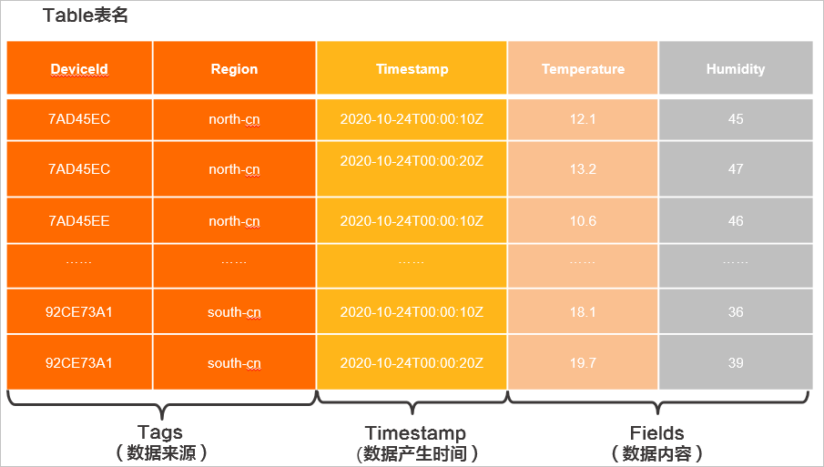

<table>
  <tr>
    <th width="200">元素</th>
    <th>描述</th>
  </tr>
  <tr>
    <td>表名（Table）</td>
    <td>时序表代表一系列同类时序数据的集合，例如为空气质量传感器建立一个Table，存储所有传感器的监测数据。</td>
  </tr>
  <tr>
    <td>标签（Tag）</td>
    <td>Tag描述数据源的特征，通常不随时间变化，例如传感器设备，包含设备DeviceId、设备所在的Region等Tag信息，数据库内部会自动为Tag建立索引，支持根据Tag来进行多维检索查询。Tag由Tag Key、Tag Value组成，两者均为String类型。在定义时序数据表时，还可以指定特定标签列作为分区键来显式指定数据在多个节点上分片（<em>Data</em> <em>Sharding</em>）时的分片规则，从而实现贴合业务场景的性能提升。</td>
  </tr>
  <tr>
    <td>时间戳（Timestamp）</td>
    <td>Timestamp代表数据产生的时间点，可以写入时指定，也可由系统自动生成。</td>
  </tr>
  <tr>
    <td>量测值（Field）</td>
    <td>Field描述数据源的量测指标，通常随着时间不断变化，例如传感器设备包含温度、湿度等Field，Field列无需提前创建固定的Schema，可以在运行过程中动态增减；Field由Field名和Field值组成，Field名为字符串类型，Field值支持多种数据类型。</td>
  </tr>
  <tr>
    <td>数据点（Data Point）</td>
    <td>数据源在某个时间产生的某个量测指标值（Field值）称为一个数据点，数据库查询、写入时按数据点数来作为统计指标。</td>
  </tr>
  <tr>
    <td>时间线（Time Series）</td>
    <td>数据源的某一个指标随时间变化，形成时间线，<strong>Tag的组合</strong>确定一条时间线。针对时序数据的计算包括降采样、聚合（sum、count、max、min等）、插值等都基于时间线维度进行；数据库在存储数据时，会将同一条时间线的数据尽量聚类存储，提升时间线数据访问效率，同时更好的支持时序数据压缩。在时序表中，Tag列的值都相同的一系列数据行构成了一条时间线。</td>
  </tr>
</table>

时序数据库提供一系列特有的数据访问操作，包括聚合（Aggregation）、降采样（Downsample）、插值（Interpolation）等，同时还提供数据生命周期（数据时效）的管理机制。

<table>
  <tr>
    <th width="210">元素</th>
    <th>描述</th>
  </tr>
  <tr>
    <td>聚合（Aggregation）</td>
    <td>对同一时间线、或不同时间线上的数据点进行分组、求和、计数等计算操作。</td>
  </tr>
  <tr>
    <td>降采样（Downsample）</td>
    <td>查询时间区间跨度较长，且原始数据采样频率较高时，可通过降采样降低数据的查询展现精度，例如按秒采集的数据，查询时按小时级别采样，减少结果集的数据点数。</td>
  </tr>
  <tr>
    <td>插值（Interpolation）</td>
    <td>时间线中间缺失部分数据点时，可通过插值算法进行数据点自动填充。</td>
  </tr>
  <tr>
    <td>数据时效（TTL）</td>
    <td>数据时效是指数据保存有效期，超过有效期的数据会被自动清理，默认数据有效期为永久保存。</td>
  </tr>
</table>

**场景示例**

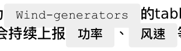

某风力电厂包含一系列的智能风力发电机设备，创建名为 `Wind-generators` 的table来存储所有设备的信息，设备由 `ID` 、 型号 、 厂商 等Tag信息描述，每个设备会持续上报 功率 、 风速 等Field指标，指标数据通过时序数据库的API实时写入到云端时序数据库。

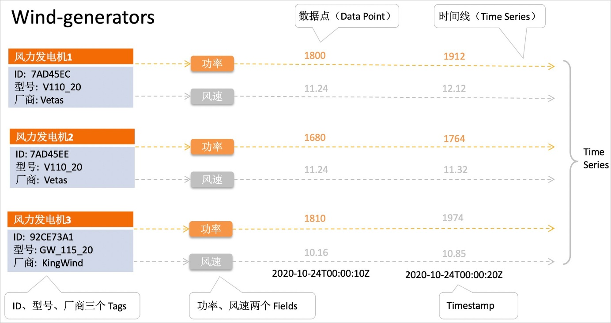

上述场景中三个设备产生的数据如下图所示。

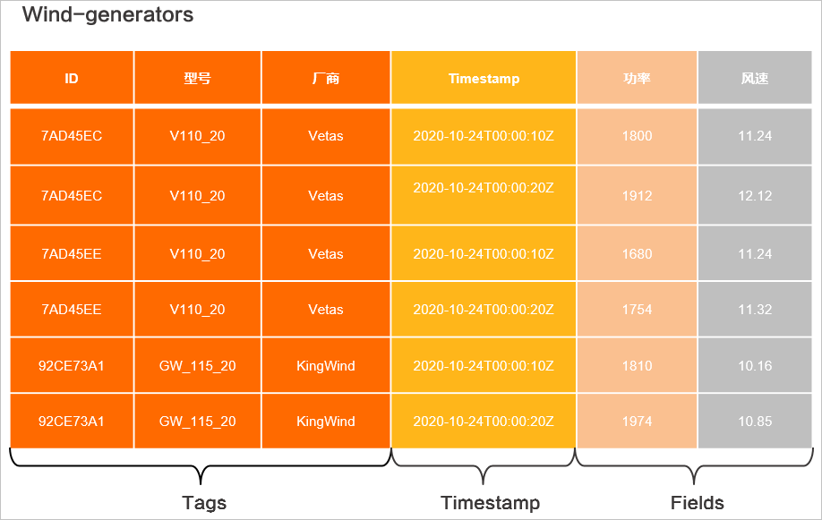

时序数据库除了支持高并发的写入吞吐以及高压缩率，还能高效的满足如下类型的查询请求：

- 查询某条时间线一段时间内的数据点。

  例如：查询 `ID=7AD45EC` 的设备，在 `2020-10-24T00:00:00Z ~ 2020-10-24T00:30:00Z` 30分钟时间范围内，运行 风速 指标值。

- 查询多条时间线一段时间内的数据点，并按5分钟粒度降采样。

  

  例如：查询 `ID=7AD45EC` 的设备，在 `2020-10-24T00:00:00Z ~ 2020-10-25T00:00:00Z` 一天时间范围内， 功率 、 风速 的指标值明细，按 `5`分钟 粒度采样返回数据。

- 对某条时间线按时间范围做聚合。

  例如：查询 `ID=7AD45EC` 的设备，在 `2020-10-24T00:00:00Z ~ 2020-10-24T00:30:00Z` 时间范围内，运行 功率 的平均值。

- 查询多条时间线的最新点。

  例如：查询 `ID=7AD45EC` 的设备，最新的 功率 、 风速 。

- 按Tag做时间线聚合查询。

  例如：查询 厂商`=KingWind` 的设备，在 `2020-10-24T00:00:00Z` 的平均 风速 。

<a id="section-2-3-4"></a>

### 2.3.4. 数据写入

Lindorm时序引擎支持六种数据写入方法：Native SDK写入、行协议写入、标准SQL写入、时间序列数据库TSDB接口写入、remote write数据写入、Flink数据写入。本文介绍数据写入的六种方法。

**Native SDK写入**

Native SDK适用于Java开发者，Native SDK写入的具体操作，请参见教程：通过Java Native SDK连接并使用Lindorm时序引擎。

NativeSDK写入主要有以下优势：

- 异步写入，写入无需同步等待。

- 数据自动攒批，简化开发流程，提高写入效率。

- 连接池管理，底层自动管理连接复用，无创建大量连接的风险。

- 出错自动重试，无需业务层重试。

- 使用自定义传输编码协议，实现高效的数据编解码。

- 线程安全，业务层无需考虑连接的线程安全问题。

- 支持强、弱、无约束的三种Schema约束策略。

**示例**

```java
// 连接地址
String url = "http://ld-bp17j28j2y7pm****-proxy-tsdb-pub.lindorm.rds.aliyuncs.com:8242";
// 创建客户端，LindormTSDBClient线程安全，可以重复使⽤，无需频繁创建和销毁
ClientOptions options = ClientOptions.newBuilder(url).build();
LindormTSDBClient lindormTSDBClient = LindormTSDBFactory.connect(options);

// 创建数据库和表
lindormTSDBClient.execute("CREATE DATABASE demo");
lindormTSDBClient.execute("demo","CREATE TABLE sensor (device_id VARCHAR TAG,region VARCHAR TAG,time BI
GINT,temperature DOUBLE,humidity DOUBLE,PRIMARY KEY(device_id))");

// 写入数据
int numRecords = 10;
List<Record> records = new ArrayList<>(numRecords);
long currentTime = System.currentTimeMillis();
for (int i = 0; i < numRecords; i++) {
    Record record = Record
        .table("sensor")
        .time(currentTime + i * 1000)
        .tag("device_id", "F07A1260")
        .tag("region", "north-cn")
        .addField("temperature", 12.1 + i)
        .addField("humidity", 45.0 + i)
        .build();
    records.add(record);
}
CompletableFuture<WriteResult> future = lindormTSDBClient.write("demo", records);
// 处理异步写入结果
future.whenComplete((r, ex) -> {
    // 处理写入失败
    if (ex != null) {
        System.out.println("Failed to write.");
        if (ex instanceof LindormTSDBException) {
            LindormTSDBException e = (LindormTSDBException) ex;
            System.out.println("Caught an LindormTSDBException, which means your request made it to 
Lindorm TSDB, "
                               + "but was rejected with an error response for some reason.");
            System.out.println("Error Code: " + e.getCode());
            System.out.println("SQL State:  " + e.getSqlstate());
            System.out.println("Error Message: " + e.getMessage());
        }  else {
            ex.printStackTrace();
        }
    } else  {
        System.out.println("Write successfully.");
    }
});
// 这⾥作为示例, 简单同步处理写入结果
System.out.println(future.join());
```

**行协议写入**

Lindorm时序引擎支持通过InfluxDB®行协议写入数据。建议非Java应用通过行协议写入数据。行协议写入支持设置Schema约束策略，默认设置为弱约束。行协议写入的具体操作，请参见行协议写入。

> **重要**
>
> 通过行协议写入时，不同时间精度的数据最终都会转化成毫秒精度存储。比毫秒精度更高的数据，写入时会丢失精度。

**示例**

```text
POST /api/v2/write?precision=ms&db=default
sensor,device_id=F07A1260,region=north-cn temperature=12.1,humidity=45 1619076780000
sensor,device_id=F07A1260,region=north-cn temperature=13.2,humidity=47 1619076790000
sensor,device_id=F07A1260,region=north-cn temperature=10.6,humidity=46 1619076800000
sensor,device_id=F07A1260,region=north-cn temperature=18.1,humidity=44 1619076780000
sensor,device_id=F07A1260,region=north-cn temperature=19.7,humidity=44 1619076790000
```

**标准SQL写入**

下表为标准SQL写入支持的两种写入方法。

| 写入方法 | 适用场景 | 描述 | 具体操作 |
| --- | --- | --- | --- |
| 使用JDBC写入 | Java语言的应用开发 | 使用JDBC写入数据时，需要自己管理连接池或使用Druid管理连接池。 | Java JDBC Driver开发手册 |
| 使用API写入 | 非Java语言的应用开发 | 时序引擎支持基于HTTP协议的API接口实现SQL交互。 | HTTP API SQL接口开发手册 |

**时间序列数据库TSDB的接口写入**

对于时间序列数据库TSDB的迁移用户，时序引擎支持使用时间序列数据库TSDB兼容的接口写入数据。下表为时间序列数据库TSDB接口写入的两种方法。

| 写入方法 | 描述 | 具体操作 |
| --- | --- | --- |
| 多值写入 | 多值写入使用/api/mput接口写入数据。Schema约束策略默认为无约束，即不会创建时序数据表，也不支持SQL查询。建议新业务和迁移用户使用多值模型中其他写入方式写入数据。如果需要使用SQL查询数据，您可以在数据写入前或写入后手动建表，也可以将数据库约束策略设置为弱约束，开启自动建表。代码示例如下：<br><code>curl -X POST</code><br><code>http://ld-xxxxxxxxx-</code><br><code>proxy-tsdb-</code><br><code>pub.lindorm.rds.aliyuncs</code><br><code>.com:8242/api/config -</code><br><code>d'{"schema.policy.opents</code><br><code>db":"WEAK"}'</code> | • API多值写入：请参见时间序列数据库TSDB手册中的《多值数据写入》章节。<br>• SDK多值写入：请参见时间序列数据库TSDB手册中的《SDK多值写入》章节。<br>说明时间序列数据库TSDB里的metric和Lindorm时序引擎里的table相对应。 |
| 单值写入 | 单值写入同时也是兼容OpenTSDB的写入，单值写入使用/api/put接口写入数据。Schema约束策略默认为无约束，即不会创建时序数据表、也不支持使用SQL查询数据。不再推荐使用。 | • API单值写入：请参见时间序列数据库TSDB手册<strong>单值写入操作</strong>目录下的《写入数据》章节。<br>• SDK单值写入：请参见时间序列数据库TSDB手册<strong>单值写入操作</strong>目录下的《写入数据》章节。 |

**使用Flink数据写入**

时序引擎支持通过集成Native SDK的Sink插件写入数据。具体操作，请参见使用Flink写入时序引擎。

<a id="section-2-3-5"></a>

### 2.3.5. 数据查询

本文介绍数据查询的方法和相关操作。

**标准SQL查询**

Lindorm时序引擎根据时序特性对SQL查询做了更多的优化，支持降采样、聚合、最新值查询的能力，提供了丰富的时序特性的函数算子和SQL计算分析能力。推荐您使用SQL查询数据，关于SQL语法请参见SQL语法参考。

- 降采样查询是在时间维度的聚合查询。更多信息，请参见降采样查询。

- 使用group by语句对多个时间线聚合计算。

- 最新值查询用于查询每条时间线最新值。更多信息，请参见最新值查询。

- 时序特性的函数算子，例如：sum、count、max、min。更多信息，请参见常用时序函数。

- 时序引擎借助calcite能力，提供了丰富的SQL计算分析能力，更多信息，请参见calcite官方手册。

**示例**

- 通过降采样将数据精度降低为8小时。

  ```sql
  SELECT device_id,region,time,count(humidity) AS count_humidity FROM sensor WHERE device_id='F07A1260' 
  sample by 8h;
  ```

- 先通过降采样降低数据精度，再按设备ID进行聚合计算。

  ```sql
  SELECT device_id, max(avg_humidity) AS max_humidity  FROM (SELECT device_id,region,time,avg(humidity) 
  AS avg_humidity FROM sensor sample by 8h) group by device_id;
  ```

  > **说明**
  >
  > sample by用于单个时间线降采样计算，group by用于多个时间线聚合计算。sample by和group by同时在查询语句中出现时，必须配合子查询来使用。

**SQL查询支持的访问方式**

SQL查询支持使用JDBC访问、NativeSDK访问、使用API访问SQL三种访问方式。

| 查询方法 | 适用场景 | 描述 | 具体操作 |
| --- | --- | --- | --- |
| Native SDK访问 | Java语言的应用开发场景 | 支持流式数据传输，无需管理底层连接，提供线程安全的接口调用。 | 教程：通过Java Native SDK连接并使用Lindorm时序引擎 |
| JDBC访问 | Java语言的应用开发场景 | 需要自己管理连接池，或着使用Druid进行连接池管理，配合ORM框架使用。 | Java JDBC Driver开发手册 |
| 使用API访问SQL | 非Java语言的应用开发场景 | 时序引擎提供基于HTTP协议的API访问SQL，支持流式返回结果数据。 | HTTP API SQL接口开发手册 |

**兼容时间序列数据库TSDB的查询**

针对时间序列数据库TSDB迁移用户，时序引擎兼容了时间序列数据库TSDB 90%以上的能力，基本可以无缝迁移。建议您使用SQL的方式查询数据。

**查询方法**

| 查询方法 | 描述 | 相关文档 |
| --- | --- | --- |
| 多值查询 | 多值查询可以查询通过以下四种方式写入的数据：通过兼容时间序列数据库TSDB的接口进行的多值写入、SQL写入、Native SDK写入、行协议写入。<br>说明时间序列数据库里的metric与Lindorm时序引擎里的table相对应。 | • API查询：请参见时间序列数据库TSDB手册中的《多值数据查询》章节。<br>• SDK查询：请参见时间序列数据库TSDB手册中的《SDK多值读取》章节。 |
| 单值查询 | 单值查询可以查询通过兼容时间序列数据库TSDB的接口进行单值写入的数据。单值模型不再推荐使用。<br>说明如果通过兼容时间序列数据库TSDB的接口进行的多值写入、SQL写入、Native SDK写入、行协议写入四种方式写入数据，在查询数据时，需要将metric指定为metric@field的格式来兼容多值数据的读取。其中，metric为table名，field为具体查询值的列名。 | • API查询：请参见时间序列数据库TSDB手册中的《单值查询数据》章节。<br>• SDK查询：请参见时间序列数据库TSDB手册中的《查询数据》章节。 |

**Grafana插件访问**

Grafana服务是用于展示大型测量数据的开源可视化工具。Lindorm时序引擎通过Grafana服务的Alibaba Cloud Lindorm数据源插件访问时序数据。

**Grafana使用Lindorm插件访问**

通过Grafana的Alibaba Cloud Lindorm数据源插件，您可以使用编辑框自动生成SQL或者自定义SQL的方法查询数据。

**Grafana使用OpenTSDB插件访问**

Lindorm时序引擎使用OpenTSDB兼容的API查询数据。您可以使用Grafana的OpenTSDB数据源插件来查询数据。

> **说明**
>
> 如果通过兼容时间序列数据库TSDB的接口进行的多值写入、SQL写入、Native SDK写入、行协议写入四种方式写入数据，在查询数据时，需要将metric指定为metric@field的格式来兼容多值数据的读取。其中，metric为table名，field为具体查询值的列名。

**提升查询性能的方法**

| 方法 | 适用场景 | 描述 | 区别 |
| --- | --- | --- | --- |
| 使用预聚合提升查询性能 | 大量时间线实时聚合查询 | 预聚合通过使用Lindorm时序引擎提供的数据的持续查询功能，提前将需要查询的结果进行计算后转存到结果表，查询时指定查询结果表，即可快速查询结果。 | 预聚合是一种对数据预计算的方法，预聚合之后的结果表和原表属于不同的表，查询时需要指定不同的数据表。 |
| 使用预降采样查询提升查询性能 | 大范围的时间查询 | 预降采样通过存储引擎将写入的数据降低精度后单独存储，查询时按查询条件中指定的降采样精度自动查询最接近预降采样精度的数据，然后再对查询的数据进行聚合计算，减少实时查询的计算数据量，降低访问延迟。 | 预降采样是一种降低数据精度的方法，预降采样后的数据和原始数据存储在同一张表中，查询时无需查询不同的数据表。 |

<a id="section-2-3-6"></a>

### 2.3.6. 连续查询

本文介绍Lindorm时序引擎中的连续查询的概念以及相关功能。

**连续查询的概念**

连续查询（Continuous Queries，简称CQ）是时序引擎内部自动定期执行的时序查询。

在时序应用的场景下，对于依照时间推进顺序写入的实时数据，用户有时会希望每隔一段固定时间，就能够按照一定的查询条件对该时间范围内的时序数据做一次计算（例如：对该时间范围内的数据求一次聚合计算），并将计算结果另行保存下来。该应用场景示例如下所示：

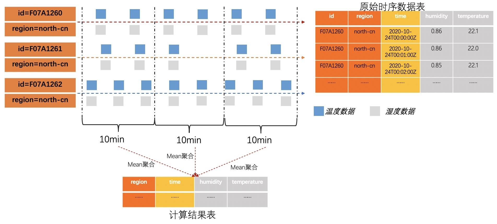

连续查询所针对的便是此类应用场景。在时序引擎中，连续查询提供了一种简化的流计算能力，在时间窗口结束后对窗口内的数据进行计算。

**使用连续查询**

**连续查询的管理**

Lindorm时序引擎提供SQL能力用于管理数据库中的连续查询。

- 连续查询的创建

  在指定的Database下创建一个连续查询。SQL语法可参见CREATE CONTINUOUS QUERY。

- 连续查询的删除

  从指定的Database下删除一个已存在的连续查询。SQL语法可参见DROP CONTINUOUS QUERY。

- 连续查询信息的展示

  查询已有的连续查询元数据。SQL语法可参见SHOW CONTINUOUS QUERIES。

**连续查询的窗口调度**

连续查询运用的是时序引擎节点本地的时间戳来确定何时执行计算，并以此为参照推移计算窗口。连续查询会在每一个时间窗口关闭后、下一个窗口开始的时候对前一窗口内的数据进行计算。例如，一个持续计算指定的窗口间隔为1小时的话，该连续查询会在每个小时开始的时候执行一次计算。在晚上20:00触发计算时，计算的数据所属时间范围是 **[19:00:00，20:00:00)** 。

> **重要**
>
> - 尽管连续查询会在其定义的时间间隔结束后立刻开始计算，但根据其查询计算内容的不同，计算的结果可能也需要花一些时间才能保存到目标表中。延时取决于查询内容以及实例的实时负载。
>
> - 连续查询的结果精度取决于原始数据的有序性。当数据写入原始数据表时存在乱序的情况，即下一个窗口开始后仍然有上一窗口的数据零星写入。那么这部分数据并不会参与到上一窗口的计算中。
>
> - 数据库删除时，所有属于该数据库的连续查询都会被直接删除。

**连续查询的场景与示例**

**连续查询的常用场景**

- 数据的长期保存与成本平衡

  对于数据量较大的场景，存储成本会成为用户关心的问题。因此可以运用连续查询并结合数据库管理的TTL或冷数据归档能力对长期数据进行有选择的降成本。

- 通过连续查询提升查询性能

  对于某些查询较大时间范围的降采样查询或者跨时间线的聚合查询，如果直接对原始数据进行查询，耗时可能会很高。此时可以通过连续查询将结果进行预计算，之后在需要的时候直接查询计算后的结果表，其性能可能会更好。对于查询吞吐也可以有效提升。

**示例**

下面这个示例，展示了如何通过连续查询加上数据库的TTL来实现对数据进行高效的长期存储。

比如用户原始数据量较大，可以保存最近一个月，降精度后可以保留几年的数据。下面这个示例中，原始数据采样周期为1秒，降采样到分钟粒度进行长期存储。

1. 将原始数据保存在db_sensor_month中，保存周期为30天，创建数据库：

   ```sql
   CREATE DATABASE db_sensor_month WITH (ttl=30);
   ```

2. 创建另一个数据库用于长期保存持续计算后的数据，数据库创建如下：

   ```sql
   CREATE DATABASE db_sensor_year WITH (ttl=365);
   ```

3. 创建用于保存计算结果的表：

   ```sql
   CREATE TABLE db_sensor_year.sensor (
       device_id VARCHAR TAG,
       region VARCHAR TAG,
       time TIMESTAMP,
       temperature DOUBLE,
       humidity BIGINT);
   ```

4. 创建连续查询（执行降采样计算）如下：

   ```text
   CREATE CONTINUOUS QUERY db_sensor_year.my_cq WITH (INTERVAL='1m')
   AS
     INSERT into db_sensor_year.sensor(time, temperature, humidity, device_id,region)
     SELECT time, mean(temperature) AS temperature, mean(humidity) humidity, device_id, region
     FROM db_sensor_month.sensor
     SAMPLE BY 60s;
   ```

<a id="section-2-3-7"></a>

### 2.3.7. 预降采样

本文介绍配置、查询、删除预降采样的方法以及预降采样的最佳实践。

**预降采样介绍**

预降采样是一种预计算的方法。在数据写入时根据配置的预降采样规则将数据降低精度后单独存储，查询时按查询条件中指定的降采样精度自动查询最接近预降采样精度的数据，然后交由执行引擎进行后续处理，以减少实时查询需要计算的数据量，降低访问延迟。时序引擎版本需为3.4.19以上。

与连续查询相比预降采样主要有以下优势：

- 写入即可见，无需连续查询的执行等待时间。

- 性能高，对于写入性能无影响，写入时实时转存数据。

- 预降采样数据和原始数据存储在同一张表中，预降采样查询时自动匹配最佳规则的数据，规则不匹配时，自动切换到原始数据查询。

**配置预降采样规则**

在配置预降采样规则后，对于已经写入的数据不会生效。如果在数据库级别配置预降采样规则，该规则对数据库下所有的数据都生效。预降采样数据和原始数据可以配置不同的数据有效期（TTL），预降采样数据默认使用数据库级别设置的TTL。

**使用SQL语句配置预降采样规则**

使用如下SQL语句配置预降采样规则，表级别的预降采样规则只支持通过SQL配置。

示例

- 设置预降采样精度为1小时，并对预降采样周期执行sum和max预计算。

  ```text
  CREATE PREDOWNSAMPLE `1h` AGGREGATORS (`sum`, `max`) ON sensor;
  ```

- 设置预降采样的数据有效期（TTL）为90天。

  ```text
  CREATE PREDOWNSAMPLE `1h` AGGREGATORS (`sum`, `max`) TTL `90d` ON sensor;
  ```

**使用API配置预降采样规则**

请求路径和方法

| 请求路径 | 请求方法 | 描述 |
| --- | --- | --- |
| /api/database | • POST<br>• PUT | 配置指定数据库的预降采样规则。使用POST方法会创建数据库。如果数据库已经存在，需要使用PUT方法来更新预降采样规则。<br>说明实例创建后，会自动创建default数据库，需要使用PUT方法更新降采样规则。 |

请求参数

| 名称 | 是否必需 | 描述 |
| --- | --- | --- |
| name | 是 | 数据库名称。 例如：default。 |
| downsampleRules | 是 | 聚合规则列表。JSON格式。每次更新规则时为全量更新。 |

聚合规则列表参数

| 名称 | 是否必需 | 描述 | 举例 |
| --- | --- | --- | --- |
| aggregator | 是 | 聚合函数。<br>说明预降采样不支持使用avg函数，但可以通过count和sum函数计算平均值。如果存在覆盖写的情况，可能会出现数据重复相加导致平均值结果不精确。 | sum、count、max、min、first、last、median。 |
| intervals | 是 | 聚合时间窗口列表。支持的单位：s代表秒，m代表分钟，h代表小时，d代表天。 | \["10m", "1h"\] ，表示对10分钟和1小时两个时间间隔做预降采样。 |

请求示例

PUT /api/database

```json
{
    "name": "default",
    "downsampleRules": {
        "rules": [
            {
                "aggregator": "sum",
                "intervals": [
                    "1m",
                    "1h"
                ]
            },
            {
                "aggregator": "max",
                "intervals": [
                    "1m",
                    "1h"
                ]
            }
        ]
    }
}
```

响应说明

响应状态码为200。

**查询预降采样规则**

可以使用API或者SQL语句来查询预降采样规则，在查询数据时，如果同时配置了数据库和表级别的预降采样规则，优先匹配表级别的预降采样规则。推荐您使用SQL语句查询预降采样规则。

**使用SQL语句查询预降采样规则**

使用如下SQL语句可以查询所有已经配置的预降采样规则。

示例

- 查询数据库所有的预降采样规则。

  ```text
  SHOW PREDOWNSAMPLES
  ```

- 查询指定数据表sensor的预降采样规则。

  ```text
  SHOW PREDOWNSAMPLES ON sensor
  ```

语法参考：SHOW PREDOWNSAMPLES。

**使用API查询预降采样规则**

请求路径和方法

| 请求路径 | 请求方法 | 描述 |
| --- | --- | --- |
| /api/database | GET | 查询已经配置的预降采样规则。 |

请求示例

```json
[{
    "name": "default",
    "downsampleRules": {
        "rules": [
            {
                "aggregator": "sum",
                "intervals": [
                    "1m",
                    "1h"
                ]
            },
            {
                "aggregator": "max",
                "intervals": [
                    "1m",
                    "1h"
                ]
            }
        ]
    }
}]
```

响应说明

响应状态码为200。

**删除预降采样规则**

使用如下SQL语句可以删除预降采样规则。

示例

```text
DROP PREDOWNSAMPLE `1h` AGGREGATORS (`sum`, `max`) ON sensor;
```

> **重要**
>
> 删除预降采样规则后，已经生效的预降采样数据不会立即被删除，但在查询规则时不会查询已经删除的预降采样规则。

语法参考：DROP PREDOWNSAMPLE

**预降采样数据查询匹配原则**

- 当同时存在数据库级别规则和表级别规则时，预降采样查询数据时优先匹配表级别规则。

- 当查询请求指定的降采样精度与预降采样不能精确匹配时，选择最优的预降采样精度查询。推荐设置预降采样时间精度为1m、10m、1h、1d，可以满足绝大多数的降精度查询场景。

  > **说明**
  >
  > 最优预降采样精度选择的规则是能整除查询请求降采样精度的最大值。例如，预降采样精度有1m、5m、8m和15m，查询请求的降采样精度为10m，则最优预降采样精度为5m。

- 当没有满足条件的预聚合时间窗口时，从原始数据中进行降采样查询。

**查询预降采样数据**

**使用SQL语句查询预降采样数据**

默认情况下，降采样查询数据是从原始数据中进行查询。如果要从预降采样数据中查询数据需要在查询语句中使用Hint（/\*+ PREDOWNSAMPLE \*/）。

```sql
SELECT /*+ PREDOWNSAMPLE */ sum(temperature) from sensor
WHERE time >= 1619074800000 AND time <= 1619085600000
SAMPLE BY 1h
```

**时间序列数据库TSDB兼容查询预降采样数据**

时间序列数据库TSDB兼容使用API多值查询、API单值查询、SDK查询三种方式查询预降采样数据。

**使用API多值查询预降采样数据**

使用API查询数据时，需要添加**downsampleSource**参数来指定查询数据源。

请求路径和方法

| 请求路径 | 请求方法 | 描述 |
| --- | --- | --- |
| /api/mquery | GET | 查询预降采样数据。 |

请求参数

| 名称 | 是否必须 | 描述 | 示例 |
| --- | --- | --- | --- |
| downsampleSource | 否 | 指定查询数据源。取值：<br>• raw（默认值）：原始数据。<br>• downsample：预降采样数据。 | downsample |

请求示例

POST /api/mquery

```json
{
    "end": 1619085600000,
    "queries": [
        {
            "downsampleDataSource" : "downsample",
            "metric": "aggMetric",
            "fields" : [
                {
                    "field" : "score",
                    "aggregator" : "none",
                    "downsample" : "1h-sum"
                }
            ],
                      "tags":{
                    "sensor":"IOTE_8859_0005"
                  }
        }
    ],
    "start": 1619074800000
}
```

**使用API单值查询预降采样数据**

API单值查询接口兼容OpenTSDB接口，也支持Grafana通过OpenTSDB插件源来配置数据源访问。但需要将metric配置成**metric@field##downsample**的形式，其中，metric表示要访问的table，field表示要访问的值，downsample是固定后缀表示需要查询预降采样数据。

**使用SDK查询预降采样数据**

查询降采样数据时，需要在MultiFieldSubQuery Builder设定**downsampleDataSource**参数。

示例

```text
long startTime = 1619074800000;
long endTime = 1619085600000;
final String metric = "wind";
final String field = "speed";
MultiFieldSubQueryDetails fieldSubQueryDetails = MultiFieldSubQueryDetails
        .field(field)
        .aggregator(Aggregator.SUM)
        .downsample("1h-sum")
        .build();
MultiFieldSubQuery subQuery = MultiFieldSubQuery
        .metric(metric)
        .fieldsInfo(fieldSubQueryDetails)
        // 从预降采样查询
        .downsampleDataSource(DownsampleDataSource.DOWNSAMPLE)
        .build();
MultiFieldQuery query = MultiFieldQuery.
        start(startTime).
        end(endTime).
        sub(subQuery).
        build();
List<MultiFieldQueryResult> result = tsdb.multiFieldQuery(query);
            
```

参数说明

**DownsampleDataSource** 参数的可选值及其含义为：

- DOWNSAMPLE：预降采样数据查询。

- RAW：原始数据查询。如果参数没有被指定，默认为RAW。

**预降采样的最佳配置**

**秒级采样频率场景**

对于秒级采样频率的场景，推荐配置1m、1h、1d粒度的预降采样规则来满足任意分钟、任意小时、任意天级别的降采样查询需求。

- 配置sum、count、min、max4种常用聚合函数在1m、1h、1d粒度的预降采样规则。

  ```text
  CREATE PREDOWNSAMPLE `1m` AGGREGATORS (`sum`, `count`, `min`, `max`) ON sensor;
  CREATE PREDOWNSAMPLE `1h` AGGREGATORS (`sum`, `count`, `min`, `max`) ON sensor;
  CREATE PREDOWNSAMPLE `1d` AGGREGATORS (`sum`, `count`, `min`, `max`) ON sensor;
  ```

- 基于分钟粒度的预降采样规则，满足任意分钟级别的降采样查询。

  ```sql
  SELECT /*+ PREDOWNSAMPLE */ sum(temperature), max(temperature) from sensor
  WHERE time >= 1619074800000 AND time <= 1619085600000
  SAMPLE BY <N>m;
  ```

- 基于小时粒度的预降采样规则，满足任意小时级别的降采样查询。

  ```sql
  SELECT /*+ PREDOWNSAMPLE */ sum(temperature), max(temperature) from sensor
  WHERE time >= 1619074800000 AND time <= 1619085600000
  SAMPLE BY <N>h;
  ```

- 基于天粒度的预降采样规则，满足任意天级别的降采样查询。

  ```sql
  SELECT /*+ PREDOWNSAMPLE */ sum(temperature), max(temperature) from sensor
  WHERE time >= 1619074800000 AND time <= 1619600400000
  SAMPLE BY <N>d;
  ```

**分钟级采样频率场景**

对于分钟级采样频率的场景，推荐配置1h、1d粒度的预降采样规则来满足任意小时、任意天级别的降采样查询需求。

- 配置sum、count、min、max4种常用聚合函数在1h、1d粒度的预降采样规则。

  ```text
  CREATE PREDOWNSAMPLE `1h` AGGREGATORS (`sum`, `count`, `min`, `max`) ON sensor;
  CREATE PREDOWNSAMPLE `1d` AGGREGATORS (`sum`, `count`, `min`, `max`) ON sensor;
  ```

- 基于小时粒度的预降采样规则，满足任意小时级别的降采样查询。

  ```sql
  SELECT /*+ PREDOWNSAMPLE */ sum(temperature), max(temperature) from sensor
  WHERE time >= 1619074800000 AND time <= 1619085600000
  SAMPLE BY <N>h;
  ```

- 基于天粒度的预降采样规则，满足任意天级别的降采样查询。

  ```sql
  SELECT /*+ PREDOWNSAMPLE */ sum(temperature), max(temperature) from sensor
  WHERE time >= 1619074800000 AND time <= 1619600400000
  SAMPLE BY <N>d;
  ```

<a id="section-2-3-8"></a>

### 2.3.8. Schema约束

Schema约束策略决定了数据写入时是否校验表是否存在、表结构是否一致、字段的数据类型是否一致。不同的数据写入方式，支持的Schema约束策略不同。本文介绍Lindorm时序引擎Schema约束的概念和使用。

**Lindorm时序模型的Schema**

Lindorm时序引擎基于对时序领域中业务数据模型的理解与洞察，抽象出了时序数据表这一概念。因此，开发者在开发基于Lindorm时序引擎的应用程序时，可以类比传统关系型数据库中的关系表来访问时序数据。

但是，时序数据模型本质上与关系型数据模型还是有所区别的。无论是在APM领域，还是IoT领域，或者是更偏传统的工业领域，时序数据所表现出的数据模型更像是一个半结构化数据——有其遵循结构化定义的一面、也有可灵活扩展的一面，而不是完全等同于关系型数据库的纯结构化。而在实际应用中，随着设备的不断改进、升级、迭代，设备上报的数据模型变化可能也会很频繁，包括设备上报字段的增加，字段类型的变更等等。

尽管在Lindorm时序引擎中，提供了ALTER TABLE语句用于变更时序数据表。但是在一部分时序应用场景下，如果对表的Schema约束严格如关系型数据库，那么则有可能使应用开发变得更加困难。

在此背景下，Lindorm时序引擎提供了更加灵活的Schema约束策略。

**Schema约束的含义**

Schema约束通常体现在数据写入层面，即写入的字段是否与预先定义的表结构中包含的字段一致，写入的字段数据类型是否与预先定义的数据类型一致或兼容，甚至写入的表是否存在等等。在传统关系型数据库中，这些约束非常严格。

在Lindorm时序引擎中的Schema约束指的是以下行为：

- 校验数据写入的目标表是否存在

- 校验数据写入的标签（Tag）或量测值（Field）是否已预先定义

- 校验数据写入的数据类型与预先定义的数据类型是否一致

- 保障数据查询时字段返回类型的一致性

**支持的Schema约束策略**

Lindorm时序引擎目前提供三种Schema约束策略，分别是**强约束**、**弱约束**和**无约束**。您可结合具体的业务需求选择约束策略。

- **强约束**

  与传统关系型数据库类似，时序引擎会严格依据预先定义的表结构对写入数据的表名、字段名、数据类型进行校验。不匹配则写入失败。

- **弱约束**

  - 写入数据的表不存在时，时序引擎不会报错，而是会自动创建对应的表。

  - 写入数据的新增一个标签（Tag）或量测值（Field）时，时序引擎不会报错，而是会在对应的时序数据表中自动添加一个标签（Tag）字段或量测值（Field）字段。

  - 写入数据的相同字段的数据类型发生变化时，时序引擎会检测到字段的数据类型不匹配而写入失败。此时，请您执行ALTER TABLE语句手动修改字段的数据类型。

  > **说明**
  >
  > 弱约束策略并不意味着完全没有校验。例如给标签（Tag）字段写入非字符串数据，或给时间戳字段写入非时间戳数据时，仍然会触发校验失败。

- **无约束**

  不做任何约束。写入数据的表不存在时，时序引擎不会报错，写入的数据可以通过兼容TSDB接口查询。 如果手动创建了表，则可以使用SQL查询，但是字段的数据类型不匹配不会报错。

  > **说明**
  >
  > 无约束是为了兼容旧版TSDB接口而保留的一种策略，不建议使用无约束策略。

**数据写入方式与Schema约束的选择**

在Lindorm时序引擎中，数据写入时的Schema约束策略与数据的写入方式是密切相关的，具体如下表所示。

| 写入方式 | Schema约束策略 | 修改Schema约束策略的示例 |
| --- | --- | --- |
| Java JDBC Driver | 仅支持强约束。 | 不涉及。 |
| Java Native SDK | 支持的约束策略：<br>• 强约束（默认值）<br>• 弱约束<br>• 无约束 | <code>// </code>连接地址<code>String url = "http://ld-bp1489gr5t*****-proxy-</code><br><code>tsdb.lindorm.rds.aliyuncs.com:8242";</code><code>// </code>创建客户端，<code>LindormTSDBClient</code>线程安全，可以重复使用，无需频繁创建和销毁<code>ClientOptions options = ClientOptions</code><br><code>.newBuilder(url)</code><br><code>.setSchemaPolicy(SchemaPolicy.WEAK)</code><br><code>.build();</code><br><code>LindormTSDBClient lindormTSDBClient =</code><br><code>LindormTSDBFactory.connect(options);</code> |
| HTTP API SQL | 仅支持强约束。 | 不涉及。 |
| 行协议 | 支持的约束策略：<br>• 强约束<br>• 弱约束（默认值）<br>• 无约束 | <code>curl -X POST 'http://ld-bp1489gr5t*****-proxy-</code><br><code>tsdb.lindorm.rds.aliyuncs.com:8242/api/v2/write?</code><br><code>db=default&amp;schema_policy=WEAK' -d</code><br><code>'sensor,device_id=F07A1260,region=north-cn</code><br><code>temperature=12.1,humidity=45 1619076780000'</code> |
| 多值写入 | 支持的约束策略：<br>• 弱约束<br>• 强约束<br>• 无约束（默认值） | <code>curl -X POST http://ld-bp1489gr5t*****-proxy-</code><br><code>tsdb.lindorm.rds.aliyuncs.com:8242/api/config -</code><br><code>d'{"schema.policy.opentsdb":"WEAK"}'</code> |
| 单值写入 | 仅支持无约束。 | 不涉及。 |

<a id="section-2-3-9"></a>

### 2.3.9. 使用限制

本文介绍Lindorm时序引擎数据库对象的使用限制。

| 数据库对象 | 说明 |
| --- | --- |
| database名称 | 由大写字母、小写字母、数字、下划线其中的一种或多种组成，长度为2~64个字符。 |
| database数量 | 一个实例最多创建16个数据库（包含default数据库）。 |
| table名称 | 由大写字母、小写字母、数字、下划线其中的一种或多种组成，最大长度为128个字符。 |
| table数量 | 一个数据库最多创建10000个数据表。 |
| tag列名称 | 可见字符，最大长度为200个字符。 |
| tag列值 | 可见字符，最大长度为20480个字符。 |
| field列名称 | 可见字符，最大长度为200个字符。 |
| field列值 | 可见字符，最大长度为20480个字符。 |
| timestamp列名称 | 可见字符，最大长度为200个字符，一张表只能有一个timestamp列，默认作为时间索引。 |
| timestamp列值 | 单位为毫秒。 |
| 列数量 | 一张表最多可创建1024列，其中包含tag列、timestamp列、field列。 |

<a id="section-2-4"></a>

## 2.4. SQL语法参考

<a id="section-2-4-1"></a>

### 2.4.1. 数据类型

本文介绍Lindorm时序引擎中支持的数据类型。

Lindorm时序引擎SQL支持常用的数据类型，本文主要介绍SQL支持的数据类型。

<table>
  <tr>
    <th width="119">数据类型</th>
    <th>描述</th>
  </tr>
  <tr>
    <td>BIGINT</td>
    <td>整数类型。</td>
  </tr>
  <tr>
    <td>DOUBLE</td>
    <td>浮点数类型。</td>
  </tr>
  <tr>
    <td>VARCHAR</td>
    <td>字符串类型。</td>
  </tr>
  <tr>
    <td>BOOLEAN</td>
    <td>布尔类型，true或false。</td>
  </tr>
  <tr>
    <td>TIMESTAMP</td>
    <td>时间戳类型。用户可以通过以下两种方式写入时间戳类型的数据：<br>• 时间戳的字符串形式：即按yyyy-MM-DD HH:mm:ss(.sss)的形式指定的时间戳字符串。如 <code> 2022-01-01 12:00:00 </code><br>• 时间戳的整型形式（64位Unix时间戳，精确到毫秒）：即UTC时间1970年1月1日00:00:00.000以来的<strong>毫秒数</strong>。</td>
  </tr>
</table>

> **重要**
>
> 1. 目前创建时序表时，只能指定一列为TIMESTAMP类型。
>
> 2. 时序引擎对于时间戳的编码和解析，统一按照北京时间（GMT+8）来进行。
>
> 3. 在一些较旧的系统中，其Unix时间戳仍然是按照32位进行处理。这类时间戳写入Lindorm时序引擎前建议乘以1000。如果不加转换地将这些时间戳直接写入时序引擎，将会在语义上的解释引起偏差。
>
>    比如时间戳**1641009600** 在这类较旧系统中会被解释为 `2022-01-01 12:00:00` ，但在Lindorm时序引擎中则会被解释为  `1970-01-20 07:50:09(GMT+8)`  。

<a id="section-2-4-2"></a>

### 2.4.2. 常用时序函数

本文介绍时序SQL中支持的常用函数和使用示例。

**前提条件**

时序引擎版本为3.4.7及以上版本。

**数据准备**

时序数据表 `sensor` 中的示例数据如下，共有两条时间线。

- 时间线1：Tag为 `device_id=F07A1260, region=north-cn` 。Field为temperature、humidity。

- 时间线2：Tag为 `device_id=F07A1261, region=south-cn` 。Field为temperature、humidity。

```sql
DESCRIBE sensor;
+-------------+-----------+------------+
| columnName  | typeName  | columnKind |
+-------------+-----------+------------+
| device_id   | VARCHAR   | TAG        |
| region      | VARCHAR   | TAG        |
| time        | TIMESTAMP | TIMESTAMP  |
| temperature | DOUBLE    | FIELD      |
| humidity    | DOUBLE    | FIELD      |
+-------------+-----------+------------+
SELECT * FROM sensor;
+-----------+----------+---------------------------+-------------+-----------+
| device_id |  region  |           time            | temperature | humidity  |
+-----------+----------+---------------------------+-------------+-----------+
| F07A1260  | north-cn | 2021-04-22T15:33:00+08:00 | 12.100000   | 45.000000 |
| F07A1260  | north-cn | 2021-04-22T15:33:10+08:00 | 13.200000   | 47.000000 |
| F07A1260  | north-cn | 2021-04-22T15:33:20+08:00 | 10.600000   | 46.000000 |
| F07A1261  | south-cn | 2021-04-22T15:51:20+08:00 | 12.100000   | 51.000000 |
| F07A1261  | south-cn | 2021-04-22T15:51:21+08:00 | 13.200000   | 52.000000 |
| F07A1261  | south-cn | 2021-04-22T15:51:27+08:00 | 10.600000   | 53.000000 |
| F07A1261  | south-cn | 2021-04-22T15:51:47+08:00 | 20.600000   | 55.000000 |
+-----------+----------+---------------------------+-------------+-----------+
```

**时间处理函数**

**CURRENT_TIMESTAMP函数**

**说明**

获取系统当前运行时间。

**语法**

```text
CURRENT_TIMESTAMP
```

> **重要**
>
> - CURRENT_TIMESTAMP无参数，使用时直接通过关键字 `CURRENT_TIMESTAMP` 调用即可。
>
> - CURRENT_TIMESTAMP函数生成的时间戳精确至毫秒，例如 `2023-04-23T21:13:15.819+08:00` 。
>
> - CURRENT_TIMESTAMP函数生成的是Lindorm实例服务端的系统时间，使用该函数前请确认系统时间是否满足业务需求。
>
> - 请尽量避免在**实际业务**写入数据时直接使用该函数的生成结果。建议在开发测试中需要大规模生成测试数据的场景下使用CURRENT_TIMESTAMP函数。

**示例**

在sensor表中插入一条数据，TAG为 `device_id=F07A1262, region=north-cn` ，时间戳为数据写入的当前时间。

```sql
INSERT INTO sensor(device_id,region,time,temperature,humidity) VALUES ('F07A1262','north-cn',CURRENT_TI
MESTAMP,19.9,42);
```

**聚合函数**

**SUM函数**

**说明**

计算时序数据表中Field列的和。

**语法**

```text
SUM(field_name)
```

> **说明**
>
> SUM的返回类型为DOUBLE或长整型BIGINT。

**参数**

<table>
  <tr>
    <th width="114">参数</th>
    <th>描述</th>
  </tr>
  <tr>
    <td>field_name</td>
    <td>Field列名。<br>说明Field列的类型不能是VARCHAR和BOOLEAN类型。</td>
  </tr>
</table>

**示例**

示例一：设备ID为F07A1260和F07A1261，对每条时间线进行降采样操作，时间线按照20s时间窗口计算temperature列的和。

```sql
SELECT device_id, region, time, sum(temperature) AS temperature FROM sensor WHERE time <= '2021-04-22T15:51:47+08:00' and time >= '2021-04-22T15:33:00+08:00' sample by 20s;
```

返回结果如下：

```text
+-----------+----------+---------------------------+-------------+
| device_id |  region  |           time            | temperature |
+-----------+----------+---------------------------+-------------+
| F07A1260  | north-cn | 2021-04-22T15:33:00+08:00 | 25.300000   |
| F07A1261  | south-cn | 2021-04-22T15:51:20+08:00 | 35.900000   |
| F07A1260  | north-cn | 2021-04-22T15:33:20+08:00 | 10.600000   |
| F07A1261  | south-cn | 2021-04-22T15:51:40+08:00 | 20.600000   |
+-----------+----------+---------------------------+-------------+
```

示例二：设备ID为F07A1260和F07A1261，计算每个设备的温度之和。

```sql
SELECT device_id, region, time, sum(temperature) AS temperature FROM sensor WHERE time <= '2021-04-22T15:51:47+08:00' and time >= '2021-04-22T15:33:00+08:00' sample by 20s;
```

返回结果如下：

```text
+-----------+----------+---------------------------+-------------+
| device_id |  region  |           time            | temperature |
+-----------+----------+---------------------------+-------------+
| F07A1260  | north-cn | 1970-01-01T08:00:00+08:00 | 35.900000   |
| F07A1261  | south-cn | 1970-01-01T08:00:00+08:00 | 56.500000   |
+-----------+----------+---------------------------+-------------+
```

示例三：计算所有设备的温度之和。

```sql
SELECT sum(temperature) AS temperature FROM sensor WHERE time <= '2021-04-22T15:51:47+08:00' and time >= '2021-04-22T15:33:00+08:00';
```

返回结果如下：

```text
+-------------+
| temperature |
+-------------+
| 92.400000   |
+-------------+
```

**AVG函数**

**说明**

计算时序数据表中Field列的平均值。

**语法**

```text
AVG(field_name)
```

> **说明**
>
> AVG的返回类型为DOUBLE类型。

**参数**

<table>
  <tr>
    <th width="114">参数</th>
    <th>描述</th>
  </tr>
  <tr>
    <td>field_name</td>
    <td>Field列名。<br>说明Field列的类型不能是VARCHAR和BOOLEAN类型。</td>
  </tr>
</table>

**示例**

示例一：设备ID为F07A1260和F07A1261，对每条时间线进行降采样操作，时间线按照20s时间窗口计算temperature列的平均值。

```sql
SELECT device_id, region, time, avg(temperature) AS temperature FROM sensor WHERE time <= '2021-04-22T15:51:47+08:00' and time >= '2021-04-22T15:33:00+08:00' sample by 20s;
```

返回结果如下：

```text
+-----------+----------+---------------------------+-------------+
| device_id |  region  |           time            | temperature |
+-----------+----------+---------------------------+-------------+
| F07A1260  | north-cn | 2021-04-22T15:33:00+08:00 | 12.650000   |
| F07A1261  | south-cn | 2021-04-22T15:51:20+08:00 | 11.966667   |
| F07A1260  | north-cn | 2021-04-22T15:33:20+08:00 | 10.600000   |
| F07A1261  | south-cn | 2021-04-22T15:51:40+08:00 | 20.600000   |
+-----------+----------+---------------------------+-------------+
```

示例二：设备ID为F07A1260和F07A1261，计算每个设备的温度的平均值。

```sql
SELECT device_id, region, time, avg(temperature) AS temperature FROM sensor WHERE time <= '2021-04-22T15:51:47+08:00' and time >= '2021-04-22T15:33:00+08:00' sample by 0;
```

返回结果如下：

```text
+-----------+----------+---------------------------+-------------+
| device_id |  region  |           time            | temperature |
+-----------+----------+---------------------------+-------------+
| F07A1260  | north-cn | 1970-01-01T08:00:00+08:00 | 11.966667   |
| F07A1261  | south-cn | 1970-01-01T08:00:00+08:00 | 14.125000   |
+-----------+----------+---------------------------+-------------+
```

示例三：计算所有设备的温度的平均值。

```sql
SELECT avg(temperature) AS temperature FROM sensor WHERE time <= '2021-04-22T15:51:47+08:00' and time >= '2021-04-22T15:33:00+08:00';
```

返回结果如下：

```text
+-------------+
| temperature |
+-------------+
| 13.200000   |
+-------------+
```

**COUNT函数**

**说明**

统计时序数据表中Field列的值个数。

**语法**

```text
COUNT(field_name)
```

> **说明**
>
> COUNT的返回类型为BIGINT类型。

**参数**

| 参数 | 描述 |
| --- | --- |
| field_name | Field列名。 |

**示例**

示例一：设备ID为F07A1260和F07A1261，对每条时间线进行降采样操作，时间线按照20s时间窗口统计各个窗口中temperature列的值个数。

```sql
SELECT device_id, region, time, count(temperature) AS temperature FROM sensor WHERE time <= '2021-04-22
T15:51:47+08:00' and time >= '2021-04-22T15:33:00+08:00' sample by 20s;
```

返回结果如下：

```text
+-----------+----------+---------------------------+-------------+
| device_id |  region  |           time            | temperature |
+-----------+----------+---------------------------+-------------+
| F07A1260  | north-cn | 2021-04-22T15:33:00+08:00 | 2           |
| F07A1261  | south-cn | 2021-04-22T15:51:20+08:00 | 3           |
| F07A1260  | north-cn | 2021-04-22T15:33:20+08:00 | 1           |
| F07A1261  | south-cn | 2021-04-22T15:51:40+08:00 | 1           |
+-----------+----------+---------------------------+-------------+
```

示例二：设备ID为F07A1260和F07A1261，统计每个设备的温度的值个数。

```sql
SELECT device_id, region, time, count(temperature) AS temperature FROM sensor WHERE time <= '2021-04-22
T15:51:47+08:00' and time >= '2021-04-22T15:33:00+08:00' sample by 0;
```

返回结果如下：

```text
+-----------+----------+---------------------------+-------------+
| device_id |  region  |           time            | temperature |
+-----------+----------+---------------------------+-------------+
| F07A1260  | north-cn | 1970-01-01T08:00:00+08:00 | 3           |
| F07A1261  | south-cn | 1970-01-01T08:00:00+08:00 | 4           |
+-----------+----------+---------------------------+-------------+
```

示例三：统计所有设备的温度的值个数。

```sql
SELECT count(temperature) AS temperature FROM sensor WHERE time <= '2021-04-22T15:51:47+08:00' and time
>= '2021-04-22T15:33:00+08:00';
```

返回结果如下：

```text
+-------------+
| temperature |
+-------------+
| 7           |
+-------------+
```

**选择函数**

**MIN函数说明**

查询时序数据表中Field列的最小值。

**语法**

```text
MIN(field_name)
```

> **说明**
>
> MIN的返回类型为DOUBLE或长整型BIGINT。

**参数**

<table>
  <tr>
    <th width="114">参数</th>
    <th>描述</th>
  </tr>
  <tr>
    <td>field_name</td>
    <td>Field列名。<br>说明Field列的类型不能是VARCHAR和BOOLEAN类型。</td>
  </tr>
</table>

**示例**

示例一：设备ID为F07A1260和F07A1261，对每条时间线进行降采样操作，时间线按照20s时间窗口查询各个窗口中temperature列的最小值。

```sql
SELECT device_id, region, time, min(temperature) AS temperature FROM sensor WHERE time <= '2021-04-22T15:51:47+08:00' and time >= '2021-04-22T15:33:00+08:00' sample by 20s;
```

返回结果如下：

```text
+-----------+----------+---------------------------+-------------+
| device_id |  region  |           time            | temperature |
+-----------+----------+---------------------------+-------------+
| F07A1260  | north-cn | 2021-04-22T15:33:00+08:00 | 12.100000   |
| F07A1261  | south-cn | 2021-04-22T15:51:20+08:00 | 10.600000   |
| F07A1260  | north-cn | 2021-04-22T15:33:20+08:00 | 10.600000   |
| F07A1261  | south-cn | 2021-04-22T15:51:40+08:00 | 20.600000   |
+-----------+----------+---------------------------+-------------+
```

示例二：设备ID为F07A1260和F07A1261，查询每个设备的温度的最小值。

```sql
SELECT device_id, region, time, min(temperature) AS temperature FROM sensor WHERE time <= '2021-04-22T15:51:47+08:00' and time >= '2021-04-22T15:33:00+08:00' sample by 0;
```

返回结果如下：

```text
+-----------+----------+---------------------------+-------------+
| device_id |  region  |           time            | temperature |
+-----------+----------+---------------------------+-------------+
| F07A1260  | north-cn | 2021-04-22T15:33:20+08:00 | 10.600000   |
| F07A1261  | south-cn | 2021-04-22T15:51:27+08:00 | 10.600000   |
+-----------+----------+---------------------------+-------------+
```

示例三：查询所有设备的温度的最小值。

```sql
SELECT min(temperature) AS temperature FROM sensor WHERE time <= '2021-04-22T15:51:47+08:00' and time >= '2021-04-22T15:33:00+08:00';
```

返回结果如下：

```text
+-------------+
| temperature |
+-------------+
| 10.600000   |
+-------------+
```

**MAX函数**

**说明**

查询时序数据表中Field列的最大值。

**语法**

```text
MAX(field_name)
```

> **说明**
>
> MAX的返回类型为DOUBLE或长整型BIGINT。

**参数**

<table>
  <tr>
    <th width="114">参数</th>
    <th>描述</th>
  </tr>
  <tr>
    <td>field_name</td>
    <td>Field列名。<br>说明Field列的类型不能是VARCHAR和BOOLEAN类型。</td>
  </tr>
</table>

**示例**

示例一：设备ID为F07A1260和F07A1261，对每条时间线进行降采样操作，时间线按照20s时间窗口查询各个窗口中temperature列的最大值。

```sql
SELECT device_id, region, time, max(temperature) AS temperature FROM sensor WHERE time <= '2021-04-22T15:51:47+08:00' and time >= '2021-04-22T15:33:00+08:00' sample by 20s;
```

返回结果如下：

```text
+-----------+----------+---------------------------+-------------+
| device_id |  region  |           time            | temperature |
+-----------+----------+---------------------------+-------------+
| F07A1260  | north-cn | 2021-04-22T15:33:00+08:00 | 13.200000   |
| F07A1261  | south-cn | 2021-04-22T15:51:20+08:00 | 13.200000   |
| F07A1260  | north-cn | 2021-04-22T15:33:20+08:00 | 10.600000   |
| F07A1261  | south-cn | 2021-04-22T15:51:40+08:00 | 20.600000   |
+-----------+----------+---------------------------+-------------+
```

示例二：设备ID为F07A1260和F07A1261，查询每个设备的温度的最大值。

```sql
SELECT device_id, region, time, max(temperature) AS temperature FROM sensor WHERE time <= '2021-04-22T15:51:47+08:00' and time >= '2021-04-22T15:33:00+08:00' sample by 0;
```

返回结果如下：

```text
+-----------+----------+---------------------------+-------------+
| device_id |  region  |           time            | temperature |
+-----------+----------+---------------------------+-------------+
| F07A1260  | north-cn | 2021-04-22T15:33:10+08:00 | 13.200000   |
| F07A1261  | south-cn | 2021-04-22T15:51:47+08:00 | 20.600000   |
+-----------+----------+---------------------------+-------------+
```

示例三：查询所有设备的温度的最大值。

```sql
SELECT max(temperature) AS temperature FROM sensor WHERE time <= '2021-04-22T15:51:47+08:00' and time >= '2021-04-22T15:33:00+08:00';
```

返回结果如下：

```text
+-------------+
| temperature |
+-------------+
| 20.600000   |
+-------------+
```

**FIRST函数**

**说明**

获取时序数据表中Field列的第一个值。

**语法**

```text
FIRST(field_name)
```

> **说明**
>
> FIRST的返回类型与Field列的类型相同。

**参数**

| 参数 | 描述 |
| --- | --- |
| field_name | Field列名。 |

**示例**

示例一：设备ID为F07A1260和F07A1261，对每条时间线进行降采样操作，时间线按照20s时间窗口获取各个窗口中第一个温度值。

```sql
SELECT device_id, region, time, first(temperature) AS temperature FROM sensor WHERE time <= '2021-04-22
T15:51:47+08:00' and time >= '2021-04-22T15:33:00+08:00' sample by 20s;
```

返回结果如下：

```text
+-----------+----------+---------------------------+-------------+
| device_id |  region  |           time            | temperature |
+-----------+----------+---------------------------+-------------+
| F07A1260  | north-cn | 2021-04-22T15:33:00+08:00 | 12.100000   |
| F07A1261  | south-cn | 2021-04-22T15:51:20+08:00 | 12.100000   |
| F07A1260  | north-cn | 2021-04-22T15:33:20+08:00 | 10.600000   |
| F07A1261  | south-cn | 2021-04-22T15:51:40+08:00 | 20.600000   |
+-----------+----------+---------------------------+-------------+
```

示例二：设备ID为F07A1260和F07A1261，获取每个设备第一个温度值。

```sql
SELECT device_id, region, time, first(temperature) AS temperature FROM sensor WHERE time <= '2021-04-22
T15:51:47+08:00' and time >= '2021-04-22T15:33:00+08:00' sample by 0;
```

返回结果如下：

```text
+-----------+----------+---------------------------+-------------+
| device_id |  region  |           time            | temperature |
+-----------+----------+---------------------------+-------------+
| F07A1260  | north-cn | 2021-04-22T15:33:00+08:00 | 12.100000   |
| F07A1261  | south-cn | 2021-04-22T15:51:20+08:00 | 12.100000   |
+-----------+----------+---------------------------+-------------+
```

**LAST函数**

**说明**

获取时序数据表中Field列的最后一个值。

**语法**

```text
LAST(field_name)
```

> **说明**
>
> LAST的返回类型与Field列的类型相同。

**参数**

| 参数 | 描述 |
| --- | --- |
| field_name | Field列名。 |

**示例**

示例一：设备ID为F07A1260和F07A1261，对每条时间线进行降采样操作，时间线按照20s时间窗口获取各个窗口中最后一个温度值。

```sql
SELECT device_id, region, time, last(temperature) AS temperature FROM sensor WHERE time <= '2021-04-22T15:51:47+08:00' and time >= '2021-04-22T15:33:00+08:00' sample by 20s;
```

返回结果如下：

```text
+-----------+----------+---------------------------+-------------+
| device_id |  region  |           time            | temperature |
+-----------+----------+---------------------------+-------------+
| F07A1260  | north-cn | 2021-04-22T15:33:00+08:00 | 13.200000   |
| F07A1261  | south-cn | 2021-04-22T15:51:20+08:00 | 10.600000   |
| F07A1260  | north-cn | 2021-04-22T15:33:20+08:00 | 10.600000   |
| F07A1261  | south-cn | 2021-04-22T15:51:40+08:00 | 20.600000   |
+-----------+----------+---------------------------+-------------+
```

示例二：设备ID为F07A1260和F07A1261，获取每个设备的最后一个温度值。

```sql
SELECT device_id, region, time, last(temperature) AS temperature FROM sensor WHERE time <= '2021-04-22T15:51:47+08:00' and time >= '2021-04-22T15:33:00+08:00' sample by 0;
```

返回结果如下：

```text
+-----------+----------+---------------------------+-------------+
| device_id |  region  |           time            | temperature |
+-----------+----------+---------------------------+-------------+
| F07A1260  | north-cn | 2021-04-22T15:33:20+08:00 | 10.600000   |
| F07A1261  | south-cn | 2021-04-22T15:51:47+08:00 | 20.600000   |
+-----------+----------+---------------------------+-------------+
```

**PERCENTILE函数**

**说明**

计算时序数据表中与Field列关联的第P个百分位字段值。

**语法**

```text
PERCENTILE(field_name,P)
```

> **说明**
>
> PERCENTILE的返回类型为DOUBLE类型。

**参数**

<table>
  <tr>
    <th width="114">参数</th>
    <th>描述</th>
  </tr>
  <tr>
    <td>field_name</td>
    <td>Field列名。<br>说明Field列的类型不能是VARCHAR和BOOLEAN类型。</td>
  </tr>
  <tr>
    <td>P</td>
    <td>取值为整数或浮点数，范围为[0,100]，默认值为50。</td>
  </tr>
</table>

**示例**

示例一：设备ID为F07A1260和F07A1261，对每条时间线进行降采样操作，时间线按照20s时间窗口获取各个窗口中temperature列的90分位值。

```sql
SELECT device_id, region, time, percentile(temperature, 90) AS temperature FROM sensor WHERE time <= '2021-04-22T15:51:47+08:00' and time >= '2021-04-22T15:33:00+08:00' sample by 20s;
```

返回结果如下：

```text
+-----------+----------+---------------------------+-------------+
| device_id |  region  |           time            | temperature |
+-----------+----------+---------------------------+-------------+
| F07A1260  | north-cn | 2021-04-22T15:33:00+08:00 | 13.200000   |
| F07A1261  | south-cn | 2021-04-22T15:51:20+08:00 | 13.200000   |
| F07A1260  | north-cn | 2021-04-22T15:33:20+08:00 | 10.600000   |
| F07A1261  | south-cn | 2021-04-22T15:51:40+08:00 | 20.600000   |
+-----------+----------+---------------------------+-------------+
```

示例二：设备ID为F07A1260和F07A1261，获取每个设备的温度的90分位值。

```sql
SELECT device_id, region, time, percentile(temperature, 90) AS temperature FROM sensor WHERE time <= '2021-04-22T15:51:47+08:00' and time >= '2021-04-22T15:33:00+08:00' sample by 0;
```

返回结果如下：

```text
+-----------+----------+---------------------------+-------------+
| device_id |  region  |           time            | temperature |
+-----------+----------+---------------------------+-------------+
| F07A1260  | north-cn | 1970-01-01T08:00:00+08:00 | 13.200000   |
| F07A1261  | south-cn | 1970-01-01T08:00:00+08:00 | 20.600000   |
+-----------+----------+---------------------------+-------------+
```

**转换函数**

**RATE函数**

**说明**

计算时序数据表中Field列值的斜率。

计算公式：每个数据点的时间戳和值分别是： `(t`  1  `,v`  1  `),(t`  2  `,v`  2  `)...(t`  N  `,v`  N  `)` 。使用RATE函数后，返回N-1个数据点，每个数据点的时间戳和值分别是：

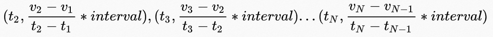

> **说明**
>
> 公式中 `interval` 是指定的变化率，单位为秒。

**语法**

```text
RATE(field_name, 'interval units')
```

> **说明**
>
> - RATE的返回类型为DOUBLE类型。
>
> - SQL语句中只支持RATE算子单独使用。

**参数**

<table>
  <tr>
    <th width="132">参数</th>
    <th>描述</th>
  </tr>
  <tr>
    <td>field_name</td>
    <td>Field列名。<br>说明Field列的类型不能是VARCHAR和BOOLEAN类型。</td>
  </tr>
  <tr>
    <td>interval units</td>
    <td>变化率。默认值为1s。单位包括s（秒）、m（分钟）、h（小时）、d（天）。</td>
  </tr>
</table>

**示例**

示例一：设备ID为F07A1260和F07A1261，计算每个设备温度的秒级变化率。

```sql
SELECT device_id, region, time, rate(temperature) AS temperature FROM sensor WHERE time <= '2021-04-22T15:51:47+08:00' and time >= '2021-04-22T15:33:00+08:00' sample by 0;
```

返回结果如下：

```text
+-----------+----------+---------------------------+-------------+
| device_id |  region  |           time            | temperature |
+-----------+----------+---------------------------+-------------+
| F07A1260  | north-cn | 2021-04-22T15:33:10+08:00 | 0.110000    |
| F07A1260  | north-cn | 2021-04-22T15:33:20+08:00 | -0.260000   |
| F07A1261  | south-cn | 2021-04-22T15:51:21+08:00 | 1.100000    |
| F07A1261  | south-cn | 2021-04-22T15:51:27+08:00 | -0.433333   |
| F07A1261  | south-cn | 2021-04-22T15:51:47+08:00 | 0.500000    |
+-----------+----------+---------------------------+-------------+
```

示例二：设备ID为F07A1260和F07A1261，计算每个设备温度的分钟变化率。

```sql
SELECT device_id, region, time, rate(temperature, '1m') AS temperature FROM sensor WHERE time <= '2021-04-22T15:51:47+08:00' and time >= '2021-04-22T15:33:00+08:00' sample by 0;
```

返回结果如下：

```text
+-----------+----------+---------------------------+-------------+
| device_id |  region  |           time            | temperature |
+-----------+----------+---------------------------+-------------+
| F07A1260  | north-cn | 2021-04-22T15:33:10+08:00 | 6.600000    |
| F07A1260  | north-cn | 2021-04-22T15:33:20+08:00 | -15.600000  |
| F07A1261  | south-cn | 2021-04-22T15:51:21+08:00 | 66.000000   |
| F07A1261  | south-cn | 2021-04-22T15:51:27+08:00 | -26.000000  |
| F07A1261  | south-cn | 2021-04-22T15:51:47+08:00 | 30.000000   |
+-----------+----------+---------------------------+-------------+
```

示例三：设备ID为F07A1260和F07A1261，先按照20s时间窗口计算temperature列的平均值，再对降采样后的值计算分钟变化率。

```sql
SELECT device_id, region, time, rate(avg(temperature), '1m') AS temperature FROM sensor WHERE time <= '2021-04-22T15:51:47+08:00' and time >= '2021-04-22T15:33:00+08:00' sample by 20s;
```

返回结果如下：

```text
+-----------+----------+---------------------------+-------------+
| device_id |  region  |           time            | temperature |
+-----------+----------+---------------------------+-------------+
| F07A1260  | north-cn | 2021-04-22T15:33:20+08:00 | -6.150000   |
| F07A1261  | south-cn | 2021-04-22T15:51:40+08:00 | 25.900000   |
+-----------+----------+---------------------------+-------------+
```

示例四：SQL语句中只支持RATE算子单独使用，不支持以下混用方式。

```sql
//错误示例⼀：
SELECT region, time, rate(temperature), rate(humidity) FROM sensor WHERE time <= '2021-04-
22T15:51:47+08:00' and time >= '2021-04-22T15:33:00+08:00' sample by 0;
//返回结果如下：
ERROR 9001 (0A000): UNSUPPORTED: latest/rate/delta must be the only aggregator in a single SQL statement

//错误示例⼆：
SELECT region, time, rate(temperature), latest(humidity) FROM sensor WHERE time <= '2021-04-22T15:51:47+08:00' and time >= '2021-04-22T15:33:00+08:00' sample by 0;
//返回结果如下：
ERROR 9001 (0A000): UNSUPPORTED: latest/rate/delta must be the only aggregator in a single SQL statement
```

**DELTA函数**

**说明**

计算时序数据表中Field列的值与前一行对应值的差。

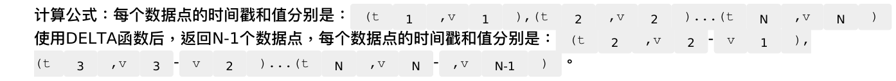

计算公式：每个数据点的时间戳和值分别是： `(t`  1  `,v`  1  `),(t`  2  `,v`  2  `)...(t`  N  `,v`  N  `)` 。

**语法**

```text
DELTA(field_name)
```

> **说明**
>
> - DELTA的返回类型为DOUBLE类型。
>
> - SQL语句中只支持DELTA算子单独使用。

**参数**

<table>
  <tr>
    <th width="114">参数</th>
    <th>描述</th>
  </tr>
  <tr>
    <td>field_name</td>
    <td>Field列名。<br>说明Field列的类型不能是VARCHAR和BOOLEAN类型。</td>
  </tr>
</table>

**示例**

示例一：设备ID为F07A1260和F07A1261，计算每个设备温度与前一行差值。

```sql
SELECT device_id, region, time, delta(temperature) AS temperature FROM sensor WHERE time <= '2021-04-22
T15:51:47+08:00' and time >= '2021-04-22T15:33:00+08:00' sample by 0;
```

返回结果如下：

```text
+-----------+----------+---------------------------+-------------+
| device_id |  region  |           time            | temperature |
+-----------+----------+---------------------------+-------------+
| F07A1260  | north-cn | 2021-04-22T15:33:10+08:00 | 1.100000    |
| F07A1260  | north-cn | 2021-04-22T15:33:20+08:00 | -2.600000   |
| F07A1261  | south-cn | 2021-04-22T15:51:21+08:00 | 1.100000    |
| F07A1261  | south-cn | 2021-04-22T15:51:27+08:00 | -2.600000   |
| F07A1261  | south-cn | 2021-04-22T15:51:47+08:00 | 10.000000   |
+-----------+----------+---------------------------+-------------+
```

示例二：设备ID为F07A1260和F07A1261，先按照20s时间窗口计算temperature列的平均值，再对降采样后的值计算差值。

```sql
SELECT device_id, region, time, delta(avg(temperature)) AS temperature FROM sensor WHERE time <= '2021-04-22T15:51:47+08:00' and time >= '2021-04-22T15:33:00+08:00' sample by 20s;
```

返回结果如下：

```text
+-----------+----------+---------------------------+-------------+
| device_id |  region  |           time            | temperature |
+-----------+----------+---------------------------+-------------+
| F07A1260  | north-cn | 2021-04-22T15:33:20+08:00 | -2.050000   |
| F07A1261  | south-cn | 2021-04-22T15:51:40+08:00 | 8.633333    |
+-----------+----------+---------------------------+-------------+
```

示例三：SQL语句中只支持DELTA算子单独使用，不支持以下混用方式。

```sql
//错误示例：
SELECT region, time, delta(temperature), rate(humidity) FROM sensor WHERE time <= '2021-04-22T15:51:47+08:00' and time >= '2021-04-22T15:33:00+08:00' sample by 0;
//返回结果如下：
ERROR 9001 (0A000): UNSUPPORTED: latest/rate/delta must be the only aggregator in a single SQL statement
```

**LATEST函数**

**说明**

获取时序数据表中Field列的最新的N条数据。

**语法**

```text
LATEST(field_name, N)
```

> **说明**
>
> - LATEST的返回类型与Field列的类型相同。
>
> - SQL语句中只支持LATEST算子单独使用。

**参数**

| 参数 | 描述 |
| --- | --- |
| field_name | Field列名。 |
| N | 整型，用于指定查询最新的N条数据。默认值为1，表示获取最新的一条数据。 |

**示例**

示例一：查询设备F07A1260和F07A1261最新的温度值。

```sql
SELECT device_id, region, time, latest(temperature) AS temperature FROM sensor WHERE time <= '2021-04-22T15:51:47+08:00' and time >= '2021-04-22T15:33:00+08:00' sample by 0;
```

返回结果如下：

```text
+-----------+----------+---------------------------+-------------+
| device_id |  region  |           time            | temperature |
+-----------+----------+---------------------------+-------------+
| F07A1261  | south-cn | 2021-04-22T15:51:47+08:00 | 20.600000   |
| F07A1260  | north-cn | 2021-04-22T15:33:20+08:00 | 10.600000   |
+-----------+----------+---------------------------+-------------+
```

示例二：查询设备F07A1260和F07A1261最新的两条温度值。

```sql
SELECT device_id, region, time, latest(temperature, 2) AS temperature FROM sensor WHERE time <= '2021-04-22T15:51:47+08:00' and time >= '2021-04-22T15:33:00+08:00' sample by 0;
```

返回结果如下：

```text
+-----------+----------+---------------------------+-------------+
| device_id |  region  |           time            | temperature |
+-----------+----------+---------------------------+-------------+
| F07A1261  | south-cn | 2021-04-22T15:51:27+08:00 | 10.600000   |
| F07A1261  | south-cn | 2021-04-22T15:51:47+08:00 | 20.600000   |
| F07A1260  | north-cn | 2021-04-22T15:33:10+08:00 | 13.200000   |
| F07A1260  | north-cn | 2021-04-22T15:33:20+08:00 | 10.600000   |
+-----------+----------+---------------------------+-------------+
```

示例三：SQL语句中只支持LATEST算子单独使用，不支持以下混用方式。

```sql
//错误示例：
SELECT region, time, latest(temperature), rate(humidity) FROM sensor WHERE time <= '2021-04-22T15:51:47+08:00' and time >= '2021-04-22T15:33:00+08:00' sample by 0;
//返回结果如下：
ERROR 9001 (0A000): UNSUPPORTED: latest/rate/delta must be the only aggregator in a single SQL statement
```

**时序异常检测函数**

**说明**

对时序数据表中Field列进行时序异常检测。

**语法**

```text
ANOMALY_DETECT(field_name, [algo_name | model_name], options)
```

> **说明**
>
> ANOMALY_DETECT的返回类型为BOOLEAN类型。

**参数**

<table>
  <tr>
    <th width="130">参数</th>
    <th>描述</th>
  </tr>
  <tr>
    <td>field_name</td>
    <td>Field列名。<br>说明Field列的类型不能是VARCHAR和BOOLEAN类型。</td>
  </tr>
  <tr>
    <td>algo_name</td>
    <td>异常检测算法名称。支持阿里达摩院自研在线异常检测算法。<br>• esd：适用于尖刺型异常（例如监控曲线出现尖刺的现象），对于数据点中有少量显著离群点的情况比较适用。<br>• nsigma：原理简单，便于分析异常原因。<br>• ttest：用于识别一个时间窗口内时序指标是否存在因均值变化而发生的异常。<br>• istl-esd：适用于带周期性信号的数据。<br>说明algo_identifer参数适用于未开通数据库内机器学习功能，但有使用时序异常检测需求的场景。</td>
  </tr>
  <tr>
    <td>model_name</td>
    <td>模型名称。<br>说明model_name的类型为VARCHAR类型。</td>
  </tr>
  <tr>
    <td>options</td>
    <td>调整异常检测算法的检测效果。可选参数。格式为：<code> key1=value1[, </code> <code>key2=value2] </code>。</td>
  </tr>
</table>

**示例**

示例一：对时序数据表sensor中指定时间范围的温度使用esd算法进行时序异常检测。

```sql
SELECT device_id, region, time, anomaly_detect(temperature, 'esd') AS detect_result FROM sensor WHERE time >= '2022-01-01T00:00:00+08:00' and time < '2022-01-01T00:01:00+08:00' sample by 0;
```

返回结果如下：

```text
+-----------+----------+---------------------------+---------------+
| device_id |  region  |           time            | detect_result |
+-----------+----------+---------------------------+---------------+
| F07A1260  | north-cn | 2022-01-01T00:00:00+08:00 | true          |
| F07A1260  | north-cn | 2022-01-01T00:00:20+08:00 | false         |
| F07A1260  | north-cn | 2022-01-01T00:00:40+08:00 | true          |
| F07A1261  | south-cn | 2022-01-01T00:00:00+08:00 | false         |
| F07A1261  | south-cn | 2022-01-01T00:00:20+08:00 | false         |
| F07A1261  | south-cn | 2022-01-01T00:00:40+08:00 | false         |
+-----------+----------+---------------------------+---------------+
```

示例二：对时序数据表sensor中F07A1260设备指定时间范围的温度使用esd算法进行时序异常检测。

```sql
SELECT device_id, region, time, anomaly_detect(temperature, 'esd') AS detect_result FROM sensor WHERE device_id in ('F07A1260') and time >= '2022-01-01T00:00:00+08:00' and time < '2022-01-01T00:01:00+08:00' 
sample by 0;
```

返回结果如下：

```text
+-----------+----------+---------------------------+---------------+
| device_id |  region  |           time            | detect_result |
+-----------+----------+---------------------------+---------------+
| F07A1260  | north-cn | 2022-01-01T00:00:00+08:00 | true          |
| F07A1260  | north-cn | 2022-01-01T00:00:20+08:00 | false         |
| F07A1260  | north-cn | 2022-01-01T00:00:40+08:00 | true          |
+-----------+----------+---------------------------+---------------+
```

示例三：对时序数据表sensor中F07A1260设备指定时间范围的温度使用esd算法进行时序异常检测，并自定义异常检测算法的参数（异常检测算法参考的时间窗口长度为30，异常检测时值小于90%分位数的点被过滤）。

```text
SELECT device_id, region, time, anomaly_detect(temperature, 'esd', 
'lenHistoryWindow=30,maxAnomalyRatio=0.1') AS detect_result FROM sensor where device_id in ('F07A1260') 
and time >= '2022-01-01T00:00:00+08:00' and time < '2022-01-01T00:01:00+08:00' sample by 0;
```

返回结果如下：

```text
+-----------+----------+---------------------------+---------------+
| device_id |  region  |           time            | detect_result |
+-----------+----------+---------------------------+---------------+
| F07A1260  | north-cn | 2022-01-01T00:00:00+08:00 | false         |
| F07A1260  | north-cn | 2022-01-01T00:00:20+08:00 | false         |
| F07A1260  | north-cn | 2022-01-01T00:00:40+08:00 | true          |
+-----------+----------+---------------------------+---------------+
```

示例四：使用在数据库内机器学习功能中创建的时序异常检测模型，对sensor表中指定时间范围的温度进行时序异常检测。

```text
SELECT device_id, region, `time`, raw(temperature) as temperature, anomaly_detect(temperature, ad_model
) AS detect_result FROM sensor WHERE time >= '2022-01-01T00:00:00+08:00' and time < '2022-01-01T00:01:00+08:00' sample by 0;
```

返回结果如下：

```text
+-----------+----------+---------------------------+-------------+---------------+
| device_id |  region  |           time            | temperature | detect_result |
+-----------+----------+---------------------------+-------------+---------------+
| F07A1260  | north-cn | 2022-01-01T00:00:00+08:00 | 59.100000   | true          |
| F07A1260  | north-cn | 2022-01-01T00:00:20+08:00 | 13.200000   | false         |
| F07A1260  | north-cn | 2022-01-01T00:00:40+08:00 | 64.600000   | true          |
| F07A1261  | south-cn | 2022-01-01T00:00:00+08:00 | 12.100000   | false         |
| F07A1261  | south-cn | 2022-01-01T00:00:20+08:00 | 13.200000   | false         |
| F07A1261  | south-cn | 2022-01-01T00:00:40+08:00 | 10.600000   | false         |
+-----------+----------+---------------------------+-------------+---------------+
```

**特征分箱函数**

**说明**

对时序数据表中Field列进行特征分箱，特征分箱（也称为离散分箱或者离散分段）是一种数据预处理技术。

**语法**

```text
BINS(field_name, options)
```

> **说明**
>
> BINS的返回类型为VARCHAR类型。

**参数**

| 参数 | 是否必选 | 描述 |
| --- | --- | --- |
| field_name | 是 | Field列名。<br>说明Field列的类型不能是VARCHAR和BOOLEAN类型。 |
| options | 否 | 指定特征分箱策略和输出方式。格式为：<code> key1=value1[, key2=value2] </code>。 |

**示例**

- 示例一：对时序数据表sensor中指定时间范围的温度进行特征分箱。

  ```sql
  SELECT device_id, region, time, bins(temperature) AS temperature_bin FROM sensor WHERE time >= '2021-04-22 00:00:00' AND time < '2022-04-23 00:01:00' sample by 0;
  ```

  返回结果如下：

  ```text
  +-----------+----------+--------------------------------+--------------------+
  | device_id |  region  |           time                 |  temperature_bin   |
  +-----------+----------+--------------------------------+--------------------+
  | F07A1260  | north-cn | 2021-04-22T15:33:00+08:00      |    [10.60,12.10)   |
  | F07A1260  | north-cn | 2021-04-22T15:33:10+08:00      |    [12.10,13.20]   |
  | F07A1260  | north-cn | 2021-04-22T15:33:20+08:00      |    [10.60,10.60)   |
  | F07A1261  | south-cn | 2021-04-22T15:51:20+08:00      |    [10.60,12.10)   |
  | F07A1261  | south-cn | 2021-04-22T15:51:21+08:00      |    [12.10,13.20)   |
  | F07A1261  | south-cn | 2021-04-22T15:51:27+08:00      |    [10.60,10.60)   |
  | F07A1261  | south-cn | 2021-04-22T15:51:47+08:00      |    [13.20,20.60]   |
  +-----------+-----------+-------------------------------+--------------------+
  ```

- 示例二：对时序数据表sensor中F07A1260设备指定时间范围的温度进行特征分箱。

  ```sql
  SELECT device_id, region, time, bins(temperature) AS temperature_bin FROM sensor WHERE device_id in (
  'F07A1260') AND time >= '2021-04-22 00:00:00' AND time < '2022-04-23 00:01:00' sample by 0;
  ```

  返回结果如下：

  ```text
  +-----------+----------+--------------------------------+--------------------+
  | device_id |  region  |           time                 |  temperature_bin   |
  +-----------+----------+--------------------------------+--------------------+
  | F07A1260  | north-cn | 2021-04-22T15:33:00+08:00      |    [10.60,12.10)   |
  | F07A1260  | north-cn | 2021-04-22T15:33:10+08:00      |    [12.10,13.20]   |
  | F07A1260  | north-cn | 2021-04-22T15:33:20+08:00      |    [10.60,10.60)   |
  +-----------+----------+--------------------------------+--------------------+
  ```

- 示例三：对时序数据表sensor中F07A1260设备指定时间范围的温度进行特征分箱，并自定义分箱算法的参数（生成分箱数为2的等宽分箱，结果以分箱区间的顺序编码形式输出）。

  ```text
  SELECT device_id, region, time, bins(temperature, 'n_bins=2, output_type=ordinal, strategy=uniform') 
  AS temperature_bin FROM sensor WHERE device_id in ('F07A1260') AND time >= '2021-04-22 00:00:00' AND time < '2022-04-23 00:01:00' sample by 0;
  ```

  返回结果如下：

  ```text
  +-----------+----------+--------------------------------+--------------------+
  | device_id |  region  |           time                 |  temperature_bin   |
  +-----------+----------+--------------------------------+--------------------+
  | F07A1260  | north-cn | 2021-04-22T15:33:00+08:00      |  1                 |
  | F07A1260  | north-cn | 2021-04-22T15:33:10+08:00      |  1                 |
  | F07A1260  | north-cn | 2021-04-22T15:33:20+08:00      |  0                 |
  +-----------+----------+--------------------------------+--------------------+
  ```

<a id="section-2-4-3"></a>

### 2.4.3. DDL

<a id="section-2-4-3-1"></a>

#### 2.4.3.1. CREATE DATABASE

本文介绍创建时序数据库的语法。

**语法**

```text
create_database_statement ::= CREATE DATABASE database_name [ WITH attribute_statement ]
attribute_statement       ::= '(' attribute_definition (',' attribute_definition)* ')'
attribute_definition      ::= attr_name '=' attr_val
```

**参数说明**

| 参数 | 说明 |
| --- | --- |
| attribute_statement | 指定数据库的属性。 |
| attr_name | 属性名。必须是SQL常量或标识符。 |
| attr_val | 属性值。必须是SQL常量。 |

当前支持的数据库属性如下：

| 属性名 | 取值类型 | 默认值 | 描述 | 示例 |
| --- | --- | --- | --- | --- |
| ttl | BIGINT | 无，表示数据永久保存。 | 数据保存有效期，超过有效期的数据会被自动清理。单位为天。设置为0表示数据永久保存。 | 60 |
| partition_inte rval | BIGINT | 0<br>说明时序引擎的版本在3.4.19及以上时默认值为30。 | 分区时长，同一时间段的数据和索引存储在一个时间分区，单位为天。 | 30 |

**示例**

以下例子展示了创建一个名为DB1的数据库。其中数据存满60天后会被清除。

```sql
CREATE DATABASE DB1 WITH (ttl=60);
```

<a id="section-2-4-3-2"></a>

#### 2.4.3.2. CREATE TABLE

创建时序数据表的语法说明。

**语法**

```text
create_table_statement ::= CREATE TABLE table_name '('
                              tag_definition
                              ( ',' tag_definition )*
                              ( ',' time_definition)?
                              ( ',' field_definition )*
                              [',' primary_key_definition]
                              ')'
tag_definition         ::= tag_name [ VARCHAR ] TAG
time_definition        ::= time_column_name TIMESTAMP
field_definition       ::= field_name TYPE
primary_key_definition ::= PRIMARY KEY '(' tag_name [',' tagname]* ')'
```

**说明**

<table>
  <tr>
    <th width="198">参数</th>
    <th>说明</th>
  </tr>
  <tr>
    <td><code>tag_name</code></td>
    <td>定义标签的列名，数据类型固定为VARCHAR，且必须使用关键字TAG来显式标识，否则会被引擎理解为Field字段。此处数据类型的声明可以省略。</td>
  </tr>
  <tr>
    <td><code>time_column_name</code></td>
    <td>定义时间戳的列名，数据类型必须为TIMESTAMP，精度支持到毫秒（ms）</td>
  </tr>
  <tr>
    <td><code>field_name</code></td>
    <td>定义数据字段的列名，目前支持的数据类型为BIGINT、DOUBLE、VARCHAR或BOOLEAN。</td>
  </tr>
</table>

- 写入数据前，需要提前创建表，并指定列类型。您可参考如何设计时序数据表，选择更适合的类型。

- PRIMARY KEY与传统关系型数据库的主键并不相同，主要是用于自定义时序数据表的数据分片规则，其中指定的列名必须是 `tag_definition`  中的标签列集合的子集。PRIMARY KEY的语法是自引擎版本3.4.9开始支持。

  > **说明**
  >
  > 单机版不支持PRIMARY KEY，如需使用，请选择集群版。

- 通常以数据源唯一标识作为PRIMARY KEY，例如物联网场景设备ID，车联网场景车辆唯一识，监控场景的应用ID或者ip:port 等。更多内容，请参见PRIMARY KEY设计的最佳实践。

> **重要**
>
> 1. 目前创建时序表时，只能指定一列为TIMESTAMP类型。
>
> 2. 时序引擎对于时间戳的编码和解析，统一按照北京时间（GMT+8）来进行。
>
> 3. 在一些较旧的系统中，其Unix时间戳仍然是按照32位进行处理。这类时间戳写入Lindorm时序引擎前建议乘以1000。如果不加转换地将这些时间戳直接写入时序引擎，将会在语义上的解释引起偏差。
>
>    比如时间戳**1641009600** 在这类较旧系统中会被解释为 `2022-01-01 12:00:00` ，但在Lindorm时序引擎中则会被解释为  `1970-01-20 07:50:09(GMT+8)`  。

**示例**

创建名为sensor的表，拥有device_id和region两个Tag，以及temperature和humidity两个Field。同时由于大部分查询场景会查询单个设备的瞬时数据，因此显式指定device_id作为数据分片的唯一标签列。

满足上述需求的CREATE TABLE语句如下：

```sql
CREATE TABLE sensor (
    device_id VARCHAR TAG,
    region VARCHAR TAG,
    time   TIMESTAMP,
    temperature DOUBLE,
    humidity DOUBLE,
    PRIMARY KEY(device_id));
```

<a id="section-2-4-3-3"></a>

#### 2.4.3.3. CREATE USER

创建用户的语法介绍。

**语法**

```text
create_user_statement ::= CREATE USER [IF NOT EXISTS] user_name IDENTIFIED BY password_definition
```

**参数说明**

| 参数 | 说明 |
| --- | --- |
| user_name | 用户名。可以是SQL常量或标识符。 |
| password_definition | 用户密码。必须是VARCHAR类型的SQL常量。 |

> **重要**
>
> 若尝试创建的是一个已存在的用户名，在未指定IF NOT EXISTS时，则会提示用户已存在的错误；若此时指定了IF NOT EXISTS，则并不会报错而是中止创建过程。

**示例**

以下示例创建了一个名为 `tsdbuser` , 密码为  `asdf1234`  的用户。

```text
CREATE USER IF NOT EXISTS `tsdbuser` IDENTIFIED BY 'asdf1234';
```

<a id="section-2-4-3-4"></a>

#### 2.4.3.4. CREATE CONTINUOUS QUERY

本文介绍创建持续查询的SQL语法。

**语法**

```text
create_cq_statement ::= CREATE CONTINUOUS QUERY [database_name.] cq_name WITH ( cq_attribute_statement 
) AS insert_select_statement

cq_attribute_statement ::= attribute_definition (',' attribute_definition)*
attribute_definition   ::= attr_name '=' attr_val
```

**参数说明**

**database_name**

持续查询对象所属数据库的名称。不指定的情况下默认是当前数据库。必须是SQL常量或标识符。

**cq_name**

持续查询的名称。

目前支持的连续查询属性说明：

<table>
  <tr>
    <th width="93">参数</th>
    <th>说明</th>
  </tr>
  <tr>
    <td><em>interval</em></td>
    <td>用于指定持续查询的计算间隔，即计算任务的执行间隔。最小单位为秒。格式如下：%d%h%m%s。比如1h30s表示1小时30秒, 1d 表示一天。其中：<br>• d： 天<br>• h： 小时<br>• m：分<br>• s： 秒</td>
  </tr>
  <tr>
    <td><em>window</em></td>
    <td>可选属性，用于指定持续查询的计算窗口，即每次计算所覆盖的数据的时间范围。若不指定，则计算窗口与执行间隔(interval)相同。格式同上。举例来说，(interval='10m', window='20m'), 表示计算任务每隔10分钟执行一次，每次执行基于最近的20分钟内的数据进行计算。计算窗口为左闭右开的时间区间。</td>
  </tr>
</table>

> **重要**
>
> 1. insert_select_statement的语法可参见数据写入。
>
> 2. 指定insert_select_statement时可以不用指定查询的时间范围，引擎会自动在当前时间窗口内进行计算。

**示例**

以下示例创建了一个持续查询，每小时计算过去两个小时内原始时序表sensor中的每小时平均温度和每小时平均湿度，并将数据写入一个新库  `db_sensor_year`  中的表  `sensor`  。

```sql
CREATE CONTINUOUS QUERY `db_sensor`.`my_cq` WITH (INTERVAL='1h', WINDOW='2h') AS 
INSERT INTO `db_sensor_year`.`sensor` 
SELECT MEAN(`temperature`) AS `temperature`, 
       MEAN(`humidity`) AS `humidity`, `device_id`, `region` 
FROM  `db_sensor`.`sensor`
SAMPLE BY 1h;
```

<a id="section-2-4-3-5"></a>

#### 2.4.3.5. ALTER DATABASE

修改数据库属性的语法介绍。

**语法**

```text
alter_database_statement ::= ALTER DATABASE database_name [ WITH attribute_statement ]
attribute_statement            ::= '(' attribute_definition (',' attribute_definition)* ')'
attribute_definition             ::= attr_name '=' attr_val
```

**参数说明**

| 参数 | 说明 |
| --- | --- |
| attribute_statement | 指定Database的附加属性。 |
| attr_name | 属性名。必须是SQL常量或标识符。 |
| attr_val | 属性值。必须是SQL常量。 |

> **说明**
>
> 当前支持的数据库属性，请参见 CREATE DATABASE 。

> **重要**
>
> ALTER DATABASE只能修改数据库属性，无法修改Database名。

**示例**

以下例子展示了将一个名为 DB1 的数据库的TTL修改为40天。

```text
ALTER DATABASE DB1 WITH (ttl=40);
```

<a id="section-2-4-3-6"></a>

#### 2.4.3.6. ALTER TABLE

修改时序数据表的语法说明。

**语法**

```text
alter_table_statement ::=    ALTER TABLE table_name alter_option ( ','  alter_option )*
alter_option          ::=    ADD | ALTER [COLUMN]  column_definition 
column_definition     ::=    column_name TYPE [TAG]
```

**参数说明**

| 参数 | 说明 |
| --- | --- |
| table_name | 表名。 |
| column_name | 列名。 |

> **重要**
>
> 1. 当前ALTER TABLE语句只支持以下两种操作：
>
>    <ol type="i">
>
>    <li>
>
>    增加列，且新增的列只能是TAG列或FIELD列。
>
>    </li>
>
>    <li>
>
>    修改FIELD列的类型（TAG列或时间戳列的类型无法修改）。
>
>    </li>
>
>    </ol>
>
> 2. 无法将新增的TAG列声明为PRIMARY KEY。
>
> 3. 将一个FIELD列的类型修改后，后续查询该列的数据时，对于先前已写入的数据将会按最新生效的数据类型来处理，因此有可能会出现先前写入的数据无法被查到的情况。

**示例**

以下示例为已有的表 `aqm` 新增了一个名为 `co` 的FIELD列：

```sql
ALTER TABLE aqm ADD co DOUBLE;
```

以下示例为已有的表 `aqm` 新增了一个名为 `region` 的TAG列：

```sql
ALTER TABLE aqm ADD region VARCHAR TAG;
```

以下示例将表 `aqm` 新增的 `co` 列的类型修改为BIGINT：

```sql
ALTER TABLE aqm ALTER COLUMN co BIGINT;
```

<a id="section-2-4-3-7"></a>

#### 2.4.3.7. ALTER SYSTEM

本文介绍修改系统动态配置参数的语法。

**语法**

```text
alter_system_statement  ::= ALTER SYSTEM SET configuration_name = configuration_value;
```

**参数说明**

<table>
  <tr>
    <th width="186">参数</th>
    <th>说明</th>
  </tr>
  <tr>
    <td>configuration_name</td>
    <td>动态配置参数名。必须是一个SQL标识符。</td>
  </tr>
  <tr>
    <td>configuration_value</td>
    <td>动态配置参数值。必须是一个SQL常量。根据变更动态配置参数名不同，这里的SQL常量可以是BIGINT类型型常量、DOUBLE类型常量、BOOLEAN型常量或者是VARCHAR类型常量。</td>
  </tr>
</table>

**支持使用ALTER SYSTEM变更的动态参数**

| 配置参数 | 参数值类型 | 说明 |
| --- | --- | --- |
| USER_AUTH | boolean | 设置时序引擎用户认证与鉴权功能的开关。<br>• TRUE启用用户认证与鉴权。任何与时序引擎的连接都需要带上用户名和密码，时序引擎会对用户进行认证，并该连接发起的SQL中的数据对象进行鉴权。<br>• FALSE关闭用户认证与鉴权。与时序引擎的连接无需带上用户名和密码。实例的默认值：FALSE |

**示例**

- 开启实例的用户认证与鉴权功能

  ```text
  ALTER SYSTEM SET USER_AUTH=TRUE;
  ```

  - 时序引擎一旦开启用户认证和权限校验，后续的所有访问都必须带上用户信息，否则将可能出现鉴权失败（包括当前执行 `ALTER SYSTEM` 语句启用用户认证和权限校验的连接）。因此，该功能开启后，已有的部分业务访问可能会失败。所以在开启该功能前，建议仔细规划并充分评估影响。

  - 用户认证与权限校验功能开启后也可通过ALTER SYSTEM语句关闭。执行语句如下： `ALTER SYSTEM SET`

    ```text
    USER_AUTH=FALSE; 
    ```

  - 查看当前实例是否已经开启用户认证与权限校验功能，可通过SHOW PARAMETER语句查看。执行语句如下： `SHOW`

    ```text
    PARAMETER USER_AUTH; 
    ```

- 关闭实例的用户认证与鉴权功能

  ```text
  ALTER SYSTEM SET USER_AUTH=FALSE;
  ```

<a id="section-2-4-3-8"></a>

#### 2.4.3.8. ALTER USER

更改用户属性的语法介绍。

**语法**

```text
alter_user_statement ::= ALTER USER [IF EXISTS] user_name SET PASSWORD '=' password_definition [ WHERE 
OLDPASSWORD '=' password_definition];
```

**参数说明**

| 参数 | 说明 |
| --- | --- |
| user_name | 用户名。可以是SQL常量或标识符。 |
| password_definition | 用户密码。必须是VARCHAR类型的SQL常量。 |

> **重要**
>
> 1. 若尝试修改的是一个不存在的用户名，在未指定IF EXISTS时，则会报错提示用户不存在；若此时指定了IF EXISTS，则并不会报错而是中止变更过程。
>
> 2. 如果当前修改的用户名就是当前连接登录的用户，则需要指定 `WHERE OLDPASSWORD = password_definition`  子句进行当前的密码校验。
>
> 3. ALTER USER语句当前只支持修改密码，不支持修改用户名。若希望更改用户名，则需要先使用DROP USER语句删除用户，然后使用CREATE USER语句重新创建用户。

**示例**

以下示例展示了以一个拥有全局ADMIN权限的用户连接后，尝试将用户 `tsdbuser` 的密码修改为  `newpassword`  。

```text
ALTER USER IF EXISTS `tsdbuser` SET PASSWORD = 'newpassword';
```

以下示例则展示了以用户 `tsdbuser` 连接后试图变更自己密码为  `newpassword`  。

```text
ALTER USER `tsdbuser` SET PASSWORD = 'newpassword' WHERE OLDPASSWORD = 'asdf1234';
```

<a id="section-2-4-3-9"></a>

#### 2.4.3.9. DROP DATABASE

删除数据库的语法介绍。

**语法**

```text
drop_database_statement ::= DROP DATABASE database_name;
```

> **重要**
>
> 默认数据库  `default`  无法被删除。

**示例**

以下例子展示了如何删除一个数据库DB1：

```text
DROP DATABASE DB1;
```

<a id="section-2-4-3-10"></a>

#### 2.4.3.10. DROP TABLE

本文介绍删除表的语法及参数说明。

**语法**

```text
drop_table_statement ::= DROP TABLE [IF EXISTS] table_name;
```

**参数说明**

| 参数 | 说明 |
| --- | --- |
| table_name | 时序数据表名。可以是SQL常量或标识符。 |

> **重要**
>
> 执行DROP TABLE语句后，数据库底层不会立即释放存储空间，您可以通过设置TTL属性来彻底清除数据。如何设置，请参见ALTER DATABASE。
>
> 通过设置TTL属性彻底清除数据时，需注意：
>
> 时序引擎仅支持为Database设置TTL属性，不支持为单独的表设置TTL属性，因此设置TTL属性时请确认Database中的其他数据是否也可以清除。

**示例**

删除表sensor。

```text
DROP TABLE IF EXISTS `sensor`;
```

<a id="section-2-4-3-11"></a>

#### 2.4.3.11. DROP USER

删除用户的语法介绍。

**语法**

```text
drop_user_statement  ::=  DROP USER [IF EXISTS] user_name;   
```

**参数说明**

| 参数 | 说明 |
| --- | --- |
| user_name | 用户名。可以是SQL常量或标识符。 |

> **重要**
>
> 若尝试删除的是一个不存在的用户名，在未指定IF EXISTS时，则会报错提示用户不存在；若此时指定了IF EXISTS，则并不会报错而是中止删除过程。

**示例**

以下示例展示了删除一个名为  `tsdbuser`  的用户。

```text
DROP USER IF EXISTS `tsdbuser`;
```

<a id="section-2-4-3-12"></a>

#### 2.4.3.12. DROP CONTINUOUS QUERY

本文介绍删除持续查询的SQL语法。

**语法**

```text
drop_cq_statement ::= DROP CONTINUOUS QUERY [database_name.]cq_name
```

**参数说明**

| 参数 | 说明 |
| --- | --- |
| <em>database_name</em> | 持续查询对象所属数据库的名称。不指定的情况下默认是当前数据库。 |
| <em>cq_name</em> | 持续查询的名称。 |

**示例**

以下示例展示了将CREATE CONTINUOUS QUERY示例中创建的持续查询进行删除的方法。

```text
DROP CONTINUOUS QUERY `db_sensor`.`my_cq`;
```

<a id="section-2-4-3-13"></a>

#### 2.4.3.13. DESCRIBE DATABASE

查询指定数据库属性的语法。

**语法**

```text
describe_database_statement ::= DESCRIBE DATABASE database_name;
```

DESCRIBE DATABASE语句的结果集以表的形式返回，其结果集的shema如下：

| 列名 | 类型 |
| --- | --- |
| attribute | VARCHAR |
| value | VARCHAR |

**示例**

以下例子展示查询名为 DB1 的数据库的属性：

```text
DESCRIBE DATABASE DB1;
+-----------+-------+
| attribute | value |
+-----------+-------+
| ttl       |    60 |
+-----------+-------+
```

<a id="section-2-4-3-14"></a>

#### 2.4.3.14. DESCRIBE TABLE

查询指定时序数据表的Schema信息。

**语法**

```text
describe_table_statement ::= DESCRIBE TABLE table_name
```

DESCRIBE TABLE语句的结果集以表的形式返回，其结果集的shema如下：

| 列名 | 类型 | 结果说明 |
| --- | --- | --- |
| columnName | VARCHAR | 该列的列名。 |
| typeName | VARCHAR | 该列的数据类型。 |
| columnKind | VARCHAR | 该列的种类。根据建表语句的制定，可能的种类有3种：<br>• <strong>TAG</strong>：表明该列是一个标签列。<br>• <strong>TIMESTAMP</strong>：表明该列是一个时间戳列。一张时序表中只会有一个种类为TIMESTAMP的列。<br>• <strong>FIELD</strong>：除了标签列和时间戳列以外的列都是数据列。用于记录上报的真实事件数据。 |

**示例**

```text
> DESCRIBE TABLE sensor;
+-------------+-----------+------------+
| columnName  | typeName  | columnKind |
+-------------+-----------+------------+
| device_id   | VARCHAR   | TAG        |
| region      | VARCHAR   | TAG        |
| time        | TIMESTAMP | TIMESTAMP  |
| temperature | DOUBLE    | FIELD      |
| humidity    | BIGINT    | FIELD      |
+-------------+-----------+------------+
5 rows selected (0.075 seconds)
```

<a id="section-2-4-3-15"></a>

#### 2.4.3.15. SHOW

用户可以通过SHOW语句查看Lindorm时序引擎中指定类型的元数据。

**语法**

```text
show_statement  ::= SHOW target_statement  
target_statement ::= { DATABASES | TABLES | USERS | PRIVILEGES }
```

> **说明**
>
> 1. SHOW语句支持的对象如下所示：
>
>    - DATABASES：查询当前实例中的全部数据库对象一览。
>
>    - TABLES：查询当前实例中的全部时序数据表一览。
>
>    - USERS：查询当前实例中的全部用户。
>
>    - PRIVILEGES: 查询当前实例中的用户权限。
>
> 2. 随着SHOW语句的对象不同，执行SHOW语句所需的权限也略有区别。

**返回结果集说明**

所有的SHOW语句返回的结果，都以表的形式返回结果集。以下将对各语句的结果集进行说明。

**SHOW DATABASES**

| 列名 | 类型 | 结果说明 |
| --- | --- | --- |
| database | VARCHAR | 实例中所有数据库名。 |

**SHOW TABLES**

| 列名 | 类型 | 结果说明 |
| --- | --- | --- |
| Tables_In_${Database名} | VARCHAR | 当前数据库中的所有表名。若想查看其他数据库中的表，可用USE语句切换当前数据库。 |

**SHOW USERS**

<table>
  <tr>
    <td>列名</td>
    <td>类型</td>
    <td>结果说明</td>
  </tr>
  <tr>
    <td>name</td>
    <td>VARCHAR</td>
    <td>当前实例中的所有用户名。</td>
  </tr>
</table>

**SHOW PRIVILEGES**

| 列名 | 类型 | 结果说明 |
| --- | --- | --- |
| user | VARCHAR | 拥有任意访问权限的用户名。 |
| global privileges | VARCHAR | 该用户拥有的GLOBAL权限集合。 |
| database privileges | VARCHAR | 该用户拥有的DATABASE权限的集合。 |
| table privileges | VARCHAR | 该权限拥有的TABLE级权限的集合。 |

> **说明**
>
> 1. 为了便于应用处理，权限列中的数据都是以JSON的形式展示。JSON的结构如下：
>
>    - key：访问对象的名称（如一个数据库名或一个表名）。全局权限的key固定为 `GLOBAL` 。
>
>    - value：权限的列表。详情可见下文的示例。
>
>    即使没有对应级别的权限，值也会是一个空JSON对象的字符串。
>
> 2. 当前时序引擎暂不支持TABLE级的权限。

**示例**

展示当前实例中的数据库一览：

```text
> SHOW DATABASES;
+----------+
| database |
+----------+
| default  |
| metadata |
+----------+
2 rows in set (13 ms)
```

展示当前实例中的时序数据表一览：

```text
> SHOW TABLES;
+-------------+------------+
| tableSchema | tableName  |
+-------------+------------+
| default     | sensor     |
| metadata    | COLUMNS    |
| metadata    | TABLES     |
+-------------+------------+
3 rows selected (0.064 seconds)
```

展示当前实例中的用户一览：

```text
> SHOW USERS;
+-----------+
|   name    |
+-----------+
| testuser  |
| dbwriter  |
| root      |
+-----------+
3 rows in set (11 ms)
```

展示当前实例中的权限一览：

```text
> SHOW PRIVILEGES;
+------------+-------------------------------------+--------------------------------------+--------------
--+
|    user    |          global privileges          |         database privileges          | table privile
ges |
+------------+-------------------------------------+--------------------------------------+--------------
--+
| testuser   | {"GLOBAL":["READ"]}                 | {}                                   | {}           
|
| dbaccessor | {"GLOBAL":["ADMIN","READ","WRITE"]} | {"DB2":["READ"],"default":["WRITE"]} | {}         
|
+------------+-------------------------------------+--------------------------------------+--------------
--+
```

<a id="section-2-4-3-16"></a>

#### 2.4.3.16. SHOW PARAMETER

本文介绍查询系统动态配置参数的语法。

**语法**

```text
show_parameter_statement ::= SHOW PARAMETER configuration_name
```

**参数说明**

| 参数 | 说明 |
| --- | --- |
| configuration_name | 动态配置参数名。必须是一个SQL标识符。 |

> **说明**
>
> 1. 该语句通常与 ALTER SYSTEM 语句成对使用。
>
> 2. 当前支持展示的动态配置项请参见支持使用ALTER SYSTEM变更的动态参数。

**示例**

展示用户认证与鉴权开关的当前值

```text
> SHOW PARAMETER USER_AUTH;
+-----------+
| USER_AUTH |
+-----------+
| FALSE     |
+-----------+
1 rows in set (48 ms)
```

<a id="section-2-4-3-17"></a>

#### 2.4.3.17. SHOW CONTINUOUS QUERIES

本文介绍显示当前数据库中已有持续查询对象的SQL语法。

**语法**

```text
show_cq_statement 
    ::=  SHOW CONTINUOUS QUERIES
```

> **说明**
>
> 显示的是当前数据库中的所有已存在的持续查询的对象。想要查看其他数据库中的持续查询对象，可以通过USE语句先进行数据库的切换。

**返回结果集说明**

| 列名 | 类型 | 结果说明 |
| --- | --- | --- |
| name | VARCHAR | 持续查询的名称。 |
| interval | VARCHAR | 该持续查询的计算窗口间隔。即CREATE CONTINUOUS QUERY语句中指定的interval_string。 |
| query | VARCHAR | 持续查询中具体的查询计算的语句。 |

**示例**

以下示例展示了一个显示当前数据库下的持续查询的语句示例。

```text
SHOW CONTINUOUS QUERIES;
+-------+----------+--------------------------------+
| name  | interval |             query              |
+-------+----------+--------------------------------+
| my_cq | 1d       | INSERT INTO                    |
|       |          | `db_sensor_year`.`sensor`      |
|       |          | (SELECT MEAN(`temperature`)  |
|       |          | AS `temperature`,              |
|       |          | MEAN(`humidity`) AS          |
|       |          | `humidity`, `device_id`,       |
|       |          | `region` FROM                  |
|       |          | `db_sensor_month`.`sensor`)    |
+-------+----------+--------------------------------+
1 rows in set (66 ms)
```

<a id="section-2-4-3-18"></a>

#### 2.4.3.18. USE

本文介绍切换至目标数据库的SQL语法。

**语法**

```text
use_statement 
   ::= USE database_name;
```

**参数说明**

<table>
  <tr>
    <th width="154">参数</th>
    <th>说明</th>
  </tr>
  <tr>
    <td>database_name</td>
    <td>切换的目标数据库名，需要满足以下两点：<br>• 目标数据库已存在。<br>• 目标数据库名必须是一个SQL常量或标识符。</td>
  </tr>
</table>

> **说明**
>
> - 通过USE语句显式目标数据库后，在SQL中指定数据库对象（例如时序表）时，如果不显式指定所属的数据库名，则默认会在当前上下文中的数据库内寻找名称符合的数据库对象。
>
> - 通过Lindorm-cli或者JDBC访问时序引擎建立连接时，通常会在连接串中指定一个数据库名用于默认访问的数据库。如果在此情况下执行USE语句，也同样会在当前连接的上下文中切换数据库。

<a id="section-2-4-3-19"></a>

#### 2.4.3.19. SHOW PROCESSLIST

查询正在执行的SQL语句。

**语法**

```text
SHOW PROCESSLIST
```

**返回结果**

`SHOW PROCESSLIST` 语句的返回内容如下表：

| 列名 | 类型 | 说明 |
| --- | --- | --- |
| ID | VARCHAR | 正在执行的SQL语句的ID。如果要终止正在执行的SQL语句，请执行<code> KILL QUERY '&lt;ID&gt;' </code>。 |
| USER | VARCHAR | 提交SQL语句的用户。 |
| HOST | VARCHAR | 执行SQL语句的服务器。 |
| DB | VARCHAR | SQL语句执行所在的数据库。 |
| TYPE | VARCHAR | SQL语句的类型，一般为SELECT、CREATE等。 |
| CREATED | VARCHAR | SQL语句的创建时间。 |
| SQL | VARCHAR | 具体的SQL语句。 |

**示例**

查询正在执行的SQL语句。

```text
SHOW PROCESSLIST
```

返回结果如下：

```text
+-------------------------------------------------+------+----------+------+---------+-------------------
----------+--------------------------------+
|                       ID                        | USER |   HOST   |  DB  |  TYPE   |            CREATED
|              SQL               |
+-------------------------------------------------+------+----------+------+---------+-------------------
----------+--------------------------------+
| dHNkYi0x@2a2adf60-89d8-4d16-8417-455189644070@1 | root | dHNkYi0x | null | UNKNOWN | 2022-07-08T16:32:30.767+08:00 | SELECT `time`, `host`,         |
|                                                 |      |          |      |         |                   
| `value` FROM `cpu_user`        |
+-------------------------------------------------+------+----------+------+---------+-------------------
----------+--------------------------------+
1 rows in set (112 ms)
```

<a id="section-2-4-3-20"></a>

#### 2.4.3.20. KILL QUERY

终止正在执行的SQL语句。

**语法**

```text
KILL QUERY id
```

**参数**

| 参数 | 说明 |
| --- | --- |
| id | 正在执行的SQL语句的ID。您可以通过<code> SHOW PROCESSLIST </code>语句查看SQL语句的ID，请参见SHOW PROCESSLIST。 |

**示例**

```text
KILL QUERY 'dHNkYi0x@2a2adf60-89d8-4d16-8417-455189644070@1'
```

<a id="section-2-4-3-21"></a>

#### 2.4.3.21. CREATE PREDOWNSAMPLE

本文介绍创建预降采样规则的语法。预降采样规则用于产生预降采样数据。

**语法**

```text
create_predownsample_statement ::= CREATE PREDOWNSAMPLE time_interval
                                    AGGREGATORS '('function_name ( ',' function_name) ')'
                                    [ TTL time_interval ]
                                    ON table_name
time_interval                  ::= interval units
```

**参数**

<table>
  <tr>
    <th width="159">参数</th>
    <th>说明</th>
  </tr>
  <tr>
    <td>interval</td>
    <td>正整数，表示时间线聚合的时间窗口的数值。</td>
  </tr>
  <tr>
    <td>units</td>
    <td>时间单位，包括s（秒）、m（分钟）、h（小时）、d（天）。</td>
  </tr>
  <tr>
    <td>function_name</td>
    <td>聚合函数名称，预降采样支持的聚合函数请参见支持的聚合函数。<br>说明一条创建语句中可以包括一个或者多个具有相同降采样周期的聚合函数。也可以将多个聚合函数拆分成多条创建语句。</td>
  </tr>
  <tr>
    <td>TTL</td>
    <td>设置预降采样数据的有效期。<br>说明如果多个预降采样规则设置了TTL，那么取最大的TTL作为所有预降采样规则的TTL。</td>
  </tr>
  <tr>
    <td>table_name</td>
    <td>时序数据表名。</td>
  </tr>
</table>

**从预降采样数据中查询数据**

默认情况下，降采样查询数据是从原始数据中进行查询。如果要从预降采样数据中查询数据需要在查询语句中使用Hint（ `/*+ PREDOWNSAMPLE */` ）。

**支持的聚合函数**

| 函数 | 描述 |
| --- | --- |
| count | 返回总数据点数。 |
| first | 返回第一个值。 |
| last | 返回最后一个值。 |
| min | 返回最小值。 |
| max | 返回最大值。 |
| sum | 返回和。 |

> 预降采样不支持使用avg函数，但可以通过count和sum函数计算平均值。如果存在覆盖写的情况，可能会出
>
> **说明**
>
> 现数据重复相加导致平均值结果不精确。

**示例**

1. 创建预采样规则并设置数据有效期为90天。

   ```text
   CREATE PREDOWNSAMPLE `1h` AGGREGATORS (`sum`, `max`) TTL `90d` ON sensor;
   ```

2. 从预降采样数据中查询数据，数据结果按照1小时进行降采样。

   ```sql
   SELECT /*+ PREDOWNSAMPLE */ SUM(temperature) FROM sensor
   WHERE time >= 1619076780000 AND time <= 1619076800000
   SAMPLE BY 1h;
   ```

<a id="section-2-4-3-22"></a>

#### 2.4.3.22. SHOW PREDOWNSAMPLES

本文介绍查询预降采样规则的语法。

**语法**

```text
SHOW PREDOWNSAMPLES [ ON table_name ]
```

**参数**

| 参数 | 必选 | 描述 |
| --- | --- | --- |
| table_name | 否 | 时序数据表名。 |

**示例**

- 示例一：返回所有表的预降采样规则。

  ```text
  SHOW PREDOWNSAMPLES
  ```

  返回结果如下：

  ```text
  +--------+----------+------------+-----+----------------------+
  | table  | interval | aggregator | ttl | update_time          |
  +--------+----------+------------+-----+----------------------+
  | sensor | 1h       | sum, max   | 90d | 2021-10-10T08:00:00Z |
  | sensor | 5m       | sum, max   | 30d | 2021-10-10T08:00:00Z |
  | test   | 1m       | sum, max   | 30d | 2021-10-10T08:00:00Z |
  | test   | 2h       | sum, max   | 30d | 2021-10-10T08:00:00Z |
  +--------+----------+------------+-----+----------------------+
  ```

- 示例二：返回sensor表的预降采样规则。

  ```text
  SHOW PREDOWNSAMPLES ON sensor
  ```

  返回结果如下：

  ```text
  +--------+----------+------------+-----+----------------------+
  | table  | interval | aggregator | ttl | update_time          |
  +--------+----------+------------+-----+----------------------+
  | sensor | 1h       | sum, max   | 90d | 2021-10-10T08:00:00Z |
  | sensor | 5m       | sum, max   | 30d | 2021-10-10T08:00:00Z |
  +--------+----------+------------+-----+----------------------+
  ```

<a id="section-2-4-3-23"></a>

#### 2.4.3.23. DROP PREDOWNSAMPLE

本文介绍删除预降采样规则的语法。

**语法**

```text
drop_predownsample_statement ::= DROP PREDOWNSAMPLE time_interval
                                    AGGREGATORS '('function_name ( ',' function_name) ')' ON table_nametime_interval                  ::= interval units
```

**参数**

<table>
  <tr>
    <th width="159">参数</th>
    <th>说明</th>
  </tr>
  <tr>
    <td>interval</td>
    <td>正整数，表示时间线聚合的时间窗口的数值。</td>
  </tr>
  <tr>
    <td>units</td>
    <td>时间单位，包括s（秒）、m（分钟）、h（小时）、d（天）。</td>
  </tr>
  <tr>
    <td>function_name</td>
    <td>聚合函数名称，预降采样支持的聚合函数请参见支持的聚合函数。<br>说明一条删除语句中可以包括一个或者多个具有相同降采样周期的聚合函数，您也可以将多个聚合函数拆分成多条删除语句。</td>
  </tr>
  <tr>
    <td>table_name</td>
    <td>时序表名。</td>
  </tr>
</table>

**示例**

```text
DROP PREDOWNSAMPLE `1d` AGGREGATORS (`sum`, `max`) ON sensor;
```

<a id="section-2-4-4"></a>

### 2.4.4. DML

<a id="section-2-4-4-1"></a>

#### 2.4.4.1. 数据写入

本文介绍时序引擎SQL的数据写入语法。

**语法**

```text
insert_statement ::= INSERT INTO table_name'('
                              tag_name
                              (',' tag_name)* 
                              ',' time ','
                              field_name
                              (',' field_name)*
                           ')' VALUES
                           ('('
                              tag_value
                              (',' tag_value)*
                              ',' time_value ','
                              field_value
                              (',' tag_value)*
                           ')')+
```

**说明**

<table>
  <tr>
    <th width="141">参数</th>
    <th>说明</th>
  </tr>
  <tr>
    <td><code>tag_name</code></td>
    <td>写入数据的Tag名称，与CREATE TABLE所指定的Tag对应，CREATE TABLE所指定的Tag列表必须都出现。必选。</td>
  </tr>
  <tr>
    <td><code>time</code></td>
    <td>写入数据的时间，单位ms，仅支持正整数，必选。</td>
  </tr>
  <tr>
    <td><code>field_name</code></td>
    <td>写入数据的列名，数据类型尽量与CREATE TABLE保持一致。否则以最新写入的数据为准。当某列未指定时，默认为null。</td>
  </tr>
</table>

> **重要**
>
> 时序引擎对相同时间线的数据采用覆盖写入的方式。
>
> 当INSERT一行数据时，如果该数据行属于表中已有的时间线，且数据带的时间戳也与该时间线中的已有数据完全相同，那么写入时将不会增加新的数据行，而是会覆盖已有的数据行。

**示例**

- 单条依次写入：

  ```sql
  insert into sensor (device_id, region, time, temperature, humidity) values('F07A1260','north-cn',1619076780000,12.1,45);
  insert into sensor (device_id, region, time, temperature, humidity) values('F07A1260','north-cn',1619076790000,13.2,47);
  insert into sensor (device_id, region, time, temperature, humidity) values('F07A1260','north-cn',1619076800000,10.6,46);
  insert into sensor (device_id, region, time, temperature, humidity) values('F07A1261','south-cn',1619076780000,18.1,44);
  insert into sensor (device_id, region, time, temperature, humidity) values('F07A1261','south-cn',1619076790000,19.7,44);
  ```

- 批量写入：

  ```sql
  insert into sensor (device_id, region, time, temperature, humidity) values
      ('F07A1260','north-cn',1619076780000,12.1,45),
      ('F07A1260','north-cn',1619076790000,13.2,47),
      ('F07A1260','north-cn',1619076800000,10.6,46),
      ('F07A1261','south-cn',1619076780000,18.1,44),
      ('F07A1261','south-cn',1619076790000,19.7,44);
  ```

<a id="section-2-4-4-2"></a>

#### 2.4.4.2. 基本查询

本文介绍SELECT的基本查询方法。

**语法**

```text
select_statement ::=  SELECT ( select_clause | '*' )
                      FROM table_name
                      WHERE where_clause
                      [ SAMPLE BY time_interval [ OFFSET offset_interval ] [ FILL fill_option ] ]
                      [ GROUP BY group_by_clause ]
                      [ ORDER BY ordering_clause ]
                      [ LIMIT integer [ OFFSET integer ] ]
select_clause    ::=  selector [ AS identifier ] ( ',' selector [ AS identifier ] )
selector         ::=  tag_name
                      | field_name
                      | function_name '(' [ selector ( ',' selector )* ] ')'
                      | COUNT '(' '*' ')'
where_clause     ::=  relation ( ( AND | OR ) relation )*
relation         ::=  ( field_name | tag_name ) operator term
operator         ::=  '=' | '<' | '>' | '<=' | '>=' | '!=' | IN | CONTAINS | CONTAINS KEY
group_by_clause  ::=  field_name ( ',' field_name )*
ordering_clause  ::=  field_name [ ASC | DESC ] ( ',' field_name [ ASC | DESC ] )*
```

**说明**

- 查询条件需要带上时间范围： `time > xxx and time < xxx` 。

- 目前limit是后过滤，效率不高，建议您增加限制条件减少扫描的数据量。

**示例**

- 统计设备ID `F07A1260` 某一时刻上报的所有数据条数：

  ```sql
  SELECT count(*) FROM sensor WHERE device_id = 'F07A1260' AND time = '2021-04-22 15:33:00';
  +--------+
  | EXPR$0 |
  +--------+
  | 1      |
  +--------+
  1 rows in set (97 ms)
  ```

- 查询设备ID `F07A1260` 在一段时间内的所有测点：

  ```sql
  SELECT * FROM sensor WHERE device_id = 'F07A1260' AND time >= '2021-04-22 15:33:00' AND time < '2021-04-22 15:33:20';
  +-----------+----------+---------------------------+-------------+-----------+
  | device_id |  region  |           time            | temperature | humidity  |
  +-----------+----------+---------------------------+-------------+-----------+
  | F07A1260  | north-cn | 2021-04-22T15:33:00+08:00 | 12.100000   | 45.000000 |
  | F07A1260  | north-cn | 2021-04-22T15:33:10+08:00 | 13.200000   | 47.000000 |
  +-----------+----------+---------------------------+-------------+-----------+
  2 rows in set (57 ms)
  ```

- 查询表  `sensor`  中所有的 `device_id` ：

  ```sql
  SELECT DISTINCT device_id FROM sensor;
  +----------+
  |          |
  +----------+
  | F07A1260 |
  +----------+
  1 rows in set (114 ms)
  ```

- 查询设备ID `F07A1260` 在一段时间内的最大温度：

  ```sql
  SELECT max(temperature) AS max_temp FROM sensor WHERE device_id = 'F07A1260' AND time >= '2021-04-22 
  15:33:00' AND time < '2021-04-22 15:33:20';
  +-----------+
  | max_temp  |
  +-----------+
  | 13.200000 |
  +-----------+
  1 rows in set (103 ms)
  ```

<a id="section-2-4-4-3"></a>

#### 2.4.4.3. 降采样查询

降采样查询是在时间维度的聚合查询，是时序数据应用场景常用的降低采样率的查询。本文介绍在时序引擎中降采样查询的语法。

**前提条件**

时序引擎版本需要3.4.15及以上。

**语法**

```text
select_sample_by_statement ::=  SELECT ( select_clause | '*' )
                                FROM table_name
                                WHERE where_clause
                                SAMPLE BY time_interval [ OFFSET offset_interval ] [ FILL fill_option ]select_clause              ::=  selector [ AS identifier ] ( ',' selector [ AS identifier ] )
selector                   ::=  tag_name | time | function_name '(' field_name [ ',' function_args ] 
')'
where_clause               ::=  relation ( AND relation )* (OR relation)*
relation                   ::=  ( field_name | tag_name ) operator term
operator                   ::=  '=' | '<' | '>' | '<=' | '>=' | '!=' | IN | CONTAINS | CONTAINS KEY
time_interval              ::= interval units | 0
offset_interval            ::= interval units
```

其中 `time_interval` 说明：

- `interval` ：指数值，如5、60等整数，表示时间线聚合的时间窗口的数值。

- `units` ：指单位，s代表秒，m代表分，h代表小时，d代表天，n代表月，y代表年。

> **说明**
>
> - 默认按照时间戳取模对齐，即“对齐时间戳 = 数据时间戳 - （数据时间戳 % interval）”。
>
> - 支持基于日历时间间隔的降采样。要使用日历对齐，需要在时间单位**units**后添加一个 `c` 。例如， `1dc` 代表从当日零点到次日零点之间的24小时；1nc表示从当月零点到次月零点之间的日历月。

**降采样支持的聚合函数列表**

`SAMPLE BY` 是针对每条独立的时间线上的降采样操作。

`SAMPLE BY` 支持的函数列表：

| 函数 | 说明 |
| --- | --- |
| SUM | 每个指定时间窗口内求和，具体请参见SUM函数。 |
| AVG | 每个指定时间窗口内求均值，具体请参见AVG函数。 |
| COUNT | 每个指定时间窗口内值个数，具体请参见COUNT函数。 |
| MIN | 每个指定时间窗口内最小值，具体请参见MIN函数。 |
| MAX | 每个指定时间窗口内最大值，具体请参见MAX函数。 |
| FIRST | 每个指定时间窗口内第一个值，具体请参见FIRST函数。 |
| LAST | 每个指定时间窗口内最后值，具体请参见LAST函数。 |
| PERCENTILE | 每个指定时间窗口内求百分位，具体请参见PERCENTILE函数。 |
| LATEST | 整个时间区间最新值，具体请参见LATEST函数。 |
| RATE | 与前一行对应值的变化率，具体请参见RATE函数。 |
| DELTA | 与前一行对应值的差，具体请参见DELTA函数。 |

**示例**

SELECT查询指定的tag列无需指定降采样函数，其他field列必须指定降采样函数。

假定查询的sensor表数据如下：

```sql
SELECT * FROM sensor;

+-----------+----------+---------------------------+-------------+-----------+
| device_id |  region  |           time            | temperature | humidity  |
+-----------+----------+---------------------------+-------------+-----------+
| F07A1260  | north-cn | 2021-01-01T09:00:00+08:00 | 0.000000    | 9.000000  |
| F07A1260  | north-cn | 2021-01-01T12:01:00+08:00 | 1.000000    | 45.000000 |
| F07A1260  | north-cn | 2021-01-01T14:03:00+08:00 | 2.000000    | 46.000000 |
| F07A1260  | north-cn | 2021-01-01T20:00:00+08:00 | 10.000000   | 47.000000 |
| F07A1261  | north-cn | 2021-02-10T12:00:30+08:00 | 3.000000    | 40.000000 |
| F07A1261  | north-cn | 2021-03-01T12:01:00+08:00 | 4.000000    | 41.000000 |
| F07A1261  | north-cn | 2021-03-08T12:08:00+08:00 | 5.000000    | 42.000000 |
| F07A1261  | north-cn | 2021-05-01T13:00:00+08:00 | 6.000000    | 43.000000 |
+-----------+----------+---------------------------+-------------+-----------+
```

**降采样与子查询示例**

> **说明**
>
> 降采样查询中不支持嵌套子查询，但可以作为子查询被其他查询嵌套。

- 默认UTC对齐降采样：时间线按照8H时间区间聚合分别求count。

```sql
SELECT device_id,region,time,count(humidity) AS count_humidity FROM sensor WHERE device_id='F07A1260' sample by 8h;

+-----------+----------+---------------------------+----------------+
| device_id |  region  |           time            | count_humidity |
+-----------+----------+---------------------------+----------------+
| F07A1260  | north-cn | 2021-01-01T08:00:00+08:00 | 3              |
| F07A1260  | north-cn | 2021-01-01T16:00:00+08:00 | 1              |
+-----------+----------+---------------------------+----------------+
```

- 默认UTC对齐降采样，指定窗口offset偏移：时间线按照8H时间区间聚合，开始窗口偏移3h，求count。

```sql
SELECT device_id,region,time,count(humidity) AS count_humidity FROM sensor WHERE device_id='F07A1260' sample by 8h offset 3h;

+-----------+----------+---------------------------+----------------+
| device_id |  region  |           time            | count_humidity |
+-----------+----------+---------------------------+----------------+
| F07A1260  | north-cn | 2021-01-01T03:00:00+08:00 | 1              |
| F07A1260  | north-cn | 2021-01-01T11:00:00+08:00 | 2              |
| F07A1260  | north-cn | 2021-01-01T19:00:00+08:00 | 1              |
+-----------+----------+---------------------------+----------------+
```

- 本地日历按月聚合降采样。

```sql
SELECT device_id, time, count(temperature) FROM sensor WHERE device_id='F07A1261' sample by 1nc;

+-----------+---------------------------+--------+
| device_id |           time            | EXPR$2 |
+-----------+---------------------------+--------+
| F07A1261  | 2021-02-01T00:00:00+08:00 | 1      |
| F07A1261  | 2021-03-01T00:00:00+08:00 | 2      |
| F07A1261  | 2021-05-01T00:00:00+08:00 | 1      |
+-----------+---------------------------+--------+
```

- sample by目前不支持与group by、limit offset、order by配合，但可以配合子查询使用。

```sql
SELECT device_id, max(avg_humidity) AS max_humidity  FROM (SELECT device_id,region,time,avg(humidity) A
S avg_humidity FROM sensor sample by 8h) group by device_id;

+-----------+--------------+
| device_id | max_humidity |
+-----------+--------------+
| F07A1261  | 43.000000    |
| F07A1260  | 47.000000    |
+-----------+--------------+
```

- 配合limit offset限制结果条数。

```sql
SELECT device_id,region, avg_humidity FROM (select device_id,region,time,avg(humidity) AS avg_humidity 
FROM sensor sample by 8h) limit 1 offset 1;

+-----------+----------+--------------+
| device_id |  region  | avg_humidity |
+-----------+----------+--------------+
| F07A1261  | north-cn | 40.000000    |
+-----------+----------+--------------+
```

**降采样窗口插值示例**

- 固定值插值的用法，示例如下：

```sql
SELECT * from (select device_id,region,time, avg(humidity) AS humidity FROM sensor WHERE 
device_id='F07A1260' sample by 2h fill 1) order by device_id;

+-----------+----------+---------------------------+-----------+
| device_id |  region  |           time            | humidity  |
+-----------+----------+---------------------------+-----------+
| F07A1260  | north-cn | 2021-01-01T08:00:00+08:00 | 9.000000  |
| F07A1260  | north-cn | 2021-01-01T10:00:00+08:00 | 1.000000  |
| F07A1260  | north-cn | 2021-01-01T12:00:00+08:00 | 45.000000 |
| F07A1260  | north-cn | 2021-01-01T14:00:00+08:00 | 46.000000 |
| F07A1260  | north-cn | 2021-01-01T16:00:00+08:00 | 1.000000  |
| F07A1260  | north-cn | 2021-01-01T18:00:00+08:00 | 1.000000  |
| F07A1260  | north-cn | 2021-01-01T20:00:00+08:00 | 47.000000 |
+-----------+----------+---------------------------+-----------+
```

- 后值插值示例如下：

```sql
SELECT * from (select device_id,region,time,avg(humidity) AS humidity FROM sensor WHERE 
device_id='F07A1260' sample by 2h fill after) order by device_id;

+-----------+----------+---------------------------+-----------+
| device_id |  region  |           time            | humidity  |
+-----------+----------+---------------------------+-----------+
| F07A1260  | north-cn | 2021-01-01T08:00:00+08:00 | 9.000000  |
| F07A1260  | north-cn | 2021-01-01T10:00:00+08:00 | 45.000000 |
| F07A1260  | north-cn | 2021-01-01T12:00:00+08:00 | 45.000000 |
| F07A1260  | north-cn | 2021-01-01T14:00:00+08:00 | 46.000000 |
| F07A1260  | north-cn | 2021-01-01T16:00:00+08:00 | 47.000000 |
| F07A1260  | north-cn | 2021-01-01T18:00:00+08:00 | 47.000000 |
| F07A1260  | north-cn | 2021-01-01T20:00:00+08:00 | 47.000000 |
+-----------+----------+---------------------------+-----------+
```

**降采样后再转换示例**

- 先按照2h窗口avg降采样，然后对降采样后的数据计算 `rate` 斜率，示例如下：

```sql
SELECT device_id,region,time,rate(avg(humidity)) AS rate_humidity FROM sensor WHERE 
device_id='F07A1260' sample by 2h;

+-----------+----------+---------------------------+---------------+
| device_id |  region  |           time            | rate_humidity |
+-----------+----------+---------------------------+---------------+
| F07A1260  | north-cn | 2021-01-01T12:00:00+08:00 | 0.002500      |
| F07A1260  | north-cn | 2021-01-01T14:00:00+08:00 | 0.000139      |
| F07A1260  | north-cn | 2021-01-01T20:00:00+08:00 | 0.000046      |
+-----------+----------+---------------------------+---------------+
```

- 先按照2h窗口降采样，然后对降采样后的数据计算差值delta，示例如下：

```sql
SELECT device_id,region,time,delta(avg(humidity)) AS humidity FROM sensor WHERE device_id='F07A1260' sample by 2h;

+-----------+----------+---------------------------+-----------+
| device_id |  region  |           time            | humidity  |
+-----------+----------+---------------------------+-----------+
| F07A1260  | north-cn | 2021-01-01T12:00:00+08:00 | 36.000000 |
| F07A1260  | north-cn | 2021-01-01T14:00:00+08:00 | 1.000000  |
| F07A1260  | north-cn | 2021-01-01T20:00:00+08:00 | 1.000000  |
+-----------+----------+---------------------------+-----------+
```

**插值**

降采样先把所有时间线按照指定时间窗口切分，并把每个降采样区间内的数据做一次运算，降采样后如果某个精度区间没有值，插值可以指定在这个时间点填充具体的值。比如某条时间线降采样后的时间戳为：t+0, t+20, t+30，此时如果不指定插值，只有3个值，如果指定了插值为1，此时间线会有4个值，其中t+10时刻的值为1。

插值函数表：

| Fill Policy | 填充值 |
| --- | --- |
| none | 默认行为，不填值。 |
| zero | 固定填入0。 |
| linear | 线性填充值。 |
| previous | 之前的一个值。 |
| near | 邻近的一个值。 |
| after | 之后的一个值。 |
| fixed | 用指定的一个固定填充值。 |

<a id="section-2-4-4-4"></a>

#### 2.4.4.4. 最新值查询

本文介绍时序引擎中查询每条时间线最新值的语法。

**语法**

```text
select_latest_by_statement ::=  SELECT ( select_clause )
                                FROM table_name
                                WHERE where_clause 
                                SAMPLE BY 0
select_clause              ::=  selector [ AS identifier ] ( ',' selector [ AS identifier ] )
selector                   ::=  tag_name | time | latest '(' field_name [ ',' integer ] ')'
where_clause               ::=  relation ( AND relation )* (OR relation)*
relation                   ::=  ( field_name | tag_name ) operator term
operator                   ::=  '=' | '<' | '>' | '<=' | '>=' | '!=' | IN 
```

> **说明**
>
> - 最新值查询用于查询匹配时间线的最新时间点的值，支持查询最新的N条数据： `latest(field_name, N)` 。
>
> - 最新值查询需要与 `SAMPLE BY 0` 配合使用，表示查询每条时间线各自的最新值。
>
> - 最新值查询不支持与其他聚合函数：rate/delta/max/min等联合使用，例如： `select time, latest(f1), max(f2) from sensor sample by 0` 。
>
> - `latest` 函数说明，请参见LATEST函数。

**示例**

查询设备 `F07A1260` 和 `F07A1261` 的最新温度：

```text
lindorm> select device_id,region,time,latest(temperature) as temperature from sensor where device_id in
('F07A1260', 'F07A1261') sample by 0;

+-----------+----------+---------------------------+-------------+
| device_id | region |      time      | temperature |
+-----------+----------+---------------------------+-------------+
| F07A1260 | north-cn | 2021-01-01T20:00:00+08:00 | 10.000000  |
| F07A1261 | north-cn | 2021-05-01T13:00:00+08:00 | 6.000000  |
+-----------+----------+---------------------------+-------------+
```

查询设备 `F07A1260` 和 `F07A1261` 的最新温度和最新湿度：

```text
lindorm> select device_id,region,time,latest(temperature) as temperature, latest(humidity) as humidity from sensor where device_id in ('F07A1260', 'F07A1261') sample by 0;

+-----------+----------+---------------------------+-------------+-----------+
| device_id | region |      time      | temperature | humidity |
+-----------+----------+---------------------------+-------------+-----------+
| F07A1260 | north-cn | 2021-01-01T20:00:00+08:00 | 10.000000  | 47.000000 |
| F07A1261 | north-cn | 2021-05-01T13:00:00+08:00 | 6.000000  | 43.000000 |
+-----------+----------+---------------------------+-------------+-----------+
```

latest查询多列的最新值时，如果多个列最新值在时间上无法对齐，则对应填写null，如下示例：

```text
lindorm> select device_id,region,time,latest(temperature) as temperature, latest(humidity) as humidity from sensor where device_id in ('F07A1260') sample by 0;

+-----------+----------+---------------------------+-------------+-----------+
| device_id | region |      time      | temperature | humidity |
+-----------+----------+---------------------------+-------------+-----------+
| F07A1260 | north-cn | 2021-01-01T12:00:00+08:00 | 15.200000  | null   |
| F07A1260 | north-cn | 2021-01-01T13:00:00+08:00 | null    | 47.000000 |
+-----------+----------+---------------------------+-------------+-----------+
```

查询设备 `F07A1260` 和 `F07A1261` 最新的两条温度测点：

```text
lindorm> select device_id,region,time,latest(temperature, 2) as temperature from sensor where device_idin ('F07A1260', 'F07A1261') sample by 0;

+-----------+----------+---------------------------+-------------+
| device_id | region |      time      | temperature |
+-----------+----------+---------------------------+-------------+
| F07A1260 | north-cn | 2021-01-01T14:03:00+08:00 | 2.000000  |
| F07A1260 | north-cn | 2021-01-01T20:00:00+08:00 | 10.000000  |
| F07A1261 | north-cn | 2021-03-08T12:08:00+08:00 | 5.000000  |
| F07A1261 | north-cn | 2021-05-01T13:00:00+08:00 | 6.000000  |
+-----------+----------+---------------------------+-------------+
```

> 最新值查询不能直接与offset、limit、group by field等子句一起使用，但可以通过子查询的方式配合使用。
>
> **说明**

latest配合group by进行分组：

```text
lindorm> select device_id, max(temperature) as max_temperature from (select device_id, region,time, latest(temperature,2) as temperature from sensor sample by 0) group by device_id;

+-----------+-----------------+
| device_id | max_temperature |
+-----------+-----------------+
| F07A1261 | 6.000000    |
| F07A1260 | 10.000000    |
+-----------+-----------------+
```

latest配合limit、offset限制结果条数：

```text
lindorm> select device_id, region, temperature from (select device_id, region, time, 
latest(temperature,2) as temperature from sensor sample by 0) limit 1 offset 1;

+-----------+----------+-------------+
| device_id | region | temperature |
+-----------+----------+-------------+
| F07A1260 | north-cn | 10.000000  |
+-----------+----------+-------------+
```

<a id="section-2-4-4-5"></a>

#### 2.4.4.5. 时序异常检测

本文介绍异常检测算法的概念和时序异常检测的语法。

**使用限制**

时序异常检测必须和 `SAMPLE BY` 语句搭配使用。

**功能简介**

时序异常检测用于检测指定时间线上异常点的值，支持阿里达摩院自研的在线异常检测算法。异常检测算法在检测过程中持续学习时序数据的特征（例如数据趋势或者周期），从而完成对新插入时序点的检测。例如新插入的时序数据有一个非常大的尖刺，检测结果可能为异常。

时序异常检测搭配 `SAMPLE BY` 语句可以实现以下功能：

- 搭配 `SAMPLE BY 0` 子句，针对每条时间线上的数据逐点检测。使用示例，请参见示例一、示例二和示例三。

- 在 `SAMPLE BY INTERVAL` 语句中指定降采样粒度（**INTERVAL**），并嵌套降采样算子，如MIN、MAX、AVG、COUNT、SUM等，实现不同的计算效果。

  > **重要**
  >
  > **INTERVAL**的值不能为0。

  使用示例，请参见示例四。

- 搭配 `SAMPLE BY 0` 子句，并嵌套部分非降采样算子，如LATEST、DELTA、RATE等，实现不同的查询效果。使用示例，请参见示例五。

**语法**

```text
select_sample_by_statement ::=  SELECT ( select_clause )
                                FROM table_name
                                WHERE where_clause
                                SAMPLE BY 0
select_clause              ::=  selector [ AS identifier ] ( ',' selector [ AS identifier ] )
selector                   ::=  tag_name | time | anomaly_detect '(' field_name ',' algo_name | 
model_name [ ',' options] ')'
where_clause               ::=  relation ( AND relation )* (OR relation)*
relation                   ::=  ( field_name | tag_name ) operator term
operator                   ::=  '=' | '<' | '>' | '<=' | '>=' | '!=' | IN | CONTAINS | CONTAINS KEY
```

`anomaly_detect` 代表时序异常检测函数，相关参数说明如下：

| 参数 | 描述 |
| --- | --- |
| field_name | Field列名。<br>说明Field列的类型不能是VARCHAR和BOOLEAN类型。 |
| algo_name | 异常检测算法名称。支持阿里达摩院自研在线异常检测算法。<br>• esd：适用于尖刺型异常（例如监控曲线出现尖刺的现象），对于数据点中有少量显著离群点的情况比较适用。<br>• nsigma：原理简单，便于分析异常原因。<br>• ttest：用于识别一个时间窗口内时序指标是否存在因均值变化而发生的异常。<br>• ostl-esd：适用于带周期性信号的数据。<br>• istl-esd：适用于带周期性信号的数据。<br>说明algo_name参数适用于未开通数据库内机器学习功能，但有使用时序异常检测需求的场景。 |
| model_nam e | 模型名称。<br>说明<br>• model_name的类型为VARCHAR类型。<br>• model_name参数仅适用于开通数据库内机器学习功能后，使用时序异常检测的场景。开通数据库内机器学习的方法，请参见开通方式。 |
| options | 调整异常检测算法的检测效果。可选参数。格式为：<code> key1=value1[, key2=value2] </code>。 |

**算法分类**

时序引擎支持以下异常检测算法，算法名称和适用场景如下表：

| 算法名称 | 适用场景 |
| --- | --- |
| esd | • 检测对象为单个数据点。<br>• 适用于尖刺型异常。对于数据点中有少量显著离群点的情况，检测结果准确。<br>• 对于周期性信号需要依赖Online STL算法。 |
| nsigma | • 检测对象为单个数据点。<br>• 原理简单，便于分析异常的原因，可解释性较强。<br>说明不建议在数据点中有少量显著离群点的场景中使用，因为这种情况下计算的检测值不准确可能导致检测结果误报。 |
| ttest | • 检测对象为一段时间窗口内的时序数据。<br>• 用于识别待检测时间窗口内时序指标是否存在因均值变化而发生的异常。例如：检测两个时序数组（待检测时间窗口和参考时间窗口）的均值是否有明显差异。<br>• 待检测时间窗口：通过lenDetectWindow数组长度获取待检测时间窗口。<br>• 参考时间窗口：通过lenHistoryWindow数组长度获取参考时间窗口。<br>• 对于周期性信号需要依赖Online STL算法。 |
| Online STL with ESD（简称ostl-esd） | 适用于周期性信号。ostl-esd算法属于达摩院自研Online STL算法。Online STL是可以实时将周期性信号分解成周期项、趋势项和残余项的算法，需要对4个周期的信号进行初始化。周期分解的作用是避免周期性的尖刺（通常为周期性的业务需求）被误判为异常。此检测算法中包含Online STL算法和esd算法，先用Online STL算法对周期信号进行分解，然后对残余项用esd算法检测异常。 |
| Incremental STL with ESD（简称istl-esd） | 适用于周期性信号。istl-esd算法属于达摩院自研OneShot STL（也称Incremental STL）算法。Incremental STL是可以实时增量地将周期信号分解成周期项、趋势项和残余项的算法。此检测算法中包含Incremental STL算法和esd算法，先用Incremental STL对信号进行实时增量分解，再对残余项使用esd算法检测异常。通过对残余项进行esd算法检测，可以检测到非周期性尖刺。 |
| Incremental STL with Nsigma（简称istl-nsigma） | 适用于周期性信号。Incremental STL是可以实时增量地将周期信号分解成周期项、趋势项和残余项的算法。此检测算法中包含Incremental STL算法和nsigma算法，先用Incremental STL对信号进行实时增量分解，再对残余项用nsigma检测异常。通过对残余项进行nsigma检测，可以检测到非周期性尖刺。 |

**参数说明**

异常检测算法支持配置算法参数，包括公共参数、训练参数和推理参数。您可以通过调整可选参数options来实现不同的异常检测效果。

> **说明**
>
> - 公共参数、训练参数和推理参数实际传参时都是在同一个列表内指定。以ttest为例，传参时可以指定为： `lenDetectWindow=100,adhoc_stat=true` 。
>
> - 如何通过调整参数得到理想的检测结果，请参见统计类算法参数调优和分解类算法参数调优。

**公共参数**

通用的公共参数控制检测过程中的调试诊断和行为，可以使用到所有的异常检测算法中。公共参数说明如下表：

| 参数名称 | 类型 | 默认值 | 说明 |
| --- | --- | --- | --- |
| verbose | BOOLEAN | FALSE | 是否返回更多详细信息，并标识目标列是否异常。具体返回的信息由各算法决定。取值如下：<br>• TRUE<br>• FALSE<br>取值为<code> TRUE </code>时，将会通过扩展列的形式，输出详细检测结果，请参见表《verbose参数输出详情》。 |
| adhoc_sta te | BOOLEAN | FALSE | 是否将算法的异常检测状态限制在本次查询检测中，有关异常检测状态的描述请参见异常检测状态。 |
| direction | VARCHAR | UP | 检测异常的方向。取值如下：<br>• UP：只检测时序数据升高的异常。<br>• DOWN：只检测时序数据降低的异常。<br>• BOTH：检测时序数据升高或者降低的异常。 |

**verbose参数输出详情**

**算法名称**

**扩展列名称**

**类型**

**取值**

**说明**

- TRUE：当前数据点异常。

- TRUE

anomaly

BOOLEAN

- FALSE：当前数据点正常。

- FALSE

  - NORMAL：当前数据点无异常。

- NORMAL

anomalyLev

STRING

el

- UNKNOW：当前数据点异常，异常程度未分级。

- UNKNOW

  - UP：当前数据点大于窗口统计值，异常向上。

- UP

detectedDir

- DOWN：当前数据点小于窗口统计值，异常向下。

STRING

- DOWN

ection

- NONE：当前数据点无异常，且anomaly取值为FALSE。

- NONE

[0,

anomalySco

取值越大，当前数据点的异常越明显。

DOUBLE

Double.MAX_VALUE

re

]

判断阈值，用于判断当前数据点是否异常。

当anomalyScore取值大于threshold的取值时，当前数据点异常；anomalyScore取值小于threshold的取值时，当前数

[0,

据点正常。

threshold

DOUBLE

Double.MAX_VALUE]

threshold由输入参数alpha与lenHistoryWindow计算得到，alpha越小，threshold越大；lenHistoryWindow越大，threshold越大。

触发异常检测的上边界值。

例如，在输入参数中设置 `maxAnomalyRatio=0.3` 时，upperBound为观察窗口内有序数据的70%分布值（1 - maxAnomalyRatio），即观察窗口内小于upperBound（70%）的数据点不参与异常检测。

DOUBLE类型的全部

> **说明**

upperBound

DOUBLE

取值范围

> 窗口长度由参数lenHistoryWindow指定。

如果数据点落在[lowerBound, upperBound]区间内，算法将判定该点为正常点；如果数据点未落在 [lowerBound, upperBound] 区间内，将会触发算法为该数据点计算anomalyScore。若结果满足anomalyScore>threshold，算法将判定该点为异常点。

esd

触发异常检测的下边界值。

例如，在输入参数中设置 `maxAnomalyRatio=0.3` 时，lowerBound为观察窗口内有序数据的30%分布值（maxAnomalyRatio），即观察窗口内大于lowerBound（30%）的数据不参与异常检测。

> **说明**

DOUBLE类型的全部

> 窗口长度由参数lenHistoryWindow指定。

lowerBound

DOUBLE

取值范围

如果数据点落在 [lowerBound, upperBound]区间内，算法将判定该点为正常点；如果数据点未落在[lowerBound, upperBound]区间内，将会触发算法为该点计算anomalyScore。若结果满足anomalyScore>threshold，算法将判定该点为异常点。

DOUBLE类型的全部

观察窗口内数据的平均值。

mean

DOUBLE

取值范围

DOUBLE类型的全部

观察窗口内数据的中位数。

median

DOUBLE

取值范围

DOUBLE类型的全部

观察窗口内数据的标准差。

std

DOUBLE

取值范围

latestTimest

正整数

观察窗口内最新数据点的时间戳。

LONG

amp

- TRUE：算法处于初始化阶段（不会执行异常检测）。

- TRUE

warmup

BOOLEAN

- FALSE：算法已完成初始化。

- FALSE

  - TRUE：当前数据点异常。

- TRUE

anomaly

BOOLEAN

- FALSE：当前数据点正常。

- FALSE

  - NORMAL：当前数据点无异常。

- NORMAL

anomalyLev

STRING

el

- UNKNOW：当前数据点异常，异常程度未分级。

- UNKNOW

  - UP：当前数据点大于窗口统计值，异常向上。

- UP

  - DOWN：当前数据点小于窗口统计值，异常向下。

detectedDir

STRING

- DOWN

ection

- NONE：当前数据点无异常，且anomaly取值

- NONE

  为 `FALSE` 。

  当前数据点偏离窗口统计值的程度。取值越小，偏离程度越

pValue

DOUBLE

(0, 1)

大；取值越大，偏离程度越小。

判断阈值，用于判断当前数据点是否异常。

- pValue的取值小于threshold取值时，当前数据点异常。

threshold

DOUBLE

(0, 1)

- pValue的取值大于threshold取值时，当前数据点正常。

ttest

表征趋势变化的程度。绝对值越大，趋势变化越明显。

DOUBLE类型的全部

- trendScore>0：趋势为上升。

trendScore

DOUBLE

取值范围

- trendScore<0：趋势为下降。

DOUBLE类型的全部

观察窗口内数据的平均值。观察窗口的长度由输入参数

mean

DOUBLE

取值范围

lenHistoryWindow指定。

DOUBLE类型的全部

观察窗口内数据的标准差。

std

DOUBLE

取值范围

latestTimest

正整数

观察窗口内最新数据点的时间戳。

LONG

amp

- TRUE：算法处于初始化阶段（不会执行异常检测）。

- TRUE

warmup

BOOLEAN

- FALSE：算法已完成初始化。

- FALSE

  - TRUE：当前数据点异常。

- TRUE

anomaly

BOOLEAN

- FALSE：当前数据点正常。

- FALSE

  - NORMAL：当前数据点无异常。

- NORMAL

anomalyLev

STRING

el

- UNKNOW：当前数据点异常，异常程度未分级。

- UNKNOW

  - UP：当前数据点大于窗口统计值，异常向上。

- UP

  - DOWN：当前数据点小于窗口统计值，异常向下。

detectedDir

STRING

- DOWN

ection

- NONE：当前数据点无异常，且anomaly取值

- NONE

  为 `FALSE` 。

[0，Double.MAX_VA

anomalySco

取值越大，当前数据点的异常越明显。

DOUBLE

re

LUE]

nsigma

取值为判断阈值，用于判断当前数据点是否异常。

[0，Double.MAX_VA

当anomalyScore取值大于threshold的取值时，当前数据点

threshold

DOUBLE

LUE]

异常；anomalyScore取值小于threshold的取值时，当前数据点正常。

DOUBLE类型的全部

观察窗口内数据的平均值。

mean

DOUBLE

取值范围

DOUBLE类型的全部

观察窗口内数据的标准差。

std

DOUBLE

取值范围

latestTimest

正整数

观察窗口内最新数据点的时间戳。

LONG

amp

- TRUE：算法处于初始化阶段（不会执行异常检测）。

- TRUE

warmup

BOOLEAN

- FALSE：算法已完成初始化。

- FALSE

  - TRUE：当前数据点异常。

- TRUE

anomaly

BOOLEAN

- FALSE：当前数据点正常。

- FALSE

  - NORMAL：当前数据点无异常。

- NORMAL

anomalyLev

STRING

el

- UNKNOW：当前数据点异常，异常程度未分级。

- UNKNOW

  原始数据去除周期性分量和趋势性分量后剩余的残值。

  在istl算法中，数据点会被分解，且满足 原始数据

DOUBLE类型的全部

`=residual+trend+season` 。

residual

DOUBLE

取值范围

在算法初始化阶段，即warmup取值为 `TRUE` 时，只输出固定默认值0。

原始数据中的趋势性分量。

DOUBLE类型的全部

trend

DOUBLE

在算法初始化阶段，即warmup取值为 `TRUE` 时，只输出固

取值范围

定默认值0。

istl-esd

原始数据中的周期性分量。

DOUBLE类型的全部

season

DOUBLE

在算法初始化阶段，即warmup取值为 `TRUE` 时，只输出固

取值范围

定默认值0。

- TRUE：算法处于初始化阶段（不会执行异常检测）。

  > **说明**

- TRUE

  > 初始化过程需要4个周期长度的数据输入。在此期间，

warmup

BOOLEAN

> 算法输出的residual、trend、season均为无效值，默

- FALSE

  > 认输出0。

  - FALSE：算法已完成初始化。

  调用异常检测函数时，如果输入参数包

剩余扩展列，

含 `esd.verbose=true` ，则开启esd verbose模式。

与esd的输

均与esd算法

与esd输出信息的取值

出信息的

当verbose模式开启时，附带输出esd/ttest算法中所有的

的详情输出一

范围相同

类型相同

verbose信息（不包括anomaly、warmup与

致

anomalyLevel）。

- TRUE：当前数据点异常。

- TRUE

istl-

anomaly

BOOLEAN

nsigma

- FALSE：当前数据点正常。

- FALSE

  - NORMAL：当前数据点无异常。

- NORMAL

anomalyLev

STRING

el

- UNKNOW：当前数据点异常，异常程度未分级。

- UNKNOW

  原始数据中的趋势性分量。

DOUBLE类型的全部

trend

DOUBLE

在算法初始化阶段，即warmup取值为 `TRUE` 时，只输出固

取值范围

定默认值0。

原始数据中的周期性分量。

DOUBLE类型的全部

在算法初始化阶段，即warmup取值为 `TRUE` 时，只输出固

season

DOUBLE

取值范围

定默认值0。

原始数据去除周期性分量和趋势性分量后剩余的残值。

DOUBLE类型的全部

residual

DOUBLE

在算法初始化阶段，即warmup取值为 `TRUE` 时，只输出固

取值范围

定默认值0。

<table>
  <tr>
    <td></td>
    <td>warmup</td>
    <td>BOOLEAN</td>
    <td>• TRUE<br>• FALSE</td>
    <td>• TRUE：算法处于初始化阶段（不会执行异常检测）。<br>说明初始化过程需要4个周期长度的数据输入。在此期间，算法输出的residual、trend、season均为无效值，默认输出0。<br>• FALSE：算法已完成初始化。</td>
  </tr>
  <tr>
    <td></td>
    <td>剩余扩展列，均与nsigma算法的详情输出一致</td>
    <td>与nsigma算法的输出信息的类型相同</td>
    <td>与nsigma算法输出信息的取值范围相同</td>
    <td>调用异常检测函数时，如果输入参数包含<code> nsigma.verbose=true </code>，则开启nsigma verbose模式。</td>
  </tr>
  <tr>
    <td rowspan="7">ostl-esd</td>
    <td>anomaly</td>
    <td>BOOLEAN</td>
    <td>• TRUE<br>• FALSE</td>
    <td>• TRUE：当前数据点异常。<br>• FALSE：当前数据点正常。</td>
  </tr>
  <tr>
    <td>anomalyLev el</td>
    <td>STRING</td>
    <td>• NORMAL<br>• UNKNOW</td>
    <td>• NORMAL：当前数据点无异常。<br>• UNKNOW：当前数据点异常，异常程度未分级。</td>
  </tr>
  <tr>
    <td>trend</td>
    <td>DOUBLE</td>
    <td>DOUBLE类型的全部取值范围</td>
    <td>原始数据中的趋势性分量。在算法初始化阶段，即warmup取值为<code> TRUE </code>时，只输出固定默认值0。</td>
  </tr>
  <tr>
    <td>season</td>
    <td>DOUBLE</td>
    <td>DOUBLE类型的全部取值范围</td>
    <td>原始数据中的周期性分量。在算法初始化阶段，即warmup取值为<code> TRUE </code>时，只输出固定默认值0。</td>
  </tr>
  <tr>
    <td>residual</td>
    <td>DOUBLE</td>
    <td>DOUBLE类型的全部取值范围</td>
    <td>原始数据去除周期性分量和趋势性分量后剩余的残值。在ostl算法中，数据点会被分解，且满足<code> </code>原始数据<code>=residual+trend+season </code>。<br>在算法初始化阶段，即warmup取值为<code> TRUE </code>时，只输出固定默认值0。</td>
  </tr>
  <tr>
    <td>warmup</td>
    <td>BOOLEAN</td>
    <td>• TRUE<br>• FALSE</td>
    <td>• TRUE：算法处于初始化阶段（不会执行异常检测）。<br>说明初始化过程需要4个周期长度的数据输入。在此期间，算法输出的residual、trend、season均为无效值，默认输出0。<br>• FALSE：算法已完成初始化。</td>
  </tr>
  <tr>
    <td>剩余扩展列，均与esd算法的详情输出一致</td>
    <td>与esd算法的输出信息的类型相同</td>
    <td>与esd算法输出信息的取值范围相同</td>
    <td>调用异常检测函数时，如果输入参数包含<code> esd.verbose=true </code>，则开启esd verbose模式。<br>当verbose模式开启时，附带输出esd/ttest算法中所有的verbose信息（不包括anomaly、warmup与anomalyLevel）。</td>
  </tr>
</table>

**训练参数**

使用异常检测算法时，指定算法名称和训练参数会确定一个具体的异常检测算法模型。训练参数在Lindorm时序引擎重启后会失效，需要重新对数据点进行训练（训练的操作是检测过程中实时适应时序数据的特性）。

> **说明**
>
> 配置训练参数时需要注意以下几点：
>
> - 参数名称不区分大小写。
>
> - 参数值的类型支持数值、布尔和字符串，不支持NULL等特殊值。
>
> - 参数值必须在指定的取值范围内。

**算法名**

**参数名称**

**类型**

**取值**

**说明**

**称**

正整数，默认值为100，取

算法中数据结构的空间复杂度。参数值越大算法在运行过程中越占

compressio

INTEG

值范围

用内存，但是算法结果越准确。

n

ER

为 `(10,1000)` 。

esd

算法参考的时间窗口长度。如果时间窗口长度比较短，计算过程中

正整数，默认值为null，取

只会将最近的数据点作为参考值。当lenHistoryWindow=null

lenHistoryW

INTEG

值≥20。

时，表示没有指定参考的时间窗口长度，此时会用第一次检测以来

indow

ER

的所有时间点作为参考的时间窗口长度。

算法参考的时间窗口长度。如果时间窗口长度比较短只会参考最近

正整数，默认值为null，取

的数据点作为参考值。当lenHistoryWindow=null时，表示没有

nsigm

lenHistoryW

INTEG

值≥20。

指定参考的时间窗口长度，此时会用第一次检测以来的所有时间点

a

indow

ER

作为参考的时间窗口长度。

lenDetectW

INTEG

正整数，默认值为10。

待检测的最近的时间窗口的长度。

indow

ER

算法参考的时间窗口长度。如果时间窗口长度比较短，计算过程中只会将最近的数据点作为参考值。当lenHistoryWindow=null

ttest

时，表示没有指定参考的时间窗口长度，此时会用第一次检测以来的所有时间点作为参考的时间窗口长度。

正整数，默认值为100，取

lenHistoryW

INTEG

值≥20。

indow

ER

> **说明**
>
> 此参数值必须大于lenDetectWindow参数值。

默认值为0.35，取值范围

DOUB

用于周期滤波的平滑参数。

alphaStl

为 `(0,1)` 。

LE

周期性信号的所有周期长度，也就是点的数目。可以通过索引符传

正整数，默认值为

递多个周期长度。

periods

INT[]

[1440]。

例如：periods[0]=1440；periods[1]=1880。

定义esd算法所需的训练参数，请参考esd算法的训练参数。使用时通过 `esd.` 进行关联。例

不涉及

esd.\*

如： `esd.lenHistoryWindow=10` 。

ostl-esd

用数字和时间单位表示的字符串。例如5M、24H、1D。

时间序列的采集频率。例如每小时一个点则 `frequency=1H` 。

表示时间单位的有效取值及含义：

> **重要**

- n/ns：纳秒

  > - 如果未设置该参数，算法会自动分析采集频率（但当

VARC

> 时间序列中的缺失值过多时，可能会影响分析的准确

- u/us：微秒

frequency

HAR

> 率）。

- m/ms：毫秒

  > - 如果需设置该参数，frequency的值必须

- s/S：秒

  > 和 `SAMPLE BY INTERVAL` 语句中设置的INTERVAL的值一致。

- M/min：分钟

- H/h：小时

- D/d：天

用数字和时间单位表示的

istl-

字符串。例如5M、24H、

esd

1D。

表示时间单位的有效取值及含义如下：

周期信号的所有周期长度。

- n/ns：纳秒

VARC

- u/us：微秒

  > **说明**

periods

HAR

- m/ms：毫秒

  > 如果未设置该参数，算法会自动检测周期。

- s/S：秒

- M/min：分钟

- H/h：小时

- D/d：天

定义esd算法所需的训练参数，请参考esd算法的训练参数。使用时通过添加esd.前缀进行关联到

不涉及

esd.\*

esd算法参数。例如： `esd.lenHistoryWindow=10` 。

用数字和时间单位表示的字符串。例如5M、24H、

时间序列的采集频率。例如 `frequency=1H` 表示每小时采集一

1D。

个点。

表示时间单位的有效取值及含义如下：

> **重要**

- n/ns：纳秒

  > - 如果未设置该参数，算法会自动分析采集频率（但当

VARC

- u/us：微秒

frequency

> 时间序列中的缺失值过多时，可能会影响分析的准确

HAR

> 率）。

- m/ms：毫秒

  > - 如果需设置该参数，frequency的值必须

- s/S：秒

  > 和 `SAMPLE BY INTERVAL` 语句中设置的

- M/min：分钟

  > INTERVAL的值一致。

- H/h：小时

- D/d：天

istl-nsigm a

用数字和时间单位表示的字符串。例如5M、24H、1D。

表示时间单位的有效取值及含义如下：

周期信号的所有周期长度。

- n/ns：纳秒

VARC

- u/us：微秒

  > **说明**

periods

HAR

- m/ms：毫秒

  > 如果未设置该参数，算法会自动检测周期。

- s/S：秒

- M/min：分钟

- H/h：小时

- D/d：天

定义nsigma算法所需的训练参数，请参考nsigma算法的训练参数。使用时通过添加nsigma.前

不涉及

nsigma.\*

缀进行关联到nsigma算法参数。例如： `nsigma.lenHistoryWindow=10` 。

**推理参数**

推理参数只在检测时起作用，且参数名称大小写不敏感。

**算法名**

**参数名称**

**类型**

**取值**

**说明**

**称**

默认值为0.1，取值范围

异常检测的敏感程度。参数值越大，对异常检测越敏感，会

alpha

DOUBLE

为 `(0,1)` 。

报出比较多的异常。

检测异常的方向。

- Up：只检测时序数据升高的异常。

默认值为Up。

direction

VARCHAR

- Down：只检测时序数据降低的异常。

- Both：检测时序数据升高或者降低的异常。

esd

最大的异常比例。例如：当maxAnomalyRatio=0.3并且direction=Up时，表示值小于第70百分位数的点不会被认为是异常。

默认值为0.3，取值范围

maxAnomalyRa

为 `(0,1]` 。取1时表

- 当direction=Up时，通过该参数可以过滤掉值比较小的

DOUBLE

tio

点。

示不过滤任何异常。

- 当direction=Down时，通过该参数可以过滤掉值比较大的点。

至少需要多少个点才会开始报异常。例如：

正整数，默认值为20。

warmupCount

INTEGER

warmupCount=20表示数据点小于20个不会报异常。

- n>0：表示当前值减去均值大于n个标准差的时候会报异常。

非零浮点数，默认值为

n

DOUBLE

3.0。

- n<0：表示均值减去当前值大于n个标准差的时候会报异常。

nsigma

至少需要多少个点才会报异常。例如：warmupCount=20

正整数，默认值为20。

warmupCount

INTEGER

表示数据点小于20个不会报异常。

默认值为0.05，取值范

异常检测的敏感程度。参数值越大，对异常检测越敏感，会

alpha

DOUBLE

围为 `(0,1)` 。

报出比较多的异常。

ttest

检测异常的方向。

- Up：只检测时序数据升高的异常。

默认为Up。

direction

VARCHAR

- Down：只检测时序数据降低的异常。

- Both：检测时序数据升高或者降低的异常。

定义esd算法所需的推理参数，请参考esd算法的推理参数。使用时通过 `esd.` 进行关

ostl-

不涉及

esd.\*

联。例如： `esd.direction=Both` 。

esd

定义esd算法所需的推理参数，请参考esd算法的推理参数。使用时通过 `esd.` 进行关

不涉及

istl-esd

esd.\*

联。例如： `esd.direction=Both` 。

定义nsigma算法所需的推理参数，请参考nsigma算法的推理参数。使用时通

istl-

不涉及

nsigma.\*

过 `nsigma.` 进行关联。例如： `nsigma.n=5` 。

nsigma

**示例**

- 示例一：对时序数据表sensor中指定时间范围的温度使用esd算法进行时序异常检测。

  ```sql
  SELECT device_id, region, time, anomaly_detect(temperature, 'esd') AS detect_result FROM sensor WHEREtime >= '2022-01-01 00:00:00' and time < '2022-01-01 00:01:00' SAMPLE BY 0;
  ```

  返回结果如下：

  ```text
  +-----------+----------+---------------------------+---------------+
  | device_id |  region  |           time            | detect_result |
  +-----------+----------+---------------------------+---------------+
  | F07A1260  | north-cn | 2022-01-01T00:00:00+08:00 | true          |
  | F07A1260  | north-cn | 2022-01-01T00:00:01+08:00 | false         |
  | F07A1260  | north-cn | 2022-01-01T00:00:02+08:00 | true          |
  | F07A1261  | south-cn | 2022-01-01T00:00:00+08:00 | false         |
  | F07A1261  | south-cn | 2022-01-01T00:00:01+08:00 | false         |
  | F07A1261  | south-cn | 2022-01-01T00:00:02+08:00 | false         |
  | F07A1261  | south-cn | 2022-01-01T00:00:03+08:00 | false         |
  +-----------+----------+---------------------------+---------------+
  ```

- 示例二：对时序数据表sensor中F07A1260设备指定时间范围的温度使用esd算法进行时序异常检测。

  ```sql
  SELECT device_id, region, time, anomaly_detect(temperature, 'esd') AS detect_result FROM sensor WHEREdevice_id in ('F07A1260') and time >= '2022-01-01 00:00:00' and time < '2022-01-01 00:01:00' SAMPLE 
  BY 0;
  ```

  返回结果如下：

  ```text
  +-----------+----------+---------------------------+---------------+
  | device_id |  region  |           time            | detect_result |
  +-----------+----------+---------------------------+---------------+
  | F07A1260  | north-cn | 2022-01-01T00:00:00+08:00 | true          |
  | F07A1260  | north-cn | 2022-01-01T00:00:01+08:00 | false         |
  | F07A1260  | north-cn | 2022-01-01T00:00:02+08:00 | true          |
  +-----------+----------+---------------------------+---------------+
  ```

- 示例三：对时序数据表sensor中F07A1260设备指定时间范围的温度使用esd算法进行时序异常检测，同时指定算法参数。

  ```text
  SELECT device_id, region, time, anomaly_detect(temperature, 'esd', 
  'lenHistoryWindow=30,maxAnomalyRatio=0.1') AS detect_result FROM sensor WHERE device_id in ('F07A1260
  ') and time >= '2022-01-01 00:00:00' and time < '2022-01-01 00:01:00' SAMPLE BY 0;
  ```

  返回结果如下：

  ```text
  +-----------+----------+---------------------------+---------------+
  | device_id |  region  |           time            | detect_result |
  +-----------+----------+---------------------------+---------------+
  | F07A1260  | north-cn | 2022-01-01T00:00:00+08:00 | false         |
  | F07A1260  | north-cn | 2022-01-01T00:00:01+08:00 | false         |
  | F07A1260  | north-cn | 2022-01-01T00:00:02+08:00 | true          |
  +-----------+----------+---------------------------+---------------+
  ```

- 示例四：与降采样算子MAX嵌套使用，降采样粒度为1分钟。

  ```sql
  SELECT time, anomaly_detect(max(f1), 'esd') AS ad_result, max(f1) AS rawVal FROM sensor SAMPLE BY 1m;
  ```

  返回结果如下：

  ```text
  +---------------------------+-----------+-------------+
  |           time            | ad_result |   rawVal    |
  +---------------------------+-----------+-------------+
  | 2022-04-12T06:00:00+08:00 | null      | 923091.3175 |
  | 2022-04-11T08:00:00+08:00 | null      | 8035700     |
  | 2022-04-11T09:00:00+08:00 | null      | 8035690.25  |
  | 2022-04-11T10:00:00+08:00 | null      | 3306277.545 |
  | 2022-04-11T11:00:00+08:00 | null      | 5921167.787 |
  | 2022-04-11T12:00:00+08:00 | null      | 833541.304  |
  +---------------------------+-----------+-------------+
  ```

- 示例五：与非降采样算子LATEST嵌套使用，降采样粒度为0。

  ```sql
  SELECT time, anomaly_detect(latest(f1), 'esd') AS ad_result, latest(f1) AS latestVal FROM sensor SAMP
  LE BY 0;
  ```

  返回结果如下：

  ```text
  +---------------------------+-----------+-------------+
  |           time            | ad_result |  latestVal  |
  +---------------------------+-----------+-------------+
  | 2022-04-12T06:00:00+08:00 | false     | 923091.3175 |
  | 2022-04-13T07:00:00+08:00 | false     | 8037506.75  |
  | 2022-04-13T07:00:00+08:00 | false     | 50490.2     |
  +---------------------------+-----------+-------------+
  ```

<a id="section-2-4-5"></a>

### 2.4.5. DCL

<a id="section-2-4-5-1"></a>

#### 2.4.5.1. GRANT

用户授权的语法介绍。

**语法**

用户授权的语义表达是“将某个对象的指定权限赋予给指定用户”。其语法如下：

```text
grant_statement       ::=  GRANT privilege_definition ON resource_definition TO user_name
privilege_definition  ::=  ALL [PRIVILEGES] | READ | WRITE | ADMIN | SYSTEM
resource_definition   ::=  GLOBAL | DATABASE database_name
```

**参数说明**

<table>
  <tr>
    <th width="179">参数</th>
    <th>说明</th>
  </tr>
  <tr>
    <td>user_name</td>
    <td>权限被授予的用户名。必须是SQL标识符。</td>
  </tr>
  <tr>
    <td>privilege_definition</td>
    <td>被授予的权限。取值为以下类型：<br>• READ具备“查询”权限。<br>• WRITE具备“写入”权限。<br>• ADMIN具备“管理”权限。<br>• SYSTEM具备对于集群层面的管理权限。其内涵包含了 <strong>GLOBAL ADMIN</strong>权限。<br>• ALL 或 ALL PRIVILEGES具备“所有”权限。包含READ、WRITE、ADMIN。</td>
  </tr>
  <tr>
    <td>resource_definition</td>
    <td>被授权的资源范围。资源粒度如下：<br>• GLOBAL授予全局所有资源的特定权限。<br>• DATABASE授予指定Database的指定权限。</td>
  </tr>
  <tr>
    <td>database_name</td>
    <td>当授权的资源范围为Database时，表示具体的授权Database名。必须是SQL标识符。</td>
  </tr>
</table>

> **重要**
>
> 1. 权限的授权范围优先级：GLOBAL > DATABASE。
>
>    即如果拥有了GLOBAL的READ权限，则能查询任意Database中的时序表；但如果只是拥有特定Database的READ权限，则只能查询该Database下的时序表。**建议不要轻易赋予 GLOBAL权限，特别是GLOBAL ALL PRIVILEGES。**
>
> 2. ADMIN权限与READ、WRITE权限是独立权限，授予了某个Database的ADMIN权限并不意味着就能够读写该Database下的时序表。
>
> 3. 不支持授予DATABASE粒度的SYSTEM权限。
>
> 4. 不支持授予一个不存在的资源对象的权限；同样，也不支持向一个不存在的用户授权。
>
> 5. GRANT语句是否可以执行成功，还取决于执行者自身拥有的权限。详细请参见**Lindorm用户指南**手册中**实例管理**目录下的**用户及权限管理**章节。

**示例**

以下例子展示了给一个名为  `tsdbuser`  的用户赋予名为  `DB1`  的Database的读权限。

```sql
GRANT READ ON DATABASE `DB1` TO `tsdbuser`;
```

以下例子展示了给一个名为  `tsdbuser`  的用户赋予名为  `DB2`  的Database的写权限。

```sql
GRANT WRITE ON DATABASE `DB2` TO `tsdbuser`;
```

以下例子展示了给一个名为  `tsdbuser`  的用户赋予名为  `DB3`  的Database的全部权限。

```sql
GRANT ALL PRIVILEGES ON DATABASE `DB3` TO `tsdbuser`;
```

<a id="section-2-4-5-2"></a>

#### 2.4.5.2. REVOKE

权限回收的语法介绍。

**语法**

权限回收的语义表达是“将某个对象的指定权限从指定用户收回”。其语法如下：

```text
revoke_statement      ::=  REVOKE privilege_definition ON resource_definition FROM user_name
privilege_definition  ::=  ALL [PRIVILEGES] | READ | WRITE | ADMIN | SYSTEM
resource_definition   ::=  GLOBAL | DATABASE database_name
```

**参数说明**

<table>
  <tr>
    <th width="179">参数</th>
    <th>说明</th>
  </tr>
  <tr>
    <td>user_name</td>
    <td>权限撤回操作的对象用户名。必须是SQL标识符。</td>
  </tr>
  <tr>
    <td>privilege_definition</td>
    <td>被撤回的权限。取值为以下类型：<br>• READ具备“查询”权限。<br>• WRITE具备“写入”权限。<br>• ADMIN具备“管理”权限。<br>• SYSTEM具备对于集群层面的管理权限。其内涵包含了 <strong>GLOBAL ADMIN</strong>权限。<br>• ALL 或 ALL PRIVILEGES具备“所有”权限。包含READ、WRITE、ADMIN。</td>
  </tr>
  <tr>
    <td>resource_definition</td>
    <td>被撤回权限的资源范围。资源粒度如下：<br>• GLOBAL撤回全局所有资源的特定权限。<br>• DATABASE撤回指定Database的特定权限。</td>
  </tr>
  <tr>
    <td>database_name</td>
    <td>当撤回权限的粒度为Database时，表示撤回权限所属的Database名。必须是SQL标识符。</td>
  </tr>
</table>

> **重要**
>
> REVOKE语句是否可以执行成功，还取决于执行者自身拥有的权限。详细请参见**Lindorm用户指南**手册中**实例管理**目录下的**用户及权限管理**章节。

**示例**

以下例子展示了将一个名为  `DB1`  的Database的读权限从一个名为  `tsdbuser`  的用户处收回。

```text
REVOKE READ ON DATABASE `DB1` FROM `tsdbuser`;
```

以下例子展示了将一个名为  `DB2`  的Database的写权限从一个名为  `tsdbuser`  的用户处收回。

```text
REVOKE WRITE ON DATABASE `DB2` FROM `tsdbuser`;
```

以下例子展示了将一个名为  `DB3`  的Database的所有已赋予权限从一个名为  `tsdbuser`  的用户处收回。

```text
REVOKE ALL PRIVILEGES ON DATABASE `DB3` FROM `tsdbuser`;
```

<a id="section-2-4-6"></a>

### 2.4.6. 常见错误码

<a id="section-2-4-6-1"></a>

#### 2.4.6.1. 常见错误码参考

通过SQL访问时序引擎时常见的错误码即其释义可参考下文。

**权限错误**

| ErrorCode | SQLSTATE | 错误消息格式 | 处理建议 |
| --- | --- | --- | --- |
| 1227 | 42501 | %s | 确认所使用用户的真实权限，确保对访问对象拥有足够的权限。 |

**DDL错误**

| ErrorCode | SQLSTATE | 错误消息格式 | 处理建议 |
| --- | --- | --- | --- |
| 1006 | HY000 | Can't create database '%s' (errno: %d - %s) | 无法创建database, 请根据错误消息，检查输入的参数是否正确。 |
| 1007 | HY000 | Can't create database '%s'; database exists | 该database已存在，请使用别的名称创建。 |
| 1008 | HY000 | Can't drop database '%s'; database doesn't exist | 该database不存在，无法进行删除，请提供存在的database名称。 |
| 1009 | HY000 | Error dropping database (can't delete '%s', errno: %d - %s) | 删除database失败，请从错误消息中获取失败原因；若依然无法解决，请联系产品工程师寻求解决方法。 |
| 1045 | 28000 | %s | 确认所用用户的认证信息是否存在记忆错误，笔误等情况并输入正确的认证信息。 |
| 1049 | 42000 | Unknown database '%s' | 未知database, 请指定要访问的database。 |
| 1050 | 42S01 | Table '%s' already exists | 该表已经存在，请使用其他表名称。 |
| 1064 | 42000 | You have an error in your SQL syntax; %s | SQL语句中存在语法错误，请参考SQL开发文档进行校正。 |
| 1146 | 42S02 | Table '%s.%s' doesn't exist | 该表不存在，请检查是否输入的名称有误。 |
| 8000 | HY000 | Can't alter database '%s' (errno: %d - %s) | 无法修改database, 请根据错误消息，检查输入的参数是否有误。 |
| 8001 | HY000 | Can't create continuous query '%s' (errno: %d - %s) | 无法创建连续查询（continuous query），请根据错误消息，检查输入的参数是否有误。 |
| 8002 | HY000 | Can't create continuous query '%s'; continuous query exists | 该连续查询（continuous query）已经存在，请使用其他名称进行创建。 |
| 8004 | HY000 | Continuous query '%s.%s' doesn't exist | 该连续查询（continuous query）不存在，请检查输入的名称是否有误。 |

**DML错误**

| ErrorCode | SQLSTATE | 错误消息格式 | 处理建议 |
| --- | --- | --- | --- |
| 3024 | HY000 | Query execution was interrupted, maximum statement execution time exceeded | 查询超时，请重试；若重试依然超时，请联系产品工程师寻求解决方法。 |
| 8005 | HY000 | Table '%s' not found | 表不存在，请检查表的名称是否有误。 |
| 8006 | HY000 | Query failed; %s | 查询失败，请根据错误消息分析错误原因；若依然无法解决，请联系产品工程师寻求解决方法。 |
| 8007 | HY000 | Insert failed; %s | 写入失败，请根据错误消息分析错误原因；若依然无法解决，请联系产品工程师寻求解决方法。 |
| 8008 | HY000 | Quota exceeded; %s | 超出资源限制，请根据错误消息提示，若是查询请缩小查询时间范围，或者增加where条件，减少查询命中的数据量；若是写入，请限制写入TPS。 |

**系统错误**

| ErrorCode | SQLSTATE | 错误消息格式 | 处理建议 |
| --- | --- | --- | --- |
| 9000 | HY000 | Server internal error; %s | 请联系产品工程师寻求解决方法。 |
| 9001 | 0A000 | UNSUPPORTED: %s | 对照时序引擎的SQL语法参考，避免使用尚不支持的SQL语法。 |

<a id="section-2-5"></a>

## 2.5. 最佳实践

<a id="section-2-5-1"></a>

### 2.5.1. 如何设计时序数据表

时序数据表可以为您提高查询和存储性能，本文介绍如何根据时序数据的来源和场景建立时序数据表。

**时序数据示例**

时序数据建模至关重要，需要仔细分析数据来源的特性和查询的场景，建立合理的数据表，以便达到最佳的存储和查询性能。以下图的空气检测数据为例：

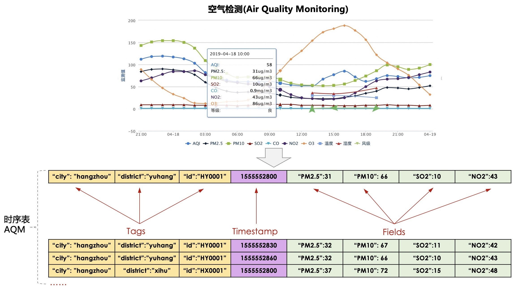

每个时间点对应的数据记录可以详细分为几个部分：

- 表（Table）：代表一系列同类时序数据的集合。

- 标签（Tags）：表明指标项监测针对的具体对象属性。其中一个标签（Tag）由一个标签键（Key）和一个对应的标签值（Value）组成。时序引擎默认会为每一个标签的健-值对都建立标签与时间序列之间的索引。在特定场合下，标签也可能会有不同的叫法，例如可能被称为*Labels*或者*Dimensions。*

- 时间戳（Timestamp）：表示该数据记录对应的生成时间。

- 字段（Field）：一条数据记录可以有多个字段值，表示指标的不同方面。时序引擎不会为字段建立索引。

**表设计的最佳实践**

基于以上的数据模型，我们便可以将同一类时序数据的度量（如上图中的AQM）设计为表名，并按照SQL的CREATE TABLE语法进行表设计。

以上文的空气质量监测的时序模型为例，可以采用的表定义如下所示。

```sql
CREATE TABLE aqm (
    city        VARCHAR TAG,
    district    VARCHAR TAG,
    id          VARCHAR TAG,
    time        TIMESTAMP,
    pm2_5       DOUBLE,
    pm10        DOUBLE,
    so2         DOUBLE,
    no2         DOUBLE,
    PRIMARY KEY(id)  ////单机版实例不⽀持PRIMARY KEY，如果使⽤的是单机版实例，请删除此⾏
);
```

在此定义基础上，随后向表中写数据便可通过INSERT语句来进行：

```sql
INSERT INTO aqm (city, district, id, time, pm2_5, pm10, so2, no2) 
VALUES ('hangzhou', 'yuhang', 'HY00001', '2019-04-18 10:00:00', 31.0, 66.0, 10.0, 43.0);

INSERT INTO aqm (city, district, id, time, pm2_5, pm10, so2, no2) 
VALUES ('hangzhou', 'yuhang', 'HY00001', '2019-04-18 10:01:00', 31.2, 66.0, 10.5, 43.1);
```

也可以通过下述INSERT语句实现批量写入数据。

```sql
INSERT INTO aqm (city, district, id, time, pm2_5, pm10, so2, no2) 
VALUES ('hangzhou', 'yuhang', 'HY00001', '2019-04-18 10:02:00', 31.3, 66.0, 10.0, 42.9),  
('hangzhou', 'yuhang', 'HY00001', '2019-04-18 10:03:00', 31.2, 66.4, 10.3, 43.0);
```

> **说明**
>
> 关键字**TAG**是时序引擎对SQL的语法扩展，用于将表中的部分列标示为“标签”。为避免在时序数据建表的过程中纠结于应该将哪些字段应定义为TAG，建议尝试遵循以下原则：
>
> - 能够标示数据采集源属性的字段定义为TAG，特别是能够唯一标示数据源的属性。
>
> - 应避免使用进程ID，时间关联属性等易变值作为标签，即便这类属性的类型是字符串，仍然建议将其定义为Field。如果使用此类易变属性作为标签，将会导致时间线数量急剧膨胀，并带来时间线索引大小剧增，反而不利于查询。

**PRIMARY KEY设计的最佳实践**

数据库会根据PRIMARY KEY进行存储分片与查询优化，指定PRIMARY KEY的查询请求将会非常高效，强烈建议建表时指定。

> **说明**
>
> 单机版实例不支持PRIMARY KEY。

通常建议选择数据源的唯一标识作为PRIMARY KEY，场景示例如下：

- 物联网、工业互联网场景，可以采用设备ID作为PRIMARY KEY。

- 车联网场景，可以采用车辆唯一标识来作为PRIMARY KEY。

- 监控场景，可以采用APP ID或者host:port等标识作为PRIMARY KEY。

以上述时序数据表aqm的示例，如果业务存在大量基于ID的查询，则指定ID作为PRIMARY KEY是最佳选择。

```sql
CREATE TABLE aqm (
    city        VARCHAR TAG,
    district    VARCHAR TAG,
    id          VARCHAR TAG,
    time        TIMESTAMP,
    pm2_5       DOUBLE,
    pm10        DOUBLE,
    so2         DOUBLE,
    no2         DOUBLE,
    PRIMARY KEY (id)   //单机版实例不⽀持PRIMARY KEY，如果使⽤的是单机版实例，请删除此⾏
);
```

> **重要**
>
> 和传统的关系型数据库不同，在时序数据表中定义为PRIMARY KEY的列并不要求列的值遵循唯一性约束，但是需要出现在PRIMARY KEY列表中的列名必须是标签列。

**数据类型选择的最佳实践**

时序引擎当前支持的数据类型可参见数据类型。对于时序数据表的创建，各种列的数据类型选择的建议如下：

- 标签（Tag）列

  声明为TAG的列固定为VARCHAR类型，无法更改。

- 时间戳（Timestamp）列在存储引擎时间戳实际上会按照BIGINT类型统一存为Epoch时间戳以便实现更优的时间戳压缩。但用户可结合对时间戳的计算需求自行选择在建表时使用BIGINT类型或TIMESTAMP类型。

- 字段（Field）列

  理论上字段列可选择使用所有数据类型。但出于数据压缩和查询计算的角度考虑，应尽量避免使用VARCHAR类型作为字段列的类型。

<a id="section-2-5-2"></a>

### 2.5.2. 如何高效地写入数据

本文介绍通过JDBC向时序引擎中写入数据的方法。

**基于JDBC开发高效数据写入的应用**

对于使用JDBC进行应用开发的场景，为了达到高效数据写入的目的，推荐使用JDBC中的 `PreparedStatement` 实现INSERT语句的批量写入。具体步骤如下：

1. 使用JDBC创建 `Connection` 对象。

   通过JDBC建立连接的方法，详细可参见Java JDBC Driver开发手册。

2. 创建 `PreparedStatement` 对象并指定带参数的INSERT语句。

   以"如何为时序数据建表"章节中介绍的示例为基础，创建 `PreparedStatement` 的方法如下所示：

   ```text
       StringBuilder builder = new StringBuilder();
       builder.append("INSERT INTO aqm (city, district, id, time, pm2_5, pm10, so2, no2) ");
       builder.append("VALUES (?, ?, ?, ?, ?, ?, ?, ?)");

       PreparedStatement preparedStmt = connection.prepareStatement(builder.toString());
   ```

3. 对 `PreparedStatement` 对象进行批量的输入参数绑定，并实际执行写入。

   对于上一步的INSERT语句，绑参的示例代码如下：

   ```text
       for (int i = 0; i < batchSize; i++) {
           // 按INSERT语句中的列参数指定顺序依次绑参
           // 下述代码中的 city, district, id, ts, pm25等都是⽤于绑参的局部变量
           preparedStmt.setString(1, city);
           preparedStmt.setString(2, district);
           preparedStmt.setString(3, id);
           preparedStmt.setTimestamp(4, ts);
           preparedStmt.setDouble(5, pm25);
           preparedStmt.setDouble(6, pm10);
           preparedStmt.setDouble(7, so2);
           preparedStmt.setDouble(8, no2);
           
           // 加入批次
           preparedStmt.addBatch();
       }

       // 执⾏⼀个批次的写入
       int[] results = preparedStmt.executeBatch();

       // 从results中查询实际写入的数据记录数。以下略
   }
   ```

> **说明**
>
> - 时序引擎的JDBC中的 `PreparedStatement` 只支持无命名参数（即通过占位符“?”指定参数），因此在实际调用 `PreparedStatement` 的绑参API时，需要确保 `setXXX()` 方法中指定的参数index所对应的参数值与INSERT语句中占位符所对应列一致。
>
> - `PreparedStatement` 在执行 `executeBatch()` 前绑定的参数批次并不是越多越好，其性能表现往往与表定义相关。根据实际测试的结果，如果表定义中仅有1个Field，并且TAG列的个数不超过5个时， `PreparedStatement` 执行的一个批次的个数为**5000**（即上述代码示例中的 `batchSize` 变量大小）性能最优。

<a id="section-2-5-3"></a>

### 2.5.3. 如何高效地查询时序数据

本文介绍了时序表的索引机制，以及查询时序表的最佳实践。

**背景信息**

时序数据的模型请参见如何设计时序数据表，数据是按照时间序列来进行组织的。所以在时序数据表中，所有标记**TAG**的列（标签列）会被建立为索引列，来表示每一条数据具体所属于哪个时间序列，从而显示数据的来源。

以时序数据表为例，具体请参见如何设计时序数据表，这些数据都属于同一个时间序列，如下图所示。

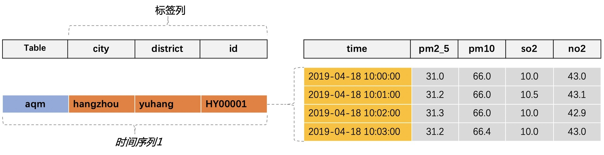

- 如果标签列的值发生变化，则数据将属于不同的时间序列。通常情况下，一个时间序列可以标记一个产生时序数据的数据源。

- 时序引擎会根据每个**标签列**建立索引，其索引形态是倒排索引，以标签列的列名和值作为索引键来索引所有拥有该键值对的时间序列，用于从时间序列维度快速定位某个标签对应的数据范围。随着数据的不断写入，时序数据表的倒排索引将会呈现以下形态。

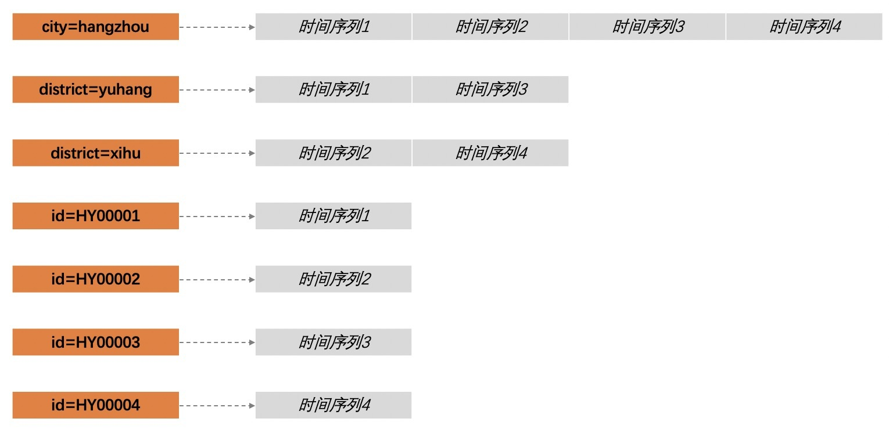

- 对于时间戳列，时序引擎会默认建立数据块范围索引，确保在海量时序数据中快速定位到需要查询的数据范围。但对于普通的Field列，时序引擎不会对数据建立索引。

**使用建议**

结合时序引擎的内部索引机制，对Lindorm时序引擎的时序表进行查询时需要考虑以下几点：

- 建议在查询的条件语句中增加标签列的等值过滤条件语句和时间戳列的过滤条件语句，避免条件语句中只有Field列过滤语句。

- 查询的条件语句中如果包含多个标签列过滤条件，且这几个标签列映射的时间线范围存在包含关系，建议只需要保留选择区分度最高的标签列的过滤条件（例如上图中的**id**列相对**city**列选择区分度更高）。

- 查询条件覆盖的时间范围过大可能会导致扫描过多的数据，进而导致查询速度过慢，在这种情况下建议您可以缩小时间戳列的过滤范围来提高查询性能。

**常见的时序查询场景和查询操作**

> **重要**
>
> 如果需要复现以下查询场景的结果，请下载相应的SQL脚本语句填写样例数据。

**查询时间范围内的原始点**

使用以下语句查询余杭区内设备从2019-04-18 10:00:00至2019-04-18 10:30:00上报的全部SO2监控指标。

```sql
SELECT id, so2 FROM aqm WHERE district='yuhang' AND time >= '2019-04-18 10:00:00' AND time < '2019-04-18 10:30:00';
```

查询结果如下。

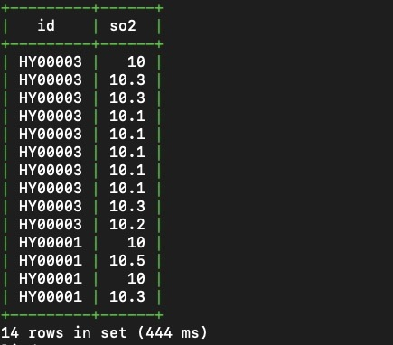

**查询时序数据表中特定标签列的所有标签值**

当将许多同类设备上报的数据接入到一张时序数据表中之后，有时会需要查询接入设备的某个标签的标签值。例如下述SQL就可以查询时序数据表  `aqm`  中接入的所有空气质量监控设备的设备 `id` ：

```sql
SELECT DISTINCT(id) FROM aqm;
```

查询结果如下。

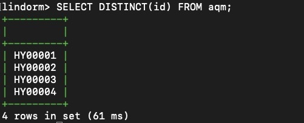

> **说明**
>
> 对于标签列的查询在存储引擎层面默认会基于标签索引进行查询，因此无需担心这样的查询会走全表扫描而产生性能问题。但若已接入的设备量非常多时，即使是走标签索引其查询耗时也可能会较长。

**查询时间精度的降采样**

查询余杭区内设备从2019-04-18 10:00:00至2019-04-18 10:30:00上报的PM2.5和SO2监控指标，按5分钟为粒度求平均值。

```sql
SELECT id, time, avg(pm2_5) AS avg_pm2_5, avg(so2) AS avg_so2 FROM aqm WHERE district='yuhang' AND time
>= '2019-04-18 10:00:00' AND time < '2019-04-18 10:30:00' SAMPLE BY 5m;
```

查询结果如下。

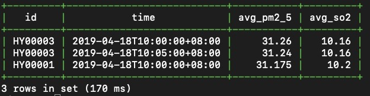

> **说明**
>
> 降采样的实质是以时间序列为单位在时间维度的聚合。

**查询跨设备的聚合数据**

查询余杭区内设备从2019-04-18 10:00:00至2019-04-18 10:30:00上报的PM2.5和SO2监控指标，查询按照5分钟粒度的最大平均值。

```sql
SELECT max(avg_pm2_5) AS max_avg_pm25, max(avg_so2) AS max_avg_so2 FROM (SELECT district, id, time, avg
(pm2_5) AS avg_pm2_5, avg(so2) AS avg_so2 FROM aqm WHERE district='yuhang' AND time >= '2019-04-18 10:00:00' AND time < '2019-04-18 10:30:00' SAMPLE BY 5m) GROUP BY district;
```

查询结果如下。

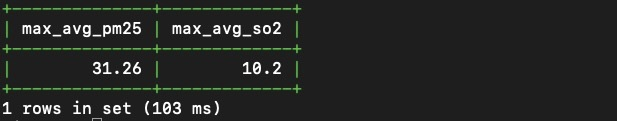

<a id="section-2-6"></a>

## 2.6. 第三方工具

<a id="section-2-6-1"></a>

### 2.6.1. 通过Telegraf写入时序引擎

Telegraf是一款开源的数据采集代理。其设计目标是通过插件来构建各种服务和第三方组件的 metrics 收集。Telegraf的内置插件支持将采集的数据上报给OpenTSDB，Lindorm时序引擎全面兼容OpenTSDB，用户可以使用Telegraf来对接时序引擎。

本文将介绍如何在用户的已有应用环境中部署 Telegraf 监控代理, 并对接公有云时序引擎实例使之接收 Telegraf 的上报数据。

**事前准备**

1. 确保用户已有的待检测应用环境（以下简称”应用环境”）已经连接上公网，并获得了公网IP。

2. 根据需要申请公有云的时序引擎实例，并为它申请公网地址，并在网络白名单中填入上述应用环境的公网IP。

   - 时序引擎实例管理界面中申请公网地址的入口。

     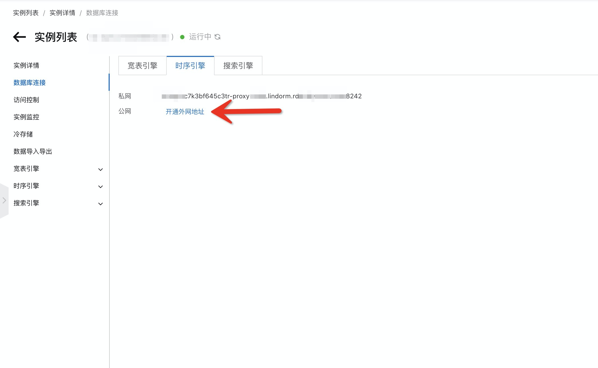

   - 网络白名单配置界面。

     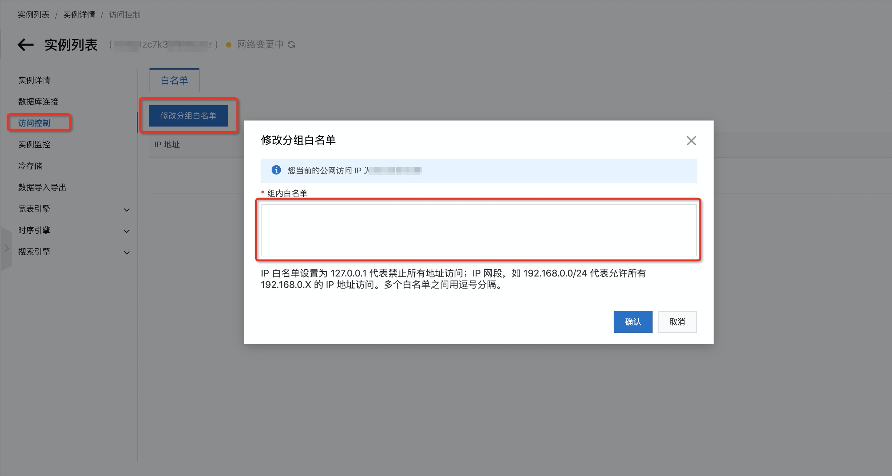

3. 时序引擎公网地址申请后，确认从应用环境可以连接到该时序引擎实例的公网域名。时序引擎实例域名以及端口会在公网地址申请成功后显示在下述位置。

   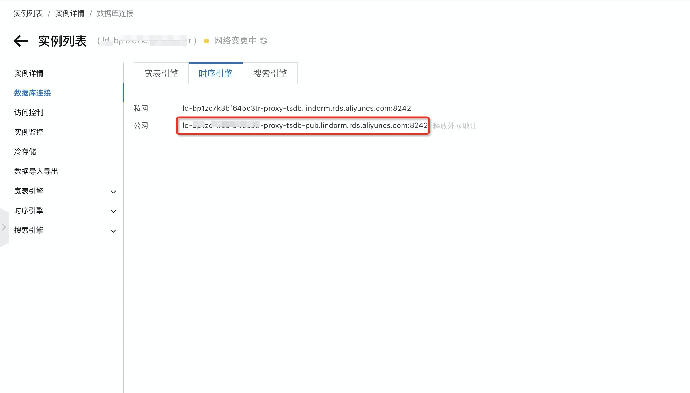

**安装Telegraf**

请结合应用环境所属的平台种类，参见Telegraf产品文档选择适合自身平台的安装方式。

**配置Telegraf连接时序引擎**

1. 修改 Telegraf 的配置文件 `telegraf.conf` ，找到其中的**OUTPUT PLUGINS**部分。

2. 关闭掉 output.influxdb的插件，启用output.opentsdb插件。

   ```text
     ...... 
     #[[outputs.influxdb]] 
     ~(下略)~ 
     [[outputs.opentsdb]] 
     ......
   ```

3. 配置[[outputs.opentsdb]]的相关设置。

   - 配置时序引擎实例的域名和端口。填入类似以下的内容。

     ```text
      host = "http://{时序引擎实例ID}.hitsdb.rds.aliyuncs.com" 
      port = 3242
     ```

     > **说明**
     >
     > host必须加上“http://”前缀。3242 是公有云时序引擎实例在公网暴露的默认端口。

   - 配置数据上报时的HTTP接口。可通过打开http_path = "/api/put"注释来实现。同时可以通过设置http_batch_size来指定上报数据时一次批量写入的数据点数。

   - 配置Telegraf写入指标时的分隔符。可通过设置separator实现指标的分隔符。但需注意分隔符只能选用Lindorm时序引擎所支持的单值数据写入。

   - 关于其他可配置项的设置，请参见Telegraf 在线文档。

4. 启动Telegraf，开启数据上报。 数据上报开始后，可以从时序引擎实例的管控平台的监控页面，看到数据的写入情况。监控页面的入口为 **阿里云时序引擎 > 管理控制台 > 实例列表 > 实例监控**。

   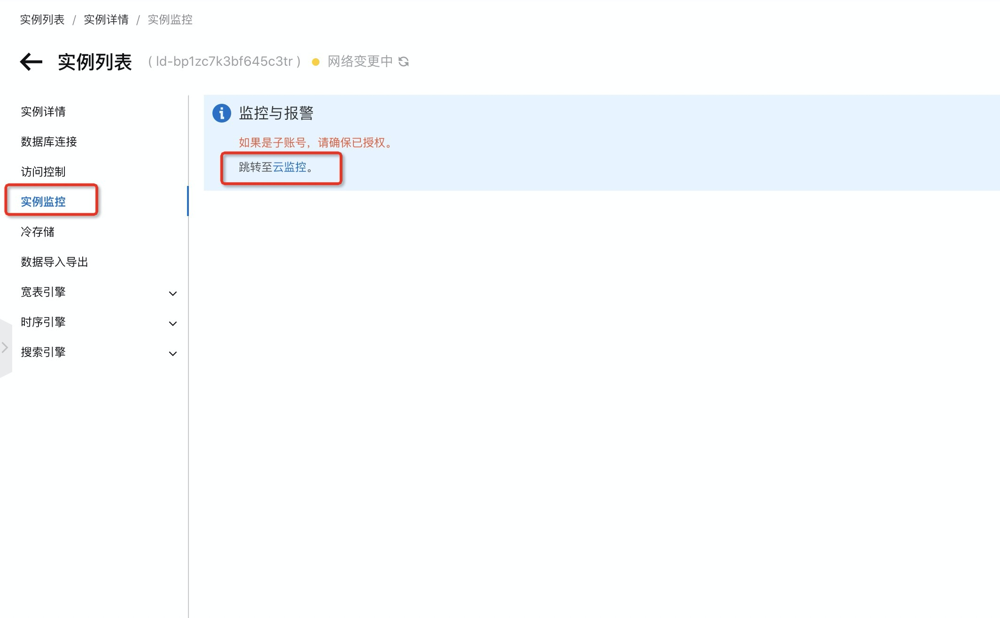

   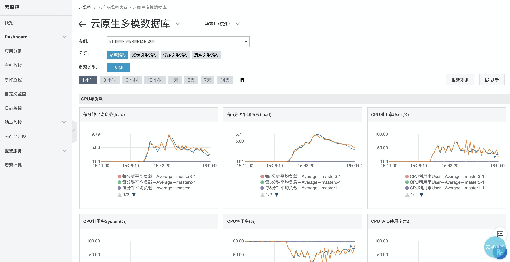

<a id="section-2-6-2"></a>

### 2.6.2. 使用Flink写入时序引擎

本文介绍如何在实时计算Flink上创建时序结果表并写入至云原生多模数据库 Lindorm时序引擎。

**前提条件**

- 已购买实时计算Flink版或者已有自建Flink。

  > **说明**
  >
  > 实时计算Flink需要VVR 4.0.13及以上版本，VVR 4.0.13版本是基于Apache Flink 1.13。

- 云原生多模数据库 Lindorm实例已开通时序引擎功能。

- Lindorm时序引擎版本为3.4.7及以上版本。

- 为了保证网络的连通性，确保云原生多模数据库 Lindorm实例和实时计算Flink使用相同的专有网络。

**背景信息**

时序引擎SINK是一种将时序结果表写入SINK连接器的插件，支持将多种数据源的数据高效写入至Lindorm时序引擎并进行业务分析。使用时序引擎SINK插件，需要先获取时序引擎SINK插件，再将JAR包上传至实时计算Flink版控制台，上传方法请参见实时计算Flink手册中的《JAR作业开发》章节。

**语法**

在实时计算Flink上创建时序结果表，创建语法代码如下：

```text
CREATE TEMPORARY TABLE tsdb_sink(
  `timestamp` BIGINT,
  tag_tagname VARCHAR,
  field_fieldname1 DOUBLE,
  field_fieldname2 VARCHAR,
  field_fieldname3 BIGINT,
  field_fieldname4 BOOLEAN
  -- table VARCHAR（可选字段）
)
with (
    'connector' = 'lindormtsdb',
    'url'='http://ld-bp159jt4eivt3****-proxy-tsdb.lindorm.rds.aliyuncs.com:8242',
    'table'='mytable',
    'schemaPolicy'='weak',
    'sync'='false',
    'debug'='false'
);
```

**参数说明**

**默认格式**

| 字段名 | 数据类型 | 是否必选 | 说明 |
| --- | --- | --- | --- |
| timestamp | BIGINT | 是 | 单位为毫秒。<br>说明字段值为13位时间戳，如果是10位时间戳，写入会自动转换为13位。 |
| tag_tagname | VARCHAR | 是 | 指定时序数据标签（Tag）。tag_表示前缀（不能省略），tagname表示时序数据标签名称。<br>说明tag_tagname为一列或者多列。 |
| field_fieldnam e | DOUBLE、VARCHAR、BIGINT、BOOLEAN | 是 | 指定时序数据量测值（Field）。field_表示前缀（不能省略），fieldname表示时序数据量测值名称。<br>说明field_fieldname为一列或者多列。 |
| table | VARCHAR | 否 | 指定时序数据表。<br>• 如果写入一张时序数据表，建议在WITH参数中配置。<br>• 如果写入多张表可以在该字段中自定义表名。 |

**WITH参数**

<table>
  <tr>
    <th>参数</th>
    <th>是否必选</th>
    <th>说明</th>
  </tr>
  <tr>
    <td>connector</td>
    <td>是</td>
    <td>固定值lindormtsdb，指定时序引擎SINK插件。</td>
  </tr>
  <tr>
    <td>url</td>
    <td>是</td>
    <td>Lindorm时序引擎的连接地址。</td>
  </tr>
  <tr>
    <td>table</td>
    <td>否</td>
    <td>指定时序数据表。<br>• 如果写入一张时序数据表，建议配置此参数。<br>• 如果写入多张表可以在table字段中自定义表名。</td>
  </tr>
  <tr>
    <td>username</td>
    <td>否</td>
    <td rowspan="2">默认情况未启用时序引擎的用户认证与权限校验，访问时序引擎时无需输入用户名和密码。但是为了数据安全，建议开启时序引擎的用户认证与权限校验，开启后访问时序引擎都需要输入用户名和密码。</td>
  </tr>
  <tr>
    <td>password</td>
    <td>否</td>
  </tr>
  <tr>
    <td>defaultDatabase</td>
    <td>否</td>
    <td>读写数据库，默认值为default。</td>
  </tr>
  <tr>
    <td>schemaPolicy</td>
    <td>否</td>
    <td>表的Schema约束策略，可以设置为：<br>• Strong：默认值，强约束，时序引擎会严格依据预先定义的表结构对写入数据的表名、字段名、类型进行校验。<br>• Weak：弱约束，写入数据的表不存在时引擎不会报错，而是会自动创建对应的表。<br>• None：无约束，无法直接通过SQL查询写入的数据。<br>说明设置为Strong或者None时需要手动建表。更多信息请参见Schema约束。</td>
  </tr>
  <tr>
    <td>ignoreErrorData</td>
    <td>否</td>
    <td>是否忽略写入错误。<br>• false：默认值，不忽略，如果遇到错误就跳出写入操作。<br>• true：忽略，如果遇到错误就忽略继续写入操作。</td>
  </tr>
  <tr>
    <td>maxRetries</td>
    <td>否</td>
    <td>写入时遇到服务端内部错误或者网络错误时最大重试次数，默认值为3。</td>
  </tr>
  <tr>
    <td>batchSize</td>
    <td>否</td>
    <td>写入时每次向服务端发送的数据量，默认值为500个数据点。</td>
  </tr>
  <tr>
    <td>connectTimeoutM s</td>
    <td>否</td>
    <td>HTTP连接超时时间，默认值为90000。</td>
  </tr>
  <tr>
    <td>debug</td>
    <td>否</td>
    <td>是否开启debug模式，用来打印详细数据点日志。<br>• false：默认值，不开启。<br>• true：开启。</td>
  </tr>
  <tr>
    <td>sync</td>
    <td>否</td>
    <td>是否同步写入，建议使用false。<br>• false：异步写入，默认值，写入效率高。<br>• true：同步写入。</td>
  </tr>
</table>

**示例**

以datagen_source随机数据生成器为例，将生成的数据写入Lindorm时序表tsdb_sink中。示例代码如下：

```sql
CREATE TEMPORARY TABLE datagen_source (
  id INTEGER,
  score DOUBLE,
  name STRING
)
WITH (
  'connector' = 'datagen'
);

CREATE TEMPORARY TABLE tsdb_sink(
  tag_tagk VARCHAR,
  field_score DOUBLE,
  field_name STRING,
  `timestamp` BIGINT
)
WITH (
    'connector' = 'lindormtsdb',
    'url'='http://ld-bp159jt4eivt3****-proxy-tsdb.lindorm.rds.aliyuncs.com:8242',
    'table'= 'mytable'
);

INSERT INTO tsdb_sink
SELECT
  CAST(id as STRING) as tag_tagk,
  score as field_score,
  name as field_name,
  UNIX_TIMESTAMP(now()) * 1000  as `timestamp`
FROM datagen_source;
```

<a id="section-2-6-3"></a>

### 2.6.3. 通过Grafana访问时序引擎

Grafana服务是用于展示大型测量数据的开源可视化工具，在互联网应用分析中应用范围十分广泛，并且在工业监控、气象监控、家居自动化和过程管理等领域也有着较广泛的用户基础。云原生多模数据库 Lindorm时序引擎提供Alibaba Cloud Lindorm数据源插件。您可以利用该插件在Grafana服务添加Lindorm数据源。本文介绍如何通过Grafana服务访问时序引擎并进行可视化数据分析。

**可观测可视化Grafana版访问时序引擎**

**前提条件**

- 已创建Grafana工作区。

- 如果希望通过专有网络访问Lindorm时序引擎，请完成以下操作：

  - 为Grafana开通私网地址。

- 如果希望通过公网访问Lindorm时序引擎，请完成以下操作：

  - 为Lindorm时序引擎开通公网地址。

**操作步骤**

本文以Grafana 10.0.x为例介绍操作步骤。

1. 登录可观测可视化 Grafana 版控制台，在左侧导航栏单击**工作区管理**。

2. 在基本信息区域，单击公网地址或私网地址。输入用户名和密码。用户名为admin，密码为创建工作去时设置的密码。

3. 在Grafana服务中添加Lindorm数据源。

   <ol type="i">

   <li>

   单击左上角的  图标，在列表中选择**管理**。然后单击数据源。

   </li>

   <li>

   在管理页面，单击数据源。

   </li>

   <li>

   在数据源页面，单击Add data source。

   </li>

   <li>

   在Add data source页面的搜索框中输入Alibaba Cloud Lindorm，找到目标数据源并单击数据源。

   </li>

   <li>

   在**Settings**页签中配置以下参数，其他参数可保持默认值。

   <table>
     <tr>
       <th>配置项</th>
       <th>参数</th>
       <th>是否必选</th>
       <th>描述</th>
     </tr>
     <tr>
       <td colspan="2">Name</td>
       <td>是</td>
       <td>数据源名称，可自定义。</td>
     </tr>
     <tr>
       <td>HTTP</td>
       <td>URL</td>
       <td>是</td>
       <td>Lindorm时序HTTP地址。<br>重要<br>• 如果Grafana已开通私网地址，且与Lindorm实例位于同一专有网络，请使用Lindorm时序HTTP地址的专有网络地址，否则请使用公网地址。<br>• 如果此处使用的是Lindorm时序HTTP地址的专有网络地址，请确保Grafana私网地址已经添加到Lindorm的白名单中。如果使用的是公网地址，请确保Grafana公网IP已经添加到Lindorm的白名单中。</td>
     </tr>
     <tr>
       <td>Auth</td>
       <td>Basic auth</td>
       <td>否</td>
       <td>Lindorm时序引擎如果开启了权限与用户认证，请打开<strong>Basic auth</strong>，并在<strong>Basic Auth Details</strong>区域填写登录时序引擎的用户名和密码。</td>
     </tr>
     <tr>
       <td rowspan="2">Basic Auth Details</td>
       <td>User</td>
       <td>否</td>
       <td>如果打开<strong>Basic auth</strong>需要填写Lindorm时序引擎的用户名。</td>
     </tr>
     <tr>
       <td>Password</td>
       <td>否</td>
       <td>如果打开<strong>Basic auth</strong>需要填写Lindorm时序引擎的密码。</td>
     </tr>
     <tr>
       <td>Lindorm TSDB Details</td>
       <td>Database</td>
       <td>否</td>
       <td>填写需要访问的Lindorm时序引擎的数据库。</td>
     </tr>
   </table>

   </li>

   <li>

   单击**Save & test**。

   显示test success，说明测试连接成功。

   </li>

   </ol>

4. 单击**Build a dashboard**。

5. 在New Dashboard页面，单击**添加可视化**。

6. 选择步骤3添加的Lindorm数据源。

7. 在**Query**页签中查询数据。

   <ol type="i">

   <li>

   在**Data source**列表中选择目标数据源名称。

   <ol type="i" start="2">

   <li>

   Grafana支持两种编辑器模式，包括格式化查询编辑器和SQL查询编辑器。

   </li>

   </ol>

   **SQL查询编辑器**

   单击**A**区域右上角的  ，将查询编辑器切换为Raw Query Mode，然后可以输入Lindorm SQL完成复杂的查询操作。

   示例如下。

   ```sql
   SELECT region,time,avg(temperature) FROM sensor WHERE time >= $from AND time <= $to SAMPLE BY $interval
   ```

   > **说明**
   >
   > Lindorm SQL语句使用请参见SELECT语法。
   >
   > - `time >= $from AND time <= $to` 为时间条件，为必选项，不添加无法查询出结果。参数值为Dashboard页面中选择的时间范围。
   >
   > - 单击**Query options**，可以通过**Min interval**和**Max data points**参数来设置**Interval**参数大小。
   >
   > - 通过**ALIAS BY**重命名时间线标签，格式为 `$tag_<tag_name>` ，例如 `$tag_host` ，时间线标签将显示为host的值。
   >
   > - 通过**OFFSET**设置时间偏移量，方便您将不同时间段的数据进行对比。

   **格式化查询编辑器**

   通过格式化的模板，选择需要查询的表、字段、查询条件等，可以完成简单的查询，关键字说明如下表。

   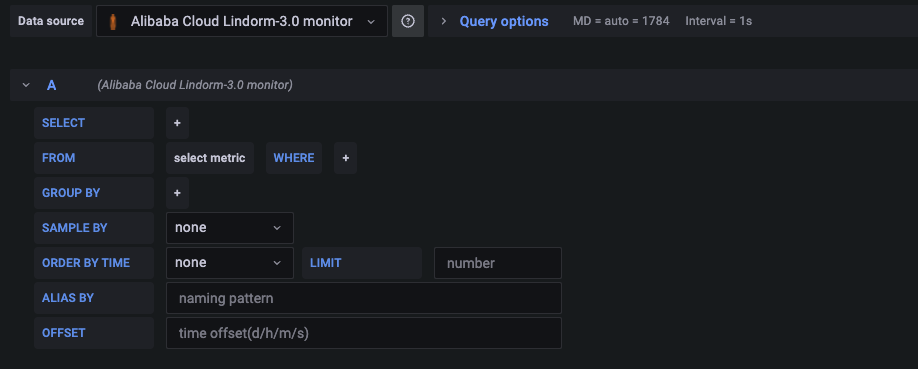

   <table>
     <tr>
       <th width="170">关键字</th>
       <th>说明</th>
     </tr>
     <tr>
       <td><code>SELECT</code></td>
       <td>选择需要查询的字段名。</td>
     </tr>
     <tr>
       <td><code>FROM</code></td>
       <td>选择需要查询的表名。</td>
     </tr>
     <tr>
       <td><code>WHERE</code></td>
       <td>添加查询条件。</td>
     </tr>
     <tr>
       <td><code>GROUP BY</code></td>
       <td>添加聚合条件。</td>
     </tr>
     <tr>
       <td><code>SAMPLE BY</code></td>
       <td>选择降采样时间间隔。单击<strong>Query options</strong>，可以通过<strong>Min interval</strong>和<strong>Max data points</strong>参数来设置<strong>Interval</strong>参数大小。</td>
     </tr>
     <tr>
       <td><code>ORDER BY TIME</code></td>
       <td>按时间对查询结果排序。</td>
     </tr>
     <tr>
       <td><code>LIMIT</code></td>
       <td>指定查询结果集的返回行数。</td>
     </tr>
     <tr>
       <td><code>ALIAS BY</code></td>
       <td>重命名时间线标签。格式为<code> $tag_&lt;tag_name&gt; </code>，例如<code> $tag_host </code>，时间线标签将显示为host的值。</td>
     </tr>
     <tr>
       <td><code>OFFSET</code></td>
       <td>设置时间偏移量，方便您将不同时间段的数据进行对比。</td>
     </tr>
   </table>

   </li>

   </ol>

**ECS自建Grafana服务访问时序引擎**

**部署要求**

- ECS实例的操作系统版本选择CentOS 7.3 64位及以上版本。

- ECS实例的资源规格需要1核2 G内存以上，磁盘剩余空间至少有10 GB。

**前提条件**

在开始操作前，请确保已完成以下操作：

- ECS实例安全组已放行3000端口的入方向流量。

- 添加ECS实例的IP到Lindorm白名单。

  如果ECS实例与Lindorm实例不属于同一专有网络，请为ECS实例分配公网IP。

- 如果通过公网访问Grafana Web界面，请确保ECS实例已分配公网IP。如果通过专有网络访问Grafana Web界面，则无需为ECS实例分配公网IP。

**操作步骤**

1. 安装Grafana服务（如已安装，可跳过）。

   <ol type="i">

   <li>

   登录ECS实例。

   </li>

   <li>

   执行下述命令下载Grafana：

   ```bash
   wget https://dl.grafana.com/enterprise/release/grafana-enterprise-8.2.2-1.x86_64.rpm
   ```

   > **说明**
   >
   > 本文以Grafana企业版8.2.2-1版本为例，您也可以安装其他版本。其他版本的下载地址，请参见Grafana官网。

   </li>

   <li>

   执行下述命令安装Grafana：

   ```bash
   sudo yum install grafana-enterprise-8.2.2-1.x86_64.rpm
   ```

   </li>

   <li>

   执行下述命令启动Grafana服务：

   ```bash
   sudo service grafana-server start
   ```

   </li>

   </ol>

2. 安装Alibaba Cloud Lindorm数据源插件。

   <ol type="i">

   <li>

   执行下述命令下载数据源插件。

   ```bash
   wget https://tsdbtools.oss-cn-hangzhou.aliyuncs.com/grafana-alibabacloud-lindorm-datasource-latest.zip
   ```

   </li>

   <li>

   执行下述命令解压插件到默认目录，Linux的默认目录为/var/lib/grafana/plugins/。

   ```text
   unzip grafana-alibabacloud-lindorm-datasource-latest.zip -d /var/lib/grafana/plugins/
   ```

   </li>

   <li>

   执行下述命令修改grafana.ini文件信息，Linux默认文件位置/etc/grafana/grafana.ini。

   ```bash
   sudo nano -w  /etc/grafana/grafana.ini
   ```

   </li>

   <li>

   在<strong>[plugins]</strong>区域中将 `;allow_loading_unsigned_plugins=` 修改为 `allow_loading_unsigned_plugins = alibabacloud-lindorm-datasource` 。修改后按下 

   `CTRL+O`保存并回车退出编辑页面。

   > **重要**
   >
   > 修改grafana.ini文件时，需要删除 `;allow_loading_unsigned_plugins` 前面的半角分号（;）。

   </li>

   <li>

   执行下述命令重启Grafana服务：

   ```bash
   sudo service grafana-server restart
   ```

   </li>

   </ol>

3. 在Grafana服务中添加Lindorm数据源。

   <ol type="i">

   <li>

   在浏览器中输入http://IP:3000/，其中IP为ECS的公网IP或主私网IP。然后输入用户名和密码。如果是第一次登录，用户名和密码为admin，登录后请及时修改密码。更详细的介绍，请参见登录Grafana。

   </li>

   <li>

   单击左侧的

   图标，在列表中选择**Data Sources**。

   

   </li>

   <li>

   在**Configuration**页面，单击**Add data source**。

   </li>

   <li>

   在**Add data source**页面的搜索框中输入

   `Alibaba Cloud Lindorm`，找到目标数据源并单击**Select**。

   

   </li>

   <li>

   在**Settings**页签中配置以下参数，其他参数可保持默认值。

   <table>
     <tr>
       <th>配置项</th>
       <th>参数</th>
       <th>是否必选</th>
       <th>描述</th>
     </tr>
     <tr>
       <td colspan="2">Name</td>
       <td>是</td>
       <td>数据源名称，可自定义。</td>
     </tr>
     <tr>
       <td>HTTP</td>
       <td>URL</td>
       <td>是</td>
       <td>Lindorm时序HTTP地址。<br>重要<br>• 如果您的ECS与Lindorm实例，位于同一专有网络，请使用Lindorm时序HTTP地址的专有网络地址，否则请使用公网地址。<br>• 如果此处使用的是时序HTTP地址的专有网络地址，请确保ECS主私网IP已经添加到Lindorm的白名单中。如果使用的是公网地址，请确保ECS公网IP已经添加到Lindorm的白名单中。</td>
     </tr>
     <tr>
       <td>Auth</td>
       <td>Basic auth</td>
       <td>否</td>
       <td>Lindorm时序引擎如果开启了权限与用户认证，请打开<strong>Basic auth</strong>，并在<strong>Basic Auth Details</strong>区域填写登录时序引擎的用户名和密码。</td>
     </tr>
     <tr>
       <td rowspan="2">Basic Auth Details</td>
       <td>User</td>
       <td>否</td>
       <td>如果打开<strong>Basic auth</strong>需要填写Lindorm时序引擎的用户名。</td>
     </tr>
     <tr>
       <td>Password</td>
       <td>否</td>
       <td>如果打开<strong>Basic auth</strong>需要填写Lindorm时序引擎的密码。</td>
     </tr>
     <tr>
       <td>Lindorm TSDB Details</td>
       <td>Database</td>
       <td>否</td>
       <td>填写需要访问的Lindorm时序引擎的数据库。</td>
     </tr>
   </table>

   </li>

   <li>

   单击**Save & test**。

   显示test success，说明测试连接成功。

   </li>

   </ol>

4. 连接Lindorm实例后，在Grafana服务中创建并使用dashboard，具体操作您可以参考创建Dashboard。

5. 在**Query**页签中查询数据。

   <ol type="i">

   <li>

   在**Data source**列表中选择目标数据源名称。

   <ol type="i" start="2">

   <li>

   Grafana支持两种编辑器模式，包括格式化查询编辑器和SQL查询编辑器。

   </li>

   </ol>

   **SQL查询编辑器**

   单击**A**区域右上角的  ，将查询编辑器切换为Raw Query Mode，然后可以输入Lindorm SQL完成复杂的查询操作。

   示例如下。

   ```sql
   SELECT region,time,avg(temperature) FROM sensor WHERE time >= $from AND time <= $to SAMPLE BY $interval
   ```

   > **说明**
   >
   > Lindorm SQL语句使用请参见SELECT语法。
   >
   > - `time >= $from AND time <= $to` 为时间条件，为必选项，不添加无法查询出结果。参数值为Dashboard页面中选择的时间范围。
   >
   > - 单击**Query options**，可以通过**Min interval**和**Max data points**参数来设置**Interval**参数大小。
   >
   > - 通过**ALIAS BY**重命名时间线标签，格式为 `$tag_<tag_name>` ，例如 `$tag_host` ，时间线标签将显示为host的值。
   >
   > - 通过**OFFSET**设置时间偏移量，方便您将不同时间段的数据进行对比。

   **格式化查询编辑器**

   通过格式化的模板，选择需要查询的表、字段、查询条件等，可以完成简单的查询，关键字说明如下表。

   

   <table>
     <tr>
       <th width="170">关键字</th>
       <th>说明</th>
     </tr>
     <tr>
       <td><code>SELECT</code></td>
       <td>选择需要查询的字段名。</td>
     </tr>
     <tr>
       <td><code>FROM</code></td>
       <td>选择需要查询的表名。</td>
     </tr>
     <tr>
       <td><code>WHERE</code></td>
       <td>添加查询条件。</td>
     </tr>
     <tr>
       <td><code>GROUP BY</code></td>
       <td>添加聚合条件。</td>
     </tr>
     <tr>
       <td><code>SAMPLE BY</code></td>
       <td>选择降采样时间间隔。单击<strong>Query options</strong>，可以通过<strong>Min interval</strong>和<strong>Max data points</strong>参数来设置<strong>Interval</strong>参数大小。</td>
     </tr>
     <tr>
       <td><code>ORDER BY TIME</code></td>
       <td>按时间对查询结果排序。</td>
     </tr>
     <tr>
       <td><code>LIMIT</code></td>
       <td>指定查询结果集的返回行数。</td>
     </tr>
     <tr>
       <td><code>ALIAS BY</code></td>
       <td>重命名时间线标签。格式为<code> $tag_&lt;tag_name&gt; </code>，例如<code> $tag_host </code>，时间线标签将显示为host的值。</td>
     </tr>
     <tr>
       <td><code>OFFSET</code></td>
       <td>设置时间偏移量，方便您将不同时间段的数据进行对比。</td>
     </tr>
   </table>

   </li>

   </ol>

<a id="section-2-6-4"></a>

### 2.6.4. 通过Prometheus访问时序引擎

Lindorm时序引擎提供remote write/remote read接口实现作为Prometheus的远端存储。同时原生支持PromQL访问接口以提供更加高效的数据访问。

**写入数据**

**获取数据库连接地址**

1. 登录Lindorm控制台。

2. 在**实例列表**单击目标实例ID，进入**实例详情**页面。

3. 在左侧导航栏，单击**数据库连接**。

4. 单击**时序引擎**页签，进入**时序引擎**页面。

5. 在**时序引擎**页面查看**连接**地址。

   remote read和remote write的连接地址分别为：

   http://ld-\*\*\*\*-proxy-tsdb-pub.lindorm.rds.aliyuncs.com:8242/api/prom_write

   http://ld-\*\*\*\*-proxy-tsdb-pub.lindorm.rds.aliyuncs.com:8242/api/prom_read

**配置Prometheus远端存储**

开Prometheus.yaml配置文件，并在文件末尾增加以下内容，将**remote_write**和**remote_read**链接替换为上一步获取的地址。

```text
remote_write:
  - url: "http://ld-****-proxy-tsdb-pub.lindorm.rds.aliyuncs.com:8242/api/prom_write"
remote_read:
  - url: "http://ld-****-proxy-tsdb-pub.lindorm.rds.aliyuncs.com:8242/api/prom_read"
    read_recent: true
```

**使用PromQL读取数据**

Lindorm时序引擎提供PromQL的原生支持，例如可以使用Grafana的PromQL插件来访问Lindorm时序引擎。PromQL访问链接地址获取方式如下：

1. 登录Lindorm控制台。

2. 在**实例列表**单击目标实例ID，进入**实例详情**页面。

3. 单击**数据库连接**。

4. 单击**时序引擎**页签。

5. 单击**PromQL兼容地址**，查看**PromQL专有网络**或**PromQL公网**地址。

<a id="section-2-7"></a>

## 2.7. 性能白皮书

<a id="section-2-7-1"></a>

### 2.7.1. 测试环境与工具

本文主要介绍本次测试的测试环境和工具使用方式。

**测试环境要求**

- 测试使用的操作系统为Alibaba Cloud Linux 3.2104 64位。

- 压测端和Lindorm时序引擎在同一个VPC网络中，使用VPC地址进行连接。

- 本测试中压测端使用的机器规格为ecs.c6e.26xlarge。建议使用32C128G以上配置的机器。

**Lindorm时序引擎规格**

分别测试了4组Lindorm时序引擎的规格，存储类型均为标准型云存储。

- 集群1：4核16GB \* 3节点

- 集群2：8核32GB \*3节点

- 集群3：16核64GB \*3节点

- 集群4：32核128GB \*3节点

> **说明**
>
> - 上述测试实例规格均使用Lindorm产品的公开售卖规格。
>
> - 测试实例的存储类型选用的是标准型云存储，选用性能型云存储可以获得更好的性能。
>
> - 测试实例的时序引擎版本为3.4.9。

**测试工具介绍**

测试工具基于时序数据库领域应用最广的压测工具influxdb-comparisons，在此基础上进行了Lindorm的适配。

该测试中数据模型采用压测工具中的DevOps模型。这个数据模型的场景是：一组服务器需要定期报告系统和应用程序的指标，比如每10秒在一台服务器上的9个子系统（CPU、内存、磁盘、磁盘I/O、内核、网络、Redis、PostgreSQL和Nginx）上采样101个测量值，上报到时序数据库。

**测试工具下载**

通过下载压测工具，上传到压测客户端机器并解压后即可进行测试。

> **说明**
>
> 关于该工具的使用方法介绍可参见influxdb-comparisons，整体的使用方式和思路和它类似。

**写入测试**

- 生成写入数据

```text
# ${scale} ：⽣成数据的设备数量
# ${data_file} ：⽣成的数据⽂件名
# ${batch_size} ：batch的⼤⼩
GOGC=500 ./bulk_data_gen -format lindormtsdbbatch -use-case devops -seed 100 -sampling-interval 10s -s
cale-var ${scale} -batchSize ${batchsize}  > ${data_file}
```

- 进行写入

```text
# ${data_file} ：上⼀步⽣成的⽂件名
# ${add} ：Lindorm时序引擎的地址，形式为ip:port,  例如 ld-8vb458k154q7xxxx-proxy-
tsdb.lindorm.rds.aliyuncs.com:8242
# ${workers} ：写入并发⼤⼩
GOGC=500 ./bulk_load_lindormtsdb_batch -file ${data_file} -url ${add} -workers ${workers} -time-limit 10m
```

**查询测试**

- 生成查询

```text
# ${query_type} ：查询的类型 
# ${scale} ：scale的⼤⼩
# ${queryfile} ：⽣成的包含查询的⽂件
GOGC=500 ./bulk_query_gen -seed 123 -queries 100000 -format lindormtsdb -use-case devops -query-type $
{query_type} -scale-var ${scale} > ${queryfile}
```

> **说明**
>
> `${query_type}` 的具体说明，请参见查询测试结果。

- 进行查询

```text
# ${workers} ：查询的并发数
# ${add} ：Lindorm时序引擎的地址，形式为ip:port,  例如 ld-8vb458k154q7xxxx-proxy-
tsdb.lindorm.rds.aliyuncs.com:8242
# ${queryfile} ：上⼀步⽣成的包含查询语句的⽂件
GOGC=500 ./query_benchmarker_lindormtsdb -workers ${workers} -url ${add} -file ${queryfile}
```

<a id="section-2-7-2"></a>

### 2.7.2. 写入测试结果

本章节介绍写入测试的结果对比。本测试是在发挥数据最佳性能，并在没有任何查询的情况下测得的结果。在不同时间线规模的业务场景，或同时存在查询的场景下，写入性能可能会下降，建议在使用前结合自己的业务场景进行测试评估，本测试结果仅供参考。

**写入数据样例**

每10秒在一台服务器的9个子系统（CPU、内存、磁盘、磁盘I/O、内核、网络、Redis、PostgreSQL和Nginx）上采样101个测量点, 上报到Lindorm时序引擎。

每个子系统在Lindorm时序引擎中作为一张Table，Table、TAG、Field的定义参考数据模型。

- 建表语句如下，其中hostname作为每个设备的唯一标识。

```sql
CREATE table cpu(hostname VARCHAR primary TAG,region VARCHAR TAG,datacenter VARCHAR TAG,rack VARCHAR TA
G,os VARCHAR TAG,arch VARCHAR TAG,team VARCHAR TAG,service VARCHAR TAG,service_version VARCHAR TAG,service_environment VARCHAR TAG,time BIGINT,usage_user double,usage_system double,usage_idle double,usage_nice double,usage_iowait double,usage_irq double,usage_softirq double,usage_steal double,usage_guest double,usage_guest_nice double);

CREATE table mem(hostname VARCHAR primary TAG, region VARCHAR TAG, datacenter VARCHAR TAG, rack VARCHAR
TAG, os VARCHAR TAG, arch VARCHAR TAG, team VARCHAR TAG, service VARCHAR TAG, service_version VARCHAR T
AG, service_environment VARCHAR TAG, time BIGINT,total BIGINT, available BIGINT, used BIGINT, `free` BI
GINT, cached BIGINT, buffered BIGINT, used_percent double, available_percent double, buffered_percent double);

CREATE table disk(hostname VARCHAR primary TAG, region VARCHAR TAG, datacenter VARCHAR TAG, rack VARCHA
R TAG, os VARCHAR TAG, arch VARCHAR TAG, team VARCHAR TAG, service VARCHAR TAG, service_version VARCHAR
TAG, service_environment VARCHAR TAG, path VARCHAR TAG, fstype VARCHAR TAG,time BIGINT,total BIGINT, `free` BIGINT, used BIGINT, used_percent BIGINT, inodes_total BIGINT, inodes_free BIGINT, inodes_used BIG
INT);

CREATE table diskio(hostname VARCHAR primary TAG, region VARCHAR TAG, datacenter VARCHAR TAG, rack VARC
HAR TAG, os VARCHAR TAG, arch VARCHAR TAG, team VARCHAR TAG, service VARCHAR TAG, service_version VARCH
AR TAG, service_environment VARCHAR TAG, serial VARCHAR TAG,time BIGINT,`reads` BIGINT, writes BIGINT, read_bytes BIGINT, write_bytes BIGINT, read_time BIGINT, write_time BIGINT, io_time BIGINT);

CREATE table kernel(hostname VARCHAR primary TAG, region VARCHAR TAG, datacenter VARCHAR TAG, rack VARC
HAR TAG, os VARCHAR TAG, arch VARCHAR TAG, team VARCHAR TAG, service VARCHAR TAG, service_version VARCH
AR TAG, service_environment VARCHAR TAG,time BIGINT,boot_time BIGINT, interrupts BIGINT, context_switches BIGINT, processes_forked BIGINT, disk_pages_in BIGINT, disk_pages_out BIGINT);

CREATE table net(hostname VARCHAR primary TAG, region VARCHAR TAG, datacenter VARCHAR TAG, rack VARCHAR
TAG, os VARCHAR TAG, arch VARCHAR TAG, team VARCHAR TAG, service VARCHAR TAG, service_version VARCHAR T
AG, service_environment VARCHAR TAG, interface VARCHAR TAG,time BIGINT, bytes_sent BIGINT, bytes_recv B
IGINT, packets_sent BIGINT, packets_recv BIGINT, err_in BIGINT, err_out BIGINT, drop_in BIGINT, drop_out BIGINT );

CREATE table redis(hostname VARCHAR primary TAG, region VARCHAR TAG, datacenter VARCHAR TAG, rack VARCH
AR TAG, os VARCHAR TAG, arch VARCHAR TAG, team VARCHAR TAG, service VARCHAR TAG, service_version VARCHA
R TAG, service_environment VARCHAR TAG, port VARCHAR TAG, server VARCHAR TAG,time BIGINT, uptime_in_seconds BIGINT, total_connections_received BIGINT, expired_keys BIGINT, evicted_keys BIGINT, keyspace_hits
BIGINT, keyspace_misses BIGINT, instantaneous_ops_per_sec BIGINT, instantaneous_input_kbps BIGINT, instantaneous_output_kbps BIGINT, connected_clients BIGINT, used_memory BIGINT, used_memory_rss BIGINT, used_memory_peak BIGINT, used_memory_lua BIGINT, rdb_changes_since_last_save BIGINT, sync_full BIGINT, sync_partial_ok BIGINT, sync_partial_err BIGINT, pubsub_channels BIGINT, pubsub_patterns BIGINT, latest_fork_usec BIGINT, connected_slaves BIGINT, master_repl_offset BIGINT, repl_backlog_active BIGINT, repl_backlog_size BIGINT, repl_backlog_histlen BIGINT, mem_fragmentation_ratio BIGINT, used_cpu_sys BIGINT, used_cpu_user BIGINT, used_cpu_sys_children BIGINT, used_cpu_user_children BIGINT);

CREATE table postgresl(hostname VARCHAR primary TAG, region VARCHAR TAG, datacenter VARCHAR TAG, rack V
ARCHAR TAG, os VARCHAR TAG, arch VARCHAR TAG, team VARCHAR TAG, service VARCHAR TAG, service_version VA
RCHAR TAG, service_environment VARCHAR TAG, time BIGINT,numbackends BIGINT, xact_commit BIGINT, xact_rollback BIGINT, blks_read BIGINT, blks_hit BIGINT, tup_returned BIGINT, tup_fetched BIGINT, tup_inserted
BIGINT, tup_updated BIGINT, tup_deleted BIGINT, conflicts BIGINT, temp_files BIGINT, temp_bytes BIGINT,deadlocks BIGINT, blk_read_time BIGINT, blk_write_time BIGINT );

CREATE table nginx(hostname VARCHAR primary TAG, region VARCHAR TAG, datacenter VARCHAR TAG, rack VARCH
AR TAG, os VARCHAR TAG, arch VARCHAR TAG, team VARCHAR TAG, service VARCHAR TAG, service_version VARCHA
R TAG, service_environment VARCHAR TAG, port VARCHAR TAG, server VARCHAR TAG,time BIGINT,accepts BIGINT, active BIGINT, handled BIGINT, reading BIGINT, requests BIGINT, waiting BIGINT, writing BIGINT );
```

- 向每张表插入数据的样例如下

```sql
INSERT INTO 
cpu(hostname,region,datacenter,rack,os,arch,team,service,service_version,service_environment, time ,usage_user,usage_system,usage_idle,usage_nice,usage_iowait,usage_irq,usage_softirq,usage_steal,usage_guest,u
e_guest_nice) VALUES ('host_0','ap-northeast-1','ap-northeast-
1a','72','Ubuntu16.10','x86','CHI','10','0','test',1514764800000,60.4660287979619540,94.0509088045012476,
4560053218490481,43.7714187186980155,42.4637497071265670,68.6823072867109374,6.5637019217476222,15.651925
2791246,9.6969518914484567,30.0911860585287059);
INSERT INTO 
diskio(hostname,region,datacenter,rack,os,arch,team,service,service_version,service_environment,serial, 
time ,`reads`,writes,read_bytes,write_bytes,read_time,write_time,io_time) VALUES ('host_0','ap-northeast-1','ap-northeast-1a','72','Ubuntu16.10','x86','CHI','10','0','test','694-511-
162',1514764800000,0,0,3,0,0,7,0);
INSERT INTO 
disk(hostname,region,datacenter,rack,os,arch,team,service,service_version,service_environment,path,fstype
time ,total,`free`,used,used_percent,inodes_total,inodes_free,inodes_used) VALUES ('host_0','ap-northeast-1','ap-northeast-
1a','72','Ubuntu16.10','x86','CHI','10','0','test','/dev/sda9','ext4',1514764800000,1099511627776,5497558
88,549755813888,50,268435456,134217728,134217728);
INSERT INTO 
kernel(hostname,region,datacenter,rack,os,arch,team,service,service_version,service_environment, time ,boot_time,interrupts,context_switches,processes_forked,disk_pages_in,disk_pages_out) VALUES ('host_0','ap-northeast-1','ap-northeast-
1a','72','Ubuntu16.10','x86','CHI','10','0','test',1514764800000,233,0,1,0,0,0);
INSERT INTO 
mem(hostname,region,datacenter,rack,os,arch,team,service,service_version,service_environment, time ,total,available,used,`free`,cached,buffered,used_percent,available_percent,buffered_percent) VALUES ('host_0','ap-northeast-1','ap-northeast-
1a','72','Ubuntu16.10','x86','CHI','10','0','test',1514764800000,8589934592,6072208808,2517725783,5833292
,1877356426,2517725783,29.3101857336815748,70.6898142663184217,78.1446947407235797);
INSERT INTO 
net(hostname,region,datacenter,rack,os,arch,team,service,service_version,service_environment,interface, 
time ,bytes_sent,bytes_recv,packets_sent,packets_recv,err_in,err_out,drop_in,drop_out) VALUES ('host_0','ap-northeast-1','ap-northeast-
1a','72','Ubuntu16.10','x86','CHI','10','0','test','eth3',1514764800000,0,0,0,2,0,0,0,0);
INSERT INTO 
nginx(hostname,region,datacenter,rack,os,arch,team,service,service_version,service_environment,port,serve
time ,accepts,active,handled,reading,requests,waiting,writing) VALUES ('host_0','ap-northeast-1','ap-northeast-
1a','72','Ubuntu16.10','x86','CHI','10','0','test','12552','nginx_65466',1514764800000,0,0,11,0,0,0,0);
INSERT INTO 
postgresl(hostname,region,datacenter,rack,os,arch,team,service,service_version,service_environment, time 
,numbackends,xact_commit,xact_rollback,blks_read,blks_hit,tup_returned,tup_fetched,tup_inserted,tup_updat
tup_deleted,conflicts,temp_files,temp_bytes,deadlocks,blk_read_time,blk_write_time) VALUES ('host_0','ap-northeast-1','ap-northeast-
1a','72','Ubuntu16.10','x86','CHI','10','0','test',1514764800000,0,0,0,0,3,0,0,0,0,0,0,0,12,0,0,0);
INSERT INTO 
redis(hostname,region,datacenter,rack,os,arch,team,service,service_version,service_environment,port,serve
time 
,uptime_in_seconds,total_connections_received,expired_keys,evicted_keys,keyspace_hits,keyspace_misses,ins
taneous_ops_per_sec,instantaneous_input_kbps,instantaneous_output_kbps,connected_clients,used_memory,used
mory_rss,used_memory_peak,used_memory_lua,rdb_changes_since_last_save,sync_full,sync_partial_ok,sync_part
_err,pubsub_channels,pubsub_patterns,latest_fork_usec,connected_slaves,master_repl_offset,repl_backlog_ac
e,repl_backlog_size,repl_backlog_histlen,mem_fragmentation_ratio,used_cpu_sys,used_cpu_user,used_cpu_sys_
ldren,used_cpu_user_children) VALUES ('host_0','ap-northeast-1','ap-northeast-
1a','72','Ubuntu16.10','x86','CHI','10','0','test','19071','redis_86258',1514764800000,0,0,0,5,0,0,0,0,0,
589934592,8589934592,8589934592,8589934592,0,0,0,0,36,0,0,0,0,0,0,0,0,0,16,0,0);
```

- 本测试中，使用SQL语句进行写入，为了使SQL写入具有更高的性能，会对同一张表进行batch，先prepare然后再绑定参数，进行批量写入。写入方式参考 如何高效地写入数据

**写入数据量**

- 设备数量10000

- 每个设备每10秒上报101个测量值

- 共上报15天数据

**测试性能指标说明**

介绍该测试中写入的性能指标。

- tps： 向数据库中执行写入时，平均每秒钟写入的测量点数。在Lindorm时序引擎中，也就是每秒写入的Field数量，参考数据模型。

- worker：写入的并发数量

- batch：每次写入的batch的行数

- max_cpu: CPU的峰值百分比

**测试结果**

> **重要**
>
> - 写入方式均是攒批写入（即一次写入请求传入一批数据点的方式）。
>
> - 测试写入的同时，时序引擎没有执行任何查询。

图 1. batch为500的情况下，各个规格不同并发数量下的写入TPS

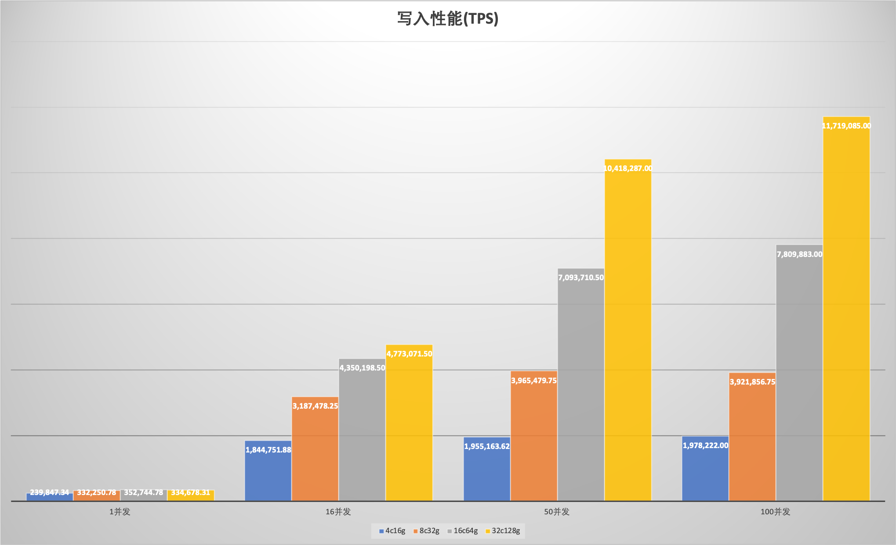

**表 1. 集群1（4核16GB \* 3节点）**

| batch | worker | tps | max_cpu |
| --- | --- | --- | --- |
| 1 | 1 | 4,846.48 | 36.68 |
| 1 | 16 | 36,862.15 | 78.50 |
| 1 | 50 | 31,653.44 | 73.46 |
| 1 | 100 | 31,521.71 | 74.32 |
| 1 | 200 | 31,651.03 | 73.03 |
| 50 | 1 | 126,462.85 | 65.43 |
| 50 | 16 | 460,032.75 | 79.89 |
| 50 | 50 | 457,791.78 | 81.50 |
| 50 | 100 | 457,956.53 | 82.69 |
| 50 | 200 | 434,573.47 | 81.18 |
| 100 | 1 | 168,643.80 | 74.14 |
| 100 | 16 | 468,008.25 | 84.09 |
| 100 | 50 | 470,608.31 | 84.34 |
| 100 | 100 | 451,384.44 | 83.32 |
| 100 | 200 | 457,740.22 | 84.61 |
| 200 | 1 | 205,046.31 | 74.77 |
| 200 | 16 | 480,309.56 | 84.74 |
| 200 | 50 | 489,903.34 | 86.73 |
| 200 | 100 | 484,745.44 | 86.77 |
| 200 | 200 | 475,824.97 | 86.55 |
| 500 | 1 | 239,847.34 | 74.76 |
| 500 | 16 | 511,989.50 | 87.86 |
| 500 | 50 | 544,544.75 | 88.23 |
| 500 | 100 | 543,131.56 | 88.12 |
| 500 | 200 | 528,027.12 | 88.57 |

**表 2. 集群2（8核32GB \* 3节点）**

| batch | worker | tps | max_cpu |
| --- | --- | --- | --- |
| 1 | 1 | 3,601.72 | 19.88 |
| 1 | 16 | 46,701.05 | 46.97 |
| 1 | 50 | 69,892.66 | 59.77 |
| 1 | 100 | 70,219.33 | 60.32 |
| 1 | 200 | 70,187.81 | 60.54 |
| 50 | 1 | 114,062.01 | 22.88 |
| 50 | 16 | 1,123,739.88 | 64.66 |
| 50 | 50 | 1,416,314.00 | 70.99 |
| 50 | 100 | 1,421,701.75 | 70.94 |
| 50 | 200 | 1,422,040.12 | 71.56 |
| 100 | 1 | 183,456.98 | 22.38 |
| 100 | 16 | 1,651,046.25 | 65.09 |
| 100 | 50 | 2,029,514.75 | 74.16 |
| 100 | 100 | 2,040,670.38 | 73.39 |
| 100 | 200 | 2,025,066.12 | 73.98 |
| 200 | 1 | 254,914.23 | 24.27 |
| 200 | 16 | 2,172,662.25 | 71.47 |
| 200 | 50 | 2,670,999.25 | 76.47 |
| 200 | 100 | 2,674,582.25 | 76.95 |
| 200 | 200 | 2,693,531.50 | 76.41 |
| 500 | 1 | 332,250.78 | 23.86 |
| 500 | 16 | 2,820,651.50 | 72.56 |
| 500 | 50 | 3,429,375.00 | 80.98 |
| 500 | 100 | 3,442,593.75 | 80.62 |
| 500 | 200 | 3,440,201.50 | 81.12 |

**表 3. 集群3（16核64GB \* 3节点）**

| batch | worker | tps | max_cpu |
| --- | --- | --- | --- |
| 1 | 1 | 3,897.79 | 8.97 |
| 1 | 16 | 58,217.44 | 27.30 |
| 1 | 50 | 127,110.89 | 50.49 |
| 1 | 100 | 165,754.09 | 62.31 |
| 1 | 200 | 202,844.20 | 70.72 |
| 50 | 1 | 136,378.39 | 11.77 |
| 50 | 16 | 1,634,203.88 | 41.92 |
| 50 | 50 | 2,773,785.75 | 58.96 |
| 50 | 100 | 3,363,458.25 | 67.87 |
| 50 | 200 | 3,703,033.00 | 74.14 |
| 100 | 1 | 198,375.67 | 10.35 |
| 100 | 16 | 2,494,268.00 | 45.86 |
| 100 | 50 | 4,007,320.25 | 60.87 |
| 100 | 100 | 4,753,680.50 | 69.29 |
| 100 | 200 | 5,095,771.00 | 75.17 |
| 200 | 1 | 278,253.53 | 10.57 |
| 200 | 16 | 3,368,596.50 | 45.48 |
| 200 | 50 | 5,214,060.50 | 64.57 |
| 200 | 100 | 6,040,166.50 | 72.35 |
| 200 | 200 | 6,283,312.00 | 77.07 |
| 500 | 1 | 352,744.78 | 10.80 |
| 500 | 16 | 4,281,761.50 | 47.17 |
| 500 | 50 | 6,544,214.00 | 71.73 |
| 500 | 100 | 7,267,295.50 | 77.15 |
| 500 | 200 | 7,290,116.00 | 83.91 |

**表 4. 集群4（32核128GB \* 3节点）**

| batch | worker | tps | max_cpu |
| --- | --- | --- | --- |
| 1 | 1 | 3,405.32 | 4.52 |
| 1 | 16 | 51,460.87 | 11.04 |
| 1 | 50 | 134,289.62 | 27.32 |
| 1 | 100 | 201,014.75 | 40.45 |
| 1 | 200 | 255,692.84 | 51.99 |
| 50 | 1 | 113,644.64 | 5.33 |
| 50 | 16 | 1,596,669.88 | 19.13 |
| 50 | 50 | 3,676,491.50 | 38.75 |
| 50 | 100 | 5,217,282.50 | 50.84 |
| 50 | 200 | 6,345,112.00 | 62.49 |
| 100 | 1 | 188,352.08 | 5.05 |
| 100 | 16 | 2,624,622.50 | 21.15 |
| 100 | 50 | 5,740,561.50 | 40.49 |
| 100 | 100 | 7,521,672.00 | 55.85 |
| 100 | 200 | 8,507,855.00 | 61.68 |
| 200 | 1 | 249,571.77 | 5.05 |
| 200 | 16 | 3,637,803.50 | 21.23 |
| 200 | 50 | 8,141,380.50 | 45.39 |
| 200 | 100 | 10,289,145.00 | 57.85 |
| 200 | 200 | 10,462,525.00 | 60.48 |
| 500 | 1 | 334,678.31 | 5.47 |
| 500 | 16 | 4,657,772.50 | 24.23 |
| 500 | 50 | 10,098,200.00 | 46.90 |
| 500 | 100 | 12,405,648.00 | 64.57 |
| 500 | 200 | 12,136,903.00 | 66.01 |

<a id="section-2-7-3"></a>

### 2.7.3. 查询测试结果

本章节介绍查询测试的结果对比。本测试是在发挥数据最佳性能，并在没有任何数据写入的情况下测得的结果。在不同时间线规模的业务场景，或同时存在大量写入的场景下，或查询扫描的时间线和时间点更多时，查询性能可能会下降，建议在使用前结合自己的业务场景进行测试评估，本测试结果仅供参考。

**查询的基础数据量**

- 设备数100

- 每个设备每10秒上报101个测量值

- 共上报1天的数据

**查询样例**

分别测试多种查询，queryType表示查询类型，分别介绍如下

- 1-host-1-hr-raw: 查询1个小时数据，1个设备，查找所有的cpu.usage_user的值

```sql
select time, usage_user from cpu where (hostname = 'host_17') and time >=1514837782646 and time < 1514841382646 ;
```

- 1-host-1-hr: 查询1个小时数据，1个设备，查找每分钟cpu.usage_user的最大值

```sql
select time, max(usage_user) as max_usage_user from cpu where (hostname = 'host_17') and time >=1514837782646 and time < 1514841382646 sample by 1m
```

- 1-host-12-hr-raw: 查询12个小时数据，1个设备，查找所有的cpu.usage_user的值

```sql
select time, usage_user from cpu where (hostname = 'host_0') and time >=1514787382646 and time < 1514830582646;
```

- 1-host-12-hr: 查询12小时数据，1个设备，查找每分钟cpu.usage_user的最大值

```sql
select time, max(usage_user) as max_usage_user from cpu where (hostname = 'host_0') and time >=1514787382646 and time < 1514830582646 sample by 1m ;
```

- 1-host-latest: 随机查找1个设备的cpu.usage_user的最新值

```sql
select  time, latest(usage_user) as latest_usage_user from cpu where (hostname = 'host_50') sample by 0
```

- 8-host-latest: 随机查找8个设备的cpu.usage_user的最新值

```sql
select  time, latest(usage_user) as latest_usage_user from cpu where (hostname = 'host_64' or hostname 
= 'host_80' or hostname = 'host_21' or hostname = 'host_5' or hostname = 'host_79' or hostname = 
'host_47' or hostname = 'host_25' or hostname = 'host_18') sample by 0
```

**测试性能指标说明**

介绍该测试中查询的性能指标。

- queryType： 参考上一节查询样例中的介绍

- worker：查询的并发数量

- qps：每秒执行完成的查询SQL数量

- max_cpu: CPU的峰值百分比

- max_mem: 内存的峰值百分比

**测试结果**

> **重要**
>
> 下述查询的性能测试结果均是在时序引擎无其他工作负载的情况下单独测得。

图 1. 并发为200的情况下，各个规格的3种查询下的QPS

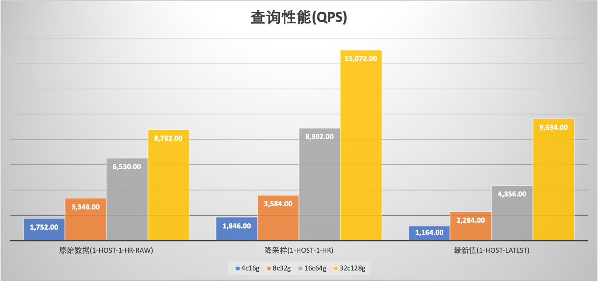

**表 1. 集群1（4核16GB \* 3节点）**

| queryType | worker | qps | max_cpu | max_mem |
| --- | --- | --- | --- | --- |
| 1-host-1-hr | 16 | 1,420.96 | 86.95 | 48.08 |
| 1-host-1-hr | 50 | 1,865.50 | 83.45 | 49.32 |
| 1-host-1-hr | 100 | 1,887.00 | 81.71 | 48.95 |
| 1-host-1-hr | 200 | 1,846.00 | 82.99 | 48.87 |
| 1-host-1-hr-raw | 16 | 1,324.80 | 79.54 | 50.34 |
| 1-host-1-hr-raw | 50 | 1,722.00 | 86.42 | 50.96 |
| 1-host-1-hr-raw | 100 | 1,737.00 | 86.36 | 50.92 |
| 1-host-1-hr-raw | 200 | 1,752.00 | 87.09 | 50.88 |
| 1-host-12-hr | 16 | 497.44 | 86.77 | 48.81 |
| 1-host-12-hr | 50 | 555.00 | 95.05 | 48.81 |
| 1-host-12-hr | 100 | 571.00 | 94.97 | 48.90 |
| 1-host-12-hr | 200 | 584.00 | 94.77 | 49.11 |
| 1-host-12-hr-raw | 16 | 286.56 | 82.20 | 51.04 |
| 1-host-12-hr-raw | 50 | 328.00 | 95.34 | 51.14 |
| 1-host-12-hr-raw | 100 | 330.00 | 96.51 | 51.21 |
| 1-host-12-hr-raw | 200 | 334.00 | 96.70 | 51.56 |
| 1-host-latest | 16 | 1,025.12 | 81.79 | 49.34 |
| 1-host-latest | 50 | 1,146.00 | 93.36 | 49.42 |
| 1-host-latest | 100 | 1,144.00 | 92.41 | 49.36 |
| 1-host-latest | 200 | 1,164.00 | 92.89 | 49.44 |
| 8-host-latest | 16 | 175.20 | 96.65 | 49.64 |
| 8-host-latest | 50 | 180.00 | 97.01 | 49.95 |
| 8-host-latest | 100 | 181.00 | 96.59 | 50.05 |
| 8-host-latest | 200 | 182.00 | 96.73 | 50.15 |

**表 2. 集群2（8核32GB \* 3节点）**

| queryType | worker | qps | max_cpu | max_mem |
| --- | --- | --- | --- | --- |
| 1-host-1-hr | 16 | 2,426.56 | 79.45 | 31.83 |
| 1-host-1-hr | 50 | 3,363.50 | 71.58 | 33.50 |
| 1-host-1-hr | 100 | 3,530.00 | 73.80 | 35.44 |
| 1-host-1-hr | 200 | 3,584.00 | 70.12 | 35.43 |
| 1-host-1-hr-raw | 16 | 2,181.92 | 52.67 | 36.10 |
| 1-host-1-hr-raw | 50 | 3,231.50 | 69.77 | 36.20 |
| 1-host-1-hr-raw | 100 | 3,371.00 | 72.88 | 36.19 |
| 1-host-1-hr-raw | 200 | 3,348.00 | 69.80 | 35.08 |
| 1-host-12-hr | 16 | 877.44 | 59.57 | 35.66 |
| 1-host-12-hr | 50 | 1,132.50 | 82.37 | 35.51 |
| 1-host-12-hr | 100 | 1,145.00 | 84.10 | 35.55 |
| 1-host-12-hr | 200 | 1,152.00 | 84.69 | 35.62 |
| 1-host-12-hr-raw | 16 | 445.44 | 58.55 | 35.29 |
| 1-host-12-hr-raw | 50 | 641.00 | 84.98 | 35.31 |
| 1-host-12-hr-raw | 100 | 668.00 | 90.79 | 35.35 |
| 1-host-12-hr-raw | 200 | 670.00 | 91.98 | 35.42 |
| 1-host-latest | 16 | 1,785.44 | 51.20 | 35.80 |
| 1-host-latest | 50 | 2,273.50 | 64.86 | 35.92 |
| 1-host-latest | 100 | 2,280.00 | 64.97 | 35.82 |
| 1-host-latest | 200 | 2,284.00 | 65.01 | 35.85 |
| 8-host-latest | 16 | 439.04 | 85.04 | 35.98 |
| 8-host-latest | 50 | 471.50 | 91.71 | 36.00 |
| 8-host-latest | 100 | 472.00 | 92.42 | 36.08 |
| 8-host-latest | 200 | 470.00 | 93.10 | 36.09 |

**表 3. 集群3（16核64GB \* 3节点）**

| queryType | worker | qps | max_cpu | max_mem |
| --- | --- | --- | --- | --- |
| 1-host-1-hr | 16 | 3,287.84 | 49.77 | 25.83 |
| 1-host-1-hr | 50 | 6,543.50 | 56.06 | 26.45 |
| 1-host-1-hr | 100 | 7,713.00 | 59.81 | 26.48 |
| 1-host-1-hr | 200 | 8,902.00 | 75.23 | 26.47 |
| 1-host-1-hr-raw | 16 | 2,857.60 | 32.42 | 26.89 |
| 1-host-1-hr-raw | 50 | 5,173.00 | 50.44 | 26.96 |
| 1-host-1-hr-raw | 100 | 6,177.00 | 56.88 | 26.95 |
| 1-host-1-hr-raw | 200 | 6,530.00 | 59.20 | 26.98 |
| 1-host-12-hr | 16 | 1,148.48 | 38.69 | 26.52 |
| 1-host-12-hr | 50 | 1,920.50 | 71.18 | 26.57 |
| 1-host-12-hr | 100 | 2,181.00 | 82.79 | 26.62 |
| 1-host-12-hr | 200 | 2,398.00 | 91.44 | 26.64 |
| 1-host-12-hr-raw | 16 | 539.20 | 33.78 | 27.04 |
| 1-host-12-hr-raw | 50 | 704.50 | 46.87 | 27.12 |
| 1-host-12-hr-raw | 100 | 612.00 | 41.76 | 27.17 |
| 1-host-12-hr-raw | 200 | 694.00 | 46.89 | 27.24 |
| 1-host-latest | 16 | 2,141.60 | 40.24 | 26.69 |
| 1-host-latest | 50 | 3,602.00 | 77.84 | 26.69 |
| 1-host-latest | 100 | 4,098.00 | 91.87 | 26.72 |
| 1-host-latest | 200 | 4,356.00 | 94.94 | 26.71 |
| 8-host-latest | 16 | 541.28 | 81.87 | 26.77 |
| 8-host-latest | 50 | 599.50 | 97.52 | 26.77 |
| 8-host-latest | 100 | 648.00 | 97.85 | 26.88 |
| 8-host-latest | 200 | 832.00 | 97.40 | 26.94 |

**表 4. 集群4（32核128GB \* 3节点）**

| queryType | worker | qps | max_cpu | max_mem |
| --- | --- | --- | --- | --- |
| 1-host-1-hr | 16 | 3,543.04 | 24.25 | 28.33 |
| 1-host-1-hr | 50 | 9,351.00 | 34.14 | 28.89 |
| 1-host-1-hr | 100 | 12,567.00 | 46.42 | 28.92 |
| 1-host-1-hr | 200 | 15,072.00 | 57.27 | 28.94 |
| 1-host-1-hr-raw | 16 | 2,811.20 | 15.41 | 29.11 |
| 1-host-1-hr-raw | 50 | 6,086.50 | 27.85 | 29.13 |
| 1-host-1-hr-raw | 100 | 7,881.00 | 36.44 | 29.14 |
| 1-host-1-hr-raw | 200 | 8,762.00 | 40.97 | 29.17 |
| 1-host-12-hr | 16 | 1,394.24 | 18.85 | 28.91 |
| 1-host-12-hr | 50 | 3,317.50 | 49.89 | 28.96 |
| 1-host-12-hr | 100 | 4,160.00 | 67.13 | 28.96 |
| 1-host-12-hr | 200 | 4,808.00 | 79.02 | 28.96 |
| 1-host-12-hr-raw | 16 | 542.56 | 17.31 | 29.22 |
| 1-host-12-hr-raw | 50 | 826.50 | 24.96 | 29.24 |
| 1-host-12-hr-raw | 100 | 669.00 | 23.55 | 29.28 |
| 1-host-12-hr-raw | 200 | 772.00 | 24.86 | 29.32 |
| 1-host-latest | 16 | 2,600.00 | 16.04 | 28.97 |
| 1-host-latest | 50 | 6,590.00 | 46.11 | 28.98 |
| 1-host-latest | 100 | 8,516.00 | 65.60 | 28.99 |
| 1-host-latest | 200 | 9,634.00 | 75.93 | 28.98 |
| 8-host-latest | 16 | 949.12 | 55.91 | 29.03 |
| 8-host-latest | 50 | 1,525.50 | 83.49 | 29.04 |
| 8-host-latest | 100 | 1,710.00 | 93.16 | 29.06 |
| 8-host-latest | 200 | 1,758.00 | 95.54 | 29.09 |

<a id="section-2-8"></a>

## 2.8. TSQL语法介绍

<a id="section-2-8-1"></a>

### 2.8.1. 名词解释

| 名词 | 描述 |
| --- | --- |
| Table | 代表一系列同类时序数据的集合，例如为空气质量传感器建立一个表，存储所有传感器的监测数据。 |
| Time | 描述数据源采集的数据的时间，支持精度为ms。 |
| Tag | 描述数据源的特征，通常不随时间变化，例如传感器设备，包含设备（Deviceld）、设备所在的地域（Region）等Tag信息，数据库内部会自动为Tag建立索引，支持根据Tag来进行多维检索查询。Tag只支持String类型，必须在建表时指定。 |
| Field | 描述数据源的量测指标，通常随着时间不断变化，例如传感器设备包含温度（Temperature）、湿度（Humidity）等Field。 |

<a id="section-2-8-2"></a>

### 2.8.2. 数据类型

| 数据类型 | 描述 |
| --- | --- |
| double | 数值类型。 |
| varchar | 字符串类型。 |
| boolean | 布尔类型，true或false。 |
| time | 时间类型，目前仅支持单位为ms的正整数。 |

<a id="section-2-8-3"></a>

### 2.8.3. DDL

<a id="section-2-8-3-1"></a>

#### 2.8.3.1. CREATE TABLE

创建表。

**语法**

```text
create_table_statement ::= CREATE TABLE table_name '('
                              tag_definition
                              ( ',' tag_definition )*
                              ( ',' time_definition)?
                              ( ',' field_definition )*
                              ')'
tag_definition         ::= tag_name VARCHAR TAG
time_definition        ::= time BIGINT
field_definition       ::= field_name TYPE
```

**说明**

| 参数 | 说明 |
| --- | --- |
| <code>tag_definition</code> | 定义表格的Tag，必须使用TAG来指定，否则被识别为FIELD，数据类型为VARCHAR。 |
| <code>time</code> | 定义时间列，支持精度ms，数据类型为BIGINT。 |
| <code>field_name</code> | 定义Field，数据类型为DOUBLE、VARCHAR或BOOLEAN。 |

- 写入数据前，需要提前创建表。

- 需要提前指定Tag列表，目前不支持后续修改。

- time和field_name可以不提前指定，数据写入时系统将根据最近写入的数据自动创建和调整类型。

**示例**

创建名为sensor的表，拥有device_id和region两个Tag，以及temperature和humidity两个Field。

```sql
CREATE TABLE sensor (
    device_id VARCHAR TAG,
    region VARCHAR TAG,
    time BIGINT,
    temperature DOUBLE,
    humidity DOUBLE);
```

<a id="section-2-8-3-2"></a>

#### 2.8.3.2. SHOW TABLES

查询表信息。

**语法**

```text
show_tables_statement ::= SHOW TABLES
```

**示例**

```text
> show tables;
+-------------+------------+
| tableSchem  | tableName  |
+-------------+------------+
| default     | sensor     |
| metadata    | COLUMNS    |
| metadata    | TABLES     |
+-------------+------------+
3 rows selected (0.064 seconds)
```

<a id="section-2-8-3-3"></a>

#### 2.8.3.3. DESCRIBE TABLE

查询表的Schema。

**语法**

```text
describe_table_statement ::= DESCRIBE TABLE table_name
```

**示例**

```text
> describe table sensor;
+--------------+-----------+
|  columnName  | typeName  |
+--------------+-----------+
| device_id    | VARCHAR   |
| region       | VARCHAR   |
| time         | BIGINT    |
| temperature  | DOUBLE    |
| humidity     | DOUBLE    |
+--------------+-----------+
5 rows selected (0.075 seconds)
```

<a id="section-2-8-4"></a>

### 2.8.4. DML

<a id="section-2-8-4-1"></a>

#### 2.8.4.1. SELECT

本文介绍SELECT的使用方法。

**语法**

```text
select_statement ::=  SELECT ( select_clause | '*' )
                      FROM table_name
                      WHERE where_clause
                      [ SAMPLE BY time_interval [ FILL fill_option ] ]
                      [ GROUP BY group_by_clause ]
                      [ ORDER BY ordering_clause ]
                      [ LIMIT integer [ OFFSET integer ] ]
select_clause    ::=  selector [ AS identifier ] ( ',' selector [ AS identifier ] )
selector         ::=  tag_name
                      | field_name
                      | function_name '(' [ selector ( ',' selector )* ] ')'
                      | COUNT '(' '*' ')'
where_clause     ::=  relation ( ( AND | OR ) relation )*
relation         ::=  ( field_name | tag_name ) operator term
operator         ::=  '=' | '<' | '>' | '<=' | '>=' | '!=' | IN | CONTAINS | CONTAINS KEY
group_by_clause  ::=  field_name ( ',' field_name )*
ordering_clause  ::=  field_name [ ASC | DESC ] ( ',' field_name [ ASC | DESC ] )*
```

**说明**

- 查询条件需要带上时间范围： `time > xxx and time < xxx` 。

- 目前limit是后过滤，效率不高，建议您增加限制条件减少扫描的数据量。

**示例**

- 统计设备ID `1234ABC` 一段时间内的所有条数：

  ```text
  > select count(*) from sensor where device_id = '1234ABC' and time >= 1619076780000 and time <= 1619076800000;
  +---------+
  | EXPR$0  |
  +---------+
  | 5       |
  +---------+
  1 row selected (0.088 seconds)
  ```

- 查询设备ID `1234ABC` 在一段时间内的所有测点：

  ```text
  > select * from sensor where device_id = '1234ABC' and time >= 1619076780000 and time <= 1619076800000;
  +------------+-----------+----------------+--------------+-----------+
  | device_id  |  region   |      time      | temperature  | humidity  |
  +------------+-----------+----------------+--------------+-----------+
  | 1234ABC   | north-cn  | 1619076780000  | 12.1         | 45        |
  | 1234ABC   | north-cn  | 1619076790000  | 13.2         | 47        |
  | 1234ABC   | north-cn  | 1619076800000  | 10.6         | 46        |
  +------------+-----------+----------------+--------------+-----------+
  3 rows selected (0.222 seconds)
  ```

- 查询设备ID `1234ABC` 在一段时间内的温度和湿度：

  ```text
  > select region,time,temperature,humidity from sensor where device_id = '1234ABC' and time >= 1619076780000 and time <= 1619076800000;
  +-----------+----------------+--------------+-----------+
  |  region   |      time      | temperature  | humidity  |
  +-----------+----------------+--------------+-----------+
  | north-cn  | 1619076780000  | 12.1         | 45        |
  | north-cn  | 1619076790000  | 13.2         | 47        |
  | north-cn  | 1619076800000  | 10.6         | 46        |
  +-----------+----------------+--------------+-----------+
  3 rows selected (0.092 seconds)
  ```

- 查询设备ID `1234ABC` 在一段时间内的最大温度：

  ```text
  > select max(temperature) from sensor where device_id = '1234ABC' and time >= 1619076780000 and time 
  <= 1619076800000;
  +---------+
  | EXPR$0  |
  +---------+
  | 13.2    |
  +---------+
  1 row selected (0.136 seconds)
  ```

<a id="section-2-8-4-2"></a>

#### 2.8.4.2. 降采样

**语法**

```text
select_sample_by_statement ::=  SELECT ( select_clause | '*' )
                                FROM table_name
                                WHERE where_clause
                                SAMPLE BY time_interval [ FILL fill_option ]
select_clause              ::=  selector [ AS identifier ] ( ',' selector [ AS identifier ] )
selector                   ::=  tag_name | time | function_name '(' field_name [ ',' function_args ] 
')'
where_clause               ::=  relation ( AND relation )* (OR relation)*
relation                   ::=  ( field_name | tag_name ) operator term
operator                   ::=  '=' | '<' | '>' | '<=' | '>=' | '!=' | IN | CONTAINS | CONTAINS KEY
time_interval              ::= interval units
```

**说明**

<table>
  <tr>
    <th width="122">参数</th>
    <th>说明</th>
  </tr>
  <tr>
    <td><code>interval</code></td>
    <td>数值，例如5、60等，特殊的<code> 0all </code>表示时间维度聚合为一个点。</td>
  </tr>
  <tr>
    <td><code>units</code></td>
    <td><code> s </code>代表秒，<code> m </code>代表分，<code> h </code>代表小时，<code> d </code>代表天，<code> n </code>代表月，<code> y </code>代表年。<br>Lindorm支持基于日历时间间隔的降采样。如果要使用日历界限，您需要在时间单位说明units后添加一个<code> c </code>。例如，<code> 1dc </code>代表从当日零点到次日零点之间的24小时。</td>
  </tr>
</table>

降采样查询对于每条时间线（关于时间线概念，请参见名词解释）按照sample by指定的时间进行降精度。

插值：对于降采样后无数据的时间点进行插值，支持的差值策略参见附表二：插值函数表。

**示例**

SELECT查询指定的tag列无需指定降采样函数，其他field列必须制定降采样函数。支持的降采样函数参见附表一：降采样聚合算子表。如：

```sql
select device_id,region,time,avg(temperature) from sensor where device_id = 'F07A1260' and time >= 1619076780000 and time <= 1619076800000 sample by 20s;
```

sample by目前不支持与group by和limit offset配合。但可以配合子查询一起使用：

```text
> select region, max(avg_temperature) from (select device_id,region,time,avg(temperature) as avg_temperature from sensor where time >= 1619076780000 and time <= 1619076800000 sample by 20s) group by region;
+-----------+---------------------+
|  region   |       EXPR$1        |
+-----------+---------------------+
| north-cn  | 12.649999999999999  |
| south-cn  | 18.9                |
+-----------+---------------------+
2 rows selected (0.036 seconds)
```

配合limit offset，注意目前limit offset没有下推优化，尽量使用条件限制数据量。

```text
> select device_id,region, avg_temperature from (select device_id,region,time,avg(temperature) as avg_temperature from sensor where time >= 1619076780000 and time <= 1619076800000 sample by 20s) limit 1 offset 1;
+------------+-----------+------------------+
| device_id  |  region   | avg_temperature  |
+------------+-----------+------------------+
| F07A1260   | north-cn  | 10.6             |
+------------+-----------+------------------+
1 row selected (0.035 seconds)
```

固定值插值：

```text
> select device_id,region,time,avg(temperature) from sensor where time >= 1619076780000 and time <= 1619076800000 sample by 20s fill 1;
+------------+-----------+----------------+---------------------+
| device_id  |  region   |      time      |       EXPR$3        |
+------------+-----------+----------------+---------------------+
| F07A1260   | north-cn  | 1619076780000  | 12.649999999999999  |
| F07A1260   | north-cn  | 1619076800000  | 10.6                |
| F07A1260   | north-cn  | 1619076820000  | 1.0                 |*
| F07A1261   | south-cn  | 1619076780000  | 18.9                |
| F07A1261   | south-cn  | 1619076800000  | 1.0                 |*
| F07A1261   | south-cn  | 1619076820000  | 1.0                 |*
+------------+-----------+----------------+---------------------+
```

使用前值插值：

```text
> select device_id,region,time,avg(temperature) from sensor where time >= 1619076780000 and time <= 1619076800000 sample by 20s fill previous;
+------------+-----------+----------------+---------------------+
| device_id  |  region   |      time      |       EXPR$3        |
+------------+-----------+----------------+---------------------+
| F07A1260   | north-cn  | 1619076780000  | 12.649999999999999  |
| F07A1260   | north-cn  | 1619076800000  | 10.6                |
| F07A1260   | north-cn  | 1619076820000  | 10.6                |*
| F07A1261   | south-cn  | 1619076780000  | 18.9                |
| F07A1261   | south-cn  | 1619076800000  | 18.9                |*
| F07A1261   | south-cn  | 1619076820000  | 18.9                |*
+------------+-----------+----------------+---------------------+
```

rfirst，rlast，rmin或rmax不支持插值。

**附表一：降采样聚合算子表**

<table>
  <tr>
    <th width="89">算子</th>
    <th>描述</th>
  </tr>
  <tr>
    <td>avg</td>
    <td>平均值</td>
  </tr>
  <tr>
    <td>count</td>
    <td>数据点数</td>
  </tr>
  <tr>
    <td>first</td>
    <td>取第一个值</td>
  </tr>
  <tr>
    <td>last</td>
    <td>取最后一个值</td>
  </tr>
  <tr>
    <td>min</td>
    <td>最小值</td>
  </tr>
  <tr>
    <td>max</td>
    <td>最大值</td>
  </tr>
  <tr>
    <td>median</td>
    <td>求中位数</td>
  </tr>
  <tr>
    <td>sum</td>
    <td>求和</td>
  </tr>
  <tr>
    <td>zimsum</td>
    <td>求和</td>
  </tr>
  <tr>
    <td>rfirst</td>
    <td>功能与<code> first </code>相同。<br>但降采样后返回的结果的时间戳是原始数据的时间戳；而非降采样对齐后的时间戳。</td>
  </tr>
  <tr>
    <td>rlast</td>
    <td>功能与<code> last </code>相同。<br>但降采样后返回的结果的时间戳是原始数据的时间戳；而非降采样对齐后的时间戳。</td>
  </tr>
  <tr>
    <td>rmin</td>
    <td>功能与<code> min </code>相同。<br>但降采样后返回的结果的时间戳是原始数据的时间戳；而非降采样对齐后的时间戳。</td>
  </tr>
  <tr>
    <td>rmax</td>
    <td>功能与<code> max </code>相同。<br>但降采样后返回的结果的时间戳是原始数据的时间戳；而非降采样对齐后的时间戳。</td>
  </tr>
</table>

**附表二：插值函数表**

| Fill Policy | 填充值 |
| --- | --- |
| none | 默认行为，不填值。 |
| nan | NaN |
| null | null |
| zero | 0 |
| linear | 线性填充值 |
| previous | 之前的一个值 |
| near | 邻近的一个值 |
| after | 之后的一个值 |
| fixed | 用指定的一个固定填充值 |

<a id="section-2-8-4-3"></a>

#### 2.8.4.3. 最新值

本文介绍查询最新值查询的语法和使用方法。

**语法**

```text
select_sample_by_statement ::=  SELECT ( select_clause | '*' )
                                FROM table_name
                                WHERE where_clause
select_clause              ::=  selector [ AS identifier ] ( ',' selector [ AS identifier ] )
selector                   ::=  tag_name | time | latest '(' field_name [ ',' integer ] ')'
where_clause               ::=  relation ( AND relation )* (OR relation)*
relation                   ::=  ( field_name | tag_name ) operator term
operator                   ::=  '=' | '<' | '>' | '<=' | '>=' | '!=' | IN | CONTAINS | CONTAINS KEY
```

**说明**

最新值查询用于查询匹配时间线的最新时间点的值，支持查询最新的N条数据： `latest(field_name, N)` 。

**示例**

查询设备 `1234ABC` 和 `1234ABB` 的最新温度和湿度：

```sql
select device_id,region,time,latest(temperature) as temperature,latest(humidity) as humidity from sensor where device_id in ('1234ABC', '1234ABB') and  time >= 1619076780000 and time <= 1619076800000;
```

返回结果：

```text
+------------+-----------+----------------+--------------+-----------+
| device_id  |  region   |      time      | temperature  | humidity  |
+------------+-----------+----------------+--------------+-----------+
| 1234ABC   | north-cn  | 1619076800000  | 10.6         | 46        |
| 1234ABB   | south-cn  | 1619076790000  | 19.7         | 44        |
+------------+-----------+----------------+--------------+-----------+
```

查询设备 `1234ABC` 和 `1234ABB` 的最新的两条温度和湿度测点：

```sql
select device_id,region,time,latest(temperature,2) as temperature,latest(humidity) as humidity from sensor where device_id in ('1234ABC', '1234ABB') and  time >= 1619076780000 and time <= 1619076800000;
```

返回结果：

```text
+------------+-----------+----------------+--------------+-----------+
| device_id  |  region   |      time      | temperature  | humidity  |
+------------+-----------+----------------+--------------+-----------+
| 1234ABC   | north-cn  | 1619076790000  | 13.2         | 47        |
| 1234ABC   | north-cn  | 1619076800000  | 10.6         | 46        |
| 1234ABB   | south-cn  | 1619076780000  | 18.1         | 44        |
| 1234ABB   | south-cn  | 1619076790000  | 19.7         | 44        |
+------------+-----------+----------------+--------------+-----------+
```

> **说明**
>
> - 最新值查询不能与GROUP BY、LIMIT、OFFSET使用，但可以使用子查询的方式配合使用。
>
> - 最新值查询不能与降采样一起使用。

当查询多个Field时，如果某一个时间点、某一个Field没有值，则默认为null，如：

```sql
select device_id,region,time,latest(temperature,2) as temperature,latest(humidity) as humidity from sensor where device_id in ('1234ABC', '1234ABB') and  time >= 1619076780000 and time <= 1619076800000;
```

返回结果：

```text
+------------+-----------+----------------+--------------+-----------+
| device_id  |  region   |      time      | temperature  | humidity  |
+------------+-----------+----------------+--------------+-----------+
| 1234ABC   | north-cn  | 1619076790000  | 13.2         | 47        |
| 1234ABC   | north-cn  | 1619076800000  |              | 46        | *
| 1234ABB   | south-cn  | 1619076780000  | 18.1         |           | *
| 1234ABB   | south-cn  | 1619076790000  | 19.7         | 44        |
+------------+-----------+----------------+--------------+-----------+
```

<a id="section-2-8-4-4"></a>

#### 2.8.4.4. INSERT

数据写入。

**语法**

```text
create_table_statement ::= insert into table_name'('
                              tag_name
                              (',' tag_name)* 
                              ',' time ','
                              field_name
                              (',' field_name)*
                           ')' values
                           ('('
                              tag_value
                              (',' tag_value)*
                              ',' time_value ','
                              field_value
                              (',' tag_value)*
                           ')')+
```

**说明**

<table>
  <tr>
    <th width="141">参数</th>
    <th>说明</th>
  </tr>
  <tr>
    <td><code>tag_name</code></td>
    <td>写入数据的Tag名称，与CREATE TABLE所指定的Tag对应，CREATE TABLE所指定的Tag列表必须都出现。必选。</td>
  </tr>
  <tr>
    <td><code>time</code></td>
    <td>写入数据的时间，单位ms，仅支持正整数，必选。</td>
  </tr>
  <tr>
    <td><code>field_name</code></td>
    <td>写入数据的列名，数据类型尽量与CREATE TABLE保持一致。否则以最新写入的数据为准。当某列未指定时，默认为null。</td>
  </tr>
</table>

**示例**

- 单条依次写入：

  ```sql
  insert into sensor (device_id, region, time, temperature, humidity) values('F07A1260','north-cn',1619076780000,12.1,45);
  insert into sensor (device_id, region, time, temperature, humidity) values('F07A1260','north-cn',1619076790000,13.2,47);
  insert into sensor (device_id, region, time, temperature, humidity) values('F07A1260','north-cn',1619076800000,10.6,46);
  insert into sensor (device_id, region, time, temperature, humidity) values('F07A1261','south-cn',1619076780000,18.1,44);
  insert into sensor (device_id, region, time, temperature, humidity) values('F07A1261','south-cn',1619076790000,19.7,44);
  ```

- 批量写入：

  ```sql
  insert into sensor (device_id, region, time, temperature, humidity) values
      ('F07A1260','north-cn',1619076780000,12.1,45),
      ('F07A1260','north-cn',1619076790000,13.2,47),
      ('F07A1260','north-cn',1619076800000,10.6,46),
      ('F07A1261','south-cn',1619076780000,18.1,44),
      ('F07A1261','south-cn',1619076790000,19.7,44);
  ```

<a id="section-2-9"></a>

## 2.9. HTTP API参考

<a id="section-2-9-1"></a>

### 2.9.1. HTTP API 概览

时序引擎实例支持通过 HTTP 协议进行数据写入和查询等操作。

时序引擎提供了一个基于 HTTP 的应用程序编程接口，以便与外部系统集成。几乎所有时序引擎的特性都可以通过 API 来访问，比如查询时间序列数据、管理元数据和存储数据点。时序引擎 的 HTTP API 本质上是 RESTful 的，同时也提供了替代访问策略，因为不是所有 client 都可以遵循严格的 REST 协议。默认数据交换是通过 JSON。所有返回的结果都使用标准的HTTP 响应代码，并使用特定的格式返回错误。下表列出了时序引擎提供的与数据读写和管理相关的所有 API。关于如何使用每个 API 的具体说明，请单击描述中提供的链接查看相应文档。

| API | 描述 |
| --- | --- |
| /api/put | 单值数据写入 |
| /api/query | 单值数据查询 |
| /api/query/last | 单值查询时间线最新数据点 |
| /api/mput | 多值数据写入 |
| /api/mquery | 多值数据查询 |
| /api/query/mlast | 多值查询最新数据点 |
| /api/suggest | 查询Metric, Field, TagK, TagV |
| /api/dump_meta | 查询Tagk下的Tagv |
| /api/ttl | 设置数据时效 |
| /api/delete_data | 删除数据 |

<a id="section-2-9-2"></a>

### 2.9.2. 调用方式

<a id="section-2-9-2-1"></a>

#### 2.9.2.1. 请求结构

本文介绍时序引擎API的请求结构。

**时序引擎实例访问链接**

时序引擎实例地址在实例详情页可以查到， 例如“ts-xxx.hitsdb.rds.aliyuncs.com:8242”。

**通信协议**

支持通过 HTTP 通道进行请求通信。

**请求方法**

时序引擎支持 HTTP POST 方法发送请求。

**请求路径**

每个请求必须指定请求的 API 路径，即通过 API 要执行的具体操作，例如 `/api/delete_data`  。

**请求参数**

时序引擎的写入类请求可以指定请求参数，通过请求参数确定写入请求的返回内容和写入超时时间。

**请求内容**

时序引擎的请求需要指定请求内容，通过请求内容确定要访问的数据和要进行的操作。

**请求标准**

时序引擎的 HTTP API 本质上是 RESTful 的，也就是说需要 HTTP method/verb 来决定一个操作行为，来遵循 REST 风格。例如，GET 请求应该只返回数据，PUT 或 POST 应该修改数据，DELETE 应该删除数据。

然而，在某些情况下，如 DELETE 和 PUT 等动词会被防火墙、代理过滤，或未在客户端中实现。此外，大多数开发人员习惯于使用 GET 和 POST。因此，时序引擎 API 支持通过添加查询字符串参数 method_override 来替代 HTTP methods/verbs。这个参数允许客户端通过 query string 调用大部分 API，而不是 HTTP Content Body。例如，您可以通过这个查询字符串来替代 GET 删除数据/api/delete_meta?m=cpu.usage&method_override=delete。HTTP methods/verbs 和对应的 overrides 如下表所示。

| HTTP METHOD | 描述 | 替代参数 |
| --- | --- | --- |
| GET | 获取数据 | N/A |
| POST | 提交数据 | method_override=post |
| PUT | 覆盖数据 | method_override=put |
| DELETE | 删除数据 | method_override=delete |

<a id="section-2-9-2-2"></a>

#### 2.9.2.2. 返回结果

每个请求都会返回一个标准的 HTTP 响应状态码。大多数请求响应会还会包含响应内容，尤其是 “失败响应” 会返回具体错误信息内容。

**请求成功**

请求成功会返回对应的成功状态码，有数据的会返回请求数据。不同的 API 请求返回的数据内容和格式不同，请查阅数据写入和数据查询。

**请求失败**

如果错误发生，API 将为各个错误返回一个对应格式化的 JSON 对象。该对象包含的字段如下表所示：

| 字段名 | 类型 | 是否必选 | 描述 | 举例 |
| --- | --- | --- | --- | --- |
| code | Integer | Yes | HTTP 返回状态码 | 400 |
| message | String | Yes | 错误简述 | Missing required parameter |
| details | String | Optional | 错误详细描述 | Missing value: type |

所有错误将返回一个 HTTP 的状态码和一个包含错误详情的响应内容。

失败响应示例如下：

```text
1. {
2.    "error": {
3.        "code": 400,
4.        "message": "Missing parameter <code>type</code>"
5.    }
6.  }
```

<a id="section-2-9-2-3"></a>

#### 2.9.2.3. 签名机制

本文介绍时序引擎的签名机制。

到目前为止，和 OpenTSDB 协议一样，时序引擎缺乏一个身份验证和访问控制系统。因此，访问数据读写 API 时不需要进行身份验证。但是在阿里云上，时序引擎提供专有网络 (VPC) 的网络隔离来保证数据的安全性。同时，也支持 IP 白名单的访问控制来保证细粒度的安全。

<a id="section-2-9-3"></a>

### 2.9.3. 单值写入操作

<a id="section-2-9-3-1"></a>

#### 2.9.3.1. 单值数据写入

**请求路径和方法**

| 请求路径 | 请求方法 | 描述 |
| --- | --- | --- |
| /api/put | POST | 一次写入多个数据点。 |

**请求参数**

| 名称 | 类型 | 是否必需 | 描述 | 默认值 | 举例 |
| --- | --- | --- | --- | --- | --- |
| summary | 无类型 | 否 | 是否返回摘要信息 | false | /api/put? summary |
| details | 无类型 | 否 | 是否返回详细信息 | false | /api/put?details |
| sync_timeout | Integer | 否 | 超时时间，单位毫秒，0为永不超时 | 0 | /api/put/? sync&amp;sync_time out=60000 |

> **重要**
>
> - 所有“无类型”的参数，只要提供，都被视为 true，比如 summary=false 以及 summary=true 都被当做summary=true。
>
> - 如果 details 和 summary 都设置，API 将返回 details 信息。

**请求内容**

数据点格式为 JSON 格式，各参数说明如下：

| 名称 | 类型 | 是否必需 | 是否有使用限制 | 描述 | 举例 |
| --- | --- | --- | --- | --- | --- |
| metric | String | 是 | 只可包含大小写英文字母、中文、数字，以及特殊字符 -_./():,\[\]=‘# | 存储的指标名 | sys.cpu |
| timestamp | Long | 是 | 无 | 时间戳；单位为秒或者毫秒，判断规则详见下面的时间戳说明。 | 1499158925 |
| value | Long,Double,Stri ng,Boolean | 是 | 无 | 数据点值 | 42.5, true |
| tags | Map | 否 | 可以包含大小写英文字母、中文、数字，以及特殊字符 -_./():,\[\]=‘# | Tagk 和 Tagv 是字符串键值对，至少一个键值对 | {“host”:”web01”}，非字符串类型的tagk，tagv会强制转换为字符串类型 |

时间戳说明如下：

本说明适用于读写数据（/api/put）和查询数据（api/query） 两个接口。时间戳的单位可以是秒或者毫秒。时序引擎可以通过数值大小来判断时间戳的单位，规则如下：

- 时间戳区间为 [4294768,9999999999]: 判断为秒，表示的时间区间为: [1970-02-20 00:59:28, 2286-11-21 01:46:39]。

- 时间戳区间为 [10000000000,9999999999999]：判断为毫秒，表示的时间区间为: [1970-04-27 01:46:40.000, 2286-11-21 01:46:39.999]。

- 时间戳区间为 （-∞,4294768）和（9999999999999,+∞）：判断为非法时间戳区间。

数据点值说明如下：

在写入数据类型的约束方面，采用metric的方式限定数据类型。比如下述两批次的写入是被允许的。这是因为两批次数据虽然都包含不相同的etric，因此允许写入不同的数据类型。

```text
1.  [{"metric":"fakemetric1", "tags":{"tagk":"tagv1"},"timestamp":1514736000, "value":"val"}, {"metric":"fakemetric1", "tags":{"tagk":"tagv1"},"timestamp":1514736030, "value":"val2"}]
2.  [{"metric":"fakemetric2", "tags":{"tagk":"tagv2"},"timestamp":1514736000, "value":12.34}, {"metric":"fakemetric2", "tags":{"tagk":"tagv2"},"timestamp":1514736030, "value":34.56}]
```

String数值类型的数据值可以为任意字符，支持JSON字符串存储，最大为20KB。

Tags说明如下：

向一条时间线写入数据时，其Tagkey的个数存在上限。根据时序引擎实例规格不同，Tagkey的个数上限如下所示：

| 实例规格 | 单时间线 Tagkey 数上限（个） |
| --- | --- |
| mLarge | 16 |
| Large | 16 |
| 3xLarge | 20 |
| 4xLarge | 20 |
| 6xLarge | 20 |
| 12xLarge | 20 |
| 24xLarge | 24 |
| 48xLarge | 24 |
| 96xLarge | 24 |

**写入数据示例**

请求： `POST /api/put`

请求体：

```text
1. [
2.    {
3.        "metric": "sys.cpu.nice",
4.        "timestamp": 1346846400,
5.        "value": 18,
6.        "tags": {
7.           "host": "web01",
8.           "dc": "lga"
9.        }
10.    },
11.    {
12.        "metric": "sys.cpu.nice",
13.        "timestamp": 1346846400,
14.        "value": 9,
15.        "tags": {
16.           "host": "web02",
17.           "dc": "lga"
18.        }
19.    },
20.    {
21.        "metric": "sys.cpu.alter",
22.        "timestamp": 1346846400,
23.        "value": "High CPU Load",
24.        "tags": {
25.           "host": "web03",
26.           "dc": "lga"
27.        }
28.    },
29.    {
30.        "metric": "sys.cpu.nice",
31.        "timestamp": 1346846400,
32.        "value": true,
33.        "tags": {
34.           "host": "web04",
35.           "dc": "lga"
36.        }
37.    }
38. ]
```

**响应说明**

如果所有数据点写入成功，返回码为204，如果有部分写入失败，返回码400，响应内容为具体错误信息。如果请求参数包含summary 或者 details，返回信息包括如下属性：

| 名称 | 数据类型 | 描述 |
| --- | --- | --- |
| success | Integer | 写入成功的数据点数 |
| failed | Integer | 未写入的数据点数 |
| 无 | Array | 一个描述哪些数据点未写入以及其原因的数组，仅在指定 details 有效。 |

响应示例

指定 summary 的响应示例：

请求： `POST /api/put?summary`

请求体：

```text
1. [
2.    {
3.        "metric": "sys.cpu.nice",
4.        "timestamp": 1346846400,
5.        "value": 9,
6.        "tags": {
7.           "host": "web02",
8.           "dc": "lga"
9.        }
10.  }
11. ]
```

响应内容：

```text
1.   {
2.        "failed": 1,
3.        "success": 0
4.    }
```

表示0个点写入成功，1个点写入失败。

**指定 details 的返回示例：**

请求： `POST /api/put?details`

请求体：

```text
1.    [
2.        {
3.                      "metric": "sys.cpu.nice",
4.                      "timestamp": 1365465600,
5.                      "value": "NaN",
6.                      "tags": {
7.                          "host": "web01"
8.                      }
9.        }
10.    ]
```

响应内容：

```text
1.    {
2.        "errors": [
3.            {
4.                "datapoint": {
5.                    "metric": "sys.cpu.nice",
6.                    "timestamp": 1365465600,
7.                    "value": "NaN",
8.                    "tags": {
9.                        "host": "web01"
10.                    }
11.                },
12.                "error": "Unable to parse value to a number"
13.            }
14.        ],
15.        "failed": 1,
16.        "success": 0
17.    }
```

表示0个点写入成功，1个点写入失败。失败的点由 datapoint 指定。该点写入失败的原因由 error 字段指定。

<a id="section-2-9-3-2"></a>

#### 2.9.3.2. 开发代码示例（依赖包无法下载）

**依赖包**

请先下载依赖包：HTTP Client和FastJSON

```text
1.  <!-- https://mvnrepository.com/artifact/org.apache.httpcomponents/httpclient -->
2.  <dependency>
3.    <groupId>org.apache.httpcomponents</groupId>
4.    <artifactId>httpclient</artifactId>
5.    <version>4.5.2</version>
6.  </dependency>
7.  <!-- https://mvnrepository.com/artifact/com.alibaba/fastjson -->
8.  <dependency>
9.    <groupId>com.alibaba</groupId>
10.   <artifactId>fastjson</artifactId> 
11.   <version>1.2.34</version>
12. </dependency>
```

**Demo 代码**

```java
1.  package org.hitsdb.client;
2. 
3.  import java.io.IOException;
4.  import java.util.ArrayList;
5.  import java.util.HashMap;
6.  import java.util.List;
7.  import java.util.Map;
8.
9.  import org.apache.http.HttpResponse;
10. import org.apache.http.client.ClientProtocolException;
11. import org.apache.http.client.methods.HttpPost;
12. import org.apache.http.entity.StringEntity;
13. import org.apache.http.impl.client.CloseableHttpClient;
14. import org.apache.http.impl.client.HttpClients;
15. import org.junit.Test;
16.
17. import com.alibaba.fastjson.JSON;
18.
19. public class HttpWrite {
20.  private final static String HITSDB_IP = "192.168.11.17";  //实例地址
21.  private final static int HITSDB_PORT = 8242; //实例端⼝
22.  private final static int SYNC_TIMEOUT_MS = 60 * 1000;
23.  private Long startTime = System.currentTimeMillis();
24.
25.  static String putUrl = "http://" + HITSDB_IP + ":" + HITSDB_PORT + 
26.             "/api/put?sync_timeout=" + SYNC_TIMEOUT_MS;
27.  static String queryUrl = "http://" + HITSDB_IP + ":" + HITSDB_PORT +        
28.            "/api/query"; 
29.
30.
31.  static class DataPoint {
32.    public String metric;
33.    public Long timestamp;
34.    public Double value;
35.    public Map<String, String> tags;
36.  }
37.
38.  String buildData() {
39.    // 构造写入数据实体
40.    List<DataPoint> dataPoints = new ArrayList<DataPoint>();
41.    for (int i = 0; i < 3600; ++i) {
42.      DataPoint dataPoint = new DataPoint();
43.      dataPoint.metric = "sys.cpu";
44.      dataPoint.timestamp = startTime + i * 1000;
45.      dataPoint.value = 32.4;
46.      dataPoint.tags = new HashMap<String, String>();
47.      dataPoint.tags.put("host", "host1");
48.      dataPoint.tags.put("appName", "test1");
49.      dataPoints.add(dataPoint);
50.    }
51.    return JSON.toJSONString(dataPoints);
52.  }
53.
54.  @Test
55.  public void putDemo() throws ClientProtocolException, IOException {
56.    CloseableHttpClient httpClient = HttpClients.createDefault();
57.    HttpPost httpPost = new HttpPost(putUrl);
58.    StringEntity eStringEntity = new StringEntity(buildData(), "utf-8");
59.    eStringEntity.setContentType("application/json");
60.    httpPost.setEntity(eStringEntity);
61.    HttpResponse response = httpClient.execute(httpPost);
62.    int statusCode = response.getStatusLine().getStatusCode();
63.    if (statusCode == 200 || statusCode == 204) {
64.      System.out.println("write OK");
65.    }
66.    httpClient.close();
67.  }
68. }
```

<a id="section-2-9-4"></a>

### 2.9.4. 多值数据写入

**时序多值模型**

多值的模型是针对数据源建模，我们每一行数据针对的是一个数据源，它的被测量的多个指标在同一列上，所以每一个数据源，数据的来源在每一个时间点上都有一行，这就是多值的模型。比如某个机器的cpu ，mem 和load 指标。单次数据操作可以使用多个指标数据。

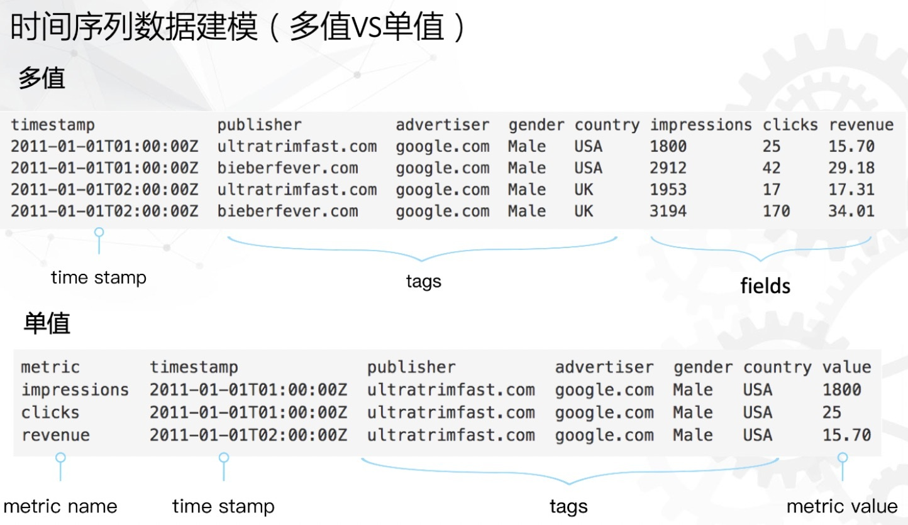

**多值模型数据写入**

**请求路径和方法**

| 请求方法 | 描述 |
| --- | --- |
| POST | 一次写入多个数据点 |

> 多值模型数据和原来写入的单值模型数据不兼容。单值模型数据需要通过原有的 /api/put 接口进行写入。同
>
> **重要**
>
> 时多值写入数据需要通过 /api/mquery 接口进行查询，单值写入的数据需要通过 /api/query 进行查询。

**请求参数**

| 名称 | 类型 | 是否必需 | 描述 | 默认值 | 举例 |
| --- | --- | --- | --- | --- | --- |
| summary | 无类型 | 否 | 是否返回摘要信息 | false | /api/put? summary |
| details | 无类型 | 否 | 是否返回详细信息 | false | /api/put? details |
| sync_timeout | Integer | 否 | 超时时间，单位毫秒，0为永不超时 | 0 | /api/put/? sync&amp;sync_ti meout=6000 0 |

> **重要**
>
> - 所有“无类型”的参数，只要提供，都被视为 true，比如 summary=false 以及 summary=true 都被当做summary=true。
>
> - 如果 details 和 summary 都设置，API 将返回 details 信息。

**请求内容**

数据点格式为 JSON 格式，各参数说明如下：

| 名称 | 类型 | 是否必需 | 是否有使用限制 | 描述 | 举例 |
| --- | --- | --- | --- | --- | --- |
| metric | String | 是 | 只可包含大小写英文字母、中文、数字，以及特殊字符 -_./():,\[\]=‘# | 存储的指标名 | sys.cpu<br>重要支持的metric长度最多为255字节。 |
| timestamp | Long | 是 | 无 | 时间戳；单位为秒或者毫秒，判断规则详见下面的时间戳说明。 | 1499158925 |
| fields | Map | 是 | field 名字限制和 metric 限制一样，field 值只支持 String, Number, Boolean | 域数据值 | “fields” : {“speed” : 20.8, “level” : 4, “direction”: “East”, “description”: “Fresh breeze”} |
| tags | Map | 是 | 可以包含大小写英文字母、中文、数字，以及特殊字符 -_./():,\[\]=‘# | Tagk 和 Tagv是字符串键值对，至少一个键值对 | {“host”:”web 01”}，非字符串类型的tagk，tagv会强制转换为字符串类型 |

**时间戳说明**

本说明适用于读写数据 ( `/api/put`  &  `/api/mput` ) 和查询数据 ( `/api/query`  &  `/api/mquery` ) 两个接口。 时间戳的单位可以是秒或者毫秒。时序引擎会通过数值大小来判断时间戳的单位，规则如下：

- 时间戳区间为 [4284768,9999999999]: 判断为秒，表示的时间区间为: [1970-02-20 00:59:28, 2286-11-21 01:46:39]

- 时间戳区间为 [10000000000,9999999999999]：判断为毫秒，表示的时间区间为：[1970-04-27 01:46:40.000, 2286-11-21 01:46:39.999]

- 时间戳区间为（-∞,4284768）和（9999999999999,+∞）：判断为非法时间戳区间

**数据点值说明**

在写入数据类型的约束方面，采用metric+field 的方式限定数据类型。比如下述两批次的写入是被允许的。这是因为两批次数据虽然都包含相同的metric和tag组合，但是field不同，因此允许写入不同的数据类型。

```json
[{"metric":"fakemetric", "tags":{"tagk":"tagv1"},"timestamp":1514736000, "values":{"field1":"val", "field2": 111.11}, {"metric":"fakemetric", "tags":{"tagk":"tagv1"},"timestamp":1514736030, "values":{"field1":"val2", "field2": 222.22}}]
[{"metric":"fakemetric", "tags":{"tagk":"tagv1"},"timestamp":1514736000, "values":{"field1":"aaa", "field2": 333.33}}, {"metric":"fakemetric", "tags":{"tagk":"tagv1"},"timestamp":1514736030, "values":{"field1":"bbb", "field2": 444.44}}}]
```

**写入数据示例**

<strong>请求:</strong>POST/api/mput

**请求体：**

```json
    [
        {
            "metric" : "wind",
            "fields" : {
                "speed" : 20.8,
                "level" : 4,
                "direction" : "East",
                "description" : "Fresh breeze"
            },
            "tags" : {
                "sensor":"IOTE_8859_0001",
                "city":"hangzhou",
                "province":"zhejiang",
                "country":"china"
            },
            "timestamp" : 1346846400
        },
        {
            "metric" : "wind",
            "fields" : {
                "speed" : 40.2,
                "level" : 6,
                "direction" : "South",
                "description" : "Fresh breeze"
            },
            "tags" : {
                "sensor":"IOTE_8859_0002",
                "city":"hangzhou",
                "province":"zhejiang",
                "country":"china"
            },
            "timestamp" : 1346846401
        }
    ]
```

<a id="section-2-9-5"></a>

### 2.9.5. 多值查询

<a id="section-2-9-5-1"></a>

#### 2.9.5.1. 多值查询最新数据点

**请求路径和方法**

| 请求路径 | 请求方法 | 描述 |
| --- | --- | --- |
| /api/query/mlast | POST | 获得多值模型指标数据中 fields 最新写入的数据点。 |

**请求内容**

| 名称 | 类型 | 是否必需 | 描述 | 默认值 | 举例 |
| --- | --- | --- | --- | --- | --- |
| queries | Array | 是 | 子查询数组。 | 无 | 见子查询说明 |
| timestamp | Long | 否 | unix 时间戳，单位为秒或者毫秒，指定该参数时表示查询到该时间戳为止最新的数据点，否则表示查询当前最新的数据点Tags。这个是和queries 相同级别参数，详情见示例。 | 无 | 1539763573 |
| tupleFormat | Boolean | 否 | 将查询 fields 的最新数据点元组结构返回，详情见示例。 | false | false |
| tupleOffset | Long | 否 | 数据分页时返回的tuple的偏移量。仅在tupleFormat为<strong>true</strong>时有效。 | 0 | 5 |
| tupleLimit | Long | 否 | 数据分页时返回的tuple最大数量。仅在tupleFormat为<strong>true</strong>时有效。 | 0 | 100 |

> /api/query/mlast 只能用于多值模型数据，单值模型数据的最新数据点，请使用 /api/query/last 接口。
>
> **重要**

**子查询JSON格式**

| 名称 | 类型 | 是否必需 | 描述 | 默认值 | 举例 |
| --- | --- | --- | --- | --- | --- |
| metric | String | 是 | 待查询最新数据点的 Metric。 | 无 | wind |
| fields | List | 是 | 需要查询最新数据点的域, "\*"代表查询 metric 下所有域。 | 无 | {speed, level, description} |
| tags | String | 否 | 待查询最新数据点的 Tags。 | 无 | sensor = IOTE_1988_0001 |

**请求 JSON 示例**

**任务：** 查询 "cpu" 指标下，标签为 "host_name=host1" 的 "usage_system" 和 "usage_idle" 域最新写入数据点。

**请求：** `POST /api/query/mlast`

**请求体：**

```json
    {
        "tupleFormat": true,
        "tupleOffset":5,
        "tupleLimit":100,
        "timestamp" : 1551851846,
        "queries": [
            {
                "metric": "cpu",
                "fields": ["usage_system", "usage_idle"],
                "tags": {
                    "host_name": "host1"
                }
            }
        ]
    }
            
```

**响应说明**

查询成功的 HTTP 响应码为 200，返回符合条件的时间线最新数据点，内容为JSON 格式数据；如果没有时间线满足条件，则返还空集。JSON说明如下：

| 名称 | 描述 |
| --- | --- |
| metric | 指标名 |
| columns | 返回结果集中的列名称，包括时间戳和查询的域名称 |
| tags | 数据点对应的tag键值集合 |
| values | 查询指标域的值，值的顺序和 columns 的顺序对应 |

> 如果将 tupleFormat 设置成 false，增返回结果格式跟单值模型一致。这种场景下的详细响应内容可以参
>
> **重要**
>
> 考/api/query/last接口的介绍。

**返回结果 JSON 示例**

```json
[
  {
    "metric": "wind",
    "columns": [
      "timestamp",
      "level",
      "speed"
    ],
    "tags": {
      "city": "hangzhou",
      "country": "china",
      "province": "zhejiang",
      "sensor": "IOTE_8859_0001"
    },
    "values": [
      [1346846405000, 5.1, 45.1]
    ]
  }
]
            
```

<a id="section-2-9-5-2"></a>

#### 2.9.5.2. 多值数据查询

本文介绍通过HTTP API接口进行多值数据查询的方法和相关使用说明。

**请求路径和方法**

| 请求路径 | 请求方法 | 描述 |
| --- | --- | --- |
| /api/mquery | POST | 查询数据 |

> **重要**
>
> 多值模型数据和原来写入的单值模型数据不兼容。单值模型数据需要通过原有的 /api/put 进口进行写入。同时多值写入数据需要通过 /api/mquery 接口进行查询，单值写入的数据需要通过 /api/query 进行查询。

**请求内容**

| 名字 | 类型 | 是否必需 | 描述 | 默认值 | 举例 |
| --- | --- | --- | --- | --- | --- |
| start | Long | 是 | 开始时间；单位为秒或者毫秒，判断规则详见下面的时间戳单位判断。 | 无 | 1499158925 |
| end | Long | 否 | 结束时间；单位为秒或者毫秒，判断规则详见下面的时间戳单位判断。默认值为 时序引擎服务器当前时间。 | 当前时间 | 1499162916 |
| queries | Array | 是 | 子查询数组 | 无 | 见子查询说明 |
| msResoluti on | boolean | 否 | 子查询数组 | false | 该参数只对原始数据单位是秒的查询生效；当该参数设置为 true 时，查询结果中的时间戳会转换为毫秒，否则仍保留原始时间单位；对于原始数据是毫秒的查询，返回结果中时间戳始终为毫秒。 |

**时间戳单位判断**

时间戳的单位可以是秒或者毫秒。时序引擎会通过数值大小来判断时间戳的单位，规则如下：

- 时间戳区间为 [4284768,9999999999]：判断为秒，表示的日期时间区间为： [1970-02-20 00:59:28, 2286-11-21 01:46:39]。

- 时间戳区间为 [10000000000,9999999999999]：判断为毫秒，表示的日期时间区间为： [1970-04-27 01:46:40.000, 2286-11-21 01:46:39.999]。

- 时间戳区间为 (-∞,4284768)和(9999999999999,+∞)：判断为非法时间戳区间。

  > **说明**
  >
  > 适用于写入数据 ( `/api/put`  &  `/api/mput` ) 和查询数据 ( `/api/query`  &  `/api/mquery` ) 两个接口。

**单时间点数据查询**

时序引擎支持单时间点数据查询。您可以将开始时间和结束时间设置为相同的数值。例如， `"start":1356998400` ， `"end":1356998400` 。

**子查询JSON格式**

| 名称 | 类型 | 是否必需 | 描述 | 默认值 |
| --- | --- | --- | --- | --- |
| metric | String | 是 | 指标名。例如<code> wind </code>。 | 无 |
| fields | List | 是 | 域查询信息。 | 无 |
| limit | Integer | 否 | 数据分页，子查询返回数据点的最大数目。例如1000。 | 0 |
| offset | Integer | 否 | 数据分页，子查询返回数据点的偏移量。例如500。 | 0 |
| tags | Map | 否 | 指定查询标签过滤，和filters冲突。 | 无 |
| filters | List | 否 | 过滤器，和tags冲突。 | 无 |

> **说明**
>
> - 一个查询中能够包含的总的Field个数最多不超过200个。 示例说明如下：
>
>   假设现有一个查询包含3个子查询，第一个子查询包含3个Field, 第二个子查询包括2个Field, 第三个子查询包含6个Field，那么这个查询包含的总的Field个数totalFields = 3 + 2 + 6 = 11, 即查询时需要保证totalFields不能大于200。
>
> - tags 和 filters 都指定的场景下，后指定的过滤条件生效。

**域查询信息 JSON 格式**

| 名称 | 类型 | 是否必需 | 描述 | 默认值 | 举例 |
| --- | --- | --- | --- | --- | --- |
| aggregator | String | 是 | 聚合函数，详见下面的聚合（Aggregate）说明。 | 无 | sum |
| field | String | 是 | 域名称，”\*”代表查询指标下所有域 | 无 | 无 |
| alias | String | 否 | 域名称在返回结果中新名字 | 无 | 无 |
| downsample | String | 否 | 时间维度降采样 | 无 | 60m-avg |
| rate | Boolean | 否 | 是否计算指定指标值的增长速率；计算公式： Vt-Vt-1/t1-t-1 | false | true |
| dpValue | String | 否 | 根据提供条件过滤返回数据点，支持”&gt;”, “&lt;”, “=”,”&lt;=”, “&gt;=”, “!=”。 | 无 | &gt;=1000 |

**查询示例**

**请求：** `POST/api/mquery`

**请求体：**

```json
{
    "start" : 1346846400,
    "end" :   1346846411,
    "msResolution" : true,
    "queries" : [
        {
            "metric" : "wind",
            "fields" : [
                {
                    "field" : "speed",
                    "aggregator" : "sum",
                    "downsample" : "2s-last",
                      "alias" : "speed_sum"
                },
                {
                    "field" : "*",
                    "aggregator" : "sum",
                    "downsample" : "2s-count"
                }
            ]
        }
    ]
}
            
```

**数据分页查询（Limit 和 Offset）说明**

**Limit**：子查询返回数据点的最大数目。默认值是 0，代表不限制返回点数量。

**Offset**：子查询返回数据点的偏移量。默认值也是 0，代表不偏移返回的数据点。

> **重要**
>
> limit 和 offset 不能为负数。同时，limit 和 offset 是对最后多值返回结果的分页查询处理，而不是对某一域查询结果进行处理。

**示例**

返回第 1001 到 1500 的数据点，则 limit 设为 500，offset 设为 1000。

```json
{
    "start" : 1346846400,
    "end" :   1346846411,
    "msResolution" : true,
    "queries" : [
        {
            "metric" : "wind",
            "fields" : [
                {
                    "field" : "*",
                    "aggregator" : "sum",
                    "downsample" : "2s-count"
                }
            ],
            "filters" : [
                {
                    "filter" : "IOTE_8859_0005|IOTE_8859_0004",
                    "tagk" : "sensor",
                    "type" : "literal_or"
                }
            ],
            "limit" : 500,
            "offset" : 1000
        }
    ]
}
                
```

**值过滤（dpValue） 说明**

根据用户设置的数值限制条件，过滤最终的返回数据点。支持 ">", "<", "=", "<=", ">=", "!="。

> **重要**
>
> 不同 fields 之间的 dpValue 关系是”或”。”和”的关系暂时不支持。

**示例**

```json
{
    "start" : 1346846400,
    "end" :   1346846411,
    "msResolution" : true,
    "queries" : [
        {
            "metric" : "wind",
            "fields" : [
                {
                    "field" : "level",
                    "aggregator" : "avg",
                    "downsample" : "2s-avg",
                    "dpValue" : ">=8.0"
                }
            ],
            "filters" : [
                {
                    "filter" : "IOTE_8859_0005|IOTE_8859_0004",
                    "tagk" : "sensor",
                    "type" : "literal_or"
                }
            ]
        }
    ]
}
                
```

**降采样 (Downsample) 说明**

当查询的时间范围比较长，只需返回一定精度的数据时使用。查询格式如下：

```xml
<interval><units>-<aggregator>[-fill policy]          
```

其中：

- <strong>interval：</strong>指数值，如 5、60 等，特殊的“0all”表示时间维度聚合为一个点。

- <strong>units：</strong>s 代表秒，m 代表分，h 代表小时，d 代表天，n 代表月，y 代表年。

  > **说明**
  >
  > 支持基于日历时间间隔的降采样。要使用日历界限，您需要在时间单位 **units** 后添加一个 `c` 。例如， `1dc` 代表从当日零点到次日零点之间的 24 小时。

- **aggregator：** 降采样使用的算子及其说明如下表所示。

<table>
  <tr>
    <th width="89">算子</th>
    <th>描述</th>
  </tr>
  <tr>
    <td>avg</td>
    <td>平均值</td>
  </tr>
  <tr>
    <td>count</td>
    <td>数据点数</td>
  </tr>
  <tr>
    <td>first</td>
    <td>取第一个值</td>
  </tr>
  <tr>
    <td>last</td>
    <td>取最后一个值</td>
  </tr>
  <tr>
    <td>min</td>
    <td>最小值</td>
  </tr>
  <tr>
    <td>max</td>
    <td>最大值</td>
  </tr>
  <tr>
    <td>sum</td>
    <td>求和</td>
  </tr>
  <tr>
    <td>zimsum</td>
    <td>求和</td>
  </tr>
  <tr>
    <td>rfirst</td>
    <td>功能同first但降采样后返回的结果的时间戳是原始数据的时间戳；而非降采样对齐后的时间戳</td>
  </tr>
  <tr>
    <td>rlast</td>
    <td>功能同last但降采样后返回的结果的时间戳是原始数据的时间戳；而非降采样对齐后的时间戳</td>
  </tr>
  <tr>
    <td>rmin</td>
    <td>功能同min但降采样后返回的结果的时间戳是原始数据的时间戳；而非降采样对齐后的时间戳</td>
  </tr>
  <tr>
    <td>rmax</td>
    <td>功能同max但降采样后返回的结果的时间戳是原始数据的时间戳；而非降采样对齐后的时间戳</td>
  </tr>
</table>

> **说明**
>
> 当降采样的聚合算子指定为rfirst、rlast、rmin或rmax时，不能再在降采样表达式中指定fill policy。

**Fill policy**

Fill policy 即填值。降采样先把所有时间线按照指定精度切分，并把每个降采样区间内的数据做一次运算，降采样后如果某个精度区间没有值，fill policy 可以指定在这个时间点填充具体的值。比如某条时间线降采样后的时间戳为：t+0, t+20, t+30，此时如果不指定 fill policy，只有 3 个值，如果指定了 fill policy 为 null，此时间线会有 4 个值，其中 t+10 时刻的值为 null。 Fill policy 与具体填充值的对应如下表所示。

| Fill Policy | 填充值 |
| --- | --- |
| none | 默认行为，不填值 |
| nan | NaN |
| null | null |
| zero | 0 |
| linear | 线性填充值 |
| previous | 之前的一个值 |
| near | 邻近的一个值 |
| after | 之后的一个值 |
| fixed | 用指定的一个固定填充值（请参照下面示例） |

**Fixed Fill Policy**

使用方法：将固定的填充值写到 "#"之后。填充值支持正负数。格式如下：

```xml
<interval><units>-<aggregator>-fixed#<number>
```

**示例**：1h-sum-fixed#6， 1h-avg-fixed#-8

**降采样示例**

示例：1m-avg，1h-sum-zero，1h-sum-near

> **重要**
>
> 在域查询信息中，downsample 不是必要条款。您甚至可以在查询时明确标明其值为 null 或者空（””），例如：{“downsample”: null} 或者 {“downsample”: “”}，这样就不会触发数据点降采样。但是，如果又一个域查询使用了downsample，在同一子查询下的所有域查询信息都需要包括 downsample 并且采用同样的降采样区间。

**聚合（Aggregate）说明**

在降采样后会得到多条时间线的值，并且这些时间线的时间戳是对齐的，而聚合就是把多条时间线的值按各个对齐时刻聚合为一条时间线的结果（注意：如果只有一条时间线，则不进行聚合）。聚合时必须要求每条时间线在对应时刻都有值，如果某条时间线在某个时刻没有值，则会进行插值，插值描述如下。

> **重要**
>
> 在域查询信息中，aggregator 是必要条款，但是可以通过 none 来指明不做聚合运算。但是，时序引擎多值模型不支持在同一个查询中有的域做聚合，有的域不做聚合。

**插值**

如果某条时间线某个精度区间没有值且没有使用 fill policy 进行填值，而待聚合的其他时间线中有一条时间线在此精度区间有值，则会对本时间线的这个缺值精度区间进行插值。

例如：降采样以及聚合条件为{"downsample": "10s-avg", "aggregator": "sum"} ，有两条时间线需要使用 sum 聚合，按 10s-avg 做降采样后的这两条时间线有值的时间戳分别为：

line 1： t+0, t+10, t+20, t+30 line 2： t+0, t+20, t+30

第二条时间线 line 2 缺 “t+10” 这个时刻的值，那么在聚合前会对 line 2 的 “t+10” 这个时间点进行插值。插值的方法与聚合的算子有关，详见下面的算子列表。

| 算子 | 描述 | 插值方法 |
| --- | --- | --- |
| avg | 平均值 | 线性插值（斜率拟合） |
| count | 数据点数 | 插 0 |
| mimmin | 最小值 | 插最大值 |
| mimmax | 最大值 | 插最小值 |
| min | 最小值 | 线性插值 |
| max | 最大值 | 线性插值 |
| none | 不做计算 | 插 0 |
| sum | 求和 | 线性插值 |
| zimsum | 求和 | 插 0 |

**Filters 说明**

有以下两种方法可以指定 filter：

- 在指定 tagk 时指定 filter：

  - **tagk=\***：对 tagk 下面的 tagv 做 groupBy，相同的 tagv 做聚合。

  - **tagk = tagv1|tagv2**： 分别对 tagk 下面的 tagv1 和 tagv2 数据做聚合。

- 使用 JSON 格式指定 filter：

| 名字 | 类型 | 是否必需 | 描述 | 默认值 | 举例 |
| --- | --- | --- | --- | --- | --- |
| type | String | 是 | filter 类型，详见下面说明 | 无 | literal_or |
| tagk | String | 是 | 指定 tagk 名 | 无 | host |
| filter | String | 是 | filter 表达式 | 无 | web01丨web02 |
| groupBy | Boolean | 否 | 是否对 tagv 做groupBy | false | false |

**Filter 类型说明**

| 名称 | filter 举例 | 描述 |
| --- | --- | --- |
| literal_or | web01丨web02 | 分别对多个 tagv 做聚合，区分大小写 |
| wildcard | \*mysite.com | 分别对满足通配符的 tagv 做聚合，区分大小写 |

**查询示例**

包含 filter 的查询示例如下：**请求体：**

```json
{
    "start" : 1346846400,
    "end" :   1346846411,
    "msResolution" : true,
    "queries" : [
        {
            "metric" : "wind",
            "fields" : [
                {
                    "field" : "speed",
                    "aggregator" : "none",
                    "alias" : "column_speed"
                },
                {
                    "field" : "*",
                    "aggregator" : "none",
                    "alias" : "column_"
                }
            ],
            "filters" : [
                {
                    "filter" : "IOTE_8859_0005|IOTE_8859_0004",
                    "tagk" : "sensor",
                    "type" : "literal_or"
                }
            ]
        }
    ]
}
            
```

**查询结果说明**

查询成功的 HTTP 响应码为 200，响应内容为 JSON 格式数据。说明如下：

| 名称 | 描述 |
| --- | --- |
| metric | 指标名 |
| columns | 查询结果对应的列的名称 |
| tags | tagv 未做聚合的 tag |
| aggregateTags | tagv 做了聚合的 tag |
| values | Tuple结构查询结果 |

**响应结果示例：**

- Aggregator : None 场景示例

  ```json
  [
     {
        "metric":"wind",
        "columns":[
           "timestamp",
           "column_speed",
           "column_description",
           "column_direction",
           "column_level",
           "column_speed"
        ],
        "tags":{
           "city":"hangzhou",
           "country":"china",
           "province":"zhejiang",
           "sensor":"IOTE_8859_0005"
        },
        "aggregatedTags":[],
        "values":[
           [ 1346846406000, null, "Fresh breeze", "East", 0.5, null ],
           [ 1346846407000, null, "Fresh breeze", "South", 1.5, null ]
     },
     {
        "metric":"wind",
        "columns":[
           "timestamp",
           "column_speed",
           "column_description",
           "column_direction",
           "column_level",
           "column_speed"
        ],
        "tags":{
           "city":"hangzhou",
           "country":"china",
           "province":"zhejiang",
           "sensor":"IOTE_8859_0004"
        },
        "aggregatedTags":[],
        "values":[
           [ 1346846400000, 40.4, "Fresh breeze", "East", 0.4, 40.4 ],
           [ 1346846401000, 41.4, "Fresh breeze", "South", 1.4, 41.4 ],
           [ 1346846402000, 42.4, "Fresh breeze", "West", 2.4, 42.4 ],
           [ 1346846403000, 43.4, "Fresh breeze", "North", 3.4,43.4 ]
     }
  ]
              
  ```

- Aggregator : Avg 的场景示例（查看杭州市所有 sensor 监控的平均风速和平均风等级）

  ```json
  [
    {
      "metric": "wind",
      "columns": [
        "timestamp",
        "avg_level",
        "avg_speed"
      ],
      "tags": {
        "city": "hangzhou"
      },
      "aggregatedTags": [
        "country",
        "province",
        "sensor"
      ],
      "values": [
        [1346846400000, 0.25, 40.25],
        [1346846401000, 1.25, 41.25],
        [1346846402000, 2.5, 42.5],
        [1346846411000, 5.5, null]
      ]
    }
  ]
              
  ```

<a id="section-2-9-6"></a>

### 2.9.6. 查询Tagk下的Tagv

**请求路径和方法**

| 请求路径 | 请求方法 | 描述 |
| --- | --- | --- |
| /api/dump_meta | POST | 查询对应Tagk下面的Tagv |

**请求内容**

| 名称 | 类型 | 是否必需 | 描述 | 默认值 | 举例 |
| --- | --- | --- | --- | --- | --- |
| tagkey | String | 是 | 标签Key | 无 | host |
| tagvalueprefix | String | 是 | 前缀过滤 | 无 | 127.0.0 |
| max | Integer | 否 | 返回最大结果 | 1000 | 2 |

**请求 JSON 示例**

<strong>任务：</strong>查询2条，tag key为”host”，tag value以”127.0.0”为前缀的tag key value 对。

**请求：** `POST/api/dump_meta`

**请求体：**

```json
{
  "tagkey": "host",
  "tagvalueprefix": "127.0.0",
  "max": 2
}
            
```

**响应说明**

响应为Tag数组：

```json
[ {"host": "127.0.0.1"}, {"host": "127.0.0.2"} ]
            
```

<a id="section-2-9-7"></a>

### 2.9.7. 查询Metric, Field, TagK, TagV

**请求路径和方法**

| 请求路径 | 请求方法 | 描述 |
| --- | --- | --- |
| /api/suggest | POST | 查询 Metric，Field, Tagk，Tagv |

**请求内容**

| 名称 | 类型 | 是否必需 | 描述 | 默认值 | 举例 |
| --- | --- | --- | --- | --- | --- |
| type | String | 是 | 需要查询的类型，metrics，fiel d, tagk，tagv | 无 | metrics |
| metric | String | 否 | 查询指定 metric下的field/tagk/tagv 数据，当 type 是“metrics”，此选项被忽略 | 无 | - |
| q | String | 否 | 前缀过滤 | 无 | my_ |
| max | Integer | 否 | 最大返回个数 | 25 | 4 |

**请求 JSON 示例**

```json
    {
      "type": "metrics",
      "q": "my_",
      "max": 4
    }
            
```

**任务:** 查询 4 条在 wind 指标下，以 "d" 为前缀的域名称。

**请求：** `POST /api/suggest`

**请求体：**

```json
    {
      "type": "field",
      "metric": "wind",
      "q": "d",
      "max": 4
    }
            
```

**响应说明**

响应为查询到的字符串数组：

```text
    第⼀个查询返回结果：
    [ "my_metric1", "my_metric2", "my_metric3", "my_metric4" ]
    第⼆个查询返回结果：（只有两个满⾜，所以返回2个）
    [ "description", "direction" ]
            
```

<a id="section-2-9-8"></a>

### 2.9.8. 设置数据时效

**请求路径和方法**

| 请求路径 | 请求方法 | 描述 |
| --- | --- | --- |
| /api/ttl | POST | 设置 TTL |

**请求内容**

| 名称 | 类型 | 是否必需 | 描述 | 举例 |
| --- | --- | --- | --- | --- |
| val | Integer | 是 | 设置 ttl 的值，以秒为单位，大于等于1，小于等于2147483647（Integer.MAX_VALUE）高可用版本中允许设置的最小值为3600,设置小于3600的值会报错; 允许设置的最大值为2147483647，表示的含义为”无数据时效”，设置超过2147483647的值仍然会被视作2147483647. | 7776000 |

**请求 JSON 示例**

**请求：** `POST/api/ttl`

**请求体：**

```json
{ "val": 7776000 }         
```

**响应说明**

200 表示成功，其他返回码表示失败，错误信息参见公共响应状态码。

**数据时效说明**

1. 此处设置的数据时效的计算不是对数据自身带入的时间戳为基准进行计算，而是基于**数据实际写入到数据库的时间**为基准进行计算。

2. 数据在数据库中的时间超过设置的数据时效后并不会立刻失效，而是会由数据库后台慢慢自行清理。

3. 数据失效时，数据所属的时间线并不会随之失效。对于早已不活跃的时间线可能需要主动调用删除接口进行清理。

**获取数据时效**

**请求路径和方法**

| 请求路径 | 请求方法 | 描述 |
| --- | --- | --- |
| /api/ttl | GET | 查询数据时效 |

**请求内容**

无需请求实体

**响应说明**

200 表示成功，其他返回码表示失败，错误信息参见公共响应状态码。

返回 JSON 举例：

```json
{ "val": 7776000 }
```

val 的值即为 ttl 的值，秒为单位。

<a id="section-2-9-9"></a>

### 2.9.9. 删除数据

**请求路径和方法**

| 请求路径 | 请求方法 | 描述 |
| --- | --- | --- |
| /api/delete_data | POST | 删除数据 |

**请求内容**

| 名称 | 类型 | 是否必需 | 描述 | 默认值 | 举例 |
| --- | --- | --- | --- | --- | --- |
| metric | String | 是 | 待删除数据的Metric | 无 | cpu |
| tags | Map | 否 | 待删除的时间线。该参数不是必选，在没有 tag 的情况下, 所有 metric 相关时间线都将删除 | 无 | 见下面的相关说明 |
| fields | List | 否 | 在 metric 下，要被删除的域数据 | 无 | usage_system, usage_guest |
| start | Integer | 是 | 待删除的开始时间戳，单位秒 | 无 | 1499308591 |
| end | Integer | 否 | 待删除的结束时间戳，单位秒 | 当前时间 | 1499508591 |

> **重要**
>
> - 如果没有提供 fields 信息，则会删除跟 metric 相关的所有数据，包括单值模型数据和 metric 下所有 fields 的数据。
>
> - 只要一个时间线满足请求体中指定的指标，且 tags 中包含了指定的 tags, 即便该时间线的组成还包含其他 tag时，该时间线也被视为满足条件，其数据也会被删除。

**请求 JSON 示例**

**任务：** 清除从 1499308591 到 1499508591 指标为 "cpu" 的所有数据。 **请求：** `POST/api/delete_data` **请求体：**

```json
    {
        "metric": "cpu",
        "start": 1499308591,
        "end": 1499508591
    }      
```

**任务：** 清除从 1499308591 到 1499508591 指标为 "cpu" , tag 为“host: 192.168.0.2”，”appName: hitsdb”的所有数据线的数据。 **请求：** `POST/api/delete_data` **请求体：**

```json
    {
        "metric": "cpu",
        "tags": {
            "host": "192.168.0.2",
            "appName": "hitsdb"
        },
        "start": 1499308591,
        "end": 1499508591
    }      
```

**任务：** 清除从 1499308591 到 1499508591 "cpu" 指标下 "usage_system" 和 "usage_guest" 域的所有数据。 **请求：** `POST/api/delete_data` **请求体：**

```json
    {
        "metric": "cpu",
        "fields": ["usage_system", "usage_guest"],
        "start": 1499308591,
        "end": 1499508591
    } 
```

**响应说明**

200 表示成功，其他返回码表示失败，错误信息请参见响应状态码。

<a id="section-2-9-10"></a>

### 2.9.10. 删除时间线

**请求路径和方法**

| 请求路径 | 请求方法 | 描述 |
| --- | --- | --- |
| /api/delete_meta | POST | 删除时间线 |

**请求内容**

| 名称 | 类型 | 是否必需 | 描述 | 举例 |
| --- | --- | --- | --- | --- |
| metric | String | 是 | 待删除的时间线的 metric | cpu |
| fields | List | 否 | 待删除的时间线的域名称，该参数不是必选，在没有 fields 的情况下, metric 下单值模型和多值模型时间线都会被清除 | usage_system, usage_guest |
| tags | Map | 否 | 待删除的时间线。该参数不是必选，在没有tag 的情况下, 所有 metric 相关时间线都将删除 | 见下面的相关说明 |
| deleteData | Boolean | 否 | 是否删除时间线关联的数据，true表示清除关联数据，false表示只清除时间线。注意：在删除时间线的同时清除数据比较耗费资源，只删除时间线耗时较短，默认true | false |
| recursive | Boolean | 否 | 对于用户指定tagKV，指示是否要精准匹配指定的tagKV。true: 只要目标时间线的Tag 包含了删除条件指定的tagKV，则会被删除;false: 目标时间线的TagKV 有且只有指定的TagKV，才会被删除。默认值为true。比如数据库中存在2条时间线：时间线1：TagK1=TagV1 ，TagK2=TagV2,时间线2： Tagk1=TagV1 删除条件的tags指定为TagK1=TagV1。若recursive=ture， 则时间线1和时间线2都会被删除； 若recursive=false，则只有时间线2会被删除，时间线1则不会被删除 | false |

**请求 JSON 示例**

**任务：** 清除指标为 “cpu”，tag 为 “host: 192.168.0.2”，”appName: hitsdb” 的所有相关时间线（包括单值模型下的相关时间线和多值模型所有域的相关时间线）。 **请求：** `POST/api/delete_meta` **请求体：**

```json
    {
        "metric": "cpu",
        "tags": {
            "host": "192.168.0.2",
            "appName": "hitsdb"
        }
        "deleteData":false
    }
            
```

**任务：** 清除指标 "cpu" 下 "usage_system" 和 "usage_idle" 域，tag 为 "host: 192.168.0.2"，"appName: hitsdb" 的时间线。 **请求：** `POST/api/delete_meta` **请求体：**

```json
    {
        "metric": "cpu.usage",
        "fields": ["usage_system", "usage_idle"],
        "tags": {
            "host": "192.168.0.2",
            "appName": "hitsdb"
        }
    }
            
```

**响应说明**

200 表示成功，其他返回码表示失败，错误信息请参见响应状态码。

<a id="section-2-9-11"></a>

### 2.9.11. 数据清空

本文介绍如何进行时序引擎清空操作，在测试阶段可以快速清空测试数据。

> **重要**
>
> - 客户使用清空操作后，时序引擎中的数据将被全部清空且不可恢复，请谨慎操作。阿里云不会主动发起对用户数据的清空操作。
>
> - /api/truncate 的执行过程中，时序引擎集群内各节点会拒绝所有的写入操作。因此，请谨慎执行truncate操作。

**请求路径和方法**

| 请求路径 | 请求方法 | 描述 |
| --- | --- | --- |
| /api/truncate | POST | 清空所有数据 |

- 请求内容

  无

- 请求示例

  请求： POST/api/truncate

- 响应说明

  - 200 表示成功，其他返回码表示失败，错误信息参见公共响应状态码。

  - 当该接口返回HTTP状态码 500 时，请确认错误消息中是否包含“The attempt to broadcast locking truncate remotely against [ 地址1,… ] failed,while the attempt against [ 地址2,… ] succeeded”。如果包含，则表示truncate的失败导致了时序引擎集群内不同节点间的状态不一致。若不解决该不一致，则会造成向时序引擎执行的写操作出现部分失败。因此，当该现象出现时，请提交该错误消息给阿里云运维团队进行处理。

<a id="section-2-9-12"></a>

### 2.9.12. 响应状态码

**成功返回**

| 返回码 | 描述 |
| --- | --- |
| 200 | 请求成功，返回响应内容，主要用于查询数据 |
| 204 | 请求成功，无内容返回，主要用于写数据 |

**失败返回**

| 返回码 | 描述 |
| --- | --- |
| 400 | 请求失败，请求的参数或内容存在错误或缺失等，返回内容里面包含具体信息 |
| 404 | 请求路径未找到 |
| 405 | 请求方法不允许 |
| 406 | 请求资源不匹配 |
| 408 | 请求超时 |
| 413 | 返回结果超过服务器缓存 |
| 429 | 请求过多过快导致被请求资源超限 |
| 500 | 服务器内部错误 |
| 501 | 功能未实现 |
| 503 | 服务器资源不足 |

<a id="section-3"></a>

# 3.LTS服务

<a id="section-3-1"></a>

## 3.1. LTS（原BDS）服务介绍

LTS（Lindorm Tunnel Service）是面向Lindorm业务场景特点深度定制的数据生态服务。支持简单易用的数据交换、处理、订阅等能力，满足用户的数据迁移、实时订阅、数湖转存、数仓回流、单元化多活、备份恢复等需求，实现面向Lindorm的一站式数据生态服务。

**核心能力**

- **云原生分布式**：LTS是一个基于ECS部署的分布式系统，具备良好的水平扩展能力，用户可以按需进行资源配置。

- **简单易用**：LTS支持一键配置数据迁移、导入、订阅、归档等任务。比如数据迁移任务，用户只需要选择源端、目的端和需要同步的列，LTS会自动完成schema复制、全量数据复制和增量数据复制。

- **安全可靠**：LTS充分考虑对源端和目标端系统在线影响最小化，以及兼容可能出现的故障。在任务启动前会有网络联通性、安全性等前置校验，运行过程中会实时监控同步延迟、目标集群存储水位等并有相关的限速和报警，任务结束后还会提供数据校验。

- **低成本**：LTS在HBase等开源系统上有深入的优化，提供物理文件级别的数据处理，比传统的数据复制效率提高10倍。同时在CPU、缓存、内存、网络IO上的整体优化使LTS提供一个高性价比的数据通道，减少客户数据流转、处理的成本。

**功能列表**

| 功能 | 场景 | 相关文档 |
| --- | --- | --- |
| HBase、Lindorm宽表之间数据迁移 | 新旧集群无缝迁移、集群升配、在线离线业务分离、主备容灾、异地多活。 | 全增量数据同步 |
| MaxCompute/Hive -&gt; Lindorm | 离线数据查询加速，将数仓中的明细、指标等数据批量回流Lindorm提供在线查询。 | 待补充，目前可联系值班咨询 |
| Lindorm 数据导出 ODPS（MaxCompute）<br>重要该功能自2023年6月16日下线，2023年6月16日后购买的LTS<strong>不再支持此功</strong><strong>能</strong>，2023年6月16日前购买的LTS仍可正常使用此功能。 | 支持历史数据和增量数据。 | 全量导出MaxCompute |
| LogHub实时数据订阅<br>重要该功能自2023年6月16日下线，2023年6月16日后购买的LTS<strong>不再支持此功</strong><strong>能</strong>，2023年6月16日前购买的LTS仍可正常使用此功能。 | 支持订阅LogHub实时数据到Lindorm。 | SLS增量导入 |
| Lindorm 数据订阅 | 支持Lindorm实时增量数据订阅。 | 实时数据订阅概述 |

**日志生命周期管理说明**

- 开启日志订阅后，如果不消费数据，默认日志会保留48小时，超时后订阅关系自动取消，保留的数据自动删除。

- 什么场景会导致“不消费数据”：没有终止任务的前提下直接释放LTS集群，同步任务暂停。

- 使用日志订阅的任务类型：HBase/Lindorm增量同步、数据归档、数据备份和数据订阅。

**典型场景**

- 集群迁移

  - 使用范围

    - HBase迁移Lindorm。

    - 异地跨机房迁移。

    - 业务拆分。

  - 特点

    - 不停服数据迁移，同时搞定历史数据迁移、实时增量数据的同步。

    - 迁移过程中不会和源集群的HBase、Lindorm交互，只读取源集群的HDFS，尽可能减少对源集群在线业务的影响。

    - 文件层的数据拷贝比通常API层的数据迁移通常能节省50%以上的流量。

    - 高效性，单个节点迁移速度可达到100 MB/s，节点数支持水平扩展，能够满足支持TB、PB级别的数据迁移。

    - 稳定性，有完善的错误重试机制，实时监控任务速度和进度，支持任务失败报警。

    - 正确性，能够进行数据校验。

    - 支持自动同步schema，保证分区一致。

- 主备容灾

  通过LTS在主备集群之间实现实时数据的双向同步，当主集群出现问题，可以切换到备集群，尽可能减少对业务产生的影响，当主集群服务恢复之后，通过LTS同步服务补齐主集群遗漏的数据。

<a id="section-3-2"></a>

## 3.2. 购买并登录LTS

LTS（Lindorm Tunnel Service）是云原生多模数据库Lindorm自研的数据通道服务。您可以通过购买的LTS为所有的Lindorm实例提供数据导入导出、数据订阅、数据备份恢复等服务。本文介绍如何购买并登录LTS。

**购买LTS**

1. 登录Apsara Uni-manager运营控制台。

2. 在顶部菜单栏，选择**产品 > 数据库 > 多模数据库Lindorm**。

3. 在**实例列表**页面，单击**创建LTS**。

4. 参考下表设置LTS相关参数。

   **参数分类**

   **参数**

   **参数说明**

   选择新建的LTS实例所在组织。

   **组织**

   选择管理LTS的资源集。

   **基本配置**

   **资源集**

   设置LTS的名称，便于后续业务识别。

   **实例名称**

   选择LTS所属地域。

   > **说明**

   **地域**

   > - LTS创建成功后将无法更换地域，请您谨慎选择。
   >
   > - 如果应用部署在ECS实例，请您选择与ECS实例相同的地域，否则无法直接通过内网通信。

   **区域**

   选择LTS所属可用区。

   > **说明**

   **可用区**

   > 如果应用部署在ECS实例，建议您选择与ECS实例相同的可用区，以减少网络延时。

   <table>
     <tr>
       <td rowspan="2">规格配置</td>
       <td>数据通道服务规格</td>
       <td>选择LTS的节点规格。</td>
     </tr>
     <tr>
       <td>规格节点数</td>
       <td>选择LTS的节点数量，范围为1~20。</td>
     </tr>
   </table>

5. 单击**提交**。

**登录LTS**

> **重要**
>
> 新购的LTS**状态**为**创建中**，请等待其**状态**变为**运行中**后再登录。

1. 登录Apsara Uni-manager运营控制台。

2. 在页面左上角，选择实例所属的组织。

3. 在**实例列表**页，单击目标实例ID或者目标实例所在行**操作**列的**管理**。

4. 在**LTS WebUI 访问**区域，单击**ClusterManager**进入LTS操作页面。

   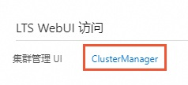

<a id="section-3-3"></a>

## 3.3. 数据源管理

<a id="section-3-3-1"></a>

### 3.3.1. 添加HBase数据源

添加HBase数据源可以对HBase数据进行迁移或者同步操作，本文介绍如何添加HBase数据源。

**HBase数据源类型和添加方式**

<table>
  <tr>
    <th>HBase数据源类型</th>
    <th>添加HBase数据源的方式</th>
  </tr>
  <tr>
    <td>自建的HBase集群</td>
    <td rowspan="2">请参见通过LTS服务添加HBase数据源。</td>
  </tr>
  <tr>
    <td>EMR HBase集群</td>
  </tr>
</table>

**通过LTS服务添加HBase数据源**

1. 开通并登录LTS服务。具体操作请参见《用户指南》手册中的《创建数据通道服务实例》。

2. 在左侧导航栏选择**数据源管理 > 添加数据源**。

3. 在**添加数据源**页面配置以下参数。

   | 参数 | 说明 |
   | --- | --- |
   | 名称 | 自定义数据源名称。 |
   | 数据源类型 | 根据HBase数据源类型的版本选择不同的数据源类型，包括以下选择：<br>• <strong>HBase1x</strong>：表示HBase数据源版本为1.0版本。<br>• <strong>HBase2x</strong>：表示HBase数据源版本为2.0版本。<br>• <strong>HBase098</strong>：表示HBase数据源为自建的hbase098版本。<br>• <strong>HBase094</strong>：表示HBase数据源为自建的hbase094版本。 |
   | 数据源参数 | 输入HBase数据源的相关参数。<br><code>{</code><br><code>"clusterKey":"xxxzkhost1,xxxzkhost2,xxxzkhost3:2181:/xxxhbase",</code><br><code>"hbaseDir":"/xxxhbase",</code><br><code>"hdfsUri":"hdfs://xxxnn1:8020,xxxnn2:8020"</code><br><code>}</code><br>• <strong>clusterKey</strong>：HBase数据源的连接信息，格式为：<code> ZK</code>节点<code>:ZK</code>端口<code>:HBase</code>在<code>ZooKeeper</code>中使用的父节点路径<code> </code>，其中父节点路径对应HBase集群中的<code> zookeeper.znode.parent </code>配置项。<br>• <strong>hbaseDir</strong>：HBase数据源在HDFS中的路径，该路径对应HBase集群的<code> hbase.rootdir </code>配置项。<br>说明该路径只需填写数据源所在的目录，不用填写<code> hdfs://xx </code>的前缀。例如，数据源所在的HDFS路径为<code> hdfs://hbase/hbase </code>，此处只填写<code> /hbase </code>即可。<br>• <strong>hdfsUri</strong>：自建的HBase集群的HDFS连接地址。<br>• 如果HBase数据源为高可用实例，HDFS的连接地址格式为：<code> hdfs://namenode1:port,namenode2:port </code>。<br>• 如果HBase数据源为非高可用实例，HDFS的连接地址格式为：<code> hdfs://namenode:port </code>。 |
   | 集群/etc/hosts (自建、EMR集群需要) | 配置HBase集群的/etc/hosts文件，文件中记录了集群内节点的主机名和IP。<br>说明自建HBase集群或者EMR HBase集群需要配置此参数。 |

4. 单击**添加**。

<a id="section-3-3-2"></a>

### 3.3.2. 添加Lindorm宽表数据源

本文介绍如何添加Lindorm宽表数据源。

**前提条件**

已登录LTS页面。

**添加Lindorm SQL数据源**

1. 进入LTS操作页面，在左侧导航栏选择**数据源管理** > **添加数据源**。

2. 在**添加数据源**页面设置相关参数。

   <table>
     <tr>
       <th width="106">参数</th>
       <th>说明</th>
     </tr>
     <tr>
       <td>名称</td>
       <td>自定义名称，支持字母与数字。</td>
     </tr>
     <tr>
       <td>数据源类型</td>
       <td>选择<strong>LQL</strong>。</td>
     </tr>
     <tr>
       <td>数据源参数</td>
       <td><code>{</code><br><code>"clusterKey":"x.hbaseue.rds.aliyuncs.com:30020:$username:$password"</code><br><code>}</code><br>• <code> x.hbaseue.rds.aliyuncs.com:30020 </code>：填写Lindorm宽表引擎中<strong>使用HBase Java</strong> <strong>API</strong>专有网络访问的连接地址，获取方法请参见<strong>用户指南</strong>手册中的<strong>查看连接地址</strong>章节。<br>• <code> username </code>：访问Lindorm宽表的用户名。<br>• <code> password </code>：用户名对应的密码。</td>
     </tr>
   </table>

3. 单击**添加**。

**添加Lindorm宽表数据源（兼容HBase）**

1. 进入LTS操作页面，在左侧导航栏选择**数据源管理** > **添加数据源**。

2. 在**添加数据源**页面设置相关参数。

   | 参数 | 说明 |
   | --- | --- |
   | 名称 | 自定义名称，支持字母与数字。 |
   | 数据源类型 | 选择<strong>Lindorm for HBase（增强版）</strong>。 |
   | 数据源参数 | <code>{</code><br><code>"clusterKey":"{x.hbaseue.rds.aliyuncs.com:30020}:{username}:{password}"</code><br><code>}</code><br>• <code> x.hbaseue.rds.aliyuncs.com:30020 </code>：填写Lindorm宽表引擎中<strong>使用HBase Java</strong> <strong>API</strong>专有网络访问的连接地址，获取方法请参见<strong>用户指南</strong>手册中的<strong>查看连接地址</strong>章节。<br>• <code> username </code>：访问Lindorm宽表的用户名。<br>• <code> password </code>：用户名对应的密码。 |
   | 集群/etc/hosts（自建、EMR集群需要） | 自建HBase集群或者EMR HBase集群需要配置。HBase所在集群的etc或者hosts。 |

3. 单击**添加**。

<a id="section-3-3-3"></a>

### 3.3.3. 添加Kafka数据源

本文介绍如何添加Kafka数据源。

**前提条件**

已登录LTS页面，具体操作请参见购买并登录LTS。。

**操作步骤**

1. 进入LTS操作页面，在左侧导航栏选择**数据源管理** > **添加数据源**。

2. 在**添加数据源**页面设置相关参数。

   <table>
     <tr>
       <th width="106">参数</th>
       <th>说明</th>
     </tr>
     <tr>
       <td>名称</td>
       <td>自定义名称，支持字母与数字。</td>
     </tr>
     <tr>
       <td>数据源类型</td>
       <td>选择<strong>KAFKA</strong>。</td>
     </tr>
     <tr>
       <td>数据源参数</td>
       <td><code>{bootstrap.servers:"server1:port1,server2:port2"}</code><br>• <code> bootstrap.servers </code>：Kafka配置接入点，即控制台的实例详情页面显示的默认接入点，只支持相同VPC下默认接入点方式访问。<br>• <code> server1:port1 </code>：填写格式为<code> </code>服务名<code>:</code>端口号<code> </code>。</td>
     </tr>
   </table>

3. 单击**添加**。

<a id="section-3-3-4"></a>

### 3.3.4. 添加HDFS数据源

添加HDFS数据源用于实现云原生多模数据库Lindorm宽表引擎能够读取HDFS的数据，如果您要将HDFS数据导入到云原生多模数据库Lindorm宽表中，需要先添加HDFS数据源。本文介绍如何添加HDFS数据源。

**前提条件**

- 已购买LTS数据同步服务，具体操作请参见购买并登录LTS。

- 已将客户端IP添加至白名单中。

**操作步骤**

1. 访问LTS操作页面。

2. 在左侧导航栏中，选择**数据源管理 > 添加数据源**。

   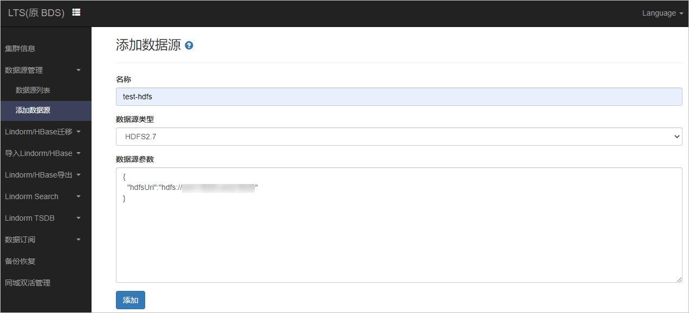

3. 在**添加数据源**页面，配置以下参数。

   - **名称**：输入数据源的名称。

   - **数据源类型**：固定选择**HDFS2.7**。

   - **数据源参数**：输入HDFS的namenode域名和端口，格式为 `hdfs://xnn1:port,xnn2:port` 。

4. 单击**添加**。

<a id="section-3-3-5"></a>

### 3.3.5. 添加OSS数据源

添加OSS数据源用于实现云原生多模数据库Lindorm宽表引擎读取OSS的数据。如果您要将OSS数据导入到云原生多模数据库Lindorm宽表中，需要先添加OSS数据源。本文介绍如何添加OSS数据源。

**前提条件**

- 已购买LTS服务，具体操作请参见购买并登录LTS。

**操作步骤**

1. 访问LTS操作页面。

2. 在左侧导航栏中，选择**数据源管理 > 添加数据源**。

   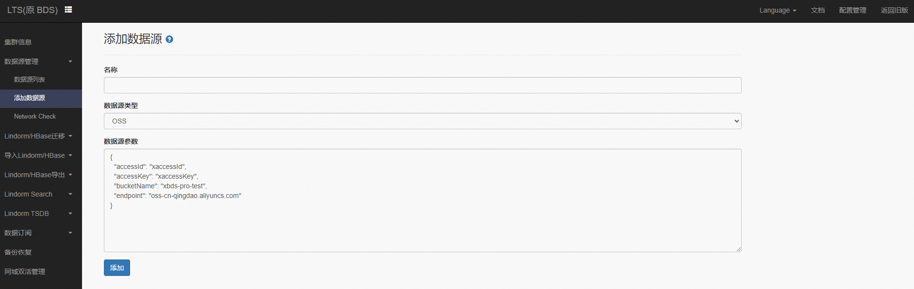

3. 在**添加数据源**页面，配置以下参数。

   - **名称**：输入数据源的名称。

   - **数据源类型**：固定选择**OSS**。

   - **数据源参数**：代码如下。

     ```json
     {
       "accessId": "xaccessId", 
       "accessKey": "xaccessKey",
       "bucketName": "xbds-pro-test",
       "endpoint": "oss-cn-qingdao-internal.aliyuncs.com"
     }
     ```

     参数说明

     | 参数 | 说明 |
     | --- | --- |
     | accessId | 访问OSS文件的阿里云账号或RAM用户的AccessKey ID。 |
     | accessKey | 访问OSS文件的阿里云账号或RAM用户的AccessKey Secret。 |
     | bucketName | 访问的BucketName。 |
     | endpoint | OSS地域的内网Endpoint。 |

4. 单击**添加**。

<a id="section-3-4"></a>

## 3.4. Lindorm/HBase迁移

<a id="section-3-4-1"></a>

### 3.4.1. HBase数据迁移

本文介绍自建HBase数据迁移的使用场景、功能列表、迁移优势、使用限制以及迁移任务等操作。

**使用场景**

- 大版本升级：HBase1.x升级HBase2.x。

- 跨地域迁移 ：例如从青岛机房迁移到北京机房。

- 集群升配：从4核8G迁移到8核16G集群。

- 业务拆分：将部分业务迁移到新的集群。

**功能说明**

- 支持HBase（094、098、1.x、2.x）和Lindorm任意版本之间的不停机迁移。

- 支持表结构迁移、实时数据同步、全量数据迁移。

- 支持整库迁移、Namespace迁移、表级别迁移。

- 迁移支持表重命名。

- 迁移支持指定时间范围、Rowkey范围、指定列。

- 提供OpenAPI，支持调用API创建迁移任务。

**迁移优势**

- 不停服数据迁移，同时完成历史数据迁移、实时增量数据的同步。

- 迁移过程中，自建HBase不会和源集群的HBase交互，只读取源集群的HDFS，将有效减少对源集群在线业务的影响。

- 文件层的数据拷贝比通常API层的数据迁移通常能节省50%以上的流量高效性。

- 单个节点迁移速度可达到150 MB/s，节点数支持水平扩展，可满足TB、PB级别的数据迁移。

- 有完善的错误重试机制、实时监控任务速度和进度，支持任务失败报警。

- 自动同步Schema，保证分区一致。

**使用限制**

- 不支持开启Kerberos集群。

- 不支持单节点云HBase实例。

- 由于网络原因，不支持经典网络下的云HBase实例。

- 增量数据同步基于HBase WAL实现异步数据同步，Bulkload的数据和不写WAL的数据将不会被同步。

**注意事项**

- 迁移前请确认目标集群的HDFS容量，防止迁移过程中出现容量写满的情况。

- 增量同步提交前，推荐修改一下源集群的日志保留时间，给增量同步出错预留一些处理的时间（hbase-site.xml的hbase.master.logcleaner.ttl调大为12小时以上，重启HMaster）。

- 客户无需在目标集群创建表，BDS同步服务会自动创建和源集群一样的表，包括分区的信息。客户自建的目标表可能会和源表分区很不一致，这可能会导致迁移完成之后，目标表会进行频繁的split、compaction，如果表的数据量十分庞大，可能会导致这个过程非常耗时。

- 如果源表带有coprocessor，在创建目标表的时候需要确保目标集群包含coprocessor对应的JAR包。

- 开启增量同步后，如果不消费数据，默认日志会保留48小时，超时后订阅关系自动取消，保留的数据自动删除。

**前提条件**

- 检查源集群、目标集群、LTS的网络连通性。

- 添加HBase、Lindorm数据源。如何添加，请参见添加HBase数据源和添加Lindorm宽表数据源。

- 登录LTS操作页面。

**创建任务**

1. 在左侧导航选择**Lindorm/HBase迁移 > 一键迁移。**

2. 单击**创建任务。**

   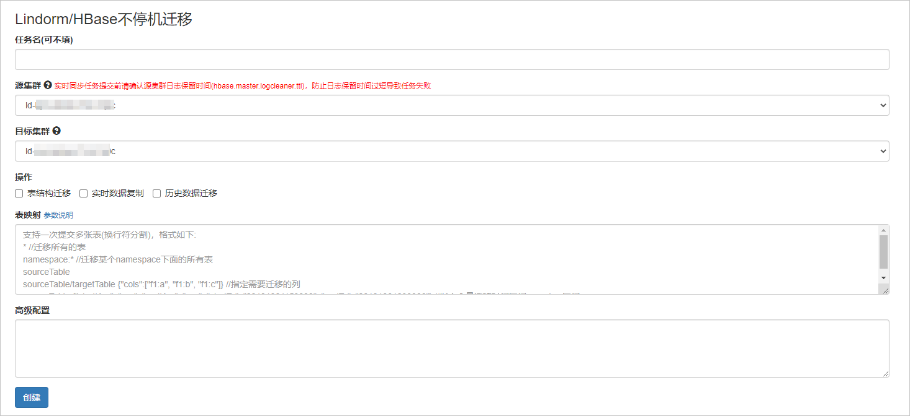

3. 在<strong>任务名（可不填）</strong>文本框中，填写任务名称。任务名只支持英文字符、数字。非必填项，未填写情况下默认任务ID为任务名。

4. 根据界面提示，设置**源集群**和**目标集群**。

5. 选择需要的操作。

- **表结构迁移**：在目标集群创建表（schema、分区信息一致）， 目标集群表已存在会跳过。

- **实时数据复制**：同步源集群实时增量的数据。

- **历史数据迁移**：文件级别的全量文件物理迁移。

6. 填写**表映射**和**高级配置**，高级配置为非必填项。

7. 单击**创建**。

**查看任务及任务详情**

1. 在左侧导航中，选择**Lindorm/HBase迁移 > 一键迁移**查看任务<strong>。</strong>

2. 单击需要查看的任务名，查看对应任务的执行情况。

**切流**

1. 等待全量任务迁移完成，增量迁移的时延比较小（几秒或者几百毫秒）。

2. 开启LTS数据抽样校验，对于大表的抽样校验，抽样比例不宜过大，避免对在线业务产生影响。

3. 业务验证。

4. 业务切流。

**常见问题**

Q：什么场景会导致“不消费数据”？

A：没有终止任务的前提下直接释放LTS集群；同步任务暂停；任务异常阻塞。

<a id="section-4"></a>

# 4.SDK参考

<a id="section-4-1"></a>

## 4.1. 宽表引擎

<a id="section-4-1-1"></a>

### 4.1.1. HBase API

<a id="section-4-1-1-1"></a>

#### 4.1.1.1. HBase Java SDK 安装&升级

通过HBase Java API访问Lindorm宽表，请参考以下说明升级HBase客户端版本

**Maven依赖**

- HBase 1.x版本客户端对应1.x版本的HBase集群。

- HBase 2.x版本客户端对应2.x版本的HBase集群。

- 新用户推荐使用2.x版本客户端。

**HBase 1.x版本**

```xml
<dependency>
  <groupId>com.aliyun.hbase</groupId>
  <artifactId>alihbase-client</artifactId>
  <version>1.8.2</version>
</dependency>
```

**HBase 2.x 版本**

```xml
<dependency>
  <groupId>com.aliyun.hbase</groupId>
  <artifactId>alihbase-client</artifactId>
  <version>2.8.2</version>
</dependency>
```

**其他情况**

> 目前已依赖社区版HBase客户端，但无法升级到上述推荐的版本。
>
> **说明**

通过Maven方式，使用与社区版本相适配的阿里云HBase客户端，请参见历史版本适配（Maven方式）。

通过Jar包替换的方式，使用与社区版本相适配的阿里云HBase客户端，请参见历史版本适配（Jar包替换）。

<a id="section-4-1-1-2"></a>

#### 4.1.1.2. HBase 非Java SDK 安装&访问

**简介**

Lindorm宽表通过Thrift支持非Java语言（C++/Python/Go等）访问，只要是Thrift支持的语言，都可以访问Lindorm宽表。Lindorm服务端的Thrift版本是0.12.0，虽然说thrift支持向后兼容，但如果有条件的用户，最好还是下载0.12.0的thrift。一些语言提供了管理依赖的方法，可以遵循这些语言的使用习惯来安装thrift，如Python语言可以通过 `pip install thrift` 来安装，Go语言可以直接在代码里 `import {"github.com/apache/thrift/lib/go/thrift"}` 即可。

Lindorm宽表使用的Thrift接口定义是HBase的thrift2。因此需要下载thrift2的定义文件生成相应语言的接口。相比thrift1定义，Lindorm中的thrift2接口定义更加清晰，用户可以获得和Java语言类似的API调用体验。之前的thrift2之所以使用不广泛是因为thrift2的接口不全，不支持建表删表等DDL操作。但是目前thrift2相关的API定义已经由阿里云的开发人员补全并回馈给了社区（HBASE-21649）。目前thrift2比thrift1的功能更全而且更容易使用。

**准备**

1. 下载Thrift安装包。

2. 下载HBase Thrift2定义文件。

**访问**

Thrift的使用帮助请参见Apache Thrift的官方文档，下面给出简单的使用方法。

1. 生成对应语言的接口定义文件从上述地址下载接口定义文件后，按照如下语法生成接口定义文件。

   ```text
   thrift --gen <language> Hbase.thrift
   ```

   例如：

   ```text
   1. thrift --gen php Hbase.thrift
   2. thrift --gen cpp Hbase.thrift
   3. thrift --gen py Hbase.thrift
   ```

2. 构造客户端访问Lindorm Lindorm中Thrift服务器端的transport层使用的是HTTP，因此在构造客户端时，需要thrift中的ThttpClient（各个语言都有相应实现）。并且在ACL开启的情况下，需要在ThttpClient上加上两个header来向服务器传输用户名和密码进行认证（如果关闭ACL则不需要）。Thrift在每个语言实现的ThttpClient都有加定制header的函数。如以Python语言的话，用以下方法构造客户端和设置连接串/用户名密码。更多语言示例可以参见demo。

   ```text
   1.  # -*- coding: utf-8  -*-
   2.  # 以下两个模块可以通过 pip install thrift 安装获得
   3.  from thrift.protocol import TBinaryProtocol
   4.  from thrift.transport import THttpClient
   5.
   6.  # 下⾯的模块通过 thrift --gen py hbase.thrift 来⽣成
   7.  from hbase import THBaseService
   8.  from hbase.ttypes import TColumnValue, TColumn, TTableName, TTableDescriptor, 
   TColumnFamilyDescriptor, TNamespaceDescriptor, TGet, TPut, TScan
   9.
   10. # 连接地址
   11. url = "http://host:9190"
   12. transport = THttpClient.THttpClient(url)
   13. headers = {}
   14. # ⽤户名
   15. headers["ACCESSKEYID"]="root";
   16. # 密码
   17. headers["ACCESSSIGNATURE"]="root"
   18. transport.setCustomHeaders(headers)
   19. protocol = TBinaryProtocol.TBinaryProtocolAccelerated(transport)
   20. client = THBaseService.Client(protocol)
   21. transport.open()
   22. # 具体操作，最后close连接
   23. transport.close()
   ```

**多语言Demo**

所有的Demo的完整的代码都上传到了GitHub上，包括该语言thrift定义文件，以及所依赖的libray（某些语言适用）。用户可以直接下载Github上相应语言的代码适用。

- Python

- Go

- C++

- node.js

- PHP

**更多语言**

更多语言的使用请参见Thrfit官方文档。

<a id="section-4-1-1-3"></a>

#### 4.1.1.3. 历史版本适配（Maven方式）

**说明**

本文档适用于目前已依赖社区版HBase客户端，但无法通过HBase Java SDK 安装&升级文档提供的方式升级到最新稳定版的阿里云HBase客户端。通过修改maven依赖的方式，升级到与社区版相适配的阿里云HBase客户端。

**应用直接依赖社区版HBase Client**

```xml
    <dependency>
          <groupId>org.apache.hbase</groupId>
          <artifactId>hbase-client</artifactId>
          <version>x.x.x</version>
    </dependency>
```

替换成

```xml
    <dependency>
        <groupId>com.alibaba.hbase</groupId>
        <artifactId>alihbase-client</artifactId>
        <version>x.x.x</version>
    </dependency>
    <!--${connector-version} 需要替换成hbase-client对应的版本,版本对应关系⻅最下⾯表格的依赖-->
    <dependency>
        <groupId>com.alibaba.hbase</groupId>
        <artifactId>alihbase-connector</artifactId>
        <version>${connector-version}</version>
        <exclusions>
            <exclusion>
                <groupId>org.apache.hbase</groupId>
                <artifactId>hbase-client</artifactId>
            </exclusion>
        </exclusions>
    </dependency>
```

**应用间接依赖社区版HBase Client**

适用于应用依赖的第三方包依赖了HBase。

```text
    <!--从第三⽅包依赖如下-->
    <dependency>
          <groupId>xxx.xxx.xxx</groupId>
          <artifactId>yyy</artifactId>
          <version>z.z.z</version>
    </dependency>
```

替换成

```text
    <!--从第三⽅包中去掉社区版hbase-client的依赖-->
    <dependency>
        <groupId>xxx.xxx.xxx</groupId>
        <artifactId>yyy</artifactId>
        <version>z.z.z</version>
        <exclusions>
            <exclusion>
                <groupId>org.apache.hbase</groupId>
                <artifactId>hbase-client</artifactId>
            </exclusion>
        </exclusions>
    </dependency>
    <!--增加alihbase-client的依赖-->
    <dependency>
        <groupId>com.alibaba.hbase</groupId>
        <artifactId>alihbase-client</artifactId>
        <version>x.x.x</version>
    </dependency>
    <!--${connector-version} 需要替换成hbase-client对应的版本,版本对应关系⻅最下⾯表格的依赖-->
    <dependency>
        <groupId>com.alibaba.hbase</groupId>
        <artifactId>alihbase-connector</artifactId>
        <version>${connector-version}</version>
        <exclusions>
            <exclusion>
                <groupId>org.apache.hbase</groupId>
                <artifactId>hbase-client</artifactId>
            </exclusion>
        </exclusions>
    </dependency>
```

**hbase-client同alihbase-connector对应关系**

| hbase-client版本 | connector版本 |
| --- | --- |
| 1.0.0 | 1.0.24.1 |
| 1.0.1 | 1.0.24.1 |
| 1.0.1.1 | 1.0.24.1 |
| 1.0.2 | 1.0.24.1 |
| 1.0.3 | 1.0.24.1 |
| 1.1.0 | 1.0.24.1 |
| 1.1.0.1 | 1.0.24.1 |
| 1.1.1 | 1.0.24.1 |
| 1.1.2 | 1.0.24.1 |
| 1.1.3 | 1.0.24.1 |
| 1.1.4 | 1.0.24.1 |
| 1.1.5 | 1.0.24 |
| 1.1.6 | 1.0.24 |
| 1.1.7 | 1.0.24 |
| 1.1.8 | 1.0.24 |
| 1.1.9 | 1.0.24 |
| 1.1.10 | 1.0.24 |
| 1.1.11 | 1.0.24 |
| 1.1.12 | 1.0.24 |
| 1.1.13 | 1.0.24 |
| 1.2.0 | 1.0.24.1 |
| 1.2.1 | 1.0.24 |
| 1.2.2 | 1.0.24 |
| 1.2.3 | 1.0.24 |
| 1.2.4 | 1.0.24 |
| 1.2.5 | 1.0.24 |
| 1.2.6 | 1.0.24 |
| 1.2.6.1 | 1.0.24 |
| 1.2.7 | 1.0.24 |
| 1.2.8 | 1.0.24 |
| 1.2.9 | 1.0.24 |
| 1.2.10 | 1.0.24 |
| 1.2.11 | 1.0.24 |
| 1.2.12 | 1.0.24 |
| 1.3.0 | 1.0.24 |
| 1.3.1 | 1.0.24 |
| 1.3.2 | 1.0.24 |
| 1.3.2.1 | 1.0.24 |
| 1.3.3 | 1.0.24 |
| 1.3.4 | 1.0.24 |
| 1.3.5 | 1.0.24 |
| 1.3.6 | 1.0.24 |
| 1.4.0 | 1.0.24 |
| 1.4.1 | 1.0.24 |
| 1.4.2 | 1.0.24 |
| 1.4.3 | 1.0.24 |
| 1.4.4 | 1.0.24 |
| 1.4.5 | 1.0.24 |
| 1.4.6 | 1.0.24 |
| 1.4.7 | 1.0.24 |
| 1.4.8 | 1.0.24 |
| 1.4.9 | 1.0.24 |
| 1.4.10 | 1.0.24 |
| 1.4.11 | 1.0.24 |
| 1.4.12 | 1.0.24 |
| 1.4.13 | 1.0.24 |
| 1.5.0 | 1.0.24 |
| 1.6.0 | 1.0.24 |
| 2.0.0 | 2.0.24 |
| 2.0.1 | 2.0.24 |
| 2.0.2 | 2.0.24.1 |
| 2.0.3 | 2.0.24.1 |
| 2.0.4 | 2.0.24.1 |
| 2.0.5 | 2.0.24.1 |
| 2.0.6 | 2.0.24.1 |
| 2.1.0 | 2.0.24 |
| 2.1.1 | 2.0.24.1 |
| 2.1.2 | 2.0.24.1 |
| 2.1.3 | 2.0.24.1 |
| 2.1.4 | 2.0.24.1 |
| 2.1.5 | 2.0.24.1 |
| 2.1.6 | 2.0.24.1 |
| 2.1.7 | 2.0.24.1 |
| 2.1.8 | 2.0.24.1 |
| 2.1.9 | 2.0.24.1 |
| 2.2.0 | 2.0.24.1 |
| 2.2.1 | 2.0.24.1 |
| 2.2.2 | 2.0.24.1 |
| 2.2.3 | 2.0.24.1 |

<a id="section-4-1-1-4"></a>

#### 4.1.1.4. 历史版本适配（Jar包替换）

**说明**

本文档适用于目前已依赖社区版HBase客户端，但无法通过HBase Java SDK 安装&升级文档提供的方式升级到最新稳定版的阿里云HBase客户端。通过直接在后端服务部署时替换成阿里云HBase Jar包的方式，升级到与社区版相适配的阿里云HBase客户端。

**替换访问**

在开源服务的lib目录下找到名为hbase-client-x.x.x.jar的jar包，x.x.x为hbase-client的版本号,替换成对应版本的alihbase-client jar包，假如原来jar包为hbase-client-1.0.0.jar则替换为alihbase-client-1.0.0.jar。

下载地址如下：

```text
https://hbaseuepublic.oss-cn-beijing.aliyuncs.com/alihbase-client-x.x.x.jar
```

**插件下载**

只下载访问增强版插件,不包含hbase client

```text
#1.x版本插件
https://hbaseuepublic.oss-cn-beijing.aliyuncs.com/alihbase-connector-1.0.24.jar
#2.x版本插件
https://hbaseuepublic.oss-cn-beijing.aliyuncs.com/alihbase-connector-2.0.24.jar
```

<a id="section-4-1-2"></a>

### 4.1.2. Cassandra CQL Driver

<a id="section-4-1-2-1"></a>

#### 4.1.2.1. Cassandra CQL Java Driver 安装和升级

通过Cassandra CQL Java Driver访问Lindorm宽表，请参考以下说明升级客户端版本

**Mavenue依赖**

可以用Datastax的java driver访问Lindorm的CQL，推荐不低于datastax java driver 3.7 版本，maven依赖如下：

```xml
<dependency>
    <groupId>com.datastax.cassandra</groupId>
    <artifactId>cassandra-driver-core</artifactId>
    <version>3.7.2</version>
</dependency>
```

这个依赖会引入一些公共库，为了避免依赖冲突导致不必要的麻烦，请先在一个新工程中测试。

<a id="section-4-1-3"></a>

### 4.1.3. Phoenix SQL API

<a id="section-4-1-3-1"></a>

#### 4.1.3.1. PhoenixSQL Java SDK安装

在您的工程中引入PhoenixSQL Java SDK的Maven依赖即可。

**Maven依赖**

只支持PhoenixSQL轻客户端访问：

```xml
<dependency> 
  <groupId>com.aliyun.phoenix</groupId>  
  <artifactId>ali-phoenix-queryserver-client</artifactId>
  <version>5.2.5-HBase-2.x</version>
</dependency>
```

**JDBC连接**

jdbc连接串格式如下。

```text
  jdbc:phoenix:thin:[key=value[;key=value...]]
```

简单示例

```text
  jdbc:phoenix:thin:url=http://localhost:8765;serialization=PROTOBUF
```

<a id="section-4-2"></a>

## 4.2. 时序引擎

> **重要**
>
> 时序引擎自2024年09月01日起**不再支持新购**，在此之前已购买的、通过TSDB迁移数据至时序引擎的用户仍可正常使用。

<a id="section-4-2-1"></a>

### 4.2.1. 使用详解

<a id="section-4-2-1-1"></a>

#### 4.2.1.1. 配置 TSDBConfig 类

时序引擎客户端的所有配置均由 TSDBConfig 类进行配置。

您可以通过 config() 方法构建 TSDBConfig 对象。具体配置说明见下面的示例代码。

示例代码

```text
TSDBConfig config = TSDBConfig
    // 配置地址，第⼀个参数可以是时序引擎的域名或 IP。第⼆个参数表示时序引擎端⼝。
    .address("example.tsdb.com", 8242)
    // tsdbuser和password 表示⽤于⽤户认证的⽤户名和密码。时序引擎⽤户可在实例管理控制台创建。如果实例未启⽤⽤户鉴权功
能，则创建Config对象时无需调⽤basicAuth()⽅法。
    .basicAuth("tsdbuser", "password")
    
    // 只读开关，默认为 false。当 readonly 设置为 true 时，异步写开关会被关闭。
    .readonly(false)

     // ⽹络连接池⼤⼩，默认为64。
    .httpConnectionPool(64)

    // HTTP 等待时间，单位为秒，默认为90秒。
    .httpConnectTimeout(90)

    // IO 线程数，默认为1。
    .ioThreadCount(1) 

    // 异步写开关。默认为 true。推荐异步写。
    .asyncPut(true)

    // 异步写相关，客户端缓冲队列⻓度，默认为10000。
    .batchPutBufferSize(20000)

    // 异步写相关，缓冲队列消费线程数，默认为 1。
    .batchPutConsumerThreadCount(2)

    // 异步写相关，每次批次提交给客户端点的个数，默认为 500。
    .batchPutSize(500)

    // 异步写相关，每次等待最⼤时间限制，单位为 ms，默认为 300。
    .batchPutTimeLimit(300)

    // 异步写相关，写请求队列数，默认等于连接池数。可根据读写次数的比例进⾏配置。
    .putRequestLimit(100) 

    // 异步写相关，不限制写请求队列数，若关闭可能导致 OOM，不建议关闭。
    .closePutRequestLimit()

    // 异步写相关，异步批量 Put 回调接⼝。
    .listenBatchPut(new BatchPutCallback() {
         // 写入成功时的回调
        @Override
        public void response(List<Point> input, Result output) {;;}
        // 写入出现失败时的回调
        @Override
        public void failed(String address, List<Point> input, Exception ex) {;;}
    })

    // 流量限制，设置每秒最⼤提交 Point 的个数。
    .maxTPS(50000)

    .config(); // 构造 TSDBConfig 对象
```

<a id="section-4-2-1-2"></a>

#### 4.2.1.2. 写入数据

时序引擎SDK使用Point 类，表示一个时间点。一个Point对象表示一个时间序列（时间线）某个时刻上的数据。

**构造时间点**

Point（时间点）有多种构造方法，形式比较多样化。本节提供三种构造时间点的方法示例。

> **说明**
>
> Point 的构建至少需要一个tag键值对。

**示例一**

构建一个时间点。用单位为秒的时间戳表示时间，指定Point数据的Metric与多个Tag。

```text
// 以'秒'为时间戳
int timestamp = (int)(System.currentTimeMillis()/1000);

// 构造 Point
Point point = Point.metric("test1")
                    .tag("tagk1", "tagv1")
                    .tag("tagk2", "tagv2")
                    .tag("tagk3", "tagv3")
                   .timestamp(timestamp).value(123.456)
                   .build();
            
```

**示例二**

构建一个时间点。用单位为毫秒的时间戳表示时间，指定Point数据的Metric，Tag使用Map形式的键值对。

```text
// 也可以'毫秒'为时间戳
long timestamp = System.currentTimeMillis();

// 使⽤ HashMap 表示 Tags
Map<String,String> tagsMap = new HashMap<String,String>();
tagsMap.put("tagk1", "tagv1");
tagsMap.put("tagk2", "tagv2");

// 构造 Point
Point point = Point.metric("test1")
                    .tag(tagsMap)
                   .value(timestamp,123.456)
                   .build();

            
```

**示例三**

构建一个时间点。使用java.util.Date表示时间。

```text
// 使⽤ java.util.Date 表示时间。
Point point = Point.metric("test1")
                    .tag("tagk1", "tagv1")
                   .value(new Date,123.456)
                   .build();
            
```

**写入数据**

时序引擎客户端有两种写数据的方式：同步阻塞的写数据和异步非阻塞的写数据。

**同步阻塞的写数**

假设我们现在需要构建 500 个时间点提交给 HiTSDB。

**示例代码**

```text
List<Point> points = new ArrayList<Point>();
构建 Point
for(int i = 0; i<500; i++) {
    long timestamp = System.currentTimeMillis();
    Point point = Point.metric("test1")
                   .tag("tagk1", "tagv1")
                   .value(timestamp, Math.random())
                   .build();
    // ⼿动打包数据
    points.add(point);
}

// ⼿动打包后提交数据
tsdb.putSync(points)
            
```

> **说明**
>
> 出于写入性能的考虑，同步写的方式一般需要您手动将数据点打包成一批数据，并且建议一批数据包含500～1000个数据点。此外，也建议多个线程并发进行提交。

**同步写的响应对象**

您可以根据需要选择返回的数据内容。

- 返回空对象，无内容。本质是调用  `POST /api/put` 。

```text
Result result = tsdb.putSync(ps);
            
```

- 返回提交概述。包含成功数和返回数。本质是调用  `POST /api/put?summary=true` 。

```text
SummaryResult summaryResult = tsdb.putSync(ps,SummaryResult.class);
            
```

- 返回提交概述。包含成功数、返回数和失败原因。本质是调用  `POST /api/put?details=true` 。

```text
DetailsResult detailsResult = tsdb.putSync(ps,DetailsResult.class);
            
```

**异步非阻塞的写数据**

异步写数据的方式比较简单，只要有 Point 就可以提交数据。客户端会自动帮助您批量地提交数据，不需要您手动打包。

如果没有特殊需求，推荐您使用异步非阻塞的写数据的方式。

**示例代码**

```text
// 构建 Point
Point point = Point.metric("test1")
                   .tag("tagk1", "tagv1")
                   .value(timestamp, Math.random())
                   .build();
// 直接提交数据
tsdb.put(point);
            
```

**异步非阻塞写数据的回调设置**

当您使用异步写数据的方式时，若需要获取 Put 接口的响应结果，则需要设置回调接口。

**示例代码**

```java
final AtomicLong num = new AtomicLong();

// 回调对象
BatchPutCallback cb = new BatchPutCallback() {

    @Override
    public void response(String address, List<Point> input, Result output) {
        long afterNum = num.addAndGet(input.size());
        System.out.println("成功处理" + input.size() + ",已处理" + afterNum);
    }

    @Override
    public void failed(String address, List<Point> input, Exception ex) {
        ex.printStackTrace();
        long afterNum = num.addAndGet(input.size());
        System.out.println("失败处理" + input.size() + ",已处理" + afterNum);
    }

};

HiTSDBConfig config = HiTSDBConfig
                        .address("example.hitsdb.com", 8242)
                        .listenBatchPut(cb)    // 设置回调接⼝
                        .config();

tsdb = HiTSDBClientFactory.connect(config);

            
```

时序引擎客户端提供了以下三种类型的 PutCallback 接口：

- BatchPutCallback，即调用 `POST /api/put`

- BatchPutSummaryCallback，即调用 `POST /api/put?summary=true`

- BatchPutDetailsCallback，即调用 `POST /api/put?details=true`

您可以通过设置不同类型的 BatchPutCallback 来根据需要选择返回的数据内容。

> **重要**
>
> - 尽量不要在回调方法中做耗时操作。若有此需要，可以再把操作交给其他工作线程执行。
>
> - 回调方法 `response()` 与 `failed()` 被调用的时机是不一样的。
>
>   - `response()` : 指的是写入请求合法且被服务端处理后执行的回调。此时可以根据回调对象种类的不同，获取一些不同的反馈信息。
>
>   - `failed()` : 指的是写入请求本身存在问题导致请求不合法（比如报文非法, 触发限流，鉴权失败等等）被服务端拒绝服务时所执行的回调。
>
> 因此建议在实现PutCallback接口时，不要忘记实现  `failed()`  方法。如果不实现的话，则会执行默认的 `failed()` 回调方法，其本身是一个空方法。

<a id="section-4-2-1-3"></a>

#### 4.2.1.3. 查询数据

数据查询需要先构建一个 Query 对象。Query 对象表示查询条件，用于指定符合条件的 tags，metric，和聚合查询条件等。

**构造查询条件**

**示例代码**

构建一个 Query 对象，即查询条件：

```text
Query query = Query
    .timeRange(startTime, endTime)    // 设置查询时间条件
    .sub(SubQuery.metric("hello").aggregator(Aggregator.AVG).tag("tagk1", "tagv1").build())    // 设置⼦
查询
    .sub(SubQuery.metric("world").aggregator(Aggregator.SUM).tag("tagk2", "tagv2").build())    // 设置⼦
查询
    .build();
```

**子查询**

每个 Query 对象可以设置多个 SubQuery，进行多个条件的查询。

**示例代码**

一个典型的子查询的构造：

```text
SubQuery subQuery = SubQuery
           .metric("test-metric")
           .aggregator(Aggregator.AVG)
           .downsample("60m-avg")
           .tag("tagk1", "tagv1")
           .tag("tagk2", "tagv2")
           .build();
```

其中，SubQuery 表示子查询对象，Aggregator 是一个枚举类型。

**同步查询**

时序引擎 SDK 提供了线程同步的数据查询。

**示例代码**

使用 query 方法同步的查询数据：

```java
List<QueryResult> result = tsdb.query(query);
System.out.println("返回结果：" + result);
```

**异步查询**

时序引擎 SDK 提供了线程异步的数据查询。

**示例代码**

使用 query 方法异步的查询数据，并通过设置回调来设置异步查询后的行为：

```java
QueryCallback cb = new QueryCallback() {

    @Override
    public void response(Query input, List<QueryResult> result) {
        System.out.println("查询参数：" + input);
        System.out.println("返回结果：" + result);
    }

 };

 tsdb.query(query, cb);
```

**逆序排序查询**

时序引擎 SDK 提供查询结果的逆序和顺序返回。通过 getOrderDps(boolean ordeset)接口函数查询结果逆序排序的查询，getOrderDps(true) 实现逆序，getOrderDps() 实现时间戳顺序来返回结果。

**示例代码**

```java
Query query = Query
        .timeRange(current - 1000,start + 1000)
        .sub(SubQuery.metric(metric).aggregator(Aggregator.NONE).tag(tags).build())
        .build();        

try {
     // 执⾏查询，并获取查询结果
     List<QueryResult> result = tsdb.query(query);


     for(QueryResult queryResult : result){
         // 获取无序数据点
         System.out.println(queryResult.getDps());
         System.out.println("-------------");
         // 获取按时间戳由⼩到⼤排序的数据点集合
         System.out.println(queryResult.getOrderDps());
         System.out.println("-------------");
         // 获取按时间戳由⼤到⼩排序的数据点集合
         System.out.println(queryResult.getOrderDps(true));
      }
} catch (HttpUnknowStatusException e) {
      e.printStackTrace();
}
```

**查询结果**

使用 query 方法查询的数据以List&lt;QueryResult>的形式返回，其中的QueryResult是每个子查询的查询结果。您可以使用QueryResult的getDps()方法获取查询的数据。

**最新数据点查询**

时序引擎 SDK 提供查询指定时间戳前的最新数据点功能。代码示例：

**示例1**

子查询条件为metric和tags的查询：

```java
// 构建tags
Map<String,String> tags = new HashMap<String, String>();
tags.put("uid","1");
tags.put("id","6");
 
String metric = "test.1";
// 构建最新点查询
LastPointQuery query = LastPointQuery.builder()
        // 指定时间戳
        .timestamp(1537520409729l)
        // 以指定时间戳向前推进⼏个⼩时，默认为0，即指定时间戳所在的⼩时时间;
        // -1 表示向前推进直到找到数据为⽌
        .backScan(0)
        // 是否使⽤毫秒时间戳查询
        .msResolution(true)
        // 构建最新点⼦查询，⽤于查询指定时间线下的最新数据点，
        // 可以同时指定多个⼦查询
        .sub(LastPointSubQuery.builder(metric,tags).build()).build();

// 时间线最新点查询结果，每条时间线对应⼀个LastDataValue
List<LastDataValue> lastDataValues = tsdb.queryLast(query);

System.out.println(lastDataValues);
```

其中，tsuids可以通过示例1的查询结果获取到，即首次使用示例1进行查询，将查询结果中的tsuids保存下来，下次可以直接使用tsuids来构建查询。

<a id="section-4-2-1-4"></a>

#### 4.2.1.4. 调用其他接口

**TTL**

TTL 表示数据时效。

**示例代码**

设置 ttl，单位为秒：

```text
tsdb.ttl(time);
```

获取 ttl，单位为秒：

```text
int ttl = tsdb.ttl();
```

**Suggest**

查询 Metric，TagKey，TagValue 。

**示例代码**

查询以 hel 开头的 10 个 Metric 名称：

```java
List<String> metrics = tsdb.suggest(Suggest.Metrics, "hel", 10);
System.out.println("查询结果：" + metrics);
```

**DumpMeta**

由 TagKey 查 TagValue 。

**示例代码**

查询 Tag 名称为"tagk1"，值为"tagv1"开头的 10 个 Tag 键值对：

```java
List<TagResult> dumpMeta = tsdb.dumpMeta("tagk1", "tagv1", 10);
System.out.println("查询结果：" + dumpMeta);
```

**DeleteData**

删除一段时间的数据。

**示例代码**

删除 Metric 名称为”hello”，在 startTime 到 nowTime 内的所有数据：

```text
tsdb.deleteData("hello", startTime, nowTime);
```

**Truncate**

清空所有表的数据

**示例代码**

```text
tsdb.truncate()
```

<a id="section-4-2-1-5"></a>

#### 4.2.1.5. 关闭客户端

本章节介绍关闭时序引擎客户端的相关操作方式。

**优雅关闭**

时序引擎客户端提供了优雅关闭功能。客户端在关闭过程中会被阻塞住，直到服务器处理完所有请求。建议您使用优雅关闭功能，以防数据丢失。

**示例代码**

```text
tsdb.close();   // 等价于 tsdb.close(false);
```

**强制关闭**

若不需要使用优雅关闭功能，可以直接关闭客户端。

**示例代码**

```text
tsdb.close(true);
```

<a id="section-4-2-2"></a>

### 4.2.2. 常用类及其方法

<a id="section-4-2-2-1"></a>

#### 4.2.2.1. SDK 常用类概览

本文按照 SDK 包名罗列了时序引擎 SDK 中常用的类。关于某些重要的常用类的详细信息和方法说明，请单击它们的类名链接查看相应文档。

**包名：com.aliyun.hitsdb.client**

<table>
  <tr>
    <th width="182">类名</th>
    <th>描述</th>
  </tr>
  <tr>
    <td>TSDBConfig</td>
    <td>时序引擎配置类；所有的客户端选项都在这个类中进行配置。</td>
  </tr>
  <tr>
    <td>TSDBConfig.Builder</td>
    <td>TSDBConfig 的构建器类；TSDBConfig 对象由该类生产。</td>
  </tr>
  <tr>
    <td>TSDBClientFactory</td>
    <td>时序引擎对象的工程类；通过 TSDBConfig 对象生产 TSDB 对象。</td>
  </tr>
  <tr>
    <td>TSDBClient</td>
    <td>时序引擎操作类；用于实现 com.aliyun.hitsdb.client.TSDB 接口。该类线程安全，对时序引擎的操作都由该类完成。一般情况下，全局只需要一个时序引擎类对象。</td>
  </tr>
  <tr>
    <td>TSDB</td>
    <td>TSDBClient 接口类</td>
  </tr>
</table>

**包名：com.aliyun.hitsdb.client.value.request**

| 类名 | 描述 |
| --- | --- |
| Point | 时间点；表示需要写入时序引擎 的数据。 |
| Point.MetricBuilder | 时间点（Point）的构造类；Point 对象由这个类构建。 |
| Timeline | 时间线类；表示 时序引擎 的时间线。 |
| Query | 查询类 |
| Query.Builder | 查询类构造类 |
| SubQuery | 子查询类 |
| SubQuery.Builder | 子查询类构造类 |
| Filter | Filter 查询过滤类 |
| Filter.Builder | Filter 类，Filter 类的构造类。 |
| MetricTimeRange | MetricTimeRange 值 |
| TTLValue | TTL 值 |
| SuggestValue | SuggestValue 值 |

**包名：com.aliyun.hitsdb.client.value.response**

| 类名 | 描述 |
| --- | --- |
| QueryResult | 查询结果类 |
| SQLResult | SQL查询结果 |
| TagResult | Tag 查询结果 |
| LastDPValue | 最后的查询结果值 |

**包名：com.aliyun.hitsdb.client.value.type**

| 类名 | 描述 |
| --- | --- |
| Aggregator | 聚合计算类型 |
| FilterType | 过滤类型 |
| Suggest | 查询结果类 |

**包名：com.aliyun.hitsdb.client.callback**

| 类名 | 描述 |
| --- | --- |
| QueryCallback | 查询结果回调类 |
| BatchPutCallback | 写入回调类 |
| BatchPutDetailsCallback | 写入回调类 |
| BatchPutSummaryCallback | 写入回调类 |

**包名：com.aliyun.hitsdb.client.exception**

| 类名 | 描述 |
| --- | --- |
| BufferQueueFullException | 队列已满 |

**包名：com.aliyun.hitsdb.client.exception.http**

| 类名 | 描述 |
| --- | --- |
| HttpClientConnectionRefusedException | 时序引擎服务器拒绝连接 |
| HttpClientException | 客户端异常 |
| HttpClientInitException | 客户端初始化异常 |
| HttpClientSocketTimeoutException | 客户端网络超时 |
| HttpServerErrorException | 服务器返回 500 及 500 以上的错误码 |
| HttpServerNotSupportException | 服务器返回 400 及 400 以上的错误码 |
| HttpUnknowStatusException | 服务器返回未定义的错误码 |

<a id="section-4-2-2-2"></a>

#### 4.2.2.2. TSDBClient

类全名：com.aliyun.hitsdb.client.TSDBClient

java.lang.Object

com.aliyun.hitsdb.client.TSDBClient

所有已实现的接口：

TSDB、Closeable、AutoCloseable

```java
public class TSDBClient extends Object implements TSDB
```

构造器概要：TSDBClient(TSDBConfig config)方法概要

<table>
  <tr>
    <th width="197">限定符和类型</th>
    <th>方法和说明</th>
  </tr>
  <tr>
    <td>void</td>
    <td>close()关闭时序引擎客户端。</td>
  </tr>
  <tr>
    <td>void</td>
    <td>close(boolean force)关闭时序引擎客户端。</td>
  </tr>
  <tr>
    <td>void</td>
    <td>delete(Query query)数据删除方法。目前该方法不生效！</td>
  </tr>
  <tr>
    <td>void</td>
    <td>deleteData(String metric, Date startDate, Date endDate)删除数据。指定Metric，指定时间范围，删除符合条件的数据。</td>
  </tr>
  <tr>
    <td>void</td>
    <td>deleteData(String metric, long startTime, long endTime)删除数据。指定Metric，指定时间范围，删除符合条件的数据。</td>
  </tr>
  <tr>
    <td>void</td>
    <td>deleteMeta(String metric, Map&lt;String,String&gt; tags)删除时间线，并且删除时间线相关的所有数据。</td>
  </tr>
  <tr>
    <td>void</td>
    <td>deleteMeta(Timeline timeline)删除时间线，并且删除时间线相关的所有数据。</td>
  </tr>
  <tr>
    <td>List&lt;TagResult&gt;</td>
    <td>dumpMeta(String tagkey, String tagValuePrefix, int max)获取Tag相关信息。</td>
  </tr>
  <tr>
    <td>List&lt;QueryResult&gt;</td>
    <td>last(Query query,int num)查询数据方法。</td>
  </tr>
  <tr>
    <td>List&lt;LastDPValue&gt;</td>
    <td>lastdp(Collection&lt;Timeline&gt; timelines)返回某个时间线上的最后一个值。</td>
  </tr>
  <tr>
    <td>List&lt;LastDPValue&gt;</td>
    <td>lastdp(Timeline… timelines)返回某个时间线上的最后一个值。</td>
  </tr>
  <tr>
    <td>void</td>
    <td>put(Point… points)异步的将时间点写入时序引擎。</td>
  </tr>
  <tr>
    <td>void</td>
    <td>put(Point point)异步的将时间点写入时序引擎。put(Point point)</td>
  </tr>
  <tr>
    <td>&lt;T extends Result&gt;T</td>
    <td>putSync(Class&lt;T&gt; resultType, Collection&lt;Point&gt; points)同步的将时间点写入时序引擎。</td>
  </tr>
  <tr>
    <td>&lt;T extends Result&gt;T</td>
    <td>putSync(Class&lt;T&gt; resultType, Point… points)同步的将时间点写入时序引擎</td>
  </tr>
  <tr>
    <td>Result</td>
    <td>putSync(Collection&lt;Point&gt; points)同步的将时间点写入时序引擎</td>
  </tr>
  <tr>
    <td>&lt;T extends Result&gt;T</td>
    <td>putSync(Collection&lt;Point&gt; points, Class&lt;T&gt; resultType)同步的将时间点写入时序引擎。</td>
  </tr>
  <tr>
    <td>Result</td>
    <td>putSync(Point… points)同步的将时间点写入时序引擎。</td>
  </tr>
  <tr>
    <td>List&lt;QueryResult&gt;</td>
    <td>query(Query query)查询数据方法</td>
  </tr>
  <tr>
    <td>void</td>
    <td>query(Query query, QueryCallback callback)查询数据方法</td>
  </tr>
  <tr>
    <td>List&lt;String&gt;</td>
    <td>suggest(Suggest type, String prefix, int max)该方法用于查询数据符合条件的metric列表</td>
  </tr>
  <tr>
    <td>int</td>
    <td>ttl()获取ttl数值的方法。单位：秒</td>
  </tr>
  <tr>
    <td>void</td>
    <td>ttl(int lifetime)设置ttl数值的方法。单位：秒</td>
  </tr>
  <tr>
    <td>void</td>
    <td>ttl(int lifetime,TimeUnit unit)</td>
  </tr>
</table>

从类继承的方法 java.lang.Object

clone、equals、finalize、getClass、hashCode、notify、notifyAll、toString、wait、wait、wait

构造器详细资料

TSDBClient

```text
public TSDBClient(TSDBConfig config) throws HttpClientInitException
```

抛出：

HttpClientInitException

方法详细资料

close

```text
public void close() throws IOException
```

- 指定者：

  close在接口中Closeable

- 指定者：

  close在接口中AutoCloseable

- 抛出：

  IOException

close

```text
public void close(boolean force) throws IOException
```

关闭时序引擎实例。该方法在程序结束前调用。

- 指定者：

  close 在接口中 TSDB

- 参数：

  force - true or false

- 抛出：

  IOException - exception

deleteData

```text
public void deleteData(String metric, long startTime, long endTime)
```

- 指定者：

  deleteData 在接口中 TSDB

- 参数：

  - metric - metric

  - startTime - start timestamp

  - endTime - end timestamp

deleteData

```text
public void deleteData(String metric, Date startDate, Date endDate)
```

指定Metric，指定时间范围内的数据都删除。

- 指定者：

  deleteData 在接口中 TSDB

- 参数：

  - metric - metric name

  - startDate - start date

  - endDate - end date

deleteMeta

```text
public void deleteMeta(String metric，Map<String,String> tags)
```

删除时间线数据。

- 指定者：

  deleteMeta 在接口中 TSDB

- 参数

  - metric - Metric，度量名称，指标名称t

  - tags - 以Map表示的Tag键值对。

deleteMeta

```text
public void deleteMeta(Timeline timeline)
```

删除时间线数据。/div>

- 指定者：

  deleteMeta 在接口中 TSDB

- 参数

  - deleteMeta 在接口中 TSDB

  - timeline - Timeline 时间线类的实例。

dumpMeta

```text
public List<TagResult> dumpMeta(String tagkey, String tagValuePrefix, int max)
```

获取符合条件的Tag列表

- 指定者：

  dumpMeta 在接口中 TSDB

- 参数

  - tagkey - Tag的名称

  - tagValuePrefix - Tag值的前缀

  - max - 最大数量

- 返回:

  the List of the TagResult

put

```text
public void put(Point point)
```

异步写数据

- 指定者：

  put 在接口中 TSDB

- 参数p

  point - 时间点

query

```text
public List<QueryResult> query(Query query)
```

查询数据

- 指定者：

  query 在接口中 TSDB

- 参数

  query - Query 查询类实例

- 返回

  result : QueryResult 查询结果类的实例。

query

```text
public void query(Query QueryCallback
```

异步查询方法，查询结果在回调中返回。

- 指定者：

  query 在接口中 TSDB

- 参数

  - query - Query 查询类实例

  - callback - 查询回调接口的实例。查询结果会在回调方法中异步返回。

suggest

```text
public List<String> suggest(Suggest type, String prefix, int max)
```

suggest method

- 指定者：

  suggest 在接口中 TSDB

- 参数

  - type - 数据类型

  - prefix - 前缀

  - max - 最大数量

- 返回：

  result

ttl

```text
public int ttl()
```

获取TTL数值。单位：秒

- 指定者：

  suggest 在接口中 TSDB

- 返回：

  ttl值，单位为秒。

ttl

```text
public void ttl(int lifetime)
```

设置TTL数值。

- 指定者：

  ttl 在接口中 TSDB

- 参数：

  lifetime - ttl的数值。单位为秒。

ttl

```text
public void ttl(int lifetime, TimeUnit unit)
```

- 指定者：

  ttl 在接口中 TSDB

- 参数:

  - lifetime - ttl的数值。

  - unit - ttl的单位。

last

```text
public List<QueryResult> last(Query query, int num) throws HttpUnknowStatusException
```

- 指定者：

  last 在接口中 TSDB

- 参数:

  - query - Query 查询类实例。

  - num - 需要的查询结果中时间线上最后点的个数

- 返回：

  查询结果列表

- 抛出：

  HttpUnknowStatusException - Exception

putSync

```text
public Result putSync(Collection<Point> points)
```

同步写入时间点

- 指定者：

  putSync 在接口中 TSDB

- 参数：

  points - 时间点数量。

- 返回：

  Result实例。该对象无实际作用，只是用来表示方法返回了。

putSync

```text
public <T extends Result> T putSync(Collection<Point> points, Class<T> resultType)
```

同步写入方法

- 指定者：

  putSync 在接口中 TSDB

- 类型参数：

  T - Result.class, SummaryResult.class, DetailsResult.class

- 参数:

  - points - 时间点的集合。

  - resultType - 结果类型

- 返回

  Result实例。

delete

```text
public void delete(Query query) throws HttpUnknowStatusException
```

删除方法，该方法尚未生效。

- 指定者：

  delete 在接口中 TSDB

- 参数：

  query - query

- 抛出：

  HttpUnknowStatusException - Exception

lastdp

```text
public List<LastDPValue> lastdp(Collection<Timeline> timelines) throws HttpUnknowStatusException
```

获取指定时间线上的最后一个数据点。

- 指定者：

  lastdp 在接口中 TSDB

- 参数：

  timelines - Timelines实例。

- 返回

  结果

- 抛出：

  HttpUnknowStatusException - Exception

lastdp

```text
public List<LastDPValue> lastdp(Timeline… timelines) throws HttpUnknowStatusException
```

获取指定时间线上的最后一个数据点。

- 指定者：

  lastdp 在接口中 TSDB

- 参数：

  timelines - 时间线的值。

- 返回

  List

- 抛出：

  HttpUnknowStatusException - Exception

put

```text
public void put(Point… points)
```

异步写时间点指定者:

- 指定者：

  put 在接口中 TSDB

- 参数：

  points - 时间点集合

putSync

```text
public Result putSync(Point… points)
```

同步写时间点

- 指定者：

  putSync 在接口中 TSDB

- 参数：

  points - 时间点集合

- 返回：

  Result

putSync

```text
public <T extends Result> T putSync(Class<T> resultType, Collection<Point> points)
```

同步写

- 指定者：

  putSync 在接口中 TSDB

- 类型参数

  T - Result.class, SummaryResult.class, DetailsResult.class

- 参数:

  - resultType - 结果类型

  - points - 时间点集合

- 返回：

  Result

putSync

```text
public <T extends Result> T putSync(Class<T> resultType, Point… points)
```

同步写方法

- 指定者：

  putSync 在接口中 TSDB

- 类型参数

  T - Result.class, SummaryResult.class, DetailsResult.class

- 参数:

  - resultType - 结果类型

  - points - 时间点集合

- 返回：

  Result

<a id="section-4-2-2-3"></a>

#### 4.2.2.3. TSDBConfig

**类全名：com.aliyun.hitsdb.client.TSDBConfig**

java.lang.Object

com.aliyun.hitsdb.client.TSDBConfig

```java
public class TSDBConfig extends Object
```

嵌套类概要

| 限定符和类型 | 类和说明 |
| --- | --- |
| static class | TSDBConfig.Builder |

构造器概要：TSDBConfig()

方法概要

| 限定符和类型 | 方法和说明 |
| --- | --- |
| static TSDBConfig.Builder | address(String host, int port)配置TSDB地址，获取TSDB.Builder。 |
| int | getBatchPutBufferSize()获取BatchPutBuffer数。即异步提交缓冲区大小。 |
| AbstractBatchPutCallback | getBatchPutCallback()获取异步提交回调接口的实例。 |
| int | AbstractBatchPutCallback&lt;?&gt; getBatchPutCallback()获取异步提交缓冲区消费线程数。 |
| int | getBatchPutConsumerThreadCount()获取重试次数。 |
| int | getBatchPutSize()获取自动打包每批次提交的点数。 |
| int | getBatchPutTimeLimit()获取最大写数据提交限制。单位：毫秒 |
| int | getHttpConnectionLiveTime()获取连接的生命时长。单位：秒 |
| int | getHttpConnectionPool()获取连接池最大连接数量 |
| int | getHttpConnectTimeout()获取HTTP连接超时时间，单位：秒 |
| int | getHttpKeepaliveTime()获取Keeplive时间。单位：秒 |
| int | getIoThreadCount()异步io线程数量。 |
| int | getMaxTPS()获取最大TPS数量 |
| boolean | isAsyncPut()获取是否异步写数据 |
| boolean | isHttpCompress()获取是否压缩传输数据 |

从类继承的方法 java.lang.Object

clone、equals、finalize、getClass、hashCode、notify、notifyAll、toString、wait、wait、wait

**构造器详细资料**

TSDBConfig

```text
public TSDBConfig()
```

**方法详细资料**

**address**

```text
public static TSDBConfig.Builder address(String host, int port)
```

**address**

```text
public static TSDBConfig.Builder address(TSDBNetAddress… netAddresses)
```

**getPutRequestLimit**

```text
public int getPutRequestLimit()
```

**getBatchPutBufferSize**

```text
public int getBatchPutBufferSize()
```

**getBatchPutCallback**

```text
public AbstractBatchPutCallback<?> getBatchPutCallback()
```

**getBatchPutConsumerThreadCount**

```text
public int getBatchPutConsumerThreadCount()
```

**getBatchPutRetryCount**

```text
public int getBatchPutRetryCount()
```

**getBatchPutSize**

```text
public int getBatchPutSize()
```

**getBatchPutTimeLimit**

```text
public int getBatchPutTimeLimit()
```

**getHttpConnectionPool**

```text
public int getHttpConnectionPool()
```

**getHttpConnectTimeout**

```text
public int getHttpConnectTimeout()
```

**getIoThreadCount**

```text
public int getIoThreadCount()
```

**isPutRequestLimitSwitch**

```text
public boolean isPutRequestLimitSwitch()
```

**isHttpCompress**

```text
public boolean isHttpCompress()
```

**isBackpressure**

```text
public boolean isBackpressure()
```

**getHttpConnectionLiveTime**

```text
public int getHttpConnectionLiveTime()
```

**getHttpKeepaliveTime**

```text
public int getHttpKeepaliveTime()
```

**isAsyncPut**

```text
public boolean isAsyncPut()
```

**getMaxTPS**

```text
public int getMaxTPS()
```

<a id="section-4-2-2-4"></a>

#### 4.2.2.4. TSDBConfig.Builder

**类全名：com.aliyun.hitsdb.client.TSDBConfig.Builder**

java.lang.Object

com.aliyun.hitsdb.client.TSDBConfig.Builder

封闭类：TSDBConfig

```text
public static class TSDBConfig.Builder extends Object
```

**构造器概要**

**构造器和说明**

```text
Builder(Stringhost, intport) 
使⽤时序引擎地址与端⼝创建TSDBConfig.Builder实例
```

方法概要

<table>
  <tr>
    <th width="182">限定符和类型</th>
    <th>方法和说明</th>
  </tr>
  <tr>
    <td>TSDBConfig.Builder</td>
    <td>asyncPut(boolean asyncPut)异步写开关。默认为 true。推荐异步写。</td>
  </tr>
  <tr>
    <td>TSDBConfig.Builder</td>
    <td>batchPutBufferSize(int batchPutBufferSize)异步写相关，设置客户端缓冲队列长度，默认为10000。</td>
  </tr>
  <tr>
    <td>TSDBConfig.Builder</td>
    <td>batchPutConsumerThreadCount(int batchPutConsumerThreadCount)异步写相关，设置缓冲队列消费线程数，默认为1。</td>
  </tr>
  <tr>
    <td>TSDBConfig.Builder</td>
    <td>batchPutSize(int batchPutSize)异步写相关，设置每次批次提交给客户端点的个数，默认为500。</td>
  </tr>
  <tr>
    <td>TSDBConfig.Builder</td>
    <td>batchPutTimeLimit(int batchPutTimeLimit)异步写相关，每次等待最大时间限制，单位为 ms，默认为300。</td>
  </tr>
  <tr>
    <td>TSDBConfig.Builder</td>
    <td>closePutRequestLimit()异步写相关，不限制写请求队列数，若关闭可能导致 OOM，不建议关闭。</td>
  </tr>
  <tr>
    <td>TSDBConfig</td>
    <td>config()构造 TSDBConfig 对象</td>
  </tr>
  <tr>
    <td>TSDBConfig.Builder</td>
    <td>httpCompress(boolean httpCompress)是否开启Http传输压缩。</td>
  </tr>
  <tr>
    <td>TSDBConfig.Builder</td>
    <td>httpConnectionLiveTime(int httpConnectionLiveTime)连接存在时间长度。单位为秒。默认为0，即不生效。</td>
  </tr>
  <tr>
    <td>TSDBConfig.Builder</td>
    <td>httpConnectionPool(int connectionPool) HTTP连接池大小</td>
  </tr>
  <tr>
    <td>TSDBConfig.Builder</td>
    <td>httpConnectTimeout(int httpConnectTimeout) HTTP 等待时间，单位为秒，默认为90秒。</td>
  </tr>
  <tr>
    <td>TSDBConfig.Builder</td>
    <td>httpKeepaliveTime(int httpKeepaliveTime) HTTP Keepalive时间</td>
  </tr>
  <tr>
    <td>TSDBConfig.Builder</td>
    <td>ioThreadCount(int ioThreadCount) IO 线程数，默认为1。</td>
  </tr>
  <tr>
    <td>TSDBConfig.Builder</td>
    <td>listenBatchPut(AbstractBatchPutCallback&lt;?&gt; cb)设置异步写回调，异步批量 Put 回调接口。</td>
  </tr>
  <tr>
    <td>TSDBConfig.Builder</td>
    <td>maxTPS(int maxTPS)限制写入端最大TPS，默认不限制。</td>
  </tr>
  <tr>
    <td>TSDBConfig.Builder</td>
    <td>openHttpCompress()打开HTTP压缩传输</td>
  </tr>
  <tr>
    <td>TSDBConfig.Builder</td>
    <td>putRequestLimit(int limit)异步写相关，写请求队列数，默认等于连接池数。可根据读写次数的比例进行配置。</td>
  </tr>
  <tr>
    <td>TSDBConfig.Builder</td>
    <td>readonly()打开只读开关。当 readonly 设置为 true 时，异步写开关会被关闭。</td>
  </tr>
  <tr>
    <td>TSDBConfig.Builder</td>
    <td>readonly(boolean readonly)配置只读开关，默认为 false。当 readonly 设置为 true 时，异步写开关会被关闭。</td>
  </tr>
</table>

**从类继承的方法** java.lang.Object clone, equals, finalize, getClass, hashCode, notify, notifyAll, toString, wait, wait, wait

**构造器详细资料**

**Builder**

```text
public Builder(String host, int port)
```

**Builder**

```text
public Builder(TSDBNetAddress… netAddresses)
```

**方法详细资料**

**putRequestLimit**

```text
public TSDBConfig.Builder putRequestLimit(int limit)
```

**batchPutBufferSize**

```text
public TSDBConfig.Builder batchPutBufferSize(int batchPutBufferSize)
```

**batchPutConsumerThreadCount**

```text
public TSDBConfig.Builder batchPutBufferSize(int batchPutBufferSize)
```

**batchPutRetryCount**

```text
public TSDBConfig.Builder batchPutRetryCount(int batchPutRetryCount)
```

**batchPutSize**

```text
public TSDBConfig.Builder batchPutSize(int batchPutSize)
```

**batchPutTimeLimit**

```text
public TSDBConfig.Builder batchPutTimeLimit(int batchPutTimeLimit)
```

**closePutRequestLimit**

```text
public TSDBConfig.Builder closePutRequestLimit()
```

**closeBackpressure**

```text
public TSDBConfig.Builder closeBackpressure()
```

**backpressure**

```text
public TSDBConfig.Builder backpressure(boolean backpressure)
```

**httpConnectionLiveTime**

```text
public TSDBConfig.Builder httpConnectionLiveTime(int httpConnectionLiveTime)
```

**httpKeepaliveTime**

```text
public TSDBConfig.Builder httpKeepaliveTime(int httpKeepaliveTime)
```

**readonly**

```text
public TSDBConfig.Builder readonly()
```

**readonly**

```text
public TSDBConfig.Builder readonly(boolean readonly)
```

**asyncPut**

```text
public TSDBConfig.Builder asyncPut(boolean asyncPut)
```

**maxTPS**

```text
public TSDBConfig.Builder maxTPS(int maxTPS)
```

**config**

```text
public TSDBConfig config()
```

**httpCompress**

```text
public TSDBConfig.Builder httpCompress(boolean httpCompress)
```

**httpConnectionPool**

```text
public TSDBConfig.Builder httpConnectionPool(int connectionPool)
```

**httpConnectTimeout**

```text
public TSDBConfig.Builder httpConnectTimeout(int httpConnectTimeout)
```

**ioThreadCount**

```text
public TSDBConfig.Builder ioThreadCount(int ioThreadCount)
```

**listenBatchPut**

```text
public TSDBConfig.Builder listenBatchPut(AbstractBatchPutCallback<?> cb)
```

**openHttpCompress**

```text
public TSDBConfig.Builder openHttpCompress()
```

<a id="section-4-2-2-5"></a>

#### 4.2.2.5. TSDBClientFactory

**类全名：com.aliyun.hitsdb.client.TSDBClientFactory**

java.lang.Object

com.aliyun.hitsdb.client.TSDBClientFactory

```java
public class TSDBClientFactory extends Object
```

构造器概要：TSDBClientFactory()TSDB类实例的工程方法

方法概要

<table>
  <tr>
    <th width="121">限定符和类型</th>
    <th>方法和说明</th>
  </tr>
  <tr>
    <td>static TSDB</td>
    <td>connect(TSDBConfig config)静态方法。通过地址与端口，创建TSDB类实例。</td>
  </tr>
  <tr>
    <td>static TSDB</td>
    <td>connect(String host, int port)静态方法。通过TSDBConfig实例。创建TSDB类实例。</td>
  </tr>
</table>

从类继承的方法 java.lang.Object

clone、equals、finalize、getClass、hashCode notify、notifyAll、toString wait、wait、wait

**构造器详细资料**

**TSDBClientFactory**

```text
public TSDBClientFactory()
```

**方法详细资料**

**connect**

```text
public static TSDB connect(String host, int port) throws HttpClientInitException
```

抛出：HttpClientInitException

**connect**

```text
public static TSDB connect(TSDBConfig config) throws HttpClientInitException
```

抛出：HttpClientInitException

<a id="section-4-2-2-6"></a>

#### 4.2.2.6. Point

**类全名：com.aliyun.hitsdb.client.value.request.Point**

java.lang.Object

com.aliyun.hitsdb.client.value.JSONValue

com.aliyun.hitsdb.client.value.request.Point

```java
public class Point extends JSONValue
```

嵌套类概要

| 限定符和类型 | 类和说明 |
| --- | --- |
| static class | Point.MetricBuilder |

构造器概要：Point()

方法概要

| 限定符和类型 | 方法和说明 |
| --- | --- |
| static void | checkPoint(Point point)校验时间点格式 |
| String | getAggregator()获取Aggregator参数。 |
| String | getMetric()获取Metric名称 |
| Map&lt;String,String&gt; | getTags()获取Tags |
| Long | getTimestamp()获取时间戳 |
| Number | getValue()获取时间数值 |
| Long | getVersion()获取数值版本号 |
| static Point.MetricBuilder | metric(String metric)设置Metric。创建并获取一个Point.MetricBuilder实例（Point构建器类） |
| void | setAggregator(String aggregator)不推荐使用该方法。设置Aggregator。 |
| void | setMetric(String metric)不推荐使用该方法。设置Metric。 |
| void | setTags(Map&lt;String,String&gt; tags)不推荐使用该方法。设置Tags。 |
| void | setTimestamp(Long timestamp)不推荐使用该方法。设置时间戳。 |
| void | setValue(Number value)不推荐使用该方法。设置数值。 |
| void | setVersion(Long version)不推荐使用该方法。设置时间点版本。 |
| String | toJSON()转换为JSON |

从类继承的方法 com.aliyun.hitsdb.client.value.JSONValue

appendJSON、parseObject、toString

从类继承的方法 java.lang.Object

clone、equals、finalize、getClass、hashCode、notify、notifyAll、wait、wait、wait

**构造器详细资料**

**Point**

```text
public Point()
```

**方法详细资料**

**metric**

```text
public static Point.MetricBuilder metric(String metric)
```

set the metric

- 参数：

  metric - metric

- 返回：

  MetricBuilder get a builder

**getMetric**

```text
public String getMetric()
```

**getTags**

```text
public Map<String,String> getTags()
```

**getTimestamp**

```text
public Long getTimestamp()
```

**getValue**

```text
public Number getValue()
```

**getAggregator**

```text
public String getAggregator()
```

**getGranularityType**

```text
public Granularity getGranularityType()
```

**getGranularity**

```text
public String getGranularity()
```

**setMetric**

```text
public void setMetric(String metric)
```

**setTags**

```text
public void setTags(Map<String,String> tags)
```

**setTimestamp**

```text
public void setTimestamp(Long timestamp)
```

**setValue**

```text
public void setValue(Number value)
```

**setGranularity**

```text
public void setGranularity(String granularity)
```

**setAggregator**

```text
public void setAggregator(String aggregator)
```

**getVersion**

```text
public Long getVersion()
```

**setVersion**

```text
public void setVersion(Long version)
```

**toJSON**

```text
public String toJSON()
```

覆盖：

toJSON 在类中 JSONValue

**checkPoint**

```text
public static void checkPoint(Point point)
```

Checkout the point format

参数：

point - point

<a id="section-4-2-2-7"></a>

#### 4.2.2.7. Point.MetricBuilder

**类全名：com.aliyun.hitsdb.client.value.request.Point.MetricBuilder**

java.lang.Object

封闭类：Point

```text
public static class Point.MetricBuilder extends Object
```

构造器概要

- MetricBuilder()Point的构造器。

- MetricBuilder(String metric)Point的构造器，参数为Metric。

方法概要

| 限定符和类型 | 方法和说明 |
| --- | --- |
| Point.MetricBuilder | aggregator(String aggregator)设置Aggregator参数 |
| Point | build()构建一个时间点 |
| Point | build(boolean checkPoint)构建一个时间点 |
| Point.MetricBuilder | tag(Map&lt;String,String&gt; tags)添加一组Tag键值对 |
| Point.MetricBuilder | tag(String tagName,String value)添加一组Tag键值对 |
| Point.MetricBuilder | timestamp(Date date)设置时间戳。单位可以为秒或毫秒。 |
| Point.MetricBuilder | timestamp(long timestamp)设置时间戳。单位可以为秒或毫秒。 |
| Point.MetricBuilder | value(Date date,Number value)设置时间点的时间与数值。 |
| Point.MetricBuilder | value(long timestamp,Number value)设置时间点的数值。 |
| Point.MetricBuilder | value(Number value)设置时间点的数值。 |
| Point.MetricBuilder | version(Long version)设置时间点数值版本 |

从类继承的方法 java.lang.Object

clone、equals、finalize getClass、hashCode notify、notifyAll、toString、wait、wait、wait

**构造器详细资料**

**MetricBuilder**

```text
public MetricBuilder()
```

**MetricBuilder**

```text
public MetricBuilder(String metric)
```

**方法详细资料**

**tag**

```text
public Point.MetricBuilder tag(String tagName, String value)
```

添加一个Tag的键值对。

- 参数：

  - tagName - Tag名称

  - alue - Tag值返回:

- 返回：

  MetricBuilder

**tag**

```text
public Point.MetricBuilder tag(Map<String,String> tags)
```

添加一个Tag的键值对

- 参数：

  tags - Tag键值对组成的Map。

- 返回：

  MetricBuilder

**aggregator**

```text
public Point.MetricBuilder aggregator(String aggregator)
```

设置Aggregator值

- 参数：

  aggregator - Aggregator枚举实例

- 返回：

  MetricBuilder

**timestamp**

```text
public Point.MetricBuilder timestamp(long timestamp)
```

设置时间戳。单位可以为秒或毫秒。

- 参数：

  timestamp - 时间戳

- 返回：

  MetricBuilder

**timestamp**

```text
public Point.MetricBuilder timestamp(Date date)
```

设置时间戳。单位可以为秒或毫秒。

- 参数：

  date - java.util.Date表示的时间

- 返回：

  MetricBuilder

**value**

```text
public Point.MetricBuilder value(Number value)
```

设置时间点的数值。

- 参数：

  value - value

- 返回：

  MetricBuilder

**value**

```text
public Point.MetricBuilder value(long timestamp,  Number value)
```

设置时间点的时间与数值。

- 参数：

  - timestamp - 时间戳，单位为秒或毫秒。

  - value - 数值。其类型可以为：doube, long, int

- 返回：

  MetricBuilder

**value**

```text
public Point.MetricBuilder value(Date date,  Number value)
```

设置时间点的时间与数值。

- 参数：

  - timestamp - java.util.Date表示的时间

  - value - 数值。其类型可以为：doube, long, int

- 返回：

  MetricBuilder

**granularity**

```text
public Point.MetricBuilder granularity(Granularity granularity)
```

**version**

```text
public Point.MetricBuilder version(Long version)
```

**build**

```text
public Point build()
```

构建一个时间点

返回：

Point

**build**

```text
public Point build(boolean checkPoint)
```

构建一个时间点

<a id="section-4-2-2-8"></a>

#### 4.2.2.8. Query

**类全名：com.aliyun.hitsdb.client.value.response.QueryResult**

java.lang.Object

com.aliyun.hitsdb.client.value.JSONValue

com.aliyun.hitsdb.client.value.request.Query

```java
public class Query extends JSONValue
```

嵌套类概要

| 限定符和类型 | 类和说明 |
| --- | --- |
| static class | Query.Builder |

构造器概要：Query()

方法概要

<table>
  <tr>
    <th width="186">限定符和类型</th>
    <th>方法和说明</th>
  </tr>
  <tr>
    <td>Boolean</td>
    <td>getDelete()是否删除</td>
  </tr>
  <tr>
    <td>long</td>
    <td>getEnd()获取查询的时间范围的结束时间。</td>
  </tr>
  <tr>
    <td>List&lt;SubQuery&gt;</td>
    <td>getQueries()获取所有子查询。</td>
  </tr>
  <tr>
    <td>long</td>
    <td>getStart()获取查询的时间范围的开始时间。</td>
  </tr>
  <tr>
    <td>static Query.Builder</td>
    <td>start(Date startDate)不建议使用该方法。设置查询的时间范围的开始时间。</td>
  </tr>
  <tr>
    <td>static Query.Builder</td>
    <td>start(long startTime)不建议使用该方法。设置查询的时间范围的开始时间。</td>
  </tr>
  <tr>
    <td>static Query.Builder</td>
    <td>timeRange(Date startDate, Date endDate)设置查询的时间范围的开始时间与结束时间。并且获取Query.Builder实例</td>
  </tr>
  <tr>
    <td>static Query.Builder</td>
    <td>timeRange(long startTime, long endTime)设置查询的时间范围的开始时间与结束时间。并且获取Query.Builder实例</td>
  </tr>
</table>

从类继承的方法 com.aliyun.hitsdb.client.value.JSONValue

appendJSON、parseObject、toJSON、toString

从类继承的方法 java.lang.Object

clone、equals、finalize、getClass、hashCode、notify、notifyAll、wait、wait、wait

**构造器详细资料**

**Query**

```text
public Query()
```

**方法详细资料**

**start**

```text
public static Query.Builder start(long startTime)
```

设置查询的时间范围的开始时间。

- 参数：

  - startTime - 开始时间戳

- 返回：

  - 获取Query.Builder的实例

**start**

```text
public static Query.Builder start(Date startDate)
```

设置查询的时间范围的开始时间。

- 参数：

  startDate - start date

- 返回：

  Builder

**timeRange**

```text
public static Query.Builder timeRange(Date startDate, Date endDate)
```

设置开始时间与结束时间。

- 参数：

  - startDate - 开始时间

  - endDate - 结束时间

- 返回：

  Builder

**timeRange**

```text
public static Query.Builder timeRange(long startTime, long endTime)
```

设置开始时间与结束时间。

- 参数：

  - startTime - 开始时间戳

  - endTime - 结束时间戳

- 返回：

  - Builder

**getStart**

```text
public long getStart()
```

获取查询的时间范围的开始时间。

**getEnd**

```text
public long getEnd()
```

获取查询的时间范围的结束时间。

**getDelete**

```text
public Boolean getDelete()
```

获取是否需要把查询的数据删除。该功能暂时不可用。

**getQueries**

```text
public List<SubQuery> getQueries()
```

获取所有子查询

<a id="section-4-2-2-9"></a>

#### 4.2.2.9. Query.Builder

**类全名：com.aliyun.hitsdb.client.value.request.Query.Builder**

java.lang.Object

com.aliyun.hitsdb.client.value.request.Query.Builder

封闭类：Query

```text
public static class Query.Builder extends Object
```

构造器概要：

- Builder(long startTime) 根据开始时间构造实例

- Builder(long startTime,long endTime) 根据开始时间与结束时间构造实例

方法概要

<table>
  <tr>
    <th width="137">限定符和类型</th>
    <th>方法和说明</th>
  </tr>
  <tr>
    <td>Query</td>
    <td>build()构建一个查询条件</td>
  </tr>
  <tr>
    <td>Query.Builder</td>
    <td>delete()指定查询出的数据要被删除。目前该功能暂不支持，请忽略该方法。</td>
  </tr>
  <tr>
    <td>Query.Builder</td>
    <td>delete(boolean delete)指定查询出的数据要被删除。目前该功能暂不支持，请忽略该方法。</td>
  </tr>
  <tr>
    <td>Query.Builder</td>
    <td>end(long endTime)指定查询的时间范围的结束时间。</td>
  </tr>
  <tr>
    <td>Query.Builder</td>
    <td>sub(Collection&lt;SubQuery&gt; subQuerys)添加多个子查询对象。</td>
  </tr>
  <tr>
    <td>Query.Builder</td>
    <td>sub(SubQuery… subQuerys)添加多个子查询对象。</td>
  </tr>
</table>

从类继承的方法 java.lang.Object

clone、equals、finalize、getClass、hashCode notify、notifyAll、toString、wait、wait、wait

**构造器详细资料**

**Builder**

```text
public Builder(long startTime)
```

根据开始时间构造实例

**Builder**

```text
public Builder(long startTime, long endTime)
```

根据开始时间与结束时间构造实例

**方法详细资料**

**end**

```text
public Query.Builder end(long endTime)
```

指定查询的时间范围的结束时间。

**sub**

```text
public Query.Builder sub(SubQuery… subQuerys)
```

添加多个子查询对象。

**sub**

```text
public Query.Builder sub(Collection<SubQuery> subQuerys)
```

添加多个子查询对象。

**delete**

```text
public Query.Builder delete()
```

指定查询出的数据要被删除。目前该功能暂不支持，请忽略该方法。

**delete**

```text
public Query.Builder delete(boolean delete)
```

指定查询出的数据要被删除。目前该功能暂不支持，请忽略该方法。

**build**

```text
public Query build()
```

构建一个查询条件实例。

<a id="section-4-2-2-10"></a>

#### 4.2.2.10. SubQuery

**类全名：com.aliyun.hitsdb.client.value.request.SubQuery**

java.lang.Object

com.aliyun.hitsdb.client.value.request.SubQuery

```java
public class SubQuery extends Object
```

嵌套类概要

<table>
  <tr>
    <th width="121">限定符和类型</th>
    <th>类和说明</th>
  </tr>
  <tr>
    <td>static class</td>
    <td>SubQuery.AggregatorBuilder用于构建SubQuery.Builder的中间类</td>
  </tr>
  <tr>
    <td>static class</td>
    <td>SubQuery.BuilderSubQuery实例的构建类</td>
  </tr>
  <tr>
    <td>static class</td>
    <td>SubQuery.MetricBuilder用于构建SubQuery.Builder的中间类</td>
  </tr>
</table>

构造器概要：SubQuery()

方法概要

| 限定符和类型 | 类和说明 |
| --- | --- |
| static SubQuery.AggregatorBuilder | aggregator(Aggregator aggregator)通过指定Aggregator，获取SubQuery.AggregatorBuilder实例 |
| String | getAggregator()获取Aggregator |
| Aggregator | getAggregatorType()获取Aggregator类型 |
| String | getDownsample()获取降低精度字符 |
| List&lt;Filter&gt; | getFilters()获取所有Filter条件 |
| String | getMetric()获取Metric名称 |
| Boolean | getRate()获取Rate率 |
| Map&lt;String,String&gt; | getTags()获取Map形式的Tags键值对 |
| Boolean | isExplicitTags()获取explicit值 |
| static SubQuery.MetricBuilder | metric(String metric)通过Metric名称创建SubQuery.MetricBuilder实例 |
| static SubQuery.Builder | metric(String metric, Aggregator aggregator) |
| String | toJSON()转为JSON字符串 |

从类继承的方法 java.lang.Object、

clone、equals、finalize、getClass、hashCode、notify、notifyAll、toString、wait、wait、wait

**构造器详细资料**

**SubQuery**

```text
public SubQuery()
```

**方法详细资料**

**metric**

```text
public static SubQuery.Builder metric(String metric, Aggregator aggregator)
```

通过Aggregator获取SubQuery.Builder实例

**metric**

```text
public static SubQuery.MetricBuilder metric(String metric)
```

通过metric名称获取SubQuery.Builder实例

**aggregator**

```text
public static SubQuery.AggregatorBuilder aggregator(Aggregator aggregator)
```

**getAggregatorType**

```text
public Aggregator getAggregatorType()
```

**getAggregator**

```text
public String getAggregator()
```

获取Aggregator

**getMetric**

```text
public String getMetric()
```

获取Metric名称

**getDownsample**

```text
public String getDownsample()
```

获取Downsample字符串**getRate**

```text
public Boolean getRate()
```

获取Rate。

**getTags**

```text
public Map<String,String> getTags()
```

获取Map形式的Tag键值对

**toJSON**

```text
public String toJSON()
```

转换为JSON字符串

**getFilters**

```text
public List<Filter> getFilters()
```

获取所有Filter条件实例。

<a id="section-4-2-2-11"></a>

#### 4.2.2.11. SubQuery.Builder

**类全名：com.aliyun.hitsdb.client.value.request.SubQuery.Builder**

java.lang.Object

com.aliyun.hitsdb.client.value.request.SubQuery.Builder

封闭类：SubQuery

```text
public static class SubQuery.Builder extends Object
```

构造器概要：Builder(String metric, Aggregator aggregator)用Metric名称和Aggregator类型创建SubQuery.Builder实例

方法概要

<table>
  <tr>
    <th width="167">限定符和类型</th>
    <th>方法和说明</th>
  </tr>
  <tr>
    <td>SubQuery</td>
    <td>build()构建一个SubQuery</td>
  </tr>
  <tr>
    <td>SubQuery.Builder</td>
    <td>downsample(String downsample)设置downsample字符串</td>
  </tr>
  <tr>
    <td>SubQuery.Builder</td>
    <td>explicitTags()打开explicitTags</td>
  </tr>
  <tr>
    <td>SubQuery.Builder</td>
    <td>explicitTags(boolean explicitTags)设置explicitTags状态</td>
  </tr>
  <tr>
    <td>SubQuery.Builder</td>
    <td>filter(Filter filter)添加一个Filter</td>
  </tr>
  <tr>
    <td>SubQuery.Builder</td>
    <td>filter(FilterType type, String tagk, String filter)添加一个Filter</td>
  </tr>
  <tr>
    <td>SubQuery.Builder</td>
    <td>filter(FilterType type, String tagk, String filter,Boolean groupBy)添加一个Filter</td>
  </tr>
  <tr>
    <td>SubQuery.Builder</td>
    <td>rate()设置是否打开值对时间的差分</td>
  </tr>
  <tr>
    <td>SubQuery.Builder</td>
    <td>rate(boolean rate)设置是否打开值对时间的差分</td>
  </tr>
  <tr>
    <td>SubQuery.Builder</td>
    <td>tag(Map&lt;String,String&gt; tags)添加一个Tag键值对</td>
  </tr>
  <tr>
    <td>SubQuery.Builder</td>
    <td>tag(String tagk, String tagv)添加一个Tag键值对</td>
  </tr>
</table>

从类继承的方法 java.lang.Object

clone、equals、finalize、getClass、hashCode、notify、notifyAll、toString、wait、wait、wait

**构造器详细资料**

**Builder**

```text
public Builder(String metric, Aggregator aggregator)
```

用Metric名称和Aggregator类型创建SubQuery.Builder实例。

**方法详细资料**

**rate**

```text
public SubQuery.Builder rate()
```

设置是否打开值对时间的差分。默认是关闭的。

**filter**

```text
public SubQuery.Builder filter(FilterType type,String tagk, String filter,Boolean groupBy)
```

添加一个Filter过滤条件。Filter不能与Tags字段共用。

- 参数：

  - type - FilterType枚举。表示Filter的类型。

  - tagk - Tag的名称

  - filter - 需要过滤的Tag的值。

  - groupBy - false表示聚合。true表示不聚合。

- 返回：

  - Builder

**filter**

```text
public SubQuery.Builder filter(Filter filter)
```

添加一个Filter过滤条件。Filter不能与Tags字段共用。

- 参数：

  - filter - Filter实例。

- 返回：

  - Builder

**filter**

```text
public SubQuery.Builder filter(FilterType type,String tagk,String filter)
```

添加一个Filter过滤条件。Filter不能与Tags字段共用。

- 参数：

  - type - FilterType枚举。表示Filter的类型。

  - tagk - Tag的名称

  - filter - 需要过滤的Tag的值。

- 返回：

  - Builder

**rate**

```text
public SubQuery.Builder rate(boolean rate)
```

设置查询Rate的状态。

- 参数：

  - rate - boolean值。true表示计算数值与时间的差分。false表示不计算差分，默认为false。

- 返回：

  - Builder

**downsample**

```text
public SubQuery.Builder downsample(String downsample)
```

设置降采样字符串

- 参数：

  - downsample - 降采样字符串

- 返回：

  - Builder

**tag**

```text
public SubQuery.Builder tag(String tagk,String tagv)
```

添加一个Tag键值对

- 参数：

  - tagk - Tag的名称

  - tagv - Tag的值

- 返回：

  - Builder

**tag**

```text
public SubQuery.Builder tag(Map<String,String> tags)
```

添加多个Tag键值对

- 参数：

  - tags - Map形式的Tag键值对。

- 返回：

  - Builder

**explicitTags**

```text
public SubQuery.Builder explicitTags()
```

打开explicitTags。也就是将explicitTags设置为true。

**explicitTags**

```text
public SubQuery.Builder explicitTags(boolean explicitTags)
```

设置explicitTags状态。

**build**

```text
public SubQuery build()
```

构建出一个SubQuery实例

<a id="section-4-2-2-12"></a>

#### 4.2.2.12. QueryResult

**类全名：com.aliyun.hitsdb.client.value.response.QueryResult**

java.lang.Object

com.aliyun.hitsdb.client.value.JSONValue

com.aliyun.hitsdb.client.value.response.QueryResult

```java
public class QueryResult extends JSONValue
```

构造器概要

- 构造器和说明

- QueryResult()查询结果类

方法概要

| 限定符和类型 | 方法和说明 |
| --- | --- |
| List&lt;String&gt; | getAggregateTags()获取被聚合的Tags |
| LinkedHashMap&lt;Long,Number&gt; | getDps()获取查询数据结果。 |
| String | getMetric()获取Metric名称 |
| Map&lt;String,String&gt; | getTags()获取查询的Tags |
| void | setAggregateTags(List&lt;String&gt; aggregateTags) |
| void | setDps(LinkedHashMap&lt;Long,Number&gt; dps) |
| void | setMetric(String metric) |
| void | setTags(Map&lt;String,String&gt; tags) |

从类继承的方法 com.aliyun.hitsdb.client.value.JSONValue

appendJSON、parseObject、toJSON、toString

从类继承的方法 java.lang.Object

clone、equals、finalize、getClass、hashCode、notify、notifyAll、wait、wait、wait

**构造器详细资料**

**QueryResult**

```text
public QueryResult()
```

**方法详细资料**

**getAggregateTags**

```text
public List<String> getAggregateTags()
```

**setAggregateTags**

```text
public void setAggregateTags(List<String> aggregateTags)
```

**getDps**

```text
public LinkedHashMap<Long,Number> getDps()
```

**getMetric**

```text
public String getMetric()
```

**getTags**

```text
public Map<String,String> getTags()
```

**setDps**

```text
public void setDps(LinkedHashMap<Long,Number> dps)
```

**setMetric**

```text
public void setMetric(String metric)
```

**setTags**

```text
public void setTags(Map<String,String> tags)
```

<a id="section-4-2-3"></a>

### 4.2.3. SDK多值示例

<a id="section-4-2-3-1"></a>

#### 4.2.3.1. SDK多值写入

本文通过示例代码指导您使用多值模型写入数据。

> 多值模型仅在 0.2.0 版本及以上的 SDK 支持。关于最新 SDK 版本的说明及下载，请参见 SDK 版本说明。
>
> **说明**

**多值模型的数据写入**

**示例代码：**

```text
/*
 *  通过 multiFieldPutSync() API。
 *  该 API ⽀持单点和多点(List)写入。
 *
 *  下⾯是必须写入时必须提供的信息:
 *  Metric: 数据指标的类别。相当于 influxdb 的 Measurement。
 *  Fields: 数据指标的度量信息（相当于指标下的⼦类别）。即⼀个 metric ⽀持多个 fields。如 metric 为 wind，该 metric 可以有多个 fields：direction, speed, direction, description 和 temperature。
 *  Timestamp: 数据点的时间戳
 *  Tags: 时间线额外的信息，如"型号=ABC123"、"出⼚编号=1234567890"等。
 */
MultiFieldPoint multiValuedPoint = MultiFieldPoint.metric("wind").timestamp(1346846400L)
        .fields("speed", 20.0)
        .fields("level", 5)
        .fields("direction", "NE")
        .fields("description", "Breeze")
        .fields("temperature", "18.9")
        .tag("sensor", "IOTE_1988_0001")
        .tag("district", "Yuhang")
        .tag("city", "Hangzhou")
        .tag("province", "Zhejiang")
        .build();

// 同步写入
tsdb.multiFieldPutSync(multiValuedPoint);
// 同步写入并且获取写入成功失败总结
tsdb.multiFieldPutSync(multiValuedPoint, SummaryResult.class);
// 同步写入并且获取详细的写入成功或者失败信息
tsdb.multiFieldPutSync(multiValuedPoint, DetailsResult.class);
```

**多值模型的异步写入**

> 多值模型异步仅在 0.2.1 版本及以上的 SDK 支持。关于最新 SDK 版本的说明及下载，请参见 SDK 版本说
>
> **说明**
>
> 明。

**不使用回调方法**

默认的TSDBConfig没有设置多值异步写入回调方法。 **示例代码：**

```text
TSDBConfig config = TSDBConfig.address("127.0.0.1", 8242)
        // 批次写入时每次提交数据量
        .batchPutSize(500)
        // 单值异步写入线程数
        .batchPutConsumerThreadCount(1)
        // 多值异步写入缓存队列⻓度
        .multiFieldBatchPutBufferSize(10000)
        // 多值异步写入线程数
        .multiFieldBatchPutConsumerThreadCount(1)
        .config();

// 特别注意，TSDB只需初始化⼀次即可
TSDB tsdb = TSDBClientFactory.connect(config);

MultiFieldPoint point = MultiFieldPoint
        .metric("test-test-test")
        .tag("a", "1")
        .tag("b", "2")
        .timestamp(System.currentTimeMillis())
        .field("f1", Math.random())
        .field("f2", Math.random())
        .build();
tsdb.multiFieldPut(point);

// 特别注意，在应⽤⽣命周期内不⽤关闭TSDB实例，直到应⽤结束时关闭即可
tsdb.close();     
```

**使用普通回调方法**

普通回调方法仅报告当写入成功时的数据点列表，或者当写入失败时的数据点列表以及对应的写入异常。

**示例代码：**

```java
// 创建⼀个普通回调⽅法，⽤于处理写入成功或者失败后的情况
AbstractMultiFieldBatchPutCallback callback = new MultiFieldBatchPutCallback() {

    @Override
    public void response(String address, List<MultiFieldPoint> points, Result result) {
        int count = num.addAndGet(points.size());
        System.out.println(result);
        System.out.println("已处理" + count + "个点");
    }
    final AtomicInteger num = new AtomicInteger();
    @Override
    public void failed(String address, List<MultiFieldPoint> points, Exception ex) {
        System.err.println("业务回调出错！" + points.size() + " error!");
        ex.printStackTrace();
    }
};

TSDBConfig config = TSDBConfig.address("127.0.0.1", 8242)
        .httpConnectTimeout(90)
        // 批次写入时每次提交数据量
        .batchPutSize(500)
        // 单值异步写入线程数
        .batchPutConsumerThreadCount(1)
        // 多值异步写入缓存队列⻓度
        .multiFieldBatchPutBufferSize(10000)
        // 多值异步写入线程数
        .multiFieldBatchPutConsumerThreadCount(1)
        // 多值异步写入回调⽅法
        .listenMultiFieldBatchPut(callback)
        .config();

// 特别注意，TSDB只需初始化⼀次即可
TSDB tsdb = TSDBClientFactory.connect(config);

MultiFieldPoint point = MultiFieldPoint
        .metric("test-test-test")
        .tag("a", "1")
        .tag("b", "2")
        .timestamp(System.currentTimeMillis())
        .field("f1", Math.random())
        .field("f2", Math.random())
        .build();
tsdb.multiFieldPut(point);

// 特别注意，在应⽤⽣命周期内不⽤关闭TSDB实例，直到应⽤结束时关闭即可
tsdb.close();   
```

**使用摘要回调方法**

摘要回调方法，当写入成功时，报告这次写入成功时的数据点列表，以及对应的写入摘要情况，包括成功点数，失败点数；当写入失败时，报告这次写入失败时的数据点列表以及对应的写入异常。

**示例代码：**

```java
// 创建⼀个摘要回调⽅法，⽤于处理写入成功或者失败后的情况
AbstractMultiFieldBatchPutCallback callback = new MultiFieldBatchPutSummaryCallback() {

    final AtomicInteger num = new AtomicInteger();
    @Override
    public void response(String address, List<MultiFieldPoint> points, SummaryResult result) {
        int count = num.addAndGet(points.size());
        System.out.println(result);
        System.out.println("已处理" + count + "个点");
    }

    @Override
    public void failed(String address, List<MultiFieldPoint> points, Exception ex) {
        System.err.println("业务回调出错！" + points.size() + " error!");
        ex.printStackTrace();
    }
};

TSDBConfig config = TSDBConfig.address("127.0.0.1", 8242)
        .httpConnectTimeout(90)
        // 批次写入时每次提交数据量
        .batchPutSize(500)
        // 单值异步写入线程数
        .batchPutConsumerThreadCount(1)
        // 多值异步写入缓存队列⻓度
        .multiFieldBatchPutBufferSize(10000)
        // 多值异步写入线程数
        .multiFieldBatchPutConsumerThreadCount(1)
        // 多值异步写入回调⽅法
        .listenMultiFieldBatchPut(callback)
        .config();

// 特别注意，TSDB只需初始化⼀次即可
TSDB tsdb = TSDBClientFactory.connect(config);

MultiFieldPoint point = MultiFieldPoint
        .metric("test-test-test")
        .tag("a", "1")
        .tag("b", "2")
        .timestamp(System.currentTimeMillis())
        .field("f1", Math.random())
        .field("f2", Math.random())
        .build();
tsdb.multiFieldPut(point);

// 特别注意，在应⽤⽣命周期内不⽤关闭TSDB实例，直到应⽤结束时关闭即可
tsdb.close();  
```

**使用详情回调方法**

详情回调方法，当写入成功时，报告这次写入成功时的数据点列表，以及对应的写入详情，包括写入失败的点以及对应错误信息等；当写入失败时，报告这次写入失败时的数据点列表以及对应的写入异常。 **示例代码：**

```java
// 创建⼀个详情回调⽅法，⽤于处理写入成功或者失败后的情况
MultiFieldBatchPutDetailsCallback callback = new MultiFieldBatchPutDetailsCallback() {

    final AtomicInteger num = new AtomicInteger();

    @Override
    public void response(String address, List<MultiFieldPoint> points, DetailsResult result) {
        int count = num.addAndGet(points.size());
        System.out.println(result);
        System.out.println("已处理" + count + "个点");
    }

    @Override
    public void failed(String address, List<MultiFieldPoint> points, Exception ex) {
        System.err.println("业务回调出错！" + points.size() + " error!");
        ex.printStackTrace();
    }
};

TSDBConfig config = TSDBConfig.address("127.0.0.1", 8242)
        .httpConnectTimeout(90)
        // 批次写入时每次提交数据量
        .batchPutSize(500)
        // 单值异步写入线程数
        .batchPutConsumerThreadCount(1)
        // 多值异步写入缓存队列⻓度
        .multiFieldBatchPutBufferSize(10000)
        // 多值异步写入线程数
        .multiFieldBatchPutConsumerThreadCount(1)
        // 多值异步写入回调⽅法
        .listenMultiFieldBatchPut(callback)
        .config();

// 特别注意，TSDB只需初始化⼀次即可
TSDB tsdb = TSDBClientFactory.connect(config);

MultiFieldPoint point = MultiFieldPoint
        .metric("test-test-test")
        .tag("a", "1")
        .tag("b", "2")
        .timestamp(System.currentTimeMillis())
        .field("f1", Math.random())
        .field("f2", Math.random())
        .build();
tsdb.multiFieldPut(point);

// 特别注意，在应⽤⽣命周期内不⽤关闭TSDB实例，直到应⽤结束时关闭即可
tsdb.close();    
```

<a id="section-4-2-3-2"></a>

#### 4.2.3.2. SDK多值读取

本文介绍通过创建多值模型实现多值读取功能的方法。

示例代码如下：

```text
/*         
 *  通过multiFieldQuery() API。         
 *  请求创建流程：MultiFieldSubQueryDetails List -> MultiFieldSubQuery -> MultiFieldQuery         
 *  现在多值查询⽀持多个⼦查询。         
 *           
 *  查询时必须提供的信息:         
 *  MultiFieldSubQueryDetails List: 查询指标下具体的度量（⼦类比）信息。例如只查询"speed"或者“direction”        

 *                                  ⾥⾯可以指定聚合运算（Aggreagtor），值过滤（dpValue），斜率计算（rate），降采
样（downsample）等。         
 *  Metric: 代表查询的数据指标，例如 "wind"         
 *  Time Range: Start Time and End Time         
 *         
 *  可选信息：         
 *  Tags: 过滤时间的信息         
 *  Limit/Offset: 分⻚处理         
 */        
 // 创建要查询 fields 的信息        
 MultiFieldSubQueryDetails speedFieldDetails = MultiFieldSubQueryDetails                
     .field("speed").aggregator(Aggregator.SUM).downsample("2s-sum").build();        
 MultiFieldSubQueryDetails levelFieldDetails = MultiFieldSubQueryDetails                
     .field("level").aggregator(Aggregator.AVG).downsample("2s-avg").build();        
 MultiFieldSubQueryDetails tempFieldDetails = MultiFieldSubQueryDetails                
     .field("temperature").aggregator(Aggregator.COUNT).downsample("2s-count").build();        
 MultiFieldSubQueryDetails allFieldsDetails1 = MultiFieldSubQueryDetails                
     .field("*").aggregator(Aggregator.MAX).downsample("2s-max").alias("max_").build();        
 MultiFieldSubQueryDetails allFieldsDetails2 = MultiFieldSubQueryDetails                
     .field("*").aggregator(Aggregator.MIN).downsample("2s-min").alias("min_").build();        

 List<MultiFieldSubQueryDetails> subQueryDetails = new LinkedList<>();        
 subQueryDetails.add(speedFieldDetails);        
 subQueryDetails.add(levelFieldDetails);        
 subQueryDetails.add(tempFieldDetails);        
 subQueryDetails.add(allFieldsDetails1);        
 subQueryDetails.add(allFieldsDetails2);        

 // 创建多值模型⼦查询        
 MultiFieldSubQuery subQuery = MultiFieldSubQuery.metric(metric).fieldsInfo(subQueryDetails)           

     .filter(Filter.filter(FilterType.LiteralOr, "district", "Yuhang|Xiacheng|Xihu", true).build())    

     .build();        
 // 创建多值模型查询        
 MultiFieldQuery query = MultiFieldQuery.start(1542772000L).end(1542772020L).msResolution(false)       

     .sub(subQuery).build();       
 List<MultiFieldQueryResult> results = tsdb.multiFieldQuery(query);
```

<a id="section-4-2-3-3"></a>

#### 4.2.3.3. SDK多值获取最新数据

示例代码如下：

```text
/*         
*  multiFieldQueryLast() API。        
*  和单值模型查询⽅式类似，只是在创建 LastPointSubQuery 时候需要提供 fields 信息。         
*  查询时必须提供的信息:         
*  Metric: 代表查询的数据指标，例如"metric":"wind"。         
*  Fields: 查询指标下具体的度量（⼦类比）信息，例如 "speed", "level", "temperature"。        
*/
List<String> fields = new ArrayList<>();        
fields.add("speed");        
fields.add("level");        
fields.add("temperature");        
LastPointSubQuery lastPointSubQuery = LastPointSubQuery.builder("wind", fields, 
Collections.emptyMap()).build(); // 无 Tags 过滤        
LastPointQuery lastPointQuery = 
LastPointQuery.builder().sub(lastPointSubQuery).tupleFormat(true).msResolution(false).build();        
List<MultiFieldQueryLastResult> results = tsdb.multiFieldQueryLast(lastPointQuery);
```

<a id="section-4-2-4"></a>

### 4.2.4. 异常处理

时序引擎 SDK 不强制处理异常，所有异常均以 RuntimeException 的形式抛出。用户可以根据需要捕捉，处理异常。

**常见异常**

| 异常类 | 描述 |
| --- | --- |
| HttpClientException | Client 异常 |
| HttpClientConnectionRefusedException | 时序引擎 服务器拒绝连接 |
| HttpClientInitException | Client 初始化异常 |
| HttpClientConnectionRefusedException | 时序引擎 服务器拒绝连接 |
| HttpClientSocketTimeoutException | 请求超时 |
| HttpServerErrorException | 时序引擎 服务端返回 5xx 错误码 |
| HttpServerNotSupportException | 时序引擎 服务端返回 4xx 错误码 |
| HttpUnknowStatusException | 时序引擎 服务端的响应码未知 |
| BufferQueueFullException | 异步提交缓冲队列已满 |

**异常处理**

同步接口与异常处理

```text
try {     
    tsdb.ttl(10000);
} catch(HttpServerNotSupportException e) {    
    int status = e.getStatus();    
    String message = e.getMessage();    
    System.err.println(status + "," + message);
} catch(HttpServerErrorException e) {    
    int status = e.getStatus();    
    String message = e.getMessage();    
    System.err.println(status + "," + message);
}
```

异步接口与异常处理

在需要处理异常的时候，重写 failed 方法。

```java
QueryCallback cb = new QueryCallback() {    

    @Override    
    public void response(Query input, List<QueryResult> result) {        
        System.out.println("查询参数：" + input);        
        System.out.println("返回结果：" + result);    
    }    // 在需要处理异常的时候，重写 failed ⽅法    

    @Override    
    public void failed(Query request, Exception ex) {        
        super.failed(request, ex);    
    }
};
```

```java
BatchPutCallback cb = new BatchPutCallback() {    

    @Override    
    public void response(List<Point> input, Result output) {        
        long afterNum = num.addAndGet(input.size());        
        System.out.println("成功处理" + input.size() + ",已处理" + afterNum);    
    }    

    @Override    
    public void failed(List<Point> input, Exception ex) {        
        ex.printStackTrace();        
        long afterNum = num.addAndGet(input.size());        
        System.out.println("失败处理" + input.size() + ",已处理" + afterNum);    
    }

};
```

<a id="section-4-2-5"></a>

### 4.2.5. 版本说明

| 版本 | 说明 | 下载 SDK |
| --- | --- | --- |
| 0.2.7 | 配合时序引擎的用户鉴权功能提供设置用户认证信息的能力 | hitsdb-client-0.2.7.jar |
| 0.2.6 | 去除对Guava的依赖；支持单值子查询差值delta算子 | hitsdb-client-0.2.6.jar |
| 0.2.5 | 支持是否递归删除时间线；支持多值时间线删除 | hitsdb-client-0.2.5.jar |
| 0.2.4 | 修复LastPointQuery JSON序列化时的循环引用问题； | hitsdb-client-0.2.4.jar |
| 0.2.3 | 修复MultiFieldSubQuery无法设置filters问题；支持preDpValue前值过滤算子 | hitsdb-client-0.2.3.jar |
| 0.2.2 | 支持提交SQL查询 | hitsdb-client-0.2.2.jar |
| 0.2.1 | 支持多值模型的异步写入 | hitsdb-client-0.2.1.jar |
| 0.2.0 | 支持多值模型相关的API | hitsdb-client-0.2.0.jar |
