阿里云  
专有云  
云原生多模数据库Lindorm  
用户指南  
产品版本：V3.18.6  
文档版本：20250822

**目录**

- [1.什么是云原生多模数据库Lindorm](#section-1)
- [2.快速入门](#section-2)
    - [2.1. 登录云原生多模数据库Lindorm](#section-2-1)
    - [2.2. 创建Lindorm实例](#section-2-2)
    - [2.3. 创建数据通道服务实例](#section-2-3)
- [3.实例管理](#section-3)
    - [3.1. 查看连接地址](#section-3-1)
    - [3.2. 开通经典网络地址](#section-3-2)
    - [3.3. 释放实例](#section-3-3)
    - [3.4. 版本升级](#section-3-4)
    - [3.5. 重启引擎](#section-3-5)
    - [3.6. 扩缩容节点](#section-3-6)
- [4.宽表引擎](#section-4)
    - [4.1. 引擎简介](#section-4-1)
    - [4.2. 访问实例](#section-4-2)
    - [4.3. 集群管理](#section-4-3)
        - [4.3.1. 集群管理系统](#section-4-3-1)
        - [4.3.2. 分组节点管理](#section-4-3-2)
        - [4.3.3. 用户管理](#section-4-3-3)
        - [4.3.4. 命名空间管理](#section-4-3-4)
        - [4.3.5. 数据查询](#section-4-3-5)
- [5.时序引擎](#section-5)
    - [5.1. 引擎简介](#section-5-1)
        - [5.1.1. 引擎简介](#section-5-1-1)
        - [5.1.2. 引擎功能](#section-5-1-2)
        - [5.1.3. 与TSDB的功能对比](#section-5-1-3)
    - [5.2. 快速入门](#section-5-2)
        - [5.2.1. 入门概览](#section-5-2-1)
    - [5.3. 运维指南](#section-5-3)
        - [5.3.1. 数据库管理](#section-5-3-1)
            - [5.3.1.1. 数据库管理](#section-5-3-1-1)
        - [5.3.2. 用户及权限管理](#section-5-3-2)
        - [5.3.3. 创建双向同步任务实现数据容灾](#section-5-3-3)
- [6.数据通道服务](#section-6)
    - [6.1. 数据通道服务概述](#section-6-1)
    - [6.2. 登录集群管理系统](#section-6-2)

<a id="section-1"></a>

# 1.什么是云原生多模数据库Lindorm

Lindorm是一款适用于任何规模、多种模型的云原生数据库服务，支持海量数据的低成本存储处理，提供宽表数据模型，兼容HBase、OpenTSDB、SQL等多种开源软件的标准接口，是适用于互联网、IoT、车联网、广告、社交、监控、游戏、风控等场景的数据库，也是为阿里巴巴核心业务提供关键支撑的数据库服务之一。

Lindorm基于存储计算分离、多模共享融合的云原生架构，具备弹性、低成本、简单易用、开放、稳定等优势，适合元数据、日志、账单、标签、消息、报表、维表、结果表、Feed流、用户画像、设备数据、监控数据、传感器数据、小文件、小图片等数据的存储和分析，其核心能力包括：

- 数据互通：支持宽表模型，提供统一联合查询和独立开源接口两种方式，模型之间数据互融互通，应用开发更加敏捷、灵活、高效。

- 极致性价比：支持千万级高并发吞吐、毫秒级访问延迟，并通过高密度低成本存储介质、智能冷热分离、自适应压缩，大幅减少存储成本。

- 云原生弹性：支持计算资源、存储资源独立弹性伸缩，并提供按需即时弹性的Serverless服务。

- 开放数据生态：提供简单易用的数据交换、处理、订阅等能力，支持与MySQL、Spark、Flink、Kafka等系统无缝打通。

**多模介绍**

Lindorm系统支持宽表和数据通道服务，提供统一联合查询和独立开源接口两种方式，模型之间数据互融互通，帮助应用开发更加敏捷、灵活、高效。多模型的核心能力由四大数据引擎提供，包括：

- 宽表引擎

  面向海量KV、表格数据，具备全局二级索引、多维检索、动态列、TTL等能力，适用于元数据、订单、账单、画像、社交、feed流、日志等场景，兼容HBase等开源标准接口。

  支持千万级高并发吞吐，支持百PB级存储，吞吐性能是开源HBase（Apache HBase）的3~7倍，时延（P99）为开源HBase（Apache HBase）的1/10，平均故障恢复时间相比开源HBase（Apache HBase）提升10倍，支持冷热分离，压缩率比开源HBase（Apache HBase）提升一倍，综合存储成本为开源HBase（Apache HBase）的1/2。

- 数据通道服务

  具有简单易用的数据交换、处理、订阅等能力， 支持数据迁移、实时订阅、数湖转存、数仓回流、单元化多活、备份恢复等功能，实现面向Lindorm的一站式数据生态服务。

对于目前使用类HBase+ElasticSearch或HBase+OpenTSDB+ES的应用场景，比如监控、社交、广告等，利用Lindorm的原生多模能力，将很好地解决架构复杂、查询痛苦、一致性弱、成本高、功能不对齐等痛点，让业务创新更高效。

<a id="section-2"></a>

# 2.快速入门

<a id="section-2-1"></a>

## 2.1. 登录云原生多模数据库Lindorm

本文介绍如何登录到云原生多模数据库Lindorm控制台。

**前提条件**

- 登录Apsara Uni-manager运营控制台前，确认您已从部署人员处获取Apsara Uni-manager运营控制台的服务域名地址。

- 推荐使用Chrome浏览器。

**操作步骤**

1. 在浏览器地址栏中，输入Apsara Uni-manager运营控制台的访问地址，按回车键。

2. 输入正确的用户名及密码。

   请向运营管理员获取登录控制台的用户名和密码。

   > 首次登录Apsara Uni-manager运营控制台时，需要修改登录用户名的密码，请按照提
   >
   > **说明**
   >
   > 示完成密码修改。为提高安全性，密码长度必须为 8~20 位，且至少包含以下两种类型：
   >
   > - 英文大写或小写字母（A~Z、a~z）
   >
   > - 阿拉伯数字（0~9）
   >
   > - 特殊符号（感叹号（！）、at（@）、井号（#）、美元符号（$）、百分号（%）等）

3. 单击**登录**。

4. 如果账号已激活MFA多因素认证，请根据以下两种情况进行操作：

   - 管理员强制开启MFA后的首次登录：

     <ol type="a">

     <li>

     在绑定虚拟MFA设备页面中，按页面提示步骤绑定MFA设备。

     </li>

     <li>

     按照步骤2重新输入账号和密码，单击**账号登录**。

     </li>

     </ol>

     <ol type="i" start="100">

     <li>

     输入6位MFA码后单击**认证**。

     </li>

     </ol>

   - 您已开启并绑定MFA：

     输入6位MFA码后单击**认证**。

     > 绑定并开启MFA的操作请参见<strong>《Apsara Uni-manager运营控制台用户指南》</strong>中
     >
     > **说明**
     >
     > 的<strong>《绑定并开启虚拟MFA设备》</strong>章节。

5. 在页面顶部的菜单栏中，单击**产品**，选择**数据库 > 多模数据库Lindorm**。

<a id="section-2-2"></a>

## 2.2. 创建Lindorm实例

您可以通过Lindorm控制台创建Lindorm实例，本文介绍如何创建Lindorm实例。

**前提条件**

在创建Lindorm实例前，需要先申请可以登录阿里云控制台的账号。

**操作步骤**

1. 登录云原生多模数据库Lindorm。

2. 在**实例列表**页面，单击**创建Lindorm**。

3. 根据下表设置参数。

   **类别**

   **参数**

   **说明**

   实例所属组织。

   **组织**

   **基本配置**

   实例所属资源集。

   **资源集**

   实例所属地域。不同地域之间的产品内网不互通，创建实例后不支持更换地域。

   **地域**

   **区域**

   实例主节点所属的可用区。

   **可用区**

   选择实例所属专有网络。

   **VPC**

   **网络配置**

   选择实例所属的专有网络交换机。

   **VSwitch**

   Lindorm实例的名称。

   - 长度为2~128个字符。

   **实例名称**

   - 以英文字母或中文开头。

   - 支持数字和部分特殊字符，特殊字符包含下划线（_）和短横线（-）。

   Lindorm实例的芯片架构，由部署环境决定。

   **芯片架构**

   Lindorm实例的存储类型，目前仅支持**本地HDD盘**。

   **存储类型**

   **本地HDD盘**来自单台物理机，具有低时延、高随机IOPS、高吞吐量、高性价比等优势。适用于互联网行业、金融行业等有大数据计算与存储分析需求的行业，进行海量数据存储和离线计算的业务场景。

   **基础规格配**

   选择本地磁盘大小。规格来自商务规划配置单参数，可能与实际机型磁盘有出

   **磁盘大小**

   **置**

   入，会独占磁盘。如果实际磁盘大于此值则实际可用为磁盘的大小。

   选择单节点磁盘数量。

   > **重要**
   >
   > 实例采用三副本架构，实际可用存储容量为单节点磁盘数量 \* 磁盘大小 \*

   **单节点磁盘**

   > 节点数据量的三分之一。存储计算公式如下：

   **数量**

   > 实例存储总量=磁盘大小 \* 安全水位0.85 / 冗余副本数量3 \* 单节点磁盘数量n \* 所有引擎的节点总数m。 例如：磁盘大小为6 TB，单节点磁盘数量是10，选择了3个宽表引擎时，实例存储总量=6T\*0.85/3\*10\*3=51 TB

   <table>
     <tr>
       <td rowspan="2">多模引擎配置</td>
       <td>宽表引擎</td>
       <td>选择宽表引擎的规格。支持以下几种规格：<br>• 8核32 GB<br>• 16核64 GB<br>• 32核64 GB<br>• 32核128 GB</td>
     </tr>
     <tr>
       <td>宽表引擎节点数量</td>
       <td>创建的宽表引擎节点的数量。节点数量范围为3~20。</td>
     </tr>
   </table>

4. 完成上述参数配置后，单击**提交**。

<a id="section-2-3"></a>

## 2.3. 创建数据通道服务实例

Lindorm数据通道服务（Lindorm Tunnel Service，简称LTS）是面向Lindorm业务场景特点定制的数据生态服务。您可以通过Lindorm控制台创建数据通道服务实例，本文介绍创建数据通道服务实例的操作步骤。

**前提条件**

在创建数据通道服务实例前，需要先申请可以登录阿里云控制台的账号。

**操作步骤**

1. 登录云原生多模数据库Lindorm。

2. 在**实例列表**页面，单击**创建LTS**。

3. 根据下表设置参数。

   **类别**

   **参数**

   **说明**

   实例所属组织。

   **组织**

   实例所属资源集。

   **资源集**

   **基本配置**

   数据通道服务实例的名称。

   - 长度为2~128个字符。

   **实例名称**

   - 以字母或中文开头。

   - 支持数字和如下特殊字符：

     _-

   实例所属地域。不同地域之间的产品内网不互通，创建实例后不支持更换地域。

   **地域**

   **区域**

   实例主节点所属的可用区。

   **可用区**

   选择数据通道服务引擎的芯片架构。

   **芯片架构数据通道服**

   选择数据通道服务引擎的规格。

   **务规格**

   **规格配置**

   创建的数据通道服务引擎节点的数量。

   **规格节点数**

   > **说明**
   >
   > 规格节点数必选，节点数量范围为1~20。

4. 完成上述参数配置后，单击**提交**。

<a id="section-3"></a>

# 3.实例管理

<a id="section-3-1"></a>

## 3.1. 查看连接地址

本文介绍如何查看Lindorm实例的连接地址。

**操作步骤**

1. 登录云原生多模数据库Lindorm。

2. 在**实例列表**页面找到目标Lindorm实例，单击实例ID或**操作**栏下的**管理**。

3. 在**实例详情**页面，单击左侧导航栏中的**数据库连接**。

4. 在**数据库连接**页面，选择需要目标引擎，即可查看连接地址和端口。

<a id="section-3-2"></a>

## 3.2. 开通经典网络地址

本文介绍如何开通Lindorm实例的经典网络地址。

**操作步骤**

1. 登录云原生多模数据库Lindorm。

2. 在**实例列表**页面找到目标Lindorm实例，单击实例ID或**操作**栏下的**管理**。

3. 在**实例详情**页面，单击左侧导航栏中的**数据库连接**。

4. 根据需求单击**宽表引擎**，进入对应引擎的页签。

5. 单击**开通经典网络地址**。

   > **说明**
   >
   > 实例状态为**运行中**时，才会出现**开通经典网络地址**按钮。

6. 在**开通经典网络地址**对话框中，单击**确定**。

<a id="section-3-3"></a>

## 3.3. 释放实例

如果您不需要某个Lindorm实例，可以释放该实例。本文介绍如何释放Lindorm实例。

**操作步骤**

1. 登录云原生多模数据库Lindorm。

2. 在**实例列表**页面，找到目标实例，单击**操作**列中的**释放**。

3. 在弹出的对话框中，单击**确定**。

   > 释放实例后，实例中所有的数据都会被清除，请谨慎操作。
   >
   > **警告**

<a id="section-3-4"></a>

## 3.4. 版本升级

本文介绍如何升级Lindorm实例和LTS的引擎版本。

**升级Lindorm实例的版本**

1. 登录云原生多模数据库Lindorm。

2. 在**实例列表**页面找到目标Lindorm实例，单击实例ID或**操作**栏下的**管理**。

3. 在**实例详情**页面的**配置信息**区域，定位到目标引擎。

4. 单击需要升级的引擎右侧的**管理 > 小版本升级**。

   > **说明**
   >
   > 只有有新版本时才会出现**小版本升级**按钮，已经是最新版本时则不会出现该按钮。

5. 在**小版本升级**对话框中单击**确定**。

   > **说明**
   >
   > 升级过程中Lindorm服务不会停止，只会逐台滚动重启升级，RegionServer重启前系统会把所有的Region全部移到其他服务器上，尽可能减少对业务的影响。尽管如此，业务在升级过程中可能遇到一些抖动，但整个Lindorm集群都会保持可用状态，您可以放心升级。
   >
   > 升级时间取决于集群的大小、Region个数，集群越大越多时间越长。

**升级LTS实例的版本**

1. 登录云原生多模数据库Lindorm。

2. 在**实例列表**页面找到目标Lindorm实例，单击实例ID或**操作**栏下的**管理**。

3. 在**实例详情**页面的**LTS节点信息**区域，选择**管理 > 小版本升级**。

   > **说明**
   >
   > 只有有新版本时才会出现**小版本升级**按钮，已经是最新版本时则不会出现该按钮。

<a id="section-3-5"></a>

## 3.5. 重启引擎

本文介绍如何重启Lindorm实例的引擎。

**操作步骤**

1. 登录云原生多模数据库Lindorm。

2. 在**实例列表**页面找到目标Lindorm实例，单击实例ID或**操作**栏下的**管理**。

3. 在**实例详情**页面的**配置信息**区域，定位到目标引擎。

4. 单击需要重启的引擎右侧的**管理 > 重启引擎**。

5. 在**重启引擎**对话框中单击**确定**。

<a id="section-3-6"></a>

## 3.6. 扩缩容节点

您可以根据需求修改Lindorm节点的数量，本文介绍如何修改Lindorm实例下某个引擎的节点数量。

**操作步骤**

1. 登录云原生多模数据库Lindorm。

2. 在**实例列表**页面找到目标Lindorm实例，单击实例ID或**操作**栏下的**管理**。

3. 在**实例详情**页面的**配置信息**区域，定位到目标引擎。

4. 在需要修改节点数量的引擎右侧，单击**管理 > 节点变配**。

5. 在**Lindorm变配**页面，输入**引擎节点数**。

   > 节点数量范围为2~20。
   >
   > **说明**

6. 单击**提交**。

<a id="section-4"></a>

# 4.宽表引擎

<a id="section-4-1"></a>

## 4.1. 引擎简介

Lindorm宽表引擎是面向海量半结构化、结构化数据设计的分布式存储，适用于元数据、订单、账单、画像、社交、feed流、日志等场景，兼容HBase等开源标准接口，支持单表百万亿行规模、千万级并发、毫秒级响应、跨机房强一致容灾等，高效满足业务大规模数据的在线存储与查询需求。

**核心能力**

- **低成本**

  通过高密度低成本介质、智能冷热分离、高压缩比算法、自适应编码等技术，达到海量数据存储处理成本比自建低80%。

- **企业级稳定性**

  基于高可用架构设计，历经十余年阿里巴巴集团生产环境严苛考验，提供稳如磐石的企业级稳定性。

- **丰富生态**

  兼容HBase等多种开源标准接口，与Spark、Flink等多种计算引擎互联互通，无缝对接主流数据生态。

如果您想要了解更多关于Lindorm宽表引擎的信息，请参见Lindorm产品简介手册的产品价值章节。

**典型场景**

**大数据场景**

Lindorm支持海量数据的低成本存储、快速批量导入和实时访问，具备高效的增量及全量数据通道，可轻松与Spark等大数据平台集成，完成数据的大规模离线分析。

App

User

User

日志

实时明细查询

分析结果查询

Journal

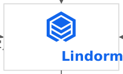

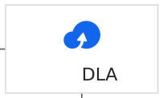


高并发写入

在线交互分析

传感器

**Lindorm**

**Lindorm**

Sensor

冷数据

增量同步

RDS

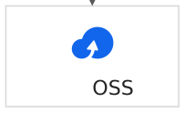


分析结果批量回流

大数据分析 Spark

数据源

Data source

优势

- 低成本：高压缩比，数据冷热分离，支持HDD/OSS存储。

- 数据通道：通过LTS（原BDS）构建Lindorm与异构计算系统的高效、易用的数据链路。

- 快速导入：通过BulkLoad将海量数据快速导入Lindorm，效率比传统方式提升一个数量级。

- 高并发：水平扩展至千万级QPS。

- 弹性：存储计算分离架构，支持独立伸缩，自动化扩容。

**金融和零售**

使用Lindorm存储金融交易中的海量订单记录，金融风控中的用户事件、画像特征、规则模型、设备指纹等重要数据，提供低成本、高并发、灵活可靠的能力，帮助您构建有竞争力的金融交易与风控服务。

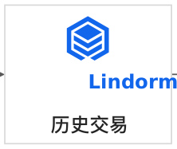


**Lindorm**

实时发送

交易查询

实时发送

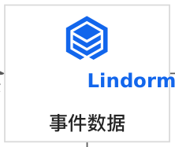


**Lindorm**

批量上传

行为日志(登录、支付等)

第三方企业数据

风控决策服


行为分析


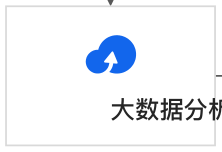

爬虫抓取

**Lindorm**

规则模型

大数据分析 Spark

应用服务器

**优势**

- 低成本：高压缩比，数据冷热分离，支持HDD/OSS存储。

- 高并发：水平扩展至千万级QPS。

- 使用灵活：动态列，自由增减特征/标签属性；TTL，数据自动过期；多版本。

- 低延迟：单个毫秒响应，支持双集群请求并发加速。

- 数据通道：通过LTS（原BDS）构建Lindorm与异构计算系统的高效、易用的数据链路。

- 高可用：主备双活容灾，请求自动容错，满足99.95% SLA。

**车联网**

使用Lindorm存储车联网中的行驶轨迹、车辆状况、精准定位等重要数据，提供低成本、弹性、灵活可靠的能力，帮助您构建网约车、物流运输、新能源车检测等场景服务。

应用服务器


基于位置圈车 轨迹查询


车况查询 实时预警

数据上传

车辆状况行驶轨迹精准定位

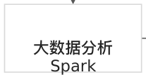


企业报表

BI 报表

驾驶分析

**优势**

- 低成本：高压缩比，数据冷热分离，支持HDD/OSS存储。

- 弹性伸缩：存储计算分离架构，支持独立伸缩，自动化扩容。

- 使用灵活：动态列，自由增减特征/标签属性；TTL，数据自动过期；多版本。

- 低延迟：单个毫秒响应，支持双集群请求并发加速。

- 数据通道：通过LTS（原BDS）构建Lindorm与异构计算系统的高效、易用的数据链路。

- 高可用：主备双活容灾，请求自动容错，满足99.95% SLA。

**互联网社交**

使用Lindorm存储社交场景中的聊天、评论、帖子、点赞等重要数据，提供易开发、高可用、低延迟的能力，帮助您快速构建稳定可靠的现代社交Feed流系统。

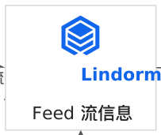

**Lindorm**

Feed 流数据

获取 Feed 流数据

(聊天、帖子、App 消息)

User

Phone

关系信息

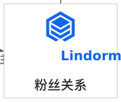

Feed 流数内容社会关系

获取图片等

PC

**Lindorm**

加好友订阅关注

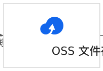

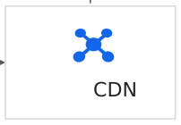

WEB

图片、文档、短视频等

OSS 文件存储

应用服务器

**优势**

- 高可用：主备双活容灾，请求自动容错，满足99.95% SLA。

- 低延迟：单个毫秒响应，支持双集群请求并发加速。

- 低成本：高压缩比，数据冷热分离，支持HDD/OSS存储。

- 弹性：存储计算分离架构，支持独立伸缩，自动化扩容链路。

**访问方式**

- 通过Lindorm宽表SQL访问（推荐），开发体验与关系型数据库相似。

- 通过HBase API访问，适合于基于HBase开发的应用。

- Lindorm宽表支持多端同时访问，即对于同一张数据表，可以任意选择上述的其中一种方式进行访问。

<a id="section-4-2"></a>

## 4.2. 访问实例

通过Lindorm宽表SQL客户端访问Lindorm实例需要的信息，包括连接地址、用户名和密码。本节介绍如何获取连接地址。

**获取连接地址**

1. 登录云原生多模数据库Lindorm。

2. 单击目标实例ID，进入**实例列表**页面。

3. 单击左侧导航栏**数据库连接**，默认**宽表引擎**页面，查看Lindorm宽表SQL地址。

   > Lindorm实例支持专有网络访问（VPC）和经典网络访问。专有网络访问地址可直接获
   >
   > **说明**
   >
   > 取，经典网络访问地址需要先开通经典网络地址。

<a id="section-4-3"></a>

## 4.3. 集群管理

<a id="section-4-3-1"></a>

### 4.3.1. 集群管理系统

通过集群管理系统您可以查看集群的空间使用情况，还可以对集群中的数据进行管理。本文介绍集群管理系统的页面功能。

**前提条件**

已创建Lindorm实例，请参见创建Lindorm实例。

**登录集群管理系统**

1. 登录云原生多模数据库Lindorm。

2. 在**实例列表**页面中单击目标实例ID或**操作**栏下的**管理**。

3. 在左侧导航栏中，选择**宽表引擎 > 集群管理**。

4. 在**UI访问**区域中单击**ClusterManager**进入集群管理系统。

**集群管理系统介绍**

集群管理系统包括信息面板、数据管理和数据查询。详情参见下表。

**主页面**

**子页面**

**页面描述**

信息面板

不涉及

可以查看集群的基本信息和空间的使用情况。

Namespace管理

可以查看集群中所有的命名空间，并对命名空间进行管理。

可以查看集群中所有的表和表属性。单击表名可以查看表的详细信

表管理

息。

数据管理数据管理

可以查看集群中的用户和用户拥有的权限。可以创建用户，修改用户

用户管理

密码，删除用户等操作。

可以管理用户所拥有的权限，可以分配和回收某个用户的一项或多项

ACL管理

权限。

数据查询

不涉及

可以使用SQL语句查询表内容。

<a id="section-4-3-2"></a>

### 4.3.2. 分组节点管理

云原生多模数据库 Lindorm支持的分组功能可以用来解决多租户隔离问题，通过划分RegionServer到不同的分组，每个分组上存储不同的表，从而达到资源隔离的目的。本文介绍云原生多模数据库 Lindorm通过集群管理系统管理分组。

**背景信息**

当多个用户或者多个业务同时使用一个Lindorm集群时，往往存在资源争抢的问题。一些重要的在线业务读写操作可能会被离线业务批量读写所影响。针对这一问题，Lindorm推出了分组功能。如下图所示，创建Group1并把RegionServer1和RegionServer2划分到Group1中，创建Group2并把RegionServer3和RegionServer4划分到Group2中。同时把Table1和Table2也移动到Group1分组，Table1和Table2的所有Region都只会分配到Group1中的RegionServer1和RegionServer2机器上。同理，Table3和Table4的所有Region都只会分配到Group2中的RegionServer3和RegionServer4机器上。所以发送到Table1和Table2的请求，只会由RegionServer1和RegionServer2服务响应，而发送到Table3和Table4的请求，只会由RegionServer3和RegionServer4服务响应，从而达到资源隔离的目的。

**Master**

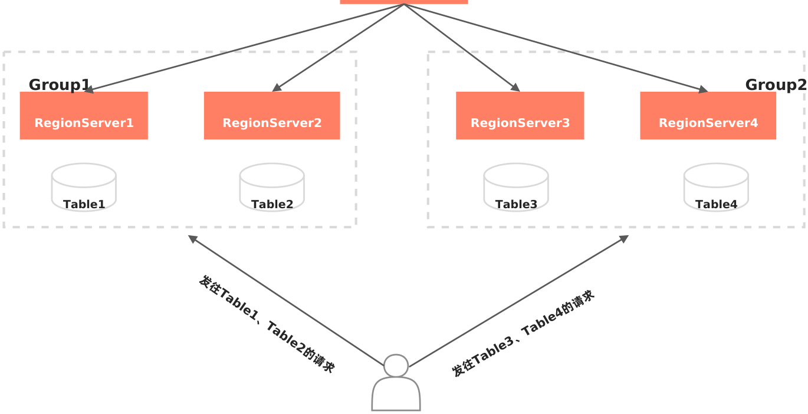

**Client**

**前提条件**

已登录目标实例的集群管理系统，具体操作请参见登录集群管理系统。

**查看分组信息**

1. 在集群管理系统的左侧导航栏中，选择**集群管理 > 分组节点管理**。

2. 在页面下方可以看到当前集群所有的分组信息。

   > **说明**
   >
   > 如果您没有创建过分组，系统会默认创建一个分组，该分组名称为**default**，所有的RegionServer和表都会归属到这个分组中。

   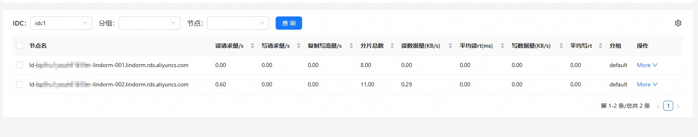

**创建分组**

1. 在集群管理系统的左侧导航栏中，选择**集群管理 > 分组节点管理**。

2. 单击页面右侧的<strong>+添加</strong>。

   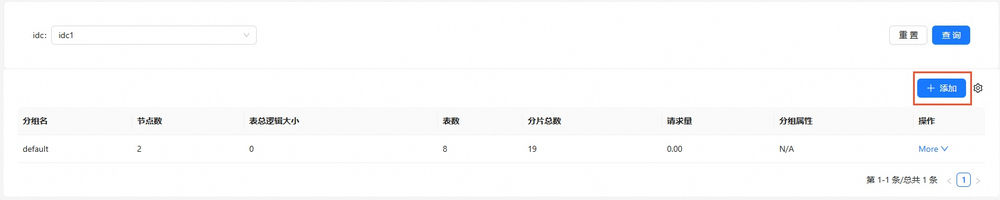

3. 在**新建分组**对话框中输入**分组名**。

   

4. 单击**确定**。

   > **说明**
   >
   > 创建分组后，分组中的Server数量和Table数量都为0，需要您将Server和Table移动到该分组中。

**删除分组**

> **重要**
>
> 只有分组中的所有Server和Table都被移出（也就是Server数和Table数为0），分组才能被删除。

1. 在集群管理系统的左侧导航栏中，选择**集群管理 > 分组节点管理**。

2. 在目标分组中**操作**列，选择**More > 删除**。

   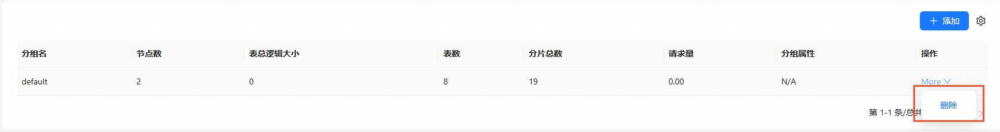

3. 在对话框中单击**确定**。

**查看实例/集群基本信息**

1. 在集群管理系统的左侧导航栏中，选择**集群管理 > 分组节点管理**。

2. 在**实例/集群基本信息**区域中可以看到数据库类型和数据库所在IDC等信息。

3. 单击右方的**More > 读写控制**，可以调整当前实例/集群的读写权限。

**移动RegionServer的分组**

> **重要**
>
> - 默认状态下，所有的RegionServer都属于default分组，您需要将RegionServer移动到对应的分组中才能使用。
>
> - 如果您将Table移动到一个没有RegionServer的分组中，那么该表的Region会由于没有服务器可以上线而无法访问。
>
> - 建议每个分组至少分配两台RegionServer机器，当一台RegionServer机器无法运行时，表的Region可以分配到同一分组的另一台RegionServer机器上。如果只有一台RegionServer机器，当这台RegionServer机器无法运行时，这个分组所有的表都无法被访问。
>
> - 在移动RegionServer的分组时，这个RegionServer上正在访问的Region会被立即重新分配到分组的其他RegionServer机器上。

1. 在集群管理系统的左侧导航栏中，选择**集群管理 > 分组节点管理**。

2. 在目标分组的操作列，选择**More > 移动分组**。

3. 在**移动分组**对话框中选择**目标分组**。

4. 单击**确定**。

**移动表的分组**

> **警告**
>
> 请勿将表移动到没有服务器的分组，否则会造成表无法被访问。

1. 在**概览**页面，单击**操作**列的**移动分组**。

   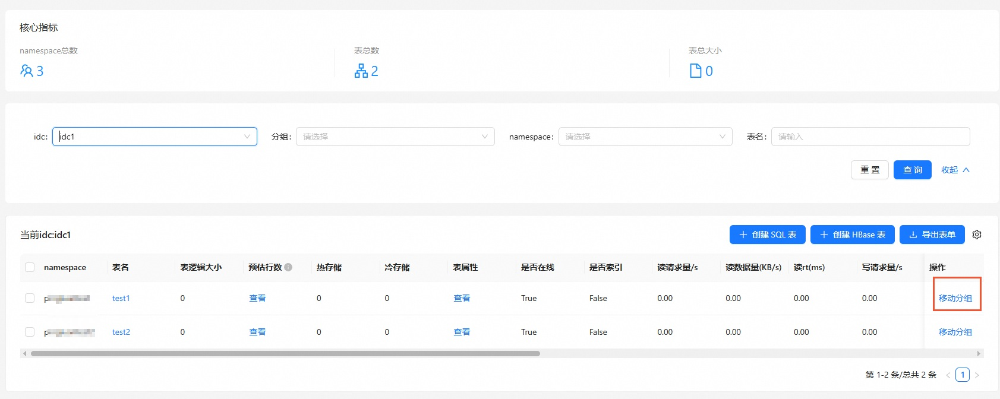

2. 在**移动分组**对话框中选择**目标分组**。

3. 单击**确定**。

<a id="section-4-3-3"></a>

### 4.3.3. 用户管理

Lindorm支持通过集群管理系统管理用户及其相关权限，您可以在Lindorm Insight控制台增删用户、为已有用户授予读写等权限或回收指定用户已有权限。

**前提条件**

已登录目标实例的集群管理系统。

**增删用户**

**新增用户**

1. 在集群管理系统的左侧导航栏中，选择**数据管理 > 用户管理**。

2. 单击页面右侧的<strong>+新增用户</strong>。

3. 在**新增用户**对话框中输入**用户名**和**密码**。

4. 单击**确定**。

> **说明**
>
> - 创建用户后无法查看该用户的密码，如果您忘记密码，只能通过修改密码的方式来重置密码。
>
> - 新建的用户没有任何权限，需要手动赋予权限，具体操作请参见权限授予与回收。

**删除用户**

1. 在目标用户的**操作**列，单击**删除**。

2. 单击**确定**。

**修改用户密码**

1. 在目标用户的**操作**列，单击**修改密码**。

2. 在**修改密码**对话框中输入**新密码**。

3. 单击**确定**。

**权限管理**

集群管理系统的用户管理功能支持为指定用户授予权限，也支持回收用户已有的权限。

**权限层级**

目前Lindorm实例的操作有三个权限层级，由高到低为Global，Database（也称Namespace）和Table，这三者是兼容的关系。

例如：为user1用户赋予Global的读写权限，则user1用户拥有Lindorm宽表的所有Database中所有Table的读写权限。为user2用户赋予Database1的读写权限，则user2用户拥有Database1中所有Table的读写权限（包括Database1中新建的Table）。

**权限分类**

操作权限分类和操作语法说明如下表。

<table>
  <tr>
    <th>分类</th>
    <th>描述</th>
    <th>操作语法</th>
  </tr>
  <tr>
    <td>WRITE</td>
    <td>写入Lindorm表相关的操作。</td>
    <td>PUT、BATCH、DELETE、INCREMENT、APPEND、CHECKANDMUTATE</td>
  </tr>
  <tr>
    <td rowspan="2">READ</td>
    <td>读取Lindorm表相关的操作。</td>
    <td>GET、SCAN、EXIST</td>
  </tr>
  <tr>
    <td>读取Lindorm表descriptor，namespace列表等相关操作。</td>
    <td>GETTABLEDESCRIPTOR、LISTTABLES、LISTNAMESPACEDESCRIPTORS</td>
  </tr>
  <tr>
    <td rowspan="2">ADMIN</td>
    <td>不涉及表删除和表数据删除的DDL操作。</td>
    <td>CREATETABLE、ENABLETABLE、DISABLETABLE</td>
  </tr>
  <tr>
    <td>Namespace相关DDL操作。</td>
    <td>CREATENAMESPACE</td>
  </tr>
  <tr>
    <td>TRASH</td>
    <td>防止表误删和表数据被清空操作。</td>
    <td>TRUNCATETABLE、DELETETABLE</td>
  </tr>
  <tr>
    <td>SYSTEM</td>
    <td>执行运维操作。使用LTS（原BDS）迁移和同步Lindorm时需要此权限。</td>
    <td>COMPACT、FLUSH</td>
  </tr>
</table>

**权限授予与回收**

1. 在目标用户的**操作**列，单击**更多**。

   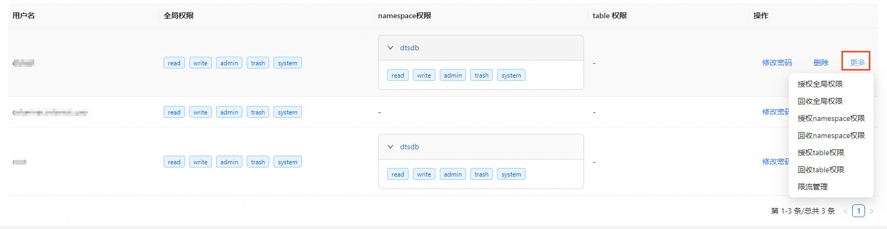

2. 在下拉框中，选择相关操作。

   - 授予权限：为该用户授予全局、Namespace或Table权限。

   - 回收权限：回收该用户已有的全局、Namespace或Table权限。

3. 在弹出的授权对话框中，勾选或去勾选权限并选择相关信息。

4. 单击**确定**。

<a id="section-4-3-4"></a>

### 4.3.4. 命名空间管理

云原生多模数据库 Lindorm中的命名空间是表的一个逻辑分组。不同的命名空间中的表允许重名。Lindorm会默认提供一个名称为default的命名空间，如果您没有指定使用命名空间，则会默认使用default命名空间。本文介绍通过集群管理系统管理命名空间。

**前提条件**

已登录目标实例的集群管理系统，具体操作请参见登录集群管理系统。

**创建命名空间**

1. 在集群管理系统的左侧导航栏中，选择**数据管理 > 命名空间管理**，页面默认显示当前实例下的所有命名空间。

2. 单击页面右侧的<strong>+添加</strong>。

   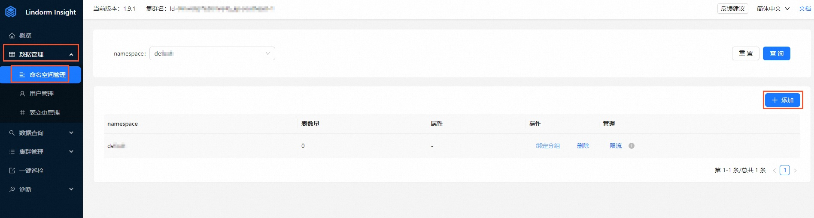

3. 在**添加NameSpace**对话框中输入命名空间的名称。

   > **说明**
   >
   > 命名空间的名称只能使用大写英文字符、小写英文字符、数字、中划线（-）和下划线（_）。

4. 单击**确定**。

**删除命名空间**

> **重要**
>
> 删除命名空间前请先将命名空间中所有的表都删除，否则删除操作会失败。

1. 在集群管理系统的左侧导航栏中，选择**数据管理 > 命名空间管理**。

2. 单击目标命名空间**操作**列的**删除**。

   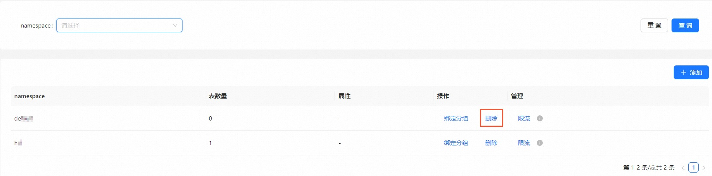

3. 单击**确定**。

**绑定命名空间的分组**

您可以为命名空间绑定默认分组default或已创建的分组。如何创建分组，请参见分组节点管理。

> **警告**
>
> 请勿将命名空间绑定到没有服务器的分组，否则会造成表无法被访问。

1. 在集群管理系统的左侧导航栏中，选择**数据管理 > 命名空间管理**

2. 单击目标命名空间**操作**列的**绑定分组**。

3. 在**绑定分组**对话框中选择**目标分组**。

4. 单击**确定**。

<a id="section-4-3-5"></a>

### 4.3.5. 数据查询

Lindorm在集群管理系统中提供了简单的SQL查询入口，您可以使用SQL语法来查询Lindorm的表数据。本节介绍通过集群管理系统查询表的数据。

**使用限制**

- 本系统只支持 `SELECT` 语句。

- 为确保数据安全，本系统每次查询最多返回100条数据。

- 对varbinary类型的字段进行条件查询时，必须使用HexCode编码的字符串作为Value。

- `ROW` 字段对应Lindorm的RowKey， `ROW` 和 `qualifier` 都是varbinary类型， `qualifier` 如果不属于family，需要指定family。

- `ROW` 和 `COL` 是SQL保留字段，查询时需要加反引号（\`）。 `qualifier` 指定family时也需要加反引号（\`）。

**查询表数据**

1. 在集群管理系统的左侧导航栏，选择**数据查询**。

2. 在**SQL方式查询**区域中，选择**Namespace**。

3. 在右侧**Namespace下的表**选择目标表名。

4. 在编辑器中输入SQL语句。

5. 单击**执行**。

   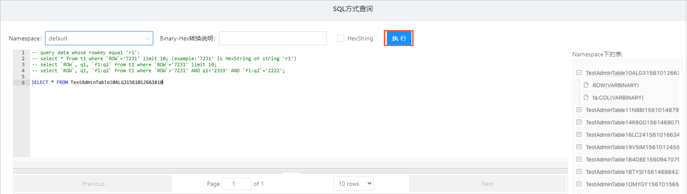

   > 执行操作可以通过键盘完成。Windows系统：CTRL+ENTER。MacOS系统：
   >
   > **说明**
   >
   > COMMAND+RETURN。

**获取HexCode编码字符**

对varbinary类型的字段进行条件查询时，必须使用HexCode编码的字符串作为Value。例如：查询rowkey为r1的数据，SQL查询语句中的  `WHERE` 应该写成 `WHERE rowkey='7321'` （r1的HexCode编码字符为7321）。为了方便您获取HexCode编码字符，集群管理系统的数据查询页面提供了转换工具。

1. 在集群管理系统的左侧导航栏，选择**数据查询**。

2. 在**SQL方式查询**区域中，选择**Namespace**。

3. 在**Binary-Hex转换说明**中输入Binary编码字符串。

4. 在SQL编辑器中最上面查看对应的HexCode编码字符。

5. 使用HexCode编码字符编写SQL语句。

   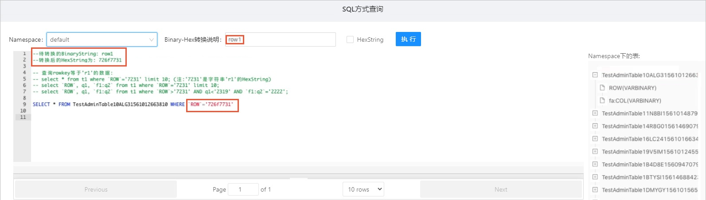

6. （可选）勾选**HexString**可以查看HexCode编码字符的查询结果。

7. 单击**执行**。

<a id="section-5"></a>

# 5.时序引擎

> **重要**
>
> 时序引擎自2024年09月01日起**不再支持新购**，在此之前已购买的、通过TSDB迁移数据至时序引擎的用户仍可正常使用。

<a id="section-5-1"></a>

## 5.1. 引擎简介

<a id="section-5-1-1"></a>

### 5.1.1. 引擎简介

云原生多模数据库Lindorm时序引擎是一款**高性能、低成本、稳定可靠**的在线时序数据库引擎服务，提供高效读写、高压缩比存储、时序数据聚合计算等能力。

> **重要**
>
> 时序引擎自2024年09月01日起**不再支持新购**，在此之前已购买的、通过TSDB迁移数据至时序引擎的用户仍可正常使用。

**核心能力**

- **高性能**：时序引擎支持高写入吞吐，通过自研的时序引擎，实现高并发的时序数据写入。

- **数据压缩**：时序引擎内置数据压缩能力，结合自研时序压缩算法以及通用块压缩，压缩率最高可达10:1。

- **时序索引**：时序引擎内置时序索引能力，支持百亿级时间线多维数据高性能查询。

- **时序计算**：时序引擎提供丰富的时序聚合计算能力，聚合引擎支持10+核心聚合算子，20+填充策略，10+插值算法。

- **弹性伸缩**：时序引擎采用分布式架构，支持在线弹性伸缩，以适应任何规模的数据存储与处理需求。

**使用场景**

云原生多模数据库Lindorm时序引擎广泛应用于<strong>物联网（IoT）、工业互联网（IIoT）、应用性能监控（APM）</strong>等行业场景。支持秒级写入千万级时序数据点，提供高压缩比低成本存储、预降采样、插值、多维聚合计算、可视化查询结果等功能，满足海量时序数据存储与处理。

**访问方式**

您可以使用SQL方式连接并访问云原生多模数据库Lindorm时序引擎，包括以下三种方式：

- 如果您使用Java语言访问时序引擎，具体请参见**Lindorm开发指南**手册中**连接指南**目录下的**通过JDBC Driver连接并访问Lindorm时序引擎**章节。

- 如果您使用其他语言访问时序引擎，具体请参见**Lindorm开发指南**手册中**连接指南**目录下的**HTTP API SQL接口开发手册**。

- 如果您是DBA或者数据分析人员，具体请参见**Lindorm开发指南**手册中**连接指南**目录下的**通过Lindorm-cli连接访问Lindorm时序引擎**。

<a id="section-5-1-2"></a>

### 5.1.2. 引擎功能

本文介绍时序引擎的实用功能。

**时序数据高效读写**

Lindorm时序引擎提供高效的并发读写，支持每秒百万数据点的数据读取及千万数据点的写入能力。

- **数据写入**

  支持以下方式进行数据写入：

  - 使用SQL的INSERT语句（推荐使用JDBC）。

  - 兼容设备通过MQTT协议写入数据。

  - 兼容InfluxDB的写入Line Protocol。

  - 兼容OpenTSDB协议的写入API。

  - 支持Prometheus以Remote Storage的形式将监控数据写入。

- **数据查询**

  支持通过SQL进行数据查询，兼容基于OpenTSDB协议的查询API等方式进行数据查询。用户也可以通过产品控制台的数据查询功能进行数据分组、降采样、空间聚合等可视化数据查询展现。

**数据管理**

- **数据库管理**

  时序数据的存储以Database为粒度进行隔离。支持通过SQL对Database的时间分区间隔、数据过期时间等属性进行设置。具体操作，请参见数据库管理。

- **用户和权限管理**

  支持对时序数据的访问进行用户认证以及存储权限鉴定。用户可以通过SQL或控制台对时序引擎内的用户以及用户权限进行管理。具体操作，请参见用户及权限管理。

**高效时序存储技术**

时序数据压缩

Lindorm时序引擎使用高效的数据压缩技术，将单个数据点的平均使用存储空间降为1~2个字节，可以降低90%存储使用空间，同时加快数据写入的速度。

**时序数据计算能力**

Lindorm时序引擎提供专业全面的时序数据计算函数，支持降采样、数据插值和空间聚合计算，能满足各种复杂的业务数据查询场景。

**监控运维**

Lindorm时序引擎提供实例运维系统，用户可以实时掌握实例的运行情况、性能指标和存储空间使用情况，并通过设置报警通道，及时发现资源瓶颈。

**数据和实例安全**

Lindorm时序引擎提供以下方案保证用户数据和实例的安全：

- 提供使用VPC网络进行访问的实例访问方式，充分保证实例访问的安全性。

- 提供了数据库层面的用户权限功能，从而进一步对数据访问进行更细的权限管理。

- 数据存储默认采用多副本策略，充分保证数据的可用性。

<a id="section-5-1-3"></a>

### 5.1.3. 与TSDB的功能对比

本文介绍云原生多模数据库Lindorm时序引擎与时间序列数据库TSDB的功能差异。

Lindorm时序引擎是孵化自阿里云时间序列数据库TSDB（Time Series Database , 简称TSDB）的新一代时序引擎。Lindorm时序引擎是一款全新的自研产品，同时也在接口层面兼容了TSDB的大部分API。

您可以通过下表对比Lindorm时序引擎和TSDB。

| 功能 | Lindorm时序引擎 | TSDB |
| --- | --- | --- |
| 访问接口 | • 原生SQL能力<br>• 兼容大部分TSDB的HTTP API<br>• 兼容InfluxDB®的写入行协议 | • OpenTSDB风格的HTTP API<br>• 支持作为Prometheus的Remote Storage<br>• 基于外部组件提供少量SQL语法支持 |
| 应用程序SDK | • <strong>Lindorm开发指南</strong>手册中<strong>连接指南</strong>目录下的<strong>通过</strong><strong>Lindorm JDBC Driver连接并访问时序引擎</strong>章节。<br>• <strong>Lindorm开发指南</strong>手册中<strong>连接指南</strong>目录下的<strong>教程：</strong>通过Java Native SDK连接并使用Lindorm时序<strong>引擎</strong>章节。<br>• 兼容TSDB的Java SDK | Java SDK |
| 数据模型 | 半结构化的时序数据表模型 | OpenTSDB风格的时序数据模型 |
| 存储引擎 | 自研的分布式时序存储引擎 | 基于HBase的KV存储引擎 |
| 预计算能力 | • 原生支持连续查询<br>• 存储引擎层面数据预降精度能力 | 不支持 |
| TTL能力 | 支持库级别（Database）TTL设置 | 只支持全局TTL，且仅能清理数据，无法清理索引。 |
| 性能 | 可扩展至每秒千万点数据点写入。 | 可扩展至每秒百万数据点写入 |
| 应用领域 | 可广泛用于物联网、工业互联网、企业应用性能监控。 | 主要用于企业应用性能监控 |

<a id="section-5-2"></a>

## 5.2. 快速入门

<a id="section-5-2-1"></a>

### 5.2.1. 入门概览

本文介绍连接云原生多模数据库Lindorm时序引擎的方法和相关文档，帮助您快速使用Lindorm时序引擎。

> **重要**
>
> 时序引擎自2024年09月01日起**不再支持新购**，在此之前已购买的、通过TSDB迁移数据至时序引擎的用户仍可正常使用。

**操作流程**

从创建Lindorm实例到可以使用Lindorm时序引擎，您需要完成以下操作：

1. 创建Lindorm实例，具体操作请参见创建Lindorm实例。

2. 可选：如果您需要使用经典网络地址连接Lindorm时序引擎，请先申请经典网络连接地址。

3. 连接时序引擎。连接Lindorm时序引擎支持以下三种方法，使用场景和相关文档如下表：

   | 连接时序引擎的方法 | 使用场景 | 相关文档 |
   | --- | --- | --- |
   | 通过Java Native SDK连接（推荐） | 在更高的业务模型层级访问Lindorm时序引擎，无需对连接管理或者数据转换等低维度的操作进行应用开发。 | <strong>Lindorm开发指南</strong>手册中<strong>连接指南</strong>目录下的<strong>通过Java</strong> <strong>Native SDK连接并使用Lindorm时序引擎</strong>章节。 |
   | 通过JDBC Driver连接 | • 应用代码中已经使用JDBC标准API访问多种异构数据库。<br>• 应用代码中有类似MyBatis等数据访问ORM框架的应用。 | <strong>Lindorm开发指南</strong>手册中<strong>连接指南</strong>目录下的<strong>通过</strong><strong>Lindorm JDBC Driver连接并访问时序引擎</strong>章节。 |
   | 通过Lindorm-cli客户端连接 | 不涉及 | <strong>Lindorm开发指南</strong>手册中<strong>连接指南</strong>目录下的<strong>通过</strong><strong>Lindorm-cli连接并使用Lindorm时序引擎</strong>章节。 |

<a id="section-5-3"></a>

## 5.3. 运维指南

<a id="section-5-3-1"></a>

### 5.3.1. 数据库管理

<a id="section-5-3-1-1"></a>

#### 5.3.1.1. 数据库管理

本文介绍Lindorm时序引擎中的Database概念以及相关的功能。

**Database的概念**

每个正在运行的Lindorm时序引擎实例都管理着一个或多个数据库（简称Database）。在各个Database之间，数据会被隔离。每个Database都有若干时序数据表，我们可以对时序引擎的数据层级归纳为下图所示：

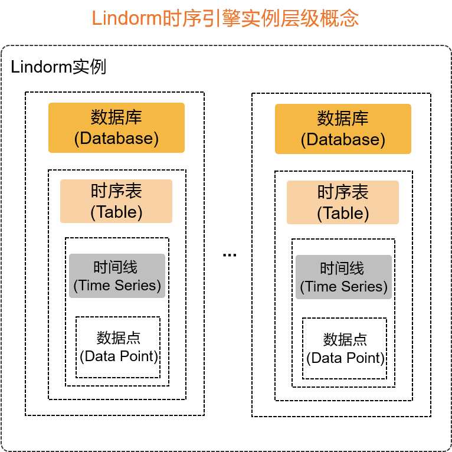

如果一个Lindorm时序引擎实例计划包含不相关的项目数据，在很大程度上，彼此之间是隔离的。那么在这种情况下，建议将它们放到单独的数据库中，并且调整相应的授权和访问控制用户。此外，时序引擎允许用户跨Database访问数据，前提是该用户必须拥有对目标Database的相应操作的权限。

**以Database为粒度的时序数据管理功能**

Database是时序表的集合，用户可以根据业务需求将拥有相同业务背景的时序表保存在一起，从而实现数据隔离。另一方面，Lindorm时序引擎的一系列功能也都是以Database为粒度提供给用户使用的。包括以下功能：

用户能够以Database为单位设置数据的存活时间（Time To Live，简称**TTL**）。

当TTL被设置后，时序数据的时间戳距当前的时间差超过了TTL的时间，则这些数据将被视作过期数据，会被时序引擎清除掉。

> **重要**
>
> 1. 时序领域的数据的时间戳一般分成两种概念：
>
>    - 事件时间：即时序数据对应的事件真实发生时的时间。**Lindorm开发指南**手册中**数据模型**章节中提及的时序数据模型的时间戳即是事件时间。
>
>    - 入库时间：即时序数据写入数据库的时间。
>
>    上述TTL的能力是基于**事件时间**进行工作。
>
> 2. 对于Database设置了TTL的情况下，如果写入数据的时间戳已经超过了TTL的范围。那么写入仍然是可以成功的，但是查询时是查不到这样的数据的。

**Database管理**

时序引擎支持用户通过SQL对Database进行以下管理操作：

- Database的创建

  在时序引擎中创建一个新的Database。SQL语法请参见**Lindorm开发指南**手册中**SQL语法参考**目录下的**CREATE DATABASE**章节。

  > **说明**
  >
  > 新建的Database需要单独为指定的用户赋权，用户并不会默认具有访问权限。

- Database的删除

  在时序引擎中删除一个已有的Database。SQL语法请参见**Lindorm开发指南**手册中**SQL语法参考**目录下的**DROP DATABASE**章节。

- Database的属性修改

  在时序引擎中对一个已有Database的属性进行修改。包括数据存活期间等。SQL语法请参见**Lindorm开发指南**手册中**SQL语法参考**目录下的**ALTER DATABASE**章节。

- Database的属性查询

  在时序引擎中查看一个已有Database的属性元数据。SQL语法请参见**Lindorm开发指南**手册中**SQL语法参考**目录下的**DESCRIBE DATABASE**章节。

<a id="section-5-3-2"></a>

### 5.3.2. 用户及权限管理

本文介绍Lindorm时序引擎中访问控制机制以及如何进行用户管理及权限管理。

**时序引擎的访问控制体系**

Lindorm提供了一套多层次的访问控制体系，从而提供企业级应用的安全保障。访问控制体系如下所示：

引擎级别的逻辑层面访问控制：在引擎层面提供的基于用户认证以及权限校验为主体的访问控制。

**用户认证与权限校验功能的启用**

对于一个Lindorm实例的时序引擎，默认情况下**未启用**用户认证与权限校验。因此在默认情况下无论是通过哪种方式访问时序引擎，都可以不带上用户信息直接操作。

但是，对于一个投入线上生产应用的实例而言，出于安全因素考虑，强烈建议开启时序引擎的用户认证与权限校验。通过ALTER SYSTEM语句开启，具体方法如下：

通过任意方式连接到时序引擎后，执行 `ALTER SYSTEM SET USER_AUTH=TRUE;` 即可开启用户认证与权限校验功能。

> **重要**
>
> - 时序引擎一旦开启用户认证和权限校验，后续的所有访问都必须带上用户信息，否则将可能出现鉴权失败（包括当前执行 `ALTER SYSTEM` 语句启用用户认证和权限校验的连接）。因此，该功能开启后，已有的部分业务访问可能会失败。所以在开启该功能前，建议仔细规划并充分评估影响。
>
> - 用户认证与权限校验功能开启后也可通过ALTER SYSTEM语句关闭。执行语句如下： `ALTER`
>
>   ```text
>   SYSTEM SET USER_AUTH=FALSE; 
>   ```
>
> - 查看当前实例是否已经开启用户认证与权限校验功能，可通过SHOW PARAMETER语句查看。执行语句如下： `SHOW PARAMETER USER_AUTH;`

**时序引擎基于用户认证与权限校验的访问控制**

当用户认证与权限校验的功能开启后，业务对时序引擎的访问都需要在连接时带上用户名和密码。同时，无论是写入还是查询操作，连接所属用户必须要具有访问目标的对应权限，操作才能成功。通过这种方式，时序引擎可以对业务访问进行严格的安全控制以及权限隔离。

**在使用SQL时带上认证信息的方法**

随着业务形态不同，在连接时指定用户名、密码的方式也有所差异。具体如下：

- 使用Lindorm-Cli访问时序引擎的场景

  请参见**Lindorm开发指南**手册中**连接指南**目录下的**通过Lindorm-cli连接并使用Lindorm时序引擎**章节。

- 使用JDBC构建应用的场景

  请参见**Lindorm开发指南**手册中**连接指南**目录下的**通过Lindorm JDBC Driver连接并访问时序引擎**章节。

- 基于通用SQL接口构建应用的场景

  请参见**Lindorm开发指南**手册中**连接指南**目录下的**HTTP API SQL接口开发手册**章节。

**用户管理**

时序引擎通过SQL提供了用户管理的能力，提供的能力如下：

- 增加用户

  请参见**Lindorm开发指南**手册中**SQL语法参考**目录下的**CREATE USER**章节。

- 删除用户

  请参见**Lindorm开发指南**手册中**SQL语法参考**目录下的**DROP USER**章节。

- 修改用户密码

  请参见**Lindorm开发指南**手册中**SQL语法参考**目录下的**ALTER USER**章节。

- 查看已有用户

  请参见**Lindorm开发指南**手册中**SQL语法参考**目录下的**SHOW**章节。

> **说明**
>
> - 实例创建后会默认创建一个初始用户。它的用户名为root，密码也是root，可以用于创建其他业务所需的用户并赋权。
>
> - 开启用户认证与权限校验功能后，需要先以root用户登录才可以增加其他用户。

> **警告**
>
> 强烈建议实例创建完毕后立即修改上述初始用户密码，否则可能会造成很大的安全隐患。

**权限管理**

时序引擎中的权限分为四种，如下所示：

<table>
  <tr>
    <th width="90">权限名</th>
    <th>含义</th>
  </tr>
  <tr>
    <td>READ</td>
    <td><strong>读权限</strong>。当查询数据时，要求用户对查询所涉及的数据表具有读权限。</td>
  </tr>
  <tr>
    <td>WRITE</td>
    <td><strong>写权限</strong>。当写入数据时，要求用户对查询所设计的数据表具有写权限。</td>
  </tr>
  <tr>
    <td>ADMIN</td>
    <td><strong>管理权限</strong>。当对时序引擎中的数据对象进行管理时，需要用户对操作的数据对象具有管理权限。</td>
  </tr>
  <tr>
    <td>SYSTEM</td>
    <td><strong>系统权限</strong>。当一些操作可能会影响整个实例的行为时，这样的操作需要用户具有系统权限。</td>
  </tr>
</table>

另一方面，时序引擎可以根据不同的业务需求限定对用户权限赋予以及回收的范围。当前时序引擎支持的权限赋予和回收的粒度如下：

- **GLOBAL**

  全局范围的授权与撤回。

  当用户被赋予全局范围的任意种类权限后，用户则拥有了对于整个时序引擎内所有数据对象的对应操作权限。比如一个全局的READ权限将使得用户可以查询任意数据库中的任意时序数据表。

- **DATABASE**

  数据库范围的授权与撤回。

  当用户被赋予某个数据库的指定种类权限后，用户则拥有了对于该数据库内部所有数据对象的对应操作权限。比如某个数据库DB1的READ权限将使得用户可以查询该数据库内的所有时序数据表。

时序引擎支持通过GRANT语句对用户进行授权，同时支持通过REVOKE语句对用户已有权限进行撤回。

> **重要**
>
> - 尝试对用户进行权限授予或撤回时，要求当前连接所属的用户本身拥有全局ADMIN权限。
>
> - 权限的优先级是GLOBAL>DATABASE。即如果拥有了GLOBAL的READ权限，则能查询任意Database中的时序表；但如果只是拥有特定Database的READ权限，则只能查询该Database下的时序表。
>
> - SYSTEM权限只能是GLOBAL范围的权限。

**常用SQL所需权限**

常用的SQL语句所需的权限可参见下表：

> **说明**
>
> 下表中○表示需要的权限，×表示不需要的权限。

<table>
  <tr>
    <th rowspan="2">SQL语句</th>
    <th colspan="4">GLOBAL</th>
    <th colspan="3">DATABASE</th>
    <th rowspan="2">备注</th>
  </tr>
  <tr>
    <td>READ</td>
    <td>WRIT E</td>
    <td>A D M IN</td>
    <td>SYS TE M</td>
    <td>R E A D</td>
    <td>W R I T E</td>
    <td>ADM IN</td>
  </tr>
  <tr>
    <td>SELECT...FRO M...</td>
    <td>○</td>
    <td>×</td>
    <td>×</td>
    <td>×</td>
    <td>○</td>
    <td>×</td>
    <td>×</td>
    <td>-</td>
  </tr>
  <tr>
    <td>INSERT INTO...VALUE S...</td>
    <td>×</td>
    <td>○</td>
    <td>×</td>
    <td>×</td>
    <td>×</td>
    <td>○</td>
    <td>×</td>
    <td>-</td>
  </tr>
  <tr>
    <td>INSERT INTO...SELEC T...</td>
    <td>○</td>
    <td>○</td>
    <td>×</td>
    <td>×</td>
    <td>○</td>
    <td>○</td>
    <td>×</td>
    <td>INSERT目标表需要WRITE权限，同时SELECT源表需要READ权限。</td>
  </tr>
  <tr>
    <td>DESCRIBE DATABASE ...</td>
    <td>×</td>
    <td>×</td>
    <td>○</td>
    <td>×</td>
    <td>×</td>
    <td>×</td>
    <td>○</td>
    <td>-</td>
  </tr>
  <tr>
    <td>CREATE DATABASE...</td>
    <td>×</td>
    <td>×</td>
    <td>○</td>
    <td>×</td>
    <td>×</td>
    <td>×</td>
    <td>×</td>
    <td>-</td>
  </tr>
  <tr>
    <td>ALTER DATABASE...</td>
    <td>×</td>
    <td>×</td>
    <td>○</td>
    <td>×</td>
    <td>×</td>
    <td>×</td>
    <td>○</td>
    <td>拥有目标数据库的ADMIN权限也可变更。</td>
  </tr>
  <tr>
    <td>DROP DATABASE...</td>
    <td>×</td>
    <td>×</td>
    <td>○</td>
    <td>×</td>
    <td>×</td>
    <td>×</td>
    <td>○</td>
    <td>拥有目标数据库的ADMIN权限也可删除。</td>
  </tr>
  <tr>
    <td>SHOW DATABASES</td>
    <td>×</td>
    <td>×</td>
    <td>○</td>
    <td>×</td>
    <td>×</td>
    <td>×</td>
    <td>×</td>
    <td>-</td>
  </tr>
  <tr>
    <td>DESCRIBE TABLE ...</td>
    <td>○</td>
    <td>×</td>
    <td>×</td>
    <td>×</td>
    <td>○</td>
    <td>×</td>
    <td>×</td>
    <td>-</td>
  </tr>
  <tr>
    <td>CREATE TABLE...</td>
    <td>×</td>
    <td>×</td>
    <td>○</td>
    <td>×</td>
    <td>×</td>
    <td>×</td>
    <td>○</td>
    <td>-</td>
  </tr>
  <tr>
    <td>DROP TABLE...</td>
    <td>×</td>
    <td>×</td>
    <td>○</td>
    <td>×</td>
    <td>×</td>
    <td>×</td>
    <td>○</td>
    <td>-</td>
  </tr>
  <tr>
    <td>CREATE USER</td>
    <td>×</td>
    <td>×</td>
    <td>○</td>
    <td>○</td>
    <td>×</td>
    <td>×</td>
    <td>×</td>
    <td>-</td>
  </tr>
  <tr>
    <td>ALTER USER...</td>
    <td>×</td>
    <td>×</td>
    <td>○</td>
    <td>○</td>
    <td>×</td>
    <td>×</td>
    <td>×</td>
    <td>-</td>
  </tr>
  <tr>
    <td>DROP USER...</td>
    <td>×</td>
    <td>×</td>
    <td>○</td>
    <td>○</td>
    <td>×</td>
    <td>×</td>
    <td>×</td>
    <td>-</td>
  </tr>
  <tr>
    <td>SHOW USERS</td>
    <td>×</td>
    <td>×</td>
    <td>○</td>
    <td>○</td>
    <td>×</td>
    <td>×</td>
    <td>×</td>
    <td>-</td>
  </tr>
  <tr>
    <td>GRANT...</td>
    <td>×</td>
    <td>×</td>
    <td>○</td>
    <td>○</td>
    <td>×</td>
    <td>×</td>
    <td>×</td>
    <td>-</td>
  </tr>
  <tr>
    <td>REVOKE...</td>
    <td>×</td>
    <td>×</td>
    <td>○</td>
    <td>○</td>
    <td>×</td>
    <td>×</td>
    <td>×</td>
    <td>-</td>
  </tr>
  <tr>
    <td>SHOW PRIVILEGES...</td>
    <td>×</td>
    <td>×</td>
    <td>○</td>
    <td>○</td>
    <td>×</td>
    <td>×</td>
    <td>×</td>
    <td>-</td>
  </tr>
  <tr>
    <td>ALTER SYSTEM...</td>
    <td>×</td>
    <td>×</td>
    <td>×</td>
    <td>○</td>
    <td>×</td>
    <td>×</td>
    <td>×</td>
    <td>-</td>
  </tr>
  <tr>
    <td>SHOW PARAMETER...</td>
    <td>×</td>
    <td>×</td>
    <td>×</td>
    <td>○</td>
    <td>×</td>
    <td>×</td>
    <td>×</td>
    <td>-</td>
  </tr>
</table>

**访问OpenTSDB兼容API时的用户鉴权**

对于部分使用OpenTSDB兼容的HTTP API访问时序引擎的应用，当用户认证与权限校验功能启用时，发送到这些API的请求也需要带上用户信息。

- 访问OpenTSDB兼容API时指定用户信息的方法

  指定方法类似调用通用SQL接口，通过在HTTP请求头中加入基于Basic Authentication协议编码的用户认证信息，详细可参见**Lindorm开发指南**手册中**HTTP API SQL接口开发手册**章节中的**用户认证信息指定**。

  > **说明**
  >
  > 对于使用时间序列数据库TSDB的SDK的业务，用户名和密码可以通过创建 `TSDBConfig` 对象时调用 `basicAuth` 方法来指定。

- 访问OpenTSDB兼容API所需的权限

  调用这些API时都需要用户具备GLOBAL权限，各个API所需的权限如下所示：

  > **说明**
  >
  > 下表中○表示需要的权限，×表示不需要的权限。

  <table>
    <tr>
      <td>API种类</td>
      <td>GLOBAL WRITE</td>
      <td>GLOBAL READ</td>
      <td>GLOBAL ADMIN</td>
    </tr>
    <tr>
      <td>/api/put</td>
      <td>○</td>
      <td>×</td>
      <td>×</td>
    </tr>
    <tr>
      <td>/api/query</td>
      <td>×</td>
      <td>○</td>
      <td>×</td>
    </tr>
    <tr>
      <td>/api/query/last</td>
      <td>×</td>
      <td>○</td>
      <td>×</td>
    </tr>
    <tr>
      <td>/api/mput</td>
      <td>○</td>
      <td>×</td>
      <td>×</td>
    </tr>
    <tr>
      <td>/api/mquery</td>
      <td>×</td>
      <td>○</td>
      <td>×</td>
    </tr>
    <tr>
      <td>/api/query/mlast</td>
      <td>×</td>
      <td>○</td>
      <td>×</td>
    </tr>
    <tr>
      <td>/api/suggest</td>
      <td>×</td>
      <td>○</td>
      <td>×</td>
    </tr>
    <tr>
      <td>/api/dump_meta</td>
      <td>×</td>
      <td>○</td>
      <td>×</td>
    </tr>
    <tr>
      <td>/api/search/lookup</td>
      <td>×</td>
      <td>○</td>
      <td>×</td>
    </tr>
    <tr>
      <td>/api/ttl</td>
      <td>×</td>
      <td>×</td>
      <td>○</td>
    </tr>
    <tr>
      <td>/api/truncate</td>
      <td>×</td>
      <td>×</td>
      <td>○</td>
    </tr>
  </table>

**与宽表引擎访问控制的融合**

时序引擎的用户信息与权限数据与宽表引擎可以通用，因此如果创建的Lindorm实例中也包含宽表引擎的话，在时序引擎中创建的用户也可以用于访问宽表引擎。此时，时序引擎的用户也可在宽表引擎的集群管理工具中进行查阅和管理，如下图所示：

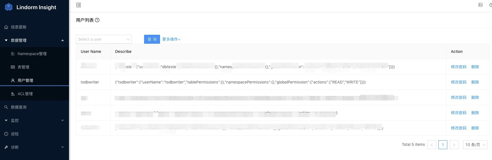

同理，宽表引擎中创建的用户同样也可用于访问时序引擎，可以通过在时序引擎中对宽表引擎的用户赋予特定时序引擎Database的权限来实现。

> **重要**
>
> - 宽表引擎的用户可能被授予TRASH权限，该权限目前在时序引擎中并无实际意义。
>
> - 如果宽表引擎中的一个Namespace与时序引擎的Database同名，且某个用户拥有该Namespace的权限，则该用户默认就拥有了对时序引擎同名Database的相应访问权限。反之亦然。

<a id="section-5-3-3"></a>

### 5.3.3. 创建双向同步任务实现数据容灾

本文为您介绍如何创建双向同步任务实现数据容灾。

**用户告知**

由于Lindorm时序数据库的限制，容灾实例新建业务数据库时，需要在LTS页面手动建立双向同步任务来实现数据容灾。

**操作步骤**

**登录LTS**

> **重要**
>
> 新购的LTS**状态**为**创建中**，请等待其**状态**变为**运行中**后再登录。

1. 登录Apsara Uni-manager运营控制台。

2. 在页面左上角，选择实例所属的组织。

3. 在**实例列表**页，单击目标实例ID或者目标实例所在行**操作**列的**管理**。

4. 在**LTS WebUI 访问**区域，单击**ClusterManager**进入LTS操作页面。

   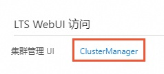

**创建同步任务**

1. 确认默认数据源是否创建完成。

   默认数据源包括**target_default**、**source_default**两个数据源。

   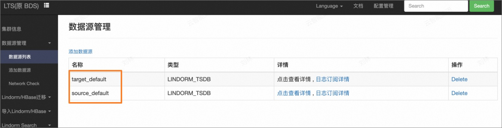

2. 确认源端和目标端都完成新建数据库，本文新建的数据库以test_db为例。

   备实例使用相同DDL创建同名数据库。

   > **说明**
   >
   > 备实例连接信息可从target_default数据源中的address获取。
   >
   > ```text
   > SQL地址: jdbc:lindorm:tsdb:url= + {address}
   > SQL地址示例：jdbc:lindorm:tsdb:url=http://ld-fvxqdumy3e6suhh91-zone2-tsdb-external.lindorm.cn-wulan-env82-d01.inter.env82.shuguang.com:8242"
   > ```

3. 参照默认数据源的默认配置信息，修改test_db信息，添加target_{test_db}、source_{test_db}数据源。

   ```json
   {
    "schemaPolicy":"weak",
    "database":"{test_db}",
    "address":"http://ld-fvxqdumy3e6suhh91-zone2-tsdb-external.lindorm.cn-wulan-env82-d01.inter.env82.shuguang.com:8242",
    "clusterKey":"hdfs://10.83.43.163:8020,10.83.36.240:8020",
    "client":"sdk",
    "clusterId":"ld-fvxqdumy3e6suhh91-zone2",
    "hdfsUri":"hdfs://10.83.43.163:8020,10.83.36.240:8020"
   }
   ```

4. 在左侧导航栏，单击**数据源列表**，在**数据源管理**页面，单击**添加数据源**，配置数据源信息。

   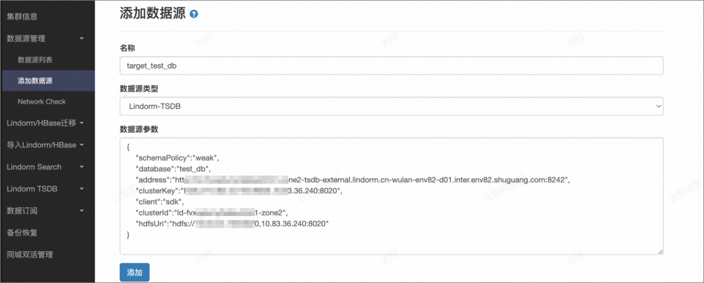

5. 数据源配置完成后，可在数据源管理页面查看详细信息。

   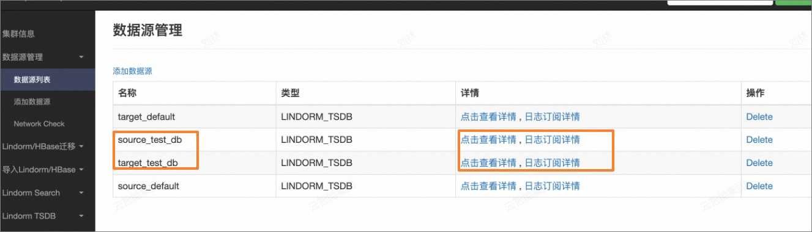

6. 在左侧导航栏选择**Lindorm TSDB > 实时数据同步**，在实时同步页面，填写源集群、目标集群等信息。

   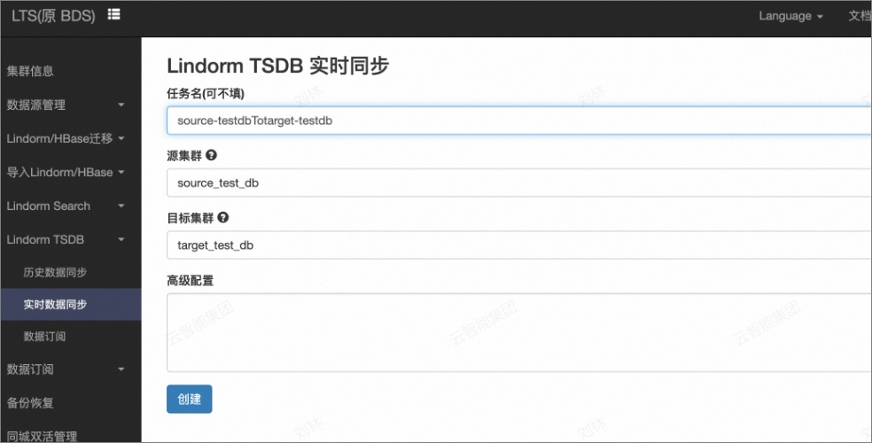

7. 单击**创建**，完成实时同步任务创建操作。

   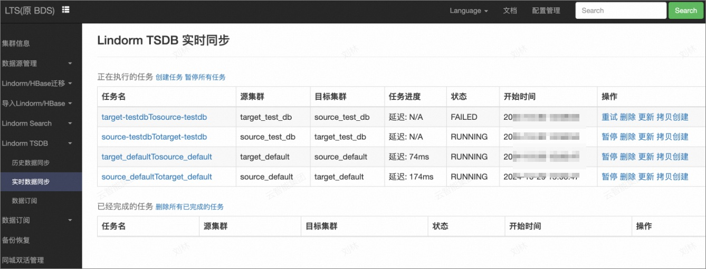

<a id="section-6"></a>

# 6.数据通道服务

<a id="section-6-1"></a>

## 6.1. 数据通道服务概述

数据通道服务（Lindorm Tunnel Service，简称LTS）是为Lindorm业务场景定制的数据生态服务，具有简单易用的数据交换、处理、订阅等能力，支持数据迁移、实时订阅、数湖转存、数仓回流、单元化多活、备份恢复等功能，实现面向Lindorm的一站式数据生态服务。

**核心能力**

- **云原生分布式**：LTS是基于ECS部署的分布式系统，具备良好的水平扩展能力，您可以按需进行资源配置。

- **简单易用**：LTS支持一键配置数据迁移、导入、订阅、归档等功能。比如数据迁移任务，您只需要选择源端、目标端和需要同步的列，LTS会自动完成Schema复制、全量数据复制和增量数据复制。

- **安全可靠**：LTS充分考虑对源端和目标端系统在线影响最小化，以及兼容可能出现的故障。在任务启动前会有网络联通性、安全性等前置校验，运行过程中会实时监控同步延迟、目标集群存储水位等有关的限速和报警，任务结束后也会提供数据校验。

- **低成本**：LTS在HBase等开源系统上有深入的优化，提供物理文件级别的数据处理，比传统的数据复制效率提高10倍。同时在CPU、缓存、内存、网络IO上的整体优化使LTS提供一个高性价比的数据通道，减少客户数据流转、处理的成本。

**功能列表**

| 功能 | 场景 |
| --- | --- |
| HBase、Lindorm宽表之间数据迁移 | 新旧集群无缝迁移、集群升配、在线离线业务分离、主备容灾、异地多活。 |
| RDS数据全增量同步到Lindorm | 在线离线业务分离、历史库。 |
| MaxCompute/Hive数据同步到Lindorm | 离线数据查询加速，将数仓中的明细、指标等数据批量回流Lindorm提供在线查询。 |
| Lindorm 数据导出ODPS（MaxCompute） | 支持历史数据。 |
| LogHub实时数据订阅 | 支持订阅LogHub实时数据到Lindorm。 |
| Lindorm数据订阅 | 支持Lindorm实时增量数据订阅。 |

**典型场景**

- 集群迁移

  - 使用场景

    - HBase迁移Lindorm。

    - 集群网络的切换，经典切换VPC。

    - 异地跨机房迁移。

    - 业务拆分。

  - 特点

    - 数据迁移中同时完成历史数据迁移、实时增量数据的同步。

    - 迁移过程中不会和源集群的HBase、Lindorm交互，只读取源集群的HDFS，尽可能减少对源集群在线业务的影响。

    - 文件层的数据拷贝比通常API层的数据迁移节省50%以上的流量。

    - 高效性，单个节点迁移速度可达到100 MB/s，节点数支持水平扩展，支持TB、PB级别的数据迁移。

    - 稳定性，有完善的错误重试机制，实时监控任务速度和进度，支持任务失败报警。

    - 正确性，能够进行数据校验。

    - 支持自动同步Schema，保证分区一致。

- 在线离线业务分离

  通过LTS，将在线业务数据实时同步到HDFS或OSS等存储，结合Spark、MR等大数据组件进行数据分析，从而不影响在线业务的查询。

- 主备容灾

  通过LTS在主备集群之间实现实时数据的双向同步，当主集群出现问题，可以切换到备集群，尽可能减少对业务产生的影响，当主集群服务恢复之后，通过LTS同步服务补齐主集群遗漏的数据。

- RDS历史库建设

  对于交易订单等存储场景，随着数据量增大会对RDS造成性能压力，在周期性的归档数据或者分库分表情况下存在成本高、操作复杂等问题，可以通过LTS将RDS数据实时同步到Lindorm宽表实现冷热数据分离。Lindorm宽表提供自动水平扩展、高并发查询、多维索引、轻量分析等功能，Lindorm Streams提供变更数据有序订阅，LTS还支持将Lindorm宽表数据同步到其它分析系统进行复杂数据分析。

<a id="section-6-2"></a>

## 6.2. 登录集群管理系统

本文介绍登录数据通道服务的集群管理系统。

**前提条件**

已创建数据通道服务实例，请参见创建数据通道服务实例。

**操作步骤**

1. 登录云原生多模数据库Lindorm。

2. 在**实例列表**页面中单击目标实例ID或**操作**栏下的**管理**。

3. 在**LTS WebUI访问**区域中单击**ClusterManager**登录集群管理系统。

   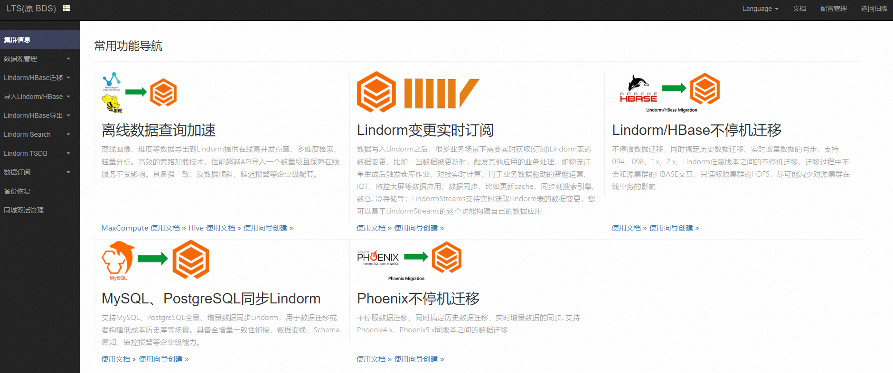
