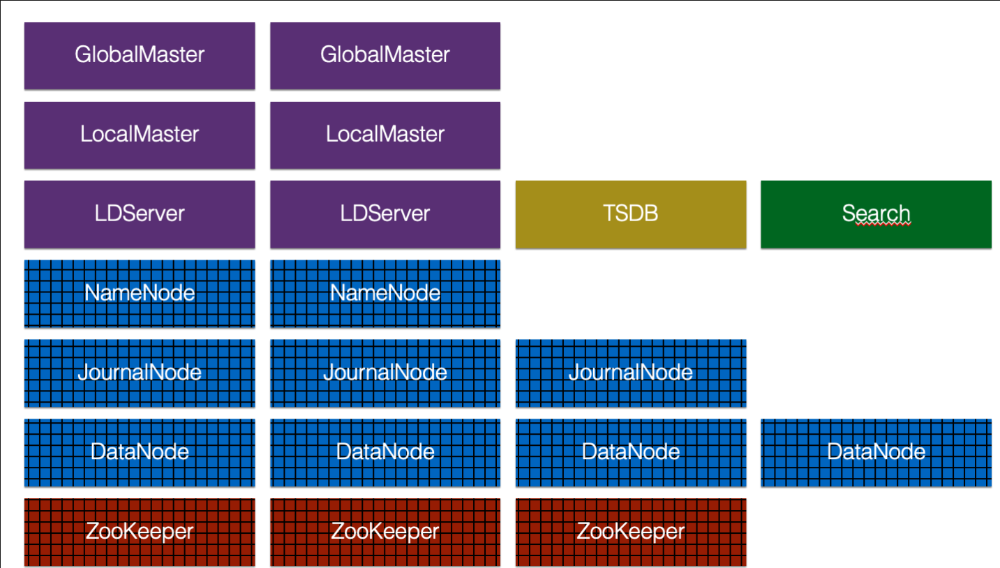
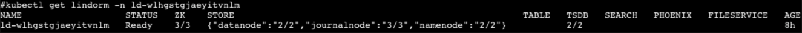
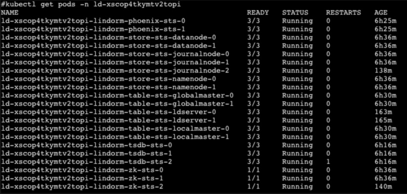
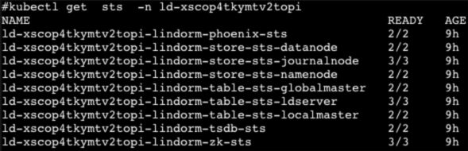

阿里云  
专有云  
云原生多模数据库Lindorm  
运维指南  
产品版本：V3.18.6  
文档版本：20250822

**目录**

- [1.什么是云原生多模数据库Lindorm](#section-1)
- [2.部署形态](#section-2)
- [3.集群管理](#section-3)
    - [3.1. 通过命令行查看实例状态](#section-3-1)
    - [3.2. 查看所有实例节点的状态](#section-3-2)
    - [3.3. 登陆节点查看日志](#section-3-3)
    - [3.4. 集群扩缩容](#section-3-4)
    - [3.5. 小版本升级](#section-3-5)
    - [3.6. 重启节点](#section-3-6)

<a id="section-1"></a>

# 1.什么是云原生多模数据库Lindorm

Lindorm是一款适用于任何规模、多种模型的云原生数据库服务，支持海量数据的低成本存储处理，提供宽表数据模型，兼容HBase、OpenTSDB、SQL等多种开源标准接口，是适用于互联网、IoT、车联网、广告、社交、监控、游戏、风控等场景的数据库，也是为阿里巴巴核心业务提供关键支撑的数据库之一。

Lindorm基于存储计算分离、多模共享融合的云原生架构，具备弹性、低成本、简单易用、开放、稳定等优势，适合元数据、日志、账单、标签、消息、报表、维表、结果表、Feed流、用户画像、设备数据、监控数据、传感器数据、小文件、小图片等数据的存储和分析，其核心能力包括：

- 数据互通：支持宽表模型，提供统一联合查询和独立开源接口两种方式，模型之间数据互融互通，帮助应用开发更加敏捷、灵活、高效。

- 极致性价比：支持千万级高并发吞吐、毫秒级访问延迟，并通过高密度低成本存储介质、智能冷热分离、自适应压缩，大幅减少存储成本。

- 云原生弹性：支持计算资源、存储资源独立弹性伸缩，并提供按需即时弹性的Serverless服务。

- 开放数据生态：提供简单易用的数据交换、处理、订阅等能力，支持与MySQL、Spark、Flink、Kafka等系统无缝对接。

**多模介绍**

Lindorm系统支持宽表模型，提供统一联合查询和独立开源接口两种方式，模型之间数据互融互通，帮助应用开发更加敏捷、灵活、高效。宽表引擎

面向海量KV、表格数据，具备全局二级索引、多维检索、动态列、TTL等能力，适用于元数据、订单、账单、画像、社交、feed流、日志等场景，兼容HBase等开源标准接口。

支持千万级高并发吞吐，支持百PB级存储，吞吐性能是开源HBase（Apache HBase）的3-7倍，P99时延为开源HBase（Apache HBase）的1/10，平均故障恢复时间相比开源HBase（Apache HBase）提升10倍，支持冷热分离，压缩率比开源HBase（Apache HBase）提升一倍，综合存储成本为开源HBase（Apache HBase）的1/2。

对于目前使用类HBase+ElasticSearch或HBase+OpenTSDB+ES的应用场景，比如监控、社交、广告等，利用Lindorm的原生多模能力，将很好地解决架构复杂、查询痛苦、一致性弱、成本高、功能不对齐等痛点，让业务创新更高效。

<a id="section-2"></a>

# 2.部署形态

在进行本手册中的各项操作前，请务必先阅读本小节，了解Lindorm在敏捷PaaS上是如何部署的，以及各个节点的角色和分工等。

敏捷PaaS版Lindorm的由多个StatefulSet组成。存储部分包括zookeeper（3副本），NameNode（2副本），JournalNode（3副本），DataNode（至少3副本）。用户可以按照自己的需求选择宽表（GlobalMaseter 2副本， LocalMaster(2副本），LDServer（至少2副本）），时序（至少2副本）。

整体部署形态大致如下所示：



<a id="section-3"></a>

# 3.集群管理

<a id="section-3-1"></a>

## 3.1. 通过命令行查看实例状态

本文介绍如何通过命令行查看实例状态。

创建完成后，可以通过下面的命令来查看实例的状态 （namespace 和实例ID一致）。

```bash
kubectl get lindorm -n <namespace>
```

正常情况STATUS 是Ready 状态， 如下图所示：



<a id="section-3-2"></a>

## 3.2. 查看所有实例节点的状态

本文介绍如何查看所有实例节点的状态。

通过下面命令查看所有的节点状体。

```bash
kubectl get pods -n <namespace>
```

正常情况下，应该能看到所有的 pod都处于 running 或 ready 状态，且重启数为0，如下图所示：



<a id="section-3-3"></a>

## 3.3. 登陆节点查看日志

如果有异常，可以通过下面的命令登录节点上，查看liveness和readiness检查的日志以及服务日志等。

```bash
kubectl exec -it ld-xscop4tkymtv2topi-lindorm-store-sts-namenode-0 -n ld-xscop4tkymtv2topi /bin/bash
```

启动日志：

```text
/tmp/auto_start.log
```

服务日志：

LindormZookeeper, LindormStore, LindormTable在目录：/disk1/cluster-data/logs

<a id="section-3-4"></a>

## 3.4. 集群扩缩容

如果需要对集群的某个引擎进行扩缩容时，可以通过下面的命令来进行手工扩容。

```bash
LindormStore:
kubectl patch lindorm <instanceId> -n <namespace> --type='merge' -p '{"spec" : {"lindormStore" : {"replicas" : 3}}}'
LindormTable:
kubectl patch lindorm <instanceId> -n <namespace> --type='merge' -p '{"spec" : {"lindormTable" : {"replicas" : 3}}}'
```

其中 `instanceId` 和 `namespace` 与控制台的实例ID一致，replicas为目标节点数。如果当前引擎的节点数小于3即为扩容操作， 大于3即为缩容操作。

<a id="section-3-5"></a>

## 3.5. 小版本升级

如果需要对集群的某个引擎进行小版本升级时，可以参考本文来进行手工升级版本。

先通过命令获取statefulSet的列表：

```bash
kubectl get sts -n <namespace>
```

返回示例如下图。



通过下面命令更新镜像，以达到升级版本的目的。

```bash
kubectl patch sts <stsName> -n <namespace> --type='merge' -p '{"spec" : {"template": {"spec": {"containers":[{"name":"<containerName>","image" : "<new Image>"}]}}}}'
```

其中stsName 从statefulSet 的列表获取， containerName为以下列表：

```text
lindorm-datanode
lindorm-namenode
lindorm-journalnode
lindorm-localmaster
lindorm-globalmaster
lindorm-ldserver
```

<a id="section-3-6"></a>

## 3.6. 重启节点

通常情况下，如果需要重启单个pod，可以本文的方式来实现。

```bash
kubectl delete pods <podName> -n <namespace>
```

正常情况下，请不要同时重启StatefulSet下的2个及2个以上副本，否则会导致服务的抖动、不可用等情况。
