阿里云  
专有云  
AnalyticDB for PostgreSQL版  
用户指南  
产品版本：V3.18.6  
文档版本：20250929

**目录**

- [1.什么是云原生数据仓库AnalyticDB PostgreSQL版](#section-1)
- [2.快速入门](#section-2)
    - [2.1. 登录云原生数据仓库AnalyticDB PostgreSQL版控制台](#section-2-1)
    - [2.2. 创建实例](#section-2-2)
    - [2.3. 设置白名单](#section-2-3)
    - [2.4. 创建数据库账号](#section-2-4)
    - [2.5. 获取客户端工具](#section-2-5)
    - [2.6. 连接数据库](#section-2-6)
- [3.实例](#section-3)
    - [3.1. 重置账号密码](#section-3-1)
    - [3.2. 管理网络连接地址](#section-3-2)
    - [3.3. 变更配置](#section-3-3)
    - [3.4. 重启实例](#section-3-4)
    - [3.5. 释放实例](#section-3-5)
    - [3.6. SQL审计](#section-3-6)
    - [3.7. SSL](#section-3-7)
    - [3.8. 版本升级](#section-3-8)
    - [3.9. 标签](#section-3-9)
    - [3.10. 设置实例参数](#section-3-10)
    - [3.11. 导入数据](#section-3-11)
        - [3.11.1. OSS高速并行导入](#section-3-11-1)
        - [3.11.2. 从MySQL导入](#section-3-11-2)
        - [3.11.3. 从PostgreSQL导入](#section-3-11-3)
        - [3.11.4. 通过COPY数据导入](#section-3-11-4)
- [4.数据库](#section-4)
    - [4.1. 概述](#section-4-1)
    - [4.2. 创建数据库](#section-4-2)
    - [4.3. 创建分布键](#section-4-3)
    - [4.4. 构造数据](#section-4-4)
    - [4.5. 查询](#section-4-5)
    - [4.6. 管理插件](#section-4-6)
    - [4.7. 管理用户和权限](#section-4-7)
    - [4.8. 实时物化视图](#section-4-8)
    - [4.9. JSON数据类型操作](#section-4-9)
    - [4.10. HyperLogLog的使用](#section-4-10)
    - [4.11. Create Library命令的使用](#section-4-11)
    - [4.12. PL/Java UDF的使用](#section-4-12)
- [5.表](#section-5)
    - [5.1. 创建表](#section-5-1)
    - [5.2. 行存、列存，堆表、AO表的原理和使用场景](#section-5-2)
    - [5.3. 设置列存和压缩](#section-5-3)
    - [5.4. 给列存加字段默认值](#section-5-4)
    - [5.5. 设置表分区](#section-5-5)
    - [5.6. 设置排序键](#section-5-6)
- [6.向量分析](#section-6)
    - [6.1. 概述](#section-6-1)
    - [6.2. 向量检索引擎使用指南](#section-6-2)
        - [6.2.1. 指定向量版实例](#section-6-2-1)
        - [6.2.2. 访问向量数据库](#section-6-2-2)
            - [6.2.2.1. 通过SQL访问向量数据库](#section-6-2-2-1)
            - [6.2.2.2. 通过API访问向量数据库](#section-6-2-2-2)
                - [6.2.2.2.1. Java](#section-6-2-2-2-1)
                - [6.2.2.2.2. Go](#section-6-2-2-2-2)
                - [6.2.2.2.3. Python 3](#section-6-2-2-2-3)
        - [6.2.3. 创建向量表](#section-6-2-3)
        - [6.2.4. 创建向量索引](#section-6-2-4)
        - [6.2.5. 向量数据导入](#section-6-2-5)
        - [6.2.6. 向量检索](#section-6-2-6)
        - [6.2.7. 使用float2类型压缩存储向量](#section-6-2-7)
    - [6.3. AnalyticDB PostgreSQL稀疏向量使用指南](#section-6-3)
    - [6.4. pgvector兼容模式使用指南](#section-6-4)
    - [6.5. 混合检索使用指南](#section-6-5)
    - [6.6. 向量分析性能测试](#section-6-6)
    - [6.7. 案例：搭建以图搜图系统](#section-6-7)
    - [6.8. 案例：构建文本语义检索系统](#section-6-8)
- [7.备份恢复](#section-7)
    - [7.1. 功能介绍](#section-7-1)
    - [7.2. 数据备份](#section-7-2)
    - [7.3. 数据恢复](#section-7-3)
- [8.性能与监控](#section-8)
    - [8.1. 监控与报警（存储预留模式）](#section-8-1)
        - [8.1.1. 实例监控](#section-8-1-1)
        - [8.1.2. 节点监控](#section-8-1-2)
    - [8.2. 监控与报警（计算存储一体模式）](#section-8-2)
    - [8.3. 诊断与优化](#section-8-3)
        - [8.3.1. 实例运行状态概览](#section-8-3-1)
        - [8.3.2. 运维助手](#section-8-3-2)
        - [8.3.3. 查询分析](#section-8-3-3)
        - [8.3.4. 锁诊断](#section-8-3-4)
- [9.最佳实践](#section-9)
    - [9.1. 配置内存和负载参数](#section-9-1)

<a id="section-1"></a>

# 1.什么是云原生数据仓库AnalyticDB PostgreSQL版

云原生数据仓库AnalyticDB PostgreSQL版是一种在线分布式云数据库，由多个计算组组成，可提供大规模并行处理（MPP）数据仓库服务。

AnalyticDB PostgreSQL版基于Greenplum Database开源数据库项目开发，由阿里云深度扩展后，具备如下特性：

- 兼容Greenplum，用户可以直接使用所有支持Greenplum的工具。

- 支持OSS存储、JSON数据类型和HyperLogLog预估分析等功能特性。

- 支持符合SQL 2003标准的查询语法和OLAP分析聚合函数，提供灵活的混合分析能力。

- 支持行存储和列存储混合模式，分析性能优越。

- 支持数据压缩技术，存储成本低廉。

- 提供在线扩容和性能监测等服务，用户无需再进行复杂的大规模MPP集群的运维管理工作，使DBA、开发人员及数据分析师能够专注于如何通过SQL提高企业的生产力，实现核心价值。

<a id="section-2"></a>

# 2.快速入门

<a id="section-2-1"></a>

## 2.1. 登录云原生数据仓库AnalyticDB PostgreSQL版控制台

本文介绍如何登录到AnalyticDB PostgreSQL版控制台。

**前提条件**

- 登录Apsara Uni-manager运营控制台前，确认您已从部署人员处获取Apsara Uni-manager运营控制台的服务域名地址。

- 推荐使用Chrome浏览器。

1. 在浏览器地址栏中，输入Apsara Uni-manager运营控制台的服务域名地址，按回车键。

   

   > **说明**
   >
   > - 单击页面右上角的当前语言可以切换其它语言。
   >
   > - 授权登录是第三方认证中配置了全局IdP设置才会显示，且“授权登录”名称用户可按需自定义。
   >
   > - 由于浏览器证书过期或环境开启HTTPS认证等出现多次单击继续访问或无Apsara Uni-manager运营控制台地址入口等现象，此时需要安装证书才能正常访问。单击页面右上角的**浏览器证书安装**，可打开浏览器证书安装指南。

2. 输入正确的用户名及密码。

   > **说明**
   >
   > - 请向运营管理员获取登录控制台的用户名和密码。
   >
   > - 首次登录Apsara Uni-manager运营控制台时，需要修改登录用户名的密码，请按照提示完成密码修改。为提高安全性，密码长度必须为10~32位，且包含英文字母大小写、阿拉伯数字和特殊符号（感叹号（!）、at（@）、井号（#）、美元符号（$）、百分号（%）等）。

3. 单击**账号登录**。

4. 如果账号已激活MFA多因素认证，请根据以下两种情况进行操作：

   - **管理员强制开启MFA后的首次登录**

     <ol type="a">

     <li>

     在绑定虚拟MFA设备页面中，按页面提示步骤绑定MFA设备。

     </li>

     <li>

     按照步骤2重新输入账号和密码，单击**账号登录**。

     </li>

     </ol>

     <ol type="i" start="100">

     <li>

     输入6位MFA码后单击**认证**。

     </li>

     </ol>

   - **您已开启并绑定MFA**

     输入6位MFA码后单击**认证**。

     > **说明**
     >
     > 绑定并开启MFA的操作请参见《 Apsara Uni-manager运营控制台 用户指南》的**管理多因素认证**章节。

5. 在页面顶部的导航栏中，单击**产品**，选择**数据库 > 云原生数据仓库AnalyticDB PostgreSQL版**。

<a id="section-2-2"></a>

## 2.2. 创建实例

创建AnalyticDB PostgreSQL版实例是一切操作的开始，您可以通过控制台快速地创建实例。

1. 登录云原生数据仓库AnalyticDB PostgreSQL版控制台。

2. 单击页面右上角**新建实例**。

3. 在创建**分析型数据库 PostgreSQL 版**页面，配置相关参数，具体参数说明如下所示。

   **类别**

   **配置**

   **说明**

   组织

   实例所属组织。

   资源集

   实例所属资源集。

   选择AnalyticDB PostgreSQL版所在的地域。

   > **说明**

   地域

   > 如果需要从ECS上通过虚拟专有网络访问使用，AnalyticDB PostgreSQL版实例必须与ECS实例处于相同的地域和可用区。

   区域

   主可用区

   AnalyticDB PostgreSQL版所在的主可用区。

   部署方式

   选择**单可用区部署**或**多可用区部署**。

   AnalyticDB PostgreSQL版的备可用区。

   备可用区

   > **说明**
   >
   > 仅部署方式为**多可用区部署**时显示该配置项。

   实例资源类型

   选择**计算存储一体模式**或**存储预留模式**。

   芯片架构

   选择芯片架构。

   选择引擎版本。

   > **说明**

   引擎版本

   > - 实例资源类型为**计算存储一体模式**时显示4.3和6.0。
   >
   > - 实例资源类型为**存储预留模式**时显示6.0和6.0向量版。

   固定为1，实例创建完成后可以自行添加，操作方式，请参见变更配置。

   master节点数量

   > **说明**
   >
   > 仅实例资源类型为**存储预留模式**时显示该配置项。

   计算机规格

   计算资源单位，不同的计算组规格有不同的存储空间和计算能力。

   选择**计算组**数量，计算组个数的增加可以线性提升实例性能。

   计算机节点

   > **说明**
   >
   > 仅实例资源类型为**计算存储一体模式**时显示该配置项。

   基本配置

   选择计算节点数量，节点个数的增加可以线性地提升性能。取值范围：2~640。

   计算节点数量

   > **说明**
   >
   > 仅实例资源类型为**存储预留模式**时显示该配置项。

   计算节点容量不支持修改，具体容量与节点规格相关。

   CPU：内存：存储容量比例为1：8：80，例如计算节点规格为2C16G，则存储容量为160 GB。

   > **说明**

   计算节点容量

   > 仅实例资源类型为**存储预留模式**时显示该配置项。

   固定为**本地SSD盘**。

   存储介质

   > **说明**
   >
   > 仅实例资源类型为**存储预留模式**时显示该配置项。

   AnalyticDB PostgreSQL版实例支持的网络类型：

   - **经典网络**：经典网络中的云服务在网络上不进行隔离，只能依靠云服务自身的安全组或白名单策略来阻挡非法访问。

   - **专有网络**：（Virtual Private Cloud，简称VPC）专有网络帮助

   网络类型

   用户在阿里云上构建出一个隔离的网络环境。用户可以自定义专有网络里面的路由表、IP地址范围和网关。建议您选择专有网络，更加安全。

   您可以事先创建专有网络，也可以在创建实例后切换网络类型时修改专有网络。

   AnalyticDB PostgreSQL版实例所在的VPC。

   专有网络VPC

   > **说明**
   >
   > 仅网络类型为**专有网络**时显示该配置项。

   网络

   AnalyticDB PostgreSQL版实例所在的交换机。

   交换机VSwitch

   > **说明**
   >
   > 仅网络类型为**专有网络**时显示该配置项。

   AnalyticDB PostgreSQL版实例所在的备可用区的交换机。

   备可用区交换机

   > **说明**

   VSwitch

   > 仅部署方式为**多可用区部署**，且网络类型为**专有网络**时显示该配置项。

   IP白名单

   添加允许访问AnalyticDB PostgreSQL版实例的IP地址。

4. 完成上述参数配置后，单击**确认订单**。

<a id="section-2-3"></a>

## 2.3. 设置白名单

为保障数据库的安全稳定，请将需要访问数据库的IP地址或者IP地址段加入白名单。

1. 登录云原生数据仓库AnalyticDB PostgreSQL版控制台。

2. 找到目标实例，单击实例ID。

3. 在左侧导航栏中，单击**数据安全性**。

4. 在**数据安全性**页面，您可以进行以下操作：

   - 添加白名单分组：

     <ol type="a">

     <li>

     单击**添加白名单分组**。

     </li>

     <li>

     在**添加白名单分组**面板中配置以下信息。

     <table>
       <tr>
         <th width="105">配置</th>
         <th>说明</th>
       </tr>
       <tr>
         <td>分组名称</td>
         <td>新建白名单分组的名称，限制如下：<br>• 由小写字母、数字或下划线（_）组成。<br>• 以小写字母开头，以小写字母或数字结尾。<br>• 长度为2~32个字符。</td>
       </tr>
       <tr>
         <td>组内白名单</td>
         <td>设置需要添加的白名单IP地址，说明如下：<br>• IP地址以英文逗号（,）分隔，不可重复，最多999个。<br>• 支持格式为10.23.12.24（具体IP地址）、10.23.12.24/24（CIDR模式，即无类域间路由，/24表示地址中前缀的长度，范围为1~32）。<br>• 地址中的前缀长度设置为0（例如0.0.0.0/0、127.0.0.1/0）表示允许所有IP地址访问该实例，存在高安全风险，请谨慎设置。<br>• 127.0.0.1表示禁止任何外部IP访问本实例。</td>
       </tr>
     </table>

     </li>

     </ol>

     <ol type="i" start="100">

     <li>

     单击**确定**。

     </li>

     </ol>

   - 修改分组内白名单IP：

     <ol type="a">

     <li>

     单击目标白名单右侧的**修改**。

     </li>

     <li>

     在**组内白名单**下方添加或删除IP地址或IP地址段。

     > **分组名称**不支持修改。
     >
     > **说明**

     </li>

     </ol>

     <ol type="i" start="100">

     <li>

     单击**确定**。

     </li>

     </ol>

   - 删除白名单分组：

     > 默认白名单分组无法删除。
     >
     > **说明**

     <ol type="a">

     <li>

     单击目标白名单分组右侧的**删除**。

     </li>

     <li>

     在**删除分组**对话框中单击**确定**即可。

     </li>

     </ol>

   - 清空默认白名单分组：

     <ol type="a">

     <li>

     单击default白名单分组右侧的**清空**。

     </li>

     <li>

     在**确认清空默认分组**对话框中单击**确定**即可清空默认白名单分组。

     清空后默认白名单分组内仅保留127.0.0.1。

     </li>

     </ol>

**后续步骤**

- 建议您定期维护白名单，以保证AnalyticDB PostgreSQL版得到有效的访问安全保护。

- 后续操作中，您可以单击分组名称后的**修改**修改已有分组，或者单击**删除**删除已有的自定义分组。

<a id="section-2-4"></a>

## 2.4. 创建数据库账号

本文介绍如何在AnalyticDB PostgreSQL版中创建数据库账号。

**背景信息**

AnalyticDB PostgreSQL版提供了以下两种数据库账号：

- 高权限账号：拥有所有数据库的所有操作权限。控制台上的初始账号为高权限账号。

- 普通账号：拥有已授权数据库（Owner）的所有操作权限。

  > 操作权限包括SELECT、INSERT、UPDATE、DELETE、TRUNCATE、
  >
  > **说明**
  >
  > REFERENCES、TRIGGER。

**注意事项**

- 使用AnalyticDB PostgreSQL版数据库前，需要创建初始账号。

- 控制台仅支持创建初始账号，如果需要创建其他账号，请参见使用SQL语句创建账号。

- 初始账号创建后无法删除。

1. 登录云原生数据仓库AnalyticDB PostgreSQL版控制台。

2. 找到目标实例，单击实例ID。

3. 在左侧导航栏中，选择**账号管理**。

4. 单击**创建初始账号**。

5. 在**创建账号**面板中，填写如下信息。

   <table>
     <tr>
       <th width="105">配置</th>
       <th>说明</th>
     </tr>
     <tr>
       <td>数据库账号</td>
       <td>初始账号的名称，限制如下：<br>• 由小写字母，数字，下划线组成。<br>• 以小写字母开头，小写字母或数字结尾。<br>• 不能以gp开头。<br>• 长度为2~16个字符。</td>
     </tr>
     <tr>
       <td>新密码</td>
       <td>初始账号的密码，限制如下：<br>• 由大写字母、小写字母、数字、特殊字符其中三种及以上组成。<br>• 支持的特殊字符如下：<br>!@#$%^&amp;*()_+-=<br>• 长度为8~32个字符。</td>
     </tr>
     <tr>
       <td>确认密码</td>
       <td>再次输入密码。</td>
     </tr>
   </table>

6. 单击**确定**。

> 完成创建后您可以单击**操作**列的**重置密码**修改初始账号的密码。为保障数据安全，建议您
>
> **重要**
>
> 定期更换密码，不要使用曾经用过的密码。

**使用SQL语句创建账号**

使用SQL语句创建账号需要连接数据库，连接数据库的操作，请参见连接数据库。

- 创建高权限账号，语句如下：

  ```text
  CREATE ROLE <账号名> WITH LOGIN ENCRYPTED PASSWORD <'密码'> RDS_SUPERUSER;
  ```

  示例如下：

  ```text
  CREATE role admin0  WITH LOGIN ENCRYPTED PASSWORD '111111' rds_superuser;
  ```

- 创建普通账号，语句如下：

  ```text
  CREATE ROLE <账号名> WITH LOGIN ENCRYPTED PASSWORD <'密码'>;
  ```

  示例如下：

  ```text
  CREATE role test1 WITH LOGIN ENCRYPTED PASSWORD '111111';
  ```

<a id="section-2-5"></a>

## 2.5. 获取客户端工具

云原生数据仓库AnalyticDB PostgreSQL版的接口协议兼容社区版的Greenplum Database和8.2版本的PostgreSQL。因此，您可以使用Greenplum或PostgreSQL的客户端连接AnalyticDB PostgreSQL版。

> **说明**
>
> 由于专有云为隔离环境，用户从外部网络获取软件后，需要将其部署到内部环境中。

**图形客户端工具**

AnalyticDB PostgreSQL版用户可以直接使用支持Greenplum的客户端工具，例如DBeaver。

**命令行客户端psql（RHEL或CentOS版本6和7平台）**

对于RHEL（Red Hat Enterprise Linux）和CentOS版本6和7平台，可以通过以下地址进行下载，解压后即可使用：

- RHEL 6或CentOS 6平台，请单击ADBPG_client_package_el6进行下载。

- RHEL 7或CentOS 7平台，请单击ADBPG_client_package_el7进行下载。

**命令行客户端psql（其它Linux平台）**

适用于其它Linux平台的客户端工具的编译方法如下所示：

1. 获取源代码。有如下两种方法：

   - 直接获取git目录（需要先安装git工具）。

     ```bash
     git clone https://github.com/greenplum-db/gpdb.git
     cd gpdb
     git checkout 5d870156
     ```

   - 直接下载代码。

     ```bash
     wget https://github.com/greenplum-
     db/gpdb/archive/5d87015609abd330c68a5402c1267fc86cbc9e1f.zip
     unzip 5d87015609abd330c68a5402c1267fc86cbc9e1f.zip
     cd gpdb-5d87015609abd330c68a5402c1267fc86cbc9e1f
     ```

2. 使用gcc等编译工具进行编译。

   ```text
   ./configure
   make -j32
   make install
   ```

3. 使用psql和pg_dump。这两个工具的路径如下：

   psql：/usr/local/pgsql/bin/psql

   pg_dump：/usr/local/pgsql/bin/pg_dump

<a id="section-2-6"></a>

## 2.6. 连接数据库

Greenplum Database开源数据库基于PostgreSQL 8.2分支开发，完整兼容其消息协议，AnalyticDB PostgreSQL版同样基于此版本。因此，理论上来讲，AnalyticDB PostgreSQL版用户可以直接使用支持PostgreSQL 8.2消息协议的工具，例如libpq、JDBC、ODBC、psycopg2等。

**背景信息**

AnalyticDB PostgreSQL版提供了Redhat平台的二进制psql程序，下载链接参见获取客户端工具。Greenplum官网也提供了一个安装包，包含JDBC、ODBC和libpq，方便安装和使用，详情参见Greenplum官方文档。

> **说明**
>
> - 由于专有云为隔离环境，用户需要在环境中预先准备好必要的软件安装包。
>
> - 默认情况下，AnalyticDB PostgreSQL版只能通过同一区域和可用区的ECS上的客户端进行访问。

**DMS**

数据管理（Data Management Service，简称DMS）支持MySQL、SQL Server、PostgreSQL、PPAS、Petadata等关系型数据库，PolarDB-X等OLTP数据库，AnalyticDB、DLA等OLAP数据库和MongoDB、Redis等NoSQL的数据库管理。它是一种集数据管理、结构管理、用户授权、安全审计、数据趋势、数据追踪、BI图表、性能与优化和服务器管理于一体的数据管理服务。

以下内容将为您介绍如何使用DMS登录AnalyticDB PostgreSQL。

1. 登录登录云原生数据仓库AnalyticDB PostgreSQL版控制台。

2. <strong>可选：</strong>创建AnalyticDB PostgreSQL实例。具体操作，请参见创建实例。

   若已创建AnalyticDB PostgreSQL实例，请跳过该步骤。

3. 找到目标实例，单击实例ID。

4. <strong>可选：</strong>创建数据库账号。具体操作，请参见创建数据库账号。

   如果已经创建初始账号，则可以使用该账号直接登录数据库。

5. 单击实例详情页右上角**登录数据库**。

6. 在**登录实例**页面输入**数据库账号**和**数据库密码**，单击**登录**。

**psql**

psql是Greenplum中比较常用的工具，提供了丰富的命令，其二进制文件在Greenplum安装后的bin目录下。使用步骤如下：

1. 通过如下任意一种方式进行连接：

   - 连接串的方式

     ```text
     psql "host=yourgpdbaddress.gpdb.rds.aliyuncs.com port=3432 dbname=postgres user=gpdbaccount password=gpdbpassword"
     ```

   - 指定参数的方式

     ```text
     psql -h yourgpdbaddress.gp.aliyun-inc.com -p 3432 -d postgres -U gpdbaccount
     ```

     参数说明：

     - -h：指定主机地址。

     - -p：指定端口号。

     - -d：指定数据库（默认的数据库是postgres）。

     - -U：指定连接的用户。

     可以通过 `psql --help` 查看更多选项。在psql 中，可以执行 `\?` 查看更多psql中支持的命令。

2. 输入密码，进入psql的Shell界面。

   ```text
   postgres=>
   ```

参考文档如下：

AnalyticDB PostgreSQL版支持PostgreSQL的psql命令，使用时请注意细节上的差异。关于PostgreSQL的psql命令介绍，请参见psql。

**JDBC**

下载PostgreSQL的官方JDBC，下载之后加入到环境变量中。

代码示例如下：

```java
import java.sql.Connection;
import java.sql.DriverManager;
import java.sql.ResultSet;
import java.sql.SQLException;
import java.sql.Statement;


public class gp_conn {
    public static void main(String[] args) {
        try {
            Class.forName("org.postgresql.Driver");

            Connection db = 
DriverManager.getConnection("jdbc:postgresql://mygpdbpub.gpdb.rds.aliyuncs.com:3432/postg
s",
                    "mygpdb", "mygpdb");
            Statement st = db.createStatement();
            ResultSet rs = st.executeQuery(
                    "select * from gp_segment_configuration;");

            while (rs.next()) {
                System.out.print(rs.getString(1));
                System.out.print(" | ");
                System.out.print(rs.getString(2));
                System.out.print(" | ");
                System.out.print(rs.getString(3));
                System.out.print(" | ");
                System.out.print(rs.getString(4));
                System.out.print(" | ");
                System.out.print(rs.getString(5));
                System.out.print(" | ");
                System.out.print(rs.getString(6));
                System.out.print(" | ");
                System.out.print(rs.getString(7));
                System.out.print(" | ");
                System.out.print(rs.getString(8));
                System.out.print(" | ");
                System.out.print(rs.getString(9));
                System.out.print(" | ");
                System.out.print(rs.getString(10));
                System.out.print(" | ");
                System.out.println(rs.getString(11));
            }

            rs.close();
            st.close();
        } catch (ClassNotFoundException e) {
            e.printStackTrace();
        } catch (SQLException e) {
            e.printStackTrace();
        }
    }
}
```

**Python**

Python使用psycopg2连接Greenplum和PostgreSQ 。操作步骤如下：

1. 安装psycopg2。在CentOS下，有如下三种安装方法：

   - 方法一，执行如下命令：

     ```bash
     yum -y install python-psycopg2
     ```

   - 方法二，执行如下命令：

     ```bash
     pip install psycopg2
     ```

   - 方法三，从源码安装：

     ```bash
     yum install -y postgresql-devel*
     wget http://initd.org/psycopg/tarballs/PSYCOPG-2-6/psycopg2-2.6.tar.gz
     tar xf psycopg2-2.6.tar.gz
     cd psycopg2-2.6
     python setup.py build
     sudo python setup.py install
     ```

2. 设置 PYTHONPATH，之后就可以引用，如：

   ```python
   import psycopg2
    sql = 'select * from gp_segment_configuration;'
    conn = psycopg2.connect(database='gpdb', user='mygpdb', password='mygpdb', host='mygpdbpub.gpdb.rds.aliyuncs.com', port=3432)
    conn.autocommit = True
    cursor = conn.cursor()
    cursor.execute(sql)
    rows = cursor.fetchall()
    for row in rows:
        print row
    conn.commit()
    conn.close()
   ```

   会得到类似以下结果：

   ```text
   (1, -1, 'p', 'p', 's', 'u', 3022, '192.**.**.158', '192.**.**.158', None, None)(6, -1, 'm', 'm', 's', 'u', 3019, '192.**.**.47', '192.**.**.47', None, None)(2, 0, 'p', 'p
   ', 's', 'u', 3025, '192.**.**.148', '192.**.**.148', 3525, None)(4, 0, 'm', 'm', 's',
   'u', 3024, '192.**.**.158', '192.**.**.158', 3524, None)(3, 1, 'p', 'p', 's', 'u', 3023, '192.**.**.158', '192.**.**.158', 3523, None)(5, 1, 'm', 'm', 's', 'u', 3026, '192.**.**.148', '192.**.**.148', 3526, None)
   ```

**libpq**

libpq是PostgreSQL数据库的C语言接口，在C程序中通过libpq库访问PostgreSQL数据库并进行数据库操作。在安装了 Greenplum或者PostgreSQL之后，在其lib目录下可以找到其静态库和动态库。

相关案例，请参见PostgreSQL官方文档，此处不再列举。

关于libpq详情，请参见libpq。

**ODBC**

PostgreSQL的ODBC是基于LGPL（GNU Lesser General Public License）协议的开源版本，可以在PostgreSQL 官网下载。

1. 安装驱动。

   ```bash
   yum install -y unixODBC.x86_64  
   yum install -y postgresql-odbc.x86_64
   ```

2. 查看驱动配置。

   ```bash
   cat /etc/odbcinst.ini 
   ```

   配置示例如下：

   ```ini
   # Example driver definitions
   # Driver from the postgresql-odbc package
   # Setup from the unixODBC package
   [PostgreSQL]
   Description = ODBC for PostgreSQL
   Driver = /usr/lib/psqlodbcw.so
   Setup = /usr/lib/libodbcpsqlS.so
   Driver64 = /usr/lib64/psqlodbcw.so
   Setup64 = /usr/lib64/libodbcpsqlS.so
   FileUsage = 1
   # Driver from the mysql-connector-odbc package
   # Setup from the unixODBC package
   [MySQL]
   Description = ODBC for MySQL
   Driver = /usr/lib/libmyodbc5.so
   Setup = /usr/lib/libodbcmyS.so
   Driver64 = /usr/lib64/libmyodbc5.so
   Setup64 = /usr/lib64/libodbcmyS.so
   FileUsage = 1
   ```

3. 配置DSN，将如下代码中的 `****` 改成对应的连接信息。

   ```ini
   [mygpdb]
   Description = Test to gp
   Driver = PostgreSQL
   Database = ****
   Servername = ****.gpdb.rds.aliyuncs.com
   UserName = ****
   Password = ****
   Port = ****
   ReadOnly = 0
   ```

4. 测试连通性。

   ```bash
   echo "select count(*) from pg_class" | isql mygpdb
   ```

   正常连接后返回信息如下：

   ```text
   +---------------------------------------+
   | Connected!                            |
   |                                       |
   | sql-statement                         |
   | help [tablename]                      |
   | quit                                  |
   |                                       |
   +---------------------------------------+
   ```

   测试是否可以正常使用：

   ```sql
   SELECT count(*) FROM pg_class;
   ```

   正常返回示例如下：

   ```text
   +---------------------+
   | count               |
   +---------------------+
   | 388                 |
   +---------------------+
   SQLRowCount returns 1
   1 rows fetched
   ```

5. ODBC已连接上实例，将应用连接ODBC即可，请参见psqlODBC和C#连接到PostgreSQL。

**参考文档**

- Greenplum官网文档

- PostgreSQL psqlODBC

- PostgreSQL ODBC编译

- Greenplum ODBC下载

- Greenplum JDBC下载

- JDBC escapes

<a id="section-3"></a>

# 3.实例

<a id="section-3-1"></a>

## 3.1. 重置账号密码

在使用AnalyticDB PostgreSQL版过程中，如果忘记数据库账号密码，可以通过AnalyticDB PostgreSQL版数据库管理控制台重新设置密码。

> 为保障数据安全，建议您定期更换密码。
>
> **说明**

1. 登录云原生数据仓库AnalyticDB PostgreSQL版控制台。

2. 找到目标实例，单击实例ID。

3. 在左侧导航栏中，选择**账号管理**。

4. 单击目标账号右侧**操作**列的**重置密码**。

5. 在**修改账号**面板输入**新密码**并**确认密码**。账号密码限制如下：

   - 由大写字母、小写字母、数字、特殊字符其中三种及以上组成。

   - 支持的特殊字符如下：

     !@#$%^&\*()_+-=

   - 长度为8~32个字符。

6. 单击**确定**。

<a id="section-3-2"></a>

## 3.2. 管理网络连接地址

本文介绍如何查看AnalyticDB PostgreSQL版实例的连接地址以及如何申请和释放外网地址。

**查看连接地址**

1. 登录云原生数据仓库AnalyticDB PostgreSQL版控制台。

2. 找到目标实例，单击实例ID。

3. 在左侧导航栏中，单击**数据库连接**。

4. 在**数据库连接**区域，即可查看当前实例的连接地址。

**申请外网地址**

1. 登录云原生数据仓库AnalyticDB PostgreSQL版控制台。

2. 找到目标实例，单击实例ID。

3. 在左侧导航栏中，单击**数据库连接**。

4. 单击**外网地址**右侧的**申请外网地址**即可。

**释放外网地址**

1. 登录云原生数据仓库AnalyticDB PostgreSQL版控制台。

2. 找到目标实例，单击实例ID。

3. 在左侧导航栏中，单击**数据库连接**。

4. 单击**外网地址**右侧的**释放外网地址**。

5. 在**释放外网地址**对话框中，单击**确定**。

<a id="section-3-3"></a>

## 3.3. 变更配置

本文将分别为您介绍计算存储一体模式实例和存储预留模式实例如何变更配置。

**计算存储一体模式**

1. 登录云原生数据仓库AnalyticDB PostgreSQL版控制台。

2. 找到目标实例，单击右侧**操作**列下的**变配**。

3. 选择需要变更的**计算机规格**和**计算机节点**。

4. 单击**提交**。

   > 实例在变配期间将不可读写，请合理安排您的变配任务。
   >
   > **警告**

**存储预留模式**

**Master节点变配**

调整节点数量：

1. 登录云原生数据仓库AnalyticDB PostgreSQL版控制台。

2. 找到目标实例，单击右侧**操作**列下的**Master节点变配 > 调整节点数量**。

3. 选择需要变更的**master节点数量**。

4. 单击**提交**。

   > Master节点在变配期间会短暂阻塞DDL操作，请合理安排您的变配任务。
   >
   > **警告**

升级节点规格：

1. 登录云原生数据仓库AnalyticDB PostgreSQL版控制台。

2. 找到目标实例，单击右侧**操作**列下的**Master节点变配 > 升级节点规格**。

3. 选择需要变更的**master节点规格**。

4. 单击**提交**。

   > Master节点在变配期间会短暂阻塞DDL操作，请合理安排您的变配任务。
   >
   > **警告**

**计算节点变配**

1. 登录云原生数据仓库AnalyticDB PostgreSQL版控制台。

2. 找到目标实例，单击右侧**操作**列下的**计算节点变配**。

3. 选择需要变更的**计算机规格**和**计算节点数量**。

4. 单击**提交**。

   > 计算节点在变配期间实例将不可读写，请合理安排您的变配任务。
   >
   > **警告**

<a id="section-3-4"></a>

## 3.4. 重启实例

当实例出现连接数满或性能问题时，您可以手动重启实例。

**注意事项**

重启过程大约耗费3到30分钟，在此过程中该实例不对外提供服务，请您提前进行调整。当实例重启结束，对应实例恢复运行中状态，您可以正常访问数据库。

1. 登录云原生数据仓库AnalyticDB PostgreSQL版控制台。

2. 找到目标实例，单击实例ID。

3. 单击页面右上角**重启实例**。

4. 在**重启实例**对话框中，单击**确定**。

> 重启实例将中断数据库服务，请谨慎操作。
>
> **警告**

<a id="section-3-5"></a>

## 3.5. 释放实例

您可以根据业务需求手动释放AnalyticDB PostgreSQL版实例。

**操作步骤**

1. 登录云原生数据仓库AnalyticDB PostgreSQL版控制台。

2. 找到目标实例，单击实例ID。

3. 单击页面右上角**实例管理**-**实例释放**。

4. 在**释放实例**对话框中，单击**释放**。

   > **警告**
   >
   > 实例释放后，所有数据将不再保留，请您在释放前妥善备份您的数据。

<a id="section-3-6"></a>

## 3.6. SQL审计

AnalyticDB PostgreSQL版控制台提供SQL审计功能，您可通过该功能查看SQL明细、定期审计SQL。开通SQL审计功能后，实例性能不会受到影响。

**计算存储一体模式**

1. 登录云原生数据仓库AnalyticDB PostgreSQL版控制台。

2. 找到目标实例，单击实例ID。

3. 在实例详情页，单击左侧导航栏的**数据安全性**。

4. 单击**SQL审计**页签。

5. <strong>可选：</strong>单击**开启SQL审计**，开启SQL审计。

   如果您已开启SQL审计功能，可跳过本步骤。

6. 在**SQL审计**页签，您可以通过**选择时间范围**、**DB**、**User**、**关键字**条件查询SQL信息。

> **说明**
>
> 您可以单击**关闭SQL审计**关闭SQL审计功能。

**存储预留模式**

1. 登录云原生数据仓库AnalyticDB PostgreSQL版控制台。

2. 找到目标实例，单击实例ID。

3. 在实例详情页，单击左侧导航栏的**SQL审计**。

4. 在**SQL审计**页面，您可以通过**数据库名称**、**执行时长**、**时间范围**、**数据库用户**、**客户端IP**、**执行状态**、**关键词搜索**条件查询SQL信息。

   > **说明**
   >
   > 您可以单击  图标导出当前页面的SQL信息。

<a id="section-3-7"></a>

## 3.7. SSL

为提高链路的安全性，您可以启用SSL（Secure Sockets Layer）加密，SSL加密功能在传输层对网络连接进行加密，在提升通信数据安全性的同时，保证数据的完整性。

**注意事项**

目前仅**存储预留模式**实例支持SSL加密。

**开启SSL证书**

1. 登录云原生数据仓库AnalyticDB PostgreSQL版控制台。

2. 找到目标实例，单击实例ID。

3. 在左侧导航栏中，单击**数据安全性**。

4. 单击**SSL**页签。

5. 在**SSL**页签，单击**SSL证书信息**右侧开关开启SSL功能。

6. 在**开启SSL证书**对话框中，单击**确定**。

   > 修改SSL状态会重启您的实例，为了不影响业务的运行，建议您在业务低谷期进行操
   >
   > **说明**
   >
   > 作。

**更新SSL证书有效期**

1. 登录云原生数据仓库AnalyticDB PostgreSQL版控制台。

2. 找到目标实例，单击实例ID。

3. 在左侧导航栏中，单击**数据安全性**。

4. 单击**SSL**页签。

5. 在**SSL**页签，单击**SSL证书信息**右侧的**更新有效期**。

6. 在**更新SSL证书有效期**对话框中，单击**确定**。

   > 修改SSL状态会重启您的实例，为了不影响业务的运行，建议您在业务低谷期进行操
   >
   > **说明**
   >
   > 作。

**关闭SSL证书**

1. 登录云原生数据仓库AnalyticDB PostgreSQL版控制台。

2. 找到目标实例，单击实例ID。

3. 在左侧导航栏中，单击**数据安全性**。

4. 单击**SSL**页签。

5. 在**SSL**页签，单击**SSL证书信息**右侧滑块关闭SSL功能。

6. 在**关闭SSL证书**对话框中，单击**确定**。

   > 修改SSL状态会重启您的实例，为了不影响业务的运行，建议您在业务低谷期进行操
   >
   > **说明**
   >
   > 作。

<a id="section-3-8"></a>

## 3.8. 版本升级

为了更好的满足您的需求，AnalyticDB PostgreSQL版会不断更新数据库内核版本。在实例创建时，默认使用的是最新版本的数据库内核。当新的内核版本发布后，您可以通过小版本升级实例来更新数据库内核版本，从而使用新版本中扩展的功能。本文将介绍如何升级小版本。

**注意事项**

实例升级小版本时，会执行实例重启操作，在重启期间实例将不可用，请在业务低谷时执行该操作。

**操作步骤**

1. 登录云原生数据仓库AnalyticDB PostgreSQL版控制台。

2. 找到目标实例，单击实例ID。

3. 在**基本信息**页面，单击右上方的**小版本升级**。

4. 在**小版本升级**对话框中，单击**确定**。

   > 小版本升级过程一般耗时3到15分钟，在此过程中该实例不能对外提供服务，请您提前
   >
   > **说明**
   >
   > 做出调整。当升级结束，对应实例恢复运行中状态，您可以正常访问数据库。

5. 完成了上述操作后，您可以回到控制台查看目标实例的运行状态。如果实例小版本升级操作完成，则实例运行状态为**运行中**，否则为**版本升级中**。小版本升级时会检查您的实例当前的版本号，如果您的实例已经是当前最新的小版本，实例的升级和重启过程将会被跳过。

<a id="section-3-9"></a>

## 3.9. 标签

本文为您介绍标签的创建和删除，帮助您快速了解标签相关功能。

**限制说明**

- 每个实例最多可以绑定20个标签，且标签键必须唯一。相同的标签键会被覆盖。

- 每次最多设置50个实例进行批量标签绑定。

- 不同地域的标签信息是独立的。

- 任一标签在解绑后，如果没有绑定任何实例，则该标签会被删除。

**创建标签**

1. 登录云原生数据仓库AnalyticDB PostgreSQL版控制台。

2. 在控制台左上角，选择实例所在地域。

3. 找到需要绑定标签的实例，单击**标签**列的图标。

4. 在**编辑标签**窗口中，输入**标签键**和**标签值**，单击**确定**。

   > **说明**
   >
   > 如果需要添加多个标签，重复该步骤即可。

**删除标签**

如果实例调整或者不再需要标签，您可以删除该实例的标签。

> **说明**
>
> - 每次解绑的标签数量不能超过20个。
>
> - 任一标签在解绑后，如果没有绑定任何实例，则该标签会被删除。

1. 登录云原生数据仓库AnalyticDB PostgreSQL版控制台。

2. 找到需要解绑标签的实例，单击**标签**列的图标。

3. 在**编辑标签**窗口中，删除标签组，单击**确认**。

<a id="section-3-10"></a>

## 3.10. 设置实例参数

您可以通过控制台查看和修改部分参数的值，并查询参数修改记录。

**修改参数值**

1. 登录云原生数据仓库AnalyticDB PostgreSQL版控制台。

2. 在实例列表页面，单击目标实例ID，打开**基本信息**页面。

3. 在左侧导航栏中，单击**参数设置**。

4. 此时您可以进行如下操作：

   修改单个参数

   <ol type="i">

   <li>

   在**可修改参数**列表内找到需要修改的参数，单击**运行参数值**列的

   。

   

   </li>

   <li>

   根据提示的取值范围输入参数值。

   </li>

   <li>

   单击**确定**。

   </li>

   <li>

   在右侧单击**提交**。

   > **说明**
   >
   > - 如果修改的参数需要重启实例才能生效，系统会提示您是否重启，建议您在业务低峰期操作，并确保应用程序具有重连机制。
   >
   > - 参数的修改未提交时，如果想取消修改，请单击**撤销**。

   </li>

   </ol>

**查看参数修改记录**

1. 登录云原生数据仓库AnalyticDB PostgreSQL版控制台。

2. 在实例列表页面，单击目标实例ID，打开**基本信息**页面。

3. 在左侧导航栏中，单击**参数设置**。

4. 单击**修改历史**页签。

5. 选择时间范围并单击**查询**。

<a id="section-3-11"></a>

## 3.11. 导入数据

<a id="section-3-11-1"></a>

### 3.11.1. OSS高速并行导入

云原生数据仓库AnalyticDB PostgreSQL版支持通过OSS外部表（即gpossext功能），将数据并行从OSS导入或导出到OSS，并支持通过gzip进行OSS外部表文件压缩，大量节省存储空间及成本。目前的gpossext支持读写text/csv格式的文件或者gzip压缩格式的text/csv文件。

- 创建OSS外部表插件（oss_ext）

  使用OSS外部表时，需要在AnalyticDB PostgreSQL版中先创建OSS外部表插件（每个数据库需要单独创建）。

  - 创建命令为： `CREATE EXTENSION IF NOT EXISTS oss_ext;`

  - 删除命令为： `DROP EXTENSION IF EXISTS oss_ext;`

- 并行导入数据

  <ol type="i">

  <li>

  将数据均匀分散存储在多个OSS文件中，文件的数目最好为AnalyticDB PostgreSQL版数据节点数（Segment个数）的整数倍。

  </li>

  <li>

  在AnalyticDB PostgreSQL版中，创建READABLE外部表。

  </li>

  <li>

  执行如下操作，并行导入数据。

  ```sql
  INSERT INTO <⽬标表> SELECT * FROM <外部表>
  ```

  </li>

  </ol>

  > **说明**
  >
  > - 数据导入的性能和AnalyticDB PostgreSQL版集群的资源（CPU、IO、内存、网络等）相关，也和OSS相关。为了获取最大的导入性能，建议在创建表时，使用列式存储+压缩功能。例如，指定子句 `WITH (APPENDONLY=true, ORIENTATION=column, COMPRESSTYPE=zlib, COMPRESSLEVEL=5, BLOCKSIZE=1048576)` ，具体信息，请参见CREATE TABLE。
  >
  > - 为保证数据导入的性能，OSS访问域名的Region需要匹配AnalyticDB PostgreSQL版的Region，建议OSS和AnalyticDB PostgreSQL版在同一个Region内以获得最好的性能。

- 并行导出数据

  <ol type="i">

  <li>

  在AnalyticDB PostgreSQL版中，创建WRITABLE外部表。

  </li>

  <li>

  执行如下操作，并行把数据导出到OSS 中。

  ```sql
  INSERT INTO <外部表> SELECT * FROM <源表>
  ```

  </li>

  </ol>

- 创建OSS外部表语法

  > 创建和使用外部表的语法，除了location相关的参数，其余部分和Greenplum相同。
  >
  > **说明**

  ```text
  CREATE [READABLE] EXTERNAL TABLE tablename
  ( columnname datatype [, ...] | LIKE othertable )
  LOCATION ('ossprotocol')
  FORMAT 'TEXT'
              [( [HEADER]
                 [DELIMITER [AS] 'delimiter' | 'OFF']
                 [NULL [AS] 'null string']
                 [ESCAPE [AS] 'escape' | 'OFF']
                 [NEWLINE [ AS ] 'LF' | 'CR' | 'CRLF']
                 [FILL MISSING FIELDS] )]
             | 'CSV'
              [( [HEADER]
                 [QUOTE [AS] 'quote'] 
                 [DELIMITER [AS] 'delimiter']
                 [NULL [AS] 'null string']
                 [FORCE NOT NULL column [, ...]]
                 [ESCAPE [AS] 'escape']
                 [NEWLINE [ AS ] 'LF' | 'CR' | 'CRLF']
                 [FILL MISSING FIELDS] )]
  [ ENCODING 'encoding' ]
  [ [LOG ERRORS [INTO error_table]] SEGMENT REJECT LIMIT count
         [ROWS | PERCENT] ]
  CREATE WRITABLE EXTERNAL TABLE table_name
  ( column_name data_type [, ...] | LIKE other_table )
  LOCATION ('ossprotocol')
  FORMAT 'TEXT'
                 [( [DELIMITER [AS] 'delimiter']
                 [NULL [AS] 'null string']
                 [ESCAPE [AS] 'escape' | 'OFF'] )]
            | 'CSV'
                 [([QUOTE [AS] 'quote']
                 [DELIMITER [AS] 'delimiter']
                 [NULL [AS] 'null string']
                 [FORCE QUOTE column [, ...]] ]
                 [ESCAPE [AS] 'escape'] )]
  [ ENCODING 'encoding' ]
  [ DISTRIBUTED BY (column, [ ... ] ) | DISTRIBUTED RANDOMLY ]
  ossprotocol:
     oss://oss_endpoint prefix=prefix_name 
      id=userossid key=userosskey bucket=ossbucket compressiontype=[none|gzip] async=[true|false]
  ossprotocol:
     oss://oss_endpoint dir=[folder/[folder/]...]/file_name 
      id=userossid key=userosskey bucket=ossbucket compressiontype=[none|gzip] async=[true|false]
  ossprotocol:
     oss://oss_endpoint filepath=[folder/[folder/]...]/file_name 
      id=userossid key=userosskey bucket=ossbucket compressiontype=[none|gzip] async=[true|false]
  ```

**参数解释**

表 1. 常用参数解释

<table>
  <tr>
    <th width="145">参数</th>
    <th>说明</th>
  </tr>
  <tr>
    <td>协议和endpoint</td>
    <td>格式为<code> “</code>协议名<code>://oss_endpoint” </code>，协议名为oss。oss_endpoint为OSS 对应区域的域名。<br>说明如果是用虚拟专有网络的主机进行访问，应该使用内网域名（即带有“internal”的域名），避免产生公网流量。</td>
  </tr>
  <tr>
    <td>id</td>
    <td>OSS账号的ID。</td>
  </tr>
  <tr>
    <td>key</td>
    <td>OSS账号的key。</td>
  </tr>
  <tr>
    <td>bucket</td>
    <td>指定数据文件所在的bucket，需要通过OSS预先创建。</td>
  </tr>
  <tr>
    <td>prefix</td>
    <td>指定数据文件对应路径名的前缀，不支持正则表达式，仅是匹配前缀，且与filepath、dir互斥，三者只能设置其中一个。<br>• 如果创建的是用于数据导入的READABLE外部表，则在导入时含有这一前缀的所有OSS 文件都会被导入。<br>• 如果指定prefix=test/filename，以下文件都会被导入：<br>• test/filename<br>• test/filenamexxx<br>• test/filename/aa<br>• test/filenameyyy/aa<br>• test/filenameyyy/bb/aa<br>• 如果指定 prefix=test/filename/，只有以下文件会被导入（上面列的其他文件不会被导入）：<br>test/filename/aa<br>• 如果创建的是用于数据导出的WRITABLE 外部表，在导出数据时，将根据该前缀自动生成一个唯一的文件名来给导出文件命名。<br>说明导出文件将不止有一个，每个数据节点都会导出一个或多个文件。导出文件名格式为 <code> prefix_tablename_uuid.x </code>，其中uuid是生成的int64整型值（微秒时间戳），x为节点ID。支持使用同一外部表多次导出，每次导出的文件将通过uuid区分，而同一次导出的文件uuid相同。</td>
  </tr>
  <tr>
    <td>dir</td>
    <td>OSS中的虚拟文件夹路径，与prefix、filepath互斥，三者只能设置其中一个。<br>• 文件夹路径需要以“/”结尾，如<code> test/mydir/ </code>。<br>• 在导入数据时，使用此参数创建外部表，会导入指定虚拟目录下的所有文件，但不包括它的子目录和子目录下的文件。与filepath不同，dir下的文件没有命名要求。<br>• 在导出数据时，使用此参数创建外部表，所有数据会导出到此目录下的多个文件中，输出文件名的形式为<code> filename.x </code>，x为数字，但可能不是连续的。</td>
  </tr>
  <tr>
    <td>filepath</td>
    <td>OSS中带路径的文件名，与prefix、dir互斥，三者只能设置其中一个，且filepath只能在创建READABLE外部表时指定（即只支持在导入数据时使用）。<br>• 文件名包含文件路径，但不包含bucket名。<br>• 在导入数据时，文件命名方式必须为<code> filename </code>或<code> filename.x </code>，x要求从1开始，且是连续的。<br>例如，如果指定 filepath = filename，而OSS中含有如下文件，则将被导入的文件有 filename、filename.1和filename.2，而因为filename.3 不存在，filename.4 不会被导入。<br><code>filename</code><br><code>filename.1</code><br><code>filename.2</code><br><code>filename.4</code></td>
  </tr>
</table>

表 2. 导入模式参数解释

<table>
  <tr>
    <th width="166">参数</th>
    <th>说明</th>
  </tr>
  <tr>
    <td>async</td>
    <td>是否启用异步模式装载数据。<br>• 默认情况下异步模式是打开的，如果需要关掉，可以使用参数async = false或async = f。<br>• 开启辅助线程从OSS装载数据，加速导入性能，默认导入模式是异步模式。<br>• 异步模式和普通模式比，会消耗更多的硬件资源。</td>
  </tr>
  <tr>
    <td>compressiontype</td>
    <td>导入文件的压缩格式。<br>• none（缺省值）：说明导入的文件没经过压缩。<br>• gzip：则导入的格式为gzip。目前仅支持gzip压缩格式。</td>
  </tr>
  <tr>
    <td>compressionlevel</td>
    <td>设置写入OSS的文件的压缩等级，取值范围为1~9，默认值为6。</td>
  </tr>
</table>

表 3. 导出模式参数说明

| 参数 | 说明 |
| --- | --- |
| oss_flush_block_size | 单次刷出数据到OSS的buffer大小，默认为32 MB，可选范围是1 MB~128 MB。 |
| oss_file_max_size | 写到OSS的最大文件大小，超出之后会切换到另一个文件继续写。默认为1024 MB，可选范围是8 MB~4000 MB。 |
| num_parallel_worker | 设置写入OSS的压缩数据的并行压缩线程个数，取值范围为1~8，默认值为3。 |

另外，针对导出模式，需要注意如下事项：

- WRITABLE是导出模式外部表的关键字，创建外部表时需要明确指明。

- 导出模式目前只支持prefix和dir参数模式，不支持filepath。

- 导出模式的DISTRIBUTED BY子句可以使数据节点（Segment）按指定的分布键将数据写入OSS。

**其他通用参数**

针对导入模式和导出模式，还有以下容错相关参数。

表 4. 容错相关参数

| 参数 | 说明 |
| --- | --- |
| oss_connect_timeout | 设置连接超时，单位秒，默认是10秒。 |
| oss_dns_cache_timeout | 设置DNS超时，单位秒，默认是60秒。 |
| oss_speed_limit | 控制能容忍的最小速率，默认是1024，即1 K。 |
| oss_speed_time | 控制能容忍的最长时间，默认是15秒。 |

上述参数如果使用默认值，则如果连续15秒的传输速率小于1 K，就会触发超时。详细描述请参见对象存储OSS<strong>《开发指南》</strong>C-SDK中<strong>《错误处理》</strong>章节。

其他参数兼容Greenplum EXTERNAL TABLE的原有语法，具体语法解释请参见CREATE EXTERNAL TABLE。这部分参数主要如下：

- FORMAT：支持文件格式，支持text、csv等。

- ENCODING：文件中数据的编码格式，如utf8。

- LOG ERRORS：指定该子句可以忽略掉导入中出错的数据，将这些数据写入error_table，并可以使用count参数指定报错的阈值。

**使用示例**

1. 创建OSS导入外部表。

   ```text
   CREATE READABLE EXTERNAL TABLE ossexample
           (date text, time text, open float, high float,
           low float, volume int)
           location('oss://oss-cn-hangzhou.aliyuncs.com
           prefix=osstest/example id=XXX
           key=XXX bucket=testbucket compressiontype=gzip')
           FORMAT 'csv' (QUOTE '''' DELIMITER E'\t')
           ENCODING 'utf8'
           LOG ERRORS INTO my_error_rows SEGMENT REJECT LIMIT 5;
   CREATE READABLE EXTERNAL TABLE ossexample
           (date text, time text, open float, high float,
           low float, volume int)
           location('oss://oss-cn-hangzhou.aliyuncs.com
           dir=osstest/ id=XXX
           key=XXX bucket=testbucket')
           FORMAT 'csv'
           LOG ERRORS SEGMENT REJECT LIMIT 5;
   CREATE READABLE EXTERNAL TABLE ossexample
           (date text, time text, open float, high float,
           low float, volume int)
           location('oss://oss-cn-hangzhou.aliyuncs.com
           filepath=osstest/example.csv id=XXX
           key=XXX bucket=testbucket')
           FORMAT 'csv'
           LOG ERRORS SEGMENT REJECT LIMIT 5;
   ```

2. 创建OSS导出外部表。

   ```text
   CREATE WRITABLE EXTERNAL TABLE ossexample_exp
           (date text, time text, open float, high float,
           low float, volume int)
           location('oss://oss-cn-hangzhou.aliyuncs.com
           prefix=osstest/exp/outfromhdb id=XXX
           key=XXX bucket=testbucket') FORMAT 'csv'
           DISTRIBUTED BY (date);
   CREATE WRITABLE EXTERNAL TABLE ossexample_exp
           (date text, time text, open float, high float,
           low float, volume int)
           location('oss://oss-cn-hangzhou.aliyuncs.com
           dir=osstest/exp/ id=XXX
           key=XXX bucket=testbucket') FORMAT 'csv'
           DISTRIBUTED BY (date);
   ```

3. 创建堆表，数据就装载到这张表中。

   ```sql
   CREATE TABLE example
           (date text, time text, open float,
            high float, low float, volume int)
            DISTRIBUTED BY (date);
   ```

4. 将数据并行地从ossexample表装载到example表中。

   ```sql
   INSERT INTO example SELECT * FROM ossexample;
   ```

5. 将数据并行地从example表导出到OSS。

   ```sql
   INSERT INTO ossexample_exp SELECT * FROM example;
   ```

6. 执行查询计划，从以下查询计划可以看出每个Segment都会参与工作。

   ```text
   EXPLAIN INSERT INTO example SELECT * FROM ossexample;
   ```

   每个Segment从OSS并行拉取数据，然后通过Redistribution Motion这个执行节点将拿到的数据HASH计算后分发给对应的Segment，接受数据的Segment通过Insert执行节点进行入库。返回信息如下：

   ```text
                                               QUERY PLAN
   -------------------------------------------------------------------------------------
   --------
    Insert (slice0; segments: 4)  (rows=250000 width=92)
      ->  Redistribute Motion 4:4  (slice1; segments: 4)  (cost=0.00..11000.00 rows=250000 width=92)
            Hash Key: ossexample.date
            ->  External Scan on ossexample  (cost=0.00..11000.00 rows=250000 
   width=92)
   (4 rows)
   ```

   ```text
   EXPLAIN INSERT INTO ossexample_exp SELECT * FROM example;
   ```

   从下面的查询计划可以看出，Segment把本地数据直接导出到OSS，没有进行数据重分布。返回信息如下：

   ```text
                             QUERY PLAN
   ---------------------------------------------------------------
    Insert (slice0; segments: 3)  (rows=1 width=92)
      ->  Seq Scan on example  (cost=0.00..0.00 rows=1 width=92)
   (2 rows)
   ```

**TEXT/CSV格式说明**

下列几个参数可以在外表DDL参数中指定，用于规定读写OSS上的文件格式：

- TEXT/CSV的行分隔符是‘\\n’，也就是换行符。

- DELIMITER用于定义列的分隔符。

  - 当用户数据中包括DELIMITER时，则需要配合QUOTE参数。

  - 推荐的列分隔符有‘,’、‘\\t’、‘|’或一些不常出现的字符。

- QUOTE以列为单位包裹有特殊字符的用户数据。

  - 用户包含有特殊字符的字符串必须用QUOTE包裹，用于区分用户数据和控制字符。

  - 如果不必要，例如整数，数据不必用QUOTE包裹（用于优化效率）。

  - QUOTE不能和DELIMITER相同，默认QUOTE是双引号。

  - 当用户数据中包含了QUOTE字符，则需要使用转义字符ESCAPE加以区分。

- ESCAPE特殊字符转义。

  - 转义字符出现在需要转义的特殊字符前，表示它不是一个特殊字符。

  - ESCAPE默认和QUOTE相同，也就是双引号。

  - 也支持设置成‘\\’（MySQL默认的转义字符）或别的字符。

**典型的TEXT/CSV默认控制字符**

表 5. 典型的TEXT/CSV默认控制字符

| 控制字符\\格式 | TEXT | CSV |
| --- | --- | --- |
| DELIMITER（列分割符） | \\t （tab） | , （comma） |
| QUOTE（摘引） | “ （double-quote） | “（double-quote） |
| ESCAPE（转义） | （不适用） | 和QUOTE相同 |
| NULL（空值） | \\N （backslash-N） | （无引号的空字符串） |

> 所有的控制字符都必须是单字节字符。
>
> **说明**

**SDK错误处理**

当导入或导出操作出错时，错误日志可能会出现如错误日志信息所示信息。

表 6. 错误日志信息

<table>
  <tr>
    <th width="112">关键词</th>
    <th>说明</th>
  </tr>
  <tr>
    <td>code</td>
    <td>出错请求的HTTP状态码。</td>
  </tr>
  <tr>
    <td>error_code</td>
    <td>OSS的错误码。</td>
  </tr>
  <tr>
    <td>error_msg</td>
    <td>OSS的错误信息。</td>
  </tr>
  <tr>
    <td>req_id</td>
    <td>标识该次请求的UUID。当您无法解决问题时，可以凭req_id来请求OSS开发工程师的帮助。</td>
  </tr>
</table>

超时相关的错误可以使用oss_ext相关参数处理。

**参考文档**

- CREATE EXTERNAL TABLE

- CREATE TABLE

<a id="section-3-11-2"></a>

### 3.11.2. 从MySQL导入

工具mysql2pgsql支持不落地的把MySQL中的表迁移到AnalyticDB PostgreSQL版/Greenplum Database/PostgreSQL/PPAS。

**背景信息**

mysql2pgsql工具的原理是，同时连接源端MySQL数据库和目的端AnalyticDB PostgreSQL版数据库，从MySQL库中通过查询得到要导出的数据，然后通过COPY 命令导入到目的端。此工具支持多线程导入（每个工作线程负责导入一部分数据库表）。

下载mysql2pgsql二进制安装包。

查看mysql2pgsql源码编译说明。

**操作步骤**

1. 修改配置文件my.cfg，配置源库和目标库连接信息。

   <ol type="i">

   <li>

   修改源库mysql的连接信息。

   > MySQL源库的连接信息中，用户需要有对所有用户表的读权限。
   >
   > **说明**

   ```ini
   [src.mysql]
   host = "192.168.1.1"
   port = "3306"
   user = "test"
   password = "test"
   db = "test"
   encodingdir = "share"
   encoding = "utf8"
   ```

   </li>

   <li>

   修改目标库pgsql（包括Postgresql、PPAS和AnalyticDB PostgreSQL版）的连接信息。

   > 目标库pgsql的连接信息，用户需要对目标表有写权限。
   >
   > **说明**

   ```ini
   [desc.pgsql]
   connect_string = "host=192.168.1.2 dbname=test port=3432  user=test password=pgsql"
   ```

   </li>

   </ol>

2. 通过mysql2pgsql导入数据。

   ```text
   ./mysql2pgsql -l <tables_list_file> -d -n -j <number of threads> -s <schema of targetable>
   ```

   表 1. 参数说明

   | 参数 | 说明 |
   | --- | --- |
   | -l | 可选参数，指定一个文本文件，文件中含有需要同步的表；如果不指定此参数，则同步配置文件中指定数据库下的所有表。<code> &lt;tables_list_file&gt; </code>为一个文件名，里面含有需要同步的表集合以及表上查询的条件，其内容格式示例如下：<br><code>table1 : select * from table_big where column1 &lt; '2016-08-05'</code><br><code>table2 :</code><br><code>table3</code><br><code>table4: select column1, column2 from tableX where column1 != 10</code><br><code>table5: select * from table_big where column1 &gt;= '2016-08-05'</code> |
   | -d | 可选参数，表示只生成目标表的建表DDL语句，不实际进行数据同步。 |
   | -n | 可选参数，需要与-d一起使用，指定在DDL语句中不包含表分区定义。 |
   | -j | 可选参数，指定使用多少线程进行数据同步；如果不指定此参数，会使用5个线程并发。 |
   | -s | 可选参数，指定目标表的schema，一次命令只能指定一个schema。如果不指定此参数，则数据会导入到public下的表。 |

**典型用法**

**全库迁移**

1. 通过如下命令，获取目的端对应表的DDL。

   ```text
    ./mysql2pgsql -d 
   ```

2. 根据这些DDL，再加入distribution key等信息，在目的端创建表。

3. 执行如下命令，同步所有表：

   ```text
    ./mysql2pgsql 
   ```

   此命令会把配置文件中所指定数据库中的所有MySQL表数据迁移到目的端。过程中使用5个线程（即默认线程数为5），读取和导入所有涉及的表数据。

**部分表迁移**

1. 编辑一个新文件tab_list.txt，放入如下内容：

   ```text
   t1
   t2 : select * from t2 where c1 > 138888
   ```

2. 执行如下命令，同步指定的t1和t2表（注意t2表只迁移符合c1 > 138888 条件的数据）：

   ```text
    ./mysql2pgsql -l tab_list.txt 
   ```

<a id="section-3-11-3"></a>

### 3.11.3. 从PostgreSQL导入

工具pgsql2pgsql支持将AnalyticDB PostgreSQL版/Greenplum Database/PostgreSQL/PPAS中的表迁移到AnalyticDB PostgreSQL版/Greenplum Database/PostgreSQL/PPAS。

**背景信息**

pgsql2pgsql支持如下功能：

- PostgreSQL/PPAS/Greenplum Database/AnalyticDB PostgreSQL版全量数据迁移到PostgreSQL/PPAS/Greenplum Database/AnalyticDB PostgreSQL版。

- PostgreSQL/PPAS（版本大于9.4）全量+增量迁移到PostgreSQL/PPAS。

请在dbsync项目库中下载软件包：

- 下载pgsql2pgsql二进制安装包。

- 查看pgsql2pgsql源码编译说明。

**操作步骤**

1. 修改配置文件my.cfg，配置源和目的库连接信息。

   <ol type="i">

   <li>

   修改源库pgsql连接信息。

   > 源库pgsql的连接信息中，用户最好是对应DB的owner。
   >
   > **说明**

   ```ini
   [src.pgsql]
   connect_string = "host=192.168.0.1 dbname=test port=3432  user=test password=pgsql"
   ```

   </li>

   <li>

   修改本地临时Database pgsql连接信息。

   ```ini
   [local.pgsql]
   connect_string = "host=192.168.0.2 dbname=test port=3432  user=test2 
   password=pgsql"
   ```

   </li>

   <li>

   修改目的库pgsql连接信息。

   > 目的库pgsql的连接信息，用户需要对目标表有写权限。
   >
   > **说明**

   ```ini
   [desc.pgsql]
   connect_string = "host=192.168.0.2 dbname=test port=3432  user=test3 
   password=pgsql"
   ```

   </li>

   </ol>

   > **说明**
   >
   > - 如果要做增量数据同步，连接源库需要有创建replication slot的权限。
   >
   > - 由于PostgreSQL 9.4及以上版本支持逻辑流复制，所以支持作为数据源的增量迁移。打开下列内核参数才能让内核支持逻辑流复制功能。
   >
   >   wal_level = logical
   >
   >   max_wal_senders = 6
   >
   >   max_replication_slots = 6

2. 使用pgsql2pgsql进行全库迁移。

   ```text
    ./pgsql2pgsql 
   ```

   迁移程序会默认把对应pgsql库中所有用户的表数据将迁移到pgsql。

3. 查询状态信息。

   连接本地临时Database，可以查看到单次迁移过程中的状态信息。这些信息被放在表db_sync_status中，包括全量迁移的开始和结束时间、增量迁移的开始时间和增量同步的数据情况。

<a id="section-3-11-4"></a>

### 3.11.4. 通过COPY数据导入

用户可以直接使用 `\COPY` 命令，将本地的文本文件数据导入云原生数据仓库AnalyticDB PostgreSQL版。但要求用户本地的文本文件是格式化的，如通过英文半角逗号（,）、英文半角分号（;）或特有符号作为分割符号的文件。

**背景信息**

- 由于 `\COPY` 命令需要通过 Master 节点进行串行数据写入处理，因此无法实现并行写入大批量数据。如果要进行大量数据的并行写入，请使用基于OSS的数据导入方式。

- `\COPY` 命令是psql的操作指令，如果您使用的不是 `\COPY` ，而是数据库指令 `COPY` ，则需要注意只支持 STDIN，不支持file，因为“根用户”并没有superuser权限，不可以进行file文件操作。

- 云原生数据仓库AnalyticDB PostgreSQL版还支持用户使用JDBC执行COPY语句，JDBC中封装了CopyIn方法，详细用法请参见文档“Interface CopyIn”。

- COPY 命令使用方法，请参见COPY。

**操作步骤**

使用类似如下COPY命令将数据导入。

```text
\COPY table [(column [, ...])] FROM {'file' | STDIN}
     [ [WITH] 
       [OIDS]
       [HEADER]
       [DELIMITER [ AS ] 'delimiter']
       [NULL [ AS ] 'null string']
       [ESCAPE [ AS ] 'escape' | 'OFF']
       [NEWLINE [ AS ] 'LF' | 'CR' | 'CRLF']
       [CSV [QUOTE [ AS ] 'quote'] 
            [FORCE NOT NULL column [, ...]]
       [FILL MISSING FIELDS]
       [[LOG ERRORS [INTO error_table] [KEEP] 
       SEGMENT REJECT LIMIT count [ROWS | PERCENT] ]
\COPY {table [(column [, ...])] | (query)} TO {'file' | STDOUT}
      [ [WITH] 
        [OIDS]
        [HEADER]
        [DELIMITER [ AS ] 'delimiter']
        [NULL [ AS ] 'null string']
        [ESCAPE [ AS ] 'escape' | 'OFF']
        [CSV [QUOTE [ AS ] 'quote'] 
             [FORCE QUOTE column [, ...]] ]
      [IGNORE EXTERNAL PARTITIONS ]
```

<a id="section-4"></a>

# 4.数据库

<a id="section-4-1"></a>

## 4.1. 概述

对基于Greenplum Database的操作，AnalyticDB PostgreSQL版与Greenplum Database开源数据库基本一致，包括schema、类型支持、用户权限等。除了Greenplum Database开源数据库一些特有的操作，如分布键、AO表等，其它操作与原生PostgreSQL一致。

**参考**

- Greenplum官方文档

- Greenplum数据分布黄金法则

<a id="section-4-2"></a>

## 4.2. 创建数据库

登录数据库后，用户可以使用SQL语句创建数据库。

AnalyticDB PostgreSQL版中创建数据库的操作与PostgreSQL相同，可以通过SQL来执行，例如在**psql**连接到Greenplum 后执行如下命令：

```sql
CREATE DATABASE mygpdb;
```

查看数据库信息：

```text
\c mygpdb
```

返回信息如下：

```text
You are now connected to database "mygpdb" as user "mygpdb".
```

<a id="section-4-3"></a>

## 4.3. 创建分布键

由于AnalyticDB PostgreSQL版是一个分布式的数据库，数据是分散存储在各个数据节点的，所以需要告诉AnalyticDB PostgreSQL版数据应该如何分布。分布键对于查询性能至关重要。均匀为分布键选择的第一大原则，选取更有业务意义的字段，将有助于显著提高性能。

**指定分布键**

在AnalyticDB PostgreSQL版中，表分布在所有的Segment上，其分布规则是HASH或者随机。在建表时，指定分布键；当导入数据时，会根据分布键计算得到的HASH值分配到特定的Segment上。

```sql
CREATE TABLE vtbl(id serial, key integer, value text, shape cuboid, location geometry, comment text) DISTRIBUTED BY (key);
```

当不指定分布键时（即不带后面的DISTRIBUTED BY时），AnalyticDB PostgreSQL版会默认对id字段以Round-Robin的方式进行随机分配。

**选择分布键的法则**

- 尽量选择分布均匀的列、或者多列，以防止数据倾斜。

- 尽量选择常用于连接运算的字段，对于并发较高的语句，该选择更为重要。

- 尽量选择高并发查询、过滤性高的条件列。

- 不要轻易使用随机分布。

<a id="section-4-4"></a>

## 4.4. 构造数据

在某些测试场景下，我们需要构造数据来填充数据库。

1. 创建函数，用于生成随机字符串。

   ```text
   CREATE OR REPLACE FUNCTION random_string(integer) RETURNS text AS $body$
   SELECT array_to_string(array
                         (SELECT 
   substring('0123456789ABCDEFGHIJKLMNOPQRSTUVWXYZabcdefghijklmnopqrstuvwxyz'
                                           FROM (ceil(random()*62))::int
                                           FOR 1)
                          FROM generate_series(1, $1)), ''); 
   $body$ 
   LANGUAGE SQL VOLATILE;
   ```

2. 创建分布键。

   ```sql
   CREATE TABLE tbl(id serial, KEY integer, locate geometry, COMMENT text) distributed by (key);
   ```

3. 构造数据。

   ```sql
   INSERT INTO tbl(KEY, COMMENT, locate) 
    SELECT 
        KEY, 
        COMMENT, 
        ST_GeomFromText(locate) AS locate 
    FROM
        (SELECT 
            (a + 1) AS KEY, 
            random_string(ceil(random() * 24)::integer) AS COMMENT, 
            'POINT(' || ceil(random() * 36 + 99) || ' ' || ceil(random() * 24 + 50) || '
   )' AS locate 
        FROM 
            generate_series(0, 99999) AS a) 
        AS t;
   ```

<a id="section-4-5"></a>

## 4.5. 查询

介绍查询语句，以及如何查看查询计划。

**查询语句示例**

```sql
SELECT * FROM tbl WHERE key = 751;
```

返回示例如下：

```text
  | id  | key | value | shape        | locate                                     | comme
nt        |
  +-----+-----+-------+--------------+--------------------------------------------+------
---------+
  | 751 | 751 | red   | 01010000000000000000C05B400000000000004A40 | B9hPhjeNWPqV |
  (1 row)
  Time: 513.101 ms
```

**查看查询计划**

```text
EXPLAIN SELECT * FROM tbl WHERE key = 751;
```

返回示例如下：

```text
  Gather Motion 1:1  (slice1; segments: 1)  (cost=0.00..1519.28 rows=1 width=53)
    ->  Seq Scan on tbl  (cost=0.00..1519.28 rows=1 width=53)
          Filter: key = 751
  Settings:  effective_cache_size=8GB; gp_statistics_use_fkeys=on
  Optimizer status: legacy query optimizer
```

<a id="section-4-6"></a>

## 4.6. 管理插件

用户可以通过插件扩展数据库的功能，AnalyticDB PostgreSQL版提供了便捷的插件管理功能。

**插件类型**

云原生数据仓库AnalyticDB PostgreSQL版支持如下插件：

- PostGIS：支持地理信息数据。

- MADlib：机器学习方面的函数库。

- fuzzystrmatch：字符串模糊匹配。

- orafunc：兼容Oracle的部分函数。

- oss_ext：支持从OSS读取数据。

- hll：支持用HyperLogLog算法进行统计。

- pljava：支持使用PL/Java语言编写用户自定义函数（UDF）。

- pgcrypto：支持加密函数。

- intarray：整数数组相关的函数、操作符和索引支持。

**创建插件**

创建插件的方法如下所示：

```text
CREATE EXTENSION <extension name>;
CREATE SCHEMA <schema name>;
CREATE EXTENSION IF NOT EXISTS <extension name> WITH SCHEMA <schema name>;
```

> **说明**
>
> 创建MADlib插件时，需要先创建plpythonu插件，如下所示：
>
> ```text
> CREATE EXTENSION plpythonu;
> CREATE EXTENSION madlib;
> ```

**删除插件**

删除插件的方法如下所示：

```text
DROP EXTENSION <extension name>;
DROP EXTENSION IF EXISTS <extension name> CASCADE;
```

> 如果插件被其它对象依赖，需要加入CASCADE（级联）关键字，删除所有依赖对象。
>
> **说明**

<a id="section-4-7"></a>

## 4.7. 管理用户和权限

介绍云原生数据仓库AnalyticDB PostgreSQL版如何管理用户和权限。

**管理用户**

实例创建过程中，会提示您指定初始用户名和密码，这个初始用户为“根用户”。实例创建好后，您可以使用该根用户连接数据库。同时，系统也会创建aurora、replicator等超级用户，用于内部管理。

使用PostgreSQL或Greenplum的客户端工具连接数据库后，通过 `\du+` 命令可以查看所有用户的信息，返回示例如下：

```text
                                List of roles
  Role name   |            Attributes             | Member of |  Description
--------------+-----------------------------------+-----------+---------------
 root_user    |                               |      | rds_superuser
 ...
```

目前，AnalyticDB PostgreSQL版没有开放SUPERUSER权限，对应的是RDS_SUPERUSER，这一点与云数据库 RDS（PostgreSQL）中的权限体系一致。所以，根用户（如上面示例中的 root_user）具有RDS_SUPERUSER权限，这个权限属性只能通过查看用户的描述（Description）来识别。

根用户具有如下权限：

- 具有CREATEROLE、CREATEDB和LOGIN权限，即可以用来创建数据库和用户，但没有SUPERUSER权限。

- 查看和修改其它非超级用户的数据表，执行SELECT、UPDATE、DELETE或更改所有者（Owner）等操作。

- 查看其它非超级用户的连接信息、撤销（Cancel）其SQL或终止（Kill）其连接。

- 执行CREATE EXTENSION和DROP EXTENSION命令，创建和删除插件。

- 创建其他具有RDS_SUPERUSER权限的用户，示例如下：

  ```text
  CRATE ROLE root_user2 RDS_SUPERUSER LOGIN PASSWORD 'xyz' ;
  ```

**管理权限**

您可以在数据库（Database）、模式（Schema）、表等多个层次管理权限。例如，赋予一个用户表上的读取权限，但收回修改权限，示例如下。

```sql
GRANT SELECT ON TABLE t1 TO normal_user1;
REVOKE UPDATE ON TABLE t1 FROM normal_user1;
REVOKE DELETE ON TABLE t1 FROM normal_user1;
```

<a id="section-4-8"></a>

## 4.8. 实时物化视图

AnalyticDB PostgreSQL版提供了实时物化视图功能，相较于普通（非实时）物化视图，实时物化视图无需手动调用刷新命令，即可实现数据更新时自动同步刷新物化视图。

当基表发生变化时，构建在基表上的实时物化视图将会自动更新，目前AnalyticDB PostgreSQL版的实时物化视图仅支持语句（STATEMENT）级别的自动更新，即当基表的INSERT、COPY、UPDATE、DELETE语句执行成功时，构建于基表之上的物化视图都会实时更新，保证数据强一致。

> 该模式下会对基表的写入性能会有一定影响，建议您不要在同一张基表上创建过多的实时
>
> **说明**
>
> 物化视图。

更多关于物化视图的介绍，请参见CREATE MATERIALIZED VIEW。

**STATEMENT级别的刷新**

STATEMENT（语句）级别的一致性表示当基表的某一条语句执行成功时，实时物化视图中的数据将会同步变更。语句级的实时物化视图可以实现当对基表的更新语句（INSERT、COPY、UPDATE、DELETE）返回成功时，对应的物化视图的数据已经完成变化。更新逻辑如下：

- 在数据库内核中，会先对基表执行更新，然后再执行对物化视图的更新。当基表更新失败时，物化视图中的数据不会发生变化。

- 如果对物化视图更新失败，则基表的更新也将失败，基表将不会有任何变化，同时对基表执行的语句将返回失败。

如果使用显式事务（例如BEGIN+COMMIT），当基表的更新语句成功更新后，物化视图中的数据变更也同样在这个事务中：

- 如果AnalyticDB PostgreSQL版为READ COMMITED隔离级别（默认），当事务未提交时，物化视图中的更新对其他事务也不可见。

- 如果事务回滚，基表和物化视图都会进行相应的回滚。

**使用限制**

AnalyticDB PostgreSQL版对实时物化视图的查询语句有所限制，您只能创建如下类型查询语句的实时物化视图：

- 如果查询语句包含JOIN，仅支持使用INNER JOIN语句，不支持OUTER JOIN和SELF JOIN。

- 查询语句可以包含大部分的过滤和投影操作。

- 当查询语句包含聚合操作时，只支持COUNT、SUM、AVG、MAX、MIN，且不支持HAVING子句。

- 查询语句只能为简单的语句，不支持子查询、CTE等复杂的语句。

当您在基表上创建了实时物化视图，对基表执行的DDL将受到限制，限制如下：

- 对基表执行TRUNCATE命令时，实时物化视图不会同步变化，需要手动刷新物化视图或重建物化视图。

- 只有指定了CASCADE选项，才能成功对基表执行DROP TABLE命令。

- 基表上执行ALTER TABLE命令无法删除或修改物化视图引用的字段。

目前实时物化视图还存在部分限制，限制如下：

- 暂时仅支持HEAP普通表和HEAP分区表，不支持AO表。

**使用场景**

建议您在具有如下特征的场景使用实时物化视图：

- 查询结果相对于对基表仅包含少量的行或列。例如具有很高过滤性的过滤条件，或者高度集中的聚合函数等场景。

- 获取查询结果需要经过大量的计算处理，包括：

  - 半结构化数据分析。

  - 需要很长时间才能计算完成的聚合操作。

- 视图的基表不会经常更改。

实时物化视图适用于所有适合使用物化视图的场景。与普通物化视图相比，实时物化视图具有高度的一致性，当基表发生改变时，实时物化视图将以较低的性能消耗同步发生改变，而普通物化视图如果每次基表发生改变，都执行刷新操作，大部分时候将消耗较大。所以当基表具有一定程度的更改，甚至需要流式导入更新时，实时物化视图相比于普通物化视图将具有很大优势。

**实时物化视图代价**

实时物化视图类似实时维护的索引，在对查询性能进行大幅度优化的同时，对写入性能有一定影响。

当您创建了一个只包含单表的实时物化视图时，由于需要同步更新物化视图中的数据，将会使数据库的写入性能有所下降，写入的延迟会比直接写基表的延迟多1~3倍左右，建议您在同一张基表上不要创建超过5个以上的实时物化视图。

批量写入数据有利于降低实时物化视图带来的维护开销，在使用COPY或INSERT时，适当增加在单条语句内BATCH的数据行数，可以有效降低实时物化视图的开销维护。

当创建实时物化视图的查询语句包含两表联结（JOIN）时，实时物化视图的写入性能需要进行特别调优，如果您没有相关的经验，或者测试过程中发现性能较差，建议只使用包含单表的实时物化视图。对于两表JOIN场景有如下使用建议：

- 两张基表的JOIN KEY作为各自的分布键。

- 两张基表的JOIN KEY必须都创建索引。

**创建或删除实时物化视图**

- 使用 `CREATE INCREMENTAL MATERIALIZED VIEW` 命令创建一个名为 `mv` 实时物化视图，示例如下：

  ```text
  CREATE INCREMENTAL MATERIALIZED VIEW mv AS SELECT * FROM base WHERE id > 40;
  ```

- 使用 `DROP MATERIALIZED VIEW` 命令删除物化视图 `mv` ，示例如下：

  ```text
  DROP MATERIALIZED VIEW mv;
  ```

**使用示例**

1. 创建基表。示例如下：

   ```sql
   CREATE TABLE test (a int, b int) DISTRIBUTED BY (a);
   ```

2. 创建实时物化视图。示例如下：

   ```text
   CREATE INCREMENTAL MATERIALIZED VIEW mv AS SELECT * FROM TEST WHERE b > 40 DISTRIBUTE
   D BY (a);
   ```

3. 向基表插入数据。示例如下：

   ```sql
   INSERT INTO test VALUES (1, 30), (2, 40), (3, 50), (4, 60);
   ```

4. 查看基表，示例如下：

   ```sql
   SELECT * FROM test;
   ```

   查询结果如下：

   ```text
    a | b
   ---+----
    1 | 30
    2 | 40
    3 | 50
    4 | 60
   (4 rows)
   ```

5. 查看物化视图，示例如下：

   ```sql
   SELECT * FROM mv;
   ```

   物化视图已经修改成功，查询结果如下：

   ```text
    a | b
   ---+----
    3 | 50
    4 | 60
   (2 rows)
   ```

<a id="section-4-9"></a>

## 4.9. JSON数据类型操作

JSON（JavaScript Object Notation）类型几乎已成为互联网及物联网（IoT）的基础数据类型，其重要性不言而喻。PostgreSQL对 JSON的支持已经比较完善，阿里云深度优化云数据库AnalyticDB PostgreSQL版，基于PostgreSQL语法实现了对JSON 数据类型的支持。

关于JSON的更多介绍，请参见JSON官网。

**检查现有版本是否支持JSON**

执行如下命令，检查是否已经支持JSON。

```text
SELECT '""'::json;
```

若系统出现如下信息，则说明已经支持JSON类型，可以使用实例了。若执行不成功，请重新启动实例。

```text
 json 
------
 ""
(1 row)
```

若系统出现如下信息，则说明尚未支持JSON类型。

```text
ERROR:  type "json" does not exist
LINE 1: SELECT '""'::json;
               ^
```

上述命令是将一个字符串强制转换成JSON格式，这基本上就是JSON操作的本质。

**JSON在数据库中的转换**

数据库的操作主要分为读和写，JSON的数据写入一般是字符串到JSON。字符串中的内容必须符合JSON标准，包括字符串、数字、数组、对象等内容。如：

**字符串**

```text
SELECT '"hijson"'::json;
```

返回信息如下：

```text
 json  
-------
 "hijson"
(1 row)
```

`::` 在PostgreSQL/Greenplum/AnalyticDB PostgreSQL版中代表强制类型转换。在进行该转换的时候，数据库会调用JSON类型的输入函数，因此，进行类型转换的同时会做JSON 格式的检查，如下所示：

```text
SELECT '{hijson:1024}'::json;
```

错误信息如下：

```text
ERROR:  invalid input syntax for type json
LINE 1: SELECT '{hijson:1024}'::json;
               ^
DETAIL:  Token "hijson" is invalid.
CONTEXT:  JSON data, line 1: {hijson...
```

上述 `"hijson"` 两边的 `"` 是必不可少的，因为在标准中，KEY 值对应的是一个字符串，所以这里的 `{hijson:1024}` 在语法上会报错。

除了类型上的强制转换，还有从数据库记录到JSON串的转换。

我们一般使用JSON，不会只用一个String或一个Number，而是一个包含一个或多个键值对的对象。所以，对AnalyticDB PostgreSQL版而言，支持到对象的转换，即支持了JSON的绝大多数场景，如：

```text
SELECT row_to_json(row('{"a":"a"}', 'b'));
```

返回信息如下：

```text
           row_to_json           
---------------------------------
 {"f1":"{\"a\":\"a\"}","f2":"b"}
(1 row)
```

```text
SELECT row_to_json(row('{"a":"a"}'::json, 'b'));
```

返回信息如下：

```text
        row_to_json        
---------------------------
 {"f1":{"a":"a"},"f2":"b"}
(1 row)
```

由此也可以看出字符串和JSON的区别，这样就可以很方便地将一整条记录转换成JSON。

**JSON内部数据类型的定义**

- 对象

  JSON中最常用的是对象，如：

  ```text
  SELECT '{"key":"value"}'::json;
  ```

  ```text
          json       
    -----------------
     {"key":"value"}
    (1 row)
  ```

- 整数&浮点数

  JSON的协议只有三种数字：整数、浮点数和常数表达式，当前AnalyticDB PostgreSQL版对这三种都有很好的支持。

  ```text
  SELECT '1024'::json;
  ```

  返回信息如下：

  ```text
     json 
    ------
     1024
    (1 row)
  ```

  ```text
  SELECT '0.1'::json;
  ```

  返回信息如下：

  ```text
     json 
    ------
     0.1
    (1 row)
  ```

  特殊情况下，需要如下信息：

  ```text
  SELECT '1e100'::json;
  ```

  返回信息如下：

  ```text
     json  
    -------
     1e100
    (1 row)
  ```

  ```text
  SELECT '{"f":1e100}'::json;
  ```

  返回信息如下：

  ```text
        json     
    -------------
     {"f":1e100}
    (1 row)
  ```

  并且，包括下面这个长度超长的数字：

  ```text
  SELECT '9223372036854775808'::json;
  ```

  返回信息如下：

  ```text
            json         
    ---------------------
     9223372036854775808
    (1 row)
  ```

- 数组

  ```text
  SELECT '[[1,2], [3,4,5]]'::json;
  ```

  返回信息如下：

  ```text
           json       
    ------------------
     [[1,2], [3,4,5]]
    (1 row)
  ```

**操作符**

**JSON支持的操作符类型**

```sql
SELECT oprname,oprcode FROM pg_operator WHERE oprleft = 3114;
```

返回信息如下：

```text
 oprname |          oprcode
---------+---------------------------
 ->      | json_object_field
 ->>     | json_object_field_text
 ->      | json_array_element
 ->>     | json_array_element_text
 #>      | json_extract_path_op
 #>>     | json_extract_path_text_op
(6 rows)
```

**基本使用方法**

```text
SELECT '{"f":"1e100"}'::json -> 'f';
```

返回信息如下：

```text
 ?column?
----------
 "1e100"
(1 row)
```

```text
SELECT '{"f":"1e100"}'::json ->> 'f';
```

返回信息如下：

```text
 ?column?
----------
 1e100
(1 row)
```

```text
SELECT '{"f2":{"f3":1},"f4":{"f5":99,"f6":"stringy"}}'::json#>array['f4','f6'];
```

返回信息如下：

```text
 ?column?
-----------
 "stringy"
(1 row)
```

```text
SELECT '{"f2":{"f3":1},"f4":{"f5":99,"f6":"stringy"}}'::json#>'{f4,f6}';
```

返回信息如下：

```text
 ?column?
-----------
 "stringy"
(1 row)
```

```text
SELECT '{"f2":["f3",1],"f4":{"f5":99,"f6":"stringy"}}'::json#>>'{f2,0}';
```

返回信息如下：

```text
 ?column?
----------
 f3
(1 row)
```

**JSON函数**

**支持的函数**

```text
\df *json*
```

返回信息如下：

```text
                                                       List of functions
   Schema   |           Name            | Result data type |                    Argument 
data types                    |  Type
------------+---------------------------+------------------+-----------------------------
----------------------------+--------
 pg_catalog | array_to_json             | json             | anyarray                    
| normal
 pg_catalog | array_to_json             | json             | anyarray, boolean           
| normal
 pg_catalog | json_array_element        | json             | from_json json, element_ind
ex integer                     | normal
 pg_catalog | json_array_element_text   | text             | from_json json, element_ind
ex integer                     | normal
 pg_catalog | json_array_elements       | SETOF json       | from_json json, OUT value json                            | normal
 pg_catalog | json_array_length         | integer          | json                        
| normal
 pg_catalog | json_each                 | SETOF record     | from_json json, OUT key tex
t, OUT value json              | normal
 pg_catalog | json_each_text            | SETOF record     | from_json json, OUT key 
text, OUT value text              | normal
 pg_catalog | json_extract_path         | json             | from_json json, VARIADIC pa
th_elems text[]                | normal
 pg_catalog | json_extract_path_op      | json             | from_json json, path_elems 
text[]                         | normal
 pg_catalog | json_extract_path_text    | text             | from_json json, VARIADIC pa
th_elems text[]                | normal
 pg_catalog | json_extract_path_text_op | text             | from_json json, path_elems 
text[]                         | normal
 pg_catalog | json_in                   | json             | cstring                     
| normal
 pg_catalog | json_object_field         | json             | from_json json, field_name 
text                           | normal
 pg_catalog | json_object_field_text    | text             | from_json json, field_name 
text                           | normal
 pg_catalog | json_object_keys          | SETOF text       | json                        
| normal
 pg_catalog | json_out                  | cstring          | json                        
| normal
 pg_catalog | json_populate_record      | anyelement       | base anyelement, from_json 
json, use_json_as_text boolean | normal
 pg_catalog | json_populate_recordset   | SETOF anyelement | base anyelement, from_json 
json, use_json_as_text boolean | normal
 pg_catalog | json_recv                 | json             | internal                    
| normal
 pg_catalog | json_send                 | bytea            | json                        
| normal
 pg_catalog | row_to_json               | json             | record                      
| normal
 pg_catalog | row_to_json               | json             | record, boolean             
| normal
 pg_catalog | to_json                   | json             | anyelement                  
| normal
(24 rows)
```

**基本使用方法**

```text
SELECT array_to_json('{{1,5},{99,100}}'::int[]);
```

返回信息如下：

```text
  array_to_json
------------------
 [[1,5],[99,100]]
(1 row)
```

```text
SELECT row_to_json(row(1,'foo'));
```

返回信息如下：

```text
     row_to_json
---------------------
 {"f1":1,"f2":"foo"}
(1 row)
```

```text
SELECT json_array_length('[1,2,3,{"f1":1,"f2":[5,6]},4]');
```

返回信息如下：

```text
 json_array_length
-------------------
                 5
(1 row)
```

```sql
SELECT * FROM json_each('{"f1":[1,2,3],"f2":
{"f3":1},"f4":null,"f5":99,"f6":"stringy"}') q;
```

返回信息如下：

```text
 key |   value
-----+-----------
 f1  | [1,2,3]
 f2  | {"f3":1}
 f4  | null
 f5  | 99
 f6  | "stringy"
(5 rows)
```

```text
SELECT json_each_text('{"f1":[1,2,3],"f2":{"f3":1},"f4":null,"f5":"null"}');
```

返回信息如下：

```text
  json_each_text
-------------------
 (f1,"[1,2,3]")
 (f2,"{""f3"":1}")
 (f4,)
 (f5,null)
(4 rows)
```

```text
SELECT json_array_elements('[1,true,[1,[2,3]],null,{"f1":1,"f2":[7,8,9]},false]');
```

返回信息如下：

```text
  json_array_elements
-----------------------
 1
 true
 [1,[2,3]]
 null
 {"f1":1,"f2":[7,8,9]}
 false
(6 rows)
```

```text
CREATE TYPE jpop AS (a text, b int, c timestamp);
```

```sql
SELECT * FROM json_populate_record(null::jpop,'{"a":"blurfl","x":43.2}', false) q;
```

返回信息如下：

```text
   a    | b | c
--------+---+---
 blurfl |   |
(1 row)
```

```sql
SELECT * FROM json_populate_recordset(null::jpop,'[{"a":"blurfl","x":43.2},{"b":3,"c":"2012-01-20 10:42:53"}]',false) q;
```

返回信息如下：

```text
   a    | b |            c
--------+---+--------------------------
 blurfl |   |
        | 3 | Fri Jan 20 10:42:53 2012
(2 rows)
```

**完整操作示例**

**创建表**

创建并插入数据：

```sql
CREATE TABLE tj(id serial, ary int[], obj json, num integer);
INSERT INTO tj(ary, obj, num) VALUES('{1,5}'::int[], '{"obj":1}', 5);
```

查询表：

```sql
SELECT row_to_json(q) FROM (select id, ary, obj, num from tj) AS q;
```

返回信息如下：

```text
                row_to_json                
-------------------------------------------
 {"f1":1,"f2":[1,5],"f3":{"obj":1},"f4":5}
(1 row)
```

插入数据：

```sql
INSERT INTO tj(ary, obj, num) VALUES('{2,5}'::int[], '{"obj":2}', 5);
```

查询表：

```sql
SELECT row_to_json(q) FROM (select id, ary, obj, num from tj) AS q;
```

返回信息如下：

```text
                row_to_json                
-------------------------------------------
 {"f1":1,"f2":[1,5],"f3":{"obj":1},"f4":5}
 {"f1":2,"f2":[2,5],"f3":{"obj":2},"f4":5}
(2 rows)
```

**多表 JOIN**

创建表并插入数据：

```sql
CREATE TABLE tj2(id serial, ary int[], obj json, num integer);
INSERT INTO tj2(ary, obj, num) VALUES('{2,5}'::int[], '{"obj":2}', 5);
```

查询表：

```sql
SELECT * FROM tj, tj2 where tj.obj->>'obj' = tj2.obj->>'obj';
```

返回信息如下：

```text
 id |  ary  |    obj    | num | id |  ary  |    obj    | num
----+-------+-----------+-----+----+-------+-----------+-----
  2 | {2,5} | {"obj":2} |   5 |  1 | {2,5} | {"obj":2} |   5
(1 row)
```

查询表：

```sql
SELECT * FROM tj, tj2 WHERE json_object_field_text(tj.obj, 'obj') = 
json_object_field_text(tj2.obj, 'obj');
```

返回信息如下：

```text
 id |  ary  |    obj    | num | id |  ary  |    obj    | num
----+-------+-----------+-----+----+-------+-----------+-----
  2 | {2,5} | {"obj":2} |   5 |  1 | {2,5} | {"obj":2} |   5
(1 row)
```

**JSON函数索引**

创建表并插入数据：

```sql
CREATE TEMP TABLE test_json (
       json_type text,
       obj json
);
INSERT INTO test_json VALUES('aa', '{"f2":{"f3":1},"f4":{"f5":99,"f6":"foo"}}');
INSERT INTO test_json VALUES('cc', '{"f7":{"f3":1},"f8":{"f5":99,"f6":"foo"}}');
```

查询表：

```sql
SELECT obj->'f2' FROM test_json WHERE json_type = 'aa';
```

返回信息如下：

```text
 ?column?
----------
 {"f3":1}
(1 row)
```

创建索引：

```sql
CREATE INDEX i ON test_json (json_extract_path_text(obj, '{f4}'));
```

查询表：

```sql
SELECT * FROM test_json where json_extract_path_text(obj, '{f4}') = 
'{"f5":99,"f6":"foo"}';
```

返回信息如下：

```text
 json_type |                 obj
-----------+-------------------------------------------
 aa        | {"f2":{"f3":1},"f4":{"f5":99,"f6":"foo"}}
(1 row)
```

> **说明**
>
> JSON类型暂时不能支持作为分布键来使用；也不支持JSON聚合函数。

下面是Python访问的一个例子：

```python
#! /bin/env python
import time
import json
import psycopg2
def gpquery(sql):
    conn = None 
    try: 
        conn = psycopg2.connect("dbname=sanity1x2")
        conn.autocommit = True 
        cur = conn.cursor() 
        cur.execute(sql) 
        return cur.fetchall()
    except Exception as e: 
        if conn: 
            try:     
                conn.close() 
            except: 
                pass 
            time.sleep(10)
        print e
    return None
def main():
    sql = "select obj from tj;"
    #rows = Connection(host, port, user, pwd, dbname).query(sql) 
    rows = gpquery(sql)
    for row in rows:
        print json.loads(row[0])
if __name__ == "__main__":
    main()
```

<a id="section-4-10"></a>

## 4.10. HyperLogLog的使用

阿里云深度优化云原生数据仓库AnalyticDB PostgreSQL版，除了原生Greenplum Database功能外，还支持HyperLogLog，为互联网广告分析及有类似预估分析计算需求的行业提供解决方案，以便于快速预估PV、UV等业务指标。

**创建HyperLogLog插件**

执行如下命令，创建HyperLogLog插件：

```text
CREATE EXTENSION hll;
```

**基本类型**

- 执行如下命令，创建一个含有hll字段的表：

  ```sql
  CREATE TABLE agg (id int primary key,userids hll);
  ```

- 执行如下命令，进行int转hll_hashval：

  ```text
  SELET 1::hll_hashval;
  ```

**基本操作符**

- hll类型支持=、!=、<>、||和#。

  ```text
  SELECT hll_add_agg(1::hll_hashval) = hll_add_agg(2::hll_hashval);
  SELECT hll_add_agg(1::hll_hashval) || hll_add_agg(2::hll_hashval);
  SELECT #hll_add_agg(1::hll_hashval);
  ```

- hll_hashval类型支持=、!=和<>。

  ```text
  SELECT 1::hll_hashval = 2::hll_hashval;
  SELECT 1::hll_hashval <> 2::hll_hashval;
  ```

**基本函数**

- hll_hash_boolean、hll_hash_smallint和hll_hash_bigint等HASH函数。

  ```text
  SELECT hll_hash_boolean(true);
  SELECT hll_hash_integer(1);
  ```

- hll_add_agg：可以将int转hll格式。

  ```text
  SELECT hll_add_agg(1::hll_hashval);
  ```

- hll_union：hll并集。

  ```text
  SELECT hll_union(hll_add_agg(1::hll_hashval),hll_add_agg(2::hll_hashval));
  ```

- hll_set_defaults：设置精度。

  ```text
  SELECT hll_set_defaults(15,5,-1,1);
  ```

- hll_print：用于debug信息。

  ```text
  SELECT hll_print(hll_add_agg(1::hll_hashval));
  ```

**示例**

1. 创建测试表。

   ```sql
   CREATE TABLE access_date (acc_date date unique, userids hll);
   ```

2. 插入测试数据。

   ```sql
   INSERT INTO access_date SELECT current_date, hll_add_agg(hll_hash_integer(user_id)) F
   ROM generate_series(1,10000) t(user_id);
   INSERT INTO access_date SELECT current_date-1, hll_add_agg(hll_hash_integer(user_id)) 
   FROM generate_series(5000,20000) t(user_id);
   INSERT INTO access_date SELECT current_date-2, hll_add_agg(hll_hash_integer(user_id)) 
   FROM generate_series(9000,40000) t(user_id);
   ```

3. 查看使用HyperLogLog插件测试结果。

   ```sql
   select #userids from access_date where acc_date=current_date;
   ```

   返回信息如下：

   ```sql
        ?column?
   ------------------
    9725.85273370708
   (1 row)
   select #userids from access_date where acc_date=current_date-1;
   ```

   返回信息如下：

   ```text
        ?column?
   ------------------
    14968.6596883279
   (1 row)
   ```

   ```sql
   select #userids from access_date where acc_date=current_date-2;
   ```

   返回信息如下：

   ```text
        ?column?
   ------------------
    29361.5209149911
   (1 row)
   ```

<a id="section-4-11"></a>

## 4.11. Create Library命令的使用

为支持用户导入自定义软件包，AnalyticDB PostgreSQL版引入了Create/Drop Library命令。

**语法**

```text
CREATE LIBRARY library_name LANGUAGE [JAVA] FROM oss_location OWNER ownername
CREATE LIBRARY library_name LANGUAGE [JAVA] VALUES file_content_hex OWNER ownername
DROP LIBRARY library_name
```

表 1. 参数说明

<table>
  <tr>
    <th width="171">参数</th>
    <th>说明</th>
  </tr>
  <tr>
    <td>library_name</td>
    <td>要安装的库的名称。若已安装的库与要安装的库的名称相同，则必须先删除现有的库，然后再安装新库。</td>
  </tr>
  <tr>
    <td>LANGUAGE [JAVA]</td>
    <td>要使用的语言。目前仅支持PL/Java。</td>
  </tr>
  <tr>
    <td>oss_location</td>
    <td>包文件的位置。您可以指定OSS 存储桶和对象名称，仅可以指定一个文件，且不能为压缩文件。其格式为：<br><code>oss://oss_endpoint filepath=</code><br><code>[folder/[folder/]...]/file_name id=userossid</code><br><code>key=userosskey bucket=ossbucket</code></td>
  </tr>
  <tr>
    <td>file_content_hex</td>
    <td>文件内容，字节流为16进制，例如“73656c6563742031”（“select 1”的16进制字节流）。借助这个语法，可以直接导入包文件，不必通过OSS。</td>
  </tr>
  <tr>
    <td>ownername</td>
    <td>指定用户。</td>
  </tr>
  <tr>
    <td>DROP LIBRARY</td>
    <td>删除一个库。</td>
  </tr>
</table>

**示例**

- 示例1：安装名为analytics.jar的jar包。

  ```text
  create library example language java from 'oss://oss-cn-hangzhou.aliyuncs.com filepath=analytics.jar id=xxx key=yyy bucket=zzz';
  ```

- 示例2：直接导入文件内容，字节流为16进制。

  ```text
  create library pglib LANGUAGE java VALUES '73656c6563742031' OWNER "myuser";
  ```

- 示例3：删除一个库。

  ```text
  drop library example;
  ```

- 示例4：查看已经安装的库。

  ```sql
  select name, lanname from pg_library;
  ```

<a id="section-4-12"></a>

## 4.12. PL/Java UDF的使用

AnalyticDB PostgreSQL版支持用户使用PL/Java 语言，编写并上传jar软件包，并利用这些jar包创建用户自定义函数（UDF）。AnalyticDB PostgreSQL版支持的PL/Java语言版本对应社区的PL/Java 1.5.0，使用的JVM版本为1.8。下面是一个创建PL/Java UDF的示例步骤。更多的PL/Java例子，请参见PL/Java代码（编译方法见其文档）。

**操作步骤**

1. 在AnalyticDB PostgreSQL版中，执行如下命令，创建PL/Java插件（每个数据库只需执行一次）。

   ```text
   create extension pljava;
   ```

2. 根据业务需要，编写自定义函数。例如，使用如下代码编写Test.java文件。

   ```java
   public class Test
    {
        public static String substring(String text, int beginIndex,
                  int endIndex)
                {
                        try {
                            Process process = null;
                            process = Runtime.getRuntime().exec("echo Test running");
                        } catch (Exception e) {
                           return "" + e;
                        }
                        return text.substring(beginIndex, endIndex);
                }
    }
   ```

3. 编写manifest.txt文件。

   ```text
    Manifest-Version: 1.0
    Main-Class: Test
    Specification-Title: "Test"
    Specification-Version: "1.0"
    Created-By: 1.7.0_99
    Build-Date: 01/20/2016 21:00 AM
   ```

4. 执行如下命令，将程序编译打包。

   ```text
   javac Test.java 
    jar cfm analytics.jar manifest.txt Test.class
   ```

5. 将上一步生成的analytics.jar文件，通过OSS控制台命令上传到OSS。

   ```text
    osscmd put analytics.jar oss://zzz 
   ```

6. 在AnalyticDB PostgreSQL版中，执行Create Library命令，将文件导入到AnalyticDB PostgreSQL版中。

   ```text
   create library example language java from 'oss://oss-cn-hangzhou.aliyuncs.com filepath=analytics.jar id=xxx key=yyy bucket=zzz';
   ```

   > Create Library只支持filepath，一次导入一个文件。另外，Create Library还支持字
   >
   > **说明**
   >
   > 节流形式，可以不通过OSS 直接导入，详情请参见Create Library命令的使用。

7. 在AnalyticDB PostgreSQL版中，执行如下命令，创建和使用相应UDF。

   ```sql
   create table temp (a varchar) distributed randomly; 
    insert into temp values ('my string'); 
    create or replace function java_substring(varchar, int, int) returns varchar as 'Test.substring' language java; 
    select java_substring(a, 1, 5) from temp;
   ```

<a id="section-5"></a>

# 5.表

<a id="section-5-1"></a>

## 5.1. 创建表

您可以在数据库中创建表。

**语法**

创建表的完整语法如下。不是所有子句都必选，实际使用时请根据需要选择相应的子句。

```text
CREATE [[GLOBAL | LOCAL] {TEMPORARY | TEMP}] TABLE table_name ( 
[ { column_namedata_type [ DEFAULT default_expr ] 
   [column_constraint [ ... ]
[ ENCODING ( storage_directive [,...] ) ]
] 
   | table_constraint
   | LIKE other_table [{INCLUDING | EXCLUDING} 
                      {DEFAULTS | CONSTRAINTS}] ...}
   [, ... ] ]
   )
   [ INHERITS ( parent_table [, ... ] ) ]
   [ WITH ( storage_parameter=value [, ... ] )
   [ ON COMMIT {PRESERVE ROWS | DELETE ROWS | DROP} ]
   [ TABLESPACE tablespace ]
   [ DISTRIBUTED BY (column, [ ... ] ) | DISTRIBUTED RANDOMLY ]
   [ PARTITION BY partition_type (column)
       [ SUBPARTITION BY partition_type (column) ] 
          [ SUBPARTITION TEMPLATE ( template_spec ) ]
       [...]
    ( partition_spec ) 
        | [ SUBPARTITION BY partition_type (column) ]
          [...]
    ( partition_spec
      [ ( subpartition_spec
           [(...)] 
         ) ] 
    )
```

**column_constraint**子句可定义为：

```text
[CONSTRAINT constraint_name]
   NOT NULL | NULL 
   | UNIQUE [USING INDEX TABLESPACE tablespace]
            [WITH ( FILLFACTOR = value )]
   | PRIMARY KEY [USING INDEX TABLESPACE tablespace] 
                 [WITH ( FILLFACTOR = value )]
   | CHECK ( expression )
   | REFERENCES table_name [ ( column_name [, ... ] ) ] 
            [ key_match_type ]
            [ key_action ]
```

列的**storage_directive**子句可定义为：

```text
   COMPRESSTYPE={ZLIB | QUICKLZ | RLE_TYPE | NONE}
    [COMPRESSLEVEL={0-9} ]
    [BLOCKSIZE={8192-2097152} ]
```

表的**storage_parameter**子句可定义为：

```text
   APPENDONLY={TRUE|FALSE}
   BLOCKSIZE={8192-2097152}
   ORIENTATION={COLUMN|ROW}
   CHECKSUM={TRUE|FALSE}
   COMPRESSTYPE={ZLIB|QUICKLZ|RLE_TYPE|NONE}
   COMPRESSLEVEL={0-9}
   FILLFACTOR={10-100}
   OIDS[=TRUE|FALSE]
```

**table_constraint**子句可定义为：

```text
   [CONSTRAINT constraint_name]
   UNIQUE ( column_name [, ... ] )
          [USING INDEX TABLESPACE tablespace] 
          [WITH ( FILLFACTOR=value )] 
   | PRIMARY KEY ( column_name [, ... ] ) 
                 [USING INDEX TABLESPACE tablespace] 
                 [WITH ( FILLFACTOR=value )] 
   | CHECK ( expression )
   | FOREIGN KEY ( column_name [, ... ] )
            REFERENCES table_name [ ( column_name [, ... ] ) ]
            [ key_match_type ]
            [ key_action ]
            [ key_checking_mode ]
```

其中**key_match_type**的值包括：

```text
    MATCH FULL
  | SIMPLE
```

其中**key_action**的值包括：

```text
    ON DELETE 
  | ON UPDATE
  | NO ACTION
  | RESTRICT
  | CASCADE
  | SET NULL
  | SET DEFAULT
```

其中**key_checking_mode**的值包括：

```text
    DEFERRABLE
  | NOT DEFERRABLE
  | INITIALLY DEFERRED
  | INITIALLY IMMEDIATE
```

其中**partition_type**的值包括：

```text
    LIST
  | RANGE
```

**partition_specification**子句可定义为：

```text
partition_element [, ...]
```

**partition_element**子句可定义为：

```text
   DEFAULT PARTITION name
  | [PARTITION name] VALUES (list_value [,...] )
  | [PARTITION name] 
     START ([datatype] 'start_value') [INCLUSIVE | EXCLUSIVE]
     [ END ([datatype] 'end_value') [INCLUSIVE | EXCLUSIVE] ]
     [ EVERY ([datatype] [number | INTERVAL] 'interval_value') ]
  | [PARTITION name] 
     END ([datatype] 'end_value') [INCLUSIVE | EXCLUSIVE]
     [ EVERY ([datatype] [number | INTERVAL] 'interval_value') ]
[ WITH ( partition_storage_parameter=value [, ... ] ) ]
[ TABLESPACE tablespace ]
```

其中**subpartition_spec**或**template_spec**子句可定义为：

```text
subpartition_element [, ...]
```

**subpartition_element**子句可定义为：

```text
   DEFAULT SUBPARTITION name
  | [SUBPARTITION name] VALUES (list_value [,...] )
  | [SUBPARTITION name] 
     START ([datatype] 'start_value') [INCLUSIVE | EXCLUSIVE]
     [ END ([datatype] 'end_value') [INCLUSIVE | EXCLUSIVE] ]
     [ EVERY ([datatype] [number | INTERVAL] 'interval_value') ]
  | [SUBPARTITION name] 
     END ([datatype] 'end_value') [INCLUSIVE | EXCLUSIVE]
     [ EVERY ([datatype] [number | INTERVAL] 'interval_value') ]
[ WITH ( partition_storage_parameter=value [, ... ] ) ]
[ TABLESPACE tablespace ]
```

其中分区的**storage_parameter**子句可定义为：

```text
   APPENDONLY={TRUE|FALSE}
   BLOCKSIZE={8192-2097152}
   ORIENTATION={COLUMN|ROW}
   CHECKSUM={TRUE|FALSE}
   COMPRESSTYPE={ZLIB|QUICKLZ|RLE_TYPE|NONE}
   COMPRESSLEVEL={1-9}
   FILLFACTOR={10-100}
   OIDS[=TRUE|FALSE]
```

**参数说明**

创建表的关键参数说明如创建表的参数说明所示。

表 1. 创建表的参数说明

| 参数 | 说明 |
| --- | --- |
| TABLE_NAME | 待创建的表的名称。 |
| column_name | 新表中列的名称。 |
| data_type | 设置列的数据类型。对于包含文本数据的表列，请指定数据类型为<strong>VARCHAR</strong>或<strong>TEXT</strong>。不推荐使用<strong>CHAR</strong>数据类型。 |
| DEFAULT default_expr | 为列定义一个默认数值。系统将为所有不指定列值的列插入默认值。该值可以是任何无变量表达式（不允许对当前表中的其他列进行子查询和交叉引用）。默认表达式的数据类型必须与列的数据类型相匹配。如果列没有默认值，那么默认值为空。 |
| ENCODING storage_directive | 指定列数据的压缩类型和块大小。该子句仅适用于附加优化列表。列压缩设置从表级继承到分区级到子分区级。最低级别的设置具有优先级。 |
| INHERITS | 指定新表中的所有列自动继承某个父表。用<strong>INHERITS</strong>在新的子表和它的父表之间创建一个永久的关系。对父表的模式修改通常也同步至子表，并且默认情况下子项的数据包含在父项的扫描中。 |
| LIKE other_table | 指定一个表，新表自动复制其所有列名、数据类型、非空约束和分配策略。但存储属性例如append-optimized或分区结构不会被复制。与<strong>INHERITS</strong>不同，创建完成后新表与原表完全解耦。 |
| CONSTRAINT constraint_name | 设置列或表的约束。如果违反约束条件，那么约束名称会出现在错误消息中，因此约束名称可用于将有用的约束信息传递给客户端应用程序。（需要使用双引号来指定包含空格的约束名称。） |
| WITH (storage_option=value ) | 设置表或其索引的存储选项。 |
| ON COMMIT | 当事务处理结束后对临时表采取的行为。包括三个选项：<br>• <strong>PRESERVE ROWS</strong>：默认为不采取特殊行动。即完成事务后数据保留，只有连接会话断开后数据才消失。<br>• <strong>DELETE ROWS</strong>：删除临时表中的所有行。<br>• <strong>DROP</strong>：删除临时表。 |
| TABLESPACE tablespace | 设置表空间的名称。如果未指定，则使用数据库的默认表空间。 |
| DISTRIBUTED BY | 设置数据库分布策略。<br>• <strong>DISTRIBUTED BY (column, \[ ... \] )</strong>：指定分布键，系统会根据分布键对数据进行哈希分布。为了使数据均匀分布，分布键应该是表的主键或均匀分布的一列或多列。<br>• <strong>DISTRIBUTED RANDOMLY</strong>：数据随机分布。<br>说明建议不要轻易使用随机分布。 |
| PARTITION BY | 设置表分区的分区键。对特别大的表进行分区，可以提高数据访问的效率。对一张表做分区，实际上是创建了一张顶层（父级）表和多个低层（子级）表。一旦创建了分区表，顶层表总是空的。数据值储存在最低层的表中。在多级分区表中，仅仅在层级最低的子分区中有数据。支持RANGE分区、LIST分区或两者混合。 |
| SUBPARTITION BY | 设置多级分区表。 |
| SUBPARTITION TEMPLATE | 您可以设置一个子分区模板来创建子分区（低层子表），来确保每个分区具有相同的子分区结构。 |

**示例**

创建表格和表格分布键。默认情况下，主键将用作AnalyticDB PostgreSQL版分布键。

```sql
CREATE TABLE films (
code        char(5) CONSTRAINT firstkey PRIMARY KEY,
title       varchar(40) NOT NULL,
did         integer NOT NULL,
date_prod   date,
kind        varchar(10),
len         interval hour to minute
);

CREATE TABLE distributors (
did    integer PRIMARY KEY DEFAULT nextval('serial'),
name   varchar(40) NOT NULL CHECK (name <> '')
);
```

创建一个压缩表，设置分布键。

```sql
CREATE TABLE sales (txn_id int, qty int, date date) 
WITH (appendonly=true, compresslevel=5) 
DISTRIBUTED BY (txn_id);
```

使用每个级别的子分区模板和默认分区创建三级分区表。

```sql
CREATE TABLE sales (id int, year int, month int, day int, 
region text)
DISTRIBUTED BY (id)
PARTITION BY RANGE (year)

  SUBPARTITION BY RANGE (month)
    SUBPARTITION TEMPLATE (
       START (1) END (13) EVERY (1), 
       DEFAULT SUBPARTITION other_months )

  SUBPARTITION BY LIST (region)
    SUBPARTITION TEMPLATE (
       SUBPARTITION usa VALUES ('usa'),
       SUBPARTITION europe VALUES ('europe'),
       SUBPARTITION asia VALUES ('asia'),
       DEFAULT SUBPARTITION other_regions)

( START (2008) END (2016) EVERY (1),
  DEFAULT PARTITION outlying_years);
```

<a id="section-5-2"></a>

## 5.2. 行存、列存，堆表、AO表的原理和使用场景

AnalyticDB PostgreSQL版支持行存和列存，支持堆表和AO表。本文简要介绍他们的原理和使用场景。

**行存和列存**

表 1. 行存和列存的比较

| 维度 | 行存 | 列存 |
| --- | --- | --- |
| 概念 | 以行的形式组织存储，一行是一个tuple，存在一起。当需要读取某列时，需要将这列前面的所有列都进行deform，所以访问第一列和访问最后一列的成本实际上是不一样的。 | 以列为形式组织存储，每列对应一个或一批文件。读取任一列的成本是一样的，但是如果要读取多列，需要访问多个文件，访问的列越多，开销越大。 |
| 压缩比 | 较低。 | 较高。 |
| 读取任意列的成本 | 不一样，越靠后的列，成本越高。 | 一样。 |
| 是否适合向量计算、JIT架构 | 不适合向量计算、JIT架构。简单来说，就是不适合批处理形式的计算。 | 非常适合向量计算、JIT架构。对大批量数据的访问和统计，效率更高。 |
| 使用场景 | 如果OLTP的需求偏多，例如经常需要查询表的明细（输出很多列），需要更多的更新和删除操作时。可以考虑行存。如果用户有混合需求，可以采用分区表，例如按时间维度的需求分区，近期的数据明细查询多，那就使用行存，对历史的数据统计需求多那就使用列存。 | 如果OLAP的需求偏多，经常需要对数据进行统计时，选择列存。需要比较高的压缩比时，选择列存。 |

**堆表**

堆表，实际上就是的堆存储，堆表的所有变更都会产生REDO，可以实现时间点恢复。但是堆表不能实现逻辑增量备份，因为表的任意一个数据块都有可能变更，不方便通过堆存储来记录位点。

一个事务结束时，通过clog以及REDO来实现它的可靠性。同时支持通过REDO来构建MIRROR节点实现数据冗余。

**AO表**

AO表，看名字就知道，只追加的存储，删除更新数据时，通过另一个BITMAP文件来标记被删除的行，通过bit以及偏移对齐来判定AO表上的某一行是否被删除。

事务结束时，需要调用FSYNC，记录最后一次写入对应的数据块的偏移。并且这个数据块即使只有一条记录，下次再发起事务又会重新追加一个数据块。同时发送对应的数据块给MIRROR实现数据冗余。

因此AO表不适合小事务，因为每次事务结束都会FSYNC，同时事务结束后这个数据块即使有空余也不会被复用。

虽然如此，AO表非常适合OLAP场景，批量的数据写入，高压缩比，逻辑备份支持增量备份。备份时只需记录备份到的偏移量，加上每次备份全量的BITMAP删除标记（占用空间很小）即可。

**什么时候选择堆表**

- 当数据写入时，小事务偏多时选择堆表。

- 当需要时间点恢复时，选择堆表。

**什么时候选择AO表**

- 当需要列存时，选择AO表。

- 当数据批量写入时，选择AO表。

<a id="section-5-3"></a>

## 5.3. 设置列存和压缩

对于更新不频繁、字段较多的表，如果想提高性能、提高导入速度或者降低成本，建议使用列存加压缩。这样在保证性能的基础上，压缩比率一般可以达到三倍以上，而且通常导入速度更快。

如果要使用列存和压缩功能，您需要在建表时设置指定列存和压缩选项。例如，可以在建表语句中，加入如下的子句，来启用列存和压缩功能。创建表的具体语法请参见创建表。

```text
with (APPENDONLY=true, ORIENTATION=column, COMPRESSTYPE=zlib, COMPRESSLEVEL=5, BLOCKSIZ
E=1048576, OIDS=false)
```

> 目前AnalyticDB for PostgreSQL仅支持zlib和RLE_TYPE压缩算法。如果指定了quicklz
>
> **说明**
>
> 算法，会自动转换为zlib。

<a id="section-5-4"></a>

## 5.4. 给列存加字段默认值

介绍如何给列存的表格增加字段默认值，并且通过analyze语句查看更新数据对列存表格大小的影响。

**背景信息**

列存储将每列存储为一个文件，同一行的列通过偏移即对应起来。例如INT8的两个字段，通过偏移很快能找到某一行的A列对应的B列。

在加字段时，AO不会REWRITE TABLE。如果AO表有一些垃圾（被删除的数据）记录，添加的字段需要填充已删除的记录后才会使用相对偏移。

**操作步骤**

1. 创建3张AO列存表。

   ```sql
   CREATE TABLE tbl1 (id int, info text) WITH (appendonly=true, blocksize=8192, compresstype=none, orientation=column);
   CREATE TABLE tbl2 (id int, info text) WITH (appendonly=true, blocksize=8192, compresstype=none, orientation=column);
   CREATE TABLE tbl3 (id int, info text) WITH (appendonly=true, blocksize=8192, compresstype=none, orientation=column);
   ```

2. 前两张分别插入1000万记录，最后一张插入2000万记录。

   ```sql
   INSERT INTO tbl1 SELECT generate_series(1,10000000),'test'; 
   INSERT INTO tbl2 SELECT generate_series(1,10000000),'test';  
   INSERT INTO tbl3 SELECT generate_series(1,20000000),'test';  
   ```

3. 分析表，并记录它们的大小。分析表语句如下：

   ```text
   ANALYZE tbl1;
   ANALYZE tbl2;
   ANALYZE tbl3;
   ```

   查看表的大小：

   ```text
   SELECT pg_size_pretty(pg_relation_size('tbl1'));
   ```

   返回信息如下：

   ```text
    pg_size_pretty   
   ----------------  
    88 MB  
   (1 row)  
   ```

   ```text
   SELECT pg_size_pretty(pg_relation_size('tbl2'));
   ```

   返回信息如下：

   ```text
    pg_size_pretty   
   ----------------  
    88 MB  
   (1 row) 
   ```

   ```text
   SELECT pg_size_pretty(pg_relation_size('tbl3'));
   ```

   返回信息如下：

   ```text
    pg_size_pretty   
   ----------------  
    173 MB  
   (1 row)  
   ```

4. 更新第一张表，全表更新。并记录更新后的大小，翻了一倍。

   全表更新，语句如下：

   ```sql
   UPDATE tbl1 SET INFO='test';
   ```

   重新分析该表，语句如下：

   ```text
   ANALYZE tbl1;
   ```

   查看第一张表的大小，查询语句如下：

   ```text
   SELECT pg_size_pretty(pg_relation_size('tbl1')); 
   ```

   返回信息如下：

   ```text
    pg_size_pretty   
   ----------------  
    173 MB  
   (1 row) 
   ```

5. 对三个表添加字段，设置默认值。

   ```sql
   ALTER TABLE tbl1 ADD column c1 int8 default 1; 
   ALTER TABLE tbl2 ADD column c1 int8 default 1;
   ALTER TABLE tbl3 add column c1 int8 default 1; 
   ```

6. 分析表，查看表的大小。分析表语句如下：

   ```text
   ANALYZE tbl1;
   ANALYZE tbl2;
   ANALYZE tbl3;
   ```

   查看表的大小：

   ```text
   SELECT pg_size_pretty(pg_relation_size('tbl1'));
   ```

   返回信息如下：

   ```text
    pg_size_pretty   
   ----------------  
    325 MB  
   (1 row)  
   ```

   ```text
   SELECT pg_size_pretty(pg_relation_size('tbl2'));
   ```

   返回信息如下：

   ```text
    pg_size_pretty   
   ----------------  
    163 MB  
   (1 row)
   ```

   ```text
   SELECT pg_size_pretty(pg_relation_size('tbl3'));
   ```

   返回信息如下：

   ```text
    pg_size_pretty   
   ----------------  
    325 MB  
   (1 row) 
   ```

   经测试，AO表在添加字段时，以已有文件的记录数为准，即使全部都删除了，也需要在新增字段上初始化这个值。

<a id="section-5-5"></a>

## 5.5. 设置表分区

对于数据库中的事实表，以及一些比较大的表，通常建议使用表分区。

**设置表分区**

使用表分区功能，方便定期地进行数据的删除（通过 `alter table drop patition` 命令即可删除整个分区的数据）和导入（使用交换分区的方式即 `alter table exchange patition`  命令可以加入新数据分区）。

AnalyticDB PostgreSQL版支持 Range Partition（范围分区）、List Partition（列表分区）和Composite Partition（多级分区）。注意Range Partition只支持利用数值或时间类型的字段来分区。

下面是一个使用Range Partition的表的例子。

```sql
CREATE TABLE LINEITEM (
L_ORDERKEY              BIGINT NOT NULL, 
L_PARTKEY               BIGINT NOT NULL, 
L_SUPPKEY               BIGINT NOT NULL, 
L_LINENUMBER    INTEGER,
L_QUANTITY              FLOAT8,
L_EXTENDEDPRICE FLOAT8,
L_DISCOUNT              FLOAT8,
L_TAX                   FLOAT8,
L_RETURNFLAG    CHAR(1),
L_LINESTATUS    CHAR(1),
L_SHIPDATE              DATE,
L_COMMITDATE    DATE,
L_RECEIPTDATE   DATE,
L_SHIPINSTRUCT  CHAR(25),
L_SHIPMODE              CHAR(10),
L_COMMENT               VARCHAR(44)
)  WITH  (APPENDONLY=true, ORIENTATION=column, COMPRESSTYPE=zlib, COMPRESSLEVEL=5, BLOC
KSIZE=1048576, OIDS=false) DISTRIBUTED BY (l_orderkey)
PARTITION BY RANGE (L_SHIPDATE) (START (date '1992-01-01') INCLUSIVE END (date '2000-01-01') EXCLUSIVE EVERY (INTERVAL '1 month' ));
```

**表分区的设计原则**

分区的目的是尽可能地减少QUERY需要扫描的数据量，因此必须和查询条件相关联。

- 法则1，尽量选择和查询条件相关的字段，减少QUERY需要扫描的数据。

- 法则2，当有多个查询条件时，可以使用子分区，进一步减少需要扫描的数据。

<a id="section-5-6"></a>

## 5.6. 设置排序键

排序键是表的一种属性，可以将数据按照排序键顺序存储在磁盘文件中。

**背景信息**

排序键主要有两大优势：

- 加速列存优化，收集的min、max元信息很少重叠，过滤性很好。

- 对于含有order by和group by等需要排序的SQL可以避免再次排序，直接从磁盘中读取出来就是满足条件的有序数据。

**创建表**

```text
Command:     CREATE TABLE
Description: define a new table
Syntax:
CREATE [[GLOBAL | LOCAL] {TEMPORARY | TEMP}] TABLE table_name (
[ { column_name data_type [ DEFAULT default_expr ]     [column_constraint [ ... ]
[ ENCODING ( storage_directive [,...] ) ]
]
   | table_constraint
   | LIKE other_table [{INCLUDING | EXCLUDING}
                      {DEFAULTS | CONSTRAINTS}] ...}
   [, ... ] ]
   [column_reference_storage_directive [, ] ]
   )
   [ INHERITS ( parent_table [, ... ] ) ]
   [ WITH ( storage_parameter=value [, ... ] )
   [ ON COMMIT {PRESERVE ROWS | DELETE ROWS | DROP} ]
   [ TABLESPACE tablespace ]
   [ DISTRIBUTED BY (column, [ ... ] ) | DISTRIBUTED RANDOMLY ]
   [ SORTKEY (column, [ ... ] )]
   [ PARTITION BY partition_type (column)
       [ SUBPARTITION BY partition_type (column) ]
          [ SUBPARTITION TEMPLATE ( template_spec ) ]
       [...]
    ( partition_spec )
        | [ SUBPARTITION BY partition_type (column) ]
          [...]
    ( partition_spec
      [ ( subpartition_spec
           [(...)]
         ) ]
)
```

**样例：**

```sql
create table test(date text, time text, open float, high float, low float, volume int) with(APPENDONLY=true,ORIENTATION=column) sortkey (volume);
```

**对表进行排序**

```text
VACUUM SORT ONLY [tablename]
```

**修改排序键**

这个命令只改catalog不会对数据立即排序，需要通过 `vaccum sort only` 命令排序。

```text
ALTER [[GLOBAL | LOCAL] {TEMPORARY | TEMP}] TABLE table_name SET SORTKEY (column, [ ...
] )
```

样例：

```sql
alter table test set sortkey (high,low);
```

<a id="section-6"></a>

# 6.向量分析

<a id="section-6-1"></a>

## 6.1. 概述

AnalyticDB PostgreSQL版向量分析可以通过AI算法提取非结构化数据的特征，并利用特征向量作为非结构化数据的唯一标识，帮您快速且低成本地实现对非结构化数据检索和对结构化数据关联分析。

**向量数据库简介**

在现实世界中，绝大多数的数据都是以非结构化数据的形式存在的，如图片，音频，视频，文本等。这些非结构化数据随着智慧城市、短视频、商品个性化推荐、视觉商品搜索等应用的出现而爆发式增长。为了能够处理这些非结构化数据，通常会使用人工智能技术提取这些非结构化数据的特征，并将其转化为特征向量，再对这些特征向量进行分析和检索以实现对非结构化数据的处理。因此，将能存储、分析和检索特征向量的数据库称之为向量数据库。

向量数据库使用向量索引技术来实现对特征向量的快速检索。向量索引通常属于近似最近邻搜索（Approximate Nearest Neighbors Search，ANNS）范畴。其核心思想是不仅仅返回最精确的结果项，而是只搜索可能是近邻的数据项，以提高检索效率。通过在可接受范围内牺牲一定的精确度，实现了向量数据库与传统数据库的显著区别。

为了将ANNS向量索引更加方便地应用到实际的生产环境中，目前业界主要有两种实践方式。

- 一种是单独将ANNS向量索引服务化，以提供向量索引创建和检索的能力，从而形成一种**专有的向量数据库**。

- 另一种是将ANNS向量索引融合到传统结构化数据库中，形成一种**具有向量检索功能的DBMS**。

云原生数据仓库AnalyticDB PostgreSQL版的向量数据库是集成自研向量检索引擎**FastANN**的DBMS，在包含向量检索功能的同时，还具备一站式的数据库能力，如易用性（直接使用SQL的方式处理向量）、事务、高可用性、高可扩展性等等。

**功能说明**

向量数据库实现向量分析的原理是通过AI算法提取非结构化数据的特征，然后利用特征向量作为非结构化数据的唯一标识，向量间的距离用于衡量非结构化数据之间的相似度。AnalyticDB PostgreSQL版向量检索分析基于MPP查询架构构建，帮助您实现基于SQL接口进行非结构化数据检索，并支持同结构化数据的关联分析。

**典型应用场景**

通过AnalyticDB PostgreSQL版向量分析，您可以非常容易地搭建各种智能化应用。

- 以图搜图服务，即通过图片检索图片的应用服务。

- 视频检索服务，即通过视频中的某些帧图片进行视频图片检索，来实现视频检索。

- 声纹检索服务，即通过音频匹配音频的应用服务。

- 推荐系统服务，即通过用户特征匹配实现推荐匹配的功能。

- 基于语义的文本检索和推荐，通过文本检索近似文本。

- 问答机器人，通过与大模型结合搭建高效的问答机器人服务。

- 文件去重，通过文件指纹特征来去除重复文件。

**优势**

云原生数据仓库AnalyticDB PostgreSQL版向量数据库通过自研向量引擎FastANN提供的向量分析能力目前已经在诸多业务中得到了广泛应用，包括阿里巴巴数据中台，阿里巴巴电商新零售业务，阿里云城市大脑，通义千问大模型搭建的问答服务等。

与其他向量数据库对比，主要有以下优点：

- 结构化与非结构化数据的混合分析。

  云原生数据仓库AnalyticDB PostgreSQL版向量数据库通过结合本身传统数据库的能力可以实现非结构化数据和结构化、半结构化数据的混合分析，并且能充分利用结构化和半结构化的索引能力。

- 向量检索与全文检索的双路召回。

  云原生数据仓库AnalyticDB PostgreSQL版向量数据库本身既支持向量索引也支持全文索引，因此它可以通过向量检索与全文检索实现双路召回，极大地提高向量数据的召回准确性。

- 数据实时更新和实时查询。

  云原生数据仓库AnalyticDB PostgreSQL版向量数据库实现了向量数据的流式导入与实时构建。

- 易用性。

  云原生数据仓库AnalyticDB PostgreSQL版向量数据库申请即可使用，并且支持标准SQL语法，使用非常简单，可以极大简化开发流程。

- 低成本。

  云原生数据仓库AnalyticDB PostgreSQL版向量数据库支持将FP32压缩成FP16，降低一半存储成本。另一方面，云原生数据仓库AnalyticDB PostgreSQL版向量数据库的向量索引构建在段页式存储上，可以充分利用PostgreSQL的shared_buffer进行缓存换入换出的机制，因此云原生数据仓库AnalyticDB PostgreSQL版的向量索引可以支持超过内存大小的向量存储。

<a id="section-6-2"></a>

## 6.2. 向量检索引擎使用指南

<a id="section-6-2-1"></a>

### 6.2.1. 指定向量版实例

AnalyticDB PostgreSQL版向量数据库针对向量数据库场景做了大量的内核参数优化，您需要在创建实例时指定为向量版实例后才能使用向量检索引擎优化，本文介绍如何指定向量版实例。

**使用场景**

- 如果实例用于向量分析，例如AIGC、向量检索等场景，建议使用向量版实例。

- 如果实例用于主流分析场景、数仓场景、实时数仓等场景，建议使用**计算存储一体模式**或**存储预留模式**的6.0版实例。

**前提条件**

- 实例资源类型为存储预留模式。

- 引擎内核版本为v6.3.10.18及以上实例才能指定为向量版实例。

- 计算节点规格为8核64 GB及以上，若规格过低，您可以升级节点规格。详细内容，请参见计算节点变配。

**注意事项**

仅支持在创建AnalyticDB PostgreSQL版实例时，指定实例为向量版。不支持创建完成后再选择打开或关闭向量优化。

**使用方式**

按照如下操作步骤创建AnalyticDB PostgreSQL版实例，在配置相关参数时，选择存储预留模式并且引擎版本为6.0向量版，即可创建向量版实例。

1. 登录云原生数据仓库AnalyticDB PostgreSQL版控制台。

2. 单击页面右上角**新建实例**。

3. 在创建**分析型数据库 PostgreSQL 版**页面，配置相关参数，具体参数说明如下所示。

   | 类别 | 配置 | 说明 | 示例 |
   | --- | --- | --- | --- |

   组织

   实例所属组织。

   服务化测试

   资源集

   实例所属资源集。

   ResourceSet(服务化测试)

   选择AnalyticDB PostgreSQL版所在的地域。

   > **说明**

   地域

   cn-wulan-env213-\*\*\*\*

   > 如果需要从ECS上通过虚拟专有网

   区域

   > 络访问使用，AnalyticDB PostgreSQL版实例必须与ECS实例处于相同的地域和可用区。

   cn_wulan-env213-amtest213001-

   AnalyticDB PostgreSQL版所在的主可

   主可用区

   \*\*\*\*

   用区。

   部署方式

   选择**单可用区部署**。

   **单可用区部署**

   实例资源

   选择**存储预留模式**。

   **存储预留模式**

   类型

   芯片架构

   选择芯片架构。

   intel(x86)

   引擎版本

   选择引擎版本为6.0向量版。

   6.0向量版

   master节

   固定为1，实例创建完成后可以自行添

   1

   点数量

   加，操作方式，请参见变更配置。

   计算机规

   计算资源单位，不同的计算组规格有不

   8C 64G（高并发）

   格

   同的存储空间和计算能力。

   基本配置

   选择计算节点数量，节点个数的增加可

   计算节点

   以线性地提升性能。取值范围：

   2

   数量

   2~640。

   计算节点

   计算节点容量不支持修改，具体容量与

   大小与节点规格固定配比CPU：内存：

   容量

   节点规格相关。

   存储=1：8：80

   存储介质

   固定为**本地SSD盘**。

   **本地SSD盘**

   <table>
     <tr>
       <td>网络</td>
       <td>网络类型</td>
       <td>AnalyticDB PostgreSQL版实例支持<strong>专</strong><strong>有网络</strong>：（Virtual Private Cloud，简称VPC）专有网络帮助用户在阿里云上构建出一个隔离的网络环境。用户可以自定义专有网络里面的路由表、IP地址范围和网关。您可以在创建专有网络后，创建专有网络VPC和交换机VSwitch。</td>
       <td>专有网络</td>
     </tr>
   </table>

4. 创建完成后，等待1~5分钟可以在**实例列表**页面看到已创建的实例。

<a id="section-6-2-2"></a>

### 6.2.2. 访问向量数据库

<a id="section-6-2-2-1"></a>

#### 6.2.2.1. 通过SQL访问向量数据库

开启向量引擎优化功能后，您可以通过SQL接口访问云原生数据仓库AnalyticDB PostgreSQL版向量数据库。本文介绍使用Java、Python和C语言三种客户端的接入方式。

**Java**

云原生数据仓库AnalyticDB PostgreSQL版向量数据库支持使用PostgreSQL或Greenplum的JDBC驱动包连接。JDBC连接数据库的操作，请参见JDBC。

在确保有PostgreSQL JDBC驱动的前提下，如果您使用Maven，可以在pom.xml文件中添加以下依赖：

```xml
<dependency>
    <groupId>org.postgresql</groupId>
    <artifactId>postgresql</artifactId>
    <version>42.2.5</version>
</dependency>
```

通过Java代码访问向量数据库的示例代码如下：

```java
import java.sql.Connection;
import java.sql.DriverManager;
import java.sql.ResultSet;
import java.sql.Statement;

public class GreenplumSample {
    public static void main(String[] args) {
        String url = "jdbc:postgresql://yourhost:yourport/yourdbname";
        String user = "yourusername";
        String password = "yourpassword";

        try {
            // 加载驱动
            Class.forName("org.postgresql.Driver");
            // 创建连接
            Connection con = DriverManager.getConnection(url, user, password);
            // 创建语句
            Statement st = con.createStatement();
            // 执⾏查询
            String query = "SELECT * FROM yourtable LIMIT 10";
            ResultSet rs = st.executeQuery(query);
            // 处理结果
            while(rs.next()) {
                // 假设知道结果集中⾄少有⼀列，且为字符串类型
                String resultColumn = rs.getString(1);
                System.out.println(resultColumn);
            }
            // 关闭资源
            rs.close();
            st.close();
            con.close();
        } catch (Exception e) {
            e.printStackTrace();
        }
    }
}
```

**Python**

云原生数据仓库AnalyticDB PostgreSQL版向量数据库可以使用psycopg2工具连接，并通过Python代码导入和查询向量数据。psycopg2连接数据库的操作，请参见Python。

通过python代码访问向量数据库的示例代码如下：

```python
import psycopg2
from psycopg2 import pool

# 创建连接池
connection_pool = psycopg2.pool.SimpleConnectionPool(
    minconn=1,
    maxconn=10,
    user='your_username',
    password='your_password',
    host='your_host',
    port=your_port,
    database='your_database'
)

# 连接探活检查
def is_connection_alive(conn):
    try:
        conn.cursor().execute("SELECT 1")
    except (psycopg2.OperationalError, psycopg2.InterfaceError):
        return False
    return True

# 从连接池获取连接对象
def get_connection():
    conn = connection_pool.getconn()
    while not is_connection_alive(conn):
        conn = connection_pool.getconn()
    return conn

# 将连接对象放回连接池
def release_connection(conn):
    connection_pool.putconn(conn)

# 使⽤连接对象执⾏查询
def execute_query(query):
    conn = get_connection()
    cursor = conn.cursor()
    try:
        cursor.execute(query)
        if query.startswith("SELECT"):
            result = cursor.fetchall()
        else:
            conn.commit()
            result = None
    except (psycopg2.DatabaseError, psycopg2.InterfaceError) as e:
        print(f"Error executing query: {e}")
        conn.rollback()
        result = None
    cursor.close()
    release_connection(conn)
    return result

# 示例查询
# 查询
select_query = "SELECT * FROM your_table"
result = execute_query(select_query)
if result:
    print(result)

# 插入
insert_query = "INSERT INTO your_table (column1, column2) VALUES ('value1', 'value2')"
execute_query(insert_query)

# 更新
update_query = "UPDATE your_table SET column1 = 'new_value' WHERE column2 = 'value2'"
execute_query(update_query)

# 删除
delete_query = "DELETE FROM your_table WHERE column1 = 'value1'"
execute_query(delete_query)
```

**C**

云原生数据仓库AnalyticDB PostgreSQL版向量数据库可以使用libpg库连接，并使用C语言代码导入和查询向量数据。libpg连接数据库的操作，请参见libpq。

通过C语言代码访问向量数据库的示例代码如下：

```cpp
#include <stdio.h>
#include <stdlib.h>
#include <libpq-fe.h>

int main() {
    const char *conninfo;
    PGconn *conn;
    PGresult *res;
    int nFields;
    int i, j;

    // 设置连接字符串
    conninfo = "dbname=yourdbname user=yourusername host=yourhostname port=yourport password=yourpassword";

    // 创建连接
    conn = PQconnectdb(conninfo);

    // 检查状态
    if (PQstatus(conn) != CONNECTION_OK) {
        fprintf(stderr, "连接失败: %s", PQerrorMessage(conn));
        PQfinish(conn);
        exit(1);
    }

    // 执⾏⼀个查询
    res = PQexec(conn, "SELECT * FROM yourtablename LIMIT 10");

    // 检查是否正常返回了结果集
    if (PQresultStatus(res) != PGRES_TUPLES_OK) {
        fprintf(stderr, "SELECT命令未返回数据: %s", PQerrorMessage(conn));
        PQclear(res);
        PQfinish(conn);
        exit(1);
    }

    // 获取字段数
    nFields = PQnfields(res);

    // 打印每⼀⾏
    for (i = 0; i < PQntuples(res); i++) {
        for (j  0; j < nFields; j++) {
            printf("%s = %s", PQfname(res, j), PQgetvalue(res, i, j));
        }
        printf("\n");
    }

    // 清理
    PQclear(res);

    // 关闭连接
    PQfinish(conn);

    return 0;
}
```

**相关文档**

如果有更多其他语言客户端的使用需求，请参见pgvector兼容模式使用指南。

<a id="section-6-2-2-2"></a>

#### 6.2.2.2. 通过API访问向量数据库

<a id="section-6-2-2-2-1"></a>

##### 6.2.2.2.1. Java

OpenAPI封装了云原生数据仓库AnalyticDB PostgreSQL版向量操作的DDL和DML，使您可以通过OpenAPI来管理向量数据。本文以SDK Java调用方式介绍如何通过API导入并查询向量数据。

**前提条件**

- 已创建存储弹性模式6.0版的AnalyticDB PostgreSQL版实例。具体操作，请参见创建实例。

- 已开启向量引擎优化。具体操作，请参见开启或关闭向量检索引擎优化。

- 已创建初始账号。具体操作，请参见创建和管理用户。

- 若您使用RAM用户，则需要对RAM用户进行授权，更多方式请参见Python调用SDK示例。

**操作流程**

1. 初始化向量库。

2. 创建Namespace。

3. 创建Collection。

4. 上传向量数据。

5. 召回向量数据。

**初始化向量库**

在使用向量检索前，需初始化knowledgebase库以及全文检索相关功能。

调用调用示例如下：

```java
InitVectorDatabaseRequest request = new InitVectorDatabaseRequest();
request.setDBInstanceId("gp-bp1c62r3l489****");
request.setManagerAccount("myaccount");
request.setManagerAccountPassword("myaccount_password");
request.setRegionId("ap-southeast-1");
InitVectorDatabaseResponse response = client.getAcsResponse(request);
System.out.println(new Gson().toJson(response));
```

参数说明，请参见InitVectorDatabase - 初始化向量数据库。

**创建Namespace**

Namespace用于Schema隔离，在使用向量前，需至少创建一个Namespace或者使用public的Namespace。

调用调用示例如下：

```java
CreateNamespaceRequest request = new CreateNamespaceRequest();
request.setDBInstanceId("gp-bp1c62r3l489****");
request.setManagerAccount("myaccount");
request.setManagerAccountPassword("myaccount_password");
request.setNamespace("vector_test");
request.setNamespacePassword("vector_test_password");
request.setRegionId("ap-southeast-1");
CreateNamespaceResponse response = client.getAcsResponse(request);
System.out.println(new Gson().toJson(response));
```

参数说明，请参见CreateNamespace - 创建命名空间。

创建完后，可以在实例的knowledgebase库查看对应的Schema。

```sql
SELECT schema_name FROM information_schema.schemata;
```

**创建Collection**

Collection用于存储向量数据，并使用Namespace隔离。

调用调用示例如下：

```java
Map<String,String> metadata = new HashMap<>();
metadata.put("title", "text");
metadata.put("link", "text");
metadata.put("content", "text");
metadata.put("pv", "int");
List<String> fullTextRetrievalFields = Arrays.asList("title", "content");

CreateCollectionRequest request = new CreateCollectionRequest();
request.setDBInstanceId("gp-bp1c62r3l489****");
request.setManagerAccount("myaccount");
request.setManagerAccountPassword("myaccount_password");
request.setNamespace("vector_test");
request.setCollection("document");
request.setDimension(10L);
request.setFullTextRetrievalFields(StringUtils.join(fullTextRetrievalFields, ","));
request.setMetadata(new Gson().toJson(metadata));
request.setParser("zh_ch");
request.setRegionId("ap-southeast-1");
CreateCollectionResponse response = client.getAcsResponse(request);
System.out.println(new Gson().toJson(response));
```

参数说明，请参见CreateCollection - 创建向量数据集。

创建完后，可以在实例的knowledgebase库查看对应的Table。

```sql
SELECT tablename FROM pg_tables WHERE schemaname='vector_test';
```

**上传向量数据**

将准备好的Embedding向量数据上传到对应的Collection中。

调用调用示例如下：

```java
UpsertCollectionDataRequest request = new UpsertCollectionDataRequest();
request.setDBInstanceId("gp-bp1c62r3l489****");
request.setCollection("document");
request.setNamespace("vector_test");
request.setNamespacePassword("vector_test_password");
request.setRegionId("ap-southeast-1");

List<UpsertCollectionDataRequest.UpsertCollectionDataRequestRows> rows = new ArrayList<
>();
UpsertCollectionDataRequest.UpsertCollectionDataRequestRows row = new 
UpsertCollectionDataRequest.UpsertCollectionDataRequestRows();
row.setId("0CB55798-ECF5-4064-B81E-FE35B19E01A6");
row.setVector(Arrays.asList(0.2894745251078251,0.5364747050266715,0.1276845661831275,0.22
8871956822372,0.7009319238651552,0.40267406135256123,0.8873626696379067,0.124852595577493
0.9115507046412368,0.2450859133174706));
Map<String, String> rowsMetadata = new HashMap<>();
rowsMetadata.put("title", "测试⽂档");
rowsMetadata.put("content","测试内容");
rowsMetadata.put("link","http://127.0.0.1/document1");
rowsMetadata.put("pv","1000");
row.setMetadata(rowsMetadata);
rows.add(row);
request.setRows(rows);
UpsertCollectionDataResponse response = client.getAcsResponse(request);
System.out.println(new Gson().toJson(response));
```

参数说明，请参见UpsertCollectionData - 上传向量数据。

上传完成，可以在实例的knowledgebase库查看数据。

```sql
SELECT * FROM vector_test.document;
```

**召回向量数据**

准备需要召回的查询向量或全文检索字段，执行查询接口。

调用调用示例如下：

```java
QueryCollectionDataRequest request = new QueryCollectionDataRequest();
request.setDBInstanceId("gp-bp1c62r3l489****");
request.setCollection("document");
request.setNamespace("vector_test");
request.setNamespacePassword("vector_test_password");
request.setContent("测试");
request.setFilter("pv > 10");
request.setTopK(10L);
request.setVector(Arrays.asList(0.7152607422256894,0.5524872066437732,0.1168505269851303,
704130971473022,0.4118874999967596,0.2451574619214022,0.18193414783144812,0.3050522957905
1,0.24846180714868163,0.0549715380856951));
request.setRegionId("ap-southeast-1");
QueryCollectionDataResponse response = client.getAcsResponse(request);
System.out.println(new Gson().toJson(response));
```

返回结果如下：

```json
{
  "Matches": {
    "match": [
      {
        "Id": "0CB55798-ECF5-4064-B81E-FE35B19E01A6",
        "Metadata": {
          "title":"测试⽂档",
          "content":"测试内容",
          "link":"http://127.0.0.1/document1",
          "pv":"1000"
        },
        "Values": [
           0.2894745251078251,
           0.5364747050266715,
           0.1276845661831275,
           0.22528871956822372,
           0.7009319238651552,
           0.40267406135256123,
           0.8873626696379067,
           0.1248525955774931,
           0.9115507046412368,
           0.2450859133174706
        ]
      }
    ]
  },
  "RequestId": "ABB39CC3-4488-4857-905D-2E4A051D0521",
  "Status": "success"
}
```

**相关文档**

向量检索

<a id="section-6-2-2-2-2"></a>

##### 6.2.2.2.2. Go

OpenAPI封装了云原生数据仓库AnalyticDB PostgreSQL版向量操作的DDL和DML，使您可以通过OpenAPI来管理向量数据。本文以SDK Go调用方式介绍如何通过API导入并查询向量数据。

**前提条件**

- 已创建存储弹性模式6.0版的AnalyticDB PostgreSQL版实例。具体操作，请参见创建实例。

- 已开启向量引擎优化。具体操作，请参见开启或关闭向量检索引擎优化。

- 已创建初始账号。具体操作，请参见创建和管理用户。

- 若您使用RAM用户，则需要对RAM用户进行授权，更多方式请参见Python调用SDK示例。

**操作流程**

1. 初始化向量库

2. 创建Namespace

3. 创建Collection

4. 上传向量数据

5. 召回向量数据

**初始化向量库**

在使用向量检索前，需初始化knowledgebase库以及全文检索相关功能。

调用调用示例如下：

```go
package main

import (
 "fmt"
 
 "os"
    "github.com/aliyun/alibaba-cloud-sdk-go/sdk"
    "github.com/aliyun/alibaba-cloud-sdk-go/sdk/auth/credentials"
 gpdb "github.com/aliyun/alibaba-cloud-sdk-go/services/gpdb"
  
)

func main() {
 config := sdk.NewConfig()

 // Please ensure that the environment variables ALIBABA_CLOUD_ACCESS_KEY_ID and ALIBAB
A_CLOUD_ACCESS_KEY_SECRET are set.
 credential := 
credentials.NewAccessKeyCredential(os.Getenv("ALIBABA_CLOUD_ACCESS_KEY_ID"), os.Getenv(
"ALIBABA_CLOUD_ACCESS_KEY_SECRET"))
 /* use STS Token 
 credential := 
credentials.NewStsTokenCredential(os.Getenv("ALIBABA_CLOUD_ACCESS_KEY_ID"), 
os.Getenv("ALIBABA_CLOUD_ACCESS_KEY_SECRET"), 
os.Getenv("ALIBABA_CLOUD_SECURITY_TOKEN"))
 */
    client, err := gpdb.NewClientWithOptions("cn-qingdao", config, credential)
 if err != nil {
  panic(err)
 }

 request := gpdb.CreateInitVectorDatabaseRequest()

 request.Scheme = "https"

 request.DBInstanceId = "gp-bp1c62r3l489****"
  request.RegionId = "cn-qingdao"
 request.ManagerAccount = "myaccount"
 request.ManagerAccountPassword = "myaccount_password"


 response, err := client.InitVectorDatabase(request)
 if err != nil {
  fmt.Print(err.Error())
 }
 fmt.Printf("response is %#v\n", response)
}
```

参数说明，请参见InitVectorDatabase - 初始化向量数据库。

**创建Namespace**

Namespace用于Schema隔离，在使用向量前，需至少创建一个Namespace或者使用public的Namespace。

调用调用示例如下：

```go
package main

import (
 "fmt"
    
 "os"
    "github.com/aliyun/alibaba-cloud-sdk-go/sdk"
    "github.com/aliyun/alibaba-cloud-sdk-go/sdk/auth/credentials"
 gpdb "github.com/aliyun/alibaba-cloud-sdk-go/services/gpdb"
  
)

func main() {
 config := sdk.NewConfig()

 // Please ensure that the environment variables ALIBABA_CLOUD_ACCESS_KEY_ID and ALIBAB
A_CLOUD_ACCESS_KEY_SECRET are set.
 credential := 
credentials.NewAccessKeyCredential(os.Getenv("ALIBABA_CLOUD_ACCESS_KEY_ID"), os.Getenv(
"ALIBABA_CLOUD_ACCESS_KEY_SECRET"))
 /* use STS Token 
 credential := 
credentials.NewStsTokenCredential(os.Getenv("ALIBABA_CLOUD_ACCESS_KEY_ID"), 
os.Getenv("ALIBABA_CLOUD_ACCESS_KEY_SECRET"), 
os.Getenv("ALIBABA_CLOUD_SECURITY_TOKEN"))
 */
    client, err := gpdb.NewClientWithOptions("cn-qingdao", config, credential)
 if err != nil {
  panic(err)
 }

 request := gpdb.CreateCreateNamespaceRequest()

 request.Scheme = "https"

 request.DBInstanceId = "gp-bp1c62r3l489****"
  request.RegionId = "cn-qingdao"
 request.ManagerAccount = "myaccount"
 request.ManagerAccountPassword = "myaccount_password"
 request.Namespace = "vector_test"
 request.NamespacePassword = "vector_test_password"


 response, err := client.CreateNamespace(request)
 if err != nil {
  fmt.Print(err.Error())
 }
 fmt.Printf("response is %#v\n", response)
}
```

参数说明，请参见CreateNamespace - 创建命名空间。

创建完后，可以在实例的knowledgebase库查看对应的Schema。

```sql
SELECT schema_name FROM information_schema.schemata;
```

**创建Collection**

Collection用于存储向量数据，并使用Namespace隔离。

调用调用示例如下：

```go
package main

import (
 "fmt"
 
 "os"
 "github.com/aliyun/alibaba-cloud-sdk-go/sdk"
 "github.com/aliyun/alibaba-cloud-sdk-go/sdk/auth/credentials"
 gpdb "github.com/aliyun/alibaba-cloud-sdk-go/services/gpdb"
 
 "github.com/aliyun/alibaba-cloud-sdk-go/sdk/requests"
 
)

func main() {
 config := sdk.NewConfig()

 // Please ensure that the environment variables ALIBABA_CLOUD_ACCESS_KEY_ID and ALIBAB
A_CLOUD_ACCESS_KEY_SECRET are set.
 credential := 
credentials.NewAccessKeyCredential(os.Getenv("ALIBABA_CLOUD_ACCESS_KEY_ID"), os.Getenv(
"ALIBABA_CLOUD_ACCESS_KEY_SECRET"))
 /* use STS Token 
 credential := 
credentials.NewStsTokenCredential(os.Getenv("ALIBABA_CLOUD_ACCESS_KEY_ID"), 
os.Getenv("ALIBABA_CLOUD_ACCESS_KEY_SECRET"), 
os.Getenv("ALIBABA_CLOUD_SECURITY_TOKEN"))
 */
 client, err := gpdb.NewClientWithOptions("cn-qingdao", config, credential)
 if err != nil {
  panic(err)
 }

 request := gpdb.CreateCreateCollectionRequest()

 request.Scheme = "https"

 request.DBInstanceId = "gp-bp1c62r3l489****"
  request.RegionId = "cn-qingdao"
 request.ManagerAccount = "myaccount"
 request.ManagerAccountPassword = "myaccount_password"
 request.Namespace = "vector_test"
 request.Collection = "document"
 request.Dimension = requests.NewInteger(10)
 request.FullTextRetrievalFields = "，"
 request.Parser = "zh_ch"
 request.Metadata = "{\"pv\": \"text\",\"link\": \"text\",\"content\": 
\"text\",\"title\": \"text\"}"
 response, err := client.CreateCollection(request)
 if err != nil {
  fmt.Print(err.Error())
 }
 fmt.Printf("response is %#v\n", response)
}
```

参数说明，请参见CreateCollection - 创建向量数据集。

创建完后，可以在实例的knowledgebase库查看对应的Table。

```sql
SELECT tablename FROM pg_tables WHERE schemaname='vector_test';
```

**上传向量数据**

将准备好的Embedding向量数据上传到对应的Collection中。

调用调用示例如下：

```go
package main

import (
 "fmt"
 
 "os"
 "github.com/aliyun/alibaba-cloud-sdk-go/sdk"
 "github.com/aliyun/alibaba-cloud-sdk-go/sdk/auth/credentials"
 gpdb "github.com/aliyun/alibaba-cloud-sdk-go/services/gpdb"
 
 "github.com/aliyun/alibaba-cloud-sdk-go/sdk/requests"
 
)

func main() {
 config := sdk.NewConfig()

 // Please ensure that the environment variables ALIBABA_CLOUD_ACCESS_KEY_ID and ALIBAB
A_CLOUD_ACCESS_KEY_SECRET are set.
 credential := 
credentials.NewAccessKeyCredential(os.Getenv("ALIBABA_CLOUD_ACCESS_KEY_ID"), os.Getenv(
"ALIBABA_CLOUD_ACCESS_KEY_SECRET"))
 /* use STS Token 
 credential := 
credentials.NewStsTokenCredential(os.Getenv("ALIBABA_CLOUD_ACCESS_KEY_ID"), 
os.Getenv("ALIBABA_CLOUD_ACCESS_KEY_SECRET"), 
os.Getenv("ALIBABA_CLOUD_SECURITY_TOKEN"))
 */
 client, err := gpdb.NewClientWithOptions("cn-qingdao", config, credential)
 if err != nil {
  panic(err)
 }

 request := gpdb.CreateUpsertCollectionDataRequest()

 request.Scheme = "https"

 request.DBInstanceId = "gp-bp1c62r3l489****"
  request.RegionId = "cn-qingdao"
 request.Collection = "document"
 request.Namespace = "vector_test"
 request.NamespacePassword = "vector_test_password"
 request.Rows = &[]gpdb.UpsertCollectionDataRows{
  {
   Id: "0CB55798-ECF5-4064-B81E-FE35B19E01A6",
   Metadata: gpdb.UpsertCollectionDataRowsMetadata{
    Pv: "1000",
    Link: "http://127.X.X.1/document1",
    Content: "测试内容",
    Title: "测试⽂档",
   },
   Vector: &
[]number{requests.NewInteger(0.2894745251078251),requests.NewInteger(0.5364747050266715),
quests.NewInteger(0.1276845661831275)},
  },
 }


 response, err := client.UpsertCollectionData(request)
 if err != nil {
  fmt.Print(err.Error())
 }
 fmt.Printf("response is %#v\n", response)
}
```

参数说明，请参见UpsertCollectionData - 上传向量数据。

上传完成，可以在实例的knowledgebase库查看数据。

```sql
SELECT * FROM vector_test.document;
```

**召回向量数据**

准备需要召回的查询向量或全文检索字段，执行查询接口。

调用调用示例如下：

```go
package main

import (
 "fmt"
 
 "os"
 "github.com/aliyun/alibaba-cloud-sdk-go/sdk"
 "github.com/aliyun/alibaba-cloud-sdk-go/sdk/auth/credentials"
 gpdb "github.com/aliyun/alibaba-cloud-sdk-go/services/gpdb"
 
 "github.com/aliyun/alibaba-cloud-sdk-go/sdk/requests"
 
)

func main() {
 config := sdk.NewConfig()

 // Please ensure that the environment variables ALIBABA_CLOUD_ACCESS_KEY_ID and ALIBAB
A_CLOUD_ACCESS_KEY_SECRET are set.
 credential := 
credentials.NewAccessKeyCredential(os.Getenv("ALIBABA_CLOUD_ACCESS_KEY_ID"), os.Getenv(
"ALIBABA_CLOUD_ACCESS_KEY_SECRET"))
 /* use STS Token 
 credential := 
credentials.NewStsTokenCredential(os.Getenv("ALIBABA_CLOUD_ACCESS_KEY_ID"), 
os.Getenv("ALIBABA_CLOUD_ACCESS_KEY_SECRET"), 
os.Getenv("ALIBABA_CLOUD_SECURITY_TOKEN"))
 */
 client, err := gpdb.NewClientWithOptions("cn-qingdao", config, credential)
 if err != nil {
  panic(err)
 }

 request := gpdb.CreateQueryCollectionDataRequest()

 request.Scheme = "https"

 request.DBInstanceId = "gp-bp1c62r3l489****"
  request.RegionId = "cn-qingdao"
 request.Collection = "document"
 request.Namespace = "vector_test"
 request.NamespacePassword = "vector_test_password"
 request.Content = "测试"
 request.Filter = "pv > 10"
 request.TopK = requests.NewInteger(10)
 request.Vector = &
[]number{requests.NewInteger(0.7152607422256894),requests.NewInteger(0.5524872066437732),
quests.NewInteger(0.1168505269851303)}


 response, err := client.QueryCollectionData(request)
 if err != nil {
  fmt.Print(err.Error())
 }
 fmt.Printf("response is %#v\n", response)
}
```

返回结果如下：

```json
{
    "Matches": {
        "match": [{
            "Id": "0CB55798-ECF5-4064-B81E-FE35B19E01A6",
            "Metadata": {
                "title": "测试⽂档",
                "content": "测试内容",
                "link": "http://127.X.X.1/document1",
                "pv": "1000"
            },
            "Values": [0.2894745251078251, 0.5364747050266715, 0.1276845661831275, 
0.22528871956822372, 0.7009319238651552, 0.40267406135256123, 0.8873626696379067, 0.1248525955774931, 0.9115507046412368, 0.2450859133174706]
        }]
    },
    "RequestId": "ABB39CC3-4488-4857-905D-2E4A051D0521",
    "Status": "success"
}
```

<a id="section-6-2-2-2-3"></a>

##### 6.2.2.2.3. Python 3

OpenAPI封装了云原生数据仓库AnalyticDB PostgreSQL版向量操作的DDL和DML，使您可以通过OpenAPI来管理向量数据。本文以SDK Python 3调用方式介绍如何通过API导入并查询向量数据。

**前提条件**

- 已创建存储弹性模式6.0版的AnalyticDB PostgreSQL版实例。具体操作，请参见创建实例。

- 已开启向量引擎优化。具体操作，请参见开启或关闭向量检索引擎优化。

- 已创建初始账号。具体操作，请参见创建和管理用户。

- 若您使用RAM用户，则需要对RAM用户进行授权，更多方式请参见Python调用SDK示例。

**操作流程**

1. 安装SDK

2. 初始化Client

3. 初始化向量库

4. 创建Namespace

5. 创建Collection

6. 上传向量数据

7. 召回向量数据

**安装SDK**

当您没有指定SDK版本时，将自动安装最新版本的SDK，具体代码如下：

```bash
pip install alibabacloud_gpdb20160503
pip install alibabacloud_tea_openapi
```

当您需要安装指定版本的SDK时（本文 `alibabacloud_gpdb20160503` 以3.5.0版本为例， `alibabacloud_tea_openapi` 以0.3.8版本为例），请执行如下命令：

```bash
pip install alibabacloud_gpdb20160503==3.5.0
pip install alibabacloud_tea_openapi==0.3.8
```

**初始化Client**

初始化访问OpenAPI的Client，调用示例如下：

```python
from alibabacloud_tea_openapi import models as open_api_models
from alibabacloud_gpdb20160503.client import Client
import os

ALIBABA_CLOUD_ACCESS_KEY_ID = os.environ['ALIBABA_ACCESS_KEY_ID']
ALIBABA_CLOUD_ACCESS_KEY_SECRET = os.environ['ALIBABA_ACCESS_KEY_SECRET']
ADBPG_INSTANCE_ID = os.environ['ADBPG_INSTANCE_ID']
ADBPG_INSTANCE_REGION = os.environ['ADBPG_INSTANCE_REGION']

def get_client():
    config = open_api_models.Config(
        access_key_id=ALIBABA_CLOUD_ACCESS_KEY_ID,
        access_key_secret=ALIBABA_CLOUD_ACCESS_KEY_SECRET
    )
    config.region_id = ADBPG_INSTANCE_REGION
    return Client(config)
```

环境变量参数如下：

- ALIBABA_ACCESS_KEY_ID：访问OpenAPI的Access Key ID。

- ALIBABA_ACCESS_KEY_SECRET：访问OpenAPI的Secret Access Key。

- ADBPG_INSTANCE_ID：实例的ID。

- ADBPG_INSTANCE_REGION：实例所在的地域。

**初始化向量库**

在使用向量检索前，需初始化knowledgebase库以及全文检索相关功能。调用示例如下：

```python
from alibabacloud_gpdb20160503 import models as gpdb_20160503_models

def init_vector_database(account, account_password):
    request = gpdb_20160503_models.InitVectorDatabaseRequest(
        region_id=ADBPG_INSTANCE_REGION,
        dbinstance_id=ADBPG_INSTANCE_ID,
        manager_account=account,
        manager_account_password=account_password
    )
    response = get_client().init_vector_database(request)
    print(f"init_vector_database response code: {response.status_code}, body:
{response.body}")

if __name__ == '__main__':
    init_vector_database("testacc", "Test1234")

# output: body:
# {
#    "Message":"success",
#    "RequestId":"FC1E0318-E785-1F21-A33C-FE4B0301B608",
#    "Status":"success"
# }
```

参数说明，请参见InitVectorDatabase - 初始化向量数据库。

**创建Namespace**

Namespace用于Schema隔离，在使用向量前，需至少创建一个Namespace或者使用public的Namespace。调用示例如下：

```python
def create_namespace(account, account_password, namespace, namespace_password):
    request = gpdb_20160503_models.CreateNamespaceRequest(
        region_id=ADBPG_INSTANCE_REGION,
        dbinstance_id=ADBPG_INSTANCE_ID,
        manager_account=account,
        manager_account_password=account_password,
        namespace=namespace,
        namespace_password=namespace_password
    )
    response = get_client().create_namespace(request)
    print(f"create_namespace response code: {response.status_code}, body:
{response.body}")

if __name__ == '__main__':
    create_namespace("testacc", "Test1234", "ns1", "Ns1password")

# output: body:
# {
#    "Message":"success",
#    "RequestId":"78356FC9-1920-1E09-BB7B-CCB6BD267124",
#    "Status":"success"
# }
```

参数说明，请参见CreateNamespace - 创建命名空间。

创建完后，可以在实例的knowledgebase库查看对应的Schema。

```sql
SELECT schema_name FROM information_schema.schemata;
```

**创建Collection**

Collection用于存储向量数据，并使用Namespace隔离。调用示例如下：

```python
def create_collection(account,
                      account_password,
                      namespace,
                      collection,
                      metadata: str = None,
                      full_text_retrieval_fields: str = None,
                      parser: str = None,
                      embedding_model: str = None,
                      dimension: int = None,
                      metrics: str = None,
                      hnsw_m: int = None,
                      pq_enable: int = None,
                      external_storage: int = None,):
    request = gpdb_20160503_models.CreateCollectionRequest(
        region_id=ADBPG_INSTANCE_REGION,
        dbinstance_id=ADBPG_INSTANCE_ID,
        manager_account=account,
        manager_account_password=account_password,
        namespace=namespace,
        collection=collection,
        metadata=metadata,
        full_text_retrieval_fields=full_text_retrieval_fields,
        parser=parser,
        dimension=dimension,
        metrics=metrics,
        hnsw_m=hnsw_m,
        pq_enable=pq_enable,
        external_storage=external_storage
    )
    response = get_client().create_collection(request)
    print(f"create_collection response code: {response.status_code}, body:
{response.body}")

if __name__ == '__main__':
    metadata = '{"title":"text", "content": "text", "page":"int"}'
    full_text_retrieval_fields = "title,content"
    dimension = 8
    create_collection("testacc", "Test1234", "ns1", "dc1", 
                               metadata=metadata, 
full_text_retrieval_fields=full_text_retrieval_fields, 
                               dimension=dimension)

# output: body:
# {
#    "Message":"success",
#    "RequestId":"7BC35B66-5F49-1E79-A153-8D26576C4A3E",
#    "Status":"success"
# }
```

参数说明，请参见CreateCollection - 创建向量数据集。

创建完后，可以在实例的knowledgebase库查看对应的Table。

```sql
SELECT tablename FROM pg_tables WHERE schemaname='vector_test';
```

**上传向量数据**

将准备好的Embedding向量数据上传到对应的Collection中。调用示例如下：

```python
def upsert_collection_data(namespace, 
                           namespace_password, 
                           collection,
                           rows):
    request = gpdb_20160503_models.UpsertCollectionDataRequest(
        region_id=ADBPG_INSTANCE_REGION,
        dbinstance_id=ADBPG_INSTANCE_ID,
        namespace=namespace,
        namespace_password=namespace_password,
        collection=collection,
        rows=rows,
    )
    response = get_client().upsert_collection_data(request)
    print(f"upsert_collection_data response code: {response.status_code}, body:
{response.body}")

if __name__ == '__main__':
    rows = []
    rows.append(gpdb_20160503_models.UpsertCollectionDataRequestRows(
        id="0CB55798-ECF5-4064-B81E-FE35B19E01A6",
        metadata={
            "page": 1,
            "content": "测试内容",
            "title": "测试⽂档"
        },
        vector=[0.2894745251078251, 0.5364747050266715, 0.14858841010401188, 
0.42140750105351877,
                0.5780346820809248, 0.1145475372279496, 0.04329004329004329, 0.432467964
93549741]
    ))
    upsert_collection_data("ns1", "Ns1password", "dc1", rows)

# output: body:
# {
#    "Message":"success",
#    "RequestId":"8FEE5D1E-ECE8-1F2F-A17F-48039125CDC3",
#    "Status":"success"
# }
```

参数说明，请参见UpsertCollectionData - 上传向量数据。

上传完成，可以在实例的knowledgebase库查看数据。

```sql
SELECT * FROM vector_test.document;
```

**召回向量数据**

准备需要召回的查询向量或全文检索字段，执行查询接口。调用示例如下：

```python
from typing import List

def query_collection_data(namespace, 
                          namespace_password, 
                          collection, 
                          top_k,
                          content: str = None,
                          filter_str: str = None,
                          include_values: bool = None,
                          metrics: str = None,
                          vector: List[float] = None):
    request = gpdb_20160503_models.QueryCollectionDataRequest(
        region_id=ADBPG_INSTANCE_REGION,
        dbinstance_id=ADBPG_INSTANCE_ID,
        namespace=namespace,
        namespace_password=namespace_password,
        collection=collection,
        top_k=top_k,
        content=content,
        filter=filter_str,
        include_values=include_values,
        metrics=metrics,
        vector=vector,
    )
    response = get_client().query_collection_data(request)
    print(f"query_collection_data response code: {response.status_code}, body:
{response.body}")

if __name__ == '__main__':
    content = "test query"
    vector = [1.0, 2.0, 3.0, 4.0, 5.0, 6.0, 7.0, 8.0]
    query_collection_data("ns1", "Ns1password", "dc1", 5, content=content, 
vector=vector)

# output:
# query_collection_data response code: 200, body:{'Matches': {'match': [{'Id': '0CB55798-ECF5-4064-B81E-FE35B19E01A6', 'Metadata': {'source': 1, 'page': '1', 'title': '测试⽂
档', 'content': '测试内容'}, 'Score': 0.7208109110736349, 'Values': {'value': 
[0.28947452, 0.5364747, 0.1485884, 0.4214075, 0.5780347, 0.114547536, 0.043290045, 0.7]
}}]}, 'RequestId': '709E2C82-FE25-1722-9DBB-00AD0F85ABBB', 'Status': 'success'}
```

参数说明，请参见QueryCollectionData - 召回向量数据。

<a id="section-6-2-3"></a>

### 6.2.3. 创建向量表

本节将通过具体示例，介绍如何创建向量表。当前使用的相关语法均符合SQL1999标准，兼容部分SQL2003功能。

**前提条件**

已开启向量检索引擎功能。更多信息，请参见开启或关闭向量检索引擎。

**语法**

创建向量表的语法与云原生数据仓库AnalyticDB PostgreSQL版中创建堆表的语法相同，表中的向量列（VECTORTYPE）由数组表示，支持的类型有  `smallint[]` 、 `float2[]` 和 `real(float4)[]` ，一个表中可以支持多个向量列。

```sql
CREATE TABLE [TABLE_NAME]
(  
    C1 DATATYPE,  
    C2 DATATYPE,  
    ......,  
    CN VECTORTYPE, 
    PRIMARY KEY(⼀列或者多列)
) DISTRIBUTED BY（C1);
```

**示例**

创建了一个命名为 `FACE_TABLE` 的堆表，其中 `C1` 为主键， `C2` 为向量列。

```sql
CREATE TABLE FACE_TABLE (  
    C1 INT,  
    C2 REAL[] NOT NULL,  
    C3 TIMESTAMP NOT NULL,  
    C4 VARCHAR(20) NOT NULL,  
    PRIMARY KEY (C1)
) DISTRIBUTED BY (C1);
```

<a id="section-6-2-4"></a>

### 6.2.4. 创建向量索引

在处理大型数据集或需要快速访问和检索数据的场景（数据库查询优化、机器学习和数据挖掘、图像和视频检索、空间数据查询等）中，创建向量索引是加速向量检索的有效方式，可以提高查询性能、加速数据分析和优化搜索任务，从而提高系统的效率和响应速度。

**背景信息**

云原生数据仓库AnalyticDB PostgreSQL版向量数据库中的FastANN向量检索引擎实现了主流的HNSW（Hierarchical Small World Graph）算法，它基于PostgreSQL中的段页式存储实现，并且在索引中只存储了指向表中向量列的指针，极大地减少了向量索引的存储空间。同时FastANN向量检索引擎也支持PQ（Product Quantization）量化功能，可以对高维向量进行降维。通过在索引中存储降维后的向量达到减少在向量插入和查询时的回表操作，从而提升了向量检索的性能。

**语法**

```sql
CREATE INDEX [INDEX_NAME]
ON [SCHEMA_NAME].[TABLE_NAME]   
USING ANN(COLUMN_NAME) 
WITH (DIM=<DIMENSION>,
      DISTANCEMEASURE=<MEASURE>,
      HNSW_M=<M>,
      HNSW_EF_CONSTRUCTION=<EF_CONSTURCTION>,
      PQ_ENABLE=<PQ_ENABLE>,
      PQ_SEGMENTS=<PQ_SEGMENTS>,
      PQ_CENTERS=<PQ_CENTERS>,
      EXTERNAL_STORAGE=<EXTERNAL_STORAGE>);
```

各字段说明：

- INDEX_NAME：索引名。

- SCHEMA_NAME：模式（命名空间）名。

- TABLE_NAME：表名。

- COLUMN_NAME：向量索引列名。

- 其他向量索引参数：

  | 向量索引参数 | 是否必填 | 说明 | 默认值 | 取值范围 |
  | --- | --- | --- | --- | --- |
  | DIM | 是 | 向量维度。该参数主要用于向量插入时的检查，当维度不匹配的时候，系统将提示相关错误信息。 | 0 | \[1, 8192\] |

  <table>
    <tr>
      <td>DISTANCEMEASURE</td>
      <td>否</td>
      <td>支持的相似度距离度量算法：<br>• L2：使用欧氏距离（平方）函数构建索引，通常适用于图片相似度检索场景。<br>计算公式：<br><br>• IP：使用反内积距离函数构建索引，通常适用于向量归一化之后替代余弦相似度。<br>计算公式：<br><br>• COSINE：使用余弦距离函数构建索引，通常适用于文本相似度检索场景。<br>计算公式：<br><br>说明<br>• IP和COSINE要求内核版本需大于6.3.10.18及以上，使用时请确保内核版本满足要求。查看及升级内核版本请参见版本升级。<br>• 建议对向量数据进行归一化处理之后再入库，然后统一使用IP距离为索引的相似度距离度量算法，以获得最佳的性能。<br>使用IP距离作为索引的相似度距离度量算法时，也可以在查询时直接获得欧氏距离和余弦相似度，具体使用方法见向量检索。<br>• 更多关于向量检索的UDF，请参见相关参考。</td>
      <td>L2</td>
      <td>(L2, IP, COSINE)</td>
    </tr>
    <tr>
      <td>HNSW_M</td>
      <td>否</td>
      <td>HNSW算法中的最大邻居数。</td>
      <td>32</td>
      <td>[10, 1000]</td>
    </tr>
    <tr>
      <td>HNSW_EF_CONSTRUC TION</td>
      <td>否</td>
      <td>HNSW算法构建索引时的候选集大小。</td>
      <td>600</td>
      <td>[40, 4000]</td>
    </tr>
    <tr>
      <td>PQ_ENABLE</td>
      <td>否</td>
      <td>是否开启PQ向量降维的功能。PQ向量降维依赖于存量的向量样本数据进行训练，如果数据量小于50w时，不建议设置此参数。</td>
      <td>0</td>
      <td>[0, 1]</td>
    </tr>
    <tr>
      <td>PQ_SEGMENTS</td>
      <td>否</td>
      <td>PQ_ENABLE为1时生效。用于指定PQ向量降维过程中使用的kmeans聚类算法中的分段数。<br>• 如果DIM能被8整除，则不需要填写，否则需要手动设置。<br>• PQ_SEGMENTS必须大于0，且DIM必须能被PQ_SEGMENTS整除。</td>
      <td>0</td>
      <td>[1, 256]</td>
    </tr>
    <tr>
      <td>PQ_CENTERS</td>
      <td>否</td>
      <td>PQ_ENABLE为1时生效。用于指定PQ向量降维过程中使用的kmeans聚类算法中的中心点数。</td>
      <td>2048</td>
      <td>[256, 8192]</td>
    </tr>
    <tr>
      <td>EXTERNAL_STORAGE</td>
      <td>否</td>
      <td>是否使用mmap构建HNSW索引。<br>• 为0时，默认会采用段页式存储构建索引，这种模式可以使用PostgreSQL中的shared_buffer做缓存，支持删除和更新等操作。<br>• 为1时，该索引会采用mmap构建索引，从v6.6.2.3版本开始为索引支持了标记删除能力，可以支持数据表少量的删除和更新操作。</td>
      <td>0</td>
      <td>[0, 1]</td>
    </tr>
  </table>

**示例**

假设有一个文本知识库，将文章分割成chunk后，转换为embedding向量，最后存入数据库中，其中切割生成的chunks表包含以下字段：

| 字段 | 类型 | 说明 |
| --- | --- | --- |
| id | serial | 编号。 |
| chunk | varchar(1024) | 文章切块后的文本chunk。 |
| intime | timestamp | 文章的入库时间。 |
| url | varchar(1024) | 文本chunk所属文章的链接。 |
| feature | real\[\] | 文本chunk embedding向量。 |

1. 创建存储向量的数据库表。

   ```sql
   CREATE TABLE chunks (
       id SERIAL PRIMARY KEY,
       chunk VARCHAR(1024),
       intime TIMESTAMP,
       url VARCHAR(1024),
       feature REAL[]
   ) DISTRIBUTED BY (id);
   ```

2. 将向量列的存储模式设置为**PLAIN**，以降低数据行扫描成本，获得更好的性能。

   ```sql
   ALTER TABLE chunks ALTER COLUMN feature SET STORAGE PLAIN;
   ```

3. 对向量列建立向量索引。

   ```sql
   -- 创建欧⽒距离度量的向量索引。
   CREATE INDEX idx_chunks_feature_l2 ON chunks USING ann(feature) WITH (dim=1536, distancemeasure=l2, hnsw_m=64, pq_enable=1);
   -- 创建内积距离度量的向量索引。
   CREATE INDEX idx_chunks_feature_ip ON chunks USING ann(feature) WITH (dim=1536, distancemeasure=ip, hnsw_m=64, pq_enable=1);
   -- 创建余弦相似度度量的向量索引。
   CREATE INDEX idx_chunks_feature_cosine ON chunks USING ann(feature) WITH (dim=1536, distancemeasure=cosine, hnsw_m=64, pq_enable=1);
   ```

   > **说明**
   >
   > - 目前一个向量表可以创建多个向量列，每个向量列又可以创建多个向量索引，具体根据实际需要创建对应的向量索引，避免创建无效的索引。
   >
   > - 向量查询的方式必须与向量索引的距离度量对应。例如，向量查询中的符号 `<->` 对应欧氏距离度量的向量索引， `<#>` 对应内积距离度量的向量索引， `<=>` 对应余弦相似度度量的向量索引。如果没有对应的向量索引，则向量查询会退化为精确搜索（即暴力搜索）。
   >
   > - 请使用FastANN向量检索插件提供的 `ANN` 访问方法，当实例开启**向量检索引擎优化**功能时，会自动在该实例中创建FastANN向量检索插件。
   >
   > - 若报错 `You must specify an operator class or define a default operator class for the data type` ，表示该实例未开启**向量检索引擎优化**功能，请开启后重试，具体操作请参见开启或关闭向量检索引擎优化。

4. 为常用的结构化列建立索引，提升融合查询速度。

   ```sql
   CREATE INDEX ON chunks(intime);
   ```

**向量索引的构建方式**

向量索引主要分为两种构建方式：

- 流式构建。

  即先创建一个空表，并在空表上建立向量索引，那么在进行向量数据导入时，就会进行流式实时的索引构建。此方式适用于实时向量检索场景，但是会导致数据导入速度过慢。

- 异步构建。

  即在创建一个空表后，在不建向量索引的情况下，先将数据导入，然后再对存量的向量数据构建向量索引。此方式适用于大规模向量数据导入的场景。

> **说明**
>
> 云原生数据仓库AnalyticDB PostgreSQL版对于异步向量索引构建模式提供了并发构建能力，可以通过GUC参数**fastann.build_parallel_processes**来设置并行构建索引的并发度。

例如，在DMS上异步构建索引可以采用如下方式：

```text
-- 假设在8C32GB的实例规格上进⾏操作。
-- 设置statement_timeout和idle_in_transaction_session_timeout都为0，确保不触发超时中断。
-- 设置fastann.build_parallel_processes为8，确保计算节点的CPU可以⽤满，这⾥需要根据segment的不
同的规格需要设置不同的值，如4C16GB的规格设置为4，8C32GB的规格设置为8，16C64GB规格设置为16。
-- 在DMS上，参数设置必须和索引创建的SQL在同⼀⾏，否则不能⽣效。
SET statement_timeout = 0;SET idle_in_transaction_session_timeout = 0;SET 
fastann.build_parallel_processes = 8;CREATE INDEX ON chunks USING ann(feature) 
WITH (dim=1536, distancemeasure=cosine, hnsw_m=64, pq_enable=1);
```

使用psql进行异步构建索引时可以采用如下方式：

```sql
-- 假定和上⾯DMS操作的实例⼀样，也是8C32GB的实例上进⾏操作。

-- 第⼀步：将以下内容放到⽂件create_index.sql中。
SET statement_timeout = 0;
SET idle_in_transaction_session_timeout = 0;
SET fastann.build_parallel_processes = 8;
CREATE INDEX ON chunks USING ann(feature) WITH (dim=1536, distancemeasure=cosine, hnsw_m=64, pq_enable=1);

-- 第⼆步：执⾏如下命令开始并⾏构建索引。
psql -h gp-xxxx-master.gpdb.rds.aliyuncs.com -p 5432 -d dbname -U username -f create_index.sql
```

> **重要**
>
> 如果当前实例有业务正在使用，不能将索引构建的并行进程数调到和实例规格一致，否则会影响正在运行的业务。

**相关参考**

支持的向量函数

| 函数作用 | 向量函数 | 返回值类型 | 含义 | 支持数据类型 |
| --- | --- | --- | --- | --- |

欧氏距离（开方值），用于衡量两个向量的大小，表示两个向量的距离。普遍应用于检索图片相似度。

> **重要**

smallint[]、float2[]、

l2_distance

double precision

> l2_distance

float4[]、real[]

> 在V6.3.10.17及以下版本中为欧氏距离（平方值），在V6.3.10.18及以上版本中为欧式距离（开方值）。

内积距离，在向量归一化之后等于余弦相似度，通常用于在向量归一化之后替代余弦相似

smallint[]、

度。

inner_product_dis

double precision

float2[]、

tance

计算公式：

float4[]、real[]


余弦相似度，取值范围：[-1, 1]，通常用于衡量两个向量在方向上的相似

smallint[]、

性，而不关心两个

float2[]、

cosine_similarity

double precision

向量的实际长度。

float4[]、real[]

计算公式：


点积距离，和内积距离完全一致。

计算公式：

smallint[]、float2[]、

dp_distance

double precision


float4[]、real[]

汉明距离。

hm_distance

integer

int[]

计算公式：位运算

计算

smallint[]、

smallint[],

计算两个向量数组

float2[] 或

float2[]、

vector_add

的加法。

float4[]、real[]

float4[]

smallint[]、

smallint[],

计算两个向量数组

float2[] 或

float2[]、

vector_sub

的减法。

float4[]、real[]

float4[]

smallint[]、

smallint[],

计算两个向量数组

float2[] 或

float2[]、

vector_mul

的乘法。

float4[]、real[]

float4[]

smallint[]、

smallint[],

计算两个向量数组

float2[]、

float2[] 或

vector_div

的除法。

float4[]、real[]

float4[]

smallint[]、int[]、

计算一个向量数组

int 或 double

float2[]、

中所有元素的累加

vector_sum

float4[]、real[]、

precision

值。

float8[]

smallint[]、int[]、

统计一个向量数组

int 或 double

float2[]、

中所有元素的最小

vector_min

float4[]、real[]、

precision

值。

float8[]

smallint[]、int[]、

统计一个向量数组

int 或 double

float2[]、

中所有元素的最大

vector_max

float4[]、real[]、

precision

值。

float8[]

smallint[]、int[]、

计算一个向量数组

int 或 double

float2[]、

中所有元素的平均

vector_avg

float4[]、real[]、

precision

值。

float8[]

smallint[]、int[]、

计算一个向量数组

float2[]、

vector_norm

double precision

的模长。

float4[]、real[]、float8[]

smallint[]、

计算两个向量数组

float2[]、

vector_angle

double precision

的夹角。

float4[]、real[]

<table>
  <tr>
    <td rowspan="3">排序</td>
    <td>l2_squared_dista nce</td>
    <td>double precision</td>
    <td>欧氏距离（平方值），由于比欧氏距离（开方值）少了开方的计算，因此主要用于对欧氏距离（开方值）的排序逻辑，以减少计算量。计算公式：<br></td>
    <td>smallint[]、float2[]、float4[]、real[]</td>
  </tr>
  <tr>
    <td>negative_inner_p roduct_distance</td>
    <td>double precision</td>
    <td>反内积距离，为内积距离取反后的结果，主要用于对内积距离的排序逻辑，以保证排序结果按内积距离从大到小排序。计算公式：<br></td>
    <td>smallint[]、float2[]、float4[]、real[]</td>
  </tr>
  <tr>
    <td>cosine_distance</td>
    <td>double precision</td>
    <td>余弦距离，取值范围：[0, 2]，主要用于对余弦相似度的排序逻辑，以保证排序结果按余弦相似度从大到小排序。计算公式：<br></td>
    <td>smallint[]、float2[]、float4[]、real[]</td>
  </tr>
</table>

> **重要**
>
> vector_add、vector_sub、vector_mul、vector_div、vector_sum、vector_min、vector_max、vector_avg、vector_norm和vector_angle向量函数仅v6.6.1.0及以上版本支持。如何查看实例版本，请参见查看内核小版本。

向量函数的使用示例：

```text
-- 欧⽒距离
SELECT l2_distance(array[1,1,1,1]::real[], array[2,2,2,2]::real[]);
-- 内积距离
SELECT inner_product_distance(array[1,1,1,1]::real[], array[2,2,2,2]::real[]);
-- 余弦相似度
SELECT cosine_similarity(array[1,1,1,1]::real[], array[2,2,2,2]::real[]);
-- 点积距离
SELECT dp_distance(array[1,1,1,1]::real[], array[2,2,2,2]::real[]);
-- 汉明距离
SELECT hm_distance(array[1,0,1,0]::int[], array[0,1,0,1]::int[]);
-- 向量数组加法
SELECT vector_add(array[1,1,1,1]::real[], array[2,2,2,2]::real[]);
-- 向量数组减法
SELECT vector_sub(array[1,1,1,1]::real[], array[2,2,2,2]::real[]);
-- 向量数组乘法
SELECT vector_mul(array[1,1,1,1]::real[], array[2,2,2,2]::real[]);
-- 向量数组除法
SELECT vector_div(array[1,1,1,1]::real[], array[2,2,2,2]::real[]);
-- 向量数组累加值
SELECT vector_sum(array[1,1,1,1]::real[]);
-- 向量数组最⼩值
SELECT vector_min(array[1,1,1,1]::real[]);
-- 向量数组最⼤值
SELECT vector_max(array[1,1,1,1]::real[]);
-- 向量数组平均值
SELECT vector_avg(array[1,1,1,1]::real[]);
-- 向量数组模⻓
SELECT vector_norm(array[1,1,1,1]::real[]);
-- 两个向量的夹⾓
SELECT vector_angle(array[1,1,1,1]::real[], array[2,2,2,2]::real[]);
```

支持的向量操作符

| 向量操作符 | 计算含义 | 排序含义 | 支持的数据类型 |
| --- | --- | --- | --- |
| &lt;-&gt; | 获取欧氏距离（平方），结果等同于l2_squared_distance。 | 按欧氏距离（平方）从小到大排序。 | smallint\[\]、float2\[\]、float4\[\]、real\[\] |
| &lt;#&gt; | 获取反内积，结果等同于negative_inner_produc t_distance。 | 按点积距离从大到小排序。 | smallint\[\]、float2\[\]、float4\[\]、real\[\] |
| &lt;=&gt; | 获取余弦距离，结果等同于cosine_distance。 | 按余弦相似度从大到小排序。 | smallint\[\]、float2\[\]、float4\[\]、real\[\] |
| + | 计算两个向量的加法。 | 无 | smallint\[\]、float2\[\]、float4\[\]、real\[\] |
| - | 计算两个向量的减法。 | 无 | smallint\[\]、float2\[\]、float4\[\]、real\[\] |
| \* | 计算两个向量的乘法。 | 无 | smallint\[\]、float2\[\]、float4\[\]、real\[\] |
| / | 计算两个向量的除法。 | 无 | smallint\[\]、float2\[\]、float4\[\]、real\[\] |

> **重要**
>
> `+` 、 `-` 、 `*` 和 `/` 向量操作符仅v6.6.1.0及以上版本支持。如何查看实例版本，请参见查看内核小版本。

向量操作符的使用示例：

```text
-- 欧⽒距离
SELECT array[1,1,1,1]::real[] <-> array[2,2,2,2]::real[] AS score;
-- 内积距离
SELECT array[1,1,1,1]::real[] <#> array[2,2,2,2]::real[] AS score;
-- 余弦距离
SELECT array[1,1,1,1]::real[] <=> array[2,2,2,2]::real[] AS score;

-- 加法
SELECT array[1,1,1,1]::real[] + array[2,2,2,2]::real[] AS value;
-- 减法
SELECT array[1,1,1,1]::real[] - array[2,2,2,2]::real[] AS value;
-- 乘法
SELECT array[1,1,1,1]::real[] * array[2,2,2,2]::real[] AS value;
-- 除法
SELECT array[1,1,1,1]::real[] / array[2,2,2,2]::real[] AS value;
```

<a id="section-6-2-5"></a>

### 6.2.5. 向量数据导入

本节介绍如何进行数据插入。

向量的数据导入和普通的堆表数据导入相同，可以采用**INSERT**语法，也可以采用**COPY**语法。

本文以**INSERT**语法为例进行介绍。

> **说明**
>
> 向量列支持两种表达方式。

```sql
-- 向量列采⽤ARRAY[]的⽅式表示
INSERT INTO chunks values (default, 'xxx', '2023-05-04', 'aaa.bbb.ccc/xxx.pdf', 
ARRAY[0.1, 0.2, 0.1, 0.3, …… 0.9]::real[]);

-- 向量列采⽤{}的⽅式表示
INSERT INTO chunks values (default, 'xxx', '2023-05-04', 'aaa.bbb.ccc/xxx.pdf', 
'{0.1, 0.2, 0.1, 0.3, …… 0.9}');
```

<a id="section-6-2-6"></a>

### 6.2.6. 向量检索

AnalyticDB PostgreSQL版提供完全按照相似度距离排序的精确检索（搜索速度较慢）和使用HNSW索引的近似索引检索（搜索速度快）两种向量检索方式。

**精确检索**

完全按照相似度距离排序的暴力搜索。此方式需要比较每一个向量，因此它的搜索速度较慢，但是召回率可以达到百分之百。

欧氏距离、内积距离，余弦相似度三种距离相似度的精确检索使用方式如下：

- 欧氏距离

  ```text
  SELECT ID, l2_distance(<VECTOR_COLUMN_NAME>, array[1,2,3...N]::float4[]) as score FRO
  M <TABLE_NAME> ORDER BY l2_squared_distance(<VECTOR_COLUMN_NAME>, 
  array[1,2,3...N]::float4[]) LIMIT <TOPK>;
  ```

- 内积距离

  ```sql
  SELECT ID, inner_product_distance(<VECTOR_COLUMN_NAME>, array[1,2,3...N]::float4[]) as score FROM <TABLE_NAME> ORDER BY 
  negative_inner_product_distance(<VECTOR_COLUMN_NAME>, array[1,2,3...N]::float4[]) LIM
  IT <TOPK>;
  ```

- 余弦相似度

  ```sql
  SELECT ID, cosine_similarity(<VECTOR_COLUMN_NAME>, array[1,2,3...N]::float4[]) as score FROM <TABLE_NAME> ORDER BY 
  cosine_distance(<VECTOR_COLUMN_NAME>, array[1,2,3...N]::float4[]) LIMIT <TOPK>;
  ```

各字段说明：

- score：在三种检索方式中的score分别表示欧氏距离，内积距离和余弦相似度，并且分别按欧氏距离从小到大排序，按点积距离从大到小排序，按余弦相似度从大到小排序。

- &lt;VECTOR_COLUMN_NAME>：向量列名称。

- &lt;TABLE_NAME>：向量表名称。

- &lt;TOPK>：需要检索的结果集topk。

**近似的索引检索**

通过使用HNSW索引的方式进行搜索，此方式搜索速度较快，但得到的结果是一个近似的结果，一般召回率都可以达到99%以上。

**语法**

欧氏距离、内积距离，余弦相似度三种距离相似度的近似的索引检索使用方式如下：

> **说明**
>
> 内积距离和余弦相似度在v6.3.10.18及以上版本支持，使用时请确保内核版本满足要求。查看及升级内核版本请参见版本升级。

- 欧氏距离

  ```text
  SELECT ID, l2_distance(<VECTOR_COLUMN_NAME>, array[1,2,3...N]::float4[]) as score FRO
  M <TABLE_NAME> ORDER BY <VECTOR_COLUMN_NAME> <-> array[1,2,3...N]::float4[] LIMIT <TO
  PK>;
  ```

- 内积距离

  ```sql
  SELECT ID, inner_product_distance(<VECTOR_COLUMN_NAME>, array[1,2,3...N]::float4[]) as score FROM <TABLE_NAME> ORDER BY <VECTOR_COLUMN_NAME> <#> 
  array[1,2,3...N]::float4[] LIMIT <TOPK>;
  ```

- 余弦相似度

  ```sql
  SELECT ID, cosine_similarity(<VECTOR_COLUMN_NAME>, array[1,2,3...N]::float4[]) as score FROM <TABLE_NAME> ORDER BY <VECTOR_COLUMN_NAME> <=> array[1,2,3...N]::float4[] LIM
  IT <TOPK>;
  ```

> **说明**
>
> - 上述三种近似的索引检索方式中的各字段说明和精确检索方式中的字段说明相同。
>
> - 如果没有建立索引，或者FastANN向量检索引擎相关的内核参数没有设置时，上述近似的索引检索将退化为精确检索。
>
> - 在使用向量索引时，配合向量查询的**ORDER BY**排序方向必须为**ASC**或不填。如果需要根据距离降序排序，或在使用向量索引后，再根据其他列排序输出，请将向量查询作为子查询，在父查询中添加需要的**ORDER BY**语句。
>
> - 在使用向量索引时，ORDER BY语句必须包含 `<->` 、 `<#>` 或 `<=>` 等操作符，否则不能有效使用向量索引的加速能力。同时 `<->` 、 `<#>` 或 `<=>` 等操作符必须有对应距离度量的向量索引存在，否则也不能使用向量索引的加速能力。支持的操作符及其用法，请参见创建向量索引。

**示例**

以文本知识库为例，如果我们要通过文本搜索它的来源文章，那么我们就可以直接通过向量索引检索进行查找，具体SQL如下：

```sql
SELECT id, chunk, intime, url FROM chunks
ORDER BY
    feature <=> array[10,2.0,…, 1536.0]::real[]
LIMIT 100;
```

您也可以通过添加**EXPLAIN**的方式来检查该查询的执行计划。

例如如下检查执行计划结果中，可以看到关键词 `Ann Index Scan` ，则表明执行计划使用的是向量索引。

```text
QUERY PLAN
-------------------------------------------------
 Limit
   ->  Gather Motion 3:1  (slice1; segments: 3)
         Merge Key: ((feature <=> $0))
          ->  Limit
               ->  Ann Index Scan using feature_idx on chunks
                Order By: (feature <=> $0)
 Optimizer: Postgres query optimizer
```

如果您的需求是查找最近一个月以内的某个文本的来源文章。那么可以直接通过融合检索进行查找，具体SQL如下：

```sql
SELECT id, chunk, intime, url FROM chunks WHERE
    intime > '2023-04-01' AND intime <= '2023-05-01'
ORDER BY
    feature <=> array[10,2.0,…, 1536.0]::real[]
LIMIT 100;
```

**相关参考**

**向量检索的SQL优化**

通过下文示例介绍向量检索的SQL优化。例如，创建向量表如下，向量索引目前支持一个向量列上创建多个向量索引，可以根据需求创建所需的索引，但一定要保证查询的SQL和索引能匹配上。如 `<->` 操作符只能使用采用欧氏距离构建的索引； `<#>` 操作符只能使用采用内积距离构建的索引； `<=>` 操作符只能使用采用余弦相似度构建的索引。

```sql
CREATE TABLE test_table (
    id serial primary key,
    feature real[]
) distributed by (id);

CREATE INDEX idx_test_table_feature_l2 ON test_table USING ann(feature) WITH (dim=768, distancemeasure=l2, hnsw_m=64, pq_enable=1);
CREATE INDEX idx_test_table_feature_ip ON test_table USING ann(feature) WITH (dim=768, distancemeasure=ip, hnsw_m=64, pq_enable=1);
CREATE INDEX idx_test_table_feature_cosine ON test_table USING ann(feature) WITH (dim=768, distancemeasure=cosine, hnsw_m=64, pq_enable=1);
```

- 当不需要返回向量距离的score值时，您可以采用以下SQL进行查询：

  ```text
  -- 按欧⽒距离排序的向量检索。
  SELECT id 
  FROM test_table
  ORDER BY feature <-> array[1,2,3 ... 768]::real[]
  LIMIT topk;

  -- 按内积距离排序的向量检索。
  SELECT id
  FROM test_table
  ORDER BY feature <#> array[1,2,3 ... 768]::real[]
  LIMIT topk;

  -- 按余弦相似度排序的向量检索。
  SELECT id
  FROM test_table
  ORDER BY feature <=> array[1,2,3 ... 768]::real[]
  LIMIT topk;
  ```

- 当需要返回向量距离的score值时，您可以利用向量索引返回的排序值进行二次计算得到真实的向量距离score，而避免做完整的向量距离计算，以减少计算耗时。具体SQL如下：

  ```text
  -- 按欧⽒距离排序的向量检索。
  SELECT t.id as id, sqrt(t.score) as score 
  FROM 
    (SELECT id，feature <-> array[1,2,3 ... 768]::real[] as score
     FROM test_table
     ORDER BY score LIMIT topk) t;

  -- 按内积距离排序的向量检索。
  SELECT t.id as id, (-1 * t.score) as score
  FROM
    (SELECT id, feature <#> array[1,2,3 ... 768]::real[] as score
     FROM test_table
     ORDER BY score LIMIT topk) t;

  -- 按余弦相似度排序的向量检索。
  SELECT t.id as id, (1.0 - t.score) as score
  FROM 
    (SELECT id, feature <=> array[1,2,3 ... 768]::real[] as score
     FROM test_table
     ORDER BY score LIMIT topk) t;
  ```

- 当需要根据score的范围进行过滤并返回结果时，您可以使用下面的SQL来实现，该SQL利用了向量索引的排序值进行计算得到最终的score，节省了大量的计算耗时，具体示例如下：

  ```text
  -- 按欧⽒距离排序的向量检索。
  SELECT t.id as id, sqrt(t.score) as score 
  FROM 
    (SELECT id，feature <-> array[1,2,3 ... 768]::real[] as score
     FROM test_table
     ORDER BY score LIMIT topk) t
  WHERE score < 100;

  -- 按内积距离排序的向量检索。
  SELECT t.id as id, (-1 * t.score) as score
  FROM
    (SELECT id, feature <#> array[1,2,3 ... 768]::real[] as score
     FROM test_table
     ORDER BY score LIMIT topk) t
  WHERE score > 10;

  -- 按余弦相似度排序的向量检索。
  SELECT t.id as id, (1.0 - t.score) as score
  FROM 
    (SELECT id, feature <=> array[1,2,3 ... 768]::real[] as score
     FROM test_table
     ORDER BY score LIMIT topk) t
  WHERE score > 0.5;
  ```

**向量检索相关的内核参数**

| 向量检索相关的内核参数 | 功能说明 | 默认值 | 取值范围 |
| --- | --- | --- | --- |
| fastann.build_parallel_proc esses | 向量索引并行构建的进程数， 会根据数据库规格做不同设置。 | 4 | \[1, 64\] |
| fastann.pq_amp | 在使用PQ向量降维的优化时，向量检索的结果集放大系数，可用于召回率测试。 | 10 | \[1, 1000\] |
| fastann.hnsw_max_scan_p oints | 在HNSW索引中做向量检索时，最大扫描点个数，用于提前结束搜索，可用于召回率测试。 | 6000 | \[1, 6000000\] |
| fastann.hnsw_ef_search | 在HNSW索引中做向量检索时，搜索候选集大小，可用于召回率测试。 | 400 | \[10, 10000\] |

上述内核参数可以在会话级别设置生效。

<a id="section-6-2-7"></a>

### 6.2.7. 使用float2类型压缩存储向量

本节将通过具体示例，为您介绍半浮点数压缩数据列的定义和相关的操作。当前向量检索系统中，会将图片、声音、文本转化成高维浮点数数组进行存储，将占用大量的存储空间。为降低存储成本，压缩存储空间，为您提供了float2压缩存储模式。

**Float2类型简介**

半精度浮点数（float2）是一种被计算机使用的二进制浮点数据类型。半精度浮点数使用2个字节（16位）来存储，来存储之前4个字节（32位）的float4的数据。IEEE 754标准指定了一个binary16需具备如下的格式：

- Sign bit（符号位）：1 bit。

- Exponent width（指数位宽）：5 bits。

- Significand precision（尾数精度）：11 bits （有10位被显式存储）。

按如下顺序排列：

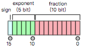

除非指数位全是0，否则就会假定隐藏的起始位是1。因此只有10位尾数在内存中被显示出来，而总精度是11位。根据IEEE 754标准，虽然尾数只有10位，但是尾数精度是11位的（log10(211)≈ 3.311 十进制数）。

```text
0 01111 0000000000 = 1
0 01111 0000000001 = 1 + 2−10 = 1.0009765625 （1之后的最接近的数）
1 10000 0000000000 = −2

0 11110 1111111111 = 65504 （max half precision）

0 00001 0000000000 = 2−14 ≈ 6.10352 × 10−5 （最⼩正指数）
0 00000 1111111111 = 2−14 - 2−24 ≈ 6.09756 × 10−5 （最⼤尾数）
0 00000 0000000001 = 2−24 ≈ 5.96046 × 10−8 （最⼩正尾数）

0 00000 0000000000 = 0
1 00000 0000000000 = −0

0 11111 0000000000 = infinity
1 11111 0000000000 = −infinity

0 01101 0101010101 = 0.333251953125 ≈ 1/3
```

由于尾数的位数是奇数，所以默认情况下，类似1/3的数会像双精度浮点数一样四舍五入。

对于float2和float4之间的转换，除了不同部分的移位之外，还需要注意指数的基数之间的差别（15和127）。例如，要把float2类型转换为float4类型，主要进行以下几步操作。

1. 符号位左移16位。

2. 指数部分加112（127与15之间的差距），左移13位（右对齐）。

3. 尾数部分左移13位（左对齐）。

> **说明**
>
> Float4转换为float2的步骤与之相反。

因此当前的浮点数的压缩是损失精度的压缩，所以在进行查询计算的时候会有一定的精度的损失。在实际应用中，这种损失是满足业务的要求的。

Float2压缩存储是用两个字节，来表示之前的四个字节的存储，所以对于向量列的压缩比例在0.5，即占用磁盘空间是原来的50%。

Float2类型只能表达[-65519.99, 65519.99]之间的值。如果超过取值范围，比方说大于65519，系统会输出Infinity，如果小于-65519，系统会输出-Infinity。对于向量检索来说，向量需要进行归一化处理，将取值范围归一化到[0,1]之间。不进行归一化的向量距离计算，会非常容易超过取值范围，导致距离计算的不准确。

对于向量float2与float4类型之间的相互转化，会有一定的性能上的消耗。当前float2的数组类型转换，实现了两种转换算法：

- 针对数组中的每个float2的数据，使用C程序进行转化，每次只转换一个float2数据。

- 对于特定的硬件（支持AVX和SSE2指令集的硬件），调用硬件特定的接口函数，每次可以支持同时转换4个float2类型。

在实际的查询的过程中，因为会用到索引等相关的遍历技术，所以不用转换很多记录。

**创建使用float2数据类型的表**

Float2是内部定义的一个数据类型，系统实现了各种类型的转换，以及相关的各种操作符。因此，在实际系统中，一般将float2数据类型当成基本数据类型来进行相关的操作。

语法：

```sql
CREATE TABLE [TABLE_NAME]
(  
    C1 INT,  
    C2 FLOAT2[],  
    C3 VARCHAR(20),  
    PRIMARY KEY(C1)
) DISTRIBUTED BY(C1);
```

> **说明**
>
> C2即float2向量存储列。

示例：

在FACE_TABLE表中，创建float2的向量列C2。

```sql
CREATE TABLE FACE_TABLE (  
    C1 INT PRIMARY KEY,  
    C2 FLOAT2[],  
    C3 VARCHAR(20)
) DISTRIBUTED BY (C1);
```

**插入数据**

对已经建立好的float2类型的数组，插入相关的数据。可以用下述三种方式对float2的数组插入数据。在进行数据插入的时候，用户可以显示的定义出float2的数组，将相关的数据插入到表中（参见下述代码中的sql1）；或者用户采用隐示的类型转换，系统会在内部将float4类型的数组，转换成float2类型的数组，存储到对应的表中（参见下述代码中的sql2和sql3）。

示例：

插入三条数据到创建的FACE_TABLE中。

```text
sql1 = INSERT INTO FACE_TABLE (C1, C2, C3)
    VALUES (1, ARRAY[1.3, 2.4, 5.6]::FLOAT2[], 'name1');

sql2 = INSERT INTO FACE_TABLE (c1, c2, c3) 
    VALUES (2, ARRAY [3.4, 6.1, 7.6]::REAL[], 'name2');

sql3 = INSERT INTO FACE_TABLE (c1, c2, c3) 
    VALUES (3, ARRAY [9.5, 1.2, 0.6]::FLOAT4[],'name3');
```

**查询数据**

由于采用的是float2类型的数据，所以在显示查询结果时有一定的数据精度丢失。例如插入的是1.3，而实际查询的结果是1.2998；或者插入的是5.6，而实际查询的结果是5.60156。这种精度的损失对于向量检索来说，是可以忽略不计的。

示例：

```sql
SELECT * FROM FACE_TABLE; 
c1  | c2                        | c3 
----+---------------------------+-------
 1  | {1.2998,2.40039,5.60156}  | name1
 2  | {3.40039,6.10156,7.60156} | name2
 3  | {9.5,1.2002,0.600098}     | name3
```

**float2表数据的压缩比例**

本示例中，建立两张表，一个是用float4类型的向量数据，一个是float2类型的向量数据，对比实际表的大小。

```sql
--CREATE TABLE 
CREATE TABLE TAB1(A FLOAT4[]);
CREATE TABLE TAB2(A FLOAT2[]);

--INSERT DATA 
INSERT INTO TAB1 
SELECT GEN_RAND_F2_ARR (1, 1024) FROM GENERATE_SERIES (1,10000);
INSERT INTO TAB2 
SELECT GEN_RAND_F2_ARR (1, 1024) FROM GENERATE_SERIES (1,10000);

--QUERY SIZE
SELECT PG_SIZE_PRETTY (PG_RELATION_SIZE('tab1'));
 PG_SIZE_PRETTY 
----------------
 45 MB(1 row)

SELECT PG_SIZE_PRETTY (PG_RELATION_SIZE('tab2')); 
 PG_SIZE_PRETTY
----------------
 21 MB(1 row)
```

从上述信息可查看到，使用float4数据类型的存储是45M，使用float2类型的数据存储是21M。由此可见，float2的存储大约是float4的一半。

**float2表数据的压缩和解压的性能比较**

当前系统提供了两个函数来进行float2与float4相互的转换：array_f16_to_f32将float2类型的向量转化成float4类型的向量，array_f32_to_f16将float4类型的向量转化成float2的向量。当前每个向量的长度是1024维，是在支持AVX和SSE2的指令集的机器上面进行测试的。

示例：

```sql
--CREATE TABLE 
CREATE TABLE TAB1(A FLOAT4[]);
CREATE TABLE TAB2(A FLOAT2[]);

--INSERT TABLE
INSERT INTO TAB1 SELECT GEN_RAND_F2_ARR(1, 1024) FROM GENERATE_SERIES (1,10000);
INSERT INTO TAB2 SELECT GEN_RAND_F2_ARR(1, 1024) FROM GENERATE_SERIES (1,10000);

\TIMING
--query size
SELECT ARRAY_F32_TO_F16(a) FROM TAB1; 
    Time: 5998.832 ms (00:05.999)
SELECT ARRAY_F16_TO_F32(a) FROM TAB2;
    Time: 5507.388 ms (00:05.507) 
```

**距离计算**

为了方便距离计算，当前的系统针对float2[]类型，提供了欧式距离计算，系统在内部会将float2类型的数据，隐式的转成float4类型的数据，来计算相关的距离。

示例：

计算欧式距离。

```text
SELECT L2_DISTANCE(ARRAY[1.0,1.0,1.0,1.0,1.0,1.0,1.0,1.0,1.0]::FLOAT2[], 
    ARRAY[0.0,0.0,0.0,0.0,0.0,0.0,0.0,0.0,0.0]::FLOAT2[]);

SELECT L2_DISTANCE(ARRAY[1.0,1.0,1.0,1.0,1.0,1.0,1.0,1.0,1.0]:: FLOAT4[], 
    ARRAY [0.0,0.0,0.0,0.0,0.0,0.0,0.0,0.0,0.0]:: FLOAT2[]);

SELECT L2_DISTANCE (ARRAY[1.0,1.0,1.0,1.0,1.0,1.0,1.0,1.0,1.0]:: FLOAT2[], 
    ARRAY [0.0,0.0,0.0,0.0,0.0,0.0,0.0,0.0,0.0]::FLOAT2[]);
```

**float2的实际应用案例**

对于安保系统来说，每天都会定时的将监控的图片数据存在人脸表中，安保系统会输入人脸的照片，在监控系统中查找相关的监控图片。下文将介绍float2在查询检索的应用。

1. 创建一个表，用于存放人脸识别的相关数据。

   ```sql
   CREATE TABLE FACE_TABLE (
     C1 INT PRIMARY KEY,
     C2 FLOAT2[],
     C3 VARCHAR(20)
   ) DISTRIBUTED BY(C1);
   ```

   > **说明**
   >
   > - C1：人脸的编号。
   >
   > - C2：人脸的向量。
   >
   > - C3：对应的人名。

2. 在FACE_TABLE表中建立向量索引。

   ```sql
   CREATE INDEX FACE_TABLE_IDX 
   ON FACE_TABLE 
   USING ANN(C2) WITH(dim=10);
   ```

3. 导入相关的监控数据到FACE_TABLE表中。

   ```sql
   INSERT INTO FACE_TABLE (C1, C2, C3) 
   VALUES (1, ARRAY[1.3, 2.4, 5.6]::FLOAT2[], 'name1');

   INSERT INTO FACE_TABLE (c1, c2, c3) 
   VALUES (2, ARRAY[3.4, 6.1, 7.6]::REAL[], 'name2');

   INSERT INTO FACE_TABLE (c1, c2, c3) 
   VALUES (3, ARRAY[9.5, 1.2, 0.6]::FLOAT4[],'name3');
   ```

4. 输入人脸的数据，进行向量查询。

   ```text
   SELECT * 
   FROM FACE_TABLE 
   ORDER BY C1 <-> ARRAY[2.81574,9.84361,8.07218]:: FLOAT2[] 
   LIMIT 10;
   ```

   > **说明**
   >
   > `ARRAY[2.81574,9.84361,8.07218]:: FLOAT2[]` 表示需要查询的图片向量，系统会在底库中检索对应的人脸信息。

<a id="section-6-3"></a>

## 6.3. AnalyticDB PostgreSQL稀疏向量使用指南

当您需要高效存储大部分元素为零的向量时，创建稀疏向量表比稠密向量表能节省大量的存储空间。本文介绍云原生数据仓库AnalyticDB PostgreSQL版向量数据库如何使用稀疏向量，包括创建稀疏向量表、构建稀疏向量索引、执行稀疏向量检索，以及执行稀疏向量和稠密向量的混合查询等。

**简介**

在向量数据库中，通常将向量划分为稠密向量和稀疏向量。稀疏向量是一种大部分元素都是0的数据结构，通常有数万个维度，但是其中只有少数几个维度有值。当使用稀疏向量进行关键词搜索时，一个稀疏向量就表示一个文档，其中的维度通常表示字典（或词汇表）中的关键词，维度的值则表示这些关键词在文档中的重要性。如果使用BM25算法生成稀疏向量，维度的值则包含关键词匹配数量、词频和其他文本相关性因素。

在机器学习和自然语言处理中，如果使用普通的数组或列表来存储，会浪费大量的空间，为了高效存储和操作这类向量，引入了稀疏向量。稀疏向量常用于表示文本、图像或者其他类型的数据。这种数据结构在存储和处理高维数据时非常有用，可以显著减少存储空间和计算资源的消耗。

稠密向量（Dense）和稀疏向量（Sparse）的区别如下图所示：

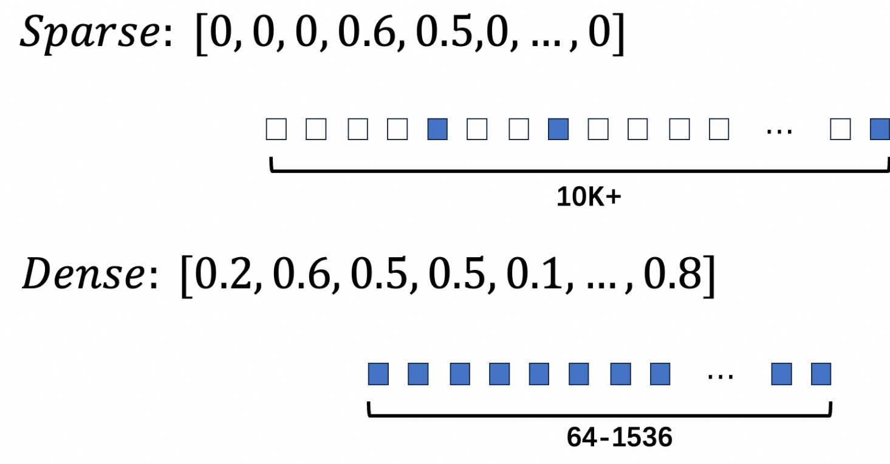

**前提条件**

- 已创建云原生数据仓库AnalyticDB PostgreSQL版v6.6.2.3及以上版本实例。具体操作，请参见创建实例。

- 已开启向量检索引擎功能，请参见开启或关闭向量检索引擎优化。

**使用稀疏向量**

**创建稀疏向量表**

**语法**

```sql
CREATE TABLE <SparseVectorTable> 
(  
    id int PRIMARY KEY,
    description text, 
    ...,
    sparse_vector svector(MAX_DIM), 
)DISTRIBUTED BY（id);
```

**参数说明：**

- SparseVectorTable：向量表名称。

- sparse_vector：稀疏向量列，为svector类型。

- MAX_DIM：稀疏向量的最大维度（非有值维度数量）。

**使用示例**

创建一个名为svector_test的稀疏向量表，具体示例如下：

```sql
-- 创建⼀个带稀疏向量字段的表
CREATE TABLE <svector_test>(  
    id bigint,
    type int,
    tag varchar(10),
    document text,
    sparse_features svector(250000)
) DISTRIBUTED BY (id);

-- 设置稀疏向量列为Plain模式
ALTER TABLE <svector_test> ALTER COLUMN sparse_features SET storage plain;
```

> **说明**
>
> Plain模式：在PostgreSQL中 ，存储机制对于大对象、大字段或无法容纳在常规数据页内的数据采用了一种名为Toast的策略。这种策略允许数据的高效存储和访问。当字段使用Plain策略存储时，数据被存储为非压缩和非分裂的一整块，数据必须完全适应单个数据项，不会溢出到Toast表中。Plain模式通常用于需要避免Toast处理开销的小数据字段，或者可以被高效存储的数据类型，例如整数或小文本字段。

**创建稀疏向量索引**

**语法**

稀疏向量的索引仅支持内积距离度量，不支持PQ量化和MMAP模式。语法规则如下：

```sql
CREATE INDEX <idx_sparse_vector>
ON MyTable USING vector_index (sparse_vector_column);
WITH (DISTANCEMEASURE=IP,
      HNSW_M=$M,
      HNSW_EF_CONSTRUCTION=$EF_CONSTURCTION);
```

**参数说明：**

- idx_sparse_vector：向量索引名称。

- DISTANCEMEASURE：取值为IP，否则会出现参数报错。

- HNSW_M和HNSW_EF_CONSTRUCTION：参考创建向量索引。

**使用示例**

以使用示例中的svector_test稀疏向量表为例，创建稀疏向量索引，具体示例如下：

```sql
-- 根据混合查询的结构化字段为其创建btree索引,如果结构化字段为数组类型，也可以添加gin索引
CREATE INDEX svector_test(type);
CREATE INDEX svector_test(tag);

-- 为稀疏向量列创建⼀个HNSW索引
CREATE INDEX ON svector_test USING ANN(sparse_features) 
WITH(DISTANCEMEASURE=IP,HNSW_M=64,pq_enable=0,external_storage=0);
```

**稀疏向量数据的表示**

在云原生数据仓库AnalyticDB PostgreSQL版中，通过使用svector类型可以表示稀疏向量。svector类型支持以json格式的字符串输入，需要包含indices字段和values字段，分别表示下标数组（非负整数）和对应的值数组（浮点数）。一个20维的稀疏向量可以作如下数据表示：

**稀疏向量数据示例**

```json
[0, 0, 1.1, 0, 0, 0, 2.2, 0, 0, 3.3, 0, 0, 0, 0, 0, 0, 0, 0, 0, 0]
```

**稀疏向量数据表示**

```json
{"indices":[2, 6, 9], "values":[1.1, 2.2, 3.3]}
```

**参数说明：**

- indices：[2, 6, 9]表示稀疏向量中非0值的维度为第2,6,9维。

- values：[1.1, 2.2, 3.3]表示对应的三个非0维度的取值为1.1,2.2,3.3。

在云原生数据仓库AnalyticDB PostgreSQL版数据库中，使用::svector可以将字符串转换为稀疏向量类型，SQL语句如下所示：

```text
postgres=# SELECT '{"indices":[2, 6, 9], "values":[1.1, 2.2, 3.3]}'::svector;
svector
--------------------------------------------
{"indices":[2,6,9],"values":[1.1,2.2,3.3]}
(1 ROW)
```

**稀疏向量数据的导入**

稀疏向量的数据导入支持INSERT和COPY语法，以使用示例中的svector_test稀疏向量表为例，介绍INSERT的使用方法，具体示例如下：

```sql
-- 插入稀疏向量
INSERT INTO svector_test VALUES (1, 1, 'a', 'xxx', '{"indices":[2, 6, 9], "values":[1.1, 2.2, 3.3]}'::svector);
INSERT INTO svector_test VALUES (2, 2, 'b', 'xxx', '{"indices":[50, 100, 200], "values":[2.1, 3.2, 4.3]}'::svector);
INSERT INTO svector_test VALUES (3, 3, 'b', 'xxx', '{"indices":[150, 60, 90], "values":
[5, 1e3, 1e-3]}'::svector);
```

**稀疏向量的检索**

**语法**

对于稀疏向量表来说，稀疏向量检索只支持内积距离度量的检索方式。稀疏向量检索也分为精确检索和近似检索，精确检索和近似检索的具体语法如下：

**精确检索**

```text
SELECT id, inner_product(<sparse_vector>, '{"indices":[1,2,..], "values":
[1.1,2.2...]}'::svector) 
AS score FROM <SparseVectorTable> ORDER BY negative_inner_product(<sparse_vector>, 
'{"indices":[1,2,..], "values":[1.1,2.2...]}'::svector) LIMIT <topk>;
```

**参数说明：**

- sparse_vector：向量列名称。

- SparseVectorTable：向量表名称。

- topk：需要检索的结果集topk。

**近似检索**

```text
SELECT id, inner_product(<sparse_vector>, '{"indices":[1,2,..], "values":
[1.1,2.2...]}'::svector) 
AS score FROM <SparseVectorTable> ORDER BY <sparse_vector>
'{"indices":[1,2,..], "values":[1.1,2.2...]}'::svector LIMIT <topk>;
```

**参数说明：**

- sparse_vector：向量列名称。

- SparseVectorTable：向量表名称。

- topk：需要检索的结果集topk。

**使用示例**

以使用示例中的svector_test稀疏向量表为例，使用稀疏向量检索的示例如下：

**稀疏向量检索**

```text
SELECT id, sparse_features, 
'{"indices":[2,60,50], "values":[2,0.01, 0.02]}' <#> sparse_features AS score 
FROM svector_test
ORDER BY score
LIMIT 3;
```

**检索结果**

```text
   id   |                 sparse_features                 |        score
--------+-------------------------------------------------+---------------------
      3 | {"indices":[60,90,150],"values":[1000,0.001,5]} |                 -10
      1 | {"indices":[2,6,9],"values":[1.1,2.2,3.3]}      |   -2.20000004768372
      2 | {"indices":[50,100,200],"values":[2.1,3.2,4.3]} | -0.0419999957084656
(3 ROWS)
```

> **说明**
>
> 稀疏向量的向量检索召回率，可以通过fastann.sparse_hnsw_max_scan_points和fastann.sparse_hnsw_ef_search进行调节。具体内容，请参见相关参考。

**稠密向量与稀疏向量的混合查询**

创建一个同时包含稀疏向量和稠密向量的数据表HYBRID_SEARCH_TEST，并以此为基础介绍如何实现稠密向量和稀疏向量的混合查询，具体建表SQL语句示例如下：

```sql
-- 创建混合查询的数据表
CREATE TABLE IF NOT EXISTS HYBRID_SEARCH_TEST (
   id integer PRIMARY key,
   corpus text,
   filter integer,
   dense_vector float4[],
   sparse_vector svector(250003)
) distributed BY (id);

-- 设置向量列为Plain模式
ALTER TABLE hybrid_search_test ALTER COLUMN dense_vector SET storage plain;
ALTER TABLE hybrid_search_test ALTER COLUMN sparse_vector SET storage plain;
```

创建索引的SQL语句示例如下：

```sql
-- 创建结构化索引
CREATE INDEX ON hybrid_search_test(FILTER);

-- 创建稠密向量索引
CREATE INDEX ON hybrid_search_test USING ANN(dense_vector) WITH(DISTANCEMEASURE=IP, DIM=1024, HNSW_M=64, HNSW_EF_CONSTRUCTION=600, EXTERNAL_STORAGE=1);

-- 创建稀疏向量索引
CREATE INDEX ON hybrid_search_test USING ANN(sparse_vector) WITH(DISTANCEMEASURE=IP, HN
SW_M=64, HNSW_EF_CONSTRUCTION=600);
```

稠密向量查询、稀疏向量查询以及混合查询的SQL语句示例如下：

```sql
-- 向量检索 + filter
SELECT id, corpus FROM hybrid_search_test WHERE FILTER IN (0, 100, 200, 300, 400, 500, 
600, 700, 800, 900) ORDER BY dense_vector <#> ARRAY[1,2,3,...,1024]::float4[] LIMIT 100
;

-- sparse检索 + filter
SELECT id, corpus FROM hybrid_search_test WHERE FILTER IN (0, 100, 200, 300, 400, 500, 
600, 700, 800, 900) ORDER BY sparse_vector <#> '{"indices":[1,2,..], "values":[1.1,2.2...]}'::svector LIMIT 100;
  
-- 混合检索 + filter
WITH combined AS (
(SELECT id, corpus, inner_product_distance(dense_vector, 
ARRAY[1,2,3,...,1024]::float4[]) AS dist1, sparse_vector <#> '{"indices":[1,2,..], "values":[1.1,2.2...]}'::svector AS dist2 FROM hybrid_search_test WHERE FILTER IN (0, 100, 
200, 300, 400, 500, 600, 700, 800, 900) ORDER BY dist2 LIMIT 100)
  UNION ALL
(SELECT id, corpus, inner_product(sparse_vector, '{"indices":[1,2,..], "values":[1.1,2.2...]}'::svector) AS dist1, dense_vector <#> ARRAY[1,2,3,...,1024]::float4[] AS dist2 F
ROM hybrid_search_test WHERE FILTER IN (0, 100, 200, 300, 400, 500, 600, 700, 800, 900)
ORDER BY dist2 LIMIT 100 )
) SELECT DISTINCT first_value(id) OVER (PARTITION BY id) AS id,  first_value(corpus) OV
ER (PARTITION BY id) AS corpus, MAX(dist1 - dist2) OVER (PARTITION BY id) AS dist FROM combined ORDER BY dist DESC LIMIT 100;
```

**相关参考**

**稀疏向量检索相关的内核参数**

| 稀疏向量检索相关的内核参数 | 功能说明 | 默认值 | 取值范围 |
| --- | --- | --- | --- |
| fastann.sparse_hnsw_max_scan_points | 在HNSW索引中进行稀疏向量检索时，最大扫描点个数，用于提前结束搜索，可用于召回率测试。 | 8000 | \[1, 8000000\] |
| fastann.sparse_hnsw_e f_search | 在HNSW索引中进行稀疏向量检索时，搜索候选集大小，可用于召回率测试。 | 400 | \[10, 10000\] |

> **说明**
>
> 上述内核参数可以在会话级别设置生效。

**稀疏向量支持的向量函数**

**函数作用**

**向量函数**

**返回值类型**

**含义**

**支持的数据类型**

欧氏距离（开方

l2_distance

double_precision

svector

值），通常用于衡量两个稀疏向量的大小，表示两个稀疏向量的距离。

内积距离，在向量

inner_product

double precision

svector

归一化之后等于余弦相似度，通常用于在向量归一化之后替代余弦相似度。

点积距离，和内积

dp_distance

double precision

svector

距离完全一致。

余弦相似度，取值

cosine_similarity

double precision

svector

范围：[-1, 1]，通常用于衡量两个稀疏向量在方向上的相似性，而不关心两个稀疏向量的实际长度。

计算

两个稀疏向量的加

svector_add

svector

svector

法。

两个稀疏向量的减

svector_sub

svector

svector

法。

两个稀疏向量的乘

svector_mul

svector

svector

法。

计算单个稀疏向量

svector_norm

double precision

svector

的模长。

计算两个稀疏向量

svector_angle

double precision

svector

的夹角。

欧氏距离（平方

l2_squared_dista

double precision

svector

值），由于比欧氏

nce

距离（开方值）少了开方的计算，因此主要用于对欧氏距离（开方值）的排序逻辑，以减少计算量。

反内积距离，为内

negative_inner_p

double precision

svector

积距离取反后的结

roduct

果，主要用于对内

排序

积距离的排序逻辑，以保证排序结果按内积距离从大到小排序。

余弦距离，取值范

cosine_distance

double precision

svector

围：[0, 2]，主要用于对余弦相似度的排序逻辑，以保证排序结果按余弦相似度从大到小排序。

**向量函数的使用示例**

```text
-- 欧⽒距离
SELECT l2_distance('{"indices":[1,2,3,4,5,6], "values":[1,2,3,4,5,6]}'::svector, '{"indices":[1,2,3,4,5,6], "values":[2,3,4,5,6,7]}'::svector);
-- 内积距离
SELECT inner_product('{"indices":[1,2,3,4,5,6], "values":[1,2,3,4,5,6]}'::svector, '{"indices":[1,2,3,4,5,6], "values":[2,3,4,5,6,7]}'::svector);
-- 余弦相似度
SELECT l2_distance('{"indices":[1,2,3,4,5,6], "values":[1,2,3,4,5,6]}'::svector, '{"indices":[1,2,3,4,5,6], "values":[2,3,4,5,6,7]}'::svector);
-- 向量加法
SELECT svector_add('{"indices":[1,2,3,4,5,6], "values":[1,2,3,4,5,6]}'::svector, '{"indices":[1,2,3,4,5,6], "values":[2,3,4,5,6,7]}'::svector);
-- 向量减法
SELECT svector_sub('{"indices":[1,2,3,4,5,6], "values":[1,2,3,4,5,6]}'::svector, '{"indices":[1,2,3,4,5,6], "values":[2,3,4,5,6,7]}'::svector);
-- 向量乘法
SELECT svector_mul('{"indices":[1,2,3,4,5,6], "values":[1,2,3,4,5,6]}'::svector, '{"indices":[1,2,3,4,5,6], "values":[2,3,4,5,6,7]}'::svector);
-- 欧⽒平⽅距离
SELECT l2_squared_distance('{"indices":[1,2,3,4,5,6], "values":
[1,2,3,4,5,6]}'::svector, '{"indices":[1,2,3,4,5,6], "values":
[2,3,4,5,6,7]}'::svector);
-- 反内积距离
SELECT negative_inner_product('{"indices":[1,2,3,4,5,6], "values":
[1,2,3,4,5,6]}'::svector, '{"indices":[1,2,3,4,5,6], "values":
[2,3,4,5,6,7]}'::svector);
-- 余弦距离
SELECT cosine_distance('{"indices":[1,2,3,4,5,6], "values":[1,2,3,4,5,6]}'::svector, '{
"indices":[1,2,3,4,5,6], "values":[2,3,4,5,6,7]}'::svector);
```

**稀疏向量支持的向量操作符**

| 操作符 | 计算含义 | 排序含义 | 支持的数据类型 |
| --- | --- | --- | --- |
| &lt;-&gt; | 获取欧氏距离（平方），结果等同于l2_squared_distance。 | 无 | svector |
| &lt;#&gt; | 获取反内积，结果等同于negative_inner_produc t | 按点积距离从大到小排序。 | svector |
| &lt;#&gt; | 获取余弦距离，结果等同于cosine_distance。 | 无 | svector |
| + | 两个稀疏向量的加法。 | 无 | svector |
| - | 两个稀疏向量的减法。 | 无 | svector |
| \* | 两个稀疏向量的乘法。 | 无 | svector |

**向量操作符示例**

```text
-- 欧⽒平⽅距离
SELECT '{"indices":[1,2,3,4,5,6], "values":[1,2,3,4,5,6]}'::svector <-> '{"indices":[1,2,3,4,5,6], "values":[2,3,4,5,6,7]}'::svector AS score;

-- 反内积距离
SELECT '{"indices":[1,2,3,4,5,6], "values":[1,2,3,4,5,6]}'::svector <#> '{"indices":[1,2,3,4,5,6], "values":[2,3,4,5,6,7]}'::svector AS score;

-- 余弦距离
SELECT '{"indices":[1,2,3,4,5,6], "values":[1,2,3,4,5,6]}'::svector <=> '{"indices":[1,2,3,4,5,6], "values":[2,3,4,5,6,7]}'::svector AS score;

-- 加法
SELECT '{"indices":[1,2,3,4,5,6], "values":[1,2,3,4,5,6]}'::svector + '{"indices":[1,2,3,4,5,6], "values":[2,3,4,5,6,7]}'::svector AS value;

-- 减法
SELECT '{"indices":[1,2,3,4,5,6], "values":[1,2,3,4,5,6]}'::svector + '{"indices":[1,2,3,4,5,6], "values":[2,3,4,5,6,7]}'::svector AS value;

-- 乘法
SELECT '{"indices":[1,2,3,4,5,6], "values":[1,2,3,4,5,6]}'::svector * '{"indices":[1,2,3,4,5,6], "values":[2,3,4,5,6,7]}'::svector AS value;
```

<a id="section-6-4"></a>

## 6.4. pgvector兼容模式使用指南

pgvector是基于PostgreSQL数据库的开源向量化数据的工具包。使用pgvector可以方便地构建向量索引，执行向量之间的相似度计算和查询，常用于向量相似度搜索、推荐系统、聚类分析等场景。

**前提条件**

使用pgvector兼容模式前，请先满足以下条件：

- AnalyticDB PostgreSQL 6.0版实例的内核版本需为v6.6.1.0及以上。详情请参见查看内核小版本。

- AnalyticDB PostgreSQL 6.0版实例已开启向量检索引擎功能。详情请参见开启或关闭向量检索引擎优化。

**pgvector兼容模式说明**

对于使用pgvector做向量检索引擎的业务，云原生数据仓库AnalyticDB PostgreSQL版向量数据库对pgvector的向量读写操作可以完全兼容，只需要修改索引构建的SQL语法即可。因此使用pgvector做向量检索的业务可以完全无缝迁移到云原生数据仓库AnalyticDB PostgreSQL版向量数据库中，基本不需要对业务侧的代码做改动。相比于原生的pgvector向量检索引擎，云原生数据仓库AnalyticDB PostgreSQL版向量数据库的pgvector兼容模式具有以下优势：

- 基本上完全兼容pgvector的SQL语法，可以完全复用pgvector生态的客户端。

- pgvector目前主要在单机PostgreSQL数据库上使用，而云原生数据仓库AnalyticDB PostgreSQL版向量数据库是分布式版，能处理更大的向量数据量。

- 云原生数据仓库AnalyticDB PostgreSQL版向量数据库使用自研的FastANN向量检索引擎，具备比原生pgvector更优秀的性能，详情请查看向量分析性能测试。

- 同时云原生数据仓库AnalyticDB PostgreSQL版向量数据库在优化器和执行器层面打通了混合查询计划生成与混合查询执行算子，具备非常完备的混合查询能力，而原生pgvector基本不具备混合查询的能力（只能通过分区等手段实现简单的场景）。

- 云原生数据仓库AnalyticDB PostgreSQL版向量数据库拥有Float2类型，可以对向量表存储进行压缩；也具备PQ量化能力，可以对向量索引存储进行压缩。因此云原生数据仓库AnalyticDB PostgreSQL版向量数据库相比于原生pgvector，也具有存储成本的优势。

**创建向量表**

创建兼容pgvector语法的向量表和云原生数据仓库AnalyticDB PostgreSQL版中原生向量表的语法相同，只是表中的向量列由数组（ `smallint[]` ， `float2[]` 和 `float4[]` ）类型改为了vector类型（pgvector定义的向量类型），并且一个表可以支持多个向量列。

**语法**

```sql
CREATE TABLE [TABLE_NAME]
(  
    C1 DATATYPE,  
    C2 DATATYPE,  
    ......,  
    CN VECTOR(DIM), 
    PRIMARY KEY(C1 [,C2,...CN])
) DISTRIBUTED BY（C1);
```

其中CN为向量列，为vector类型，参数DIM为向量的维度。

**示例**

创建一个命名为FACE_TABLE的向量表，其中C1为主键，C2和C3均为向量列，具体示例如下：

```sql
CREATE TABLE FACE_TABLE (  
    C1 INT,  
    C2 VECTOR(512) NOT NULL, 
    C3 VECTOR(1536) NOT NULL, 
    C4 TIMESTAMP NOT NULL,  
    C5 VARCHAR(20) NOT NULL,  
    PRIMARY KEY (C1)
) DISTRIBUTED BY (C1);
```

**创建向量索引**

云原生数据仓库AnalyticDB PostgreSQL版向量数据库的pgvector兼容模式下向量索引的创建语法，仍然采用FastANN向量检索引擎的语法，与pgvector的原生语法规则不同，具体可以参考如下所示语法：

**语法**

```sql
CREATE INDEX [INDEX_NAME]
ON [SCHEMA_NAME].[TABLE_NAME]   
USING ANN(COLUMN_NAME) 
WITH (DIM=<DIMENSION>,
      DISTANCEMEASURE=<MEASURE>,
      HNSW_M=<M>,
      HNSW_EF_CONSTRUCTION=<EF_CONSTURCTION>,
      PQ_ENABLE=<PQ_ENABLE>,
      PQ_SEGMENTS=<PQ_SEGMENTS>,
      PQ_CENTERS=<PQ_CENTERS>,
      EXTERNAL_STORAGE=<EXTERNAL_STORAGE>;
```

由于pgvector的vector类型已经包含了维度信息，创建索引中的DIM可以不填，其他参数可以查看原生向量索引的语法创建规则，详情请参见创建向量索引。

**示例**

在上文的FACE_TABLE的向量表上继续创建索引，具体示例如下：

```sql
-- 在向量列C2上创建三种向量索引。
CREATE INDEX idx_c2_l2 ON FACE_TABLE USING ann(C2) WITH (distancemeasure=l2, hnsw_m=64, 
pq_enable=1);
CREATE INDEX idx_c2_ip ON FACE_TABLE USING ann(C2) WITH (distancemeasure=ip, hnsw_m=64, 
pq_enable=1);
CREATE INDEX idx_c2_cosine ON FACE_TABLE USING ann(C2) WITH (distancemeasure=cosine, hnsw_m=64, pq_enable=1);
-- 在向量列C3上创建三种向量索引。
CREATE INDEX idx_c3_l2 ON FACE_TABLE USING ann(C3) WITH (distancemeasure=l2, hnsw_m=64, 
pq_enable=1);
CREATE INDEX idx_c3_ip ON FACE_TABLE USING ann(C3) WITH (distancemeasure=ip, hnsw_m=64, 
pq_enable=1);
CREATE INDEX idx_c3_cosine ON FACE_TABLE USING ann(C3) WITH (distancemeasure=cosine, hnsw_m=64, pq_enable=1);
```

该示例中列举了在多个向量列上创建多个向量索引，在实际使用过程中需根据实际使用情况进行创建，以避免创建无效索引。

**向量数据导入**

兼容pgvector语法的向量表的向量数据导入完全兼容pgvector的语法。以上文的FACE_TABLE表为例说明INSERT的使用方法，具体示例如下：

```sql
INSERT INTO FACE_TABLE 
values (1, '[1,2,3 ... 512]', '[1,2,3 ... 1536]', '2023-12-29 00:00:00', 
'aaa.bbb.ccc/face1.jpg');
```

**向量检索**

对于使用pgvector语法的向量表，向量检索的语法和pgvector原生语法完全兼容，可以直接使用pgvector的原生查询方式进行查询。

与向量检索召回率相关的内核参数与云原生数据仓库AnalyticDB PostgreSQL版向量数据库的原生参数一致，详情请参见向量检索。以FACE_TABLE为例说明向量检查的具体使用方式：

```sql
-- 精确搜索⽅式：按欧⽒距离排序。
SELECT C1 FROM FACE_TABLE ORDER BY vector_l2_squared_distance(C2, '[1,2,3 ... 512]') LI
MIT 10;
-- 精确搜索⽅式：按内积距离排序。
SELECT C1 FROM FACE_TABLE ORDER BY vector_negative_inner_product(C2, '[1,2,3 ... 512]')
LIMIT 10;
-- 精确搜索⽅式：按余弦相似度排序。
SELECT C1 FROM FACE_TABLE ORDER BY cosine_distance(C2, '[1,2,3 ... 512]') LIMIT 10;

-- 近似搜索⽅式：按欧⽒距离排序。
SELECT C1 FROM FACE_TABLE ORDER BY C2 <-> '[1,2,3 ... 512]' LIMIT 10;
-- 近似搜索⽅式：按内积距离排序。
SELECT C1 FROM FACE_TABLE ORDER BY C2 <#> '[1,2,3 ... 512]' LIMIT 10;
-- 近似搜索⽅式：按余弦相似度排序。
SELECT C1 FROM FACE_TABLE ORDER BY C2 <=> '[1,2,3 ... 512]' LIMIT 10;
```

由于已经在FACE_TABLE表的C2列上建了欧氏距离，内积距离和余弦相似度三种距离度量的索引，因此示例中的三种近似搜索方式均能命中对应的向量索引。在实际使用的过程中，需要注意近似查询方式中的操作符 `<->` ， `<#>` ， `<=>` 必须与向量索引的距离度量一一对应，否则如果没有对应的距离度量的索引，将会退化为精确搜索。

**向量检索的SQL优化**

- 当需要返回向量的距离score，您可以使用下面的SQL来提升性能。直接在向量索引的排序值基础上进行计算得到最终的score，可以节省大量的计算耗时，具体示例如下：

  ```text
  -- 按欧⽒距离排序的向量检索。
  SELECT t.C1 as C1, sqrt(t.score) as score 
  FROM 
    (SELECT C1，C2 <-> '[1,2,3 ... 512]' as score
     FROM FACE_TABLE
     ORDER BY score LIMIT topk) t;

  -- 按内积距离排序的向量检索。
  SELECT t.C1 as C1, (-1 * t.score) as score
  FROM
    (SELECT C1, C2 <#> '[1,2,3 ... 512]' as score
     FROM FACE_TABLE
     ORDER BY score LIMIT topk) t;

  -- 按余弦相似度排序的向量检索。
  SELECT t.C1 as C1, (1.0 - t.score) as score
  FROM 
    (SELECT C1, C2 <=> '[1,2,3 ... 512]' as score
     FROM FACE_TABLE
     ORDER BY score LIMIT topk) t;
  ```

  向量检索返回的结果中，score分别为欧氏距离（开方值），内积距离和余弦相似度。

- 当需要根据score的范围进行过滤并返回结果，您可以使用下面的SQL来实现。利用向量索引的排序值进行计算得到最终的score，可以节省大量的计算耗时，具体示例如下：

  ```text
  -- 按欧⽒距离排序的向量检索。
  SELECT t.C1 as C1, sqrt(t.score) as score 
  FROM 
    (SELECT C1，C2 <-> '[1,2,3 ... 512]' as score
     FROM FACE_TABLE
     ORDER BY score LIMIT topk) t
  WHERE score < 100;

  -- 按内积距离排序的向量检索。
  SELECT t.C1 as C1, (-1 * t.score) as score
  FROM
    (SELECT C1, C2 <#> '[1,2,3 ... 512]' as score
     FROM FACE_TABLE
     ORDER BY score LIMIT topk) t
  WHERE score > 10;

  -- 按余弦相似度排序的向量检索。
  SELECT t.C1 as id, (1.0 - t.score) as score
  FROM 
    (SELECT C1, C2 <=> '[1,2,3 ... 512]' as score
     FROM FACE_TABLE
     ORDER BY score LIMIT topk) t
  WHERE score > 0.5;
  ```

**混合查询**

对于使用pgvector语法的向量表，混合查询的方式与云原生数据仓库AnalyticDB PostgreSQL版向量数据库的原生语法完全一致，详情请参见混合检索使用指南。下文以FACE_TABLE举例说明混合查询使用方法。

```sql
SELECT C1 FROM FACE_TABLE WHERE
  C4 > '2023-10-01 00:00:00' AND C4 < '2024-01-01 00:00:00'
ORDER BY 
  C2 <-> '[1,2,3 ... 512]'
LIMIT 10;
```

**开源代码库适配**

以开源大模型应用研发平台DIFY为例，介绍如何通过简单的改造，让使用pgvector的业务应用代码能快速适配云原生数据仓库AnalyticDB PostgreSQL版向量数据库。主要涉及三个方面的修改：

- 去除pgvector的插件安装。由于云原生数据仓库AnalyticDB PostgreSQL版向量数据库并没有适配pgvector插件，只是在语法上兼容了pgvector的向量表读写，因此不需要安装pgvector的插件。云原生数据仓库AnalyticDB PostgreSQL版向量数据库在开通时会默认安装自研向量检索引擎插件FastANN，只需要去掉pgvector的插件即可。具体示例代码如下：

  ```python
  # 代码位于api/core/rag/datasource/vdb/pgvector/pgvector.py

  def _create_collection(self, dimension: int):
      cache_key = f"vector_indexing_{self._collection_name}"
      lock_name = f"{cache_key}_lock"
      WITH redis_client.lock(lock_name, timeout=20):
          collection_exist_cache_key = f"vector_indexing_{self._collection_name}"
          if redis_client.get(collection_exist_cache_key):
              RETURN

          WITH self._get_cursor() AS cur:
              # 去除下⾯的pgvector插件安装
              #cur.execute("CREATE EXTENSION IF NOT EXISTS vector")
              cur.execute(SQL_CREATE_TABLE.format(table_name=self.table_name, 
  dimension=dimension))
              # TODO: CREATE index https://github.com/pgvector/pgvector?tab=readme-ov-
  file#indexing
          redis_client.set(collection_exist_cache_key, 1, ex=3600)
      
  ```

- 修改向量表创建。由于云原生数据仓库AnalyticDB PostgreSQL版向量数据库是基于PostgreSQL9.4版本，不支持建表时使用***using heap***语法。云原生数据仓库AnalyticDB PostgreSQL版属于分布式数据库，需要设置分布键。修改向量表创建语句示例代码如下：

  ```sql
  # 代码位于api/core/rag/datasource/vdb/pgvector/pgvector.py

  SQL_CREATE_TABLE = """
  CREATE TABLE IF NOT EXISTS {table_name} (
      id uuid PRIMARY KEY,
      text text NOT NULL,
      meta jsonb NOT NULL,
      embedding vector({dimension}) NOT NULL
  ) USING heap; 
  """

  # 修改为如下代码:

  SQL_CREATE_TABLE = """
  CREATE TABLE IF NOT EXISTS {table_name} (
      id uuid PRIMARY KEY,
      text text NOT NULL,
      meta jsonb NOT NULL,
      embedding vector({dimension}) NOT NULL
  ) DISTRIBUTED BY (id); 
  """
  ```

- 修改向量索引创建。由于云原生数据仓库AnalyticDB PostgreSQL版向量数据库采用的是自研向量检索引擎FastANN的向量能力，并不是直接移植的pgvector插件，在向量索引的创建语法上是有区别的，尤其是索引关键词是不同的。因此必须按照云原生数据仓库AnalyticDB PostgreSQL版向量数据库的语法进行索引的创建。具体示例代码如下：

  ```python
  # 代码位于api/core/rag/datasource/vdb/pgvector/pgvector.py

  # 添加创建向量索引的SQL（也可以直接在数据库上创建索引，不再此添加）

  SQL_CREATE_INDEX = """
  CREATE INDEX ON  {table_name} USING ann(embedding) WITH (HNSW_M=16, 
  HNSW_EF_CONSTRUCTION=500, PQ_ENABLE=1);
  """

  def _create_collection(self, dimension: int):
      cache_key = f"vector_indexing_{self._collection_name}"
      lock_name = f"{cache_key}_lock"
      WITH redis_client.lock(lock_name, timeout=20):
          collection_exist_cache_key = f"vector_indexing_{self._collection_name}"
          if redis_client.get(collection_exist_cache_key):
              RETURN

          WITH self._get_cursor() AS cur:
              # 去除下⾯的pgvector插件安装
              #cur.execute("CREATE EXTENSION IF NOT EXISTS vector")
              cur.execute(SQL_CREATE_TABLE.format(table_name=self.table_name, 
  dimension=dimension))
              # TODO: CREATE index https://github.com/pgvector/pgvector?tab=readme-ov-
  file#indexing
              # 创建ADB-PG向量数据库的向量索引
              cur.execute(SQL_CREATE_INDEX.format(table_name=self.table_name))
          redis_client.set(collection_exist_cache_key, 1, ex=3600)
  ```

**相关参考**

**pgvector多种语言的客户端**

| 语言 | 客户端库代码地址 |
| --- | --- |
| C | pgvector-C |
| C++ | pgvector-cpp |
| Go | pgvector-go |
| Java，Kotlin，Groovy，Scala | pgvector-java |
| PHP | pgvector-php |
| Python | pgvector-python |
| Rust | pgvector-rust |

pgvector生态的多种语言的客户端均可以无缝接入到云原生数据仓库AnalyticDB PostgreSQL版向量数据库，只需对向量索引相关的SQL进行修改即可。

**支持的向量函数**

**函数作用**

**向量函数**

**返回值类型**

**含义**

**支持的数据类型**

欧氏距离（开方值），通常用于衡量两个向量的大

l2_distance

double precision

vector

小，表示两个向量的距离。

内积距离，在向量归一化之后等于余弦相似度，通常用

inner_product

double precision

vector

于在向量归一化之后替代余弦相似度。

余弦相似度，取值范围：[-1, 1]，通常用于衡量两个向

cosine_similarity

double precision

vector

量在方向上的相似性，而不关心两个向量的实际长度。

计算单个向量的维

vector_dims

integer

vector

度。

计算

计算单个向量的模

vector_norm

double precision

vector

长。

两个向量做加法。

vector_add

vector

vector

两个向量做减法。

vector_sub

vector

vector

两个向量做乘法。

vector_mul

vector

vector

计算两个向量的夹

vector_angle

double precision

vector

角。

<table>
  <tr>
    <td rowspan="3">排序</td>
    <td>vector_l2_squared_dis tance</td>
    <td>double precision</td>
    <td>欧氏距离（平方值），由于比欧氏距离（开方值）少了开方的计算，因此主要用于对欧氏距离（开方值）的排序逻辑，以减少计算量。</td>
    <td>vector</td>
  </tr>
  <tr>
    <td>vector_negative_inner _product</td>
    <td>double precision</td>
    <td>反内积距离，为内积距离取反后的结果，主要用于对内积距离的排序逻辑，以保证排序结果按内积距离从大到小排序。</td>
    <td>vector</td>
  </tr>
  <tr>
    <td>cosine_distance</td>
    <td>double precision</td>
    <td>余弦距离，取值范围：[0, 2]，主要用于对余弦相似度的排序逻辑，以保证排序结果按余弦相似度从大到小排序。</td>
    <td>vector</td>
  </tr>
</table>

表格中向量距离的计算公式详情，请参见创建向量索引。

向量函数的使用示例：

```text
-- 欧⽒距离
SELECT l2_distance('[1,1,1,1]'::vector, '[2,2,2,2]'::vector);
-- 内积距离
SELECT inner_product('[1,1,1,1]'::vector, '[2,2,2,2]'::vector);
-- 余弦相似度
SELECT cosine_similarity('[1,1,1,1]'::vector, '[2,2,2,2]'::vector);
-- 向量维度
SELECT vector_dims('[1,1,1,1]'::vector);
-- 向量模⻓
SELECT vector_norm('[1,1,1,1]'::vector);
-- 向量加法
SELECT vector_add('[1,1,1,1]'::vector, '[2,2,2,2]'::vector);
-- 向量减法
SELECT vector_sub('[1,1,1,1]'::vector, '[2,2,2,2]'::vector);
-- 向量乘法
SELECT vector_mul('[1,1,1,1]'::vector, '[2,2,2,2]'::vector);
-- 向量夹⾓
SELECT vector_angle('[1,1,1,1]'::vector, '[2,2,2,2]'::vector);
-- 欧⽒平⽅距离
SELECT vector_l2_squared_distance('[1,1,1,1]'::vector, '[2,2,2,2]'::vector);
-- 反内积距离
SELECT vector_negative_inner_product('[1,1,1,1]'::vector, '[2,2,2,2]'::vector);
-- 余弦距离
SELECT cosine_distance('[1,1,1,1]'::vector, '[2,2,2,2]'::vector);
```

**支持的向量操作符**

| 操作符 | 计算含义 | 排序含义 | 支持的数据类型 |
| --- | --- | --- | --- |
| &lt;-&gt; | 获取欧氏距离（平方），结果等同于l2_squared_distance。 | 按欧氏距离（平方）从小到大排序。 | vector |
| &lt;#&gt; | 获取反内积，结果等同于negative_inner_produc t_distance。 | 按点积距离从大到小排序。 | vector |
| &lt;=&gt; | 获取余弦距离，结果等同于cosine_distance。 | 按余弦相似度从大到小排序。 | vector |
| + | 两个向量的加法 | 无 | vector |
| - | 两个向量的减法 | 无 | vector |
| \* | 两个向量的乘法 | 无 | vector |

向量操作符的使用示例：

```text
-- 欧⽒距离（平⽅）
SELECT '[1,1,1,1]'::vector <-> '[2,2,2,2]'::vector AS score;
 
-- 反内积距离
SELECT '[1,1,1,1]'::vector <#> '[2,2,2,2]'::vector AS score;
 
-- 余弦距离
SELECT '[1,1,1,1]'::vector <=> '[2,2,2,2]'::vector AS score;

-- 加法
SELECT '[1,1,1,1]'::vector + '[2,2,2,2]'::vector AS value;

-- 减法
SELECT '[1,1,1,1]'::vector - '[2,2,2,2]'::vector AS value;

-- 乘法
SELECT '[1,1,1,1]'::vector * '[2,2,2,2]'::vector AS value;
```

<a id="section-6-5"></a>

## 6.5. 混合检索使用指南

当结构化数据与非结构化数据需要同时检索时，您可以使用AnalyticDB PostgreSQL版向量数据库的混合查询，既支持结构化字段过滤，也支持半结构化字段过滤，同时支持和文本字段的全文检索一起进行双路召回。

**混合检索简介**

ANNS（Approximate Nearest Neighbors Search，近似最近邻搜索）向量索引只能解决非结构化数据检索的问题。但是实际生产环境中，经常会遇到一些结构化数据与非结构化数据需要同时检索的场景。例如需要查询特定人员在指定时间范围内是否出现在特定区域内，这里的结构化条件就是时间范围和区域范围，非结构化条件就是人脸。因此阿里云在AnalyticDB PostgreSQL版中加入了结构化数据与非结构化数据混合查询的能力。

业界在解决混合查询的问题时，一般采用两个系统，结构化数据存在数据库中，非结构化数据存在向量检索系统中；然后对两个系统求交集后再聚合得到最终的结果。这种方法一般先采用向量检索系统取出经过放大的amp（放大系数） \* topk个结果，然后再通过结构化索引过滤得到最终结果。但该方法因为结构化索引过滤结果比较多，导致召回出现比较大的损失，从而无法满足最终需要topk个结果的要求。下面以结构化字段和非结构化字段的混合查询来讲解混合查询的实现原理。

**混合检索实现原理**

AnalyticDB PostgreSQL版将向量检索引擎FastANN作为索引插件集成到数据库中，可以在使用向量检索的同时使用结构化和半结构化索引。具体是通过优化器的RBO（Ranked-Biased Overlap）代价估算规则，生成不同的执行计划来解决结构化数据与非结构化数据需要同时检索的问题。

下文通过一个例子来说明混合检索的原理。

假设有一个带条件的拍图查找商品需求：查找与输入图片相似度最高，价格在100到200元之间，并且上架时间在最近一个月以内的前100件商品。

表和索引结构如下：

```sql
CREATE TABLE products (
    id serial primary key, 
    name varchar(256), 
    price real, 
    inTime timestamp, 
    url varchar(256),
    feature real[]
);

-- 设置向量列为内联模式。
ALTER TABLE products ALTER COLUMN feature SET STORAGE PLAIN;

-- 为结构化字段创建BTREE索引。
CREATE INDEX ON products(price, intime);

-- 为向量字段创建向量索引。
CREATE INDEX ON products USING ann(feature) WITH (dim=512);

-- 收集统计信息，⽤于⽣成最优的混合查询执⾏计划。
ANALYZE products;
```

采用混合查询的SQL如下：

```sql
SELECT id, price FROM products WHERE 
    price > 100 AND price <=200 
    AND inTime > '2019-03-01 00:00:00' AND inTime <= '2019-03-31 00:00:00' 
ORDER BY 
    feature <-> array[10,2.0,…, 512.0] 
LIMIT 100;
```

为了执行这条SQL，依据结构化条件列（price以及inTime）上是否有索引，以及结构化条件的选择率大小不同，AnalyticDB PostgreSQL版可能会生成如下3类不同的执行计划，并在其中选择最优的一个执行计划，以满足用户对性能和召回的要求：

- **第一类：暴力查询：**

  根据结构化条件获取所有符合条件的行，再在其中根据向量距离进行排序，选择距离最小的100条数据进行输出。这种执行计划召回为100%，但是查询速度最慢，在底库过大或符合结构化条件行数过多时查询性能低下。执行计划如下所示（简化了部分输出信息）：

  ```text
                                         QUERY PLAN
  -----------------------------------------------------------------------------------
   LIMIT
       ->  Gather Motion 3:1  (slice1; segments: 3)   
           Merge Key: (l2_squared_distance($0, feature))     
               ->  LIMIT
                   ->  Sort
                       Sort Key: (l2_squared_distance($0, feature))
                       ->  Index Scan using products_price_idx on products
                           Index Cond: 价格过滤条件
                           Filter: 时间过滤条件

   Optimizer: Postgres query optimizer
  ```

- **第二类：纯向量查询 + 结构化过滤：**

  为了加速查询，先使用向量索引查询出与输入图片最接近的N行数据，再在其中根据结构化条件进行过滤。这种执行计划的优点是查询速度最快，缺点是如果结构化查询的筛选率太小（即一行数据通过过滤的概率太小），则查询最终输出的数据行数可能比用户要求的行数少。执行计划如下所示（简化了部分输出信息）：

  ```text
                                         QUERY PLAN
  -----------------------------------------------------------------------------------
   LIMIT 
      ->  Gather Motion 3:1  (slice1; segments: 3) 
          Merge Key: ((feature <-> $0))     
              ->  LIMIT
                  ->  Ann Index Scan using products_feature_idx on products
                      ORDER BY: (feature <-> $0)
                      Filter: 价格和时间列过滤条件

   Optimizer: Postgres query optimizer
  ```

- **第三类：向量结构化混合查询：**

  向量结构化混合查询结合了第一类和第二类执行计划，既能使用索引，又能解决第二类执行计划返回数据变少的问题。同时，如果结构化条件列上有索引，且索引类型支持Bitmap（左子树）生成，则混合查询还可以利用其他索引来生成Bitmap，从而进一步加速混合查询。执行计划如下所示（简化了部分输出信息）：

  ```text
                                         QUERY PLAN
  -----------------------------------------------------------------------------------
   LIMIT
       ->  Gather Motion 3:1  (slice1; segments: 3)   
           Merge Key: ((feature <-> $0))   
           ->  LIMIT
               ->  Fusion Ann Scan
                   ->  Bitmap Index Scan on products_price_idx
                       Index Cond: 价格过滤条件
                       ->  Ann Index Scan with filter using products_feature_idx on prod
  ucts
                           ORDER BY: (feature <-> $0)
                           Filter: 时间过滤条件

   Optimizer: Postgres query optimizer
  ```

  上述执行计划中包含了Fusion Ann Scan节点或者Ann Index Scan with filter节点的执行计划都是使用了混合查询能力。这两种执行计划说明如下：

  - Ann Index Scan with filter：此节点的作用是将过滤条件下压到向量索引内部，在索引的执行过程中同时考虑过滤条件。

  - Fusion Ann Scan：此节点在某些结构化条件列上有索引时可能出现，其作用是根据结构化条件生成Bitmap（左子树），将Bitmap下压到向量索引（右子树）中，加速结构化条件的计算。出现Fusion Ann Scan节点时，其右子树可能是Ann Index Scan也可能是Ann Index Scan with filter。如果右子树是Ann Index Scan，说明除了Bitmap外没有其他结构化条件下压。反之会出现Ann Index Scan with filter。

**混合检索使用方法**

AnalyticDB PostgreSQL版向量数据库混合查询既支持结构化字段过滤，也支持半结构化字段过滤，同时也支持和文本字段的全文检索一起进行双路召回。混合查询具体可以划分为三类：

- 向量查询和结构化字段过滤组成的混合查询。当前支持的结构化字段类型包括：bigint、boolean、bytea、char、varchar、integer、float、double、date、smallint、timestamp和serial等所有结构化字段，这些结构化字段可以通过创建默认的BTREE索引在混合查询中进行加速。结构化字段类型的详细信息请参见数据类型。

- 向量查询和半结构化字段过滤组成的混合查询。当前支持的半结构化类型包括：JSON、JSONB和Array等所有半结构化字段，这些结构化字段可以通过创建GIN索引在混合查询中进行加速。半结构化类型的详细信息请参见JSON & JSONB 数据类型和Array数组类型。

- 向量查询和全文检索组成的双路召回。全文检索的详细内容请参见如何使用AnalyticDB PostgreSQL 版实现“一站式全文检索”业务。

在混合检索实现原理中，已经介绍了混合查询中对结构化字段类型的加速优化方式，下面举例说明半结构化字段在混合检索中的使用，以及向量检索与全文检索进行双路召回的使用。

**半结构化字段在混合检索中的使用**

假设某证券公司有一个股票分析文章的文本库**stock_analysis_chunks**，这个文本库主要包括以下字段：

| 字段 | 类型 | 说明 |
| --- | --- | --- |
| id | serial | 编号。 |
| chunk | varchar(1024) | 股票分析文章切块后的文本块。 |
| release_time | timestamp | 股票分析文章的发布时间。 |
| stock_id_list | char(10)\[\] | 该股票分析文章涉及的公司股票ID列表。 |
| url | varchar(1024) | 文本块所属文章的链接。 |
| feature | real\[\] | 文本块的embedding向量。 |

1. 创建文本库表**stock_analysis_chunks**。

   ```sql
   CREATE TABLE stock_analysis_chunks (
       id serial primary key,
       chunk varchar(1024),
       release_time timestamp,
       stock_id_list integer[],
       url varchar(1024),
       feature real[]
   ) distributed by (id);
   ```

2. 将向量列设置为内联模式。

   ```sql
   ALTER TABLE stock_analysis_chunks ALTER COLUMN feature SET STORAGE PLAIN;
   ```

3. 对向量列建立向量索引。

   ```sql
   CREATE INDEX ON stock_analysis_chunks USING ann(feature) WITH (dim=1536, 
   distancemeasure=cosine, hnsw_m=64, pq_enable=1);
   ```

4. 对混合查询关联的结构化与半结构化列建立索引。

   ```sql
   -- 对结构化字段建立BTREE索引
   CREATE INDEX ON stock_analysis_chunks(release_time);
   -- 对半结构字段建立GIN索引
   CREATE INDEX ON stock_analysis_chunks USING gin(stock_id_list);
   ```

5. 收集统计信息。

   ```text
   ANALYZE stock_analysis_chunks;
   ```

6. 进行混合查询。

   例如需要查找最近一个月包含某文本内容，并且涉及特定公司的股票分析文章，可以采用如下SQL进行混合查询：

   ```text
   SELECT id，url, cosine_similarity(feature, array[1.0, 2.0, ..., 1536.0]::real[]) as score
   FROM stock_analysis_chunks
   WHERE release_time >= '2023-07-18 00:00:00' AND release_time <= '2023-08-18 00:00:00'
   AND stock_id_list @> ARRAY['BABA', 'AAPL', 'MSFT', 'AMZN'] 
   ORDER BY feature <=> array[1.0, 2.0, ..., 1536.0]::real[]
   LIMIT 10;
   ```

**向量检索与全文检索的双路召回**

双路召回是指同时使用向量检索和全文检索来进行数据召回。在大部分场景下，使用向量检索能力就可以在相似度召回场景中获得不错的召回率。但是也有某些场景，比如embedding模型不佳，或者由于查询复杂导致生成的向量与库内需要召回的数据距离较远时，仅仅使用向量相似召回无法达到预期的效果。这时为了提高召回率，可以选择使用双路召回来丰富召回的策略。双路召回一般会通过向量检索和全文检索分别召回部分数据，然后再做精排蒸馏，后处理等以获得更佳的召回效果。AnalyticDB PostgreSQL版既支持高性能向量检索，又支持高性能全文检索，因此您可以在AnalyticDB PostgreSQL版中完成向量检索与全文检索的双路召回。

AnalyticDB PostgreSQL版的双路召回是通过在一个查询里联合两个单路检索（即向量检索和全文检索）来实现双路召回。因此您可以仅通过一次查询就实现同时召回双路的结果。例如：

1. 创建示例表。

   ```sql
   -- vector字段为向量,to_tsvector为全⽂分词
   CREATE TABLE IF NOT EXISTS documents(
                   id TEXT,
                   docname TEXT,
                   title TEXT,
                   vector real[],
                   text TEXT,
                   to_tsvector TSVECTOR);
   ```

2. 将向量列设置为内联模式。

   ```sql
   ALTER TABLE documents ALTER COLUMN vector SET STORAGE PLAIN;
   ```

3. 为向量字段创建向量索引。

   ```sql
   CREATE INDEX ON documents USING ann(vector) WITH (dim=1024, distancemeasure=cosine, hnsw_m=64, pq_enable=1);
   ```

4. 为全文分词字段创建GIN索引。

   ```sql
   CREATE INDEX ON documents USING gin(to_tsvector);
   ```

5. 创建依赖函数。

   ```text
   CREATE OR REPLACE FUNCTION public.to_tsquery_from_text(txt text, lang regconfig DEFAU
   LT 'english'::regconfig)
    RETURNS tsquery
    LANGUAGE sql
    IMMUTABLE STRICT
   AS $function$ SELECT to_tsquery(lang, COALESCE(string_agg(split_part(word, ':', 1), '
   | '), '')) FROM (SELECT unnest(string_to_array(to_tsvector(lang, txt)::text, ' ')) ASword) AS words_only;$function$
   ```

6. 进行双路召回查询。

   ```sql
    WITH combined AS (
      (
        SELECT
           id,
           docname,
           text,
           cosine_similarity(densevec,array{embedding}::real[]) AS similarity,
           1 as source
        FROM
           documents
        ORDER BY vector <=> array[10,2.0,…, 1024.0]
        LIMIT 10
      ）
      UNION ALL
      (
        SELECT
           id,
           docname,
           text,
           ts_rank(to_tsvector, to_tsquery_from_text('{query.query}', 'zh_cn'), 32) as similarity,
           2 as source
        FROM
           documents
        WHERE to_tsvector@@to_tsquery_from_text('{query.query}', 'zh_cn')
        ORDER BY similarity desc 
        LIMIT 10
      )
   )
   SELECT id, docname, title, text, MAX(similarity) as similarity,
                   BIT_OR(source) as source
                   FROM combined
                   GROUP BY id
                   ORDER BY similarity DESC;
                 
   ```

   `UNION` 的第一个部分通过向量召回10条，第二个部分则通过全文检索召回10条；然后再根据 `id` 进行去重操作。上述双路召回的SQL会返回小于等于20条数据的结果集。

<a id="section-6-6"></a>

## 6.6. 向量分析性能测试

本文介绍云原生数据仓库 AnalyticDB PostgreSQL 版向量分析的性能测试。

**测试环境**

云原生数据仓库 AnalyticDB PostgreSQL 版实例与客户端ECS应处于同一VPC中，以避免网络波动带来的误差。

**AnalyticDB PostgreSQL服务端规格**

<table>
  <tr>
    <th>引擎版本</th>
    <th>高性能版节点规格</th>
    <th>计算节点数量</th>
    <th>计算节点存储空间</th>
    <th>计算节点存储类型</th>
  </tr>
  <tr>
    <td rowspan="3">v6.6.1.0</td>
    <td>16C64G</td>
    <td rowspan="3">4个</td>
    <td rowspan="3">1000 GB</td>
    <td rowspan="3">ESSD 云盘 PL1</td>
  </tr>
  <tr>
    <td>8C32G</td>
  </tr>
  <tr>
    <td>4C16G</td>
  </tr>
</table>

**客户端ECS规格**

| CPU | 内存 | 磁盘 |
| --- | --- | --- |
| 16 核 | 32 GB | 2 TB |

**准备工作**

**准备测试环境**

1. 本地安装3.8及以上版本的Python环境。

2. 下载适配云原生数据仓库 AnalyticDB PostgreSQL 版的ann-benchmark测试工具到本地。下载链接，请参见ann_benchmark。

3. 执行如下语句，安装测试工具依赖。

   ```bash
   pip install -r requirements.txt 
   ```

4. 安装20版本以上的Docker。具体操作，请参见Docker官方安装指南。

5. 执行以下语句，构建测试镜像。

   ```text
   python install.py --proc 4 --algorithm adbpg
   ```

**准备测试数据集**

下载所需的数据集，将数据集放置于ann-benchmarks项目的data目录下。

| 数据集 | 维度 | 样本数 | 度量函数 | dataset参数 | 下载地址 |
| --- | --- | --- | --- | --- | --- |
| GIST | 960 | 1,000,000 | L2相似度 | gist-960-euclidean | GIST |
| SIFT-10M | 128 | 10,000,000 | L2相似度 | sift-128-euclidean | SIFT-10M |
| SIFT-100M | 128 | 100,000,000 | L2相似度 | sift100m-128-euclidean | SIFT-100M |
| Deep | 96 | 10,000,000 | 余弦相似度 | deep-image-96-angular | Deep |
| Cohere | 768 | 1,000,000 | L2相似度 | cohere-768-euclidean | Cohere |
| Dbpedia | 1536 | 1,000,000 | 余弦相似度 | dbpedia-openai-1000k-angular | Dbpedia |
| Glove | 200 | 1,180,000 | 余弦相似度 | glove-200-angular | Glove |

**测试流程**

**步骤一：配置测试工具连接信息**

编辑测试工具中 `ann_benchmarks/algorithms/adbpg/module.py` 文件，根据实际情况填写配置信息：

```text
# AnalyticDB PostgreSQL实例的内⽹地址。
self._host = 'gp-bp10ofhzg2z****-master.gpdb.rds.aliyuncs.com'

# AnalyticDB PostgreSQL实例的端⼝号。
self._port = 5432

# AnalyticDB PostgreSQL实例的数据库名称。
self._dbname = '<database_name>'

# AnalyticDB PostgreSQL实例的账号。
self._user = '<user_name>'

# AnalyticDB PostgreSQL实例的账号密码。
self._password = '<your_password>'
```

**步骤二：配置测试参数**

根据测试数据集，编辑测试工具中 `ann_benchmarks/algorithms/adbpg/config.yml` 文件。

```text
float:
  any:
  - base_args: ['@metric']
    constructor: ADBPG
    disabled: false
    docker_tag: ann-benchmarks-adbpg
    module: ann_benchmarks.algorithms.adbpg
    name: adbpg
    run_groups:
      pq_mmap:
        arg_groups: [{M: 64, efConstruction: 600, parallel_build: 16, external_storage: 
1, pq_enable: 1, pq_segments: 12}]
        query_args: [[ 
        {ef_search: 400, max_scan_points: 1200, pq_amp: 10, parallel: 1},
        {ef_search: 400, max_scan_points: 1200, pq_amp: 10, parallel: 5},
        {ef_search: 400, max_scan_points: 1200, pq_amp: 10, parallel: 10},
        {ef_search: 400, max_scan_points: 1200, pq_amp: 10, parallel: 15}, 
        {ef_search: 400, max_scan_points: 1200, pq_amp: 10, parallel: 20},
        {ef_search: 400, max_scan_points: 1200, pq_amp: 10, parallel: 25},
        {ef_search: 400, max_scan_points: 1200, pq_amp: 10, parallel: 30}, 
        {ef_search: 400, max_scan_points: 1200, pq_amp: 10, parallel: 50}]]
```

`arg_groups` ：创建索引的相关参数。如何创建向量索引，请参见创建向量索引。

<table>
  <tr>
    <th width="161">参数名</th>
    <th>说明</th>
  </tr>
  <tr>
    <td>M</td>
    <td>HNSW索引的M值参数。M越大，构建越慢，构建精度越高。</td>
  </tr>
  <tr>
    <td>efConstruction</td>
    <td>HNSW索引用于控制搜索质量。</td>
  </tr>
  <tr>
    <td>parallel_build</td>
    <td>构建索引的并行度，一般设置为计算节点的CPU数量。</td>
  </tr>
  <tr>
    <td>external_storage</td>
    <td>设置缓存索引方式，取值说明：<br>• 1：使用mmap缓存索引。<br>• 0：使用shared_buffer缓存索引。</td>
  </tr>
  <tr>
    <td>pq_enable</td>
    <td>是否开启PQ，取值说明：<br>• 1：开启PQ。<br>• 0：不开启PQ。</td>
  </tr>
  <tr>
    <td>pq_segments</td>
    <td>PQ切分的segment数量，一般取向量维度<code> dim/8 </code>。</td>
  </tr>
</table>

`query_args` ：检索相关参数。

| 参数名 | 说明 |
| --- | --- |
| ef_search | HNSW索引中控制搜索过程候选最近邻数量。 |
| max_scan_points | 控制索引最多检索的样本数。 |
| pq_amp | 开启PQ时的检索放大系数，在非PQ时不起作用。 |
| parallel | 检索的并发数，仅在Batch模式中生效。 |

在测试过程中，需要对上述参数进行微调，以保证95%的召回率。对于上述的测试数据集，云原生数据仓库AnalyticDB PostgreSQL 版提供以下配置供参考，可根据相应的数据集选取对应的参数配置。

```text
# for sift 128 10m
float:
  any:
  - base_args: ['@metric']
    constructor: ADBPG
    disabled: false
    docker_tag: ann-benchmarks-adbpg
    module: ann_benchmarks.algorithms.adbpg
    name: adbpg
    run_groups:
      pq_mmap:
        arg_groups: [{M: 64, efConstruction: 600, parallel_build: 16, external_storage: 
1, pq_enable: 1, pq_segments: 16}]
        query_args: [[ {ef_search: 400, max_scan_points: 700, pq_amp: 10, parallel: 1},
{ef_search: 400, max_scan_points: 700, pq_amp: 10, parallel: 5}, {ef_search: 400, max_scan_points: 700, pq_amp: 10, parallel: 10}, {ef_search: 400, max_scan_points: 700, pq_amp: 10, parallel: 15}, {ef_search: 400, max_scan_points: 700, pq_amp: 10, parallel: 20}
, {ef_search: 400, max_scan_points: 700, pq_amp: 10, parallel: 25}, {ef_search: 400, max_scan_points: 700, pq_amp: 10, parallel: 30}, {ef_search: 400, max_scan_points: 700, pq_amp: 10, parallel: 50}]]
      pq_sb:
        arg_groups: [{M: 64, efConstruction: 600, parallel_build: 16, external_storage: 
0, pq_enable: 1, pq_segments: 16}]
        query_args: [[ {ef_search: 400, max_scan_points: 700, pq_amp: 10, parallel: 1},
{ef_search: 400, max_scan_points: 700, pq_amp: 10, parallel: 5}, {ef_search: 400, max_scan_points: 700, pq_amp: 10, parallel: 10}, {ef_search: 400, max_scan_points: 700, pq_amp: 10, parallel: 15}, {ef_search: 400, max_scan_points: 700, pq_amp: 10, parallel: 20}
, {ef_search: 400, max_scan_points: 700, pq_amp: 10, parallel: 25}, {ef_search: 400, max_scan_points: 700, pq_amp: 10, parallel: 30}, {ef_search: 400, max_scan_points: 700, pq_amp: 10, parallel: 50}]]
      wopq_sb:
        arg_groups: [{M: 64, efConstruction: 600, parallel_build: 16, external_storage: 
0, pq_enable: 0, pq_segments: 16}]
        query_args: [[ {ef_search: 400, max_scan_points: 700, pq_amp: 10, parallel: 1},
{ef_search: 400, max_scan_points: 700, pq_amp: 10, parallel: 5}, {ef_search: 400, max_scan_points: 700, pq_amp: 10, parallel: 10}, {ef_search: 400, max_scan_points: 700, pq_amp: 10, parallel: 15}, {ef_search: 400, max_scan_points: 700, pq_amp: 10, parallel: 20}
, {ef_search: 400, max_scan_points: 700, pq_amp: 10, parallel: 25}, {ef_search: 400, max_scan_points: 700, pq_amp: 10, parallel: 30}, {ef_search: 400, max_scan_points: 700, pq_amp: 10, parallel: 50}]]


# for gist 960
float:
  any:
  - base_args: ['@metric']
    constructor: ADBPG
    disabled: false
    docker_tag: ann-benchmarks-adbpg
    module: ann_benchmarks.algorithms.adbpg
    name: adbpg
    run_groups:
      pq_mmap:
        arg_groups: [{M: 64, efConstruction: 600, parallel_build: 16, external_storage: 
1, pq_enable: 1, pq_segments: 120}]
        query_args: [[ {ef_search: 400, max_scan_points: 2000, pq_amp: 10, parallel: 1}
, {ef_search: 400, max_scan_points: 2000, pq_amp: 10, parallel: 5}, {ef_search: 400, max_scan_points: 2000, pq_amp: 10, parallel: 10}, {ef_search: 400, max_scan_points: 2000,pq_amp: 10, parallel: 15}, {ef_search: 400, max_scan_points: 2000, pq_amp: 10, parallel: 20}, {ef_search: 400, max_scan_points: 2000, pq_amp: 10, parallel: 25}, {ef_search: 400, max_scan_points: 2000, pq_amp: 10, parallel: 30}, {ef_search: 400, max_scan_points: 
2000, pq_amp: 10, parallel: 50}]]
      pq_sb:
        arg_groups: [{M: 64, efConstruction: 600, parallel_build: 16, external_storage: 
0, pq_enable: 1, pq_segments: 120}]
        query_args: [[ {ef_search: 400, max_scan_points: 2000, pq_amp: 10, parallel: 1}
, {ef_search: 400, max_scan_points: 2000, pq_amp: 10, parallel: 5}, {ef_search: 400, max_scan_points: 2000, pq_amp: 10, parallel: 10}, {ef_search: 400, max_scan_points: 2000,pq_amp: 10, parallel: 15}, {ef_search: 400, max_scan_points: 2000, pq_amp: 10, parallel: 20}, {ef_search: 400, max_scan_points: 2000, pq_amp: 10, parallel: 25}, {ef_search: 400, max_scan_points: 2000, pq_amp: 10, parallel: 30}, {ef_search: 400, max_scan_points: 
2000, pq_amp: 10, parallel: 50}]]
      wopq_sb:
        arg_groups: [{M: 64, efConstruction: 600, parallel_build: 16, external_storage: 
0, pq_enable: 0, pq_segments: 120}]
        query_args: [[ {ef_search: 400, max_scan_points: 2000, pq_amp: 10, parallel: 1}
, {ef_search: 400, max_scan_points: 2000, pq_amp: 10, parallel: 5}, {ef_search: 400, max_scan_points: 2000, pq_amp: 10, parallel: 10}, {ef_search: 400, max_scan_points: 2000,pq_amp: 10, parallel: 15}, {ef_search: 400, max_scan_points: 2000, pq_amp: 10, parallel: 20}, {ef_search: 400, max_scan_points: 2000, pq_amp: 10, parallel: 25}, {ef_search: 400, max_scan_points: 2000, pq_amp: 10, parallel: 30}, {ef_search: 400, max_scan_points: 
2000, pq_amp: 10, parallel: 50}]]


# for deep 96
float:
  any:
  - base_args: ['@metric']
    constructor: ADBPG
    disabled: false
    docker_tag: ann-benchmarks-adbpg
    module: ann_benchmarks.algorithms.adbpg
    name: adbpg
    run_groups:
      pq_mmap:
        arg_groups: [{M: 64, efConstruction: 600, parallel_build: 16, external_storage: 
1, pq_enable: 1, pq_segments: 12}]
        query_args: [[ {ef_search: 400, max_scan_points: 1200, pq_amp: 10, parallel: 1}
, {ef_search: 400, max_scan_points: 1200, pq_amp: 10, parallel: 5}, {ef_search: 400, max_scan_points: 1200, pq_amp: 10, parallel: 10}, {ef_search: 400, max_scan_points: 1200,pq_amp: 10, parallel: 15}, {ef_search: 400, max_scan_points: 1200, pq_amp: 10, parallel: 20}, {ef_search: 400, max_scan_points: 1200, pq_amp: 10, parallel: 25}, {ef_search: 400, max_scan_points: 1200, pq_amp: 10, parallel: 30}, {ef_search: 400, max_scan_points: 
1200, pq_amp: 10, parallel: 50}]]
      pq_sb:
        arg_groups: [{M: 64, efConstruction: 600, parallel_build: 16, external_storage: 
0, pq_enable: 1, pq_segments: 12}]
        query_args: [[ {ef_search: 400, max_scan_points: 1200, pq_amp: 10, parallel: 1}
, {ef_search: 400, max_scan_points: 1200, pq_amp: 10, parallel: 5}, {ef_search: 400, max_scan_points: 1200, pq_amp: 10, parallel: 10}, {ef_search: 400, max_scan_points: 1200,pq_amp: 10, parallel: 15}, {ef_search: 400, max_scan_points: 1200, pq_amp: 10, parallel: 20}, {ef_search: 400, max_scan_points: 1200, pq_amp: 10, parallel: 25}, {ef_search: 400, max_scan_points: 1200, pq_amp: 10, parallel: 30}, {ef_search: 400, max_scan_points: 
1200, pq_amp: 10, parallel: 50}]]
      wopq_sb:
        arg_groups: [{M: 64, efConstruction: 600, parallel_build: 16, external_storage: 
0, pq_enable: 0, pq_segments: 12}]
        query_args: [[ {ef_search: 400, max_scan_points: 1200, pq_amp: 10, parallel: 1}
, {ef_search: 400, max_scan_points: 1200, pq_amp: 10, parallel: 5}, {ef_search: 400, max_scan_points: 1200, pq_amp: 10, parallel: 10}, {ef_search: 400, max_scan_points: 1200,pq_amp: 10, parallel: 15}, {ef_search: 400, max_scan_points: 1200, pq_amp: 10, parallel: 20}, {ef_search: 400, max_scan_points: 1200, pq_amp: 10, parallel: 25}, {ef_search: 400, max_scan_points: 1200, pq_amp: 10, parallel: 30}, {ef_search: 400, max_scan_points: 
1200, pq_amp: 10, parallel: 50}]]


# for sift 128 100M
float:
  any:
  - base_args: ['@metric']
    constructor: ADBPG
    disabled: false
    docker_tag: ann-benchmarks-adbpg
    module: ann_benchmarks.algorithms.adbpg
    name: adbpg
    run_groups:
      pq_mmap:
        arg_groups: [{M: 64, efConstruction: 600, parallel_build: 16, external_storage: 
1, pq_enable: 1, pq_segments: 16}]
        query_args: [[ {ef_search: 400, max_scan_points: 1800, pq_amp: 10, parallel: 1}
, {ef_search: 400, max_scan_points: 1800, pq_amp: 10, parallel: 5}, {ef_search: 400, max_scan_points: 1800, pq_amp: 10, parallel: 10}, {ef_search: 400, max_scan_points: 1800,pq_amp: 10, parallel: 15}, {ef_search: 400, max_scan_points: 1800, pq_amp: 10, parallel: 20}, {ef_search: 400, max_scan_points: 1800, pq_amp: 10, parallel: 25}, {ef_search: 400, max_scan_points: 1800, pq_amp: 10, parallel: 30}, {ef_search: 400, max_scan_points: 
1800, pq_amp: 10, parallel: 50}]]
      pq_sb:
        arg_groups: [{M: 64, efConstruction: 600, parallel_build: 16, external_storage: 
0, pq_enable: 1, pq_segments: 16}]
        query_args: [[ {ef_search: 400, max_scan_points: 1800, pq_amp: 10, parallel: 1}
, {ef_search: 400, max_scan_points: 1800, pq_amp: 10, parallel: 5}, {ef_search: 400, max_scan_points: 1800, pq_amp: 10, parallel: 10}, {ef_search: 400, max_scan_points: 1800,pq_amp: 10, parallel: 15}, {ef_search: 400, max_scan_points: 1800, pq_amp: 10, parallel: 20}, {ef_search: 400, max_scan_points: 1800, pq_amp: 10, parallel: 25}, {ef_search: 400, max_scan_points: 1800, pq_amp: 10, parallel: 30}, {ef_search: 400, max_scan_points: 
1800, pq_amp: 10, parallel: 50}]]
      wopq_sb:
        arg_groups: [{M: 64, efConstruction: 600, parallel_build: 16, external_storage: 
0, pq_enable: 0, pq_segments: 16}]
        query_args: [[ {ef_search: 400, max_scan_points: 1800, pq_amp: 10, parallel: 1}
, {ef_search: 400, max_scan_points: 1800, pq_amp: 10, parallel: 5}, {ef_search: 400, max_scan_points: 1800, pq_amp: 10, parallel: 10}, {ef_search: 400, max_scan_points: 1800,pq_amp: 10, parallel: 15}, {ef_search: 400, max_scan_points: 1800, pq_amp: 10, parallel: 20}, {ef_search: 400, max_scan_points: 1800, pq_amp: 10, parallel: 25}, {ef_search: 400, max_scan_points: 1800, pq_amp: 10, parallel: 30}, {ef_search: 400, max_scan_points: 
1800, pq_amp: 10, parallel: 50}]]


# for glove 200
float:
  any:
  - base_args: ['@metric']
    constructor: ADBPG
    disabled: false
    docker_tag: ann-benchmarks-adbpg
    module: ann_benchmarks.algorithms.adbpg
    name: adbpg
    run_groups:
      pq_mmap:
        arg_groups: [{M: 64, efConstruction: 600, parallel_build: 16, external_storage: 
1, pq_enable: 1, pq_segments: 25}]
        query_args: [[ {ef_search: 400, max_scan_points: 30000, pq_amp: 10, parallel: 1
}, {ef_search: 400, max_scan_points: 30000, pq_amp: 10, parallel: 5}, {ef_search: 400, max_scan_points: 30000, pq_amp: 10, parallel: 10}, {ef_search: 400, max_scan_points: 30000, pq_amp: 10, parallel: 15}, {ef_search: 400, max_scan_points: 30000, pq_amp: 10, parallel: 20}, {ef_search: 400, max_scan_points: 30000, pq_amp: 10, parallel: 25}, {ef_search: 400, max_scan_points: 30000, pq_amp: 10, parallel: 30}, {ef_search: 400, max_scan_points: 30000, pq_amp: 10, parallel: 50}]]
      pq_sb:
        arg_groups: [{M: 64, efConstruction: 600, parallel_build: 16, external_storage: 
0, pq_enable: 1, pq_segments: 25}]
        query_args: [[ {ef_search: 400, max_scan_points: 30000, pq_amp: 10, parallel: 1
}, {ef_search: 400, max_scan_points: 30000, pq_amp: 10, parallel: 5}, {ef_search: 400, max_scan_points: 30000, pq_amp: 10, parallel: 10}, {ef_search: 400, max_scan_points: 30000, pq_amp: 10, parallel: 15}, {ef_search: 400, max_scan_points: 30000, pq_amp: 10, parallel: 20}, {ef_search: 400, max_scan_points: 30000, pq_amp: 10, parallel: 25}, {ef_search: 400, max_scan_points: 30000, pq_amp: 10, parallel: 30}, {ef_search: 400, max_scan_points: 30000, pq_amp: 10, parallel: 50}]]
      wopq_sb:
        arg_groups: [{M: 64, efConstruction: 600, parallel_build: 16, external_storage: 
0, pq_enable: 0, pq_segments: 25}]
        query_args: [[ {ef_search: 400, max_scan_points: 30000, pq_amp: 10, parallel: 1
}, {ef_search: 400, max_scan_points: 30000, pq_amp: 10, parallel: 5}, {ef_search: 400, max_scan_points: 30000, pq_amp: 10, parallel: 10}, {ef_search: 400, max_scan_points: 30000, pq_amp: 10, parallel: 15}, {ef_search: 400, max_scan_points: 30000, pq_amp: 10, parallel: 20}, {ef_search: 400, max_scan_points: 30000, pq_amp: 10, parallel: 25}, {ef_search: 400, max_scan_points: 30000, pq_amp: 10, parallel: 30}, {ef_search: 400, max_scan_points: 30000, pq_amp: 10, parallel: 50}]]


# for cohere 768
float:
  any:
  - base_args: ['@metric']
    constructor: ADBPG
    disabled: false
    docker_tag: ann-benchmarks-adbpg
    module: ann_benchmarks.algorithms.adbpg
    name: adbpg
    run_groups:
      pq_mmap:
        arg_groups: [{M: 64, efConstruction: 600, parallel_build: 16, external_storage: 
1, pq_enable: 1, pq_segments: 96}]
        query_args: [[ {ef_search: 400, max_scan_points: 600, pq_amp: 10, parallel: 1},
{ef_search: 400, max_scan_points: 600, pq_amp: 10, parallel: 5}, {ef_search: 400, max_scan_points: 600, pq_amp: 10, parallel: 10}, {ef_search: 400, max_scan_points: 600, pq_amp: 10, parallel: 15}, {ef_search: 400, max_scan_points: 600, pq_amp: 10, parallel: 20}
, {ef_search: 400, max_scan_points: 600, pq_amp: 10, parallel: 25}, {ef_search: 400, max_scan_points: 600, pq_amp: 10, parallel: 30}, {ef_search: 400, max_scan_points: 600, pq_amp: 10, parallel: 50}]]
      pq_sb:
        arg_groups: [{M: 64, efConstruction: 600, parallel_build: 16, external_storage: 
0, pq_enable: 1, pq_segments: 96}]
        query_args: [[ {ef_search: 400, max_scan_points: 600, pq_amp: 10, parallel: 1},
{ef_search: 400, max_scan_points: 600, pq_amp: 10, parallel: 5}, {ef_search: 400, max_scan_points: 600, pq_amp: 10, parallel: 10}, {ef_search: 400, max_scan_points: 600, pq_amp: 10, parallel: 15}, {ef_search: 400, max_scan_points: 600, pq_amp: 10, parallel: 20}
, {ef_search: 400, max_scan_points: 600, pq_amp: 10, parallel: 25}, {ef_search: 400, max_scan_points: 600, pq_amp: 10, parallel: 30}, {ef_search: 400, max_scan_points: 600, pq_amp: 10, parallel: 50}]]
      wopq_sb:
        arg_groups: [{M: 64, efConstruction: 600, parallel_build: 16, external_storage: 
0, pq_enable: 0, pq_segments: 96}]
        query_args: [[ {ef_search: 400, max_scan_points: 600, pq_amp: 10, parallel: 1},
{ef_search: 400, max_scan_points: 600, pq_amp: 10, parallel: 5}, {ef_search: 400, max_scan_points: 600, pq_amp: 10, parallel: 10}, {ef_search: 400, max_scan_points: 600, pq_amp: 10, parallel: 15}, {ef_search: 400, max_scan_points: 600, pq_amp: 10, parallel: 20}
, {ef_search: 400, max_scan_points: 600, pq_amp: 10, parallel: 25}, {ef_search: 400, max_scan_points: 600, pq_amp: 10, parallel: 30}, {ef_search: 400, max_scan_points: 600, pq_amp: 10, parallel: 50}]]


# for dbpedia 1536
float:
  any:
  - base_args: ['@metric']
    constructor: ADBPG
    disabled: false
    docker_tag: ann-benchmarks-adbpg
    module: ann_benchmarks.algorithms.adbpg
    name: adbpg
    run_groups:
      pq_mmap:
        arg_groups: [{M: 64, efConstruction: 600, parallel_build: 16, external_storage: 
1, pq_enable: 1, pq_segments: 192}]
        query_args: [[ {ef_search: 400, max_scan_points: 425, pq_amp: 10, parallel: 1},
{ef_search: 400, max_scan_points: 425, pq_amp: 10, parallel: 5}, {ef_search: 400, max_scan_points: 425, pq_amp: 10, parallel: 10}, {ef_search: 400, max_scan_points: 425, pq_amp: 10, parallel: 15}, {ef_search: 400, max_scan_points: 425, pq_amp: 10, parallel: 20}
, {ef_search: 400, max_scan_points: 425, pq_amp: 10, parallel: 25}, {ef_search: 400, max_scan_points: 425, pq_amp: 10, parallel: 30}, {ef_search: 400, max_scan_points: 425, pq_amp: 10, parallel: 50}]]
      pq_sb:
        arg_groups: [{M: 64, efConstruction: 600, parallel_build: 16, external_storage: 
0, pq_enable: 1, pq_segments: 192}]
        query_args: [[ {ef_search: 400, max_scan_points: 425, pq_amp: 10, parallel: 1},
{ef_search: 400, max_scan_points: 425, pq_amp: 10, parallel: 5}, {ef_search: 400, max_scan_points: 425, pq_amp: 10, parallel: 10}, {ef_search: 400, max_scan_points: 425, pq_amp: 10, parallel: 15}, {ef_search: 400, max_scan_points: 425, pq_amp: 10, parallel: 20}
, {ef_search: 400, max_scan_points: 425, pq_amp: 10, parallel: 25}, {ef_search: 400, max_scan_points: 425, pq_amp: 10, parallel: 30}, {ef_search: 400, max_scan_points: 425, pq_amp: 10, parallel: 50}]]
      wopq_sb:
        arg_groups: [{M: 64, efConstruction: 600, parallel_build: 16, external_storage: 
0, pq_enable: 0, pq_segments: 192}]
        query_args: [[ {ef_search: 400, max_scan_points: 425, pq_amp: 10, parallel: 1},
{ef_search: 400, max_scan_points: 425, pq_amp: 10, parallel: 5}, {ef_search: 400, max_scan_points: 425, pq_amp: 10, parallel: 10}, {ef_search: 400, max_scan_points: 425, pq_amp: 10, parallel: 15}, {ef_search: 400, max_scan_points: 425, pq_amp: 10, parallel: 20}
, {ef_search: 400, max_scan_points: 425, pq_amp: 10, parallel: 25}, {ef_search: 400, max_scan_points: 425, pq_amp: 10, parallel: 30}, {ef_search: 400, max_scan_points: 425, pq_amp: 10, parallel: 50}]]
```

**步骤三：测试检索召回率**

完成上述参数配置后，执行以下命令进行召回率测试：

```text
nohup python run.py --algorithm adbpg --dataset <数据集> --runs 1 --timeout 990000 
> annbenchmark_deep.log 2>&1 &
```

> **说明**
>
> dataset：需要替换为具体测试数据集。

等待测试结束后，执行以下命令以查看召回率结果：

```text
python plot.py --dataset <数据集>  --recompute
```

输出结果示例：

```text
0:    ADBPG(m=64, ef_construction=600, ef_search=400, max_scan_point=500, pq_amp=10)   recall: 0.963       qps: 126.200
1:   ADBPG(m=64, ef_construction=600, ef_search=400, max_scan_point=1000, pq_amp=10)   recall: 0.992       qps: 122.665
```

检查召回率是否符合预期，若不符合，需要调节参数并重新执行测试。

**步骤四：测试检索性能**

在完成召回率调整后，即可进行性能测试，方法与召回率测试类似，但在此环节中，需要打开Batch模式，以检测并发性能：

```text
nohup python run.py --algorithm adbpg --dataset <数据集> --runs 1 --timeout 990000 --
batch > annbenchmark_deep.log 2>&1 &
```

等待测试运行结束，查看输出文件 `annbenchmark_deep.log` ，可以查看不同并发下的QPS、平均RT及P99 RT表现：

```text
2023-12-20 17:31:39,297 - INFO - query using 25 parallel
worker 0 cost 9.50 s, qps 315.92, mean rt 0.00317, p99 rt 0.00951
2023-12-20 17:31:49,097 - INFO - QPS: 7653.155
2023-12-20 17:31:49,113 - INFO - query using 30 parallel
worker 0 cost 13.87 s, qps 216.36, mean rt 0.00462, p99 rt 0.04298
2023-12-20 17:32:03,260 - INFO - QPS: 6361.819
2023-12-20 17:32:03,281 - INFO - query using 50 parallel
worker 0 cost 20.78 s, qps 144.36, mean rt 0.00693, p99 rt 0.02735
2023-12-20 17:32:24,385 - INFO - QPS: 7107.920
```

**测试结果**

下文提供了不同数据集在不同向量数据库配置中的性能表现结果，所有的召回率已经调节至95%，测试过程中检索统一取Top10。其中不同索引构建模式说明如下：

| 索引构建模式 | 说明 | 适用场景 |
| --- | --- | --- |
| PQ + mmap | 采用mmap向量索引的缓存与持久化存储，并且使用PQ量化方式压缩向量编码和加速向量计算。 | 数据量超过50w且不需要更新和删除数据。 |
| PQ + shared_buffer | 采用PostgreSQL原生的shared_buffer机制进行向量索引的缓存，并且使用PQ量化方式压缩向量编码和加速向量计算。 | 数据量超过50w且需要更新和删除数据。 |
| noPQ + shared_buffer | 采用PostgreSQL原生的shared_buffer机制进行向量索引的缓存，不进行PQ量化压缩向量编码和加速向量计算。 | 数据量小于50w。 |

**实例规格：16C64G \* 4 segment**

**数据集：GIST L2 (960 \* 100w)**

**索引构建模式：PQ + mmap**

建索引参数： `M: 64, efConstruction: 600, parallel_build: 16, external_storage: 1,`

```text
pq_enable: 1,pq_segments: 120 
```

搜索参数： `ef_search: 400, max_scan_points: 2000, pq_amp: 10`

测试结果：

<table>
  <tr>
    <th>索引构建时间（s）</th>
    <th>查询并发</th>
    <th>QPS</th>
    <th>mean RT（ms）</th>
    <th>P99 RT（ms）</th>
  </tr>
  <tr>
    <td rowspan="8">261</td>
    <td>1</td>
    <td>242</td>
    <td>3</td>
    <td>4</td>
  </tr>
  <tr>
    <td>5</td>
    <td>1068</td>
    <td>4</td>
    <td>6</td>
  </tr>
  <tr>
    <td>10</td>
    <td>1673</td>
    <td>5</td>
    <td>7</td>
  </tr>
  <tr>
    <td>15</td>
    <td>2158</td>
    <td>6</td>
    <td>7</td>
  </tr>
  <tr>
    <td>20</td>
    <td>2492</td>
    <td>7</td>
    <td>13</td>
  </tr>
  <tr>
    <td>25</td>
    <td>2405</td>
    <td>9</td>
    <td>19</td>
  </tr>
  <tr>
    <td>30</td>
    <td>2423</td>
    <td>11</td>
    <td>24</td>
  </tr>
  <tr>
    <td>50</td>
    <td>2453</td>
    <td>19</td>
    <td>43</td>
  </tr>
</table>

**索引构建模式：PQ + shared_buffer**

建索引参数： `M: 64, efConstruction: 600, parallel_build: 16, external_storage: 0,`

```text
pq_enable: 1, pq_segments: 120 
```

搜索参数： `ef_search: 400, max_scan_points: 2000, pq_amp: 10`

测试结果：

**索引构建时间（s）**

**查询并发**

**mean RT（ms）**

**P99 RT（ms）**

**QPS**

161

1

5

7

5

771

5

8

10

1111

8

10

505

15

1380

10

12

20

1395

13

23

25

1422

16

31

30

1412

20

39

50

1450

34

70

**索引构建模式：noPQ + shared_buffer**

建索引参数： `M: 64, efConstruction: 600, parallel_build: 16, external_storage: 0,`

```text
pq_enable: 0 
```

搜索参数： `ef_search: 400, max_scan_points: 2000`

测试结果：

<table>
  <tr>
    <th>索引构建时间（s）</th>
    <th>查询并发</th>
    <th>QPS</th>
    <th>mean RT（ms）</th>
    <th>P99 RT（ms）</th>
  </tr>
  <tr>
    <td rowspan="8">1102</td>
    <td>1</td>
    <td>130</td>
    <td>7</td>
    <td>10</td>
  </tr>
  <tr>
    <td>5</td>
    <td>425</td>
    <td>11</td>
    <td>14</td>
  </tr>
  <tr>
    <td>10</td>
    <td>678</td>
    <td>14</td>
    <td>16</td>
  </tr>
  <tr>
    <td>15</td>
    <td>901</td>
    <td>16</td>
    <td>19</td>
  </tr>
  <tr>
    <td>20</td>
    <td>963</td>
    <td>20</td>
    <td>31</td>
  </tr>
  <tr>
    <td>25</td>
    <td>979</td>
    <td>24</td>
    <td>38</td>
  </tr>
  <tr>
    <td>30</td>
    <td>978</td>
    <td>30</td>
    <td>48</td>
  </tr>
  <tr>
    <td>50</td>
    <td>969</td>
    <td>51</td>
    <td>98</td>
  </tr>
</table>

**数据集：Deep1B cosine (96 \* 1000w)**

**索引构建模式：PQ + mmap**

建索引参数： `M: 64, efConstruction: 600, parallel_build: 16, external_storage: 1,`

```text
pq_enable: 1, pq_segments: 12 
```

搜索参数： `ef_search: 400, max_scan_points: 1200, pq_amp: 10`

测试结果：

<table>
  <tr>
    <th>索引构建时间（s）</th>
    <th>查询并发</th>
    <th>QPS</th>
    <th>mean RT（ms）</th>
    <th>P99 RT（ms）</th>
  </tr>
  <tr>
    <td rowspan="8">1515</td>
    <td>1</td>
    <td>451</td>
    <td>2</td>
    <td>2</td>
  </tr>
  <tr>
    <td>5</td>
    <td>2279</td>
    <td>2</td>
    <td>3</td>
  </tr>
  <tr>
    <td>10</td>
    <td>4059</td>
    <td>2</td>
    <td>5</td>
  </tr>
  <tr>
    <td>15</td>
    <td>6274</td>
    <td>2</td>
    <td>5</td>
  </tr>
  <tr>
    <td>20</td>
    <td>8198</td>
    <td>2</td>
    <td>5</td>
  </tr>
  <tr>
    <td>25</td>
    <td>8347</td>
    <td>3</td>
    <td>6</td>
  </tr>
  <tr>
    <td>30</td>
    <td>8411</td>
    <td>3</td>
    <td>8</td>
  </tr>
  <tr>
    <td>50</td>
    <td>8178</td>
    <td>6</td>
    <td>22</td>
  </tr>
</table>

**索引构建模式：PQ + shared_buffer**

建索引参数： `M: 64, efConstruction: 600, parallel_build: 16, external_storage: 0,`

```text
pq_enable: 1, pq_segments: 12 
```

搜索参数： `ef_search: 400, max_scan_points: 1200, pq_amp: 10`

测试结果：

**索引构建时间（s）**

**查询并发**

**mean RT（ms）**

**P99 RT（ms）**

**QPS**

1

361

2

3

1439

5

3

4

10

2261

4

5

15

2958

5

6

2824

20

3164

6

11

25

3168

7

15

30

3170

9

19

50

3156

15

36

**索引构建模式：noPQ + shared_buffer**

建索引参数： `M: 64, efConstruction: 600, parallel_build: 16, external_storage: 0,`

```text
pq_enable: 0 
```

搜索参数： `ef_search: 400, max_scan_points: 1200`

<table>
  <tr>
    <th>索引构建时间（s）</th>
    <th>查询并发</th>
    <th>QPS</th>
    <th>mean RT（ms）</th>
    <th>P99 RT（ms）</th>
  </tr>
  <tr>
    <td rowspan="8">3141</td>
    <td>1</td>
    <td>423</td>
    <td>2</td>
    <td>2</td>
  </tr>
  <tr>
    <td>5</td>
    <td>1240</td>
    <td>3</td>
    <td>4</td>
  </tr>
  <tr>
    <td>10</td>
    <td>2453</td>
    <td>4</td>
    <td>4</td>
  </tr>
  <tr>
    <td>15</td>
    <td>3144</td>
    <td>4</td>
    <td>6</td>
  </tr>
  <tr>
    <td>20</td>
    <td>3322</td>
    <td>6</td>
    <td>11</td>
  </tr>
  <tr>
    <td>25</td>
    <td>3332</td>
    <td>7</td>
    <td>15</td>
  </tr>
  <tr>
    <td>30</td>
    <td>3350</td>
    <td>8</td>
    <td>19</td>
  </tr>
  <tr>
    <td>50</td>
    <td>3347</td>
    <td>14</td>
    <td>35</td>
  </tr>
</table>

**数据集：SIFT L2 (128 \* 100M)**

**索引构建模式：PQ + mmap**

建索引参数： `M: 16, efConstruction: 600, parallel_build: 16, external_storage: 1,`

```text
pq_enable: 1, pq_segments: 16 
```

搜索参数： `ef_search: 400, max_scan_points: 2100, pq_amp: 10`

测试结果：

<table>
  <tr>
    <th>索引构建时间（s）</th>
    <th>查询并发</th>
    <th>QPS</th>
    <th>mean RT（ms）</th>
    <th>P99 RT（ms）</th>
  </tr>
  <tr>
    <td rowspan="8">8805</td>
    <td>1</td>
    <td>441</td>
    <td>2</td>
    <td>6</td>
  </tr>
  <tr>
    <td>5</td>
    <td>2222</td>
    <td>2</td>
    <td>6</td>
  </tr>
  <tr>
    <td>10</td>
    <td>3528</td>
    <td>2</td>
    <td>7</td>
  </tr>
  <tr>
    <td>15</td>
    <td>4679</td>
    <td>3</td>
    <td>8</td>
  </tr>
  <tr>
    <td>20</td>
    <td>5358</td>
    <td>3</td>
    <td>9</td>
  </tr>
  <tr>
    <td>25</td>
    <td>5426</td>
    <td>4</td>
    <td>10</td>
  </tr>
  <tr>
    <td>30</td>
    <td>5527</td>
    <td>5</td>
    <td>15</td>
  </tr>
  <tr>
    <td>50</td>
    <td>5904</td>
    <td>8</td>
    <td>30</td>
  </tr>
</table>

**索引构建模式： PQ + shared_buffer**

建索引参数： `M: 16, efConstruction: 600, parallel_build: 16, external_storage: 0,`

```text
pq_enable: 1, pq_segments: 16 
```

搜索参数： `ef_search: 400, max_scan_points: 2100, pq_amp: 10`

测试结果：

**索引构建时间（s）**

**查询并发**

**mean RT（ms）**

**P99 RT（ms）**

**QPS**

1

282

3

4

5

1180

4

5

1769

10

5

7

15

2298

6

8

14763

20

2438

8

14

25

2510

9

18

30

2472

12

22

50

2467

20

42

**数据集：Glove Cosine (200 \* 118w)**

**索引构建模式：PQ + mmap**

建索引参数： `M: 64, efConstruction: 600, parallel_build: 16, external_storage: 1,`

```text
pq_enable: 1, pq_segments: 25 
```

搜索参数： `ef_search: 400, max_scan_points: 30000, pq_amp: 10`

测试结果：

<table>
  <tr>
    <th>索引构建时间（s）</th>
    <th>查询并发</th>
    <th>QPS</th>
    <th>mean RT（ms）</th>
    <th>P99 RT（ms）</th>
  </tr>
  <tr>
    <td rowspan="8">378</td>
    <td>1</td>
    <td>174</td>
    <td>5</td>
    <td>8</td>
  </tr>
  <tr>
    <td>5</td>
    <td>905</td>
    <td>5</td>
    <td>7</td>
  </tr>
  <tr>
    <td>10</td>
    <td>1431</td>
    <td>6</td>
    <td>9</td>
  </tr>
  <tr>
    <td>15</td>
    <td>1891</td>
    <td>7</td>
    <td>9</td>
  </tr>
  <tr>
    <td>20</td>
    <td>1921</td>
    <td>10</td>
    <td>21</td>
  </tr>
  <tr>
    <td>25</td>
    <td>1880</td>
    <td>13</td>
    <td>26</td>
  </tr>
  <tr>
    <td>30</td>
    <td>1862</td>
    <td>15</td>
    <td>32</td>
  </tr>
  <tr>
    <td>50</td>
    <td>1998</td>
    <td>24</td>
    <td>50</td>
  </tr>
</table>

**索引构建模式：PQ + shared_buffer**

建索引参数： `M: 64, efConstruction: 600, parallel_build: 16, external_storage: 0,`

```text
pq_enable: 1, pq_segments: 25 
```

搜索参数： `ef_search: 400, max_scan_points: 30000, pq_amp: 10`

测试结果：

**索引构建时间（s）**

**查询并发**

**mean RT（ms）**

**P99 RT（ms）**

**QPS**

1

83

11

14

5

351

14

20

10

495

20

25

15

635

23

29

715

20

628

31

50

25

613

40

67

30

605

49

83

50

576

86

151

**索引构建模式：noPQ + shared_buffer**

建索引参数： `M: 64, efConstruction: 600, parallel_build: 16, external_storage: 0,`

```text
pq_enable: 0, pq_segments: 25 
```

搜索参数： `ef_search: 400, max_scan_points: 30000, pq_amp: 10`

测试结果：

<table>
  <tr>
    <th>索引构建时间（s）</th>
    <th>查询并发</th>
    <th>QPS</th>
    <th>mean RT（ms）</th>
    <th>P99 RT（ms）</th>
  </tr>
  <tr>
    <td rowspan="8">891</td>
    <td>1</td>
    <td>52</td>
    <td>18</td>
    <td>24</td>
  </tr>
  <tr>
    <td>5</td>
    <td>233</td>
    <td>21</td>
    <td>30</td>
  </tr>
  <tr>
    <td>10</td>
    <td>335</td>
    <td>29</td>
    <td>45</td>
  </tr>
  <tr>
    <td>15</td>
    <td>430</td>
    <td>34</td>
    <td>48</td>
  </tr>
  <tr>
    <td>20</td>
    <td>437</td>
    <td>45</td>
    <td>77</td>
  </tr>
  <tr>
    <td>25</td>
    <td>426</td>
    <td>58</td>
    <td>101</td>
  </tr>
  <tr>
    <td>30</td>
    <td>416</td>
    <td>71</td>
    <td>124</td>
  </tr>
  <tr>
    <td>50</td>
    <td>405</td>
    <td>123</td>
    <td>215</td>
  </tr>
</table>

**数据集：Cohere L2 (768 \* 1M)索引构建模式：PQ + mmap**

建索引参数： `M: 64, efConstruction: 600, parallel_build: 16, external_storage: 1,`

```text
pq_enable: 1, pq_segments: 96 
```

搜索参数： `ef_search: 400, max_scan_points: 600, pq_amp: 10`

测试结果：

<table>
  <tr>
    <th>索引构建时间（s）</th>
    <th>查询并发</th>
    <th>QPS</th>
    <th>mean RT（ms）</th>
    <th>P99 RT（ms）</th>
  </tr>
  <tr>
    <td rowspan="8">285</td>
    <td>1</td>
    <td>317</td>
    <td>2</td>
    <td>3</td>
  </tr>
  <tr>
    <td>5</td>
    <td>1450</td>
    <td>2</td>
    <td>4</td>
  </tr>
  <tr>
    <td>10</td>
    <td>2177</td>
    <td>4</td>
    <td>5</td>
  </tr>
  <tr>
    <td>15</td>
    <td>2812</td>
    <td>4</td>
    <td>6</td>
  </tr>
  <tr>
    <td>20</td>
    <td>3275</td>
    <td>5</td>
    <td>9</td>
  </tr>
  <tr>
    <td>25</td>
    <td>3485</td>
    <td>6</td>
    <td>14</td>
  </tr>
  <tr>
    <td>30</td>
    <td>3657</td>
    <td>7</td>
    <td>18</td>
  </tr>
  <tr>
    <td>50</td>
    <td>3619</td>
    <td>13</td>
    <td>35</td>
  </tr>
</table>

**索引构建模式：PQ + shared_buffer**

建索引参数： `M: 64, efConstruction: 600, parallel_build: 16, external_storage: 0,`

```text
pq_enable: 1, pq_segments: 96 
```

搜索参数： `ef_search: 400, max_scan_points: 600, pq_amp: 10`

测试结果：

**索引构建时间（s）**

**查询并发**

**mean RT（ms）**

**P99 RT（ms）**

**QPS**

1

223

4

4

5

996

4

6

10

1548

6

7

15

2006

7

8

518

20

2141

8

15

25

2081

11

22

30

2160

13

27

50

2039

24

51

**索引构建模式：noPQ + shared_buffer**

建索引参数： `M: 64, efConstruction: 600, parallel_build: 16, external_storage: 0,`

```text
pq_enable: 0, pq_segments: 96 
```

搜索参数： `ef_search: 400, max_scan_points: 600, pq_amp: 10`

测试结果：

<table>
  <tr>
    <th>索引构建时间（s）</th>
    <th>查询并发</th>
    <th>QPS</th>
    <th>mean RT（ms）</th>
    <th>P99 RT（ms）</th>
  </tr>
  <tr>
    <td rowspan="8">701</td>
    <td>1</td>
    <td>357</td>
    <td>2</td>
    <td>3</td>
  </tr>
  <tr>
    <td>5</td>
    <td>641</td>
    <td>7</td>
    <td>9</td>
  </tr>
  <tr>
    <td>10</td>
    <td>1019</td>
    <td>9</td>
    <td>10</td>
  </tr>
  <tr>
    <td>15</td>
    <td>1330</td>
    <td>10</td>
    <td>13</td>
  </tr>
  <tr>
    <td>20</td>
    <td>1431</td>
    <td>13</td>
    <td>20</td>
  </tr>
  <tr>
    <td>25</td>
    <td>1437</td>
    <td>16</td>
    <td>26</td>
  </tr>
  <tr>
    <td>30</td>
    <td>1449</td>
    <td>20</td>
    <td>33</td>
  </tr>
  <tr>
    <td>50</td>
    <td>1445</td>
    <td>34</td>
    <td>66</td>
  </tr>
</table>

**数据集：Dbpedia cosine (1536 \* 1M)**

**索引构建模式：PQ + mmap**

建索引参数： `M: 64, efConstruction: 600, parallel_build: 16, external_storage: 1,`

```text
pq_enable: 1, pq_segments: 192 
```

搜索参数： `ef_search: 400, max_scan_points: 425, pq_amp: 10`

测试结果：

<table>
  <tr>
    <th>索引构建时间（s）</th>
    <th>查询并发</th>
    <th>QPS</th>
    <th>mean RT（ms）</th>
    <th>P99 RT（ms）</th>
  </tr>
  <tr>
    <td rowspan="8">1120</td>
    <td>1</td>
    <td>122</td>
    <td>7</td>
    <td>8</td>
  </tr>
  <tr>
    <td>5</td>
    <td>548</td>
    <td>8</td>
    <td>14</td>
  </tr>
  <tr>
    <td>10</td>
    <td>727</td>
    <td>12</td>
    <td>16</td>
  </tr>
  <tr>
    <td>15</td>
    <td>940</td>
    <td>15</td>
    <td>16</td>
  </tr>
  <tr>
    <td>20</td>
    <td>1011</td>
    <td>18</td>
    <td>30</td>
  </tr>
  <tr>
    <td>25</td>
    <td>1022</td>
    <td>23</td>
    <td>38</td>
  </tr>
  <tr>
    <td>30</td>
    <td>1019</td>
    <td>28</td>
    <td>50</td>
  </tr>
  <tr>
    <td>50</td>
    <td>1022</td>
    <td>47</td>
    <td>93</td>
  </tr>
</table>

**索引构建模式：PQ + shared_buffer**

建索引参数： `M: 64, efConstruction: 600, parallel_build: 16, external_storage: 0,`

```text
pq_enable: 1, pq_segments: 192 
```

搜索参数： `ef_search: 400, max_scan_points: 425, pq_amp: 10`

测试结果：

**索引构建时间（s）**

**查询并发**

**mean RT（ms）**

**P99 RT（ms）**

**QPS**

1

110

8

9

5

512

9

16

10

666

14

18

15

830

17

18

1642

20

911

21

32

25

919

26

41

30

922

31

52

50

915

53

97

**索引构建模式：noPQ + shared_buffer**

建索引参数： `M: 64, efConstruction: 600, parallel_build: 16, external_storage: 0,`

```text
pq_enable: 0, pq_segments: 192 
```

搜索参数： `ef_search: 400, max_scan_points: 425, pq_amp: 10`

测试结果：

<table>
  <tr>
    <th>索引构建时间（s）</th>
    <th>查询并发</th>
    <th>QPS</th>
    <th>mean RT（ms）</th>
    <th>P99 RT（ms）</th>
  </tr>
  <tr>
    <td rowspan="8">1130</td>
    <td>1</td>
    <td>308</td>
    <td>2</td>
    <td>6</td>
  </tr>
  <tr>
    <td>5</td>
    <td>575</td>
    <td>7</td>
    <td>9</td>
  </tr>
  <tr>
    <td>10</td>
    <td>939</td>
    <td>10</td>
    <td>11</td>
  </tr>
  <tr>
    <td>15</td>
    <td>1197</td>
    <td>11</td>
    <td>13</td>
  </tr>
  <tr>
    <td>20</td>
    <td>1295</td>
    <td>14</td>
    <td>22</td>
  </tr>
  <tr>
    <td>25</td>
    <td>1323</td>
    <td>17</td>
    <td>28</td>
  </tr>
  <tr>
    <td>30</td>
    <td>1328</td>
    <td>21</td>
    <td>36</td>
  </tr>
  <tr>
    <td>50</td>
    <td>1315</td>
    <td>37</td>
    <td>68</td>
  </tr>
</table>

**实例规格：8C32G \* 4 segment**

**数据集：GIST L2 (960 \* 100w)**

**索引构建模式：PQ + mmap**

建索引参数： `M: 64, efConstruction: 600, parallel_build: 8, external_storage: 1,`

```text
pq_enable: 1, pq_segments: 120 
```

搜索参数： `ef_search: 400, max_scan_points: 2000, pq_amp: 10`

测试结果：

<table>
  <tr>
    <th>索引构建时间（s）</th>
    <th>查询并发</th>
    <th>QPS</th>
    <th>mean RT（ms）</th>
    <th>P99 RT（ms）</th>
  </tr>
  <tr>
    <td rowspan="8">681</td>
    <td>1</td>
    <td>252</td>
    <td>3</td>
    <td>5</td>
  </tr>
  <tr>
    <td>5</td>
    <td>868</td>
    <td>5</td>
    <td>7</td>
  </tr>
  <tr>
    <td>10</td>
    <td>1312</td>
    <td>7</td>
    <td>11</td>
  </tr>
  <tr>
    <td>15</td>
    <td>1305</td>
    <td>11</td>
    <td>22</td>
  </tr>
  <tr>
    <td>20</td>
    <td>1343</td>
    <td>14</td>
    <td>30</td>
  </tr>
  <tr>
    <td>25</td>
    <td>1323</td>
    <td>18</td>
    <td>37</td>
  </tr>
  <tr>
    <td>30</td>
    <td>1352</td>
    <td>21</td>
    <td>47</td>
  </tr>
  <tr>
    <td>50</td>
    <td>1305</td>
    <td>37</td>
    <td>70</td>
  </tr>
</table>

**索引构建模式：PQ + shared_buffer**

建索引参数： `M: 64, efConstruction: 600, parallel_build: 8, external_storage: 0,`

```text
pq_enable: 1, pq_segments: 120 
```

搜索参数： `ef_search: 400, max_scan_points: 2000, pq_amp: 10`

测试结果：

**索引构建时间（s）**

**查询并发**

**mean RT（ms）**

**P99 RT（ms）**

**QPS**

1

123

7

10

5

423

11

13

10

16

27

582

15

611

24

44

1349

20

603

32

59

25

605

40

76

30

596

49

99

50

594

83

151

**索引构建模式：noPQ + shared_buffer**

建索引参数： `M: 64, efConstruction: 600, parallel_build: 8, external_storage: 0,`

```text
pq_enable: 0 
```

搜索参数： `ef_search: 400, max_scan_points: 2000`

测试结果：

<table>
  <tr>
    <th>索引构建时间（s）</th>
    <th>查询并发</th>
    <th>QPS</th>
    <th>mean RT（ms）</th>
    <th>P99 RT（ms）</th>
  </tr>
  <tr>
    <td rowspan="8">2158</td>
    <td>1</td>
    <td>92</td>
    <td>10</td>
    <td>11</td>
  </tr>
  <tr>
    <td>5</td>
    <td>365</td>
    <td>13</td>
    <td>15</td>
  </tr>
  <tr>
    <td>10</td>
    <td>532</td>
    <td>18</td>
    <td>28</td>
  </tr>
  <tr>
    <td>15</td>
    <td>546</td>
    <td>26</td>
    <td>44</td>
  </tr>
  <tr>
    <td>20</td>
    <td>558</td>
    <td>35</td>
    <td>63</td>
  </tr>
  <tr>
    <td>25</td>
    <td>554</td>
    <td>44</td>
    <td>78</td>
  </tr>
  <tr>
    <td>30</td>
    <td>556</td>
    <td>53</td>
    <td>94</td>
  </tr>
  <tr>
    <td>50</td>
    <td>543</td>
    <td>91</td>
    <td>170</td>
  </tr>
</table>

**数据集：Deep1B cosine (96 \* 1000w)**

**索引构建模式：PQ + mmap**

建索引参数： `M: 64, efConstruction: 600, parallel_build: 8, external_storage: 1,`

```text
pq_enable: 1, pq_segments: 12 
```

搜索参数： `ef_search: 400, max_scan_points: 1200, pq_amp: 10`

测试结果：

**索引构建时间（s）**

**查询并发**

**mean RT（ms）**

**P99 RT（ms）**

**QPS**

1

559

1

2

5

2340

2

3

10

3973

2

4

15

4087

3

8

2781

20

3705

5

18

25

3966

6

18

30

4083

7

20

50

4163

11

39

**索引构建模式：PQ + shared_buffer**

建索引参数： `M: 64, efConstruction: 600, parallel_build: 8, external_storage: 0,`

```text
pq_enable: 1, pq_segments: 12 
```

搜索参数： `ef_search: 400, max_scan_points: 1200, pq_amp: 10`

测试结果：

<table>
  <tr>
    <th>索引构建时间（s）</th>
    <th>查询并发</th>
    <th>QPS</th>
    <th>mean RT（ms）</th>
    <th>P99 RT（ms）</th>
  </tr>
  <tr>
    <td rowspan="8">5658</td>
    <td>1</td>
    <td>333</td>
    <td>2</td>
    <td>3</td>
  </tr>
  <tr>
    <td>5</td>
    <td>1196</td>
    <td>4</td>
    <td>5</td>
  </tr>
  <tr>
    <td>10</td>
    <td>1685</td>
    <td>5</td>
    <td>11</td>
  </tr>
  <tr>
    <td>15</td>
    <td>1740</td>
    <td>8</td>
    <td>18</td>
  </tr>
  <tr>
    <td>20</td>
    <td>1745</td>
    <td>11</td>
    <td>25</td>
  </tr>
  <tr>
    <td>25</td>
    <td>1754</td>
    <td>14</td>
    <td>30</td>
  </tr>
  <tr>
    <td>30</td>
    <td>1755</td>
    <td>17</td>
    <td>38</td>
  </tr>
  <tr>
    <td>50</td>
    <td>1733</td>
    <td>28</td>
    <td>64</td>
  </tr>
</table>

**索引构建模式：noPQ + shared_buffer**

建索引参数： `M: 64, efConstruction: 600, parallel_build: 8, external_storage: , pq_enable:`

```text
0 
```

搜索参数： `ef_search: 400, max_scan_points: 1200`

测试结果：

<table>
  <tr>
    <th>索引构建时间（s）</th>
    <th>查询并发</th>
    <th>QPS</th>
    <th>mean RT（ms）</th>
    <th>P99 RT（ms）</th>
  </tr>
  <tr>
    <td rowspan="8">6456</td>
    <td>1</td>
    <td>354</td>
    <td>2</td>
    <td>3</td>
  </tr>
  <tr>
    <td>5</td>
    <td>1292</td>
    <td>3</td>
    <td>4</td>
  </tr>
  <tr>
    <td>10</td>
    <td>1758</td>
    <td>5</td>
    <td>11</td>
  </tr>
  <tr>
    <td>15</td>
    <td>1779</td>
    <td>8</td>
    <td>18</td>
  </tr>
  <tr>
    <td>20</td>
    <td>1767</td>
    <td>11</td>
    <td>26</td>
  </tr>
  <tr>
    <td>25</td>
    <td>1778</td>
    <td>13</td>
    <td>33</td>
  </tr>
  <tr>
    <td>30</td>
    <td>1768</td>
    <td>16</td>
    <td>40</td>
  </tr>
  <tr>
    <td>50</td>
    <td>1770</td>
    <td>28</td>
    <td>64</td>
  </tr>
</table>

**数据集：SIFT L2 (128 \* 10M)**

**索引构建模式：PQ + mmap**

建索引参数： `M: 16, efConstruction: 600, parallel_build: 8, external_storage: 1,`

```text
pq_enable: 1, pq_segments: 16 
```

搜索参数： `ef_search: 400, max_scan_points: 1000, pq_amp: 10`

测试结果：

**索引构建时间（s）**

**查询并发**

**mean RT（ms）**

**P99 RT（ms）**

**QPS**

1

1

2

523

5

2568

1

3

10

4500

2

4

15

5174

2

6

1613

20

5045

3

11

25

4846

5

16

30

4873

6

23

50

4445

11

32

**索引构建模式：PQ + shared_buffer**

建索引参数： `M: 64, efConstruction: 600, parallel_build: 8, external_storage: 0,`

```text
pq_enable: 1, pq_segments: 12 
```

搜索参数： `ef_search: 400, max_scan_points: 1000, pq_amp: 10`

测试结果：

<table>
  <tr>
    <th>索引构建时间（s）</th>
    <th>查询并发</th>
    <th>QPS</th>
    <th>mean RT（ms）</th>
    <th>P99 RT（ms）</th>
  </tr>
  <tr>
    <td rowspan="8">4023</td>
    <td>1</td>
    <td>345</td>
    <td>2</td>
    <td>3</td>
  </tr>
  <tr>
    <td>5</td>
    <td>1169</td>
    <td>4</td>
    <td>5</td>
  </tr>
  <tr>
    <td>10</td>
    <td>1601</td>
    <td>6</td>
    <td>12</td>
  </tr>
  <tr>
    <td>15</td>
    <td>1632</td>
    <td>9</td>
    <td>21</td>
  </tr>
  <tr>
    <td>20</td>
    <td>1630</td>
    <td>12</td>
    <td>27</td>
  </tr>
  <tr>
    <td>25</td>
    <td>1604</td>
    <td>15</td>
    <td>33</td>
  </tr>
  <tr>
    <td>30</td>
    <td>1579</td>
    <td>18</td>
    <td>45</td>
  </tr>
  <tr>
    <td>50</td>
    <td>1536</td>
    <td>32</td>
    <td>53</td>
  </tr>
</table>

**索引构建模式：noPQ + shared_buffer**

建索引参数： `M: 64, efConstruction: 600, parallel_build: 8, external_storage: 0,`

```text
pq_enable: 0 
```

搜索参数： `ef_search: 400, max_scan_points: 1000, pq_amp: 10` 测试结果：

<table>
  <tr>
    <th>索引构建时间（s）</th>
    <th>查询并发</th>
    <th>QPS</th>
    <th>mean RT（ms）</th>
    <th>P99 RT（ms）</th>
  </tr>
  <tr>
    <td rowspan="8">5164</td>
    <td>1</td>
    <td>371</td>
    <td>2</td>
    <td>3</td>
  </tr>
  <tr>
    <td>5</td>
    <td>1238</td>
    <td>3</td>
    <td>5</td>
  </tr>
  <tr>
    <td>10</td>
    <td>1605</td>
    <td>6</td>
    <td>12</td>
  </tr>
  <tr>
    <td>15</td>
    <td>1615</td>
    <td>9</td>
    <td>20</td>
  </tr>
  <tr>
    <td>20</td>
    <td>1531</td>
    <td>12</td>
    <td>31</td>
  </tr>
  <tr>
    <td>25</td>
    <td>1585</td>
    <td>15</td>
    <td>36</td>
  </tr>
  <tr>
    <td>30</td>
    <td>1531</td>
    <td>19</td>
    <td>45</td>
  </tr>
  <tr>
    <td>50</td>
    <td>1517</td>
    <td>32</td>
    <td>71</td>
  </tr>
</table>

**数据集：Glove Cosine (200 \* 118w)**

**索引构建模式：PQ + mmap**

建索引参数： `M: 64, efConstruction: 600, parallel_build: 8, external_storage: 1,`

```text
pq_enable: 1, pq_segments: 25 
```

搜索参数： `ef_search: 400, max_scan_points: 30000, pq_amp: 10`

测试结果：

**索引构建时间（s）**

**查询并发**

**mean RT（ms）**

**P99 RT（ms）**

**QPS**

1

150

6

7

5

638

7

9

10

894

11

20

15

898

16

31

884

20

890

22

45

25

894

27

54

30

877

34

66

50

874

57

110

**索引构建模式：PQ + shared_buffer**

建索引参数： `M: 64, efConstruction: 600, parallel_build: 8, external_storage: 0,`

```text
pq_enable: 1, pq_segments: 25 
```

搜索参数： `ef_search: 400, max_scan_points: 30000, pq_amp: 10`

测试结果：

<table>
  <tr>
    <th>索引构建时间（s）</th>
    <th>查询并发</th>
    <th>QPS</th>
    <th>mean RT（ms）</th>
    <th>P99 RT（ms）</th>
  </tr>
  <tr>
    <td rowspan="8">1537</td>
    <td>1</td>
    <td>75</td>
    <td>13</td>
    <td>16</td>
  </tr>
  <tr>
    <td>5</td>
    <td>250</td>
    <td>19</td>
    <td>25</td>
  </tr>
  <tr>
    <td>10</td>
    <td>321</td>
    <td>30</td>
    <td>51</td>
  </tr>
  <tr>
    <td>15</td>
    <td>310</td>
    <td>48</td>
    <td>83</td>
  </tr>
  <tr>
    <td>20</td>
    <td>301</td>
    <td>66</td>
    <td>115</td>
  </tr>
  <tr>
    <td>25</td>
    <td>289</td>
    <td>86</td>
    <td>153</td>
  </tr>
  <tr>
    <td>30</td>
    <td>274</td>
    <td>109</td>
    <td>192</td>
  </tr>
  <tr>
    <td>50</td>
    <td>252</td>
    <td>197</td>
    <td>346</td>
  </tr>
</table>

**索引构建模式：noPQ + shared_buffer**

建索引参数： `M: 64, efConstruction: 600, parallel_build: 8, external_storage: 0,`

```text
pq_enable: 0, pq_segments: 25 
```

搜索参数： `ef_search: 400, max_scan_points: 30000, pq_amp: 10`

测试结果：

<table>
  <tr>
    <th>索引构建时间（s）</th>
    <th>查询并发</th>
    <th>QPS</th>
    <th>mean RT（ms）</th>
    <th>P99 RT（ms）</th>
  </tr>
  <tr>
    <td rowspan="8">1804</td>
    <td>1</td>
    <td>41</td>
    <td>23</td>
    <td>34</td>
  </tr>
  <tr>
    <td>5</td>
    <td>164</td>
    <td>30</td>
    <td>47</td>
  </tr>
  <tr>
    <td>10</td>
    <td>216</td>
    <td>46</td>
    <td>82</td>
  </tr>
  <tr>
    <td>15</td>
    <td>211</td>
    <td>70</td>
    <td>123</td>
  </tr>
  <tr>
    <td>20</td>
    <td>209</td>
    <td>95</td>
    <td>168</td>
  </tr>
  <tr>
    <td>25</td>
    <td>209</td>
    <td>119</td>
    <td>207</td>
  </tr>
  <tr>
    <td>30</td>
    <td>207</td>
    <td>144</td>
    <td>254</td>
  </tr>
  <tr>
    <td>50</td>
    <td>200</td>
    <td>248</td>
    <td>434</td>
  </tr>
</table>

**数据集：Cohere L2 (768 \* 1M)**

**索引构建模式：PQ + mmap**

建索引参数： `M: 64, efConstruction: 600, parallel_build: 8, external_storage: 1,`

```text
pq_enable: 1, pq_segments: 96 
```

搜索参数： `ef_search: 400, max_scan_points: 600, pq_amp: 10`

测试结果：

**索引构建时间（s）**

**查询并发**

**mean RT（ms）**

**P99 RT（ms）**

**QPS**

1

323

2

3

5

1153

3

5

5

9

10

1767

15

1801

7

16

688

20

1921

9

22

25

1886

12

33

30

1820

16

38

50

1900

25

72

**索引构建模式：PQ + shared_buffer**

建索引参数： `M: 64, efConstruction: 600, parallel_build: 8, external_storage: 0,`

```text
pq_enable: 1, pq_segments: 96 
```

搜索参数： `ef_search: 400, max_scan_points: 600, pq_amp: 10`

测试结果：

<table>
  <tr>
    <th>索引构建时间（s）</th>
    <th>查询并发</th>
    <th>QPS</th>
    <th>mean RT（ms）</th>
    <th>P99 RT（ms）</th>
  </tr>
  <tr>
    <td rowspan="8">1224</td>
    <td>1</td>
    <td>198</td>
    <td>5</td>
    <td>7</td>
  </tr>
  <tr>
    <td>5</td>
    <td>561</td>
    <td>8</td>
    <td>10</td>
  </tr>
  <tr>
    <td>10</td>
    <td>838</td>
    <td>11</td>
    <td>19</td>
  </tr>
  <tr>
    <td>15</td>
    <td>819</td>
    <td>17</td>
    <td>33</td>
  </tr>
  <tr>
    <td>20</td>
    <td>835</td>
    <td>23</td>
    <td>42</td>
  </tr>
  <tr>
    <td>25</td>
    <td>839</td>
    <td>29</td>
    <td>52</td>
  </tr>
  <tr>
    <td>30</td>
    <td>835</td>
    <td>35</td>
    <td>68</td>
  </tr>
  <tr>
    <td>50</td>
    <td>834</td>
    <td>59</td>
    <td>107</td>
  </tr>
</table>

**索引构建模式：noPQ + shared_buffer**

建索引参数：

```text
  M: 64, efConstruction: 600, parallel_build: 8, external_storage: 0, pq_enable: 0, 
pq_segments: 96 
```

搜索参数： `ef_search: 400, max_scan_points: 600, pq_amp: 10`

测试结果：

**索引构建时间（s）**

**查询并发**

**mean RT（ms）**

**P99 RT（ms）**

**QPS**

1

130

7

8

5

532

8

10

10

777

12

20

15

795

18

32

1411

20

798

24

46

25

810

30

57

30

812

36

67

50

815

61

108

**数据集：Dbpedia cosine (1536 \* 1M)**

**索引构建模式：PQ + mmap**

建索引参数： `M: 64, efConstruction: 600, parallel_build: 8, external_storage: 1,`

```text
pq_enable: 1, pq_segments: 192 
```

搜索参数： `ef_search: 400, max_scan_points: 425, pq_amp: 10`

测试结果：

**索引构建时间（s）**

**查询并发**

**mean RT（ms）**

**P99 RT（ms）**

**QPS**

1

125

7

9

5

374

12

15

10

506

18

30

15

28

51

504

2214

20

509

38

69

25

500

49

90

30

507

58

104

50

509

97

169

**索引构建模式：PQ + shared_buffer**

建索引参数： `M: 64, efConstruction: 600, parallel_build: 8, external_storage: 0,`

```text
pq_enable: 1, pq_segments: 192 
```

搜索参数： `ef_search: 400, max_scan_points: 425, pq_amp: 10`

测试结果：

<table>
  <tr>
    <th>索引构建时间（s）</th>
    <th>查询并发</th>
    <th>QPS</th>
    <th>mean RT（ms）</th>
    <th>P99 RT（ms）</th>
  </tr>
  <tr>
    <td rowspan="8">7651</td>
    <td>1</td>
    <td>87</td>
    <td>10</td>
    <td>12</td>
  </tr>
  <tr>
    <td>5</td>
    <td>314</td>
    <td>14</td>
    <td>18</td>
  </tr>
  <tr>
    <td>10</td>
    <td>443</td>
    <td>21</td>
    <td>33</td>
  </tr>
  <tr>
    <td>15</td>
    <td>448</td>
    <td>32</td>
    <td>53</td>
  </tr>
  <tr>
    <td>20</td>
    <td>445</td>
    <td>44</td>
    <td>76</td>
  </tr>
  <tr>
    <td>25</td>
    <td>444</td>
    <td>55</td>
    <td>99</td>
  </tr>
  <tr>
    <td>30</td>
    <td>447</td>
    <td>66</td>
    <td>119</td>
  </tr>
  <tr>
    <td>50</td>
    <td>450</td>
    <td>110</td>
    <td>192</td>
  </tr>
</table>

**索引构建模式：noPQ + shared_buffer**

建索引参数： `M: 64, efConstruction: 600, parallel_build: 8, external_storage: 0,`

```text
pq_enable: 0, pq_segments: 192 
```

搜索参数： `ef_search: 400, max_scan_points: 425, pq_amp: 10`

测试结果：

**索引构建时间（s）**

**查询并发**

**mean RT（ms）**

**P99 RT（ms）**

**QPS**

1

7

8

128

5

484

9

11

10

729

12

19

15

748

19

34

2206

20

782

24

44

25

783

31

57

30

794

37

65

50

787

62

122

**实例规格：4C16G \* 4 segment**

**数据集：GIST L2 (960 \* 100w)**

**索引构建模式：PQ + mmap**

建索引参数： `M: 64, efConstruction: 600, parallel_build: 4, external_storage: 0,`

```text
pq_enable: 1, pq_segments: 120 
```

搜索参数： `ef_search: 400, max_scan_points: 2000, pq_amp: 10`

测试结果：

<table>
  <tr>
    <th>索引构建时间（s）</th>
    <th>查询并发</th>
    <th>QPS</th>
    <th>mean RT（ms）</th>
    <th>P99 RT（ms）</th>
  </tr>
  <tr>
    <td rowspan="8">2014</td>
    <td>1</td>
    <td>237</td>
    <td>3</td>
    <td>5</td>
  </tr>
  <tr>
    <td>5</td>
    <td>630</td>
    <td>7</td>
    <td>13</td>
  </tr>
  <tr>
    <td>10</td>
    <td>645</td>
    <td>15</td>
    <td>27</td>
  </tr>
  <tr>
    <td>15</td>
    <td>650</td>
    <td>22</td>
    <td>44</td>
  </tr>
  <tr>
    <td>20</td>
    <td>642</td>
    <td>30</td>
    <td>57</td>
  </tr>
  <tr>
    <td>25</td>
    <td>634</td>
    <td>39</td>
    <td>70</td>
  </tr>
  <tr>
    <td>30</td>
    <td>622</td>
    <td>47</td>
    <td>98</td>
  </tr>
  <tr>
    <td>50</td>
    <td>621</td>
    <td>79</td>
    <td>147</td>
  </tr>
</table>

**索引构建模式：PQ + shared_buffer**

建索引参数： `M: 64, efConstruction: 600, parallel_build: 4, external_storage: 0,`

```text
pq_enable: 1, pq_segments: 120 
```

搜索参数： `ef_search: 400, max_scan_points: 2000, pq_amp: 10`

测试结果：

<table>
  <tr>
    <th>索引构建时间（s）</th>
    <th>查询并发</th>
    <th>QPS</th>
    <th>mean RT（ms）</th>
    <th>P99 RT（ms）</th>
  </tr>
  <tr>
    <td rowspan="8">2934</td>
    <td>1</td>
    <td>119</td>
    <td>7</td>
    <td>11</td>
  </tr>
  <tr>
    <td>5</td>
    <td>275</td>
    <td>17</td>
    <td>29</td>
  </tr>
  <tr>
    <td>10</td>
    <td>292</td>
    <td>33</td>
    <td>60</td>
  </tr>
  <tr>
    <td>15</td>
    <td>282</td>
    <td>52</td>
    <td>93</td>
  </tr>
  <tr>
    <td>20</td>
    <td>286</td>
    <td>69</td>
    <td>121</td>
  </tr>
  <tr>
    <td>25</td>
    <td>284</td>
    <td>87</td>
    <td>154</td>
  </tr>
  <tr>
    <td>30</td>
    <td>280</td>
    <td>106</td>
    <td>188</td>
  </tr>
  <tr>
    <td>50</td>
    <td>276</td>
    <td>180</td>
    <td>328</td>
  </tr>
</table>

**索引构建模式：noPQ + shared_buffer**

建索引参数： `M: 64, efConstruction: 600, parallel_build: 4, external_storage: 0,`

```text
pq_enable: 0 
```

搜索参数： `ef_search: 400, max_scan_points: 2000`

测试结果：

**索引构建时间（s）**

**查询并发**

**mean RT（ms）**

**P99 RT（ms）**

**QPS**

1

87

11

13

5

20

32

244

10

263

37

64

15

261

57

100

4468

20

269

73

130

25

268

92

163

30

267

111

196

50

266

188

327

**数据集：Deep1B cosine (96 \* 1000w)**

**索引构建模式：PQ + mmap**

建索引参数： `M: 64, efConstruction: 600, parallel_build: 4, external_storage: 1,`

```text
pq_enable: 1, pq_segments: 12 
```

搜索参数： `ef_search: 400, max_scan_points: 1200, pq_amp: 10`

测试结果：

<table>
  <tr>
    <th>索引构建时间（s）</th>
    <th>查询并发</th>
    <th>QPS</th>
    <th>mean RT（ms）</th>
    <th>P99 RT（ms）</th>
  </tr>
  <tr>
    <td rowspan="8">6696</td>
    <td>1</td>
    <td>520</td>
    <td>1</td>
    <td>2</td>
  </tr>
  <tr>
    <td>5</td>
    <td>1679</td>
    <td>2</td>
    <td>5</td>
  </tr>
  <tr>
    <td>10</td>
    <td>1832</td>
    <td>5</td>
    <td>12</td>
  </tr>
  <tr>
    <td>15</td>
    <td>1908</td>
    <td>7</td>
    <td>18</td>
  </tr>
  <tr>
    <td>20</td>
    <td>1899</td>
    <td>10</td>
    <td>28</td>
  </tr>
  <tr>
    <td>25</td>
    <td>1920</td>
    <td>12</td>
    <td>33</td>
  </tr>
  <tr>
    <td>30</td>
    <td>1910</td>
    <td>15</td>
    <td>39</td>
  </tr>
  <tr>
    <td>50</td>
    <td>1904</td>
    <td>26</td>
    <td>66</td>
  </tr>
</table>

**索引构建模式：PQ + shared_buffer**

建索引参数： `M: 64, efConstruction: 600, parallel_build: 4, external_storage: 0,`

```text
pq_enable: 1, pq_segments: 12 
```

搜索参数： `ef_search: 400, max_scan_points: 1200, pq_amp: 10`

测试结果：

<table>
  <tr>
    <th>索引构建时间（s）</th>
    <th>查询并发</th>
    <th>QPS</th>
    <th>mean RT（ms）</th>
    <th>P99 RT（ms）</th>
  </tr>
  <tr>
    <td rowspan="8">11677</td>
    <td>1</td>
    <td>302</td>
    <td>3</td>
    <td>4</td>
  </tr>
  <tr>
    <td>5</td>
    <td>814</td>
    <td>6</td>
    <td>11</td>
  </tr>
  <tr>
    <td>10</td>
    <td>858</td>
    <td>11</td>
    <td>23</td>
  </tr>
  <tr>
    <td>15</td>
    <td>870</td>
    <td>17</td>
    <td>34</td>
  </tr>
  <tr>
    <td>20</td>
    <td>870</td>
    <td>22</td>
    <td>48</td>
  </tr>
  <tr>
    <td>25</td>
    <td>864</td>
    <td>28</td>
    <td>57</td>
  </tr>
  <tr>
    <td>30</td>
    <td>866</td>
    <td>34</td>
    <td>70</td>
  </tr>
  <tr>
    <td>50</td>
    <td>848</td>
    <td>58</td>
    <td>119</td>
  </tr>
</table>

**索引构建模式：noPQ + shared_buffer**

建索引参数： `M: 64, efConstruction: 600, parallel_build: 4, external_storage: 0,`

```text
pq_enable: 0 
```

搜索参数： `ef_search: 400, max_scan_points: 1200`

测试结果：

**索引构建时间（s）**

**查询并发**

**mean RT（ms）**

**P99 RT（ms）**

**QPS**

1

301

3

4

5

821

6

11

10

885

11

22

15

890

16

34

14657

20

898

22

45

25

896

27

56

30

891

33

67

50

885

56

112

**数据集：SIFT L2 (128 \* 10M)**

**索引构建模式：PQ + mmap**

建索引参数： `M: 16, efConstruction: 600, parallel_build: 4, external_storage: 1,`

```text
pq_enable: 1, pq_segments: 16 
```

搜索参数： `ef_search: 400, max_scan_points: 1000, pq_amp: 10`

测试结果：

<table>
  <tr>
    <th>索引构建时间（s）</th>
    <th>查询并发</th>
    <th>QPS</th>
    <th>mean RT（ms）</th>
    <th>P99 RT（ms）</th>
  </tr>
  <tr>
    <td rowspan="8">3004</td>
    <td>1</td>
    <td>577</td>
    <td>1</td>
    <td>2</td>
  </tr>
  <tr>
    <td>5</td>
    <td>1846</td>
    <td>2</td>
    <td>5</td>
  </tr>
  <tr>
    <td>10</td>
    <td>2085</td>
    <td>4</td>
    <td>12</td>
  </tr>
  <tr>
    <td>15</td>
    <td>2523</td>
    <td>5</td>
    <td>14</td>
  </tr>
  <tr>
    <td>20</td>
    <td>2599</td>
    <td>7</td>
    <td>18</td>
  </tr>
  <tr>
    <td>25</td>
    <td>2573</td>
    <td>9</td>
    <td>24</td>
  </tr>
  <tr>
    <td>30</td>
    <td>2349</td>
    <td>12</td>
    <td>35</td>
  </tr>
  <tr>
    <td>50</td>
    <td>2437</td>
    <td>20</td>
    <td>53</td>
  </tr>
</table>

**索引构建模式：PQ + shared_buffer**

建索引参数： `M: 16, efConstruction: 600, parallel_build: 4, external_storage: 0,`

```text
pq_enable: 1, pq_segments: 16 
```

搜索参数： `ef_search: 400, max_scan_points: 1000, pq_amp: 10`

测试结果：

**索引构建时间（s）**

**查询并发**

**mean RT（ms）**

**P99 RT（ms）**

**QPS**

1

356

2

3

5

966

5

10

10

1025

9

19

15

974

15

32

6409

20

1041

19

39

25

1032

24

49

30

981

30

69

50

987

50

104

**索引构建模式：noPQ + shared_buffer**

建索引参数： `M: 16, efConstruction: 600, parallel_build: 4, external_storage: 0,`

```text
pq_enable: 0 
```

搜索参数： `ef_search: 400, max_scan_points: 1000, pq_amp: 10`

测试结果：

<table>
  <tr>
    <th>索引构建时间（s）</th>
    <th>查询并发</th>
    <th>QPS</th>
    <th>mean RT（ms）</th>
    <th>P99 RT（ms）</th>
  </tr>
  <tr>
    <td rowspan="8">9058</td>
    <td>1</td>
    <td>365</td>
    <td>2</td>
    <td>4</td>
  </tr>
  <tr>
    <td>5</td>
    <td>960</td>
    <td>5</td>
    <td>10</td>
  </tr>
  <tr>
    <td>10</td>
    <td>938</td>
    <td>10</td>
    <td>21</td>
  </tr>
  <tr>
    <td>15</td>
    <td>961</td>
    <td>15</td>
    <td>32</td>
  </tr>
  <tr>
    <td>20</td>
    <td>1034</td>
    <td>19</td>
    <td>40</td>
  </tr>
  <tr>
    <td>25</td>
    <td>1005</td>
    <td>24</td>
    <td>52</td>
  </tr>
  <tr>
    <td>30</td>
    <td>1013</td>
    <td>29</td>
    <td>59</td>
  </tr>
  <tr>
    <td>50</td>
    <td>986</td>
    <td>52</td>
    <td>101</td>
  </tr>
</table>

**数据集：Glove Cosine (200 \* 118w)索引构建模式：PQ + mmap**

建索引参数： `M: 64, efConstruction: 600, parallel_build: 4, external_storage: 1,`

```text
pq_enable: 1, pq_segments: 25 
```

搜索参数： `ef_search: 400, max_scan_points: 30000, pq_amp: 10`

<table>
  <tr>
    <th>索引构建时间（s）</th>
    <th>查询并发</th>
    <th>QPS</th>
    <th>mean RT（ms）</th>
    <th>P99 RT（ms）</th>
  </tr>
  <tr>
    <td rowspan="8">1810</td>
    <td>1</td>
    <td>127</td>
    <td>7</td>
    <td>11</td>
  </tr>
  <tr>
    <td>5</td>
    <td>340</td>
    <td>14</td>
    <td>26</td>
  </tr>
  <tr>
    <td>10</td>
    <td>341</td>
    <td>29</td>
    <td>54</td>
  </tr>
  <tr>
    <td>15</td>
    <td>343</td>
    <td>43</td>
    <td>83</td>
  </tr>
  <tr>
    <td>20</td>
    <td>340</td>
    <td>58</td>
    <td>109</td>
  </tr>
  <tr>
    <td>25</td>
    <td>341</td>
    <td>73</td>
    <td>141</td>
  </tr>
  <tr>
    <td>30</td>
    <td>342</td>
    <td>87</td>
    <td>165</td>
  </tr>
  <tr>
    <td>50</td>
    <td>343</td>
    <td>145</td>
    <td>265</td>
  </tr>
</table>

**索引构建模式：PQ + shared_buffer**

建索引参数： `M: 64, efConstruction: 600, parallel_build: 4, external_storage: 0,`

```text
pq_enable: 1, pq_segments: 25 
```

搜索参数： `ef_search: 400, max_scan_points: 30000, pq_amp: 10`

测试结果：

**索引构建时间（s）**

**查询并发**

**mean RT（ms）**

**P99 RT（ms）**

**QPS**

1

72

13

19

29

52

5

167

10

158

62

115

15

172

82

167

3234

20

147

135

237

25

143

174

306

30

140

213

374

50

128

390

663

**索引构建模式：noPQ + shared_buffer**

建索引参数： `M: 64, efConstruction: 600, parallel_build: 4, external_storage: 0,`

```text
pq_enable: 0, pq_segments: 25 
```

搜索参数： `ef_search: 400, max_scan_points: 30000, pq_amp: 10`

测试结果：

<table>
  <tr>
    <th>索引构建时间（s）</th>
    <th>查询并发</th>
    <th>QPS</th>
    <th>mean RT（ms）</th>
    <th>P99 RT（ms）</th>
  </tr>
  <tr>
    <td rowspan="8">3571</td>
    <td>1</td>
    <td>40</td>
    <td>24</td>
    <td>35</td>
  </tr>
  <tr>
    <td>5</td>
    <td>104</td>
    <td>47</td>
    <td>87</td>
  </tr>
  <tr>
    <td>10</td>
    <td>98</td>
    <td>101</td>
    <td>186</td>
  </tr>
  <tr>
    <td>15</td>
    <td>95</td>
    <td>156</td>
    <td>279</td>
  </tr>
  <tr>
    <td>20</td>
    <td>96</td>
    <td>210</td>
    <td>368</td>
  </tr>
  <tr>
    <td>25</td>
    <td>96</td>
    <td>260</td>
    <td>458</td>
  </tr>
  <tr>
    <td>30</td>
    <td>96</td>
    <td>310</td>
    <td>544</td>
  </tr>
  <tr>
    <td>50</td>
    <td>96</td>
    <td>542</td>
    <td>933</td>
  </tr>
</table>

**数据集：Cohere L2 (768 \* 1M)**

**索引构建模式：PQ + mmap**

建索引参数： `M: 64, efConstruction: 600, parallel_build: 4, external_storage: 1,`

```text
pq_enable: 1, pq_segments: 96 
```

搜索参数： `ef_search: 400, max_scan_points: 600, pq_amp: 10`

测试结果：

<table>
  <tr>
    <th>索引构建时间（s）</th>
    <th>查询并发</th>
    <th>QPS</th>
    <th>mean RT（ms）</th>
    <th>P99 RT（ms）</th>
  </tr>
  <tr>
    <td rowspan="8">1603</td>
    <td>1</td>
    <td>208</td>
    <td>4</td>
    <td>7</td>
  </tr>
  <tr>
    <td>5</td>
    <td>504</td>
    <td>9</td>
    <td>17</td>
  </tr>
  <tr>
    <td>10</td>
    <td>543</td>
    <td>17</td>
    <td>32</td>
  </tr>
  <tr>
    <td>15</td>
    <td>543</td>
    <td>27</td>
    <td>50</td>
  </tr>
  <tr>
    <td>20</td>
    <td>522</td>
    <td>37</td>
    <td>76</td>
  </tr>
  <tr>
    <td>25</td>
    <td>540</td>
    <td>45</td>
    <td>83</td>
  </tr>
  <tr>
    <td>30</td>
    <td>542</td>
    <td>54</td>
    <td>97</td>
  </tr>
  <tr>
    <td>50</td>
    <td>535</td>
    <td>92</td>
    <td>166</td>
  </tr>
</table>

**索引构建模式：PQ + shared_buffer**

建索引参数： `M: 64, efConstruction: 600, parallel_build: 4, external_storage: 0,`

```text
pq_enable: 1, pq_segments: 96 
```

搜索参数： `ef_search: 400, max_scan_points: 600, pq_amp: 10`

测试结果：

**索引构建时间（s）**

**查询并发**

**mean RT（ms）**

**P99 RT（ms）**

**QPS**

1

199

4

6

5

501

9

18

10

578

16

31

15

555

26

52

3679

20

548

35

73

25

555

44

85

30

559

53

97

50

555

89

163

**索引构建模式：noPQ + shared_buffer**

建索引参数： `M: 64, efConstruction: 600, parallel_build: 4, external_storage: 0,`

```text
pq_enable: 0, pq_segments: 96 
```

搜索参数： `ef_search: 400, max_scan_points: 600, pq_amp: 10`

测试结果：

<table>
  <tr>
    <th>索引构建时间（s）</th>
    <th>查询并发</th>
    <th>QPS</th>
    <th>mean RT（ms）</th>
    <th>P99 RT（ms）</th>
  </tr>
  <tr>
    <td rowspan="8">2768</td>
    <td>1</td>
    <td>131</td>
    <td>7</td>
    <td>9</td>
  </tr>
  <tr>
    <td>5</td>
    <td>369</td>
    <td>13</td>
    <td>21</td>
  </tr>
  <tr>
    <td>10</td>
    <td>406</td>
    <td>24</td>
    <td>43</td>
  </tr>
  <tr>
    <td>15</td>
    <td>410</td>
    <td>36</td>
    <td>65</td>
  </tr>
  <tr>
    <td>20</td>
    <td>413</td>
    <td>48</td>
    <td>84</td>
  </tr>
  <tr>
    <td>25</td>
    <td>408</td>
    <td>60</td>
    <td>107</td>
  </tr>
  <tr>
    <td>30</td>
    <td>408</td>
    <td>73</td>
    <td>136</td>
  </tr>
  <tr>
    <td>50</td>
    <td>409</td>
    <td>121</td>
    <td>213</td>
  </tr>
</table>

**数据集：Dbpedia cosine (1536 \* 1M)**

**索引构建模式：PQ + mmap**

建索引参数： `M: 64, efConstruction: 600, parallel_build: 4, external_storage: 1,`

```text
pq_enable: 1, pq_segments: 192 
```

搜索参数： `ef_search: 400, max_scan_points: 425, pq_amp: 10`

测试结果：

**索引构建时间（s）**

**查询并发**

**mean RT（ms）**

**P99 RT（ms）**

**QPS**

1

111

8

14

5

249

19

31

10

230

42

77

15

240

61

104

4700

20

236

83

150

25

241

102

173

30

238

124

214

50

239

208

376

**索引构建模式：PQ + shared_buffer**

建索引参数： `M: 64, efConstruction: 600, parallel_build: 4, external_storage: 0,`

```text
pq_enable: 1, pq_segments: 192 
```

搜索参数： `ef_search: 400, max_scan_points: 425, pq_amp: 10`

测试结果：

<table>
  <tr>
    <th>索引构建时间（s）</th>
    <th>查询并发</th>
    <th>QPS</th>
    <th>mean RT（ms）</th>
    <th>P99 RT（ms）</th>
  </tr>
  <tr>
    <td rowspan="8">15958</td>
    <td>1</td>
    <td>101</td>
    <td>9</td>
    <td>14</td>
  </tr>
  <tr>
    <td>5</td>
    <td>209</td>
    <td>22</td>
    <td>36</td>
  </tr>
  <tr>
    <td>10</td>
    <td>217</td>
    <td>45</td>
    <td>77</td>
  </tr>
  <tr>
    <td>15</td>
    <td>210</td>
    <td>70</td>
    <td>127</td>
  </tr>
  <tr>
    <td>20</td>
    <td>211</td>
    <td>93</td>
    <td>168</td>
  </tr>
  <tr>
    <td>25</td>
    <td>216</td>
    <td>114</td>
    <td>191</td>
  </tr>
  <tr>
    <td>30</td>
    <td>215</td>
    <td>138</td>
    <td>244</td>
  </tr>
  <tr>
    <td>50</td>
    <td>214</td>
    <td>232</td>
    <td>411</td>
  </tr>
</table>

**索引构建模式：noPQ + shared_buffer**

建索引参数： `M: 64, efConstruction: 600, parallel_build: 4, external_storage: 0,`

```text
pq_enable: 0, pq_segments: 192 
```

搜索参数： `ef_search: 400, max_scan_points: 425, pq_amp: 10`

测试结果：

<table>
  <tr>
    <th>索引构建时间（s）</th>
    <th>查询并发</th>
    <th>QPS</th>
    <th>mean RT（ms）</th>
    <th>P99 RT（ms）</th>
  </tr>
  <tr>
    <td rowspan="8">4541</td>
    <td>1</td>
    <td>230</td>
    <td>3</td>
    <td>8</td>
  </tr>
  <tr>
    <td>5</td>
    <td>383</td>
    <td>12</td>
    <td>19</td>
  </tr>
  <tr>
    <td>10</td>
    <td>393</td>
    <td>24</td>
    <td>43</td>
  </tr>
  <tr>
    <td>15</td>
    <td>389</td>
    <td>37</td>
    <td>66</td>
  </tr>
  <tr>
    <td>20</td>
    <td>386</td>
    <td>51</td>
    <td>89</td>
  </tr>
  <tr>
    <td>25</td>
    <td>381</td>
    <td>64</td>
    <td>115</td>
  </tr>
  <tr>
    <td>30</td>
    <td>385</td>
    <td>77</td>
    <td>138</td>
  </tr>
  <tr>
    <td>50</td>
    <td>389</td>
    <td>127</td>
    <td>229</td>
  </tr>
</table>

<a id="section-6-7"></a>

## 6.7. 案例：搭建以图搜图系统

本文将介绍如何通过AnalyticDB PostgreSQL版向量数据库快速搭建一套以图搜图系统。

**背景信息**

以图搜图在生活中有着广泛的应用，当您想拥有在电视中看到的一件美丽裙子或者帅气球鞋时，可以拍张照片，然后打开淘宝上传照片，就可以快速地找到这个商品。或者，想知道一张电影截图的出处时，只要将图片粘贴到搜索引擎的图搜框中，就可以找到相关电影的信息。以图搜图还可以通过照片在海量的人物相册中快速地找到目标。当您在使用搜索引擎的以图搜图功能时，是否觉得这种“黑科技”遥不可及呢？其实通过AnalyticDB PostgreSQL版向量数据库提供的高效向量检索功能，您只需要使用SQL就可以轻松地搭建一套以图搜图系统。

**以图搜图原理介绍**

以图搜图又称为反向图搜 (Reverse Image Search)，是一种基于内容的图像检索 (Content-based Image Retrieval) 技术。以图片作为查询的对象，以图搜图系统会在大量的图像记录中返回与查询图像内容最接近的记录。例如，商品以图搜图会返回与查询图片中主体物品相同或相似的图片信息；人脸以图搜图会根据图片中人脸特征返回目标人物的图片记录。

以图搜图应用的核心模块有两个：

- 特征提取模块：负责从图像中提取视觉特征，从而获得一个高维的特征向量，在这个高维特征空间中越相似的图像距离越近。

- 向量检索模块：负责在海量的图像特征向量集中快速地查找与查询图片特征最接近的前k个记录，并返回。

以图搜图的流程图如下所示。

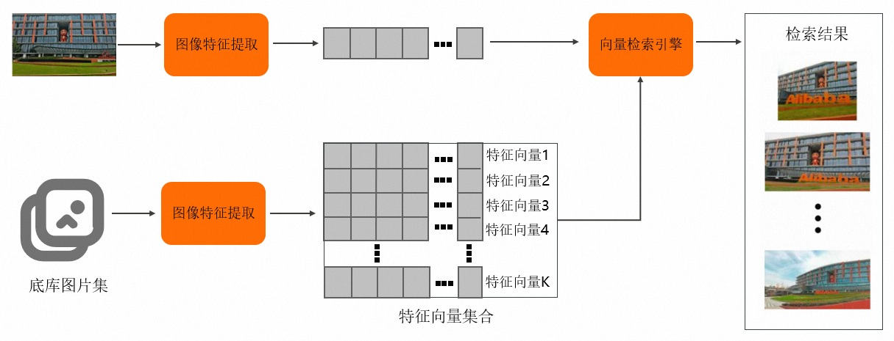

**图像特征提取**

当前主流的特征提取算法主要是使用深度学习模型，例如VGG、ResNet、Transformer等模型作为主干网络，然后使用不同的方法生成特征。生成特征常用的方法有三种：

- 最简单的方法，直接将分类模型（如VGG模型）分类层的前一层输出作为图像的特征，这种算法在以图搜图场景中往往召回率不是很高。

- 第二种方法，将模型中间层的特征经过特殊的方法池化（如RMAC和GeM）和降维从而得到。

- 第三种方法，将预训练模型在目标数据集上使用专门设计的损失函数进行迁移训练，以提取特征。例如，商品以图搜图特征提取模型通常需要在商品数据集上进行迁移学习，以便能更加准确地提取不同商品的视觉特征。

您可以选择适合当前使用场景的方法，提取图像的特征，生成特征向量。

**向量检索**

向量检索又称为最近邻 (Nearest Neighbor Search，NNS) 检索，主要负责在海量特征向量中快速地查找与查询向量距离最近的k个记录。虽然可以通过遍历的方法，依次计算查询向量与数据库中所有向量的距离，然后排序，得到结果，但是这种方法的时间复杂度在大规模数据场景下基本无法满足要求。

在实际的应用场景中，通常使用近似最近邻检索 (Approximate Nearest Neighbor，ANN) 的方法，ANN主要利用向量数据分布的特性以牺牲一定检索精度为代价，快速地返回可能是查询目标最近邻的数据。

常见ANN的方法有三种：

- 基于局部敏感哈希 (LSH) 的方法。

- 基于乘积量化的方法。

- 基于图的方法。

**使用AnalyticDB PostgreSQL向量数据库实现以图搜图**

**步骤一：特征向量提取**

本文使用的工具如下：

- 编程语言为Python 3.8。

- 深度学习框架为Pytorch。

- 数据集为CIFAR100，包含了100类图像，每类包含600张图片。

- 用于提取特征的网络为已经预训练的SqueezeNet。SqueezeNet网络很轻量，输出的特征向量为1000维。

> **说明**
>
> 建议使用Jupyter Notebook依次运行以下代码。

1. 创建Python环境。

   ```bash
   # 建议使⽤Anaconda创建新的Python环境。
   conda create -n adbpg_env python=3.8
   conda activate adbpg_env

   pip install torchvision
   pip install matplotlib
   pip install psycopg2cffi
   ```

2. 下载CIFAR100数据集并进行预处理。

   ```python
   import torch
   import torchvision

   from torchvision.transforms import (
       Compose, 
       Resize, 
       CenterCrop, 
       ToTensor, 
       Normalize
   )

   preprocess = Compose([
       Resize(256),
       CenterCrop(224),
       ToTensor(),
       Normalize(mean=[0.485, 0.456, 0.406], std=[0.229, 0.224, 0.225]),
   ])

   DATA_DIRECTORY = "/Users/XXX/Desktop/vector/CIFAR"
   datasets = {
       "CIFAR100": torchvision.datasets.CIFAR100(DATA_DIRECTORY, transform=preprocess, download=True)
   }
   ```

3. （可选）查看下载的数据集。

   ```python
   import numpy as np
   import matplotlib.pyplot as plt
   from mpl_toolkits.axes_grid1 import ImageGrid

   def show_images_from_full_dataset(dset, num_rows, num_cols, indices):        
       im_arrays = np.take(dset.data, indices, axis=0)
       labels = map(dset.classes.__getitem__, np.take(dset.targets, indices))

       fig = plt.figure(figsize=(10, 10))
       grid = ImageGrid(
           fig, 
           111,
           nrows_ncols=(num_rows, num_cols),
           axes_pad=0.3)
       for ax, im_array, label in zip(grid, im_arrays, labels):
           ax.imshow(im_array)
           ax.set_title(label)
           ax.axis("off")

   dataset = datasets["CIFAR100"]
   show_images_from_full_dataset(dataset, 4, 8, [i for i in range(0, 32)])
   ```

   

4. 使用Squeezenet1_1模型批量生成所有图片的特征向量，并保存在特征向量文件中。本文特征向量文件路径为 `/Users/XXX/Desktop/vector/features/CIFAR100/features` 。

   ```text
   # 准备数据。
   BATCH_SIZE = 100
   dataloader = torch.utils.data.DataLoader(dataset, batch_size=BATCH_SIZE)

   # 下载模型。
   model = torchvision.models.squeezenet1_1(pretrained=True).eval()

   # 提取特征向量，写入features_file_path。
   features_file_path = "/Users/XXX/Desktop/vector/features/CIFAR100/features"
   feature_file = open(features_file_path, 'w')
   img_id = 0
   for batch_number, batch in enumerate(dataloader):
       with torch.no_grad():
           batch_imgs = batch[0]  # 0: images
           batch_labels = batch[1]  # 1: labels
           vector_values = model(batch_imgs).tolist()

           for i in range(len(vector_values)):
               img_label = dataset.classes[batch_labels[i].item()]
               # print(img_label)
               feature_file.write(str(img_id) + "|" + img_label + "|")
               
               vector_value = vector_values[i]
               assert len(vector_value) == 1000

               for j in range(len(vector_value)):
                   if j == 0:
                       feature_file.write("{")
                       feature_file.write(str(vector_value[j]) + ",")
                   elif j == len(vector_value) - 1:
                       feature_file.write(str(vector_value[j]))
                       feature_file.write("}")
                   else:
                       feature_file.write(str(vector_value[j]) + ",")
               feature_file.write("\n")
               
               img_id = img_id + 1
           print("finished extract feature vector for batch: ", batch_number)
   feature_file.close()
   ```

   单张图片得到的特征向量形式如下所示。

   ```text
   [2.67548513424756,2.186723470687866,2.376999616622925,2.3993351459503174,2.833254337310
   1,
   4.141584873199463,1.0177937746047974,2.0199387073516846,2.436871512298584,1.46583878993
   80,
   4,10.196249008178711,3.3932418823242188,6.087968826293945,7.661309242248535,7.660053730
   098,
   6,5.481011390686035,7.513026237487795,5.552321434020996,4.685927867889404,5.63507032394
   92,...]
   ```

**步骤二：AnalyticDB PostgreSQL向量数据库的数据导入与查询**

1. 建表并添加向量索引。本文以使用Python的psycopg2cffi库连接数据库为例。

   > **重要**
   >
   > 如您的数据库没有开通向量功能，请提交工单提交工单联系技术支持开通。

   ```python
   import os
   import psycopg2cffi

   # 注意，你可以参照以下代码设置临时环境变量。
   # os.environ["PGHOST"] = "XX.XXX.XX.XXX"
   # os.environ["PGPORT"] = "XXXXX"
   # os.environ["PGDATABASE"] = "adbpg_test"
   # os.environ["PGUSER"] = "adbpg_test"
   # os.environ["PGPASSWORD"] = "adbpg_test"

   connection = psycopg2cffi.connect(
       host=os.environ.get("PGHOST", "XX.XXX.XX.XXX"),
       port=os.environ.get("PGPORT", "XXXXX"),
       database=os.environ.get("PGDATABASE", "adbpg_test"),
       user=os.environ.get("PGUSER", "adbpg_test"),
       password=os.environ.get("PGPASSWORD", "adbpg_test")
   )

   cursor = connection.cursor()

   # ⽤于创建表的SQL语句。
   create_table_sql = """
   CREATE TABLE IF NOT EXISTS public.image_search (
       id INTEGER NOT NULL,
       class TEXT,
       image_vector REAL[],
       PRIMARY KEY(id)
   ) DISTRIBUTED BY(id);
   """

   # 修改向量列的存储格式为PLAIN。
   alter_vector_storage_sql = """
   ALTER TABLE public.image_search ALTER COLUMN image_vector SET STORAGE PLAIN;
   """

   # ⽤于创建向量索引的SQL语句。
   create_indexes_sql = """
   CREATE INDEX ON public.image_search USING ann (image_vector) WITH (dim = '1000', hnsw_m = '100', pq_enable='0');
   """

   # 执⾏上述SQL语句。
   cursor.execute(create_table_sql)
   cursor.execute(alter_vector_storage_sql)
   cursor.execute(create_indexes_sql)
   connection.commit()
   ```

2. 将数据集的图片特征向量导入到表中。

   ```python
   import io

   # 定义⼀个⽣成器函数，逐⾏处理⽂件中的数据。
   def process_file(file_path):
       with open(file_path, 'r') as file:
           for line in file:
               yield line

   # 导入数据的SQL。
   copy_command = """
   COPY public.image_search (id, class, image_vector)
   FROM STDIN WITH (DELIMITER '|');
   """

   # 图⽚特征向量⽂件。
   features_file_path = "/Users/XXX/Desktop/vector/features/CIFAR100/features"

   # 执⾏COPY命令。
   modified_lines = io.StringIO(''.join(list(process_file(features_file_path))))
   cursor.copy_expert(copy_command, modified_lines)
   connection.commit()
   ```

3. 选择特征向量文件中的一张图片对应的向量，进行搜索。例如，搜索ID为4999的图片。

   ```python
   def query_analyticdb(collection_name, vector_name, query_embedding, top_k=20):
   # 创建查询SQL，返回与查询向量最相近的图⽚，同时计算与查询向量的相似度。
       query_sql = f"""
       SELECT id, class, l2_distance({vector_name},Array{query_embedding}::real[]) AS similarity
       FROM {collection_name}
       ORDER BY {vector_name} <-> Array{query_embedding}::real[]
       LIMIT {top_k};
       """

   # 执⾏查询。
       connection = psycopg2cffi.connect(
           host=os.environ.get("PGHOST", "XX.XXX.XX.XXX"),
           port=os.environ.get("PGPORT", "XXXXX"),
           database=os.environ.get("PGDATABASE", "adbpg_test"),
           user=os.environ.get("PGUSER", "adbpg_test"),
           password=os.environ.get("PGPASSWORD", "adbpg_test")
       )

       cursor = connection.cursor()
       cursor.execute(query_sql)
       results = cursor.fetchall()
       
       return results
     
   # 选择⼀条数据作为query。
   def select_feature(file_path, expect_id):
       with open(file_path, 'r') as file:
           for line in file:
               datas = line.split('|')
               if datas[0] == str(expect_id):
                   vec = '[' + datas[2][1:-2] + ']'
                   return vec
       raise ValueError(f"没有对应id= {expect_id}的数据")

   file_path = "/Users/xxxx/Desktop/vector/features/CIFAR100/features"

   # 选取id为4999的图⽚。
   query_vector = select_feature(file_path, 4999)
   # 查看这张图⽚。
   # show_images_from_full_dataset(dataset, 1, 1, [4999], figsize=(1, 1))
   # print(query_vector)

   # 执⾏查询。
   results = query_analyticdb("image_search", "image_vector", query_vector)
   ```

   ID为4999的图片如下所示。

   

4. 将查询结果对应的图片显示出来。

   > **说明**
   >
   > AnalyticDB PostgreSQL向量数据库提供的是向量近似最近邻检索功能，即加快查询的速度。

   ```text
   # 获取上⼀步返回结果中的图⽚id。
   indices = []
   for item in results:
       indices.append(item[0])
   print(indices)

   # 显示图⽚。
   show_images_from_full_dataset(dataset, 4, 5, indices)
   ```

   查询结果如下图所示。

   

<a id="section-6-8"></a>

## 6.8. 案例：构建文本语义检索系统

本文介绍如何使用AnalyticDB PostgreSQL向量数据库构建文本语义检索系统。

**背景信息**

文本语义检索旨在通过理解查询文本的意图以及文本含义来得到更好的搜索结果。和传统的词法搜索不同，词法搜索通常只关注查询的关键词，而不理解查询的整体含义。因此，文本语义检索在提高检索性能方面具有巨大的潜力。

**文本语义检索概述**

文本语义检索的架构如下图所示，通常包括两个组件：

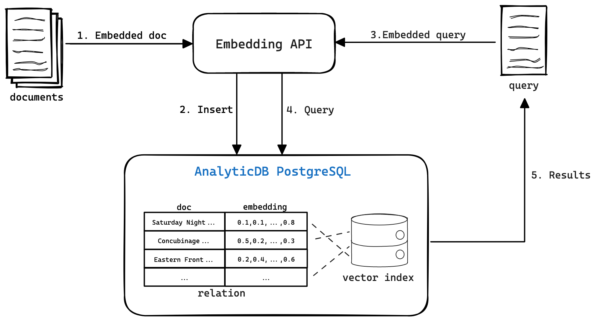

- **文本向量化和索引构建**

  - 文本向量化：指利用机器学习模型将文本转换为向量特征。机器学习模型能够对文本进行编码，使得在语义上与其他文本相似的文本，被编码为在向量空间上彼此接近的向量。您可以使用阿里云提供的NLP基础功能，或者其他文本向量化服务（如OpenAI API提供的Embedding服务）实现文本向量化。

  - 索引构建：将文本及其向量保存到AnalyticDB PostgreSQL版向量数据库中，并为这些向量构建向量索引。向量索引能够极大加速相似向量的查询。

- **向量检索**

  - 查询文本向量化：将查询文本输入到机器学习模型中，得到对应的向量表示。

  - 将得到的向量作为查询向量输入到AnalyticDB PostgreSQL版向量数据库中进行查询。

  - AnalyticDB PostgreSQL版向量数据库根据向量相似度，从数据库中获取最相似的文档，返回给用户。

**使用AnalyticDB PostgreSQL向量数据库构建文本语义检索系统**

基于AnalyticDB PostgreSQL版向量数据库构建文本语义检索系统，主要包含以下步骤：

1. 步骤一：安装Python环境。

2. 步骤二：数据预处理。

3. 步骤三：构建文档库及向量索引。

4. 步骤四：查询。

**安装Python环境**

推荐您使用Conda来管理不同版本的Python环境。本文为测试建立一个新的Python虚拟环境，并安装所需要的库。您可以在终端执行以下命令进行安装。

```bash
# 创建新的Python虚拟环境，指定Python版本为python3.8。
conda create -n adbpg_text_env python=3.8
# 激活Python虚拟环境。
conda activate adbpg_text_env
# 在虚拟环境中安装必要的Python包。
pip install psycopg2==2.9.3
pip install wget==3.2
pip install pandas==1.2.4
pip install datasets==2.12.0 sentence-transformers==2.2.2
pip install torch==2.0.1 torchvision==0.15.2 torchaudio==2.0.2
```

> **说明**
>
> 如果您使用的是MAC OS系统，在安装psycopg2时如遇到报错 `Error: pg_config executable not found.` ，可以按照如下方法操作。
>
> 1. 先安装postgresql。
>
>    ```text
>    brew install postgresql
>    ```
>
> 2. 再安装psycopg2。
>
>    ```bash
>    pip install psycopg2==2.9.3
>    ```

**数据预处理**

为了构建文本语义检索系统，首先需要选择一批文本作为文档库，本文以Quora数据集为例，将Quora数据集中的问题作为文档库为您展示如何利用AnalyticDB PostgreSQL版向量数据库构建文本语义检索系统。

**下载数据集**

首先利用Huagging Face提供的Datasets包下载Quora数据集。Quora数据集包含有约400000条数据，本文仅使用了其中的10000条数据。

```python
from datasets import load_dataset

dataset = load_dataset('quora', split='train[0:10000]')
print(dataset[0])
```

每条数据内容如下：

- questions包含了2个来自于Quora中的问题。

  - id对应两个问题的编号。

  - text为问题文本。

- is_duplicate指出这两个问题是否具有相同的含义。

  - True：两个问题具有相同的含义。

  - False：两个问题具有不同的含义。

```text
{'questions': 
     {'id': [1, 2],
      'text': ['What is the step by step guide to invest in share market in india?', 'What is the step by step guide to invest in share market?']
     },
 'is_duplicate': False
}
```

**提取文本对应的向量特征**

1. 下载好数据集后，将其中的问题提取出来得到一个文本列表。由于数据集的样本中可能会包含重复的问题，因此我们利用集合过滤掉重复的文本。

   ```text
   sentences = []

   for data in dataset['questions']:
       sentences.extend(data['text'])
     
   # 去除重复的⽂本。
   sentences = list(set(sentences))
   print('\n'.join(sentences[1:5]))
   print(len(sentences))
   ```

   返回结果如下。

   ```text
   How can I know if my spouse is cheating?
   Can a snake kill a rabbit?
   How i get hair on bald head?
   How can I get my name off the first page on Google search?
   19413
   ```

2. 利用SentenceTransformer库提取文本的向量特征，本文使用了经典的all-MiniLM-L6-v2模型。

   ```python
   from sentence_transformers import SentenceTransformer
   import torch
   model = SentenceTransformer('all-MiniLM-L6-v2', device='cpu')
   model
   ```

   all-MiniLM-L6-v2模型的重要信息如下所示。 `max_seq_length` 表示模型能够处理的最大文本长度为256，超出这个长度的文本将会被截断。 `word_embedding_dimension` 表示模型输出的向量特征维度。

   ```text
   SentenceTransformer(
     (0): Transformer({'max_seq_length': 256, 'do_lower_case': False}) with Transformer model: BertModel 
     (1): Pooling({'word_embedding_dimension': 384, 'pooling_mode_cls_token': False, 'pooling_mode_mean_tokens': True, 'pooling_mode_max_tokens': False, 
   'pooling_mode_mean_sqrt_len_tokens': False})
     (2): Normalize()
   )
   ```

3. 依次提取每个文本的向量特征，并将文本及向量特征保存到CSV文件中。该CSV文件包含三列，分别为：

   - ID：文本编号。

   - Sentences：文本。

   - Vectors：文本对应的向量特征。

   ```text
   import pandas as pd
   vectors = []

   for sentence in sentences:
       vector = model.encode(sentence)
   # 将向量特征处理成'{0.04067191854119301, ..., -0.012967484071850777}'的格式，⽅便导入到
   AnalyticDB PostgreSQL向量数据库中。
       vector_str = "{" + ", ".join(str(x) for x in vector.tolist()) + "}"
       vectors.append(vector_str)
   # ⽣成ID列。
   ids = [i + 1 for i in range(len(sentences))]

   # 将ID、Sentences和Vectors合并成⼀个DataFrame。
   df = pd.DataFrame({'ID': ids, 'Sentences': sentences, 'Vectors': vectors})

   df.to_csv('sentences_vectors.csv', index=False)
   ```

**构建文档库及向量索引**

1. 设置临时环境变量，并连接到数据库，然后执行一个简单的命令检测是否连接成功。

   ```python
   import os
   import psycopg2

   # 参照以下代码设置临时环境变量。
   # os.environ["PGHOST"] = "xxx.xxx.xxx.xxx"
   # os.environ["PGPORT"] = "58894"
   # os.environ["PGDATABASE"] = "postgres"
   # os.environ["PGUSER"] = "vector_test"
   # os.environ["PGPASSWORD"] = "password"

   connection = psycopg2.connect(
       host=os.environ.get("PGHOST", "localhost"),
       port=os.environ.get("PGPORT", "5432"),
       database=os.environ.get("PGDATABASE", "postgres"),
       user=os.environ.get("PGUSER", "user"),
       password=os.environ.get("PGPASSWORD", "password")
   )


   cursor = connection.cursor()
   # 执⾏⼀个简单的查询测试连接是否正常。
   cursor.execute("SELECT 1;")
   result = cursor.fetchone()

   if result == (1,):
       print("Connection successful!")
   else:
       print("Connection failed.")
   ```

   返回 `Connection successful!` 表明成功连接数据库。

2. 创建用于保存文本以及向量特征的表，并在vector上创建向量索引。

   > **说明**
   >
   > 创建索引时，参数 `dim` 需要和all-MiniLM-L6-v2模型输出的向量特征维度保持一致，即384。

   ```sql
   # ⽤于创建表的SQL，并修改向量列的存储格式为PLAIN。
   create_table_sql = '''
   CREATE TABLE IF NOT EXISTS public.articles (
       id INTEGER NOT NULL,
       sentence TEXT,
       vector REAL[],
       PRIMARY KEY(id)
   ) DISTRIBUTED BY(id);
   ALTER TABLE public.articles ALTER COLUMN vector SET STORAGE PLAIN;
   '''

   # ⽤于创建向量索引的SQL。
   create_indexes_sql = '''
   CREATE INDEX ON public.articles USING ann (vector) WITH (dim = '384', hnsw_m = '100',pq_enable='0');
   '''

   # 执⾏上述SQL。
   cursor.execute(create_table_sql)
   cursor.execute(create_indexes_sql)
   connection.commit()
   ```

3. 将sentences_vectors.csv中处理好的数据导入到表中。

   ```python
   import io
     
   # 定义⼀个⽣成器函数，逐⾏处理⽂件中的数据。
   def process_file(file_path):
       with open(file_path, 'r') as file:
           for line in file:
               yield line

   # 导入数据的SQL。
   copy_command = '''
   COPY public.articles (id, sentence, vector)
   FROM STDIN WITH (FORMAT CSV, HEADER true, DELIMITER ',');
   '''

   # 执⾏COPY命令。
   modified_lines = io.StringIO(''.join(list(process_file('sentences_vectors.csv'))))
   cursor.copy_expert(copy_command, modified_lines)
   connection.commit()
   ```

**查询**

在完成数据导入后，对于给定的查询，您可以利用AnalyticDB PostgreSQL版向量数据库快速从文档库中检索到在语义上和查询文本最相似的文本。查询通常包括以下步骤：

1. 获取查询对应的向量表示。

2. 利用向量执行引擎从文档库中查询到与查询向量最相似（最相近）的文本。

**示例**

随机选取一条数据作为查询文本。本文以给定的查询文本“What courses must be taken along with CA course?”为例，AnalyticDB PostgreSQL版向量数据库能够高效准确地找出最相关的文本。

```python
def query_analyticdb(collection_name, query, query_embedding, top_k=20):
    # 向量索引列。
    vector_col="vector"
    # 创建查询SQL。
    query_sql = f"""
    SELECT id, sentence, dp_distance({vector_col},Array{query_embedding}::real[]) AS similarity
    FROM {collection_name}
    ORDER BY {vector_col} <-> Array{query_embedding}::real[]
    LIMIT {top_k};
    """

    # 执⾏查询。
    connection = psycopg2.connect(
      host=os.environ.get("PGHOST", "localhost"),
      port=os.environ.get("PGPORT", "5432"),
      database=os.environ.get("PGDATABASE", "postgres"),
      user=os.environ.get("PGUSER", "user"),
      password=os.environ.get("PGPASSWORD", "password")
    )

    cursor = connection.cursor()
    cursor.execute(query_sql)
    results = cursor.fetchall()

    connection.close()
    return results
```

```text
# 查询⽂本。
query = "What courses must be taken along with CA course?"
# 获取查询⽂本对应的向量特征。
query_vector=model.encode(query)

print('query: {}'.format(query))
query_results = query_analyticdb('articles', query, query_vector.tolist(), 10)
for i, result in enumerate(query_results):
    print(f"{i + 1}. {result[1]} (Score: {round(result[2], 2)})")
```

返回结果如下。

```text
query: What courses must be taken along with CA course?
1. What courses must be taken along with CA course? (Score: 1.0)
2. What is the best combination of courses I can take up along with CA to enhance my career? (Score: 0.81)
3. Is it possible to do CA after 12th Science? (Score: 0.66)
4. What are common required and elective courses in philosophy? (Score: 0.56)
5. What are common required and elective courses in agriculture? (Score: 0.56)
6. Which course is better in NICMAR? (Score: 0.53)
7. Suggest me some free online courses that provides certificates? (Score: 0.52)
8. I have only 2 months for my CA CPT exams how do I prepare? (Score: 0.51)
9. I want to crack CA CPT in 2 months. How should I study? (Score: 0.5)
10. How one should know that he/she completely prepare for CA final exam? (Score: 0.48)
```

您可以继续选择其他文本进行查询。完成后，您可以删除文档库及索引以节省资源。

```text
# 删除⽂档库的SQL。
drop_table_sql = '''drop table public.articles;'''
cursor.execute(drop_table_sql)
connection.commit()
connection.close()
```

<a id="section-7"></a>

# 7.备份恢复

<a id="section-7-1"></a>

## 7.1. 功能介绍

云原生数据仓库AnalyticDB PostgreSQL版支持周期性的基础备份与日志备份，可以有效防止数据丢失。

**功能原理**

云原生数据仓库AnalyticDB PostgreSQL版通过集群的基础备份加日志备份，可以将集群恢复至指定历史时刻，并保证分布式集群状态与数据的一致性。

- **基础备份**：是指对数据库所有数据进行的一个完全拷贝。基础备份会将集群全量数据的快照压缩后存储到其它离线存储介质，集群在基础备份期间不会阻塞您的读写操作，同时，备份期间产生的操作日志也会进行备份从而保证基础备份的完整性。

- **日志备份**（也称为增量备份）：是指将集群产生的日志文件备份至其他离线存储介质。日志文件记录了用户对数据库的DML与DDL操作。

AnalyticDB PostgreSQL版通过一个完整的基础备份以及连续的日志备份，可以将新集群恢复到某一历史时间点，保证了这段时间的数据安全性。

在基础备份的基础上，各个节点依次顺序执行日志备份中记录的数据变更，直到日志中记录的恢复点为止。日志文件中的恢复点保证了各个节点完成恢复时，所有节点的一致性状态。

**使用场景**

备份恢复的功能适用于如下使用场景：

- 由于误操作等原因造成的实例数据丢失。

- 源实例数据被破坏或不可用。

- 需要从源实例克隆一个相同的实例。

- 需要变更实例规格（节点数不变）。

**使用限制**

- 源实例至少拥有一个成功状态的备份集才能恢复数据。

- 目前仅支持存储预留模式实例。

<a id="section-7-2"></a>

## 7.2. 数据备份

本文介绍云原生数据仓库AnalyticDB PostgreSQL版如何查看备份数据以及如何设置备份策略。

**注意事项**

仅支持存储预留模式实例。

**查看和修改备份策略**

1. 登录云原生数据仓库AnalyticDB PostgreSQL版控制台。

2. 找到目标实例，单击实例ID。

3. 在左侧导航栏中，单击**备份恢复**。

4. 在**备份恢复**页面，单击**备份设置**页签即可查看备份策略。

   

5. 如需修改备份策略，请单击**修改备份配置**。

6. 在**备份配置**面板中设置以下内容。

   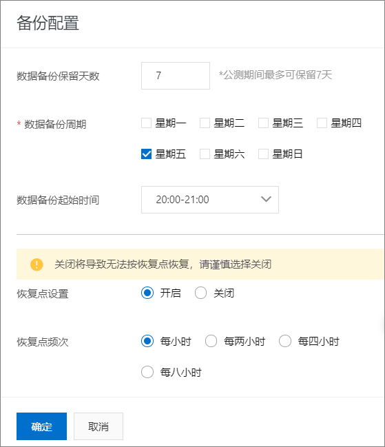

   | 参数 | 说明 |
   | --- | --- |
   | 数据备份保留天数 | 设置备份的保留天数，取值为1~7。公测期间最多可保留7天。 |
   | 数据备份周期 | 设置备份周期，每周最少选择一天进行数据备份。 |
   | 数据备份起始时间 | 选择数据备份开始的时间段，例如<strong>05:00-06:00</strong>。建议设置为业务低峰期。 |
   | 恢复点设置 | 选择是否开启恢复点（时间点恢复）恢复功能。关闭后将无法按恢复点恢复，请谨慎选择。 |
   | 恢复点频次 | 选择恢复点的频率，目前支持如下频率：<br>• 每小时<br>• 每两小时<br>• 每四小时<br>• 每八小时 |

7. 单击**确定**即可。

**查看基础备份集**

1. 登录云原生数据仓库AnalyticDB PostgreSQL版控制台。

2. 找到目标实例，单击实例ID。

3. 在左侧导航栏中，单击**备份恢复**。

4. 在**数据备份**页签即可查看基础备份集的信息。基础备份数据是指对数据库所有数据进行的一个完全拷贝。基础备份数据保存在OSS上，默认保留天数为7天。

   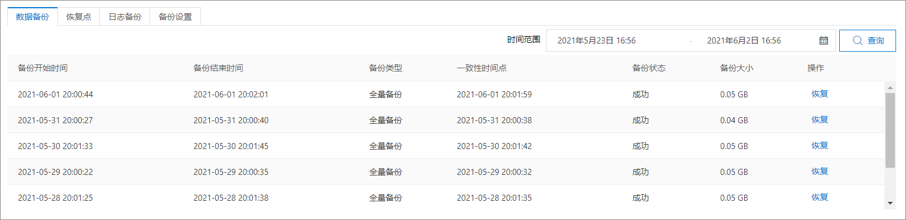

   上图中每一行信息表示一份基础备份数据，并记录了**备份开始时间**，**备份结束时间**，**备份状态**（**成功**或**失败**），**备份大小**以及**一致性时间点**。**一致性时间点**表示此基础备份数据可以将集群恢复至该历史时间点，并使数据库处于一致性状态。

**查看恢复点**

1. 登录云原生数据仓库AnalyticDB PostgreSQL版控制台。

2. 找到目标实例，单击实例ID。

3. 在左侧导航栏中，单击**备份恢复**。

4. 在**备份恢复**页面，单击**恢复点**页签。

5. 在**恢复点**页签即可查看恢复点的信息。恢复点是指集群可以恢复到的指定历史时间点。

   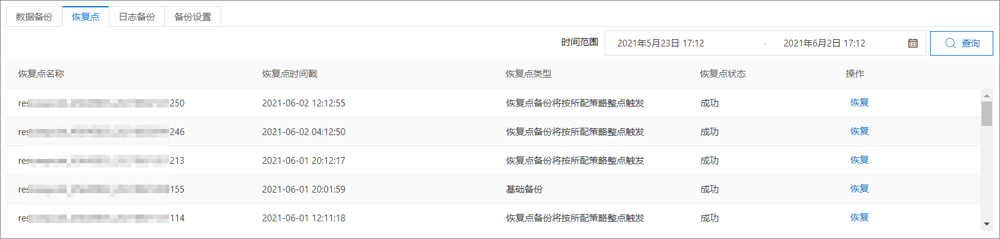

   上图中每一行数据表示一个恢复点，并记录了该恢复点的时间戳，表示通过该恢复点可以让集群恢复至此历史时间点。

**查看日志备份**

1. 登录云原生数据仓库AnalyticDB PostgreSQL版控制台。

2. 找到目标实例，单击实例ID。

3. 在左侧导航栏中，单击**备份恢复**。

4. 在**备份恢复**页面，单击**日志备份**页签。

5. 在**日志备份**页签即可查看日志备份的信息。日志文件记录了数据库的所有更改，在集群恢复时会使用相应的日志文件将集群恢复至指定状态，当前用户集群恢复的日志文件都保存在OSS上。

   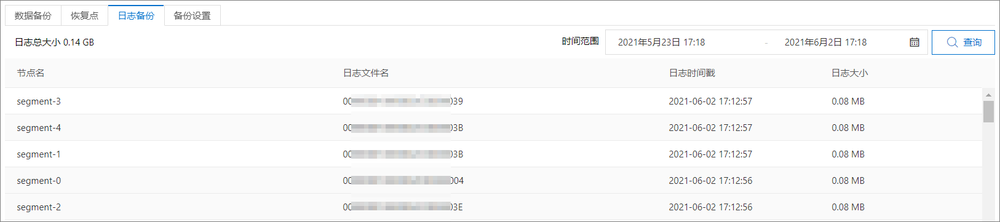

<a id="section-7-3"></a>

## 7.3. 数据恢复

本文介绍如何将云原生数据仓库AnalyticDB PostgreSQL版实例的备份数据恢复到一个新实例。

**注意事项**

- 仅支持存储预留模式实例。

- 新实例的存储空间必须等于或大于源实例。

- 实例重建耗时取决于源实例中保有的数据量，耗时为小时级别。

**操作步骤**

1. 登录云原生数据仓库AnalyticDB PostgreSQL版控制台。

2. 找到目标实例，单击实例ID。

3. 在左侧导航栏中，单击**备份恢复**。

4. 在**数据备份**或**恢复点**页签中，找到目标备份，单击**操作**列的**恢复**。

   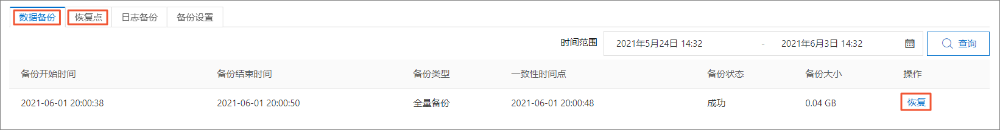

5. 在**克隆实例**页面，进行如下配置。

   **类别**

   **配置**

   **说明**

   组织

   实例所属组织，无需修改。

   资源集

   实例所属资源集，无需修改。

   地域

   选择AnalyticDB PostgreSQL版所在的地域，无需修改。

   主可用区

   AnalyticDB PostgreSQL版所在的主可用区。

   区域

   部署方式

   与源实例一致，不可修改。

   AnalyticDB PostgreSQL版所在的备可用区。

   备可用区

   > 仅部署方式为**多可用区部署**时显示该配置项。
   >
   > **说明**

   克隆源实例

   固定为需要恢复的源实例。

   克隆源类型

   固定为**备份集**。

   备份集

   选择需要恢复的时间点。

   实例资源类型

   与源实例资源类型一致，无需选择。

   芯片架构

   选择克隆实例的芯片架构。

   固定为1，实例创建完成后可以自行添加，操作方式，请参见变更配

   maser节点数量

   基本配置

   置。

   计算机规格

   计算资源单位，不同的计算组规格有不同的存储空间和计算能力。

   计算节点数量

   计算节点数量，默认与源实例计算节点数量相同。

   计算节点容量不支持修改，具体容量与节点规格相关。

   计算节点容量

   CPU：内存：存储容量比例为1：8：80，例如计算节点规格为2C16G，则存储容量为160 GB。

   存储介质

   固定为**本地SSD盘**。

   AnalyticDB PostgreSQL版实例支持的网络类型：

   - **经典网络**：经典网络中的云服务在网络上不进行隔离，只能依靠云服务自身的安全组或白名单策略来阻挡非法访问。

   - **专有网络**：（Virtual Private Cloud，简称VPC）专有网络帮助用户在阿里云上构建出一个隔离的网络环境。用户可以自定义专

   网络类型

   有网络里面的路由表、IP地址范围和网关。建议您选择专有网络，更加安全。

   您可以事先创建专有网络，也可以在创建实例后切换网络类型时修改专有网络。

   AnalyticDB PostgreSQL版实例所在的VPC。

   专有网络VPC

   > 仅网络类型为**专有网络**时显示该配置项。
   >
   > **说明**

   网络

   AnalyticDB PostgreSQL版实例所在的交换机。

   交换机VSwitch

   > 仅网络类型为**专有网络**时显示该配置项。
   >
   > **说明**

   AnalyticDB PostgreSQL版实例所在的备可用区的交换机。

   备可用区交换机

   > 仅部署方式为**多可用区部署**，且网络类型为**专有**
   >
   > **说明**

   VSwitch

   > **网络**时显示该配置项。

   IP白名单

   添加允许访问AnalyticDB PostgreSQL版实例的IP地址。

6. 单击**提交**。

<a id="section-8"></a>

# 8.性能与监控

<a id="section-8-1"></a>

## 8.1. 监控与报警（存储预留模式）

<a id="section-8-1-1"></a>

### 8.1.1. 实例监控

本文介绍如何查看AnalyticDB PostgreSQL版的实例监控信息。

**注意事项**

实例监控功能目前仅支持存储预留模式实例。

**操作步骤**

1. 登录云原生数据仓库AnalyticDB PostgreSQL版控制台。

2. 找到目标实例，单击实例ID。

3. 在左侧导航栏中，单击**监控与报警 > 实例监控**。**实例监控**页面分为以下两个区域：

   - **实例运行状态**

     用于查看实例当前的运行状态，包括**运行状态**、**实例存储状态**、**实例健康状态**、**实例存储水位**、**实例连接状态**、**最大实例协调节点存储水位**、**最大实例计算节点存储水位**。

   - **性能&负载**

     用于查看实例的**性能&负载**信息，具体如下。

     <table>
       <tr>
         <th width="121">指标分组</th>
         <th>监控指标</th>
       </tr>
       <tr>
         <td>连接数监控</td>
         <td>• 协调节点连接数<br>• 计算节点连接数<br>• 实例活跃连接数<br>• 实例空闲连接数</td>
       </tr>
       <tr>
         <td>节点健康监控</td>
         <td>• 计算节点数<br>• 计算节点健康个数<br>• 计算节点异常个数<br>• 协调节点健康个数<br>• 协调节点异常个数</td>
       </tr>
       <tr>
         <td>查询监控</td>
         <td>• 实例阻塞查询个数<br>• 实例排队查询个数<br>• 实例活跃查询个数<br>• QPS指标<br>• TPS指标</td>
       </tr>
     </table>

     <table>
       <tr>
         <th width="121">资源队列监控</th>
         <th>• RSQ Cost<br>• RSQ Count<br>• RSQ Memory<br>• Waiter&amp;Holder</th>
       </tr>
       <tr>
         <td>磁盘使用监控</td>
         <td>• 实例存储总使用量（MB）<br>• 临时落盘文件大小（MB）<br>• 实例总存储水位（%）</td>
       </tr>
     </table>

4. <strong>可选：</strong>切换**查询时间**，查询特定时间内的监控指标。

   您可以查询最近1个小时、6个小时、1天或7天内的状态，也可以自定义查询开始和结束时间。

   > 自定义查询开始时间与查询结束时间的间隔不能超过7天。
   >
   > **说明**

<a id="section-8-1-2"></a>

### 8.1.2. 节点监控

本文介绍如何查看AnalyticDB PostgreSQL版的节点监控信息。

**注意事项**

实例监控功能目前仅支持存储预留模式实例。

**操作步骤**

1. 登录云原生数据仓库AnalyticDB PostgreSQL版控制台。

2. 找到目标实例，单击实例ID。

3. 在左侧导航栏中，单击**监控与报警 > 节点监控**。**节点监控**页面分为以下三个部分：

   - **节点运行状态**区域

     用于查看实例当前的运行状态，包括**协调节点健康状态**、**协调节点连接健康状态**、**计算节点连接健康状态**、**计算节点存储状态**。

   - <strong>协调节点（Master）</strong>页签

     用于查看协调节点的状态，包括**CPU使用率（%）**、**内存使用率（%）**。

     您可以切换**查询时间**，查询最近1个小时、6个小时、1天或7天内的状态，也可以自定义查询开始和结束时间。

     > 查询开始时间与查询结束时间的间隔不能超过7天。
     >
     > **说明**

   - <strong>计算节点（Segment）</strong>页签

     用于查看计算节点的状态，包括**CPU使用率（%）**、**存储使用量（MB）**、**存储水位（%）**、**内存使用率（%）**、**读IOPS（次/秒）**、**写IOPS（次/秒）**。

     - 您可以切换**查询时间**，查询最近1个小时、6个小时、1天或7天内的状态，也可以自定义查询开始和结束时间。

       > 查询开始时间与查询结束时间的间隔不能超过7天。
       >
       > **说明**

     - 您可以在**节点筛选**右侧选择查看**全部节点**、**top10节点**、**top20节点**、**bottom10节点**、**bottom20节点**的状态，也可以在右侧下拉框中选择**自定义节点查看**状态。

<a id="section-8-2"></a>

## 8.2. 监控与报警（计算存储一体模式）

为方便用户掌握实例的运行状态，AnalyticDB PostgreSQL版控制台提供了监控与报警功能。

**操作步骤**

1. 登录云原生数据仓库AnalyticDB PostgreSQL版控制台。

2. 找到目标实例，单击实例ID。

3. 在左侧导航栏中，单击**监控与报警**。**监控与报警**页面展示了以下指标信息。

   - **监控汇总**页签

     在该页面您可以查看**CPU和内存利用率（%）**、**当前Master总连接数**、**IO吞吐量**和**磁盘空间（MB）**。

   - **计算组监控**页签或**计算节点监控**页签

     计算存储一体模式实例为**计算组监控**；存储预留模式为**计算节点监控**。

     在该页面您可以查看**CPU和内存利用率（%）**、**写IOPS吞吐量**、**读IOPS吞吐量**和**磁盘空间（MB）**。

4. <strong>可选：</strong>选择不同的查询时间来看距今某一时间段内各项指标的情况，支持的支持的**查询时间**如下：

   - **1小时**：查看最近一个小时的监控信息。

   - **1天**：查看最近一天的监控信息。

   - **自定义**：查看指定时间范围的监控信息，最长时间跨度为七天。

<a id="section-8-3"></a>

## 8.3. 诊断与优化

<a id="section-8-3-1"></a>

### 8.3.1. 实例运行状态概览

AnalyticDB PostgreSQL版诊断与优化功能新增了概览页，用于查看连接状态、集群状态和存储状态。

**注意事项**

实例监控功能目前仅支持存储预留模式实例。

**操作步骤**

1. 登录云原生数据仓库AnalyticDB PostgreSQL版控制台。

2. 找到目标实例，单击实例ID。

3. 在左侧导航栏中，选择**诊断与优化 > 概览**。**概览**页由左侧的状态信息和右侧的折线图信息组成：

   - 状态信息

     | 模块 | 监控项 | 说明 |
     | --- | --- | --- |

     协调（Master）节点连接健康状态。说明如下：

     - 红：节点连接数使用率大于等于95%。

     - 黄：节点连接数使用率大于等于90%且小于95%。

     - 绿：节点连接数使用率小于90%。

     **协调节点连接健康状态**

     > 协调节点连接数使用率为所有协调
     >
     > **说明**
     >
     > 节点中连接数使用率的最大值。

     连接状态

     计算（Segment）节点连接健康状态。说明如下：

     - 红：节点连接数使用率大于等于95%。

     - 黄：节点连接数使用率大于等于90%且小于95%。

     **计算节点连接健康状态**

     - 绿：节点连接数使用率小于90%。

     > 计算节点的连接数使用率为所有计
     >
     > **说明**
     >
     > 算节点中的连接数使用率最大值。

     实例的运行状态。

     **运行状态**

     实例健康状态。说明如下：

     - 红：任意一个协调节点或计算节点不可用。

     **实例健康状态**

     - 绿：所有节点均可用。

     实例连接健康状态。说明如下：

     - 红：实例连接数使用率大于95%。

     - 黄：实例连接数使用率大于90%且小于等于95%。

     **实例连接状态**

     - 绿：实例连接数使用率小于等于90%。

     > 实例连接数使用率为所有协调节点
     >
     > **说明**

     集群状态

     > 和计算节点的连接数使用率的最大值。

     协调节点的可用状态。说明如下：

     - 红：主备节点均不可用。

     **协调节点状态**

     - 黄：主节点或备节点不可用。

     - 绿：所有节点均可用。

     计算节点的可用状态。说明如下：

     - 红：所有节点均不可用。

     **计算节点状态**

     - 黄：大于等于50%节点不可用。

     - 绿：所有节点均可用。

     实例存储状态。说明如下：

     - 红：实例存储水位大于等于90%，实例将被锁定。

     **实例存储状态**

     - 黄：实例存储水位大于等于70%且小于90%。

     - 绿：实例存储水位小于70%。

     存储状态

     **最大实例协调节点存储**

     协调节点最大存储水位，单位为%。

     **水位**

     **最大实例计算节点存储**

     计算节点最大存储水位，单位为%。

     **水位**

   - 折线图信息

     由**SQL**、**连接数**、**实例存储水位（%）**、**协调节点数**和**计算节点数**几个模块组成，您可以将鼠标移动到折线图中查看相关信息。

<a id="section-8-3-2"></a>

### 8.3.2. 运维助手

AnalyticDB PostgreSQL版诊断与优化功能新增了运维助手，用于查看数据膨胀、数据倾斜和索引使用统计信息。

**注意事项**

实例监控功能目前仅支持存储预留模式实例。

**操作步骤**

1. 登录云原生数据仓库AnalyticDB PostgreSQL版控制台。

2. 找到目标实例，单击实例ID。

3. 在左侧导航栏中，选择**诊断与优化 > 运维助手**。

   **运维助手**页面由**数据膨胀**、**数据倾斜**和**索引使用统计**三个页签组成：

   - **数据膨胀**

     > **说明**
     >
     > 数据膨胀页面仅展示表大小超过1 GB的表。

     <table>
       <tr>
         <th width="121">参数</th>
         <th>说明</th>
       </tr>
       <tr>
         <td>库名</td>
         <td>数据库名称。</td>
       </tr>
       <tr>
         <td>模式名</td>
         <td>Schema名称。</td>
       </tr>
       <tr>
         <td>分区表名</td>
         <td>分区表名称。</td>
       </tr>
       <tr>
         <td>表类型</td>
         <td>表的存储类型，例如堆表或AO表。</td>
       </tr>
       <tr>
         <td>期望表大小</td>
         <td>期望的表的大小，单位为Byte。期望表大小为AnalyticDB PostgreSQL版判断没有膨胀情况下的表大小。</td>
       </tr>
       <tr>
         <td>实际表大小</td>
         <td>实际表的大小，单位为Byte。</td>
       </tr>
       <tr>
         <td>膨胀表大小</td>
         <td>膨胀表的大小，为可释放的空间量，单位为Byte。</td>
       </tr>
       <tr>
         <td>膨胀系数</td>
         <td>数据膨胀的系数，膨胀系数计算公式如下：系统统计的死行数/系统统计的活跃行数。<br>说明由于AnalyticDB PostgreSQL版采用MVCC机制，UPDATE和DELETE操作会生成死行数。</td>
       </tr>
       <tr>
         <td>上次诊断时间</td>
         <td>上次更新（DELETE、INSERT或UPDATE操作）表的时间。</td>
       </tr>
     </table>

   - **数据倾斜**

     > **说明**
     >
     > 数据倾斜页面仅展示表大小超过1 GB的表。

     <table>
       <tr>
         <th width="121">参数</th>
         <th>说明</th>
       </tr>
       <tr>
         <td>库名</td>
         <td>数据库名称。</td>
       </tr>
       <tr>
         <td>模式名</td>
         <td>Schema名称。</td>
       </tr>
       <tr>
         <td>表名</td>
         <td>表名称。</td>
       </tr>
       <tr>
         <td>拥有者</td>
         <td>表的拥有者。</td>
       </tr>
       <tr>
         <td>表大小</td>
         <td>表的大小。</td>
       </tr>
       <tr>
         <td>倾斜率</td>
         <td>表的倾斜度百分比，取值范围为0~100%。值越大表示倾斜的越厉害，值越小越有利于数据库的查询性能，0表示没有倾斜。倾斜率计算公式如下：1-（表在所有节点上的平均大小/表在所有节点上最大值）</td>
       </tr>
       <tr>
         <td>分布键</td>
         <td>表的分布键。</td>
       </tr>
       <tr>
         <td>上次诊断时间</td>
         <td>上次更新（DELETE、INSERT或UPDATE操作）表的时间。</td>
       </tr>
     </table>

   - **索引使用统计**

     > **说明**
     >
     > 索引使用统计页面仅展示索引大小超过100 MB的索引。

     | 参数 | 说明 |
     | --- | --- |
     | 库名 | 数据库名称。 |
     | 模式名 | Schema名称。 |
     | 表名 | 表名称。 |
     | 索引大小 | 索引的大小，单位为Byte。 |
     | 索引扫描次数 | 索引扫描总次数。 |
     | 索引扫描行数 | 索引扫描总行数。 |
     | 索引名 | 索引名称。 |
     | 上次诊断时间 | 上次更新（DELETE、INSERT或UPDATE操作）表的时间。 |

<a id="section-8-3-3"></a>

### 8.3.3. 查询分析

AnalyticDB PostgreSQL版查询分析功能可供您查看SQL执行计划以及对应统计信息，供您对查询进行分析和调优。本文介绍查询分析功能的基本使用方法。

**注意事项**

实例监控功能目前仅支持存储预留模式实例。

**操作步骤**

1. 登录云原生数据仓库AnalyticDB PostgreSQL版控制台。

2. 找到目标实例，单击实例ID。

3. 在左侧导航栏中，选择**诊断与优化 > 查询分析**。

4. 在页面右上角选择目标数据库、筛选条件以及时间范围，即可查看查询执行状态信息。查询分析页面提供**查询执行泳道图**和**SQL列表**两种方式供您查看查询执行状态信息：

   - **查询执行泳道图**

     泳道中的每一个条色块代表一次查询执行过程。您可以将鼠标移至色块上方查看该查询的执行相关信息，单击**详情**可进入**查询属性**页面。**查询属性**页面介绍，请参见查询属性。

   - **SQL列表**

     列表中每一个条信息代表一次查询执行过程。列表中展示了查询执行的相关信息及数据，您可以单击**操作**列的**诊断**进入**查询属性**界面。**查询属性**页面介绍，请参见查询属性。

     SQL列表中包含的信息如下：

     | 名称 | 说明 |
     | --- | --- |
     | SQL | SQL查询语句。 |
     | 开始时间 | 查询开始执行的时间。 |
     | 查询Id | 查询唯一标识编号。 |
     | 会话Id | 查询所属会话（Session）编号。 |
     | 数据库 | 查询的数据库名。 |
     | 状态 | 查询执行的状态。取值如下：<br>• 已完成<br>• 执行中 |
     | 耗时 | 查询执行的总时长，单位为秒（s）。 |
     | 用户名 | 执行本次查询的用户。 |

     您可以单击**下载**按钮将列表数据下载至本地。

**查询属性**

**查询属性**页面由**查询语句**、**执行计划文本**和**执行计划树**三个页签组成。

**查询语句**

**查询语句**页签提供了SQL查询语句。

**执行计划文本**

**执行计划文本**页签提供了通过EXPLAIN命令获得的查询执行计划。

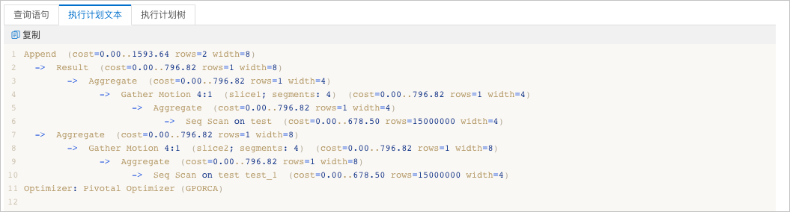

**执行计划树**

**执行计划树**页签提供了树状执行计划图。该页签左侧展示了计划树，右侧展示了算子执行时的统计信息。您可以单击计划树中的算子卡片查看该算子的详情统计信息。

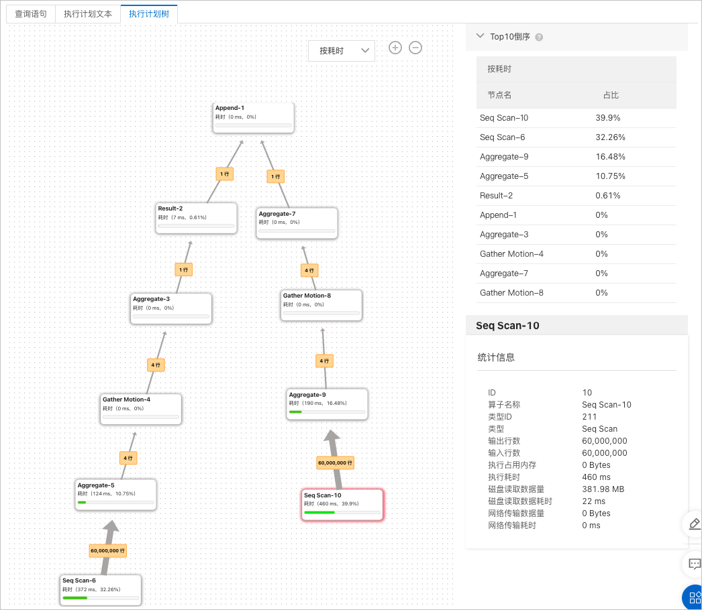

默认情况下，计划树中算子卡片下方线条代表该算子执行耗时在所有算子中的占比，页面右上的列表也会展示算子执行耗时占比，并按耗时占比排序。您也可以根据需求选择按照占用内存、磁盘读取数据量、磁盘读取数据耗时、网络传输数据量、网络传输数据耗时对算子排序以及计算整体比例。

算子统计信息介绍如下：

<table>
  <tr>
    <th width="152">名称</th>
    <th>说明</th>
  </tr>
  <tr>
    <td>算子名称</td>
    <td>算子名称与编号，在计划树中唯一。</td>
  </tr>
  <tr>
    <td>类型ID</td>
    <td>算子类型编号。</td>
  </tr>
  <tr>
    <td>类型</td>
    <td>算子类型名，在计划树中可能重复出现。</td>
  </tr>
  <tr>
    <td>输出行数</td>
    <td>该算子向上层算子输出数据行数。</td>
  </tr>
  <tr>
    <td>输入行数</td>
    <td>该算子从下层算子或磁盘中读取的数据行数。</td>
  </tr>
  <tr>
    <td>执行占用内存</td>
    <td>算子执行占用内存。<br>说明查询分析中只统计Sort、Hash、Hash Aggregate三个算子占用的内存，其它算子因占用内存较少而忽略。</td>
  </tr>
  <tr>
    <td>执行耗时</td>
    <td>算子执行耗时。</td>
  </tr>
  <tr>
    <td>磁盘读取数据量</td>
    <td>算子从磁盘中读取数据总量。<br>说明算子从磁盘读取数据包括Scan算子读取原始数据或其它算子由于内存不足所出现的数据落盘（Spill）。</td>
  </tr>
  <tr>
    <td>磁盘读取数据耗时</td>
    <td>算子从磁盘中读取数据的耗时。</td>
  </tr>
  <tr>
    <td>网络传输数据量</td>
    <td>Motion算子节点间网络传输的数据总量。</td>
  </tr>
  <tr>
    <td>网络传输耗时</td>
    <td>Motion算子节点间网络传输数据耗时。</td>
  </tr>
</table>

<a id="section-8-3-4"></a>

### 8.3.4. 锁诊断

如果查询长时间没有返回结果，则需要确认查询是否处于锁等待状态，帮助您快速诊断数据库中的锁情况。

**注意事项**

锁诊断功能目前仅支持存储预留模式实例。

**操作步骤**

1. 登录云原生数据仓库AnalyticDB PostgreSQL版控制台。

2. 找到目标实例，单击实例ID。

3. 在左侧导航栏中，选择**诊断与优化 > 查询分析**。

4. 单击**锁诊断**页签。

5. 在**锁诊断**页面，您可以根据**关键字**、**用户名**、**数据库**、**过滤条件**和**查询时间**来过滤锁诊断信息。

   锁诊断列表信息如下：

   | 参数 | 说明 |
   | --- | --- |
   | SQL | 查询语句的SQL文本。 |
   | 开始时间 | 查询语句开始执行的时间。 |
   | 进程ID | 查询语句所属的进程ID。 |
   | 会话ID | 查询语句的会话ID。 |
   | 数据库 | 执行该查询语句的数据库。 |
   | 状态 | 查询语句的状态。 |
   | 等待时长 | 查询语句的等待时长。 |
   | 用户名 | 执行该查询语句的用户。 |

6. 单击目标诊断信息**操作**列的**诊断**，即可查看**锁等待属性**和**锁诊断详情**。

   - **锁等待属性**：您可以在该区域查看**进程ID**、**用户名**、**数据库**、**开始时间**、**等待时长**和**状态**。

   - **锁诊断详情**：您可以在该区域查看被阻塞和造成阻塞的语句的**进程ID**、**用户名**和**查询语句**。

   > 处于**资源等待**状态的SQL不支持诊断。
   >
   > **说明**

**处理方法**

如果查询长时间未返回结果且锁诊断页面显示查询状态为锁等待，您可以选择等待之前的查询完成后系统自动执行您的查询任务，也可以结束造成阻塞的查询任务。

您可以取消（Cancel）或结束（Kill）造成阻塞的查询，方法如下。

> 只有高权限（superuser权限）账号才能取消或结束查询。
>
> **说明**

- 取消查询

  查询所属的会话必须在运行中状态才能取消该查询，取消查询后数据库需要花费一定的时间来做清理和事务的回滚。取消查询语句如下：

  ```text
  SELECT pg_cancel_backend(<进程ID>);
  ```

  如果会话已经处于空闲（Idle）状态，则需要使用结束查询的方法。

- 结束查询

  结束查询语句如下：

  ```text
  SELECT pg_terminate_backend(<进程ID>);
  ```

<a id="section-9"></a>

# 9.最佳实践

<a id="section-9-1"></a>

## 9.1. 配置内存和负载参数

为了提高数据库的稳定性，您需要合理配置内存和负载参数。

**背景信息**

AnalyticDB PostgreSQL版是一个重计算和重资源的MPP数据库，可谓有多少资源就能消耗多少资源，带来的好处是处理速度变快了，坏处就是容易超出限制。

CPU、网络、硬盘超出限制的话，关系不大，因为大不了就是到硬件瓶颈，但是内存超出限制的话会带来较大的负面影响，例如操作系统提示用户进程内存不足，导致数据库崩溃等。

**如何避免OOM**

OOM（Out of memory）指遇到了进程申请内存不足的错误，会出现如下类似提示：

```text
Out of memory (seg27 host.example.com pid=47093) VM Protect failed to allocate 4096 bytes, 0 MB available 
```

**问题原因**

导致数据库OOM报错的原因可能有：

- 数据库节点的内存不足。

- 操作系统内存相关的内核参数配置不当。

- 数据倾斜，导致某些查询时，某个Segment需要申请的内存超大。

- 查询倾斜，例如某些聚合、窗口函数的分组不是分布键，那么需要对数据进行重分布，重分布后导致某个Segment的数据出现倾斜，导致某些查询时，某个Segment需要申请的内存超大。

**处理方法**

1. 调整QUERY，使之需要更少的内存。

2. 使用资源队列（AnalyticDB PostgreSQL版控制资源的一种手段），限制并发QUERY数。降低集群内同时运行的QUERY数，从而减少系统整体的内存资源的使用。

3. 减少单个主机部署的Segment数量，例如有128G内存的主机，部署16个和部署8个Segment节点，每个节点能使用的内存相差了一倍。

4. 增加单台主机的内存数。

5. 设置数据库参数gp_vmem_protect_limit，限制单个Segment可以使用的VMEM上限。单个主机的内存以及部署多少个Segment决定了平均单个Segment最多可以使用多少内存。

6. 对于某些对内存使用量不可预知的SQL，通过在会话中设置statement_mem参数，限制单条SQL对内存的使用，从而避免单条SQL把内存用光的情况。

7. 也可以在库级别设置statement_mem参数。对这个数据库的所有会话生效。

8. 使用资源队列（AnalyticDB PostgreSQL版控制资源的一种手段），限制这个资源组的内存使用上限，将数据库用户加入资源组，控制这些用户共同使用内存的上限。

**配置内存相关参数**

正确地配置操作系统、数据库参数、资源队列管理，可以有效地降低OOM发生的概率。

在计算单主机内单个Segment的平均可使用内存时，不能只考虑Primary Segment，还需要考虑Mirror Segment，因为当集群出现主机故障时，会将Segment切换到对应的Mirror Segment，此时，主机上跑的Segment数就比平时更多了。因此我们必须考虑到failover时，Mirror Segment需要占用的资源。

接下来我们分析一下如何进行操作系统内核配置、数据库配置，从而避免OOM。

操作系统内核参数配置说明如操作系统内核参数说明所示。

表 1. 操作系统内核参数说明

| 参数 | 说明 |
| --- | --- |
| huge page | 不要配置系统的huge page，因为AnalyticDB PostgreSQL版的PG版本较老，还没有支持huge page。而操作系统的huge page会锁定内存的分配，导致这部分内存不能被数据库节点使用。 |
| vm.overcommit_memory | 如果使用SWAP建议设置为2，如果不使用SWAP建议设置为0。各参数值的说明如下：<br>• 0：比较友好，允许申请的内存空间通常不能超过"总内存-不可释放内存(RSS部分)"的部分。超过时申请内存才会报错。<br>• 1：强制，大多数进程先使用malloc申请内存空间，但是不使用它或者是只使用部分。所以设置为1时，不管什么情况都允许malloc申请成功，除非遇到真的内存不足的情况。<br>• 2：最友好，在计算允许申请的内存空间时，将SWAP也算进去，也就是说申请大量内存时，可能触发SWAP但是允许你申请成功。 |
| overcommit_ratio | 值越大，允许用户进程申请的内存空间越大，但是给操作系统保留的空间就越小。需要用公式来计算，具体参考接下来的例子。当设置为2时，允许申请的内存地址范围不能超过“swap+内存大小\*overcommit_ratio”。 |

数据库参数配置说明如数据库参数说明所示。

表 2. 数据库参数说明

| 参数 | 说明 |
| --- | --- |
| gp_vmem_protect_limit | 控制每个Segment上所有进程可以申请到的最大内存。如果这个值太高，可能触发系统的OOM或者更严重的问题。如果设置太低，则可能导致系统有足够内存的情况下，SQL也无法运行。 |
| runaway_detector_activatio n_percent | 这个参数默认为90，是一个百分比值。当任一Segment使用的内存超过(runaway_detector_activation_percent\*gp_vmem_protect_limit/100)时，主动终止查询，防止OOM。终止的顺序从使用最多内存的QUERY依次开始，直到内存降低到(runaway_detector_activation_percent\*gp_vmem_protect_limit/100)以下。通过 gp_toolkit.session_level_memory_consumption 视图可以观察每个会话的内存使用情况，以及runaway的信息。 |

<table>
  <tr>
    <td>statement_mem</td>
    <td>设置单条SQL最多可以申请的内存，当超过这个内存时，写spill file文件。默认为125MB。建议设置为单个Segment的保护内存乘以0.9除以期望的最大SQL并行运行的值。<br><code>(gp_vmem_protect_limit * 0.9) /</code><br><code>max_expected_concurrent_queries</code><br>说明<br>• statement_mem在会话中设置，如果当前并行度很低，而某个会话需要运行一条需要大量内存的查询，就需要在会话中设置该参数。<br>• statement_mem比较适合于低并发环境对内存的使用控制。对于高并发环境，如果使用statement_mem来控制内存，您会发现每条查询可以使用的内存极少，会影响高并发情况下少量对内存需求较高的查询的性能。建议高并发的情况下，使用资源队列（resource queue）来控制内存的使用上限。</td>
  </tr>
  <tr>
    <td>gp_workfile_limit_files_per_q uery</td>
    <td>限制每个查询可以使用的最大spill文件数，当查询申请的内存超过statement_mem的限制时，使用spill file(workfiles)，类似操作系统的swap空间。当使用的spill file超过限制时，查询会被终止。默认为0，表示无限制。</td>
  </tr>
  <tr>
    <td>gp_workfile_compress_algori thm</td>
    <td>设置spill file的压缩算法。取值范围包括NONE或ZLIB。设置压缩，CPU换空间，或CPU换I/O能力。当磁盘紧张或者磁盘spill file有写入瓶颈时可以设置该参数。</td>
  </tr>
</table>

**内存参数计算举例**

环境如下：

- 主机配置：

  ```text
  Total RAM = 256GB 
  SWAP = 64GB 
  ```

- 4台主机，每台主机上有8个Primary Segment 和 Mirror Segment。

  当一台主机发生故障时，8个Primary Segment 要分摊到剩余的3台主机，最多单台额外承担3个Primary Segment 。所以是8+3=11。

1. 计算给AnalyticDB PostgreSQL版SQL的总内存。

   给操作系统保留 "7.5G + 5%内存" 的余量，算出整个系统给应用软件的实际可用内存。然后用实际可用内存除以1.7的经验系数。

   ```text
   gp_vmem = ((SWAP + RAM) – (7.5GB + 0.05 * RAM)) / 1.7  
           = ((64 + 256) - (7.5 + 0.05 * 256)) / 1.7   
           = 176
   ```

2. 计算overcommit_ratio，需要使用到经验系数0.026。

   ```text
   vm.overcommit_ratio = (RAM - (0.026 * gp_vmem)) / RAM   
                       = (256 - (0.026 * 176)) / 256   
                       = .982  

   Set vm.overcommit_ratio to 98. 
   ```

3. 计算每个Segment的内存使用上限保护参数：gp_vmem_protect_limit，除以一台节点故障后其余单台节点需要运行的Primary Segment 数。

   ```text
   gp_vmem_protect_limit calculation  
   gp_vmem_protect_limit = gp_vmem / maximum_acting_primary_segments  
                         = 176 / 11   
                         = 16GB  
                         = 16384MB  
   ```

**配置资源队列**

AnalyticDB PostgreSQL版资源队列可以用来限制“并发的QUERY数和总的内存使用”。当QUERY运行时，会添加到对应的队列中，使用的资源将记录到对应的队列中，对应队列的资源控制限制对该队列内的所有会话起作用。

AnalyticDB PostgreSQL版资源队列控制资源的思想和Linux 的CGROUP非常类似。

创建资源队列的语法。

```text
Command:     CREATE RESOURCE QUEUE  
Description: create a new resource queue for workload management  
Syntax:  
CREATE RESOURCE QUEUE name WITH (queue_attribute=value [, ... ])   
where queue_attribute is:  
   ACTIVE_STATEMENTS=integer  
        [ MAX_COST=float [COST_OVERCOMMIT={TRUE|FALSE}] ]  
        [ MIN_COST=float ]  
        [ PRIORITY={MIN|LOW|MEDIUM|HIGH|MAX} ]  
        [ MEMORY_LIMIT='memory_units' ]  
|  MAX_COST=float [ COST_OVERCOMMIT={TRUE|FALSE} ]   
        [ ACTIVE_STATEMENTS=integer ]  
        [ MIN_COST=float ]  
        [ PRIORITY={MIN|LOW|MEDIUM|HIGH|MAX} ]  
        [ MEMORY_LIMIT='memory_units' ]  
            
```

参数说明如创建资源队列参数说明所示。

表 3. 创建资源队列参数说明

| 参数 | 说明 |
| --- | --- |
| ACTIVE_STATEMENTS | 允许同时运行（active状态）的SQL数。-1表示不限。 |
| MEMORY_LIMIT 'memory_units kB, MB or GB' | 设置资源队列中所有SQL允许的最大内存使用量。-1表示不限，但是受前面提到的数据库或系统参数限制，容易触发OOM错误。SQL的内存使用限制不仅受资源队列限制，同时还受到参数限制：<br>• 参数gp_resqueue_memory_policy=none时，限制同Greenplum Database releases 4.1之前的版本。<br>• 参数gp_resqueue_memory_policy=auto时，如果设置了会话的statement_mem参数，或者设置了statement_mem参数时，单条QUERY允许申请的内存将突破资源队列的MEMORY_LIMIT限制。例子：<br><code>SET statement_mem='2GB';</code><br><code>SELECT * FROM my_big_table WHERE column='value' ORDER BY</code><br><code>id;</code><br><code>RESET statement_mem;</code><br>• 系统参数max_statement_mem，可以控制Segment级别的内存使用的上限，单个QUERY申请的memory不能超过max_statement_mem。您可以随便更改会话级的statement_mem参数，但是不要随便改max_statement_mem参数。建议max_statement_mem设置如下：<br><code>(seghost_physical_memory) /</code><br><code>(average_number_concurrent_queries)</code><br>• 参数gp_resqueue_memory_policy=eager_free时，表示数据库在评估SQL对内存的申请渴望时，分阶段统计，也就是说一个SQL可能总共需要申请1GB内存，但是每个阶段只申请100MB，所以需要的内存实际上是100MB。使用eager_free策略，可以降低QUERY出现内存不足的可能性。 |
| MAX_COST float | 表示资源组允许同时执行的QUERY加起来的COST上限。COST是SQL执行计划中的总成本。设置为浮点（如 100.0）或指数（如 1e+2），-1表示不限制。 |
| COST_OVERCOMMIT boolean | 当系统空闲时，是否允许超过max_cost的限制。TRUE表示允许 |
| MIN_COST float | 资源超限时，是需要排队的，但是，当QUERY的成本低于min_cost时，不需要排队，直接运行。 |
| PRIORITY= {MIN\|LOW\|MEDIUM\|HIGH \|MAX} | 指当前资源队列的优先级，当资源紧张时，优先将CPU资源分配给高优先级的资源队列。处于高优先级的资源队列中的SQL，可以获得更高优先级的CPU资源。建议将实时性要求高的查询对应的用户分配到高优先级的资源队列中。类似LINUX CGROUP中的CPU资源组，实时task和普通task的时间片策略。 |

修改资源队列限制示例。

```text
ALTER RESOURCE QUEUE myqueue WITH (MAX_COST=-1.0, MIN_COST= -1.0);
```

将用户放到资源队列中示例。

```text
ALTER ROLE sammy RESOURCE QUEUE poweruser;
```

表 4. 资源队列参数说明

| 参数 | 说明 |
| --- | --- |
| gp_resqueue_memory_policy | 资源队列的内存管理策略。 |
| gp_resqueue_priority | 是否使用资源队列的优先级。<br>• ON：使用。<br>• OFF：不使用。不使用资源队列优先级时，所有队列公平对待。 |
| gp_resqueue_priority_cpucores _per_segment | 每个Segment可以使用的CPU核数，例如8核的主机上运行了2个Primary Segment，则配置为4。master 上面如果没有其他节点，则配置为8。当发生CPU抢占时，优先级高的资源组中运行的SQL，优先分配CPU资源。 |
| gp_resqueue_priority_sweeper _interval | CPU时间片统计间隔，SQL执行时，计算它的share值。根据优先级以及计算gp_resqueue_priority_cpucores_per_segment出来。越小越频繁，优先级设置带来的效果越好。但是开销越大。 |

资源队列的推荐使用方法。

- 建议为每个用户创建一个资源队列。

  AnalyticDB PostgreSQL版默认的资源队列为pg_default，如果不创建队列，那么所有的用户都会被指定给pg_default。这是非常不建议的。建议的做法是为每个用户创建一个资源队列。因为通常一个数据库用户对应一个业务。不同的数据库用户可能对应不同的业务或者使用者。例如业务用户、分析师用户、开发者、DBA等。

- 不建议业务使用超级用户来执行QUERY。

  超级用户发起的SQL请求不受资源队列的限制，仅仅受前面讲到的参数的限制。因此如果要使用resource queue来限制资源的使用，就不建议业务使用超级用户来执行QUERY。

- ACTIVE_STATEMENTS表示资源队列中，允许同时执行的SQL。注意当QUERY的成本低于min_cost时，不需要排队，直接运行。

- MEMORY_LIMIT，设置资源队列中所有SQL允许的最大内存使用量。前面讲了突破方法，statement_mem设置的优先级更高，可以突破resource queue的限制。

  > 所有资源队列的内存加起来不要超过gp_vmem_protect_limit的限制。
  >
  > **说明**

- 通过配置资源队列的优先级，可以区分不同的业务。

  例如出报表的业务优先级最高，其次是普通业务，其次是分析师。这样的情况，我们可以创建3个资源队列，分别使用MEDIUM|HIGH|MAX的优先级。

- 如果每个时间段的资源需求不一样，可以写一个CRONTAB任务，定时地调整资源队列的限制。

  例如白天分析师的优先级更高，晚上处理报表的队列优先级更高。目前AnalyticDB PostgreSQL版还不支持按时间段来设置资源限制，所以只能外部部署任务，通过alter resource queue来实现。

- 通过gp_toolkit提供的视图，可以观察资源队列的资源使用。

  ```text
  gp_toolkit.gp_resq_activity              

  gp_toolkit.gp_resq_activity_by_queue     

  gp_toolkit.gp_resq_priority_backend      

  gp_toolkit.gp_resq_priority_statement    

  gp_toolkit.gp_resq_role                  

  gp_toolkit.gp_resqueue_status  
  ```
