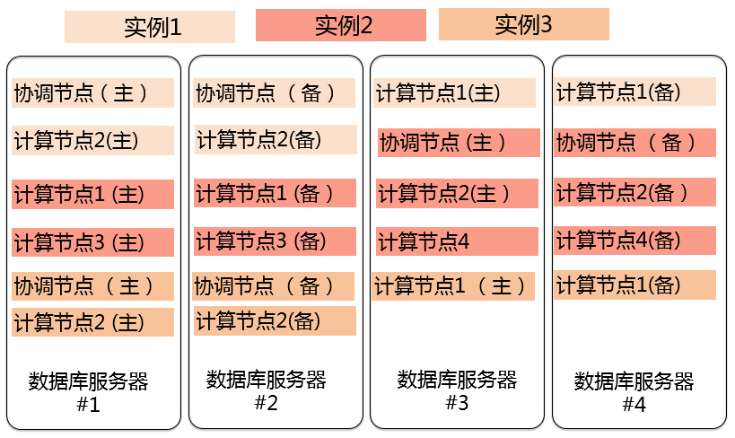

阿里云  
专有云  
云原生数据仓库 AnalyticDB  
AnalyticDB for PostgreSQL版  
运维指南  
产品版本：V3.18.6  
文档版本：20250616

**目录**

- [1.概述](#section-1)
- [2.产品架构](#section-2)
- [3.例行维护](#section-3)
    - [3.1. 定期检查是否存在数据倾斜](#section-3-1)
    - [3.2. 执行VACUUM和ANALYZE](#section-3-2)
- [4.安全维护](#section-4)
    - [4.1. 网络安全维护](#section-4-1)
    - [4.2. 账号密码维护](#section-4-2)

<a id="section-1"></a>

# 1.概述

**目的**

本手册对运维中可能出现的问题进行总结和整理，以便指导运维人员解决维护过程中遇到的问题。

如果根据本手册无法解决系统问题，请寻求阿里云工程师的技术支持。

**要求**

运维人员必须拥有IT行业技能，包括计算机网络知识、计算机操作知识、问题分析排查能力。

另外，运维人员必须经过阿里云系统岗前培训，学习必要的阿里云系统知识，包括但不限于系统原理、组网、特性使用和维护工具的使用。

特别注意的是，在维护操作过程中，运维人员务必遵守操作规章，确保人身安全和系统安全。对于用户数据，严格保密，未经用户书面许可，禁止复制、传播用户数据。

**注意事项**

为了系统运行的稳定，避免意外事故的发生，维护人员需遵循以下事项。

- 分层分权管理

  对网络、设备、系统、数据实行分层分权管理，相应业务的维护人员仅拥有完成自身角色任务相对应的权限，防止越权操作而引起系统故障。

- 系统安全

  在对系统进行任何操作前，需清楚地了解操作的结果，避免危险操作影响系统运行。

  在操作过程中遇到的问题，需清楚记录以便问题排查和故障处理。

- 人身和数据安全

  - 操作电气设备时，必须根据设备要求做好安全措施。

  - 需使用安全的设备接入业务网络。

  - 未经授权，严禁对数据进行复制和传播。

**寻求帮助**

维护人员在系统维护过程中，需要相关帮助，可以联系阿里云技术支持获取帮助。

<a id="section-2"></a>

# 2.产品架构

云原生数据仓库AnalyticDB PostgreSQL版的系统架构如下：

图 1. 系统架构图



AnalyticDB PostgreSQL版由两大组件组成：Master节点和Segment节点。

Master节点是AnalyticDB PostgreSQL版数据库系统的应用接入点，它负责接收客户端的连接和SQL查询请求，并且将工作分配给Segment节点执行。系统同时在另一台物理机上部署Master的备节点，采用Replication方式同步主备节点以支持故障转移。备节点不能连接Segment节点，也不接受外部链接。

Segment节点是独立的AnalyticDB PostgreSQL版数据实例节点，每个Segment节点都会存储一部分的数据，并行地执行计算。每个Segment节点均采用Primary/Mirror主备架构，以支持故障转移。

<a id="section-3"></a>

# 3.例行维护

<a id="section-3-1"></a>

## 3.1. 定期检查是否存在数据倾斜

在日常的维护工作中，我们需要定期检查实例是否出现数据倾斜，防止个别计算组由于数据过多导致实例变成只读。

我们可以通过以下方法，快速定位出表倾斜的信息。如下步骤以一个具体的样例展开描述。

1. 针对单个表或库，可以通过查看空间占用的方式来确定是否有倾斜。

   <ol type="i">

   <li>

   判断某个库是否出现数据的倾斜：

   ```sql
   SELECT pg_size_pretty(pg_database_size('postgres')) FROM gp_dist_random('gp_id');
   ```

   通过上述语句，可以看出名为dbname的库在每个节点上占用的空间，当某个或个别几个节点的空间明显大于其他节点时，说明该库上有数据倾斜存在。

   </li>

   <li>

   判断某张表是否出现数据的倾斜：

   ```sql
   SELECT pg_size_pretty(pg_relation_size('tblname')) FROM gp_dist_random('gp_id');
   ```

   通过上述语句，可以看出名为tblname的表在各个节点上占用的空间，当某个或个别几个表的空间明显大于其他表时，说明该表上有数据倾斜存在，需要修改该表的分布键以调整数据分布。

   </li>

   </ol>

2. 利用系统视图判断数据倾斜。

   <ol type="i">

   <li>

   利用下面语句判断是否在存储上有倾斜，原理与查看空间占用类似：

   ```sql
   SELECT * FROM gp_toolkit.gp_skew_coefficients;
   ```

   该视图会基于表的行的数据量来检查，如果表数据量越大，检查时间就会越长。

   </li>

   <li>

   通过视图gp_toolkit.gp_skew_idle_fractions计算在表扫描过程中系统闲置资源的百分比，来判断数据倾斜的情况：

   ```sql
   SELECT * FROM gp_toolkit.gp_skew_idle_fractions;
   ```

   </li>

   </ol>

<a id="section-3-2"></a>

## 3.2. 执行VACUUM和ANALYZE

对热的表或者库定期执行 `VACUUM` 和 `ANALYZE` 语句，或在大量更新、写入后执行 `VACUUM` 和 `ANALYZE` 语句，避免大量数据变更（写入或更新）占用系统资源和存储空间。

<a id="section-4"></a>

# 4.安全维护

<a id="section-4-1"></a>

## 4.1. 网络安全维护

网络安全维护包括设备安全和网络安全。

**设备安全**

检查网络设备，启用设备的安全管理协议和配置。 检查网络设备软件版本，及时升级到更安全的版本。具体安全维护方法请参见各设备的产品文档。

**网络安全**

根据系统网络的现状，可以适当选配入侵检测系统（IDS）或入侵防御系统（IPS）对来自外部或者内部网络的数据流量进行检测，实时防御网络内的异常行为和攻击行为。

<a id="section-4-2"></a>

## 4.2. 账号密码维护

账号密码包括云原生数据仓库AnalyticDB PostgreSQL版实例上的超级用户密码和主机操作系统的账户密码。

为了保证账号安全，请定期修改系统和设备密码，并使用高复杂度的密码。
