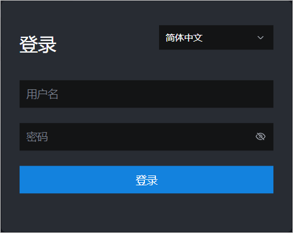

阿里云  
专有云  
云数据库 MongoDB 版  
运维指南  
产品版本：V3.18.6  
文档版本：20250529

**目录**

- [1.运维指南](#section-1)
    - [1.1. 产品架构](#section-1-1)
        - [1.1.1. 系统架构](#section-1-1-1)
            - [1.1.1.1. 备份系统](#section-1-1-1-1)
            - [1.1.1.2. 数据迁移系统](#section-1-1-1-2)
            - [1.1.1.3. 控制系统](#section-1-1-1-3)
            - [1.1.1.4. 监控系统](#section-1-1-1-4)
            - [1.1.1.5. 任务调度系统](#section-1-1-1-5)
    - [1.2. MongoDB运维简介](#section-1-2)
    - [1.3. 登录Apsara Uni-manager运维控制台](#section-1-3)
    - [1.4. 安全维护](#section-1-4)
        - [1.4.1. 网络安全维护](#section-1-4-1)
        - [1.4.2. 账号密码维护](#section-1-4-2)

# 1.运维指南

## 1.1. 产品架构

### 1.1.1. 系统架构

#### 1.1.1.1. 备份系统

**自动备份**

MongoDB提供多种类型的备份，支持物理备份和逻辑备份。

备份开始时间可由用户根据自己的业务低峰灵活配置，所有备份文件保留7天。

**临时备份**

用户在需要时可以临时性发起备份操作，备份文件保留7天。

**日志管理**

MongoDB会产生oplog记录，并提供下载功能，可用于本地增量备份。

**数据回溯**

利用备份文件和日志，MongoDB可生成一个7天内任意时刻的临时实例，用户可在校验数据无误后，再进行数据恢复操作。

创建临时实例操作不影响用户当前实例的正常运行。

同一时刻，每个MongoDB实例最多只可创建一个临时实例。临时实例有效期为48小时，每天最多可触发10次。

#### 1.1.1.2. 数据迁移系统

**实例间复制数据库**

MongoDB提供实例间数据库迁移功能，可非常简便的将数据库迁移至其他实例。

**数据迁入/迁出MongoDB**

MongoDB提供专业工具和向导式迁移服务来帮助用户将数据迁入/迁出MongoDB。

**备份文件下载**

MongoDB会将用户备份文件保留7天，在此期间用户可登录MongoDB管理控制台，将备份文件下载至本地。

#### 1.1.1.3. 控制系统

当实例主机或者实例出现异常crash后，MongoDB高可用组件检查到异常后会在30秒内进行切换，保证应用的正常运行，保障MongoDB高可用。

#### 1.1.1.4. 监控系统

**性能监控**

MongoDB提供近20种系统性能监控项，包括磁盘容量、IOPS、连接数、CPU利用率、网络流量、TPS、QPS、缓存命中率等等，用户可获取最长1年内实例的运行状态信息。

**SQL审计**

系统会记录发往MongoDB实例的SQL语句及其他附加信息，包括连接IP、访问数据库名称、访问账号、执行时间、返回记录数等。您可依此查找问题和对实例的安全性进行排查。

**阈值报警**

当实例出现状态或性能异常时，MongoDB提供短信报警功能。

异常包括：实例锁定、磁盘容量、IOPS、连接数、CPU。用户可以自由配置报警阈值和报警联系人（最多50个，同时生效5个），当实例超出设定阈值时，报警联系人将收到系统短信提醒。

**Web操作日志**

系统对MongoDB管理控制台中所有修改类操作进行日志记录，供管理员查看，最长可保留30天。

#### 1.1.1.5. 任务调度系统

用户可通过MongoDB控制台或者通过MongoDB API进行实例创建、删除、内外切换，后端以任务的形式进行调度，可对实例所有操作进行跟踪跟展示。

## 1.2. MongoDB运维简介

本文简单介绍云数据库MongoDB运维系统。

Apsara Uni-manager运营控制台是MongoDB的后台运维系统，主要包含了以下功能：

- 实例管理：用于查看实例详情、实例日志以及用户信息等。

- 主机管理：用于查看以及管理主机。

## 1.3. 登录Apsara Uni-manager运维控制台

本文介绍运维工程师等相关用户如何登录到Apsara Uni-manager运维控制台。

**前提条件**

- 已从部署人员或管理员处获取Apsara Uni-manager运维控制台的访问地址、用户名和密码。

  Apsara Uni-manager运维控制台访问地址格式为*region-id*.ops.console.*intranet-domain-id*。

- 推荐使用Chrome浏览器。

**操作步骤**

1. 打开浏览器。

2. 在地址栏中，输入Apsara Uni-manager运维控制台的访问地址，按回车键。

   

   > 您可以单击右上角的下拉列表切换语言。
   >
   > **说明**

3. 输入正确的用户名及密码。

   > 登录Apsara Uni-manager运维控制台的用户名和密码请从部署人员或管理员处获取。
   >
   > **说明**

   首次登录Apsara Uni-manager运维控制台时，需要修改登录用户名的密码，请按照提示完成密码修改。

   为提高安全性，密码必须满足以下要求：

   - 必须包含英文大小写字母。

   - 必须包含阿拉伯数字（0~9）。

   - 必须包含特殊符号，包括感叹号（!）、at（@）、井号（#）、美元符号（$）、百分号（%）等。

   - 密码长度为10~20个字符。

4. 单击**登录**。

## 1.4. 安全维护

### 1.4.1. 网络安全维护

网络安全维护包括设备安全和网络安全。

**设备安全**

检查网络设备，启用设备的安全管理协议和配置。

检查网络设备软件版本，及时升级到更安全的版本。

具体安全维护方法请参见各设备的产品文档。

**网络安全**

根据系统网络的现状，可以适当选配入侵检测系统（IDS）或入侵防御系统（IPS）对来自外部或者内部网络的数据流量进行检测，实时防御网络内的异常行为和攻击行为。

### 1.4.2. 账号密码维护

账号密码包括MongoDB系统密码和设备密码。

为了保证账号安全，请定期修改系统和设备密码，并使用高复杂度的密码。
