阿里云  
专有云  
云数据库RDS  
用户指南（RDS PostgreSQL）  
产品版本：V3.18.3  
文档版本：20250320

**目录**

- [1.什么是关系型数据库RDS](#section-1)
- [2.PostgreSQL使用须知](#section-2)
- [3.【通知】企业版318停止售卖RDS PostgreSQL 9.4版本和RDS PostgreSQL 10版本](#section-3)
- [4.实例规格](#section-4)
- [5.登录云数据库RDS控制台](#section-5)
- [6.快速入门](#section-6)
    - [6.1. 使用流程](#section-6-1)
    - [6.2. 创建实例](#section-6-2)
    - [6.3. 设置IP白名单](#section-6-3)
    - [6.4. 创建数据库和账号](#section-6-4)
    - [6.5. 连接PostegreSQL实例](#section-6-5)
- [7.实例管理](#section-7)
    - [7.1. 创建实例](#section-7-1)
    - [7.2. 查看实例基本信息](#section-7-2)
    - [7.3. 重启实例](#section-7-3)
    - [7.4. 变更配置](#section-7-4)
    - [7.5. 设置可维护时间段](#section-7-5)
    - [7.6. 主备库切换](#section-7-6)
    - [7.7. 释放实例](#section-7-7)
    - [7.8. 设置实例参数](#section-7-8)
    - [7.9. 只读实例](#section-7-9)
        - [7.9.1. PostgreSQL只读实例简介](#section-7-9-1)
        - [7.9.2. 创建PostgreSQL只读实例](#section-7-9-2)
        - [7.9.3. 查看PostgreSQL只读实例](#section-7-9-3)
        - [7.9.4. PostgreSQL只读实例管理](#section-7-9-4)
    - [7.10. 标签](#section-7-10)
- [8.数据库连接](#section-8)
    - [8.1. 连接PostegreSQL实例](#section-8-1)
    - [8.2. 通过DMS登录RDS数据库](#section-8-2)
    - [8.3. 查看和修改内网地址和端口](#section-8-3)
- [9.账号](#section-9)
    - [9.1. 创建账号](#section-9-1)
    - [9.2. 重置密码](#section-9-2)
    - [9.3. 锁定/删除账号](#section-9-3)
    - [9.4. 删除账号](#section-9-4)
- [10.数据库](#section-10)
    - [10.1. 创建数据库](#section-10-1)
    - [10.2. 删除数据库](#section-10-2)
- [11.网络、VPC和交换机](#section-11)
    - [11.1. 切换虚拟交换机](#section-11-1)
    - [11.2. 切换网络类型](#section-11-2)
    - [11.3. 临时混访方案（同时保留经典网络和专有网络地址）](#section-11-3)
- [12.监控](#section-12)
    - [12.1. 查看监控资源](#section-12-1)
- [13.数据安全性](#section-13)
    - [13.1. 切换为高安全白名单模式](#section-13-1)
    - [13.2. 设置IP白名单](#section-13-2)
    - [13.3. 设置SSL链路加密](#section-13-3)
    - [13.4. 设置数据加密](#section-13-4)
    - [13.5. 设置透明数据加密TDE](#section-13-5)
- [14.日志与审计](#section-14)
    - [14.1. SQL审计（数据库审计）](#section-14-1)
    - [14.2. 日志管理](#section-14-2)
- [15.备份](#section-15)
    - [15.1. 备份PostgreSQL数据](#section-15-1)
    - [15.2. 下载数据备份和日志备份](#section-15-2)
    - [15.3. 逻辑备份PostgreSQL数据](#section-15-3)
    - [15.4. 实例级别全量备份（pg_basebackup）](#section-15-4)
- [16.恢复](#section-16)
    - [16.1. 恢复PostgreSQL数据](#section-16-1)
    - [16.2. 使用逻辑备份文件恢复数据](#section-16-2)
- [17.CloudDBA](#section-17)
    - [17.1. CloudDBA简介](#section-17-1)
    - [17.2. 一键诊断](#section-17-2)
    - [17.3. 会话管理](#section-17-3)
    - [17.4. 实时性能](#section-17-4)
    - [17.5. 空间分析](#section-17-5)
    - [17.6. 性能趋势](#section-17-6)
    - [17.7. 慢SQL](#section-17-7)
- [18.插件](#section-18)
    - [18.1. 支持插件列表](#section-18-1)
    - [18.2. 使用mysql_fdw插件读写MySQL数据](#section-18-2)
    - [18.3. 使用oss_fdw读写外部数据文本文件](#section-18-3)
- [19.基于pgpool实现读写分离](#section-19)
- [20.中间件ShardingSphere开发指南](#section-20)

<a id="section-1"></a>

# 1.什么是关系型数据库RDS

阿里云关系型数据库RDS（Relational Database Service）是一种稳定可靠、可弹性伸缩的在线数据库服务。基于阿里云分布式文件系统和高性能存储，提供了容灾、备份、恢复、监控、迁移等方面的全套解决方案，彻底解决数据库运维的烦恼。

阿里云关系型数据库RDS包含MySQL、SQL Server、PolarDB、PostgreSQL四种数据库引擎，可以方便快捷地创建出适合自己应用场景的数据库实例。本文档主要介绍PostgreSQL引擎。

**RDS PostgreSQL**

RDS PostgreSQL是先进的开源数据库，它的优点主要集中在对SQL规范的完整实现以及丰富多样的数据类型支持，包括JSON数据、IP数据和几何数据等。支持ANSISQL-2003以上标准，PL/pgSQL、PL/Java等过程语言，支持 JDBC/ODBC标准接口。除了完美支持事务、子查询、多版本控制（MVCC）、数据完整性检查等特性外，RDS PostgreSQL还集成了高可用和备份恢复等重要功能，减轻您的运维压力。

<a id="section-2"></a>

# 2.PostgreSQL使用须知

为保障实例的稳定及安全，云数据库PostgreSQL有部分使用上的约束。

的使用限制详情如下表所示。

| 操作 | 使用约束 |
| --- | --- |
| 数据库的root权限 | PostgreSQL无法向用户提供superuser权限。 |
| 搭建数据库复制 | 提供主备复制架构（基础版除外），其中的备（slave）实例不对用户开放，用户应用不能直接访问。 |
| 重启RDS实例 | 必须通过控制台或OpenAPI操作重启实例。 |

<a id="section-3"></a>

# 3.【通知】企业版318停止售卖RDS PostgreSQL 9.4版本和RDS PostgreSQL 10版本

专有云自318版本起，RDS将停止售卖RDS PostgreSQL 9.4版本和RDS PostgreSQL 10版本实例，仅提供产品服务技术支持。

**停止售卖版本**

企业版3.18

**停止售卖产品**

- 云数据库RDS PostgreSQL 9.4版本实例

- 云数据库RDS PostgreSQL 10版本实例

**原因**

PostgreSQL开源社区已停止维护PostgreSQL 9.4版本和PostgreSQL 10版本，继续使用将存在风险。

**影响**

- 您将不能新购RDS PostgreSQL 9.4版本和RDS PostgreSQL 10版本实例。

- 已购买的RDS PostgreSQL 9.4版本实例和RDS PostgreSQL 10版本实例可以使用其他功能，但阿里云不负责后续的内核更新维护以及RDS新功能的支持，仅提供产品服务技术支持。

**建议**

如果您需要新购RDS PostgreSQL实例，请选择RDS PostgreSQL 11或更高版本。

<a id="section-4"></a>

# 4.实例规格

实例有不同的系列、版本、规格，性能也有区别，本文介绍RDS PostgreSQL的实例规格。

**关于云盘IOPS**

对于本地SSD盘，根据实例规格有固定的IOPS限制，详情请参见本文规格表；对于云盘，除了实例规格外，存储空间大小对IOPS也会有影响。云盘IOPS的详细计算公式如下（存储空间单位为GB）：

```text
min{1800+30*存储空间, 25000}
```

> **说明**
>
> 吞吐量如果达到上限，也会影响IOPS。

**主实例**

**本地盘**

<table>
  <tr>
    <th>规格族</th>
    <th>规格代码</th>
    <th>CPU和内存</th>
    <th>最大IOPS</th>
    <th>最大连接数</th>
    <th>磁盘空间</th>
  </tr>
  <tr>
    <td rowspan="4">独享型（高内存）</td>
    <td>pg.x8.mediu m.2</td>
    <td>2核 16GB</td>
    <td>4500</td>
    <td>2500</td>
    <td rowspan="9">20GB-6000GB</td>
  </tr>
  <tr>
    <td>pg.x8.large.2</td>
    <td>4核 32GB</td>
    <td>9000</td>
    <td>5000</td>
  </tr>
  <tr>
    <td>pg.x8.xlarge.2</td>
    <td>8核 64GB</td>
    <td>18000</td>
    <td>10000</td>
  </tr>
  <tr>
    <td>pg.x8.2xlarge.2</td>
    <td>16核 128GB</td>
    <td>36000</td>
    <td>12000</td>
  </tr>
  <tr>
    <td rowspan="4">独享型（高CPU）</td>
    <td>pg.x4.large.2</td>
    <td>4核 16GB</td>
    <td>4500</td>
    <td>2500</td>
  </tr>
  <tr>
    <td>pg.x4.xlarge.2</td>
    <td>8核 32GB</td>
    <td>9000</td>
    <td>5000</td>
  </tr>
  <tr>
    <td>pg.x4.2xlarge.2</td>
    <td>16核 64GB</td>
    <td>18000</td>
    <td>10000</td>
  </tr>
  <tr>
    <td>pg.x4.4xlarge.2</td>
    <td>32核 128GB</td>
    <td>36000</td>
    <td>12000</td>
  </tr>
  <tr>
    <td>独占物理机型</td>
    <td>rds.pg.st.h43</td>
    <td>60核 470GB</td>
    <td>50000</td>
    <td>4000</td>
  </tr>
</table>

**云盘**

<table>
  <tr>
    <th>规格族</th>
    <th>规格代码</th>
    <th>CPU和内存</th>
    <th>最大IOPS</th>
    <th>最大连接数</th>
    <th>存储空间</th>
  </tr>
  <tr>
    <td rowspan="2">通用型</td>
    <td>pg.n2.small.2 c</td>
    <td>1核 2GB</td>
    <td>50000</td>
    <td>200</td>
    <td rowspan="14"></td>
  </tr>
  <tr>
    <td>pg.n2.mediu m.2c</td>
    <td>2核 4GB</td>
    <td>50000</td>
    <td>400</td>
  </tr>
  <tr>
    <td rowspan="12"></td>
    <td>pg.x4.mediu m.2c</td>
    <td>2核 8GB</td>
    <td>50000</td>
    <td>800</td>
  </tr>
  <tr>
    <td>pg.x8.mediu m.2c</td>
    <td>2核 16GB</td>
    <td>50000</td>
    <td>1600</td>
  </tr>
  <tr>
    <td>pg.x2.large.2 c</td>
    <td>4核 8GB</td>
    <td>50000</td>
    <td>800</td>
  </tr>
  <tr>
    <td>pg.x4.large.2 c</td>
    <td>4核 16GB</td>
    <td>50000</td>
    <td>1600</td>
  </tr>
  <tr>
    <td>pg.x8.large.2 c</td>
    <td>4核 32GB</td>
    <td>50000</td>
    <td>3200</td>
  </tr>
  <tr>
    <td>pg.x2.xlarge.2c</td>
    <td>8核 16GB</td>
    <td>50000</td>
    <td>1600</td>
  </tr>
  <tr>
    <td>pg.x4.xlarge.2c</td>
    <td>8核 32GB</td>
    <td>50000</td>
    <td>3200</td>
  </tr>
  <tr>
    <td>pg.x8.xlarge.2c</td>
    <td>8核 64GB</td>
    <td>50000</td>
    <td>6400</td>
  </tr>
  <tr>
    <td>pg.x2.3large.2c</td>
    <td>12核 24GB</td>
    <td>50000</td>
    <td>2400</td>
  </tr>
  <tr>
    <td>pg.x4.3large.2c</td>
    <td>12核 48GB</td>
    <td>50000</td>
    <td>4800</td>
  </tr>
  <tr>
    <td>pg.x8.3large.2c</td>
    <td>12核 96GB</td>
    <td>50000</td>
    <td>9600</td>
  </tr>
  <tr>
    <td colspan="4"></td>
  </tr>
  <tr>
    <td rowspan="17">独享型</td>
    <td colspan="4"></td>
    <td rowspan="17">20~6000GB</td>
  </tr>
  <tr>
    <td>pg.x2.2xlarge.2c</td>
    <td>16核 32GB</td>
    <td>50000</td>
    <td>3200</td>
  </tr>
  <tr>
    <td>pg.x4.2xlarge.2c</td>
    <td>16核 64GB</td>
    <td>50000</td>
    <td>6400</td>
  </tr>
  <tr>
    <td>pg.x8.2xlarge.2c</td>
    <td>16核 128GB</td>
    <td>50000</td>
    <td>12800</td>
  </tr>
  <tr>
    <td>pg.x2.3xlarge 2c</td>
    <td>24核 48GB</td>
    <td>50000</td>
    <td>4800</td>
  </tr>
  <tr>
    <td>pg.x4.3xlarge.2c</td>
    <td>24核 96GB</td>
    <td>50000</td>
    <td>19200</td>
  </tr>
  <tr>
    <td>pg.x8.3xlarge.2c</td>
    <td>24核 196GB</td>
    <td>50000</td>
    <td>19200</td>
  </tr>
  <tr>
    <td>pg.x2.4xlarge.2c</td>
    <td>32核 64GB</td>
    <td>50000</td>
    <td>6400</td>
  </tr>
  <tr>
    <td>pg.x4.4xlarge.2c</td>
    <td>32核 128GB</td>
    <td>50000</td>
    <td>12800</td>
  </tr>
  <tr>
    <td>pg.x8.4xlarge.2c</td>
    <td>32核 256GB</td>
    <td>50000</td>
    <td>25600</td>
  </tr>
  <tr>
    <td>pg.x2.13large.2c</td>
    <td>52核 96GB</td>
    <td>50000</td>
    <td>10400</td>
  </tr>
  <tr>
    <td>pg.x4.13large.2c</td>
    <td>52核 192GB</td>
    <td>50000</td>
    <td>19200</td>
  </tr>
  <tr>
    <td>pg.x8.13large.2c</td>
    <td>52核 384GB</td>
    <td>50000</td>
    <td>38400</td>
  </tr>
  <tr>
    <td>pg.x2.8xlarge.2c</td>
    <td>64核 128GB</td>
    <td>50000</td>
    <td>12800</td>
  </tr>
  <tr>
    <td>pg.x4.8xlarge.2c</td>
    <td>64核 256GB</td>
    <td>50000</td>
    <td>25600</td>
  </tr>
  <tr>
    <td>pg.x8.8xlarge.2c</td>
    <td>64核 512GB</td>
    <td>50000</td>
    <td>51200</td>
  </tr>
  <tr>
    <td colspan="4"></td>
  </tr>
  <tr>
    <td rowspan="4"></td>
    <td colspan="4"></td>
    <td rowspan="4"></td>
  </tr>
  <tr>
    <td>pg.x2.13xlarg e.2c</td>
    <td>104核 192GB</td>
    <td>50000</td>
    <td>19200</td>
  </tr>
  <tr>
    <td>pg.x4.13xlarg e.2c</td>
    <td>104核 384GB</td>
    <td>50000</td>
    <td>38400</td>
  </tr>
  <tr>
    <td>pg.x8.13xlarg e.2c</td>
    <td>104核 768GB</td>
    <td>50000</td>
    <td>76800</td>
  </tr>
</table>

**只读实例**

| 规格代码 | CPU和内存 | 最大连接数 |
| --- | --- | --- |
| pgro.n2.small.1c | 1核 2GB | 200 |
| pgro.n2.medium.1c | 2核 4GB | 400 |
| pgro.x4.medium.1c | 2核 8GB | 800 |
| pgro.x8.medium.1c | 2核 16GB | 1600 |
| pgro.x2.large.1c | 4核 8GB | 800 |
| pgro.x4.large.1c | 4核 16GB | 1600 |
| pgro.x8.large.1c | 4核 32GB | 3200 |
| pgro.x2.xlarge.1c | 8核 16GB | 1600 |
| pgro.x4.xlarge.1c | 8核 32GB | 3200 |
| pgro.x8.xlarge.1c | 8核 64GB | 6400 |
| pgro.x2.3.large.1c | 12核 24GB | 2400 |
| pgro.x4.3.large.1c | 12核 48GB | 4800 |
| pgro.x8.3.large.1c | 12核 96GB | 9600 |
| pgro.x2.2.xlarge.1c | 16核 32GB | 3200 |
| pgro.x4.2.xlarge.1c | 16核 64GB | 6400 |
| pgro.x8.2.xlarge.1c | 16核 128GB | 12800 |
| pgro.x2.3.xlarge.1c | 24核 48GB | 4800 |
| pgro.x4.3.xlarge.1c | 24核 96GB | 9600 |
| pgro.x8.3.xlarge.1c | 24核 192GB | 19200 |
| pgro.x2.4.xlarge.1c | 32核 64GB | 6400 |
| pgro.x4.4.xlarge.1c | 32核 128GB | 12800 |
| pgro.x8.4.xlarge.1c | 32核 256GB | 25600 |
| pgro.x2.13.large.1c | 52核 104GB | 10400 |
| pgro.x4.13.large.1c | 52核 192GB | 19200 |
| pgro.x8.13.large.1c | 52核 384GB | 38400 |
| pgro.x2.8.xlarge.1c | 64核 128GB | 12800 |
| pgro.x4.8.xlarge.1c | 64核 256GB | 25600 |
| pgro.x8.8.xlarge.1c | 64核 512GB | 51200 |
| pgro.x2.13.xlarge.1c | 104核 192GB | 19200 |
| pgro.x4.13.xlarge.1c | 104核 384GB | 38400 |
| pgro.x8.13.xlarge.1c | 104核 768GB | 76800 |

<a id="section-5"></a>

# 5.登录云数据库RDS控制台

本节主要向您介绍如何登录云数据库RDS控制台。

**前提条件**

- 登录Apsara Uni-manager运营控制台前，确认您已从部署人员处获取Apsara Uni-manager运营控制台的服务域名地址。

- 推荐使用Chrome浏览器。

**操作步骤**

1. 在浏览器地址栏中，输入Apsara Uni-manager运营控制台的服务域名地址，按回车键。

2. 输入正确的用户名及密码。

   请向运营管理员获取登录控制台的用户名和密码。

   > 首次登录Apsara Uni-manager运营控制台时，需要修改登录用户名的密码，请按照提
   >
   > **说明**
   >
   > 示完成密码修改。为提高安全性，密码长度必须为10~32位，且至少包含以下两种类型：
   >
   > - 英文大写或小写字母（A~Z、a~z）
   >
   > - 阿拉伯数字（0~9）
   >
   > - 特殊符号（感叹号（!）、at（@）、井号（#）、美元符号（$）、百分号（%）等）

3. 单击**账号登录**。

4. 如果账号已激活MFA多因素认证，请根据以下两种情况进行操作：

   - 管理员强制开启MFA后的首次登录：

     <ol type="a">

     <li>

     在绑定虚拟MFA设备页面中，按页面提示步骤绑定MFA设备。

     </li>

     <li>

     按照步骤2重新输入账号和密码，单击**账号登录**。

     </li>

     </ol>

     <ol type="i" start="100">

     <li>

     输入6位MFA码后单击**认证**。

     </li>

     </ol>

   - 您已开启并绑定MFA：

     输入6位MFA码后单击**认证**。

     > 绑定并开启MFA的操作请参见<strong>《Apsara Uni-manager运营控制台用户指南》</strong>中的
     >
     > **说明**
     >
     > 章节<strong>《绑定并开启虚拟MFA设备》</strong>。

5. 在页面顶部的导航栏中，单击**产品 > 数据库 > 云数据库 RDS**。

<a id="section-6"></a>

# 6.快速入门

<a id="section-6-1"></a>

## 6.1. 使用流程

快速使用RDS的基本过程包括创建RDS实例、设置白名单、创建数据库、创建帐号、连接实例，旨在引导您一站式完成RDS的搭建。

**快速入门流程图**

若您初次使用阿里云RDS，请先了解PostgreSQL使用须知。

通常，从新建实例到可以开始使用实例，您需要完成如下操作。

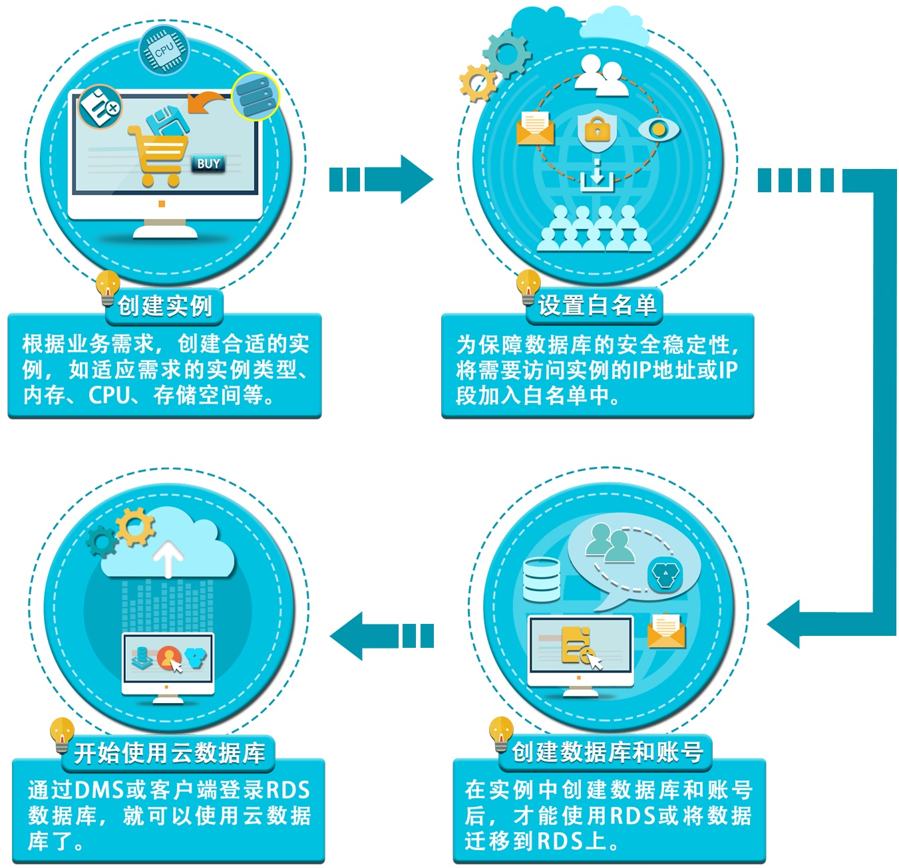

<a id="section-6-2"></a>

## 6.2. 创建实例

本文介绍如何通过控制台创建RDS PostgreSQL实例。

**操作步骤**

1. 登录云数据库RDS控制台。

2. 在**实例列表**页面中，单击**创建实例**。

3. 根据下表设置参数。

   **类别**

   **配置**

   **说明**

   实例所属组织。

   **组织**

   **基本配置**

   实例所属资源集。

   **资源集**

   实例所属地域。不同地域之间的产品内网不互通，创建实例后不支持更换地域。

   **地域**

   **主节点可用**

   实例主节点所属的可用区。

   **区域**

   **区**

   RDS支持**多可用区部署**和**单可用区部署**。系统根据所选的**主节点可用区**自动选择

   **部署方案**

   部署方案。

   **数据库类型**

   数据库的类型，选择**PostgreSQL**。

   数据库的版本，支持如下版本：

   - 11.0

   **数据库版本**

   - 12.0

   - 13.0

   数据库的系列，RDS PostgreSQL固定配置为**双机高可用**。

   **系列**

   数据库的存储类型，支持本地SSD盘和SSD云盘。

   不同数据库版本支持的存储类型存在差异，具体如下：

   **存储类型**

   - 11.0：支持本地SSD盘和SSD云盘

   **规格配置**

   - 12.0：支持本地SSD盘和SSD云盘

   - 13.0：支持本地SSD盘和SSD云盘

   是否为当前SSD云盘加密，仅在**存储类型**参数中选择了**SSD云盘**后可选。如果开启，需要为实例选择**加密Key**。如果您还没有**加密Key**，需要在密钥管理服务中

   **是否加密**

   创建一个。详情请参见<strong>《密钥管理服务》</strong>的**用户指南 > 创建密钥**章节。

   为当前SSD云盘选择**加密Key**。此参数仅在开启**是否加密**参数时可用。

   **加密Key**

   实例的规格，不同的内存大小对应不同的最大连接数和IOPS，具体请以控制台界

   **实例规格**

   面为准。详情请参见实例规格。

   存储空间包括数据空间、系统文件空间、Binlog文件空间和事务文件空间。可选

   **存储空间**

   范围为20 GB~6000 GB。以5 GB递增。

   RDS提供如下两种类型的连接地址：

   - **公网连接**：通过该连接地址可以从外网访问数据库。

   - **内网连接**：通过该连接地址可以从内网访问数据库。

   **网络连接类型**

   > **说明**
   >
   > 实例创建完成后无法修改，请谨慎选择。

   RDS实例支持的网络类型：

   - **经典网络**：经典网络中的云服务在网络上不进行隔离，只能依靠云服务自身的安全组或白名单策略来阻挡非法访问。

   - **专有网络**：专有网络VPC（Virtual Private Cloud）帮助用户在阿里云上构建出一个隔离的网络环境。用户可以自定义专有网络里面的路由表、IP地址范围和网关。建议您选择专有网络，更加安全。

   **网络类型**

   > **说明**

   **网络**

   > - 如果您配置了多可用区部署，则必须为所用VPC的主节点可用区和备节点可用区创建VSwitch交换机。
   >
   > - 选择专有网络后，需要选择对应的**专有网络VPC**和**交换机VSwitch**。

   **VPC**

   **交换机可用**

   仅当**网络类型**选择为**专有网络**时，需要再选择对应的VPC和交换机。

   **区**

   **VSwitch**

   添加IP地址，允许这些IP地址访问该RDS实例。

   **IP白名单**

   RDS支持批量创建实例。此处可以指定需要创建的RDS实例个数，默认为1个。

   **创建数量**

   RDS实例的名称。

   - 长度为2~64个字符。

   **实例设置**

   - 以英文字母或中文开头。

   **实例名称**

   - 支持数字和如下特殊字符：

     _-:

   - 不能以http:// 或https://开头。

4. 单击**提交**。

<a id="section-6-3"></a>

## 6.3. 设置IP白名单

创建RDS实例后，您需要设置RDS实例的白名单，以允许外部设备访问该RDS实例。

**背景信息**

白名单可以让RDS实例得到高级别的访问安全保护，建议您定期维护白名单。设置白名单不会影响RDS实例的正常运行。

设置白名单包括两种操作：

- 设置IP白名单：添加IP地址，允许这些IP地址访问该RDS实例。

  > 默认的白名单只包含默认IP地址0.0.0.0/0，表示任何设备均可访问该RDS实例。
  >
  > **说明**

- 设置ECS安全组：添加ECS安全组，允许ECS安全组内的ECS实例访问该RDS实例。

**操作步骤**

1. 登录云数据库RDS控制台。

2. 在**实例列表**页面，定位到目标实例。

3. 单击目标实例ID或者单击实例右侧的**管理**，打开**基本信息**页面。

4. 单击左侧导航栏的**数据安全性**。

5. 在**白名单设置**页签中，单击**default**分组右侧的**修改**。

   > 您也可以单击页面右侧的**添加白名单分组**新建自定义分组。
   >
   > **说明**

6. 在**修改白名单分组**对话框中，填写需要访问该实例的IP地址或IP段，单击**确定**。详细规则如下：

   - 若填写IP段，如10.10.10.0/24，则表示10.10.10.X的IP地址都可以访问该RDS实例。

   - 若您需要添加多个IP地址或IP段，请用英文逗号（,）隔开，逗号前后不能有空格，例如192.168.0.1,172.16.213.9。

   - 单击**加载ECS内网IP**后，将显示您当前阿里云账号下所有ECS实例的IP地址，可快速添加ECS内网IP地址到白名单中。

<a id="section-6-4"></a>

## 6.4. 创建数据库和账号

若要使用云数据库RDS，您需要在实例中创建数据库和账号。本文介绍如何为RDS PostgreSQL实例创建数据库和账号。

**账号类型**

RDS PostgreSQL实例支持两种数据库账号：高权限账号和普通账号。详细说明如下。

<table>
  <tr>
    <th width="105">账号类型</th>
    <th>说明</th>
  </tr>
  <tr>
    <td>高权限账号</td>
    <td>• 只能通过控制台或API创建和管理。<br>• 可以创建多个高权限账号，管理所有普通账号和数据库。<br>• 开放了更多权限，可满足个性化和精细化的权限管理需求，例如可按用户分配不同表的查询权限。<br>• 可以断开任意账号的连接。</td>
  </tr>
  <tr>
    <td>普通账号</td>
    <td>• 可以通过控制台、API或者SQL语句创建和管理。<br>• 一个实例可以创建多个普通账号 。<br>• 需要手动给普通账号授予特定数据库的权限。<br>• 普通账号不能创建和管理其他账号，也不能断开其他账号的连接。</td>
  </tr>
</table>

**注意事项**

- 支持在控制台创建多个高权限账号和普通账号，也可以通过SQL命令创建、管理普通账号。

  > 本地SSD盘实例的高权限账号创建后无法删除。
  >
  > **说明**

- 如果您要迁移本地数据库到RDS，请在RDS实例中创建与本地数据库一致的迁移账号和数据库。

- 分配数据库账号权限时，请按最小权限原则和业务角色创建账号，并合理分配只读和读写权限。必要时可以把数据库账号和数据库拆分成更小粒度，使每个数据库账号只能访问其业务之内的数据。如果不需要数据库写入操作，请分配只读权限。

- 为保障数据库的安全，请将数据库账号的密码设置为强密码，并定期更换。

**创建高权限账号或普通账号**

1. 登录云数据库RDS控制台。

2. 在**实例列表**页面，定位到目标实例。

3. 单击目标实例ID或者单击实例右侧的**管理**，打开**基本信息**页面。

4. 在左侧导航栏中，单击**账号管理**。

5. 单击**创建账号**并设置如下参数。

   <table>
     <tr>
       <th width="105">参数</th>
       <th>说明</th>
     </tr>
     <tr>
       <td>数据库账号</td>
       <td>• 长度为2~16个字符。<br>• 由小写字母、数字或下划线组成。<br>• 以字母开头，以字母或数字结尾。<br>• 不能和已有的账号名重复。<br>• 不能以pg开头。<br>• 不能使用SQL关键字。具体请参见SQL关键字。</td>
     </tr>
     <tr>
       <td>账号类型</td>
       <td>RDS PostgreSQL实例支持两种数据库账号：<strong>高权限账号</strong>和<strong>普通账号</strong>。<br>• 高权限账号拥有所有数据库的所有操作权限。<br>• 普通账号拥有已授权数据库（owner）的所有操作权限。<br>说明操作权限包括SELECT、INSERT、UPDATE、DELETE、TRUNCATE、REFERENCES、TRIGGER。</td>
     </tr>
     <tr>
       <td>密码</td>
       <td>• 长度为8~32个字符。<br>• 由大写字母、小写字母、数字、特殊字符中的任意三种组成。<br>• 特殊字符包括： <code> !@#$%^&amp;*()_+-= </code></td>
     </tr>
     <tr>
       <td>确认密码</td>
       <td>再次输入相同的密码。</td>
     </tr>
     <tr>
       <td>备注说明</td>
       <td>该参数仅在<strong>SSD云盘</strong>实例创建账号时出现，非必填。您可以在此处输入该实例相关说明，以减少后期沟通成本。最大支持输入256个字符。</td>
     </tr>
   </table>

6. 单击**创建**。

**创建数据库和普通账号**

1. 登录云数据库RDS控制台。

2. 在**实例列表**页面，定位到目标实例。

3. 单击目标实例ID或者单击实例右侧的**管理**，打开**基本信息**页面。

4. 单击页面右上角的**登录数据库**。

5. 在自动跳转的**数据管理DMS**控制台的**登录实例**面板中，检查**数据库类型**、**实例地区**、**连接串地址**是否正确。若信息正确，填写**数据库账号**和**数据库密码**，如下图所示。

   

   | 参数 | 说明 |
   | --- | --- |
   | 数据库类型 | 目标数据库的类型，系统默认为当前需要连接的数据库类型。 |
   | 实例地区 | 目标实例所在的地域，系统默认为当前实例所在地域。 |
   | 连接串地址 | 目标实例的连接串地址，系统默认为当前实例的连接串地址。 |
   | 数据库账号 | 目标数据库的账号。 |
   | 数据库密码 | 目标数据库账号对应的密码。 |

6. 单击**登录**。若您希望浏览器记住该账号的密码，可以先勾选**记住密码**，再单击**登录**。

   > 若出现无法建立连接提示，则可能是白名单设置出现问题，需要在控制台重新设置白名
   >
   > **说明**
   >
   > 单。详情请参见设置IP白名单。

7. 成功登录RDS实例后，会直接跳转到**SQLConsole**页面，输入如下格式的命令，创建数据库。

   ```sql
   CREATE DATABASE name
    [ [ WITH ] [ OWNER [=] user_name ]
           [ TEMPLATE [=] template ]
           [ ENCODING [=] encoding ]
           [ LC_COLLATE [=] lc_collate ]
           [ LC_CTYPE [=] lc_ctype ]
           [ TABLESPACE [=] tablespace_name ]
           [ CONNECTION LIMIT [=] connlimit ] ]
   ```

   例如，若您要创建一个名称为test的数据库，可以执行如下命令：

   ```sql
   create database test;
   ```

8. 单击**执行(F8)**，完成创建数据库。

9. 在SQL窗口中输入如下格式的命令，创建普通账号。

   ```text
   CREATE USER name [ [ WITH ] option [ ... ] ]
   where option can be:
      SUPERUSER | NOSUPERUSER
    | CREATEDB | NOCREATEDB
    | CREATEROLE | NOCREATEROLE
    | CREATEUSER | NOCREATEUSER
    | INHERIT | NOINHERIT
    | LOGIN | NOLOGIN
    | REPLICATION | NOREPLICATION
    | CONNECTION LIMIT connlimit
    | [ ENCRYPTED | UNENCRYPTED ] PASSWORD 'password'
    | VALID UNTIL 'timestamp'
    | IN ROLE role_name [, ...]
    | IN GROUP role_name [, ...]
    | ROLE role_name [, ...]
    | ADMIN role_name [, ...]
    | USER role_name [, ...]
    | SYSID uid
   ```

   例如，若您要创建一个名称为test2、密码为123456的用户，可以执行如下命令：

   ```text
   create user test2 password '123456';
   ```

0. 单击**执行(F8)**，完成创建普通账号。

<a id="section-6-5"></a>

## 6.5. 连接PostegreSQL实例

本文介绍如何通过阿里云数据管理服务（DMS）或pgAdmin4客户端连接RDS实例。

**背景信息**

您可以通过RDS管理控制台先登录DMS，然后再连接需要访问的RDS实例。

数据管理服务（Data Management，简称DMS）是一种集数据管理、结构管理、访问安全、BI图表、数据趋势、数据轨迹、性能与优化和服务器管理于一体的数据管理服务。支持MySQL、SQL Server、PostgreSQL、MongoDB、Redis等关系型数据库和NoSQL的数据库管理，同时还支持Linux服务器管理。

您也可以使用客户端连接RDS实例。由于RDS提供的关系型数据库服务与原生的数据库服务完全兼容，所以对用户而言，连接数据库的方式也基本类似。本文以pgAdmind 4客户端为例介绍RDS实例的连接方法。

**通过DMS连接实例**

关于如何通过DMS连接RDS实例的方法，请参见通过DMS登录RDS数据库。

**通过客户端登录**

1. 将要访问RDS实例的IP地址加入RDS白名单中。关于如何设置白名单，请参见设置IP白名单。

2. 启动pgAdmin 4客户端。

   > 如果您还没有安装pgAdmin 4客户端，请下载pgAdmin 4（windows），本文以
   >
   > **说明**
   >
   > pgAdmin 4 v6.15版本为例。

3. 右击**Servers**，选择**Register > Server**，如下图所示。

   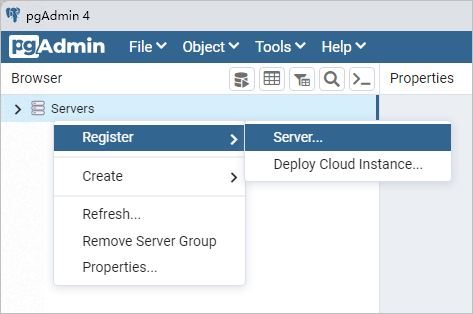

4. 在**Register - Server**页面的**General**标签页面中，输入服务器名称，如下图所示。

   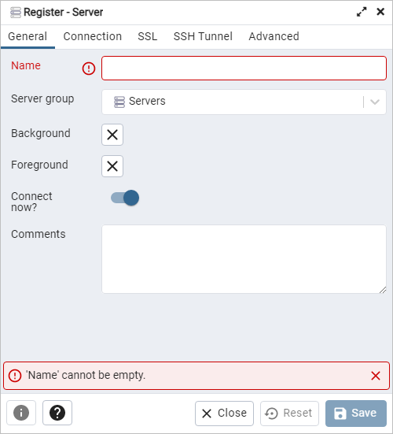

5. 选择**Connection**标签页，输入要连接的实例信息，如下图所示。

   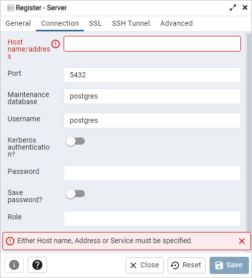

   | 参数 | 说明 |
   | --- | --- |
   | Host name/address | RDS实例的内网地址。如何查看内网地址请参见查看和修改内网地址和端口。 |
   | Port | RDS实例的内网端口。如何查看内网端口请参见查看和修改内网地址和端口。 |
   | Username | RDS实例的高权限账号名称。如何获取高权限账号请参见创建数据库和账号。 |
   | Password | RDS实例的高权限账号所对应的密码。 |

6. 单击**Save**。

7. 若连接信息无误，选择**Servers > 服务器名称 > Databases > postgres**，会出现如下界面，则表示连接成功。

   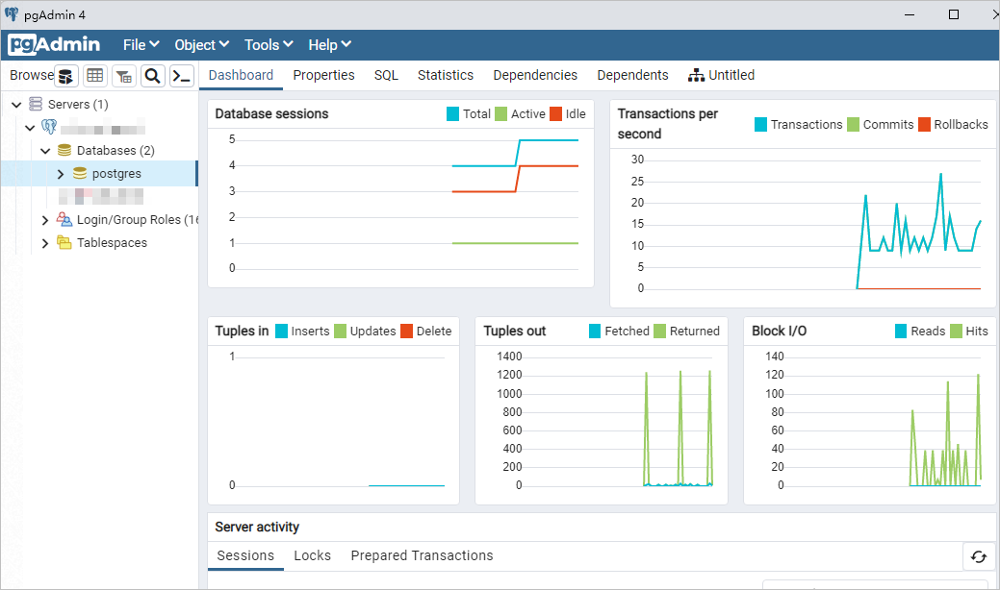

   > postgres是RDS实例默认的系统数据库，请勿在该数据库中进行任何操作。
   >
   > **重要**

<a id="section-7"></a>

# 7.实例管理

<a id="section-7-1"></a>

## 7.1. 创建实例

本文介绍如何通过控制台创建RDS PostgreSQL实例。

**操作步骤**

1. 登录云数据库RDS控制台。

2. 在**实例列表**页面中，单击**创建实例**。

3. 根据下表设置参数。

   **类别**

   **配置**

   **说明**

   实例所属组织。

   **组织**

   **基本配置**

   实例所属资源集。

   **资源集**

   实例所属地域。不同地域之间的产品内网不互通，创建实例后不支持更换地域。

   **地域**

   **主节点可用**

   实例主节点所属的可用区。

   **区域**

   **区**

   RDS支持**多可用区部署**和**单可用区部署**。系统根据所选的**主节点可用区**自动选择

   **部署方案**

   部署方案。

   数据库的类型，选择**PostgreSQL**。

   **数据库类型**

   数据库的版本，支持如下版本：

   - 11.0

   **数据库版本**

   - 12.0

   - 13.0

   数据库的系列，RDS PostgreSQL固定配置为**双机高可用**。

   **系列**

   数据库的存储类型，支持本地SSD盘和SSD云盘。

   不同数据库版本支持的存储类型存在差异，具体如下：

   - 11.0：支持本地SSD盘和SSD云盘

   **存储类型**

   - 12.0：支持本地SSD盘和SSD云盘

   - 13.0：支持本地SSD盘和SSD云盘

   **规格配置**

   是否为当前SSD云盘加密，仅在**存储类型**参数中选择了**SSD云盘**后可选。如果开启，需要为实例选择**加密Key**。如果您还没有**加密Key**，需要在密钥管理服务中

   **是否加密**

   创建一个。详情请参见<strong>《密钥管理服务》</strong>的**用户指南 > 创建密钥**章节。

   为当前SSD云盘选择**加密Key**。此参数仅在开启**是否加密**参数时可用。

   **加密Key**

   实例的规格，不同的内存大小对应不同的最大连接数和IOPS，具体请以控制台界

   **实例规格**

   面为准。详情请参见实例规格。

   存储空间包括数据空间、系统文件空间、Binlog文件空间和事务文件空间。可选

   **存储空间**

   范围为20 GB~6000 GB。以5 GB递增。

   RDS提供如下两种类型的连接地址：

   - **公网连接**：通过该连接地址可以从外网访问数据库。

   - **内网连接**：通过该连接地址可以从内网访问数据库。

   **网络连接类型**

   > **说明**
   >
   > 实例创建完成后无法修改，请谨慎选择。

   RDS实例支持的网络类型：

   - **经典网络**：经典网络中的云服务在网络上不进行隔离，只能依靠云服务自身的安全组或白名单策略来阻挡非法访问。

   - **专有网络**：专有网络VPC（Virtual Private Cloud）帮助用户在阿里云上构建出一个隔离的网络环境。用户可以自定义专有网络里面的路由表、IP地址范围和网关。建议您选择专有网络，更加安全。

   **网络类型**

   > **说明**
   >
   > - 如果您配置了多可用区部署，则必须为所用VPC的主节点可用区

   **网络**

   > 和备节点可用区创建VSwitch交换机。
   >
   > - 选择专有网络后，需要选择对应的**专有网络VPC**和**交换机VSwitch**。

   **VPC**

   **交换机可用**

   仅当**网络类型**选择为**专有网络**时，需要再选择对应的VPC和交换机。

   **区**

   **VSwitch**

   添加IP地址，允许这些IP地址访问该RDS实例。

   **IP白名单**

   <table>
     <tr>
       <td rowspan="2">实例设置</td>
       <td>创建数量</td>
       <td>RDS支持批量创建实例。此处可以指定需要创建的RDS实例个数，默认为1个。</td>
     </tr>
     <tr>
       <td>实例名称</td>
       <td>RDS实例的名称。<br>• 长度为2~64个字符。<br>• 以英文字母或中文开头。<br>• 支持数字和如下特殊字符：<br>_-:<br>• 不能以http:// 或https://开头。</td>
     </tr>
   </table>

4. 单击**提交**。

<a id="section-7-2"></a>

## 7.2. 查看实例基本信息

您可以查看实例的基本信息、内网连接信息、运行状态、配置信息等详情。

**操作步骤**

1. 登录云数据库RDS控制台。

2. 您可以通过如下两种方式进入实例**基本信息**页面：

   - 在**实例列表**页面，单击目标实例的ID，进入实例**基本信息**页面。

   - 在**实例列表**页面，单击目标实例所对应**操作**栏中的**管理**，进入实例**基本信息**页面。

**相关文档**

RDS PostgreSQL版本与PostgreSQL社区版本的对应关系请参见AliPG内核小版本发布记录。

<a id="section-7-3"></a>

## 7.3. 重启实例

当实例出现连接数满或性能问题时，您可以手动重启实例。

**前提条件**

实例必须处于**运行中**状态。

**操作步骤**

1. 登录云数据库RDS控制台。

2. 在**实例列表**页面，定位到目标实例。

3. 单击目标实例ID或者单击实例右侧的**管理**，打开**基本信息**页面。

4. 单击右上角的**重启实例**。

   > 重启实例会造成连接中断，重启前请做好业务安排，谨慎操作。
   >
   > **说明**

5. 在弹出的窗口中，单击**确定**。

<a id="section-7-4"></a>

## 7.4. 变更配置

如果当前实例配置无法满足应用的要求，或者当前实例的配置过高或者过低，您可以变更实例的配置。

**前提条件**

实例状态为**运行中**且没有处于备份或恢复状态。

**操作步骤**

1. 登录云数据库RDS控制台。

2. 在**实例列表**页面，定位到目标实例。

3. 单击目标实例ID或者单击实例右侧的**管理**，打开**基本信息**页面。

4. 在**基本信息**页面的**配置信息**区域，单击**变更配置**。

5. 在**RDS变配**页面，选择**系列**、**实例规格**和**存储空间**。

6. 完成参数配置后，单击**提交**。

<a id="section-7-5"></a>

## 7.5. 设置可维护时间段

您可以根据业务需求设置云数据库RDS实例的可运维时间段。

**背景信息**

为保障云数据库RDS实例的稳定性，后端系统会不定期对实例进行维护操作。默认可维护时间段为02:00~06:00，您可以根据业务规律，将可维护时间段设置在业务低峰期，以避免维护过程中可能对业务造成的影响。

**注意事项**

- 实例维护当天，为保障整个维护过程的稳定性，实例会在可维护时间段之前进入**实例维护中**的状态。当实例处于该状态时，对数据库的访问以及查询类操作（如性能监控）不会受到任何影响，但除了账号管理、数据库管理和IP白名单设置外的变更操作（如升降级、重启等）均暂时无法使用。

- 在可维护时间段内，实例会发生1到2次连接闪断，请确保应用程序具有重连机制。

**操作步骤**

1. 登录云数据库RDS控制台。

2. 在**实例列表**页面，定位到目标实例。

3. 单击目标实例ID或者单击实例右侧的**管理**，打开**基本信息**页面。

4. 在**配置信息**区域，单击**可维护时间段**后的**设置**。

5. 选择一个可维护时间段，单击**保存**。

   > 控制台显示时间为北京时间。
   >
   > **说明**

<a id="section-7-6"></a>

## 7.6. 主备库切换

为保证数据库的高可用性，RDS提供主备实例切换功能，在主实例不可用时自动切换到备实例。您也可以在需要时手动切换至备实例。本文介绍如何手动切换至备实例。

**背景信息**

RDS实例有一个备实例，主备实例的数据会实时同步，您只能访问主实例，备实例仅作为备份形式存在，不提供业务访问。当主备切换后，原来的主实例会变成备实例。

> 主备实例切换过程中可能会有闪断，请确保您的应用程序具有自动重连机制。
>
> **说明**

**操作步骤**

1. 登录云数据库RDS控制台。

2. 在**实例列表**页面，定位到目标实例。

3. 单击目标实例ID或者单击实例右侧的**管理**，打开**基本信息**页面。

4. 在页面左侧导航栏中，选择**服务可用性**。

5. 在**实例可用性**区域，单击**主备库切换**。

6. 在弹出的**实例主备切换**对话框中，选择切换时间，然后单击**确定**。

   > **说明**
   >
   > - 在主备库切换期间，有很多操作无法执行，例如管理数据库和账号、切换网络类型等，建议您选择可维护时间内进行切换。
   >
   > - 若您要修改可维护时间，请参见设置可维护时间段。

<a id="section-7-7"></a>

## 7.7. 释放实例

您可以根据业务需求手动释放实例。

**注意事项**

- 只有在运行状态下的实例才能被手动释放。

- 释放后，实例立即被清除，数据不再保留，请提前备份数据。

- 释放主实例时，如果该实例下有只读实例，则只读实例会跟随主实例一起被释放掉。

**操作步骤**

1. 登录云数据库RDS控制台。

2. 在目标实例对应的操作栏中，单击**更多 > 释放实例**。

3. 在弹出的**释放实例**提示框中，单击**确定**。

<a id="section-7-8"></a>

## 7.8. 设置实例参数

您可以通过控制台查看和修改部分参数的值，查询参数修改记录。

**注意事项**

- 为保证实例的稳定，控制台仅开放部分参数的修改。

- 修改参数值时请参考控制台上**可修改参数**页面中的**可修改参数值**列。

- 部分参数修改后需要重启实例，具体请参见控制台上**可修改参数**页面中的**是否重启**列。建议您在业务低峰期操作，并确保应用程序具有重连机制。

**修改参数值**

1. 登录云数据库RDS控制台。

2. 在**实例列表**页面，定位到目标实例。

3. 单击目标实例ID或者单击实例右侧的**管理**，打开**基本信息**页面。

4. 在左侧导航栏中，单击**参数设置**。

5. 此时您可以进行如下操作：

   - 批量修改参数：

     <ol type="a">

     <li>

     导出参数。

     单击**导出参数**会将TXT格式的参数文件保存到本地。该TXT文件包含该实例的所有可修改参数值。

     </li>

     <li>

     批量修改参数文件。

     </li>

     </ol>

     <ol type="i" start="100">

     <li>

     单击**导入参数**，将参数文件中修改后的参数粘贴到对话框中。

     </li>

     <li value="500">

     单击**确定**。

     </li>

     </ol>

     <ol type="a" start="5">

     <li>

     在右上角单击**提交参数**。

     </li>

     </ol>

     > **说明**
     >
     > - 如果修改的参数需要重启实例才生效，系统会提示您是否重启，建议您在业务低峰期操作，并确保应用程序具有重连机制。
     >
     > - 参数的修改未提交时，如果想取消修改，请单击**撤销**。

   - 修改单个参数：

     <ol type="a">

     <li>

     在**可修改参数**列表内找到需要修改的参数，单击**运行参数值**列的  图标。

     </li>

     <li>

     根据提示的取值范围输入参数值。

     </li>

     </ol>

     <ol type="i" start="100">

     <li>

     单击**确定**。

     </li>

     <li value="500">

     在右上角单击**提交参数**。

     </li>

     </ol>

     > **说明**
     >
     > - 如果修改的参数需要重启实例才生效，系统会提示您是否重启，建议您在业务低峰期操作，并确保应用程序具有重连机制。
     >
     > - 参数的修改未提交时，如果想取消修改，请单击**撤销**。

**查看参数修改历史**

1. 登录云数据库RDS控制台。

2. 在**实例列表**页面，定位到目标实例。

3. 单击目标实例ID或者单击实例右侧的**管理**，打开**基本信息**页面。

4. 在左侧导航栏中，单击**参数设置**。

5. 单击**修改历史**页签。

6. 选择时间范围并单击**查询**。

<a id="section-7-9"></a>

## 7.9. 只读实例

<a id="section-7-9-1"></a>

### 7.9.1. PostgreSQL只读实例简介

在对数据库有少量写请求，但有大量读请求的应用场景下，单个实例可能无法承受读取压力，甚至对业务产生影响。为了实现读取能力的弹性扩展，分担数据库压力，您可以创建一个或多个只读实例，利用只读实例满足大量的数据库读取需求，增加应用的吞吐量。

**简介**

创建只读实例时会从备实例复制数据，数据与主实例一致，主实例的数据更新也会在主实例完成操作后立即自动同步到所有只读实例。

> 只读实例为单节点的架构（没有备节点）。
>
> **说明**

只读实例拓扑图如下图所示。

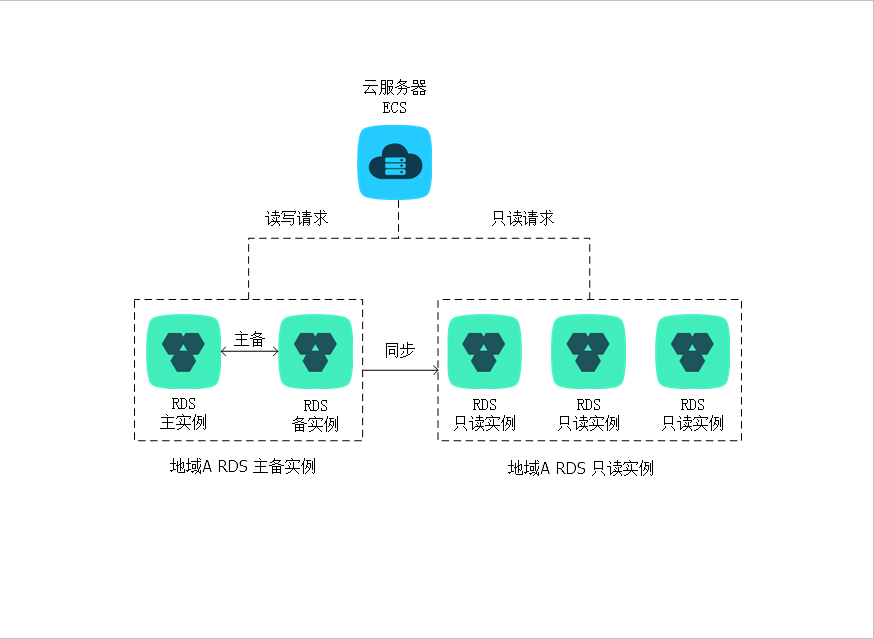

**功能特点**

- 地域和可用区：与主实例在同一地域，可以在不同的可用区。

- 规格和存储空间：只读实例的规格和存储空间不能低于主实例。

- 网络类型可以与主实例不一致。

- 账号与数据库管理：不需要维护账号与数据库，全部通过主实例同步。

- 白名单：只读实例创建时会自动复制其主实例的白名单信息，但只读实例和主实例的白名单是相互独立的。若您需要修改只读实例的白名单，请参见设置IP白名单。

- 监控与报警：提供系统性能指标的监控视图，如磁盘容量、IOPS、连接数、CPU利用率等。

**功能限制**

- 只读实例的数量：最多创建5个只读实例。

- 实例备份：因主实例已有备份，只读实例暂不支持备份设置以及手动发起备份。

- 数据迁移：不支持将数据迁移至只读实例。

- 数据库管理：不支持创建和删除数据库。

- 账号管理：不支持创建和删除账号，不支持为账号授权以及修改账号密码功能。

**常见问题**

Q：主实例上创建的账号在只读实例上可以用吗？

A：主实例创建的账号会同步到只读实例，只读实例无法管理账号。账号在只读实例上只能进行读操作，不能进行写操作。

<a id="section-7-9-2"></a>

### 7.9.2. 创建PostgreSQL只读实例

您可以通过创建只读实例满足大量的数据库读取需求，增加应用的吞吐量。创建只读实例相当于复制了一个主实例，数据与主实例一致，主实例的数据更新也会自动同步到所有只读实例。

**前提条件**

主实例版本为PostgreSQL 10.0或以上版本。

**注意事项**

- 只能在主实例内创建只读实例，不能将已有实例切换为只读实例。

- 由于创建只读实例时是从备实例复制数据，因此不会影响主实例。

- 只读实例的参数不继承主实例上的参数设置，会生成默认的参数值，可以在只读实例的控制台上进行修改。

- 只读实例的规格和存储空间不能低于主实例。

- 最多创建5个只读实例。

**创建只读实例**

1. 登录云数据库RDS控制台。

2. 在**实例列表**页面，定位到目标实例。

3. 单击目标实例ID或者单击实例右侧的**管理**，打开**基本信息**页面。

4. 在**实例分布**区域的**只读实例**右侧，单击**添加**。

5. 在跳转的页面中按照下表设置只读实例的参数，单击**提交**。

   **项目**

   **参数**

   **说明**

   区域

   地域

   RDS实例所在地域。

   数据库类型

   只读实例的数据库类型，与主实例一致，不可修改。

   数据库版本

   只读实例的数据库版本，与主实例一致，不可修改。

   系列

   只读实例的系列，不可修改。

   规格配置

   只读实例规格。可以与主实例不一致，并且只读实例可以随时更改规格，便于弹性升降级。为保证数据同步有

   实例规格

   足够的I/O性能支撑，建议只读实例的规格不小于主实例。

   只读实例的存储空间。取值范围20 GB~6000 GB。

   存储空间

   为保证数据同步有足够的I/O性能支撑，建议只读实例的存储空间不小于主实例。

   网络类型

   只读实例的网络类型，与主实例一致，不可修改。

   专有网络vpc

   网络类型为专有网络时，您需要选择对应的VPC。

   网络类型

   交换机vswitch

   网络类型为专有网络时，您需要选择对应的交换机。

<a id="section-7-9-3"></a>

### 7.9.3. 查看PostgreSQL只读实例

本章节介绍如何查询只读实例详情。您可以通过实例列表页面直接进入只读实例的管理页面，也可以通过主实例的只读实例列表进入只读实例的管理页面。管理方式与常规实例的管理类似，可执行的管理操作请以实际界面为准。

**通过只读实例ID查看实例详情**

1. 登录云数据库RDS控制台。

2. 在**云数据库管理**页面，定位到目标只读实例。

3. 单击目标只读实例ID或者单击只读实例右侧的**管理**进入只读实例的管理页面。

**通过主实例查看只读实例详情**

1. 登录云数据库RDS控制台。

2. 在**实例列表**页面，定位到目标实例。

3. 单击目标实例ID或者单击实例右侧的**管理**，打开**基本信息**页面。

4. 在**基本信息**页面，将鼠标移动到**实例分布**区域中的**只读实例**下方的数字上，此时会显示只读实例ID。

5. 单击目标只读实例ID，进入只读实例的管理页面。

**查看只读实例的延迟时间**

只读实例同步主实例的数据时，可能会有一定的延迟。您可以在只读实例的基本信息页面查看延迟时间。

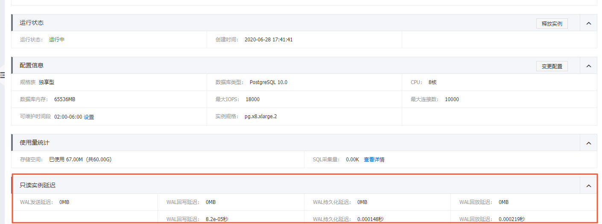

<a id="section-7-9-4"></a>

### 7.9.4. PostgreSQL只读实例管理

本章节介绍如何变更只读实例规格、释放只读实例以及查看只读实例监控与报警。

**只读实例变配**

1. 登录云数据库RDS控制台。

2. 在**云数据库管理**页面，定位到目标只读实例。

3. 单击目标只读实例ID或者单击只读实例右侧的**管理**进入只读实例的管理页面。

4. 在只读实例**基本信息**页的**配置信息**区域右侧，单击**变更配置**。

5. 在**RDS变配**页面，选择需要变配的相关配置后，单击**提交**。

   <table>
     <tr>
       <th width="89">配置参数</th>
       <th>取值及说明</th>
     </tr>
     <tr>
       <td>系列</td>
       <td>只读实例，不可修改。</td>
     </tr>
     <tr>
       <td>存储类型</td>
       <td>与实例变配前存储类型一致，不可修改。</td>
     </tr>
     <tr>
       <td>实例规格</td>
       <td>可变更只读实例的实例规格，具体规格清单，请参见 <strong>《云数据库</strong><strong>RDS》</strong>的<strong>产品简介 &gt; 实例规格</strong>章节。</td>
     </tr>
     <tr>
       <td>存储空间</td>
       <td>存储空间包括数据空间、系统文件空间、Binlog文件空间和事务文件空间。</td>
     </tr>
   </table>

**释放只读实例**

1. 登录云数据库RDS控制台。

2. 在**云数据库管理**页面，定位到目标只读实例。

3. 单击目标只读实例ID或者单击只读实例右侧的**管理**进入只读实例的管理页面。

4. 在只读实例**基本信息**页的**运行状态**区域右侧，单击**释放实例**，在弹出的确认对话框中，单击**确定**。

**查看只读实例监控**

1. 登录云数据库RDS控制台。

2. 在**云数据库管理**页面，定位到目标只读实例。

3. 单击目标只读实例ID或者单击只读实例右侧的**管理**进入只读实例的管理页面。

4. 在左侧导航栏单击**监控与报警**。

   > 监控与报警功能的使用与常规实例相同，具体请参见查看监控资源。
   >
   > **说明**

<a id="section-7-10"></a>

## 7.10. 标签

在实例数量较多的情况下，您可以创建多个标签，为实例绑定不同的标签对其进行分类，之后通过标签进行实例筛选。本文介绍标签的使用。

**注意事项**

- 标签由一对键值组成，键在同账号同地域下唯一，值无此限制。

- 每个实例最多可绑定20个标签。

- 标签从一个实例解绑后，如果没有绑定到其他资源，则该标签自动被删除。

**绑定标签**

1. 登录云数据库RDS控制台。

2. 在**实例列表**页面，单击目标实例**标签**栏  按钮。

3. 在**编辑标签**对话框，输入标签键和标签值后单击**确定**。

**根据标签筛选实例**

1. 登录云数据库RDS控制台。

2. 在**实例列表**页面，单击**高级筛选**按钮。

3. 您可以通过**实例ID/名称**、**VIP**和**标签筛选**过滤您的实例。在**标签筛选**的下拉框中选择目标标签。

4. 选择标签后，实例列表将显示所有绑定该标签的实例。

**查看实例绑定的标签**

1. 登录云数据库RDS控制台。

2. 在**实例列表**页面，当实例绑定标签数量较少时，将在标签栏直接显示对应标签，如绑定标签数量较多可将

   鼠标移动至目标实例**标签**栏  图标上，查看目标实例绑定的全部标签。

**解绑标签**

1. 登录云数据库RDS控制台。

2. 在**实例列表**页面，单击目标实例**标签**栏  按钮。

3. 在**编辑标签**对话框，单击目标标签右侧  按钮，单击**确定**。

<a id="section-8"></a>

# 8.数据库连接

<a id="section-8-1"></a>

## 8.1. 连接PostegreSQL实例

本文介绍如何通过阿里云数据管理服务（DMS）或pgAdmin4客户端连接RDS实例。

**背景信息**

您可以通过RDS管理控制台先登录DMS，然后再连接需要访问的RDS实例。

数据管理服务（Data Management，简称DMS）是一种集数据管理、结构管理、访问安全、BI图表、数据趋势、数据轨迹、性能与优化和服务器管理于一体的数据管理服务。支持MySQL、SQL Server、PostgreSQL、MongoDB、Redis等关系型数据库和NoSQL的数据库管理，同时还支持Linux服务器管理。

您也可以使用客户端连接RDS实例。由于RDS提供的关系型数据库服务与原生的数据库服务完全兼容，所以对用户而言，连接数据库的方式也基本类似。本文以pgAdmind 4客户端为例介绍RDS实例的连接方法。

**通过DMS连接实例**

关于如何通过DMS连接RDS实例的方法，请参见通过DMS登录RDS数据库。

**通过客户端登录**

1. 将要访问RDS实例的IP地址加入RDS白名单中。关于如何设置白名单，请参见设置IP白名单。

2. 启动pgAdmin 4客户端。

   > 如果您还没有安装pgAdmin 4客户端，请下载pgAdmin 4（windows），本文以
   >
   > **说明**
   >
   > pgAdmin 4 v6.15版本为例。

3. 右击**Servers**，选择**Register > Server**，如下图所示。

   

4. 在**Register - Server**页面的**General**标签页面中，输入服务器名称，如下图所示。

   

5. 选择**Connection**标签页，输入要连接的实例信息，如下图所示。

   

   | 参数 | 说明 |
   | --- | --- |
   | Host name/address | RDS实例的内网地址。如何查看内网地址请参见查看和修改内网地址和端口。 |
   | Port | RDS实例的内网端口。如何查看内网端口请参见查看和修改内网地址和端口。 |
   | Username | RDS实例的高权限账号名称。如何获取高权限账号请参见创建数据库和账号。 |
   | Password | RDS实例的高权限账号所对应的密码。 |

6. 单击**Save**。

7. 若连接信息无误，选择**Servers > 服务器名称 > Databases > postgres**，会出现如下界面，则表示连接成功。

   

   > postgres是RDS实例默认的系统数据库，请勿在该数据库中进行任何操作。
   >
   > **重要**

<a id="section-8-2"></a>

## 8.2. 通过DMS登录RDS数据库

您可以通过阿里云的数据管理服务DMS登录RDS实例的数据库。

**前提条件**

已经设置好IP白名单，设置IP白名单的方法请参见设置IP白名单。

**操作步骤**

1. 登录云数据库RDS控制台。

2. 在**实例列表**页面，定位到目标实例。

3. 单击目标实例ID或者单击实例右侧的**管理**，打开**基本信息**页面。

4. 单击页面右上角的**登录数据库**。

5. 在自动跳转的**数据管理DMS**控制台的**登录实例**窗口中，检查**数据库类型**、**实例地区**、**连接串地址**是否正确。若信息正确，填写**数据库账号**和**数据库密码**，如下图所示。

   

   | 参数 | 说明 |
   | --- | --- |
   | 数据库类型 | 目标数据库的类型，系统默认为当前需要连接的数据库类型。 |
   | 实例地区 | 目标实例所在的地域，系统默认为当前实例所在地域。 |
   | 连接串地址 | 目标实例的连接串地址，系统默认为当前实例的连接串地址。 |
   | 数据库账号 | 目标数据库的账号。 |
   | 数据库密码 | 目标数据库账号对应的密码。 |

6. 单击**登录**。

   > 若您希望浏览器记住该账号的密码，可以先勾选**记住密码**，再单击**登录**。
   >
   > **说明**

<a id="section-8-3"></a>

## 8.3. 查看和修改内网地址和端口

在连接RDS实例时，您需要填写RDS的内网地址和端口。本文将介绍如何在RDS控制台上查看RDS实例的内网地址和端口，以及如何修改内网地址和端口。

**查看内网地址和端口**

1. 登录云数据库RDS控制台。

2. 在**实例列表**页面，定位到目标实例。

3. 单击目标实例ID或者单击实例右侧的**管理**，打开**基本信息**页面。

4. 在**基本信息**栏中，即可查看内网地址及内网端口信息。

**修改内网地址和端口**

1. 登录云数据库RDS控制台。

2. 在**实例列表**页面，定位到目标实例。

3. 单击目标实例ID或者单击实例右侧的**管理**，打开**基本信息**页面。

4. 在左侧导航栏中单击**数据库连接**。

5. 单击页面右侧的**修改连接地址**。

6. 在弹出的对话框中，选择**连接类型**为**内网地址**。

7. 设置内网连接地址前缀和端口，单击**确定**。

**常见问题**

- Q：修改连接地址后是否需要修改应用程序内的连接地址或端口？

  A：需要修改，否则应用程序无法连接上数据库。

- Q：修改连接地址是立即生效吗？是否需要重启实例？

  A：是立即生效，不需要重启实例。

<a id="section-9"></a>

# 9.账号

<a id="section-9-1"></a>

## 9.1. 创建账号

要使用云数据库RDS，您需要在实例中创建账号。本文介绍如何为RDS PostgreSQL实例创建账号。

**账号类型**

RDS PostgreSQL实例支持两种数据库账号：高权限账号和普通账号。详细说明如下。

<table>
  <tr>
    <th width="105">账号类型</th>
    <th>说明</th>
  </tr>
  <tr>
    <td>高权限账号</td>
    <td>• 只能通过控制台或API创建和管理。<br>• 可以创建多个高权限账号，管理所有普通账号和数据库。<br>• 开放了更多权限，可满足个性化和精细化的权限管理需求，例如可按用户分配不同表的查询权限。<br>• 可以断开任意账号的连接。</td>
  </tr>
  <tr>
    <td>普通账号</td>
    <td>• 可以通过控制台、API或者SQL语句创建和管理。<br>• 一个实例可以创建多个普通账号 。<br>• 需要手动给普通账号授予特定数据库的权限。<br>• 普通账号不能创建和管理其他账号，也不能断开其他账号的连接。</td>
  </tr>
</table>

**注意事项**

- 支持在控制台创建多个高权限账号和普通账号，也可以通过SQL命令创建、管理普通账号。

  > 本地SSD盘实例的高权限账号创建后无法删除。
  >
  > **说明**

- 如果您要迁移本地数据库到RDS，请在RDS实例中创建与本地数据库一致的迁移账号和数据库。

- 分配数据库账号权限时，请按最小权限原则和业务角色创建账号，并合理分配只读和读写权限。必要时可以把数据库账号和数据库拆分成更小粒度，使每个数据库账号只能访问其业务之内的数据。如果不需要数据库写入操作，请分配只读权限。

- 为保障数据库的安全，请将数据库账号的密码设置为强密码，并定期更换。

**创建高权限账号或普通账号**

1. 登录云数据库RDS控制台。

2. 在**实例列表**页面，定位到目标实例。

3. 单击目标实例ID或者单击实例右侧的**管理**，打开**基本信息**页面。

4. 在左侧导航栏中，单击**账号管理**。

5. 单击**创建账号**并设置如下参数。

   <table>
     <tr>
       <th width="105">参数</th>
       <th>说明</th>
     </tr>
     <tr>
       <td>数据库账号</td>
       <td>• 长度为2~16个字符。<br>• 由小写字母、数字或下划线组成。<br>• 以字母开头，以字母或数字结尾。<br>• 不能和已有的账号名重复。<br>• 不能以pg开头。<br>• 不能使用SQL关键字。具体请参见SQL关键字。</td>
     </tr>
     <tr>
       <td>账号类型</td>
       <td>RDS PostgreSQL实例支持两种数据库账号：<strong>高权限账号</strong>和<strong>普通账号</strong>。<br>• 高权限账号拥有所有数据库的所有操作权限。<br>• 普通账号拥有已授权数据库（owner）的所有操作权限。<br>说明操作权限包括SELECT、INSERT、UPDATE、DELETE、TRUNCATE、REFERENCES、TRIGGER。</td>
     </tr>
     <tr>
       <td>密码</td>
       <td>• 长度为8~32个字符。<br>• 由大写字母、小写字母、数字、特殊字符中的任意三种组成。<br>• 特殊字符包括： <code> !@#$%^&amp;*()_+-= </code></td>
     </tr>
     <tr>
       <td>确认密码</td>
       <td>再次输入相同的密码。</td>
     </tr>
     <tr>
       <td>备注说明</td>
       <td>该参数仅在<strong>SSD云盘</strong>实例创建账号时出现，非必填。您可以在此处输入该实例相关说明，以减少后期沟通成本。最大支持输入256个字符。</td>
     </tr>
   </table>

6. 单击**创建**。

<a id="section-9-2"></a>

## 9.2. 重置密码

在使用RDS过程中，如果忘记数据库账号密码，您可以通过控制台重新设置密码。

**操作步骤**

1. 登录云数据库RDS控制台。

2. 在**实例列表**页面，定位到目标实例。

3. 单击目标实例ID或者单击实例右侧的**管理**，打开**基本信息**页面。

4. 在左侧导航栏中单击**账号管理**。

5. 在目标账号对应的**操作**列单击**重置账号密码**。

6. 在弹出的对话框中，输入新密码后，单击**确定**。

   > 密码要求如下：
   >
   > **说明**
   >
   > - 长度为8~32个字符。
   >
   > - 由大写字母、小写字母、数字、特殊字符中的任意三种组成。
   >
   > - 特殊字符包括：  `!@#$%^&*()_+-=`

<a id="section-9-3"></a>

## 9.3. 锁定/删除账号

RDS PostgreSQL的SSD云盘实例支持锁定账号或删除账号。

**前提条件**

实例存储类型为SSD云盘。

**锁定账号**

> 账号锁定后，您无法再通过该账号登录实例。
>
> **说明**

1. 登录云数据库RDS控制台。

2. 在**实例列表**页面，定位到目标实例。

3. 单击目标实例ID或者单击实例右侧的**管理**，打开**基本信息**页面。

4. 在左侧导航栏中单击**账号管理**。

5. 在目标账号对应的**操作**列单击**锁定**。

   > 单击**锁定**后等待几秒，**状态**列显示**锁定中**即表示账号已锁定，如果需要继续使用该账
   >
   > **说明**
   >
   > 号，请单击**解锁**。

**删除账号**

> 如果要删除的账号有数据库、表或其他对象的权限 ，执行删除账号操作会报错Some
>
> **说明**
>
> objects depend on account，取消相关权限后才能正常删除账号。

1. 登录云数据库RDS控制台。

2. 在**实例列表**页面，定位到目标实例。

3. 单击目标实例ID或者单击实例右侧的**管理**，打开**基本信息**页面。

4. 在左侧导航栏中单击 **账号管理**。

5. 在目标账号对应的**操作**列单击**删除**。

6. 在弹出的对话框中，单击**确定**。

<a id="section-9-4"></a>

## 9.4. 删除账号

您可以通过控制台删除数据库账号。

**前提条件**

因业务结束或改变时，您可以在控制台上删除不需要的高权限账号、普通账号。

**操作步骤**

1. 登录云数据库RDS控制台。

2. 在**云数据库管理**页面，单击目标实例ID或者单击实例右侧**操作**列下的**管理**，打开**基本信息**页面。

3. 在左侧导航栏中，单击**账号管理**。

4. 在目标账号所对应的操作栏中，单击**删除**。

5. 在弹出的确认框中，单击**确定**。

   > 当账号状态为**处理中**时，无法删除。
   >
   > **说明**

<a id="section-10"></a>

# 10.数据库

<a id="section-10-1"></a>

## 10.1. 创建数据库

若要使用云数据库RDS，您需要在实例中创建数据库。本文介绍如何为RDS PostgreSQL实例创建数据库。

**前提条件**

- 已创建RDS PostgreSQL实例。详情请参见创建实例。

- 已创建账号。详情请参见创建账号。

**操作步骤**

1. 登录云数据库RDS控制台。

2. 在**实例列表**页面，定位到目标实例。

3. 单击目标实例ID或者单击实例右侧的**管理**，打开**基本信息**页面。

4. 单击页面右上角的**登录数据库**。

5. 在自动跳转的**数据管理DMS**控制台的**登录实例**面板中，检查**数据库类型**、**实例地区**、**连接串地址**是否正确。若信息正确，填写**数据库账号**和**数据库密码**，如下图所示。

   

   | 参数 | 说明 |
   | --- | --- |
   | 数据库类型 | 目标数据库的类型，系统默认为当前需要连接的数据库类型。 |
   | 实例地区 | 目标实例所在的地域，系统默认为当前实例所在地域。 |
   | 连接串地址 | 目标实例的连接串地址，系统默认为当前实例的连接串地址。 |
   | 数据库账号 | 目标数据库的账号。 |
   | 数据库密码 | 目标数据库账号对应的密码。 |

6. 单击**登录**。若您希望浏览器记住该账号的密码，可以先勾选**记住密码**，再单击**登录**。

   > 若出现无法建立连接提示，则可能是白名单设置出现问题，需要在控制台重新设置白名
   >
   > **说明**
   >
   > 单。详情请参见设置IP白名单。

7. 成功登录RDS实例后，会直接跳转到**SQLConsole**页面，输入如下格式的命令，创建数据库。

   ```sql
   CREATE DATABASE name;
   ```

   例如，您要创建一个名称为test的数据库，可以执行如下命令：

   ```sql
   create database test;
   ```

8. 单击**执行(F8)**，完成创建数据库。

<a id="section-10-2"></a>

## 10.2. 删除数据库

本文介绍如何删除RDS PostgreSQL数据库。

**操作步骤**

1. 登录云数据库RDS控制台。

2. 在**云数据库管理**页面，定位到目标实例。

3. 单击目标实例ID或者单击实例右侧的**管理**，打开**基本信息**页面。

4. 单击页面右上角的**登录数据库**。

5. 在自动跳转的**数据管理DMS**控制台的**登录实例**面板中，检查**数据库类型**、**实例地区**、**连接串地址**是否正确。若信息正确，填写**数据库账号**和**数据库密码**，如下图所示。

   

   | 参数 | 说明 |
   | --- | --- |
   | 数据库类型 | 目标数据库的类型，系统默认为当前需要连接的数据库类型。 |
   | 实例地区 | 目标实例所在的地域，系统默认为当前实例所在地域。 |
   | 连接串地址 | 目标实例的连接串地址，系统默认为当前实例的连接串地址。 |
   | 数据库账号 | 目标数据库的账号。 |
   | 数据库密码 | 目标数据库账号对应的密码。 |

6. 单击**登录**。若您希望浏览器记住该账号的密码，可以先勾选**记住密码**，再单击**登录**。

   > 若出现无法建立连接提示，则可能是白名单设置出现问题，需要在控制台重新设置白名
   >
   > **说明**
   >
   > 单。详情请参见设置IP白名单。

7. 成功登录RDS实例后，会直接跳转到**SQLConsole**页面，输入如下格式的命令，删除数据库。

   ```text
   drop database <database name>;
   ```

   例如，若您要删除一个名为test2的数据库，可以执行如下命令：

   ```text
   drop database test2;
   ```

8. 单击**执行(F8)**，删除数据库。

<a id="section-11"></a>

# 11.网络、VPC和交换机

<a id="section-11-1"></a>

## 11.1. 切换虚拟交换机

RDS PostgreSQL实例支持切换专有网络的虚拟交换机。

**前提条件**

RDS PostgreSQL实例的网络类型为专有网络。

> PostgreSQL 10.0本地盘实例暂不支持此功能。
>
> **说明**

**操作步骤**

1. 登录云数据库RDS控制台。

2. 在**实例列表**页面，定位到目标实例。

3. 单击目标实例ID或者单击实例右侧的**管理**，打开**基本信息**页面。

4. 在页面左侧导航栏选择**数据库连接**。

5. 在页面右侧单击**切换交换机**。

6. 选择虚拟交换机，并单击**确定**。

   > 如需新建虚拟交换机请单击**到控制台创建**。
   >
   > **说明**

7. 在弹出的风险提示框中单击**确定切换**。

   > **说明**
   >
   > - 切换过程会有30秒闪断，请确保应用程序具有重连机制。
   >
   > - 客户端缓存会导致只能读取数据，无法写入数据，请及时清理缓存。

<a id="section-11-2"></a>

## 11.2. 切换网络类型

您可以根据业务需求将实例的网络类型在经典网络和专有网络之间切换。

**前提条件**

实例的存储类型为本地SSD盘。

**背景信息**

- 经典网络：实例之间不通过网络进行隔离，只能依靠实例自身的白名单策略来阻挡非法访问。

- 专有网络（VPC）：一个VPC就是一个隔离的网络环境。VPC的安全性较高，推荐您使用VPC网络。

  您可以自定义VPC中的路由表、IP 地址范围和网关。此外，您还可以通过专线或者VPN的方式将自建机房与阿里云VPC组合成一个虚拟机房，实现应用平滑上云。

**从专有网络（VPC）切换为经典网络**

注意事项

- RDS实例的当前网络类型必须为专有网络。

- RDS实例切换为经典网络后，内网地址不变（连接字符串不变，该字符串对应的IP地址会改变）。

- RDS实例切换为经典网络后，VPC中的ECS将不能再通过该内网地址访问该RDS实例，请注意变更应用端的连接地址。

- 在切换网络类型时，RDS服务可能会出现一次30秒的闪断，请您尽量在业务低峰期执行升级操作，或确保您的应用有自动重连机制，以避免闪断造成的影响。

1. 登录云数据库RDS控制台。

2. 在**实例列表**页面，定位到目标实例。

3. 单击目标实例ID或者单击实例右侧的**管理**，打开**基本信息**页面。

4. 在页面左侧导航栏中单击**数据库连接**。

5. 在页面右侧单击**切换为经典网络**。

6. 在弹出的对话框中，单击**确定**。

   > 网络类型切换完成后，只有经典网络的ECS才能通过内网访问该RDS，请在经典网络的
   >
   > **说明**
   >
   > ECS上配置RDS连接地址。

7. 设置RDS的白名单，使得ECS可以通过内网访问RDS。

   > **说明**
   >
   > - 如果RDS实例采用通用白名单模式（如下图），请将经典网络的ECS内网IP地址添加到任意白名单分组。
   >
   >   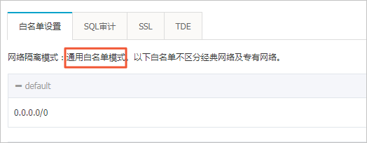
   >
   > - 如果RDS实例采用高安全白名单模式（如下图），请将经典网络的ECS内网IP地址添加到RDS实例的经典网络白名单分组。如果没有经典网络的分组，请新建分组。有关高安全白名单模式的详细信息，请参见切换为高安全白名单模式。
   >
   >   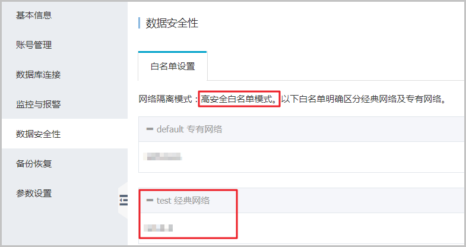

**从经典网络切换为专有网络（VPC）**

1. 登录云数据库RDS控制台。

2. 在**实例列表**页面，定位到目标实例。

3. 单击目标实例ID或者单击实例右侧的**管理**，打开**基本信息**页面。

4. 在页面左侧导航栏中单击**数据库连接**。

5. 在页面右侧单击**切换为专有网络**。

6. 在弹出的对话框中，选择VPC和交换机，以及是否保留经典网络地址。

   > **说明**
   >
   > - 选择VPC。建议选择您的ECS实例所在的VPC，否则ECS实例与RDS实例无法通过内网互通。
   >
   > - 选择交换机。如果选择的VPC中没有交换机，请创建与实例在同一可用区的交换机。具体操作请参见 **《专有网络VPC > 用户指南 > 快速入门 > 创建交换机》**。
   >
   > - 选择是否勾选**保留经典网络**，具体说明如下表所述。
   >
   >   - **不勾选**
   >
   >     不保留经典网络地址，原经典网络地址变为VPC地址。
   >
   >     如果不保留经典网络地址，则切换网络类型时，RDS实例会发生一次30秒的闪断，而且经典网络的ECS对该RDS实例的内网访问会立即断开。
   >
   >   - **勾选**
   >
   >     保留经典网络地址，同时生成一个新的VPC地址。表示使用混访模式，即RDS可以同时被经典网络和VPC的ECS通过内网访问。此时您需要选择经典网络的**过期时间（重要）**。可选天数为**14天后**、**30天后**、**60天后**和**120天后**。您也可以在网络切换完成后修改过期时间。详情请参见混访模式。
   >
   >     如果保留经典网络地址，则切换网络类型时，RDS实例不会发生闪断，而且经典网络的ECS对该RDS实例的内网访问也不会断开，直到经典网络地址到期才断开。
   >
   >     在经典网络地址到期前，请将VPC地址配置到VPC的ECS中，以实现业务平滑迁移到VPC。在经典网络地址到期前的7天，系统会每天给您账号绑定的手机发送短信提醒。
   >
   >     更多介绍请参见临时混访方案（同时保留经典网络和专有网络地址）。

7. 将VPC的ECS内网IP地址添加到RDS实例的专有网络白名单分组，使得ECS可以通过内网访问RDS。如果没有专有网络的分组，请新建分组。

   > **说明**
   >
   > - 如果您选择了保留经典网络地址，请在经典网络地址到期前，将RDS的VPC地址配置到VPC的ECS中。
   >
   > - 如果您选择了不保留经典网络地址，那么切换网络类型后，经典网络的ECS对该RDS实例的内网访问会立即断开。请将RDS的VPC地址配置到VPC的ECS中。

<a id="section-11-3"></a>

## 11.3. 临时混访方案（同时保留经典网络和专有网络地址）

为满足日益增多的网络迁移需求，RDS新增了网络混访功能，可实现在无访问中断的情况下将经典网络平滑迁移到专有网络VPC上。

**前提条件**

- 实例的存储类型为本地SSD盘。

- 实例的网络类型是经典网络。

- 实例所在可用区已有可用的VPC和交换机。

**背景信息**

以往将RDS实例从经典网络迁移到VPC时，经典网络的内网地址会变为VPC的内网地址（连接字符串没有变化，背后的IP地址有变化），会造成1次30秒内的闪断，而且经典网络中的ECS将不能再通过内网访问该RDS实例，为了能够平滑迁移网络，RDS新增了网络混访功能。

混访是指RDS实例可以同时被经典网络和专有网络中的ECS访问。在混访期间，RDS实例会保留原经典网络的内网地址并新增一个VPC下的内网地址，迁移网络时不会出现闪断。

基于安全性及性能的考虑，我们推荐您仅使用VPC，因此混访期有一定的期限，原经典网络的内网地址在保留时间到期后会被自动释放，应用将无法通过经典网络的内网地址访问数据库。为避免对业务造成影响，您需要在混访期中将VPC下的内网地址配置到您所有的应用中，以实现平滑的网络迁移。

例如，某一公司要将经典网络迁移至VPC时，若选用混访的迁移方式，在混访期内，一部分应用通过VPC访问数据库，一部分应用仍通过原经典网络的内网地址访问数据库，等所有应用都可以通过VPC访问数据库时，就可以将原经典网络的内网地址释放掉，如下图所示。

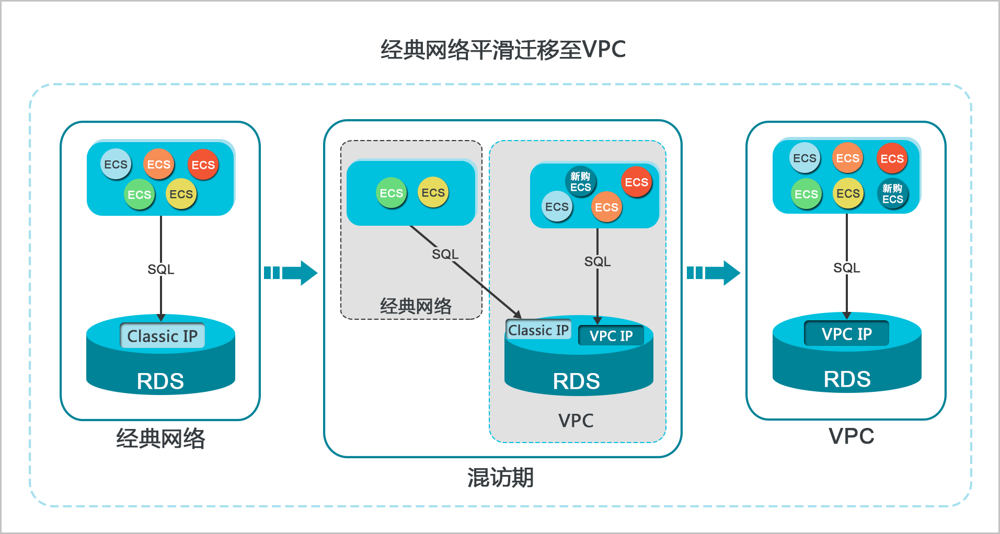

**功能限制**

在混访期间，有如下功能限制：

- 不支持将实例网络类型切换成经典网络。

- 不支持实例迁移可用区。

**从经典网络迁移至VPC**

详细操作请参见从经典网络切换为专有网络（VPC）。

**修改原经典网络内网地址的过期时间**

在混访期间，您可以根据需求随时调整保留原经典网络的时间，过期时间会从变更日期重新开始计时。例如，原经典网络的内网地址会在2017年8月18日过期，但您在2017年8月15日将过期时间变更为“14天后”，则原经典网络的内网地址将会在2017年8月29日被释放。

修改过期时间的操作步骤如下所示：

1. 登录云数据库RDS控制台。

2. 在**实例列表**页面，定位到目标实例。

3. 单击目标实例ID或者单击实例右侧的**管理**，打开**基本信息**页面。

4. 在页面左侧导航栏中单击**数据库连接**。

5. 在**实例连接**页签，单击**修改过期时间**。

6. 在**修改过期时间**的确认页面，选择过期时间，单击**确定**。

<a id="section-12"></a>

# 12.监控

<a id="section-12-1"></a>

## 12.1. 查看监控资源

RDS提供了丰富的性能监控项，您可以通过RDS管理控制台查看实例的资源监控数据。

**操作步骤**

1. 登录云数据库RDS控制台。

2. 在**实例列表**页面，定位到目标实例。

3. 单击目标实例ID或者单击实例右侧的**管理**，打开**基本信息**页面。

4. 在页面左侧导航栏中单击**监控与报警**。

5. 在**监控**页签选择查询时间，即可查看相应的监控数据。

   > 您可以单击**监控**页签右侧的**刷新**来更新监控信息。
   >
   > **说明**

<a id="section-13"></a>

# 13.数据安全性

<a id="section-13-1"></a>

## 13.1. 切换为高安全白名单模式

RDS实例的IP白名单可以从通用白名单模式切换为高安全白名单模式，从而拥有更高的安全性。

**前提条件**

实例大版本为RDS PostgreSQL 10.0，存储类型为本地SSD盘。

**IP白名单模式**

RDS实例的IP白名单分为两种模式：

- 通用白名单模式

  白名单中的IP地址不区分经典网络和专有网络（既适用于经典网络也适用于专有网络）。有安全风险，建议切换为高安全模式。

  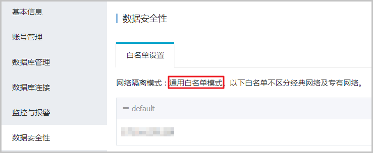

- 高安全白名单模式

  白名单中区分经典网络的IP白名单分组和专有网络的IP白名单分组。创建IP白名单分组时需要指定网络类型。

  

**切换为高安全白名单模式后的变化**

- 对于专有网络的实例，原有的IP白名单将全量复制为一个适用于专有网络的IP白名单分组。

- 对于经典网络的实例，原有的IP白名单将全量复制为一个适用于经典网络的IP白名单分组。

- 对于处于混访模式（专有网络+经典网络）的实例，原有的IP白名单将全量复制为两个完全相同的IP白名单分组，分别适用于专有网络和经典网络。

> 切换为高安全白名单模式不会影响白名单中的ECS安全组。
>
> **说明**

**注意事项**

- 通用白名单模式可以切换为高安全白名单模式。高安全白名单模式无法切换为通用白名单模式。

- 高安全白名单模式下，经典网络白名单分组也适用于公网访问。如果有公网设备要访问RDS实例，请将公网设备IP地址添加到经典网络白名单分组。

**操作步骤**

1. 登录云数据库RDS控制台。

2. 在**实例列表**页面，定位到目标实例。

3. 单击目标实例ID或者单击实例右侧的**管理**，打开**基本信息**页面。

4. 在页面左侧导航栏中单击**数据安全性**。

5. 在**白名单设置**页签中，单击**切换高安全白名单模式（推荐）**。

6. 在弹出的对话框中，单击**确认切换**。

<a id="section-13-2"></a>

## 13.2. 设置IP白名单

创建RDS实例后，您需要设置RDS实例的白名单，以允许外部设备访问该RDS实例。

**背景信息**

白名单可以让RDS实例得到高级别的访问安全保护，建议您定期维护白名单。设置白名单不会影响RDS实例的正常运行。

设置白名单包括两种操作：

- 设置IP白名单：添加IP地址，允许这些IP地址访问该RDS实例。

  > 默认的白名单只包含默认IP地址0.0.0.0/0，表示任何设备均可访问该RDS实例。
  >
  > **说明**

- 设置ECS安全组：添加ECS安全组，允许ECS安全组内的ECS实例访问该RDS实例。

**操作步骤**

1. 登录云数据库RDS控制台。

2. 在**实例列表**页面，定位到目标实例。

3. 单击目标实例ID或者单击实例右侧的**管理**，打开**基本信息**页面。

4. 单击左侧导航栏的**数据安全性**。

5. 在**白名单设置**页签中，单击**default**分组右侧的**修改**。

   > 您也可以单击页面右侧的**添加白名单分组**新建自定义分组。
   >
   > **说明**

6. 在**修改白名单分组**对话框中，填写需要访问该实例的IP地址或IP段，单击**确定**。详细规则如下：

   - 若填写IP段，如10.10.10.0/24，则表示10.10.10.X的IP地址都可以访问该RDS实例。

   - 若您需要添加多个IP地址或IP段，请用英文逗号（,）隔开，逗号前后不能有空格，例如192.168.0.1,172.16.213.9。

   - 单击**加载ECS内网IP**后，将显示您当前阿里云账号下所有ECS实例的IP地址，可快速添加ECS内网IP地址到白名单中。

<a id="section-13-3"></a>

## 13.3. 设置SSL链路加密

本文档介绍如何针对RDS实例开启SSL链路加密。

**前提条件**

实例的存储类型为SSD云盘。

**注意事项**

- 开启SSL链路加密后，通过内网或外网传输到实例的数据都将被加密，不会因为在网络传输时被截获而导致数据泄露。

- 开启SSL链路加密后，已有连接需要断开重连，加密才会生效。

**开启SSL链路加密**

国际互联网工程任务组（IETF）对SSL 3.0进行了标准化，标准化后更名为安全传输层协议（TLS）。由于SSL这一术语更为常用，因此本文所述SSL加密实际是指TLS加密。

> RDS支持的TLS版本为1.0、1.1和1.2。
>
> **说明**

1. 登录云数据库RDS控制台。

2. 单击**实例列表**，单击目标实例ID或者单击实例右侧**操作**列下的**管理**，打开**基本信息**页面。

3. 在左侧菜单栏中，单击**数据安全性**。

4. 单击**SSL**页签。

   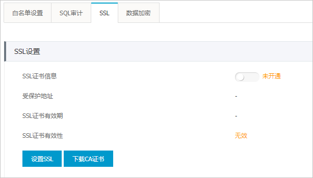

5. 单击**设置SSL**，选择受保护地址，等待系统开启SSL。

   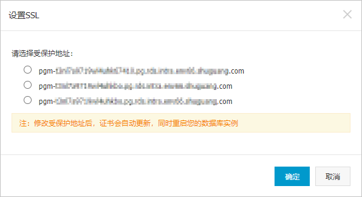

**SSL连接RDS PostgreSQL数据库**

连接前请确保已下载CA证书。具体请参见开启SSL链路加密。

1. 将要访问RDS实例的IP地址加入RDS白名单中。关于如何设置白名单，请参见设置IP白名单。

2. 启动pgAdmin 4客户端。

   > 如果您还没有安装pgAdmin 4客户端，请下载pgAdmin 4（windows），本文以
   >
   > **说明**
   >
   > pgAdmin 4 v6.15版本为例。

3. 右击**Servers**，选择**Register > Server**，如下图所示。

   

4. 在**Register - Server**页面的**General**标签页面中，输入服务器名称，如下图所示。

   

5. 选择**Connection**标签页，输入要连接的实例信息，如下图所示。

   

   | 参数 | 说明 |
   | --- | --- |
   | Host name/address | RDS实例的内网地址。如何查看内网地址请参见查看和修改内网地址和端口。 |
   | Port | RDS实例的内网端口。如何查看内网端口请参见查看和修改内网地址和端口。 |
   | Username | RDS实例的高权限账号名称。如何获取高权限账号请参见创建数据库和账号。 |
   | Password | RDS实例的高权限账号所对应的密码。 |

6. 选择**SSL**标签页，选择**SSL mode**和**Root certificate**，如下图所示。

   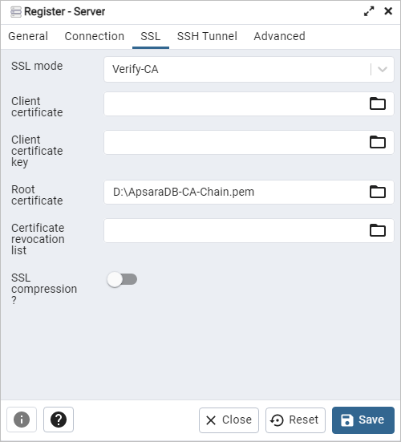

   <table>
     <tr>
       <th width="166">参数</th>
       <th>说明</th>
     </tr>
     <tr>
       <td>SSL mode</td>
       <td>PostgreSQL数据库开启SSL链路加密后，表示允许客户端通过SSL连接数据库，在客户端连接数据库时，请根据以下场景选择<strong>SSL mode</strong>参数的取值。<br>• 通过SSL连接：<br>• Require：只对数据链路加密，并不验证数据库的真实性。<br>• Verify-CA：加密数据链路，同时验证数据库的真实性。<br>• Verify-Full：加密数据链路，验证数据库的真实性，同时比对证书内的CN或DNS与连接时配置的数据库连接地址是否一致。<br>• 不通过SSL连接：Disable。</td>
     </tr>
     <tr>
       <td>Root certificate</td>
       <td>当SSL mode取值为Verify-CA或Verify-Full时，需要配置此参数，表示数据库CA证书路径。<br>说明需下载开启SSL链路加密步骤生成的CA证书。</td>
     </tr>
   </table>

7. 单击**Save**。

8. 若连接信息无误，选择**Servers > 服务器名称 > Databases > postgres**，会出现如下界面，则表示连接成功。

   

   > postgres是RDS实例默认的系统数据库，请勿在该数据库中进行任何操作。
   >
   > **重要**

**关闭SSL链路加密**

1. 登录云数据库RDS控制台。

2. 单击**实例列表**，单击目标实例ID或者单击实例右侧**操作**列下的**管理**，打开**基本信息**页面。

3. 在左侧菜单栏中，单击**数据安全性**。

4. 单击**SSL**页签。

   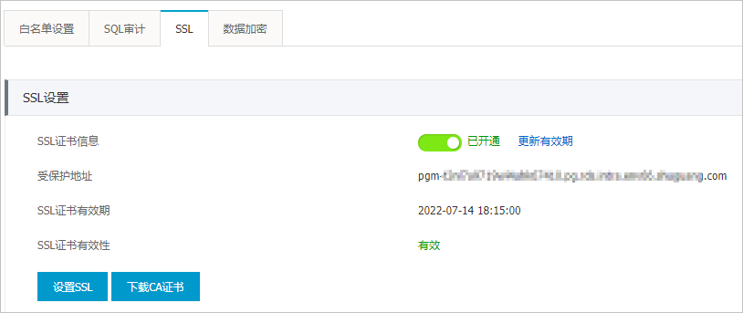

5. 单击**SSL证书信息**后的开关滑块，等待系统关闭SSL。

   > 关闭SSL链路加密会重启数据库实例，请谨慎操作。
   >
   > **重要**

<a id="section-13-4"></a>

## 13.4. 设置数据加密

数据加密能够最大限度保护您的数据安全，您的业务和应用程序无需做额外的改动。同时实例云盘生成的快照及这些快照创建的云盘将自动延续加密属性。

**前提条件**

实例的存储类型为SSD云盘。

**设置云盘加密**

1. 在浏览器地址栏中，输入Apsara Uni-manager运营控制台的服务域名地址，按回车键。

   

   > **说明**
   >
   > - 单击页面右上角的当前语言可以切换其它语言。
   >
   > - 授权登录是第三方认证中配置了全局IdP设置才会显示，且“授权登录”名称用户可按需自定义。

2. 输入正确的用户名及密码。

   > **说明**
   >
   > - 请向运营管理员获取登录控制台的用户名和密码。
   >
   > - 首次登录Apsara Uni-manager运营控制台时，需要修改登录用户名的密码，请按照提示完成密码修改。为提高安全性，密码长度必须为10~32位，且包含英文字母大小写、阿拉伯数字和特殊符号（感叹号（!）、at（@）、井号（#）、美元符号（$）、百分号（%）等）。

3. 单击**账号登录**。

4. 在页面顶部的导航栏中，单击**产品**，选择**安全 > 密钥管理服务KMS**。

5. 单击**创建密钥**。

6. 设置如下参数。

   <table>
     <tr>
       <th>类别</th>
       <th>配置项</th>
       <th>说明</th>
     </tr>
     <tr>
       <td rowspan="3">区域</td>
       <td>组织</td>
       <td>密钥所属的组织。</td>
     </tr>
     <tr>
       <td>资源集</td>
       <td>密钥所属的资源集。</td>
     </tr>
     <tr>
       <td>地域</td>
       <td>密钥所属的地域。</td>
     </tr>
     <tr>
       <td rowspan="5">基本配置</td>
       <td>密钥类型</td>
       <td>KMS支持以下密钥类型。<br>• 对称密钥的类型：<br>• Aliyun_AES_256<br>• 非对称密钥的类型：<br>• RSA_2048<br>• EC_P256<br>• EC_P256K</td>
     </tr>
     <tr>
       <td>密钥用途</td>
       <td>ENCRYPT/DECRYPT：数据加密和解密。</td>
     </tr>
     <tr>
       <td>保护级别</td>
       <td>SOFTWARE：通过软件模块对密钥进行保护。</td>
     </tr>
     <tr>
       <td>别名</td>
       <td>用户主密钥的可选标识，详情请参见<strong>《密钥管理服务KMS》</strong>的<strong>用户指南 &gt;</strong><strong>别名使用说明</strong>章节。</td>
     </tr>
     <tr>
       <td>描述</td>
       <td>密钥的说明信息。</td>
     </tr>
     <tr>
       <td rowspan="2">高级配置</td>
       <td>轮转周期</td>
       <td>是否开启自动轮转。如选择开启，则需要选择轮转的时间周期。关于轮转的详情，请参见<strong>《密钥管理服务KMS》</strong>的<strong>用户指南 &gt; 密钥的轮转</strong>章节。取值：<br>• 30天。<br>• 90天。<br>• 180天。<br>• 365天。<br>• 自定义：7~730天。<br>说明仅密钥类型为Aliyun_AES_256的对称密钥支持设置轮转周期。</td>
     </tr>
     <tr>
       <td>密钥材料来源</td>
       <td>选择密钥材料的来源。仅密钥类型为Aliyun_AES_256的对称密钥时，支持设置此参数。<br>• 阿里云KMS：密钥材料由KMS生成。<br>• 外部：KMS将不会生成密钥材料，您需要将自己的密钥材料导入KMS。<br>说明当<strong>轮转周期</strong>处于<strong>开启</strong>状态时，不支持选择<strong>外部</strong>来源。</td>
     </tr>
   </table>

7. 单击**提交**。

8. 接下来您可以在创建实例时选择云盘加密，详情请参见创建实例。

<a id="section-13-5"></a>

## 13.5. 设置透明数据加密TDE

RDS PostgreSQL支持透明数据加密TDE（Transparent Data Encryption），本文介绍如何开启透明数据加密以及如何对表或索引进行加密和解密。

**前提条件**

- RDS PostgreSQL实例需满足以下要求：

  - 实例大版本为PostgreSQL 10或以上版本。

  - 存储类型为本地盘。

  - 如果包含只读实例，只读实例也需满足以上条件。

- 已开通密钥管理服务KMS（Key Management Service）。

**注意事项**

- 开通TDE后，如果是I/O密集型（I/O bound）场景，可能会对数据库性能产生一定影响。

- TDE实例不支持用户通过物理流复制自建备库。

- 如果密钥管理服务KMS欠费，将会导致云盘无法解密，整个实例不可用，请确保KMS状态正常。

- 使用已有自定义密钥时，需要注意：

  - 禁用或删除了KMS的自定义密钥，将会造成RDS实例无法正常工作，受影响的操作包括：创建快照、恢复快照和备库重建等。

  - 撤销授权关系后，重启RDS实例会导致RDS实例不可用。

  - 请使用主账号，或者具有AliyunSTSAssumeRoleAccess权限的账号。

  > **说明**
  >
  > 关于密钥的相关操作请参见**密钥管理服务**的用户手册。

**开通TDE加密**

**使用由阿里云自动生成的密钥**

> **说明**
>
> 该方式使用的加密密钥（KEK）为KMS的服务密钥。

1. 登录云数据库RDS控制台。

2. 单击目标实例ID或者单击实例右侧的**管理**，打开**基本信息**页面。

3. 在左侧导航栏单击**数据安全性**。

4. 在**TDE**页签单击**未开通**左边的滑块。

5. 选择**使用由阿里云自动生成的密钥**，单击**确定**，开通TDE。

**使用已有自定义密钥**

> **说明**
>
> 该方式使用的加密密钥（KEK）为您上传至KMS的自定义密钥（CMK）。

1. 登录云数据库RDS控制台。

2. 单击目标实例ID或者单击实例右侧的**管理**，打开**基本信息**页面。

3. 在左侧导航栏单击**数据安全性**。

4. 在**TDE**页签单击**未开通**左边的滑块。

5. 选择 **使用已有自定义密钥**，选择密钥，单击**确定**，开通TDE。

   > **说明**
   >
   > 如果没有自定义密钥，需要单击**前往创建**，在密钥管理服务控制台创建密钥并导入自带的密钥材料。

**更换密钥**

该功能需要已开启TDE加密。

1. 登录云数据库RDS控制台。

2. 单击目标实例ID或者单击实例右侧的**管理**，打开**基本信息**页面。

3. 在左侧导航栏单击**数据安全性**。

4. 在**TDE**页签单击**TDE状态**右侧的**更换密钥**。

5. 选择**使用由阿里云自动生成的密钥**或 **使用已有自定义密钥**，选择密钥，单击**确定**。

   > **说明**
   >
   > 如果没有自定义密钥，需要单击**前往创建**，在密钥管理服务控制台创建密钥并导入自带的密钥材料。

**使用TDE对表或索引进行加密或解密**

实例级别开启了TDE之后，您还需要对RDS PostgreSQL的表进行表级别的TDE加密解密操作。

> **说明**
>
> 加密和解密会带来性能损耗，请合理控制加密范围以减少性能损耗。

- 加密

  - 表加密。

    ```text
    -- 创建加密表
    CREATETABLE <tablename> WITH (encryption=on);

    -- 修改表为加密类型
    ALTERTABLE <tablename> SET (encryption=on);
    ```

  - 索引加密。

    ```sql
    -- 创建加密索引
    CREATE INDEX <indexname> ... WITH (encryption=on);

    -- 修改索引为加密类型
    ALTERINDEX <indexname> SET (encryption=on);
    ```

    > **说明**
    >
    > 支持6种索引的加密：btree、hash、spgist、gin、gist和brin。

- 解密

  > **说明**
  >
  > 以下ALTER语句会触发表或索引的重写，类似VACUUM FULL，请勿在业务高峰期执行。

  - 解密加密表。

    ```sql
    ALTER TABLE <tablename> SET (encryption=off);
    ```

  - 解密加密索引。

    ```text
    ALTER INDEX <indexname> SET (encryption=off);
    ```

- 查看表或索引的加密状态。

  ```sql
  SELECT relname, reloptions FROM pg_class WHERE relname IN('<tablename>', 
  '<indexname>');
  ```

<a id="section-14"></a>

# 14.日志与审计

<a id="section-14-1"></a>

## 14.1. SQL审计（数据库审计）

您可以通过RDS的SQL审计功能查看SQL明细、定期审计SQL。开通SQL审计功能后，实例性能不会受到影响。

**注意事项**

- 开通SQL审计功能后，实例性能不会受到影响。

- SQL审计的保存时间为7天。

- SQL审计导出的文件可以保存2天，超过2天的会被系统定时清理。

- SQL审计默认关闭，需要手动开启。

- 开启SQL审计功能之前的记录无法查看到。

- 在SQL审计功能中，单条SQL语句长度限制为4 KB。

**开启SQL审计**

1. 登录云数据库RDS控制台。

2. 在**实例列表**页面，定位到目标实例。

3. 单击目标实例ID或者单击实例右侧的**管理**，打开**基本信息**页面。

4. 在页面左侧导航栏中单击**数据安全性**。

5. 单击**SQL审计**页签。

6. 单击页面中间的**开启SQL审计**或**立即开启**。

7. 在弹出的确认框中单击**确定**。

   > **说明**
   >
   > 开启SQL审计后，您可以通过时间范围、DB、User、关键字查询SQL信息。

**关闭SQL审计**

您可以在不需要审计SQL时关闭SQL审计功能，详细步骤如下。

> **重要**
>
> SQL审计功能关闭后，包括历史审计内容在内的SQL审计记录会被清空。请将SQL审计内容导出并妥善保存至本地后，再关闭SQL审计功能。

1. 登录云数据库RDS控制台。

2. 在**实例列表**页面，定位到目标实例。

3. 单击目标实例ID或者单击实例右侧的**管理**，打开**基本信息**页面。

4. 在页面左侧导航栏中单击**数据安全性**。

5. 选择**SQL审计**页签，单击**导出文件**。

   > **说明**
   >
   > 如果满足过滤条件的SQL总量超过100万条，则只会导出100万条。导出SQL的速度为900行每秒，100万条SQL的导出时间预计为20分钟。

6. 单击**文件列表**，在目标文件名右侧的**操作**列中单击下载，将SQL审计内容妥善保存至本地。

7. 单击**关闭SQL审计**。

8. 在弹出的确认框中，单击**确定**。

<a id="section-14-2"></a>

## 14.2. 日志管理

您可以通过控制台或SQL命令查询实例的错误日志、慢日志明细和主备切换日志，帮助故障定位分析。本文介绍如何通过控制台进行日志管理。

**操作步骤**

1. 登录云数据库RDS控制台。

2. 在**实例列表**页面，定位到目标实例。

3. 单击目标实例ID或者单击实例右侧的**管理**，打开**基本信息**页面。

4. 在页面左侧导航栏中单击**日志管理**。

5. 在**日志管理**页面按需选择查询**错误日志**、**慢日志明细**或者**主备切换日志**，选择时间范围，单击**查询**。

   <table>
     <tr>
       <th width="121">查询项</th>
       <th>内容</th>
     </tr>
     <tr>
       <td>错误日志</td>
       <td>记录1个月内数据库运行出错的日志。</td>
     </tr>
     <tr>
       <td>慢日志明细</td>
       <td>记录1个月内数据库中执行时间超过1秒的SQL语句，并进行相似语句去重。<br>说明支持查看和导出最近1个月内任意7天的慢日志数据。</td>
     </tr>
     <tr>
       <td>主备切换日志</td>
       <td>记录1个月内主备库切换的日志。</td>
     </tr>
   </table>

<a id="section-15"></a>

# 15.备份

<a id="section-15-1"></a>

## 15.1. 备份PostgreSQL数据

RDS会按照默认的备份设置自动备份数据，您也可以修改自动备份设置或手动备份RDS数据。

**注意事项**

- 备份期间不要执行DDL操作，避免锁表导致备份失败。

- 尽量选择业务低峰期进行备份。

- 若数据量较大，花费的时间可能较长，请耐心等待。

- 备份文件有保留时间，请及时下载需要保留的备份文件到本地。

**备份说明**

PostgreSQL支持全量物理备份，并支持数据库的归档日志文件备份。

**设置备份策略实现自动备份**

阿里云数据库会执行用户设定的备份策略，自动备份数据库。

1. 登录云数据库RDS控制台。

2. 在**实例列表**页面，定位到目标实例。

3. 单击目标实例ID或者单击实例右侧的**管理**，打开**基本信息**页面。

4. 单击页面左侧导航栏的**备份恢复**。

5. 在 **备份恢复**页面中单击**备份设置**页签，并单击**编辑**。

6. 在弹出的对话框中设置备份参数，单击**确定**。参数说明如下：

   | 参数 | 说明 |
   | --- | --- |
   | 数据备份保留 | 默认为7天，可以设置为 7~730 天。 |
   | 备份周期 | 可以设置为一星期中的某几天。<br>说明为了您的数据安全，一周至少需要备份两次。 |
   | 备份时间 | 可以设置为任意时段，以小时为单位。 |
   | 日志备份 | 日志备份的开关。<br>重要关闭日志备份会导致所有日志备份被清除，并且无法使用按时间点恢复数据的功能。 |
   | 日志备份保留 | • 日志备份文件保留的天数，默认为 7 天。<br>• 可以设置为 7~730 天，且必须小于等于数据备份保留天数。 |
   | OSS转储状态 | OSS转储开关，当开启转储后，您新增的备份文件将会自动转储到指定的OSS Bucket中。<br>• 开启<br>• 关闭 |
   | OSS转储内容 | 用于设置OSS转储的内容，可多选。<br>• 数据备份<br>• 日志备份 |
   | OSS Bucket | 选择已创建的OSS Bucket。 |

**手动备份**

1. 登录云数据库RDS控制台。

2. 在**实例列表**页面，定位到目标实例。

3. 单击目标实例ID或者单击实例右侧的**管理**，打开**基本信息**页面。

4. 单击页面右上角的**备份实例**，打开**备份实例**对话框。

5. 选择备份方式和备份策略，单击**确定**开始备份。

   > 备份方式固定为**全量备份**，备份策略固定为**实例备份**。
   >
   > **说明**

**后续步骤**


您可以单击页面右上角的

图标打开**任务进度**列表查看任务进度。

<a id="section-15-2"></a>

## 15.2. 下载数据备份和日志备份

为保障用户权益，RDS提供了未加密的数据备份和日志备份下载，方便用户存档，也可用于恢复到本地数据库。

**操作步骤**

1. 登录云数据库RDS控制台。

2. 在**实例列表**页面，定位到目标实例。

3. 单击目标实例ID或者单击实例右侧的**管理**，打开**基本信息**页面。

4. 在左侧导航栏中，单击**备份恢复**，打开**备份恢复**页面。

5. 根据想要下载的备份类型，选择相应的页签：

   - 下载数据备份：选择**数据备份**页签。

   - 下载日志备份：选择**归档列表**页签。

6. 选择要下载备份的时间范围。

7. 定位到目标数据备份或归档日志，单击其对应**操作**列中的**下载**。

   > **说明**
   >
   > - 若数据备份用于数据恢复，请选择离要恢复的时间点最近的数据备份文件。
   >
   > - 若归档日志是用于恢复到本地数据库，请注意如下事项：
   >
   >   - 归档日志的所在实例编号必须与数据备份的所在实例编号一致。
   >
   >   - 归档日志的起始时间段必须在您选择的数据备份时间点之后，在要恢复数据的时间点之前。

8. 在弹出的页面中，选择下载方式。

   <table>
     <tr>
       <th width="138">下载方式</th>
       <th>说明</th>
     </tr>
     <tr>
       <td>我了解，要下载</td>
       <td>通过外网地址直接下载备份文件。</td>
     </tr>
     <tr>
       <td>复制内网地址</td>
       <td>仅复制内网下载地址。当ECS与RDS在相同地域时，您可以在ECS上使用内网地址下载备份文件，更快更安全。</td>
     </tr>
     <tr>
       <td>复制外网地址</td>
       <td>仅复制外网下载地址。当您要通过其他工具下载备份文件时，可以采用此方式。</td>
     </tr>
   </table>

   > 在Linux系统中下载时，可以使用如下命令：
   >
   > **说明**
   >
   > ```bash
   > wget -c '<备份⽂件下载地址>' -O <⽂件名称>
   > ```
   >
   > - -c：启用断点续传模式。
   >
   > - -O：将下载的结果保存为指定的文件名，建议您使用URL中包含的原文件名。
   >
   > - 下载地址有多个参数时建议为下载地址添加单引号，避免下载失败。

   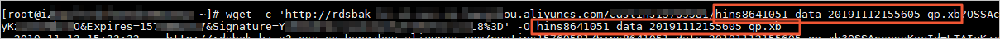

<a id="section-15-3"></a>

## 15.3. 逻辑备份PostgreSQL数据

您可以使用PostgreSQL自带的工具pg_dump将实例的数据进行逻辑备份，并导出到本地保存。

**背景信息**

pg_dump是备份PostgreSQL数据库的工具，可用于备份单个数据库。更多详情请参见pg_dump。

本文使用CentOS 7操作系统和PostgreSQL 10版本为例进行演示。

**前提条件**

- RDS PostgreSQL实例已通过设置白名单放行ECS实例或本地主机的IP，详情请参见设置IP白名单。

- ECS实例或本地主机已安装和RDS PostgreSQL实例相同版本的PostgreSQL。

**注意事项**

建议使用高权限账号进行备份，避免出现权限不足的问题。

**备份单个数据库**

1. 登录ECS实例或本地主机，使用如下命令备份目标数据库。

   ```text
   pg_dump -h '<hostname>' -U <username> -p <port> -Fc <dbname> > <dumpdir>
   ```

   <table>
     <tr>
       <th width="107">参数</th>
       <th>说明</th>
     </tr>
     <tr>
       <td>hostname</td>
       <td>RDS PostgreSQL实例连接地址。<br>说明ECS实例通过内网连接地址访问RDS实例，需要两者网络类型相同（如果是专有网络，VPC也要相同）。如何查看内网连接地址请参见查看和修改内网地址和端口。</td>
     </tr>
     <tr>
       <td>username</td>
       <td>RDS PostgreSQL实例高权限账号名称。</td>
     </tr>
     <tr>
       <td>port</td>
       <td>RDS PostgreSQL实例端口。</td>
     </tr>
     <tr>
       <td>-Fc</td>
       <td>输出格式。<code> -Fc </code>表示输出自定义格式的存档，这个格式适合通过pg_restore进行导入还原。更多选项的详细说明请参见pg_dump。</td>
     </tr>
     <tr>
       <td>dbname</td>
       <td>目标数据库名称。</td>
     </tr>
     <tr>
       <td>dumpdir</td>
       <td>导出的备份文件路径及名称。</td>
     </tr>
   </table>

   示例

   ```text
   pg_dump -h 'pgm-bpxxxxxx.pg.rds.aliyuncs.com' -U test123 -p 3433 -Fc testdb > /tmp/testdb.dump
   ```

2. 命令行提示 `Password:` 时，输入PostgreSQL实例高权限账号对应的密码，然后按回车键确认。

   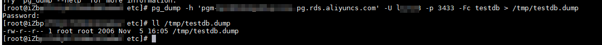

**备份指定表**

1. 登录ECS实例或本地主机，使用如下命令备份目标数据库的指定表。

   ```text
   pg_dump -h '<hostname>' -U <username> -p <port> -t <table> -Fc <dbname> > <dumpdir>
   ```

   <table>
     <tr>
       <th width="107">参数</th>
       <th>说明</th>
     </tr>
     <tr>
       <td>hostname</td>
       <td>RDS PostgreSQL实例连接地址。<br>说明ECS实例通过内网连接地址访问RDS实例，需要两者网络类型相同（如果是专有网络，VPC也要相同）。如何查看内网连接地址请参见查看和修改内网地址和端口。</td>
     </tr>
     <tr>
       <td>username</td>
       <td>RDS PostgreSQL实例高权限账号名称。</td>
     </tr>
     <tr>
       <td>port</td>
       <td>RDS PostgreSQL实例端口。</td>
     </tr>
     <tr>
       <td>table</td>
       <td>需要备份的表。可以用多个<code> -t &lt;table&gt; </code>选择多个表。</td>
     </tr>
     <tr>
       <td>-Fc</td>
       <td>输出格式。<code> -Fc </code>表示输出自定义格式的存档，这个格式适合通过pg_restore进行导入还原。更多选项的详细说明请参见pg_dump。</td>
     </tr>
     <tr>
       <td>dbname</td>
       <td>目标数据库名称。</td>
     </tr>
     <tr>
       <td>dumpdir</td>
       <td>导出的备份文件路径及名称。</td>
     </tr>
   </table>

   示例

   ```text
   pg_dump -h 'pgm-bpxxxxxx.pg.rds.aliyuncs.com' -U test123 -p 3433 -t products1 -Fc testdb2 > /tmp/testdb2.dump
   ```

2. 命令行提示 `Password:` 时，输入PostgreSQL实例高权限账号对应的密码，然后按回车键确认。

   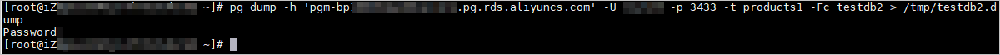

**备份数据库时排除指定表**

1. 登录ECS实例或本地主机，使用如下命令备份目标数据库并排除指定表。

   ```text
   pg_dump -h '<hostname>' -U <username> -p <port> -T <table> -Fc <dbname> > <dumpdir>
   ```

   <table>
     <tr>
       <th width="107">参数</th>
       <th>说明</th>
     </tr>
     <tr>
       <td>hostname</td>
       <td>RDS PostgreSQL实例连接地址。<br>说明ECS实例通过内网连接地址访问RDS实例，需要两者网络类型相同（如果是专有网络，VPC也要相同）。如何查看内网连接地址请参见查看和修改内网地址和端口。</td>
     </tr>
     <tr>
       <td>username</td>
       <td>RDS PostgreSQL实例高权限账号名称。</td>
     </tr>
     <tr>
       <td>port</td>
       <td>RDS PostgreSQL实例端口。</td>
     </tr>
     <tr>
       <td>table</td>
       <td>需要排除的表。可以用多个<code> -T &lt;table&gt; </code>排除多个表。</td>
     </tr>
     <tr>
       <td>-Fc</td>
       <td>输出格式。<code> -Fc </code>表示输出自定义格式的存档，这个格式适合通过pg_restore进行导入还原。更多选项的详细说明请参见pg_dump。</td>
     </tr>
     <tr>
       <td>dbname</td>
       <td>目标数据库名称。</td>
     </tr>
     <tr>
       <td>dumpdir</td>
       <td>导出的备份文件路径及名称。</td>
     </tr>
   </table>

   示例

   ```text
   pg_dump -h 'pgm-bpxxxxx.pg.rds.aliyuncs.com' -U test123 -p 3433 -T products1 -Fc testdb2 > /tmp/testdb2.dump
   ```

2. 命令行提示 `Password:` 时，输入PostgreSQL实例高权限账号对应的密码，然后按回车键确认。

   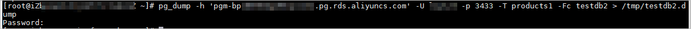

**备份数据库模式（不备份数据）**

1. 登录ECS实例或本地主机，使用如下命令备份目标数据库模式。

   ```text
   pg_dump -h '<hostname>' -U <username> -p <port> -s -Fc <dbname> > <dumpdir>
   ```

   <table>
     <tr>
       <th width="107">参数</th>
       <th>说明</th>
     </tr>
     <tr>
       <td>hostname</td>
       <td>RDS PostgreSQL实例连接地址。<br>说明ECS实例通过内网连接地址访问RDS实例，需要两者网络类型相同（如果是专有网络，VPC也要相同）。如何查看内网连接地址请参见查看和修改内网地址和端口。</td>
     </tr>
     <tr>
       <td>username</td>
       <td>RDS PostgreSQL实例高权限账号名称。</td>
     </tr>
     <tr>
       <td>port</td>
       <td>RDS PostgreSQL实例端口。</td>
     </tr>
     <tr>
       <td>-s</td>
       <td>仅备份数据库模式，不备份数据。更多选项的详细说明请参见pg_dump。</td>
     </tr>
     <tr>
       <td>-Fc</td>
       <td>输出格式。<code> -Fc </code>表示输出自定义格式的存档，这个格式适合通过pg_restore进行导入还原。更多选项的详细说明请参见pg_dump。</td>
     </tr>
     <tr>
       <td>dbname</td>
       <td>目标数据库名称。</td>
     </tr>
     <tr>
       <td>dumpdir</td>
       <td>导出的备份文件路径及名称。</td>
     </tr>
   </table>

   示例

   ```text
   pg_dump -h 'pgm-bpxxxxx.pg.rds.aliyuncs.com' -U test123 -p 3433 -s -Fc testdb2 > /tmp/testdb2.dump
   ```

2. 命令行提示 `Password:` 时，输入PostgreSQL实例高权限账号对应的密码，然后按回车键确认。

   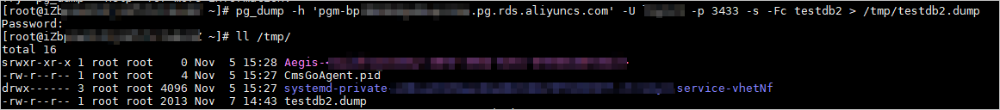

<a id="section-15-4"></a>

## 15.4. 实例级别全量备份（pg_basebackup）

您可以使用PostgreSQL自带的工具pg_basebackup将整个实例的数据进行备份，并导出到本地保存。

**前提条件**

- RDS PostgreSQL实例已通过设置白名单放行ECS实例或本地主机的IP，详情请参见设置IP白名单。

- ECS实例或本地主机已安装和RDS PostgreSQL实例相同版本的PostgreSQL。

**背景信息**

pg_basebackup可以将整个PostgreSQL实例的数据进行备份，在后续业务中可用于时间点恢复。更多详情请参见pg_basebackup。

本文以CentOS 7操作系统为例，为您演示如何备份。

**注意事项**

建议使用高权限账号进行备份，避免出现权限不足的问题。

**操作步骤**

> pg_basebackup无法备份单个数据库或数据库对象。备份单个数据库或数据库对象请参
>
> **说明**
>
> 见逻辑备份PostgreSQL数据。

1. 登录ECS实例或本地主机，使用如下命令备份目标数据库。

   ```text
   pg_basebackup -Ft -Pv -Xf -z -D <backupdir> -Z5 -h '<hostname>' -p <port> -U <username> -W
   ```

   参数说明如下。命令说明请参见pg_basebackup。

   <table>
     <tr>
       <th width="107">参数</th>
       <th>说明</th>
     </tr>
     <tr>
       <td>backupdir</td>
       <td>导出的备份文件路径。系统会自动创建目录，但是如果该目录已经存在且不为空，则会报错。</td>
     </tr>
     <tr>
       <td>hostname</td>
       <td>RDS PostgreSQL实例内网连接地址。 如何查看内网连接地址请参见查看和修改内网地址和端口。</td>
     </tr>
     <tr>
       <td>port</td>
       <td>RDS PostgreSQL实例端口。</td>
     </tr>
     <tr>
       <td>username</td>
       <td>RDS PostgreSQL实例账号名称。</td>
     </tr>
   </table>

   示例

   ```text
   pg_basebackup -Ft -Pv -Xf -z -D /pg12/backup1/ -Z5 -h pgm-bpxxxxx.pg.rds.aliyuncs.com 
   -p 1433 -U test1 -W
   ```

2. 命令行提示 `Password:` 时，输入PostgreSQL实例账号对应的密码，然后按回车键确认。

   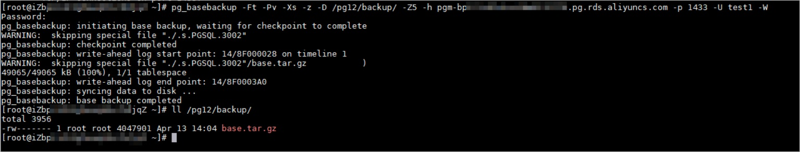

<a id="section-16"></a>

# 16.恢复

<a id="section-16-1"></a>

## 16.1. 恢复PostgreSQL数据

如果拥有RDS PostgreSQL实例的数据备份，可以按本文介绍的方法恢复数据。

**注意事项**

- 新实例的白名单设置、备份设置、参数设置和当前实例保持一致。

- 新实例的数据信息和账号信息与备份集或时间点的信息一致。

**前提条件**

原实例需要满足如下条件：

- 运行中且没有被锁定。

- 当前没有迁移任务。

- 如果要按时间点进行恢复，需要确保日志备份已开启。

- 若要按备份集恢复，则原实例必须至少有一个备份集。

**恢复PostgreSQL数据**

1. 登录云数据库RDS控制台。

2. 在**实例列表**页面，定位到目标实例。

3. 单击目标实例ID或者单击实例右侧的**管理**，打开**基本信息**页面。

4. 单击页面左侧导航栏的**备份恢复**。

5. 在 页面右上角单击**数据库恢复（原克隆实例）**。

6. 设置以下参数：

   **类别**

   **配置**

   **说明**

   实例所属地域。

   **区域**

   **地域**

   - **按时间点**：可以设置为日志备份保留时间内的任意时间点。如要查看或修改日志备份保留时间，请参见备份PostgreSQL数据。

   - **按备份集**

   **还原方式**

   > 只有开启了日志备份，才会显示**按时间点**。

   **数据库恢复**

   > **说明**

   选择数据库的还原时间。**还原方式**中选择了**按时间点**后可选择。

   **还原时间**

   选择数据库的备份集。**还原方式**中选择了**按备份集**后可选择。

   **备份集**

   RDS实例的名称。

   **实例名称**

   数据库的类型。固定为**PostgreSQL**。

   **数据库类型**

   数据库的版本。固定为当前实例的数据库版本。

   **数据库版本**

   实例的系列。

   **系列**

   **规格配置**

   实例的存储类型。固定为当前实例的存储类型。

   **存储类型**

   实例的规格，不同的内存大小对应不同的最大连接数和IOPS，具体请以控制台界

   **实例规格**

   面为准。详情请参见<strong>《云数据库RDS》</strong>的**产品简介 > 实例规格**章节。

   存储空间包括数据空间、系统文件空间、Binlog文件空间和事务文件空间。可选

   **存储空间**

   存储空间范围为20GB ~6000 GB，每5GB递增。

   RDS实例支持的网络类型：

   - **经典网络**：经典网络中的云服务在网络上不进行隔离，只能依靠云服务自身的安全组或白名单策略来阻挡非法访问。

   - **专有网络**：（Virtual Private Cloud，简称VPC）专有网络帮助用户在阿里云上构建出一个隔离的网络环境。用户可以自定义专有网络里面的路由表、IP地

   **网络类型**

   **网络类型**

   址范围和网关。建议您选择专有网络，更加安全。

   > 选择**专有网络**后，您需要选择对应的**专有网络vpc**和**交换机**
   >
   > **说明**
   >
   > **vswitch**。

7. 单击**提交**，等待恢复完成。

<a id="section-16-2"></a>

## 16.2. 使用逻辑备份文件恢复数据

您可以将逻辑备份文件中的数据恢复到RDS PostgreSQL实例或本地PostgreSQL数据库中。

**背景信息**

对于少量的数据，您可以使用逻辑备份进行快速恢复，例如恢复某个表的数据。对于大量的数据，建议您使用全量物理备份恢复数据到新实例上，然后通过数据传输服务DTS迁移回现有实例中。

**前提条件**

已通过逻辑备份备份了PostgreSQL数据。详情请参见逻辑备份PostgreSQL数据。

**注意事项**

- 恢复数据时连接的数据库建议不要用默认数据库postgres。

- 恢复指定表数据时不会尝试还原指定表可能依赖的数据库对象，因此无法保证将指定表还原到干净的数据库时一定会成功。

**恢复数据库**

1. 登录已备份数据的ECS实例或本地主机，使用如下命令恢复数据。

   ```text
   pg_restore -h '<hostname>' -U <username> -p <port> -d <dbname> <dumpdir>
   ```

   <table>
     <tr>
       <th width="107">参数</th>
       <th>说明</th>
     </tr>
     <tr>
       <td>hostname</td>
       <td>RDS PostgreSQL实例连接地址。<br>说明ECS实例通过内网连接地址访问RDS实例，需要两者网络类型相同（如果是专有网络，VPC也要相同）。如何查看内网连接地址请参见查看和修改内网地址和端口。</td>
     </tr>
     <tr>
       <td>username</td>
       <td>RDS PostgreSQL实例高权限账号名称。</td>
     </tr>
     <tr>
       <td>port</td>
       <td>RDS PostgreSQL实例端口。</td>
     </tr>
     <tr>
       <td>dbname</td>
       <td>待恢复数据的数据库名称。</td>
     </tr>
     <tr>
       <td>dumpdir</td>
       <td>备份文件路径及名称。</td>
     </tr>
   </table>

   示例

   ```text
   pg_restore -h 'pgm-bpxxxxx.pg.rds.aliyuncs.com' -U test123 -p 3433 -d testdb2 /tmp/testdb.dump
   ```

2. 命令行提示 `Password:` 时，输入PostgreSQL实例高权限账号对应的密码，然后按回车键确认。

   > 请忽略内嵌插件plpgsql的报警。
   >
   > **说明**

   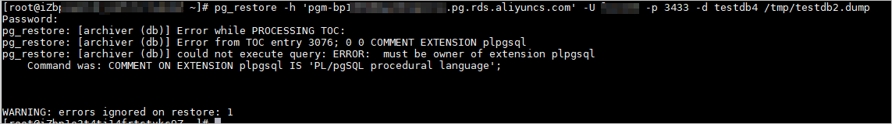

**恢复指定表数据**

1. 登录已备份数据的ECS实例或本地主机，使用如下命令恢复指定表的数据。

   ```text
   pg_restore -h '<hostname>' -U <username> -p <port> -d <dbname> -t <table> -c <dumpdir
   >
   ```

   <table>
     <tr>
       <th width="107">参数</th>
       <th>说明</th>
     </tr>
     <tr>
       <td>hostname</td>
       <td>RDS PostgreSQL实例连接地址。<br>说明ECS实例通过内网连接地址访问RDS实例，需要两者网络类型相同（如果是专有网络，VPC也要相同）。如何查看内网连接地址请参见查看和修改内网地址和端口。</td>
     </tr>
     <tr>
       <td>username</td>
       <td>RDS PostgreSQL实例高权限账号名称。</td>
     </tr>
     <tr>
       <td>port</td>
       <td>RDS PostgreSQL实例端口。</td>
     </tr>
     <tr>
       <td>dbname</td>
       <td>待恢复数据的数据库名称。</td>
     </tr>
     <tr>
       <td>table</td>
       <td>待恢复的表名。</td>
     </tr>
     <tr>
       <td>-c</td>
       <td><code> -c </code>表示在恢复时，会先删除数据库对象再恢复。更多选项的详细说明请参见pg_restore。</td>
     </tr>
     <tr>
       <td>dumpdir</td>
       <td>备份文件路径及名称。</td>
     </tr>
   </table>

   示例

   ```text
   pg_restore -h 'pgm-bpxxxxx.pg.rds.aliyuncs.com' -U test123 -p 3433 -d testdb2 -t products -c /tmp/testdb.dump
   ```

2. 命令行提示 `Password:` 时，输入PostgreSQL实例高权限账号对应的密码，然后按回车键确认。

   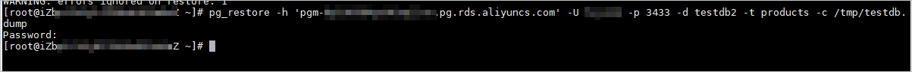

**恢复数据库模式（不恢复数据）**

1. 登录已备份数据的ECS实例或本地主机，使用如下命令恢复数据库模式。

   ```text
   pg_restore -h '<hostname>' -U <username> -p <port> -d <dbname> -s <dumpdir>
   ```

   <table>
     <tr>
       <th width="107">参数</th>
       <th>说明</th>
     </tr>
     <tr>
       <td>hostname</td>
       <td>RDS PostgreSQL实例连接地址。<br>说明ECS实例通过内网连接地址访问RDS实例，需要两者网络类型相同（如果是专有网络，VPC也要相同）。如何查看内网连接地址请参见查看和修改内网地址和端口。</td>
     </tr>
     <tr>
       <td>username</td>
       <td>RDS PostgreSQL实例高权限账号名称。</td>
     </tr>
     <tr>
       <td>port</td>
       <td>RDS PostgreSQL实例端口。</td>
     </tr>
     <tr>
       <td>dbname</td>
       <td>待恢复模式的数据库名称。</td>
     </tr>
     <tr>
       <td>-s</td>
       <td><code> -s </code>表示仅恢复模式，不恢复数据。更多选项的详细说明请参见pg_restore。</td>
     </tr>
     <tr>
       <td>dumpdir</td>
       <td>备份文件路径及名称。</td>
     </tr>
   </table>

   示例

   ```text
   pg_restore -h 'pgm-bpxxxxx.pg.rds.aliyuncs.com' -U test123 -p 3433 -d testdb4 -s /tmp/testdb2.dump
   ```

2. 命令行提示 `Password:` 时，输入PostgreSQL实例高权限账号对应的密码，然后按回车键确认。

   > 请忽略内嵌插件plpgsql的报警。
   >
   > **说明**

   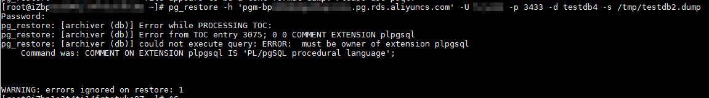

<a id="section-17"></a>

# 17.CloudDBA

<a id="section-17-1"></a>

## 17.1. CloudDBA简介

CloudDBA是一种基于机器学习和专家经验实现数据库自感知、自修复、自优化、自运维及自安全的云服务，帮助用户消除数据库管理的复杂性及人工操作引发的服务故障，有效保障数据库服务的稳定、安全及高效。

**功能介绍**

PostgreSQL的CloudDBA主要包含如下功能：

- 一键诊断

  诊断实例，并提供可视化的诊断结果供您查看。

- 会话管理

  查看会话、统计会话、分析SQL和优化SQL。

- 实时性能

  实时查看实例的QPS、TPS、连接数、网络流量等信息。

- 空间分析

  查看空间概况、变化趋势、异常列表、表空间和数据空间。

- 性能趋势

  查看和对比性能趋势、自定义性能趋势大盘、查看异常诊断信息和查看实例拓扑结构。

- 慢SQL

  查看慢日志趋势和统计信息。

<a id="section-17-2"></a>

## 17.2. 一键诊断

CloudDBA提供RDS PostgreSQL一键诊断功能，可以诊断实例并提供可视化的诊断结果。

**进入一键诊断页面**

1. 登录云数据库RDS控制台。

2. 在**云数据库管理**页面，单击目标实例ID或者单击实例右侧**操作**列下的**管理**，打开**基本信息**页面。

3. 在左侧导航栏中，单击**CloudDBA > 一键诊断**。

   > 详细说明请参见 **《数据库自治服务DAS > 用户指南中的一键诊断章节。》**
   >
   > **说明**

<a id="section-17-3"></a>

## 17.3. 会话管理

CloudDBA提供RDS PostgreSQL实例会话管理功能，可以查看、管理目标实例的会话。

**进入会话管理页面**

1. 登录云数据库RDS控制台。

2. 在**云数据库管理**页面，单击目标实例ID或者单击实例右侧**操作**列下的**管理**，打开**基本信息**页面。

3. 在左侧导航栏中，单击**CloudDBA > 一键诊断**。

4. 单击**会话管理**页签。

   > 详细说明请参见 **《数据库自治服务DAS > 用户指南中的实例会话章节。》**
   >
   > **说明**

<a id="section-17-4"></a>

## 17.4. 实时性能

CloudDBA提供RDS PostgreSQL实时性能功能，可以查看PostgreSQL的实时性能。

**进入实时性能页面**

1. 登录云数据库RDS控制台。

2. 在**云数据库管理**页面，单击目标实例ID或者单击实例右侧**操作**列下的**管理**，打开**基本信息**页面。

3. 在左侧导航栏中，单击**CloudDBA > 一键诊断**。

4. 单击**实时性能**页签。

   > 详细说明请参见 **《数据库自治服务DAS > 用户指南中的实时性能章节。》**
   >
   > **说明**

<a id="section-17-5"></a>

## 17.5. 空间分析

CloudDBA提供RDS PostgreSQL空间分析功能，能够帮助您及时发现数据库中的空间异常，避免影响数据库稳定性。

**背景信息**

空间分析功能可以直观地查看数据库实例的空间使用概况、空间剩余可用天数，以及数据库中某个表的空间使用情况、空间碎片、空间异常诊断等。

**进入空间分析页面**

1. 登录云数据库RDS控制台。

2. 在**云数据库管理**页面，单击目标实例ID或者单击实例右侧**操作**列下的**管理**，打开**基本信息**页面。

3. 在左侧导航栏中，单击**CloudDBA > 一键诊断**。

4. 单击**空间分析**页签。

   > 详细说明请参见 **《数据库自治服务DAS > 用户指南中的空间分析章节。》**
   >
   > **说明**

<a id="section-17-6"></a>

## 17.6. 性能趋势

CloudDBA提供RDS PostgreSQL性能趋势功能，支持多种查看性能趋势的方式，不仅支持性能趋势区间查看，也支持性能趋势对比查看和自定义性能趋势查看。

**进入性能趋势页面**

1. 登录云数据库RDS控制台。

2. 在**云数据库管理**页面，单击目标实例ID或者单击实例右侧**操作**列下的**管理**，打开**基本信息**页面。

3. 在左侧导航栏中，单击**CloudDBA > 性能趋势**。

   > 有关性能趋势的详细说明，请参见 **《数据库自治服务DAS > 用户指南中的性能趋势章**
   >
   > **说明**
   >
   > **节。》**

<a id="section-17-7"></a>

## 17.7. 慢SQL

CloudDBA提供RDS PostgreSQL慢SQL功能，可以查看慢日志趋势、慢日志执行情况和慢日志优化建议。

**进入慢SQL页面**

1. 登录云数据库RDS控制台。

2. 在**云数据库管理**页面，单击目标实例ID或者单击实例右侧**操作**列下的**管理**，打开**基本信息**页面。

3. 在左侧导航栏中，单击**CloudDBA > 慢SQL**。

   > **说明**
   >
   > - 支持查看和导出最近1个月内任意7天的慢日志数据。
   >
   > - 详细说明请参见 **《数据库自治服务DAS > 用户指南中的慢SQL章节。》**

<a id="section-18"></a>

# 18.插件

<a id="section-18-1"></a>

## 18.1. 支持插件列表

本文列出RDS PostgreSQL支持的插件及其版本。

> **说明**
>
> - 下表仅列出了常见的插件清单，您可以连接实例后，使用 `SELECT * FROM pg_available_extensions;` 命令查看当前实例支持的所有插件及版本。请以实际查询结果为准。
>
> - 如果您实例中的插件版本与下表存在差异，请升级专有云环境至最新。

| 插件名 | 13 | 12 | 11 | 10 |
| --- | --- | --- | --- | --- |
| address_standardizer | 3.1.4 | 3.1.4 | 3.1.4 | 3.1.4 |
| address_standardizer_data_u s | 3.1.4 | 3.1.4 | 3.1.4 | 3.1.4 |
| aggs_for_arrays | 无 | 无 | 无 | 1.3.1 |
| bloom | 1.0 | 1.0 | 1.0 | 1.0 |
| btree_gin | 1.3 | 1.3 | 1.3 | 1.2 |
| btree_gist | 1.5 | 1.5 | 1.5 | 1.5 |
| chkpass | 无 | 无 | 无 | 1.0 |
| citext | 1.6 | 1.6 | 1.5 | 1.4 |
| cube | 1.4 | 1.4 | 1.4 | 1.2 |
| dblink | 1.2 | 1.2 | 1.2 | 1.2 |
| decoderbufs | 0.1.0 | 0.1.0 | 0.1.0 | 0.1.0 |
| dict_int | 1.0 | 1.0 | 1.0 | 1.0 |
| earthdistance | 1.1 | 1.1 | 1.1 | 1.1 |
| fuzzystrmatch | 1.1 | 1.1 | 1.1 | 1.1 |
| ganos_address_standardizer | 5.5 | 5.5 | 5.5 | 5.5 |
| ganos_address_standardizer_data_us | 5.5 | 5.5 | 5.5 | 5.5 |
| ganos_geometry | 5.5 | 5.5 | 5.5 | 5.5 |
| ganos_geometry_pyramid | 5.5 | 5.5 | 5.5 | 5.5 |
| ganos_geometry_sfcgal | 5.5 | 5.5 | 5.5 | 5.5 |
| ganos_geometry_topology | 5.5 | 5.5 | 5.5 | 5.5 |
| ganos_networking | 5.5 | 5.5 | 5.5 | 5.5 |
| ganos_pointcloud | 5.5 | 5.5 | 5.5 | 5.5 |
| ganos_pointcloud_geometry | 5.5 | 5.5 | 5.5 | 5.5 |
| ganos_raster | 5.5 | 5.5 | 5.5 | 5.5 |
| ganos_spatialref | 5.5 | 5.5 | 5.5 | 5.5 |
| ganos_tiger_geocoder | 5.5 | 5.5 | 5.5 | 5.5 |
| ganos_trajectory | 5.5 | 5.5 | 5.5 | 5.5 |
| hll | 2.15 | 2.14 | 2.14 | 无 |
| hstore | 1.7 | 1.6 | 1.5 | 1.4 |
| hypopg | 1.3.1 | 1.3.1 | 1.3.1 | 1.3.1 |
| index_adviser | 2.0 | 2.0 | 2.0 | 2.0 |
| intagg | 1.1 | 1.1 | 1.1 | 1.1 |
| intarray | 1.3 | 1.2 | 1.2 | 1.2 |
| ip4r | 2.4 | 无 | 无 | 无 |
| isn | 1.2 | 1.2 | 1.2 | 1.1 |
| ltree | 1.2 | 1.1 | 1.1 | 1.1 |
| log_fdw | 无 | 无 | 1.0 | 无 |
| madlib | 无 | 1.18.0 | 1.18.0 | 无 |
| mysql_fdw | 1.1 | 1.1 | 1.1 | 1.1 |
| oracle_fdw | 无 | 1.1 | 无 | 无 |
| orafce | 无 | 无 | 3.8 | 3.6 |
| oss_fdw | 1.1 | 1.1 | 1.1 | 1.1 |
| pase | 0.0.1 | 0.0.1 | 0.0.1 | 无 |
| pg_bigm | 1.2 | 1.2 | 1.2 | 1.2 |
| pg_buffercache | 1.3 | 1.3 | 1.3 | 1.3 |
| pg_concurrency_control | 无 | 无 | 1.0 | 1.0 |
| pg_cron | 1.1 | 1.1 | 1.1 | 1.1 |
| pg_freespacemap | 1.2 | 1.2 | 1.2 | 1.2 |
| pg_jieba | 1.1.0 | 1.1.0 | 1.1.0 | 1.1.0 |
| pg_hint_plan | 1.3.7 | 1.3.7 | 1.3.7 | 1.3.0 |
| pg_pathman | 1.5 | 1.5 | 1.5 | 1.5 |
| pg_prewarm | 1.2 | 1.2 | 1.2 | 1.1 |
| pg_profile | 4.1 | 4.1 | 4.1 | 4.1 |
| pg_repack | 1.4.6 | 1.4.6 | 1.4.6 | 1.4.6 |
| pg_sphere | 无 | 无 | 无 | 1.0 |
| pg_stat_kcache | 2.2.1 | 2.2.1 | 2.2.1 | 2.2.1 |
| pg_stat_statements | 1.8 | 1.7 | 1.6 | 1.6 |
| pg_trgm | 1.5 | 1.4 | 1.4 | 1.3 |
| pgaudit | 1.5 | 1.4.1 | 1.3.2 | 1.2.2 |
| pgcrypto | 1.3 | 1.3 | 1.3 | 1.3 |
| pgl_ddl_deploy | 2.1 | 无 | 无 | 无 |
| pglogical | 2.4.2 | 2.4.2 | 2.4.0 | 2.4.0 |
| pgrouting | 3.4.2 | 3.4.2 | 3.4.2 | 3.4.2 |
| pgrowlocks | 1.2 | 1.2 | 1.2 | 1.2 |
| pgstattuple | 1.5 | 1.5 | 1.5 | 1.5 |
| pldebugger | 1.1 | 1.1 | 1.1 | 1.1 |
| plperl | 1.0 | 1.0 | 1.0 | 1.0 |
| plpgsql | 1.0 | 1.0 | 1.0 | 1.0 |
| plproxy | 2.10.0 | 2.9.0 | 2.9.0 | 2.8.0 |
| pltcl | 1.0 | 1.0 | 1.0 | 1.0 |
| plv8 | 2.3.15 | 2.3.15 | 2.3.15 | 2.3.15 |
| postgis | 3.3.2 | 3.3.2 | 3.3.2 | 3.3.2 |
| postgis_sfcgal | 3.3.2 | 3.3.2 | 3.3.2 | 3.3.2 |
| postgis_tiger_geocoder | 3.3.2 | 3.3.2 | 3.3.2 | 3.3.2 |
| postgis_topology | 3.3.2 | 3.3.2 | 3.3.2 | 3.3.2 |
| postgres_fdw | 1.0 | 1.0 | 1.0 | 1.0 |
| q3c | 无 | 无 | 无 | 1.5.0 |
| rdkit | 无 | 3.8 | 无 | 无 |
| rds_tde_utils | 1.0 | 1.0 | 1.0 | 1.0 |
| roaringbitmap | 0.5 | 0.5 | 无 | 无 |
| rum | 1.3 | 1.3 | 1.3 | 1.3 |
| sequential-uuids | 1.0.2 | 1.0.2 | 1.0.2 | 1.0.2 |
| smlar | 1.0 | 1.0 | 1.0 | 1.0 |
| sql_firewall | 无 | 0.8 | 0.8 | 0.8 |
| sslinfo | 1.2 | 1.2 | 1.2 | 1.2 |
| tablefunc | 1.0 | 1.0 | 1.0 | 1.0 |
| tds_fdw | 2.0.3 | 2.0.1 | 2.0.1 | 无 |
| timescaledb | 2.5.0 | 1.7.1 | 1.7.1 | 1.3.0 |
| tsm_system_rows | 1.0 | 1.0 | 1.0 | 1.0 |
| tsm_system_time | 1.0 | 1.0 | 1.0 | 1.0 |
| unaccent | 1.1 | 1.1 | 1.1 | 1.1 |
| uuid-ossp | 1.1 | 1.1 | 1.1 | 1.1 |
| varbitx | 无 | 无 | 1.0 | 1.0 |
| wal2json | 2.3 | 2.3 | 2.2 | 2.2 |
| xml2 | 1.1 | 1.1 | 1.1 | 1.1 |
| zhparser | 1.0 | 1.0 | 1.0 | 1.0 |
| zombodb | 无 | 无 | 4.0 | 无 |

<a id="section-18-2"></a>

## 18.2. 使用mysql_fdw插件读写MySQL数据

RDS PostgreSQL提供mysql_fdw插件，可以读写RDS MySQL实例或自建MySQL数据库里的数据。

**前提条件**

- 实例为RDS PostgreSQL 10。

- PostgreSQL和MySQL数据库网络互通。

**背景信息**

PostgreSQL从9.6开始就支持并行计算，到11的时候并行计算性能得到巨大提升，10亿数据量的join查询可以实现秒级完成。所以很多用户会使用PostgreSQL作为小的数据仓库使用，同时又能提供高并发访问。

使用mysql_fdw插件能够将PostgreSQL和MySQL连接，同步MySQL数据进行数据分析。

**操作步骤**

1. 登录PostgreSQL数据库，详情请参见连接PostegreSQL实例。

2. 新建mysql_fdw插件。

   ```text
   create extension mysql_fdw;  
   ```

3. 创建MySQL服务器定义。

   ```text
   CREATE SERVER <server名称>  
   FOREIGN DATA WRAPPER mysql_fdw
   OPTIONS (host '<连接地址>', port '<连接端⼝>');  
   ```

   示例

   ```text
   CREATE SERVER mysql_server  
   FOREIGN DATA WRAPPER mysql_fdw
   OPTIONS (host 'rm-xxx.mysql.rds.aliyuncs.com', port '3306');  
   ```

4. 创建用户映射，将MySQL服务器定义映射到PostgreSQL的某个用户上，将来使用这个用户访问MySQL的数据。

   ```text
   CREATE USER MAPPING FOR <PostgreSQL⽤户名>   
   SERVER <server名称>  
   OPTIONS (username '<MySQL⽤户名>', password '<MySQL⽤户对应密码>');  
   ```

   示例

   ```text
   CREATE USER MAPPING FOR pgtest 
   SERVER mysql_server  
   OPTIONS (username 'mysqltest', password 'Test1234!');  
   ```

5. 使用上一步骤的PostgreSQL用户创建MySQL的外部表。

   > 外部表的字段名要与MySQL数据库中表的字段名相同，同时可以仅创建您想要查询的字
   >
   > **说明**
   >
   > 段。例如MySQL数据库中的表有3个字段ID、NAME、AGE，您可以仅创建其中2个字段ID、NAME。

   ```text
   CREATE FOREIGN TABLE <表名> (<字段名> <数据类型>,<字段名> <数据类型>...) server <server名称
   > options (dbname '<MySQL数据库名>', table_name '<MySQL表名>');  
   ```

   示例

   ```text
   CREATE FOREIGN TABLE ft_test (id1 int, name1 text) server mysql_server options (dbname 'test123', table_name 'test');  
   ```

**测试读写**

您可以通过外部表读写MySQL数据。

> MySQL对应的表必须有主键才可以写入数据，否则会报如下错误：
>
> **说明**
>
> ```text
> ERROR:  first column of remote table must be unique for INSERT/UPDATE/DELETE 
> operation.
> ```

```sql
select * from ft_test ;  

insert into ft_test values (2,'abc');  

insert into ft_test select generate_series(3,100),'abc';  

select count(*) from ft_test ;  
            
```

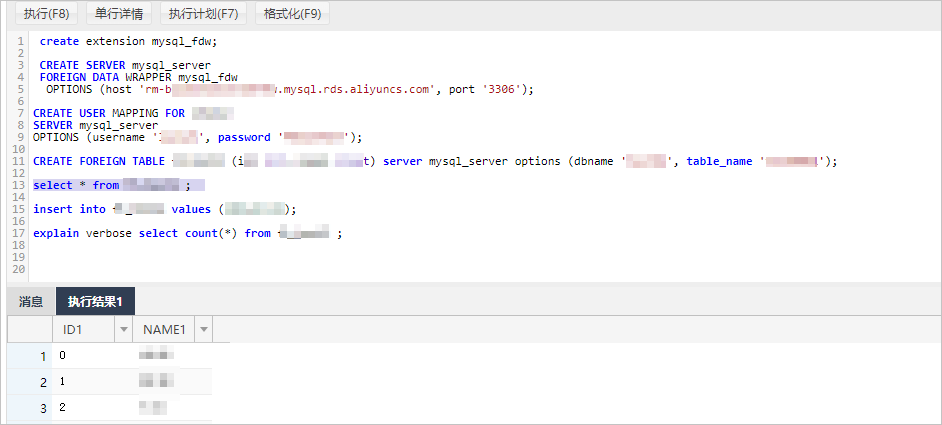

输入 `postgres=> explain verbose select count(*) from ft_test ;`  命令检查执行计划，即PostgreSQL查询MySQL数据的请求在MySQL中是如何执行的。结果如下：

```text
                                  QUERY PLAN                                     
-------------------------------------------------------------------------------  
 Aggregate  (cost=1027.50..1027.51 rows=1 width=8)  
   Output: count(*)  
   ->  Foreign Scan on public.ft_test  (cost=25.00..1025.00 rows=1000 width=0)  
         Output: id, info  
         Remote server startup cost: 25  
         Remote query: SELECT NULL FROM `test123`.`test`  
(6 rows)  
```

<a id="section-18-3"></a>

## 18.3. 使用oss_fdw读写外部数据文本文件

阿里云支持通过oss_fdw插件将OSS中的数据加载到PostgreSQL和PPAS数据库中，也支持将PostgreSQL和PPAS数据库中的数据写入OSS中。

**oss_fdw参数**

oss_fdw和其他fdw接口一样，对外部数据OSS中的数据进行封装。用户可以像使用数据表一样通过oss_fdw读取OSS中存放的数据。oss_fdw提供独有的参数用于连接和解析OSS上的文件数据。

> **说明**
>
> - 目前oss_fdw支持读取和写入OSS中文件的格式为：TXT或CSV、GZIP格式的TXT或CSV文件。
>
> - oss_fdw各参数的值需使用双引号（""）引起来，且不含无用空格。

**CREATE SERVER参数**

- ossendpoint：是内网访问OSS的地址，也称为host。

- id oss：账号id。

- key oss：账号key。

- bucket： OSSBucket，需要先创建OSS账号再设置该参数。

针对导入模式和导出模式，提供下列容错相关参数。网络条件较差时，可以调整以下参数，以保障导入和导出成功。

- oss_connect_timeout：设置链接超时，单位秒，默认是10秒。

- oss_dns_cache_timeout：设置DNS超时，单位秒，默认是60秒。

- oss_speed_limit：设置能容忍的最小速率，默认是1024字节/秒，即1 KB/秒。

- oss_speed_time：设置能容忍最小速率的最长时间，默认是15秒。

如果使用了oss_speed_limit和oss_speed_time的默认值，表示如果连续15秒的传输速率小于1 KB/秒，则超时。

**CREATE FOREIGN TABLE参数**

- filepath： OSS中带路径的文件名。

  - 文件名包含文件路径，但不包含bucket。

  - 该参数匹配OSS对应路径上的多个文件，支持将多个文件加载到数据库。

  - 文件命名为filepath和filepath.x 支持被导入到数据库，x要求从1开始，且连续。

    例如，filepath、filepath.1、filepath.2、filepath.3、filepath.5 ，前4个文件会被匹配和导入，但是 filepath.5将无法导入。

- dir：OSS中的虚拟文件目录。

  - dir需要以正斜线（/）结尾。

  - dir指定的虚拟文件目录中的所有文件（不包含子文件夹和子文件夹下的文件）都会被匹配和导入到数据库。

- prefix：指定数据文件对应路径名的前缀，不支持正则表达式，且与filepath、dir互斥，三者只能设置其中一个。

- format：指定文件的格式，目前只支持CSV。

- encoding：文件中数据的编码格式，支持常见的pg编码，如utf-8。

- parse_errors：容错模式解析，以行为单位，忽略文件分析过程中发生的错误。

- delimiter：指定列的分割符。

- quote：指定文件的引用字符。

- escape：指定文件的逃逸字符。

- null：指定匹配对应字符串的列为null，例如null ‘test’，即列值为’test’的字符串为null。

- force_not_null：指定某些列的值不为null。例如，force_not_null ‘id’表示：如果id列的值为空，则该值为空字符串，而不是null。

- compressiontype：设置读取和写入OSS上文件的的格式：

  - none：默认的文件类型，即没有压缩的文本格式。

  - gzip：读取文件的格式为gzip压缩格式。

- compressionlevel：设置写入OSS的压缩格式的压缩等级，范围1到9，默认6。

> **说明**
>
> - filepath和dir需要在OPTIONS参数中指定。
>
> - filepath和dir必须指定两个参数中的其中一个，且不能同时指定。
>
> - 导出模式目前只支持虚拟文件夹的匹配模式，即只支持dir，不支持filepath。

**CREATE FOREIGN TABLE的导出模式参数**

- oss_flush_block_size：单次刷出到OSS的buffer大小，默认32MB，可选范围1到128MB。

- oss_file_max_size：写入OSS的最大文件大小，超出之后会切换到另一个文件续写。默认1024MB，可选范围8到4000 MB。

- num_parallel_worker：写OSS数据的压缩模式中并行压缩线程的个数，范围1到8，默认并发数3。

**辅助函数**

FUNCTION oss_fdw_list_file (relname text, schema text DEFAULT ‘public’)

- 用于获得某个外部表所匹配的OSS上的文件名和文件的大小。

- 文件大小的单位是字节。

执行 `select * from oss_fdw_list_file('t_oss');` 的返回结果如下：

```text
              name              |   size    
--------------------------------+-----------
 oss_test/test.gz.1  | 739698350
 oss_test/test.gz.2  | 739413041
 oss_test/test.gz.3  | 739562048
(3 rows)
```

**辅助功能**

oss_fdw.rds_read_one_file：在读模式下，指定某个外表匹配的文件。设置后，该外部表在数据导入中只匹配这个被设置的文件。

例如，set oss_fdw.rds_read_one_file = ‘oss_test/example16.csv.1’;

执行 `set oss_fdw.rds_read_one_file = 'oss_test/test.gz.2';` 和 `select * from oss_fdw_list_file('t_oss');` 的返回结果如下：

```text
              name              |   size    
--------------------------------+-----------
  oss_test/test.gz.2  | 739413041
(1 rows)
```

**oss_fdw用例**

```sql
# PostgreSQL 创建插件
create extension oss_fdw;  --对于PPAS，则执⾏select 
rds_manage_extension('create','oss_fdw');
# 创建 server 
CREATE SERVER ossserver FOREIGN DATA WRAPPER oss_fdw OPTIONS 
     (host 'oss-cn-hangzhou.aliyuncs.com' ， id 'xxx'， key 'xxx'，bucket 'mybucket');
# 创建 oss 外部表
CREATE FOREIGN TABLE ossexample 
    (date text， time text， open float，
     high float， low float， volume int) 
     SERVER ossserver 
     OPTIONS ( filepath 'osstest/example.csv'， delimiter '，' ，
         format 'csv'， encoding 'utf8'， PARSE_ERRORS '100');
# 创建表，数据就装载到这张表中。
create table example
        (date text， time text， open float，
         high float， low float， volume int);
# 数据从 ossexample 装载到 example 中。
insert into example select * from ossexample;
# 可以看到
# oss_fdw 能够正确估计 oss 上的⽂件⼤⼩，正确的规划查询计划。
explain insert into example select * from ossexample;
                             QUERY PLAN                              
---------------------------------------------------------------------
 Insert on example  (cost=0.00..1.60 rows=6 width=92)
   ->  Foreign Scan on ossexample  (cost=0.00..1.60 rows=6 width=92)
         Foreign OssFile: osstest/example.csv.0
         Foreign OssFile Size: 728
(4 rows)
# 表 example 中的数据写出到 OSS 中。
insert into ossexample select * from example;
explain insert into ossexample select * from example;
                           QUERY PLAN
-----------------------------------------------------------------
 Insert on ossexample  (cost=0.00..16.60 rows=660 width=92)
   ->  Seq Scan on example  (cost=0.00..16.60 rows=660 width=92)
(2 rows)
```

**oss_fdw 注意事项**

- oss_fdw是在PostgreSQL FOREIGN TABLE框架下开发的外部表插件。

- 数据导入的性能和PostgreSQL集群的资源（CPU IO MEM MET）相关，也和OSS相关。

- 为保证数据导入的性能，请确保云数据库PostgreSQL与OSS所在区域相同。

**id和key隐藏**

CREATE SERVER中的id和key信息如果不做任何处理，用户可以使用 `select * from pg_foreign_server` 看到明文信息，会暴露用户的id和key。我们通过对id和key进行对称加密实现对id和key的隐藏（不同的实例使用不同的密钥，最大限度保护用户信息），但无法使用类似GP一样的方法，增加一个数据类型，会导致老实例不兼容。

最终加密后的信息如下：

```text
postgres=# select * from pg_foreign_server ;
  srvname  | srvowner | srvfdw | srvtype | srvversion | srvacl |                        
srvoptions
-----------+----------+--------+---------+------------+--------+-------------------------
-----------------------------------------------------------------------------------------
---------------
----------------------------------
 ossserver |       10 |  16390 |         |            |        | {host=oss-cn-hangzhou-z
mf.aliyuncs.com，id=MD5xxxxxxxx，key=MD5xxxxxxxx，bucket=067862}
```

加密后的信息将会以MD5开头（总长度为len，len%8==3），这样导出之后再导入不会再次加密，但是用户不能创建MD5开头的key和id。

<a id="section-19"></a>

# 19.基于pgpool实现读写分离

本文介绍ECS实例上的PostgreSQL如何结合pgpool实现读写分离，您也可以通过RDS PostgreSQL实例及只读实例简化操作步骤。

**背景信息**

不使用pgpool实现数据库的高可用时，pgpool自身是无状态的，性能损耗很小，同时还支持横向扩展，因此搭配自身具有高可用架构的RDS PostgreSQL实例，可以方便快捷地实现读写分离。

**部署环境**

如果您已经创建PostgreSQL 10及只读实例（详情请参见创建实例和创建PostgreSQL只读实例），仅需安装pgpool，然后跳转到配置pgpool查看后续步骤。

1. 输入 `vi /etc/sysctl.conf` 命令打开配置文件sysctl.conf，配置方法如下：

   ```text
   # add by digoal.zhou                
   fs.aio-max-nr = 1048576                
   fs.file-max = 76724600                

   # 可选：kernel.core_pattern = /data01/corefiles/core_%e_%u_%t_%s.%p                    

   # /data01/corefiles 提前建好，权限777，如果是软链接，对应的⽬录修改为777。       

   kernel.sem = 4096 2147483647 2147483646 512000                    
   # 信号量, ipcs -l 或 -u 查看，每16个进程⼀组，每组信号量需要17个信号量。                

   kernel.shmall = 107374182                      
   # 所有共享内存段相加⼤⼩限制 (建议内存的80%)，单位为⻚。                
   kernel.shmmax = 274877906944                   
   # 最⼤单个共享内存段⼤⼩ (建议为内存⼀半), ⼤于9.2的版本已⼤幅降低共享内存的使⽤，单位为字节。     

   kernel.shmmni = 819200                         
   # ⼀共能⽣成多少共享内存段，每个PG数据库集群⾄少2个共享内存段。

   net.core.netdev_max_backlog = 10000                
   net.core.rmem_default = 262144                       
   # The default setting of the socket receive buffer in bytes.                
   net.core.rmem_max = 4194304                          
   # The maximum receive socket buffer size in bytes                
   net.core.wmem_default = 262144                       
   # The default setting (in bytes) of the socket send buffer.                
   net.core.wmem_max = 4194304                          
   # The maximum send socket buffer size in bytes.                
   net.core.somaxconn = 4096                
   net.ipv4.tcp_max_syn_backlog = 4096                
   net.ipv4.tcp_keepalive_intvl = 20                
   net.ipv4.tcp_keepalive_probes = 3                
   net.ipv4.tcp_keepalive_time = 60                
   net.ipv4.tcp_mem = 8388608 12582912 16777216                
   net.ipv4.tcp_fin_timeout = 5                
   net.ipv4.tcp_synack_retries = 2                
   net.ipv4.tcp_syncookies = 1                    
   # 开启SYN Cookies。当出现SYN等待队列溢出时，启⽤cookie来处理，可防范少量的SYN攻击。            

   net.ipv4.tcp_timestamps = 1                    
   # 减少time_wait。
   net.ipv4.tcp_tw_recycle = 0                    
   # 如果=1则开启TCP连接中TIME-WAIT套接字的快速回收，但是NAT环境可能导致连接失败，建议服务端关闭它。
   net.ipv4.tcp_tw_reuse = 1                      
   # 开启重⽤。允许将TIME-WAIT套接字重新⽤于新的TCP连接。
   net.ipv4.tcp_max_tw_buckets = 262144                
   net.ipv4.tcp_rmem = 8192 87380 16777216                
   net.ipv4.tcp_wmem = 8192 65536 16777216                

   net.nf_conntrack_max = 1200000                
   net.netfilter.nf_conntrack_max = 1200000                

   vm.dirty_background_bytes = 409600000                       
   #  系统脏⻚到达这个值，系统后台刷脏⻚调度进程 pdflush（或其他） ⾃动将
   (dirty_expire_centisecs/100）秒前的脏⻚刷到磁盘。                
   #  默认为10%，⼤内存机器建议调整为直接指定多少字节。                

   vm.dirty_expire_centisecs = 3000                             
   #  ⼤于这个值的脏⻚，将被刷到磁盘。3000表示30秒。                
   vm.dirty_ratio = 95                                          
   #  如果系统进程刷脏⻚太慢，使得系统脏⻚超过内存 95 % 时，则⽤户进程如果有写磁盘的操作（如fsync、fdatasync等调⽤），则需要主动把系统脏⻚刷出。                
   #  有效防⽌⽤户进程刷脏⻚，在单机多实例，并且使⽤CGROUP限制单实例IOPS的情况下非常有效。           


   vm.dirty_writeback_centisecs = 100                            
   #  pdflush（或其他）后台刷脏⻚进程的唤醒间隔， 100表示1秒。                

   vm.swappiness = 0                
   #  不使⽤交换分区。                

   vm.mmap_min_addr = 65536                
   vm.overcommit_memory = 0                     
   #  在分配内存时，允许少量over malloc, 如果设置为 1, 则认为总是有⾜够的内存，内存较少的测试环境可以
   使⽤ 1。

   vm.overcommit_ratio = 90                     
   #  当overcommit_memory = 2 时，⽤于参与计算允许指派的内存⼤⼩。                
   vm.swappiness = 0                            
   #  关闭交换分区。                
   vm.zone_reclaim_mode = 0                     
   # 禁⽤ numa, 或者在vmlinux中禁⽌。            
   net.ipv4.ip_local_port_range = 40000 65535                    
   # 本地⾃动分配的TCP, UDP端⼝号范围。                
   fs.nr_open=20480000                
   # 单个进程允许打开的⽂件句柄上限。                

   # 以下参数请注意。            
   #vm.extra_free_kbytes = 4096000   # ⼩内存机器不要设置这样⼤, 会无法开机。
   #vm.min_free_kbytes = 6291456    # vm.min_free_kbytes 建议每32G内存分配1G 
   vm.min_free_kbytes。     
   # 如果是⼩内存机器，以上两个值不建议设置。                
   # vm.nr_hugepages = 66536                    
   #  建议shared buffer设置超过64GB时 使⽤⼤⻚，⻚⼤⼩ /proc/meminfo Hugepagesize。           

   #vm.lowmem_reserve_ratio = 1 1 1                
   # 对于内存⼤于64G时，建议设置，否则建议默认值 256 256 32。    
   ```

2. 输入 `vi /etc/security/limits.conf` 命令打开配置文件limits.conf，配置方法如下：

   ```text
   * soft    nofile  1024000                
   * hard    nofile  1024000                
   * soft    nproc   unlimited                
   * hard    nproc   unlimited                
   * soft    core    unlimited                
   * hard    core    unlimited                
   * soft    memlock unlimited                
   * hard    memlock unlimited    

   # 注释其他  
   # 同时注释/etc/security/limits.d/20-nproc.conf。  
   ```

3. 输入如下命令打开rc.local文件，通过配置该文件关闭透明大页、配置大页、并自启动PostgreSQL。

   ```bash
   chmod +x /etc/rc.local
   vi /etc/rc.local
   ```

   配置方法如下：

   ```text
   # 关闭透明⼤⻚。  
   if test -f /sys/kernel/mm/transparent_hugepage/enabled; then                
      echo never > /sys/kernel/mm/transparent_hugepage/enabled                
   fi    

   # 两个实例, 每个实例16G shared buffer。  
   sysctl -w vm.nr_hugepages=17000  

   # ⾃启动两个实例。  
   su - postgres -c "pg_ctl start -D /data01/pg12_3389/pg_root"  
   su - postgres -c "pg_ctl start -D /data01/pg12_8002/pg_root"  
   ```

4. 创建文件系统。命令如下：

   > 仅针对新磁盘，请确认磁盘（例如新挂载磁盘为vdb而不是vda）后再进行操作，否则可
   >
   > **警告**
   >
   > 能会导致数据清空。

   ```bash
   parted -a optimal -s /dev/vdb mklabel gpt mkpart primary 1MiB 100%FREE     
   mkfs.ext4 /dev/vdb1 -m 0 -O extent,uninit_bg -E lazy_itable_init=1 -b 4096 -T largefile -L vdb1  
   vi /etc/fstab   
   LABEL=vdb1 /data01 ext4 
   defaults,noatime,nodiratime,nodelalloc,barrier=0,data=writeback 0 0  

   mkdir /data01  
   mount -a  
   ```

5. 启动irq balance。命令如下：

   ```bash
   systemctl status irqbalance     
   systemctl enable irqbalance        
   systemctl start irqbalance       
   systemctl status irqbalance    
   ```

6. 安装PostgreSQL 10、pgpool工具软件。命令如下：

   ```bash
   yum install -y https://dl.fedoraproject.org/pub/epel/epel-release-latest-7.noarch.rpm  
   yum install -y https://download.postgresql.org/pub/repos/yum/reporpms/EL-7-x86_64/pgdg-redhat-repo-latest.noarch.rpm       
   yum search all postgresql  
   yum search all pgpool  

   yum install -y postgresql12*    
   yum install -y pgpool-II-12-extensions      
   ```

7. 初始化数据库数据目录。命令如下：

   ```bash
   mkdir /data01/pg12_3389  
   chown postgres:postgres /data01/pg12_3389  
   ```

8. 通过如下命令配置postgres用户环境变量。

   ```text
   su - postgres  
   vi .bash_profile  
   ```

   在环境变量中追加如下内容：

   ```bash
   export PS1="$USER@`/bin/hostname -s`-> "      
   export PGPORT=3389  
   export PGDATA=/data01/pg12_$PGPORT/pg_root     

   export LANG=en_US.utf8      
   export PGHOME=/usr/pgsql-12      
   export 
   LD_LIBRARY_PATH=$PGHOME/lib:/lib64:/usr/lib64:/usr/local/lib64:/lib:/usr/lib:/usr/local
   ib:$LD_LIBRARY_PATH      
   export DATE=`date +"%Y%m%d%H%M"`      
   export PATH=$PGHOME/bin:$PATH:.      
   export MANPATH=$PGHOME/share/man:$MANPATH      
   export PGHOST=$PGDATA      
   export PGUSER=postgres      
   export PGDATABASE=db1  
   alias rm='rm -i'      
   alias ll='ls -lh'      
   unalias vi      
   ```

9. 初始化主库。命令如下：

   ```text
   initdb -D $PGDATA -U postgres -E UTF8 --lc-collate=C --lc-ctype=en_US.utf8  
   ```

0. 修改配置文件postgresql.conf。配置方法如下：

   ```text
   listen_addresses = '0.0.0.0'  
   port = 3389  
   max_connections = 1500  
   superuser_reserved_connections = 13  
   unix_socket_directories = '., /var/run/postgresql, /tmp'  
   tcp_keepalives_idle = 60  
   tcp_keepalives_interval = 10  
   tcp_keepalives_count = 10  
   shared_buffers = 16GB  
   huge_pages = on  
   work_mem = 8MB  
   maintenance_work_mem = 1GB  
   dynamic_shared_memory_type = posix  
   vacuum_cost_delay = 0  
   bgwriter_delay = 10ms  
   bgwriter_lru_maxpages = 1000  
   bgwriter_lru_multiplier = 10.0  
   bgwriter_flush_after = 512kB  
   effective_io_concurrency = 0  
   max_worker_processes = 128  
   max_parallel_maintenance_workers = 3  
   max_parallel_workers_per_gather = 4  
   parallel_leader_participation = off  
   max_parallel_workers = 8  
   backend_flush_after = 256  
   wal_level = replica  
   synchronous_commit = off  
   full_page_writes = on  
   wal_compression = on  
   wal_buffers = 16MB  
   wal_writer_delay = 10ms  
   wal_writer_flush_after = 1MB  
   checkpoint_timeout = 15min  
   max_wal_size = 64GB  
   min_wal_size = 8GB  
   checkpoint_completion_target = 0.2  
   checkpoint_flush_after = 256kB  
   random_page_cost = 1.1  
   effective_cache_size = 48GB  
   log_destination = 'csvlog'  
   logging_collector = on  
   log_directory = 'log'  
   log_filename = 'postgresql-%a.log'  
   log_truncate_on_rotation = on  
   log_rotation_age = 1d  
   log_rotation_size = 0  
   log_min_duration_statement = 1s  
   log_checkpoints = on  
   log_connections = on  
   log_disconnections = on  
   log_line_prefix = '%m [%p] '  
   log_statement = 'ddl'  
   log_timezone = 'Asia/Shanghai'  
   autovacuum = on  
   log_autovacuum_min_duration = 0  
   autovacuum_vacuum_scale_factor = 0.1  
   autovacuum_analyze_scale_factor = 0.05  
   autovacuum_freeze_max_age = 800000000  
   autovacuum_multixact_freeze_max_age = 900000000  
   autovacuum_vacuum_cost_delay = 0  
   vacuum_freeze_table_age = 750000000  
   vacuum_multixact_freeze_table_age = 750000000  
   datestyle = 'iso, mdy'  
   timezone = 'Asia/Shanghai'  
   lc_messages = 'en_US.utf8'  
   lc_monetary = 'en_US.utf8'  
   lc_numeric = 'en_US.utf8'  
   lc_time = 'en_US.utf8'  
   default_text_search_config = 'pg_catalog.english'  
   ```

1. 修改配置文件pg_hba.conf。配置方法如下：

   > 因为pgpool-II和数据库服务器处于同一ECS实例，所以设置为127.0.0.1时需要密码才
   >
   > **说明**
   >
   > 能登录。

   ```text
   # "local" is for Unix domain socket connections only  
   local   all             all                                     trust  
   # IPv4 local connections:  
   host    all             all             127.0.0.1/32            md5  
   # IPv6 local connections:  
   host    all             all             ::1/128                 trust  
   # Allow replication connections from localhost, by a user with the  
   # replication privilege.  
   local   replication     all                                     trust  
   host    replication     all             127.0.0.1/32            trust  
   host    replication     all             ::1/128                 trust  
   host db123 digoal 0.0.0.0/0 md5  
   ```

2. 在数据库中输入语句创建流复制用户。示例如下：

   ```text
   create role rep123 login replication encrypted password 'xxxxxxx';  
   ```

3. 在数据库中输入语句创建业务用户。示例如下：

   ```sql
   create role digoal login encrypted password 'xxxxxxx';  

   create database db123 owner digoal;  
   ```

4. 创建pgpool数据库健康心跳用户，检查只读节点回放延迟（wal replay），只要能登录postgres数据库或指定的库即可，配合pgpool参数使用。示例如下：

   ```text
   create role nobody login encrypted password 'xxxxxxx';  
   ```

**创建从库**

为简化测试步骤，在同一ECS实例创建备库。

1. 使用pg_basebackup在线创建从库。命令如下：

   ```text
   pg_basebackup -D /data01/pg12_8002/pg_root -F p --checkpoint=fast -P -h 127.0.0.1 -p 
   3389 -U rep123  
   ```

2. 输入如下命令配置从库配置文件postgresql.conf：

   ```bash
   cd /data01/pg12_8002/pg_root   

   vi postgresql.conf  
   ```

   配置方法如下：

   ```text
   # 相比主配置 修改如下：  
   port = 8002  
   primary_conninfo = 'hostaddr=127.0.0.1 port=3389 user=rep123' # 不⽤设置密码, 因为主设置
   了trust访问。  
   hot_standby = on  
   wal_receiver_status_interval = 1s  
   wal_receiver_timeout = 10s  
   recovery_target_timeline = 'latest'  
   ```

3. 配置从库standby.signal标记。命令如下：

   ```bash
   cd /data01/pg12_8002/pg_root   

   touch standby.signal  
   ```

4. 在数据库中输入 `select * from pg_stat_replication ;`  语句查看主从同步是否正常。结果如下：

   ```text
   -[ RECORD 1 ]----+------------------------------  
   pid              | 21065  
   usesysid         | 10  
   usename          | postgres  
   application_name | walreceiver  
   client_addr      | 127.0.0.1  
   client_hostname  |   
   client_port      | 47064  
   backend_start    | 2020-02-29 00:26:28.485427+08  
   backend_xmin     |   
   state            | streaming  
   sent_lsn         | 0/52000060  
   write_lsn        | 0/52000060  
   flush_lsn        | 0/52000060  
   replay_lsn       | 0/52000060  
   write_lag        |   
   flush_lag        |   
   replay_lag       |   
   sync_priority    | 0  
   sync_state       | async  
   reply_time       | 2020-02-29 01:32:40.635183+08  
   ```

**配置pgpool**

1. 查询pgpool安装位置。命令如下：

   ```bash
   rpm -qa|grep pgpool  
   pgpool-II-12-extensions-4.1.1-1.rhel7.x86_64  
   pgpool-II-12-4.1.1-1.rhel7.x86_64  

   rpm -ql pgpool-II-12-4.1.1  
   ```

2. 输入如下命令打开配置文件pgpool.conf：

   ```bash
   cd /etc/pgpool-II-12/  

   cp pgpool.conf.sample-stream pgpool.conf  

   vi pgpool.conf  
   ```

   涉及修改的重要配置如下：

   ```text
   listen_addresses = '0.0.0.0'  
   port = 8001  
   socket_dir = '/tmp'  
   reserved_connections = 0  

   pcp_listen_addresses = ''  
   pcp_port = 9898  
   pcp_socket_dir = '/tmp'  

   # - Backend Connection Settings -  

   backend_hostname0 = '127.0.0.1'  
                                      # Host name or IP address to connect to for backend 
   0  
   backend_port0 = 3389   
                                      # Port number for backend 0  
   backend_weight0 = 1  
                                      # Weight for backend 0 (only in load balancing 
   mode)  
   backend_data_directory0 = '/data01/pg12_3389/pg_root'  
                                      # Data directory for backend 0  
   backend_flag0 = 'ALWAYS_MASTER'  
                                      # Controls various backend behavior  
                                      # ALLOW_TO_FAILOVER, DISALLOW_TO_FAILOVER  
                                      # or ALWAYS_MASTER  
   backend_application_name0 = 'server0'  
                                      # walsender's application_name, used for "show 
   pool_nodes" command  
   backend_hostname1 = '127.0.0.1'  
   backend_port1 = 8002  
   backend_weight1 = 1  
   backend_data_directory1 = '/data01/pg12_8002/pg_root'  
   backend_flag1 = 'DISALLOW_TO_FAILOVER'  
   backend_application_name1 = 'server1'  

   # - Authentication -  

   enable_pool_hba = on   

                                      # Use pool_hba.conf for client authentication  
   pool_passwd = 'pool_passwd'  
                                      # File name of pool_passwd for md5 authentication. 

                                      # "" disables pool_passwd.  
                                      # (change requires restart)  
   allow_clear_text_frontend_auth = off  
                                      # Allow Pgpool-II to use clear text password 
   authentication  
                                      # with clients, when pool_passwd does not  
                                      # contain the user password  

   # - Concurrent session and pool size -  

   num_init_children = 128   
                                      # Number of concurrent sessions allowed  
                                      # (change requires restart)  
   max_pool = 4  
                                      # Number of connection pool caches per connection  
                                      # (change requires restart)  

   # - Life time -  

   child_life_time = 300  
                                      # Pool exits after being idle for this many seconds 

   child_max_connections = 0  
                                      # Pool exits after receiving that many connections  
                                      # 0 means no exit  
   connection_life_time = 0  
                                      # Connection to backend closes after being idle for 
   this many seconds  
                                      # 0 means no close  
   client_idle_limit = 0  
                                      # Client is disconnected after being idle for that 
   many seconds  
                                      # (even inside an explicit transactions!)  
                                      # 0 means no disconnection  

   #------------------------------------------------------------------------------  
   # LOGS  
   #------------------------------------------------------------------------------  

   # - Where to log -  

   log_destination = 'syslog'  
                                      # Where to log  
                                      # Valid values are combinations of stderr,  
                                      # and syslog. Default to stderr.  
   log_connections = on  
                                      # Log connections  

   log_standby_delay = 'if_over_threshold'  
                                      # Log standby delay  
                                      # Valid values are combinations of always,  
                                      # if_over_threshold, none  

   #------------------------------------------------------------------------------  
   # FILE LOCATIONS  
   #------------------------------------------------------------------------------  

   pid_file_name = '/var/run/pgpool-II-12/pgpool.pid'  
                                      # PID file name  
                                      # Can be specified as relative to the"  
                                      # location of pgpool.conf file or  
                                      # as an absolute path  
                                      # (change requires restart)  
   logdir = '/tmp'  
                                      # Directory of pgPool status file  
                                      # (change requires restart)  

   #------------------------------------------------------------------------------  
   # CONNECTION POOLING  
   #------------------------------------------------------------------------------  

   connection_cache = on  
                                      # Activate connection pools  
                                      # (change requires restart)  

                                      # Semicolon separated list of queries  
                                      # to be issued at the end of a session  
                                      # The default is for 8.3 and later  
   reset_query_list = 'ABORT; DISCARD ALL'  

   #------------------------------------------------------------------------------  
   # LOAD BALANCING MODE  
   #------------------------------------------------------------------------------  

   load_balance_mode = on  
                                      # Activate load balancing mode  
                                      # (change requires restart)  
   ignore_leading_white_space = on  
                                      # Ignore leading white spaces of each query  
   white_function_list = ''  
                                      # Comma separated list of function names  
                                      # that don't write to database  
                                      # Regexp are accepted  
   black_function_list = 'currval,lastval,nextval,setval'  
                                      # Comma separated list of function names  
                                      # that write to database  
                                      # Regexp are accepted  

   black_query_pattern_list = ''  
                                      # Semicolon separated list of query patterns  
                                      # that should be sent to primary node  
                                      # Regexp are accepted  
                                      # valid for streaming replicaton mode only.  

   database_redirect_preference_list = ''  
                                      # comma separated list of pairs of database and 
   node id.  
                                      # example: postgres:primary,mydb[0-4]:1,mydb[5-
   9]:2'  
                                      # valid for streaming replicaton mode only.  

   app_name_redirect_preference_list = ''  
                                      # comma separated list of pairs of app name and 
   node id.  
                                      # example: 'psql:primary,myapp[0-4]:1,myapp[5-
   9]:standby'  
                                      # valid for streaming replicaton mode only.  
   allow_sql_comments = off  
                                      # if on, ignore SQL comments when judging if load b
   alance or  
                                      # query cache is possible.  
                                      # If off, SQL comments effectively prevent the 
   judgment  
                                      # (pre 3.4 behavior).  

   disable_load_balance_on_write = 'transaction'  
                                      # Load balance behavior when write query is issued  
                                      # in an explicit transaction.  
                                      # Note that any query not in an explicit 
   transaction  
                                      # is not affected by the parameter.  
                                      # 'transaction' (the default): if a write query is i
   ssued,  
                                      # subsequent read queries will not be load balanced 
                                      # until the transaction ends.  
                                      # 'trans_transaction': if a write query is issued,  
                                      # subsequent read queries in an explicit 
   transaction  
                                      # will not be load balanced until the session ends. 
                                      # 'always': if a write query is issued, read queries
   will  
                                      # not be load balanced until the session ends.  

   statement_level_load_balance = off  
                                      # Enables statement level load balancing  

   #------------------------------------------------------------------------------  
   # MASTER/SLAVE MODE  
   #------------------------------------------------------------------------------  

   master_slave_mode = on  
                                      # Activate master/slave mode  
                                      # (change requires restart)  
   master_slave_sub_mode = 'stream'  
                                      # Master/slave sub mode  
                                      # Valid values are combinations stream, slony  
                                      # or logical. Default is stream.  
                                      # (change requires restart)  

   # - Streaming -  

   sr_check_period = 3   
                                      # Streaming replication check period  
                                      # Disabled (0) by default  
   sr_check_user = 'nobody'  
                                      # Streaming replication check user  
                                      # This is neccessary even if you disable streaming  
                                      # replication delay check by sr_check_period = 0  sr_check_password = ''  
                                      # Password for streaming replication check user  
                                      # Leaving it empty will make Pgpool-II to first look
   for the  
                                      # Password in pool_passwd file before using the 
   empty password  

   sr_check_database = 'postgres'  
                                      # Database name for streaming replication check  
   delay_threshold = 512000  
                                      # Threshold before not dispatching query to standby 
   node  
                                      # Unit is in bytes  
                                      # Disabled (0) by default  


   #------------------------------------------------------------------------------  
   # HEALTH CHECK GLOBAL PARAMETERS  
   #------------------------------------------------------------------------------  

   health_check_period = 5  
                                      # Health check period  
                                      # Disabled (0) by default  
   health_check_timeout = 10  
                                      # Health check timeout  
                                      # 0 means no timeout  
   health_check_user = 'nobody'  
                                      # Health check user  
   health_check_password = ''  
                                      # Password for health check user  
                                      # Leaving it empty will make Pgpool-II to first look
   for the  
                                      # Password in pool_passwd file before using the 
   empty password  

   health_check_database = ''  
                                      # Database name for health check. If '', tries 
   'postgres' frist,   
   health_check_max_retries = 60   
                                      # Maximum number of times to retry a failed health 
   check before giving up.  
   health_check_retry_delay = 1  
                                      # Amount of time to wait (in seconds) between 
   retries.  
   connect_timeout = 10000  
                                      # Timeout value in milliseconds before giving up to 
   connect to backend.  
                                      # Default is 10000 ms (10 second). Flaky network 
   user may want to increase  
                                      # the value. 0 means no timeout.  
                                      # Note that this value is not only used for health 
   check,  
                                      # but also for ordinary conection to backend.  

   #------------------------------------------------------------------------------  
   # FAILOVER AND FAILBACK  
   #------------------------------------------------------------------------------  

   failover_on_backend_error = off  
                                      # Initiates failover when reading/writing to the  
                                      # backend communication socket fails  
                                      # If set to off, pgpool will report an  
                                      # error and disconnect the session.  


   relcache_expire = 0  # 建议结构变更后, 设置为1,然后reload然后再改回来. 当然也可以直接设置为⼀个
   时间      
                                      # Life time of relation cache in seconds.  
                                      # 0 means no cache expiration(the default).  
                                      # The relation cache is used for cache the  
                                      # query result against PostgreSQL system  
                                      # catalog to obtain various information  
                                      # including table structures or if it's a  
                                      # temporary table or not. The cache is  
                                      # maintained in a pgpool child local memory  
                                      # and being kept as long as it survives.  
                                      # If someone modify the table by using  
                                      # ALTER TABLE or some such, the relcache is  
                                      # not consistent anymore.  
                                      # For this purpose, cache_expiration  
                                      # controls the life time of the cache.  
   relcache_size = 8192  
                                      # Number of relation cache  
                                      # entry. If you see frequently:  
                                      # "pool_search_relcache: cache replacement happend" 
                                      # in the pgpool log, you might want to increate 
   this number.  
   ```

3. 输入 `cd /etc/pgpool-II-12`  命令配置pool_passwd密码文件。配置方法如下：

   > 通过pgpool连接数据库时需要使用密码文件，可以理解为pgpool支持了PostgreSQL的
   >
   > **说明**
   >
   > 认证协议。

   ```text
   #⽤法  
   #pg_md5 --md5auth --username=username password  
   #⽣成digoal, nobody密码, ⾃动写入pool_passwd。
   pg_md5 --md5auth --username=digoal "xxxxxxx"  
   pg_md5 --md5auth --username=nobody "xxxxxxx"  
   ```

4. 自动生成pool_passwd文件。命令如下：

   ```bash
   cd /etc/pgpool-II-12  
   cat pool_passwd
   ```

5. 输入如下命令配置pgpool_hba文件。命令如下：

   ```bash
   cd /etc/pgpool-II-12  
   cp pool_hba.conf.sample pool_hba.conf  
   vi pool_hba.conf
   ```

   配置方法如下：

   ```text
   host all all 0.0.0.0/0 md5  
   ```

6. 配置pcp管理密码文件。命令如下：

   > 这里是用来管理pgpool的密码和用户，不是数据库的用户和密码。
   >
   > **说明**

   ```bash
   cd /etc/pgpool-II-12  
   pg_md5 abc  # 例如密码是abc。  
   900150983cd24fb0d6963f7d28e17f72  

   cp pcp.conf.sample pcp.conf  

   vi pcp.conf  

   # USERID:MD5PASSWD  
   manage:900150983cd24fb0d6963f7d28e17f72  #表示使⽤manage⽤户来管理pcp。
   ```

7. 启动pgpool。命令如下：

   ```bash
   cd /etc/pgpool-II-12  
   pgpool -f ./pgpool.conf -a ./pool_hba.conf -F ./pcp.conf  
   ```

   > 查看pgpool日志的命令如下：
   >
   > **说明**
   >
   > ```text
   > less /var/log/messages   
   > ```

8. 通过pgpool连接数据库。命令如下：

   ```text
   psql -h 127.0.0.1 -p 8001 -U digoal postgres  
   ```

   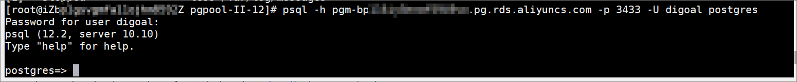

**常见问题**

- 如何测试读写分离是否成功？

  连接并查询pg_is_in_recovery()，然后断开重连再查询pg_is_in_recovery()，如果交替返回false和true，说明是交替将请求发送给了主库和从库，即读写分离成功。

- 使用pgpool会增加延迟吗？

  会小幅增加延迟，本文测试环境下约增加0.12毫秒延迟。

- pgpool的延迟检测和健康检测机制是什么？

  - pgpool不会将SQL请求发送给回放延迟（wal replay）大于设置值的只读节点，当只读节点延迟小于设置值后，才会再次发送。

    > 您可以连接主库查询当前数据库wal写入位置的Lsn 1，然后连接只读节点查询当前
    >
    > **说明**
    >
    > wal replay位置的Lsn 2，对比Lsn 1和Lsn 2相差的字节。

  - pgpool可以检测后端的健康状态，如果发现不健康，SQL请求不会路由到这个节点。

- 如何停止、重新加载pgpool配置？您可以使用 `pgpool --help` 查看帮助命令，例如：

  ```bash
  cd /etc/pgpool-II-12  
  pgpool -f ./pgpool.conf -m fast stop   
  ```

- 如果有多个只读实例, 应该如何配置?

  修改pgpool.conf文件，补充多个只读实例的配置，示例如下：

  ```text
  backend_hostname1 = 'xx.xx.xxx.xx'  
  backend_port1 = 8002  
  backend_weight1 = 1  
  backend_data_directory1 = '/data01/pg12_8002/pg_root'  
  backend_flag1 = 'DISALLOW_TO_FAILOVER'  
  backend_application_name1 = 'server1'  

  backend_hostname2 = 'xx.xx.xx.xx'  
  backend_port1 = 8002  
  backend_weight1 = 1  
  backend_data_directory1 = '/data01/pg12_8002/pg_root'  
  backend_flag1 = 'DISALLOW_TO_FAILOVER'  
  backend_application_name1 = 'server1'  
  ```

- 如何通过pcp查询后端状态？

  示例命令如下：

  ```text
  pcp_node_info -U manage -h /tmp -p 9898 -n 1 -v  
  Password: #输入密码  


  Hostname               : 127.0.0.1  
  Port                   : 8002  
  Status                 : 2  
  Weight                 : 0.500000  
  Status Name            : up  
  Role                   : standby  
  Replication Delay      : 0  
  Replication State      :   
  Replication Sync State :   
  Last Status Change     : 2020-02-29 00:20:29  
  ```

- 监听的端口有哪些？

  监听的端口如下：

  - 主库：3389

  - 备库：8002

  - pgpool：8001

  - pcp：9898

<a id="section-20"></a>

# 20.中间件ShardingSphere开发指南

RDS PostgreSQL支持中间件ShardingSphere，本文介绍如何基于ShardingSphere进行开发。

**前提条件**

RDS PostgreSQL所有版本实例均支持ShardingSphere。

**背景信息**

RDS PostgreSQL不仅支持与数据库结合比较紧密的分片插件（citus、pg-xc、antdb等）和大规模并行处理产品，也支持与MySQL最流行的分片中间件类似的中间件产品，例如ShardingSphere。

ShardingSphere适合分片彻底、数据库逻辑分片极其清晰的业务，支持如下功能：

- 数据分片

  - 分库和分表

  - 读写分离

  - 分片策略定制化

  - 无中心化分布式主键

- 分布式事务

  - 标准化事务接口

  - XA强一致事务

  - 柔性事务

- 数据库治理

  - 配置动态化

  - 编排和治理

  - 数据脱敏

  - 可视化链路追踪

  - 弹性伸缩（规划中）

更多详情请参见ShardingSphere官方手册。

**ShardingSphere模式介绍**

ShardingSphere支持多种模式，建议根据实际业务情况选择。各模式介绍如下表。

| 类别 | Sharding-JDBC | Sharding-Proxy | Sharding-Sidecar |
| --- | --- | --- | --- |
| 支持数据库 | 任意实现JDBC规范的数据库（MySQL、PostgreSQL、Oracle、SQL Server等） | MySQL、PostgreSQL | MySQL、PostgreSQL |
| 连接消耗数 | 高 | 低 | 高 |
| 异构语言支持 | 仅Java | 任意 | 任意 |
| 性能 | 损耗低 | 损耗略高 | 损耗低 |
| 无中心化 | 是 | 否 | 是 |
| 静态入口 | 无 | 有 | 无 |

**设置配置模板**

1. ECS实例上使用如下命令进入模板目录（当前示例中，模板目录在root目录下）。

   ```bash
   cd /root/apache-shardingsphere-incubating-4.0.0-sharding-proxy-bin/conf
   ```

2. 使用 `ll` 命令查看目录内所有文件。结果如下：

   ```text
   total 24  
   -rw-r--r-- 1 501 games 3019 Jul 30  2019 config-encrypt.yaml  
   -rw-r--r-- 1 501 games 3582 Apr 22  2019 config-master_slave.yaml  
   -rw-r--r-- 1 501 games 4278 Apr 22  2019 config-sharding.yaml  
   -rw-r--r-- 1 501 games 1918 Jul 30  2019 server.yaml
   ```

   > **说明**
   >
   > - config-encrypt.yaml：数据脱敏配置文件
   >
   > - config-master_slave.yaml：读写分离配置文件
   >
   > - config-sharding.yaml：数据分片配置文件
   >
   > - server.yaml：公共配置文件

3. 修改配置文件。

   > 配置文件的详细说明请参见ShardingSphere官方手册，本文仅以数据分片进行简单说
   >
   > **说明**
   >
   > 明。
   >
   > - 数据分片示例
   >
   >   ```text
   >   schemaName: #逻辑数据源名称  
   >
   >   dataSources: #数据源配置，可配置多个data_source_name。 
   >     <data_source_name>: #与Sharding-JDBC配置不同，无需配置数据库连接池。
   >       url: #数据库url连接  
   >       username: #数据库⽤户名  
   >       password: #数据库密码  
   >       connectionTimeoutMilliseconds: 30000 #连接超时毫秒数
   >       idleTimeoutMilliseconds: 60000 #空闲连接回收超时毫秒数
   >       maxLifetimeMilliseconds: 1800000 #连接最⼤存活时间毫秒数
   >       maxPoolSize: 65 #最⼤连接数
   >
   >   shardingRule: #省略数据分⽚配置，与Sharding-JDBC配置⼀致。
   >   ```
   >
   > - 公共配置示例
   >
   >   ```text
   >   Proxy属性  
   >   #省略与Sharding-JDBC⼀致的配置属性  
   >
   >   props:  
   >     acceptor.size: #⽤于设置接收客户端请求的⼯作线程个数，默认为CPU核数*2。  
   >     proxy.transaction.type: #默认为LOCAL事务，允许LOCAL，XA，BASE三个值，XA采⽤Atomikos作为事务管理器，BASE类型需要拷⻉实现ShardingTransactionManager的接⼝的.jar包
   >   ⾄lib⽬录中。  
   >     proxy.opentracing.enabled: #是否开启链路追踪功能，默认为不开启。
   >     check.table.metadata.enabled: #是否在启动时检查分表元数据⼀致性，默认值: false。
   >     proxy.frontend.flush.threshold: # 对于单个⼤查询,每多少个⽹络包返回⼀次。
   >
   >
   >   权限验证  
   >   ⽤于执⾏登录Sharding Proxy的权限验证。配置⽤户名、密码、可访问的数据库后，必须使⽤正确
   >   的⽤户名、密码才可登录Proxy。  
   >
   >   authentication:  
   >     users:  
   >       root: # ⾃定义⽤户名  
   >         password: root # root⽤户对应的密码  
   >       sharding: # ⾃定义⽤户名  
   >         password: sharding # sharding⽤户对应的密码  
   >         authorizedSchemas: sharding_db, masterslave_db # 该⽤户授权可访问的数据库
   >   ，多个⽤逗号分隔。缺省将拥有root权限，可访问全部数据库。
   >   ```

**准备测试环境**

- ECS实例安装Java测试环境

  ```bash
  yum install -y java
  ```

- 配置PostgreSQL 10实例

  - 创建账号：r1

  - 账号对应密码：PW123321!

  - 创建数据库：db0、db1、db2、db3，并且owner为r1。

  - 实例白名单放通ECS的IP。

  > **说明**
  >
  > - 创建方法请参见创建实例和创建数据库和账号。
  >
  > - 设置ECS的IP为白名单请参见设置IP白名单。

  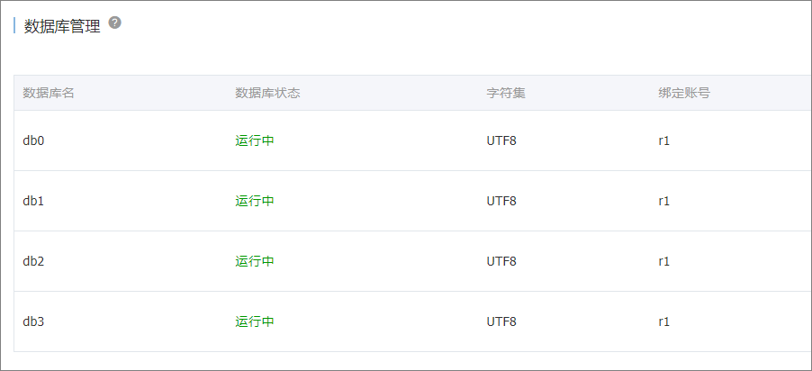

- 执行 `vi /root/apache-shardingsphere-incubating-4.0.0-sharding-proxy-bin/conf/server.yaml` 配置公共配置文件：

  ```text
    authentication:  
    users:  
      r1:  
        password: PW123321!  
        authorizedSchemas: db0,db1,db2,db3  
  props:  
    executor.size: 16  
    sql.show: false
  ```

**水平分片测试**

1. 执行 `vi /root/apache-shardingsphere-incubating-4.0.0-sharding-proxy-bin/conf/config-sharding.yaml`  修改数据分片配置文件。

   ```text
   schemaName: sdb

   dataSources:
     db0:
       url: jdbc:postgresql://pgm-bpxxxxx.pg.rds.aliyuncs.com:1433/db0
       username: r1
       password: PW123321!
       connectionTimeoutMilliseconds: 30000
       idleTimeoutMilliseconds: 60000
       maxLifetimeMilliseconds: 1800000
       maxPoolSize: 65
     db1:
       url: jdbc:postgresql://pgm-bpxxxxx.pg.rds.aliyuncs.com:1433/db1
       username: r1
       password: PW123321!
       connectionTimeoutMilliseconds: 30000
       idleTimeoutMilliseconds: 60000
       maxLifetimeMilliseconds: 1800000
       maxPoolSize: 65
     db2:
       url: jdbc:postgresql://pgm-bpxxxxx.pg.rds.aliyuncs.com:1433/db2
       username: r1
       password: PW123321!
       connectionTimeoutMilliseconds: 30000
       idleTimeoutMilliseconds: 60000
       maxLifetimeMilliseconds: 1800000
       maxPoolSize: 65
     db3:
       url: jdbc:postgresql://pgm-bpxxxxx.pg.rds.aliyuncs.com:1433/db3
       username: r1
       password: PW123321!
       connectionTimeoutMilliseconds: 30000
       idleTimeoutMilliseconds: 60000
       maxLifetimeMilliseconds: 1800000
       maxPoolSize: 65

   shardingRule:
     tables:
       t_order:
         actualDataNodes: db${0..3}.t_order${0..7}
         databaseStrategy:
           inline:
             shardingColumn: user_id
             algorithmExpression: db${user_id % 4}
         tableStrategy:
           inline:
             shardingColumn: order_id
             algorithmExpression: t_order${order_id % 8}
         keyGenerator:
           type: SNOWFLAKE
           column: order_id
       t_order_item:
         actualDataNodes: db${0..3}.t_order_item${0..7}
         databaseStrategy:
           inline:
             shardingColumn: user_id
             algorithmExpression: db${user_id % 4}
         tableStrategy:
           inline:
             shardingColumn: order_id
             algorithmExpression: t_order_item${order_id % 8}
         keyGenerator:
           type: SNOWFLAKE
           column: order_item_id
     bindingTables:
       - t_order,t_order_item
     defaultTableStrategy:
       none:
   ```

2. 启动ShardingSphere，监听8001端口。

   ```bash
   cd /root/apache-shardingsphere-incubating-4.0.0-sharding-proxy-bin/bin/
   ./start.sh 8001
   ```

3. 测试连接数据库。

   ```text
   psql -h 127.0.0.1 -p 8001 -U r1 sdb
   ```

4. 创建表。

   ```sql
   create table t_order(order_id int8 primary key, user_id int8, info text, c1 int, crt_time timestamp);  
   create table t_order_item(order_item_id int8 primary key, order_id int8, user_id int8, info text, c1 int, c2 int, c3 int, c4 int, c5 int, crt_time timestamp);
   ```

   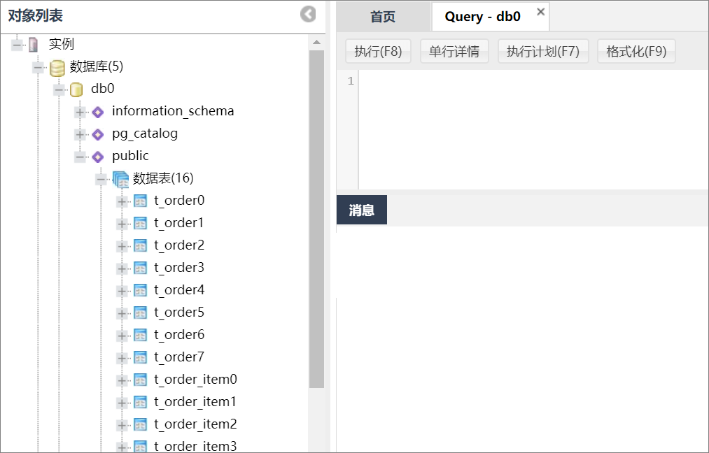

   > 创建表会根据配置的策略，在目标库中自动创建水平分片。
   >
   > **说明**

**常见问题**

- 如果想知道ShardingSphere的解析SQL、路由SQL的语句，请执行 `vi /root/apache-shardingsphere-incubating-4.0.0-sharding-proxy-bin/conf/server.yaml` 查看：

  ```text
    authentication:  
    users:  
      r1:  
        password: PW123321!  
        authorizedSchemas: db0,db1,db2,db3  
  props:  
    executor.size: 16  
    sql.show: true  # 表示把解析的sql打印到⽇志
  ```

- 如果需要做写入、查询等测试，请在数据库中使用如下命令：

  ```sql
  insert into t_order (user_id, info, c1, crt_time) values (0,'a',1,now());  

  insert into t_order (user_id, info, c1, crt_time) values (1,'b',2,now());  

  insert into t_order (user_id, info, c1, crt_time) values (2,'c',3,now());  

  insert into t_order (user_id, info, c1, crt_time) values (3,'c',4,now());  


  select * from t_order;  
  ```

  执行结果示例如下：

  ```text
        order_id      | user_id | info | c1 |          crt_time            
  --------------------+---------+------+----+----------------------------  
   433352561047633921 |       0 | a    |  1 | 2020-02-09 19:48:21.856555  
   433352585668198400 |       1 | b    |  2 | 2020-02-09 19:48:27.726815  
   433352610813050881 |       2 | c    |  3 | 2020-02-09 19:48:33.721754  
   433352628370407424 |       3 | c    |  4 | 2020-02-09 19:48:37.907683  
  (4 rows)  
                          
  ```

- 如果需要查看ShardingSphere日志，路径如下：

  ```text
  /root/apache-shardingsphere-incubating-4.0.0-sharding-proxy-bin/logs/stdout.log
  ```

- 如果需要使用pgbench压测，请参见如下命令：

  ```sql
  vi test.sql  
  \set user_id random(1,100000000)  
  \set order_id random(1,2000000000)  
  \set order_item_id random(1,2000000000)  
  insert into t_order (user_id, order_id, info, c1 , crt_time) values (:user_id, :order_id,random()::text, random()*1000, now()) on conflict (order_id) do update set info=excluded.info,c1=excluded.c1,crt_time=excluded.crt_time;   
  insert into t_order_item (order_item_id, user_id, order_id, info, 
  c1,c2,c3,c4,c5,crt_time) values (:order_item_id, :user_id,:order_id,random()::text, random()*1000,random()*1000,random()*1000,random()*1000,random()*1000, now()) on conflict(order_item_id) do nothing;  

  pgbench -M simple -n -r -P 1 -f ./test.sql -c 24 -j 24  -h 127.0.0.1 -p 8001 -U r1 sdb -T 120  
  progress: 1.0 s, 1100.9 tps, lat 21.266 ms stddev 6.349  
  progress: 2.0 s, 1253.0 tps, lat 18.779 ms stddev 7.913  
  progress: 3.0 s, 1219.0 tps, lat 20.083 ms stddev 13.212
  ```
