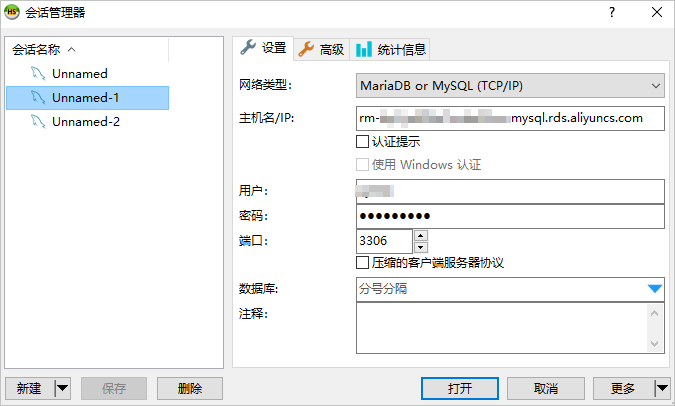
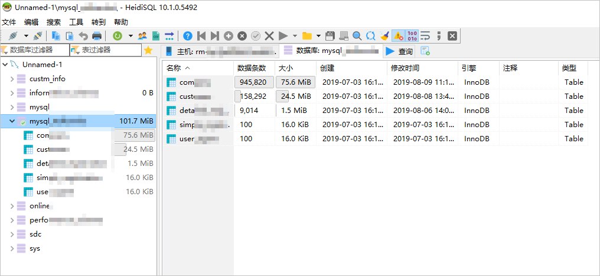
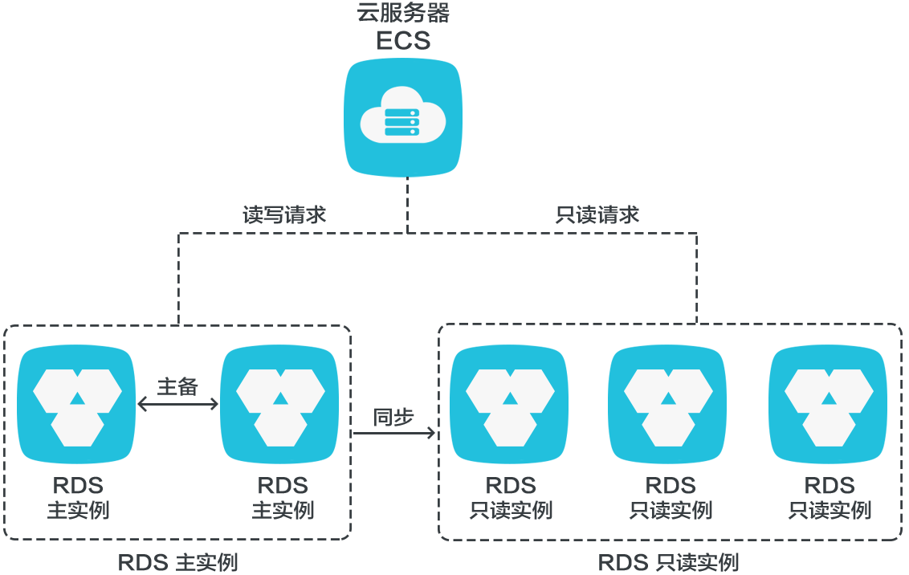
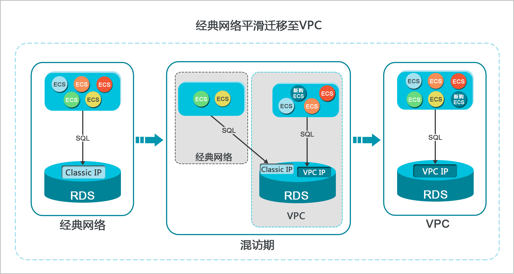
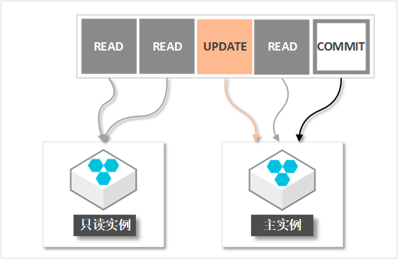
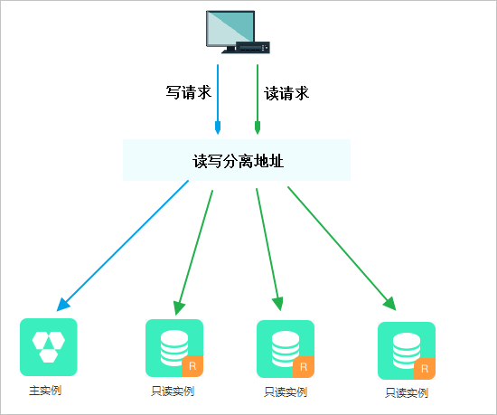
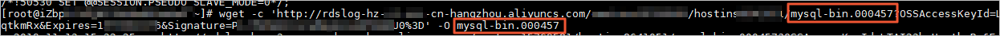
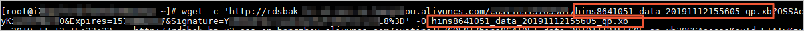

阿里云  
专有云  
云数据库RDS  
RDS for MySQL版 用户指南  
产品版本：V3.18.6  
文档版本：20251205

**目录**

- [1.什么是关系型数据库RDS](#section-1)
- [2.实例规格](#section-2)
- [3.登录云数据库RDS控制台](#section-3)
- [4.快速入门](#section-4)
    - [4.1. 使用限制](#section-4-1)
    - [4.2. 使用流程](#section-4-2)
    - [4.3. 创建实例](#section-4-3)
    - [4.4. 初始化设置](#section-4-4)
        - [4.4.1. 设置白名单](#section-4-4-1)
        - [4.4.2. 创建账号](#section-4-4-2)
        - [4.4.3. 创建数据库](#section-4-4-3)
    - [4.5. 连接MySQL实例](#section-4-5)
- [5.实例管理](#section-5)
    - [5.1. 创建实例](#section-5-1)
    - [5.2. 查看实例基本信息](#section-5-2)
    - [5.3. 重启实例](#section-5-3)
    - [5.4. 变更配置](#section-5-4)
    - [5.5. 设置可维护时间段](#section-5-5)
    - [5.6. 修改数据复制方式](#section-5-6)
    - [5.7. 释放实例](#section-5-7)
    - [5.8. 升级内核小版本](#section-5-8)
    - [5.9. 设置实例参数](#section-5-9)
    - [5.10. 只读实例](#section-5-10)
        - [5.10.1. 概述](#section-5-10-1)
        - [5.10.2. 创建只读实例](#section-5-10-2)
        - [5.10.3. 查询只读实例详情](#section-5-10-3)
    - [5.11. 实例回收站](#section-5-11)
    - [5.12. 标签](#section-5-12)
- [6.账号管理](#section-6)
    - [6.1. 创建账号](#section-6-1)
    - [6.2. 重置密码](#section-6-2)
    - [6.3. MySQL密码策略锁定机制说明（FLTTAL）](#section-6-3)
    - [6.4. 修改账号权限](#section-6-4)
    - [6.5. 删除账号](#section-6-5)
- [7.数据库管理](#section-7)
    - [7.1. 创建数据库](#section-7-1)
    - [7.2. 删除数据库](#section-7-2)
- [8.数据库连接](#section-8)
    - [8.1. 修改连接地址和端口](#section-8-1)
    - [8.2. 申请或释放内外网地址](#section-8-2)
    - [8.3. 通过DMS登录RDS数据库](#section-8-3)
    - [8.4. 临时混访方案（同时保留经典网络和专有网络地址）](#section-8-4)
    - [8.5. 切换网络类型](#section-8-5)
    - [8.6. 切换专有网络VPC和虚拟交换机](#section-8-6)
- [9.数据库代理](#section-9)
    - [9.1. 数据库独享代理](#section-9-1)
    - [9.2. 短连接优化功能](#section-9-2)
    - [9.3. 事务拆分](#section-9-3)
    - [9.4. 读写分离](#section-9-4)
        - [9.4.1. 开启读写分离](#section-9-4-1)
        - [9.4.2. 设置读写分离](#section-9-4-2)
        - [9.4.3. 关闭读写分离](#section-9-4-3)
- [10.监控与报警](#section-10)
    - [10.1. 查看系统资源和引擎监控](#section-10-1)
- [11.数据安全性](#section-11)
    - [11.1. 设置白名单](#section-11-1)
    - [11.2. 设置SSL加密](#section-11-2)
    - [11.3. 设置透明数据加密TDE](#section-11-3)
    - [11.4. SQL审计](#section-11-4)
- [12.服务可用性](#section-12)
    - [12.1. 自动或手动主备切换](#section-12-1)
    - [12.2. 修改数据复制方式](#section-12-2)
- [13.数据库备份与恢复](#section-13)
    - [13.1. 自动备份](#section-13-1)
    - [13.2. 手动备份](#section-13-2)
    - [13.3. 下载数据备份和日志备份](#section-13-3)
    - [13.4. 一键上传Binlog](#section-13-4)
    - [13.5. 数据库恢复（原克隆实例）](#section-13-5)
- [14.自治服务](#section-14)
    - [14.1. 自治服务简介](#section-14-1)
    - [14.2. 一键诊断](#section-14-2)
    - [14.3. 会话管理](#section-14-3)
    - [14.4. 实时性能](#section-14-4)
    - [14.5. 空间分析](#section-14-5)
    - [14.6. 锁分析](#section-14-6)
    - [14.7. 性能趋势](#section-14-7)
    - [14.8. 慢SQL](#section-14-8)
    - [14.9. 诊断报告](#section-14-9)
- [15.日志管理](#section-15)
- [16.使用mysqldump迁移MySQL数据](#section-16)

<a id="section-1"></a>

# 1.什么是关系型数据库RDS

阿里云关系型数据库RDS（Relational Database Service）是一种稳定可靠、可弹性伸缩的在线数据库服务。基于高性能存储，提供了容灾、备份、恢复、监控、迁移等方面的全套解决方案。

阿里云关系型数据库RDS包含MySQL、SQL Server、PolarDB、PostgreSQL四种数据库引擎，可以方便快捷地创建出适合自己应用场景的数据库实例。

**RDS MySQL**

RDS MySQL基于阿里云的AliSQL内核，经过双十一高并发、大数据量的考验，拥有优良的性能。RDS MySQL支持X86、ARM多集群混部，集成了实例管理、账号管理、数据库管理、备份恢复、白名单、透明数据加密以及数据迁移等基本功能。除此之外还提供如下高级功能：

- <strong>只读实例：</strong>在对数据库有大量读请求和少量写请求时，单个实例可能无法承受读取压力，为了实现读取能力的弹性扩展，减少单个实例的压力，RDS MySQL的实例支持只读实例，利用只读实例满足大量的数据库读取需求，以此增加应用的吞吐量。

- <strong>读写分离：</strong>读写分离功能是在只读实例的基础上，额外提供了一个读写分离地址，联动主实例及其所有只读实例，创建自动的读写分离链路。应用程序只需连接读写分离地址进行数据读取及写入操作，读写分离程序会自动将写入请求发往主实例，而将读取请求按照权重发往各个只读实例。用户只需通过添加只读实例的个数，即可不断扩展系统的处理能力，应用程序上无需做任何修改。

- <strong>同城容灾高可用能力：</strong>RDS MySQL的高可用系列默认支持主备双节点，部署在同一地域的两个不同可用区（如上海可用区A和可用区B），形成跨可用区的主从架构：

  - 主节点：处理读写请求。

  - 备节点：实时同步主节点数据，不对外提供服务。

  - 自动故障切换：当主节点所在可用区发生故障（如断电、网络中断），RDS会自动将备节点提升为主节点，切换时间通常为30秒~5分钟（具体依赖故障检测和恢复机制）。

<a id="section-2"></a>

# 2.实例规格

实例有不同的系列、版本、规格，性能也有区别，本文介绍RDS MySQL的实例规格。

**关于云盘IOPS**

对于本地SSD盘，根据实例规格有固定的IOPS限制，详情请参见本文规格表；对于云盘，除了实例规格外，存储空间大小对IOPS也会有影响。云盘IOPS的详细计算公式如下（存储空间单位为GB）：

```text
min{1800+30*存储空间, 25000}
```

> **说明**
>
> 吞吐量如果达到上限，也会影响IOPS。

**主实例**

**双机高可用版**

<table>
  <tr>
    <th>规格族</th>
    <th>支持版本</th>
    <th>规格代码</th>
    <th>CPU和内存</th>
    <th>最大IOPS</th>
    <th>最大连接数</th>
    <th>存储空间</th>
  </tr>
  <tr>
    <td rowspan="11">通用型</td>
    <td rowspan="11">5.7、8.0</td>
    <td>rds.mysql.t1.small</td>
    <td>1核 1GB</td>
    <td>1200</td>
    <td>300</td>
    <td rowspan="8">5 GB~2000 GB</td>
  </tr>
  <tr>
    <td>rds.mysql.s1.small</td>
    <td>1核 2GB</td>
    <td>2000</td>
    <td>600</td>
  </tr>
  <tr>
    <td>rds.mysql.s2.large</td>
    <td>2核 4GB</td>
    <td>4000</td>
    <td>1200</td>
  </tr>
  <tr>
    <td>rds.mysql.s2.xlarge</td>
    <td>2核 8GB</td>
    <td>6000</td>
    <td>2000</td>
  </tr>
  <tr>
    <td>rds.mysql.s3.large</td>
    <td>4核 8GB</td>
    <td>8000</td>
    <td>2000</td>
  </tr>
  <tr>
    <td>rds.mysql.m1.medi um</td>
    <td>4核 16GB</td>
    <td>14000</td>
    <td>4000</td>
  </tr>
  <tr>
    <td>rds.mysql.c1.large</td>
    <td>8核 16GB</td>
    <td>20000</td>
    <td>4000</td>
  </tr>
  <tr>
    <td>rds.mysql.c1.xlarge</td>
    <td>8核 32GB</td>
    <td>28000</td>
    <td>8000</td>
  </tr>
  <tr>
    <td>rds.mysql.g2.2xlarg e</td>
    <td>16核 32GB</td>
    <td>40000</td>
    <td>8000</td>
    <td>50 GB~3000 GB</td>
  </tr>
  <tr>
    <td>rds.mysql.c2.xlarge</td>
    <td>16核 64GB</td>
    <td>40000</td>
    <td>16000</td>
    <td rowspan="2"></td>
  </tr>
  <tr>
    <td colspan="4"></td>
  </tr>
</table>

5 GB~3000 GB

16核 96GB

rds.mysql.c2.xlp2

40000

24000

16核

rds.mysql.c2.2xlarg

5.7

16000

32000

e

128GB

rds.mysql.g2.3xlarg

50 GB~3000

24核 48GB

40000

12000

e

GB

rds.mysql.x2.3xlarg

50 GB~2000

24核 48GB

50000

12000

e

GB

rds.mysql.g4.3xlarg

24核 96GB

50000

24000

e

5.7、8.0

rds.mysql.g2.4xlarg

32核 64GB

60000

16000

e

50 GB~3000 GB

32核

rds.mysql.g4.4xlarg

60000

32000

e

128GB

64核

rds.mysql.g2.8xlarg

60000

32000

e

128GB

2核 16GB

mysql.x8.medium.2

15000

2500

50 GB~1000

4核 16GB

mysql.x4.large.2

30000

2500

GB

4核 32GB

mysql.x8.large.2

40000

5000

8核 32GB

mysql.x4.xlarge.2

45000

5000

500 GB~3000 GB

8核 64GB

mysql.x8.xlarge.2

50000

10000

rds.mysql.x2.2xlarg

50 GB~2000

16核 32GB

40000

8000

e

GB

16核 64GB

mysql.x4.2xlarge.2

60000

10000

16核

500 GB~3000

mysql.x8.2xlarge.2

60000

20000

GB

128GB

独享型

5.7、8.0

rds.mysql.x4.3xlarg

50 GB~2000

24核 96GB

50000

24000

e

GB

rds.mysql.x2.4xlarg

50 GB~3000

e

32核 64GB

60000

16000

GB

32核

1000 GB~6000

mysql.x4.4xlarge.2

80000

20000

128GB

GB

32核

rds.mysql.x4.4xlarg

50 GB~3000

60000

32000

e

128GB

GB

1000 GB~6000

32核

mysql.x8.4xlarge.2

100000

40000

GB

256GB

64核

rds.mysql.x2.8xlarg

50 GB~3000

60000

32000

e

128GB

GB

64核

1000 GB~6000

mysql.x8.8xlarge.2

150000

80000

512GB

GB

10000

60核

0

5.7

rds.mysql.st.h43

150000

470GB

独占物理

1000 GB~6000

机型

GB

90核

15000

5.7、8.0

rds.mysql.st.v52

150000

720GB

0

**只读实例**

<table>
  <tr>
    <th>规格族</th>
    <th>支持版本</th>
    <th>规格代码</th>
    <th>CPU和内存</th>
    <th>最大连接数</th>
    <th>存储空间</th>
  </tr>
  <tr>
    <td rowspan="5"></td>
    <td rowspan="5"></td>
    <td>rds.mysql.t1.small</td>
    <td>1核 1GB</td>
    <td>300</td>
    <td rowspan="5">5GB~2000GB</td>
  </tr>
  <tr>
    <td>rds.mysql.s1.small</td>
    <td>1核 2GB</td>
    <td>600</td>
  </tr>
  <tr>
    <td>rds.mysql.s2.large</td>
    <td>2核 4GB</td>
    <td>1200</td>
  </tr>
  <tr>
    <td>rds.mysql.s2.xlarge</td>
    <td>2核 8GB</td>
    <td>2000</td>
  </tr>
  <tr>
    <td colspan="3"></td>
  </tr>
  <tr>
    <td rowspan="7">通用型</td>
    <td rowspan="7">5.7、8.0</td>
    <td colspan="3"></td>
    <td rowspan="5"></td>
  </tr>
  <tr>
    <td>rds.mysql.s3.large</td>
    <td>4核 8GB</td>
    <td>2000</td>
  </tr>
  <tr>
    <td>rds.mysql.m1.medium</td>
    <td>4核 16GB</td>
    <td>4000</td>
  </tr>
  <tr>
    <td>rds.mysql.c1.large</td>
    <td>8核 16GB</td>
    <td>4000</td>
  </tr>
  <tr>
    <td>rds.mysql.c1.xlarge</td>
    <td>8核 32GB</td>
    <td>8000</td>
  </tr>
  <tr>
    <td>rds.mysql.c2.xlarge</td>
    <td>16核 64GB</td>
    <td>16000</td>
    <td rowspan="2">5GB~3000GB</td>
  </tr>
  <tr>
    <td>rds.mysql.c2.xlp2</td>
    <td>16核 96GB</td>
    <td>24000</td>
  </tr>
  <tr>
    <td rowspan="10">独享型</td>
    <td rowspan="10">5.7、8.0</td>
    <td>mysqlro.x8.medium.1</td>
    <td>2核 16GB</td>
    <td>2500</td>
    <td rowspan="4">50GB~1000GB</td>
  </tr>
  <tr>
    <td>mysqlro.x4.large.1</td>
    <td>4核 16GB</td>
    <td>2500</td>
  </tr>
  <tr>
    <td>mysqlro.x8.large.1</td>
    <td>4核 32GB</td>
    <td>5000</td>
  </tr>
  <tr>
    <td>mysqlro.x4.xlarge.1</td>
    <td>8核 32GB</td>
    <td>5000</td>
  </tr>
  <tr>
    <td>mysqlro.x8.xlarge.1</td>
    <td>8核 64GB</td>
    <td>10000</td>
    <td rowspan="4">500GB~3000G B</td>
  </tr>
  <tr>
    <td>mysqlro.x4.2xlarge.1</td>
    <td>16核 64GB</td>
    <td>10000</td>
  </tr>
  <tr>
    <td>mysqlro.x8.2xlarge.1</td>
    <td>16核 128GB</td>
    <td>20000</td>
  </tr>
  <tr>
    <td>mysqlro.x4.4xlarge.1</td>
    <td>32核 128GB</td>
    <td>20000</td>
  </tr>
  <tr>
    <td>mysqlro.x8.4xlarge.1</td>
    <td>32核 256GB</td>
    <td>40000</td>
    <td rowspan="2">1000GB~6000 GB</td>
  </tr>
  <tr>
    <td>mysqlro.x8.8xlarge.1</td>
    <td>64核 512GB</td>
    <td>80000</td>
  </tr>
  <tr>
    <td rowspan="2">独占物理机型</td>
    <td>5.7</td>
    <td>rds.mysql.st.h43</td>
    <td>60核 470GB</td>
    <td>100000</td>
    <td rowspan="2">1000GB~6000 GB</td>
  </tr>
  <tr>
    <td>5.7、8.0</td>
    <td>rds.mysql.st.v52</td>
    <td>90核 720GB</td>
    <td>150000</td>
  </tr>
</table>

<a id="section-3"></a>

# 3.登录云数据库RDS控制台

本节主要向您介绍如何登录云数据库RDS控制台。

**前提条件**

- 登录Apsara Uni-manager运营控制台前，确认您已从部署人员处获取Apsara Uni-manager运营控制台的服务域名地址。

- 推荐使用Chrome浏览器。

**操作步骤**

1. 在浏览器地址栏中，输入Apsara Uni-manager运营控制台的服务域名地址，按回车键。

2. 输入正确的用户名及密码。

   请向运营管理员获取登录控制台的用户名和密码。

   > 首次登录Apsara Uni-manager运营控制台时，需要修改登录用户名的密码，请按照提
   >
   > **说明**
   >
   > 示完成密码修改。为提高安全性，密码长度必须为10~32位，且至少包含以下两种类型：
   >
   > - 英文大写或小写字母（A~Z、a~z）
   >
   > - 阿拉伯数字（0~9）
   >
   > - 特殊符号（感叹号（!）、at（@）、井号（#）、美元符号（$）、百分号（%）等）

3. 单击**账号登录**。

4. 如果账号已激活MFA多因素认证，请根据以下两种情况进行操作：

   - 管理员强制开启MFA后的首次登录：

     <ol type="a">

     <li>

     在绑定虚拟MFA设备页面中，按页面提示步骤绑定MFA设备。

     </li>

     <li>

     按照步骤2重新输入账号和密码，单击**账号登录**。

     </li>

     </ol>

     <ol type="i" start="100">

     <li>

     输入6位MFA码后单击**认证**。

     </li>

     </ol>

   - 您已开启并绑定MFA：

     输入6位MFA码后单击**认证**。

     > 绑定并开启MFA的操作请参见<strong>《Apsara Uni-manager运营控制台用户指南》</strong>中的
     >
     > **说明**
     >
     > 章节<strong>《绑定并开启虚拟MFA设备》</strong>。

5. 在页面顶部的导航栏中，单击**产品 > 数据库 > 云数据库 RDS**。

<a id="section-4"></a>

# 4.快速入门

<a id="section-4-1"></a>

## 4.1. 使用限制

为保障实例的稳定及安全，云数据库MySQL版有部分使用上的约束，详情如下表所示。

<table>
  <tr>
    <th width="154">约束项</th>
    <th>使用约束</th>
  </tr>
  <tr>
    <td>实例参数</td>
    <td>大部分实例参数可以使用RDS管理控制台或API进行修改，同时出于安全和稳定性考虑，部分参数不支持修改。</td>
  </tr>
  <tr>
    <td>数据库root权限</td>
    <td>不提供root或者sa权限。</td>
  </tr>
  <tr>
    <td>数据库备份</td>
    <td>• 可使用命令行或图形界面进行逻辑备份。<br>• 仅限通过RDS管理控制台或API进行物理备份。</td>
  </tr>
  <tr>
    <td>数据库还原</td>
    <td>• 可使用命令行或图形界面进行逻辑数据还原。<br>• 仅限通过RDS管理控制台或API进行物理还原。</td>
  </tr>
  <tr>
    <td>MySQL存储引擎</td>
    <td>目前仅支持InnoDB引擎。<br>• 出于性能和安全性考虑建议尽量采用InnoDB存储引擎。<br>• 不支持TokuDB引擎。由于Percona已经不再对TokuDB提供支持，很多已知BUG无法修正，极端情况下会导致业务受损。<br>• 不支持MyISAM引擎。MyISAM引擎由于自身缺陷，存在数据丢失的风险，因此仅部分存量实例暂时支持，新创建实例的MyISAM引擎表会自动转换为InnoDB引擎表。<br>• 不支持Memory引擎。如果您创建Memory引擎的表，我们将自动为您转换成InnoDB引擎的表。</td>
  </tr>
  <tr>
    <td>搭建数据库复制</td>
    <td>MySQL本身提供主备复制架构的双节点集群，无需您手动搭建。其中主备复制架构集群的备（slave）实例不对您开放，您的应用不可直接访问。</td>
  </tr>
  <tr>
    <td>重启RDS实例</td>
    <td>必须通过RDS管理控制台或API重启实例。</td>
  </tr>
  <tr>
    <td>账号和数据库管理</td>
    <td>MySQL默认需要通过RDS管理控制台进行账号和数据库管理。同时，MySQL也支持您通过创建高权限账号的方式来自行管理用户、密码和数据库。</td>
  </tr>
  <tr>
    <td>普通账号</td>
    <td>• 不可以进行授权。<br>• 控制台有账号管理和数据库管理的界面。<br>• 支持创建普通账号的实例也支持创建高权限账号。</td>
  </tr>
  <tr>
    <td>高权限账号</td>
    <td>• 可以为普通账号授权。<br>• 开通高权限账号后无法回退。</td>
  </tr>
</table>

<a id="section-4-2"></a>

## 4.2. 使用流程

快速使用RDS的基本过程包括创建RDS实例、设置白名单、创建数据库、创建账号、连接实例。本章节以RDS for MySQL为例通过流程图来向您介绍使用RDS的基本步骤，旨在引导您一站式完成RDS的搭建。

通常，从创建实例到可以开始使用实例，您需要完成的操作见快速入门流程图。

图 1. 快速入门流程图


- 创建实例

  实例是虚拟化的数据库服务器，您可以在一个实例中创建和管理多个数据库。

- 设置白名单

  创建RDS实例后，您需要设置RDS实例的白名单，以允许外部设备访问该RDS实例。

  白名单可以让RDS实例得到高级别的访问安全保护，建议您定期维护白名单。设置白名单不会影响RDS实例的正常运行。

- 创建数据库和创建账号

  在使用数据库之前，您需要在RDS实例中创建数据库和账号。

- 连接MySQL实例

  完成创建实例、设置白名单、创建数据库和账号等操作后，您可以使用通用数据库客户端连接到RDS实例。

<a id="section-4-3"></a>

## 4.3. 创建实例

本文介绍如何通过RDS控制台创建实例。

**前提条件**

在创建RDS实例前，需要先申请可以登录阿里云控制台的账号。

**操作步骤**

1. 登录云数据库RDS控制台。

2. 在左侧导航栏，单击**实例列表**，然后单击**创建实例**。

3. 根据下表设置参数。

   **类别**

   **配置**

   **说明**

   实例所属组织。

   **组织**

   **基本配置**

   实例所属资源集。

   **资源集**

   实例所属地域。不同地域之间的产品内网不互通，创建实例后不支持更换地域。

   **地域**

   RDS支持**多可用区部署**和**单可用区部署**。用户可根据需要选择主节点和备节点的

   **部署方案**

   可用区。

   **区域**

   **主节点可用**

   实例主节点所属的可用区。

   **区**

   **备节点可用**

   实例备节点所属的可用区。仅当部署方案选择**多可用区部署**选项。

   **区**

   数据库的类型，选择**MySQL**。

   **数据库类型**

   选择RDS实例所属主机的芯片架构。

   **芯片架构**

   > **说明**
   >
   > 选择该配置时如提示未授权，请联系运营管理员对该账号执行授权。

   数据库的版本，支持如下版本：

   **数据库版本**

   - 8.0

   - 5.7

   数据库的系列。详细信息，请参见<strong>《云数据库RDS产品简介》</strong>中的**实例规格**章

   **系列**

   节。

   **规格配置**

   数据库的存储类型，选择本地SSD。

   **存储类型**

   实例的规格，不同的内存大小对应不同的最大连接数和IOPS，具体请以控制台界面为准。详细信息，请参见<strong>《云数据库RDS产品简介》</strong>中的**实例规格**章节。

   **实例规格**

   您可以单击**AI规格推荐**，在飞天助理中输入使用场景，从而获得兼顾成本与性能的最佳规格建议。

   存储空间包括数据空间、系统文件空间、Binlog文件空间和事务文件空间。详细

   **存储空间**

   信息，请参见<strong>《云数据库RDS产品简介》</strong>中的**实例规格**章节。

   RDS提供如下两种类型的连接地址：

   - **公网连接**：通过该连接地址可以从外网访问数据库。

   - **内网连接**：通过该连接地址可以从内网访问数据库。

   **网络连接类型**

   > **说明**
   >
   > 实例创建完成后无法修改，请谨慎选择。

   RDS实例支持的网络类型：

   - **经典网络**：经典网络中的云服务在网络上不进行隔离，只能依靠云服务自身的安全组或白名单策略来阻挡非法访问。

     > **说明**

   **网络类型**

   > 云盘实例不支持该网络类型。

   - **专有网络**：专有网络VPC（Virtual Private Cloud）帮助您在阿里云上构建出一个隔离的网络环境。您可以自定义专有网络里面的路由表、IP地址范围和网关。建议您选择专有网络，更加安全。

   **网络**

   选择您的VPC。

   > **说明**

   **VPC**

   > 当**网络类型**为**专有网络**时，需要填写该参数。

   交换机所在的可用区。

   **交换机可用**

   > **说明**

   **区**

   > 当**网络类型**为**专有网络**时可见。上述情况以外的场景无需设置本参数。

   选择VPC下的交换机。

   **交换机**

   > **说明**

   **VSwitch**

   > 当**网络类型**为**专有网络**时，需要填写该参数。

   添加IP地址，允许目标IP地址访问该RDS实例。

   **IP白名单**

   <table>
     <tr>
       <td rowspan="2">实例设置</td>
       <td>创建数量</td>
       <td>RDS支持批量创建实例。此处可以指定需要创建的RDS实例个数，默认为1个。</td>
     </tr>
     <tr>
       <td>实例名称</td>
       <td>RDS实例的名称。<br>• 长度为2~64个字符。<br>• 以英文字母或中文开头。<br>• 支持数字和短划线（-） 、下划线（_）、冒号（:）。<br>• 不能以http:// 或https://开头。</td>
     </tr>
   </table>

4. 完成上述参数配置后，单击**提交**。

<a id="section-4-4"></a>

## 4.4. 初始化设置

<a id="section-4-4-1"></a>

### 4.4.1. 设置白名单

为了数据库的安全稳定，在创建RDS实例后，需先修改实例的白名单，将需要访问实例的IP地址或者IP段加入到RDS实例白名单中。

**背景信息**

白名单可以让RDS实例得到高级别的访问安全保护，建议您定期维护白名单。设置白名单不会影响RDS实例的正常运行。

设置白名单包括两种操作：

- 设置IP白名单：添加IP地址，允许这些IP地址访问该RDS实例。

- 设置ECS安全组：添加ECS安全组，允许ECS安全组内的ECS实例访问该RDS实例。

**注意事项**

- 默认的IP白名单分组只能被修改或清空，不能被删除。

- 每个IP白名单分组最多添加1000个IP或IP段。当IP较多时，建议合并为IP段填入，例如192.168.1.0/24。

**通用白名单模式操作步骤**

1. 登录云数据库RDS控制台。

2. 单击**实例列表**，单击目标实例ID或单击目标实例右侧**操作**列下面的**管理**，打开实例的**基本信息**页面。

3. 在左侧导航栏中，单击**数据安全性**。

4. 在**白名单设置**页签中，单击**修改**。

   > **说明**
   >
   > - 若需要ECS实例通过内网地址连接到RDS，请确保两者处于同一地域内且网络类型相同，否则设置了白名单也无法连接成功。
   >
   > - 您也可以单击**添加白名单分组**新建自定义分组。

5. 在**修改白名单分组**对话框中，填写需要访问该实例的IP地址或IP段，然后单击**确定**。

   - 若填写IP段，如10.10.10.0/24，则表示10.10.10.XX的IP地址都可以访问该RDS实例。

   - 若您需要添加多个IP地址或IP段，请用英文逗号（,）隔开（逗号前后都不能有空格），例如 `192.168.0.1,172.16.213.9` 。

   - 单击**加载ECS内网IP**后，将显示您当前阿里云账号下所有ECS实例的IP地址，可快速添加ECS内网IP地址到白名单中。

   > **说明**
   >
   > 当您在**default**分组中添加新的IP地址或IP段后，默认地址127.0.0.1会被自动删除。

<a id="section-4-4-2"></a>

### 4.4.2. 创建账号

完成RDS实例创建并配置IP白名单后，您需要在实例中创建数据库和账号。本章节介绍如何创建高权限账号和普通账号。

**背景信息**

RDS MySQL实例支持两种数据库账号：高权限账号和普通账号。您可以在控制台管理所有账号和数据库，账号拥有的具体权限请参见文末账号权限列表。

<table>
  <tr>
    <th width="105">账号类型</th>
    <th>说明</th>
  </tr>
  <tr>
    <td>高权限账号</td>
    <td>• 只能通过控制台或API创建和管理。<br>• 一个实例中只能创建一个高权限账号，可以管理所有普通账号和数据库。<br>• 开放了更多权限，可满足个性化和精细化的权限管理需求，例如可按用户分配不同表的查询权限。<br>• 可以断开任意账号的连接。</td>
  </tr>
  <tr>
    <td>普通账号</td>
    <td>• 可以通过控制台、API或者SQL语句创建和管理。<br>• 一个实例可以创建最多500个普通账号 。<br>• 需要手动给普通账号授予特定数据库的权限。<br>• 普通账号不能创建和管理其他账号，也不能断开其他账号的连接。</td>
  </tr>
</table>

| 账号类型 | 建库数量 | 建表数量 | 用户数 |
| --- | --- | --- | --- |
| 高权限账号 | 不限 | &lt;20万 | 与实例内核参数相关。 |
| 普通权限账号 | 500 | &lt;20万 | 与实例内核参数相关。 |

**创建高权限账号**

1. 登录云数据库RDS控制台。

2. 单击**实例列表**，单击目标实例ID或者单击实例右侧**操作**列下的**管理**，打开**基本信息**页面。

3. 在左侧导航栏中，单击**账号管理**，进入**账号管理**页面。

4. 在**用户账号**页签中，单击**创建账号**。

5. 在**创建账号**页面，设置以下参数。

   <table>
     <tr>
       <th width="105">参数</th>
       <th>说明</th>
     </tr>
     <tr>
       <td>数据库账号</td>
       <td>填写账号名称。要求如下：<br>• 长度为2~32个字符。<br>• 以字母开头，以字母或数字结尾。<br>• 由小写字母、数字或下划线（_）组成。</td>
     </tr>
     <tr>
       <td>账号类型</td>
       <td>选择高权限账号。</td>
     </tr>
     <tr>
       <td>密码</td>
       <td>设置账号密码。要求如下：<br>• 长度为8~32个字符。<br>• 由大写字母、小写字母、数字、特殊字符中的任意三种组成。<br>• 特殊字符为：<br>!@#$%^&amp;*()_+-=<br>• 数据库账号名称不能为root、mysql等关键字。</td>
     </tr>
     <tr>
       <td>确认密码</td>
       <td>再次输入密码。</td>
     </tr>
     <tr>
       <td>备注说明</td>
       <td>非必填。备注该账号的相关信息，便于后续账号管理。最多支持256个字符。</td>
     </tr>
   </table>

6. 单击**创建**。

**重置高权限账号**

如果高权限账号自身出现问题，例如权限被意外回收（REVOKE），您可以通过输入高权限账号的密码来重置高权限账号的权限，使其恢复正常。

1. 登录云数据库RDS控制台。

2. 单击**实例列表**，单击目标实例ID或者单击实例右侧**操作**列下的**管理**，打开**基本信息**页面。

3. 在左侧导航栏中，单击**账号管理**，进入**账号管理**页面。

4. 在**用户账号**页签中，单击目标高权限账号右侧**操作**栏中的**重置账号权限**。

5. 在**重置账号**页面，输入高权限账号密码，单击**确定**。

**创建普通账号**

1. 登录云数据库RDS控制台。

2. 单击**实例列表**，单击目标实例ID或者单击实例右侧**操作**列下的**管理**，打开**基本信息**页面。

3. 在左侧导航栏中，单击**账号管理**，进入**账号管理**页面。

4. 在**用户账号**页签中，单击**创建账号**。

5. 在**创建账号**页面，设置以下参数。

   <table>
     <tr>
       <th width="105">参数</th>
       <th>说明</th>
     </tr>
     <tr>
       <td>数据库账号</td>
       <td>填写账号名称。要求如下：<br>• 长度为2~32个字符。<br>• 以字母开头，以字母或数字结尾。<br>• 由小写字母、数字或下划线组成。</td>
     </tr>
     <tr>
       <td>账号类型</td>
       <td>选择普通账号。</td>
     </tr>
     <tr>
       <td>授权数据库</td>
       <td>为该账号授予一个或多个数据库的权限。本参数可以留空，在创建账号后再给账号授权。<br>i. 从左侧选中一个或多个数据库，单击<strong>授权</strong>添加到右侧。ii. 在右侧框中，为某个数据库选择<strong>读写（DDL+DML）</strong>、<strong>只读</strong>、<strong>仅DDL</strong>或<strong>仅DML</strong>。如果要为多个数据库批量设置相同的权限，则单击右侧框右上角<strong>全部设</strong>后的对应权限。</td>
     </tr>
     <tr>
       <td>密码</td>
       <td>设置账号密码。要求如下：<br>• 长度为8~32个字符。<br>• 由大写字母、小写字母、数字、特殊字符中的任意三种组成。<br>• 特殊字符为：<br>!@#$%^&amp;*()_+-=</td>
     </tr>
     <tr>
       <td>确认密码</td>
       <td>再次输入密码。</td>
     </tr>
     <tr>
       <td>备注说明</td>
       <td>非必填。备注该账号的相关信息，便于后续账号管理。最多支持256个字符。</td>
     </tr>
   </table>

6. 单击**创建**。

**账号权限列表**

**账号类**

**授权类**

**权限**

**型**

**型**

SELECT

INSERT

UPDATE

DELETE

CREATE

DROP

RELOAD

PROCESS

REFERENCES

INDEX

CREATE

LOCK

REPLICATION

ALTER

TEMPORARY

EXECUTE

TABLES

SLAVE

TABLES

**高权限**

无

**账号**

REPLICATION

CREATE

CREATE

ALTER

SHOW VIEW

CLIENT

VIEW

ROUTINE

ROUTINE

CREATE

无

无

EVENT

TRIGGER

USER

LOCK

REPLICATION

SELECT

SHOW VIEW

PROCESS

TABLES

SLAVE

**只读**

REPLICATION

无

无

无

无

CLIENT

SELECT

INSERT

UPDATE

DELETE

CREATE

CREATE

DROP

REFERENCES

INDEX

ALTER

TEMPORARY TABLES

**读写（DDL**

LOCK

CREATE

CREATE

EXECUTE

SHOW VIEW

**+DML**

TABLES

VIEW

ROUTINE

**）**

ALTER

REPLICATION

EVENT

TRIGGER

PROCESS

ROUTINE

SLAVE

REPLICATION

无

无

无

无

**普通账**

CLIENT

**号**

CREATE

CREATE

DROP

INDEX

ALTER

TEMPORARY TABLES

**仅DDL**

LOCK

CREATE

CREATE

ALTER

SHOW VIEW

TABLES

VIEW

ROUTINE

ROUTINE

REPLICATION

REPLICATION

无

无

PROCESS

SLAVE

CLIENT

CREATE

SELECT

INSERT

UPDATE

DELETE

TEMPORARY TABLES

**仅DML**

LOCK

EXECUTE

SHOW VIEW

EVENT

TRIGGER

TABLES

REPLICATION

REPLICATION

无

无

PROCESS

SLAVE

CLIENT

**账号密码策略锁定机制**

RDS新增账号多次登录错误，禁止此账号登录或一段时间禁用功能，详见MySQL密码策略锁定机制说明（FLTTAL）。

RDS数据库账号支持设置登录连接超时自动退出时间，减少管理员离开未及时退出导致数据库被非授权访问的风险。如需设置可在控制台**参数设置**页面修改 `max_connect_errors` 参数，详见设置实例参数。

<a id="section-4-4-3"></a>

### 4.4.3. 创建数据库

完成RDS实例创建并配置IP白名单后，需要在实例中创建数据库和账号。

**操作步骤**

1. 登录云数据库RDS控制台。

2. 单击**实例列表**，单击目标实例ID或单击目标实例右侧**操作**列下面的**管理**，打开实例的**基本信息**页面。

3. 在左侧导航栏中，单击**数据库管理**。

4. 单击**创建数据库**，设置以下参数。

   | 参数 | 说明 |
   | --- | --- |
   | 数据库（DB）名称 | • 长度为1~64个字符。<br>• 以字母开头，以字母或数字结尾。<br>• 由小写字母、数字、下划线（_）或中划线（-）组成。<br>• 数据库名称在实例内必须是唯一的。 |
   | 支持字符集 | 请按需选择字符集。 |
   | 授权账号 | 选中需要访问本数据库的账号。本参数可以留空，创建数据库后再修改账号权限。<br>说明此处仅会显示普通账号。高权限账号拥有所有数据库的所有权限，无需授权。 |
   | 备注说明 | 非必填。用于备注该数据库的相关信息，便于后续数据库管理，长度为2~256个字符。 |

5. 单击**创建**。

<a id="section-4-5"></a>

## 4.5. 连接MySQL实例

初始化配置后，您可以让ECS连接MySQL实例，也可以本地连接到MySQL实例，实现业务目标。

**背景信息**

完成创建实例、设置白名单和创建账号等操作后，您可以使用通用数据库客户端连接到MySQL实例，也可以在应用程序中配置地址、端口、账号信息等进行连接。

若您因业务需要使用ECS实例连接RDS实例时，请确保它们都处于经典网络或相同VPC网络中，且白名单设置正确。

**使用客户端连接实例**

由于RDS与原生的数据库服务完全兼容，所以您可以使用任何通用的数据库客户端连接到RDS实例，且连接方法类似。下文以HeidiSQL为例。

1. 启动HeidiSQL客户端。

2. 在左下角单击**新建**。

3. 输入要连接的RDS实例信息，参数说明如下。

   | 参数 | 说明 |
   | --- | --- |
   | 网络形式 | 连接数据库的形式。选择<strong>MariaDB or MySQL（TCP/IP）</strong>。 |
   | 主机名/IP地址 | 输入RDS实例的内网地址或外网地址。<br>• 若您的客户端部署在ECS实例上，且ECS实例与要访问的RDS实例的地域、网络类型相同，请使用内网地址。例如ECS实例和RDS实例都是华东1的专有网络实例，使用内网地址连接能提供安全高效的访问。<br>• 其它情况只能使用外网地址。查看RDS实例的内外网地址及端口信息的步骤如下：<br>i. 登录云数据库RDS控制台。ii. 找到目标实例，单击实例ID。iii. 在<strong>基本信息</strong>页面，即可查看内外网地址及端口信息。 |
   | 用户 | 要访问RDS实例的账号名称。 |
   | 密码 | 要访问RDS实例账号的密码。 |
   | 端口 | 若使用内网连接，需输入RDS实例的内网端口。若使用外网连接，需输入RDS实例的外网端口。 |

   

4. 单击**打开**，若连接信息无误，即会成功连接实例。

   

<a id="section-5"></a>

# 5.实例管理

<a id="section-5-1"></a>

## 5.1. 创建实例

本文介绍如何通过RDS控制台创建实例。

**前提条件**

在创建RDS实例前，需要先申请可以登录阿里云控制台的账号。

**操作步骤**

1. 登录云数据库RDS控制台。

2. 在左侧导航栏，单击**实例列表**，然后单击**创建实例**。

3. 根据下表设置参数。

   **类别**

   **配置**

   **说明**

   实例所属组织。

   **组织**

   **基本配置**

   实例所属资源集。

   **资源集**

   实例所属地域。不同地域之间的产品内网不互通，创建实例后不支持更换地域。

   **地域**

   RDS支持**多可用区部署**和**单可用区部署**。用户可根据需要选择主节点和备节点的

   **部署方案**

   可用区。

   **区域**

   **主节点可用**

   实例主节点所属的可用区。

   **区**

   **备节点可用**

   实例备节点所属的可用区。仅当部署方案选择**多可用区部署**选项。

   **区**

   数据库的类型，选择**MySQL**。

   **数据库类型**

   选择RDS实例所属主机的芯片架构。

   **芯片架构**

   > **说明**
   >
   > 选择该配置时如提示未授权，请联系运营管理员对该账号执行授权。

   数据库的版本，支持如下版本：

   **数据库版本**

   - 8.0

   - 5.7

   **规格配置**

   数据库的系列。详细信息，请参见<strong>《云数据库RDS产品简介》</strong>中的**实例规格**章

   **系列**

   节。

   数据库的存储类型，选择本地SSD。

   **存储类型**

   实例的规格，不同的内存大小对应不同的最大连接数和IOPS，具体请以控制台界面为准。详细信息，请参见<strong>《云数据库RDS产品简介》</strong>中的**实例规格**章节。

   **实例规格**

   您可以单击**AI规格推荐**，在飞天助理中输入使用场景，从而获得兼顾成本与性能的最佳规格建议。

   存储空间包括数据空间、系统文件空间、Binlog文件空间和事务文件空间。详细

   **存储空间**

   信息，请参见<strong>《云数据库RDS产品简介》</strong>中的**实例规格**章节。

   RDS提供如下两种类型的连接地址：

   - **公网连接**：通过该连接地址可以从外网访问数据库。

   - **内网连接**：通过该连接地址可以从内网访问数据库。

   **网络连接类型**

   > **说明**
   >
   > 实例创建完成后无法修改，请谨慎选择。

   RDS实例支持的网络类型：

   - **经典网络**：经典网络中的云服务在网络上不进行隔离，只能依靠云服务自身的安全组或白名单策略来阻挡非法访问。

     > **说明**

   **网络类型**

   > 云盘实例不支持该网络类型。

   - **专有网络**：专有网络VPC（Virtual Private Cloud）帮助您在阿里云上构建出一个隔离的网络环境。您可以自定义专有网络里面的路由表、IP地址范围和网关。建议您选择专有网络，更加安全。

   选择您的VPC。

   **网络**

   > **说明**

   **VPC**

   > 当**网络类型**为**专有网络**时，需要填写该参数。

   交换机所在的可用区。

   **交换机可用**

   > **说明**

   **区**

   > 当**网络类型**为**专有网络**时可见。上述情况以外的场景无需设置本参数。

   选择VPC下的交换机。

   **交换机**

   > **说明**

   **VSwitch**

   > 当**网络类型**为**专有网络**时，需要填写该参数。

   添加IP地址，允许目标IP地址访问该RDS实例。

   **IP白名单**

   RDS支持批量创建实例。此处可以指定需要创建的RDS实例个数，默认为1个。

   **创建数量**

   RDS实例的名称。

   **实例设置**

   - 长度为2~64个字符。

   - 以英文字母或中文开头。

   **实例名称**

   - 支持数字和短划线（-） 、下划线（_）、冒号（:）。

   - 不能以http:// 或https://开头。

4. 完成上述参数配置后，单击**提交**。

<a id="section-5-2"></a>

## 5.2. 查看实例基本信息

您可以查看实例的基本信息、内网连接信息、运行状态、配置信息等详情。

**操作步骤**

1. 登录云数据库RDS控制台。

2. 您可以通过如下两种方式进入实例**基本信息**页面：

   - 单击**实例列表**，单击目标实例的ID，进入实例**基本信息**页面。

   - 单击**实例列表**，单击目标实例所对应**操作**栏中的**管理**，进入实例**基本信息**页面。

**相关文档**

RDS MySQL版本与MySQL社区版本的对应关系请参见AliSQL内核小版本发布记录。

<a id="section-5-3"></a>

## 5.3. 重启实例

当实例出现连接数满或性能问题时，您可以手动重启实例。

**前提条件**

实例必须处于**运行中**状态。

**操作步骤**

1. 登录云数据库RDS控制台。

2. 在左侧导航栏，单击**实例列表**，单击目标实例ID或者单击实例右侧**操作**列下的**管理**，打开**基本信息**页面。

3. 单击右上角的**重启实例**。

   > **说明**
   >
   > 重启实例会造成连接中断，重启前请做好业务安排，谨慎操作。

4. 在弹出的窗口中，单击**确定**。

<a id="section-5-4"></a>

## 5.4. 变更配置

如果当前实例配置无法满足应用的要求，或者当前实例的配置过高或者过低，您可以变更实例的配置，例如规格、存储空间。

**操作步骤**

1. 登录云数据库RDS控制台。

2. 在**云数据库RDS**页面左侧，单击**实例列表**，然后单击目标实例ID或者单击实例**操作**列的**管理**，打开**基本信息**页面。

3. 单击**配置信息**区域右侧的**变更配置**。

4. 在**RDS变配**页面，选择**系列**、**存储类型**、**实例规格**、**存储空间**和**变配时间**。

   > **说明**
   >
   > 如果**变配时间**选择**指定时间点变配**，需要在下方选择具体的变配时间。

5. 完成参数配置后，单击**提交**。

6. 确认变配信息后，单击**确认操作**。

<a id="section-5-5"></a>

## 5.5. 设置可维护时间段

您可以根据业务需求设置云数据库RDS实例的可运维时间段。

**背景信息**

为保障云数据库RDS实例的稳定性，后端系统会不定期对实例进行维护操作。默认可维护时间段为02:00~06:00，您可以根据业务规律，将可维护时间段设置在业务低峰期，以避免维护过程中可能对业务造成的影响。

**注意事项**

- 实例维护当天，为保障整个维护过程的稳定性，实例会在可维护时间段之前进入**实例维护中**的状态。当实例处于该状态时，对数据库的访问以及查询类操作（如性能监控）不会受到任何影响，但除了账号管理、数据库管理和IP白名单设置外的变更操作（如升降级、重启等）均暂时无法使用。

- 在可维护时间段内，实例会发生1到2次连接闪断，请确保应用程序具有重连机制。

**操作步骤**

1. 登录云数据库RDS控制台。

2. 在左侧导航栏，单击**实例列表**，单击目标实例ID或者单击实例右侧**操作**列下的**管理**，打开**基本信息**页面。

3. 在**配置信息**区域，单击**可维护时间段**后的**设置**。

4. 选择一个可维护时间段，单击**确定**。

   > **说明**
   >
   > 该时间为北京时间。

<a id="section-5-6"></a>

## 5.6. 修改数据复制方式

您可以根据自身业务特点，设置RDS主备实例之间的数据复制方式，以提高云数据库可用性。

**背景信息**

云数据库RDS支持如下两种数据复制方式：

- 半同步

  应用发起的更新在主实例执行完成后，会将日志同步传输到所有备库，当集群中的至少一个节点收到日志后，不需要等待节点执行日志内容，事务就算完成了提交。

  当备实例不可用或者主备实例间出现网络异常时，半同步会退化为异步。

- 异步

  应用发起更新请求，即进行增加、删除、修改数据的操作时，主实例完成操作后会立即响应应用，同时主实例向备实例异步复制数据。因此，在异步数据复制方式下，备实例不可用时不会影响主实例上的操作，而主实例不可用时会引起主备库数据不一致的概率较低。

**操作步骤**

1. 登录云数据库RDS控制台。

2. 在左侧导航栏，单击**实例列表**，单击目标实例ID或者单击实例右侧**操作**列下的**管理**，打开**基本信息**页面。

3. 在左侧导航栏中，单击**服务可用性**。

4. 单击**实例可用性**区域右侧的**修改数据复制方式**。

5. 在弹出的对话框中，选择数据复制方式，单击**确定**。

<a id="section-5-7"></a>

## 5.7. 释放实例

您可以根据业务需求手动释放实例。

**注意事项**

- 只有在运行状态下的实例才能被手动释放。

- 释放后，实例立即被清除，数据不再保留，请提前备份数据。

**操作步骤**

1. 登录云数据库RDS控制台。

2. 在左侧导航栏，单击**实例列表**，单击目标实例右侧**操作**列的**释放实例**。

3. 在弹出的提示框中单击**释放**。

<a id="section-5-8"></a>

## 5.8. 升级内核小版本

云数据库RDS MySQL支持自动升级或手动升级内核小版本，内核小版本的升级涉及性能提升、新功能或问题修复等。

**功能介绍**

RDS MySQL实例默认手动升级内核小版本，您可以在**基本信息**页面看到**小版本自动升级**的设置情况。

- **自动升级**：每次重新登录实例控制台并查看实例基本信息时，系统会发起内核小版本的查询。若环境上有新的内核小版本发布，则会触发自动升级，自动升级操作将会在您设置的可维护时间段内进行，设置可维护时间段请参见设置可维护时间段。

- **手动升级**：每次重新登录实例控制台并查看实例基本信息时，系统会发起内核小版本的查询。若环境上有新的内核小版本发布，系统不会自动升级小版本，您可以在实例的**基本信息**页面手动升级内核小版本。

**注意事项**

- 升级内核小版本会重启实例，RDS服务可能会出现一次30秒的闪断，请您尽量在业务低峰期执行升级操作，或确保您的应用有自动重连机制。

- 升级内核小版本后无法降级。

- 如果执行了升配等操作，实例会升级到新的内核小版本。

**修改小版本升级设置**

1. 登录云数据库RDS控制台。

2. 单击**实例列表**，单击目标实例ID或者单击实例右侧**操作**列下的**管理**，打开**基本信息**页面。

3. 在**配置信息**区域单击**小版本自动升级**右侧的**设置**。

4. 选择**手动升级**，单击**确定**。

**手动升级内核小版本**

1. 登录云数据库RDS控制台。

2. 单击**实例列表**，单击目标实例ID或者单击实例右侧**操作**列下的**管理**，打开**基本信息**页面。

3. 在**配置信息**区域右侧单击**升级内核小版本**。

   > **说明**
   >
   > **升级内核小版本**按钮仅在有新版本内核时可见。

4. 在弹出的对话框中，选择升级时间，单击**确定**。

**常见问题**

升级内核小版本后怎么版本号没变？

升级内核小版本是升级的阿里云的内核小版本，而不是MySQL的数据库版本。您可以通过 `show variables like '%rds_release_date%'` 命令查询您的内核小版本。

<a id="section-5-9"></a>

## 5.9. 设置实例参数

您可以通过控制台查看和修改部分参数的值，查询参数修改记录。

**注意事项**

- 为保证实例的稳定，控制台仅开放部分参数的修改。

- 修改参数值时请参考控制台上**可修改参数**页面中的**可修改参数值**列。

- 部分参数修改后需要重启实例，具体请参见控制台上**可修改参数**页面中的**是否重启**列。建议您在业务低峰期操作，并确保应用程序具有重连机制。

**修改参数值**

1. 登录云数据库RDS控制台。

2. 单击**实例列表**，单击目标实例ID或者单击实例右侧**操作**列下的**管理**，打开**基本信息**页面。

3. 在左侧导航栏中，单击**参数设置**。

4. 此时您可以进行如下操作：

   导出参数

   单击**导出参数**会将TXT格式的参数文件保存到本地。该TXT文件包含该实例的所有参数值。

   批量修改参数文件并导入参数。

   <ol type="i">

   <li>

   导出的参数文件修改完成后，可以单击**导入参数**，将参数文件内容粘贴到对话框中。

   </li>

   <li>

   单击**确定**。

   </li>

   <li>

   在右上角单击**提交参数**。

   > **说明**
   >
   > - 如果修改的参数需要重启实例才生效，系统会提示您是否重启，建议您在业务低峰期操作，并确保应用程序具有重连机制。
   >
   > - 参数的修改未提交时，如果想取消修改，请单击**撤销**。

   </li>

   </ol>

   修改单个参数

   <ol type="i">

   <li>

   在**可修改参数**列表内找到需要修改的参数，单击**运行参数值**列的

   。

   

   </li>

   <li>

   根据提示的取值范围输入参数值。

   </li>

   <li>

   单击**确定**。

   </li>

   <li>

   在右上角单击**提交参数**。

   > **说明**
   >
   > - 如果修改的参数需要重启实例才生效，系统会提示您是否重启，建议您在业务低峰期操作，并确保应用程序具有重连机制。
   >
   > - 参数的修改未提交时，如果想取消修改，请单击**撤销**。

   </li>

   </ol>

**查看参数修改历史**

1. 登录云数据库RDS控制台。

2. 单击**实例列表**，单击目标实例ID或者单击实例右侧**操作**列下的**管理**，打开**基本信息**页面。

3. 在左侧导航栏中，单击**参数设置**。

4. 单击**参数修改历史**页签。

5. 选择时间范围并单击**确定**。

**附录一：会同步修改到只读实例的参数**

以下RDS MySQL实例的参数在主实例中被修改后，该主实例下的所有只读实例中的相同参数（如果只读实例有该参数）会自动被同步修改：

- lower_case_table_names

  > **说明**
  >
  > RDS MySQL 8.0不支持修改该参数。

- innodb_large_prefix

- loose_validate_password_length

- default_time_zone

- rpl_semi_sync_slave_enabled

> **说明**
>
> 除以上参数外，其他参数在主实例被修改后，在只读实例中不能自动被同步修改，均需要手动在只读实例上修改。

**附录二：开放参数一览表**

| 参数 | 大版本 | 默认值 | 取值范围 | 是否需要重启 | 参数描述 |
| --- | --- | --- | --- | --- | --- |
| auto_increment_i ncrement | 8.0、5.7 | 1 | \[1-65535\] | 否 | 自动增量列的增量值。 |
| auto_increment_o ffset | 8.0、5.7 | 1 | \[1-65535\] | 否 | 当自动增量的步长（auto-increment-increment）不等于1时，应用于自动增量列的偏移值。 |
| autocommit | 5.7 | ON | \[ON\|OFF\] | 否 | 自动提交模式：<br>• 如果设置为1，则对表的所有更改立即生效。<br>• 如果设置为0，则必须使用COMMIT接受一个事务或ROLLBACK取消它。<br>• 如果自动提交为0并将其更改为1，则MySQL将对任何打开的事务执行自动提交。<br>说明自动提交模式下无法手动提交事务，如您需要手动提交事务，请先关闭数据库的自动提交模式（<code> SET autocommit = </code> <code>OFF; </code>） |
| automatic_sp_pri vileges | 8.0、5.7 | ON | \[ON\|OFF\] | 否 | 当这个变量具有值1（默认值）时，如果用户无法执行、更改或删除存储程序，则服务器会自动授予创建存储程序的用户EXECUTE和ALTER ROUTINE权限。 （删除程序需要ALTER ROUTINE权限。）当存储程序被删除时，服务器也会自动从创建者那里删除这些权限。如果automatic_sp_privileges为0，则服务器不会自动添加或删除这些权限。 |
| avoid_temporal_u pgrade | 8.0、5.7 | OFF | \[ON\|OFF\] | 否 | 此变量控制ALTER TABLE是否隐式升级5.6.4之前格式的临时列（TIME、DATETIME和没有支持小数秒精度的TIMESTAMP列的时间列）。升级此类列需要重新生成表，这样会导致无法使用快速更改的方法来执行操作。 |
| back_log | 8.0、5.7 | 300 0 | \[0-65535\] | 是 | MySQL可以拥有的未完成连接请求的数量。 |
| binlog_cache_size | 8.0、5.7 | 209 715 2 | \[4096-16777216\] | 否 | 用于更新二进制日志的事务引擎的事务缓存的大小。 |
| binlog_checksum | 8.0、5.7 | CRC 32 | \[CRC32\|NO NE\] | 是 | BINLOG_CHECKSUM_ALG的类型。在二进制日志中包括日志事件的校验和。可能的值为NONE和CRC32。默认值为CRC32。 |
| binlog_order_com mits | 8.0、5.7 | ON | \[ON\|OFF\] | 否 | 当在master（默认值）上启用此变量时，事务以与写入二进制日志相同的顺序外部化。如果禁用，则可以并行提交事务。在某些情况下，禁用此变量可能会产生性能增加。 |
| binlog_row_imag e | 8.0、5.7 | full | \[full\|minim al\] | 否 | binlog是否保存所有列或实际需要的列在binlog镜像中。 |
| binlog_rows_quer y_log_events | 8.0、5.7 | OFF | \[ON\|OFF\] | 否 | binlog_rows_query_log_events系统变量仅影响基于行的日志记录。启用后，它会导致MySQL Server将信息日志事件（如行查询日志事件）写入其二进制日志。这些信息可用于调试和相关目的。例如，当无法从行更新中重建主查询时，可以获得在主查询上发布的原始查询。 |
| binlog_stmt_cach e_size | 8.0、5.7 | 327 68 | \[4096-16777216\] | 否 | 用于更新二进制日志的非事务引擎的语句缓存的大小。 |

<table>
  <tr>
    <td>block_encryption _mode</td>
    <td>8.0、5.7</td>
    <td>"aes -128-ecb"</td>
    <td>["aes-128-ecb"|"aes-192-ecb"|"aes-256-ecb"|"aes-128-cbc"|"aes-192-cbc"|"aes-256-cbc"]</td>
    <td>否</td>
    <td>此变量控制诸如AES之类的基于块的算法的块加密模式。它影响AES_ENCRYPT()和AES_DECRYPT()的加密。</td>
  </tr>
  <tr>
    <td>bulk_insert_buffe r_size</td>
    <td>8.0、5.7</td>
    <td>419 430 4</td>
    <td>[0-42949672 95]</td>
    <td>否</td>
    <td>MyISAM使用特殊的树形缓存，以使对非空表进行数据添加时，对于INSERT... SELECT、INSERT... VALUES (...), (...), ...和LOAD DATA INFILE等大批量插入更快。该变量限制每个线程的缓存树的大小（以字节为单位）。将其设置为0会禁用此优化。默认值为8MB。</td>
  </tr>
  <tr>
    <td>character_set_file system</td>
    <td>8.0、5.7</td>
    <td>bina ry</td>
    <td>[utf8|latin1 |gbk|binary]</td>
    <td>否</td>
    <td>文件系统字符集。此变量用于解释引用文件名的字符串文字，例如LOAD DATA INFILE和SELECT...INTO OUTFILE语句以及LOAD_FILE()函数。在尝试打开文件之前，这些文件名会从character_set_client转换为character_set_filesystem。默认值为二进制，这意味着不会发生转换。对于允许使用多字节文件名的系统，不同的值可能更合适。例如，如果系统使用UTF-8表示文件名，请将character_set_filesystem设置为“utf8”。</td>
  </tr>
  <tr>
    <td>character_set_ser ver</td>
    <td>8.0、5.7</td>
    <td>utf8</td>
    <td>[utf8|latin1 |gbk|gb18 030|utf8m b4]</td>
    <td>是</td>
    <td>服务器的默认字符集。</td>
  </tr>
  <tr>
    <td>collation_server</td>
    <td>8.0</td>
    <td>utf8 _gen eral _ci</td>
    <td>[utf8_gene ral_ci|utf8 mb4_0900 _ai_ci|utf8 mb4_gener al_ci]</td>
    <td>是</td>
    <td>用于设置该字符集的排序规则。请谨慎修改，与character_set_server参数不兼容将导致实例无法启动。</td>
  </tr>
  <tr>
    <td>concurrent_insert</td>
    <td>8.0、5.7</td>
    <td>1</td>
    <td>[0|1|2]</td>
    <td>否</td>
    <td>0：禁用并发插入。1：（默认）为没有空洞的MyISAM表启用并发插入。2：为所有MyISAM表启用并发插入，即使它们有空洞。对于有空洞的表，如果该表正在被另一个线程使用，则新行将插入到该表的末尾。否则，MySQL会获取普通的写锁，并将行插入到空洞中。</td>
  </tr>
  <tr>
    <td>connect_timeout</td>
    <td>8.0、5.7</td>
    <td>10</td>
    <td>[1-3600]</td>
    <td>否</td>
    <td>mysqld服务器在响应Bad handshake之前等待连接数据包的秒数。默认值为MySQL 5.1.23和之前版本为5秒，之后为10秒。如果客户端经常遇到“Lost connection to MySQL server at 'XXX'，system error: errno”等错误，则增加connect_timeout值可能会有所帮助。</td>
  </tr>
  <tr>
    <td>default_storage_e ngine</td>
    <td>8.0、5.7</td>
    <td>Inno DB</td>
    <td>[InnoDB|in nodb]</td>
    <td>是</td>
    <td>新表的默认存储引擎。</td>
  </tr>
  <tr>
    <td>default_time_zon e</td>
    <td>8.0、5.7</td>
    <td>SYS TEM</td>
    <td>[SYSTEM|-12:00|-11:00|-10:00|-9:00|-8:00|-7:00|-6:00|-5:00|-4:00|-3:00|-2:00|-1:00|\+0:0 0|\+1:00|\ +2:00|\+3: 00|\+4:00| \+5:00|\+5:30|\+5:45 |\+6:00|\+ 6:30|\+7:0 0|\+8:00|\ +9:00|\+1 0:00|\+11: 00|\+12:00 |\+13:00]</td>
    <td>是</td>
    <td>数据库的默认时区。</td>
  </tr>
  <tr>
    <td>default_week_for mat</td>
    <td>8.0、5.7</td>
    <td>0</td>
    <td>[0-7]</td>
    <td>否</td>
    <td>用于WEEK()函数的默认模式值。</td>
  </tr>
</table>

<table>
  <tr>
    <td>delay_key_write</td>
    <td>8.0、5.7</td>
    <td>ON</td>
    <td>[ON|OFF|A LL]</td>
    <td>否</td>
    <td>此选项仅适用于MyISAM表。它可以有以下一个值来影响处理在CREATE TABLE语句中可以使用的DELAY_KEY_WRITE表选项的方式。OFF：忽略DELAY_KEY_WRITE。ON：MySQL支持CREATE TABLE语句中指定的任何DELAY_KEY_WRITE选项。这是默认值。ALL：所有新打开的表都被视为是在启用DELAY_KEY_WRITE选项的情况下创建的。<br>重要如果将此变量设置为ALL，则在使用其他程序（如其他MySQL服务器或myisamchk）中的MyISAM表时，不应使用这些表。这样做会导致索引损坏。</td>
  </tr>
  <tr>
    <td>delayed_insert_li mit</td>
    <td>8.0、5.7</td>
    <td>100</td>
    <td>[1-42949672 95]</td>
    <td>否</td>
    <td>在插入delayed_insert_limit个延迟行之后，INSERT DELAYED处理程序线程会检查是否有任何挂起的SELECT语句。如果有，则允许它们在继续插入延迟行之前执行。</td>
  </tr>
  <tr>
    <td>delayed_insert_ti meout</td>
    <td>8.0、5.7</td>
    <td>300</td>
    <td>[1-3600]</td>
    <td>否</td>
    <td>一个INSERT DELAYED处理程序线程在终止之前应该等待多少秒的INSERT语句。</td>
  </tr>
  <tr>
    <td>delayed_queue_si ze</td>
    <td>8.0、5.7</td>
    <td>100 0</td>
    <td>[1-42949672 95]</td>
    <td>否</td>
    <td>这是处理INSERT DELAYED语句时在每个表上排队的行数限制。如果队列变满，发出INSERT DELAYED语句的任何客户端都必须等待，直到队列再次有空间为止。</td>
  </tr>
  <tr>
    <td>disconnect_on_ex pired_password</td>
    <td>8.0、5.7</td>
    <td>ON</td>
    <td>[ON|OFF]</td>
    <td>是</td>
    <td>该变量控制服务器如何处理具有过期密码的客户端。</td>
  </tr>
  <tr>
    <td>div_precision_incr ement</td>
    <td>8.0、5.7</td>
    <td>4</td>
    <td>[0-30]</td>
    <td>否</td>
    <td>该变量指示通过/运算符执行的除法操作结果的小数位数应增加多少位。默认值为4。最小值和最大值分别为0和30。</td>
  </tr>
  <tr>
    <td>end_markers_in_j son</td>
    <td>8.0、5.7</td>
    <td>OFF</td>
    <td>[ON|OFF]</td>
    <td>否</td>
    <td>优化器JSON输出是否应添加结束标记。</td>
  </tr>
  <tr>
    <td>eq_range_index_dive_limit</td>
    <td>8.0、5.7</td>
    <td>100</td>
    <td>[0-42949672 95]</td>
    <td>否</td>
    <td>如果索引的等值范围数量大于或等于此数字，则优化器将使用现有的索引统计信息而不是进行索引深入。如果设置为0，则始终使用索引深入。</td>
  </tr>
  <tr>
    <td>event_scheduler</td>
    <td>8.0</td>
    <td>OFF</td>
    <td>[ON|OFF]</td>
    <td>否</td>
    <td>启用事件调度程序。可能的值为ON、OFF和DISABLED（将事件调度程序完全停用，无法在运行时激活）。</td>
  </tr>
  <tr>
    <td>explicit_defaults_for_timestamp</td>
    <td>8.0、5.7</td>
    <td>OFF</td>
    <td>[ON|OFF]</td>
    <td>否</td>
    <td>TIMESTAMP列的默认值是否为当前时间戳。</td>
  </tr>
  <tr>
    <td>flush_time</td>
    <td>8.0、5.7</td>
    <td>0</td>
    <td>[0-31536000]</td>
    <td>否</td>
    <td>如果设置为非零值，则每flush_time秒关闭所有表，以释放资源并将未刷新的数据同步到磁盘。此选项最好仅用于资源最少的系统。</td>
  </tr>
  <tr>
    <td>ft_max_word_len</td>
    <td>8.0、5.7</td>
    <td>84</td>
    <td>[10-42949672 95]</td>
    <td>是</td>
    <td>MyISAM FULLTEXT索引中要包含的单词的最大长度。</td>
  </tr>
  <tr>
    <td>ft_min_word_len</td>
    <td>8.0、5.7</td>
    <td>4</td>
    <td>[1-3600]</td>
    <td>是</td>
    <td>FULLTEXT索引中要包含的单词的最小长度。</td>
  </tr>
  <tr>
    <td>ft_query_expansi on_limit</td>
    <td>8.0、5.7</td>
    <td>20</td>
    <td>[0-1000]</td>
    <td>是</td>
    <td>使用WITH QUERY EXPANSION执行全文搜索时要使用的前N个匹配项的数量。</td>
  </tr>
  <tr>
    <td>general_log</td>
    <td>8.0、5.7</td>
    <td>OFF</td>
    <td>[ON|OFF]</td>
    <td>是</td>
    <td>通用查询日志是否启用。日志输出的目标由log_output系统变量控制。</td>
  </tr>
  <tr>
    <td>group_concat_ma x_len</td>
    <td>8.0、5.7</td>
    <td>102 4</td>
    <td>[4-18446744 07370954 752]</td>
    <td>否</td>
    <td>GROUP_CONCAT()函数允许的最大结果长度（以字节为单位）。默认值为1024字节。</td>
  </tr>
  <tr>
    <td>host_cache_size</td>
    <td>8.0、5.7</td>
    <td>644</td>
    <td>[0-65535]</td>
    <td>否</td>
    <td>内部主机缓存的大小。将大小设置为0将禁用主机缓存。在运行时更改缓存大小会隐式地导致FLUSH HOSTS操作来清除主机缓存并截断host_cache表。</td>
  </tr>
  <tr>
    <td>innodb_adaptive_flushing</td>
    <td>8.0、5.7</td>
    <td>ON</td>
    <td>[ON|OFF]</td>
    <td>否</td>
    <td>确定是否根据工作负载动态调整InnoDB缓冲池中脏页刷新的频率。动态调整刷新频率的目的是避免I/O活动的突发情况。</td>
  </tr>
  <tr>
    <td>innodb_adaptive_flushing_lwm</td>
    <td>8.0、5.7</td>
    <td>10</td>
    <td>[0-70]</td>
    <td>否</td>
    <td>定义低水位标记，表示重做日志容量的百分比，达到该标记时启用自适应刷新。</td>
  </tr>
  <tr>
    <td>innodb_adaptive_hash_index</td>
    <td>8.0、5.7</td>
    <td>OFF</td>
    <td>[ON|OFF]</td>
    <td>否</td>
    <td>innodb_adaptive_hash_index是InnoDB存储引擎的一个参数，用于启用或禁用自适应哈希索引。</td>
  </tr>
  <tr>
    <td>innodb_adaptive_max_sleep_delay</td>
    <td>8.0、5.7</td>
    <td>150 000</td>
    <td>[1-1000000]</td>
    <td>否</td>
    <td>innodb_thread_sleep_delay控制InnoDB线程在没有等待事件时的休眠时间，该参数允许InnoDB根据当前的工作负载自动调整innodb_thread_sleep_delay的值，使其适应不同负载情况。只要该值不为0，就会启用innodb_thread_sleep_delay值的自动动态调整，最大值由innodb_adaptive_max_sleep_delay选项指定。该值表示微秒数。在繁忙的系统中，特别是InnoDB线程数大于16的系统中，这个选项可能会非常有用。实际上，在拥有数百或数千个并发连接的MySQL系统中，这个选项是最有价值的。</td>
  </tr>
  <tr>
    <td>innodb_autoexte nd_increment</td>
    <td>8.0、5.7</td>
    <td>64</td>
    <td>[1-1000]</td>
    <td>否</td>
    <td>当自动扩展的InnoDB系统表空间文件满时，增加其大小的增量大小（以兆字节为单位）。默认值为64。</td>
  </tr>
  <tr>
    <td>innodb_autoinc_l ock_mode</td>
    <td>8.0、5.7</td>
    <td>2</td>
    <td>[0|1|2]</td>
    <td>是</td>
    <td>用于生成自动增量值的锁定模式。允许值分别为：0：traditional 1：consecutive 2：interleaved</td>
  </tr>
  <tr>
    <td>innodb_buffer_po ol_dump_at_shut down</td>
    <td>8.0、5.7</td>
    <td>ON</td>
    <td>[ON|OFF]</td>
    <td>否</td>
    <td>指定是否在MySQL服务器关闭时记录InnoDB缓冲池中缓存的页面，以缩短下次重启时的预热过程。通常与innodb_buffer_pool_load_at_startup配合使用。innodb_buffer_pool_dump_pct选项定义需要转储的最近使用的缓冲池页面的百分比。</td>
  </tr>
  <tr>
    <td>innodb_buffer_po ol_dump_pct</td>
    <td>8.0、5.7</td>
    <td>25</td>
    <td>[1-100]</td>
    <td>否</td>
    <td>指定每个缓冲池需要读取和转储的最近使用页面的百分比。取值范围为1到100。默认值为25。例如，如果有4个缓冲池，每个缓冲池有100个页面，并且innodb_buffer_pool_dump_pct设置为25，则将从每个缓冲池中转储最近使用的25个页面。</td>
  </tr>
  <tr>
    <td>innodb_buffer_po ol_instances</td>
    <td>8.0、5.7</td>
    <td>{LE AST(DBIn stan ceCl ass Me mor y/10 737 418 24, 8)}</td>
    <td>[1-64]</td>
    <td>是</td>
    <td>InnoDB缓冲池被划分为的区域数。对于具有多GB级缓存池的系统，将缓存池划分为单独的实例可以提高并发性，通过减少不同线程读写缓存页面时的争用。每个存储在或从缓存池中读取的页面随机分配到缓存池实例之一，使用哈希函数进行分配。每个缓存池管理其自己的空闲列表、刷新列表、LRUs和所有与缓存池连接的其他数据结构，并由其自己的缓存池互斥量进行保护。</td>
  </tr>
  <tr>
    <td>innodb_buffer_po ol_load_at_startu p</td>
    <td>8.0、5.7</td>
    <td>ON</td>
    <td>[ON|OFF]</td>
    <td>是</td>
    <td>指定在MySQL服务器启动时，通过加载之前保存在InnoDB缓冲池中的相同页面来自动预热缓冲池。通常与innodb_buffer_pool_dump_at_shutdown一起使用。</td>
  </tr>
  <tr>
    <td>innodb_change_b uffering</td>
    <td>8.0、5.7</td>
    <td>all</td>
    <td>[none|inser ts|deletes| changes|p urges|all]</td>
    <td>否</td>
    <td>InnoDB是否执行更改缓冲，这是一种优化，它延迟对辅助索引的写操作，以便可以顺序执行I/O操作。</td>
  </tr>
  <tr>
    <td>innodb_change_b uffer_max_size</td>
    <td>8.0、5.7</td>
    <td>25</td>
    <td>[0-50]</td>
    <td>否</td>
    <td>InnoDB更改缓冲区的最大大小，作为缓冲池总大小的百分比。您可能需要增加此值，以适应具有大量插入、更新和删除活动的MySQL服务器，或降低此值以适应用于报告的不变数据的MySQL服务器。</td>
  </tr>
  <tr>
    <td>innodb_checksu m_algorithm</td>
    <td>8.0、5.7</td>
    <td>crc3 2</td>
    <td>[innodb|crc 32|none|st rict_innodb |strict_crc3 2|strict_no ne]</td>
    <td>否</td>
    <td>指定如何生成和验证存储在InnoDB表空间的磁盘块中的校验和。</td>
  </tr>
  <tr>
    <td>innodb_cmp_per_index_enabled</td>
    <td>8.0、5.7</td>
    <td>OFF</td>
    <td>[ON|OFF]</td>
    <td>否</td>
    <td>在INFORMATION_SCHEMA.INNODB_CMP_PE R_INDEX表中启用每个索引的压缩相关统计信息。由于这些统计信息的收集可能很昂贵，因此仅在与InnoDB压缩表相关的性能调整期间，仅在开发、测试或从属实例上启用此选项。</td>
  </tr>
  <tr>
    <td>innodb_commit_c oncurrency</td>
    <td>8.0、5.7</td>
    <td>0</td>
    <td>[0-1000]</td>
    <td>是</td>
    <td>可以同时提交的线程数。值为0（默认值）允许任意数量的事务同时提交。</td>
  </tr>
  <tr>
    <td>innodb_compress ion_failure_thresh old_pct</td>
    <td>8.0、5.7</td>
    <td>5</td>
    <td>[0-100]</td>
    <td>否</td>
    <td>定义表的压缩失败率阈值，以百分比表示，此时MySQL开始在压缩页面中添加填充，以避免昂贵的压缩失败。当超过此阈值时，MySQL开始在每个新的压缩页面中留下额外的空闲空间，动态调整空闲空间的数量，最多调整到innodb_compression_pad_pct_max指定的页面大小的百分比。值为零将禁用监视压缩效率并动态调整填充量的机制。</td>
  </tr>
  <tr>
    <td>innodb_compress ion_level</td>
    <td>8.0、5.7</td>
    <td>6</td>
    <td>[0-9]</td>
    <td>否</td>
    <td>指定用于InnoDB压缩表和索引的zlib压缩级别。较高的值可以让您将更多的数据放入存储设备中，但在压缩过程中会带来更多的CPU开销。较低的值可以在存储空间不关键或您期望数据不是特别可压缩时减少CPU开销。</td>
  </tr>
  <tr>
    <td>innodb_compress ion_pad_pct_max</td>
    <td>8.0、5.7</td>
    <td>50</td>
    <td>[0-70]</td>
    <td>否</td>
    <td>指定可以作为每个压缩页面内预留的最大百分比的空闲空间，以便在更新压缩表或索引并且数据可能需要重新压缩时，为数据和修改日志在页面内重新组织提供空间。仅适用于innodb_compression_failure_threshold_p ct设置为非零值并且压缩失败率超过截止点时。</td>
  </tr>
  <tr>
    <td>innodb_concurre ncy_tickets</td>
    <td>8.0、5.7</td>
    <td>500 0</td>
    <td>[1-42949672 95]</td>
    <td>否</td>
    <td>确定可以同时进入InnoDB的线程数。如果线程数量已经达到并发限制，那么当线程试图进入InnoDB时，它会被放入队列中。当一个线程被允许进入InnoDB时，它会得到一个等于innodb_concurrency_tickets值的“tickets”数量，线程可以自由进出InnoDB，直到它用完它的tickets为止。在那之后，线程在下次尝试进入InnoDB时再次受到并发检查（以及可能的排队）。默认值为5000。</td>
  </tr>
  <tr>
    <td>innodb_data_file_purge</td>
    <td>8.0</td>
    <td>ON</td>
    <td>[ON|OFF]</td>
    <td>否</td>
    <td>是否启用异步文件删除机制。</td>
  </tr>
  <tr>
    <td>innodb_data_file_purge_interval</td>
    <td>8.0</td>
    <td>100</td>
    <td>[0-10000]</td>
    <td>否</td>
    <td>清除文件的间隔时间，以毫秒为单位。</td>
  </tr>
  <tr>
    <td>innodb_data_file_purge_max_size</td>
    <td>8.0</td>
    <td>128</td>
    <td>[16-10737418 24]</td>
    <td>否</td>
    <td>每个清除文件的最大数量，单位为MB。</td>
  </tr>
  <tr>
    <td>innodb_deadlock_detect</td>
    <td>8.0、5.7</td>
    <td>ON</td>
    <td>[ON|OFF]</td>
    <td>否</td>
    <td>该选项用于禁用死锁检测。在高并发系统中，当大量线程等待同一锁时，死锁检测可能会导致减速。有时，禁用死锁检测并依靠innodb_lock_wait_timeout设置进行事务回滚可能更有效。</td>
  </tr>
  <tr>
    <td>innodb_disable_s ort_file_cache</td>
    <td>5.7</td>
    <td>ON</td>
    <td>[ON|OFF]</td>
    <td>否</td>
    <td>如果启用，则在InnoDB使用排序文件时禁用页缓存。</td>
  </tr>
  <tr>
    <td>innodb_flush_met hod</td>
    <td>8.0、5.7</td>
    <td>O_DI REC T</td>
    <td>[fsync|O_D SYNC|little sync|nosyn c|O_DIREC T|O_DIREC T_NO_FSY NC]</td>
    <td>是</td>
    <td>定义用于将数据刷新到InnoDB数据文件和日志文件的方法，这可能会影响I/O吞吐量。</td>
  </tr>
  <tr>
    <td>innodb_flush_nei ghbors</td>
    <td>8.0、5.7</td>
    <td>0</td>
    <td>[0|1|2]</td>
    <td>否</td>
    <td>指定是否将从InnoDB缓冲池中刷新页面也刷新同一扩展中的其他脏页。</td>
  </tr>
  <tr>
    <td>innodb_flush_syn c</td>
    <td>8.0、5.7</td>
    <td>ON</td>
    <td>[ON|OFF]</td>
    <td>否</td>
    <td>innodb_flush_sync参数默认启用，会导致在检查点发生I/O活动突发时忽略innodb_io_capacity设置。为了遵守由innodb_io_capacity设置定义的InnoDB背景I/O活动限制，请禁用innodb_flush_sync。</td>
  </tr>
  <tr>
    <td>innodb_ft_cache_size</td>
    <td>8.0、5.7</td>
    <td>800 000 0</td>
    <td>[1600000-80000000]</td>
    <td>是</td>
    <td>为InnoDB FULLTEXT搜索索引缓存分配的内存，以字节为单位，在创建InnoDB FULLTEXT索引时在内存中保存解析的文档。只有当达到innodb_ft_cache_size大小限制时，索引插入和更新才会提交到磁盘。innodb_ft_cache_size在每个表的基础上定义缓存大小。</td>
  </tr>
  <tr>
    <td>innodb_ft_enable _diag_print</td>
    <td>8.0、5.7</td>
    <td>OFF</td>
    <td>[ON|OFF]</td>
    <td>否</td>
    <td>是否启用额外的全文搜索（FTS）诊断输出。此选项主要用于高级FTS调试，对大多数用户不感兴趣。输出打印到错误日志中，包括信息。</td>
  </tr>
  <tr>
    <td>innodb_ft_enable _stopword</td>
    <td>8.0、5.7</td>
    <td>ON</td>
    <td>[ON|OFF]</td>
    <td>否</td>
    <td>在创建InnoDB FULLTEXT索引时，指定一组停用词与之关联。如果设置了innodb_ft_user_stopword_table选项，则从该表中获取停用词。否则，如果设置了innodb_ft_server_stopword_table选项，则从该表中获取停用词。否则，使用内置的默认停用词集。</td>
  </tr>
  <tr>
    <td>innodb_ft_max_to ken_size</td>
    <td>8.0、5.7</td>
    <td>84</td>
    <td>[10-84]</td>
    <td>是</td>
    <td>存储在InnoDB FULLTEXT索引中的单词的最大长度。</td>
  </tr>
  <tr>
    <td>innodb_ft_min_to ken_size</td>
    <td>8.0、5.7</td>
    <td>3</td>
    <td>[0-16]</td>
    <td>是</td>
    <td>存储在InnoDB FULLTEXT索引中的单词的最小长度。</td>
  </tr>
  <tr>
    <td>innodb_ft_num_w ord_optimize</td>
    <td>8.0、5.7</td>
    <td>200 0</td>
    <td>[0-10000]</td>
    <td>否</td>
    <td>在对InnoDB FULLTEXT索引进行每个OPTIMIZE TABLE操作时要处理的单词数。因为对包含全文搜索索引的表的大容量插入或更新操作可能需要进行大量索引维护以合并所有更改，所以您可能会执行一系列OPTIMIZE TABLE语句，每个语句在上一个语句结束的地方继续执行。</td>
  </tr>
  <tr>
    <td>innodb_ft_result_cache_limit</td>
    <td>8.0、5.7</td>
    <td>200 000 000 0</td>
    <td>[1000000-42949672 95]</td>
    <td>否</td>
    <td>InnoDB全文搜索查询结果缓存限制（以字节为单位），每个全文搜索查询或每个线程限制。中间和最终的InnoDB全文搜索查询结果在内存中处理。使用innodb_ft_result_cache_limit在全文搜索查询结果缓存上设置大小限制，以避免在出现非常大的InnoDB全文搜索查询结果（例如数百万或数亿行）时过度消耗内存。处理全文搜索查询时会根据需要分配内存。如果达到结果缓存大小限制，将返回错误，指示查询超过了允许的最大内存。</td>
  </tr>
  <tr>
    <td>innodb_ft_sort_pll _degree</td>
    <td>8.0、5.7</td>
    <td>2</td>
    <td>[1-16]</td>
    <td>是</td>
    <td>在构建搜索索引时用于并行索引和标记InnoDB FULLTEXT索引中文本的线程数。</td>
  </tr>
  <tr>
    <td>innodb_ft_total_c ache_size</td>
    <td>8.0、5.7</td>
    <td>640 000 000</td>
    <td>[32000000 -16000000 00]</td>
    <td>是</td>
    <td>为所有表的InnoDB全文搜索索引缓存分配的总内存，以字节为单位。创建多个具有FULLTEXT搜索索引的表可能会消耗可用内存的相当一部分。innodb_ft_total_cache_size为所有全文搜索索引定义了全局内存限制，以帮助避免过度的内存消耗。如果索引操作达到全局限制，则会触发强制同步。</td>
  </tr>
  <tr>
    <td>innodb_io_capacit y</td>
    <td>8.0、5.7</td>
    <td>200 00</td>
    <td>[0-18446744 07370955 1615]</td>
    <td>否</td>
    <td>innodb_io_capacity参数设置InnoDB后台任务每秒执行的I/O操作次数上限，例如从缓冲池刷新页面和从更改缓冲区合并数据。</td>
  </tr>
  <tr>
    <td>innodb_io_capacit y_max</td>
    <td>8.0、5.7</td>
    <td>400 00</td>
    <td>[0-18446744 07370955 1615]</td>
    <td>否</td>
    <td>如果刷新活动落后，InnoDB可以比innodb_io_capacity强制执行更高速的刷新。在这种情况下，innodb_io_capacity_max定义了InnoDB后台任务每秒执行的I/O操作次数的上限。</td>
  </tr>
  <tr>
    <td>innodb_large_pre fix</td>
    <td>5.7</td>
    <td>OFF</td>
    <td>[ON|OFF]</td>
    <td>否</td>
    <td>启用此选项允许索引键前缀长度超过767字节（最多3072字节），适用于使用DYNAMIC和COMPRESSED行格式的InnoDB表。</td>
  </tr>
  <tr>
    <td>innodb_lock_wait _timeout</td>
    <td>8.0、5.7</td>
    <td>50</td>
    <td>[1-10737418 24]</td>
    <td>否</td>
    <td>InnoDB事务在放弃之前等待行锁的超时时间，以秒为单位。默认值为50秒。</td>
  </tr>
  <tr>
    <td>innodb_log_check sums</td>
    <td>8.0、5.7</td>
    <td>ON</td>
    <td>[ON|OFF]</td>
    <td>否</td>
    <td>启用或禁用重做日志页的校验和。innodb_log_checksums替换innodb_log_checksum_algorithm。</td>
  </tr>
  <tr>
    <td>innodb_log_comp ressed_pages</td>
    <td>8.0、5.7</td>
    <td>OFF</td>
    <td>[ON|OFF]</td>
    <td>否</td>
    <td>指定是否将重新压缩页面的图像写入重做日志。当对压缩数据进行更改时，可能会发生重新压缩。</td>
  </tr>
</table>

<table>
  <tr>
    <td>innodb_log_file_si ze</td>
    <td>8.0、5.7</td>
    <td>{LE AST(DBIn stan ceCl ass Me mor y/6, 157 286 400 0)}</td>
    <td>[4194304-10737418 2400]</td>
    <td>是</td>
    <td>定义日志组中每个日志文件的大小（以字节为单位）。</td>
  </tr>
  <tr>
    <td>innodb_lru_scan_depth</td>
    <td>8.0、5.7</td>
    <td>{LE AST(DBIn stan ceCl ass Me mor y/10 485 76/8, 819 2)}</td>
    <td>[100-18446744 07370955 1615]</td>
    <td>否</td>
    <td>一个影响InnoDB缓冲池刷新操作算法和启发式算法的参数。主要用于调优I/O密集型工作负载的性能专家。它指定每个缓冲池实例，页面清理器线程在缓冲池LRU页面列表中扫描多远以查找要刷新的脏页。这是一个每秒执行一次的后台操作。</td>
  </tr>
  <tr>
    <td>innodb_max_dirty _pages_pct</td>
    <td>8.0、5.7</td>
    <td>75</td>
    <td>[0-99]</td>
    <td>否</td>
    <td>这是一个整数，范围从0到100。内置InnoDB的默认值为90，InnoDB插件的默认值为75。InnoDB中的主线程尝试从缓冲池中写入页面，以使脏（尚未写入）页面的百分比不超过此值。</td>
  </tr>
  <tr>
    <td>innodb_max_dirty _pages_pct_lwm</td>
    <td>8.0、5.7</td>
    <td>10</td>
    <td>[0-99]</td>
    <td>否</td>
    <td>定义一个低水位标记，表示脏页百分比，该百分比上开始启用预刷操作来控制脏页比率。默认值为0，完全禁用预刷行为。</td>
  </tr>
  <tr>
    <td>innodb_max_purg e_lag</td>
    <td>8.0、5.7</td>
    <td>0</td>
    <td>[0-42949672 95]</td>
    <td>否</td>
    <td>定义清理队列的最大长度。默认值0表示没有限制（没有延迟）。</td>
  </tr>
  <tr>
    <td>innodb_max_purg e_lag_delay</td>
    <td>8.0、5.7</td>
    <td>0</td>
    <td>[0-10000000]</td>
    <td>否</td>
    <td>指定由innodb_max_purge_lag配置选项施加的延迟的最大延迟时间（以微秒为单位）。非零值表示对延迟周期施加基于innodb_max_purge_lag值的公式的上限。默认值为零表示没有对延迟间隔施加上限。</td>
  </tr>
  <tr>
    <td>innodb_max_und o_log_size</td>
    <td>8.0、5.7</td>
    <td>107 374 182 4</td>
    <td>[10485760 -18446744 07370955 1615]</td>
    <td>否</td>
    <td>定义了撤消表空间的阈值大小。如果撤消表空间超过阈值，则在启用innodb_undo_log_truncate时可以将其标记为截断。默认值为1073741824字节（1024 MiB）。</td>
  </tr>
  <tr>
    <td>innodb_monitor_disable</td>
    <td>8.0</td>
    <td>无</td>
    <td>all</td>
    <td>否</td>
    <td>禁用InnoDB度量计数器。可以使用INFORMATION_SCHEMA.INNODB_METRIC S表查询计数器数据。</td>
  </tr>
  <tr>
    <td>innodb_monitor_e nable</td>
    <td>8.0</td>
    <td>无</td>
    <td>all</td>
    <td>否</td>
    <td>启用InnoDB监视器输出。启用后，InnoDB会生成详细的运行时信息，可用于性能分析和故障排除。可以使用SHOW ENGINE INNODB STATUS命令查看输出。</td>
  </tr>
  <tr>
    <td>innodb_old_block s_pct</td>
    <td>8.0、5.7</td>
    <td>37</td>
    <td>[5-95]</td>
    <td>否</td>
    <td>（仅适用于InnoDB插件）指定用于旧块子列表的InnoDB缓冲池的近似百分比。值的范围为5到95。默认值为37（即池的3/8）。</td>
  </tr>
  <tr>
    <td>innodb_old_block s_time</td>
    <td>8.0、5.7</td>
    <td>100 0</td>
    <td>[0-1024]</td>
    <td>否</td>
    <td>（仅适用于InnoDB插件）指定插入到旧子列表中的块在首次访问后必须在那里停留的时间（以毫秒为单位），然后才能移动到新子列表。默认值为0：插入到旧子列表中的块在首次访问时立即移动到新子列表中，无论插入后多久访问发生。如果该值大于0，则块保留在旧子列表中，直到首次访问至少在第一次访问之后的这么多毫秒后发生。单位：毫秒。</td>
  </tr>
  <tr>
    <td>innodb_online_alt er_log_max_size</td>
    <td>8.0、5.7</td>
    <td>134 217 728</td>
    <td>[13421772 8-21474836 47]</td>
    <td>否</td>
    <td>在线索引创建的最大修改日志文件大小。</td>
  </tr>
  <tr>
    <td>innodb_open_files</td>
    <td>8.0、5.7</td>
    <td>{LE AST(DBIn stan ceCl assC PU* 500, 800 0)}</td>
    <td>[1-8192]</td>
    <td>是</td>
    <td>此变量仅在使用多个InnoDB表空间时才相关。它指定MySQL一次可以保持打开的最大.ibd文件数量。</td>
  </tr>
  <tr>
    <td>innodb_optimize_fulltext_only</td>
    <td>8.0、5.7</td>
    <td>OFF</td>
    <td>[ON|OFF]</td>
    <td>否</td>
    <td>更改OPTIMIZE TABLE在InnoDB表上操作的方式，以便在具有FULLTEXT索引的InnoDB表的维护操作期间临时启用。</td>
  </tr>
</table>

<table>
  <tr>
    <td>innodb_page_cle aners</td>
    <td>8.0、5.7</td>
    <td>{LE AST(DBIn stan ceCl ass Me mor y/10 737 418 24, 8)}</td>
    <td>[1-64]</td>
    <td>是</td>
    <td>从缓冲池实例中清除脏页的页面清理线程数。页面清洁器线程执行刷新列表和LRU刷新。MySQL 5.6中引入了一个单页清理线程，用于从InnoDB主线程卸载缓冲池刷新工作。在MySQL 5.7中，InnoDB提供了对多个页面清理线程的支持。值1保持MySQL 5.7之前的配置，其中有一个页面清理线程。当存在多个页面清理线程时，每个缓冲池实例的缓冲池刷新任务都会分派给空闲的页面清理线程。在MySQL 5.7中，innodb_page_cleaners的默认值从1更改为4。如果页面清理器线程的数量超过缓冲池实例的数量，则额外的线程将处于空闲状态，并且不会消耗CPU资源。innodb_page_cleaners变量是动态的，可以在线更改。</td>
  </tr>
  <tr>
    <td>innodb_print_all_deadlocks</td>
    <td>8.0、5.7</td>
    <td>OFF</td>
    <td>[OFF|ON]</td>
    <td>否</td>
    <td>将所有死锁信息打印到MySQL错误日志中（默认情况下关闭）。</td>
  </tr>
  <tr>
    <td>innodb_purge_ba tch_size</td>
    <td>8.0、5.7</td>
    <td>300</td>
    <td>[1-5000]</td>
    <td>是</td>
    <td>表示触发清除操作（将更改的缓冲池块刷新到磁盘）的更改粒度，以重做日志记录为单位。</td>
  </tr>
  <tr>
    <td>innodb_purge_rse g_truncate_frequ ency</td>
    <td>8.0、5.7</td>
    <td>128</td>
    <td>[1-128]</td>
    <td>否</td>
    <td>将清除系统释放回滚段的频率定义为调用purge的次数。在回滚段被释放之前，无法截断undo表空间。通常，清除系统每调用128次清除操作时就会释放回滚段。默认值为128。减小此值会增加清除线程释放回滚段的频率。</td>
  </tr>
  <tr>
    <td>innodb_purge_thr eads</td>
    <td>8.0、5.7</td>
    <td>{LE AST(DBIn stan ceCl ass Me mor y/10 737 418 24, 8)}</td>
    <td>[1-32]</td>
    <td>是</td>
    <td>专门用于InnoDB清除操作的后台线程数。</td>
  </tr>
  <tr>
    <td>innodb_random_r ead_ahead</td>
    <td>8.0、5.7</td>
    <td>OFF</td>
    <td>[ON|OFF]</td>
    <td>否</td>
    <td>启用随机预读技术以优化InnoDB I/O。</td>
  </tr>
  <tr>
    <td>innodb_read_ahe ad_threshold</td>
    <td>8.0、5.7</td>
    <td>56</td>
    <td>[0-1024]</td>
    <td>否</td>
    <td>（仅适用于InnoDB插件）控制InnoDB用于预读页面到缓冲池中的线性预读的灵敏度。如果InnoDB从一个范围（64页）中按顺序读取了至少innodb_read_ahead_threshold页，则会启动整个后续范围的异步读取。</td>
  </tr>
  <tr>
    <td>innodb_read_io_t hreads</td>
    <td>8.0、5.7</td>
    <td>4</td>
    <td>[1-64]</td>
    <td>是</td>
    <td>（仅适用于InnoDB插件）InnoDB读取操作的I/O线程数。默认值为4。</td>
  </tr>
  <tr>
    <td>innodb_rollback_on_timeout</td>
    <td>8.0、5.7</td>
    <td>OFF</td>
    <td>[OFF|ON]</td>
    <td>是</td>
    <td>默认情况下，InnoDB仅回滚事务超时的最后一条语句。如果指定了--innodb_rollback_on_timeout，则事务超时会导致InnoDB中止并回滚整个事务（与MySQL 4.1中的行为相同）。此变量是在MySQL 5.1.15中添加的。</td>
  </tr>
  <tr>
    <td>innodb_rollback_s egments</td>
    <td>8.0、5.7</td>
    <td>128</td>
    <td>[1-128]</td>
    <td>否</td>
    <td>定义InnoDB使用的回滚段数。</td>
  </tr>
  <tr>
    <td>innodb_sort_buffe r_size</td>
    <td>8.0、5.7</td>
    <td>104 857 6</td>
    <td>[65536-67108864]</td>
    <td>是</td>
    <td>指定在创建InnoDB索引期间用于排序数据的排序缓冲区的大小。指定的大小定义了读入内存进行内部排序并写出到磁盘的数据量。这个过程称为“运行”。在合并阶段，会读取指定大小的一对缓冲区并进行合并。设置越大，运行和合并就越少。</td>
  </tr>
  <tr>
    <td>innodb_spin_wait _delay</td>
    <td>8.0、5.7</td>
    <td>6</td>
    <td>[0-42949672 95]</td>
    <td>否</td>
    <td>自旋锁轮询的最大延迟。该机制的底层实现因硬件和操作系统的组合而异，因此延迟不对应于固定的时间间隔。</td>
  </tr>
  <tr>
    <td>innodb_stats_aut o_recalc</td>
    <td>8.0、5.7</td>
    <td>ON</td>
    <td>[ON|OFF]</td>
    <td>否</td>
    <td>使InnoDB在表中的数据发生重大更改后自动重新计算持久性统计信息。阈值为表中行数的10％。此设置适用于在启用innodb_stats_persistent选项时创建的表。还可以通过在CREATE TABLE或ALTER TABLE语句中指定STATS_PERSISTENT = 1来配置自动统计重计算。生成统计数据的采样数据量由innodb_stats_persistent_sample_pages配置选项控制。</td>
  </tr>
  <tr>
    <td>innodb_stats_met hod</td>
    <td>8.0、5.7</td>
    <td>nulls _equ al</td>
    <td>[nulls_equ al|nulls_un equal|nulls _ignored]</td>
    <td>否</td>
    <td>在收集关于InnoDB表的索引值分布统计信息时，服务器如何处理NULL值。该变量有三个可能的值：nulls_equal，nulls_unequal和nulls_ignored。对于nulls_equal，所有NULL索引值都被视为相等，并形成一个大小等于NULL值数量的单个值组。对于nulls_unequal，将NULL值视为不相等，并且每个NULL形成一个大小为1的不同值组。对于nulls_ignored，将忽略NULL值。</td>
  </tr>
  <tr>
    <td>innodb_stats_on_metadata</td>
    <td>8.0、5.7</td>
    <td>OFF</td>
    <td>[ON|OFF]</td>
    <td>否</td>
    <td>此选项仅适用于优化器统计信息配置为非持久性的情况。当innodb_stats_persistent被禁用或在stats_persistent=0的情况下创建或更改单个表时，优化器统计信息不会持久化到磁盘。</td>
  </tr>
  <tr>
    <td>innodb_stats_per sistent</td>
    <td>8.0、5.7</td>
    <td>ON</td>
    <td>[ON|OFF]</td>
    <td>否</td>
    <td>指定是否将InnoDB索引统计信息持久保存到磁盘。否则，统计信息可能会经常重新计算，这可能会导致查询执行计划的变化。此设置在创建表时与每个表一起存储。您可以在创建表之前在全局级别设置innodb_stats_persistent，或者使用CREATE TABLE和ALTER TABLE语句的STATS_PERSISTENT子句来覆盖系统范围内的设置，并为单个表配置持久性统计信息。</td>
  </tr>
  <tr>
    <td>innodb_stats_per sistent_sample_p ages</td>
    <td>8.0、5.7</td>
    <td>20</td>
    <td>[0-42949672 95]</td>
    <td>否</td>
    <td>在估算索引列的基数和其他统计信息（例如由ANALYZE TABLE计算的信息）时，要采样的索引页数。增加该值可以提高索引统计信息的准确性，从而可以提高查询执行计划，但会增加执行InnoDB表的ANALYZE TABLE期间的I/O负载。</td>
  </tr>
  <tr>
    <td>innodb_stats_sa mple_pages</td>
    <td>5.7</td>
    <td>8</td>
    <td>[1-42949672 96]</td>
    <td>否</td>
    <td>（仅适用于InnoDB插件）用于索引分布统计信息的索引页数，例如由ANALYZE TABLE计算的统计信息。默认值为8。</td>
  </tr>
  <tr>
    <td>innodb_stats_tran sient_sample_pag es</td>
    <td>8.0、5.7</td>
    <td>8</td>
    <td>[1-42949672 95]</td>
    <td>否</td>
    <td>在估算索引列的基数和其他统计信息（例如由ANALYZE TABLE计算的信息）时，要采样的索引页数。默认值为8。增加该值可以提高索引统计信息的准确性，从而可以提高查询执行计划，但会增加打开InnoDB表或重新计算统计信息时的I/O负载。</td>
  </tr>
  <tr>
    <td>innodb_status_ou tput</td>
    <td>8.0、5.7</td>
    <td>OFF</td>
    <td>[ON|OFF]</td>
    <td>否</td>
    <td>启用或禁用标准InnoDB监视器的定期输出。也与innodb_status_output_locks结合使用，以启用或禁用InnoDB锁监视器的定期输出。</td>
  </tr>
  <tr>
    <td>innodb_status_ou tput_locks</td>
    <td>8.0、5.7</td>
    <td>OFF</td>
    <td>[ON|OFF]</td>
    <td>否</td>
    <td>启用或禁用InnoDB锁监视器。启用时，InnoDB锁监视器在SHOW ENGINE INNODB STATUS输出中打印有关锁的其他信息，并在打印到MySQL错误日志的定期输出中打印。 InnoDB锁监视器的定期输出作为标准InnoDB监视器输出的一部分打印。因此，在InnoDB锁监视器定期将数据打印到MySQL错误日志中时，必须启用标准InnoDB监视器。</td>
  </tr>
  <tr>
    <td>innodb_strict_mo de</td>
    <td>8.0、5.7</td>
    <td>OFF</td>
    <td>[ON|OFF]</td>
    <td>否</td>
    <td>（仅适用于InnoDB插件）InnoDB是否返回错误而不是警告，以针对某些条件进行严格SQL模式类似的操作。默认值为OFF。有关受影响的条件列表，请参见InnoDB严格模式。</td>
  </tr>
  <tr>
    <td>innodb_sync_arra y_size</td>
    <td>8.0、5.7</td>
    <td>128</td>
    <td>[1-1024]</td>
    <td>是</td>
    <td>定义互斥锁/锁等待数组的大小。增加该值会分割用于协调线程的内部数据结构，从而提高具有大量等待线程的工作负载的并发性。必须在MySQL实例启动时配置此设置，之后无法更改。建议对于频繁产生大量等待线程的工作负载，通常大于768，应该增加该值。</td>
  </tr>
  <tr>
    <td>innodb_sync_spin _loops</td>
    <td>8.0、5.7</td>
    <td>• 8.0：1 0 0<br>• 5.7：3 0</td>
    <td>[0-42949672 95]</td>
    <td>否</td>
    <td>线程等待InnoDB互斥锁被释放的次数，然后线程被挂起。</td>
  </tr>
  <tr>
    <td>innodb_table_loc ks</td>
    <td>8.0、5.7</td>
    <td>ON</td>
    <td>[ON|OFF]</td>
    <td>否</td>
    <td>如果autocommit = 0，则InnoDB遵循LOCK TABLES；MySQL在LOCK TABLES ...WRITE之前不会返回，直到所有其他线程释放了它们对表的锁定。innodb_table_locks的默认值为1，这意味着如果autocommit = 0，则LOCK TABLES会导致InnoDB在内部锁定表。</td>
  </tr>
  <tr>
    <td>innodb_thread_co ncurrency</td>
    <td>8.0、5.7</td>
    <td>0</td>
    <td>[0-1000]</td>
    <td>否</td>
    <td>InnoDB试图保持在InnoDB内并发运行的操作系统线程数量小于或等于此变量给出的限制。一旦线程数达到此限制，额外的线程将被放置在等待状态中，排队等待执行（FIFO队列）。</td>
  </tr>
  <tr>
    <td>innodb_thread_sl eep_delay</td>
    <td>8.0、5.7</td>
    <td>100 00</td>
    <td>[0-1000000]</td>
    <td>否</td>
    <td>加入innodb队列之前innodb线程睡眠的时间（usec）。值0禁用睡眠。</td>
  </tr>
  <tr>
    <td>innodb_undo_log_truncate</td>
    <td>5.7</td>
    <td>OFF</td>
    <td>[ON|OFF]</td>
    <td>否</td>
    <td>启用后，超过innodb_max_undo_log_size定义的阈值撤销表空间将被标记为截断。</td>
  </tr>
  <tr>
    <td>innodb_write_io_t hreads</td>
    <td>8.0、5.7</td>
    <td>4</td>
    <td>[1-64]</td>
    <td>是</td>
    <td>（仅适用于InnoDB插件）InnoDB中用于写操作的I/O线程数量。默认值为4。</td>
  </tr>
  <tr>
    <td>interactive_timeo ut</td>
    <td>8.0、5.7</td>
    <td>720 0</td>
    <td>[10-86400]</td>
    <td>否</td>
    <td>服务器在关闭交互式连接之前等待交互连接上的活动的秒数。交互式客户端定义为使用CLIENT_INTERACTIVE选项连接到mysql_real_connect()的客户端。单位：秒。</td>
  </tr>
  <tr>
    <td>join_buffer_size</td>
    <td>8.0、5.7</td>
    <td>{LE AST(DBIn stan ceCl ass Me mor y/10 485 76* 128, 262 144)}</td>
    <td>[128-42949672 95]</td>
    <td>否</td>
    <td>用于普通索引扫描、范围索引扫描和不使用索引的连接（因此执行完整表扫描）的缓冲区的最小大小。</td>
  </tr>
  <tr>
    <td>key_cache_age_t hreshold</td>
    <td>8.0、5.7</td>
    <td>300</td>
    <td>[100-42949672 95]</td>
    <td>否</td>
    <td>此值控制缓存关键字热子列表的缓冲区向温子列表的降级。较低的值会使降级更快。最小值为100。默认值为300。单位：秒。</td>
  </tr>
  <tr>
    <td>key_cache_block_size</td>
    <td>8.0、5.7</td>
    <td>102 4</td>
    <td>[512-16384]</td>
    <td>否</td>
    <td>关键字缓存中块的大小，以字节为单位。默认值为1024。单位：字节。</td>
  </tr>
  <tr>
    <td>key_cache_divisio n_limit</td>
    <td>8.0、5.7</td>
    <td>100</td>
    <td>[1-100]</td>
    <td>否</td>
    <td>关键字缓存缓冲区列表的热子列表和温子列表的分界点。该值是用于温子列表的缓冲区列表的百分比。允许的值范围为1到100。默认值为100。</td>
  </tr>
  <tr>
    <td>lc_time_names</td>
    <td>8.0、5.7</td>
    <td>en_US</td>
    <td>[ja_JP|pt_B R|en_US]</td>
    <td>否</td>
    <td>该变量指定控制显示日期和月份名称和缩写所使用的语言的区域设置。此变量会影响DATE_FORMAT()、DAYNAME()和MONTHNAME()函数的输出。区域设置名称是类POSIX风格的值，例如'ja_JP'或'pt_BR'。默认值为'en_US'，不考虑系统的区域设置。</td>
  </tr>
  <tr>
    <td>local_infile</td>
    <td>8.0、5.7</td>
    <td>ON</td>
    <td>[ON|OFF]</td>
    <td>否</td>
    <td>此变量控制LOAD DATA语句的服务器端LOCAL功能。</td>
  </tr>
  <tr>
    <td>lock_wait_timeou t</td>
    <td>8.0、5.7</td>
    <td>315 360 00</td>
    <td>[1-10737418 24]</td>
    <td>否</td>
    <td>此变量指定尝试获取元数据锁的超时时间（以秒为单位）。允许值的范围从1到31536000（1年）。默认值为31536000。</td>
  </tr>
  <tr>
    <td>log_error_verbosi ty</td>
    <td>8.0、5.7</td>
    <td>2</td>
    <td>[1-3]</td>
    <td>否</td>
    <td>log_error_verbosity系统变量指定用于处理事件的详细程度，这些事件用于错误日志。</td>
  </tr>
  <tr>
    <td>log_queries_not_using_indexes</td>
    <td>8.0、5.7</td>
    <td>OFF</td>
    <td>[ON|OFF]</td>
    <td>否</td>
    <td>是否将不使用索引的查询记录到慢查询日志中。</td>
  </tr>
  <tr>
    <td>log_slow_admin_s tatements</td>
    <td>8.0、5.7</td>
    <td>OFF</td>
    <td>[ON|OFF]</td>
    <td>否</td>
    <td>将慢查询日志中写入的语句包括慢速管理语句。</td>
  </tr>
  <tr>
    <td>log_throttle_queri es_not_using_ind exes</td>
    <td>8.0、5.7</td>
    <td>0</td>
    <td>[0-42949672 95]</td>
    <td>否</td>
    <td>如果启用了log_queries_not_using_indexes，则log_throttle_queries_not_using_indexes变量限制每分钟可以写入慢查询日志中的此类查询的数量。</td>
  </tr>
  <tr>
    <td>long_query_time</td>
    <td>8.0、5.7</td>
    <td>1</td>
    <td>[0.1-31536000]</td>
    <td>否</td>
    <td>如果查询耗时超过这么多秒，服务器就会增加Slow_queries状态变量的计数。如果启用了慢查询日志，则将查询记录到慢查询日志文件中。单位：秒。</td>
  </tr>
  <tr>
    <td>loose_ccl_queue_bucket_count</td>
    <td>8.0、5.7</td>
    <td>4</td>
    <td>[1-64]</td>
    <td>否</td>
    <td>在使用CCL队列时，有多少个组（groups）。</td>
  </tr>
  <tr>
    <td>loose_ccl_queue_bucket_size</td>
    <td>8.0、5.7</td>
    <td>64</td>
    <td>[1-4096]</td>
    <td>否</td>
    <td>在使用CCL队列时，允许的最大并发数（max concurrency）。</td>
  </tr>
  <tr>
    <td>loose_ccl_queue_hot_delete</td>
    <td>8.0</td>
    <td>OFF</td>
    <td>[ON|OFF]</td>
    <td>否</td>
    <td>在某些条件下，在单个删除操作中是否进入ccl队列。</td>
  </tr>
  <tr>
    <td>loose_ccl_queue_hot_update</td>
    <td>8.0</td>
    <td>OFF</td>
    <td>[ON|OFF]</td>
    <td>否</td>
    <td>在某些条件下，在单个更新操作中是否进入ccl队列。</td>
  </tr>
  <tr>
    <td>loose_collation_s erver</td>
    <td>5.7</td>
    <td>utf8 _gen eral _ci</td>
    <td>[utf8_bin|u tf8_general _ci|latin1_b in|latin1_g eneral_ci|g bk_chinese _ci|gbk_bin |utf8mb4_general_ci| utf8mb4_bi n]</td>
    <td>是</td>
    <td>服务器默认排序。</td>
  </tr>
  <tr>
    <td>loose_connection _control_failed_co nnections_thresh old</td>
    <td>8.0</td>
    <td>3</td>
    <td>[0-21474836 47]</td>
    <td>否</td>
    <td>无。</td>
  </tr>
  <tr>
    <td>loose_connection _control_max_con nection_delay</td>
    <td>8.0</td>
    <td>200 0</td>
    <td>[1000-21474836 47]</td>
    <td>否</td>
    <td>无。</td>
  </tr>
  <tr>
    <td>loose_connection _control_min_con nection_delay</td>
    <td>8.0</td>
    <td>100 0</td>
    <td>[1000-21474836 47]</td>
    <td>否</td>
    <td>无。</td>
  </tr>
  <tr>
    <td>loose_ignore_ind ex_hint_error</td>
    <td>8.0</td>
    <td>OFF</td>
    <td>[ON|OFF]</td>
    <td>否</td>
    <td>控制是否忽略索引提示错误。</td>
  </tr>
  <tr>
    <td>loose_information _schema_stats_e xpiry</td>
    <td>8.0</td>
    <td>864 00</td>
    <td>[0-31536000]</td>
    <td>否</td>
    <td>接收mysqld服务器从存储引擎获取数据并替换缓存中数据的秒数。</td>
  </tr>
  <tr>
    <td>loose_innodb_dat a_file_purge</td>
    <td>5.7</td>
    <td>ON</td>
    <td>[ON|OFF]</td>
    <td>否</td>
    <td>逐步逐渐地进行数据文件清理。</td>
  </tr>
  <tr>
    <td>loose_innodb_dat a_file_purge_inter val</td>
    <td>5.7</td>
    <td>100</td>
    <td>[0-10000]</td>
    <td>否</td>
    <td>每个数据文件清理操作之间的时间间隔（毫秒）。</td>
  </tr>
  <tr>
    <td>loose_innodb_dat a_file_purge_max _size</td>
    <td>5.7</td>
    <td>512</td>
    <td>[16-10737418 24]</td>
    <td>否</td>
    <td>每个数据文件清理操作的最大大小（MB）。</td>
  </tr>
  <tr>
    <td>loose_innodb_log _optimize_ddl</td>
    <td>8.0、5.7</td>
    <td>• 8.2：O N<br>• 5.7：O FF</td>
    <td>[ON|OFF]</td>
    <td>否</td>
    <td>当本地创建索引或重建表时，减少重做日志记录。将此设置为OFF可以避免由于页面刷新而引起的延迟，并允许并发备份。</td>
  </tr>
  <tr>
    <td>loose_innodb_log _write_ahead_siz e</td>
    <td>8.0</td>
    <td>409 6</td>
    <td>[512-16384]</td>
    <td>否</td>
    <td>写前日志单位大小，以避免写时读取，它应该与操作系统缓存块IO大小相匹配。</td>
  </tr>
  <tr>
    <td>loose_innodb_nu ma_interleave</td>
    <td>8.0、5.7</td>
    <td>ON</td>
    <td>[ON|OFF]</td>
    <td>是</td>
    <td>启用用于分配InnoDB缓冲池的NUMA交错内存策略。当innodb_numa_interleave被启用时，mysqld进程的numa内存策略被设置为MPOL_interleave。在InnoDB缓冲池被分配之后，NUMA内存策略被设置回MPOL_DEFAULT。为了使innodb_numa_interleave选项可用，MySQL必须在启用numa的Linux系统上编译。</td>
  </tr>
  <tr>
    <td>loose_innodb_par allel_read_thread s</td>
    <td>8.0</td>
    <td>1</td>
    <td>[0-256]</td>
    <td>否</td>
    <td>并行读取的线程数。</td>
  </tr>
  <tr>
    <td>loose_innodb_rds _faster_ddl</td>
    <td>8.0、5.7</td>
    <td>ON</td>
    <td>[ON|OFF]</td>
    <td>否</td>
    <td>更快DDL的功能开关。</td>
  </tr>
  <tr>
    <td>loose_innodb_rds _flashback_task_enabled</td>
    <td>8.0</td>
    <td>OFF</td>
    <td>[ON|OFF]</td>
    <td>否</td>
    <td>是否默认向前滚动新的读视图。</td>
  </tr>
  <tr>
    <td>loose_internal_tm p_disk_storage_e ngine</td>
    <td>5.7</td>
    <td>INN ODB</td>
    <td>[INNODB|M YISAM]</td>
    <td>否</td>
    <td>磁盘上的内部临时表引擎。</td>
  </tr>
  <tr>
    <td>loose_innodb_und o_retention</td>
    <td>8.0</td>
    <td>900</td>
    <td>[0-42949672 95]</td>
    <td>否</td>
    <td>undo记录的保留时长，超出该时长的undo记录无法查询，单位：秒。loose_innodb_rds_flashback_task_enable d参数设置为OFF时，需同步将本参数设置为0</td>
  </tr>
  <tr>
    <td>loose_innodb_und o_space_reserved _size</td>
    <td>8.0</td>
    <td>0</td>
    <td>[0-42949672 95]</td>
    <td>否</td>
    <td>预留的undo表空间大小，单位：MB。在loose_innodb_undo_retention参数非0的情况下，将使用这部分空间尽可能多地保留undo记录。</td>
  </tr>
  <tr>
    <td>loose_innodb_und o_space_supremu m_size</td>
    <td>8.0</td>
    <td>102 40</td>
    <td>[0-42949672 95]</td>
    <td>否</td>
    <td>undo表空间可占用的最大磁盘空间，单位：MB。占用空间超过这个值时，忽略looseinnodb_undo_retention参数强制清理undo记录。</td>
  </tr>
  <tr>
    <td>loose_max_execu tion_time</td>
    <td>5.7</td>
    <td>0</td>
    <td>[0-42949672 95]</td>
    <td>否</td>
    <td>如果执行时间超过此值，将中断语句的执行。</td>
  </tr>
  <tr>
    <td>loose_max_state ment_time</td>
    <td>5.7</td>
    <td>0</td>
    <td>[0-42949672 95]</td>
    <td>否</td>
    <td>如果执行时间超过此值，将中断语句的执行。</td>
  </tr>
  <tr>
    <td>loose_multi_block s_ddl_count</td>
    <td>8.0</td>
    <td>0</td>
    <td>[0-1024]</td>
    <td>否</td>
    <td>一些DDL查询中一次多个块的页号。</td>
  </tr>
  <tr>
    <td>loose_opt_rds_en able_show_slave_lag</td>
    <td>8.0、5.7</td>
    <td>ON</td>
    <td>[ON|OFF]</td>
    <td>否</td>
    <td>如果ON，则允许<code> show slave lag </code>命令。</td>
  </tr>
  <tr>
    <td>loose_opt_rds_las t_error_gtid</td>
    <td>8.0、5.7</td>
    <td>ON</td>
    <td>[ON|OFF]</td>
    <td>否</td>
    <td>如果ON，在<code> show slave status </code>中显示<code> Last_SQL_Error_Gtid </code>。</td>
  </tr>
  <tr>
    <td>loose_optimizer_s witch</td>
    <td>5.7</td>
    <td>inde x_m erge =on,ind ex_mer ge_u nion =on,ind ex_mer ge_s o<br>rt_u nion =on,ind ex_mer ge_i nter secti on= on,e ngin e_co n ditio n_p ush dow n=o n,in dex_con ditio n_p ush dow n=o n,mr r<br>=on,mrr _cos t_ba sed =on,bloc k_ne sted _loo p=o n,ba tche d<br>_key _acc ess =off,mat erial izati on= on,s emij oin= on,l oo<br>sesc an= on,fi rstm atch =on,sub quer y_m ateri aliza tion _c ost_base d=o n,us e_in</td>
    <td>.*</td>
    <td>否</td>
    <td>optimizer_switch系统变量可以控制优化器的行为。</td>
  </tr>
  <tr>
    <td>loose_optimizer_t race</td>
    <td>8.0、5.7</td>
    <td>dex_enaexte nsiobled =offns=,oneon _line =off</td>
    <td>.*</td>
    <td>否</td>
    <td>optimizer_trace系统变量具有这些开关选项：enabled、one_line。</td>
  </tr>
  <tr>
    <td>loose_optimizer_t race_features</td>
    <td>8.0、5.7</td>
    <td>gree dy_s earc h=o n,ra nge_opti mize r=o n,dy nam ic_ra nge =on,rep eate d_su bsel ect =on</td>
    <td>.*</td>
    <td>否</td>
    <td>可以使用optimizer_trace_features系统变量将这些功能排除在跟踪之外。</td>
  </tr>
  <tr>
    <td>loose_password_history</td>
    <td>8.0</td>
    <td>0</td>
    <td>[0-10]</td>
    <td>否</td>
    <td>无。</td>
  </tr>
  <tr>
    <td>loose_performanc e_point_iostat_int erval</td>
    <td>5.7</td>
    <td>2</td>
    <td>[0-60]</td>
    <td>否</td>
    <td>IO统计收集间隔，以毫秒为单位。</td>
  </tr>
  <tr>
    <td>loose_performanc e_point_iostat_vol ume_size</td>
    <td>5.7</td>
    <td>100 00</td>
    <td>[0-100000]</td>
    <td>是</td>
    <td>IO统计收集的最大容量，单位为槽的数量。</td>
  </tr>
  <tr>
    <td>loose_performanc e_point_lock_rwlo ck_enabled</td>
    <td>5.7</td>
    <td>ON</td>
    <td>[ON|OFF]</td>
    <td>否</td>
    <td>用于启用或禁用读写锁的性能优化功能。</td>
  </tr>
  <tr>
    <td>loose_performanc e_schema_accou nts_size</td>
    <td>8.0、5.7</td>
    <td>100 00</td>
    <td>[-1-1048576]</td>
    <td>是</td>
    <td>accounts表中的行数。如果此变量为0，则Performance Schema不会在accounts表中维护连接统计信息，也不会在status_by_account表中维护状态变量信息。</td>
  </tr>
  <tr>
    <td>loose_performanc e_schema_digest s_size</td>
    <td>8.0、5.7</td>
    <td>100 00</td>
    <td>[-1-1048576]</td>
    <td>是</td>
    <td>events_statements_summary_by_digest表中的最大行数。如果超过此最大值，导致无法对摘要进行仪表化，Performance Schema将递增Performance_schema_digest_lost状态变量。</td>
  </tr>
  <tr>
    <td>loose_performanc e_schema_error_size</td>
    <td>8.0</td>
    <td>0</td>
    <td>[0-1048576]</td>
    <td>是</td>
    <td>检测到的服务器错误代码的数目。默认值是服务器错误代码的实际数量。尽管该值可以设置在0到最大值之间的任何位置，但预期用途是将其设置为默认值（检测所有错误）或0（检测无错误）。</td>
  </tr>
  <tr>
    <td>loose_performanc e_schema_hosts_size</td>
    <td>8.0、5.7</td>
    <td>100 00</td>
    <td>[-1-1048576]</td>
    <td>是</td>
    <td>hosts表中的行数。如果此变量为0，则Performance Schema不会在hosts表中维护连接统计信息，也不会在status_by_host表中维护状态变量信息。</td>
  </tr>
  <tr>
    <td>loose_performanc e_schema_max_c ond_instances</td>
    <td>8.0、5.7</td>
    <td>100 00</td>
    <td>[-1-1048576]</td>
    <td>是</td>
    <td>仪表化条件对象的最大数量。</td>
  </tr>
  <tr>
    <td>loose_performanc e_schema_max_fi le_instances</td>
    <td>8.0、5.7</td>
    <td>100 0</td>
    <td>[-1-1048576]</td>
    <td>是</td>
    <td>仪表化文件对象的最大数量。</td>
  </tr>
  <tr>
    <td>loose_performanc e_schema_max_i ndex_stat</td>
    <td>8.0、5.7</td>
    <td>100 00</td>
    <td>[-1-1048576]</td>
    <td>是</td>
    <td>Performance Schema维护统计信息的最大索引数。如果超过此最大值导致索引统计信息丢失，则Performance Schema会增加Performance_schema_index_stat_lost状态变量。默认值使用performance_schema_max_table_instanc es的值进行自动调整。</td>
  </tr>
  <tr>
    <td>loose_performanc e_schema_max_metadata_locks</td>
    <td>8.0、5.7</td>
    <td>100 00</td>
    <td>[-1-1048576]</td>
    <td>是</td>
    <td>元数据锁仪表的最大数量。此值控制metadata_locks表的大小。如果超过此最大值导致无法对元数据锁进行仪表化，则Performance Schema会增加Performance_schema_metadata_lock_los t状态变量。</td>
  </tr>
  <tr>
    <td>loose_performanc e_schema_max_mutex_instances</td>
    <td>8.0、5.7</td>
    <td>100 00</td>
    <td>[-1-10485760 0]</td>
    <td>是</td>
    <td>仪表化互斥锁对象的最大数量。</td>
  </tr>
  <tr>
    <td>loose_performanc e_schema_max_p repared_stateme nts_instances</td>
    <td>8.0、5.7</td>
    <td>100 0</td>
    <td>[-1-4194304]</td>
    <td>是</td>
    <td>prepared_statements_instances表中的最大行数。如果超过此最大值导致无法对prepared statement进行仪表化，则Performance Schema会增加Performance_schema_prepared_stateme nts_lost状态变量。</td>
  </tr>
  <tr>
    <td>loose_performanc e_schema_max_p rogram_instances</td>
    <td>8.0、5.7</td>
    <td>100 00</td>
    <td>[-1-1048576]</td>
    <td>是</td>
    <td>Performance Schema维护统计信息的最大存储程序数。如果超过此最大值，Performance Schema会增加Performance_schema_program_lost状态变量。</td>
  </tr>
  <tr>
    <td>loose_performanc e_schema_max_r wlock_instances</td>
    <td>8.0、5.7</td>
    <td>100 00</td>
    <td>[-1-10485760 0]</td>
    <td>是</td>
    <td>仪表化互斥读写锁（rwlock）对象的最大数量。</td>
  </tr>
  <tr>
    <td>loose_performanc e_schema_max_s ocket_instances</td>
    <td>8.0、5.7</td>
    <td>100 0</td>
    <td>[-1-1048576]</td>
    <td>是</td>
    <td>仪表化套接字（socket）对象的最大数量。</td>
  </tr>
  <tr>
    <td>loose_performanc e_schema_max_t able_handles</td>
    <td>8.0、5.7</td>
    <td>100 00</td>
    <td>[-1-1048576]</td>
    <td>是</td>
    <td>打开的表对象的最大数量。此值控制table_handles表的大小。如果超过此最大值导致无法对表句柄进行仪表化，则Performance Schema会增加Performance_schema_table_handles_lost状态变量。</td>
  </tr>
  <tr>
    <td>loose_performanc e_schema_max_t able_instances</td>
    <td>8.0、5.7</td>
    <td>100 0</td>
    <td>[-1-1048576]</td>
    <td>是</td>
    <td>仪表化表对象的最大数量。</td>
  </tr>
  <tr>
    <td>loose_performanc e_schema_max_t able_lock_stat</td>
    <td>8.0、5.7</td>
    <td>100 00</td>
    <td>[-1-1048576]</td>
    <td>是</td>
    <td>Performance Schema维护锁统计信息的表的最大数量。如果超过此最大值导致表锁统计信息丢失，则Performance Schema会增加Performance_schema_table_lock_stat_los t状态变量。</td>
  </tr>
  <tr>
    <td>loose_performanc e_schema_max_t hread_instances</td>
    <td>8.0、5.7</td>
    <td>100 00</td>
    <td>[-1-1048576]</td>
    <td>是</td>
    <td>仪表化线程对象的最大数量。该值控制threads表的大小。如果超过此最大值导致无法对线程进行仪表化，则Performance Schema会增加Performance_schema_thread_instances_l ost状态变量。</td>
  </tr>
  <tr>
    <td>loose_performanc e_schema_setup_actors_size</td>
    <td>8.0、5.7</td>
    <td>100 00</td>
    <td>[-1-1048576]</td>
    <td>是</td>
    <td>setup_actors表中的行数。</td>
  </tr>
  <tr>
    <td>loose_performanc e_schema_setup_objects_size</td>
    <td>8.0、5.7</td>
    <td>100 00</td>
    <td>[-1-1048576]</td>
    <td>是</td>
    <td>setup_objects表中的行数。</td>
  </tr>
  <tr>
    <td>loose_performanc e_schema_users_size</td>
    <td>8.0、5.7</td>
    <td>100 00</td>
    <td>[-1-1048576]</td>
    <td>是</td>
    <td>users表中的行数。如果此变量为0，则Performance Schema不会在users表中维护连接统计信息，也不会在status_by_user表中维护状态变量信息。</td>
  </tr>
  <tr>
    <td>loose_rds_audit_max_sql_size</td>
    <td>5.7</td>
    <td>819 2</td>
    <td>[0-32768]</td>
    <td>否</td>
    <td>RDS审计日志中的最大SQL大小。</td>
  </tr>
  <tr>
    <td>loose_rds_check_core_file_enabled</td>
    <td>5.7</td>
    <td>ON</td>
    <td>[ON|OFF]</td>
    <td>否</td>
    <td>启用检查核心文件。</td>
  </tr>
  <tr>
    <td>loose_polarscale_parallel_computin g_ct_limit_high</td>
    <td>8.0</td>
    <td>500 000</td>
    <td>[0-10000000]</td>
    <td>否</td>
    <td>流水线控制高水位线。</td>
  </tr>
  <tr>
    <td>loose_polarscale_parallel_computin g_ct_limit_low</td>
    <td>8.0</td>
    <td>500 00</td>
    <td>[0-2000000]</td>
    <td>否</td>
    <td>流水线控制低水位线。</td>
  </tr>
  <tr>
    <td>loose_polarscale_parallel_computin g_order_row_num</td>
    <td>8.0</td>
    <td>100 000</td>
    <td>[10-10000000]</td>
    <td>否</td>
    <td>并行排序算子流水线流转单元。</td>
  </tr>
  <tr>
    <td>loose_polarscale_parallel_computin g_read_consisten t</td>
    <td>8.0</td>
    <td>1</td>
    <td>[0|1]</td>
    <td>否</td>
    <td>使能共享ReadView开关：0（不使能），1（使能）。</td>
  </tr>
  <tr>
    <td>loose_polarscale_parallel_computin g_row_num</td>
    <td>8.0</td>
    <td>100 00</td>
    <td>[10-200000]</td>
    <td>否</td>
    <td>并行读取算子流水线流转单元。</td>
  </tr>
  <tr>
    <td>loose_polarscale_parallel_computin g_switch</td>
    <td>8.0</td>
    <td>1</td>
    <td>[0|1]</td>
    <td>否</td>
    <td>使能并行计算开关：0（不使能），1（使能）。</td>
  </tr>
  <tr>
    <td>loose_polarscale_parallel_computin g_thread_num</td>
    <td>8.0</td>
    <td>32</td>
    <td>[1-128]</td>
    <td>否</td>
    <td>并行度参数。</td>
  </tr>
  <tr>
    <td>loose_polarscale_parallel_computin g_trace</td>
    <td>8.0</td>
    <td>0</td>
    <td>[0|1]</td>
    <td>否</td>
    <td>使能trace开关：0（不使能），1（使能）。</td>
  </tr>
  <tr>
    <td>loose_rds_audit_l og_event_buffer_size</td>
    <td>8.0</td>
    <td>204 8</td>
    <td>[0-32768]</td>
    <td>否</td>
    <td>RDS审计日志中的最大SQL大小。</td>
  </tr>
  <tr>
    <td>loose_rds_kill_con nections</td>
    <td>8.0、5.7</td>
    <td>20</td>
    <td>[0-18446744 07370955 1615]</td>
    <td>否</td>
    <td>rds_user_with_kill_option中用户的额外连接。</td>
  </tr>
  <tr>
    <td>loose_rds_set_co nnection_id_enab led</td>
    <td>5.7</td>
    <td>ON</td>
    <td>[ON|OFF]</td>
    <td>否</td>
    <td>关于Proxy连接ID的补丁。</td>
  </tr>
  <tr>
    <td>loose_recycle_bin</td>
    <td>8.0、5.7</td>
    <td>OFF</td>
    <td>[OFF|ON]</td>
    <td>否</td>
    <td>回收站开关。</td>
  </tr>
  <tr>
    <td>loose_recycle_bin _retention</td>
    <td>8.0、5.7</td>
    <td>604 800</td>
    <td>[86400-1209600]</td>
    <td>否</td>
    <td>保存回收站的时间长度（秒）。</td>
  </tr>
  <tr>
    <td>loose_recycle_sch eduler</td>
    <td>8.0、5.7</td>
    <td>OFF</td>
    <td>[OFF|ON]</td>
    <td>否</td>
    <td>清理线程的开关。</td>
  </tr>
  <tr>
    <td>loose_sql_safe_up dates</td>
    <td>8.0、5.7</td>
    <td>OFF</td>
    <td>[ON|OFF]</td>
    <td>否</td>
    <td>如果启用此变量，则在UPDATE和DELETE语句中没有在WHERE子句或LIMIT子句中使用键时会产生错误。</td>
  </tr>
  <tr>
    <td>loose_thread_poo l_enabled</td>
    <td>8.0、5.7</td>
    <td>ON</td>
    <td>[ON|OFF]</td>
    <td>否</td>
    <td>启用或禁用线程池。</td>
  </tr>
  <tr>
    <td>loose_thread_poo l_oversubscribe</td>
    <td>8.0、5.7</td>
    <td>32</td>
    <td>[10-64]</td>
    <td>否</td>
    <td>允许每个组中的额外活动工作线程数。</td>
  </tr>
  <tr>
    <td>loose_thread_poo l_size</td>
    <td>8.0、5.7</td>
    <td>4</td>
    <td>[1-16]</td>
    <td>否</td>
    <td>线程池中的线程组数。</td>
  </tr>
  <tr>
    <td>loose_validate_pa ssword_check_us er_name</td>
    <td>5.7</td>
    <td>ON</td>
    <td>[ON|OFF]</td>
    <td>否</td>
    <td>设置为ON的时候表示能将密码设置成当前用户名。</td>
  </tr>
  <tr>
    <td>loose_validate_pa ssword_length</td>
    <td>8.0、5.7</td>
    <td>8</td>
    <td>• 8.0：[1-32]<br>• 5.7：[0-256]</td>
    <td>否</td>
    <td>密码的最小长度，如果设置为8表示需要密码长度大于等于8。</td>
  </tr>
  <tr>
    <td>loose_validate_pa ssword_mixed_ca se_count</td>
    <td>8.0、5.7</td>
    <td>1</td>
    <td>• 8.0：[0-32]<br>• 5.7：[0-256]</td>
    <td>否</td>
    <td>如果密码策略是中等或更强的，validate_password要求密码具有的小写和大写字符的最小数量。对于给定的这个值密码必须有那么多小写字符和那么多大写字符。</td>
  </tr>
  <tr>
    <td>loose_validate_pa ssword_number_c ount</td>
    <td>8.0、5.7</td>
    <td>1</td>
    <td>• 8.0：[0-32]<br>• 5.7：[0-256]</td>
    <td>否</td>
    <td>密码必须包含的数字个数。</td>
  </tr>
  <tr>
    <td>loose_validate_pa ssword_policy</td>
    <td>5.7</td>
    <td>1</td>
    <td>[0|1|2]</td>
    <td>否</td>
    <td>该参数控制MySQL的密码策略,可以使用数字值0、1、2或相应的符号值LOW、MEDIUM、STRONG来指定validate_password_policy的值0或LOW策略是最宽松的策略，它要求密码至少包含一个字符并且长度至少为validate_password_length所指定的值。1或MEDIUM策略要求密码至少包含一个小写字母、一个大写字母、一个数字和一个特殊字符，并且长度至少为validate_password_length的值。2或STRONG策略是最严格的策略，它要求密码包含一个小写字母、一个大写字母、一个数字和一个特殊字符，并且长度至少为validate_password_length的值,并且检查密码是否出现在字典文件（dictionary file）中。</td>
  </tr>
  <tr>
    <td>loose_validate_pa ssword_special_c har_count</td>
    <td>8.0、5.7</td>
    <td>1</td>
    <td>• 8.0：[0-32]<br>• 5.7：[0-256]</td>
    <td>否</td>
    <td>密码中需包含的特殊字符的个数。</td>
  </tr>
  <tr>
    <td>low_priority_upda tes</td>
    <td>8.0、5.7</td>
    <td>0</td>
    <td>[0|1]</td>
    <td>否</td>
    <td>如果设置为1，则所有INSERT、UPDATE、DELETE和LOCK TABLE WRITE语句都会等待，直到受影响表上没有待处理的SELECT或LOCK TABLE READ。这仅影响仅使用表级锁定的存储引擎（如MyISAM、MEMORY和MERGE）。此变量以前的名称为sql_low_priority_updates。</td>
  </tr>
  <tr>
    <td>lower_case_table _names</td>
    <td>5.7</td>
    <td>1</td>
    <td>[0|1]</td>
    <td>是</td>
    <td>如果设置为1，则表名在磁盘上以小写形式存储，并且表名不区分大小写。如果使用不区分大小写的文件系统，则应将其设置为2。</td>
  </tr>
  <tr>
    <td>master_verify_ch ecksum</td>
    <td>8.0、5.7</td>
    <td>OFF</td>
    <td>[ON|OFF]</td>
    <td>否</td>
    <td>启用此变量会导致主服务器在从二进制日志读取时检查校验和。默认情况下禁用master_verify_checksum。在这种情况下，主服务器使用二进制日志中的事件长度来验证事件，以便只有完整的事件才从二进制日志中读取。</td>
  </tr>
  <tr>
    <td>max_allowed_pac ket</td>
    <td>8.0、5.7</td>
    <td>107 374 182 4</td>
    <td>[16384-10737418 24]</td>
    <td>否</td>
    <td>一个数据包，或任何生成/中间字符串的最大大小。单位：字节。</td>
  </tr>
  <tr>
    <td>max_binlog_cach e_size</td>
    <td>8.0、5.7</td>
    <td>184 467 440 737 095 475 20</td>
    <td>[4096-18446744 07370954 7520]</td>
    <td>否</td>
    <td>max_binlog_cache_size仅设置事务缓存的大小。对于max_binlog_cache_size的会话可见性与binlog_cache_size系统变量的可见性相匹配。</td>
  </tr>
  <tr>
    <td>max_binlog_stmt _cache_size</td>
    <td>8.0、5.7</td>
    <td>184 467 440 737 095 475 20</td>
    <td>[4096-18446744 07370954 7520]</td>
    <td>否</td>
    <td>如果事务中的非事务性语句需要的内存超过此值，则服务器会生成错误。最小值为4096。在32位平台上，最大和默认值为4GB，在64位平台上为16EB（exabytes）。</td>
  </tr>
  <tr>
    <td>max_connect_err ors</td>
    <td>8.0、5.7</td>
    <td>100</td>
    <td>[0-42949672 95]</td>
    <td>否</td>
    <td>如果来自主机的连续连接请求被中断而没有成功连接的请求超过此值，则服务器会阻止该主机进一步的连接。可以通过刷新主机缓存来解除被阻止的主机的限制。</td>
  </tr>
  <tr>
    <td>max_error_count</td>
    <td>8.0、5.7</td>
    <td>64</td>
    <td>[0-65535]</td>
    <td>否</td>
    <td>错误、警告和信息消息的最大数量，以便通过SHOW ERRORS和SHOW WARNINGS语句进行存储和显示。这与诊断区域中的条件区域数相同，因此可以通过GET DIAGNOSTICS检查的条件数也相同。</td>
  </tr>
  <tr>
    <td>max_execution_ti me</td>
    <td>8.0</td>
    <td>0</td>
    <td>[0-42949672 95]</td>
    <td>否</td>
    <td>如果执行时间超过此值，语句将被中断。</td>
  </tr>
  <tr>
    <td>max_heap_table_size</td>
    <td>8.0、5.7</td>
    <td>671 088 64</td>
    <td>[16384-18446744 07370954 752]</td>
    <td>否</td>
    <td>此变量设置用户创建的MEMORY表允许增长到的最大大小。变量的值用于计算MEMORY表的MAX_ROWS值。除非使用CREATE TABLE语句重新创建表或使用ALTER TABLE或TRUNCATE TABLE更改表，否则设置此变量对任何现有的MEMORY表都没有影响。服务器重新启动还会将现有MEMORY表的最大大小设置为全局max_heap_table_size值。</td>
  </tr>
</table>

<table>
  <tr>
    <td>max_join_size</td>
    <td>8.0、5.7</td>
    <td>• 8.0：1 8 4 4 6 7 4 4 0 7 3 7 0 9 5 5 1 6 1 5<br>• 5.7：1 8 4 4 6 7 4 4 0 7 3 7 0 9 5 0 0 0 0 0</td>
    <td>[1-18446744 07370955 1615]</td>
    <td>否</td>
    <td>不允许可能需要检查超过max_join_size行（对于单表语句）或行组合（对于多表语句）或可能执行超过max_join_size磁盘查找的语句。通过设置此值，您可以捕获未正确使用键的语句，这些语句可能需要很长时间。如果用户倾向于执行缺少WHERE子句、需要很长时间或返回数百万行的连接操作，请设置此变量。</td>
  </tr>
  <tr>
    <td>max_length_for_s ort_data</td>
    <td>8.0、5.7</td>
    <td>102 4</td>
    <td>[0-838860]</td>
    <td>否</td>
    <td>索引值大小的截止点，确定使用哪种文件排序算法。</td>
  </tr>
  <tr>
    <td>max_points_in_ge ometry</td>
    <td>8.0、5.7</td>
    <td>655 36</td>
    <td>[3-1048576]</td>
    <td>否</td>
    <td>ST_Buffer_Strategy()函数中points_per_circle参数的最大值。</td>
  </tr>
  <tr>
    <td>max_prepared_st mt_count</td>
    <td>8.0、5.7</td>
    <td>163 82</td>
    <td>[0-1048576]</td>
    <td>否</td>
    <td>此变量限制服务器中准备好的语句的总数。</td>
  </tr>
  <tr>
    <td>max_seeks_for_k ey</td>
    <td>8.0、5.7</td>
    <td>184 467 440 737 095 000 00</td>
    <td>[1-18446744 07370955 1615]</td>
    <td>否</td>
    <td>限制基于键查找行时假定的最大查找次数。MySQL优化器假定在扫描索引时，查找匹配行所需的键查找次数不超过此数字，无论索引的实际基数如何。通过将其设置为较低的值（例如100），您可以强制MySQL优先选择索引而不是表扫描。</td>
  </tr>
  <tr>
    <td>max_sort_length</td>
    <td>8.0、5.7</td>
    <td>102 4</td>
    <td>[4-8388608]</td>
    <td>否</td>
    <td>排序数据值时要使用的字节数。服务器仅使用每个值的前max_sort_length个字节，忽略其余部分。因此，对于GROUP BY、ORDER BY和DISTINCT操作，仅在前max_sort_length个字节后不同的值将被视为相等。</td>
  </tr>
  <tr>
    <td>max_sp_recursio n_depth</td>
    <td>8.0、5.7</td>
    <td>0</td>
    <td>[0-255]</td>
    <td>否</td>
    <td>任何给定存储过程可递归调用的次数。此选项的默认值为0，完全禁用存储过程中的递归。最大值为255。</td>
  </tr>
  <tr>
    <td>max_write_lock_c ount</td>
    <td>8.0、5.7</td>
    <td>102 400</td>
    <td>[1-102400]</td>
    <td>否</td>
    <td>在此数量的写锁之后，允许一些读锁在中间运行。</td>
  </tr>
  <tr>
    <td>metadata_locks_c ache_size</td>
    <td>5.7</td>
    <td>102 4</td>
    <td>[1-1048576]</td>
    <td>否</td>
    <td>元数据锁缓存的大小。服务器使用此缓存以避免创建和销毁同步对象。在这些操作昂贵的系统上，例如Windows XP，这特别有帮助。</td>
  </tr>
  <tr>
    <td>min_examined_ro w_limit</td>
    <td>8.0、5.7</td>
    <td>0</td>
    <td>[0-42949672 95]</td>
    <td>否</td>
    <td>查询检查的行数少于此数字时，不会记录到慢查询日志中。</td>
  </tr>
  <tr>
    <td>myisam_sort_buff er_size</td>
    <td>8.0、5.7</td>
    <td>262 144</td>
    <td>[262144-16777216]</td>
    <td>否</td>
    <td>在通过REPAIR TABLE进行排序MyISAM索引或使用CREATE INDEX或ALTER TABLE创建索引时分配的缓冲区的大小。</td>
  </tr>
  <tr>
    <td>mysql_native_pas sword_proxy_use rs</td>
    <td>8.0、5.7</td>
    <td>OFF</td>
    <td>[ON|OFF]</td>
    <td>否</td>
    <td>此变量控制mysql_native_password内置身份验证插件是否支持代理用户。除非启用check_proxy_users系统变量，否则它没有任何效果。</td>
  </tr>
  <tr>
    <td>net_buffer_length</td>
    <td>8.0、5.7</td>
    <td>163 84</td>
    <td>[1024-1048576]</td>
    <td>否</td>
    <td>每个客户端线程都与连接缓冲区和结果缓冲区相关联。两者都以net_buffer_length指定的大小开始，但根据需要动态扩大到max_allowed_packet字节。每个SQL语句后，结果缓冲区缩小到net_buffer_length。</td>
  </tr>
  <tr>
    <td>net_read_timeout</td>
    <td>8.0、5.7</td>
    <td>30</td>
    <td>[1-18446744 07370955 1615]</td>
    <td>否</td>
    <td>在放弃读取之前，等待来自连接的更多数据的秒数。</td>
  </tr>
  <tr>
    <td>net_retry_count</td>
    <td>8.0、5.7</td>
    <td>10</td>
    <td>[1-42949672 95]</td>
    <td>否</td>
    <td>如果通信端口上的读取或写入被中断，在放弃之前尝试重新尝试此次数。</td>
  </tr>
  <tr>
    <td>net_write_timeou t</td>
    <td>8.0、5.7</td>
    <td>60</td>
    <td>[1-18446744 07370955 1615]</td>
    <td>否</td>
    <td>在放弃写入之前，等待块写入连接的秒数。</td>
  </tr>
  <tr>
    <td>ngram_token_siz e</td>
    <td>8.0、5.7</td>
    <td>2</td>
    <td>[0-20]</td>
    <td>是</td>
    <td>定义n-gram全文解析器的n-gram token大小。ngram_token_size选项是只读的，只能在启动时修改。默认值为2（二元组）。最大值为10。</td>
  </tr>
  <tr>
    <td>old_passwords</td>
    <td>5.7</td>
    <td>0</td>
    <td>[0|2]</td>
    <td>否</td>
    <td>此变量控制PASSWORD（）函数使用的密码哈希方法。它还影响使用IDENTIFIED BY子句指定密码的CREATE USER和GRANT语句执行的密码哈希</td>
  </tr>
  <tr>
    <td>open_files_limit</td>
    <td>8.0、5.7</td>
    <td>655 35</td>
    <td>[1-18446744 07370955 1615]</td>
    <td>是</td>
    <td>如果这个值不是0，则mysqld将使用此值来保留文件描述符，以与setrlimit()一起使用。</td>
  </tr>
  <tr>
    <td>optimizer_prune_l evel</td>
    <td>8.0、5.7</td>
    <td>1</td>
    <td>[0|1]</td>
    <td>否</td>
    <td>控制查询优化期间应用的启发式方法，以从优化器搜索空间中修剪不太有前途的部分计划。值为0会禁用启发式方法，使优化器执行彻底搜索。值为1会导致优化器根据中间计划检索的行数修剪计划。</td>
  </tr>
  <tr>
    <td>optimizer_search _depth</td>
    <td>8.0、5.7</td>
    <td>62</td>
    <td>[0-62]</td>
    <td>否</td>
    <td>查询优化器执行的最大搜索深度。大于查询结果中关系数的值会导致更好的查询计划，但生成查询的执行计划需要更长时间。小于查询中关系数的值会更快地返回执行计划，但是所得到的计划可能远非最优。如果设置为0，则系统会自动选择合理的值。</td>
  </tr>
  <tr>
    <td>optimizer_trace_li mit</td>
    <td>8.0、5.7</td>
    <td>1</td>
    <td>[0-42949672 95]</td>
    <td>否</td>
    <td>显示的优化器跟踪的最大数量。</td>
  </tr>
  <tr>
    <td>optimizer_trace_max_mem_size</td>
    <td>8.0、5.7</td>
    <td>163 84</td>
    <td>[0-42949672 95]</td>
    <td>否</td>
    <td>存储的优化器跟踪的最大累计大小。</td>
  </tr>
  <tr>
    <td>optimizer_trace_o ffset</td>
    <td>8.0、5.7</td>
    <td>-1</td>
    <td>[-21474836 48-21474836 47]</td>
    <td>否</td>
    <td>要显示的优化器跟踪的偏移量。</td>
  </tr>
  <tr>
    <td>opt_indexstat</td>
    <td>8.0</td>
    <td>OFF</td>
    <td>[ON|OFF]</td>
    <td>是</td>
    <td>是否启用索引信息统计。</td>
  </tr>
  <tr>
    <td>opt_tablestat</td>
    <td>8.0</td>
    <td>OFF</td>
    <td>[ON|OFF]</td>
    <td>是</td>
    <td>是否打开表信息统计。</td>
  </tr>
  <tr>
    <td>performance_poi nt_iostat_interval</td>
    <td>8.0</td>
    <td>2</td>
    <td>[0-60]</td>
    <td>否</td>
    <td>IO统计收集的间隔时间，以毫秒为单位。</td>
  </tr>
  <tr>
    <td>performance_poi nt_iostat_volume _size</td>
    <td>8.0</td>
    <td>100 00</td>
    <td>[0-100000]</td>
    <td>是</td>
    <td>IO统计收集的最大容量，单位为槽数。</td>
  </tr>
  <tr>
    <td>performance_poi nt_lock_rwlock_e nabled</td>
    <td>8.0</td>
    <td>ON</td>
    <td>[ON|OFF]</td>
    <td>否</td>
    <td>用于启用或禁用读写锁的性能优化功能。</td>
  </tr>
  <tr>
    <td>performance_sch ema</td>
    <td>8.0、5.7</td>
    <td>{LE AST(DBIn stan ceCl ass Me mor y/85 899 345 92, 1)}</td>
    <td>[0-1]</td>
    <td>是</td>
    <td>是否启用性能模式。在服务器启动时，您可以指定此变量值为1以启用它，或者值为0以禁用它。</td>
  </tr>
  <tr>
    <td>preload_buffer_si ze</td>
    <td>8.0、5.7</td>
    <td>327 68</td>
    <td>[1024-10737418 24]</td>
    <td>否</td>
    <td>预加载索引时分配的缓冲区大小。</td>
  </tr>
  <tr>
    <td>query_alloc_block _size</td>
    <td>8.0、5.7</td>
    <td>819 2</td>
    <td>[1024-16384]</td>
    <td>否</td>
    <td>语句解析和执行期间分配给创建对象的内存块的分配大小。单位：字节。</td>
  </tr>
  <tr>
    <td>query_cache_limi t</td>
    <td>5.7</td>
    <td>104 857 6</td>
    <td>[1-1048576]</td>
    <td>否</td>
    <td>不要缓存大于此字节数的结果。</td>
  </tr>
  <tr>
    <td>query_cache_min _res_unit</td>
    <td>5.7</td>
    <td>102 4</td>
    <td>[512-18446744 07370955 1608]</td>
    <td>否</td>
    <td>查询缓存分配的块的最小大小（以字节为单位）。</td>
  </tr>
  <tr>
    <td>query_cache_size</td>
    <td>5.7</td>
    <td>0</td>
    <td>[0-10485760 000]</td>
    <td>否</td>
    <td>为缓存查询结果分配的内存量。默认值为0，表示禁用查询缓存。允许的值为1024的倍数；其他值将舍入到最近的倍数。单位：字节。</td>
  </tr>
  <tr>
    <td>query_cache_typ e</td>
    <td>5.7</td>
    <td>0</td>
    <td>[0|1|2]</td>
    <td>是</td>
    <td>0：不缓存或检索结果。1：缓存所有结果，除了SELECT SQL_NO_CACHE 查询。2：仅缓存SELECT SQL_CACHE ...查询。</td>
  </tr>
  <tr>
    <td>query_cache_wlo ck_invalidate</td>
    <td>5.7</td>
    <td>OFF</td>
    <td>[ON|OFF]</td>
    <td>否</td>
    <td>通常情况下，当一个客户端在MyISAM表上获得写锁时，如果查询结果存在于查询缓存中，则其他客户端不会被阻止发出从表中读取的语句。将此变量设置为1会导致获取表的写锁来使查询缓存中引用该表的任何查询失效。这将强制其他试图访问表的客户端在锁定生效时等待。</td>
  </tr>
  <tr>
    <td>query_prealloc_si ze</td>
    <td>8.0、5.7</td>
    <td>819 2</td>
    <td>[8192-1048576]</td>
    <td>否</td>
    <td>语句解析和执行过程中使用的持久缓冲区的大小。该缓冲区在语句之间不会释放。如果您正在运行复杂的查询，则较大的query_prealloc_size值可能有助于提高性能，因为它可以减少服务器在查询执行操作期间执行内存分配的需求。单位：字节。</td>
  </tr>
  <tr>
    <td>range_alloc_block _size</td>
    <td>8.0、5.7</td>
    <td>409 6</td>
    <td>[4096-18446744 07370955 1615]</td>
    <td>否</td>
    <td>执行范围优化时分配的块的大小。</td>
  </tr>
  <tr>
    <td>range_optimizer_max_mem_size</td>
    <td>8.0、5.7</td>
    <td>838 860 8</td>
    <td>[0-18446744 07370955 1615]</td>
    <td>否</td>
    <td>范围优化器的内存消耗限制。值为0表示“没有限制”。如果优化器考虑的执行计划使用范围访问方法，但优化器估计该方法所需内存的数量将超过限制，则放弃该计划并考虑其他计划。</td>
  </tr>
  <tr>
    <td>rds_reserved_con nections</td>
    <td>5.7</td>
    <td>512</td>
    <td>[0-512]</td>
    <td>否</td>
    <td>为维护用户保留的连接。</td>
  </tr>
  <tr>
    <td>read_buffer_size</td>
    <td>8.0、5.7</td>
    <td>{LE AST(DBIn stan ceCl ass Me mor y/10 485 76* 128, 262 144)}</td>
    <td>[8200-21474795 52]</td>
    <td>否</td>
    <td>每个执行 MyISAM 表的顺序扫描的线程，为它扫描的每个表分配这个大小（以字节为单位）的缓冲区。如果它设置为不是4KB的倍数的值，它的值将舍入到最近的4KB的倍数。</td>
  </tr>
  <tr>
    <td>relay_log_recover y</td>
    <td>8.0、5.7</td>
    <td>OFF</td>
    <td>[ON|OFF]</td>
    <td>是</td>
    <td>如果启用，此变量将在服务器启动后立即激活自动中继日志恢复功能。该全局变量在运行时为只读状态。</td>
  </tr>
  <tr>
    <td>session_track_gti ds</td>
    <td>8.0、5.7</td>
    <td>OFF</td>
    <td>[OFF|OWN_GTID|ALL_GTIDS]</td>
    <td>否</td>
    <td>控制用于捕获 GTID 并在 OK 数据包中返回它们的跟踪器。根据此选项的值，在执行事务结束时，指定的 GTID 由跟踪器捕获，并附加到OK 数据包中。</td>
  </tr>
  <tr>
    <td>sha256_password _proxy_users</td>
    <td>8.0、5.7</td>
    <td>OFF</td>
    <td>[ON|OFF]</td>
    <td>否</td>
    <td>该变量控制sha256_password内置认证插件是否支持代理用户。除非启用了check_proxy_users系统变量，否则它没有任何作用。</td>
  </tr>
  <tr>
    <td>show_compatibili ty_56</td>
    <td>5.7</td>
    <td>OFF</td>
    <td>[ON|OFF]</td>
    <td>否</td>
    <td>INFORMATION_SCHEMA包含系统和状态变量信息的表。Performance Schema表旨在取代INFORMATION_SCHEMA表，自MySQL 5.7.6起已被弃用，并将在未来的MySQL版本中删除。</td>
  </tr>
  <tr>
    <td>show_old_tempor als</td>
    <td>8.0、5.7</td>
    <td>OFF</td>
    <td>[ON|OFF]</td>
    <td>否</td>
    <td>SHOW CREATE TABLE输出是否包括注释，以标记发现的时间列处于5.6.4之前的格式（没有支持小数秒精度的TIME、DATETIME和TIMESTAMP列）。该变量默认为禁用状态。如果启用，则SHOW CREATE TABLE输出将包括标记这些时间列的注释。</td>
  </tr>
  <tr>
    <td>slave_net_timeou t</td>
    <td>8.0、5.7</td>
    <td>60</td>
    <td>[15-300]</td>
    <td>否</td>
    <td>从主服务器等待更多数据的秒数，如果超过这个时间，从服务器将认为连接已断开，终止读取并尝试重新连接。</td>
  </tr>
  <tr>
    <td>slave_parallel_typ e</td>
    <td>8.0、5.7</td>
    <td>LOG ICAL _CL OCK</td>
    <td>[DATABAS E|LOGICAL _CLOCK]</td>
    <td>是</td>
    <td>该变量指定用于决定在从服务器上并行执行哪些事务的策略。该变量对于未启用多线程的从服务器没有影响。当设置slave_preserve_commit_order=1时，只能使用LOGICAL_CLOCK。</td>
  </tr>
  <tr>
    <td>slave_type_conve rsions</td>
    <td>8.0、5.7</td>
    <td>无</td>
    <td>[支持空格及|ALL_LOS SY|ALL_NO N_LOSSY|A LL_SIGNED |ALL_UNSI GNED]</td>
    <td>是</td>
    <td>当使用基于行的复制时，控制从服务器上生效的类型转换模式。</td>
  </tr>
  <tr>
    <td>slow_launch_time</td>
    <td>8.0、5.7</td>
    <td>2</td>
    <td>[1-1024]</td>
    <td>否</td>
    <td>如果创建线程的时间超过这么多秒，服务器会增加Slow_launch_threads状态变量。</td>
  </tr>
  <tr>
    <td>slow_query_log</td>
    <td>8.0、5.7</td>
    <td>ON</td>
    <td>[ON|OFF]</td>
    <td>否</td>
    <td>指定初始的慢查询日志状态。如果没有参数或者参数为1，则--slow-query-log选项启用日志。如果省略或使用0作为参数，则该选项禁用日志。</td>
  </tr>
  <tr>
    <td>sort_buffer_size</td>
    <td>8.0、5.7</td>
    <td>262 144</td>
    <td>[32768-42949672 95]</td>
    <td>否</td>
    <td>必须执行排序的每个会话都会分配一个该大小的缓冲区。</td>
  </tr>
  <tr>
    <td>sql_mode</td>
    <td>8.0、5.7</td>
    <td>ONL Y_F ULL_GRO UP_BY,S TRIC T_T RAN S_T ABL ES,N O_Z ERO _IN_DAT E,N O_Z ERO _DA TE,E RRO R_F OR_DIVI SIO N_B Y_Z ERO,NO_EN<br>GIN E_S UBS TITU TIO N</td>
    <td>(支持空格及|REAL_A S_FLOAT|PI PES_AS_CO NCAT|ANSI _QUOTES|I GNORE_SP ACE|ONLY_FULL_GRO UP_BY|NO_UNSIGNED _SUBTRAC TION|NO_D IR_IN_CRE ATE|ANSI| NO_AUTO_VALUE_ON _ZERO|NO_BACKSLAS H_ESCAPE S|STRICT_T RANS_TAB LES|STRIC T_ALL_TAB LES|NO_ZE RO_IN_DAT E|NO_ZER O_DATE|AL LOW_INVA LID_DATES |ERROR_F OR_DIVISI ON_BY_ZE RO|TRADIT IONAL|HIG H_NOT_PR ECEDENCE |NO_ENGIN E_SUBSTIT UTION|PAD _CHAR_TO _FULL_LEN GTH) (,REAL_AS_FLOAT|,PIP ES_AS_CO NCAT|,ANS I_QUOTES|, IGNORE_SP ACE|,ONLY _FULL_GRO UP_BY|,NO _UNSIGNE D_SUBTRA CTION|,NO _DIR_IN_C REATE|,AN SI|,NO_AUT O_VALUE_ON_ZERO|, NO_BACKS LASH_ESC APES|,STRI CT_TRANS_TABLES|,S TRICT_ALL _TABLES|, NO_ZERO_I N_DATE|,N O_ZERO_D ATE|,ALLO W_INVALID _DATES|,E RROR_FOR _DIVISION_BY_ZERO|, TRADITION AL|,HIGH_NOT_PREC EDENCE|,N O_ENGINE_SUBSTITUT ION|,PAD_CHAR_TO_FULL_LENG TH)*</td>
    <td>否</td>
    <td>模式定义了MySQL应支持的SQL语法以及应执行哪种类型的数据验证检查。</td>
  </tr>
  <tr>
    <td>stored_program_cache</td>
    <td>8.0、5.7</td>
    <td>256</td>
    <td>[16-524288]</td>
    <td>否</td>
    <td>为每个连接设置了缓存存储过程的软上限。该变量的值是以MySQL服务器分别用于存储过程和存储函数的两个缓存中保存的存储过程数量为单位来指定的。</td>
  </tr>
  <tr>
    <td>sync_master_info</td>
    <td>8.0、5.7</td>
    <td>100 00</td>
    <td>[0-18446744 07370955 1615]</td>
    <td>否</td>
    <td>这个变量在复制从服务器中的影响取决于从服务器的master_info_repository设置为FILE还是TABLE。</td>
  </tr>
  <tr>
    <td>sync_relay_log_in fo</td>
    <td>8.0、5.7</td>
    <td>100 00</td>
    <td>[0-18446744 07370955 1615]</td>
    <td>否</td>
    <td>设置此变量会立即对所有复制通道生效，包括正在运行的通道。</td>
  </tr>
  <tr>
    <td>table_definition_c ache</td>
    <td>8.0、5.7</td>
    <td>{LE AST(DBIn stan ceCl ass Me mor y/10 737 418 24* 512, 204 8)<br>}</td>
    <td>[400-524288]</td>
    <td>否</td>
    <td>可以在定义缓存中存储的表定义（来自.frm文件）的数量。如果使用大量的表，则可以创建一个较大的表定义缓存来加速打开表。与普通表缓存不同，表定义缓存占用的空间更少，也不使用文件描述符。最小值和默认值均为400。</td>
  </tr>
  <tr>
    <td>table_open_cach e</td>
    <td>8.0、5.7</td>
    <td>{LE AST(DBIn stan ceCl ass Me mor y/10 737 418 24* 256, 204 8)<br>}</td>
    <td>[1-524288]</td>
    <td>否</td>
    <td>所有线程打开的表的数量。增加此值会增加mysqld所需的文件描述符数量。您可以通过检查Opened_tables状态变量来检查是否需要增加表缓存。请参阅“服务器状态变量”。如果Opened_tables的值很大，并且您不经常使用FLUSH TABLES（它只是强制关闭并重新打开所有表），则应增加table_open_cache变量的值。</td>
  </tr>
  <tr>
    <td>table_open_cach e_instances</td>
    <td>8.0、5.7</td>
    <td>{LE AST(DBIn stan ceCl ass Me mor y/10 737 418 24, 16)}</td>
    <td>[1-64]</td>
    <td>是</td>
    <td>打开表缓存实例的数量。为了通过减少会话之间的争用来提高可扩展性，打开表缓存可以被分成大小为table_open_cache /table_open_cache_instances的几个较小的缓存实例。一个会话只需要锁定一个实例，就可以访问它进行DML语句。这将缓存访问分段到实例中，允许在有许多会话访问表的情况下，执行使用缓存的操作时获得更高的性能。DDL语句仍然需要锁定整个缓存，但这些语句比DML语句频率要低得多。</td>
  </tr>
  <tr>
    <td>temptable_max_r am</td>
    <td>8.0</td>
    <td>107 374 182 4</td>
    <td>[2097152-10737418 2400]</td>
    <td>否</td>
    <td>在开始将数据存储到磁盘之前，TempTable存储引擎允许从主存储器（RAM）分配的最大内存量（以字节为单位）。</td>
  </tr>
  <tr>
    <td>thread_cache_siz e</td>
    <td>8.0、5.7</td>
    <td>• 8.0：1 0 0<br>• 5.7：2 5 6</td>
    <td>[0-16384]</td>
    <td>否</td>
    <td>服务器应该缓存多少个线程以供重复使用。当客户端断开连接时，如果线程缓存中的线程数小于thread_cache_size，则将客户端的线程放入缓存中。如果可能的话，通过重新使用从缓存中获取的线程来满足线程请求，只有在缓存为空时才会创建新线程。如果您有大量的新连接，可以增加此变量以提高性能。通常，如果您有良好的线程实现，这不会提供显着的性能改进。但是，如果您的服务器每秒钟看到数百个连接，则通常应将thread_cache_size设置得足够高，以便大多数新连接使用缓存的线程。通过检查Connections和Threads_created状态变量之间的差异，可以看到线程缓存的效率如何。</td>
  </tr>
  <tr>
    <td>thread_stack</td>
    <td>8.0、5.7</td>
    <td>262 144</td>
    <td>[131072-18446744 07370955 1615]</td>
    <td>是</td>
    <td>每个线程的堆栈大小。默认值为192KB（64位系统为256KB），对于正常操作来说已足够大。如果线程堆栈大小太小，它会限制服务器能处理的SQL语句的复杂性，存储过程的递归深度以及其他消耗内存的操作。</td>
  </tr>
  <tr>
    <td>tls_version</td>
    <td>8.0、5.7</td>
    <td>TLS v1.2</td>
    <td>[TLSv1,TLS v1.1,TLSv1.2|TLSv1,T LSv1.1|TLS v1.2]</td>
    <td>是</td>
    <td>服务器允许加密连接的协议。该值是一个由逗号分隔的列表，包含一个或多个协议名称。可以为此变量命名的协议取决于用于编译MySQL的SSL库。</td>
  </tr>
  <tr>
    <td>tmp_table_size</td>
    <td>8.0、5.7</td>
    <td>209 715 2</td>
    <td>[262144-13421772 8]</td>
    <td>否</td>
    <td>内部内存中临时表的最大大小。</td>
  </tr>
  <tr>
    <td>transaction_alloc _block_size</td>
    <td>8.0、5.7</td>
    <td>819 2</td>
    <td>[1024-131072]</td>
    <td>否</td>
    <td>增加每个事务内存池需要的内存量（以字节为单位）。请参见transaction_prealloc_size的描述。</td>
  </tr>
  <tr>
    <td>transaction_isolat ion</td>
    <td>8.0、5.7</td>
    <td>REA D-COM MITT ED</td>
    <td>[READ-UNCOMMIT TED|READ-COMMITTE D|REPEATA BLE-READ|SERI ALIZABLE]</td>
    <td>否</td>
    <td>默认事务隔离级别。</td>
  </tr>
  <tr>
    <td>transaction_preal loc_size</td>
    <td>8.0、5.7</td>
    <td>409 6</td>
    <td>[1024-131072]</td>
    <td>否</td>
    <td>有一个每个事务的内存池，用于从中分配各种与事务相关的内存。池的初始大小（以字节为单位）为transaction_prealloc_size。对于由于内存不足而无法满足的每个分配，池将增加transaction_alloc_block_size个字节。当事务结束时，池将被截断为transaction_prealloc_size个字节。</td>
  </tr>
  <tr>
    <td>updatable_views_with_limit</td>
    <td>8.0、5.7</td>
    <td>YES</td>
    <td>[YES|NO]</td>
    <td>否</td>
    <td>此变量控制在视图不包含底层表中定义的主键的所有列的情况下，是否可以在更新语句中包含LIMIT子句时对视图进行更新（此类更新通常由GUI工具生成）。更新可以是UPDATE或DELETE语句。此处的主键指的是主键或唯一索引，该索引中没有列可以包含NULL。</td>
  </tr>
  <tr>
    <td>wait_timeout</td>
    <td>8.0、5.7</td>
    <td>864 00</td>
    <td>[1-31536000]</td>
    <td>否</td>
    <td>服务器在关闭非交互式连接之前等待活动的秒数。</td>
  </tr>
</table>

<a id="section-5-10"></a>

## 5.10. 只读实例

<a id="section-5-10-1"></a>

### 5.10.1. 概述

RDS for MySQL的实例支持添加只读实例，在对数据库有大量读请求和少量写请求时，只读实例用于分担主实例的数据库压力。本章节主要介绍只读实例的功能特点以及功能限制。

为了实现读取能力的弹性扩展，分担数据库压力，您可以在某个地域中创建一个或多个只读实例，利用只读实例满足大量的数据库读取需求，以此增加应用的吞吐量。

只读实例为单个物理节点的架构（没有备节点），采用MySQL的原生复制功能将主实例的更改同步到所有只读实例。只读实例必须跟主实例在同一地域，但可以在不同的可用区。只读实例拓扑图如下图所示。



**只读实例有如下功能特点**：

- 规格可以与主实例不一致，并可以随时更改规格（没有时间限制），便于弹性升降级。

- 不需要维护帐号与数据库，全部通过主实例同步。

- 独立的白名单配置。

- 提供系统性能监控。

  RDS提供近20个系统性能的监控视图。例如磁盘容量、IOPS、连接数、CPU 利用率、网络流量等。用户可以轻松查看实例的负载。

- 提供优化建议：RDS提供多种优化建议。例如存储引擎检查、主键检查、大表检查、索引偏多、缺失索引等。用户可以根据优化建议并结合自身的应用来对数据库进行优化。

<a id="section-5-10-2"></a>

### 5.10.2. 创建只读实例

您可以通过创建不同规格的只读实例来满足业务需要。

**注意事项**

- 1个主实例最多可以创建5个只读实例。

- 只读实例不支持备份设置以及临时备份。

- 只读实例不支持实例恢复。

- 只读实例不支持将数据迁移至只读实例。

- 只读实例不支持创建和删除数据库。

- 只读实例不支持创建账号、删除账号、账号授权以及修改账号密码。

- 创建只读实例后，主实例将不支持通过备份集直接覆盖实例来恢复数据。

**操作步骤**

1. 登录云数据库RDS控制台。

2. 在左侧导航栏，单击**实例列表**，单击目标实例ID或者单击实例右侧**操作**列下的**管理**，打开**基本信息**页面。

3. 在**基本信息**页面右侧的**实例分布**区域中，单击**添加**。

4. 在**RDS创建只读实例**页面设置只读实例的参数。

   **项目**

   **参数**

   **说明**

   RDS实例所在地域。

   **区域**

   **地域**

   只读实例的数据库类型，与主实例一致，不可修改。

   **数据库类型**

   只读实例的数据库版本，与主实例一致，不可修改。

   **数据库版本**

   固定为**只读实例**

   **系列**

   **规格配置**

   只读实例规格。可以与主实例不一致，并且只读实例可

   **实例规格**

   以随时更改规格，便于弹性升降级。

   只读实例的存储空间，为保证数据同步有足够的I/O性能支撑，建议只读实例的规格和存储空间不小于主实例。

   **存储空间**

   可选存储空间为20~6000GB，每1GB递增。

   只读实例的网络类型，与主实例一致，不可修改。

   **网络类型**

   **网络类型**

   网络类型为专有网络时，您需要选择对应的VPC。

   **专有网络vpc**

   网络类型为专有网络时，您需要选择对应的交换机。

   **交换机vswitch**

5. 完成上述参数配置后，单击**提交**。

<a id="section-5-10-3"></a>

### 5.10.3. 查询只读实例详情

本章节介绍如何查询只读实例详情。您可以通过实例列表页面直接进入只读实例的管理页面，也可以通过主实例的只读实例列表进入只读实例的管理页面。管理方式与常规实例的管理类似，可执行的管理操作请以实际界面为准。

**直接通过只读实例查询实例详情**

1. 登录云数据库RDS控制台。

2. 在左侧导航栏，单击**实例列表**，单击目标只读实例的ID，进入实例的**基本信息**页面。

   > **说明**
   >
   > 在实例列表中，**实例类型**为**只读实例**的就是只读实例。

**通过主实例查询只读实例详情**

1. 登录云数据库RDS控制台。

2. 在左侧导航栏，单击**实例列表**，单击目标实例ID或者单击实例右侧**操作**列下的**管理**，打开**基本信息**页面。

3. 在**基本信息**页面，将鼠标移动到**实例分布**窗口中的**只读实例**的数字上，会显示只读实例ID。

4. 单击只读实例ID，即进入只读实例的管理页面。

<a id="section-5-11"></a>

## 5.11. 实例回收站

RDS实例进入回收站后，您可以在回收站中重建或销毁实例。

**功能说明**

RDS MySQL实例在手动释放后会进入回收站。但如下情况除外：

- 手动释放已创建未超过7天的实例。

- 任何情况下的**只读实例**。

**重建实例**

手动释放已创建超过7天的实例后，实例备份将继续保留8天，在这8天里，您可以通过重建恢复功能，将实例备份恢复到一个新实例。实例被释放后第9天，实例备份不再保留。

1. 登录云数据库RDS控制台。

2. 在页面左上方选择实例所在的组织，单击左侧导航栏的**回收站**。

3. 找到被释放的实例，单击右侧操作列的**重建恢复**。

4. 在跳转的**RDS恢复**页面，选择新实例的**存储空间**和**网络类型**，单击**提交**。

   > **说明**
   >
   > - 如果**网络类型**为**专有网络**，则还需要配置**专有网络vpc**和**交换机vswitch**。
   >
   > - 其他配置与源实例一致，无法更改。

**销毁实例**

您可以在回收站中销毁不再使用的RDS实例。

> **警告**
>
> 销毁实例会同时销毁该实例的**所有**备份，包括常规数据备份、归档备份和日志备份且**无法恢复**，请谨慎操作。

1. 登录云数据库RDS控制台。

2. 在页面左上方选择实例所在的组织，单击左侧导航栏的**回收站**。

3. 找到目标实例，单击**立即销毁**，并在弹出的窗口中单击**确定**。

<a id="section-5-12"></a>

## 5.12. 标签

在实例数量较多的情况下，您可以创建多个标签，为实例绑定不同的标签对其进行分类，之后通过标签进行实例筛选。本文介绍标签的使用。

**注意事项**

- 标签由一对键值组成，键在同账号同地域下唯一，值无此限制。

- 每个实例最多可绑定20个标签。

- 标签从一个实例解绑后，如果没有绑定到其他资源，则该标签自动被删除。

**绑定标签**

1. 登录云数据库RDS控制台。

2. 在**实例列表**页面，单击目标实例**标签**栏  按钮。

3. 在**编辑标签**对话框，输入标签键和标签值后单击**确定**。

**根据标签筛选实例**

1. 登录云数据库RDS控制台。

2. 在**实例列表**页面，单击**高级筛选**按钮。

3. 您可以通过**实例ID/名称**、**VIP**和**标签筛选**过滤您的实例。在**标签筛选**的下拉框中选择目标标签。

4. 选择标签后，实例列表将显示所有绑定该标签的实例。

**查看实例绑定的标签**

1. 登录云数据库RDS控制台。

2. 在**实例列表**页面，当实例绑定标签数量较少时，将在标签栏直接显示对应标签，如绑定标签数量较多可将

   鼠标移动至目标实例**标签**栏  图标上，查看目标实例绑定的全部标签。

**解绑标签**

1. 登录云数据库RDS控制台。

2. 在**实例列表**页面，单击目标实例**标签**栏  按钮。

3. 在**编辑标签**对话框，单击目标标签右侧  按钮，单击**确定**。

<a id="section-6"></a>

# 6.账号管理

<a id="section-6-1"></a>

## 6.1. 创建账号

完成RDS实例创建并配置IP白名单后，您需要在实例中创建数据库和账号。本章节介绍如何创建高权限账号和普通账号。

**背景信息**

RDS MySQL实例支持两种数据库账号：高权限账号和普通账号。您可以在控制台管理所有账号和数据库，账号拥有的具体权限请参见文末账号权限列表。

<table>
  <tr>
    <th width="105">账号类型</th>
    <th>说明</th>
  </tr>
  <tr>
    <td>高权限账号</td>
    <td>• 只能通过控制台或API创建和管理。<br>• 一个实例中只能创建一个高权限账号，可以管理所有普通账号和数据库。<br>• 开放了更多权限，可满足个性化和精细化的权限管理需求，例如可按用户分配不同表的查询权限。<br>• 可以断开任意账号的连接。</td>
  </tr>
  <tr>
    <td>普通账号</td>
    <td>• 可以通过控制台、API或者SQL语句创建和管理。<br>• 一个实例可以创建最多500个普通账号 。<br>• 需要手动给普通账号授予特定数据库的权限。<br>• 普通账号不能创建和管理其他账号，也不能断开其他账号的连接。</td>
  </tr>
</table>

| 账号类型 | 建库数量 | 建表数量 | 用户数 |
| --- | --- | --- | --- |
| 高权限账号 | 不限 | &lt;20万 | 与实例内核参数相关。 |
| 普通权限账号 | 500 | &lt;20万 | 与实例内核参数相关。 |

**创建高权限账号**

1. 登录云数据库RDS控制台。

2. 单击**实例列表**，单击目标实例ID或者单击实例右侧**操作**列下的**管理**，打开**基本信息**页面。

3. 在左侧导航栏中，单击**账号管理**，进入**账号管理**页面。

4. 在**用户账号**页签中，单击**创建账号**。

5. 在**创建账号**页面，设置以下参数。

   <table>
     <tr>
       <th width="105">参数</th>
       <th>说明</th>
     </tr>
     <tr>
       <td>数据库账号</td>
       <td>填写账号名称。要求如下：<br>• 长度为2~32个字符。<br>• 以字母开头，以字母或数字结尾。<br>• 由小写字母、数字或下划线（_）组成。</td>
     </tr>
     <tr>
       <td>账号类型</td>
       <td>选择高权限账号。</td>
     </tr>
     <tr>
       <td>密码</td>
       <td>设置账号密码。要求如下：<br>• 长度为8~32个字符。<br>• 由大写字母、小写字母、数字、特殊字符中的任意三种组成。<br>• 特殊字符为：<br>!@#$%^&amp;*()_+-=<br>• 数据库账号名称不能为root、mysql等关键字。</td>
     </tr>
     <tr>
       <td>确认密码</td>
       <td>再次输入密码。</td>
     </tr>
     <tr>
       <td>备注说明</td>
       <td>非必填。备注该账号的相关信息，便于后续账号管理。最多支持256个字符。</td>
     </tr>
   </table>

6. 单击**创建**。

**重置高权限账号**

如果高权限账号自身出现问题，例如权限被意外回收（REVOKE），您可以通过输入高权限账号的密码来重置高权限账号的权限，使其恢复正常。

1. 登录云数据库RDS控制台。

2. 单击**实例列表**，单击目标实例ID或者单击实例右侧**操作**列下的**管理**，打开**基本信息**页面。

3. 在左侧导航栏中，单击**账号管理**，进入**账号管理**页面。

4. 在**用户账号**页签中，单击目标高权限账号右侧**操作**栏中的**重置账号权限**。

5. 在**重置账号**页面，输入高权限账号密码，单击**确定**。

**创建普通账号**

1. 登录云数据库RDS控制台。

2. 单击**实例列表**，单击目标实例ID或者单击实例右侧**操作**列下的**管理**，打开**基本信息**页面。

3. 在左侧导航栏中，单击**账号管理**，进入**账号管理**页面。

4. 在**用户账号**页签中，单击**创建账号**。

5. 在**创建账号**页面，设置以下参数。

   <table>
     <tr>
       <th width="105">参数</th>
       <th>说明</th>
     </tr>
     <tr>
       <td>数据库账号</td>
       <td>填写账号名称。要求如下：<br>• 长度为2~32个字符。<br>• 以字母开头，以字母或数字结尾。<br>• 由小写字母、数字或下划线组成。</td>
     </tr>
     <tr>
       <td>账号类型</td>
       <td>选择普通账号。</td>
     </tr>
     <tr>
       <td>授权数据库</td>
       <td>为该账号授予一个或多个数据库的权限。本参数可以留空，在创建账号后再给账号授权。<br>i. 从左侧选中一个或多个数据库，单击<strong>授权</strong>添加到右侧。ii. 在右侧框中，为某个数据库选择<strong>读写（DDL+DML）</strong>、<strong>只读</strong>、<strong>仅DDL</strong>或<strong>仅DML</strong>。如果要为多个数据库批量设置相同的权限，则单击右侧框右上角<strong>全部设</strong>后的对应权限。</td>
     </tr>
     <tr>
       <td>密码</td>
       <td>设置账号密码。要求如下：<br>• 长度为8~32个字符。<br>• 由大写字母、小写字母、数字、特殊字符中的任意三种组成。<br>• 特殊字符为：<br>!@#$%^&amp;*()_+-=</td>
     </tr>
     <tr>
       <td>确认密码</td>
       <td>再次输入密码。</td>
     </tr>
     <tr>
       <td>备注说明</td>
       <td>非必填。备注该账号的相关信息，便于后续账号管理。最多支持256个字符。</td>
     </tr>
   </table>

6. 单击**创建**。

**账号权限列表**

**账号类**

**授权类**

**权限**

**型**

**型**

SELECT

INSERT

UPDATE

DELETE

CREATE

DROP

RELOAD

PROCESS

REFERENCES

INDEX

CREATE

LOCK

REPLICATION

ALTER

TEMPORARY

EXECUTE

TABLES

SLAVE

TABLES

**高权限**

无

**账号**

REPLICATION

CREATE

CREATE

ALTER

SHOW VIEW

CLIENT

VIEW

ROUTINE

ROUTINE

CREATE

无

无

EVENT

TRIGGER

USER

LOCK

REPLICATION

SELECT

SHOW VIEW

PROCESS

TABLES

SLAVE

**只读**

REPLICATION

无

无

无

无

CLIENT

SELECT

INSERT

UPDATE

DELETE

CREATE

CREATE

DROP

REFERENCES

INDEX

ALTER

TEMPORARY TABLES

**读写（DDL**

LOCK

CREATE

CREATE

EXECUTE

SHOW VIEW

**+DML**

TABLES

VIEW

ROUTINE

**）**

ALTER

REPLICATION

EVENT

TRIGGER

PROCESS

ROUTINE

SLAVE

REPLICATION

无

无

无

无

**普通账**

CLIENT

**号**

CREATE

CREATE

DROP

INDEX

ALTER

TEMPORARY TABLES

**仅DDL**

LOCK

CREATE

CREATE

ALTER

SHOW VIEW

TABLES

VIEW

ROUTINE

ROUTINE

REPLICATION

REPLICATION

无

无

PROCESS

SLAVE

CLIENT

CREATE

SELECT

INSERT

UPDATE

DELETE

TEMPORARY TABLES

**仅DML**

LOCK

EXECUTE

SHOW VIEW

EVENT

TRIGGER

TABLES

REPLICATION

REPLICATION

无

无

PROCESS

SLAVE

CLIENT

**账号密码策略锁定机制**

RDS新增账号多次登录错误，禁止此账号登录或一段时间禁用功能，详见MySQL密码策略锁定机制说明（FLTTAL）。

RDS数据库账号支持设置登录连接超时自动退出时间，减少管理员离开未及时退出导致数据库被非授权访问的风险。如需设置可在控制台**参数设置**页面修改 `max_connect_errors` 参数，详见设置实例参数。

<a id="section-6-2"></a>

## 6.2. 重置密码

在使用RDS过程中，如果忘记数据库账号密码，可以通过RDS控制台重新设置密码。

**前提条件**

- RDS实例状态为**运行中**。

- 已创建数据库账号。

**操作步骤**

1. 登录云数据库RDS控制台。

2. 单击**实例列表**，单击目标实例ID或者单击实例右侧**操作**列下的**管理**，打开**基本信息**页面。

3. 在左侧导航栏中，单击**账号管理**。

4. 在目标账号右侧的操作栏中，单击**重置账号密码**。

5. 在弹出的对话框中，输入新密码并确认后，单击**确定**。

   > 密码要求如下：
   >
   > **说明**
   >
   > - 长度为8~32个字符。
   >
   > - 由大写字母、小写字母、数字、特殊字符中的任意三种组成。
   >
   > - 特殊字符为：
   >
   >   !@#$%^&\*()_+-=

<a id="section-6-3"></a>

## 6.3. MySQL密码策略锁定机制说明（FLTTAL）

本文介绍如何设置账号临时账号锁定机制。

**功能简介**

FLTTAL全称是**失败登录追踪和临时账号锁定机制**，其核心功能包括：

- 追踪账号的登录尝试次数。

- 当连续错误登录达到设定值时，自动临时锁定该账号。锁定后，即使输入正确密码也无法登录。

- 成功登录一次即可重置失败计数器。

- 支持管理员设置失败次数上限与锁定时间。

**注意事项**

- **生效条件：** `FAILED_LOGIN_ATTEMPTS` 和 `PASSWORD_LOCK_TIME` 都不为0。

- <strong>默认状态：</strong>创建账号时不指定 `FAILED_LOGIN_ATTEMPTS` 和 `PASSWORD_LOCK_TIME` 时，默认关闭FLTTAL。

- <strong>修改影响：</strong>修改账号属性不会影响原有FLTTAL配置。

- <strong>解锁方式：</strong>可以等待锁定时间结束后自动解锁，也可以由管理员手动解锁。

**应用建议**

<table>
  <tr>
    <th width="122">场景</th>
    <th>推荐配置</th>
  </tr>
  <tr>
    <td>生产环境</td>
    <td>建议启用FLTTAL，并设置合理的失败次数和锁定时间，如5次/1天。</td>
  </tr>
  <tr>
    <td>开发测试环境</td>
    <td>可选择禁用FLTTAL，避免误操作导致账号被锁。</td>
  </tr>
  <tr>
    <td>安全敏感系统</td>
    <td>强烈建议启用FLTTAL并结合其他安全策略，如SSL、TLS或IP白名单等。</td>
  </tr>
</table>

**使用方法**

**创建账号并启用FLTTAL策略**

```text
CREATE USER '<user_name>'@'<localhost>'
IDENTIFIED BY '<password>'
FAILED_LOGIN_ATTEMPTS 3
PASSWORD_LOCK_TIME 3;
```

参数说明

| 参数名 | 类型 | 含义 |
| --- | --- | --- |
| <code>FAILED_LOGIN_ATTEMPTS</code><br><code>N</code> | 整数 | 账号连续输错密码的最大允许次数，超过此次数将触发锁定。 |
| <code>PASSWORD_LOCK_TIME N</code> | 整数 / <code> UNBOUNDED </code> | 账号被锁定的持续时间（单位：天）。若为<code> UNBOUNDED </code> 表示永久锁定，需手动解锁。 |

**修改已有账号的FLTTAL策略**

```text
ALTER USER '<user_name>'@'<localhost>'
FAILED_LOGIN_ATTEMPTS 3
PASSWORD_LOCK_TIME 3;
```

**查看FLTTAL配置信息**

```text
SHOW CREATE USER '<user_name>'@'<localhost>';
```

可在返回结果中直接查看FLTTAL策略。

**解锁被FLTTAL锁定的账号**

可以使用如下命令手动解锁：

```text
ALTER USER '<user_name>'@'<localhost>' ACCOUNT UNLOCK;
```

> **重要**
>
> 解锁后并不会重置失败计数器，如果再次发生连续错误登录，仍可能被锁定。

<a id="section-6-4"></a>

## 6.4. 修改账号权限

在使用RDS过程中，您可以根据需要随时调整实例中账号的权限。

**操作步骤**

1. 登录云数据库RDS控制台。

2. 在左侧导航栏，单击**实例列表**，单击目标实例ID或者单击实例右侧**操作**列下的**管理**，打开**基本信息**页面。

3. 在左侧导航栏中，单击**账号管理**。

4. 单击目标账号右侧**操作**列下的**修改权限**。

   > **说明**
   >
   > 您只能修改普通账号的权限。高权限账号的权限只能重置为初始状态，无法修改权限。

5. 设置如下参数。

   <table>
     <tr>
       <th width="122">配置</th>
       <th>说明</th>
     </tr>
     <tr>
       <td>授权数据库</td>
       <td>在左侧<strong>未授权数据库</strong>区域中选中数据库，单击<strong>授权</strong>授权数据库，或在右侧<strong>已授权数据库</strong>区域中选中数据库，单击<strong>移除</strong>取消数据库授权。</td>
     </tr>
     <tr>
       <td>设置账号权限</td>
       <td>在已授权数据库中，可以单独为账号设置每个数据库的权限。也可以通过单击右上角的批量设置按钮（如<strong>全部设读写</strong>）批量设置所有数据库的权限。<br>• <strong>只读</strong>：为账号授权数据库的读权限。<br>• <strong>读写</strong>：为账号授权数据库的读写权限。<br>• <strong>仅DDL</strong>：为账号授权数据库的DDL操作权限。<br>• <strong>只DML</strong>：为账号授权数据库的DML操作权限。</td>
     </tr>
   </table>

6. 配置完上述参数后，单击**确定**。

<a id="section-6-5"></a>

## 6.5. 删除账号

您可以通过控制台删除数据库账号。

**前提条件**

因业务结束或改变时，您可以在控制台上删除不需要的高权限账号、普通账号。

**操作步骤**

1. 登录云数据库RDS控制台。

2. 在左侧导航栏，单击**实例列表**，单击目标实例ID或者单击实例右侧**操作**列下的**管理**，打开**基本信息**页面。

3. 在左侧导航栏中，单击**账号管理**。

4. 在目标账号所对应的操作栏中，单击**删除**。

5. 在弹出的确认框中，单击**确定**。

   > **说明**
   >
   > 当账号状态为**处理中**时，无法删除。

<a id="section-7"></a>

# 7.数据库管理

<a id="section-7-1"></a>

## 7.1. 创建数据库

完成RDS实例创建并配置IP白名单后，需要在实例中创建数据库和账号。

**操作步骤**

1. 登录云数据库RDS控制台。

2. 单击**实例列表**，单击目标实例ID或单击目标实例右侧**操作**列下面的**管理**，打开实例的**基本信息**页面。

3. 在左侧导航栏中，单击**数据库管理**。

4. 单击**创建数据库**，设置以下参数。

   | 参数 | 说明 |
   | --- | --- |
   | 数据库（DB）名称 | • 长度为1~64个字符。<br>• 以字母开头，以字母或数字结尾。<br>• 由小写字母、数字、下划线（_）或中划线（-）组成。<br>• 数据库名称在实例内必须是唯一的。 |
   | 支持字符集 | 请按需选择字符集。 |
   | 授权账号 | 选中需要访问本数据库的账号。本参数可以留空，创建数据库后再修改账号权限。<br>说明此处仅会显示普通账号。高权限账号拥有所有数据库的所有权限，无需授权。 |
   | 备注说明 | 非必填。用于备注该数据库的相关信息，便于后续数据库管理，长度为2~256个字符。 |

5. 单击**创建**。

<a id="section-7-2"></a>

## 7.2. 删除数据库

您可以在RDS控制台上删除不再使用的数据库。

**操作步骤**

1. 登录云数据库RDS控制台。

2. 在左侧导航栏，单击**实例列表**，单击目标实例ID或者单击实例右侧**操作**列下的**管理**，打开**基本信息**页面。

3. 在左侧导航栏中，单击**数据库管理**。

4. 单击目标需要删除数据库右侧**操作**列下的**删除**。

5. 在弹出的确认框中，单击**确定**，删除数据库。

<a id="section-8"></a>

# 8.数据库连接

<a id="section-8-1"></a>

## 8.1. 修改连接地址和端口

本章介绍如何查看和修改数据库的连接地址与端口。

**查看连接地址和端口**

1. 登录云数据库RDS控制台。

2. 在左侧导航栏，单击**实例列表**，单击目标实例ID或者单击实例右侧**操作**列下的**管理**，打开**基本信息**页面。

3. 在**基本信息**区域下查看内外网连接地址和端口。

**修改连接地址和端口**

1. 登录云数据库RDS控制台。

2. 在左侧导航栏，单击**实例列表**，单击目标实例ID或者单击实例右侧**操作**列下的**管理**，打开**基本信息**页面。

3. 在左侧导航栏中，单击**数据库连接**。

4. 单击**修改连接地址**。

5. 在弹出的对话框中，选择网络类型，设置连接地址及端口号，单击**确定**。

   > **说明**
   >
   > - 连接地址前缀以小写字母开头，8~64个字符，支持字母、数字和连字符（-）。
   >
   > - 端口范围为1000~65534。

<a id="section-8-2"></a>

## 8.2. 申请或释放内外网地址

RDS支持内网地址和外网地址两种地址类型，实例默认的访问地址类型取决于创建实例时选择的网络连接类型。本文介绍如何申请或释放内外网地址。

**申请内外网地址**

如果您创建实例时选择的**网络连接类型**为**公网连接**，则实例默认拥有外网连接地址，此时可以按需申请内网连接地址，反之亦然。

1. 登录云数据库RDS控制台。

2. 在左侧导航栏，单击**实例列表**，单击目标实例ID或者单击实例右侧**操作**列下的**管理**，打开**基本信息**页面。

3. 在左侧导航栏单击**数据库连接**。

4. 您可以根据实例的情况申请外网或内网地址：

   - 如需申请外网地址，可以单击**申请外网地址**。

   - 如需申请内网地址，可以单击**申请内网地址**。

5. 在弹出的对话框中，单击**确定**。

**释放内外网地址**

如您不再需要使用某个连接地址，为了实例的安全，可以释放该连接地址。

1. 登录云数据库RDS控制台。

2. 在左侧导航栏，单击**实例列表**，单击目标实例ID或者单击实例右侧**操作**列下的**管理**，打开**基本信息**页面。

3. 在左侧导航栏单击**数据库连接**。

4. 您可以根据实例的情况释放外网或内网地址：

   - 如需释放外网地址，可以单击**释放外网地址**。

   - 如需释放内网地址，可以单击**释放内网地址**。

5. 在弹出的对话框中，单击**确定**。

**常见问题**

- 连接地址和端口可以自定义修改吗？

  只可以修改连接地址前缀和端口，详情请参见修改连接地址和端口。

- 连接地址可以设置为固定IP地址吗？

  不可以设置为固定IP。因为实例主备切换、变更配置都可能导致IP发生变化，使用连接地址能够保证对业务影响最小，不用修改应用程序，建议您使用连接地址而不是IP。

- 如何通过外网地址连接实例？

  请参见连接MySQL实例。

<a id="section-8-3"></a>

## 8.3. 通过DMS登录RDS数据库

您可以通过阿里云的数据管理服务DMS登录RDS实例的数据库。

**前提条件**

已经设置好IP白名单，设置IP白名单的方法请参见设置白名单。

**操作步骤**

1. 登录云数据库RDS控制台。

2. 在左侧导航栏，单击**实例列表**，单击目标实例ID或者单击实例右侧**操作**列下的**管理**，打开**基本信息**页面。

3. 单击页面右上角的**登录数据库**。

4. 在自动跳转的**数据管理DMS**控制台的**登录实例**窗口中，检查**数据库类型**、**实例地区**、**连接串地址**是否正确。若信息正确，填写**数据库账号**和**数据库密码**，如下图所示。

   

   | 参数 | 说明 |
   | --- | --- |
   | 数据库类型 | 目标数据库的类型，系统默认为当前需要连接的数据库类型。 |
   | 实例地区 | 目标实例所在的地域，系统默认为当前实例所在地域。 |
   | 连接串地址 | 目标实例的连接串地址，系统默认为当前实例的连接串地址。 |
   | 数据库账号 | 目标数据库的账号。 |
   | 数据库密码 | 目标数据库账号对应的密码。 |

5. 单击**登录**。

   > **说明**
   >
   > 若您希望浏览器记住该账号的密码，可以先勾选**记住密码**，再单击**登录**。

<a id="section-8-4"></a>

## 8.4. 临时混访方案（同时保留经典网络和专有网络地址）

为满足日益增多的网络迁移需求，RDS新增了网络混访功能，可实现在无访问中断的情况下将经典网络平滑迁移到VPC上。

**背景信息**

以往将RDS实例从经典网络迁移到VPC时，经典网络的内网地址会变为VPC的内网地址（连接字符串没有变化，背后的IP地址有变化），会造成1次30秒内的闪断，而且经典网络中的ECS将不能再通过内网访问该RDS实例，为了能够平滑迁移网络，RDS新增了网络混访功能。

混访是指RDS实例可以同时被经典网络和专有网络中的ECS访问。在混访期间，RDS实例会保留原经典网络的内网地址并新增一个VPC下的内网地址，迁移网络时不会出现闪断。

基于安全性及性能的考虑，我们推荐您仅使用VPC，因此混访期有一定的期限，原经典网络的内网地址在保留时间到期后会被自动释放，应用将无法通过经典网络的内网地址访问数据库。为避免对业务造成影响，您需要在混访期中将VPC下的内网地址配置到您所有的应用中，以实现平滑的网络迁移。

例如，某一公司要将经典网络迁移至VPC时，若选用混访的迁移方式，在混访期内，一部分应用通过VPC访问数据库，一部分应用仍通过原经典网络的内网地址访问数据库，等所有应用都可以通过VPC访问数据库时，就可以将原经典网络的内网地址释放掉，如下图所示。



**功能限制**

在混访期间，有如下功能限制：

- 不支持切换成经典网络。

- 不支持迁移可用区。

**前提条件**

- 实例的网络类型是经典网络。

- 实例所在可用区已有可用的VPC和交换机。

- 实例中存在内网连接地址，如无内网连接地址，请先申请。更多信息，请参见申请或释放内外网地址。

**从经典网络迁移至VPC**

1. 登录云数据库RDS控制台。

2. 在左侧导航栏，单击**实例列表**，单击目标实例ID或者单击实例右侧**操作**列下的**管理**，打开**基本信息**页面。

3. 在左侧导航栏中单击**数据库连接**。

4. 单击**切换为专有网络**。

5. 在弹出的对话框中，选择VPC和交换机，以及是否保留经典网络地址。

   选择是否勾选**保留经典网络**，具体说明如下表所述。

   | 操作 | 说明 |
   | --- | --- |
   | 不勾选 | 不保留经典网络地址，原经典网络地址变为VPC地址。如果不保留经典网络地址，则切换网络类型时，RDS实例会发生一次30秒的闪断，而且经典网络的ECS对该RDS实例的内网访问会立即断开。 |
   | 勾选 | 保留经典网络地址，同时生成一个新的VPC地址。表示使用混访模式，即RDS可以同时被经典网络和VPC的ECS通过内网访问。如果保留经典网络地址，则切换网络类型时，RDS实例不会发生闪断，而且经典网络的ECS对该RDS实例的内网访问也不会断开，直到经典网络地址到期才断开。选择保留经典网络地址的有效时间，在这个时间到期前，请将VPC地址配置到VPC的ECS中，以实现业务平滑迁移到VPC。 |

6. 将VPC的ECS内网IP地址添加到RDS实例的专有网络白名单分组，使得ECS可以通过内网访问RDS。如果没有专有网络的分组，请新建分组。如何添加白名单请参见设置白名单。

**修改原经典网络内网地址的过期时间**

在混访期间，您可以根据需求随时调整保留原经典网络的时间，过期时间会从变更日期重新开始计时。例如，原经典网络的内网地址会在2017年8月18日过期，但您在2017年8月15日将过期时间变更为“14天后”，则原经典网络的内网地址将会在2017年8月29日被释放。

修改过期时间的操作步骤如下所示：

1. 登录云数据库RDS控制台。

2. 在左侧导航栏，单击**实例列表**，单击目标实例ID或者单击实例右侧**操作**列下的**管理**，打开**基本信息**页面。

3. 在左侧导航栏中单击**数据库连接**。

4. 单击**修改过期时间**。

5. 在**修改过期时间**的确认页面，选择过期时间，单击**确定**。

<a id="section-8-5"></a>

## 8.5. 切换网络类型

您可以根据业务需求将RDS实例的网络类型在经典网络和专有网络之间切换。

**背景信息**

- 经典网络：实例之间不通过网络进行隔离，只能依靠实例自身的白名单策略来阻挡非法访问。

- 专有网络（VPC）：一个VPC就是一个隔离的网络环境。VPC的安全性较高，推荐您使用VPC网络。

  您可以自定义VPC中的路由表、IP 地址范围和网关。此外，您还可以通过专线或者VPN的方式将自建机房与阿里云VPC组合成一个虚拟机房，实现应用平滑上云。

**从专有网络（VPC）切换为经典网络**

注意事项

- RDS实例切换为经典网络后，内网地址不变（连接字符串不变，该字符串对应的IP地址会改变）。

- RDS实例切换为经典网络后，VPC中的ECS将不能再通过该内网地址访问该RDS实例，请注意变更应用端的连接地址。

- 在切换网络类型时，RDS服务可能会出现一次30秒的闪断，请您尽量在业务低峰期执行升级操作，或确保您的应用有自动重连机制，以避免闪断造成的影响。

1. 登录云数据库RDS控制台。

2. 在左侧导航栏，单击**实例列表**，单击目标实例ID或者单击实例右侧**操作**列下的**管理**，打开**基本信息**页面。

3. 在页面左侧导航栏中单击**数据库连接**。

4. 在页面右侧单击**切换为经典网络**。

5. 在弹出的对话框中，单击**确定**。

**从经典网络切换为专有网络（VPC）**

1. 登录云数据库RDS控制台。

2. 在左侧导航栏，单击**实例列表**，单击目标实例ID或者单击实例右侧**操作**列下的**管理**，打开**基本信息**页面。

3. 在页面左侧导航栏中单击**数据库连接**。

4. 在页面右侧单击**切换为专有网络**。

5. 在弹出的对话框中，选择VPC和交换机，以及是否**保留原经典网络**地址，单击确定。关于**保留原经典网络**的详情，请参见临时混访方案（同时保留经典网络和专有网络地址）。

<a id="section-8-6"></a>

## 8.6. 切换专有网络VPC和虚拟交换机

您可以直接切换RDS实例的专有网络VPC和虚拟交换机。

**前提条件**

RDS实例的网络类型为专有网络。

**操作步骤**

1. 登录云数据库RDS控制台。

2. 在左侧导航栏，单击**实例列表**，单击目标实例ID或者单击实例右侧**操作**列下的**管理**，打开**基本信息**页面。

3. 在页面左侧导航栏单击**数据库连接**。

4. 在页面右侧单击**切换交换机**。

5. 选择VPC和虚拟交换机，并单击**确定**。

6. 在弹出的风险提示框中单击**确定切换**。

   > **说明**
   >
   > - 切换过程会有30秒闪断，请确保应用程序具有重连机制。
   >
   > - 客户端缓存会导致只能读取数据，无法写入数据，请及时清理缓存。

<a id="section-9"></a>

# 9.数据库代理

<a id="section-9-1"></a>

## 9.1. 数据库独享代理

RDS提供数据库独享代理服务，基于独享代理提供更多高级功能，例如读写分离、连接池、事务拆分等。

**背景信息**

RDS数据库独享代理服务是使用独立代理计算资源为当前实例提供代理服务，优势如下：

- 使用代理连接地址后可以不用反复变更应用内的连接地址，减少维护成本，只要不释放代理，代理连接地址可以永远使用。例如您在大促时期开启读写分离，大促结束后释放只读实例，关闭读写分离，也不用变更应用内的连接地址。

- 避免了共享实例代理时多用户争抢资源导致访问服务不稳定。

- 使用独立实例代理，资源可扩展，可承载更高流量。

**功能限制**

- 数据库独享代理暂不支持SSL加密。

- 数据库独享代理暂不支持压缩协议。

**注意事项**

- 当主实例或只读实例变更配置时可能会出现连接闪断。

- 使用代理连接地址时，如果没有启用事务拆分，事务请求都会路由到主实例。

- 使用代理连接地址进行读写分离时，不保证非事务读的一致性，业务上有读一致性需求可以封装到事务中。

- 使用代理连接地址时， `show processlist` 会将所有节点的结果合并后返回。

- 如果执行了Multi-Statements或存储过程，当前连接的后续请求会全部路由到主节点，需断开当前连接并重新连接才能恢复读写分离。

- 支持Hint语法 `/*FORCE_MASTER*/` 和 `/*FORCE_SLAVE*/` ，但是因为Hint的路由优先级最高，例如Hint不受一致性、事务的约束，需要您评估是否可以用于业务。另外Hint语句里不能包含改变环境变量的语句，例如 `/*FORCE_SLAVE*/ set names utf8;` ，可能导致后续业务出错。

- 独享代理的连接模型是1：N（即您的一个连接会后端连接到主实例和所有只读实例），建议开通独享代理后，主实例和只读实例的连接数规格尽量一致，否则业务的连接数会受限于最小规格的实例连接数限制。

- 开启独享代理后，新增只读实例或只读实例重启，只有新的连接的请求才会路由到新的只读实例或重启的只读实例，老的连接请求不会路由过去。

- 主实例与只读实例的参数**max_prepared_stmt_count**需要一致。

**开通数据库独享代理**

1. 登录云数据库RDS控制台。

2. 在左侧导航栏，单击**实例列表**，单击目标实例ID或者单击实例右侧**操作**列下的**管理**，打开**基本信息**页面。

3. 在左侧导航栏中单击**数据库代理**。

4. 单击**立即开启**。

   > **说明**
   >
   > - 如果实例的网络类型为**经典网络**，则数据库独享代理开启完成。
   >
   > - 如果实例的网络类型为**专有网络VPC**，则还需要选择交换机，然后单击**立即开启**。

**页面介绍**

开启数据库独享代理后，您可以使用代理连接地址开通读写分离、短链接优化、事务拆分。

**类别**

**参数**

**说明**

代理实例ID。

**实例ID**

代理连接地址关联的代理数量，可以通过增加代理数量提升代理处理

**开通代理数量**

请求的能力。

代理连接地址是否开通了读写分离功能。详情请参见读写分离。

**读写分离功能**

代理连接地址设置的连接池类型，适用于PHP短连接场景。

详情请参见短连接优化功能。

**短连接优化功能**

> **说明**
>
> 您可以单击右侧的**开通**或**关闭**按钮开关短连接优化功能。

**代理地址**

代理连接地址是否开通了事务拆分功能。详情请参见事务拆分。

**事务拆分**

> **说明**
>
> 您可以单击右侧的**开通**或**关闭**按钮开关事务拆分功能。

代理连接地址，独享代理目前提供一个代理地址，读写分离功能绑定该地址。

**连接地址**

> **说明**
>
> 您可以单击右侧的**复制地址**将代理连接地址复制到剪贴板。

代理连接地址的端口。

**网络端口**

代理地址的网络地址类型。

**网络地址类型**

当前仅支持**独享代理**。

**代理类型**

代理的规格，当前仅支持2核CPU、4 GB内存的规格。

**代理规格**

**代理**

代理的数量。最多60个。

> **说明**
>
> 推荐的代理个数为主实例及只读实例CPU核数的1/8 （向上取

**开通数量**

> 整）。
>
> 例如主实例为8核CPU，只读实例为4核CPU，则推荐代理数量=⌈(8+4)/8⌉ = 2。

**调整代理数量**

> **说明**
>
> 调整代理数量会导致应用闪断，请确保系统具备重连机制。

1. 登录云数据库RDS控制台。

2. 在左侧导航栏，单击**实例列表**，单击目标实例ID或者单击实例右侧**操作**列下的**管理**，打开**基本信息**页面。

3. 在左侧导航栏中单击**数据库代理**。

4. 在**代理**区域的**调整数量**列修改数量，并在**调整方案**列单击**应用**。

5. 在弹出的对话框中，您可以选择**立即切换**来立即应用变更的代理数量，也可以选择**可维护时间内进行切换**设置变更生效的时间，单击**确定**。

**关闭代理服务**

1. 登录云数据库RDS控制台。

2. 在左侧导航栏，单击**实例列表**，单击目标实例ID或者单击实例右侧**操作**列下的**管理**，打开**基本信息**页面。

3. 在左侧导航栏中单击**数据库代理**。

4. 在右上角单击**关闭代理服务**。

5. 单击**确定**。

<a id="section-9-2"></a>

## 9.2. 短连接优化功能

RDS的数据库独享代理提供短连接优化功能，有效解决短连接业务（例如PHP）频繁建立新连接导致实例负载过高的问题。

**前提条件**

实例已开通数据库独享代理。

**背景信息**

短连接优化功能主要用于减少短连接业务频繁建立新连接带来的实例负载。当某客户端连接断开时，系统会判断当前连接是否为闲置连接，如果是闲置连接，系统将会代理该连接并在连接池中保留一小段时间。当客户端重新发起连接请求时，若该闲置连接仍保留在连接池中，则可直接使用已保留的闲置连接（命中的条件包括user、clientip和dbname等），从而减少与数据库的建连开销。如果连接池内没有可用的闲置连接，则走正常连接流程，与数据库重新建立新连接。

> **说明**
>
> 短连接优化功能并不能减少数据库的并发连接数，而是通过降低应用与数据库建立连接的速率来减少MySQL主线程的开销，更好地处理业务请求。但连接池里的闲置连接会短暂占用您的连接数。

**注意事项**

短连接优化功能不支持同一账号对不同IP有不同权限，这可能会导致连接复用时权限出错。例如user@192.168.1.1设置了database_a的权限，而user@192.168.1.2没有database_a的权限，开通短连接优化功能可能会导致权限错误问题。

**开通短连接优化功能**

1. 登录云数据库RDS控制台。

2. 在左侧导航栏，单击**实例列表**，单击目标实例ID或者单击实例右侧**操作**列下的**管理**，打开**基本信息**页面。

3. 在左侧导航栏中单击**数据库代理**。

4. 在**代理服务**页签下的**短连接优化功能**右侧单击**开通**。

<a id="section-9-3"></a>

## 9.3. 事务拆分

RDS的数据库独享代理提供事务拆分功能，能够将事务内写操作之前的读请求转发到只读实例，降低主实例负载。

**前提条件**

实例已开通数据库独享代理。

**背景信息**

默认情况下，RDS数据库独享代理会将事务内的所有请求都发送到主实例以保障事务的正确性，但是某些框架会将所有请求封装到事务中，导致主实例负载过大。此时您可以开启事务拆分功能。

开启事务拆分后，在默认的Read Commited隔离级别下，当RDS关闭事务自动提交（set autocommit=0）后，仅会在发生写操作时才正式开启事务，正式开启事务前的读请求会通过负载均衡模块分流至只读实例。

> **说明**
>
> - 显式事务（例如begin或者start transcation）暂时不支持拆分。
>
> - 某些业务对全局一致性有要求，开启事务拆分后将不满足全局一致性，因此在开启事务拆分前请评估事务拆分功能是否适用于您的业务。



**操作步骤**

1. 登录云数据库RDS控制台。

2. 在左侧导航栏，单击**实例列表**，单击目标实例ID或者单击实例右侧**操作**列下的**管理**，打开**基本信息**页面。

3. 在左侧导航栏中单击**数据库代理**。

4. 在**代理服务**页签下的**事务拆分**右侧单击**开通**。

   > **说明**
   >
   > - 不需要使用事务拆分时可以单击**事务拆分**右侧的**关闭**按钮关闭功能。
   >
   > - 开通或关闭事务拆分后仅对新连接生效。

<a id="section-9-4"></a>

## 9.4. 读写分离

<a id="section-9-4-1"></a>

### 9.4.1. 开启读写分离

读写分离是指通过独享代理地址（读写分离地址）实现读写请求的自动转发。

**前提条件**

- 已开启数据库代理或数据库独享代理。详情请参见开通数据库独享代理或开通数据库独享代理。

- 已创建至少一个只读实例。如何创建只读实例请参见创建只读实例。

**背景信息**

在对数据库有少量写请求，但有大量读请求的应用场景下，单个实例可能无法承受读取压力，甚至对业务产生影响。为了实现读取能力的弹性扩展，分担数据库压力，您可以创建一个或多个只读实例，利用只读实例满足大量的数据库读取需求。

创建只读实例后，您可以开通读写分离，开通读写分离后您会获得一个读写分离地址，在应用程序中配置读写分离地址，就可以使写请求自动转发到主实例，读请求自动转发到各个只读实例。



**读写分离地址和内外网地址区别**

开通读写分离后，您就可以将读写分离地址配置在应用程序中，客户端发出的请求到达该地址后会根据请求类型和实例权重自动分配给内部的各个实例。

应用程序中的地址如果是主实例的内网或外网地址，则请求只会交给主实例，而不会交给只读实例处理，必须在程序中添加主实例及各个只读实例的地址及权重，才能达到读写分离地址的效果。

**转发逻辑**

- 只发往主实例

  - 所有DML操作（INSERT、UPDATE、DELETE、SELECT FOR UPDATE）。

  - 所有DDL操作（建表/库、删表/库、变更表结构、权限等）。

  - 所有事务中的请求。

  - 用户自定义函数。

  - 存储过程。

  - EXECUTE语句。

  - Multi Statements。

  - 使用到临时表的请求。

  - SELECT last_insert_id()。

  - 所有对用户变量的查询和更改。

  - SHOW PROCESSLIST。

  - KILL（SQL语句中的KILL，非命令KILL）。

- 发往只读实例或主实例

  - 非事务中的读请求。

  - COM_STMT_EXECUTE命令。

- 总是发往所有实例

  - 所有系统变量的更改。

  - USE命令。

  - COM_STMT_PREPARE命令。

  - COM_CHANGE_USER/COM_QUIT/COM_SET_OPTION等命令。

**功能优势**

- 统一读写分离地址，方便维护。

  不开通读写分离时，您需要在应用程序中分别配置主实例和每个只读实例的连接地址，才能实现将写请求发往主实例而将读请求发往只读实例。

  RDS读写分离功能提供一个独享代理地址，您连接该地址后即可对主实例和只读实例进行读写操作，读写请求被自动转发到对应实例，可降低维护成本。

  同时，您只需添加只读实例的个数，即可不断扩展系统的处理能力，应用程序无需做任何修改。

- 原生链路支持，提升性能，减少维护成本。

  如果您在云上自行搭建代理层实现读写分离，数据在到达数据库之前需要经历多个组件的语句解析和转发，对响应延迟有较大的影响。而RDS读写分离内置在RDS原生生态里，能够有效降低延迟，提升处理速度，同时减少客户的维护成本。

- 可设权重和阈值，符合多场景使用。

  您可以设置主实例和只读实例的读请求权重，以及设置只读实例的延迟阈值。

- 实例健康检查，提升数据库系统的可用性。

  读写分离模块将自动对主实例和只读实例进行健康检查，当发现某个实例出现宕机或者延迟超过阈值时，将不再分配读请求给该实例，读写请求在剩余的健康实例间进行分配。以此确保单个只读实例发生故障时，不会影响应用的正常访问。当实例被修复后，RDS会自动将该实例纳回请求分配体系内。

  > **说明**
  >
  > 为避免单点故障，建议您为一个主实例创建至少两个只读实例。

**注意事项**

- 当主实例或只读实例变更配置时可能会出现连接闪断。

- 新增只读实例后，新建的连接才会被路由到新只读实例上。

- 独享代理地址暂不支持SSL加密。

- 独享代理地址暂不支持压缩协议。

- 使用独享代理连接地址时，事务请求都会路由到主实例。

- 使用独享代理连接地址进行读写分离时，不保证非事务读的一致性，业务上有读一致性需求可以封装到事务中。

- 使用独享代理连接地址时， `show processlist` 会将所有节点的结果合并后返回。

- 如果开通了短连接优化功能， `show processlist` 可能会显示闲置的用户连接。

- 如果执行了Multi-Statements或存储过程，当前连接的后续请求会全部路由到主节点，需断开当前连接并重新连接才能恢复读写分离。

- 支持Hint语法 `/*FORCE_MASTER*/` 和 `/*FORCE_SLAVE*/` ，但是因为Hint的路由优先级最高，例如Hint不受一致性、事务的约束，需要您评估是否可以用于业务。另外Hint语句里不能包含改变环境变量的语句，例如 `/*FORCE_SLAVE*/ set names utf8;` ，可能导致后续业务出错。

**前提条件**

已为主实例创建了只读实例，详情请参见创建只读实例。

**开通读写分离**

1. 登录云数据库RDS控制台。

2. 在左侧导航栏，单击**实例列表**，单击目标实例ID或者单击实例右侧**操作**列下的**管理**，打开**基本信息**页面。

3. 在左侧导航栏中单击**数据库代理**。

4. 选择**读写分离**页签，单击**立即开启**。

5. 设置如下参数。

   <table>
     <tr>
       <th width="105">参数</th>
       <th>说明</th>
     </tr>
     <tr>
       <td>延迟阈值</td>
       <td>只读实例同步主实例数据时允许的最长延迟时间。若一个只读实例的延迟时间超过该阈值，则不论该只读实例的权重是多少，读请求都不会转发至该只读实例。取值范围为0秒到7200秒。受限于SQL的执行情况，只读实例有一定的几率会出现延迟，建议该值不小于30秒。</td>
     </tr>
     <tr>
       <td>读权重分配</td>
       <td>实例的读权重越高，处理的读请求越多。例如，假设主实例有3个只读实例，读权重分别为0、100、200和200，则表示主实例不处理读请求（写请求仍然自动发往主实例），3个只读实例按照1：2：2的比例处理读请求。<br>• <strong>系统分配</strong>：系统根据实例规格自动分配各个实例的读权重。后续该主实例下新增的只读实例也会自动按照系统分配的权重加入到读写分离链路中，无需手动设置。<br>• <strong>自定义</strong>：手动设置各个实例的读权重，范围为0至10000。后续该主实例下新增只读实例的读权重默认为0，需要您手动修改。</td>
     </tr>
   </table>

6. 单击**确定**。

<a id="section-9-4-2"></a>

### 9.4.2. 设置读写分离

您可以通过RDS控制台设置延迟阈值和自定义读权重分配。

**前提条件**

已开通读写分离，详情请参见开启读写分离。

**操作步骤**

1. 登录云数据库RDS控制台。

2. 在左侧导航栏，单击**实例列表**，单击目标实例ID或者单击实例右侧**操作**列下的**管理**，打开**基本信息**页面。

3. 在左侧导航栏中，单击**数据库代理**。

4. 单击**读写分离**页签中的**设置读写分离**。

5. 设置如下参数。

   <table>
     <tr>
       <th width="105">参数</th>
       <th>说明</th>
     </tr>
     <tr>
       <td>延迟阈值</td>
       <td>只读实例同步主实例数据时允许的最长延迟时间。若一个只读实例的延迟时间超过该阈值，则不论该只读实例的权重是多少，读请求都不会转发至该只读实例。取值范围为0秒到7200秒。受限于SQL的执行情况，只读实例有一定的几率会出现延迟，建议该值不小于30秒。</td>
     </tr>
     <tr>
       <td>读权重分配</td>
       <td>实例的读权重越高，处理的读请求越多。例如，假设主实例有3个只读实例，读权重分别为0、100、200和200，则表示主实例不处理读请求（写请求仍然自动发往主实例），3个只读实例按照1：2：2的比例处理读请求。<br>• <strong>系统分配</strong>：系统根据实例规格自动分配各个实例的读权重。后续该主实例下新增的只读实例也会自动按照系统分配的权重加入到读写分离链路中，无需手动设置。<br>• <strong>自定义</strong>：手动设置各个实例的读权重，范围为0至10000。后续该主实例下新增只读实例的读权重默认为0，需要您手动修改。</td>
     </tr>
   </table>

6. 单击**确定**。

<a id="section-9-4-3"></a>

### 9.4.3. 关闭读写分离

本文档介绍如果在RDS控制台中关闭读写分离。

**前提条件**

已开通读写分离，详情请参见开启读写分离。

**操作步骤**

1. 登录云数据库RDS控制台。

2. 在左侧导航栏，单击**实例列表**，单击目标实例ID或者单击实例右侧**操作**列下的**管理**，打开**基本信息**页面。

3. 在左侧导航栏中，单击**数据库代理**。

4. 单击**读写分离**页签中的**关闭读写分离**。

5. 单击**确定**。

<a id="section-10"></a>

# 10.监控与报警

<a id="section-10-1"></a>

## 10.1. 查看系统资源和引擎监控

为方便查看和掌握实例的运行状态，RDS控制台提供了丰富的性能监控项。

**操作步骤**

1. 登录云数据库RDS控制台。

2. 在左侧导航栏，单击**实例列表**，单击目标实例ID或者单击实例右侧**操作**列下的**管理**，打开**基本信息**页面。

3. 在左侧导航栏中，单击**监控与报警**。

4. 在**监控与报警**页面，选择**资源监控**、**引擎监控**或**部署监控**，并选择查询时间，即可查看相应的监控数据，具体监控项介绍如下。

   **类别**

   **监控项**

   **说明**

   实例的磁盘空间使用量，包括：

   - 磁盘空间总体使用量。

   - 数据空间使用量。

   - 日志空间使用量。

   **磁盘空间**

   - 临时文件空间使用量。

   - 系统文件空间使用量。

   单位：MByte。

   **资源监控**

   实例的每秒I/O请求次数，单位：次/秒。

   **IOPS**

   实例当前总连接数，包括活跃连接数和总连接数。

   **当前总连接数**

   实例的CPU和内存使用率（不含操作系统占用）。

   **CPU和内存使用率**

   实例每秒钟的输入、输出流量，单位：KB。

   **网络流量**

   **TPS（平均每秒事务数）/QPS（平均每秒**

   平均每秒事务数和平均每秒SQL语句执行次数。

   **SQL语句执行次数）**

   **InnoDB缓存读命中率、**

   InnoDB缓冲池的读命中率、利用率以及缓冲池脏块的百分率。

   **使用率、脏块率**

   InnoDB每秒读取和写入的数据量，单位：KB。

   **InnoDB读写量**

   InnoDB每秒钟的读取和写入的次数。

   **InnoDB缓存请求次数**

   InnoDB每秒向日志文件的物理写入次数、日志写请求、向日志文件完

   **InnoDB日志读/**

   成的fsync写数量。

   **写/fsync**

   **MySQL执行语句时在硬**

   数据库执行SQL语句时在硬盘上自动创建的临时表的数量。

   **盘上自动创建的临时表的数量**

   数据库每秒SQL语句执行次数，包括：

   **引擎监控**

   - Insert

   - Delete

   - Insert_Select

   **MySQL_COMDML**

   - Replace

   - Replace_Select

   - Select

   - Update

   InnoDB每秒钟操作执行次数，包括：

   - 每秒向日志文件的物理写次数。

   **MySQL_RowDML**

   - 每秒从 InnoDB 表读取、更新、删除、插入的行数。

   MyISAM每秒钟操作执行次数，包括：

   - 每秒从缓冲池读取、写入的次数。

   **MyISAM读写次数**

   - 每秒从硬盘上读取、写入的次数。

   **MyISAM Key Buffer**

   MyISAM平均每秒Key Buffer的利用率以及读、写命中率。

   **读/写/利用率**

   备节点复制线程包括：

   - IO线程：1表示状态正常，0表示线程丢失。

   **备节点复制线程状态**

   - SQL线程：1表示状态正常，0表示线程丢失。

   **部署监控**

   备节点的复制延迟，单位：秒。

   **备节点复制延迟**

<a id="section-11"></a>

# 11.数据安全性

<a id="section-11-1"></a>

## 11.1. 设置白名单

为了数据库的安全稳定，在创建RDS实例后，需先修改实例的白名单，将需要访问实例的IP地址或者IP段加入到RDS实例白名单中。

**背景信息**

白名单可以让RDS实例得到高级别的访问安全保护，建议您定期维护白名单。设置白名单不会影响RDS实例的正常运行。

设置白名单包括两种操作：

- 设置IP白名单：添加IP地址，允许这些IP地址访问该RDS实例。

- 设置ECS安全组：添加ECS安全组，允许ECS安全组内的ECS实例访问该RDS实例。

**注意事项**

- 默认的IP白名单分组只能被修改或清空，不能被删除。

- 每个IP白名单分组最多添加1000个IP或IP段。当IP较多时，建议合并为IP段填入，例如192.168.1.0/24。

**通用白名单模式操作步骤**

1. 登录云数据库RDS控制台。

2. 单击**实例列表**，单击目标实例ID或单击目标实例右侧**操作**列下面的**管理**，打开实例的**基本信息**页面。

3. 在左侧导航栏中，单击**数据安全性**。

4. 在**白名单设置**页签中，单击**修改**。

   > **说明**
   >
   > - 若需要ECS实例通过内网地址连接到RDS，请确保两者处于同一地域内且网络类型相同，否则设置了白名单也无法连接成功。
   >
   > - 您也可以单击**添加白名单分组**新建自定义分组。

5. 在**修改白名单分组**对话框中，填写需要访问该实例的IP地址或IP段，然后单击**确定**。

   - 若填写IP段，如10.10.10.0/24，则表示10.10.10.XX的IP地址都可以访问该RDS实例。

   - 若您需要添加多个IP地址或IP段，请用英文逗号（,）隔开（逗号前后都不能有空格），例如 `192.168.0.1,172.16.213.9` 。

   - 单击**加载ECS内网IP**后，将显示您当前阿里云账号下所有ECS实例的IP地址，可快速添加ECS内网IP地址到白名单中。

   > **说明**
   >
   > 当您在**default**分组中添加新的IP地址或IP段后，默认地址127.0.0.1会被自动删除。

<a id="section-11-2"></a>

## 11.2. 设置SSL加密

为了提高链路安全性，您可以启用SSL（Secure Sockets Layer）加密，并安装SSL CA证书到需要的应用服务。SSL在传输层对网络连接进行加密，能提升通信数据的安全性和完整性，但会同时增加网络连接响应时间。

**前提条件**

实例版本为：

- MySQL 8.0双机高可用版（本地SSD盘）

- MySQL 5.7双机高可用版（本地SSD盘）

**注意事项**

- SSL的证书有效期为1年，请在1年内更新证书有效期。证书到期后不更新，会导致使用加密连接的客户端程序无法正常连接实例。即将到期时，阿里云将会消息中心进行提醒。

- 由于SSL加密的固有缺陷，启用SSL加密会显著增加CPU使用率，建议您仅在外网链路有加密需求的时候启用SSL加密。内网链路相对较安全，一般无需对链路加密。

- 读写分离地址不支持SSL加密。

- 关闭SSL加密会重启实例，请谨慎操作。

**开启SSL加密**

1. 登录云数据库RDS控制台。

2. 在左侧导航栏，单击**实例列表**，单击目标实例ID或者单击实例右侧**操作**列下的**管理**，打开**基本信息**页面。

3. 在左侧菜单栏中，单击**数据安全性**。

4. 单击**SSL**页签。

5. 在**SSL设置**区域，打开**SSL证书信息**开关。

6. 在**设置SSL**对话框中，选择要开通SSL加密的地址，单击**确定**。

7. 单击**下载CA证书**，下载SSL CA证书，如下图所示。

   下载的文件为压缩包，包含如下三个文件：

   - P7B文件：用于Windows系统中导入CA证书。

   - PEM文件：用于其他系统或应用中导入CA证书。

   - JKS文件：Java中的truststore证书存储文件，密码统一为apsaradb，用于Java程序中导入CA证书链。

     > **说明**
     >
     > 在Java中使用JKS证书文件时，jdk7和jdk8需要修改默认的jdk安全配置，在需要SSL访问的数据库所在机器的 `jre/lib/security/java.security` 文件中，修改如下两项配置：
     >
     > ```text
     > jdk.tls.disabledAlgorithms=SSLv3, RC4, DH keySize < 224
     > jdk.certpath.disabledAlgorithms=MD2, RSA keySize < 1024
     > ```
     >
     > 若不修改jdk安全配置，会报如下错误。其它类似报错，一般也都由Java安全配置导致。
     >
     > ```text
     > javax.net.ssl.SSLHandshakeException: DHPublicKey does not comply to algorithm constraints
     > ```

**配置SSL CA证书**

开通SSL加密后，应用或者客户端连接RDS时需要配置SSL CA证书。本文以MySQL Workbench和Navicat为例，介绍SSL CA证书安装方法。其它应用或者客户端请参见对应产品的使用说明。

MySQL Workbench配置方法

1. 打开MySQL Workbench。

2. 选择**Database > Manage Connections** 。

3. 在**Connection**区域，单击**SSL**页签，设置以下参数。

   

   ①：启用**Use SSL**。

   ②：导入SSL CA证书。

Navicat配置方法

1. 打开Navicat。

2. 在目标数据库上单击鼠标右键，选择**编辑连接** 。

3. 单击**SSL**页签，选择.pem格式CA证书的路径，参照下图进行设置。

4. 单击**确定**。

   > **说明**
   >
   > 如果报 `connection is being used` 错误，是由于之前的会话未断开，请关闭Navicat重新打开。

5. 双击目标数据库测试能否正常连接。

**更新证书有效期**

> **说明**
>
> **更新有效期**操作将会重启实例，重启前请做好业务安排，谨慎操作。

1. 登录云数据库RDS控制台。

2. 在左侧导航栏，单击**实例列表**，单击目标实例ID或者单击实例右侧**操作**列下的**管理**，打开**基本信息**页面。

3. 在左侧菜单栏中，单击**数据安全性**。

4. 单击**SSL**页签。

5. 单击**更新有效期**。

**关闭SSL加密**

> **说明**
>
> - 关闭SSL加密会重启RDS实例，系统会触发主备切换降低影响，但仍建议您在业务低峰期操作。
>
> - SSL加密关闭后，数据库访问性能会有一定程度提升，但安全性上有削弱，故非安全环境下不建议关闭SSL加密。

1. 登录云数据库RDS控制台。

2. 在左侧导航栏，单击**实例列表**，单击目标实例ID或者单击实例右侧**操作**列下的**管理**，打开**基本信息**页面。

3. 在左侧菜单栏中，单击**数据安全性**。

4. 单击**SSL**页签。

5. **SSL设置**区域，关闭**SSL证书信息**开关，在弹出的提示框中单击**确定**。

<a id="section-11-3"></a>

## 11.3. 设置透明数据加密TDE

透明数据加密TDE（Transparent Data Encryption）可对数据文件执行实时I/O加密和解密，数据在写入磁盘之前进行加密，从磁盘读入内存时进行解密。TDE不会增加数据文件的大小，开发人员无需更改任何应用程序，即可使用TDE功能。

**前提条件**

- 实例系列为双机高可用版（本地SSD盘）。

- 已开通KMS。如果您未开通KMS，可在开通TDE过程中根据引导开通KMS。

**背景信息**

加密使用的密钥由密钥管理服务（KMS）产生和管理，RDS不提供加密所需的密钥和证书。部分可用区不仅可以使用阿里云自动生成的密钥，也可以使用自带的密钥材料生成数据密钥，然后授权RDS使用。

**注意事项**

- TDE开通过程中会重启实例造成连接中断，请做好业务安排，谨慎操作。

- TDE开通后无法关闭。

- TDE开通后无法修改密钥。

- TDE开通后，用户如果要恢复数据到本地，需要先通过RDS解密数据。

- TDE开通后，会显著增加CPU使用率。

- 使用已有自定义密钥时，需要注意：

  - 禁用密钥、设置密钥删除计划或者删除密钥材料都会造成密钥不可用。

  - 撤销授权关系后，重启RDS实例会导致RDS实例不可用。

  - 需要使用主账号或者具有AliyunSTSAssumeRoleAccess权限的账号。

  > **说明**
  >
  > 关于密钥的相关操作请参见 <strong>《密钥管理服务 > 用户指南》</strong>的密钥管理相关章节。

**使用由阿里云自动生成的密钥**

1. 登录云数据库RDS控制台。

2. 在左侧导航栏，单击**实例列表**，单击目标实例ID或者单击实例右侧**操作**列下的**管理**，打开**基本信息**页面。

3. 在左侧导航栏中单击**数据安全性**。

4. 单击**TDE**页签。

5. 在**TDE**区域，打开**TDE状态**开关。

6. 选择**使用由阿里云自动生成的密钥**，单击**确定**，开通TDE。

   > **说明**
   >
   > RDS MySQL 5.7双机高可用版在此步骤中还可以在如下两种加密方式中进行选择。
   >
   > - SM4加密
   >
   > - AES_256_CBC加密

**使用已有自定义密钥**

1. 登录云数据库RDS控制台。

2. 在左侧导航栏，单击**实例列表**，单击目标实例ID或者单击实例右侧**操作**列下的**管理**，打开**基本信息**页面。

3. 在左侧菜单栏中单击**数据安全性**。

4. 单击**TDE**页签。

5. 在**TDE**区域，打开**TDE状态**开关。

6. 选择**使用已有自定义密钥**，选择密钥，单击**确定**，开通TDE。

   > **说明**
   >
   > 如果没有自定义密钥，需要单击**前往创建**，在密钥管理服务控制台创建密钥并导入自带的密钥材料。详情信息，请参见 <strong>《密钥管理服务》《密钥管理服务 > 用户指南中的创建密钥》</strong>章节。

**加密操作**

登录数据库，执行如下命令，对要加密的表进行加密。

- MySQL 5.7和MySQL 8.0

  ```sql
  alter table <tablename> encryption='Y';
  ```

**解密操作**

如果您要对TDE加密的表解密，请执行如下命令。

- MySQL 5.7和MySQL 8.0

  ```sql
  alter table <tablename> encryption='N';
  ```

**常见问题**

- 开启TDE后，常用数据库工具（Navicat等）还能正常使用吗？

  可以正常使用。

- 加密后查看数据为什么还是明文的？

  查询数据时会解密并读取到内存，所以是明文显示。开启TDE可以防止备份泄露导致数据泄露，备份文件是加密的，无法用于恢复到本地，如果要恢复数据到本地，需要先解密数据。

<a id="section-11-4"></a>

## 11.4. SQL审计

您可以通过RDS的SQL审计功能查看SQL明细、定期审计SQL。开通SQL审计功能后，实例性能不会受到影响。

**背景信息**

> **说明**
>
> 开启SQL审计功能之前的记录无法查看到。

RDS MySQL版的增量数据可以通过SQL审计或Binlog日志来查看，但是两者又有区别：

- SQL审计：类似于MySQL的审计日志，会统计所有DML和DDL操作信息，这些信息是系统通过网络协议分析所得。SQL审计不解析实际的参数值，在SQL查询量较大的时候会丢失少量记录。因此通过这种方式来统计增量数据可能会出现不准确的情况。

- Binlog日志：准确记录数据库所有的增、删、改操作信息以及恢复用户的增量数据。Binlog日志先暂存在实例中，系统定期将实例中已经写完数据的Binlog日志转移至OSS保存7天。无法保存正在写入数据的Binlog文件，所以在**备份恢复**页面，单击**一键上传Binlog**后仍有部分Binlog日志没有被上传。这种方式可以准确记录数据库的增量数据，但是无法获取实时日志。

**注意事项**

- SQL审计默认开启。

- SQL审计的保存时间为7天。

- SQL审计导出的文件只可以保存1小时，超过1小时会被系统定时清理。

- 在SQL审计功能中，单条SQL语句长度限制为4 KB。

**关闭SQL审计**

> **说明**
>
> SQL审计功能关闭后，包括历史审计内容在内的SQL审计记录会被清空。请将SQL审计内容导出并妥善保存至本地后，再关闭SQL审计功能。

为节约成本，您可以在不需要审计SQL时关闭SQL审计功能，详细步骤如下。

1. 登录云数据库RDS控制台。

2. 在左侧导航栏，单击**实例列表**，单击目标实例ID或者单击实例右侧**操作**列下的**管理**，打开**基本信息**页面。

3. 在左侧菜单栏中，单击**数据安全性**。

4. 单击**SQL审计**页签。

5. 单击**导出文件**，将SQL审计内容导出并妥善保存至本地。

6. 导出文件后，单击**关闭SQL审计**。

7. 在弹出的确认框中，单击**确定**。

**开启SQL审计**

1. 登录云数据库RDS控制台。

2. 在左侧导航栏，单击**实例列表**，单击目标实例ID或者单击实例右侧**操作**列下的**管理**，打开**基本信息**页面。

3. 在左侧菜单栏中，单击**数据安全性**。

4. 单击**SQL审计**页签。

5. 单击**开启SQL审计**。

6. 在弹出的确认框中，单击**确定**。

   开启SQL审计后，您可以通过时间、DB、User、关键字等条件查询SQL信息。

**切换审计日志存储位置**

审计日志默认存在SLS-inner，您可以根据实际需要，将其切换至可访问的SLS-PUB。

1. 登录云数据库RDS控制台。

2. 在左侧导航栏，单击**实例列表**，单击目标实例ID或者单击实例右侧**操作**列下的**管理**，打开**基本信息**页面。

3. 在左侧菜单栏中，单击**数据安全性**。

4. 单击**SQL审计**页签。

5. 开启审计日志存储至SLS-PUB。

   > **重要**
   >
   > 切换后无法回退，请谨慎操作。

<a id="section-12"></a>

# 12.服务可用性

<a id="section-12-1"></a>

## 12.1. 自动或手动主备切换

您可以设置主备实例自动切换或手动切换，切换后原来的主实例会变成备实例。

**功能介绍**

RDS的主备切换功能支持自动切换和手动切换。

- 自动切换：实例默认为自动切换，当主实例出现故障无法访问时，会自动切换到备实例。

- 手动切换：您可以随时手动对主备库进行切换。

**注意事项**

- （重要）主备实例的数据会实时同步，备实例仅可作为只读实例或备份形式存在，请不要对备实例做任何修改，否则可能导致主实例的数据被误删或覆盖，造成不可挽回的业务损失。

- （重要）如果将备实例作为只读实例，需要考虑发生主备切换时，备实例成为新主实例后承担的读写压力。建议提前做好资源预留和规划。

- 主备实例切换过程中可能会有闪断，请确保您的应用程序具有自动重连机制。

- 如果实例下挂载有只读实例，那么主备实例切换后，只读实例的数据同步会有几分钟的延迟，因为需要重建复制链路、同步增量数据等。

**手动切换主备实例**

1. 登录云数据库RDS控制台。

2. 在左侧导航栏，单击**实例列表**，单击目标实例ID或者单击实例右侧**操作**列下的**管理**，打开**基本信息**页面。

3. 在左侧导航栏中，选择**服务可用性**。

4. 在页面右侧单击**主备库切换**。

   > **说明**
   >
   > 实例主备切换过程中可能会有1-2次闪断，请确保应用具备重连机制。

5. 在弹出的窗口中，单击**确定**。

   > **说明**
   >
   > 您也可以选择**可维护时间内进行切换**，单击**确定**后系统会在您设置的可维护时间段内执行主备切换操作。如何设置可维护时间段，请参见设置可维护时间段。您也可以单击右侧的**修改**快速修改可维护时间段。

**常见问题**

备实例可以访问吗？

不可以作为读写实例访问。备实例仅可作为只读实例或备份形式存在，请不要对备实例做任何修改，否则可能导致主实例的数据被误删或覆盖，造成不可挽回的业务损失。

<a id="section-12-2"></a>

## 12.2. 修改数据复制方式

您可以根据自身业务特点，设置RDS MySQL主备实例之间的数据复制方式，以提高数据库可用性。

**前提条件**

实例系列为双机高可用版。

**复制方式介绍**

- 半同步

  应用发起的更新在主实例执行完成后，会将日志同步传输到备实例，备实例收到日志，事务就算完成了提交，不需要等待备实例执行日志内容。

  当备实例不可用或者主备实例间出现网络异常时，半同步会退化为异步。

- 异步

  应用发起更新请求，即进行增加、删除、修改数据的操作时，主实例完成操作后会立即响应应用，同时主实例向备实例异步复制数据。因此，在异步数据复制方式下，备实例不可用时不会影响主实例上的操作，而主实例不可用时会引起主备库数据不一致的概率较低。

**操作步骤**

1. 登录云数据库RDS控制台。

2. 在左侧导航栏，单击**实例列表**，单击目标实例ID或者单击实例右侧**操作**列下的**管理**，打开**基本信息**页面。

3. 在左侧导航栏中，单击**服务可用性**。

4. 在页面右侧单击**修改数据复制方式**。

5. 在弹出的对话框中，选择数据复制方式，单击**确定**。

**常见问题**

使用哪种数据复制方式好呢？

根据您的业务需求进行选择。如果要求极高的响应速度，建议您使用异步；其他情况下可以使用折中的方案，即半同步。

<a id="section-13"></a>

# 13.数据库备份与恢复

<a id="section-13-1"></a>

## 13.1. 自动备份

RDS自动备份支持全量物理备份，RDS按照设定的备份策略自动备份数据。本章将介绍如何设置自动备份的备份策略。

**操作步骤**

1. 登录云数据库RDS控制台。

2. 在左侧导航栏，单击**实例列表**，单击目标实例ID或者单击实例右侧**操作**列下的**管理**，打开**基本信息**页面。

3. 在左侧导航栏中，单击**备份恢复**。

4. 单击**备份设置**页签。

5. 单击**编辑**，设置如下参数。

   > **说明**
   >
   > 为保证数据安全，修改备份设置后，系统会将新设置的周期和时间与原设置进行对比，选择其中最近的时间点进行备份。即下一次备份可能仍会按原设置的周期和时间进行。例如原设置为星期三19:00-20:00，您在星期三19:00之前修改设置为星期四19:00-20:00，系统在星期三19:00-20:00仍然会进行备份。

   <table>
     <tr>
       <th width="121">配置</th>
       <th>说明</th>
     </tr>
     <tr>
       <td>备份周期</td>
       <td>可以设置为一星期中的某一天或者某几天。</td>
     </tr>
     <tr>
       <td>备份时间</td>
       <td>可以设置为一天的任意时段，以小时为单位。建议设置为业务低峰期时间。</td>
     </tr>
     <tr>
       <td>保留时长</td>
       <td>设置常规备份（热备）的保留时长和实例释放前是否长期保留。<br>说明数据备份超过730天的备份集自动转化为归档备份（冷备），归档备份的保留天数大于等于30天。</td>
     </tr>
     <tr>
       <td>日志备份</td>
       <td>设置是否开启日志备份。<br>重要关闭日志备份会导致所有日志备份被清除，并且无法使用按时间点恢复数据的功能。</td>
     </tr>
     <tr>
       <td>日志备份保留</td>
       <td>日志备份文件保留的天数，保留7~730天，默认为7天。</td>
     </tr>
   </table>

6. 完成上述参数配置后，单击**保存**。

<a id="section-13-2"></a>

## 13.2. 手动备份

手动备份支持全量物理备份和全量逻辑备份，本章节介绍如何手动备份RDS数据。

**操作步骤**

1. 登录云数据库RDS控制台。

2. 在左侧导航栏，单击**实例列表**，单击目标实例ID或者单击实例右侧**操作**列下的**管理**，打开**基本信息**页面。

3. 单击右上角的**备份实例**。

4. 设置好备份方式、备份策略，单击**确定**。

   > **说明**
   >
   > 备份方式有如下两种：
   >
   > - 物理备份：直接备份所有数据库中的文件。
   >
   > - 逻辑备份：通过SQL从数据库中抽取数据并以文本的形式进行备份。选择逻辑备份后还需要选择备份策略：
   >
   >   - 实例备份：备份整个实例。
   >
   >   - 单库备份：备份实例中的某一个数据库。

<a id="section-13-3"></a>

## 13.3. 下载数据备份和日志备份

为保障用户权益，RDS提供了未加密的数据备份和日志备份下载，不仅方便您进行存档，还可用于恢复到本地数据库。

**下载限制**

| 数据库类型 | 数据备份下载 | 日志备份下载 |
| --- | --- | --- |
| MySQL 5.7双机高可用版 | 支持 | 支持 |
| MySQL 8.0双机高可用版 | 支持 | 支持 |

**操作步骤**

1. 登录云数据库RDS控制台。

2. 在左侧导航栏，单击**实例列表**，单击目标实例ID或者单击实例右侧**操作**列下的**管理**，打开**基本信息**页面。

3. 在左侧导航栏中单击**备份恢复**。

4. 根据想要下载的备份类型，选择相应的标签页：

   - 下载数据备份：选择**数据备份**页签。

   - 下载日志备份：选择**日志备份**页签。

5. 选择要查询的时间范围。

6. 找到目标数据备份或日志备份，并单击其对应**操作**列下的**实例备份下载**或**下载**。

   > **说明**
   >
   > - 如果没有下载按钮，请参见下载限制。
   >
   > - 若数据备份用于数据恢复，请选择离要恢复的时间点最近的数据备份文件。
   >
   > - 若日志备份是用于恢复到本地数据库，请注意如下事项：
   >
   >   - 日志备份的Binlog所在实例编号必须与数据备份的备份所在实例编号一致。
   >
   >   - 日志备份的起始时间段必须在您选择的数据备份时间点之后，在要恢复数据的时间点之前。

7. 在弹出的对话框中单击**下载**。

   | 下载方式 | 说明 |
   | --- | --- |
   | 下载按钮 | 通过浏览器直接下载备份文件。 |
   | 下载链接 | 复制下载地址。当您要通过其他工具下载备份文件时，可以采用此方式。 |

   > **说明**
   >
   > 在Linux系统中下载时，可以使用如下命令：
   >
   > ```bash
   > wget -c '<备份⽂件下载地址>' -O <⽂件名称>
   > ```
   >
   > - -c：启用断点续传模式。
   >
   > - -O：将下载的结果保存为指定的文件名，建议您使用URL中包含的原文件名。
   >
   > - 下载地址有多个参数时，建议为下载地址添加单引号（''），避免下载失败。
   >
   > 
   >
   > 

<a id="section-13-4"></a>

## 13.4. 一键上传Binlog

**背景信息**

RDS MySQL支持一键上传Binlog，将日志备份上传到OSS保存。

**操作步骤**

1. 登录云数据库RDS控制台。

2. 在左侧导航栏，单击**实例列表**，单击目标实例ID或者单击实例右侧**操作**列下的**管理**，打开**基本信息**页面。

3. 在左侧导航栏中，单击**备份恢复**，进入**备份恢复**页面。

4. 单击页面右上角的**一键上传Binlog**。

5. 在弹出的确认框中单击**确定**。

<a id="section-13-5"></a>

## 13.5. 数据库恢复（原克隆实例）

数据库恢复是指新建一个克隆实例，可以复制出与主实例一模一样的内容，包括实例数据和实例设置。克隆实例主要用于恢复主实例数据，或批量创建相同实例。

**前提条件**

创建克隆实例时，主实例需要满足如下条件：

- 主实例状态为运行中。

- 当前没有迁移任务。

- 已开启数据备份和日志备份。

- 若要按备份集克隆实例，则主实例必须至少有一个已完成备份的备份集。

**背景信息**

创建克隆实例有两种方式，分为指定备份集创建和指定有效期内备份的时间点创建。

> **说明**
>
> - 克隆实例仅复制主实例的内容，不复制主实例下只读实例的内容。复制内容包括主实例的数据库信息、账号信息和实例设置。例如白名单设置、备份设置、参数设置、阈值报警设置等。
>
> - 克隆实例的数据库类型需要与主实例一致，其它设置均可与主实例不同。例如系列、可用区、网络类型、实例规格、存储空间等。若创建克隆实例是用于恢复主实例数据，建议您选择大于主实例的规格和存储空间，否则因性能限制，数据恢复所需时间可能会较长。
>
> - 克隆实例的账号类型需要与主实例一致，但可以修改克隆实例的账号密码。

**操作步骤**

1. 登录云数据库RDS控制台。

2. 单击**实例列表**，单击目标实例ID或者单击实例右侧**操作**列下的**管理**，打开**基本信息**页面。

3. 在左侧导航栏中，单击**备份恢复**。

4. 在备份列表中，找到要恢复的备份，单击操作栏中的**恢复**。

5. 在弹出的窗口中单击**确定**。

6. 在**RDS恢复**页面，设置如下参数。

   **项目**

   **选项**

   **说明**

   RDS实例所在地域。

   **区域**

   **地域**

   主实例数据的还原方式，有两种：

   **还原方式**

   - **按时间点**

   - **按备份集**

   选择需要还原到的时间。

   **数据库恢复**

   **还原时间**

   > **说明**
   >
   > 当**还原方式**为**按时间点**时，需要填写该参数。

   选择需要还原的备份集。

   > **说明**

   **备份集**

   > 当**还原方式**为**按备份集**时，需要填写该参数。

   克隆实例的名称。

   **实例名称**

   数据库的类型，不可修改。

   **数据库类型**

   数据库的版本，不可修改。

   **数据库版本**

   数据库的系列，具体请以控制台界面为准。

   **系列**

   数据库的存储类型，具体请以控制台界面为准。

   **存储类型**

   **规格配置**

   克隆实例的实例规格。

   > **说明**

   **实例规格**

   > 建议您选择大于主实例的规格和存储空间，否则因性能限制，数据恢复所需时间可能较长。

   存储空间包括数据空间、系统文件空间、Binlog文件空间和事务文件空间。实际可用存储空间请以控制台界面为准。

   **存储空间**

   > **说明**
   >
   > 本地SSD盘的独享套餐等规格由于资源独享的原因，存储空间大小和实例规格绑定。

   RDS实例支持的网络类型：

   - **经典网络**：经典网络中的云服务在网络上不进行隔离，只能依靠云服务自身的安全组或白名单策略来阻挡非法访问。

   **网络类型**

   - **专有网络**：（Virtual Private Cloud，简称VPC）专有网络帮助用户在阿里云上构建出一个隔离的网络环境。用户可以自定义专有网络里面的路由表、IP地址范围和网关。建议您选择专有网络，更加安全。

   选择您的VPC。

   **网络类型**

   **专有网络vpc**

   > **说明**
   >
   > 当**网络类型**为**专有网络**时，需要填写该参数。

   选择VPC下的交换机。

   **交换机vswitch**

   > **说明**
   >
   > 当**网络类型**为**专有网络**时，需要填写该参数。

7. 完成上述参数配置后，单击**提交**。

<a id="section-14"></a>

# 14.自治服务

<a id="section-14-1"></a>

## 14.1. 自治服务简介

自治服务是一种基于机器学习和专家经验实现数据库自感知、自修复、自优化、自运维及自安全的云服务，帮助用户消除数据库管理的复杂性及人工操作引发的服务故障，有效保障数据库服务的稳定、安全及高效。

**功能介绍**

MySQL的自治服务主要包含如下功能：

- 一键诊断

  诊断实例，并提供可视化的诊断结果供您查看。

- 会话管理

  查看会话、统计会话、分析SQL和优化SQL。

- 实时性能

  实时查看实例的QPS、TPS、连接数、网络流量等信息。

- 空间分析

  查看空间概况、变化趋势、异常列表、表空间和数据空间。

- 锁分析

  查看和分析数据库最近一次发生的死锁。

- 性能趋势

  查看和对比性能趋势、自定义性能趋势大盘、查看异常诊断信息和查看实例拓扑结构。

- 慢SQL

  查看慢日志趋势和统计信息。

- 诊断报告

  自动或手动诊断实例，查看实例的健康状况、告警、慢SQL等信息。

<a id="section-14-2"></a>

## 14.2. 一键诊断

**进入一键诊断页面**

1. 登录云数据库RDS控制台。

2. 在左侧导航栏，单击**实例列表**，单击目标实例ID或者单击实例右侧**操作**列下的**管理**，打开**基本信息**页面。

3. 在左侧导航栏中，单击**自治服务 > 一键诊断**。

4. 单击**一键诊断**页签。

   > **说明**
   >
   > 详细说明请参见 **《数据库自治服务DAS > 用户指南中的一键诊断章节。》**

<a id="section-14-3"></a>

## 14.3. 会话管理

自治服务提供RDS MySQL实例会话管理功能，可以查看、管理目标实例的会话。

**进入会话管理页面**

1. 登录云数据库RDS控制台。

2. 在左侧导航栏，单击**实例列表**，单击目标实例ID或者单击实例右侧**操作**列下的**管理**，打开**基本信息**页面。

3. 在左侧导航栏中，单击**自治服务 > 一键诊断**。

4. 单击**会话管理**页签。

   > **说明**
   >
   > 详细说明请参见 **《数据库自治服务DAS > 用户指南中的实例会话章节。》**

<a id="section-14-4"></a>

## 14.4. 实时性能

自治服务提供RDS MySQL实时性能功能，可以查看MySQL的实时性能。

**进入实时性能页面**

1. 登录云数据库RDS控制台。

2. 在左侧导航栏，单击**实例列表**，单击目标实例ID或者单击实例右侧**操作**列下的**管理**，打开**基本信息**页面。

3. 在左侧导航栏中，单击**自治服务 > 一键诊断**。

4. 单击**实时性能**页签。

   > **说明**
   >
   > 详细说明请参见 **《数据库自治服务DAS > 用户指南中的实时性能章节。》**

<a id="section-14-5"></a>

## 14.5. 空间分析

自治服务提供RDS MySQL空间分析功能，能够帮助您及时发现数据库中的空间异常，避免影响数据库稳定性。

**背景信息**

空间分析功能可以直观地查看数据库实例的空间使用概况、空间剩余可用天数，以及数据库中某个表的空间使用情况、空间碎片、空间异常诊断等。

**进入空间分析页面**

1. 登录云数据库RDS控制台。

2. 在左侧导航栏，单击**实例列表**，单击目标实例ID或者单击实例右侧**操作**列下的**管理**，打开**基本信息**页面。

3. 在左侧导航栏中，单击**自治服务 > 一键诊断**。

4. 单击**空间分析**页签。

   > **说明**
   >
   > 详细说明请参见 **《数据库自治服务DAS > 用户指南中的空间分析章节。》**

<a id="section-14-6"></a>

## 14.6. 锁分析

自治服务提供RDS MySQL锁分析功能，可以直观地查看和分析数据库最近一次发生的死锁。

**进入锁分析页面**

1. 登录云数据库RDS控制台。

2. 在左侧导航栏，单击**实例列表**，单击目标实例ID或者单击实例右侧**操作**列下的**管理**，打开**基本信息**页面。

3. 在左侧导航栏中，单击**自治服务 > 一键诊断**。

4. 单击**锁分析**页签。

   > **说明**
   >
   > 详细说明请参见 **《数据库自治服务DAS > 用户指南中的锁分析章节。》**

<a id="section-14-7"></a>

## 14.7. 性能趋势

自治服务提供RDS MySQL性能趋势功能，支持多种查看性能趋势的方式，不仅支持性能趋势区间查看，也支持性能趋势对比查看和自定义性能趋势查看。

**进入性能趋势页面**

1. 登录云数据库RDS控制台。

2. 在左侧导航栏，单击**实例列表**，单击目标实例ID或者单击实例右侧**操作**列下的**管理**，打开**基本信息**页面。

3. 在左侧导航栏中，单击**自治服务 > 性能趋势**。

   > **说明**
   >
   > 有关性能趋势的详细说明，请参见 **《数据库自治服务DAS > 用户指南中的性能趋势章节。》**

<a id="section-14-8"></a>

## 14.8. 慢SQL

自治服务提供RDS MySQL慢SQL功能，可以查看慢日志趋势、慢日志执行情况和慢日志优化建议。

**进入慢SQL页面**

1. 登录云数据库RDS控制台。

2. 在左侧导航栏，单击**实例列表**，单击目标实例ID或者单击实例右侧**操作**列下的**管理**，打开**基本信息**页面。

3. 在左侧导航栏中，单击**自治服务 > 慢SQL**。

   > **说明**
   >
   > 详细说明请参见 **《数据库自治服务DAS > 用户指南中的慢SQL章节。》**

<a id="section-14-9"></a>

## 14.9. 诊断报告

自治服务提供RDS MySQL诊断报告功能，支持创建和查看诊断报告。

**进入诊断报告页面**

1. 登录云数据库RDS控制台。

2. 在左侧导航栏，单击**实例列表**，单击目标实例ID或者单击实例右侧**操作**列下的**管理**，打开**基本信息**页面。

3. 在左侧导航栏中，单击**自治服务 > 诊断报告**。

   > **说明**
   >
   > 详细说明请参见 **《数据库自治服务DAS > 用户指南中的诊断报告章节。》**

<a id="section-15"></a>

# 15.日志管理

RDS实例支持日志管理，您可以通过控制台查询实例的错误日志和慢日志明细，帮助故障定位分析。

**操作步骤**

1. 登录云数据库RDS控制台。

2. 在左侧导航栏，单击**实例列表**，单击目标实例ID或者单击实例右侧**操作**列下的**管理**，打开**基本信息**页面。

3. 在左侧导航栏，单击**日志管理**。

4. 在**日志管理**页面，单击**错误日志**、**慢日志明细**或者**主备切换日志**，选择时间范围，单击**确定**。

   <table>
     <tr>
       <th width="122">查询项</th>
       <th>内容</th>
     </tr>
     <tr>
       <td>错误日志</td>
       <td>记录15天内数据库运行出错的日志。</td>
     </tr>
     <tr>
       <td>慢日志明细</td>
       <td>记录15天内数据库中执行时间超过1秒的SQL语句，并进行相似语句去重。<br>说明支持查看和导出最近15天内任意7天的慢日志数据。</td>
     </tr>
     <tr>
       <td>慢日志统计</td>
       <td>对15天内数据库中执行时间超过1秒的SQL语句进行统计汇总。<br>说明支持查看最近15天内任意7天的慢日志统计数据。</td>
     </tr>
     <tr>
       <td>主备切换日志</td>
       <td>记录主备实例切换的日志。该功能适用于MySQL高可用版实例。</td>
     </tr>
   </table>

<a id="section-16"></a>

# 16.使用mysqldump迁移MySQL数据

使用mysqldump将您的本地数据迁移至RDS for MySQL，本章节介绍详细的迁移方法。

**前提条件**

已开通云服务器ECS（Elastic Compute Service）。

**背景信息**

mysqldump的优点是简单易用、容易上手，缺点是停机时间较长，因此它适用于数据量不大，或者允许停机的时间较长的情况。

RDS for MySQL提供的关系型数据库服务与原生的数据库服务完全兼容，故将原有数据库迁移到RDS for MySQL实例的过程，与从一个MySQL服务器迁移到另外一台MySQL服务器的过程基本类似。

在正式迁移之前，需要先在本地数据库中创建迁移账号，并将要迁移的数据库的读写权限授权给迁移账号。

**操作步骤**

1. 在本地数据库中执行如下命令，创建迁移账号。

   ```text
    CREATE USER 'username'@'host' IDENTIFIED BY 'password'; 
   ```

   参数说明：

   - username：要创建的账号名称。

   - host：指定该账号登录数据库的主机。如果是本地用户可以使用**localhost**，如果想让该用户从任意主机登录，可以使用通配符<strong>%</strong>。

   - password：该账号的登录密码。

   例如：要创建账号为**William**，密码为**Changme123**的账号，从任意主机登录本地数据库，命令如下：

   ```text
    CREATE USER 'William'@'%' IDENTIFIED BY 'Changme123'; 
   ```

2. 执行如下命令，在本地数据库中给迁移账号授权。

   ```sql
    GRANT SELECT ON databasename.tablename TO 'username'@'host' WITH GRANT OPTION; GRANT 
   ```

```text
REPLICATION SLAVE ON databasename.tablename TO 'username'@'host' WITH GRANT 
```


```text
OPTION;  GRANT REPLICATION SLAVE ON databasename.tablename TO 'username'@'host' WITH 
GRANT OPTION; 
```

参数说明：

- privileges：该账号的操作权限，如SELECT、INSERT、UPDATE 等。如果要授权该账号所有权限，则使用**ALL**。

- databasename：数据库名。如果要授权该账号所有的数据库权限，则使用通配符<strong>\*</strong>。

- tablename：表名。如果要授权该账号所有的表权限，则使用通配符<strong>\*</strong>。

- username：要授权的账号名。

- host：授权登录数据库的主机名。如果是本地用户可以使用**localhost**，如果想让该用户从任意主机登录，可以使用通配符<strong>%</strong>。

- WITH GRANT OPTION：授权该账号能使用GRANT命令，该参数为可选。

例如：授权账号**William**对所有数据库和表的所有权限，并可以从任意主机登录本地数据库，命令如下：

```sql
 GRANT ALL ON *.* TO 'William'@'%'; 
```

3. 使用mysqldump的数据导出工具，将本地数据库数据导出为数据文件。

   > 导出期间请勿进行数据更新。本步骤仅仅导出数据，不包括存储过程、触发器及函数。
   >
   > **重要**

   ```text
     mysqldump -h localIp -u userName -p --opt --default-character-set=utf8 --hex-blob 
   dbName --skip-triggers > /tmp/dbName.sql 
   ```

   参数说明：

   - localIp：本地数据库服务器IP地址。

   - userName：本地数据库的迁移账号。

   - dbName：需要迁移的数据库名。

   - /tmp/dbName.sql：备份生成的文件名。

4. 使用mysqldump导出存储过程、触发器和函数。

   > 若数据库中没有使用存储过程、触发器和函数，可跳过此步骤。在导出存储过程、触发
   >
   > **重要**
   >
   > 器和函数时，需要将 definer 去掉，以兼容RDS for MySQL。

   ```text
     mysqldump -h localIp -u userName -p --opt --default-character-set=utf8 --hex-blob 
   dbName -R | sed -e 's/DEFINER[ ]*=[ ]*[^*]*\*/\*/' > /tmp/triggerProcedure.sql 
   ```

   参数说明：

   - localIp：本地数据库服务器IP地址。

   - userName：本地数据库的迁移账号。

   - dbName：需要迁移的数据库名。

   - /tmp/triggerProcedure.sql：备份生成的文件名。

5. 将数据文件和存储过程文件上传到ECS上。本节以文件上传到如下路径为例：

   ```text
    /tmp/dbName.sql 
    /tmp/triggerProcedure.sql 
   ```

6. 登录ECS，将数据文件和存储过程文件导入到目标RDS for MySQL中。

   > 如何登录ECS请参见《云服务器ECS用户指南》中**连接实例**目录内的相关章节。
   >
   > **说明**

   ```text
     mysql -h intranet4example.mysql.rds.aliyuncs.com –u userName -p dbName < 
   /tmp/dbName.sql 
     mysql -h intranet4example.mysql.rds.aliyuncs.com -u userName -p dbName < 
   /tmp/triggerProcedure.sql 
   ```

   参数说明：

   - intranet4example.mysql.rds.aliyuncs.com：RDS for MySQL实例连接地址，本节以内网地址为例。

   - userName：RDS for MySQL数据库的迁移账号。

   - dbName：需要导入的数据库名。

   - /tmp/dbName.sql：要导入的数据文件名。

   - /tmp/triggerProcedure.sql：要导入的存储过程文件名。
