阿里云  
专有云  
云数据库RDS  
RDS for PolarDB版 用户指南  
产品版本：V3.18.6  
文档版本：20250924

**目录**

- [1.什么是关系型数据库RDS](#section-1)
- [2.PolarDB使用须知](#section-2)
- [3.实例规格](#section-3)
- [4.登录云数据库RDS控制台](#section-4)
- [5.快速入门](#section-5)
    - [5.1. 使用流程](#section-5-1)
    - [5.2. 创建实例](#section-5-2)
    - [5.3. 设置IP白名单](#section-5-3)
    - [5.4. 创建数据库和账号](#section-5-4)
    - [5.5. 连接PolarDB实例](#section-5-5)
- [6.实例](#section-6)
    - [6.1. 创建实例](#section-6-1)
    - [6.2. 重启实例](#section-6-2)
    - [6.3. 设置可维护时间段](#section-6-3)
    - [6.4. 主备库切换](#section-6-4)
    - [6.5. 释放实例](#section-6-5)
    - [6.6. 只读实例](#section-6-6)
        - [6.6.1. 概述](#section-6-6-1)
        - [6.6.2. 创建只读实例](#section-6-6-2)
        - [6.6.3. 查询只读实例详情](#section-6-6-3)
    - [6.7. 变更配置](#section-6-7)
    - [6.8. 设置实例参数](#section-6-8)
    - [6.9. 标签](#section-6-9)
- [7.数据库连接](#section-7)
    - [7.1. 连接PolarDB实例](#section-7-1)
    - [7.2. 临时混访方案（同时保留经典网络和专有网络地址）](#section-7-2)
    - [7.3. 通过DMS登录RDS数据库](#section-7-3)
    - [7.4. 管理内网地址和端口](#section-7-4)
- [8.账号](#section-8)
    - [8.1. 创建账号](#section-8-1)
    - [8.2. 重置密码](#section-8-2)
    - [8.3. 锁定/解锁账号](#section-8-3)
    - [8.4. 删除账号](#section-8-4)
- [9.数据库](#section-9)
    - [9.1. 创建数据库](#section-9-1)
    - [9.2. 删除数据库](#section-9-2)
- [10.网络连接](#section-10)
    - [10.1. 切换网络类型](#section-10-1)
    - [10.2. 临时混访方案（同时保留经典网络和专有网络地址）](#section-10-2)
- [11.监控](#section-11)
    - [11.1. 查看监控数据](#section-11-1)
    - [11.2. 设置监控频率](#section-11-2)
- [12.数据安全性](#section-12)
    - [12.1. 设置IP白名单](#section-12-1)
    - [12.2. SQL审计](#section-12-2)
    - [12.3. 设置SSL加密](#section-12-3)
    - [12.4. 设置透明数据加密TDE](#section-12-4)
- [13.备份](#section-13)
    - [13.1. 备份数据](#section-13-1)
    - [13.2. 下载备份](#section-13-2)
- [14.日志管理](#section-14)
- [15.CloudDBA](#section-15)
    - [15.1. CloudDBA简介](#section-15-1)
    - [15.2. 慢SQL](#section-15-2)
- [16.支持插件列表](#section-16)
- [17.PolarDB驱动程序](#section-17)
    - [17.1. 下载驱动程序](#section-17-1)
    - [17.2. RDS PolarDB JDBC](#section-17-2)
    - [17.3. RDS PolarDB .NET](#section-17-3)
    - [17.4. RDS PolarDB ODBC](#section-17-4)
    - [17.5. RDS PolarDB OCI](#section-17-5)
    - [17.6. RDS PolarDB PHP](#section-17-6)
- [18.PolarDB兼容性说明](#section-18)
- [19.常用管理函数](#section-19)

<a id="section-1"></a>

# 1.什么是关系型数据库RDS

阿里云关系型数据库RDS包含MySQL、SQL Server、PolarDB、PostgreSQL四种数据库引擎，可以方便快捷地创建出适合自己应用场景的数据库实例。

阿里云关系型数据库RDS包含MySQL、SQL Server、PolarDB、PostgreSQL四种数据库引擎，可以方便快捷地创建出适合自己应用场景的数据库实例。本文档主要介绍PolarDB引擎。

**PolarDB**

PolarDB是稳定、安全且可扩展的企业级关系型数据库，是RDS中的一个数据库引擎，基于开源数据库PostgreSQL，并在性能、应用方案和兼容性等方面进行了增强，提供直接运行Oracle应用的能力。您可以在PolarDB上稳定地运行各种企业应用，同时得到更高性价比的服务。

PolarDB支持X86、ARM多集群混部，支持海光+Intel集群内混部，集成了账号管理、资源监控、备份恢复和安全控制等功能，并将持续地更新完善。

<a id="section-2"></a>

# 2.PolarDB使用须知

为保障实例的稳定及安全，PolarDB有部分使用上的约束。

PolarDB的使用限制详情如下表所示。

<table>
  <tr>
    <th width="170">操作</th>
    <th>使用约束</th>
  </tr>
  <tr>
    <td>修改数据库参数设置</td>
    <td>暂不支持。</td>
  </tr>
  <tr>
    <td>搭建数据库复制</td>
    <td>• 系统自动搭建了基于PolarDB流复制的HA模式，无需用户手动搭建<br>• PolarDB Standby节点对用户不可见，不能直接用于访问。</td>
  </tr>
  <tr>
    <td>重启RDS实例</td>
    <td>必须通过控制台或API重启实例。</td>
  </tr>
</table>

<a id="section-3"></a>

# 3.实例规格

实例有不同的系列、版本、规格，性能也有区别，本文介绍PolarDB的实例规格。

**关于云盘IOPS**

对于本地SSD盘，根据实例规格有固定的IOPS限制，详情请参见本文规格表；对于云盘，除了实例规格外，存储空间大小对IOPS也会有影响。云盘IOPS的详细计算公式如下（存储空间单位为GB）：

```text
min{1800+30*存储空间, 25000}
```

> 吞吐量如果达到上限，也会影响IOPS。
>
> **说明**

**PolarDB双机高可用版**

<table>
  <tr>
    <th>系列</th>
    <th>版本</th>
    <th>规格类型</th>
    <th>规格代码</th>
    <th>CPU/内存</th>
    <th>最大连接数</th>
    <th>最大IOPS</th>
    <th>磁盘空间</th>
  </tr>
  <tr>
    <td rowspan="11"></td>
    <td rowspan="11">11</td>
    <td rowspan="11">独享型</td>
    <td>polardb.x 4.small.2</td>
    <td>1核 4GB</td>
    <td>200</td>
    <td>5000</td>
    <td rowspan="3">250GB</td>
  </tr>
  <tr>
    <td>polardb.x 4.mediu m.2</td>
    <td>2核 8GB</td>
    <td>400</td>
    <td>10000</td>
  </tr>
  <tr>
    <td>polardb.x 8.mediu m.2</td>
    <td>2核 16GB</td>
    <td>2500</td>
    <td>15000</td>
  </tr>
  <tr>
    <td>polardb.x 4.large.2</td>
    <td>4核 16GB</td>
    <td>2500</td>
    <td>20000</td>
    <td rowspan="2">250GB~ 500GB<br>（步长5G）</td>
  </tr>
  <tr>
    <td>polardb.x 8.large.2</td>
    <td>4核 32GB</td>
    <td>5000</td>
    <td>30000</td>
  </tr>
  <tr>
    <td>polardb.x 4.xlarge.2</td>
    <td>8核 32GB</td>
    <td>5000</td>
    <td>40000</td>
    <td rowspan="2">500GB~ 1000GB<br>（步长5G）</td>
  </tr>
  <tr>
    <td>polardb.x 8.xlarge.2</td>
    <td>8核 64GB</td>
    <td>10000</td>
    <td>60000</td>
  </tr>
  <tr>
    <td>polardb.x 4.2xlarge.2</td>
    <td>16核64GB</td>
    <td>10000</td>
    <td>80000</td>
    <td rowspan="2">1000GB ~2000G B<br>（步长5G）</td>
  </tr>
  <tr>
    <td>polardb.x 8.2xlarge.2</td>
    <td>16核128GB</td>
    <td>12000</td>
    <td>120000</td>
  </tr>
  <tr>
    <td>polardb.x 4.4xlarge.2</td>
    <td>32核128GB</td>
    <td>12000</td>
    <td>160000</td>
    <td rowspan="2">2000GB ~3000G B</td>
  </tr>
  <tr>
    <td colspan="4"></td>
  </tr>
  <tr>
    <td rowspan="16">• 双机高可用版本<br>• 只读实例</td>
    <td rowspan="4"></td>
    <td rowspan="3"></td>
    <td colspan="4"></td>
    <td rowspan="2">（步长5G）</td>
  </tr>
  <tr>
    <td>polardb.x 8.4xlarge.2</td>
    <td>32核256GB</td>
    <td>12000</td>
    <td>240000</td>
  </tr>
  <tr>
    <td>polardb.x 8.8xlarge.2</td>
    <td>64核512GB</td>
    <td>12000</td>
    <td>240000</td>
    <td>3000GB ~6000G B<br>（步长5G）</td>
  </tr>
  <tr>
    <td>独占物理机型</td>
    <td>polardb.x 8.12xlarg e.2</td>
    <td>88核710GB</td>
    <td>12000</td>
    <td>450000</td>
    <td>3000GB ~6000G B</td>
  </tr>
  <tr>
    <td rowspan="12">11.2</td>
    <td rowspan="11">独享型</td>
    <td>polardb.x 4.mediu m.2</td>
    <td>2核 8GB</td>
    <td>400</td>
    <td>10000</td>
    <td rowspan="2">250GB</td>
  </tr>
  <tr>
    <td>polardb.x 8.mediu m.2</td>
    <td>2核 16GB</td>
    <td>2500</td>
    <td>15000</td>
  </tr>
  <tr>
    <td>polardb.x 4.large.2</td>
    <td>4核 16GB</td>
    <td>2500</td>
    <td>20000</td>
    <td rowspan="2">250GB~ 500GB<br>步长5G</td>
  </tr>
  <tr>
    <td>polardb.x 8.large.2</td>
    <td>4核 32GB</td>
    <td>5000</td>
    <td>30000</td>
  </tr>
  <tr>
    <td>polardb.x 4.xlarge.2</td>
    <td>8核 32GB</td>
    <td>5000</td>
    <td>40000</td>
    <td rowspan="2">500GB~ 1000GB<br>步长5G</td>
  </tr>
  <tr>
    <td>polardb.x 8.xlarge.2</td>
    <td>8核 64GB</td>
    <td>10000</td>
    <td>60000</td>
  </tr>
  <tr>
    <td>polardb.x 4.2xlarge.2</td>
    <td>16核64GB</td>
    <td>10000</td>
    <td>80000</td>
    <td rowspan="2">1000GB ~2000G B<br>步长5G</td>
  </tr>
  <tr>
    <td>polardb.x 8.2xlarge.2</td>
    <td>16核128GB</td>
    <td>12000</td>
    <td>120000</td>
  </tr>
  <tr>
    <td>polardb.x 4.4xlarge.2</td>
    <td>32核128GB</td>
    <td>12000</td>
    <td>160000</td>
    <td rowspan="2">2000GB ~3000G B<br>步长5G</td>
  </tr>
  <tr>
    <td>polardb.x 8.4xlarge.2</td>
    <td>32核256GB</td>
    <td>12000</td>
    <td>240000</td>
  </tr>
  <tr>
    <td>polardb.x 8.8xlarge.2</td>
    <td>64核512GB</td>
    <td>12000</td>
    <td>240000</td>
    <td rowspan="2">3000GB ~6000G B<br>步长5G</td>
  </tr>
  <tr>
    <td>独占物理机型</td>
    <td>polardb.x 8.12xlarg e.2</td>
    <td>88核710GB</td>
    <td>12000</td>
    <td>450000</td>
  </tr>
</table>

<a id="section-4"></a>

# 4.登录云数据库RDS控制台

本节主要向您介绍如何登录云数据库RDS控制台。

**前提条件**

- 登录Apsara Uni-manager运营控制台前，确认您已从部署人员处获取Apsara Uni-manager运营控制台的服务域名地址。

- 推荐使用Chrome浏览器。

**操作步骤**

1. 在浏览器地址栏中，输入Apsara Uni-manager运营控制台的服务域名地址，按回车键。

2. 输入正确的用户名及密码。

   请向运营管理员获取登录控制台的用户名和密码。

   > 首次登录Apsara Uni-manager运营控制台时，需要修改登录用户名的密码，请按照提
   >
   > **说明**
   >
   > 示完成密码修改。为提高安全性，密码长度必须为10~32位，且至少包含以下两种类型：
   >
   > - 英文大写或小写字母（A~Z、a~z）
   >
   > - 阿拉伯数字（0~9）
   >
   > - 特殊符号（感叹号（!）、at（@）、井号（#）、美元符号（$）、百分号（%）等）

3. 单击**账号登录**。

4. 如果账号已激活MFA多因素认证，请根据以下两种情况进行操作：

   - 管理员强制开启MFA后的首次登录：

     <ol type="a">

     <li>

     在绑定虚拟MFA设备页面中，按页面提示步骤绑定MFA设备。

     </li>

     <li>

     按照步骤2重新输入账号和密码，单击**账号登录**。

     </li>

     </ol>

     <ol type="i" start="100">

     <li>

     输入6位MFA码后单击**认证**。

     </li>

     </ol>

   - 您已开启并绑定MFA：

     输入6位MFA码后单击**认证**。

     > 绑定并开启MFA的操作请参见<strong>《Apsara Uni-manager运营控制台用户指南》</strong>中的
     >
     > **说明**
     >
     > 章节<strong>《绑定并开启虚拟MFA设备》</strong>。

5. 在页面顶部的导航栏中，单击**产品 > 数据库 > 云数据库 RDS**。

<a id="section-5"></a>

# 5.快速入门

<a id="section-5-1"></a>

## 5.1. 使用流程

快速使用RDS的基本过程包括创建RDS实例、设置白名单、创建数据库、创建帐号、连接实例，旨在引导您一站式完成RDS的搭建。

**快速入门流程图**

若您初次使用阿里云RDS，请先了解PolarDB使用须知。

通常，从新建实例到可以开始使用实例，您需要完成如下操作。

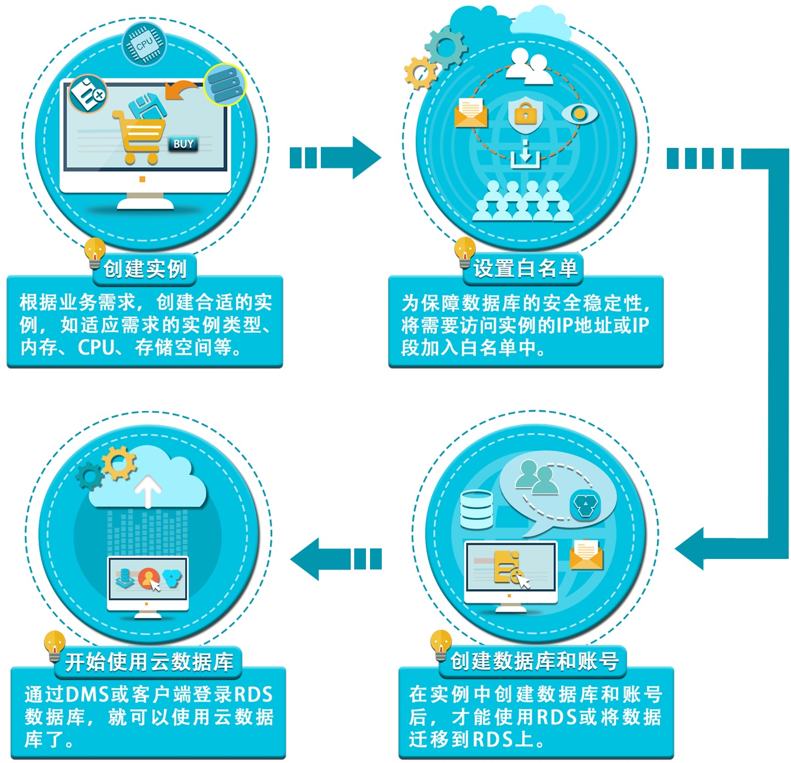

<a id="section-5-2"></a>

## 5.2. 创建实例

本文介绍如何通过控制台创建PolarDB实例。

**操作步骤**

1. 登录云数据库RDS控制台。

2. 在**云数据库管理**页面中，单击右上角的**创建实例**。

3. 根据下表设置参数。

   **类别**

   **配置**

   **说明**

   实例所属组织。

   **组织**

   **基本配置**

   实例所属资源集。

   **资源集**

   实例所属地域。不同地域之间的产品内网不互通，创建实例后不支持更换地域。

   **地域**

   RDS支持**多可用区部署**和**单可用区部署**。选择**多可用区部署**的情况下需要为实例

   **部署方案**

   的备节点选择**备节点可用区**。

   **主节点可用**

   实例主节点所属的可用区。

   **区域**

   **区**

   实例备节点所属的可用区。此参数仅在**部署方案**为**多可用区部署**时可用。

   **备节点可用**

   > **说明**

   **区**

   > 如果选择了和主节点相同的可用区，则效果等同于**单可用区部署**。

   数据库的类型，选择**POLARDB**。

   **数据库类型**

   选择RDS实例所属主机的芯片架构。

   **芯片架构**

   > **说明**
   >
   > 选择该配置时如提示未授权，请联系运营管理员对该账号进行授权。

   选择数据库引擎类型。

   **兼容性**

   - **PostgreSQL**

   - **Oracle语法兼容**

   数据库的版本，支持如下版本：

   - 14

     > **说明**
     >
     > 兼容性为**PostgreSQL**时，选择此版本

   **数据库版本**

   - 11.2或14

     > **说明**
     >
     > 兼容性为**Oracle语法兼容**时，选择此版本。

   **规格配置**

   数据库的系列。取值如下：

   **系列**

   - **双机高可用版本**

   - **只读实例**

   数据库的存储类型，选择**本地SSD**。

   **存储类型**

   选择是否开启TDE功能。

   **开启TDE**

   > **说明**
   >
   > TDE功能开启后无法关闭。

   选择加密算法，默认值为aes-256。取值如下：

   - aes-256

   - sm4

   **加密算法**

   > **说明**
   >
   > - 当开启TDE时，需要配置该参数。
   >
   > - 实例创建后无法更改。

   实例的规格，不同的内存大小对应不同的最大连接数和IOPS，具体请以控制台界

   **实例规格**

   面为准。

   存储空间包括数据空间、系统文件空间、Binlog文件空间和事务文件空间。

   **存储空间**

   <table>
     <tr>
       <td rowspan="6">网络</td>
       <td>网络连接类型</td>
       <td>RDS提供如下两种类型的连接地址：<br>• <strong>公网连接</strong>：通过该连接地址可以从外网访问数据库。<br>• <strong>内网连接</strong>：通过该连接地址可以从内网访问数据库。<br>说明实例创建完成后无法修改，请谨慎选择。</td>
     </tr>
     <tr>
       <td>网络类型</td>
       <td>RDS实例支持的网络类型：<br>• <strong>经典网络</strong>：经典网络中的云服务在网络上不进行隔离，只能依靠云服务自身的安全组或白名单策略来阻挡非法访问。<br>• <strong>专有网络</strong>：专有网络VPC（Virtual Private Cloud）帮助用户在阿里云上构建出一个隔离的网络环境。用户可以自定义专有网络里面的路由表、IP地址范围和网关。建议您选择专有网络，更加安全。</td>
     </tr>
     <tr>
       <td>VPC</td>
       <td>选择您的VPC。<br>说明当<strong>网络类型</strong>为<strong>专有网络</strong>时，需要填写该参数。</td>
     </tr>
     <tr>
       <td>交换机可用区</td>
       <td>选择VPC下的交换机的可用区。<br>说明当<strong>网络类型</strong>为<strong>专有网络</strong>时，需要填写该参数。</td>
     </tr>
     <tr>
       <td>VSwitch</td>
       <td>选择VPC下的交换机。<br>说明当<strong>网络类型</strong>为<strong>专有网络</strong>时，需要填写该参数。</td>
     </tr>
     <tr>
       <td>IP白名单</td>
       <td>添加IP地址，允许这些IP地址访问该RDS实例。</td>
     </tr>
     <tr>
       <td rowspan="2">实例设置</td>
       <td>创建数量</td>
       <td>RDS支持批量创建实例。此处可以指定需要创建的RDS实例个数，默认为1个。</td>
     </tr>
     <tr>
       <td>实例名称</td>
       <td>RDS实例的名称。<br>• 长度为2~64个字符。<br>• 以英文字母或中文开头。<br>• 支持数字和如下特殊字符：<br>_-:<br>• 不能以http:// 或https://开头。</td>
     </tr>
   </table>

4. 完成上述参数配置后，单击**提交**。

<a id="section-5-3"></a>

## 5.3. 设置IP白名单

创建RDS实例后，您需要设置RDS实例的白名单，以允许外部设备访问该RDS实例。

**背景信息**

白名单可以让RDS实例得到高级别的访问安全保护，建议您定期维护白名单。设置白名单不会影响RDS实例的正常运行。

设置白名单包括两种操作：

- 设置IP白名单：添加IP地址，允许这些IP地址访问该RDS实例。

  > 默认的白名单只包含默认IP地址127.0.0.1，表示不允许任何设备访问该RDS实例。
  >
  > **说明**

- 设置ECS安全组：添加ECS安全组，允许ECS安全组内的ECS实例访问该RDS实例。

**操作步骤**

1. 登录云数据库RDS控制台。

2. 在**云数据库管理**页面，定位到目标实例。

3. 单击目标实例ID或者单击实例右侧的**管理**，打开**基本信息**页面。

4. 单击左侧导航栏的**数据安全性**。

5. 在**白名单设置**页签中，单击**default**分组右侧的**修改**。

   > 您也可以单击页面右侧的**添加白名单分组**新建自定义分组。
   >
   > **说明**

6. 在**修改白名单分组**对话框中，填写需要访问该实例的IP地址或IP段，然后单击**确定**。详细规则如下：

   - 若填写IP段，如10.10.10.0/24，则表示10.10.10.X的IP地址都可以访问该RDS实例。

   - 若您需要添加多个IP地址或IP段，请用英文逗号隔开（逗号前后都不能有空格），例如192.168.0.1,172.16.213.9。

   - 单击**加载ECS内网IP**后，将显示您当前阿里云账号下所有ECS实例的IP地址，可快速添加ECS内网IP地址到白名单中。

<a id="section-5-4"></a>

## 5.4. 创建数据库和账号

若要使用云数据库RDS，您需要在实例中创建数据库和账号。本文介绍如何为PolarDB实例创建数据库和账号。

**创建账号**

PolarDB实例支持创建初始账号和普通账号，本节介绍如何创建初始账号。

1. 登录云数据库RDS控制台。

2. 在**云数据库管理**页面，定位到目标实例。

3. 单击目标实例ID或者单击实例右侧的**管理**，打开**基本信息**页面。

4. 在左侧导航栏中，单击**账号管理**。

5. 单击**创建初始账号**并设置如下参数。

   <table>
     <tr>
       <th width="105">参数</th>
       <th>说明</th>
     </tr>
     <tr>
       <td>数据库账号</td>
       <td>• 长度为2~16个字符。<br>• 由小写字母、数字或下划线组成。<br>• 以字母开头，以字母或数字结尾。</td>
     </tr>
     <tr>
       <td>密码</td>
       <td>• 长度为8~32个字符。<br>• 由大写字母、小写字母、数字、特殊字符中的任意三种组成。<br>• 特殊字符为：<br>!@#$%^&amp;*()_+-=</td>
     </tr>
     <tr>
       <td>确认密码</td>
       <td>再次输入相同的密码。</td>
     </tr>
   </table>

6. 单击**创建**。

**创建高权限账号**

1. 登录云数据库RDS控制台。

2. 在**云数据库管理**页面，定位到目标实例。

3. 单击目标实例ID或者单击实例右侧的**管理**，打开**基本信息**页面。

4. 在左侧导航栏中，单击**账号管理**。

5. 单击**创建高权限账号**，勾选注意事项，单击**下一步**并设置如下参数。

   <table>
     <tr>
       <th width="105">参数</th>
       <th>说明</th>
     </tr>
     <tr>
       <td>数据库账号</td>
       <td>• 长度为2~16个字符。<br>• 由小写字母、数字或下划线组成。<br>• 以字母开头，以字母或数字结尾。</td>
     </tr>
     <tr>
       <td>密码</td>
       <td>• 长度为8~32个字符。<br>• 由大写字母、小写字母、数字、特殊字符中的任意三种组成。<br>• 特殊字符为!@#$%^&amp;*()_+-=</td>
     </tr>
     <tr>
       <td>确认密码</td>
       <td>再次输入相同的密码。</td>
     </tr>
   </table>

6. 单击**确认创建**。

**创建数据库和普通账号**

1. 登录云数据库RDS控制台。

2. 在**云数据库管理**页面，定位到目标实例。

3. 单击目标实例ID或者单击实例右侧的**管理**，打开**基本信息**页面。

4. 单击页面右上角的**登录数据库**。

5. 在自动跳转的**数据管理DMS**控制台的**登录实例**窗口中，检查**数据库类型**、**实例地区**、**连接串地址**是否正确。若信息正确，填写**数据库账号**和**数据库密码**，如下图所示。

   

   | 参数 | 说明 |
   | --- | --- |
   | 数据库类型 | 目标数据库的类型，系统默认为当前需要连接的数据库类型。 |
   | 实例地区 | 目标实例所在的地域，系统默认为当前实例所在地域。 |
   | 连接串地址 | 目标实例的连接串地址，系统默认为当前实例的连接串地址。 |
   | 数据库账号 | 目标数据库的账号。 |
   | 数据库密码 | 目标数据库账号对应的密码。 |

6. 单击**登录**。若您希望浏览器记住该账号的密码，可以先勾选**记住密码**，再单击**登录**。

   > 若出现无法建立连接提示，如下图所示。则可能是白名单设置出现问题，需要在控制台
   >
   > **说明**
   >
   > 重新设置白名单。详情请参见设置IP白名单。

7. 成功登录RDS实例后，会直接跳转到**SQLConsole**页面，在SQL窗口中输入如下命令，创建数据库。

   ```sql
   CREATE DATABASE name
    [ [ WITH ] [ OWNER [=] user_name ]
           [ TEMPLATE [=] template ]
           [ ENCODING [=] encoding ]
           [ LC_COLLATE [=] lc_collate ]
           [ LC_CTYPE [=] lc_ctype ]
           [ TABLESPACE [=] tablespace_name ]
           [ CONNECTION LIMIT [=] connlimit ] ]
   ```

   例如，若您要创建一个名称为test的数据库，可以执行如下命令：

   ```sql
   create database test;
   ```

8. 单击**执行(F8)**，完成创建数据库。

9. 在SQL窗口中输入如下命令，创建普通账号。

   ```text
   CREATE USER name [ [ WITH ] option [ ... ] ]
   where option can be:
      SUPERUSER | NOSUPERUSER
    | CREATEDB | NOCREATEDB
    | CREATEROLE | NOCREATEROLE
    | CREATEUSER | NOCREATEUSER
    | INHERIT | NOINHERIT
    | LOGIN | NOLOGIN
    | REPLICATION | NOREPLICATION
    | CONNECTION LIMIT connlimit
    | [ ENCRYPTED | UNENCRYPTED ] PASSWORD 'password'
    | VALID UNTIL 'timestamp'
    | IN ROLE role_name [, ...]
    | IN GROUP role_name [, ...]
    | ROLE role_name [, ...]
    | ADMIN role_name [, ...]
    | USER role_name [, ...]
    | SYSID uid
   ```

   例如，若您要创建一个名称为test2、密码为123456的用户，可以执行如下命令：

   ```text
   create user test2 password '123456';
   ```

0. 单击**执行(F8)**，完成创建普通账号。

<a id="section-5-5"></a>

## 5.5. 连接PolarDB实例

本文介绍如何通过阿里云数据管理服务（DMS）或pgAdmin4客户端连接RDS实例。

**背景信息**

您可以通过RDS管理控制台先登录DMS，然后再连接需要访问的RDS实例。

数据管理服务（Data Management，简称DMS）是一种集数据管理、结构管理、访问安全、BI图表、数据趋势、数据轨迹、性能与优化和服务器管理于一体的数据管理服务。支持MySQL、SQL Server、PostgreSQL等关系型数据库和NoSQL的数据库管理，同时还支持Linux服务器管理。

您也可以使用客户端连接RDS实例。由于RDS提供的关系型数据库服务与原生的数据库服务完全兼容，所以对用户而言，连接数据库的方式也基本类似。本文以pgAdmind 4客户端为例介绍RDS实例的连接方法。

**通过DMS连接实例**

关于如何通过DMS连接RDS实例的方法，请参见通过DMS登录RDS数据库。

**通过客户端登录**

1. 将要访问RDS实例的IP地址加入RDS白名单中。关于如何设置白名单，请参见设置IP白名单。

2. 启动pgAdmin 4客户端。

   > 如果您还没有安装pgAdmin4客户端，请单击此处获取。
   >
   > **说明**

3. 右击**Servers**，选择**创建 > 服务器**，如下图所示。

   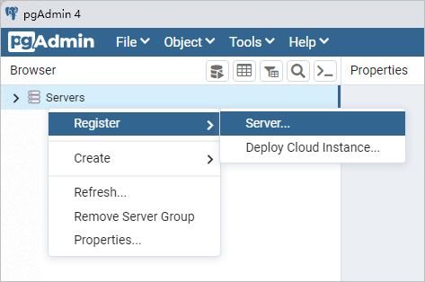

4. 在**创建-服务器**页面的**通常**标签页面中，输入服务器名称，如下图所示。

   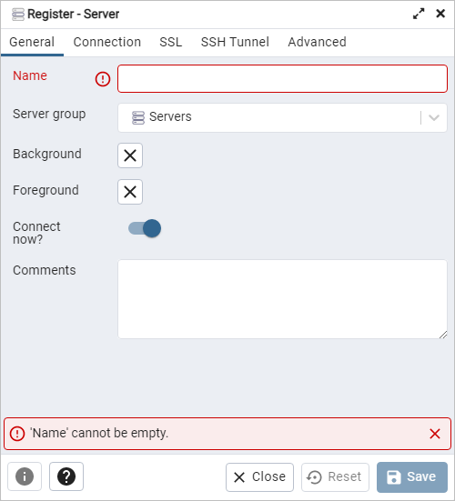

5. 选择**Connection**标签页，输入要连接的实例信息，如下图所示。

   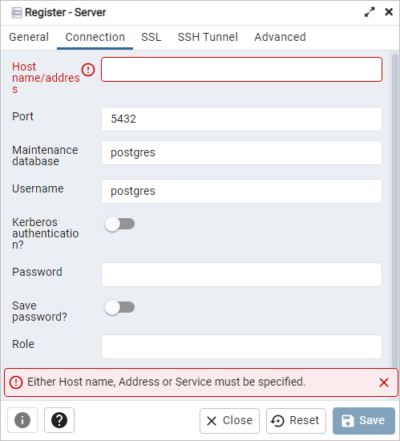

   | 参数 | 说明 |
   | --- | --- |
   | 主机名称/地址 | RDS实例的内网地址。如何查看内网地址请参见管理内网地址和端口。 |
   | 端口 | RDS实例的内网端口。如何查看内网端口请参见管理内网地址和端口。 |
   | 用户名 | RDS实例的初始账号名称。如何创建初始账号请参见创建数据库和账号。 |
   | 密码 | RDS实例的初始账号所对应的密码。 |

6. 单击**保存**。

7. 若连接信息无误，选择**Servers > 服务器名称 > 数据库 > postgres**，会出现如下界面，则表示连接成功。

   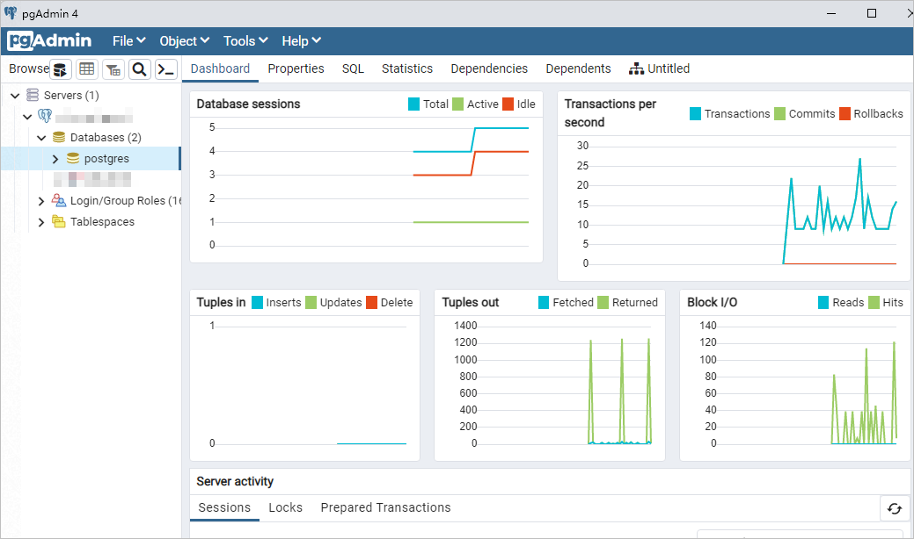

   > postgres是RDS实例默认的系统数据库，请勿在该数据库中进行任何操作。
   >
   > **重要**

<a id="section-6"></a>

# 6.实例

<a id="section-6-1"></a>

## 6.1. 创建实例

本文介绍如何通过控制台创建PolarDB实例。

**操作步骤**

1. 登录云数据库RDS控制台。

2. 在**云数据库管理**页面中，单击右上角的**创建实例**。

3. 根据下表设置参数。

   **类别**

   **配置**

   **说明**

   实例所属组织。

   **组织**

   **基本配置**

   实例所属资源集。

   **资源集**

   实例所属地域。不同地域之间的产品内网不互通，创建实例后不支持更换地域。

   **地域**

   RDS支持**多可用区部署**和**单可用区部署**。选择**多可用区部署**的情况下需要为实例

   **部署方案**

   的备节点选择**备节点可用区**。

   **主节点可用**

   实例主节点所属的可用区。

   **区**

   **区域**

   实例备节点所属的可用区。此参数仅在**部署方案**为**多可用区部署**时可用。

   **备节点可用**

   > **说明**

   **区**

   > 如果选择了和主节点相同的可用区，则效果等同于**单可用区部署**。

   数据库的类型，选择**POLARDB**。

   **数据库类型**

   选择RDS实例所属主机的芯片架构。

   **芯片架构**

   > **说明**
   >
   > 选择该配置时如提示未授权，请联系运营管理员对该账号进行授权。

   选择数据库引擎类型。

   **兼容性**

   - **PostgreSQL**

   - **Oracle语法兼容**

   数据库的版本，支持如下版本：

   - 14

     > **说明**
     >
     > 兼容性为**PostgreSQL**时，选择此版本

   **数据库版本**

   - 11.2或14

     > **说明**
     >
     > 兼容性为**Oracle语法兼容**时，选择此版本。

   数据库的系列。取值如下：

   **系列**

   - **双机高可用版本**

   - **只读实例**

   **规格配置**

   数据库的存储类型，选择**本地SSD**。

   **存储类型**

   选择是否开启TDE功能。

   > **说明**

   **开启TDE**

   > TDE功能开启后无法关闭。

   选择加密算法，默认值为aes-256。取值如下：

   - aes-256

   - sm4

   **加密算法**

   > **说明**
   >
   > - 当开启TDE时，需要配置该参数。
   >
   > - 实例创建后无法更改。

   实例的规格，不同的内存大小对应不同的最大连接数和IOPS，具体请以控制台界

   **实例规格**

   面为准。

   存储空间包括数据空间、系统文件空间、Binlog文件空间和事务文件空间。

   **存储空间**

   <table>
     <tr>
       <td rowspan="6">网络</td>
       <td>网络连接类型</td>
       <td>RDS提供如下两种类型的连接地址：<br>• <strong>公网连接</strong>：通过该连接地址可以从外网访问数据库。<br>• <strong>内网连接</strong>：通过该连接地址可以从内网访问数据库。<br>说明实例创建完成后无法修改，请谨慎选择。</td>
     </tr>
     <tr>
       <td>网络类型</td>
       <td>RDS实例支持的网络类型：<br>• <strong>经典网络</strong>：经典网络中的云服务在网络上不进行隔离，只能依靠云服务自身的安全组或白名单策略来阻挡非法访问。<br>• <strong>专有网络</strong>：专有网络VPC（Virtual Private Cloud）帮助用户在阿里云上构建出一个隔离的网络环境。用户可以自定义专有网络里面的路由表、IP地址范围和网关。建议您选择专有网络，更加安全。</td>
     </tr>
     <tr>
       <td>VPC</td>
       <td>选择您的VPC。<br>说明当<strong>网络类型</strong>为<strong>专有网络</strong>时，需要填写该参数。</td>
     </tr>
     <tr>
       <td>交换机可用区</td>
       <td>选择VPC下的交换机的可用区。<br>说明当<strong>网络类型</strong>为<strong>专有网络</strong>时，需要填写该参数。</td>
     </tr>
     <tr>
       <td>VSwitch</td>
       <td>选择VPC下的交换机。<br>说明当<strong>网络类型</strong>为<strong>专有网络</strong>时，需要填写该参数。</td>
     </tr>
     <tr>
       <td>IP白名单</td>
       <td>添加IP地址，允许这些IP地址访问该RDS实例。</td>
     </tr>
     <tr>
       <td rowspan="2">实例设置</td>
       <td>创建数量</td>
       <td>RDS支持批量创建实例。此处可以指定需要创建的RDS实例个数，默认为1个。</td>
     </tr>
     <tr>
       <td>实例名称</td>
       <td>RDS实例的名称。<br>• 长度为2~64个字符。<br>• 以英文字母或中文开头。<br>• 支持数字和如下特殊字符：<br>_-:<br>• 不能以http:// 或https://开头。</td>
     </tr>
   </table>

4. 完成上述参数配置后，单击**提交**。

<a id="section-6-2"></a>

## 6.2. 重启实例

当实例出现连接数满或性能问题时，您可以手动重启实例。

**操作步骤**

1. 登录云数据库RDS控制台。

2. 在**云数据库管理**页面，定位到目标实例。

3. 单击目标实例ID或者单击实例右侧的**管理**，打开**基本信息**页面。

4. 在页面右上角，单击**重启实例**。

   > 重启实例会造成连接中断，重启前请做好业务安排并确保您的应用具备自动重连功能。
   >
   > **重要**

5. 在弹出的确认框中，单击**确定**。

<a id="section-6-3"></a>

## 6.3. 设置可维护时间段

为保障云数据库RDS实例的稳定性，后端系统会不定期对实例进行维护操作。默认可维护时间段为02:00~06:00，您可以根据业务规律，将可维护时间段设置在业务低峰期，以免维护过程中可能对业务造成的影响。

**操作步骤**

1. 登录云数据库RDS控制台。

2. 在**云数据库管理**页面，定位到目标实例。

3. 单击目标实例ID或者单击实例右侧的**管理**，打开**基本信息**页面。

4. 在**配置信息**区域，单击**可维护时间段**后的**设置**。

5. 选择一个可维护时间段，单击 **保存**。

   > **说明**
   >
   > - 时间段为北京时间。
   >
   > - 在进行正式维护前，RDS会给阿里云账号中设置的联系人发送短信和邮件，请注意查收。
   >
   > - 实例维护当天，为保障整个维护过程的稳定性，实例会在可维护时间段之前进入实例维护中的状态。当实例处于该状态时，对数据库的访问以及查询类操作（如性能监控）不会受到任何影响，但除了账号管理、数据库管理和IP白名单设置外的变更操作（如升降级、重启等）均暂时无法使用。
   >
   > - 在可维护时间段内，实例会发生1到2次连接闪断，请确保应用程序具有重连机制。

<a id="section-6-4"></a>

## 6.4. 主备库切换

为保证数据库的高可用性，RDS提供主备实例切换功能，在主实例不可用时自动切换到备实例。您也可以在需要时手动切换至备实例。本文介绍如何手动切换至备实例。

**背景信息**

RDS实例有一个备实例，主备实例的数据会实时同步，您只能访问主实例，备实例仅作为备份形式存在，不提供业务访问。当主备切换后，原来的主实例会变成备实例。

> 主备实例切换过程中可能会有闪断，请在业务低峰期进行并确保您的应用程序具有自动重
>
> **说明**
>
> 连机制。

**操作步骤**

1. 登录云数据库RDS控制台。

2. 在**云数据库管理**页面，定位到目标实例。

3. 单击目标实例ID或者单击实例右侧的**管理**，打开**基本信息**页面。

4. 在页面左侧导航栏中，选择**服务可用性**。

5. 在**实例可用性**区域，单击**主备库切换**。

6. 在弹出的**实例主备切换**对话框中，单击**确定**。

   > **说明**
   >
   > - 在主备库切换期间，有很多操作无法执行，例如管理数据库和账号、切换网络类型等，建议您选择可维护时间内进行切换。
   >
   > - 若您要修改可维护时间，请参见设置可维护时间段。

<a id="section-6-5"></a>

## 6.5. 释放实例

根据业务需求，您可以手动释放RDS实例。

**操作步骤**

1. 登录云数据库RDS控制台。

2. 在**云数据库管理**页面，定位到目标实例。

3. 单击目标实例右侧**操作**列的**更多 > 释放实例**。

   > 释放后，实例立即被清除，数据不再保留，请根据需求提前备份数据并下载备份到本
   >
   > **说明**
   >
   > 地。

4. 在弹出的对话框中，单击**确定**。

<a id="section-6-6"></a>

## 6.6. 只读实例

<a id="section-6-6-1"></a>

### 6.6.1. 概述

RDS PolarDB实例支持添加只读实例，在对数据库有大量读请求和少量写请求时，只读实例用于分担主实例的数据库压力。本文主要介绍只读实例的功能特点以及功能限制。

为了实现读取能力的弹性扩展，分担数据库压力，您可以在某个地域中创建一个或多个只读实例，利用只读实例满足大量的数据库读取需求，以此增加应用的吞吐量。

只读实例为单个物理节点的架构（没有备节点），通过实例的复制机制能自动将主实例的更改同步到所有只读实例。只读实例必须跟主实例在同一地域，但可以在不同的可用区。只读实例拓扑图如下所示。

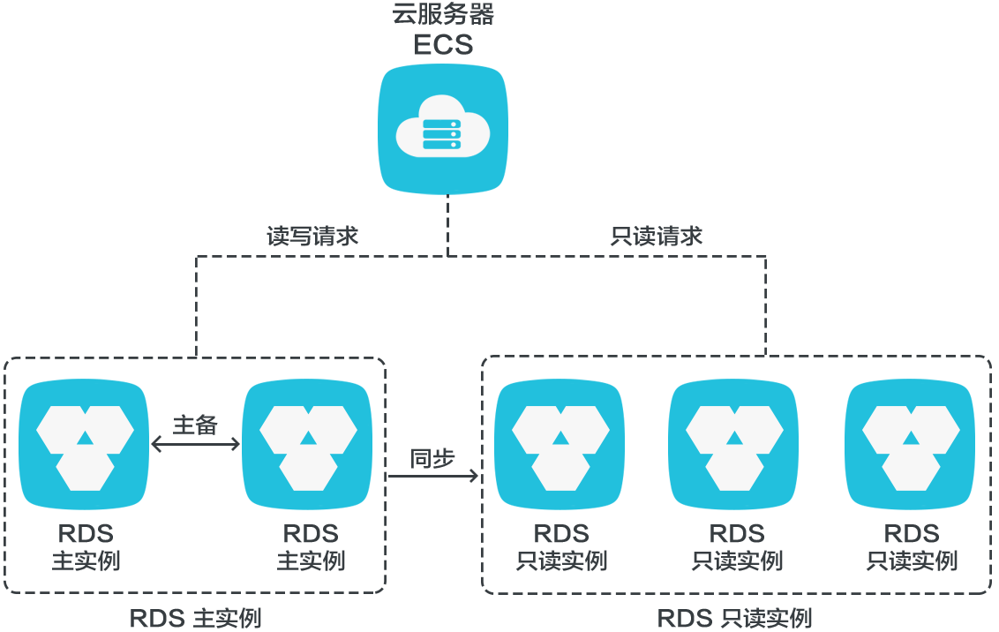

只读实例有如下功能特点：

- 规格可以与主实例不一致，并可以随时更改规格（没有时间限制），便于弹性升降级。

- 不需要维护帐号与数据库，全部通过主实例同步。

- 独立的白名单配置。

- 提供系统性能监控。

- 提供优化建议：RDS提供多种优化建议。例如存储引擎检查、主键检查、大表检查、索引偏多、缺失索引等。用户可以根据优化建议并结合自身的应用来对数据库进行优化。

<a id="section-6-6-2"></a>

### 6.6.2. 创建只读实例

您可以通过创建只读实例满足大量的数据库读取需求，增加应用的吞吐量，满足业务需求。

**注意事项**

- 1个主实例最多可以创建5个只读实例。

- 只读实例不支持备份设置以及临时备份。

- 只读实例不支持实例恢复。

- 只读实例不支持将数据迁移至只读实例。

- 只读实例不支持创建和删除数据库。

- 只读实例不支持创建账号、删除帐号、帐号授权以及修改帐号密码。

- 创建只读实例后，主实例将不支持通过备份集直接覆盖实例来恢复数据。

**操作步骤**

1. 登录云数据库RDS控制台。

2. 单击**实例列表**，单击目标实例ID或者单击实例右侧**操作**列下的**管理**，打开**基本信息**页面。

3. 在**基本信息**页面右侧的**实例分布**区域中，单击**添加只读实例**。

4. 在**RDS创建只读实例**页面设置只读实例的参数。

   <table>
     <tr>
       <th>项目</th>
       <th>参数</th>
       <th>说明</th>
     </tr>
     <tr>
       <td>区域</td>
       <td>地域</td>
       <td>RDS实例所在地域。</td>
     </tr>
     <tr>
       <td rowspan="5">规格配置</td>
       <td>数据库类型</td>
       <td>只读实例的数据库类型，与主实例一致，不可修改。</td>
     </tr>
     <tr>
       <td>数据库版本</td>
       <td>只读实例的数据库版本，与主实例一致，不可修改。</td>
     </tr>
     <tr>
       <td>系列</td>
       <td>固定为<strong>只读实例</strong></td>
     </tr>
     <tr>
       <td>实例规格</td>
       <td>只读实例规格。可以与主实例不一致，并且只读实例可以随时更改规格，便于弹性升降级。详情请参见 <strong>《云数</strong><strong>据库RDS》</strong>的<strong>产品简介 &gt; 实例规格</strong>章节。</td>
     </tr>
     <tr>
       <td>存储空间</td>
       <td>只读实例的存储空间，为保证数据同步有足够的I/O性能支撑，建议只读实例的规格和存储空间不小于主实例。详情请参见 <strong>《云数据库RDS》</strong>的<strong>产品简介 &gt; 实例规</strong><strong>格</strong>章节。</td>
     </tr>
     <tr>
       <td rowspan="3">网络类型</td>
       <td>网络类型</td>
       <td>只读实例的网络类型，与主实例一致，不可修改。</td>
     </tr>
     <tr>
       <td>专有网络vpc</td>
       <td>网络类型为专有网络时，您需要选择对应的VPC。</td>
     </tr>
     <tr>
       <td>交换机vswitch</td>
       <td>网络类型为专有网络时，您需要选择对应的交换机。</td>
     </tr>
   </table>

5. 完成上述参数配置后，单击**提交**。

<a id="section-6-6-3"></a>

### 6.6.3. 查询只读实例详情

本章节介绍如何查询只读实例详情。您可以通过实例列表页面直接进入只读实例的管理页面，也可以通过主实例的只读实例列表进入只读实例的管理页面。管理方式与常规实例的管理类似，可执行的管理操作请以实际界面为准。

**直接通过只读实例查询实例详情**

1. 登录云数据库RDS控制台。

2. 在**云数据库管理**页面，单击目标只读实例的ID，进入实例的**基本信息**页面。在实例列表中，**实例类型**为**只读实例**的就是只读实例，如查看只读实例所示。

   图 1. 查看只读实例

   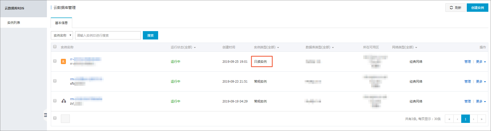

**通过主实例查询只读实例详情**

1. 登录云数据库RDS控制台。

2. 单击**实例列表**，单击目标实例ID或者单击实例右侧**操作**列下的**管理**，打开**基本信息**页面。

3. 在**基本信息**页面，将鼠标移动到**实例分布**窗口中的**只读实例**的数字上，就会显示只读实例ID。

4. 单击只读实例ID，即进入只读实例的管理页面。

<a id="section-6-7"></a>

## 6.7. 变更配置

本文介绍如何变更实例的规格、存储空间。

**操作步骤**

1. 登录云数据库RDS控制台。

2. 在**云数据库管理**页面，定位到目标实例。

3. 单击目标实例ID或者单击实例右侧的**管理**，打开**基本信息**页面。

4. 在**基本信息**页面，单击**配置信息**区域的**变更配置**。

   > 在变更配置生效期间，可能会出现一次约30秒的闪断，而且与数据库、账号、网络等相
   >
   > **重要**
   >
   > 关的大部分操作都无法执行，因此在执行配置变更前请务必安排好您的业务时间。

5. 根据业务需求修改实例的配置，单击**提交**。

<a id="section-6-8"></a>

## 6.8. 设置实例参数

您可以通过控制台查看和修改部分参数的值，并查询参数修改记录。

**修改参数值**

1. 登录云数据库RDS控制台。

2. 在**云数据库管理**页面，定位到目标实例。

3. 单击目标实例ID或者单击实例右侧的**管理**，打开**基本信息**页面。

4. 在页面左侧导航栏中单击**参数设置**。

5. 此时您可以进行如下操作：导出参数

   单击**导出参数**会将TXT格式的参数文件保存到本地。该TXT文件包含该实例的所有参数值。

   批量修改参数文件并导入参数。

   <ol type="i">

   <li>

   导出的参数文件修改完成后，可以单击**导入参数**，将参数文件内容粘贴到对话框中。

   > 您可以勾选**只显示已修改参数**确认已修改的参数。
   >
   > **说明**

   </li>

   <li>

   单击**确定**。

   </li>

   <li>

   在右上角单击**提交参数**。

   > **说明**
   >
   > - 如果修改的参数需要重启实例才生效，系统会提示您是否重启，建议您在业务低峰期操作，并确保应用程序具有重连机制。
   >
   > - 参数的修改未提交时，如果想取消修改，请单击**撤销**。

   </li>

   </ol>

   修改单个参数

   <ol type="i">

   <li>

   在**可修改参数**列表内找到需要修改的参数，单击**运行参数值**列的

   图标。

   

   </li>

   <li>

   根据提示的取值范围输入参数值。

   </li>

   <li>

   单击**确定**。

   > 您可以勾选**只显示已修改参数**确认已修改的参数。
   >
   > **说明**

   </li>

   <li>

   在右上角单击**提交参数**。

   > **说明**
   >
   > - 如果修改的参数需要重启实例才生效，系统会提示您是否重启，建议您在业务低峰期操作，并确保应用程序具有重连机制。
   >
   > - 参数的修改未提交时，如果想取消修改，请单击**撤销**。

   </li>

   </ol>

**查看参数修改记录**

1. 登录云数据库RDS控制台。

2. 在**云数据库管理**页面，定位到目标实例。

3. 单击目标实例ID或者单击实例右侧的**管理**，打开**基本信息**页面。

4. 在页面左侧导航栏中单击**参数设置**。

5. 单击**修改历史**页签。

6. 选择要查询的时间范围，单击**查询**。

<a id="section-6-9"></a>

## 6.9. 标签

在实例数量较多的情况下，您可以创建多个标签，为实例绑定不同的标签对其进行分类，之后通过标签进行实例筛选。本文介绍标签的使用。

**注意事项**

- 标签由一对键值组成，键在同账号同地域下唯一，值无此限制。

- 每个实例最多可绑定20个标签。

- 标签从一个实例解绑后，如果没有绑定到其他资源，则该标签自动被删除。

**绑定标签**

1. 登录云数据库RDS控制台。

2. 在**实例列表**页面，单击目标实例**标签**栏  按钮。

3. 在**编辑标签**对话框，输入标签键和标签值后单击**确定**。

**根据标签筛选集群**

1. 登录云数据库RDS控制台。

2. 在**实例列表**页面，单击**高级筛选**按钮。

3. 您可以通过**实例ID/名称**、**VIP**和**标签筛选**过滤您的实例。在**标签筛选**的下拉框中选择目标标签。

4. 选择标签后，实例列表将显示所有绑定该标签的实例。

**查看集群绑定的标签**

1. 登录云数据库RDS控制台。

2. 在**实例列表**页面，当实例绑定标签数量较少时，将在标签栏直接显示对应标签，如绑定标签数量较多可移

   动鼠标至目标实例**标签**栏  图标上，查看目标实例绑定的全部标签。

**解绑标签**

1. 登录云数据库RDS控制台。

2. 在**实例列表**页面，单击目标实例**标签**栏  按钮。

3. 在**编辑标签**对话框，单击目标标签右侧  按钮，单击**确定**。

<a id="section-7"></a>

# 7.数据库连接

<a id="section-7-1"></a>

## 7.1. 连接PolarDB实例

本文介绍如何通过阿里云数据管理服务（DMS）或pgAdmin4客户端连接RDS实例。

**背景信息**

您可以通过RDS管理控制台先登录DMS，然后再连接需要访问的RDS实例。

数据管理服务（Data Management，简称DMS）是一种集数据管理、结构管理、访问安全、BI图表、数据趋势、数据轨迹、性能与优化和服务器管理于一体的数据管理服务。支持MySQL、SQL Server、PostgreSQL等关系型数据库和NoSQL的数据库管理，同时还支持Linux服务器管理。

您也可以使用客户端连接RDS实例。由于RDS提供的关系型数据库服务与原生的数据库服务完全兼容，所以对用户而言，连接数据库的方式也基本类似。本文以pgAdmind 4客户端为例介绍RDS实例的连接方法。

**通过DMS连接实例**

关于如何通过DMS连接RDS实例的方法，请参见通过DMS登录RDS数据库。

**通过客户端登录**

1. 将要访问RDS实例的IP地址加入RDS白名单中。关于如何设置白名单，请参见设置IP白名单。

2. 启动pgAdmin 4客户端。

   > 如果您还没有安装pgAdmin4客户端，请单击此处获取。
   >
   > **说明**

3. 右击**Servers**，选择**创建 > 服务器**，如下图所示。

   

4. 在**创建-服务器**页面的**通常**标签页面中，输入服务器名称，如下图所示。

   

5. 选择**Connection**标签页，输入要连接的实例信息，如下图所示。

   

   | 参数 | 说明 |
   | --- | --- |
   | 主机名称/地址 | RDS实例的内网地址。如何查看内网地址请参见管理内网地址和端口。 |
   | 端口 | RDS实例的内网端口。如何查看内网端口请参见管理内网地址和端口。 |
   | 用户名 | RDS实例的初始账号名称。如何创建初始账号请参见创建数据库和账号。 |
   | 密码 | RDS实例的初始账号所对应的密码。 |

6. 单击**保存**。

7. 若连接信息无误，选择**Servers > 服务器名称 > 数据库 > postgres**，会出现如下界面，则表示连接成功。

   

   > postgres是RDS实例默认的系统数据库，请勿在该数据库中进行任何操作。
   >
   > **重要**

<a id="section-7-2"></a>

## 7.2. 临时混访方案（同时保留经典网络和专有网络地址）

为满足日益增多的网络迁移需求，RDS新增了网络混访功能，可实现在无访问中断的情况下将经典网络平滑迁移到VPC上。

**前提条件**

- 实例的网络类型是经典网络。

- 实例所在可用区已有可用的VPC和交换机。

**背景信息**

以往将RDS实例从经典网络迁移到VPC时，经典网络的内网地址会变为VPC的内网地址（连接字符串没有变化，背后的IP地址有变化），会造成1次30秒内的闪断，而且经典网络中的ECS将不能再通过内网访问该RDS实例，为了能够平滑迁移网络，RDS新增了网络混访功能。

混访是指RDS实例可以同时被经典网络和专有网络中的ECS访问。在混访期间，RDS实例会保留原经典网络的内网地址并新增一个VPC下的内网地址，迁移网络时不会出现闪断。

基于安全性及性能的考虑，我们推荐您仅使用VPC，因此混访期有一定的期限，原经典网络的内网地址在保留时间到期后会被自动释放，应用将无法通过经典网络的内网地址访问数据库。为避免对业务造成影响，您需要在混访期中将VPC下的内网地址配置到您所有的应用中，以实现平滑的网络迁移。

例如，某一公司要将经典网络迁移至VPC时，若选用混访的迁移方式，在混访期内，一部分应用通过VPC访问数据库，一部分应用仍通过原经典网络的内网地址访问数据库，等所有应用都可以通过VPC访问数据库时，就可以将原经典网络的内网地址释放掉，如下图所示。

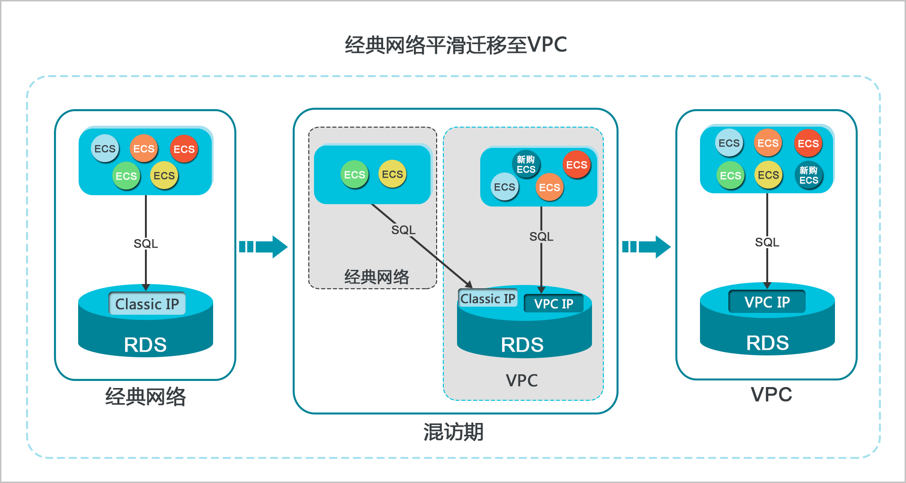

**功能限制**

在混访期间，有如下功能限制：

- 不支持切换成经典网络。

- 不支持迁移可用区。

**从经典网络切换至VPC**

详细操作请参见从经典网络切换为专有网络（VPC）。

**修改原经典网络内网地址的过期时间**

在混访期间，您可以根据需求随时调整保留原经典网络的时间，过期时间会从变更日期重新开始计时。例如，原经典网络的内网地址会在2017年8月18日过期，但您在2017年8月15日将过期时间变更为“14天后”，则原经典网络的内网地址将会在2017年8月29日被释放。

修改过期时间的操作步骤如下所示：

1. 登录云数据库RDS控制台。

2. 在**云数据库管理**页面，定位到目标实例。

3. 单击目标实例ID或者单击实例右侧的**管理**，打开**基本信息**页面。

4. 在页面左侧导航栏中单击**数据库连接**。

5. 在**实例连接**页签，单击**修改过期时间**。

6. 在**修改过期时间**的确认页面，选择过期时间，单击**确定**。

<a id="section-7-3"></a>

## 7.3. 通过DMS登录RDS数据库

您可以通过阿里云的数据管理服务DMS登录RDS实例的数据库。

**前提条件**

已经设置好IP白名单，设置IP白名单的方法请参见设置IP白名单。

**操作步骤**

1. 登录云数据库RDS控制台。

2. 在**云数据库管理**页面，定位到目标实例。

3. 单击目标实例ID或者单击实例右侧的**管理**，打开**基本信息**页面。

4. 单击页面右上角的**登录数据库**。

5. 在自动跳转的**数据管理DMS**控制台的**登录实例**窗口中，检查**数据库类型**、**实例地区**、**连接串地址**是否正确。若信息正确，填写**数据库账号**和**数据库密码**，如下图所示。

   

   | 参数 | 说明 |
   | --- | --- |
   | 数据库类型 | 目标数据库的类型，系统默认为当前需要连接的数据库类型。 |
   | 实例地区 | 目标实例所在的地域，系统默认为当前实例所在地域。 |
   | 连接串地址 | 目标实例的连接串地址，系统默认为当前实例的连接串地址。 |
   | 数据库账号 | 目标数据库的账号。 |
   | 数据库密码 | 目标数据库账号对应的密码。 |

6. 单击**登录**。

   > 若您希望浏览器记住该账号的密码，可以先勾选**记住密码**，再单击**登录**。
   >
   > **说明**

<a id="section-7-4"></a>

## 7.4. 管理内网地址和端口

在连接RDS实例时，您需要填写RDS的内网地址和端口。本文将介绍如何在RDS控制台上查看以及修改内网地址和端口。

**查看内网地址和端口**

1. 登录云数据库RDS控制台。

2. 在**云数据库管理**页面，定位到目标实例。

3. 单击目标实例ID或者单击实例右侧的**管理**，打开**基本信息**页面。

4. 在**基本信息**栏中，即可查看内外网地址及内网端口信息。

   > 要先设置实例的白名单，才会显示地址信息。
   >
   > **说明**

   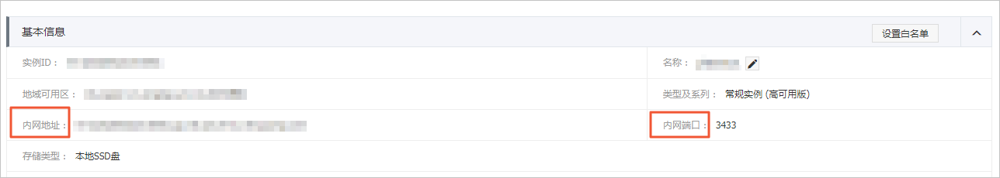

**修改内网地址和端口**

1. 登录云数据库RDS控制台。

2. 在**云数据库管理**页面，定位到目标实例。

3. 单击目标实例ID或者单击实例右侧的**管理**，打开**基本信息**页面。

4. 在左侧导航栏中单击**数据库连接**。

5. 单击页面右侧的**修改连接地址**。

6. 在弹出的对话框中，选择**连接类型**为**内网地址**。

7. 设置内网连接地址前缀及端口号，单击**确定**。

   > **说明**
   >
   > - 连接地址前缀以小写字母开头，8~64个字符，支持字母、数字和连字符（-）。
   >
   > - 端口范围为1000~5999。

   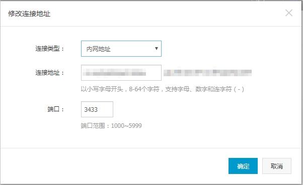

**常见问题**

- Q：修改连接地址或端口后是否需要修改应用程序内的连接地址或端口？

  A：需要修改，否则应用程序无法连接上数据库。

- Q：修改连接地址或端口是立即生效吗？是否需要重启实例？

  A：是立即生效，不需要重启实例。

<a id="section-8"></a>

# 8.账号

<a id="section-8-1"></a>

## 8.1. 创建账号

要使用云数据库RDS，您需要在实例中创建账号。本文介绍如何为PolarDB实例创建账号。

**账号类型**

PolarDB实例支持两种数据库账号：高权限账号和普通账号。详细说明如下。

<table>
  <tr>
    <th width="105">账号类型</th>
    <th>说明</th>
  </tr>
  <tr>
    <td>高权限账号</td>
    <td>• 只能通过控制台或API创建和管理。<br>• 可以创建多个高权限账号，管理所有普通账号和数据库。<br>• 开放了更多权限，可满足个性化和精细化的权限管理需求，例如可按账号分配不同表的查询权限。<br>• 可以断开任意账号的连接。</td>
  </tr>
  <tr>
    <td>普通账号</td>
    <td>• 可以通过控制台、API或者SQL语句创建和管理。<br>• 一个实例可以创建多个普通账号 。<br>• 需要手动给普通账号授予特定数据库的权限。<br>• 普通账号不能创建和管理其他账号，也不能断开其他账号的连接。</td>
  </tr>
</table>

**注意事项**

- 支持在控制台创建多个高权限账号和普通账号，也可以通过SQL命令创建、管理普通账号。

- 如果您要迁移本地数据库到RDS，请在RDS实例中创建与本地数据库一致的迁移账号和数据库。

- 分配数据库账号权限时，请按最小权限原则和业务角色创建账号，并合理分配只读和读写权限。必要时可以把数据库账号和数据库拆分成更小粒度，使每个数据库账号只能访问其业务之内的数据。如果不需要数据库写入操作，请分配只读权限。

- 为保障数据库的安全，请将数据库账号的密码设置为强密码，并定期更换。

**创建高权限账号或普通账号**

1. 登录云数据库RDS控制台。

2. 在**云数据库管理**页面，定位到目标实例。

3. 单击目标实例ID或者单击实例右侧的**管理**，打开**基本信息**页面。

4. 在左侧导航栏中，单击**账号管理**。

5. 单击**创建账号**并设置如下参数。

   <table>
     <tr>
       <th width="105">参数</th>
       <th>说明</th>
     </tr>
     <tr>
       <td>数据库账号</td>
       <td>• 长度为2~16个字符。<br>• 由小写字母、数字或下划线组成。<br>• 以字母开头，以字母或数字结尾。</td>
     </tr>
     <tr>
       <td>账号类型</td>
       <td>PolarDB实例支持两种数据库账号：<strong>高权限账号</strong>和<strong>普通账号</strong>。<br>• 高权限账号拥有所有数据库的所有操作权限。<br>• 普通账号拥有已授权数据库（owner）的所有操作权限。<br>说明操作权限包括SELECT、INSERT、UPDATE、DELETE、TRUNCATE、REFERENCES、TRIGGER</td>
     </tr>
     <tr>
       <td>新密码</td>
       <td>• 长度为8~32个字符。<br>• 由大写字母、小写字母、数字、特殊字符中的任意三种组成。<br>• 特殊字符为!@#$%^&amp;*()_+-=</td>
     </tr>
     <tr>
       <td>确认密码</td>
       <td>再次输入相同的密码。</td>
     </tr>
     <tr>
       <td>备注</td>
       <td>非必填。您可以在此处输入该实例相关说明，以减少后期沟通成本。最大支持输入256个字符。</td>
     </tr>
   </table>

6. 单击**创建**。

<a id="section-8-2"></a>

## 8.2. 重置密码

在使用RDS过程中，如果忘记数据库账号密码，您可以通过控制台重新设置密码。

**操作步骤**

1. 登录云数据库RDS控制台。

2. 在**云数据库管理**页面，定位到目标实例。

3. 单击目标实例ID或者单击实例右侧的**管理**，打开**基本信息**页面。

4. 在左侧导航栏中单击 **账号管理**。

5. 在账号对应的**操作**列单击**重置密码**。

6. 在弹出的对话框中，输入新密码并确认后，单击**确定**。

   > **说明**
   >
   > 密码要求如下：
   >
   > - 长度为8~32个字符。
   >
   > - 由大写字母、小写字母、数字、特殊字符中的任意三种组成。
   >
   > - 特殊字符为：
   >
   >   !@#$%^&\*()_+-=

<a id="section-8-3"></a>

## 8.3. 锁定/解锁账号

本文接受PolarDB实例如何锁定或解锁账号。

**锁定/解锁账号**

1. 登录云数据库RDS控制台。

2. 在**云数据库管理**页面，定位到目标实例。

3. 单击目标实例ID或者单击实例右侧的**管理**，打开**基本信息**页面。

4. 在左侧导航栏中，单击**账号管理**。

5. 在左侧导航栏中单击**账号管理**。

6. 在目标账号对应的**操作**列单击**锁定**。

   > **说明**
   >
   > 单击**锁定**后等待几秒，**状态**列显示**锁定中**即表示账号已锁定，如果需要继续使用该账号，请单击**解锁**。

<a id="section-8-4"></a>

## 8.4. 删除账号

您可以通过控制台删除数据库账号。

**前提条件**

因业务结束或改变时，您可以在控制台上删除不需要的高权限账号、普通账号。

**操作步骤**

1. 登录云数据库RDS控制台。

2. 在**云数据库管理**页面，定位到目标实例。

3. 单击目标实例ID或者单击实例右侧的**管理**，打开**基本信息**页面。

4. 在左侧导航栏中，单击**账号管理**。

5. 在目标账号所对应的操作栏中，单击**删除**。

6. 在弹出的确认框中，单击**确定**。

   > **说明**
   >
   > 当账号状态为**处理中**时，无法删除。

<a id="section-9"></a>

# 9.数据库

<a id="section-9-1"></a>

## 9.1. 创建数据库

若要使用云数据库RDS，您需要在实例中创建数据库。本文介绍如何为PolarDB实例创建数据库。

**前提条件**

已创建PolarDB实例。详情请参见创建实例。

**操作步骤**

1. 登录云数据库RDS控制台。

2. 在**云数据库管理**页面，定位到目标实例。

3. 单击目标实例ID或者单击实例右侧的**管理**，打开**基本信息**页面。

4. 单击页面右上角的**登录数据库**。

5. 在自动跳转的**数据管理DMS**控制台的**登录实例**窗口中，检查**数据库类型**、**实例地区**、**连接串地址**是否正确。若信息正确，填写**数据库账号**和**数据库密码**，如下图所示。

   

   | 参数 | 说明 |
   | --- | --- |
   | 数据库类型 | 目标数据库的类型，系统默认为当前需要连接的数据库类型。 |
   | 实例地区 | 目标实例所在的地域，系统默认为当前实例所在地域。 |
   | 连接串地址 | 目标实例的连接串地址，系统默认为当前实例的连接串地址。 |
   | 数据库账号 | 目标数据库的账号。 |
   | 数据库密码 | 目标数据库账号对应的密码。 |

6. 单击**登录**。若您希望浏览器记住该账号的密码，可以先勾选**记住密码**，再单击**登录**。

   > 若出现无法建立连接提示，如下图所示。则可能是白名单设置出现问题，需要在控制台
   >
   > **说明**
   >
   > 重新设置白名单。详情请参见设置IP白名单。

7. 成功登录RDS实例后，会直接跳转到**SQLConsole**页面，在SQL窗口中输入如下命令，创建数据库。

   ```sql
   CREATE DATABASE name
    [ [ WITH ] [ OWNER [=] user_name ]
           [ TEMPLATE [=] template ]
           [ ENCODING [=] encoding ]
           [ LC_COLLATE [=] lc_collate ]
           [ LC_CTYPE [=] lc_ctype ]
           [ TABLESPACE [=] tablespace_name ]
           [ CONNECTION LIMIT [=] connlimit ] ]
   ```

   例如，若您要创建一个名称为test的数据库，可以执行如下命令：

   ```sql
   create database test;
   ```

8. 单击**执行(F8)**，完成创建数据库。

<a id="section-9-2"></a>

## 9.2. 删除数据库

本文介绍如何删除PolarDB的数据库。

**操作步骤**

1. 登录云数据库RDS控制台。

2. 在**云数据库管理**页面，定位到目标实例。

3. 单击目标实例ID或者单击实例右侧的**管理**，打开**基本信息**页面。

4. 单击页面右上角的**登录数据库**。

5. 在自动跳转的**数据管理DMS**控制台的**登录实例**窗口中，检查**数据库类型**、**实例地区**、**连接串地址**是否正确。若信息正确，填写**数据库账号**和**数据库密码**，如下图所示。

   

   | 参数 | 说明 |
   | --- | --- |
   | 数据库类型 | 目标数据库的类型，系统默认为当前需要连接的数据库类型。 |
   | 实例地区 | 目标实例所在的地域，系统默认为当前实例所在地域。 |
   | 连接串地址 | 目标实例的连接串地址，系统默认为当前实例的连接串地址。 |
   | 数据库账号 | 目标数据库的账号。 |
   | 数据库密码 | 目标数据库账号对应的密码。 |

6. 单击**登录**。若您希望浏览器记住该账号的密码，可以先勾选**记住密码**，再单击**登录**。

   > 若出现无法建立连接提示，如下图所示。则可能是白名单设置出现问题，需要在控制台
   >
   > **说明**
   >
   > 重新设置白名单。详情请参见设置IP白名单。

7. 成功登录RDS实例后，会直接跳转到**SQLConsole**页面，在SQL窗口中输入如下命令，删除数据库：

   ```text
   drop database <database name>;
   ```

8. 单击**执行(F8)**，删除数据库。

<a id="section-10"></a>

# 10.网络连接

<a id="section-10-1"></a>

## 10.1. 切换网络类型

您可以根据业务需求将实例的网络类型在经典网络和专有网络之间切换。

**背景信息**

- 经典网络：实例之间不通过网络进行隔离，只能依靠实例自身的白名单策略来阻挡非法访问。

- 专有网络（VPC）：一个VPC就是一个隔离的网络环境。VPC的安全性较高，推荐您使用VPC网络。

  您可以自定义VPC中的路由表、IP 地址范围和网关。此外，您还可以通过专线或者VPN的方式将自建机房与阿里云VPC组合成一个虚拟机房，实现应用平滑上云。

**从专有网络（VPC）切换为经典网络**

注意事项

- RDS实例切换为经典网络后，内网地址不变（连接字符串不变，该字符串对应的IP地址会改变）。

- RDS实例切换为经典网络后，VPC中的ECS将不能再通过该内网地址访问该RDS实例，请注意变更应用端的连接地址。

- 在切换网络类型时，RDS服务可能会出现一次30秒的闪断，请您尽量在业务低峰期执行升级操作，或确保您的应用有自动重连机制，以避免闪断造成的影响。

1. 登录云数据库RDS控制台。

2. 在**云数据库管理**页面，定位到目标实例。

3. 单击目标实例ID或者单击实例右侧的**管理**，打开**基本信息**页面。

4. 在页面左侧导航栏中单击**数据库连接**。

5. 在页面右侧单击**切换为经典网络**。

6. 在弹出的对话框中，单击**确定**。

   > 网络类型切换完成后，只有经典网络的ECS才能通过内网访问该RDS，请在经典网络的
   >
   > **说明**
   >
   > ECS上配置RDS连接地址。

7. 设置RDS的白名单，使ECS可以通过内网访问RDS。

**从经典网络切换为专有网络（VPC）**

1. 登录云数据库RDS控制台。

2. 在**云数据库管理**页面，定位到目标实例。

3. 单击目标实例ID或者单击实例右侧的**管理**，打开**基本信息**页面。

4. 在页面左侧导航栏中单击**数据库连接**。

5. 在页面右侧单击**切换为专有网络**。

6. 在弹出的对话框中，选择VPC和交换机，以及是否保留经典网络地址。

   > **说明**
   >
   > - 选择VPC。建议选择您的ECS实例所在的VPC，否则ECS实例与RDS实例无法通过内网互通。
   >
   > - 选择交换机。如果选择的VPC中没有交换机，请创建与实例在同一可用区的交换机。具体操作请参见 **《专有网络VPC > 用户指南 > 快速入门 > 创建交换机》**。
   >
   > - 选择是否勾选**保留经典网络**，具体说明如下表所述。
   >
   >   - **不勾选**
   >
   >     不保留经典网络地址，原经典网络地址变为VPC地址。
   >
   >     如果不保留经典网络地址，则切换网络类型时，RDS实例会发生一次30秒的闪断，而且经典网络的ECS对该RDS实例的内网访问会立即断开。
   >
   >   - **勾选**
   >
   >     保留经典网络地址，同时生成一个新的VPC地址。表示使用混访模式，即RDS可以同时被经典网络和VPC的ECS通过内网访问。
   >
   >     如果保留经典网络地址，则切换网络类型时，RDS实例不会发生闪断，而且经典网络的ECS对该RDS实例的内网访问也不会断开，直到经典网络地址到期才断开。
   >
   >     在经典网络地址到期前，请将VPC地址配置到VPC的ECS中，以实现业务平滑迁移到VPC。在经典网络地址到期前的7天，系统会每天给您账号绑定的手机发送短信提醒。
   >
   >     更多介绍请参见临时混访方案（同时保留经典网络和专有网络地址）。

7. 将VPC的ECS内网IP地址添加到RDS实例的专有网络白名单分组，使得ECS可以通过内网访问RDS。如果没有专有网络的分组，请新建分组。

   > **说明**
   >
   > - 如果您选择了保留经典网络地址，请在经典网络地址到期前，将RDS的VPC地址配置到VPC的ECS中。
   >
   > - 如果您选择了不保留经典网络地址，那么切换网络类型后，经典网络的ECS对该RDS实例的内网访问会立即断开。请将RDS的VPC地址配置到VPC的ECS中。

<a id="section-10-2"></a>

## 10.2. 临时混访方案（同时保留经典网络和专有网络地址）

为满足日益增多的网络迁移需求，RDS新增了网络混访功能，可实现在无访问中断的情况下将经典网络平滑迁移到VPC上。

**前提条件**

- 实例的网络类型是经典网络。

- 实例所在可用区已有可用的VPC和交换机。

**背景信息**

以往将RDS实例从经典网络迁移到VPC时，经典网络的内网地址会变为VPC的内网地址（连接字符串没有变化，背后的IP地址有变化），会造成1次30秒内的闪断，而且经典网络中的ECS将不能再通过内网访问该RDS实例，为了能够平滑迁移网络，RDS新增了网络混访功能。

混访是指RDS实例可以同时被经典网络和专有网络中的ECS访问。在混访期间，RDS实例会保留原经典网络的内网地址并新增一个VPC下的内网地址，迁移网络时不会出现闪断。

基于安全性及性能的考虑，我们推荐您仅使用VPC，因此混访期有一定的期限，原经典网络的内网地址在保留时间到期后会被自动释放，应用将无法通过经典网络的内网地址访问数据库。为避免对业务造成影响，您需要在混访期中将VPC下的内网地址配置到您所有的应用中，以实现平滑的网络迁移。

例如，某一公司要将经典网络迁移至VPC时，若选用混访的迁移方式，在混访期内，一部分应用通过VPC访问数据库，一部分应用仍通过原经典网络的内网地址访问数据库，等所有应用都可以通过VPC访问数据库时，就可以将原经典网络的内网地址释放掉，如下图所示。


**功能限制**

在混访期间，有如下功能限制：

- 不支持切换成经典网络。

- 不支持迁移可用区。

**从经典网络切换至VPC**

详细操作请参见从经典网络切换为专有网络（VPC）。

**修改原经典网络内网地址的过期时间**

在混访期间，您可以根据需求随时调整保留原经典网络的时间，过期时间会从变更日期重新开始计时。例如，原经典网络的内网地址会在2017年8月18日过期，但您在2017年8月15日将过期时间变更为“14天后”，则原经典网络的内网地址将会在2017年8月29日被释放。

修改过期时间的操作步骤如下所示：

1. 登录云数据库RDS控制台。

2. 在**云数据库管理**页面，定位到目标实例。

3. 单击目标实例ID或者单击实例右侧的**管理**，打开**基本信息**页面。

4. 在页面左侧导航栏中单击**数据库连接**。

5. 在**实例连接**页签，单击**修改过期时间**。

6. 在**修改过期时间**的确认页面，选择过期时间，单击**确定**。

<a id="section-11"></a>

# 11.监控

<a id="section-11-1"></a>

## 11.1. 查看监控数据

RDS提供了丰富的性能监控项，您可以通过RDS管理控制台查看实例的资源监控数据。

**操作步骤**

1. 登录云数据库RDS控制台。

2. 在**云数据库管理**页面，定位到目标实例。

3. 单击目标实例ID或者单击实例右侧的**管理**，打开**基本信息**页面。

4. 在页面左侧导航栏中单击**监控与报警**。

5. 在**监控**标签页选择查询时间，即可查看相应的监控数据，具体监控项介绍如下。

   | 监控项 | 说明 |
   | --- | --- |
   | IOPS | 实例的数据盘每秒I/O请求次数和日志盘每秒I/O请求次数。 |
   | 内存利用率 | 实例的内存利用率。 |
   | CPU利用率 | 实例的CPU利用率。 |

<a id="section-11-2"></a>

## 11.2. 设置监控频率

RDS提供多种频率的监控，本文介绍如何设置监控频率。

**背景信息**

目前PolarDB提供以下两种监控频率。

- 60秒/次

- 300秒/次

**操作步骤**

1. 登录云数据库RDS控制台。

2. 在**云数据库管理**页面，定位到目标实例。

3. 单击目标实例ID或者单击实例右侧的**管理**，打开**基本信息**页面。

4. 在页面左侧导航栏中单击**监控与报警**。

5. 在**监控**页签右侧单击**监控频率设置**。

6. 在弹出的**监控频率设置**对话框中，选择您需要的监控频率，单击**确定**。

<a id="section-12"></a>

# 12.数据安全性

<a id="section-12-1"></a>

## 12.1. 设置IP白名单

创建RDS实例后，您需要设置RDS实例的白名单，以允许外部设备访问该RDS实例。

**背景信息**

白名单可以让RDS实例得到高级别的访问安全保护，建议您定期维护白名单。设置白名单不会影响RDS实例的正常运行。

设置白名单包括两种操作：

- 设置IP白名单：添加IP地址，允许这些IP地址访问该RDS实例。

  > 默认的白名单只包含默认IP地址127.0.0.1，表示不允许任何设备访问该RDS实例。
  >
  > **说明**

- 设置ECS安全组：添加ECS安全组，允许ECS安全组内的ECS实例访问该RDS实例。

**操作步骤**

1. 登录云数据库RDS控制台。

2. 在**云数据库管理**页面，定位到目标实例。

3. 单击目标实例ID或者单击实例右侧的**管理**，打开**基本信息**页面。

4. 单击左侧导航栏的**数据安全性**。

5. 在**白名单设置**页签中，单击**default**分组右侧的**修改**。

   > 您也可以单击页面右侧的**添加白名单分组**新建自定义分组。
   >
   > **说明**

6. 在**修改白名单分组**对话框中，填写需要访问该实例的IP地址或IP段，然后单击**确定**。详细规则如下：

   - 若填写IP段，如10.10.10.0/24，则表示10.10.10.X的IP地址都可以访问该RDS实例。

   - 若您需要添加多个IP地址或IP段，请用英文逗号隔开（逗号前后都不能有空格），例如192.168.0.1,172.16.213.9。

   - 单击**加载ECS内网IP**后，将显示您当前阿里云账号下所有ECS实例的IP地址，可快速添加ECS内网IP地址到白名单中。

<a id="section-12-2"></a>

## 12.2. SQL审计

您可以通过RDS的SQL审计功能查看SQL明细、定期审计SQL。开通SQL审计功能后，实例性能不会受到影响。

**注意事项**

- 开通SQL审计功能后，实例性能不会受到影响。

- SQL审计的保存时间为30天。

- SQL审计导出的文件可以保存2天，超过2天的会被系统定时清理。

- SQL审计默认关闭，需要手动开启。

- 开启SQL审计功能之前的记录无法查看到。

**开启SQL审计**

1. 登录云数据库RDS控制台。

2. 在**云数据库管理**页面，定位到目标实例。

3. 单击目标实例ID或者单击实例右侧的**管理**，打开**基本信息**页面。

4. 在页面左侧导航栏中单击**数据安全性**，打开**数据安全性**页面。

5. 单击**SQL审计**页签。

6. 单击页面中间的**开启SQL审计**或**立即开启**。

7. 在弹出的确认框中单击**确定**。

   > 开启SQL审计后，您可以通过时间、DB、User、关键字等条件查询SQL信息。
   >
   > **说明**

**关闭SQL审计**

您可以在不需要审计SQL时关闭SQL审计功能，详细步骤如下。

> SQL审计功能关闭后，包括历史审计内容在内的SQL审计记录会被清空。请将SQL审计内
>
> **重要**
>
> 容导出并妥善保存至本地后，再关闭SQL审计功能。

1. 登录云数据库RDS控制台。

2. 在**云数据库管理**页面，定位到目标实例。

3. 单击目标实例ID或者单击实例右侧的**管理**，打开**基本信息**页面。

4. 在页面左侧导航栏中单击**数据安全性**，打开**数据安全性**页面。

5. 单击**SQL审计**页签。

6. 单击**关闭SQL审计**。

7. 在弹出的确认框中，单击**确定**。

<a id="section-12-3"></a>

## 12.3. 设置SSL加密

为了提高链路安全性，您可以启用SSL（Secure Sockets Layer）加密，并安装SSL CA证书到需要的应用服务。SSL在传输层对网络连接进行加密，能提升通信数据的安全性和完整性，但会同时增加网络连接响应时间。

**注意事项**

- SSL的证书有效期为1年，请及时更新证书有效期并重新下载和配置CA证书，否则使用加密连接的客户端程序将无法正常连接。

- 由于SSL加密的固有缺陷，启用SSL加密会显著增加CPU使用率，建议您仅在外网链路有加密需求的时候启用SSL加密。内网链路相对较安全，一般无需对链路加密。

- 关闭SSL加密会重启实例，请谨慎操作。

**开启SSL加密和下载证书**

1. 登录云数据库RDS控制台。

2. 在**云数据库管理**页面，定位到目标实例。

3. 单击目标实例ID或者单击实例右侧的**管理**，打开**基本信息**页面。

4. 在页面左侧导航栏中单击**数据安全性**，打开**数据安全性**页面。

5. 在**SSL**页签，单击**SSL证书信息**右侧滑块，开启SSL加密。

6. 在**设置SSL**对话框中，选择受保护的地址，单击**确定**。

7. SSL状态变为**已开通**后，单击**下载CA证书**。

   下载的文件为压缩包，包含如下三个文件：

   - p7b文件：用于Windows系统中导入CA证书。

   - pem文件：用于其他系统或应用中导入CA证书。

   - jks文件：Java中的truststore证书存储文件，密码统一为apsaradb，用于Java程序中导入CA证书链。

     > 在Java中使用JKS证书文件时，jdk7和jdk8需要修改默认的jdk安全配置，在连接RDS
     >
     > **说明**
     >
     > 数据库的服务器的 `jre/lib/security/java.security` 文件中，修改如下两项配置：
     >
     > ```text
     > jdk.tls.disabledAlgorithms=SSLv3, RC4, DH keySize < 224
     > jdk.certpath.disabledAlgorithms=MD2, RSA keySize < 1024
     > ```
     >
     > 若不修改jdk安全配置，会报如下错误。其它类似报错，一般也都由Java安全配置导致。
     >
     > ```text
     > javax.net.ssl.SSLHandshakeException: DHPublicKey does not comply to algorithm constraints
     > ```

**更新证书有效期**

如果您修改了SSL连接地址或证书有效期即将到期，您需要更新证书有效期，以下内容将为您介绍如何更新证书有效期。

1. 登录云数据库RDS控制台。

2. 在**云数据库管理**页面，定位到目标实例。

3. 单击目标实例ID或者单击实例右侧的**管理**，打开**基本信息**页面。

4. 在页面左侧导航栏中单击**数据安全性**，打开**数据安全性**页面。

5. 在**SSL**页签，单击**更新有效期**

6. 在**更新SSL证书有效期**对话框中，单击**确定**。

   > 更新有效期操作将会重启实例，重启前请做好业务安排，谨慎操作。
   >
   > **说明**

7. 更新有效期后，重新下载和配置证书。

   > 下载证书请参见开启SSL加密和下载证书步骤七。
   >
   > **说明**

**关闭SSL加密**

> **说明**
>
> - 关闭SSL加密会重启实例，建议您在业务低峰期操作。
>
> - SSL加密关闭后，数据库访问性能会有一定程度提升，但安全性上有削弱，故非安全环境下不建议关闭SSL加密。

1. 登录云数据库RDS控制台。

2. 在**云数据库管理**页面，定位到目标实例。

3. 单击目标实例ID或者单击实例右侧的**管理**，打开**基本信息**页面。

4. 在页面左侧导航栏中单击**数据安全性**，打开**数据安全性**页面。

5. 在**SSL**页签，单击**SSL证书信息**右侧滑块，关闭SSL加密。

6. 在**设置SSL**对话框，单击**确定**。

<a id="section-12-4"></a>

## 12.4. 设置透明数据加密TDE

RDS提供了透明数据加密TDE（Transparent Data Encryption）功能。TDE可对数据文件执行实时I/O加密和解密，数据在写入磁盘之前进行加密，从磁盘读入内存时进行解密。TDE不会增加数据文件的大小，开发人员无需更改任何应用程序，即可使用TDE功能。

**背景信息**

TDE通过在数据库层执行静止数据加密，阻止可能的攻击者绕过数据库直接从存储中读取敏感信息。经过数据库身份验证的应用和用户可以继续透明地访问应用数据（不需要更改应用代码或配置），而尝试读取表空间文件中的敏感数据的OS用户以及尝试读取磁盘或备份信息的不法之徒将不允许访问明文数据。

TDE加密使用的密钥由密钥管理服务（KMS）产生和管理，RDS不提供加密所需的密钥和证书。您不仅可以使用阿里云自动生成的密钥，也可以使用自带的密钥材料生成数据密钥，然后授权RDS使用。

**注意事项**

- TDE开通后无法关闭。

- 仅支持在创建RDS实例的过程中开启TDE。

- 开通TDE后，如果是I/O密集型（I/O bound）场景，可能会对数据库性能产生一定影响。

- 使用已有自定义密钥时，需要注意：

  - 禁用密钥、设置密钥删除计划或者删除密钥材料都会造成密钥不可用。

  - 撤销授权关系后，重启RDS实例会导致RDS实例不可用。

  - 需要使用主账号或者具有AliyunSTSAssumeRoleAccess权限的账号。

**操作步骤**

1. 登录云数据库RDS控制台。

2. 在**云数据库管理**页面中，单击右上角的**创建实例**。

3. 在**创建云数据库RDS页面**，配置实例信息，选择**开启TDE**。

   > 更多关于创建实例页面的信息，请参见创建实例。
   >
   > **说明**

4. 单击页面下方的**提交**。

**查看TDE状态**

1. 登录云数据库RDS控制台。

2. 在**云数据库管理**页面，定位到目标实例。

3. 单击目标实例ID或者单击实例右侧的**管理**，打开**基本信息**页面。

4. 在页面左侧导航栏中单击**数据安全性**，打开**数据安全性**页面。

5. 在**TDE**页签，查看**TDE状态**。

<a id="section-13"></a>

# 13.备份

<a id="section-13-1"></a>

## 13.1. 备份数据

您可以通过设置备份策略调整RDS数据备份和日志备份的周期来实现自动备份，也可以手动备份RDS数据。

**注意事项**

- 备份期间不要执行DDL操作，避免锁表导致备份失败。

- 尽量选择业务低峰期进行备份。

- 若数据量较大，花费的时间可能较长，请耐心等待。

- 备份文件有保留时间，请及时下载需要保留的备份文件到本地。

**备份说明**

| 数据库类型 | 数据备份 | 日志备份 |
| --- | --- | --- |
| PolarDB | 支持全量物理备份 | WAL（16MB/个）产生完后立即压缩上传，24小时内删除本地文件。 |

**设置备份策略实现自动备份**

阿里云数据库会执行用户设定的备份策略，自动备份数据库。

1. 登录云数据库RDS控制台。

2. 在**云数据库管理**页面，定位到目标实例。

3. 单击目标实例ID或者单击实例右侧的**管理**，打开**基本信息**页面。

4. 单击页面左侧导航栏的**备份恢复**。

5. 在 **备份恢复**页面中选择**备份设置**标签页，单击**编辑**。

6. 在弹出的对话框中设置备份规格，单击**确定**。参数说明如下：

   | 参数 | 说明 |
   | --- | --- |
   | 数据备份保留 | 默认为7天，可以设置为 7~730 天。 |
   | 备份周期 | 可以设置为一星期中的某几天。<br>说明为了您的数据安全，一周至少需要备份两次。 |
   | 备份时间 | 可以设置为任意时段，以小时为单位。 |
   | 日志备份 | 日志备份的开关。<br>重要关闭日志备份会导致所有日志备份被清除，并且无法使用按时间点恢复数据的功能。 |
   | 日志备份保留 | • 日志备份文件保留的天数，默认为 7 天。<br>• 可以设置为 7~730 天，且必须小于等于数据备份天数。 |

**手动备份**

1. 登录云数据库RDS控制台。

2. 在**云数据库管理**页面，定位到目标实例。

3. 单击目标实例ID或者单击实例右侧的**管理**，打开**基本信息**页面。

4. 单击页面右上角的**备份实例**，打开备份实例对话框。

5. 设置好备份方式，单击**确定**。

   > 备份方式和备份策略仅**全量备份**和**实例备份**可选。
   >
   > **说明**

6. 单击右上角的

   图标进入**任务进度**列表查看任务进度，等待任务完成。

   

   > 数据备份暂不提供下载到本地。
   >
   > **说明**

**常见问题**

1. POLARDB的数据备份是否可以关闭？

   答：不可以关闭。可以减少备份频率，一周至少2次。数据备份保留天数最少7天，最多730天。

2. POLARDB的日志备份是否可以关闭？

   答：可以关闭。备份设置内关闭日志备份开关即可。

<a id="section-13-2"></a>

## 13.2. 下载备份

为保障用户权益，RDS提供了未加密的日志备份下载。

**操作步骤**

1. 登录云数据库RDS控制台。

2. 在**云数据库管理**页面，定位到目标实例。

3. 单击目标实例ID或者单击实例右侧的**管理**，打开**基本信息**页面。

4. 在左侧导航栏中，选择**备份恢复**，进入**备份恢复**页面。

5. 选择**归档列表**页签，选择要查询的时间范围，找到目标的日志备份，并单击其对应**操作**列中的**下载**。

   > 若日志备份是用于恢复到本地数据库，请注意如下事项：
   >
   > **说明**
   >
   > - 日志备份的Binlog所在实例编号必须与数据备份的备份所在实例编号一致。
   >
   > - 日志备份的起始时间段必须在您选择的数据备份时间点之后，在要恢复数据的时间点之前。

6. 在弹出的**Binlog文件下载**对话框中，选择下载方式。

   <table>
     <tr>
       <th width="138">下载方式</th>
       <th>说明</th>
     </tr>
     <tr>
       <td>我了解，要下载</td>
       <td>直接下载备份文件。</td>
     </tr>
     <tr>
       <td>复制内网地址</td>
       <td>仅复制内网下载地址。当ECS与RDS在相同地域时，您可以在ECS上使用内网地址下载备份文件，更快更安全。</td>
     </tr>
     <tr>
       <td>复制外网地址</td>
       <td>仅复制外网下载地址。当您要通过其他工具下载备份文件时，可以采用此方式。</td>
     </tr>
   </table>

   > 在Linux系统中下载时，可以使用如下命令：
   >
   > **说明**
   >
   > ```bash
   > wget -c '<备份⽂件下载地址>' -O <⽂件名称>
   > ```
   >
   > - -c：启用断点续传模式。
   >
   > - -O：将下载的结果保存为指定的文件名，建议您使用URL中包含的原文件名。
   >
   > - 下载地址有多个参数时建议为下载地址添加单引号，避免下载失败。
   >
   > 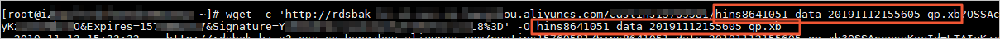

<a id="section-14"></a>

# 14.日志管理

所有PolarDB实例都支持日志管理，您可以通过控制台查询实例的主备库切换日志，帮助故障定位分析。本文介绍日志管理的方法。

**操作步骤**

1. 登录云数据库RDS控制台。

2. 在**云数据库管理**页面，定位到目标实例。

3. 单击目标实例ID或者单击实例右侧的**管理**，打开**基本信息**页面。

4. 在页面左侧导航栏中单击**日志管理**。

5. 在**日志管理**页面，选择查询**错误日志**、**慢日志明细**、**慢日志统计**或者**主备切换日志**，选择时间范围，单击**查询**。

   <table>
     <tr>
       <th width="122">查询项</th>
       <th>内容</th>
     </tr>
     <tr>
       <td>错误日志</td>
       <td>记录1个月内数据库运行出错的日志。</td>
     </tr>
     <tr>
       <td>慢日志明细</td>
       <td>记录1个月内数据库中执行时间超过1秒的SQL语句，并进行相似语句去重。</td>
     </tr>
     <tr>
       <td>慢日志统计</td>
       <td>对1个月内数据库中执行时间超过1秒的SQL语句进行统计汇总，给出慢查询日志的分析报告。</td>
     </tr>
     <tr>
       <td>主备切换日志</td>
       <td>记录主备实例切换的日志。</td>
     </tr>
   </table>

<a id="section-15"></a>

# 15.CloudDBA

<a id="section-15-1"></a>

## 15.1. CloudDBA简介

CloudDBA是一种基于机器学习和专家经验实现数据库自感知、自修复、自优化、自运维及自安全的云服务，帮助用户消除数据库管理的复杂性及人工操作引发的服务故障，有效保障数据库服务的稳定、安全及高效。

**功能介绍**

PolarDB的CloudDBA主要包含如下功能：

慢SQL：查看慢日志趋势和统计信息。

<a id="section-15-2"></a>

## 15.2. 慢SQL

CloudDBA提供PolarDB慢SQL功能，可以查看慢日志趋势、慢日志执行情况和慢日志优化建议。

**进入慢SQL页面**

1. 登录云数据库RDS控制台。

2. 在**云数据库管理**页面，单击目标实例ID或者单击实例右侧**操作**列下的**管理**，打开**基本信息**页面。

3. 在左侧导航栏中，单击**CloudDBA > 慢SQL**。

   > 详细说明请参见 **《数据库自治服务DAS > 用户指南中的慢SQL章节。》**
   >
   > **说明**

<a id="section-16"></a>

# 16.支持插件列表

本文列出PolarDB支持的插件及其版本。

**PolarDB支持插件和版本号**

> **说明**
>
> - 本文仅列举PolarDB内核小版本14.13.25.0中常用插件，实际插件的支持情况应以您的具体版本为准。您可以通过以下SQL查询更多插件的支持情况：
>
>   ```sql
>   SELECT * FROM pg_available_extensions;
>   ```
>
> - PolarDB内核小版本14.13.25.0暂不支持postgis_topology插件相关功能。

| 插件名 | 版本号 | 描述 |
| --- | --- | --- |
| address_standardizer | 3.3.4 | 提供地址标准化计算。 |
| address_standardizer_data _us | 3.3.4 | 地址标准化美国数据。 |
| age | 1.5.0 | 数据库的图插件，使用Cypher语言对数据库中的图进行查询。 |
| bloom | 1.0 | 提供一种基于布鲁姆过滤器的索引访问方法。 |
| btree_gin | 1.3.1 | 提供一个为多种数据类型和所有enum类型实现B树等价行为的GIN操作符类示例。 |
| btree_gist | 1.6.1 | 提供一个为多种数据类型和所有enum类型实现B树等价行为的GiST操作符类示例。 |
| citext | 1.6 | 提供一种大小写不敏感的字符串类型。 |
| cube | 1.5 | 提供一种数据类型来表示多维立方体。 |
| dblink | 1.2 | 跨库操作表。 |
| decoderbufs | 0.10.0 | 根据Protocol Buffers协议，输出能够适配Debezium平台的数据。 |
| dict_int | 1.0 | 附加全文搜索词典模板的示例。 |
| earthdistance | 1.1 | 提供两种不同的方法来计算地球表面的大圆距离。 |
| fuzzystrmatch | 1.1 | 判断字符串之间的相似性和距离。 |
| ganos_geometry | 6.9 | 提供空间几何类型的计算分析功能。 |
| ganos_geometry_pyramid | 6.9 | 用于二维空间几何大数据的快速显示。 |
| ganos_geometry_sfcgal | 6.9 | 提供空间几何sfcgal插件扩展功能。 |
| ganos_geometry_topology | 6.9 | 提供空间几何类型的计算分析功能。 |
| ganos_geomgrid | 6.9 | 提供地理网格对象的计算分析功能。 |
| ganos_networking | 6.9 | 提供空间几何网络类型的计算分析功能。 |
| ganos_pointcloud | 6.9 | 提供点云的存储计算分析功能。 |
| ganos_pointcloud_geometr y | 6.9 | 提供点云的存储计算分析功能。 |
| ganos_raster | 6.9 | 提供空间栅格数据的存储计算分析功能。 |
| ganos_spatialref | 6.9 | 提供空间参考的计算分析功能。 |
| ganos_scene | 6.9 | 提供实景模型的计算分析功能。 |
| ganos_tiger_geocoder | 6.9 | 提供USCB Tiger数据类型支持。 |
| ganos_trajectory | 6.9 | ganos移动对象（MOD）数据计算分析功能。 |
| hll | 2.17 | 快速预估PV、UV等业务指标。 |
| hstore | 1.8 | 在单一PostgreSQL值中存储键值对。 |
| intagg | 1.1 | 提供一个整数聚集器和一个枚举器。 |
| intarray | 1.5 | 提供一些有用的函数和操作符来操纵不含空值的整数数组。 |
| isn | 1.2 | 按照一个硬编码的前缀列表对输入进行验证，也被用来在输出时连接号码。 |
| ltree | 1.2 | 用于表示存储在一个层次树状结构中的数据的标签。 |
| oss_fdw | 1.1 | 读写OSS里的数据。 |
| pase | 0.0.1 | 高效向量检索。 |
| pg_bigm | 1.2 | 创建一个二元语法（2-gram）的GIN索引来加速全文搜索过程。 |
| pg_buffercache | 1.5 | 提供一种方法实时检查共享缓冲区。 |
| pg_cron | 1.5 | 通过<code> cron </code>语法定时执行SQL。 |
| pg_freespacemap | 1.2 | 检查空闲空间映射（FSM）。 |
| pg_jieba | 1.1.0 | 对中文全文实现分词。 |
| pg_hint_plan | 1.4 | 通过特殊的注释语句提示，使PostgreSQL改变其既定的执行计划。 |
| pg_prewarm | 1.2 | 提供一种方便的方法将数据载入到操作系统缓冲区或者PostgreSQL缓冲区。 |
| pg_repack | 1.5.1-1 | 在线清理表空间功能。 |
| pg_sphere | 1.0 | 提供PostgreSQL的球面的数据类型、函数、运算符和索引。 |
| pg_stat_statements | 1.9.1 | 提供一种方法追踪服务器执行的所有SQL语句的执行统计信息。 |
| pg_trgm | 1.6 | 提供字母数字文本相似度的函数和操作符，以及支持快速搜索相似字符串的索引操作符类。 |
| pgaudit | 1.6.2 | 提供详细的会话和对象审计日志记录。 |
| pgcrypto | 1.3 | 为PostgreSQL提供了密码函数。 |
| pgrouting | 3.4.2 | 提供空间几何网络的计算分析功能。 |
| pgrowlocks | 1.2 | 提供一个函数来显示指定表的行锁定信息。 |
| pgstattuple | 1.5 | 提供多种函数来获得元组层的统计信息。 |
| pgvector | 0.6.2 | 高维向量相似度搜索插件。 |
| plperl | 1.0 | 提供Perl过程语言。 |
| plpgsql | 1.0 | 提供SQL过程语言。 |
| pltcl | 1.0 | 提供tcl过程语言。 |
| postgis | 3.3.4 | PostGIS空间地理信息相关扩展。 |
| postgis_sfcgal | 3.3.4 | PostGIS SFCGAL空间地理信息相关扩展。 |
| postgis_tiger_geocoder | 3.3.4 | PostGIS TIGER数据空间地理信息相关扩展。 |
| roaringbitmap | 0.5 | 使用位图功能，提高查询性能。 |
| rum | 1.3 | 高速全文检索。 |
| sequential_uuid | 1.0.2 | 具有顺序模式的UUID生成器。 |
| sslinfo | 1.2 | 提供当前客户端提供的SSL证书的有关信息。 |
| tablefunc | 1.0 | 包括多个返回表的函数。 |
| tsm_system_rows | 1.0 | 提供表采样方法SYSTEM_ROWS。 |
| tsm_system_time | 1.0 | 提供表采样方法SYSTEM_TIME。 |
| unaccent | 1.1 | 文本搜索字典，能从词位中移除重音（附加符号）。 |
| uuid-ossp | 1.1 | 提供函数使用几种标准算法之一产生通用唯一标识符（UUID）。 |
| varbitx | 1.1 | 支持多种BIT操作。 |
| xml2 | 1.1 | 提供XPath查询和XSLT功能。 |
| zhparser | 1.0 | 中文全文搜索。 |

<a id="section-17"></a>

# 17.PolarDB驱动程序

<a id="section-17-1"></a>

## 17.1. 下载驱动程序

本文为您提供RDS PolarDB相关驱动的下载地址。

您可以在本文下载并安装相应的驱动，以便您的应用程序能够访问PolarDB实例。

**驱动类**

- JDBC：

  PolarDB-O-JDBC.zip

  PolarDB JDBC使用指南请参见RDS PolarDB JDBC。

- .NET：

  polardb_oracle_.net.zip

  PolarDB .NET使用指南请参见RDS PolarDB .NET。

- OCI：

  polardb_oracle_oci.tar

  PolarDB OCI使用指南请参见RDS PolarDB OCI。

- ODBC：

  - polardb_oracle_odbc_for_x86_64.tar.gz

  - polardb_oracle_odbc_for_arm_64.tar.gz

  - polardb_oracle_odbc_for_win_64.7z

  - polardb_oracle_odbc_for_win_32.7z

  PolarDB ODBC使用指南请参见RDS PolarDB ODBC。

- PolarTools：

  获取PolarTools后，进行解压安装。

<a id="section-17-2"></a>

## 17.2. RDS PolarDB JDBC

本文将介绍在Java应用中使用JDBC连接PolarDB实例。

**前提条件**

已经在PolarDB实例中创建账号，更多信息，请参见创建数据库和账号。

**背景信息**

JDBC（Java Database Connectivity）为Java应用程序提供了访问数据库的编程接口。PolarDB实例的JDBC是基于开源的PostgreSQL JDBC开发而来，使用PostgreSQL本地网络协议进行通信，允许Java程序使用标准的、独立于数据库的Java代码连接数据库。

JDBC驱动程序使用了PostgreSQL 3.0协议，与Java 6（JDBC 4.0）、Java 7（JDBC4.1）和Java 8（JDBC4.2）兼容。

**下载JDBC**

JDBC驱动阿里云提供了兼容Java 6、Java 7和Java 8三个Java版本的JDBC驱动，对应三个Jar包，包名分别为 `polardb-jdbc16.jar` 、 `polardb-jdbc17.jar` 和 `polardb-jdbc18.jar`  。您可根据应用使用的JDK版本选择合适的JDBC。

**配置JDBC**

在Java应用中使用JDBC前，需要将JDBC驱动包的路径添加至 `CLASSPATH` 中。例如您的JDBC驱动放置的路径为/usr/local/polardb/share/java/，在 `CLASSPATH` 中添加JDBC驱动路径的命令如下：

```bash
export CLASSPATH=$CLASSPATH:/usr/local/polardb/share/java/<安装的Jar包名.jar>
```

示例：

```bash
export CLASSPATH=$CLASSPATH:/usr/local/polardb/share/java/polardb-jdbc18.jar
```

您可以通过如下命令查看当前使用的JDBC版本：

```text
java -jar <安装的Jar包名.jar>
```

示例：

```text
java -jar polardb-jdbc18.jar
```

返回示例：

```text
POLARDB JDBC Driver 42.2.5.2.0
```

**Maven工程**

如果您的Java项目使用Maven构建，可以通过如下命令将PolarDB的JDBC驱动包安装至您的本地仓库：

```text
 mvn install:install-file -DgroupId=com.aliyun -DartifactId=<安装的Jar包名> -
Dversion=1.1.2 -Dpackaging=jar -Dfile=/usr/local/polardb/share/java/<安装的Jar包名.jar>
```

示例：

```text
 mvn install:install-file -DgroupId=com.aliyun -DartifactId=polardb-jdbc18 -Dversion=1.1.2 -Dpackaging=jar -Dfile=/usr/local/polardb/share/java/polardb-jdbc18.jar
```

在Maven工程的 `pom.xml` 文件中添加如下依赖。

```xml
<dependency>
    <groupId>com.aliyun</groupId>
    <artifactId><安装的Jar包名></artifactId>
    <version>1.1.2</version>
</dependency>
```

示例：

```xml
<dependency>
    <groupId>com.aliyun</groupId>
    <artifactId>polardb-jdbc18</artifactId>
    <version>1.1.2</version>
</dependency>
```

**Hibernate**

如果您的工程使用Hibernate连接数据库，请在您的Hibernate配置文件 `hibernate.cfg.xml` 中配置PolarDB数据库的驱动类和方言。

> **说明**
>
> Hibernate需要为3.6及以上版本才支持PostgresPlusDialect方言。

```xml
<property name="connection.driver_class">com.aliyun.polardb.Driver</property>
<property name="connection.url">jdbc:polardb://pc-
***.o.polardb.rds.aliyuncs.com:1521/polardb_test</property>
<property name="dialect">org.hibernate.dialect.PostgresPlusDialect</property>
```

**Druid连接池**

- Druid 1.1.24及其之后的版本默认支持PolarDB的驱动，无需设置 `driver name` 和 `dbtype` 参数。

- Druid 1.1.24之前的版本，需要显式设置 `driver name` 和 `dbtype` 参数，如下所示：

  ```text
  dataSource.setDriverClassName("com.aliyun.polardb.Driver");
  dataSource.setDbType("postgresql");
  ```

  > **说明**
  >
  > Druid 1.1.24之前版本没有适配PolarDB，因此 `dbtype` 需要设置为 `postgresql` 。

如果您需要在Druid连接池中对数据库密码进行加密，请参见数据库密码加密。

**适配Activiti**

如果您的应用使用了业务流程管理框架Activiti，在PolarDB数据源初始化时，可能会出现以下错误信息。

```text
couldn't deduct database type from database product name 'POLARDB Database Compatible with Oracle'
```

这是因为Activiti内置了一些数据库版本信息和数据库类型的映射关系，导致无法正确映射PolarDB版本信息。您可以通过设置 `SpringProcessEngineConfiguration` 子类，在该子类中重载 `buildProcessEngine` 的方法来解决问题。在该解决方法中，您需要显式指定数据库类型，配置方法请参见以下示例。

```java
package com.aliyun.polardb;

import org.activiti.engine.ProcessEngine;
import org.activiti.spring.SpringProcessEngineConfiguration;

public class PolarDBSpringProcessEngineConfiguration extends 
SpringProcessEngineConfiguration {

    public PolarDBSpringProcessEngineConfiguration() {
        super();
    }

    @Override
    public ProcessEngine buildProcessEngine() {
        setDatabaseType(DATABASE_TYPE_POSTGRES);
        return super.buildProcessEngine();
    }
}
```

将 `SpringProcessEngineConfiguration` 子类放在您的工程中，在配置文件中设置使用该类加载配置，并初始化引擎，具体信息请参见以下示例。

```xml
<bean id="processEngineConfiguration" 
class="com.aliyun.polardb.PolarDBSpringProcessEngineConfiguration">
      <property name="dataSource" ref="dataSource"/>
      <property name="transactionManager" ref="transactionManager"/>
      <property name="databaseSchemaUpdate" value="true"/>
      <!-- 其他配置在此省略 -->
</bean>
```

**加载JDBC驱动**

加载JDBC命令如下：

```text
Class.forName("com.aliyun.polardb.Driver");
```

**示例**

```java
package com.aliyun.polardb;

import java.sql.Connection;
import java.sql.Driver;
import java.sql.DriverManager;
import java.sql.ResultSet;
import java.sql.SQLException;
import java.sql.Statement;
import java.util.Properties;

/**
 * POLARDB JDBC DEMO
 * <p>
 * Please make sure the host ip running this demo is in you cluster's white list.
 */
public class PolarDBJdbcDemo {
  /**
   * Replace the following information.
   */
  private final String host = "***.o.polardb.rds.aliyuncs.com";
  private final String user = "***";
  private final String password = "***";
  private final String port = "1921";
  private final String database = "db_name";

  public void run() throws Exception {
    Connection connect = null;
    Statement statement = null;
    ResultSet resultSet = null;

    try {
      Class.forName("com.aliyun.polardb.Driver");

      Properties props = new Properties();
      props.put("user", user);
      props.put("password", password);
      String url = "jdbc:polardb://" + host + ":" + port + "/" + database;
      connect = DriverManager.getConnection(url, props);

      /**
       * create table foo(id int, name varchar(20));
       */
      String sql = "select id, name from foo";
      statement = connect.createStatement();
      resultSet = statement.executeQuery(sql);
      while (resultSet.next()) {
        System.out.println("id:" + resultSet.getInt(1));
        System.out.println("name:" + resultSet.getString(2));
      }
    } catch (Exception e) {
      e.printStackTrace();
      throw e;
    } finally {
      try {
        if (resultSet != null)
          resultSet.close();
        if (statement != null)
          statement.close();
        if (connect != null)
          connect.close();
      } catch (SQLException e) {
        e.printStackTrace();
        throw e;
      }
    }
  }

  public static void main(String[] args) throws Exception {
    PolarDBJdbcDemo demo = new PolarDBJdbcDemo();
    demo.run();
  }
}
```

在JDBC中，一个数据库通常用一个URL来表示，示例如下。

```text
jdbc:polardb://pc-***.o.polardb.rds.aliyuncs.com:1521/polardb_test?
user=test&password=Pw123456
```

| 参数 | 示例 | 说明 |
| --- | --- | --- |
| URL前缀 | <code>jdbc:polardb://</code> | 连接PolarDB的URL统一使用<code> jdbc:polardb:// </code>作为前缀。 |
| 连接地址 | <code>pc-</code><br><code>***.o.polardb.rds.aliyu</code><br><code>ncs.com</code> | PolarDB实例的连接地址，如何查看连接地址请参见<strong>《用户指</strong><strong>南》</strong>中<strong>《查看连接地址》</strong>章节。 |
| 端口 | <code>1521</code> | PolarDB实例的端口，默认为1521。 |
| 数据库 | <code>polardb_test</code> | 需要连接的数据库名。 |
| 用户名 | <code>test</code> | PolarDB实例的用户名。 |
| 密码 | <code>Pw123456</code> | PolarDB实例用户名对应的密码。 |

访问数据库执行查询时，需要创建一个 `Statement` 、 `PreparedStatment` 或者 `CallableStatement` 对象。

上述示例中使用了 `Statement` ，使用 `PreparedStatment` 示例如下：

```java
PreparedStatement st = conn.prepareStatement("select id, name from foo where id > ?");
st.setInt(1, 10);
resultSet = st.executeQuery();
while (resultSet.next()) {
    System.out.println("id:" + resultSet.getInt(1));
    System.out.println("name:" + resultSet.getString(2));
}
```

`CallableStatement` 用于处理存储过程，示例如下：

```java
String sql = "{?=call getName (?, ?, ?)}";
CallableStatement stmt = conn.prepareCall(sql);
stmt.registerOutParameter(1, java.sql.Types.INTEGER);

//Bind IN parameter first, then bind OUT parameter
int id = 100;
stmt.setInt(2, id); // This would set ID as 102
stmt.registerOutParameter(3, java.sql.Types.VARCHAR);
stmt.registerOutParameter(4, java.sql.Types.INTEGER);

//Use execute method to run stored procedure.
stmt.execute();

//Retrieve name with getXXX method
String name = stmt.getString(3);
Integer msgId = stmt.getInt(4);
Integer result = stmt.getInt(1);
System.out.println("Name with ID:" + id + " is " + name + ", and messegeID is " + msgId+ ", and return is " + result);
```

以上代码使用的存储过程 `getName` 如下：

```text
CREATE OR REPLACE FUNCTION getName(
    id        In      Integer,
    name      Out     Varchar2,
    result    Out     Integer
  ) Return Integer
Is
  ret     Int;
Begin
  ret := 0;
  name := 'Test';
  result := 1;
  Return(ret);
End;
```

<a id="section-17-3"></a>

## 17.3. RDS PolarDB .NET

本文将介绍如何在C#应用中使用PolarDB .NET驱动连接PolarDB实例。

**前提条件**

已经在PolarDB实例中创建账号，更多信息，请参见创建账号。

**背景信息**

PolarDB .NET（全称为ADO.NET Data Provider for PolarDB）是使用C#、Visual Basic、F#等语言访问PolarDB的驱动，驱动提供了对Entity Framework Core和Entity Framework 6.x的兼容能力，您可以使用本驱动结合Entity Framework快速开发应用程序。

当前的驱动程序使用了PostgreSQL 3.0版本协议 ，与.NETFramework 4.x、.NET Core 2.x兼容。

**Entity Framework简介**

Entity Framework是.NET平台上流行的ORM框架。在使用C#编写后端应用时，Entity Framework以及LINQ技术极大地加速了后端应用的开发。

PolarDB .NET驱动提供了PolarDB的EF5、EF6的dll，用于使用Entity Framework。

关于Entity Framework的更多介绍，请参见Entity Framework官网。

**安装.NET驱动**

1. 下载.NET驱动

2. 解压.NET驱动。

   ```text
   unzip polardb_oracle_.net.zip
   ```

3. 将驱动导入到Visual Studio项目中。

   您需要在sample.csproj的&lt;Project>节点或Visual Studio的GUI界面添加如下内容。

   ```xml
   <Project>
     ...
     <ItemGroup>
       <Reference Include="POLARDB.POLARDBClient, Version=4.0.4.1, Culture=neutral, PublicKeyToken=5d8b90d52f46fda7">
         <HintPath>${your path}\POLARDB.POLARDBClient.dll</HintPath>
       </Reference>
     </ItemGroup>
     ...
   </Project>
   ```

**操作示例**

在Samples目录中，您可以看到一个polardb-sample.sql文件以及多个示例项目文件，以下操作将指导您如何运行这些示例项目。

1. 连接数据库，具体操作请参见连接PolarDB实例。

2. 执行如下命令创建一个名为 `sampledb` 的数据库。

   ```sql
   CREATE DATABASE sampledb;
   ```

3. 将测试所需要的数据库、表、数据、函数导入到 `sampledb` 数据库。

   ```text
   \i ${your path}/polardb-sample.sql
   ```

4. 数据导入完成后，您可以开始编写C#代码了。

   下例代码示例中展示了如何进行查询、更新以及存储过程调用。

   ```csharp
   using System;
   using System.Data;
   using POLARDB.POLARDBClient;
   /*
    * This class provides a simple way to perform DML operation in POLARDB
    *
    * @revision 1.0
    */

   namespace POLARDBClientTest
   {

       class SAMPLE_TEST
       {

           static void Main(string[] args)
           {
               POLARDBConnection conn = new 
   POLARDBConnection("Server=localhost;Port=5432;User 
   Id=polaruser;Password=password;Database=sampledb");
               try
               {
                   conn.Open();

                   //Simple select statement using POLARDBCommand object
                   POLARDBCommand POLARDBSeletCommand = new POLARDBCommand("SELECT 
   EMPNO,ENAME,JOB,MGR,HIREDATE FROM EMP",conn);
                   POLARDBDataReader SelectResult =  POLARDBSeletCommand.ExecuteReader();
                   while (SelectResult.Read()) 
                   {
                       Console.WriteLine("Emp No" + " " + SelectResult.GetInt32(0));
                       Console.WriteLine("Emp Name" + " " + SelectResult.GetString(1));
                       if (SelectResult.IsDBNull(2) == false)
                           Console.WriteLine("Job" + " " + SelectResult.GetString(2));
                       else
                           Console.WriteLine("Job" + " null ");
                       if (SelectResult.IsDBNull(3) == false)
                           Console.WriteLine("Mgr" + " " + SelectResult.GetInt32(3));
                       else
                           Console.WriteLine("Mgr" + "null");
                       if (SelectResult.IsDBNull(4) == false)
                           Console.WriteLine("Hire Date" + " " + 
   SelectResult.GetDateTime(4));
                       else
                           Console.WriteLine("Hire Date" + " null");
                       Console.WriteLine("---------------------------------");
                   }

                   //Insert statement using POLARDBCommand Object
                   SelectResult.Close();
                   POLARDBCommand POLARDBInsertCommand = new POLARDBCommand("INSERT INTO 
   EMP(EMPNO,ENAME) VALUES((SELECT COUNT(EMPNO) FROM EMP),'JACKSON')",conn);
                   POLARDBInsertCommand.ExecuteScalar();
                   Console.WriteLine("Record inserted");

                   //Update  using POLARDBCommand Object
                   POLARDBCommand  POLARDBUpdateCommand = new POLARDBCommand("UPDATE EMP 
   SET ENAME ='DOTNET' WHERE EMPNO < 100",conn);
                   POLARDBUpdateCommand.ExecuteNonQuery();
                   Console.WriteLine("Record has been updated");
                   POLARDBCommand POLARDBDeletCommand = new POLARDBCommand("DELETE FROM 
   EMP WHERE EMPNO < 100",conn);
                   POLARDBDeletCommand.CommandType= CommandType.Text;
                   POLARDBDeletCommand.ExecuteScalar();
                   Console.WriteLine("Record deleted");

                   //procedure call example
                   try
                   {
                       POLARDBCommand callable_command = new 
   POLARDBCommand("emp_query(:p_deptno,:p_empno,:p_ename,:p_job,:p_hiredate,:p_sal)", conn);
                       callable_command.CommandType = CommandType.StoredProcedure;
                       callable_command.Parameters.Add(new 
   POLARDBParameter("p_deptno",POLARDBTypes.POLARDBDbType.Numeric,10,"p_deptno",ParameterD
   ection.Input,false ,2,2,System.Data.DataRowVersion.Current,20));
                       callable_command.Parameters.Add(new POLARDBParameter("p_empno", PO
   LARDBTypes.POLARDBDbType.Numeric,10,"p_empno",ParameterDirection.InputOutput,false ,2,2,System.Data.DataRowVersion.Current,7369));
                       callable_command.Parameters.Add(new POLARDBParameter("p_ename", PO
   LARDBTypes.POLARDBDbType.Varchar,10,"p_ename",ParameterDirection.InputOutput,false ,2,2,System.Data.DataRowVersion.Current,"SMITH"));
                       callable_command.Parameters.Add(new POLARDBParameter("p_job", POLA
   RDBTypes.POLARDBDbType.Varchar,10,"p_job",ParameterDirection.Output,false ,2,2,System.Data.DataRowVersion.Current,null));
                       callable_command.Parameters.Add(new POLARDBParameter("p_hiredate", 
   POLARDBTypes.POLARDBDbType.Date,200,"p_hiredate",ParameterDirection.Output,false ,2,2,System.Data.DataRowVersion.Current,null));
                       callable_command.Parameters.Add(new POLARDBParameter("p_sal", POLA
   RDBTypes.POLARDBDbType.Numeric,200,"p_sal",ParameterDirection.Output,false ,2,2,System.Data.DataRowVersion.Current,null));
                       callable_command.Prepare();
                       callable_command.Parameters[0].Value = 20;
                       callable_command.Parameters[1].Value = 7369;
                       POLARDBDataReader result = callable_command.ExecuteReader();
                       int fc = result.FieldCount;
                       for(int i=0;i<fc;i++)
                           Console.WriteLine("RESULT["+i+"]="+ 
   Convert.ToString(callable_command.Parameters[i].Value));
                       result.Close();
                   }
                   catch(POLARDBException exp)
                   {
                       if(exp.ErrorCode.Equals("01403"))
                           Console.WriteLine("No data found");
                       else if(exp.ErrorCode.Equals("01422"))
                           Console.WriteLine("More than one rows were returned by the que
   ry");
                       else
                           Console.WriteLine("There was an error Calling the procedure. \
   nRoot Cause:\n");
                       Console.WriteLine(exp.Message.ToString());
                   }

                   //Prepared statement
                   string updateQuery  = "update emp set ename = :Name where empno = :ID"
   ;
                   POLARDBCommand Prepared_command = new POLARDBCommand(updateQuery, 
   conn);
                   Prepared_command.CommandType = CommandType.Text;
                   Prepared_command.Parameters.Add(new POLARDBParameter("ID", POLARDBType
   s.POLARDBDbType.Integer));
                   Prepared_command.Parameters.Add(new POLARDBParameter("Name", POLARDBTy
   pes.POLARDBDbType.Text));
                   Prepared_command.Prepare();
                   Prepared_command.Parameters[0].Value = 7369;
                   Prepared_command.Parameters[1].Value = "Mark";
                   Prepared_command.ExecuteNonQuery();
                   Console.WriteLine("Record Updated...");
               }

               catch(POLARDBException exp)
               {
                   Console.WriteLine(exp.ToString() );
               }
               finally
               {
                   conn.Close();
               }

           }
       }
   }
   ```

**连接串参数**

当您连接数据库时，应用程序需要提供连接字符串，字符串包含主机、用户名、密码等参数。

连接字符串的形式为 `keyword1=value; keyword2=value;` ，不区分大小写，包含特殊字符（例如分号）的值可以使用双引号（""）。

以下是该驱动支持的连接字符串参数。

| 参数 | 示例 | 说明 |
| --- | --- | --- |
| Host | <code>localhost</code> | PolarDB集群的连接地址，如何查看连接地址请参见<strong>《用户指</strong><strong>南》</strong>中<strong>《查看连接地址》</strong>章节。 |
| Port | <code>1521</code> | PolarDB集群的端口，默认为1521。 |
| Database | <code>sampledb</code> | 需要连接的数据库名称。 |
| Username | <code>polaruser</code> | PolarDB集群的用户名。 |
| Password | <code>password</code> | PolarDB集群用户名对应的密码。 |

其他参数。

| 参数 | 说明 |
| --- | --- |
| application_name | 应用程序名称。 |
| search_path | Schema的搜索路径。 |
| client_encoding | 客户端编码。 |
| timezone | 会话的时区。 |

<a id="section-17-4"></a>

## 17.4. RDS PolarDB ODBC

PolarDB提供了Unix版本和Windows版本的ODBC驱动，本文将介绍在不同系统中如何使用ODBC驱动。

**前提条件**

- 已经在PolarDB中创建用户。如何创建用户，请参见创建数据库和账号。

- Windows系统需要为Window 7及以上版本，且已经安装了Windows7 service pack 1。

- Unix系统或Linux系统需要安装以下工具：

  - Libtool 1.5.10及以上版本

  - unixODBC-devel

  - libpq

**下载驱动**

- Unix或Linux系统x86架构32位驱动包：PolarDB-ODBC_Linux_X86_32.tar

- Unix或Linux系统x86架构64位驱动包：PolarDB-ODBC_Linux_X86_64.tar

- Unix或Linux系统ARM架构64位驱动包：PolarDB-ODBC_Linux_arm_64.tar

- Windows系统x86架构64位驱动包：PolarDB-ODBC_Windows_x86_64

- Windows系统x86架构32位驱动包：PolarDB-ODBC_Windows_x86_32

**下载和安装ODBC驱动**

1. 下载ODBC驱动。

2. 安装ODBC驱动。

   > PolarDB提供的ODBC驱动压缩包无需安装，解压后即可使用。解压命令如下所示：
   >
   > **说明**

   ```bash
   tar -zxvf polardb_oracle_odbc.tar.gz
   ```

**Windows系统安装ODBC驱动**

1. 根据Windows操作系统的位数选择对应的安装包，下载地址请参见下载驱动。

2. 下载完成后，解压ODBC包。

3. 使用管理员身份运行 `install.bat` 文件，完成后按任意键退出即可。

   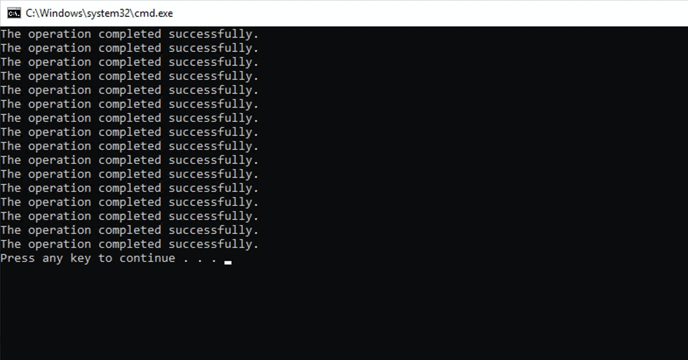

4. <strong>可选：</strong>如果您需要卸载ODBC包，运行 `uninstall.bat` 文件即可完成卸载。

**Windows系统使用ODBC连接PolarDB**

1. 在**控制面板**中打开**管理工具**。

   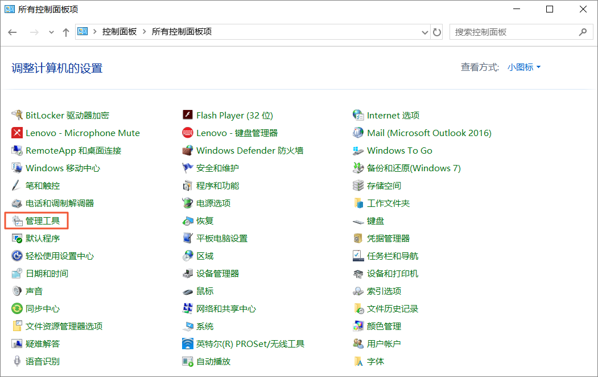

2. 在**管理工具**页面，找到并运行**ODBC数据源**。

3. 在**ODBC数据源管理程序**页面，单击**添加**。

4. 选择<strong>POLARDB（UNICODE）</strong>作为数据源的驱动程序，单击**完成**。

   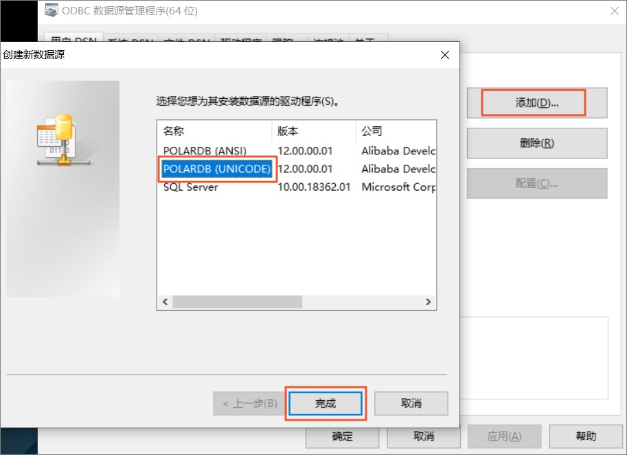

5. 在弹出的对话框中，输入以下信息。

   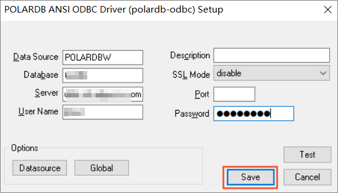

   | 参数 | 说明 |
   | --- | --- |
   | Date Source | 数据源名称。 |
   | Description | 数据源的描述。 |
   | Datebase | 目标数据库名称。 |
   | SSL Mode | 选择SSL加密方式。 |
   | Server | 目标数据库连接地址。 |
   | Prot | 目标数据库的端口，默认为1521。 |
   | User Name | 数据库账号。 |
   | Password | 数据库账号的密码。 |

6. 单击**Save**即可。

**Unix或Linux系统安装ODBC驱动**

1. 根据操作系统的架构和版本下载对应的ODBC驱动，下载地址请参见下载驱动。

2. 安装ODBC驱动。

   > PolarDB提供的ODBC驱动压缩包无需安装，解压后即可使用。解压命令如下所示：
   >
   > **说明**

   ```bash
   tar -zxvf polardb_oracle_odbc.tar.gz
   ```

**Uinx或Linux系统使用ODBC连接PolarDB**

1. 在Linux服务器上安装的Libtool，Libtool需要是1.5.1以上版本。

   ```bash
   yum install -y libtool
   ```

2. 在Linux服务器上安装unixODBC-devel。

   ```bash
   yum install -y unixODBC-devel
   ```

3. 编辑/etc目录中 `odbcinst.ini` 文件。

   ```text
   vim /etc/odbcinst.ini
   ```

4. 在 `odbcinst.ini` 文件中添加如下信息。

   ```ini
   [POLARDB]
   Description = ODBC for POLARDB
   Driver      = /root/target/lib/unix/polar-odbc.so
   Setup       = /root/target/lib/unix/libodbcpolarS.so
   Driver64    = /root/target/lib/unix/polar-odbc.so
   Setup64     = /root/target/lib/unix/libodbcpolarS.so
   Database    = <数据库名称>
   Servername  = <数据库连接地址>
   Password    = <密码>
   Port        = <端⼝>
   Username    = <⽤户名>
   Trace       = yes
   TraceFile   = /tmp/odbc.log
   FileUsage   = 1
   ```

   > 示例中/root路径请替换成 `target` 文件夹所在实际路径。
   >
   > **说明**

5. 连接PolarDB。

   ```text
   $isql -v POLARDB
   +---------------------------------------+
   | Connected!                            |
   |                                       |
   | sql-statement                         |
   | help [tablename]                      |
   | quit                                  |
   |                                       |
   +---------------------------------------+
   SQL>
   ```

**Unix或Linux系统操作示例**

以下内容将为您介绍如何运行 `Test1` 和 `Test2` 测试文件。

1. 打开ODBC驱动文件夹中的 `samples` 文件夹。

   ```bash
   cd samples
   ```

2. 对测试样例进行编译，完成编译后会得到 `Test1` 和 `Test2` 两个测试文件。

   ```text
   make
   ```

3. 运行 `Test1` 和 `Test2` 。

   ```text
   ./Test1
   ## 运⾏Test1

   ./Test2
   ## 运⾏Test2
   ```

   > **说明**
   >
   > - `Test1` 为增删改查示例； `Test2` 为游标和out参数示例。
   >
   > - 以下代码示例仅为部分代码，完整代码示例请查看驱动包中的 `samples` 文件夹中的 `Test1` 和 `Test2` 测试文件。

Test1示例如下所示：

```text
... 

int main(int argc, char* argv[])
{
    /*初始化*/
    RETCODE rCode;
    HENV *hEnv = (HENV*)malloc(sizeof(HENV));
    HDBC *hDBC = (HDBC*)malloc(sizeof(HDBC));
    HSTMT *hStmt = (HSTMT*)malloc(sizeof(HSTMT));
    Connect("POLARDB","user","",&hEnv,&hDBC);
    rCode = SQLAllocStmt(*hDBC,hStmt);
    rCode = SQLAllocHandle(SQL_HANDLE_STMT,*hDBC,hStmt);
    /*增删改查*/
    ExecuteInsertStatement(&hStmt,(UCHAR*) "INSERT INTO EMP(EMPNO,ENAME) VALUES((SELECT 
COUNT(EMPNO) FROM EMP),'JACKSON')");
    ExecuteUpdate(&hStmt,(UCHAR*) "UPDATE EMP SET ENAME='ODBC Test' WHERE EMPNO < 100")
;
    ExecuteDeletStatement(&hStmt,(UCHAR*) "DELETE FROM EMP WHERE EMPNO<100");
    ExecuteSimple_Select(&hStmt,(UCHAR*) "SELECT EMPNO,ENAME,JOB,MGR,HIREDATE FROM EMP where empno = 7369");
    /*关闭连接*/
    Disconnect(&hEnv,&hDBC,&hStmt);
    /*clean up*/
    free(hEnv);
    free(hDBC);
    free(hStmt);

    return 0;
}
```

Test2示例如下所示：

```text
int main(int argc, char* argv[])
{
    /* 定义*/
    RETCODE rCode;
    SQLUSMALLINT a;
    SQLINTEGER Num1IndOrLen;
    SQLSMALLINT iTotCols = 0;

    int j;
    SDWORD cbData;
    /*初始化*/
    HENV *hEnv = (HENV*)malloc(sizeof(HENV));
    HDBC *hDBC = (HDBC*)malloc(sizeof(HDBC));
    HSTMT *hStmt = (HSTMT*)malloc(sizeof(HSTMT));
    HSTMT *hStmt1 = (HSTMT*)malloc(sizeof(HSTMT));
    /*建立连接*/
    Connect("POLARDB","user","***",&hEnv,&hDBC);
    rCode = SQLAllocStmt(*hDBC,hStmt);
    rCode = SQLAllocStmt(*hDBC,hStmt1);

    rCode = SQLAllocHandle(SQL_HANDLE_STMT,*hDBC,hStmt);
    rCode = SQLAllocHandle(SQL_HANDLE_STMT,*hDBC,hStmt1);
    /*begin*/
    ExecuteSimple_Select(&hStmt1,(UCHAR*) "BEGIN;");
    /*prepare*/
    RETCODE rc = SQLPrepare((*hStmt),(SQLCHAR*)"{ call 
refcur_inout_callee2(?,?)}",SQL_NTS);

    rc = SQLBindParameter((*hStmt),1, SQL_PARAM_INPUT_OUTPUT, 
SQL_C_CHAR,SQL_REFCURSOR,0, 31,
                strName, 31, &Num1IndOrLen);
    rc = SQLBindParameter((*hStmt),2, SQL_PARAM_INPUT_OUTPUT, 
SQL_C_CHAR,SQL_REFCURSOR,0, 31,
                    &strName1, 31, &Num1IndOrLen);

    Num1IndOrLen=0;
    /*execute*/
    rc = SQLExecute((*hStmt));

    if(rc == SQL_SUCCESS || rc == SQL_SUCCESS_WITH_INFO)
    {
        printf("\nstrName _________ = %s\n",strName);
        printf("\nstrName 1_________ = %s\n",strName1);


    }
    printf("\n First Cursor as OUT Parameter \n")   ;
```

<a id="section-17-5"></a>

## 17.5. RDS PolarDB OCI

本文将介绍如何使用PolarDB OCI驱动连接PolarDB实例。

**前提条件**

- 已经在PolarDB实例创建账号。更多信息，请参见创建数据库和账号。

- 服务器操作系统为64位Linux或64位Windows。

- 已安装Oracle OCI驱动开发包。

**背景信息**

PolarDB OCI是基于原生C语言的PolarDB接口，OCI为构建各种语言专用接口（例如PolarDB JDBC、PolarDB .Net、PolarDB ODBC等）提供了基础，OCI还对PolarDB提供了查询语句和SQL调用功能。

当前的驱动程序使用3.0版本的PostgreSQL协议 。

**下载OCI驱动**

polardb_oracle_oci.tar

**安装OCI驱动**

解压OCI驱动，将驱动导入到环境变量中，以便编译测试程序时能够正确找到驱动位置。

Linux操作系统和Windows操作系统手动导入环境变量的方法如下：

- Linux系统

  <ol type="i">

  <li>

  直接将libpolaroci.so.10.2、libiconv.so.2以及libpq.so.5.11文件拷贝至/usr/lib目录下。

  </li>

  <li>

  建立软链接。

  ```text
  ln -s /usr/lib/libpolaroci.so.10.2 /usr/lib/libpolaroci.so
  ln -s /usr/lib/libiconv.so.2 /usr/lib/libiconv.so
  ln -s /usr/lib/libpq.so.5.11 /usr/lib/libpq.so
  ln -s /usr/lib/libpq.so.5.11 /usr/lib/libpq.so.5
  ```

  </li>

  <li>

  设置Linux环境变量。

  ```bash
  export LD_LIBRARY_PATH= /usr/lib
  ```

  </li>

  </ol>

  > **说明**
  >
  > - 如果您的系统已有libiconv.so文件，可以直接使用原有系统的so文件。也可以参考libiconv文档下载并编译安装libiconv，使用编译后的so文件。
  >
  > - Linux环境中，PolarDB OCI驱动提供的libiconv.so文件仅做参考。

- Windows系统

  <ol type="i">

  <li>

  设置环境变量。

  Windows下的IDE编译器一般都具备导入链接文件路径的功能，这里以Visual Studio 2019为例，导入方法如下图所示。

  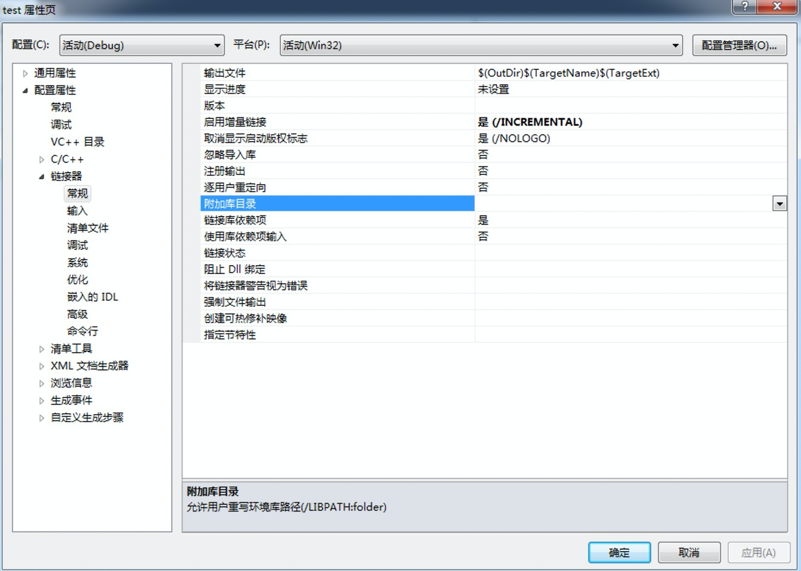

  </li>

  <li>

  在项目的属性栏中，添加附件的库目录，将驱动目录下的dll文件添加到**附件库目录**中。

  </li>

  </ol>

**编写代码**

以下代码示例使用了sample目录下的测试样例 `polardb_demo` ，将为您展示如何编写代码。

```cpp
/* ============================================================================
 * Copyright (c) 2004-2019 POLARDB Corporation. All Rights Reserved.
 * ===========================================================================
 */
#include <stdio.h>
#include <stdlib.h>

#include <string.h>
#include <oci.h>

#ifdef WIN32
#include <time.h>
#else
#include <sys/time.h>
#endif

/* Define a macro to handle errors */
#define HANDLE_ERROR(x,y) check_oci_error(x,y)

#define DATE_FMT "DAY, MONTH DD, YYYY"
#define DATE_LANG "American"

sword ConvertStringToDATE( char *datep, char *formatp, dvoid *datepp );
/* A Custom Routine to handle errors,     */

/* this demonstrates the Error/ Exception Handling in OCI */
void check_oci_error (dvoid * errhp, sword status);

/*
 * <<<<<<<<<<<<<<<<<<< FUNCTION PROTOTYPES<<<<<<<<<<<<<<<<<<<<<<<<<<<<<<<<<<<<<<
 */

/* Initialize    & Allocate all handles */
void
initHandles (OCISvcCtx **, OCIServer **, OCISession **, OCIError **,
         OCIEnv **);

/* logon to the database and begin user-session */
void
logon (OCISvcCtx **, OCIServer **, OCISession **, OCIError **,
       OCIEnv **, text *, text *, text *);

/* Create required table(s)  */
void create_table (OCISvcCtx *, OCIError *, OCIEnv *);

/* prepare data for our examples */
void prepare_data (OCISvcCtx *, OCIError *, OCIEnv *);

/* create procedures/functions to demonstrate in the example */
void create_stored_procs (OCISvcCtx *, OCIError *, OCIEnv *);

/* select and print data by iterating through resultSet */
void select_print_data (OCISvcCtx *, OCIError *, OCIEnv *);

/* demonstrate calling stored procedures and retrieving values */

/* proc1 demonstrates IN OUT */
void call_stored_proc1 (OCISvcCtx *, OCIError *, OCIEnv *);

/* proc2 demonstrates OUT */
void call_stored_proc2 (OCISvcCtx *, OCIError *, OCIEnv *);

/* drop required table(s) */
void drop_table (OCISvcCtx *, OCIError *, OCIEnv *);

/* drop stored procedures and functions */
void drop_stored_procs (OCISvcCtx *, OCIError *, OCIEnv *);

/* clean-up main handles before exit */
void
cleanup (OCISvcCtx **, OCIServer **, OCISession **, OCIError **, OCIEnv **);

/*
 * <<<<<<<<<<<<<<<<<<<<<<<<< END OF FUNCTION PROTOYPES<<<<<<<<<<<<<<<<<<<<<<<<<<
 */


/* <<<<<<<<<< Global Variables */
ub4 init_mode = OCI_DEFAULT;
ub4 auth_mode = OCI_CRED_RDBMS;

/* <<<<<<<<<< End Global Variables */

int
main (void)
{

  /*
   * Declare Handles, a typical OCI program would need atleast
   * following handles Enviroment Handle Error Handle Service Context
   * Handle Server Handle User Session (Authentication Handle)
   */

  /* Enviroment */
  OCIEnv *envhp;

  /* Error */
  OCIError *errhp;

  /* Service Context */
  OCISvcCtx *svchp;

  /* Server */
  OCIServer *srvhp;

  /* Session(authentication) */
  OCISession *authp;


  /*
   * End of Handle declaration
   */

  /*
   * Declare local variables,
   */
  text *username = (text *) "parallels";
  text *passwd = (text *) "";

  /*
   * Oracle Instant Client Connection String
   */
  text *server = (text *) "//localhost:5432/postgres";

  /*
   * Initialize and Allocate handles
   */
  initHandles (&svchp, &srvhp, &authp, &errhp, &envhp);

  /*
   * logon to the database
   */
  logon (&svchp, &srvhp, &authp, &errhp, &envhp, username, passwd, server);

  /*
   * Create table(s) required for this example
   */
  create_table (svchp, errhp, envhp);

  /*
   * insert data into table
   */
  prepare_data (svchp, errhp, envhp);

  /*
   * create stored procedures & functions
   */
  create_stored_procs (svchp, errhp, envhp);

  /*
   * select and print data by iterating through simple resultSet
   */
  select_print_data (svchp, errhp, envhp);

  /*
   * demonstrate calling stored procedures and retrieving values
   */
  call_stored_proc1 (svchp, errhp, envhp);

  /*
   * demonstrate OUT parameters
   */
  call_stored_proc2 (svchp, errhp, envhp);

  /*
   * Drop table(s) used in this example
   */
  drop_table (svchp, errhp, envhp);

  /*
   * Drop stroed procedures & functions used in this example
   */
  drop_stored_procs (svchp, errhp, envhp);

  /*
   * clean up resources
   */
  cleanup (&svchp, &srvhp, &authp, &errhp, &envhp);

  return 0;
}

/* A Custom Routine to handle errors,     */

/* this demonstrates the Error/ Exception Handling in OCI */

void
check_oci_error (dvoid * errhp, sword status)
{
  text errbuf[512];
  sb4 errcode;

  if (status == OCI_SUCCESS)
    {
      return;
    }
  switch (status)
    {
    case OCI_SUCCESS_WITH_INFO:
      printf ("OCI_SUCCESS_WITH_INFO:\n");
      OCIErrorGet (errhp, (ub4) 1, (text *) 0, &errcode,
           errbuf, (ub4) sizeof (errbuf), OCI_HTYPE_ERROR);
      printf ("%s", errbuf);
      break;
    case OCI_NEED_DATA:
      printf ("Error - OCI_NEED_DATA\n");
      break;
    case OCI_NO_DATA:
      printf ("Error - OCI_NO_DATA\n");
      break;
    case OCI_ERROR:
      printf ("Error - OCI_ERROR:\n");
      OCIErrorGet (errhp, (ub4) 1, (text *) 0, &errcode,
           errbuf, (ub4) sizeof (errbuf), OCI_HTYPE_ERROR);
      printf ("%s", errbuf);
      break;
    case OCI_INVALID_HANDLE:
      printf ("Error - OCI_INVALID_HANDLE\n");
      break;
    case OCI_STILL_EXECUTING:
      printf ("Error - OCI_STILL_EXECUTING\n");
      break;
    case OCI_CONTINUE:
      printf ("Error - OCI_CONTINUE\n");
      break;
    default:
      break;
    }

  /*
   * exit app
   */
  exit((int)status);
}

/* Initialize & Allocate required handles */
void
initHandles (OCISvcCtx ** svchp, OCIServer ** srvhp, OCISession ** authp,
         OCIError ** errhp, OCIEnv ** envhp)
{

  /*
   * Now Starts the Section where we have to initialize & Allocate
   * basic handles. This is a compulsory setup or initilization which
   * is required before we can proceed to logon and work with the
   * database. This initialization and prepration will include the
   * following steps
   *
   * 1. Initialize the OCI (OCIInitialize()) 2. Initialize the
   * Environment (OCIEnvInit()) 3. Initialize & Allocate Error Handle
   * 4. Initialize & Allocate Service Context Handle 5. Initialize &
   * Allocate Session Handle 6. Initialize & Allocate Server Handle
   *
   * As per the new versions of OCI , instead of using OCIInitialize()
   * and OCIEnvInit(), we can do this with one API Call called
   * OCIEnvCreate().
   */

  /*
   * Initialize OCI
   */
  if (OCIInitialize (init_mode, (dvoid *) 0,
             (dvoid * (*)(dvoid *, size_t)) 0,
             (dvoid * (*)(dvoid *, dvoid *, size_t)) 0,
             (void (*)(dvoid *, dvoid *)) 0) != OCI_SUCCESS)
    {
      printf ("ERROR: failed to initialize OCI\n");
      exit (1);
    }
  /*
   * Initialize Enviroment.
   */
  HANDLE_ERROR (*envhp,
        OCIEnvInit (&(*envhp), OCI_DEFAULT, (size_t) 0,
                (dvoid **) 0));

  /*
   * Initialize & Allocate Error Handle
   */
  HANDLE_ERROR (*envhp,
        OCIHandleAlloc (*envhp, (dvoid **) & (*errhp),
                OCI_HTYPE_ERROR, (size_t) 0, (dvoid **) 0));

  /*
   * Initialize & Allocate Service Context Handle
   */
  HANDLE_ERROR (*errhp,
        OCIHandleAlloc (*envhp, (dvoid **) & (*svchp),
                OCI_HTYPE_SVCCTX, (size_t) 0, (dvoid **) 0));

  /*
   * Initialize & Allocate Session Handle
   */
  HANDLE_ERROR (*errhp,
        OCIHandleAlloc (*envhp, (dvoid **) & (*authp),
                OCI_HTYPE_SESSION, (size_t) 0, (dvoid **) 0));

  /*
   * Initialize & Allocate Server Handle
   */
  HANDLE_ERROR (*errhp,
        OCIHandleAlloc (*envhp, (dvoid **) & (*srvhp),
                OCI_HTYPE_SERVER, (size_t) 0, (dvoid **) 0));

}

void
logon (OCISvcCtx ** svchp, OCIServer ** srvhp, OCISession ** authp,
       OCIError ** errhp, OCIEnv ** envhp, text * username, text * passwd,
       text * server)
{

  /*
   * Now Starts our Logon to the Database Server which includes two
   * steps
   *
   * 1. Attaching to the Server 2. Starting or Begining of the Session
   *
   * This is the complex logon. The easy ways to logon is to avoid
   * server attach and session begin and simply use OCILogon() or
   * OCILogon2() and then logoff using OCILogoff()
   */

  /*
   * Attach to the server
   */

  HANDLE_ERROR (*errhp,
        OCIServerAttach (*srvhp, *errhp, server,
                 (ub4) strlen ((char *) server),
                 OCI_DEFAULT));

  /*
   * The following code will start a session but before we start a
   * session we have to 1. Set the Server Handle which is now attached
   * into Service Context Handle 2. Set the Username and password into
   * Session Handle
   */

  /*
   * Set the Server Handle into Service Context Handle
   */

  HANDLE_ERROR (*errhp,
        OCIAttrSet (*svchp, OCI_HTYPE_SVCCTX,
                (dvoid *) (*srvhp), (ub4) 0, OCI_ATTR_SERVER,
                *errhp));

  /*
   * Set the username and password into session handle
   */

  HANDLE_ERROR (*errhp,
        OCIAttrSet (*authp, OCI_HTYPE_SESSION,
                (dvoid *) username,
                (ub4) strlen ((char *) username),
                OCI_ATTR_USERNAME, *errhp));
  HANDLE_ERROR (*errhp,
        OCIAttrSet (*authp, OCI_HTYPE_SESSION, (dvoid *) passwd,
                (ub4) strlen ((char *) passwd), OCI_ATTR_PASSWORD,
                *errhp));

  /*
   * Now FINALLY Begin our session
   */

  HANDLE_ERROR ((*errhp),
        OCISessionBegin (*svchp, *errhp,
                 *authp, auth_mode, OCI_DEFAULT));

  printf ("********************************************\n");
  printf ("Milestone  : Logged on as --> '%s'\n", username);
  printf ("********************************************\n");

  /*
   * After we Begin our session we will have to set the Session
   */

  /*
   * (authentication) handle into Service Context Handle
   */

  HANDLE_ERROR (*errhp,
        OCIAttrSet (*svchp, OCI_HTYPE_SVCCTX,
                (dvoid *) (*authp), (ub4) 0,
                OCI_ATTR_SESSION, *errhp));
}

/* Create table(s) required for this example */
void
create_table (OCISvcCtx * svchp, OCIError * errhp, OCIEnv * envhp)
{
  OCIStmt *stmhp;
  text *create_statement =
    (text *)"CREATE TABLE OCISPEC \n (ENAME VARCHAR2(20)\n, MGR NUMBER\n, HIREDATE DATE
)";
  ub4 status = OCI_SUCCESS;

  /*
   * Initialize & Allocate Statement Handle
   */
  HANDLE_ERROR (errhp,
        OCIHandleAlloc (envhp, (dvoid **) & stmhp,
                OCI_HTYPE_STMT, (size_t) 0, (dvoid **) 0));


  /*
   * Prepare the Create statement
   */

  HANDLE_ERROR (errhp,
        OCIStmtPrepare (stmhp, errhp,
                create_statement,
                strlen ((const char *) create_statement),
                OCI_NTV_SYNTAX, OCI_DEFAULT));


  /*
   * Execute the Create Statement
   */
  if ((status = OCIStmtExecute (svchp, stmhp, errhp,
                   (ub4) 1, (ub4) 0, NULL, NULL, OCI_DEFAULT)) < OCI_SUCCESS)
    {
      printf ("FAILURE IN CREATING TABLE(S)\n");
      HANDLE_ERROR (errhp, status);
      return;
    }
  else
    {
      printf ("********************************************\n");
      printf ("MileStone : Table(s) Successfully created\n");
      printf ("********************************************\n");
    }
  HANDLE_ERROR (errhp, OCIHandleFree (stmhp, OCI_HTYPE_STMT));
}

/* prepare data for our examples */
void
prepare_data (OCISvcCtx * svchp, OCIError * errhp, OCIEnv * envhp)
{
  OCIStmt *stmhp;
  text *insstmt =
    (text *)
    "INSERT INTO OCISPEC (ename,mgr, hiredate) VALUES (:ENAME,:MGR, CAST(:HIREDATE AS timestamp))";
  OCIBind *bnd1p = (OCIBind *) 0;    /* the first bind handle   */
  OCIBind *bnd2p = (OCIBind *) 0;    /* the second bind handle */
  OCIBind *bnd3p = (OCIBind *) 0;    /* the third bind handle   */
  ub4 status = OCI_SUCCESS;
  int i = 0;

  char *ename[3] = { "SMITH", "ALLEN", "KING" };

  sword mgr[] = { 7886, 7110, 7221 };

  char *date_buffer[3] = { "02-AUG-07", "02-APR-07", "02-MAR-07" };

  /*
   * Initialize & Allocate Statement Handle
   */
  HANDLE_ERROR (errhp,
        OCIHandleAlloc (envhp, (dvoid **) & stmhp,
                OCI_HTYPE_STMT, (size_t) 0, (dvoid **) 0));

  /*
   * Prepare the insert statement
   */
  HANDLE_ERROR (errhp,
        OCIStmtPrepare (stmhp, errhp, insstmt,
                (ub4) strlen ((char *) insstmt),
                (ub4) OCI_NTV_SYNTAX, (ub4) OCI_DEFAULT));

  /*
   * In this loop we will bind data from the arrays to insert multi
   * rows in the database a more elegant and better way to do this is
   * to use Array Binding (Batch Inserts). POLARDB OCI Replacement
   * Library WILL support Array Bindings even if it is not used here
   * right now
   */
  for (i = 0; i < 3; i++)
    {
      /*
       * Bind Variable for ENAME
       */
      HANDLE_ERROR (errhp,
            OCIBindByName (stmhp, &bnd1p, errhp, (text *) ":ENAME",
                   -1, (dvoid *) ename[i],
                   (sb4) strlen (ename[i]) + 1, SQLT_STR,
                   (dvoid *) 0, 0, (ub2 *) 0, (ub4) 0,
                   (ub4 *) 0, OCI_DEFAULT));

      /*
       * Bind Variable for MGR
       */
      HANDLE_ERROR (errhp,
            OCIBindByName (stmhp, &bnd2p, errhp, (text *) ":MGR",
                   -1, (dvoid *) & mgr[i], sizeof (mgr[i]),
                   SQLT_INT, (dvoid *) 0, 0, (ub2 *) 0,
                   (ub4) 0, (ub4 *) 0, OCI_DEFAULT));

      /*
       * Bind Variable for HIREDATE
       */
      HANDLE_ERROR (errhp,
            OCIBindByName (stmhp, &bnd3p, errhp, (text *) ":HIREDATE",
                   -1, (dvoid *)  date_buffer[i],
                   strlen(date_buffer[i])+1, SQLT_STR, (dvoid *) 0, 0,
                   (ub2 *) 0, (ub4) 0, (ub4 *) 0,
                   OCI_DEFAULT));

      /*
       * Execute the statement and insert data
       */
      if ((status = OCIStmtExecute (svchp, stmhp, errhp,
                   (ub4) 1, (ub4) 0, NULL, NULL, OCI_DEFAULT)) < OCI_SUCCESS)
    {
      printf ("FAILURE IN INSERTING DATA\n");
      HANDLE_ERROR (errhp, status);
      return;
    }
    }

  OCITransCommit (svchp, errhp, (ub4) 0);
  printf ("********************************************\n");
  printf
    ("MileStone : Data Sucessfully inserted \n & Committed via Transaction\n");
  printf ("********************************************\n");
  HANDLE_ERROR (errhp, OCIHandleFree (stmhp, OCI_HTYPE_STMT));

}

/* Create Stored procedures and functions to be used in this example */
void
create_stored_procs (OCISvcCtx * svchp, OCIError * errhp, OCIEnv * envhp)
{
  /*
   * This function created 2 stored procedures and one stored function
   * 1. StoredProcedureSample1 - is to exhibit exeucting procedure and
   * recieving values from an IN OUT parameter 2.
   * StoredProcedureSample2 - is to exhibit executing procedure and
   * recieving values from an OUT parameter 3. StoredProcedureSample3 -
   * is to exhibit executing a function and recieving the value
   * returned by the function in a Callable Statement way
   */
  OCIStmt *stmhp;
  OCIStmt *stmhp2;
  OCIStmt *stmhp3;

  text *create_statement =
    (text *)"CREATE OR REPLACE PROCEDURE StoredProcedureSample1\n (mgr1 int, ename1 IN 
OUT varchar2)\n   is\nbegin\ninsert into ocispec (mgr, ename) values 
(7990,'STOR1');\nename1 := 'Successful';\n end;\n";

  text *create_statement2 =
    (text *)"CREATE OR REPLACE PROCEDURE StoredProcedureSample2\n(mgr1 int, ename1 varchar2,eout1 OUT varchar2)\nis\nbegin\ninsert into ocispec(mgr,ename) values (7991, 'STOR2');\neout1 := 'Successful';\n    end;";

  text *create_statement3 =
    (text *)"CREATE OR REPLACE FUNCTION f1\nRETURN VARCHAR2\nis\nv_Sysdate 
DATE;\nv_charSysdate VARCHAR2(20);\nbegin\nSELECT TO_CHAR(SYSDATE, 'dd-mon-yyyy') into v_charSysdate FROM DUAL;\n    return(v_charSysdate);\nend;";


  ub4 status = OCI_SUCCESS;

  /*
   * Initialize & Allocate Statement Handles
   */
  HANDLE_ERROR (errhp,
        OCIHandleAlloc (envhp, (dvoid **) & stmhp,
                OCI_HTYPE_STMT, (size_t) 0, (dvoid **) 0));
  HANDLE_ERROR (errhp,
        OCIHandleAlloc (envhp, (dvoid **) & stmhp2,
                OCI_HTYPE_STMT, (size_t) 0, (dvoid **) 0));
  HANDLE_ERROR (errhp,
        OCIHandleAlloc (envhp, (dvoid **) & stmhp3,
                OCI_HTYPE_STMT, (size_t) 0, (dvoid **) 0));

  /*
   * Prepare the Create statements
   */

  HANDLE_ERROR (errhp,
        OCIStmtPrepare (stmhp, errhp,
                create_statement,
                strlen ((const char *) create_statement),
                OCI_NTV_SYNTAX, OCI_DEFAULT));
  HANDLE_ERROR (errhp,
        OCIStmtPrepare (stmhp2, errhp, create_statement2,
                strlen ((const char *) create_statement2),
                OCI_NTV_SYNTAX, OCI_DEFAULT));
  HANDLE_ERROR (errhp,
        OCIStmtPrepare (stmhp3, errhp, create_statement3,
                strlen ((const char *) create_statement3),
                OCI_NTV_SYNTAX, OCI_DEFAULT));

  /*
   * Execute the Create Statement SampleProcedure1
   */
  if ((status = OCIStmtExecute (svchp, stmhp, errhp,
                   (ub4) 1, (ub4) 0, NULL, NULL, OCI_DEFAULT)) < OCI_SUCCESS)
    {
      printf ("FAILURE IN CREATING PROCEDURE 1\n");
      HANDLE_ERROR (errhp, status);
      return;
    }
  else
    {
      printf ("********************************************\n");
      printf ("MileStone : Sample Procedure 1 Successfully created\n");
      printf ("********************************************\n");

    }

  /*
   * Execute the Create Statement Sample Procedure2
   */
  if ((status = OCIStmtExecute (svchp, stmhp2, errhp,
                   (ub4) 1, (ub4) 0, NULL, NULL, OCI_DEFAULT)) < OCI_SUCCESS)
    {
      printf ("FAILURE IN CREATING PROCEDURE 2\n");
      HANDLE_ERROR (errhp, status);
      return;
    }
  else
    {
      printf ("********************************************\n");
      printf ("MileStone : Sample Procedure 2 Successfully created\n");
      printf ("********************************************\n");
    }

  /*
   * Execute the Create Statement Sample Procedure3
   */
  if ((status = OCIStmtExecute (svchp, stmhp3, errhp,
                   (ub4) 1, (ub4) 0, NULL, NULL, OCI_DEFAULT)) < OCI_SUCCESS)
    {
      printf ("FAILURE IN CREATING PROCEDURE 3\n");
      HANDLE_ERROR (errhp, status);
      return;
    }
  else
    {
      printf ("********************************************\n");
      printf ("MileStone : Sample Procedure 3 Successfully created\n");
      printf ("********************************************\n");
    }


  HANDLE_ERROR (errhp, OCIHandleFree (stmhp, OCI_HTYPE_STMT));
  HANDLE_ERROR (errhp, OCIHandleFree (stmhp2, OCI_HTYPE_STMT));
  HANDLE_ERROR (errhp, OCIHandleFree (stmhp3, OCI_HTYPE_STMT));
}

/* select and print data by iterating through resultSet */
void
select_print_data (OCISvcCtx * svchp, OCIError * errhp, OCIEnv * envhp)
{

  /* Statement */
  OCIStmt *stmhp;

  /* Define */
  OCIDefine *define;

  /* Buffer for employee Name */
  char ename_buffer[10] ;

  /* Buffer for mgr */
  sword mgr_buffer;

  /*Buffer for hiredate */
  char hire_date[20];

  /*
   * a simple select statement
   */
  text * sql_statement =
      (text *) "select ename,mgr,hiredate from ocispec";

  /*
   * additional local variables
   */

  ub4 rows = 1;
  ub4 fetched = 1;
  ub4 status = OCI_SUCCESS;

  sb2 null_ind_ename = 0;

  /* null indicator for ename */
  sb2 null_ind_mgr = 0;

  /* null indicator for mgr */
  sb2 null_ind_hiredate = 0;

  /* null indicator for hiredate */

  /*
   * Now we are going to start the Milestone of a Simple Query of the
   * database and loop through the resultSet This would include
   * following steps
   *
   * 1. Initialize and Allocate the Statement Handle 2. Prepare the
   * Statement 3. Define Output variables to recieve the output of the
   * select statement 4. Execute the statement 5. Fetch the resultset
   * and Print values
   *
   */
memset( ename_buffer, 0, sizeof(ename_buffer) );
memset( hire_date, 0, sizeof(hire_date) );
  /*
   * Initialize & Allocate Statement Handle
   */

  HANDLE_ERROR (errhp,
        OCIHandleAlloc (envhp, (dvoid **) & stmhp,
                OCI_HTYPE_STMT, (size_t) 0, (dvoid **) 0));

  /*
   * Prepare the statement
   */

  HANDLE_ERROR (errhp,
        OCIStmtPrepare (stmhp, errhp,
                sql_statement,
                strlen ((const char *) sql_statement),
                OCI_NTV_SYNTAX, OCI_DEFAULT));


  /*
   * Bind a String (OCIString) variable on position 1. Datatype used
   * SQLT_VST
   */
  HANDLE_ERROR (errhp,
        OCIDefineByPos (stmhp, &define, errhp,
                (ub4) 1, ename_buffer, 10,
                (ub2) SQLT_STR, &null_ind_ename, 0, 0,
                OCI_DEFAULT));

  /*
   * Bind a Number (OCINumber) variable on position 2. Datatype used
   * SQLT_VNU
   */
  HANDLE_ERROR (errhp,
        OCIDefineByPos (stmhp, &define, errhp,
                (ub4) 2, &mgr_buffer, sizeof (sword),
                (ub2) SQLT_INT, &null_ind_mgr, 0, 0,
                OCI_DEFAULT));

  /*
   * Bind a Date (OCIDate) variable on position 3. Datatype used
   * SQLT_ODT
   */
  HANDLE_ERROR (errhp,
        OCIDefineByPos (stmhp, &define, errhp,
                (ub4) 3, hire_date, 20,
                (ub2) SQLT_STR, &null_ind_hiredate, 0, 0,
                OCI_DEFAULT));


  /*
   * Execute the simple SQL Statement
   */
  status = OCIStmtExecute (svchp, stmhp, errhp,
               rows, (ub4) 0, NULL, NULL, OCI_DEFAULT);


  /*
   * Print the Resultset
   */
  if (status == OCI_NO_DATA)
    {
      /*
       * indicates didn't fetch anything (as we're not array
       * fetching)
       */
      fetched = 0;
    }
  else
    {
      HANDLE_ERROR (errhp, status);
    }

  if (fetched)
    {
      /*
       * print string
       */
      if (null_ind_ename == -1)
    printf ("name -> [NULL]\t");
      else
    printf ("name -> [%s]\t",  ename_buffer);


      /*
       * print number by converting it into int
       */
      if (null_ind_mgr == -1)
    printf ("mgr -> [NULL]\n");
      else
    {
      printf ("mgr -> [%d]\n", mgr_buffer);
    }

      if (null_ind_hiredate == -1)
    printf ("hiredate -> [NULL]\n");
      else
    {
      printf ("hiredate -> [%s]\n",hire_date );
    }

      /*
       * loop through the resultset one by one through
       * OCIStmtFetch()
       */

      /*
       * untill we find nothing
       */
      while (1)
    {
      status = OCIStmtFetch (stmhp, errhp,
                 rows, OCI_FETCH_NEXT, OCI_DEFAULT);
      if (status == OCI_NO_DATA)
        {
          /*
           * indicates couldn't fetch anything
           */
          break;
        }
      else
        {
          HANDLE_ERROR (errhp, status);
        }

      /*
       * print string
       */
      if (null_ind_ename == -1)
        printf ("name -> [NULL]\t");
      else
        printf ("name -> [%s]\t", ename_buffer);

      /*
       * print number by converting it into int
       */
      if (null_ind_mgr == -1)
        printf ("mgr -> [NULL]\n");
      else
        {
        printf ("mgr -> [%d]\n", mgr_buffer);
        }

      /*
       * print date after converting to text
       */
      if (null_ind_hiredate == -1)
        printf ("hiredate -> [NULL]\n");
      else
        {

          printf ("hiredate -> [%s]\n", hire_date);
        }
    }
    }
  HANDLE_ERROR (errhp, OCIHandleFree (stmhp, OCI_HTYPE_STMT));

}

void
call_stored_proc1 (OCISvcCtx * svchp, OCIError * errhp, OCIEnv * envhp)
{
  OCIStmt *p_sql;
  OCIBind *p_Bind1 = (OCIBind *) 0;
  OCIBind *p_Bind2 = (OCIBind *) 0;

  char field2[20];


  /*
   * char field3[20];
   */
  sword field1 = 3;
  text *mySql = (text *) "Begin StoredProcedureSample1(:MGR, :ENAME); END";

  memset( field2, 0, sizeof(field2) );
  strcpy( field2, "Entry 3" );

  printf ("*************************************************\n");
  printf ("Example 1 - Using an IN OUT Parameter\n");
  printf ("*************************************************\n");


  /*
   * Initialize & Allocate Statement Handle
   */

  HANDLE_ERROR (errhp,
        OCIHandleAlloc (envhp, (dvoid **) & p_sql,
                OCI_HTYPE_STMT, (size_t) 0, (dvoid **) 0));

  HANDLE_ERROR (errhp,
        OCIStmtPrepare (p_sql, errhp, mySql,
                (ub4) strlen ((char *)mySql), OCI_NTV_SYNTAX,
                OCI_DEFAULT));

  HANDLE_ERROR (errhp,
        OCIBindByPos (p_sql, &p_Bind1, errhp, 1,
                  (dvoid *) & field1, sizeof (sword),
                  SQLT_INT, 0, 0, 0, 0, 0, OCI_DEFAULT));

  HANDLE_ERROR (errhp,
        OCIBindByPos (p_sql, &p_Bind2, errhp, 2,
                  field2, (sizeof (field2)),
                  SQLT_STR, 0, 0, 0, 0, 0, OCI_DEFAULT));

  printf (" Field2 Before:\n");
  printf (" size ---> %d\n", sizeof (field2));
  printf (" length ---> %d\n", strlen (field2));
  printf (" value ---> %s\n", field2);

  HANDLE_ERROR (errhp,
        OCIStmtExecute (svchp, p_sql, errhp, (ub4) 1, (ub4) 0,
                (OCISnapshot *) NULL, (OCISnapshot *) NULL,
                (ub4) OCI_COMMIT_ON_SUCCESS));

  printf (" Field2 After:\n");
  printf (" size ---> %d\n", sizeof (field2));
  printf (" length ---> %d\n", strlen (field2));
  printf (" value ---> %s\n", field2);

  HANDLE_ERROR (errhp, OCIHandleFree (p_sql, OCI_HTYPE_STMT));
}

void
call_stored_proc2 (OCISvcCtx * svchp, OCIError * errhp, OCIEnv * envhp)
{
  OCIStmt *p_sql;
  OCIBind *p_Bind1 = (OCIBind *) 0;
  OCIBind *p_Bind2 = (OCIBind *) 0;
  OCIBind *p_Bind3 = (OCIBind *) 0;

  char field2[20] = "Entry 3";
  char field3[20];
  sword field1 = 3;
  text *mySql =
    (text *) "Begin StoredProcedureSample2(:MGR, :ENAME, :EOUT); END";


  memset( field2, 0, sizeof(field2) );
  strcpy( field2, "Entry 3" );

  memset( field3, 0, sizeof(field3) );


  printf ("*************************************************\n");
  printf ("Example 2 - Using an OUT Parameter\n");
  printf ("*************************************************\n");

  /*
   * Initialize & Allocate Statement Handle
   */

  HANDLE_ERROR (errhp,
        OCIHandleAlloc (envhp, (dvoid **) & p_sql,
                OCI_HTYPE_STMT, (size_t) 0, (dvoid **) 0));

  HANDLE_ERROR (errhp,
        OCIStmtPrepare (p_sql, errhp, mySql,
                (ub4) strlen ((char *)mySql), OCI_NTV_SYNTAX,
                OCI_DEFAULT));

  HANDLE_ERROR (errhp,
        OCIBindByPos (p_sql, &p_Bind1, errhp, 1,
                  (dvoid *) & field1, sizeof (sword),
                  SQLT_INT, 0, 0, 0, 0, 0, OCI_DEFAULT));

  HANDLE_ERROR (errhp,
        OCIBindByPos (p_sql, &p_Bind2, errhp, 2,
                  field2, strlen (field2) + 1,
                  SQLT_STR, 0, 0, 0, 0, 0, OCI_DEFAULT));

  HANDLE_ERROR (errhp,
        OCIBindByPos (p_sql, &p_Bind3, errhp, 3,
                  field3, 20,
                  SQLT_STR, 0, 0, 0, 0, 0, OCI_DEFAULT));

  printf (" Field3 Before:\n");
  printf (" size ---> %d\n", sizeof (field3));
  printf (" length ---> %d\n", strlen (field3));
  printf (" value ---> %s\n", field3);

  HANDLE_ERROR (errhp,
        OCIStmtExecute (svchp, p_sql, errhp, (ub4) 1, (ub4) 0,
                (OCISnapshot *) NULL, (OCISnapshot *) NULL,
                (ub4) OCI_COMMIT_ON_SUCCESS));


  printf (" Field3 After:\n");
  printf (" size ---> %d\n", sizeof (field3));
  printf (" length ---> %d\n", strlen (field3));
  printf (" value ---> %s\n", field3);

  HANDLE_ERROR (errhp, OCIHandleFree (p_sql, OCI_HTYPE_STMT));
}

/* drop table(s) required for this example */
void
drop_table (OCISvcCtx * svchp, OCIError * errhp, OCIEnv * envhp)
{
  OCIStmt *stmhp;
  text *statement = (text *)"DROP TABLE OCISPEC";
  ub4 status = OCI_SUCCESS;

  /*
   * Initialize & Allocate Statement Handle
   */
  HANDLE_ERROR (errhp,
        OCIHandleAlloc (envhp, (dvoid **) & stmhp,
                OCI_HTYPE_STMT, (size_t) 0, (dvoid **) 0));

  /*
   * Prepare the drop statement
   */
  HANDLE_ERROR (errhp,
        OCIStmtPrepare (stmhp, errhp,
                statement, strlen ((const char *) statement),
                OCI_NTV_SYNTAX, OCI_DEFAULT));

  /*
   * Execute the drop Statement
   */
  if ((status = OCIStmtExecute (svchp, stmhp, errhp,
                   (ub4) 1, (ub4) 0, NULL, NULL, OCI_DEFAULT)) < OCI_SUCCESS)
    {
      printf ("FAILURE IN DROPING TABLE(S)\n");
      HANDLE_ERROR (errhp, status);
      return;
    }
  else
    {
      printf ("********************************************\n");
      printf ("MileStone : Table(s) Successfully Dropped\n");
      printf ("********************************************\n");
    }
  HANDLE_ERROR (errhp, OCIHandleFree (stmhp, OCI_HTYPE_STMT));
}

void
dropstoredprocs(OCISvcCtx*svchp,OCIError*errhp,OCIEnv*envhp)
{
  OCIStmt *stmhp;
  OCIStmt *stmhp2;
  OCIStmt *stmhp3;

  text *create_statement = (text *)"DROP PROCEDURE StoredProcedureSample1";
  text *create_statement2 = (text *)"DROP PROCEDURE StoredProcedureSample2";
  text *create_statement3 = (text *)"DROP FUNCTION  f1";


  ub4 status = OCI_SUCCESS;
  OCITransCommit( svchp, errhp, OCI_DEFAULT );
  /*
   * Initialize & Allocate Statement Handles
   */
  HANDLE_ERROR (errhp,
        OCIHandleAlloc (envhp, (dvoid **) & stmhp,
                OCI_HTYPE_STMT, (size_t) 0, (dvoid **) 0));
  HANDLE_ERROR (errhp,
        OCIHandleAlloc (envhp, (dvoid **) & stmhp2,
                OCI_HTYPE_STMT, (size_t) 0, (dvoid **) 0));
  HANDLE_ERROR (errhp,
        OCIHandleAlloc (envhp, (dvoid **) & stmhp3,
                OCI_HTYPE_STMT, (size_t) 0, (dvoid **) 0));

  /*
   * Prepare the Create statements
   */

  HANDLE_ERROR (errhp,
        OCIStmtPrepare (stmhp, errhp,
                create_statement,
                strlen ((const char *) create_statement),
                OCI_NTV_SYNTAX, OCI_DEFAULT));
  HANDLE_ERROR (errhp,
        OCIStmtPrepare (stmhp2, errhp, create_statement2,
                strlen ((const char *) create_statement2),
                OCI_NTV_SYNTAX, OCI_DEFAULT));
  HANDLE_ERROR (errhp,
        OCIStmtPrepare (stmhp3, errhp, create_statement3,
                strlen ((const char *) create_statement3),
                OCI_NTV_SYNTAX, OCI_DEFAULT));

  /*
   * Execute the Create Statement SampleProcedure1
   */
  if ((status = OCIStmtExecute (svchp, stmhp, errhp,
                   (ub4) 1, (ub4) 0, NULL, NULL, OCI_DEFAULT)) < OCI_SUCCESS)
    {
      printf ("FAILURE IN DROPPING PROCEDURE 1\n");
      HANDLE_ERROR (errhp, status);
      return;
    }
  else
    {
      printf ("********************************************\n");
      printf ("MileStone : Sample Procedure 1 Successfully dropped\n");
      printf ("********************************************\n");
    }

  /*
   * Execute the Create Statement Sample Procedure2
   */
  if ((status = OCIStmtExecute (svchp, stmhp2, errhp,
                   (ub4) 1, (ub4) 0, NULL, NULL, OCI_DEFAULT)) < OCI_SUCCESS)
    {
      printf ("FAILURE IN DROPPING PROCEDURE 2\n");
      HANDLE_ERROR (errhp, status);
      return;
    }
  else
    {
      printf ("********************************************\n");
      printf ("MileStone : Sample Procedure 2 Successfully dropped\n");
      printf ("********************************************\n");
    }

  /*
   * Execute the Create Statement Sample Procedure3
   */
  if ((status = OCIStmtExecute (svchp, stmhp3, errhp,
                   (ub4) 1, (ub4) 0, NULL, NULL, OCI_DEFAULT)) < OCI_SUCCESS)
    {
      printf ("FAILURE IN DROPPING PROCEDURE 3\n");
      HANDLE_ERROR (errhp, status);
      return;
    }
  else
    {
      printf ("********************************************\n");
      printf ("MileStone : Sample Procedure 3 Successfully dropped\n");
      printf ("********************************************\n");
    }


  HANDLE_ERROR (errhp, OCIHandleFree (stmhp, OCI_HTYPE_STMT));
  HANDLE_ERROR (errhp, OCIHandleFree (stmhp2, OCI_HTYPE_STMT));
  HANDLE_ERROR (errhp, OCIHandleFree (stmhp3, OCI_HTYPE_STMT));

}

/* Clean your mess up */
void
cleanup (OCISvcCtx ** svchp, OCIServer ** srvhp, OCISession ** authp,
     OCIError ** errhp, OCIEnv ** envhp)
{
  /*
   * log off
   */
  HANDLE_ERROR (*errhp, OCISessionEnd (*svchp, *errhp, *authp, OCI_DEFAULT));
  printf ("logged off\n");

  /*
   * detach from server
   */
  HANDLE_ERROR (*errhp, OCIServerDetach (*srvhp, *errhp, OCI_DEFAULT));
  printf ("detached form server\n");

  /*
   * free up handles
   */
  HANDLE_ERROR (*errhp, OCIHandleFree (*authp, OCI_HTYPE_SESSION));
  /* free session handle */
  *authp = 0;
  HANDLE_ERROR (*errhp, OCIHandleFree (*srvhp, OCI_HTYPE_SERVER));
  /* free server handle */
  *srvhp = 0;
  HANDLE_ERROR (*errhp, OCIHandleFree (*svchp, OCI_HTYPE_SVCCTX));
  /* free service context */
  *svchp = 0;
  HANDLE_ERROR (*errhp, OCIHandleFree (*errhp, OCI_HTYPE_ERROR));
  /* free error handle */
  *errhp = 0;
  OCIHandleFree (*envhp, OCI_HTYPE_ENV);
  /* free environment handle */
  *envhp = 0;
  printf ("free'd all handles\n");
}
```

在上述代码示例中，您需要将如下参数替换为PolarDB实例的连接信息。

| 参数 | 示例 | 说明 |
| --- | --- | --- |
| <code>text *username</code> | <code>(text *) "postgres"</code> | PolarDB实例的用户名。 |
| <code>text *passwd</code> | <code>(text *) ""</code> | PolarDB实例用户名对应的密码。 |
| <code>text *server</code> | <code>(text *)</code><br><code>"//localhost:5432"</code> | PolarDB实例连接地址以及端口。 |

> 更多关于Oracle原生OCI驱动信息，请参见Oracle官方文档OCI简介。
>
> **说明**

**编译代码**

- Linux系统

  <ol type="i">

  <li>

  修改Makefile文件，确保动态链接可以连接到polaroci.so文件所在路径。Makefile文件示例如下：

  ```text
  # ============================================================================
  # Copyright (c) 2004-2012 PolarDB Corporation. All Rights Reserved.
  # ===========================================================================

  # Makefile to build C testcases for OCILib
  #

  CC=gcc
  CFLAGS=-Wall -g -I$(ORACLE_HOME)/ -L $(POLARDBOCI_LIB) -lpolardboci -lpq -liconv

  SAMPLES = polardb_demo

  all: $(SAMPLES)

  %:%.o
      $(CC) $(CFLAGS) -o $@
  clean:
      rm -rf $(SAMPLES)
  ```

  - ORACLE_HOME指向驱动目录中下载的oracle oci头文件目录instantclient_12_1/sdk/include。

  - POLARDBOCI_LIB指向libpolardboci.so、libpq.so和libiconv.so文件所在目录。

  </li>

  <li>

  编译代码，命令如下：

  ```text
  make
  ```

  </li>

  </ol>

- Windows系统

  本文以Visual Studio为例。

  <ol type="i">

  <li>

  在**C/C++ > 常规**中单击**附件包含目录**行，添加驱动目录下的oracle oci开发包路径。

  </li>

  <li>

  在**链接器 > 常规**中单击**附件库目录**行，添加驱动目录下polardboci.dll与polardboci.lib路径。

  

  </li>

  <li>

  在**链接器 > 输入**中单击**附加依赖项**行，填入polardboci.lib。

  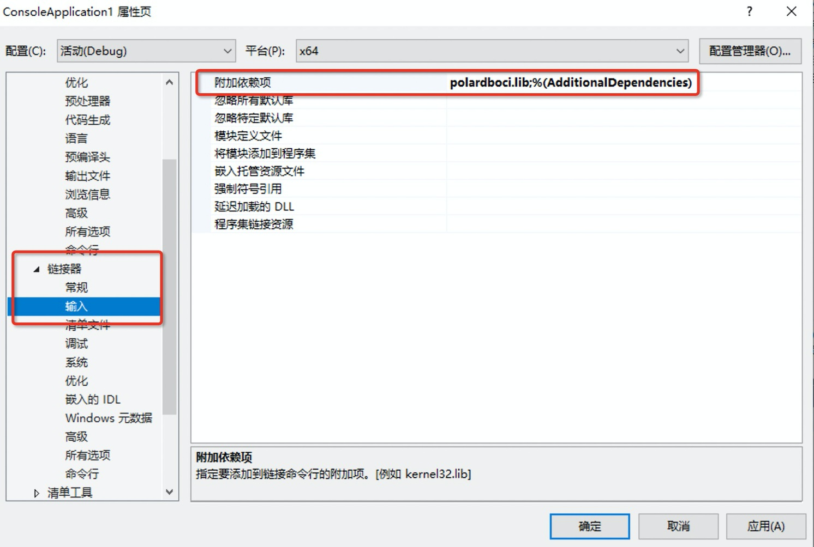

  </li>

  </ol>

**示例**

以下为编译polardb_demo后获取的可执行文件。

```text
********************************************
Milestone  : Logged on as --> 'parallels'
********************************************
********************************************
MileStone : Table(s) Successfully created
********************************************
********************************************
MileStone : Data Sucessfully inserted 
 & Committed via Transaction
********************************************
********************************************
MileStone : Sample Procedure 1 Successfully created
********************************************
********************************************
MileStone : Sample Procedure 2 Successfully created
********************************************
********************************************
MileStone : Sample Procedure 3 Successfully created
********************************************
name -> [SMITH]    mgr -> [7886]
hiredate -> [2007-08-02 00:00:00]
name -> [ALLEN]    mgr -> [7110]
hiredate -> [2007-04-02 00:00:00]
name -> [KING]    mgr -> [7221]
hiredate -> [2007-03-02 00:00:00]
*************************************************
Example 1 - Using an IN OUT Parameter
*************************************************
 Field2 Before:
 size ---> 20
 length ---> 7
 value ---> Entry 3
 Field2 After:
 size ---> 20
 length ---> 10
 value ---> Successful
*************************************************
Example 2 - Using an OUT Parameter
*************************************************
 Field3 Before:
 size ---> 20
 length ---> 0
 value ---> 
 Field3 After:
 size ---> 20
 length ---> 10
 value ---> Successful
********************************************
MileStone : Table(s) Successfully Dropped
********************************************
********************************************
MileStone : Sample Procedure 1 Successfully dropped
********************************************
********************************************
MileStone : Sample Procedure 2 Successfully dropped
********************************************
********************************************
MileStone : Sample Procedure 3 Successfully dropped
********************************************
logged off
detached form server
free'd all handles
```

<a id="section-17-6"></a>

## 17.6. RDS PolarDB PHP

本文介绍如何把PHP应用程序连接到PolarDB实例。

**前提条件**

已经在PolarDB实例中创建账号，更多信息，请参见创建账号。

**Windows环境准备**

1. 下载并安装WampServer，具体操作请参见WampServer官网。

2. 启动pgsql插件。

   <ol type="i">

   <li>

   修改 `php.ini` 文件。

   </li>

   <li>

   删除以下信息中的英文分号（;）。

   删除前：

   ```text
   ;extension=php_pgsql.dll
   ;extension=php_pdo_pgsql.dll
   ```

   删除后：

   ```text
   extension=php_pgsql.dll
   extension=php_pdo_pgsql.dll
   ```

   </li>

   </ol>

3. 将C:\\wamp\\bin\\php\\php5.3.5（本例使用的是php5.3.5版本，以实际安装版本为准）目录下的 `libpq.dll` 文件复制到C:\\windows\\system32\\。

4. 重启Apache。

**Linux环境准备**

1. 安装 `php-pgsql.x86_64` 驱动。

   ```bash
   sudo yum install php-pgsql.x86_64
   ```

2. 编辑 `php.ini` 文件。

   ```text
   vim /etc/php.ini
   ```

3. 在 `php.ini` 文件中添加以下内容。

   ```text
   extension=php_pgsql.so
   ```

**连接PolarDB**

完成Windows或Linux环境部署后，您可以通过编写PHP应用连接PolarDB数据库。

以下将通过一段PHP代码详细介绍连接PolarDB数据库的过程。

```php
<?php
 $host    = "host=xxxx";
 $port    = "port=xxxx";
 $dbname   = "dbname=xxxx";
 $credentials = "user=xxxx password=xxxxx";
 $db = pg_connect( "$host $port $dbname $credentials" );
 if(!$db){
  echo "Error : Unable to open database\n";
 } else {
  echo "Opened database successfully\n";
 }
 $sql =<<<EOF
  select * from pg_roles;
EOF;
 $ret = pg_query($db, $sql);
 if(!$ret){
  echo pg_last_error($db);
 } else {
  echo "Records created successfully\n";
 }
 $results = pg_fetch_all($ret);
 print_r($results);
 pg_close($db);
?>
```

在以上代码示例中，PolarDB连接信息由 `host` 、 `port` 、 `dbname` 和 `credentials` 组成，具体信息请参见下表。

| 参数 | 示例 | 说明 |
| --- | --- | --- |
| host | <code>"host=xxxxxx"</code> | PolarDB实例的连接地址，如何查看连接地址请参见<strong>《用户指南》</strong>中<strong>《查看连接地址》</strong>章节。 |
| port | <code>"port=1521"</code> | PolarDB实例的端口。 |
| dbname | <code>"dbname=xxxx"</code> | 需要连接的数据库名称。 |
| credentials | <code>"user=xxx</code><br><code>password=xxxx"</code> | PolarDB实例的用户名和对应的密码。 |

更多关于PHP接口的相关介绍请参见PHP官方文档。

<a id="section-18"></a>

# 18.PolarDB兼容性说明

本文通过示例让Oracle用户可以快速了解PolarDB数据库中的术语及概念，以便在迁移及开发过程中提高效率。

以下所有操作基于一个基础模型，通过此模型用户可以看到PolarDB中最基本的创建数据库、创建数据表、管理用户等操作，基础数据模型如下：

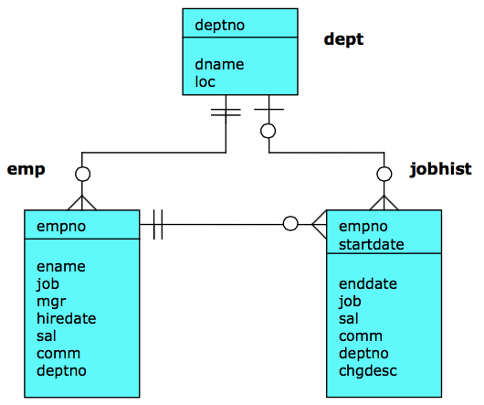

同时，为了模拟Oracle上类似的环境，我们会建立一名字为orcl_polardb的数据库（database），在此数据库中建立名为scott的用户，并建立与这个用户同名的schema用户空间。

**连接数据库psql**

```text
 psql -h polardbaddress.polardb.rds.aliyuncs.com -p 3433 -U myuser -d template1
```

**创建并连接数据库CREATE DATABASE**

创建一个名为 `orcl_polardb` 的数据库：

```sql
CREATE DATABASE orcl_polardb;
```

切换到 `orcl_polardb` 数据库：

```text
\c orcl_polardb
```

**创建普通用户CREATE ROLE**

```text
CREATE ROLE scott LOGIN PASSWORD 'scott123';
```

**创建用户的私有空间CREATE SCHEMA**

创建Schema：

```text
CREATE SCHEMA scott;
```

将scott加入到myuser角色：

```text
GRANT scott TO myuser;
```

修改Schema的所有者：

```text
ALTER SCHEMA scott OWNER TO scott;
```

将scott从myuser角色中移除：

```text
REVOKE scott FROM myuser;
```

> **说明**
>
> - 如果在进行 `ALTER SCHEMA scott OWNER TO scott`  之前没有将scott加入到myuser角色，将会出现如下权限问题。 `ERROR:must be member of role "scott"`
>
> - 从安全角度出发，在处理完OWNER的授权后，请将scott用户移出myuser角色以提高安全性。

**连接到orcl_polardb数据库**

> 此步骤十分重要，以下所有操作都是在scott账号下进行的，否则所建立的数据表及各种数
>
> **说明**
>
> 据库对象将不属于scott用户，导致权限问题。

```text
./psql -h polardbaddress.polardb.rds.aliyuncs.com -p 3433 -U scott -d orcl_polardb
```

**创建数据表 CREATE TABLE**

```sql
CREATE TABLE dept (
   deptno          NUMBER(2) NOT NULL CONSTRAINT dept_pk PRIMARY KEY,
   dname           VARCHAR2(14) CONSTRAINT dept_dname_uq UNIQUE,
   lock            VARCHAR2(13)
);
CREATE TABLE emp (
  empno           NUMBER(4) NOT NULL CONSTRAINT emp_pk PRIMARY KEY,
  ename           VARCHAR2(10),
  job             VARCHAR2(9),
  mgr             NUMBER(4),
  hiredate        DATE,
  sal             NUMBER(7,2) CONSTRAINT emp_sal_ck CHECK (sal > 0),
  comm            NUMBER(7,2),
  deptno          NUMBER(2) CONSTRAINT emp_ref_dept_fk
                  REFERENCES dept(deptno)
);
CREATE TABLE jobhist (
  empno           NUMBER(4) NOT NULL,
  startdate       DATE NOT NULL,
  enddate         DATE,
  job             VARCHAR2(9),
  sal             NUMBER(7,2),
  comm            NUMBER(7,2),
  deptno          NUMBER(2),
  chgdesc         VARCHAR2(80),
  CONSTRAINT jobhist_pk PRIMARY KEY (empno, startdate),
  CONSTRAINT jobhist_ref_emp_fk FOREIGN KEY (empno)
      REFERENCES emp(empno) ON DELETE CASCADE,
  CONSTRAINT jobhist_ref_dept_fk FOREIGN KEY (deptno)
      REFERENCES dept (deptno) ON DELETE SET NULL,
  CONSTRAINT jobhist_date_chk CHECK (startdate <= enddate)
);
```

**创建视图 CREATE OR REPLACE VIEW**

```text
CREATE OR REPLACE VIEW salesemp AS
   SELECT empno, ename, hiredate, sal, comm FROM emp WHERE job = 'SALESMAN';
```

**创建序列 CREATE SEQUENCE**

```text
CREATE SEQUENCE next_empno START WITH 8000 INCREMENT BY 1;
```

**插入数据 INSERT INTO**

```sql
INSERT INTO dept VALUES (10,'ACCOUNTING','NEW YORK');
INSERT INTO dept VALUES (20,'RESEARCH','DALLAS');
INSERT INTO dept VALUES (30,'SALES','CHICAGO');
INSERT INTO dept VALUES (40,'OPERATIONS','BOSTON');
INSERT INTO emp VALUES (7369,'SMITH','CLERK',7902,'17-DEC-80',800,NULL,20);
INSERT INTO emp VALUES (7499,'ALLEN','SALESMAN',7698,'20-FEB-81',1600,300,30);
INSERT INTO emp VALUES (7521,'WARD','SALESMAN',7698,'22-FEB-81',1250,500,30);
INSERT INTO emp VALUES (7566,'JONES','MANAGER',7839,'02-APR-81',2975,NULL,20);
INSERT INTO emp VALUES (7654,'MARTIN','SALESMAN',7698,'28-SEP-81',1250,1400,30);
INSERT INTO emp VALUES (7698,'BLAKE','MANAGER',7839,'01-MAY-81',2850,NULL,30);
INSERT INTO emp VALUES (7782,'CLARK','MANAGER',7839,'09-JUN-81',2450,NULL,10);
INSERT INTO emp VALUES (7788,'SCOTT','ANALYST',7566,'19-APR-87',3000,NULL,20);
INSERT INTO emp VALUES (7839,'KING','PRESIDENT',NULL,'17-NOV-81',5000,NULL,10);
INSERT INTO emp VALUES (7844,'TURNER','SALESMAN',7698,'08-SEP-81',1500,0,30);
INSERT INTO emp VALUES (7876,'ADAMS','CLERK',7788,'23-MAY-87',1100,NULL,20);
INSERT INTO emp VALUES (7900,'JAMES','CLERK',7698,'03-DEC-81',950,NULL,30);
INSERT INTO emp VALUES (7902,'FORD','ANALYST',7566,'03-DEC-81',3000,NULL,20);
INSERT INTO emp VALUES (7934,'MILLER','CLERK',7782,'23-JAN-82',1300,NULL,10);
INSERT INTO jobhist VALUES (7369,'17-DEC-80',NULL,'CLERK',800,NULL,20,'New Hire');
INSERT INTO jobhist VALUES (7499,'20-FEB-81',NULL,'SALESMAN',1600,300,30,'New Hire');
INSERT INTO jobhist VALUES (7521,'22-FEB-81',NULL,'SALESMAN',1250,500,30,'New Hire');
INSERT INTO jobhist VALUES (7566,'02-APR-81',NULL,'MANAGER',2975,NULL,20,'New Hire');
INSERT INTO jobhist VALUES (7654,'28-SEP-81',NULL,'SALESMAN',1250,1400,30,'New Hire');
INSERT INTO jobhist VALUES (7698,'01-MAY-81',NULL,'MANAGER',2850,NULL,30,'New Hire');
INSERT INTO jobhist VALUES (7782,'09-JUN-81',NULL,'MANAGER',2450,NULL,10,'New Hire');
INSERT INTO jobhist VALUES (7788,'19-APR-87','12-APR-88','CLERK',1000,NULL,20,'New Hire
');
INSERT INTO jobhist VALUES (7788,'13-APR-88','04-MAY-89','CLERK',1040,NULL,20,'Raise');
INSERT INTO jobhist VALUES (7788,'05-MAY-90',NULL,'ANALYST',3000,NULL,20,'Promoted to Analyst');
INSERT INTO jobhist VALUES (7839,'17-NOV-81',NULL,'PRESIDENT',5000,NULL,10,'New Hire');
INSERT INTO jobhist VALUES (7844,'08-SEP-81',NULL,'SALESMAN',1500,0,30,'New Hire');
INSERT INTO jobhist VALUES (7876,'23-MAY-87',NULL,'CLERK',1100,NULL,20,'New Hire');
INSERT INTO jobhist VALUES (7900,'03-DEC-81','14-JAN-83','CLERK',950,NULL,10,'New Hire'
);
INSERT INTO jobhist VALUES (7900,'15-JAN-83',NULL,'CLERK',950,NULL,30,'Changed to Dept 
30');
INSERT INTO jobhist VALUES (7902,'03-DEC-81',NULL,'ANALYST',3000,NULL,20,'New Hire');
INSERT INTO jobhist VALUES (7934,'23-JAN-82',NULL,'CLERK',1300,NULL,10,'New Hire');
```

**查询优化器数据分析 ANALYZE**

```text
ANALYZE dept;
ANALYZE emp;
ANALYZE jobhist;
```

**建立存储过程 CREATE PROCEDURE**

```text
CREATE OR REPLACE PROCEDURE list_emp
IS
  v_empno         NUMBER(4);
  v_ename         VARCHAR2(10);
  CURSOR emp_cur IS
      SELECT empno, ename FROM emp ORDER BY empno;
BEGIN
  OPEN emp_cur;
  DBMS_OUTPUT.PUT_LINE('EMPNO    ENAME');
  DBMS_OUTPUT.PUT_LINE('-----    -------');
  LOOP
      FETCH emp_cur INTO v_empno, v_ename;
      EXIT WHEN emp_cur%NOTFOUND;
      DBMS_OUTPUT.PUT_LINE(v_empno || '     ' || v_ename);
  END LOOP;
  CLOSE emp_cur;
END;
--
--  Procedure that selects an employee row given the employee
--  number and displays certain columns.
--
CREATE OR REPLACE PROCEDURE select_emp (
  p_empno         IN  NUMBER
)
IS
  v_ename         emp.ename%TYPE;
  v_hiredate      emp.hiredate%TYPE;
  v_sal           emp.sal%TYPE;
  v_comm          emp.comm%TYPE;
  v_dname         dept.dname%TYPE;
  v_disp_date     VARCHAR2(10);
BEGIN
  SELECT ename, hiredate, sal, NVL(comm, 0), dname
      INTO v_ename, v_hiredate, v_sal, v_comm, v_dname
      FROM emp e, dept d
      WHERE empno = p_empno
        AND e.deptno = d.deptno;
  v_disp_date := TO_CHAR(v_hiredate, 'MM/DD/YYYY');
  DBMS_OUTPUT.PUT_LINE('Number    : ' || p_empno);
  DBMS_OUTPUT.PUT_LINE('Name      : ' || v_ename);
  DBMS_OUTPUT.PUT_LINE('Hire Date : ' || v_disp_date);
  DBMS_OUTPUT.PUT_LINE('Salary    : ' || v_sal);
  DBMS_OUTPUT.PUT_LINE('Commission: ' || v_comm);
  DBMS_OUTPUT.PUT_LINE('Department: ' || v_dname);
EXCEPTION
  WHEN NO_DATA_FOUND THEN
      DBMS_OUTPUT.PUT_LINE('Employee ' || p_empno || ' not found');
  WHEN OTHERS THEN
      DBMS_OUTPUT.PUT_LINE('The following is SQLERRM:');
      DBMS_OUTPUT.PUT_LINE(SQLERRM);
      DBMS_OUTPUT.PUT_LINE('The following is SQLCODE:');
      DBMS_OUTPUT.PUT_LINE(SQLCODE);
END;
--
--  Procedure that queries the 'emp' table based on
--  department number and employee number or name.  Returns
--  employee number and name as IN OUT parameters and job,
--  hire date, and salary as OUT parameters.
--
CREATE OR REPLACE PROCEDURE emp_query (
  p_deptno        IN     NUMBER,
  p_empno         IN OUT NUMBER,
  p_ename         IN OUT VARCHAR2,
  p_job           OUT    VARCHAR2,
  p_hiredate      OUT    DATE
  p_sal           OUT    NUMBER
)
IS
BEGIN
  SELECT empno, ename, job, hiredate, sal
      INTO p_empno, p_ename, p_job, p_hiredate, p_sal
      FROM emp
      WHERE deptno = p_deptno
        AND (empno = p_empno
         OR  ename = UPPER(p_ename));
END;
--
--  Procedure to call 'emp_query_caller' with IN and IN OUT
--  parameters.  Displays the results received from IN OUT and
--  OUT parameters.
--
CREATE OR REPLACE PROCEDURE emp_query_caller
IS
  v_deptno        NUMBER(2);
  v_empno         NUMBER(4);
  v_ename         VARCHAR2(10);
  v_job           VARCHAR2(9);
  v_hiredate      DATE;
  v_sal           NUMBER;
BEGIN
  v_deptno := 30;
  v_empno  := 0;
  v_ename  := 'Martin';
  emp_query(v_deptno, v_empno, v_ename, v_job, v_hiredate, v_sal);
  DBMS_OUTPUT.PUT_LINE('Department : ' || v_deptno);
  DBMS_OUTPUT.PUT_LINE('Employee No: ' || v_empno);
  DBMS_OUTPUT.PUT_LINE('Name       : ' || v_ename);
  DBMS_OUTPUT.PUT_LINE('Job        : ' || v_job);
  DBMS_OUTPUT.PUT_LINE('Hire Date  : ' || v_hiredate);
  DBMS_OUTPUT.PUT_LINE('Salary     : ' || v_sal);
EXCEPTION
  WHEN TOO_MANY_ROWS THEN
      DBMS_OUTPUT.PUT_LINE('More than one employee was selected');
  WHEN NO_DATA_FOUND THEN
      DBMS_OUTPUT.PUT_LINE('No employees were selected');
END;
```

**建立函数 CREATE FUNCTION**

```text
CREATE OR REPLACE FUNCTION emp_comp (
  p_sal           NUMBER,
  p_comm          NUMBER
)RETURNNUMBER
IS
BEGIN
  RETURN (p_sal + NVL(p_comm, 0)) * 24;
END;
--
--  Function that gets the next number from sequence, 'next_empno',
--  and ensures it is not already in use as an employee number.
--
CREATE OR REPLACE FUNCTION new_empno RETURN NUMBER
IS
  v_cnt           INTEGER := 1;
  v_new_empno     NUMBER;
BEGIN
  WHILE v_cnt > 0 LOOP
      SELECT next_empno.nextval INTO v_new_empno FROM dual;
      SELECT COUNT(*) INTO v_cnt FROM emp WHERE empno = v_new_empno;
  END LOOP;
  RETURN v_new_empno;
END;
--
--  EDB-SPL function that adds a new clerk to table 'emp'.  This function
--  uses package 'emp_admin'.
--
CREATE OR REPLACE FUNCTION hire_clerk (
  p_ename         VARCHAR2,
  p_deptno        NUMBER
) RETURN NUMBER
IS
  v_empno         NUMBER(4);
  v_ename         VARCHAR2(10);
  v_job           VARCHAR2(9);
  v_mgr           NUMBER(4);
  v_hiredate      DATE;
  v_sal           NUMBER(7,2);
  v_comm          NUMBER(7,2);
  v_deptno        NUMBER(2);
BEGIN
  v_empno := new_empno;
  INSERT INTO emp VALUES (v_empno, p_ename, 'CLERK', 7782,
      TRUNC(SYSDATE), 950.00, NULL, p_deptno);
  SELECT empno, ename, job, mgr, hiredate, sal, comm, deptno INTO
      v_empno, v_ename, v_job, v_mgr, v_hiredate, v_sal, v_comm, v_deptno
      FROM emp WHERE empno = v_empno;
  DBMS_OUTPUT.PUT_LINE('Department : ' || v_deptno);
  DBMS_OUTPUT.PUT_LINE('Employee No: ' || v_empno);
  DBMS_OUTPUT.PUT_LINE('Name       : ' || v_ename);
  DBMS_OUTPUT.PUT_LINE('Job        : ' || v_job);
  DBMS_OUTPUT.PUT_LINE('Manager    : ' || v_mgr);
  DBMS_OUTPUT.PUT_LINE('Hire Date  : ' || v_hiredate);
  DBMS_OUTPUT.PUT_LINE('Salary     : ' || v_sal);
  DBMS_OUTPUT.PUT_LINE('Commission : ' || v_comm);
  RETURN v_empno;
EXCEPTION
  WHEN OTHERS THEN
      DBMS_OUTPUT.PUT_LINE('The following is SQLERRM:');
      DBMS_OUTPUT.PUT_LINE(SQLERRM);
      DBMS_OUTPUT.PUT_LINE('The following is SQLCODE:');
      DBMS_OUTPUT.PUT_LINE(SQLCODE);
      RETURN -1;
END;
--
--  PostgreSQL PL/pgSQL function that adds a new salesman
--  to table 'emp'.
--
CREATE OR REPLACE FUNCTION hire_salesman (
  p_ename         VARCHAR,
  p_sal           NUMERIC,
  p_comm          NUMERIC
) RETURNS NUMERIC
AS $$
DECLARE
  v_empno         NUMERIC(4);
  v_ename         VARCHAR(10);
  v_job           VARCHAR(9);
  v_mgr           NUMERIC(4);
  v_hiredate      DATE;
  v_sal           NUMERIC(7,2);
  v_comm          NUMERIC(7,2);
  v_deptno        NUMERIC(2);
BEGIN
  v_empno := new_empno();
  INSERT INTO emp VALUES (v_empno, p_ename, 'SALESMAN', 7698,
      CURRENT_DATE, p_sal, p_comm, 30);
  SELECT INTO
      v_empno, v_ename, v_job, v_mgr, v_hiredate, v_sal, v_comm, v_deptno
      empno, ename, job, mgr, hiredate, sal, comm, deptno
      FROM emp WHERE empno = v_empno;
  RAISE INFO 'Department : %', v_deptno;
  RAISE INFO 'Employee No: %', v_empno;
  RAISE INFO 'Name       : %', v_ename;
  RAISE INFO 'Job        : %', v_job;
  RAISE INFO 'Manager    : %', v_mgr;
  RAISE INFO 'Hire Date  : %', v_hiredate;
  RAISE INFO 'Salary     : %', v_sal;
  RAISE INFO 'Commission : %', v_comm;
  RETURN v_empno;
EXCEPTION
  WHEN OTHERS THEN
      RAISE INFO 'The following is SQLERRM:';
      RAISE INFO '%', SQLERRM;
      RAISE INFO 'The following is SQLSTATE:';
      RAISE INFO '%', SQLSTATE;
      RETURN -1;
END;
```

**建立规则 CREATE RULE**

```text
CREATE OR REPLACE RULE salesemp_i AS ON INSERT TO salesemp
DO INSTEAD
  INSERT INTO emp VALUES (NEW.empno, NEW.ename, 'SALESMAN', 7698,
      NEW.hiredate, NEW.sal, NEW.comm, 30);
CREATE OR REPLACE RULE salesemp_u AS ON UPDATE TO salesemp
DO INSTEAD
  UPDATE emp SET empno    = NEW.empno,
                 ename    = NEW.ename,
                 hiredate = NEW.hiredate,
                 sal      = NEW.sal,
                 comm     = NEW.comm
      WHERE empno = OLD.empno;
CREATE OR REPLACE RULE salesemp_d AS ON DELETE TO salesemp
DO INSTEAD
DELETE FROM emp WHERE empno = OLD.empno;
```

**建立触发器 CREATE TRIGGER**

```text
CREATE OR REPLACE TRIGGER user_audit_trig
  AFTER INSERT OR UPDATE OR DELETE ON emp
DECLARE
  v_action        VARCHAR2(24);
BEGIN
  IF INSERTING THEN
      v_action := ' added employee(s) on ';
  ELSIF UPDATING THEN
      v_action := ' updated employee(s) on ';
  ELSIF DELETING THEN
      v_action := ' deleted employee(s) on ';
  END IF;
  DBMS_OUTPUT.PUT_LINE('User ' || USER || v_action || TO_CHAR(SYSDATE,'YYYY-MM-DD'));
END;
CREATE OR REPLACE TRIGGER emp_sal_trig
  BEFORE DELETE OR INSERT OR UPDATE ON emp
  FOR EACH ROW
DECLARE
  sal_diff       NUMBER;
BEGIN
  IF INSERTING THEN
      DBMS_OUTPUT.PUT_LINE('Inserting employee ' || :NEW.empno);
      DBMS_OUTPUT.PUT_LINE('..New salary: ' || :NEW.sal);
  END IF;
  IF UPDATING THEN
      sal_diff := :NEW.sal - :OLD.sal;
      DBMS_OUTPUT.PUT_LINE('Updating employee ' || :OLD.empno);
      DBMS_OUTPUT.PUT_LINE('..Old salary: ' || :OLD.sal);
      DBMS_OUTPUT.PUT_LINE('..New salary: ' || :NEW.sal);
      DBMS_OUTPUT.PUT_LINE('..Raise     : ' || sal_diff);
  END IF;
  IF DELETING THEN
      DBMS_OUTPUT.PUT_LINE('Deleting employee ' || :OLD.empno);
      DBMS_OUTPUT.PUT_LINE('..Old salary: ' || :OLD.sal);
  END IF;
END;
```

**分区表Before Row-level触发器**

当您跨分区更新数据时，PostgreSQL和Oracle会使用不同的触发器行为：

- PostgreSQL：会触发多个分区表的触发器。

- Oracle：仅触发一次触发器。

PolarDB O引擎默认兼容Oracle的触发器行为。

> 语句级触发器（Statement-level Trigger）与普通表用法相同。
>
> **说明**

- `polar_compatible_oracle_trigger = off` 表示PolarDB O引擎使用PostgreSQL的触发器行为，跨分区更新数据会触发多个表的触发器。

  ```text
  SET polar_compatible_oracle_trigger = off;
  ```

  使用示例如下：

  ```sql
  create trigger t before insert or update or delete on parted
    for each row execute function trigger_function();
  insert into parted values (1, 1, 'uno uno v1');
  NOTICE:  parted_1: BEFORE ROW INSERT
  update parted set a = 2;
  NOTICE:  parted_1: BEFORE ROW UPDATE
  NOTICE:  parted_1: BEFORE ROW DELETE
  NOTICE:  parted_2: BEFORE ROW INSERT
  delete from parted;
  NOTICE:  parted_2: BEFORE ROW DELETE
  ```

- `polar_compatible_oracle_trigger = on` 表示PolarDB O引擎使用Oracle的触发器行为，跨分区更新数据仅触发一次。

  ```text
  SET polar_compatible_oracle_trigger = on;
  ```

  使用示例如下：

  ```sql
  insert into parted values (1, 1, 'uno uno v1');
  NOTICE:  parted_1: BEFORE ROW INSERT
  update parted set a = 2;
  NOTICE:  parted_1: BEFORE ROW UPDATE
  delete from parted;
  NOTICE:  parted_2: BEFORE ROW DELETE
  ```

**建立包 CREATE PACKAGE**

```text
CREATE OR REPLACE PACKAGE emp_admin
IS
  FUNCTION get_dept_name (
      p_deptno        NUMBER
  ) RETURN VARCHAR2;
  FUNCTION update_emp_sal (
      p_empno         NUMBER,
      p_raise         NUMBER
  ) RETURN NUMBER;
  PROCEDURE hire_emp (
      p_empno         NUMBER,
      p_ename         VARCHAR2,
      p_job           VARCHAR2,
      p_sal           NUMBER,
      p_hiredate      DATE,
      p_comm          NUMBER,
      p_mgr           NUMBER,
      p_deptno        NUMBER
  );
  PROCEDURE fire_emp (
      p_empno         NUMBER
  );
END emp_admin;
```

**建立包体 CREATE PACKAGE BODY**

```text
--
--  Package body for the 'emp_admin' package.
--
CREATE OR REPLACE PACKAGE BODY emp_admin
IS
  --
  --  Function that queries the 'dept' table based on the department
  --  number and returns the corresponding department name.
  --
  FUNCTION get_dept_name (
      p_deptno        IN NUMBER
  ) RETURN VARCHAR2
  IS
      v_dname         VARCHAR2(14);
  BEGIN
      SELECT dname INTO v_dname FROM dept WHERE deptno = p_deptno;
      RETURN v_dname;
  EXCEPTION
      WHEN NO_DATA_FOUND THEN
          DBMS_OUTPUT.PUT_LINE('Invalid department number ' || p_deptno);
          RETURN '';
  END;
  --
  --  Function that updates an employee's salary based on the
  --  employee number and salary increment/decrement passed
  --  as IN parameters.  Upon successful completion the function
  --  returns the new updated salary.
  --
  FUNCTION update_emp_sal (
      p_empno         IN NUMBER,
      p_raise         IN NUMBER
  ) RETURN NUMBER
  IS
      v_sal           NUMBER := 0;
  BEGIN
      SELECT sal INTO v_sal FROM emp WHERE empno = p_empno;
      v_sal := v_sal + p_raise;
      UPDATE emp SET sal = v_sal WHERE empno = p_empno;
      RETURN v_sal;
  EXCEPTION
      WHEN NO_DATA_FOUND THEN
          DBMS_OUTPUT.PUT_LINE('Employee ' || p_empno || ' not found');
          RETURN -1;
      WHEN OTHERS THEN
          DBMS_OUTPUT.PUT_LINE('The following is SQLERRM:');
          DBMS_OUTPUT.PUT_LINE(SQLERRM);
          DBMS_OUTPUT.PUT_LINE('The following is SQLCODE:');
          DBMS_OUTPUT.PUT_LINE(SQLCODE);
          RETURN -1;
  END;
  --
  --  Procedure that inserts a new employee record into the 'emp' table.
  --
  PROCEDURE hire_emp (
      p_empno         NUMBER,
      p_ename         VARCHAR2,
      p_job           VARCHAR2,
      p_sal           NUMBER,
      p_hiredate      DATE,
      p_comm          NUMBER,
      p_mgr           NUMBER,
      p_deptno        NUMBER
  )
  AS
  BEGIN
      INSERT INTO emp(empno, ename, job, sal, hiredate, comm, mgr, deptno)
          VALUES(p_empno, p_ename, p_job, p_sal,
                 p_hiredate, p_comm, p_mgr, p_deptno);
  END;
  --
  --  Procedure that deletes an employee record from the 'emp' table based
  --  on the employee number.
  --
  PROCEDURE fire_emp (
      p_empno         NUMBER
  )
  AS
  BEGIN
      DELETE FROM emp WHERE empno = p_empno;
  END;
END;
```

<a id="section-19"></a>

# 19.常用管理函数

PolarDB由于没有对外开放超级用户，用户无法像线下使用PolarDB那样使用superuser账号管理数据库对象。为此，我们推出了一组管理函数，帮助用户顺利使用云上PolarDB的各种功能。

**管理函数的使用规则**

在云上的各类管理函数都要求用户使用RDS根账号来执行。RDS根账号是分配实例时指定的管理账号，具有createdb createrole login权限。

- 插件管理函数 rds_manage_extension。

  该函数帮助用户管理云上的插件，用户可以使用该函数创建和删除PolarDB目前已经支持的插件。

  ```text
  rds_manage_extension(operation text, pname text, schema text default NULL,logging bool default false)
    operation: create 或 drop
    pname:    ⽀持的插件名
    schema：插件创建到的⽬标模式
    logging：插件创建时的⽇志信息
    ⽬前⽀持的插件有：
    pg_stat_statements   
    btree_gin   
    btree_gist   
    chkpass   
    citext   
    cube   
    dblink   
    dict_int   
    earthdistance   
    hstore   
    intagg   
    intarray   
    isn   
    ltree   
    pgcrypto   
    pgrowlocks   
    pg_prewarm   
    pg_trgm   
    postgres_fdw   
    sslinfo   
    tablefunc   
    tsearch2   
    unaccent   
    postgis   
    postgis_topology   
    fuzzystrmatch   
    postgis_tiger_geocoder   
    plperl   
    pltcl   
    plv8   
    "uuid-ossp"   
    plpgsql
    oss_fdw
    举例：
    1 创建插件dblink
        select rds_manage_extension('create','dblink');
    2 删除插件dblink
        select rds_manage_extension('drop','dblink');
  ```

- 当前连接会话rds_pg_stat_activity()。

  该函数类似pg_stat_activity视图，返回用户相关的所有连接会话信息。

- 查看慢SQL的函数rds_pg_stat_statements()。

  该函数是视图pg_stat_statements的封装，目的是让用户查看自己权限范围内的慢SQL。

- 性能分析函数。

  本组函数，类似Oracle AWR报告，提供给用户一组函数帮助用户分析目前PolarDB实例的实时性能信息。

  ```text
    1 rds_truncsnap（）
    说明: 删除⽬前保存的所有快照。
    2 rds_get_snaps()
    说明: 获得⽬前保存的所有快照信息。
    3 rds_snap()
    说明：产⽣⼀个实时快照。
    4 rds_report(beginsnap bigint, endsnap bigint)
    制定⼀个初始快照变化和结束快照变化，产⽣基于快照的性能分析报告。
    举例：下⾯是⼀个通过产⽣快照⽣成性能分析报告的过程
    SELECT * FROM rds_truncsnap(); //删除之前保存的快照
    SELECT * from rds_snap();    // 产⽣⼀个快照
    SELECT * from rds_snap(); // 产⽣⼀个快照
    SELECT * from rds_snap(); // 产⽣⼀个快照
    SELECT * FROM rds_get_snaps(); //获取⽬前产⽣的快照ID: 1 2 3
    SELECT * FROM edbreport(1, 3); //根据快照产⽣⼀个性能分析报告
  ```

- 终止会话函数。

  ```text
   rds_pg_terminate_backend(upid int)
    rds_pg_cancel_backend(upid int)
    该函数分别对应原⽣的pg_terminate_backend和pg_cancel_backend，区别仅是他们无法操作
  supueruser建立的连接。
    举例：终⽌进程号为123456的回话
    select rds_pg_cancel_backend(123456);
  ```

- VPD函数。

  VPD即Virtual Private Database，是兼容Package DBMS_RLS的一种封装，参数完全相同。

  ```text
  1 rds_drop_policy对应DBMS_RLS.DROP_POLICY
    2 rds_enable_policy对应DBMS_RLS.ENABLE_POLICY
    3 rds_add_policy对应DBMS_RLS.ADD_POLICY
  ```

更多VPD函数的信息，请参见VPD 参考。
