阿里云  
专有云  
云数据库RDS  
运维指南  
产品版本：V3.18.6  
文档版本：20251205

**目录**

- [1.产品架构](#section-1)
    - [1.1. 运维架构](#section-1-1)
    - [1.2. 系统架构](#section-1-2)
- [2.登录杜康-数据库管理平台](#section-2)
- [3.杜康-数据库管理平台运维](#section-3)
    - [3.1. 首页](#section-3-1)
    - [3.2. 实例管理](#section-3-2)
        - [3.2.1. 实例批量管理](#section-3-2-1)
            - [3.2.1.1. 批量迁移实例](#section-3-2-1-1)
            - [3.2.1.2. 批量实例参数刷新](#section-3-2-1-2)
            - [3.2.1.3. 批量DIY参数刷新](#section-3-2-1-3)
            - [3.2.1.4. 批量Redis参数刷新](#section-3-2-1-4)
            - [3.2.1.5. 批量任务管理](#section-3-2-1-5)
            - [3.2.1.6. 批量任务类型管理](#section-3-2-1-6)
            - [3.2.1.7. SQL模板管理](#section-3-2-1-7)
        - [3.2.2. 单实例管理](#section-3-2-2)
            - [3.2.2.1. 概述](#section-3-2-2-1)
            - [3.2.2.2. 查看实例](#section-3-2-2-2)
            - [3.2.2.3. 实例诊断](#section-3-2-2-3)
            - [3.2.2.4. 应急处理方案](#section-3-2-2-4)
            - [3.2.2.5. 实例大盘](#section-3-2-2-5)
            - [3.2.2.6. 实例计划迁移管理](#section-3-2-2-6)
    - [3.3. 主机管理](#section-3-3)
        - [3.3.1. 新建主机](#section-3-3-1)
        - [3.3.2. 批量配置主机](#section-3-3-2)
        - [3.3.3. 查看主机信息](#section-3-3-3)
    - [3.4. 集群管理](#section-3-4)
        - [3.4.1. 新建集群](#section-3-4-1)
        - [3.4.2. 管理服务类型](#section-3-4-2)
        - [3.4.3. 管理服务节点](#section-3-4-3)
        - [3.4.4. DB配置模板](#section-3-4-4)
        - [3.4.5. 方寸山集群管理](#section-3-4-5)
        - [3.4.6. Location管理](#section-3-4-6)
    - [3.5. 任务管理](#section-3-5)
        - [3.5.1. 管理中断任务](#section-3-5-1)
        - [3.5.2. 临时关闭任务管理](#section-3-5-2)
    - [3.6. 系统管理](#section-3-6)
- [4.安全维护](#section-4)
    - [4.1. 网络安全维护](#section-4-1)
    - [4.2. 账号密码维护](#section-4-2)
- [5.高危操作](#section-5)
- [6.Redline v4.3.3 运维说明](#section-6)
    - [6.1. Redline企业版服务列表](#section-6-1)
    - [6.2. redline-perf docker内部文件路径](#section-6-2)
    - [6.3. 环境检查](#section-6-3)
    - [6.4. 运维操作](#section-6-4)
        - [6.4.1. 集群扩缩容](#section-6-4-1)
        - [6.4.2. 升级或重启](#section-6-4-2)
        - [6.4.3. 修复连接故障](#section-6-4-3)
        - [6.4.4. 激活处于deactived状态的集群](#section-6-4-4)
        - [6.4.5. 解决程序异常](#section-6-4-5)
        - [6.4.6. 节点数据重置](#section-6-4-6)
        - [6.4.7. 日志转储](#section-6-4-7)

<a id="section-1"></a>

# 1.产品架构

<a id="section-1-1"></a>

## 1.1. 运维架构

本文介绍云数据库RDS的运维架构。

**运维架构图**

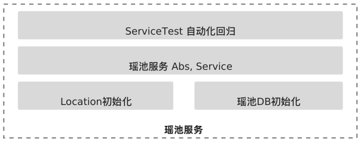

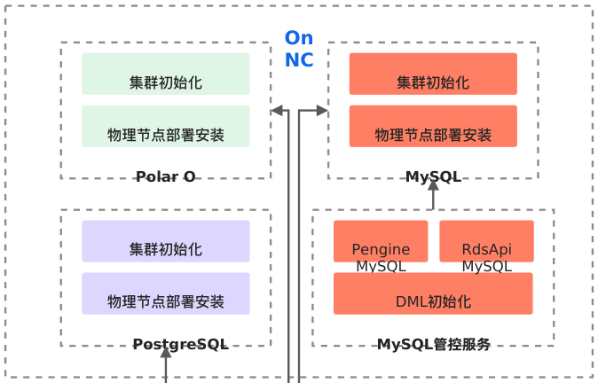

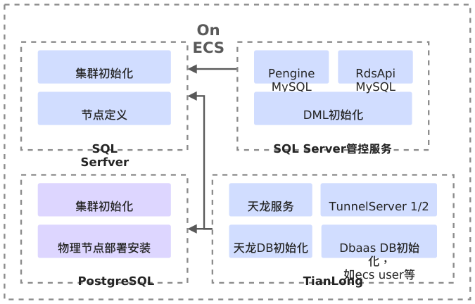

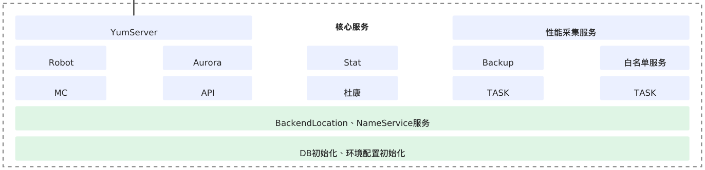

**分组**

**包含的组件**

**说明**

用于RDS业务功能自动化回归。

ServiceTest

RDS业务的OpenAPI服务。

Abs, Service

瑶池服务

Location初始化

初始化Location配置。

DB初始化

初始化RDS瑶池相关的DDL和DML。

初始化天龙服务。

dbinit

天龙服务

天龙服务。

TianLongServer

用于管控与ECS通讯的中间服务。

TunnelServer

初始化集群及主机列表。

InitCluster

RDS MySQL服务

初始化DB节点，安装内核及管控RPM。

DbMySQL

MySQL业务相关的任务流服务。

PengineMySQL

MySQL业务相关的API接口。

RdsApiMySQL

RDS MySQL管控服务

消息通讯agent节点。

McNode

初始化MySQL相关的dml配置。

DbInit

PolarDB的物理节点。

DbPolaro

RDS PolarDB服务

初始化集群及主机列表。

InitCluster

- 本地盘：PostgreSQL的物理节点。

DbPgSql

- 云盘：用于关联ECS资源。

RDS PostgreSQL服务

初始化集群及主机列表。

InitCluster

用于关联ECS资源。

DbMssql

初始化集群及主机列表。

InitCluster

EcsImport2012Ent

EcsImport2016Ent

RDS SQL Server服务

EcsImport2012Std

用于初始化RDS SQL Server不同版本的ECS镜像。

EcsImport2016Std

EcsImport2017Ag

<table>
  <tr>
    <td rowspan="4">RDS SQL Server管控服务</td>
    <td>DbInit</td>
    <td>初始化SQL Server相关的DML配置。</td>
  </tr>
  <tr>
    <td>PengineMssql</td>
    <td>SQL Server业务相关的任务流服务。</td>
  </tr>
  <tr>
    <td>RdsApiMssql</td>
    <td>SQL Server业务相关的API接口。</td>
  </tr>
  <tr>
    <td>McNode</td>
    <td>消息通讯agent节点。</td>
  </tr>
  <tr>
    <td rowspan="15">核心服务</td>
    <td>YumServer</td>
    <td>提供数据库产品各DB物理机节点部署能力。</td>
  </tr>
  <tr>
    <td>Robot</td>
    <td>数据库产品自动化运维服务。</td>
  </tr>
  <tr>
    <td>MC（MessageCenter）</td>
    <td>消息通讯中心服务。</td>
  </tr>
  <tr>
    <td>Aurora</td>
    <td>ApsaraDB云数据库高可用平台。</td>
  </tr>
  <tr>
    <td>API</td>
    <td>后端核心API服务。</td>
  </tr>
  <tr>
    <td>Stat</td>
    <td>定时任务真实执行者，完成各类监控巡检。</td>
  </tr>
  <tr>
    <td>杜康</td>
    <td>数据库产品的运维管理平台。</td>
  </tr>
  <tr>
    <td>性能采集服务</td>
    <td>老版本实例、主机的性能采集、实例的审计日志采集相关服务。</td>
  </tr>
  <tr>
    <td>Backup</td>
    <td>数据库全量备份服务和增量备份服务。</td>
  </tr>
  <tr>
    <td>TASK</td>
    <td>管控任务流调度服务。</td>
  </tr>
  <tr>
    <td>白名单服务</td>
    <td>提供实例的IP白名单服务。</td>
  </tr>
  <tr>
    <td>BackendLocation</td>
    <td>分别提供集群、Location管理服务。</td>
  </tr>
  <tr>
    <td>NameService</td>
    <td>名字服务。</td>
  </tr>
  <tr>
    <td>DB初始化</td>
    <td>元数据库初始化服务。</td>
  </tr>
  <tr>
    <td>环境配置初始化</td>
    <td>初始化OSS、VPC、Bakowner等信息。</td>
  </tr>
</table>

<a id="section-1-2"></a>

## 1.2. 系统架构

本文介绍云数据库RDS的系统架构。

**备份系统**

云数据库RDS可以随时发起数据库的备份，能够根据备份策略将数据库恢复至任意时刻，提高了数据可回溯性。

- 自动备份：RDS提供多种备份类型，备份开始时间可由用户根据自己的业务低峰灵活配置。

- 手动备份：您可在需要时随时发起手动备份操作。

- 克隆实例：克隆实例是指新建一个实例，可以复制出与主实例一模一样的内容，包括实例数据和实例设置。克隆实例主要用于恢复主实例数据，或批量创建相同实例。

- 备份文件下载：您可以在用户备份文件保留期间登录RDS管理控制台，下载备份文件至本地。

**数据迁移系统**

云数据库RDS提供了数据迁移服务DTS（Data Transmission Service）工具，方便您快速迁移数据库。

- 实例间复制数据库：RDS提供实例间数据库迁移功能，可非常简便地将数据库迁移至其他实例。

- 数据迁入迁出：RDS提供专业工具和向导式迁移服务来帮助用户将数据迁入或迁出RDS。

**监控系统**

云数据库RDS提供物理层、网络层、应用层等多方位的监控服务，保证业务可用性。

- 性能监控：RDS提供近20种系统性能监控项，包括磁盘容量、IOPS、连接数、CPU利用率、网络流量、TPS、QPS、缓存命中率等等。

- SQL审计：系统会记录发往RDS实例的SQL语句及其他附加信息，包括连接IP、访问数据库名称、访问账号、执行时间、返回记录数等。您可依此查找问题和对实例的安全性进行排查。

- 阈值报警：当实例出现状态或性能异常时，RDS提供短信报警功能。

- Web操作日志：系统对RDS管理控制台中所有修改类操作进行日志记录，供管理员查看，最长可保留30天。

**控制系统**

当实例主机或者实例出现异常crash后，RDS高可用组件检查到异常后会在30秒内进行切换，保证应用的正常运行，保障RDS高可用。

**任务调度系统**

用户可通过RDS控制台或者通过RDS API进行实例创建、删除、内外切换，后端以任务的形式进行调度，可对实例所有操作进行跟踪和展示。

<a id="section-2"></a>

# 2.登录杜康-数据库管理平台

本文介绍如何登录杜康平台。

**前提条件**

- 已从部署人员或管理员处获取Apsara Uni-manager运维控制台的访问地址、用户名和密码。

  Apsara Uni-manager运维控制台访问地址格式为*ops*.asconsole.*intranet-domain-id*.com。

- 推荐使用Chrome浏览器。

**操作步骤**

1. 在浏览器地址栏中，输入Apsara Uni-manager运营控制台的服务域名地址，按回车键。

   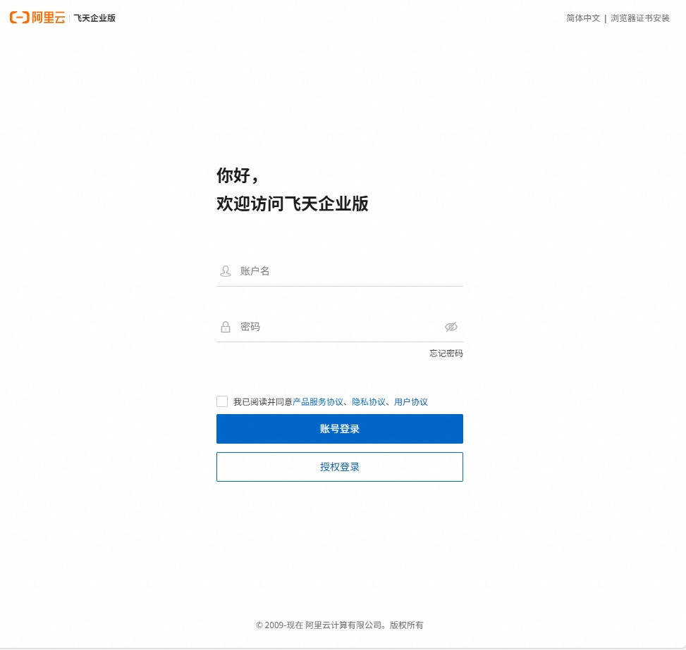

   > **说明**
   >
   > - 单击页面右上角的当前语言可以切换其它语言。

2. 输入正确的用户名及密码。

   > **说明**
   >
   > - 请向运营管理员获取登录控制台的用户名和密码。
   >
   > - 首次登录Apsara Uni-manager运营控制台时，需要修改登录用户名的密码，请按照提示完成密码修改。为提高安全性，密码长度必须为10~32位，且包含英文字母大小写、阿拉伯数字和特殊符号（感叹号（!）、at（@）、井号（#）、美元符号（$）、百分号（%）等）。

3. 勾选**我已阅读并同意产品服务协议、隐私协议、用户协议**。

   > **说明**
   >
   > - 登录页展示的链接文字为文档标题，单击链接文字，可查看协议的详细内容。
   >
   > - **产品服务协议**、**隐私协议**和**用户协议**仅在已发布时才会显示。如果三种类型协议都没有发布，则不需要执行该操作。

4. 如果账号已激活MFA多因素认证，请根据以下两种情况进行操作：

   > **说明**
   >
   > 公网场景下，登录入口默认强制开启多因素认证。

   - **开启MFA后的首次登录**

     <ol type="a">

     <li>

     输入账号密码登录后，展示绑定虚拟MFA设备页面。

     </li>

     <li>

     在绑定虚拟MFA设备页面中，按页面提示步骤绑定虚拟MFA设备。

     </li>

     </ol>

     <ol type="i" start="100">

     <li>

     登录成功，进入控制台。

     </li>

     </ol>

   - **已开启并绑定MFA**

     输入6位MFA码后单击**认证**。

5. 在Apsara Uni-manager运维控制台的顶部菜单栏单击**产品运维**。在**数据库运维**下选择**云数据库统一运维平台·杜康**。

<a id="section-3"></a>

# 3.杜康-数据库管理平台运维

<a id="section-3-1"></a>

## 3.1. 首页

首页显示整体大盘信息及异常展示、实例查询、高级查询入口等。

**操作步骤**

登录杜康-数据库管理平台，系统显示云数据库产品管理首页，在该页面中，用户可以及时发现和处理RDS的告警，对现有的监控项不断进行改进和优化。

您可以单击异常信息后的数量，了解异常信息详情。如单击**备份异常**中的数量，进入**异常实例信息**页面。该界面显示所有的RDS异常信息，请分别点开处理。

<a id="section-3-2"></a>

## 3.2. 实例管理

<a id="section-3-2-1"></a>

### 3.2.1. 实例批量管理

<a id="section-3-2-1-1"></a>

#### 3.2.1.1. 批量迁移实例

本文介绍批量迁移实例的操作步骤。

**操作步骤**

1. 登录杜康-数据库管理平台。

2. 在**杜康-数据库管理平台**首页，单击**实例管理 > 实例列表**。

3. 在**实例列表**页面上方，单击**实例批量管理**，进入**实例批量操作**页面。

4. 单击**实例批量操作**栏下的**批量实例迁移**。

5. 单击**批量实例迁移等待列表**页面中的**下载模板文件**，根据模板文件填写内容。

6. 单击**选择文件**。

7. 选择填写完毕的模板文件后单击**提交**。

> **说明**
>
> - HaProxy链路实例只有在同集群内迁移才不会发生闪断。
>
> - 该批量实例迁移操作不经过审批，请谨慎操作！

**后续步骤**

您可以单击**实例批量迁移**页面上方的**批量实例迁移已成功列表**和**批量实例迁移失败列表**，查看已迁移实例的详情信息。

<a id="section-3-2-1-2"></a>

#### 3.2.1.2. 批量实例参数刷新

本文介绍如何对批量实例参数进行刷新。

**操作步骤**

1. 登录杜康-数据库管理平台。

2. 在**杜康-数据库管理平台**首页，单击**实例管理 > 实例列表**。

3. 在**实例列表**页面上方，单击**实例批量管理**，进入**实例批量操作**页面。

4. 单击**实例批量操作**栏下的**批量实例参数刷新**。

5. 选择需要刷新的实例集群，单击**选择参数模板**。

   > **重要**
   >
   > 实例参数变更有可能引起实例闪断或不可用等风险，请在使用时参见控制台提示进行必要操作。

6. 选择数据库参数模板并单击**下一步**。

7. 选择实例，单击**提交**。

**后续步骤**

您可以单击**批量实例参数刷新**页面上方的**批量刷新参数实例已成功列表**和**批量刷新参数实例失败列表**，查看已刷新过的实例参数的详情信息。

<a id="section-3-2-1-3"></a>

#### 3.2.1.3. 批量DIY参数刷新

本文介绍如何对批量DIY参数进行刷新。

**操作步骤**

1. 登录杜康-数据库管理平台。

2. 在**杜康-数据库管理平台**首页，单击**实例管理 > 实例列表**。

3. 在**实例列表**页面上方，单击**实例批量管理**，进入**实例批量操作**页面。

4. 单击**实例批量操作**栏下的**批量DIY参数刷新**。

5. 在**批量DIY刷新参数等待列表**页面中，配置以下信息。

   <table>
     <tr>
       <th width="81">配置项</th>
       <th>说明</th>
     </tr>
     <tr>
       <td>实例名</td>
       <td>您需要在<strong>实例名</strong>后的文本框中输入需要进行DIY参数刷新的实例。<br>说明<br>• 请确保每次输入的实例名都是同类型同版本的数据库实例。<br>• 所有的输入请规范，去掉空格、tab、空行。<br>• 只支持免重启的参数。</td>
     </tr>
     <tr>
       <td>db类型</td>
       <td>数据库类型。选择输入的实例的数据库类型。</td>
     </tr>
     <tr>
       <td>db版本</td>
       <td>数据库版本。选择对应数据库版本。</td>
     </tr>
     <tr>
       <td>备注</td>
       <td>输入备注信息。</td>
     </tr>
   </table>

6. 信息配置完成后，单击**去选择参数**。

7. 单击弹出的**确认**对话框中的**确定**。

8. 选中需要修改的参数，并且在最右侧填写修改值。

9. 单击左下方**保存**。

**后续步骤**

您可以单击**批量实例参数刷新**页面上方的**批量刷新参数实例已成功列表**或**批量刷新参数实例失败列表**，查看已刷新过的DIY参数的详情信息。

<a id="section-3-2-1-4"></a>

#### 3.2.1.4. 批量Redis参数刷新

本文介绍如何对批量Redis参数进行刷新。

**操作步骤**

1. 登录杜康-数据库管理平台。

2. 在**杜康-数据库管理平台**首页，单击**实例管理 > 实例列表**。

3. 在**实例列表**页面上方，单击**实例批量管理**，进入**实例批量操作**页面。

4. 单击**实例批量操作**栏下的**批量Redis参数刷新**。

5. 在**redis2.8集群**列表中选择需要修改参数的集群。

6. 在**redis2.8数据库2.8读写参数**列表中找到想要修改的目标参数，在右侧**设置值**里填写数值，并单击**保存**。

7. 在弹出的**修改配置**对话框中，单击**确定**。

<a id="section-3-2-1-5"></a>

#### 3.2.1.5. 批量任务管理

本文介绍如何管理批量任务。

**创建任务**

1. 登录杜康-数据库管理平台。

2. 在**杜康-数据库管理平台**首页，单击**实例管理 > 实例列表**。

3. 在**实例列表**页面上方，单击**实例批量管理**，进入**实例批量操作**页面。

4. 单击**实例批量操作**栏下的**批量任务管理**。

5. 单击页面上方**创建任务**，进入**创建任务**页面。

6. 在弹出的**创建任务**页面中，配置如下参数信息：

   <table>
     <tr>
       <th width="137">配置</th>
       <th>说明</th>
     </tr>
     <tr>
       <td>任务类型</td>
       <td>您可根据实际情况选择目标任务类型。例如：<strong>批量开启SQL WALL</strong>、<strong>批量链路切</strong><strong>换</strong>、<strong>批量实例小版本升级</strong>等等。</td>
     </tr>
     <tr>
       <td>任务提示</td>
       <td>系统将根据不同的任务类型提示您对应任务的注意事项。</td>
     </tr>
     <tr>
       <td>任务参数</td>
       <td>不同的任务类型对应不同的任务参数，请您按照实际任务进行选择。</td>
     </tr>
     <tr>
       <td>时间规则</td>
       <td>• <strong>立即下发</strong>：立刻执行任务。<br>• <strong>运维时间</strong>：在运维时间才会执行任务。<br>• <strong>指定时间</strong>：指定时间段内才会执行任务。</td>
     </tr>
     <tr>
       <td>发送短信</td>
       <td>是否发送短信提醒：<br>• 是<br>• 否</td>
     </tr>
     <tr>
       <td>实例来源</td>
       <td>可选择实例的来源为<strong>集群</strong>或<strong>Sql模板</strong>。</td>
     </tr>
     <tr>
       <td>请选择来源集群</td>
       <td><strong>实例来源</strong>为<strong>集群</strong>时可选。选择来源集群填充<strong>输入实例</strong>。</td>
     </tr>
   </table>

   <table>
     <tr>
       <th width="133">请选择Sql模板</th>
       <th><strong>实例来源</strong>为<strong>Sql模板</strong>时可选。选择Sql模板填充<strong>输入实例</strong>。<br>说明单击右侧<strong>创建模板</strong>可以跳转至<strong>SQL模板管理</strong>页面创建SQL脚本。</th>
     </tr>
     <tr>
       <td>输入实例</td>
       <td>输入需要批量执行任务的实例，一行一个实例名。</td>
     </tr>
     <tr>
       <td>备注</td>
       <td>填写备注内容。<br>说明此项为选填内容。</td>
     </tr>
   </table>

7. 单击**提交**。

<a id="section-3-2-1-6"></a>

#### 3.2.1.6. 批量任务类型管理

本文介绍新增任务类型的操作步骤。

**操作步骤**

1. 登录杜康-数据库管理平台。

2. 在**杜康-数据库管理平台**首页，单击**实例管理 > 实例列表**。

3. 在**实例列表**页面上方，单击**实例批量管理**，进入**实例批量操作**页面。

4. 单击**实例批量操作**栏下的**批量任务类型管理**。

5. 单击页面上方**新建类型**，进入**新建类型**页面。

6. 在弹出的**新建类型**页面中，配置如下参数信息：

   | 配置 | 说明 |
   | --- | --- |
   | 名称 | 新任务类型名称。 |
   | 编号 | 新任务类型编号。 |
   | API | 新任务的API名称。 |
   | api实例参数名 | • API实例的参数名称。<br>• 默认为<strong>DBInstanceName</strong>。 |
   | 提示信息 | 系统给出的提示信息、注意事项内容。 |
   | 参数规则 | 包括参数名、API参数名、参数类型等等。 |
   | 校验规则 | 包括校验关系、属性名、校验规则、校验值等等。 |
   | 最高并发 | 最高并发数。 |
   | 停止失败率 | 任务停止或失败的概率。 |
   | 备注 | 填写备注内容。 |

7. 单击**提交**。

<a id="section-3-2-1-7"></a>

#### 3.2.1.7. SQL模板管理

本文介绍新增SQL模板的操作步骤。

**操作步骤**

1. 登录杜康-数据库管理平台。

2. 在**杜康-数据库管理平台**首页，单击**实例管理 > 实例列表**。

3. 在**实例列表**页面上方，单击**实例批量管理**，进入**实例批量操作**页面。

4. 单击**实例批量操作**栏下的**SQL模板管理**。

5. 单击页面上方**新增模板**，进入**NewTemplate**页面。

6. 在弹出的**NewTemplate**页面中，配置如下参数信息：

   | 配置 | 说明 |
   | --- | --- |
   | 模板名称 | 填写新模板名称。 |
   | 模板类型 | 选择模板类型。 |
   | 数据库名称 | 选择目标数据库。 |
   | 数据库类型 | 选择目标数据库类型。 |
   | Sql脚本 | 填写SQL脚本。 |
   | 新增原因 | 填写新增模板原因。 |

   > 自定义SQL模板只允许SELECT语句，且目前仅能用于dbaas库的查询。所有SQL模板
   >
   > **说明**
   >
   > 的创建均需要BPMS审批。为保证SQL模板不会被其余同学误执行，导致批量任务下发给错误的实例，请在SQL模板中详细描述模板名称和新增原因。

7. 单击**提交**。

<a id="section-3-2-2"></a>

### 3.2.2. 单实例管理

<a id="section-3-2-2-1"></a>

#### 3.2.2.1. 概述

实例列表能够查看单个实例的基本信息、数据链路、数据库信息、账号信息等。

**操作步骤**

1. 登录杜康-数据库管理平台。

2. 在**杜康-数据库管理平台**首页，单击**实例管理 > 实例列表**。

   在实例列表页面中，您可以进行如下操作：

   - 单击页面上方**批量查询**按钮，输入实例名批量查询实例。

   - 单击页面上方**高级搜索**按钮，通过数据库类型、实例状态等作为搜索条件，查询目标实例。

   - 单击目标实例名，进入单个实例的实例详情页面，查询实例信息或管理实例。

   - 更多操作，请参见查看实例、实例诊断、应急处理方案、实例大盘、实例计划迁移管理。

<a id="section-3-2-2-2"></a>

#### 3.2.2.2. 查看实例

在单个实例的页面可以查看实例的基本信息、查询实例性能等。

**操作步骤**

1. 登录杜康-数据库管理平台。

2. 在左侧导航栏中，选择**实例管理 > 实例列表**。

3. 在实例列表中定位到目标实例，并单击对应的**用户实例名**。

   > **说明**
   >
   > 您也可以通过在搜索框中输入关键词快速查询目标实例。单击**高级搜索**筛选更多过滤条件，精准定位目标实例。

4. 在**实例详情**页中，您可以对单个实例执行管理操作。

   > **说明**
   >
   > 下表以新版页面进行介绍，如果您采用的是旧版，可单击页面上方的**切换到新版**。

   **特性**

   **作用**

   **备注**

   - 展示目标实例的基本信息，包括用户信息、实例拓扑、实例基本信息、网络信息、地域信息、实例规格、主机信息等。

   基本信息

   无。

   - 在页面底部，对目标实例下方管理操作。例如迁移、版本升级、规格变更、打开/关闭代理读写分离、重启实例、和删除实例等。

   集中展示该实例的各角色信息概览、磁盘空间趋势、HA切换记录、

   实例全景

   无。

   慢SQL索引建议、任务记录、运维记录等信息。

   数据链路

   展示该实例的数据链路图。

   无。

   实例诊断

   展示该实例关键性能指标的趋势图，并支持选择展示的时间段。

   无。

   任务管理

   展示任务列表，并查看单个任务参数、任务操作和执行日志。

   无。

   展示实例通用日志、任务日志、HA日志、API日志、管理日志、主

   实例变更记录

   无。

   备不一致检查、ROBOT日志、酒保修复历史、酒保任务历史。

   迁移数据库、删除

   - 展示实例中的数据库信息。

   数据库信息

   数据库等为高危操

   - 创建数据库、迁移数据库、删除数据库等。

     作。

   - 展示当前实例的账号信息。

     重置密码，修改密

   账号信息

   码等为高危操作。

   - 创建账号，修改密码，重置账号密码等。

   内核-实例参数

   可执行修改实例的参数或查看参数修改历史等操作。

   修改实例的参数为高危操作。

   管控-实例参数

   实例SQL信息

   查看实例的SQL日志明细、慢SQL明细，索引统计等。

   无。

   包括设置白名单、实例标签配置、实例资源配置、实例性能配置、实例运维配置等。其中：

   - 白名单：创建、配置白名单，配置安全组等。

   - 实例标签配置：配置实例标签。

     高危操作，除白名

   配置实例

   单外一般不建议修

   - 实例资源配置：设置IOPS、设置CPU、设置最大连接数和设置磁

     改。

     盘空间等。

   - 实例性能配置：设置性能采集频率。

   - 实例运维配置：设置实例内存隔离、设置可用性和可靠性策略、设置是否开启SQL明细采集和设置日志审计版本等。

   - 展示备份历史。

     恢复到时间点为高

   备份恢复

   危操作，请慎重操

   - 恢复到时间点，获取备份详情，获取上传信息，按备份集恢复到

     作。

     实例等。

   - 展示Binlog备份历史，Binlog生产、消费数量趋势，展示Binlog日志列表。

   BINLOG日志

   无。

   - 获取Binlog下载链接，上传信息。

   - 展示备份信息和备份策略，展示Binlog备份ID。

   备份策略

   无。

   - 修改备份策略，创建临时备份，创建单库备份，修改Binlog备份策略，清理日志。

   BINLOG管理

   展示Binlog备份策略和备份历史。

   无。

   迁移恢复日志

   展示查询迁移列表，实例恢复日志，实例间数据库迁移日志等。

   无。

   历史可用性

   查看可用性、查看故障和查看错误日志。

   无。

<a id="section-3-2-2-3"></a>

#### 3.2.2.3. 实例诊断

您可以通过实例诊断功能，查看实例的各项性能数据。

**操作步骤**

1. 登录杜康-数据库管理平台。

2. 在左侧导航栏中，选择**实例管理** > **实例列表**。

3. 在实例列表中找到目标实例，然后单击对应的**用户实例名**。

4. 在**实例详情**导航栏中选择**实例诊断**。您可以在实例诊断中查看实例性能信息。

**相关参考**

不同引擎实例的不同版本、不同存储方式涉及的性能数据存在差异，如下为MySQL的常用性能指标项示例，其他引擎或版本，请以控制台为准。

| 指标项 | 说明 |
| --- | --- |
| MySQL_NetworkTraffic | 实例平均每秒钟的输入流量，实例平均每秒钟的输出流量。单位：KB/秒。 |
| MySQL_QPSTPS | 平均每秒SQL语句执行次数（单位：次/秒），平均每秒事务数（单位：个/秒）。 |
| MySQL_Sessions | 当前活跃连接数，当前总连接数。单位：个。 |
| MySQL_InnoDBBufferRatio | InnoDB缓冲池的读命中率，InnoDB缓冲池的使用率，InnoDB缓冲池脏块的百分率。单位：百分比（%）。 |
| MySQL_InnoDBDataReadWriten | InnoDB平均每秒钟读取的数据量，InnoDB平均每秒钟写入的数据量。单位：KB。 |
| MySQL_InnoDBLogRequests | 平均每秒向InnoDB缓冲池的读次数，平均每秒向InnoDB缓冲池的写次数。单位：次/秒。 |
| MySQL_InnoDBLogWrites | 平均每秒日志写请求数，平均每秒向日志文件的物理写次数，平均每秒向日志文件完成的<code> fsync() </code>写数量。单位：次/秒。 |
| MySQL_TempDiskTableCreates | 执行语句时在硬盘上自动创建的临时表的数量。单位：个。 |
| MySQL_MyISAMKeyBufferRatio | MyISAM平均每秒Key Buffer使用率、MyISAM平均每秒Key Buffer读命中率和MyISAM平均每秒Key Buffer写命中率。单位：百分比（%）。 |
| MySQL_MyISAMKeyReadWrites | MyISAM平均每秒钟从缓冲池中的读取次数、MyISAM平均每秒钟从缓冲池中的写入次数、MyISAM平均每秒钟从硬盘上读取的次数和MyISAM平均每秒钟从硬盘上写入的次数。单位：次/秒。 |
| MySQL_COMDML | 平均每秒Delete语句执行次数、平均每秒Insert语句执行次数、 平均每秒Insert_Select语句执行次数、平均每秒Replace语句执行次数、平均每秒Replace_Select语句执行次数、平均每秒Select语句执行次数和平均每秒Update语句执行次数。单位：次/秒。 |
| MySQL_RowDML | 平均每秒从InnoDB表读取的行数、平均每秒从InnoDB表更新的行数、平均每秒从InnoDB表删除的行数、平均每秒从InnoDB表插入的行数和平均每秒向日志文件的物理写次数。单位：行/秒或次/秒。 |
| MySQL_MemCpuUsage | 非Serverless实例CPU使用率（占操作系统总数）和MySQL实例内存使用率（占操作系统总数）。单位：百分比（%）。 |
| MySQL_IOPS | 实例的IOPS（每秒IO请求次数）。单位：次/秒。 |
| MySQL_DetailedSpaceUsage | 实例总空间使用量、数据空间、日志空间、临时空间和系统空间。单位：MB。 |
| slavestat | 只读实例延迟。单位：秒。 |
| MySQL_ThreadStatus | 活跃线程和线程连接数。单位：个。 |
| MySQL_ReplicationDelay | 备实例的复制延迟。单位：秒。 |
| MySQL_ReplicationThread | IO复制线程状态和SQL复制线程状态。1表示正常，0表示线程丢失。 |
| MySQL_ROW_LOCK | 最大等待行级锁时间（单位：毫秒）、平均等待行级锁时间（单位：毫秒）以及等待行级锁的次数（单位：次）。 |
| MySQL_SelectScan | 实例进行全表扫描的次数。单位：次。 |

<a id="section-3-2-2-4"></a>

#### 3.2.2.4. 应急处理方案

本文介绍实例相关的应急处理方案的相关操作。

**操作步骤**

1. 登录杜康-数据库管理平台。

2. 在**杜康-数据库管理平台**首页，单击**实例管理 > 实例列表**。

3. 在**实例列表**页面上方单击**应急处理方案**。

4. 在页面右侧的搜索框中输入关键词，搜索出对应实例并选中实例左侧的复选框。

5. 单击页面上方的**实例列表Excel导出**，可将实例信息导出到本地。

   > **说明**
   >
   > 禁止无搜索条件导出。

<a id="section-3-2-2-5"></a>

#### 3.2.2.5. 实例大盘

您可以在实例大盘中查看实例的CPU利用率、连接数利用率等等。

**操作步骤**

1. 登录杜康-数据库管理平台。

2. 在**杜康-数据库管理平台**首页，单击**实例管理 > 实例列表**。

3. 在**实例列表**页面上方单击**实例大盘**。

4. 您可查看到实例的CPU、连接数、IOPS、磁盘利用率。

   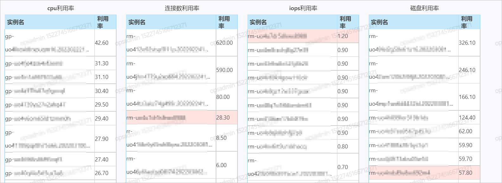

<a id="section-3-2-2-6"></a>

#### 3.2.2.6. 实例计划迁移管理

实例计划迁移列表上传有两种方式，分别按实例或者按主机IP进行批量提交。本文介绍实例计划迁移的具体操作。

**操作步骤**

1. 登录杜康-数据库管理平台。

2. 在**杜康-数据库管理平台**首页，单击**实例管理 > 实例列表**。

3. 在**实例列表**页面上方单击**实例计划迁移管理**。

4. 选择实例计划迁移列表上传方式。

   > **说明**
   >
   > - 方式一：按实例提交时，在遇到不可迁移的实例时会全部阻止提交。
   >
   > - 方式二：按主机IP提交时，会直接过滤不可迁移的实例。

5. 单击右侧**下载模板文件**，根据模板文件填写内容。

6. 单击**选择文件**，选择填写完毕的模板文件。

7. 单击**提交**。

**后续步骤**

您可以单击**实例计划迁移管理**页面上方的**推送成功列表**或**已删除列表**，查看详情信息。

<a id="section-3-3"></a>

## 3.3. 主机管理

<a id="section-3-3-1"></a>

### 3.3.1. 新建主机

本文介绍如何新建主机。

**操作步骤**

1. 登录杜康-数据库管理平台。

2. 在**杜康-数据库管理平台**首页，选择**主机管理 > 系统主机**。

3. 单击页面上方的**应急处理方案**。

4. 单击**新建主机**。

5. 配置主机参数，单击**提交**。

<a id="section-3-3-2"></a>

### 3.3.2. 批量配置主机

本文介绍如何批量配置主机。

**操作步骤**

1. 登录杜康-数据库管理平台。

2. 在左侧导航栏，选择**主机管理 > 系统主机**。

3. 选中需要批量配置主机信息的主机，在页面上方单击**批量配置**。

4. 配置参数并单击**提交**。

<a id="section-3-3-3"></a>

### 3.3.3. 查看主机信息

文本介绍如何查看主机信息。

**操作步骤**

1. 登录杜康-数据库管理平台。

2. 在**杜康-数据库管理平台**页面，选择**主机管理 > 系统主机**。

3. 可根据IP或者主机名，筛选出对应的主机。

4. 单击目标IP，在**主机详情**页面中，查看主机详情信息，例如CPU、内存、实例个数、磁盘用量等。

   您也可以单击左侧功能选项，查看主机实例信息、性能信息、备份信息和账号信息等。

<a id="section-3-4"></a>

## 3.4. 集群管理

<a id="section-3-4-1"></a>

### 3.4.1. 新建集群

本文介绍如何新建集群。

**新建系统集群**

1. 登录杜康-数据库管理平台。

2. 在左侧导航栏，单击**集群管理**。

3. 在**系统集群**页面中，单击**新建集群**。

4. 选择**数据库类型**，单击**确定**。

5. 在弹出的**创建集群**页面配置集群参数，单击**确认**。

   > **说明**
   >
   > 请参见参数界面上的提示，获取详细的配置项说明。

**新建用户集群模板**

1. 登录杜康-数据库管理平台。

2. 在左侧导航栏，单击**集群管理**。

3. 做左侧导航栏中单击**用户集群**，单击**集群模板**。

4. 在弹出的对话框中，单击**创建集群模板**。

5. 在**创建集群模板**页面配置参数，单击**提交**。

   > **说明**
   >
   > 请参见参数界面上的提示，获取详细的配置项说明。

<a id="section-3-4-2"></a>

### 3.4.2. 管理服务类型

本文介绍如何管理服务类型。

**操作步骤**

1. 登录杜康-数据库管理平台。

2. 在**杜康-数据库管理平台**页面，单击**集群管理**。

3. 单击**服务类型管理**打开**服务类型管理**页面。

   - 单击目标服务类型右侧**操作**列的**编辑**，修改服务类型。

   - 单击目标服务类型右侧**操作**列的**删除**，删除服务类型。

<a id="section-3-4-3"></a>

### 3.4.3. 管理服务节点

本文介绍如何新建、编辑或删除服务节点。

**操作步骤**

1. 登录杜康-数据库管理平台。

2. 在**杜康-数据库管理平台**页面，选择**集群管理**。

3. 在左侧导航栏，单击**服务节点管理**。

   - 单击页面上方的**新建服务节点**，配置相关参数，单击**确定**。

   - 单击目标节点右侧**操作**列的**编辑**，修改服务节点。

   - 单击目标节点右侧**操作**列的**删除**，删除服务节点。

<a id="section-3-4-4"></a>

### 3.4.4. DB配置模板

本文介绍如何管理DB模板。

**操作步骤**

1. 登录杜康-数据库管理平台。

2. 在**杜康-数据库管理平台**页面，选择**集群管理**。

3. 在左侧导航栏中，单击**DB配置模板**打开**DB配置模板**页面。

   - 单击页面上方的**新建DB模板**按钮，填写模板信息，单击**操作**列下的**保存**。

   - 单击**操作**列的**编辑**，修改已有模板，单击**操作**列下的**保存**。

   - 单击**操作**列的**删除**，删除已有模板，单击**确定**。

<a id="section-3-4-5"></a>

### 3.4.5. 方寸山集群管理

本文介绍方寸山集群的管理操作。

**操作步骤**

1. 登录杜康-数据库管理平台。

2. 在**杜康-数据库管理平台**页面，选择**集群管理**。

3. 在左侧导航栏中，单击**方寸山集群管理**进入**集群组配置**页面。

4. 在页面上方，单击**新建集群组**。

5. 选择**区域**，输入**集群组**名称，单击**确定**。

6. 单击新集群**操作**列下的**设置集群**，设置资源类型，单击**确定**。

7. （可选）单击目标集群**操作**列下的**修改集群组**，修改集群组名称。

8. （可选）单击目标集群**操作**列下的**删除集群组**，删除集群组。

<a id="section-3-4-6"></a>

### 3.4.6. Location管理

本文介绍如何配置集群的Location。

**操作步骤**

1. 登录杜康-数据库管理平台。

2. 在**杜康-数据库管理平台**页面左侧导航栏，单击**集群管理**。

3. 在左侧导航栏中，单击**Location**打开Location页面。

4. 您可以搜索框中输入关键字查询集群，并在查询结果中对目标集群进行管理。

   > **说明**
   >
   > 您也可以在页面下方进行集群一致性检查和子域一致性检查操作。

   - 添加集群Location节点：单击目标单元、地区或可用区后的**添加**按钮，参数填写完成后单击**提交**。

   - 管理参数：单击目标单元、地区、可用区或子域后的**参数**按钮，新增、编辑或删除参数。

   - 删除单元、地区、可用区或子域：单击目标单元、地区、可用区或子域后的**删除**按钮。

<a id="section-3-5"></a>

## 3.5. 任务管理

<a id="section-3-5-1"></a>

### 3.5.1. 管理中断任务

本文介绍如何管理中断任务，包括用户实例任务、主机实例任务、主机任务。本文以用户实例任务为例，介绍如何管理中断任务。

**操作步骤**

1. 登录杜康-数据库管理平台。

2. 在**杜康-数据库管理平台**页面，单击**任务管理**，在**实例任务**页面左上角的框中选择**中断的任务**。

   > **说明**
   >
   > - 如果有失败的任务，请按如下步骤处理。
   >
   > - 如果没有失败的任务，则结束本操作。

3. 单击**任务名称**列的任务，查看分析任务失败原因。

   > **说明**
   >
   > 通常情况下，如果遇到从库状态异常、连接超时或密码错误等问题时，可以通过使用问题实例的IP地址登录目标实例，并对异常进行修复。

4. 完成修复后，单击**操作**列下的**操作**，跳转到任务详情页面。

5. 单击**执行任务**。

6. 在弹出的**重新执行任务**窗口中，单击**当前步骤重试**，重新执行任务。

   > **重要**
   >
   > 如果您需要从指定步骤开始执行，可以单击**从指定步骤继续**。在不理解任务及步骤功能的时，请勿操作。

7. 在任务管理中选择**运行的任务**，查看任务执行情况。

   > **说明**
   >
   > 如果任务执行失败，按本步骤重新排查。

<a id="section-3-5-2"></a>

### 3.5.2. 临时关闭任务管理

本文介绍如何管理临时关闭的任务。

**操作步骤**

1. 登录杜康-数据库管理平台。

2. 在**杜康-数据库管理平台**页面，单击**任务管理**，在跳转到的页面左上角的选框中单击**临时关闭的任务**。

   - 单击**任务名称**中的某个任务名查看任务的执行步骤。

   - 单击**操作对象**中的某个操作对象名，查看该操作对象下的任务日志。

   - 单击**执行人**中的某个执行人名字，查看该执行人的详细信息。

   - 单击**操作**栏中的**操作**按钮，查看临时关闭的任务原因。

     - 在弹出的窗口中，单击**执行任务**，重新执行任务。

     - 在弹出的窗口中，单击**干预记录**，查看任务干预记录详情。

   - 单击**添加备注**为任务添加备注信息。

<a id="section-3-6"></a>

## 3.6. 系统管理

本文介绍系统管理的各项功能特性。

表 1. 系统管理

| 功能特性 | 作用 | 备注 |
| --- | --- | --- |
| 系统设置 | 新建套餐、系统配置、数据库参数模板、系统参数配置、流量统计规则、性能配置、运营商信息、组件异常级别配置、linux内核参数设置。 | 高危操作。 |
| 权限配置 | 添加角色、权限码管理。 | 权限码管理为高危操作。 |
| 通用配置 | AclCache开关、邮件开关、新建集群信息、发送集群信息。 | 无。 |
| 标签列表 | 添加标签，查看标签类型、别名、取值等。 | 无。 |
| 分组管理 | 新建分组用于监控。 | 无。 |
| 集群管理 | 新建集群、刷新管理机白名单、刷新同步模式、刷新资源缓存等。 | 高危操作。 |
| 白名单管理 | 查看或刷新区域白名单。 | 无。 |
| 服务类型管理 | 修改或删除服务类型。 | 新建服务类型为高危操作。 |
| 迁移主机屏蔽信息 | 添加或删除屏蔽主机IP。 | 无。 |
| AccessKey管理 | 新建key、查看AccessKey、查看运维API日志。 | 高危操作。 |
| 方寸山集群配置 | 查看集群组配置、新建集群组等。 | 高危操作。 |
| Petadata集群统计 | 查看Petadata集群信息。 | 无。 |
| 容灾管理 | 包括链路组件巡检、管控组件巡检、容灾切换、容灾任务。 | 无。 |
| 定时任务管理 | 管理系统中的各项定时任务。 | 无。 |

<a id="section-4"></a>

# 4.安全维护

<a id="section-4-1"></a>

## 4.1. 网络安全维护

网络安全维护包括设备安全和网络安全。

**设备安全**

检查网络设备，启用设备的安全管理协议和配置。

检查网络设备软件版本，及时升级到更安全的版本。

具体安全维护方法请参见各设备的产品文档。

**网络安全**

根据系统网络的现状，可以适当选配入侵检测系统（IDS）或入侵防御系统（IPS）对来自外部或者内部网络的数据流量进行检测，实时防御网络内的异常行为和攻击行为。

<a id="section-4-2"></a>

## 4.2. 账号密码维护

账号密码包括RDS系统密码和设备密码。

为了保证账号安全，请定期修改系统和设备密码，并使用高复杂度的密码。

<a id="section-5"></a>

# 5.高危操作

<table>
  <tr>
    <th>功能类型</th>
    <th>高风险操作</th>
    <th>影响</th>
  </tr>
  <tr>
    <td rowspan="3">连接实例</td>
    <td>释放外网地址</td>
    <td>客户端将无法通过原外网连接地址连接实例。</td>
  </tr>
  <tr>
    <td>切换虚拟交换机</td>
    <td>• 切换过程会有30秒闪断，请确保应用程序具有重连机制。<br>• 客户端缓存会导致只能读取数据，无法写入数据，请及时清理缓存。</td>
  </tr>
  <tr>
    <td>更改网络类型</td>
    <td>经典网络切换成专有网络后，不可恢复。</td>
  </tr>
  <tr>
    <td rowspan="3">管理实例</td>
    <td>重启实例</td>
    <td>会造成30秒左右的连接中断。建议在重启前停止业务写入，请谨慎操作。</td>
  </tr>
  <tr>
    <td>释放实例</td>
    <td>实例被释放后，会立即被清除，数据不再保存。</td>
  </tr>
  <tr>
    <td>实例回收站</td>
    <td>• 实例进入回收站后，实例内的数据库账号均会被释放。<br>• 销毁实例会同时销毁所有备份，请谨慎操作。</td>
  </tr>
  <tr>
    <td rowspan="5">变更实例</td>
    <td>变更配置</td>
    <td>• 出现一次约30秒的闪断。<br>• 部分情况下，数据库、账号、网络等相关的大部分操作都无法执行。<br>• 变配期间，请勿进行DDL操作。</td>
  </tr>
  <tr>
    <td>主备切换</td>
    <td>• 主备实例切换过程中会出现闪断，请您确保应用程序具有自动重连机制。<br>• 只读实例的数据会有几分钟的延迟。</td>
  </tr>
  <tr>
    <td>迁移可用区</td>
    <td>• 切换时会发生闪断。请您确保应用程序具有自动重连机制。如果没有重连机制，需手动重连。<br>• 切换时实例可用性会受到短暂影响。</td>
  </tr>
  <tr>
    <td>设置可维护时间段</td>
    <td>可维护时间段内，实例会发生1到2次连接闪断。请您确保应用程序具有自动重连机制。</td>
  </tr>
  <tr>
    <td>修改连接地址</td>
    <td>应用程序可能无法连接上数据库。<br>说明连接地址或端口修改后，应用程序内的连接地址或端口也需要修改。</td>
  </tr>
  <tr>
    <td rowspan="2">升级版本</td>
    <td>升级实例版本</td>
    <td>• 实例版本升级后无法回退。<br>• 会造成虚拟IP（VIP）的变更。<br>• 升级时实例会有几分钟不可用。<br>• 大版本升级可能会出现兼容性问题。</td>
  </tr>
  <tr>
    <td>升级内核小版本</td>
    <td>• 内核小版本升级后无法回退。<br>• 升级时实例会有几分钟不可用。</td>
  </tr>
  <tr>
    <td>管理参数</td>
    <td>设置实例参数</td>
    <td>部分参数修改后，在提交参数时会立即重启实例。</td>
  </tr>
  <tr>
    <td>账号与权限</td>
    <td>删除账号</td>
    <td>删除高权限账号会导致主备复制、主实例和只读实例复制、HA高可用、备份等功能不可用。</td>
  </tr>
  <tr>
    <td rowspan="2">管理数据库</td>
    <td>修改字符集排序规则与时区</td>
    <td>修改过程中会重启实例，实例将处于不可用状态。</td>
  </tr>
  <tr>
    <td>删除数据库</td>
    <td>删除数据库会导致无法访问数据库。</td>
  </tr>
  <tr>
    <td rowspan="2">数据安全</td>
    <td>设置白名单</td>
    <td>在白名单中添加0.0.0.0/0表示允许所有IP地址访问该实例。该操作存在高安全风险，请谨慎设置。</td>
  </tr>
  <tr>
    <td>切换为高安全白名单模式</td>
    <td>切换后无法切回通用白名单模式。</td>
  </tr>
</table>

<a id="section-6"></a>

# 6.Redline v4.3.3 运维说明

<a id="section-6-1"></a>

## 6.1. Redline企业版服务列表

本文介绍Redline企业版包含的服务。

Redline企业版包含如下服务：

- redline-perf.LogWorker#

- redline-perf.OpenApi#

- redline-perf.PerfMaster#

- redline-perf.PerfWorkerr#

> **说明**
>
> - redline-perf.DbInit已废弃。
>
> - 采集agent--UE通过其他方式部署在各个物理机。

<a id="section-6-2"></a>

## 6.2. redline-perf docker内部文件路径

本文介绍redline-perf docker的内部文件路径。

**PerfMaster、PerfWorker、LogWorker**

数据采集核心服务，与集群的对应关系如下：

| 服务 | 集群 |
| --- | --- |
| PerfMaster | master |
| PerfWorker | perf |
| LogWorker | log |

路径：

- 根路径：/home/admin/redline-perf/

- 数据库Docker路径：/home/admin/redline-perf/ignite

- 数据库宿主机路径：

  | 宿主机 | 路径 |
  | --- | --- |
  | PerfMaster日志 | /cloud/data/redline-perf/PerfMaster#/perf-master/home/admin/redline-perf/ignite/ |
  | PerfWorker日志 | /cloud/data/redline-perf/PerfWorker#/perf-worker/home/admin/redline-perf/ignite/ |
  | LogWorker日志 | /cloud/data/redline-perf/LogWorker#/log-worker/home/admin/redline-perf/ignite/ |

- 日志Docker路径：/home/admin/redline-perf/log

  > **说明**
  >
  > - `app.log` 为程序主日志，含ETL，存储，数据获取API，秒级聚合成分钟级数据等模块的日志。
  >
  > - `datax.log` 为同步模块日志，含从元数据库同步元数据信息，和推送云监控实时表等模块的日志。

- 日志宿主机路径：

  | 宿主机 | 路径 |
  | --- | --- |
  | PerfMaster日志 | /cloud/data/redline-perf/PerfMaster#/perf-master/home/admin/redline-perf/log/ |
  | PerfWorker日志 | /cloud/data/redline-perf/PerfWorker#/perf-worker/home/admin/redline-perf/log/ |
  | LogWorker日志 | /cloud/data/redline-perf/LogWorker#/log-worker/home/admin/redline-perf/log/ |

**OpenAPI**

全链路接口网关服务。

路径：

- 根路径：/home/admin/dll-service-aliyun-com

- 日志Docker路径：/home/admin/dll-service-aliyun-com/logs

- 日志宿主机路径：/cloud/data/redline-perf/OpenApi#/open-api/home/admin/dll-service-aliyun-com/logs

<a id="section-6-3"></a>

## 6.3. 环境检查

本文介绍如何进行环境检查。

**批量脚本准备**

1. 通过跳板机执行以下命令，准备批量脚本需要的文件：

   ```bash
   curl "http://localhost:7070/api/v3/column/m.ip?m.sr.id=redline-perf.PerfMaster%23" | grep ip | awk -F '"' '{print $(NF-1)}' > masterhosts
   curl "http://localhost:7070/api/v3/column/m.ip?m.sr.id=redline-perf.PerfWorker%23" | grep ip | awk -F '"' '{print $(NF-1)}' > perfworkerhosts
   curl "http://localhost:7070/api/v3/column/m.ip?m.sr.id=redline-perf.LogWorker%23" | grep ip | awk -F '"' '{print $(NF-1)}' > logworkerhosts
   cat perfworkerhosts logworkerhosts masterhosts  | sort -u > allhosts
   ```

2. 安装pssh（如已安装请忽略）：

   ```bash
   wget https://parallel-ssh.googlecode.com/files/pssh-2.3.1.tar.gz
   # 如果跳板机不能连外⽹，也可以将⽂件下载后上传到跳板机。

   tar zxvf pssh-2.3.1.tar.gz
   cd pssh-2.3.1
   python setup.py install
   ```

**节点连接性检查**

安装成功后，通过节点连接性检查，确认每个节点是否正常工作。

1. 检查LogWorker通讯列表（必选）。

   <ol type="i">

   <li>

   通过跳板机执行以下命令：

   ```text
   pssh -h logworkerhosts -p 1 -P 'docker ps |grep redline | grep LogWorker|awk '"'"'{
   print $1}'"'"' | xargs -I ID docker exec ID curl 
   'http://127.0.0.1:8080/admin/makeBaseline?igniteCluster=log''
   ```

   </li>

   <li>

   确认输出的节点信息（ONLINE server nodes）和实际部署节点数量是否一致，如果不一致或有“NOT IN BASELINE”关键词，跳转到**运维操作 > 连接故障修复**，按照说明进行修复。

   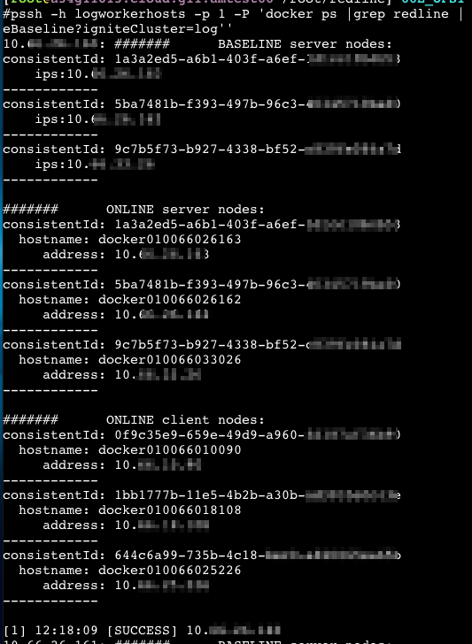

   </li>

   </ol>

2. 检查PerfWorker通讯列表（必选）。

   <ol type="i">

   <li>

   通过跳板机执行以下命令：

   ```text
   pssh -h perfworkerhosts -p 1 -P 'docker ps |grep redline | grep PerfWorker|awk '"'"
   '{ print $1}'"'"' | xargs -I ID docker exec ID curl 
   'http://127.0.0.1:8080/admin/makeBaseline?igniteCluster=perf''
   ```

   </li>

   <li>

   确认输出的节点信息（ONLINE server nodes）和实际部署节点数量是否一致，如果不一致或有“NOT IN BASELINE”关键词，跳转到**运维操作 > 连接故障修复**，按照说明进行修复。

   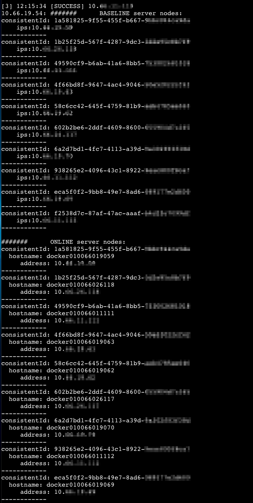

   </li>

   </ol>

3. 检查PerfMaster通讯列表（必选）。

   <ol type="i">

   <li>

   通过跳板机执行以下命令：

   ```text
   pssh -h masterhosts -p 1 -P 'docker ps |grep redline | grep PerfMaster|awk '"'"'{ print $1}'"'"' | xargs -I ID docker exec ID curl 
   'http://127.0.0.1:8080/admin/makeBaseline?igniteCluster=master''
   ```

   </li>

   <li>

   确认输出的节点信息（ONLINE server nodes）和实际部署节点数量是否一致，如果不一致或有“NOT IN BASELINE”关键词，跳转到**运维操作 > 连接故障修复**，按照说明进行修复。

   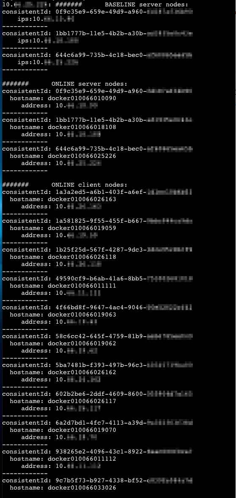

   </li>

   </ol>

4. 检查集群通讯活性（必选）。

   <ol type="i">

   <li>

   通过跳板机执行以下命令：

   ```text
   pssh -h allhosts -p 1 -P 'docker ps |grep redline | grep -v Open|awk '"'"'{ print $1}'"'"' | xargs -I ID sh -c "echo ID && docker exec ID tail -n 50 ./log/app.log |grep '"'deactived'"'"'
   ```

   </li>

   <li>

   确认是否有以下deactived日志返回，如果有，则进入到对应的docker中执行**运维操作 > deactived 集群激活**。

   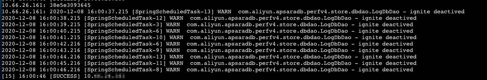

   </li>

   </ol>

**程序异常检查**

检查应用日志异常（必选）。

1. 通过跳板机执行以下命令：

   ```text
   pssh -h allhosts -p 1 -P 'docker ps |grep redline | grep -v Open|awk '"'"'{ print $1}
   '"'"' | xargs -I ID sh -c "echo ID && docker exec ID tail -n 100 ./log/app.log |grep 
   -C 10 '"'Exception'"'"'
   ```

2. 如果有异常请跳转到**运维操作 > 程序异常解决**。

3. 如**运维操作 > 程序异常解决**无法解决异常，请联系开发或执行**运维操作 > 节点数据重置**。

<a id="section-6-4"></a>

## 6.4. 运维操作

<a id="section-6-4-1"></a>

### 6.4.1. 集群扩缩容

本文介绍如何进行集群扩缩容。

**如何判断是否需要扩容**

- 随机找个实例，打开实例诊断，选中最近3小时的数据，如果数据出来缓慢（5秒以上）则需要增加节点，节点越多响应越快，根据需求自身平衡硬件投入性价比。

- 压测结果10个节点可以支持3000个MySQL实例主机节点（1个RDS实例可能有多个实例主机节点）。

**增加节点**

1. 启动新增的节点。

   > 可一次新增多台。
   >
   > **说明**

2. 登录到任意一台master节点。

3. 执行 `curl http://127.0.0.1:8080/admin/makeBaseline?apply=false` 确认返回的节点是否符合预期。

4. 确认无误后执行 `curl http://127.0.0.1:8080/admin/makeBaseline?apply=true` 。

**减少节点**

1. 移除一个节点。

   > 每次只能移除一个节点。
   >
   > **说明**

2. 登录到任意一台master节点。

3. 执行 `curl http://127.0.0.1:8080/admin/makeBaseline?apply=false` 确认返回的节点是否符合预期。

4. 确认无误后执行 `curl http://127.0.0.1:8080/admin/makeBaseline?apply=true` 。

5. 等待30分钟，待数据平衡后继续执行移除节点操作。

<a id="section-6-4-2"></a>

### 6.4.2. 升级或重启

本文介绍升级或重启的操作。

**操作步骤**

1. 登录到任意一台PerfMaster节点，关闭DB。如果没有返回 `success` ，则继续尝试直到返回 `success` 。

   ```bash
   curl "http://127.0.0.1:8080/admin/deactivateIgnite?igniteCluster=perf"
   curl "http://127.0.0.1:8080/admin/deactivateIgnite?igniteCluster=log"
   curl "http://127.0.0.1:8080/admin/deactivateIgnite?igniteCluster=master"
   ```

2. 等待2分钟，待数据落盘后再执行重启或升级操作。

3. 重启或升级完成后，执行环境检查步骤。

<a id="section-6-4-3"></a>

### 6.4.3. 修复连接故障

本文介绍如何修复连接故障。

**修复通讯列表中少节点问题**

1. 进入到缺失的节点中，执行如下命令：

   ```text
   ps aux|grep java|grep -v grep|awk '{ print $2}'|xargs kill -9
   ```

2. 等待3分钟后重新检查节点连接性。

**修复通讯列表中出现NOT IN BASELINE问题**

在任意PerfMaster节点执行以下命令：

```bash
curl "http://127.0.0.1:8080/admin/makeBaseline?igniteCluster=${cluster}&apply=true"
```

> `${cluster}`  需要替换为目标节点所属的集群(master、perf或log)。
>
> **说明**

<a id="section-6-4-4"></a>

### 6.4.4. 激活处于deactived状态的集群

本文介绍如何激活处于deactived状态的集群。

在任意PerfMaster节点执行以下命令：

```bash
curl "http://127.0.0.1:8080/admin/activateIgnite?igniteCluster=${cluster}"
```

> `${cluster}`  需要替换为目标节点所属的集群(master、perf或log)。
>
> **说明**

<a id="section-6-4-5"></a>

### 6.4.5. 解决程序异常

本文介绍如何解决程序异常。

**解决partition has been lostPart异常**

LogWorker节点

```bash
### 进入⼀台Worker Log docker执⾏Reset
curl "http://127.0.0.1:8080/admin/resetLostPartitions?
igniteCluster=log&cacheName=TABLE_LOG_AUDIT_SQLS"

curl "http://127.0.0.1:8080/admin/resetLostPartitions?
igniteCluster=log&cacheName=TABLE_LOG_ERROR_SQLS"

curl "http://127.0.0.1:8080/admin/resetLostPartitions?
igniteCluster=log&cacheName=TABLE_LOG_SLOW_SQLS"

curl "http://127.0.0.1:8080/admin/resetLostPartitions?
igniteCluster=log&cacheName=TABLE_LOG_AUDIT_SQL_TEMPLATES"

curl "http://127.0.0.1:8080/admin/resetLostPartitions?
igniteCluster=log&cacheName=TABLE_LOG_AUDIT_SQLS_ROUTE_INFO"

curl "http://127.0.0.1:8080/admin/resetLostPartitions?
igniteCluster=log&cacheName=CACHE_CODEC"

curl "http://127.0.0.1:8080/admin/resetLostPartitions?
igniteCluster=log&cacheName=CACHE_CODEC_LOCK"

curl "http://127.0.0.1:8080/admin/resetLostPartitions?
igniteCluster=log&cacheName=CACHE_CODEC_ATOMIC_LONG"

curl "http://127.0.0.1:8080/admin/resetLostPartitions?
igniteCluster=log&cacheName=ignite-sys-atomic-cache@default-ds-group"

curl "http://127.0.0.1:8080/admin/resetLostPartitions?
igniteCluster=log&cacheName=ignite-sys-atomic-cache@default-volatile-ds-group"

curl "http://127.0.0.1:8080/admin/resetLostPartitions?
igniteCluster=log&cacheName=NOTIFY_LOG_IGNITE_SHUTTING_DOWN"
```

PerfWorker节点

```bash
### 进入⼀台Worker Perf docker执⾏ Reset
curl "http://127.0.0.1:8080/admin/resetLostPartitions?
igniteCluster=perf&cacheName=CACHE_CODEC"

curl "http://127.0.0.1:8080/admin/resetLostPartitions?
igniteCluster=perf&cacheName=CACHE_CODEC_LOCK"

curl "http://127.0.0.1:8080/admin/resetLostPartitions?
igniteCluster=perf&cacheName=CACHE_CODEC_ATOMIC_LONG"

curl "http://127.0.0.1:8080/admin/resetLostPartitions?
igniteCluster=perf&cacheName=NOTIFY_PERF_IGNITE_SHUTTING_DOWN"

curl "http://127.0.0.1:8080/admin/resetLostPartitions?
igniteCluster=perf&cacheName=MONITOR_ALERT_HIS_CACHE"

curl "http://127.0.0.1:8080/admin/resetLostPartitions?
igniteCluster=perf&cacheName=MONITOR_ALERT_STATUS_INFO_CACHE"

curl "http://127.0.0.1:8080/admin/resetLostPartitions?
igniteCluster=perf&cacheName=CACHE_REDLINE_SNAPSHOT"

curl "http://127.0.0.1:8080/admin/resetLostPartitions?
igniteCluster=perf&cacheName=seconds-level"

curl "http://127.0.0.1:8080/admin/resetLostPartitions?
igniteCluster=perf&cacheName=minutes-level"
            
```

PerfMaster节点

```bash
### 进入⼀台Master docker执⾏ Reset
curl "http://127.0.0.1:8080/admin/resetLostPartitions?
igniteCluster=master&cacheName=CACHE_TS_CACHE_NAME"

curl "http://127.0.0.1:8080/admin/resetLostPartitions?
igniteCluster=master&cacheName=NOTIFY_MASTER_IGNITE_SHUTTING_DOWN"

curl "http://127.0.0.1:8080/admin/resetLostPartitions?
igniteCluster=master&cacheName=LOCK_MASTER_COMPETING"

curl "http://127.0.0.1:8080/admin/resetLostPartitions?
igniteCluster=master&cacheName=CLUSTER_COMMAND"

curl "http://127.0.0.1:8080/admin/resetLostPartitions?
igniteCluster=master&cacheName=CACHE_CODEC"

curl "http://127.0.0.1:8080/admin/resetLostPartitions?
igniteCluster=master&cacheName=CACHE_CODEC_LOCK"

curl "http://127.0.0.1:8080/admin/resetLostPartitions?
igniteCluster=master&cacheName=CACHE_CODEC_ATOMIC_LONG"

curl "http://127.0.0.1:8080/admin/resetLostPartitions?
igniteCluster=master&cacheName=NODE_EXECUTE_COMMAND_RECORD"

curl "http://127.0.0.1:8080/admin/resetLostPartitions?
igniteCluster=master&cacheName=IGNITE_PERF_LOG_METADATA"

curl "http://127.0.0.1:8080/admin/resetLostPartitions?
igniteCluster=master&cacheName=CHECKPOINT_CACHE_NAME"
```

**解决Failed to perform WAL operation**

如果出现Failed to perform WAL operation提示，请咨询技术人员，或执行节点数据重置操作。

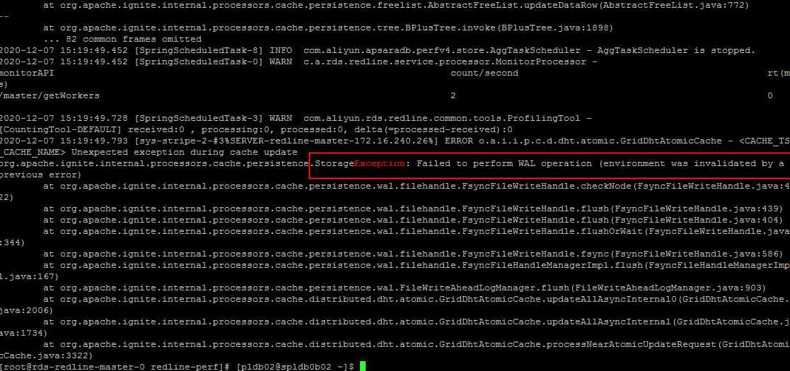

<a id="section-6-4-6"></a>

### 6.4.6. 节点数据重置

本文介绍如何进行节点数据重置操作。

**注意事项**

本操作会删除指定节点上的所有数据，该节点上的监控数据会丢失且无法找回，如非极端异常情况请谨慎使用本操作。

**操作步骤**

1. 进入需要重置数据的节点或docker，执行如下操作：

   ```text
   touch log/HOLD_START && ps aux|grep java|grep -v grep|awk '{ print $2}'|xargs kill -9&& rm -rf ignite/* && sleep 60 && rm -f log/HOLD_START &
   ```

2. 等待3分钟后，执行如下操作：

   ```bash
   curl "http://127.0.0.1:8080/admin/activateIgnite?igniteCluster=${cluster}"
   curl "http://127.0.0.1:8080/admin/makeBaseline?igniteCluster=${cluster}&apply=true"
   ```

   > `${cluster}`  需要替换为节点所属的集群(master、perf或log)。
   >
   > **说明**

<a id="section-6-4-7"></a>

### 6.4.7. 日志转储

本文介绍如何进行日志转储。

**背景信息**

用户审计日志转储历史日志数据，满足用户对于查询历史审计日志的需求。

**注意事项**

- 该功能当前仅支持PostgreSQL On ECS。

- 您已创建专用于存储审计日志的OSS Bucket。创建方法，请参见<strong>《对象存储OSS》</strong>中的**用户指南 > 快速入门 > 创建存储空间**章节。

- 开启此功能需要定期清理OSS存储空间。

**开启或关闭日志转储开关**

1. 登录OPS1主机，在/root/redline目录下（如果没有redline目录可以自行创建一下）执行如下命令，获取日志工作节点列表。

   ```bash
   curl  "http://localhost:7070/api/v3/column/m.ip?m.sr.id=redline-perf.LogWorker%23"  |grep ip  |  awk -F '"' '{print $(NF-1)}' > logworkerhosts
   ```

2. 开启转储开关。

   - 开启所有实例的转储开关。

     ```text
     pssh -h logworkerhosts 'curl "http://<替换logworker集群资源域名
     >:8080/admin/logTransferStore?
     transType=oss&accessKey=AK&accessSecret=SK&endpoint=http://oss-cn-neimeng-env30-d01-a.intra.env30.shuguang.com/&bucketName=lztest&region=cn-neimeng-env30-d01"'
     ```

     > logworker集群资源域名可以从飞天基础运维平台获取。
     >
     > **说明**

   - 开启白名单实例的转储开关。

     ```text
     pssh -h logworkerhosts 'curl "http://<替换logworker集群资源域名
     >:8080/admin/logTransferStore?transType=oss&accessK
     ey=AK&accessSecret=SK&endpoint=oss-cn-beijing.aliyuncs.com&bucketName=rds-sqlaudit&filterType=WHITE&whiteList=%5B%22ppassql-HttpApiTest-INS-NAME-5%22%2C%22ppassql-HttpApiTest-INS-NAME-6%22%5D"'
     ```

     > **说明**
     >
     > - 以上命令中的 `ppassql-HttpApiTest-INS-NAME-5` 和 `ppassql-HttpApiTest-INS-NAME-6` 为示例，表示需要开启转储的实例白名单，配置时需要根据实际情况修改。
     >
     > - 如果需要配置多个，按以下方法进行配置。
     >
     >   <ol type="a">
     >
     >   <li>
     >
     >   在每个实例白名单前后添加 `%22` 。
     >
     >   </li>
     >
     >   <li>
     >
     >   使用 `%2C` 连接添加了 `%22` 的实例白名单，生成白名单清单。
     >
     >   </li>
     >
     >   </ol>
     >
     >   <ol type="i" start="100">
     >
     >   <li>
     >
     >   将生成的白名单清单添加到**whiteList**后的 `%5B` 和 `%5D` 之间。配置示例如下：
     >
     >   ```text
     >   whiteList=%5B%22实例名%22%2C%22实例名%22%2C%22实例名%22%5D
     >   ```
     >
     >   </li>
     >
     >   </ol>

3. 关闭转储开关。

   ```text
   pssh -h logworkerhosts 'curl "http://<替换logworker集群资源域名
   >:8080/admin/logTransferStore?/admin/logTransferStore?
   transType=close&accessKey=&accessSecret=&endpoint=&bucketName=&region="'
   ```

**日志转储解析工具使用**

日志转储实际是将历史审计日志数据切分成多个小文件，为了便于用户查找及分析日志，可以使用日志解析工具进行解析及定位。默认情况下，每个实例转储日志按最长15秒或最大100MB两个阈值进行日志切分。

**配置命令**

```text
java -jar perf-tools-0.0.1.jar --input <⽇志存储⽬录> --output <⽇志解析输出⽂件路径> --
begin <开始时间戳> --interval <扫描时⻓>
```

**参数解释**

| 参数 | 参数说明 | 可选必选 |
| --- | --- | --- |
| --input | 目标实例日志目录路径。 | 必选。 |
| --output | 日志解析后存储目录路径。 | 可选，未配置时默认输出到标准输出。<br>说明支持通过管道及grep命令查询。 |
| --begin | 查询范围起始时间戳（秒）。 | 必选。 |
| --interval | 从起始时间开始最长查询范围（秒）。 | 可选，最长10800秒，未配置时默认3600秒。 |

**命令示例**

- 日志解析

  ```text
  java -jar perf-tools-0.0.1.jar --input /logs/ppassql-HttpApiTest-INS-NAME-0 --output 
  /logs/ppassql-HttpApiTest-INS-NAME-0/result.data --begin 1602592098 --interval 10800
  ```

- 通过管道grep 关键字直接搜索日志

  ```text
  java -jar ../perf-tools-0.0.1.jar --input /logs/ppassql-HttpApiTest-INS-NAME-0 --begin 1602592098 --interval 10800 | grep incomplete
  ```
