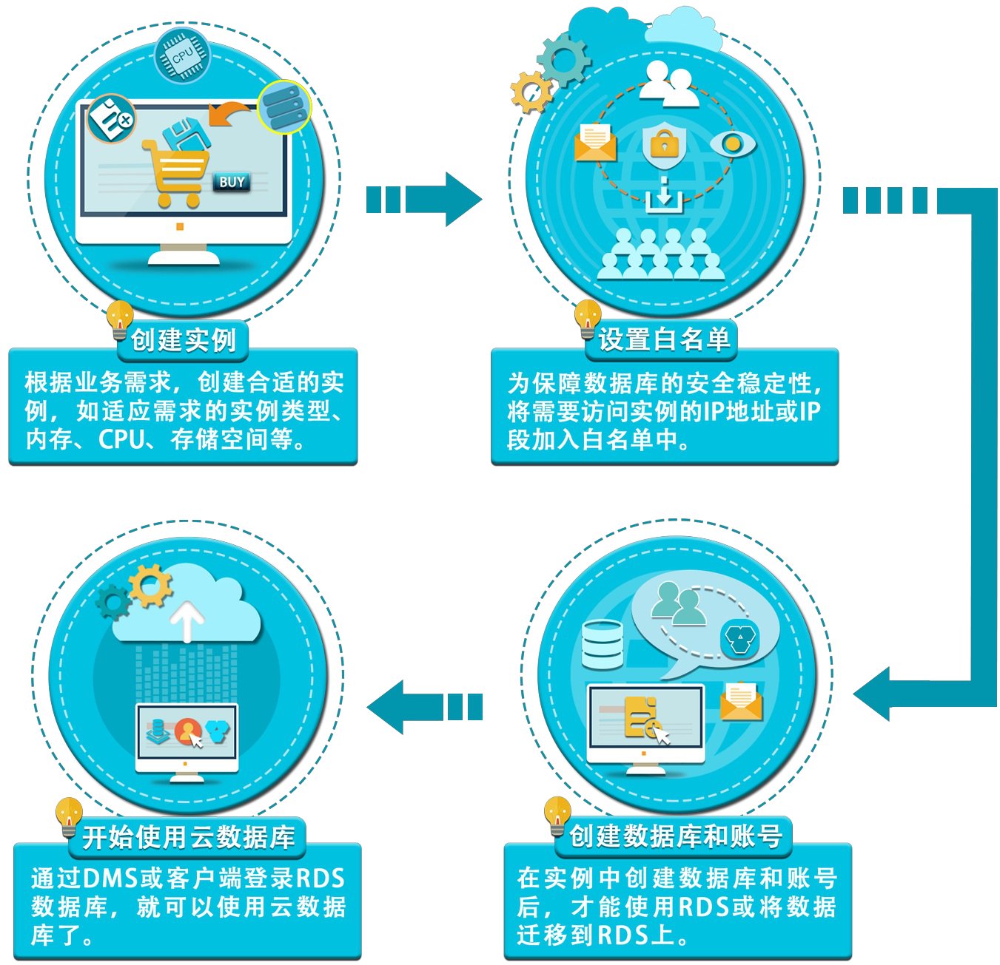
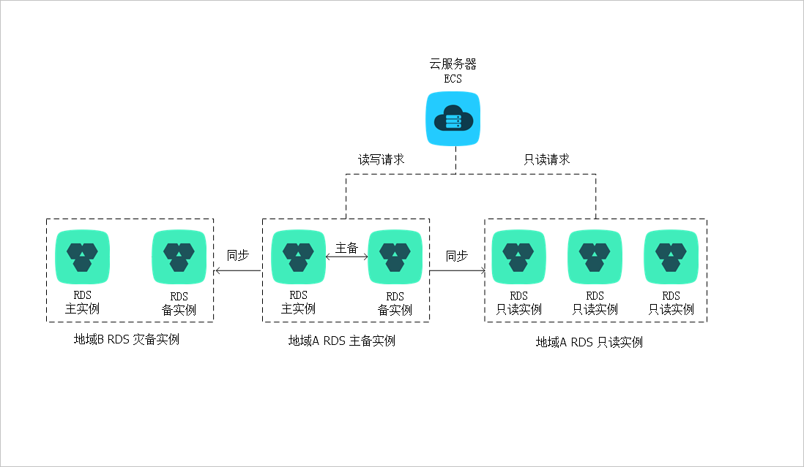
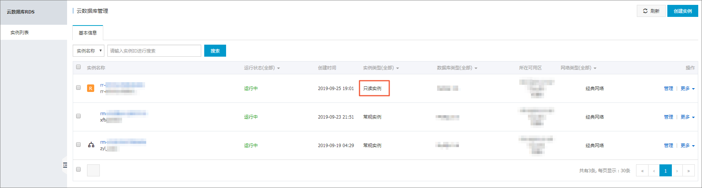
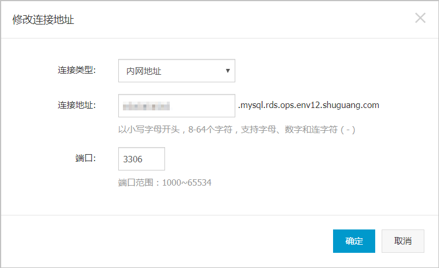
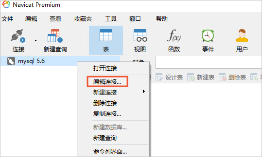
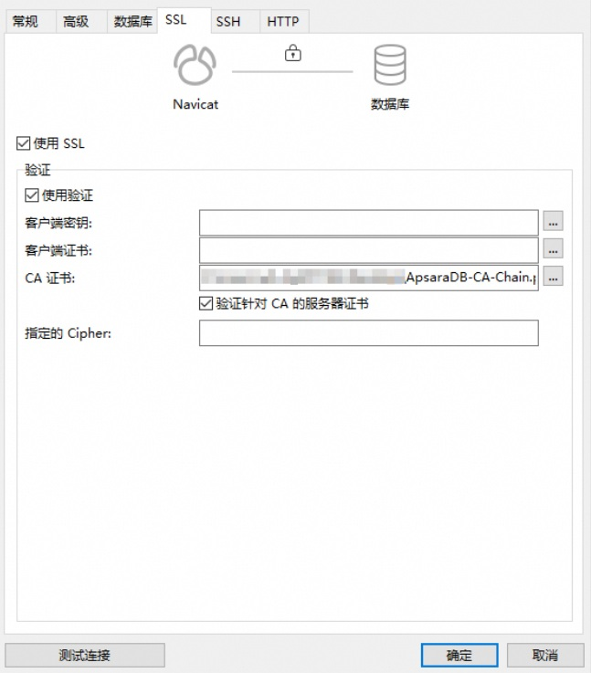
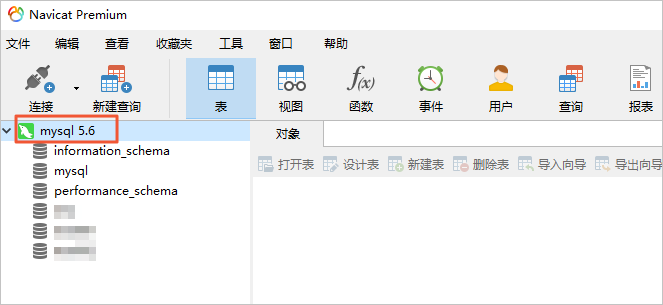
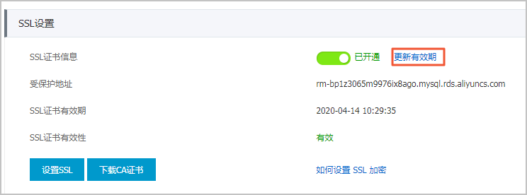

阿里云  
专有云  
云数据库  
RDS for SQL Server版 用户指南  
产品版本：v3.18.2  
文档版本：20251105

**目录**

- [1.云数据库RDS SQL Server版产品生命周期公告](#section-1)
- [2.什么是关系型数据库RDS](#section-2)
- [3.实例规格](#section-3)
- [4.登录云数据库RDS控制台](#section-4)
- [5.快速入门](#section-5)
    - [5.1. 使用流程](#section-5-1)
    - [5.2. 创建实例](#section-5-2)
    - [5.3. 设置白名单](#section-5-3)
    - [5.4. 连接数据库实例](#section-5-4)
    - [5.5. 创建账号](#section-5-5)
    - [5.6. 创建数据库](#section-5-6)
- [6.实例管理](#section-6)
    - [6.1. 创建实例](#section-6-1)
    - [6.2. 查看实例基本信息](#section-6-2)
    - [6.3. 重启实例](#section-6-3)
    - [6.4. 变更配置](#section-6-4)
    - [6.5. 设置可维护时间段](#section-6-5)
    - [6.6. 切换主备实例](#section-6-6)
    - [6.7. 释放实例](#section-6-7)
    - [6.8. 只读实例](#section-6-8)
        - [6.8.1. SQL Server只读实例简介](#section-6-8-1)
        - [6.8.2. 创建SQL Server只读实例](#section-6-8-2)
        - [6.8.3. 查询只读实例详情](#section-6-8-3)
- [7.账号管理](#section-7)
    - [7.1. 创建账号](#section-7-1)
    - [7.2. 重置密码](#section-7-2)
- [8.数据库管理](#section-8)
    - [8.1. 创建数据库](#section-8-1)
    - [8.2. 删除数据库](#section-8-2)
    - [8.3. 修改系统字符集排序规则与时区](#section-8-3)
    - [8.4. 实例间的数据库复制](#section-8-4)
- [9.数据库连接](#section-9)
    - [9.1. 修改连接地址和端口](#section-9-1)
    - [9.2. 申请或释放外网地址](#section-9-2)
    - [9.3. 连接数据库实例](#section-9-3)
- [10.监控](#section-10)
    - [10.1. 查看系统资源和引擎监控](#section-10-1)
- [11.数据安全性](#section-11)
    - [11.1. 设置白名单](#section-11-1)
    - [11.2. 设置SSL加密](#section-11-2)
    - [11.3. 设置透明数据加密TDE](#section-11-3)
- [12.服务可用性](#section-12)
    - [12.1. 自动或手动主备切换](#section-12-1)
- [13.数据库备份与恢复](#section-13)
    - [13.1. 设置自动备份策略](#section-13-1)
    - [13.2. 手动备份实例](#section-13-2)
    - [13.3. 收缩事务日志](#section-13-3)
- [14.全量备份数据上云](#section-14)

<a id="section-1"></a>

# 1.云数据库RDS SQL Server版产品生命周期公告

尊敬的客户：

阿里云飞天企业版云数据库SQL Server版将于2024年4月30日EOM（停止销售），现通知您上述产品生命周期的里程碑和替代方案，以便更好地帮助您完成业务创新和保持业务连续性规划。

<table>
  <tr>
    <th>产品名称</th>
    <th>里程碑</th>
    <th>说明</th>
    <th>日期</th>
    <th>替代产品</th>
  </tr>
  <tr>
    <td rowspan="3">云数据库SQL Server版</td>
    <td>停止新购EOM</td>
    <td>产品停止接收新建订单，不再销售，通知接受扩容支持。</td>
    <td>2024年04月30日</td>
    <td rowspan="3">基于ECS部署商业化SQL Server</td>
  </tr>
  <tr>
    <td>停止全面支持EOFS</td>
    <td>产品停止发布新的安全补丁和新错误修复，对已有补丁发布的现有安全补丁和现有错误依然支持。</td>
    <td>2025年07月08日</td>
  </tr>
  <tr>
    <td>停止服务EOS</td>
    <td>停止对该产品的服务和技术支持。</td>
    <td>2026年07月08日</td>
  </tr>
</table>

阿里云建议您尽快做好计划，若有问题请及时联系阿里云。

2024年04月

<a id="section-2"></a>

# 2.什么是关系型数据库RDS

阿里云关系型数据库RDS包含MySQL、SQL Server、PolarDB、PostgreSQL四种数据库引擎，可以方便快捷地创建出适合自己应用场景的数据库实例。

**RDS SQL Server**

云数据库SQL Server版不仅拥有高可用架构和任意时间点的数据恢复功能，强力支撑各种企业应用，减少额外支出。

云数据库SQL Server版支持实例管理、账号管理、数据库管理、白名单、备份恢复、透明数据加密以及数据迁移等基本功能。

<a id="section-3"></a>

# 3.实例规格

实例有不同的系列、版本、规格，性能也有区别，本文介绍RDS SQL Server的实例规格。

**关于云盘IOPS**

对于云盘，除了实例规格外，存储空间大小对IOPS也会有影响。云盘IOPS的详细计算公式如下（存储空间单位为GB）：

```text
min{1800+30*存储空间, 25000}
```

> 吞吐量如果达到上限，也会影响IOPS。
>
> **说明**

**主实例**

**2012标准版、2016标准版**

<table>
  <tr>
    <th>规格代码</th>
    <th>CPU和内存</th>
    <th>最大IOPS</th>
    <th>最大连接数</th>
    <th>存储空间</th>
  </tr>
  <tr>
    <td>mssql.x4.large.s2</td>
    <td>4核 16GB</td>
    <td rowspan="9">请参见关于云盘IOPS。</td>
    <td rowspan="9">无限制</td>
    <td rowspan="9">20GB~4000GB</td>
  </tr>
  <tr>
    <td>mssql.x8.medium.s2</td>
    <td>2核 16GB</td>
  </tr>
  <tr>
    <td>mssql.x4.3xlarge.s2</td>
    <td>24核 96GB</td>
  </tr>
  <tr>
    <td>mssql.x4.xlarge.s 2</td>
    <td>8核 32GB</td>
  </tr>
  <tr>
    <td>mssql.x8.large.s2</td>
    <td>4核 32GB</td>
  </tr>
  <tr>
    <td>mssql.x8.xlarge.s 2</td>
    <td>8核 64GB</td>
  </tr>
  <tr>
    <td>mssql.x4.medium.s2</td>
    <td>2核 8GB</td>
  </tr>
  <tr>
    <td>mssql.x8.2xlarge.s2</td>
    <td>16核 128GB</td>
  </tr>
  <tr>
    <td>mssql.x4.2xlarge.s2</td>
    <td>16核 64GB</td>
  </tr>
</table>

**2012企业版、2016企业版**

**规格代码**

**CPU和内存**

**最大IOPS**

**最大连接数**

**存储空间**

mssql.x4.3xlarge.

24核 96GB

e2

mssql.x8.xlarge.e

8核 64GB

2

mssql.x4.2xlarge.

16核 64GB

e2 mssql.x4.medium

2核 8GB

.e2

mssql.x8.2xlarge.

16核 128GB

e2

mssql.x8.7xlarge.

56核 480GB

e2

mssql.x8.medium

2核 16GB

请参见关于云盘

无限制

20GB~4000GB

.e2

IOPS。

mssql.x4.xlarge.e

8核 32GB

2

mssql.x4.4xlarge.

32核 128GB

e2

mssql.x8.8xlarge.

64核 512GB

e2

4核 32GB

mssql.x8.large.e2

mssql.x8.4xlarge.

32核 256GB

e2

mssql.x4.8xlarge.

64核 256GB

e2

4核 16GB

mssql.x4.large.e2

**2017企业集群版**

**规格代码**

**CPU和内存**

**最大IOPS**

**最大连接数**

**存储空间**

mssql.x4.2xlarge.

16核 64GB

e2

mssql.x8.xlarge.e

8核 64GB

2

mssql.x4.medium

2核 8GB

.e2

mssql.x8.2xlarge.

16核 128GB

e2

mssql.x4.xlarge.e

8核 32GB

2

mssql.x8.medium

2核 16GB

.e2

请参见关于云盘

mssql.x4.4xlarge.

32核 128GB

无限制

20GB~4000GB

IOPS。

e2

mssql.x8.3.xlarge

24核 192GB

.e2 mssql.x8.8xlarge.

64核 512GB

e2

4核 32GB

mssql.x8.large.e2

mssql.x4.8xlarge.

64核 256GB

e2

mssql.x8.4xlarge.

32核 256GB

e2

4核 16GB

mssql.x4.large.e2

**只读实例**

<table>
  <tr>
    <th>规格代码</th>
    <th>CPU和内存</th>
    <th>最大连接数</th>
    <th>存储空间</th>
  </tr>
  <tr>
    <td>rds.mssql.c1.large</td>
    <td>8核 16GB</td>
    <td rowspan="20">无限制</td>
    <td rowspan="20">20GB~4000GB</td>
  </tr>
  <tr>
    <td>mssql.x8.7xlarge.ro</td>
    <td>56核 490GB</td>
  </tr>
  <tr>
    <td>mssql.x4.xlarge.ro</td>
    <td>8核 32GB</td>
  </tr>
  <tr>
    <td>mssql.x8.medium.ro</td>
    <td>2核 16GB</td>
  </tr>
  <tr>
    <td>rds.mssql.c1.xlarge</td>
    <td>8核 32GB</td>
  </tr>
  <tr>
    <td>mssql.x4.4xlarge.ro</td>
    <td>32核 131GB</td>
  </tr>
  <tr>
    <td>mssql.x8.3xlarge.ro</td>
    <td>24核 196GB</td>
  </tr>
  <tr>
    <td>mssql.x8.8xlarge.ro</td>
    <td>64核 524GB</td>
  </tr>
  <tr>
    <td>mssql.x8.large.ro</td>
    <td>4核 32GB</td>
  </tr>
  <tr>
    <td>rds.mssql.c2.xlarge</td>
    <td>16核 64GB</td>
  </tr>
  <tr>
    <td>mssql.x4.8xlarge.ro</td>
    <td>64核 262GB</td>
  </tr>
  <tr>
    <td>mssql.x8.4xlarge.ro</td>
    <td>32核 262GB</td>
  </tr>
  <tr>
    <td>rds.mssql.m1.medium</td>
    <td>4核 16GB</td>
  </tr>
  <tr>
    <td>rds.mssql.s2.xlarge</td>
    <td>2核 8GB</td>
  </tr>
  <tr>
    <td>rds.mssql.s3.large</td>
    <td>4核 8GB</td>
  </tr>
  <tr>
    <td>rds.mssql.s2.large</td>
    <td>2核 4GB</td>
  </tr>
  <tr>
    <td>mssql.x4.2xlarge.ro</td>
    <td>16核 64GB</td>
  </tr>
  <tr>
    <td>mssql.x8.xlarge.ro</td>
    <td>8核 64GB</td>
  </tr>
  <tr>
    <td>mssql.x4.medium.ro</td>
    <td>2核 8GB</td>
  </tr>
  <tr>
    <td>mssql.x8.2xlarge.ro</td>
    <td>16核 131GB</td>
  </tr>
</table>

<a id="section-4"></a>

# 4.登录云数据库RDS控制台

本节主要向您介绍如何登录云数据库RDS控制台。

**前提条件**

- 登录Apsara Uni-manager运营控制台前，确认您已从部署人员处获取Apsara Uni-manager运营控制台的服务域名地址。

- 推荐使用Chrome浏览器。

**操作步骤**

1. 在浏览器地址栏中，输入Apsara Uni-manager运营控制台的服务域名地址，按回车键。

2. 输入正确的用户名及密码。

   请向运营管理员获取登录控制台的用户名和密码。

   > 首次登录Apsara Uni-manager运营控制台时，需要修改登录用户名的密码，请按照提
   >
   > **说明**
   >
   > 示完成密码修改。为提高安全性，密码长度必须为10~32位，且至少包含以下两种类型：
   >
   > - 英文大写或小写字母（A~Z、a~z）
   >
   > - 阿拉伯数字（0~9）
   >
   > - 特殊符号（感叹号（!）、at（@）、井号（#）、美元符号（$）、百分号（%）等）

3. 单击**账号登录**。

4. 如果账号已激活MFA多因素认证，请根据以下两种情况进行操作：

   - 管理员强制开启MFA后的首次登录：

     <ol type="a">

     <li>

     在绑定虚拟MFA设备页面中，按页面提示步骤绑定MFA设备。

     </li>

     <li>

     按照步骤2重新输入账号和密码，单击**账号登录**。

     </li>

     </ol>

     <ol type="i" start="100">

     <li>

     输入6位MFA码后单击**认证**。

     </li>

     </ol>

   - 您已开启并绑定MFA：

     输入6位MFA码后单击**认证**。

     > 绑定并开启MFA的操作请参见<strong>《Apsara Uni-manager运营控制台用户指南》</strong>中的
     >
     > **说明**
     >
     > 章节<strong>《绑定并开启虚拟MFA设备》</strong>。

5. 在页面顶部的导航栏中，单击**产品 > 数据库 > 云数据库 RDS**。

<a id="section-5"></a>

# 5.快速入门

<a id="section-5-1"></a>

## 5.1. 使用流程

快速使用RDS的基本过程包括创建RDS实例、设置白名单、创建数据库、创建帐号、连接实例，旨在引导您一站式完成RDS的搭建。

通常，从创建实例到可以开始使用实例，您需要完成的操作参见下图。

图 1. 快速入门流程图



<a id="section-5-2"></a>

## 5.2. 创建实例

本文介绍如何通过RDS控制台创建实例。

**前提条件**

在创建RDS实例前，需要先申请可以登录阿里云控制台的账号。

**操作步骤**

1. 登录云数据库RDS控制台。

2. 在**实例列表**页面中，单击右上角的**创建实例**。

3. 根据下表设置参数。

   **类别**

   **配置**

   **说明**

   实例所属组织。

   **组织**

   **基本配置**

   实例所属资源集。

   **资源集**

   实例所属地域。不同地域之间的产品内网不互通，创建实例后不支持更换地域。

   **地域**

   **主节点可用**

   实例主节点所属的可用区。

   **区域**

   **区**

   RDS支持**多可用区部署**和**单可用区部署**。选择**多可用区部署**的情况下需要为实例

   **部署方案**

   的备节点选择**备节点可用区**。

   数据库的类型，选择**SQLServer**。

   **数据库类型**

   数据库的版本，支持如下版本：

   - **2012_ent_ha**：SQL Server 2012高可用企业版

   - **2012_std_ha**：SQL Server 2012高可用标准版

   **数据库版本**

   - **2016_ent_ha**：SQL Server 2016高可用企业版

   - **2016_std_ha**：SQL Server 2016高可用标准版

   - **2017_ent**：SQL Server 2017企业集群版

   **规格配置**

   数据库的系列，详情请参见 <strong>《云数据库RDS》</strong>的**产品简介 > 实例规格**章节。

   **系列**

   数据库的存储类型，支持SSD云盘、普通性能云盘、高性能云盘。

   **存储类型**

   不同数据库版本支持的存储类型存在差异，具体请以控制台界面为准。

   实例的规格，不同的内存大小对应不同的最大连接数和IOPS，具体请以控制台界

   **实例规格**

   面为准。详情请参见 <strong>《云数据库RDS》</strong>的**产品简介 > 实例规格**章节。

   存储空间包括数据空间、系统文件空间、Binlog文件空间和事务文件空间。详情

   **存储空间**

   请参见 <strong>《云数据库RDS》</strong>的**产品简介 > 实例规格**章节。

   RDS提供如下两种类型的连接地址：

   - **公网连接**：通过该连接地址可以从外网访问数据库。

   **网络连接类**

   - **内网连接**：通过该连接地址可以从内网访问数据库。

   **型**

   > 实例创建完成后无法修改，请谨慎选择。
   >
   > **说明**

   RDS实例支持的网络类型：

   - **经典网络**：经典网络中的云服务在网络上不进行隔离，只能依靠云服务自身的安全组或白名单策略来阻挡非法访问。

   **网络类型**

   - **专有网络**：专有网络VPC（Virtual Private Cloud）帮助用户在阿里云上构建出一个隔离的网络环境。用户可以自定义专有网络里面的路由表、IP地址范围和网关。建议您选择专有网络，更加安全。

   **网络类型**

   选择您的VPC。

   **VPC**

   > 当**网络类型**为**专有网络**时，需要填写该参数。
   >
   > **说明**

   **交换机可用**

   选择实例所在可用区。

   **区**

   选择VPC下的交换机。

   **Vswitch**

   > 当**网络类型**为**专有网络**时，需要填写该参数。
   >
   > **说明**

   添加IP地址，允许这些IP地址访问该RDS实例。

   **IP白名单**

   RDS支持批量创建实例。此处可以指定需要创建的RDS实例个数，默认为1个。

   **创建数量**

   RDS实例的名称。

   - 长度为2~64个字符。

   **实例设置**

   - 以英文字母或中文开头。

   **实例名称**

   - 支持数字和如下特殊字符：

     _-:

   - 不能以http:// 或https://开头。

4. 完成上述参数配置后，单击**提交**。

<a id="section-5-3"></a>

## 5.3. 设置白名单

为了数据库的安全稳定，在创建RDS实例后，需先修改实例的白名单，将需要访问实例的IP地址或者IP段加入到RDS实例白名单中。

**背景信息**

**操作步骤**

1. 登录云数据库RDS控制台。

2. 在**实例列表**页面，定位到目标实例。

3. 单击目标实例ID或者单击实例右侧的**管理**，打开**基本信息**页面。

4. 在左侧导航栏中，单击**数据安全性**。

5. 在**白名单设置**页签中，单击**default**白名单分组中的**修改**。

   > **说明**
   >
   > - 若需要ECS实例通过内网地址连接到RDS，请确保两者处于同一地域内且网络类型相同，否则设置了白名单也无法连接成功。
   >
   > - 您也可以单击**添加白名单分组**新建自定义分组。

6. 在**修改白名单分组**对话框中，填写需要访问该实例的IP地址或IP段，然后单击**确定**。

   > **说明**
   >
   > - 白名单限制：
   >
   >   - IP地址之间以英文逗号（,）分隔，不可重复，最多1000个。
   >
   >     支持格式如： `0.0.0.0/0` 、 `10.23.12.24` （单个IP地址）、 `10.23.12.24/24` （CIDR模式，即无类域间路由， `/24` 表示了地址中前缀的长度，范围[1，32]）。
   >
   >   - `0.0.0.0/0` 或空表示对访问的IP来源不作任何限制，此时RDS实例将面临高安全风险，请谨慎使用。
   >
   > - 单击**加载ECS内网IP**后，将显示您当前阿里云账号下所有ECS实例的IP地址，可快速添加ECS内网IP地址到白名单中。

<a id="section-5-4"></a>

## 5.4. 连接数据库实例

本文介绍如何通过DMS连接数据库实例。

**前提条件**

- 已创建数据库。详情请参见创建数据库。

- 已创建数据库账号。详情请参见创建账号。

**操作步骤**

1. 登录云数据库RDS控制台。

2. 在**实例列表**页面，定位到目标实例。

3. 单击目标实例ID或者单击实例右侧的**管理**，打开**基本信息**页面。

4. 单击页面右上角的**登录数据库**。

5. 在自动跳转的**数据管理DMS**控制台的**登录实例**面板中，检查**数据库类型**、**实例地区**、**连接串地址**是否正确。若信息正确，填写**数据库账号**和**数据库密码**。

   | 参数 | 说明 |
   | --- | --- |
   | 数据库类型 | 目标数据库的类型，系统默认为当前需要连接的数据库类型。 |
   | 实例地区 | 目标实例所在的地域，系统默认为当前实例所在地域。 |
   | 连接串地址 | 目标实例的连接串地址，系统默认为当前实例的连接串地址。 |
   | 数据库账号 | 目标数据库的账号。 |
   | 数据库密码 | 目标数据库账号对应的密码。 |

6. 单击**登录**。

   > **说明**
   >
   > - 若您希望浏览器记住该账号的密码，可以先勾选**记住密码**再单击**登录**。
   >
   > - 若无法连接，请检查白名单设置。更多信息，请参见设置白名单。

<a id="section-5-5"></a>

## 5.5. 创建账号

本文介绍如何创建SQL Server实例的账号。

**前提条件**

实例状态为**运行中**。

**操作步骤**

1. 登录云数据库RDS控制台。

2. 在**实例列表**页面，定位到目标实例。

3. 单击目标实例ID或者单击实例右侧的**管理**，打开**基本信息**页面。

4. 在左侧导航栏中，单击**账号管理**。

5. 单击**创建账号**。

6. 输入要创建的账号信息。

   | 参数 | 说明 |
   | --- | --- |
   | 数据库账号 | 长度为2~16个字符，由小写字母、数字或下划线（_）组成。但开头需为字母，结尾需为字母或数字。 |
   | 账号类型 | • <strong>高权限账号</strong>：仅当第一次为该实例创建账号时，才能选择<strong>高权限账号</strong>，因为实例的第一个账号必须是高权限账号。一个实例只能有一个高权限账号。高权限账号不能删除。<br>• <strong>普通账号</strong>：仅当实例已经创建高权限账号时，才只能选择<strong>普通账号</strong>。一个实例可以有多个普通账号。您需要手动为普通账号授予数据库权限。 |
   | 授权数据<strong>库</strong>（仅创建普通账号可选） | 为<strong>普通账号</strong>授权的数据库。若尚未创建数据库，该值可以为空。一个账号可以授权多个数据库，授权数据库的操作步骤如下：<br>i. 在<strong>未授权数据库</strong>栏中，选中要授权的数据库。ii. 单击<strong>授权</strong>，将其添加数据库到<strong>已授权数据库</strong>栏中。iii. 您可以设置该账号对于各个数据库的权限，可设置为<strong>读写</strong>、<strong>只读</strong>或<strong>所有者</strong>。还可以单击<strong>全部设读</strong><strong>写</strong>、<strong>全部设只读</strong>或<strong>全部设所有者</strong>进行批量设置。<br>说明<br>• 拥有<strong>所有者</strong>权限的账号才可以在对应数据库内进行创建/删除表以及修改表结构操作。<br>• <strong>高权限账号</strong>拥有所有数据库的权限，无需授权。 |
   | 密码 | 设置账号密码。要求如下：<br>• 长度为8~32个字符。<br>• 由大写字母、小写字母、数字、特殊字符中的任意三种组成。<br>• 特殊字符为<code> !@#$%^&amp;*()_+-= </code> |
   | 确认密码 | 输入与密码一致的字段，以确保密码正确输入。 |
   | 备注 | 输入备注说明，最多256个字符。 |

7. 单击**创建**，账号创建完成。

<a id="section-5-6"></a>

## 5.6. 创建数据库

您可以通过RDS控制台，创建SQL Server数据库。

**操作步骤**

1. 登录云数据库RDS控制台。

2. 在**实例列表**页面，定位到目标实例。

3. 单击目标实例ID或者单击实例右侧的**管理**，打开**基本信息**页面。

4. 在左侧导航栏中，选择**数据库管理**。

5. 单击**创建数据库**。

6. 输入要创建的数据库信息。

   | 参数 | 说明 |
   | --- | --- |
   | 数据库（DB）名称 | 填写数据库名称。由小写字母、数字、下划线（_）或中划线（-）组成，以字母开头，以字母或数字结尾，长度为2~64个字符。 |
   | 支持字符集 | 选择字符集。如果没有需要的字符集，单击<strong>全部</strong>，并从下拉菜单中选择。 |
   | 备注说明 | 可以备注该数据库的相关信息，便于后续数据库管理，最多支持256个字符。 |

7. 单击**创建**，数据库创建完成。

<a id="section-6"></a>

# 6.实例管理

<a id="section-6-1"></a>

## 6.1. 创建实例

本文介绍如何通过RDS控制台创建实例。

**前提条件**

在创建RDS实例前，需要先申请可以登录阿里云控制台的账号。

**操作步骤**

1. 登录云数据库RDS控制台。

2. 在**实例列表**页面中，单击右上角的**创建实例**。

3. 根据下表设置参数。

   **类别**

   **配置**

   **说明**

   实例所属组织。

   **组织**

   **基本配置**

   实例所属资源集。

   **资源集**

   实例所属地域。不同地域之间的产品内网不互通，创建实例后不支持更换地域。

   **地域**

   **主节点可用**

   实例主节点所属的可用区。

   **区域**

   **区**

   RDS支持**多可用区部署**和**单可用区部署**。选择**多可用区部署**的情况下需要为实例

   **部署方案**

   的备节点选择**备节点可用区**。

   数据库的类型，选择**SQLServer**。

   **数据库类型**

   数据库的版本，支持如下版本：

   - **2012_ent_ha**：SQL Server 2012高可用企业版

   - **2012_std_ha**：SQL Server 2012高可用标准版

   **数据库版本**

   - **2016_ent_ha**：SQL Server 2016高可用企业版

   - **2016_std_ha**：SQL Server 2016高可用标准版

   - **2017_ent**：SQL Server 2017企业集群版

   数据库的系列，详情请参见 <strong>《云数据库RDS》</strong>的**产品简介 > 实例规格**章节。

   **系列**

   数据库的存储类型，支持SSD云盘、普通性能云盘、高性能云盘。

   **规格配置**

   **存储类型**

   不同数据库版本支持的存储类型存在差异，具体请以控制台界面为准。

   实例的规格，不同的内存大小对应不同的最大连接数和IOPS，具体请以控制台界

   **实例规格**

   面为准。详情请参见 <strong>《云数据库RDS》</strong>的**产品简介 > 实例规格**章节。

   存储空间包括数据空间、系统文件空间、Binlog文件空间和事务文件空间。详情

   **存储空间**

   请参见 <strong>《云数据库RDS》</strong>的**产品简介 > 实例规格**章节。

   <table>
     <tr>
       <td rowspan="6">网络类型</td>
       <td>网络连接类型</td>
       <td>RDS提供如下两种类型的连接地址：<br>• <strong>公网连接</strong>：通过该连接地址可以从外网访问数据库。<br>• <strong>内网连接</strong>：通过该连接地址可以从内网访问数据库。<br>说明实例创建完成后无法修改，请谨慎选择。</td>
     </tr>
     <tr>
       <td>网络类型</td>
       <td>RDS实例支持的网络类型：<br>• <strong>经典网络</strong>：经典网络中的云服务在网络上不进行隔离，只能依靠云服务自身的安全组或白名单策略来阻挡非法访问。<br>• <strong>专有网络</strong>：专有网络VPC（Virtual Private Cloud）帮助用户在阿里云上构建出一个隔离的网络环境。用户可以自定义专有网络里面的路由表、IP地址范围和网关。建议您选择专有网络，更加安全。</td>
     </tr>
     <tr>
       <td>VPC</td>
       <td>选择您的VPC。<br>说明当<strong>网络类型</strong>为<strong>专有网络</strong>时，需要填写该参数。</td>
     </tr>
     <tr>
       <td>交换机可用区</td>
       <td>选择实例所在可用区。</td>
     </tr>
     <tr>
       <td>Vswitch</td>
       <td>选择VPC下的交换机。<br>说明当<strong>网络类型</strong>为<strong>专有网络</strong>时，需要填写该参数。</td>
     </tr>
     <tr>
       <td>IP白名单</td>
       <td>添加IP地址，允许这些IP地址访问该RDS实例。</td>
     </tr>
     <tr>
       <td rowspan="2">实例设置</td>
       <td>创建数量</td>
       <td>RDS支持批量创建实例。此处可以指定需要创建的RDS实例个数，默认为1个。</td>
     </tr>
     <tr>
       <td>实例名称</td>
       <td>RDS实例的名称。<br>• 长度为2~64个字符。<br>• 以英文字母或中文开头。<br>• 支持数字和如下特殊字符：<br>_-:<br>• 不能以http:// 或https://开头。</td>
     </tr>
   </table>

4. 完成上述参数配置后，单击**提交**。

<a id="section-6-2"></a>

## 6.2. 查看实例基本信息

您可以查看实例的基本信息、内网连接信息、运行状态、配置信息等详情。

**操作步骤**

1. 登录云数据库RDS控制台。

2. 您可以通过如下两种方式进入实例**基本信息**页面：

   - 在**云数据库管理**页面，单击目标实例的ID，进入实例**基本信息**页面。

   - 在**云数据库管理**页面，单击目标实例所对应**操作**栏中的**管理**，进入实例**基本信息**页面。

<a id="section-6-3"></a>

## 6.3. 重启实例

当实例出现连接数满或性能问题时，您可以手动重启实例。

**前提条件**

实例必须处于**运行中**状态。

**操作步骤**

1. 登录云数据库RDS控制台。

2. 单击**实例列表**，单击目标实例ID或者单击实例右侧**操作**列下的**管理**，打开**基本信息**页面。

3. 单击右上角的**重启实例**。

   > 重启实例会造成连接中断，重启前请做好业务安排，谨慎操作。
   >
   > **说明**

4. 在弹出的窗口中，单击**确定**。

<a id="section-6-4"></a>

## 6.4. 变更配置

如果当前实例配置无法满足应用的要求，或者当前实例的配置过高或者过低，您可以变更实例的配置，例如规格、存储空间。

> 在变更配置生效期间，RDS服务可能会出现一次约30秒的闪断，且与数据库、账号、网络
>
> **重要**
>
> 等相关的大部分操作都无法执行，请尽量在业务低峰期执行变配操作并确保您的应用有自动重连机制。

**操作步骤**

1. 登录云数据库RDS控制台。

2. 在**实例列表**页面，定位到目标实例。

3. 单击目标实例ID或者单击实例右侧的**管理**，打开**基本信息**页面。

4. 在页面的**配置信息**区域，单击**变更配置**。

5. 在**RDS变配**页面，选择系列、**实例规格**和**存储空间**。

6. 参数配置完成后，单击**提交**。

<a id="section-6-5"></a>

## 6.5. 设置可维护时间段

为保障云数据库RDS实例的稳定性，后端系统会不定期对实例进行维护操作。默认可维护时间段为02:00~06:00，您可以根据业务规律，将可维护时间段设置在业务低峰期，以避免维护过程中可能对业务造成的影响。

**背景信息**

- 实例维护当天，为保障整个维护过程的稳定性，实例会在可维护时间段之前进入**实例维护中**的状态。当实例处于该状态时，对数据库的访问以及查询类操作（如性能监控）不会受到任何影响，但除了账号管理、数据库管理和IP白名单设置外的变更操作（如升降级、重启等）均暂时无法使用。

- 在可维护时间段内，实例会发生1到2次连接闪断，请确保应用程序具有重连机制。

**操作步骤**

1. 登录云数据库RDS控制台。

2. 在**实例列表**页面，定位到目标实例。

3. 单击目标实例ID或者单击实例右侧的**管理**，打开**基本信息**页面。

4. 在**配置信息**区域，单击**可维护时间段**后的**设置**。

5. 选择一个可维护时间段，单击**保存**。

   > 时间段为北京时间。
   >
   > **说明**

<a id="section-6-6"></a>

## 6.6. 切换主备实例

为保证数据库的高可用性，RDS提供主备实例切换功能，在主实例不可用时自动切换到备实例。您也可以在需要时手动切换至备实例。

**前提条件**

实例状态为**运行中**。

**背景信息**

SQL Server实例有一个备实例，主备实例的数据会实时同步，您只能访问主实例，备实例仅作为备份形式存在，不提供业务访问。当主实例出现故障并切换至备实例后，原来的主实例会变成备实例。

> **重要**
>
> - 主备实例切换过程中可能会有闪断，请确保您的应用程序具有自动重连机制。
>
> - 主备实例切换过程中数据库数据同步有1分钟数据质量保护机制。极端情况下，若出现微软SQL Server内核引起主备数据库状态不正确或数据同步延迟超过1分钟，高可用系统不会主动完成主备切换，需要与您协商方案并确定是否强制切换。
>
> - 主备实例如果镜像事件等待过多导致实例间歇性不可用，则不会发起切换，通常情况下会自动恢复。

**操作步骤**

1. 登录云数据库RDS控制台。

2. 在**实例列表**页面，定位到目标实例。

3. 单击目标实例ID或者单击实例右侧的**管理**，打开**基本信息**页面。

4. 在左侧导航栏中，单击**服务可用性**。

5. 在**实例可用性**区域，单击**主备库切换**。

6. 在弹出的对话框中，选择**切换时间**并单击**确定**。

**执行结果**

等待切换操作完成以后，原来的主实例会转为备用实例，以供您在主实例不可用时切换。

<a id="section-6-7"></a>

## 6.7. 释放实例

您可以根据业务需求手动释放实例。

**背景信息**

- 只有在运行状态下的实例才能被手动释放。

- 释放后，实例立即被清除，数据不再保留，请提前备份数据。

**操作步骤**

1. 登录云数据库RDS控制台。

2. 在目标实例对应的操作栏中，单击**更多 > 释放实例**。

3. 在弹出的**释放实例**提示框中，单击**确定**。

<a id="section-6-8"></a>

## 6.8. 只读实例

<a id="section-6-8-1"></a>

### 6.8.1. SQL Server只读实例简介

在对数据库有少量写请求，但有大量读请求的应用场景下，单个实例可能无法承受读取压力，甚至对业务产生影响。为了实现读取能力的弹性扩展，分担数据库压力，您可以创建一个或多个只读实例，利用只读实例满足大量的数据库读取需求，增加应用的吞吐量。

**简介**

创建只读实例时会从备实例复制数据，数据与主实例一致，主实例的数据更新也会自动同步到所有只读实例。

> **说明**
>
> - 目前仅RDS SQL Server 2017企业集群版支持只读实例。
>
> - 只读实例为单节点的架构（没有备节点）。

只读实例拓扑图如下图所示。



**功能特点**

- 规格可以与主实例不一致，并且可以随时更改。建议只读实例规格不小于主实例规格，否则易导致只读实例延迟高、负载高等现象。

- 不需要维护账号与数据库，全部通过主实例同步。

- 只读实例创建时会自动复制其主实例的白名单信息，但只读实例和主实例的白名单是相互独立的。若您需要修改只读实例的白名单，请参见设置白名单。

- 监控与报警：提供近20个系统性能指标的监控视图，如磁盘容量、IOPS、连接数、CPU使用率、网络流量等。

**功能限制**

- 最多创建7个只读实例。

- 因主实例已有备份，只读实例暂不支持备份设置以及手动发起备份。

- 不支持通过备份文件或任意时间点创建临时实例，不支持通过备份集覆盖实例。

- 创建只读实例后，主实例将不支持通过备份集直接覆盖实例来恢复数据。

- 不支持将数据迁移至只读实例。

- 不支持创建和删除数据库。

- 不支持创建和删除账号，不支持为账号授权以及修改账号密码功能。

**常见问题**

主实例上创建的账号在只读实例上可以用吗？

答：主实例创建的账号会同步到只读实例，只读实例无法管理账号。账号在只读实例上只能进行读操作，不能进行写操作。

<a id="section-6-8-2"></a>

### 6.8.2. 创建SQL Server只读实例

您可以通过创建只读实例满足大量的数据库读取需求，增加应用的吞吐量。创建只读实例相当于复制了一个主实例，数据与主实例一致，主实例的数据更新也会自动同步到所有只读实例。

**前提条件**

主实例版本为SQL Server 2017企业集群版。

**注意事项**

- 只能在主实例内创建只读实例，不能将已有实例切换为只读实例。

- 由于创建只读实例时是从备实例复制数据，因此不会影响主实例。

- 最多创建7个只读实例。

- 关于只读实例的更多介绍，请参见SQL Server只读实例简介。

**创建只读实例**

1. 登录云数据库RDS控制台。

2. 在**实例列表**页面，定位到目标实例。

3. 单击目标实例ID或者单击实例右侧的**管理**，打开**基本信息**页面。

4. 在页面右侧的**实例分布**区域中单击**添加只读实例**。

5. 设置以下参数，单击**提交**。

   **配置项**

   **参数**

   **说明**

   默认为RDS实例所在地域，不可修改。

   **区域**

   **地域**

   只读实例的数据库类型，与主实例一致，不可修改。

   **数据库类型**

   只读实例的数据库版本，与主实例一致，不可修改。

   **数据库版本**

   固定为**只读实例**。

   **系列**

   只读实例规格。可以与主实例不一致，并且只读实例可以随时更改规格，便于弹性升降级。详情请参见<strong>《云数据库RDS》</strong>的**产品简介 > 实例规格**章

   **规格配置**

   节。

   **实例规格**

   > 为保证数据同步有足够的I/O性能支撑，建议只读实例的
   >
   > **说明**
   >
   > 规格（内存）不小于主实例。

   只读实例的存储空间，为保证数据同步有足够的I/O性能支撑，建议只读实例的规格和存储空间不小于主实例。详情请参见 <strong>《云数据库RDS》</strong>的**产品**

   **存储空间**

   **简介 > 实例规格**章节。

   只读实例的网络类型，与主实例一致，不可修改。

   **网络类型**

   网络类型为专有网络时，您需要选择对应的VPC。

   **专有网络vpc**

   **网络类型**

   **交换机**

   网络类型为专有网络时，您需要选择对应的交换机。

   **vswitch**

<a id="section-6-8-3"></a>

### 6.8.3. 查询只读实例详情

本章节介绍如何查询只读实例详情。您可以通过实例列表页面直接进入只读实例的管理页面，也可以通过主实例的只读实例列表进入只读实例的管理页面。管理方式与常规实例的管理类似，可执行的管理操作请以实际界面为准。

**直接通过只读实例查询实例详情**

1. 登录云数据库RDS控制台。

2. 在**云数据库管理**页面，单击目标只读实例的ID，进入实例的**基本信息**页面。在实例列表中，**实例类型**为**只读实例**的就是只读实例，如查看只读实例所示。

   图 1. 查看只读实例

   

**通过主实例查询只读实例详情**

1. 登录云数据库RDS控制台。

2. 在**实例列表**页面，定位到目标实例。

3. 单击目标实例ID或者单击实例右侧的**管理**，打开**基本信息**页面。

4. 在**基本信息**页面，将鼠标移动到**实例分布**窗口中的**只读实例**的数字上，就会显示只读实例ID。

5. 单击只读实例ID，即进入只读实例的管理页面。

<a id="section-7"></a>

# 7.账号管理

<a id="section-7-1"></a>

## 7.1. 创建账号

本文介绍如何创建SQL Server实例的账号。

**前提条件**

实例状态为**运行中**。

**操作步骤**

1. 登录云数据库RDS控制台。

2. 在**实例列表**页面，定位到目标实例。

3. 单击目标实例ID或者单击实例右侧的**管理**，打开**基本信息**页面。

4. 在左侧导航栏中，单击**账号管理**。

5. 单击**创建账号**。

6. 输入要创建的账号信息。

   | 参数 | 说明 |
   | --- | --- |
   | 数据库账号 | 长度为2~16个字符，由小写字母、数字或下划线（_）组成。但开头需为字母，结尾需为字母或数字。 |
   | 账号类型 | • <strong>高权限账号</strong>：仅当第一次为该实例创建账号时，才能选择<strong>高权限账号</strong>，因为实例的第一个账号必须是高权限账号。一个实例只能有一个高权限账号。高权限账号不能删除。<br>• <strong>普通账号</strong>：仅当实例已经创建高权限账号时，才只能选择<strong>普通账号</strong>。一个实例可以有多个普通账号。您需要手动为普通账号授予数据库权限。 |
   | 授权数据<strong>库</strong>（仅创建普通账号可选） | 为<strong>普通账号</strong>授权的数据库。若尚未创建数据库，该值可以为空。一个账号可以授权多个数据库，授权数据库的操作步骤如下：<br>i. 在<strong>未授权数据库</strong>栏中，选中要授权的数据库。ii. 单击<strong>授权</strong>，将其添加数据库到<strong>已授权数据库</strong>栏中。iii. 您可以设置该账号对于各个数据库的权限，可设置为<strong>读写</strong>、<strong>只读</strong>或<strong>所有者</strong>。还可以单击<strong>全部设读</strong><strong>写</strong>、<strong>全部设只读</strong>或<strong>全部设所有者</strong>进行批量设置。<br>说明<br>• 拥有<strong>所有者</strong>权限的账号才可以在对应数据库内进行创建/删除表以及修改表结构操作。<br>• <strong>高权限账号</strong>拥有所有数据库的权限，无需授权。 |
   | 密码 | 设置账号密码。要求如下：<br>• 长度为8~32个字符。<br>• 由大写字母、小写字母、数字、特殊字符中的任意三种组成。<br>• 特殊字符为<code> !@#$%^&amp;*()_+-= </code> |
   | 确认密码 | 输入与密码一致的字段，以确保密码正确输入。 |
   | 备注 | 输入备注说明，最多256个字符。 |

7. 单击**创建**，账号创建完成。

<a id="section-7-2"></a>

## 7.2. 重置密码

在使用RDS过程中，如果忘记数据库账号密码，可以通过RDS控制台重新设置密码。

**前提条件**

- RDS实例状态为**运行中**。

- 已创建数据库账号。

**操作步骤**

1. 登录云数据库RDS控制台。

2. 单击**实例列表**，单击目标实例ID或者单击实例右侧**操作**列下的**管理**，打开**基本信息**页面。

3. 在左侧导航栏中，单击**账号管理**。

4. 在目标账号右侧的操作栏中，单击**重置账号密码**。

5. 在弹出的对话框中，输入新密码并确认后，单击**确定**。

   > 密码要求如下：
   >
   > **说明**
   >
   > - 长度为8~32个字符。
   >
   > - 由大写字母、小写字母、数字、特殊字符中的任意三种组成。
   >
   > - 特殊字符为：
   >
   >   !@#$%^&\*()_+-=

<a id="section-8"></a>

# 8.数据库管理

<a id="section-8-1"></a>

## 8.1. 创建数据库

本文介绍如何为RDS SQL Server实例创建数据库。

**概念**

- 实例：实例是虚拟化的数据库服务器。您可以在一个实例中创建和管理多个数据库。

- 数据库：数据库是以一定方式储存在一起、能与多个用户共享、具有尽可能小的冗余度、与应用程序彼此独立的数据集合，可以简单理解为存放数据的仓库。

- 字符集：字符集是数据库中字母、符号的集合，以及它们的编码规则。

**前提条件**

已创建RDS SQL Server实例。详情请参见创建实例。

**操作步骤**

请参见创建数据库。

<a id="section-8-2"></a>

## 8.2. 删除数据库

您可以通过SQL命令或RDS管理控制台删除数据库，但每种方式适合的实例类型不同，请根据实际情况，选择删除方式。

**通过控制台删除数据库**

1. 登录云数据库RDS控制台。

2. 在**实例列表**页面，定位到目标实例。

3. 单击目标实例ID或者单击实例右侧的**管理**，打开**基本信息**页面。

4. 在左侧导航栏中单击**数据库管理**。

5. 定位到目标数据库，单击其右侧**操作**列中的**删除**。

6. 在弹出的确认框中，单击**确定**。

**通过SQL命令删除数据库**

1. 登录云数据库RDS控制台。

2. 在**实例列表**页面，定位到目标实例。

3. 单击目标实例ID或者单击实例右侧的**管理**，打开**基本信息**页面。

4. 单击页面右上角的**登录数据库**。

5. 在自动跳转的**数据管理DMS**控制台的**登录实例**窗口中，检查**数据库类型**、**实例地区**、**连接串地址**是否正确。若信息正确，填写**数据库账号**和**数据库密码**，如下图所示。

   

   | 参数 | 说明 |
   | --- | --- |
   | 数据库类型 | 目标数据库的类型，系统默认为当前需要连接的数据库类型。 |
   | 实例地区 | 目标实例所在的地域，系统默认为当前实例所在地域。 |
   | 连接串地址 | 目标实例的连接串地址，系统默认为当前实例的连接串地址。 |
   | 数据库账号 | 目标数据库的账号。 |
   | 数据库密码 | 目标数据库账号对应的密码。 |

6. 单击**登录**。

   > **说明**
   >
   > - 若您希望浏览器记住该账号的密码，可以先勾选**记住密码**再单击**登录**。
   >
   > - 若连接失败，请检查白名单设置。更多信息，请参见设置白名单。

7. 成功登录RDS实例后，会直接跳转到**SQLConsole**页面，输入如下格式的命令，删除数据库。

   ```text
   drop database <database name>;
   ```

   > 对于RDS SQL Server 2012及更高版本的高可用系列实例，还可以使用以下存储过
   >
   > **说明**
   >
   > 程。该存储过程会删除指定的数据库，移除关联的镜像，并且断开在该数据库上的连接。
   >
   > ```text
   > EXEC sp_rds_drop_database 'database name'
   > ```

8. 单击**执行(F8)**，删除数据库。

<a id="section-8-3"></a>

## 8.3. 修改系统字符集排序规则与时区

您可以修改系统库的字符集排序规则和时区。系统库包括master、msdb、tempdb和model。

**前提条件**

- 实例版本为SQL Server 2012、2016、2017。

- 实例中没有任何用户数据库（即您创建的数据库，非系统数据库）。

  > 如果是刚删除实例中的数据库，删除任务可能还在备实例中等待执行，为避免冲突，请
  >
  > **说明**
  >
  > 确定主备实例均没有数据库后再修改字符集排序规则与时区。

**注意事项**

- 默认的字符集排序规则：Chinese_PRC_CI_AS

- 默认的时区：China Standard Time

- 关于可选择的字符集排序规则和时区，请根据本文的操作步骤，在控制台上进行查看。

- 修改期间，实例将处于不可用状态。修改时区需要大约1分钟，修改字符集排序规则需要2到10分钟。

**操作步骤**

1. 登录云数据库RDS控制台。

2. 在**实例列表**页面，定位到目标实例。

3. 单击目标实例ID或者单击实例右侧的**管理**，打开**基本信息**页面。

4. 在左侧导航栏中单击**数据库管理**。

5. 单击**修改系统字符集排序规则与时区**。

   > 如果没有找到此按钮，请确认是否满足前提条件。
   >
   > **说明**

6. 在弹出的对话框中，选择**时区**或**系统字符集排序规则**，或两者都选择，单击**确定**。

**时区与UTC偏移量对照表**

| 时区 | 标准时间偏移 | 备注 |
| --- | --- | --- |
| Afghanistan Standard Time | (UTC+04:30) | Kabul |
| Alaskan Standard Time | (UTC–09:00) | Alaska |
| Arabian Standard Time | (UTC+04:00) | Abu Dhabi, Muscat |
| Atlantic Standard Time | (UTC–04:00) | Atlantic Time (Canada) |
| AUS Central Standard Time | (UTC+09:30) | Darwin |
| AUS Eastern Standard Time | (UTC+10:00) | Canberra, Melbourne, Sydney |
| Belarus Standard Time | (UTC+03:00) | Minsk |
| Canada Central Standard Time | (UTC–06:00) | Saskatchewan |
| Cape Verde Standard Time | (UTC–01:00) | Cabo Verde Is. |
| Cen. Australia Standard Time | (UTC+09:30) | Adelaide |
| Central America Standard Time | (UTC–06:00) | Central America |
| Central Asia Standard Time | (UTC+06:00) | Astana |
| Central Brazilian Standard Time | (UTC–04:00) | Cuiaba |
| Central Europe Standard Time | (UTC+01:00) | Belgrade, Bratislava, Budapest, Ljubljana, Prague |
| Central European Standard Time | (UTC+01:00) | Sarajevo, Skopje, Warsaw, Zagreb |
| Central Pacific Standard Time | (UTC+11:00) | Solomon Islands, New Caledonia |
| Central Standard Time | (UTC–06:00) | Central Time (US and Canada) |
| Central Standard Time (Mexico) | (UTC–06:00) | Guadalajara, Mexico City, Monterrey |
| China Standard Time | (UTC+08:00) | Beijing, Chongqing, Hong Kong, Urumqi |
| E. Africa Standard Time | (UTC+03:00) | Nairobi |
| E. Australia Standard Time | (UTC+10:00) | Brisbane |
| E. Europe Standard Time | (UTC+02:00) | Chisinau |
| E. South America Standard Time | (UTC–03:00) | Brasilia |
| Eastern Standard Time | (UTC–05:00) | Eastern Time (US and Canada) |
| Georgian Standard Time | (UTC+04:00) | Tbilisi |
| GMT Standard Time | (UTC) | Dublin, Edinburgh, Lisbon, London |
| Greenland Standard Time | (UTC–03:00) | Greenland |
| Greenwich Standard Time | (UTC) | Monrovia, Reykjavik |
| GTB Standard Time | (UTC+02:00) | Athens, Bucharest |
| Hawaiian Standard Time | (UTC–10:00) | Hawaii |
| India Standard Time | (UTC+05:30) | Chennai, Kolkata, Mumbai, New Delhi |
| Jordan Standard Time | (UTC+02:00) | Amman |
| Korea Standard Time | (UTC+09:00) | Seoul |
| Middle East Standard Time | (UTC+02:00) | Beirut |
| Mountain Standard Time | (UTC–07:00) | Mountain Time (US and Canada) |
| Mountain Standard Time (Mexico) | (UTC–07:00) | Chihuahua, La Paz, Mazatlan |
| US Mountain Standard Time | (UTC–07:00) | Arizona |
| New Zealand Standard Time | (UTC+12:00) | Auckland, Wellington |
| Newfoundland Standard Time | (UTC–03:30) | Newfoundland |
| Pacific SA Standard Time | (UTC–03:00) | Santiago |
| Pacific Standard Time | (UTC–08:00) | Pacific Time (US and Canada) |
| Pacific Standard Time (Mexico) | (UTC–08:00) | Baja California |
| Russian Standard Time | (UTC+03:00) | Moscow, St. Petersburg, Volgograd |
| SA Pacific Standard Time | (UTC–05:00) | Bogota, Lima, Quito, Rio Branco |
| SE Asia Standard Time | (UTC+07:00) | Bangkok, Hanoi, Jakarta |
| China Standard Time | (UTC+08:00) | Kuala Lumpur, Singapore |
| Tokyo Standard Time | (UTC+09:00) | Osaka, Sapporo, Tokyo |
| US Eastern Standard Time | (UTC–05:00) | Indiana (East) |
| UTC | UTC | Coordinated Universal Time |
| UTC–02 | (UTC–02:00) | Coordinated Universal Time–02 |
| UTC–08 | (UTC–08:00) | Coordinated Universal Time–08 |
| UTC–09 | (UTC–09:00) | Coordinated Universal Time–09 |
| UTC–11 | (UTC–11:00) | Coordinated Universal Time–11 |
| UTC+12 | (UTC+12:00) | Coordinated Universal Time+12 |
| W. Australia Standard Time | (UTC+08:00) | Perth |
| W. Central Africa Standard Time | (UTC+01:00) | West Central Africa |
| W. Europe Standard Time | (UTC+01:00) | Amsterdam, Berlin, Bern, Rome, Stockholm, Vienna |

<a id="section-8-4"></a>

## 8.4. 实例间的数据库复制

RDS SQL Server 2012、2016版本的实例支持实例间的数据复制，您可以将数据从一个实例复制到另外一个实例。

**前提条件**

实例需同时满足以下条件，否则无法使用数据复制功能：

- 源实例和目标实例同属于一个账户。

- 不支持将高版本的数据库复制到低版本，例如从SQL Server 2016复制到SQL Server 2012。

- 源实例和目标实例在同一地域，可用区可以不同，网络类型需相同。

- 目标实例中没有和源实例同名的数据库。

- 目标实例的可用存储空间大于源实例中待复制数据库占用的空间。

**背景信息**

RDS SQL Server在将数据从源实例复制到目标实例期间，先对源实例做一次全量数据备份，待源实例备份完成后，再将数据复制到目标实例。如果数据复制期间源实例不停写，增量数据不会被复制到目标实例。

您可以选择单库复制或全库复制，且整个复制操作要么全部成功，要么全部失败，保证数据的一致性。

**操作步骤**

1. 登录云数据库RDS控制台。

2. 单击**实例列表**，单击目标实例ID或者单击实例右侧**操作**列下的**管理**，打开**基本信息**页面。

3. 在左侧导航栏，单击**数据库管理**。

4. 单击**复制到其他实例**，参数说明如下。

   | 配置 | 说明 |
   | --- | --- |
   | 源实例名 | 源实例的ID。 |
   | 目标实例名 | 目标实例的ID。目标实例栏显示同一地域中所有实例版本相同的实例，单击鼠标左键选择目标实例。<br>说明您可以在<strong>目标实例名</strong>右侧的文本框中输入实例ID或实例名称的一部分进行模糊查找，快速定位到目标实例。 |
   | 需复制的数据库 | 单击左侧区域中需要复制的数据库名，单击<strong>添加</strong>。单击右侧区域中的数据库名，单击<strong>移除</strong>可移除不需要复制的数据库。<br>说明您可以依次单击多个数据库名批量添加或移除。<br>复制数据库前，请确保：<br>• 目标实例的可用存储空间大于源实例中待复制数据库占用的空间。<br>• 需要复制的数据库没有与目标实例中的数据库重名。<br>说明<br>• 复制数据库会同步将源实例中该目标库对应的用户和权限复制到目标实例。存在以下两种情形：<br>• 若目标实例中存在对应的用户，直接给其添加源实例中对应的权限。<br>• 若目标实例中不存在对应的用户，则先在目标实例中创建该用户，再赋予相应的权限。<br>• 若复制操作正在进行时，目标实例中创建了与需要复制的数据库同名的库，此时系统会跳过同名的数据库，不做复制。 |

5. 完成上述参数配置后，单击**确定**。

<a id="section-9"></a>

# 9.数据库连接

<a id="section-9-1"></a>

## 9.1. 修改连接地址和端口

本章介绍如何查看和修改数据库的连接地址。

**查看连接地址和端口**

1. 登录云数据库RDS控制台。

2. 单击**实例列表**，单击目标实例ID或者单击实例右侧**操作**列下的**管理**，打开**基本信息**页面。

3. 在左侧导航栏中，单击**数据库连接**。您可以在**数据库连接**页面下查看到**内网地址**和**内网端口**。

**修改连接地址和端口**

1. 登录云数据库RDS控制台。

2. 单击**实例列表**，单击目标实例ID或者单击实例右侧**操作**列下的**管理**，打开**基本信息**页面。

3. 在左侧导航栏中，单击**数据库连接**。

4. 单击**修改连接地址**。

5. 在弹出的对话框中，选择连接类型，设置内网连接地址及端口号，单击**确定**。

   

   > **说明**
   >
   > - 连接地址前缀以小写字母开头，8~64个字符，支持字母、数字和连字符（-）。
   >
   > - 端口范围为1000~65534。

<a id="section-9-2"></a>

## 9.2. 申请或释放外网地址

RDS支持内网地址和外网地址两种地址类型，默认提供内网地址供您内部访问RDS实例，如果需要外网访问，您需要申请外网地址。

**内网地址和外网地址**

<table>
  <tr>
    <th width="90">地址类型</th>
    <th>说明</th>
  </tr>
  <tr>
    <td>内网地址</td>
    <td>• 默认提供内网地址，无需申请，无法释放，可以切换网络类型。<br>• 如果您的应用部署在ECS实例，且该ECS实例与RDS实例在同一地域，且网络类型相同，则RDS实例与ECS实例可以通过内网互通，无需申请外网地址。<br>• 通过内网访问RDS实例时，安全性高，而且可以实现RDS的最佳性能。</td>
  </tr>
  <tr>
    <td>外网地址</td>
    <td>• 外网地址需要手动申请，不需要时也可以释放。<br>• 无法通过内网访问RDS实例时，您需要申请外网地址。具体场景如下：<br>• ECS实例访问RDS实例，且ECS实例与RDS实例位于不同地域，或者网络类型不同。<br>• 阿里云以外的设备访问RDS实例。<br>说明外网地址会降低实例的安全性，请谨慎使用。为了获得更快的传输速率和更高的安全性，建议您将应用迁移到与您的RDS实例在同一地域且网络类型相同的ECS实例，然后使用内网地址。</td>
  </tr>
</table>

**申请或释放外网地址**

1. 登录云数据库RDS控制台。

2. 在**云数据库管理**页面，单击目标实例ID或者单击实例右侧**操作**列下的**管理**，打开**基本信息**页面。

3. 在左侧导航栏单击**数据库连接**。

4. 您可以执行申请或释放外网地址。

   单击**申请外网地址**即可申请外网地址。

5. 在弹出的对话框中，单击**确定**。

**常见问题**

- Q：连接地址和端口可以自定义修改吗？

  A：只可以修改连接地址前缀和端口，详情请参见修改连接地址和端口。

- Q：连接地址可以设置为固定IP地址吗？

  A：不可以设置为固定IP。因为实例主备切换、变更配置都可能导致IP发生变化，使用连接地址能够保证对业务影响最小，不用修改应用程序，建议您使用连接地址而不是IP。

<a id="section-9-3"></a>

## 9.3. 连接数据库实例

本文介绍如何通过DMS连接数据库实例。

**前提条件**

- 已创建数据库。详情请参见创建数据库。

- 已创建数据库账号。详情请参见创建账号。

**操作步骤**

1. 登录云数据库RDS控制台。

2. 在**实例列表**页面，定位到目标实例。

3. 单击目标实例ID或者单击实例右侧的**管理**，打开**基本信息**页面。

4. 单击页面右上角的**登录数据库**。

5. 在自动跳转的**数据管理DMS**控制台的**登录实例**面板中，检查**数据库类型**、**实例地区**、**连接串地址**是否正确。若信息正确，填写**数据库账号**和**数据库密码**。

   | 参数 | 说明 |
   | --- | --- |
   | 数据库类型 | 目标数据库的类型，系统默认为当前需要连接的数据库类型。 |
   | 实例地区 | 目标实例所在的地域，系统默认为当前实例所在地域。 |
   | 连接串地址 | 目标实例的连接串地址，系统默认为当前实例的连接串地址。 |
   | 数据库账号 | 目标数据库的账号。 |
   | 数据库密码 | 目标数据库账号对应的密码。 |

6. 单击**登录**。

   > **说明**
   >
   > - 若您希望浏览器记住该账号的密码，可以先勾选**记住密码**再单击**登录**。
   >
   > - 若无法连接，请检查白名单设置。更多信息，请参见设置白名单。

<a id="section-10"></a>

# 10.监控

<a id="section-10-1"></a>

## 10.1. 查看系统资源和引擎监控

为方便查看和掌握实例的运行状态，RDS控制台提供了丰富的性能监控项。

**操作步骤**

1. 登录云数据库RDS控制台。

2. 在**实例列表**页面，定位到目标实例。

3. 单击目标实例ID或者单击实例右侧的**管理**，打开**基本信息**页面。

4. 在左侧导航栏中单击**监控与报警**。

5. 在**监控与报警**页面，选择**资源监控**或**引擎监控**，并选择查询时间，即可查看相应的监控数据，具体监控项介绍如下。

   **类别**

   **监控项**

   **说明**

   实例的磁盘空间使用量，包括：

   - 磁盘空间总体使用量

   - 数据空间使用量

   磁盘空间（单位MByte）

   - 日志空间使用量

   - 临时文件空间使用量

   - 系统文件空间使用量

   **资源监控**

   IOPS（单位：次/秒）

   实例的每秒I/O请求次数。

   当前总连接数

   实例当前总连接数。

   MSSQL实例CPU使用率

   实例的CPU利用率（含操作系统占用）。

   （占操作系统总数 %）

   SQL Server实例平均每

   实例每秒钟的输入、输出流量，单位：KB。

   秒钟的输入/流出流量

   平均每秒事务数

   每秒钟事务处理数。

   平均每秒SQL语句执行次

   每秒钟SQL语句执行次数。

   数

   缓存命中率（%）

   缓存池的读命中率。

   每秒检查点写入Page数

   实例中每秒检查点写入Page数。

   每秒登录次数

   实例中每秒登录次数。

   **引擎监控**

   平均每秒全表扫描数

   每秒全表扫描次数。

   每秒SQL编译

   实例中每秒编译的SQL语句数。

   每秒锁超时次数

   实例中每秒锁超时次数。

   每秒死锁次数

   实例中每秒锁定次数。

   每秒锁等待次数

   实例中每秒锁等待次数。

<a id="section-11"></a>

# 11.数据安全性

<a id="section-11-1"></a>

## 11.1. 设置白名单

为了数据库的安全稳定，在创建RDS实例后，需先修改实例的白名单，将需要访问实例的IP地址或者IP段加入到RDS实例白名单中。

**背景信息**

**操作步骤**

1. 登录云数据库RDS控制台。

2. 在**实例列表**页面，定位到目标实例。

3. 单击目标实例ID或者单击实例右侧的**管理**，打开**基本信息**页面。

4. 在左侧导航栏中，单击**数据安全性**。

5. 在**白名单设置**页签中，单击**default**白名单分组中的**修改**。

   > **说明**
   >
   > - 若需要ECS实例通过内网地址连接到RDS，请确保两者处于同一地域内且网络类型相同，否则设置了白名单也无法连接成功。
   >
   > - 您也可以单击**添加白名单分组**新建自定义分组。

6. 在**修改白名单分组**对话框中，填写需要访问该实例的IP地址或IP段，然后单击**确定**。

   > **说明**
   >
   > - 白名单限制：
   >
   >   - IP地址之间以英文逗号（,）分隔，不可重复，最多1000个。
   >
   >     支持格式如： `0.0.0.0/0` 、 `10.23.12.24` （单个IP地址）、 `10.23.12.24/24` （CIDR模式，即无类域间路由， `/24` 表示了地址中前缀的长度，范围[1，32]）。
   >
   >   - `0.0.0.0/0` 或空表示对访问的IP来源不作任何限制，此时RDS实例将面临高安全风险，请谨慎使用。
   >
   > - 单击**加载ECS内网IP**后，将显示您当前阿里云账号下所有ECS实例的IP地址，可快速添加ECS内网IP地址到白名单中。

<a id="section-11-2"></a>

## 11.2. 设置SSL加密

为了提高链路安全性，您可以启用SSL（Secure Sockets Layer）加密，并安装SSL CA证书到需要的应用服务。SSL在传输层对网络连接进行加密，能提升通信数据的安全性和完整性，但会同时增加网络连接响应时间。

**注意事项**

- SSL的证书有效期为1年，请在1年内更新证书有效期，否则使用加密连接的客户端程序将无法正常连接。

- 由于SSL加密的固有缺陷，启用SSL加密会显著增加CPU使用率，建议您仅在外网链路有加密需求的时候启用SSL加密。内网链路相对较安全，一般无需对链路加密。

- 开启SSL加密后，将无法再关闭，请谨慎操作。

**开启SSL加密**

1. 登录云数据库RDS控制台。

2. 在**实例列表**页面，定位到目标实例。

3. 单击目标实例ID或者单击实例右侧的**管理**，打开**基本信息**页面。

4. 在左侧菜单栏中，单击**数据安全性**。

5. 单击**SSL**页签。

6. 单击**未开通**前面的开关。

7. 在**设置 SSL**对话框中，选择要开通SSL加密的地址，单击**确定**，开通 SSL 加密。

8. 单击**下载CA证书**，下载SSL CA证书。

   下载的文件为压缩包，包含如下三个文件：

   - p7b文件：用于Windows系统中导入CA证书。

   - PEM文件：用于其他系统或应用中导入CA证书。

   - JKS文件：java中的truststore证书存储文件，密码统一为apsaradb，用于Java程序中导入CA证书链。

     > 在java中使用JKS证书文件时，jdk7和jdk8需要修改默认的jdk安全配置，在需要SSL
     >
     > **说明**
     >
     > 访问的数据库所在机器的 `jre/lib/security/java.security` 文件中，修改如下两项配置：
     >
     > ```text
     > jdk.tls.disabledAlgorithms=SSLv3, RC4, DH keySize < 224
     > jdk.certpath.dis
     >
     >
     > abledAlgorithms=MD2, RSA keySize < 1024
     > ```
     >
     > 若不修改jdk安全配置，会报如下错误。其它类似报错，一般也都由Java安全配置导致。
     >
     > ```text
     > javax.net.ssl.SSLHandshakeException: DHPublicKey does not comply to algorithm constraints
     > ```

**配置SSL CA证书**

开通SSL加密后，应用或者客户端连接RDS时需要配置SSL CA证书。本文以MySQL Workbench和Navicat为例，介绍SSL CA证书安装方法。其它应用或者客户端请参见对应产品的使用说明。

**MySQL Workbench配置方法**

1. 打开MySQL Workbench。

2. 选择**Database > Manage Connections** 。

3. 启用**Use SSL**，并导入SSL CA证书，如下图所示。

   

**Navicat配置方法**

1. 打开Navicat。

2. 在目标数据库上单击鼠标右键，选择**编辑连接** 。

   

3. 选择**SSL**页签，选择.pem格式CA证书的路径，参照下图进行设置。

   

4. 单击**确定**。

   > 如果报 `connection is being used` 错误，是由于之前的会话未断开，请关闭
   >
   > **说明**
   >
   > Navicat重新打开。

5. 双击目标数据库测试能否正常连接。

   

**更新证书有效期**

> **说明**
>
> - **更新有效期**操作将会重启实例，重启前请做好业务安排，谨慎操作。
>
> - **更新有效期**后需要重新下载及配置CA证书。

1. 登录云数据库RDS控制台。

2. 在**实例列表**页面，定位到目标实例。

3. 单击目标实例ID或者单击实例右侧的**管理**，打开**基本信息**页面。

4. 在左侧菜单栏中，单击**数据安全性**。

5. 单击**SSL**页签。

6. 单击**更新有效期**。

   

7. 在弹出的窗口中，单击**确定**。

<a id="section-11-3"></a>

## 11.3. 设置透明数据加密TDE

透明数据加密TDE（Transparent Data Encryption）可对数据文件执行实时I/O加密和解密，数据在写入磁盘之前进行加密，从磁盘读入内存时进行解密。TDE不会增加数据文件的大小，开发人员无需更改任何应用程序，即可使用TDE功能。本文介绍开启和设置TDE的方法。

**注意事项**

- 实例级别的TDE只能开通，无法关闭。数据库级别的TDE可以开通或关闭。

- 加密使用密钥由密钥管理服务（KMS）产生和管理，RDS不提供加密所需的密钥和证书。开通TDE后，用户如果要恢复数据到本地，需要先通过RDS解密操作。

- 开通TDE后，会显著增加CPU使用率。

**前提条件**

- 实例版本为SQL Server企业版。

- 开通TDE前需要先开通KMS。如果您未开通KMS，可在开通TDE过程中根据引导开通KMS。

**操作步骤**

1. 登录云数据库RDS控制台。

2. 在**实例列表**页面，定位到目标实例。

3. 单击目标实例ID或者单击实例右侧的**管理**，打开**基本信息**页面。

4. 在左侧菜单栏中单击**数据安全性 > TDE**。

5. 若还未开通TDE，则单击**未开通**左边的滑块，并单击**确定**开通TDE。

   > 如果您未开通密钥管理服务，在开通TDE过程中会提示开启密钥管理服务，请根据引导
   >
   > **说明**
   >
   > 开通KMS后，再单击**未开通**来开通TDE。

6. 单击**设置TDE**按钮，在弹出的对话框中选择需要加密的数据库，单击

   将其移动到右侧**已保护数据库**栏

   

   中。

7. 单击**确定**。

**解密操作**

如果您需要对TDE加密的数据库解密，只需要在**设置TDE**里移除相应的数据库即可。

<a id="section-12"></a>

# 12.服务可用性

<a id="section-12-1"></a>

## 12.1. 自动或手动主备切换

您可以设置主备实例自动切换或手动切换，切换后原来的主实例会变成备实例。

**背景信息**

- 自动切换：实例默认为自动切换，当主实例出现故障无法访问时，会自动切换到备实例。

- 手动切换：您可以随时手动对主备库进行切换。

> 主备实例的数据会实时同步，您只能访问主实例，备实例仅作为备份形式存在，不提供业
>
> **说明**
>
> 务访问。

**注意事项**

- 主备实例切换过程中可能会有闪断，请确保您的应用程序具有自动重连机制。

- 如果实例下挂载有只读实例，那么主备实例切换后，只读实例的数据会有几分钟的延迟，因为需要重建复制链路、同步增量数据等。

**手动切换主备实例**

1. 登录云数据库RDS控制台。

2. 在**云数据库管理**页面，单击目标实例ID或者单击实例右侧**操作**列下的**管理**，打开**基本信息**页面。

3. 在左侧导航栏中，选择**服务可用性**。

4. 在页面右侧单击**主备库切换**。

   > 实例主备切换过程中可能会有1~2次闪断，请确保应用具备重连机制。
   >
   > **说明**

5. 在弹出的窗口中，单击**确定**。

   > 您也可以选择**可维护时间内进行切换**，单击**确定**后系统会在您设置的可维护时间段内执
   >
   > **说明**
   >
   > 行主备切换操作。如何设置可维护时间段，请参见设置可维护时间段。您也可以单击右侧的**修改**快速修改可维护时间段。

**常见问题**

Q：备实例可以访问吗？

A：不可以访问。您只能访问主实例，备实例仅作为备份形式存在，不提供业务访问。

<a id="section-13"></a>

# 13.数据库备份与恢复

<a id="section-13-1"></a>

## 13.1. 设置自动备份策略

RDS自动备份支持全量物理备份，RDS按照设定的备份策略自动备份数据。本文介绍如何设置自动备份的备份策略。

**操作步骤**

1. 登录云数据库RDS控制台。

2. 在**实例列表**页面，定位到目标实例。

3. 单击目标实例ID或者单击实例右侧的**管理**，打开**基本信息**页面。

4. 在左侧导航栏中，单击**备份恢复 > 备份设置 > 编辑**。

5. 在弹出的**备份设置**对话框中，设置自动备份策略。

   <table>
     <tr>
       <th width="121">参数</th>
       <th>说明</th>
     </tr>
     <tr>
       <td>数据备份保留</td>
       <td>默认为7天，可以设置为7~730天。</td>
     </tr>
     <tr>
       <td>备份周期</td>
       <td>可以设置为一星期中的某几天。<br>说明为了您的数据安全，一周至少需要备份两次。</td>
     </tr>
     <tr>
       <td>备份时间</td>
       <td>可以设置为任意时段，以小时为单位。</td>
     </tr>
     <tr>
       <td>日志备份频率</td>
       <td>日志备份频率如下：<br>• 与数据备份频率一致<br>• 每30分钟一次两种频率下，最终生成的日志文件总大小一致。</td>
     </tr>
   </table>

6. 完成上述参数配置后，单击**确定**。

   > **说明**
   >
   > - 开启日志备份或者延长备份保留的周期将占用更多的OSS存储空间。
   >
   > - 关闭日志备份将失去按时间点恢复数据的功能。

<a id="section-13-2"></a>

## 13.2. 手动备份实例

本章节介绍如何手动备份RDS数据。

**操作步骤**

1. 登录云数据库RDS控制台。

2. 在**实例列表**页面，定位到目标实例。

3. 单击目标实例ID或者单击实例右侧的**管理**，打开**基本信息**页面。

4. 在**基本信息**页面，单击右上角的**备份实例**。

5. 在**备份实例**对话框中，单击**选择备份方式**选框，在下拉菜单中选择**自动备份**或**全量备份**。

   > 备份实例功能支持以下两种备份方式：
   >
   > **说明**
   >
   > - **自动备份**：立即执行一次备份，系统会根据当前实例情况自动判断执行增量备份还是全量备份。
   >
   > - **全量备份**：立即执行一次全量备份。

6. 单击**确定**，系统开始备份实例。

**执行结果**

备份完成后，您可以在**备份恢复 > 数据备份**中查看结果。

<a id="section-13-3"></a>

## 13.3. 收缩事务日志

RDS SQL Server实例可以收缩事务日志，减少日志文件大小。

**前提条件**

实例状态为**运行中**。

**操作步骤**

1. 登录云数据库RDS控制台。

2. 在**实例列表**页面，定位到目标实例。

3. 单击目标实例ID或者单击实例右侧的**管理**，打开**基本信息**页面。

4. 在左侧导航栏单击**备份恢复**。

5. 在右上角单击**收缩事务日志**，并在弹出的窗口中单击**确定**。

   > 清理后需要等待事务结束，一般需要20分钟左右。另外每次备份时SQL Server也会自
   >
   > **说明**
   >
   > 动收缩事务日志。

<a id="section-14"></a>

# 14.全量备份数据上云

本文档介绍如何把用户OSS上的全量备份文件迁移到阿里云RDS SQL Server。

**前提条件**

- RDS实例拥有足够的存储空间。如果空间不足，请提前升级实例空间。

- RDS实例中没有同名的目标数据库。

- RDS实例已创建高权限账号，详情请参见创建账号

- 创建与RDS实例同地域的OSS Bucket。更多信息，请参见<strong>《对象存储OSS用户指南》</strong>中章节3-2的<strong>《创建存储空间》</strong>。

- 执行DBCC CHECKDB，确保没有任何的allocation errors和consistency errors。

  > 正常结果如下：
  >
  > **说明**
  >
  > ```text
  > ...
  > CHECKDB found 0 allocation errors and 0 consistency errors in database 'xxx'.
  > DBCC execution completed. If DBCC printed error messages, contact your system administrator.
  > ```

**注意事项**

- 不支持高版本的备份文件往低版本做迁移，例如从SQL Server 2016迁移到SQL Server 2012。

- 不支持差异备份文件或日志备份文件。

- 全量备份文件名不能包含 `@`、`|` 等特殊字符，否则会导致上云失败。

- 授予RDS服务账号访问OSS的权限以后，系统会在访问控制RAM的角色管理中创建名为**AliyunRDSImportRole**的角色，请勿修改或删除这个角色，否则会导致上云任务无法下载备份文件而失败。如果修改或删除了这个角色，您需要通过数据上云向导重新授权。

- 在OSS备份数据恢复上云任务没有完成之前，请不要删除OSS上的备份文件，否则会导致上云任务失败。

- 备份文件名仅支持bak、diff、trn或log为后缀名。如果没有使用本文中的脚本生成备份文件，请使用如下后缀名：

  - bak：表示全量备份文件。

  - diff：表示差异备份文件。

  - trn或者log：表示事务日志备份。

**备份本地数据库**

> 在对本地数据库做全量备份之前，请确保已停止写入数据。备份过程中新写入的数据将不
>
> **说明**
>
> 会被备份。

1. 下载备份脚本，用Microsoft SQL Server Management Studio（SSMS）客户端打开备份脚本。

2. 修改如下参数。

   | 配置项 | 说明 |
   | --- | --- |
   | @backup_databases_l ist | 需要备份的数据库，多个数据库以分号或者逗号分隔。 |
   | @backup_type | 备份类型。参数值如下：<br>• FULL：全量备份<br>• DIFF：差异备份<br>• LOG：日志备份 |
   | @backup_folder | 备份文件所在的本地目录。如不存在，会自动创建。 |
   | @is_run | 是否执行备份。参数值如下：<br>• 1：执行备份。<br>• 0：只做检查，不执行备份。 |

3. 执行备份脚本。

**上传备份文件到OSS**

本地数据库备份完成后，需要将备份文件上传到您的OSS Bucket中，您可以采用如下方法之一：

- 使用OSS控制台上传

  如果备份文件小于5GB，可以直接使用OSS控制台上传。更多信息，请参见<strong>《对象存储OSS用户指南》</strong>中章节3-3的<strong>《上传文件》</strong>。

- 使用OSS API上传

  您可以使用OSS OpenAPI，通过断点续传的方式上传备份文件到OSS Bucket。更多信息，请参见<strong>《对象存储OSS开发指南》</strong>中章节1-8的<strong>《关于MultipartUpload的操作》</strong>。

**创建数据上云任务**

1. 登录云数据库RDS控制台。

2. 单击**实例列表**，单击目标实例ID或者单击实例右侧**操作**列下的**管理**，打开**基本信息**页面。

3. 在左侧导航栏中单击**备份恢复**。

4. 单击右上角**备份数据恢复上云**。

5. 单击两次**下一步**，进入数据导入步骤。

6. 设置如下参数。

   <table>
     <tr>
       <th width="142">配置项</th>
       <th>说明</th>
     </tr>
     <tr>
       <td>数据库名</td>
       <td>目标实例上的目标数据库名称。<br>说明数据库名称需要符合SQL Server官方限制。</td>
     </tr>
     <tr>
       <td>OSS Bucket</td>
       <td>选择备份文件所在的OSS Bucket。</td>
     </tr>
     <tr>
       <td>OSS子文件夹名</td>
       <td>备份文件所在的子文件夹名字。</td>
     </tr>
     <tr>
       <td>OSS文件列表</td>
       <td>单击右侧放大镜按钮，可以按照备份文件名前缀模糊查找，会展示文件名、文件大小和更新时间。请选择需要上云的备份文件。</td>
     </tr>
     <tr>
       <td>上云方案</td>
       <td><strong>全量备份文件一次性迁入</strong>：全量上云，适合仅有一个完全备份文件上云的场景。<br>• <strong>打开数据库（只有一个全量备份文件）</strong>：全量上云，适合仅有一个完全备份文件上云的场景。本操作选择打开数据库，此时<strong>CreateMigrateTask</strong>中的<code> BackupMode = </code> <code>FULL </code>并且<code> IsOnlineDB = True </code>。<br>• <strong>不打开数据库（还有差异备份或日志文件）</strong>：增量上云，适合有完全备份文件加上日志备份（或者差异备份文件）上云的场景，此时<strong>CreateMigrateTask</strong>中的<code> BackupMode </code> <code>= UPDF </code>并且<code> IsOnlineDB = False </code>。</td>
     </tr>
     <tr>
       <td>一致性检查方式</td>
       <td>• <strong>异步执行DBCC</strong>：在打开数据库的时候系统不做DBCC CheckDB，会在打开数据库任务结束以后，异步执行DBCC CheckDB操作，以此来节约打开数据库操作的时间开销（数据库比较大，DBCC CheckDB非常耗时），减少您的业务停机时间。如果您对业务停机时间要求非常敏感，且不关心DBCC CheckDB结果，建议使用异步执行DBCC。此时<strong>CreateMigrateTask</strong>中的<code> CheckDBMode = AsyncExecuteDBCheck </code>。<br>• <strong>同步执行DBCC</strong>：相对于异步执行DBCC，有的用户非常关心DBCC CheckDB的结果，以此来找出用户线下数据库数据一致性错误。此时，建议您选择同步执行DBCC，影响是会拉长打开数据库的时间。此时<strong>CreateMigrateTask</strong>中的<code> CheckDBMode = </code> <code>SyncExecuteDBCheck </code>。</td>
     </tr>
   </table>

7. 单击**确定**。

请耐心等待上云任务完成，您可以单击**刷新**查看数据上云任务最新状态。如果上云失败，请根据任务描述提示排查错误，可参见本文的常见错误。

**查看备份上云记录**

您可以在**备份恢复**页面中的**备份数据上云记录**页签内查看备份上云记录，默认会展示最近一周的记录。

**常见错误**

每一条备份上云恢复记录中，都会有任务描述信息，可以通过这些描述信息提示来发现任务失败或报错的原因，常见的错误信息如下：

- 同名数据库已经存在

  - 错误信息：The database (xxx) is already exist on RDS, please backup and drop it, then try again.

  - 错误原因：为了保证RDS SQL Server上数据的安全性，RDS SQL Server不支持同名数据库的上云操作。

  - 解决方法：如果您确实需要对现有数据库的数据进行覆盖，请自行先备份已经存在的数据，然后删除数据库，最后再重新数据上云任务。

- 使用差异备份文件

  - 错误信息：Backup set (xxx.bak) is a Database Differential backup, we only accept a FULL Backup.

  - 错误原因：您提供的备份文件是差异备份，不是全量备份文件，一次性全量迁入上云仅支持全量备份文件，不支持差异备份。

- 使用日志备份文件

  - 错误信息：Backup set (xxx.trn) is a Transaction Log backup, we only accept a FULL Backup.

  - 错误原因：您提供的备份文件是日志备份，不是全量备份文件，一次性全量迁入上云仅支持全量备份文件，不支持日志备份。

- 备份文件校验失败

  - 错误信息：Failed to verify xxx.bak, backup file was corrupted or newer edition than RDS.

  - 错误原因：备份文件损坏或者备份文件所在的本地环境SQL Server实例版本比RDS SQL Server版本高，导致校验失败。例如将一个SQL Server 2016的备份还原到RDS SQL Server 2012版本，就会报告这个错误。

  - 解决方法：如果是备份文件损坏，请在本地环境重新做一个全量备份，重新生成迁移上云任务；如果是版本过高，请使用与本地环境版本一致或者更高的RDS SQL Server。

- DBCC CHECKDB失败

  - 错误信息：DBCC checkdb failed.

  - 错误原因：DBCC CheckDB检查操作报错，说明数据库在本地环境中已经有错误发生。

  - 解决方法：使用如下命令修复本地环境数据库错误后重新上云。

    > 使用该命令修复错误的过程，可能会导致数据丢失。
    >
    > **说明**

    ```text
    DBCC CHECKDB (DBName, REPAIR_ALLOW_DATA_LOSS) WITH NO_INFOMSGS, ALL_ERRORMSGS
    ```

- 空间不足1

  - 错误信息：Not Enough Disk Space for restoring, space left (xxx MB) < needed (xxx MB).

  - 错误原因：RDS实例剩余空间不满足备份文件上云所需要的最小空间要求。

  - 解决方法：升级实例空间。

- 空间不足2

  - 错误信息：Not Enough Disk Space, space left (xxx MB) < bak file (xxx MB).

  - 错误原因：RDS实例剩余空间比备份文件本身小，不满足最小空间要求。

  - 解决方法：升级实例空间。

- 没有高权限账号

  - 错误信息：Your RDS doesn’t have any init account yet, please create one and grant permissions on RDS console to this migrated database (xxx).

  - 错误原因：RDS实例不存在高权限账号，OSS备份数据上云任务不知道需要为哪个用户授权，但是备份文件已经成功还原到目标实例上，所以任务状态是成功的。

  - 解决方法：创建高权限账号，详情请参见创建账号。
