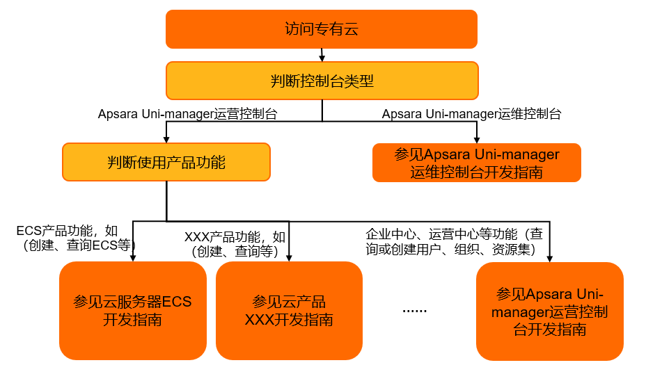
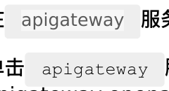

阿里云  
专有云  
云数据库 Redis 版  
开发指南  
产品版本：V3.18.6  
文档版本：20250924

**目录**

- [1.快速入门](#section-1)
    - [1.1. 开发文档使用说明](#section-1-1)
    - [1.2. API调用流程说明](#section-1-2)
- [2.准备工作](#section-2)
    - [2.1. 获取API信息及其EndPoint](#section-2-1)
    - [2.2. 获取AccessKey](#section-2-2)
    - [2.3. 获取公共Header参数](#section-2-3)
    - [2.4. 获取STS AccessKey](#section-2-4)
- [3.通过POP网关调用专有云API](#section-3)
    - [3.1. 调用前置](#section-3-1)
    - [3.2. Java版](#section-3-2)
    - [3.3. Go版](#section-3-3)
    - [3.4. Python版](#section-3-4)
- [4.API参考](#section-4)
    - [4.1. API 概览](#section-4-1)
    - [4.2. 请求结构](#section-4-2)
    - [4.3. 公共参数](#section-4-3)
    - [4.4. 返回结果](#section-4-4)
    - [4.5. 签名机制](#section-4-5)
    - [4.6. 如何使用RAM授权](#section-4-6)
        - [4.6.1. 使用 RAM 实现资源授权](#section-4-6-1)
        - [4.6.2. RAM 中可授权的资源类型](#section-4-6-2)
        - [4.6.3. RAM 中可对资源进行授权的 Action](#section-4-6-3)
        - [4.6.4. API 的鉴权规则](#section-4-6-4)
    - [4.7. 生命周期管理](#section-4-7)
        - [4.7.1. DescribeZones](#section-4-7-1)
        - [4.7.2. CreateInstance](#section-4-7-2)
        - [4.7.3. DeleteInstance](#section-4-7-3)
        - [4.7.4. ModifyInstanceSpec](#section-4-7-4)
    - [4.8. 实例管理](#section-4-8)
        - [4.8.1. RestartInstance](#section-4-8-1)
        - [4.8.2. FlushExpireKeys](#section-4-8-2)
        - [4.8.3. DescribeLogicInstanceTopology](#section-4-8-3)
        - [4.8.4. DescribeEngineVersion](#section-4-8-4)
        - [4.8.5. DescribeInstanceAttribute](#section-4-8-5)
        - [4.8.6. DescribeInstances](#section-4-8-6)
        - [4.8.7. DescribeRegions](#section-4-8-7)
        - [4.8.8. DescribeSecurityIps](#section-4-8-8)
        - [4.8.9. FlushInstance](#section-4-8-9)
        - [4.8.10. ModifyInstanceAttribute](#section-4-8-10)
        - [4.8.11. ModifyInstanceMaintainTime](#section-4-8-11)
        - [4.8.12. ModifyInstanceNetExpireTime](#section-4-8-12)
        - [4.8.13. ModifySecurityIps](#section-4-8-13)
        - [4.8.14. SwitchNetwork](#section-4-8-14)
    - [4.9. 数据加密](#section-4-9)
        - [4.9.1. DescribeEncryptionKey](#section-4-9-1)
        - [4.9.2. DescribeInstanceTDEStatus](#section-4-9-2)
        - [4.9.3. CheckCloudResourceAuthorized](#section-4-9-3)
    - [4.10. 账号管理](#section-4-10)
        - [4.10.1. DescribeUserInfo](#section-4-10-1)
        - [4.10.2. CreateAccount](#section-4-10-2)
    - [4.11. 网络安全](#section-4-11)
        - [4.11.1. DescribeInstanceSSL](#section-4-11-1)
    - [4.12. 连接管理](#section-4-12)
        - [4.12.1. DescribeIntranetAttribute](#section-4-12-1)
        - [4.12.2. ModifyInstanceVpcAuthMode](#section-4-12-2)
        - [4.12.3. AllocateInstancePublicConnection](#section-4-12-3)
    - [4.13. 备份恢复](#section-4-13)
        - [4.13.1. CreateBackup](#section-4-13-1)
        - [4.13.2. ModifyBackupPolicy](#section-4-13-2)
        - [4.13.3. DescribeBackupPolicy](#section-4-13-3)
        - [4.13.4. DescribeBackups](#section-4-13-4)
        - [4.13.5. RestoreInstance](#section-4-13-5)
    - [4.14. 监控管理](#section-4-14)
        - [4.14.1. DescribeMonitorItems](#section-4-14-1)
        - [4.14.2. DescribeHistoryMonitorValues](#section-4-14-2)
    - [4.15. 参数管理](#section-4-15)
        - [4.15.1. DescribeInstanceConfig](#section-4-15-1)
        - [4.15.2. ModifyInstanceConfig](#section-4-15-2)
    - [4.16. 附表](#section-4-16)
        - [4.16.1. 实例规格表](#section-4-16-1)
        - [4.16.2. 错误码表](#section-4-16-2)
        - [4.16.3. 实例配置参数表](#section-4-16-3)

<a id="section-1"></a>

# 1.快速入门

<a id="section-1-1"></a>

## 1.1. 开发文档使用说明

本文为您介绍在使用专有云API进行开发工作时，如何查看所需要的产品文档。

**使用流程**

您可以按照以下流程图中步骤，判断自己所需要使用的开发文档。



**前提条件**

通过运维人员或运营管理员获取专有云的版本。

**操作步骤**

您可以通过阿里云专有云文档中心，获取需要的产品文档。

1. 通过浏览器打开专有云文档中心。

2. 根据专有云的版本单击**企业版**、**敏捷版**或**一体机**标签。

3. 在下拉列表中，选择对应的专有云版本。

   

4. 在左侧导航栏中，选择目标产品名称。

5. 在单击目标文档区域的**查看详情**或**下载PDF**。

<a id="section-1-2"></a>

## 1.2. API调用流程说明

本文为您介绍调用流程及可以参考的文档资料。

**流程图**


**调用步骤**

1. 获取AccessKey。

   获取调用时所需要的AccessKey参数，请参见获取AccessKey。

   > **说明**
   >
   > 推荐使用个人AccessKey调用Apsara Uni-manager运营控制台及云产品接口。

2. 获取RegionID。

   获取调用时所需要的RegionID参数，请参见获取Region ID。

3. 获取组织ID与资源集ID。

   获取调用时所需要的组织ID和资源集ID参数，请参见获取Region ID。

   > **说明**
   >
   > 调用API时，通过Header参数组织ID（&lt;x-acs-organizationid>）和资源集ID（&lt;x-acs-resourcegroupid>）指定组织和资源集，实现实例资源的隔离查询。
   >
   > - 组织ID（&lt;x-acs-organizationid>）不指定则默认获取当前用户所属的组织。
   >
   > - 资源集ID（&lt;x-acs-resourcegroupid>）不指定默认为空，如果指定资源集需要同时指定组织ID。

4. 查找API的开发文档。

   您需要查看目标云产品的开发指南，了解API的功能与使用方式，查找开发指南的方式请参见开发文档使用说明。

5. 获取云产品Endpoint。

6. 获取云产品SDK并调用云产品API。

<a id="section-2"></a>

# 2.准备工作

<a id="section-2-1"></a>

## 2.1. 获取API信息及其EndPoint

首先，您需要了解产品开放API接口的相关信息，包括产品名称（code）、开放API接口名称、API版本。

**背景信息**

Apsara Uni-manager运营控制台API目录中的API信息仅供调用参考，具体API的使用方式需要参见云产品的开发指南。如果发生不一致情况，以开发指南支持情况为准。

**操作步骤**

1. 登录Apsara Uni-manager运营控制台。

2. 在顶部菜单栏选择**产品** > **应用服务** > **开发者门户**。

3. 在**开发者门户**页面，选择**API集成** > **API调试**。

   

4. 在左侧导航栏中选择目标云产品。

5. 在**版本**下拉列表中，选择目标API版本。

6. 在下方API列表中可浏览当前版本的所有API接口。

7. 选中对应接口，在参数名下获取云产品的POP Endpoint信息。

   

<a id="section-2-2"></a>

## 2.2. 获取AccessKey

访问身份验证中通过使用AccessKey ID和AccessKey Secret对称加密的方法来验证某个请求的发送者身份。AccessKey ID用于标示用户，AccessKey Secret是用户用于加密签名的字符串。本文将为您描述如何获取通过RAM授权的AccessKey。

**前提条件**

只有运营管理员和一级组织管理员可以获取组织AccessKey。

**背景信息**

AccessKey支持两种授权模式：

- 通过RAM授权给第三方请求者的AccessKey ID和AccessKey Secret。

- 通过STS授权给第三方请求者的AccessKey ID、AccessKey Secret和Security Token。

本文仅为您介绍如何获取通过RAM授权的AccessKey，通过STS授权的AccessKey获取方式请参见获取STS AccessKey。

推荐使用个人账号AccessKey调用Apsara Uni-manager运营控制台及云产品相关接口。如果使用个人账号AccessKey，需要在Header中添加以下限制性参数，否则可能提示权限不足：

<table>
  <tr>
    <th width="206">参数名称</th>
    <th>描述</th>
  </tr>
  <tr>
    <td>x-acs-regionid</td>
    <td>环境Region，如：cn-hangzhou-*。</td>
  </tr>
  <tr>
    <td>x-acs-organizationid</td>
    <td>Apsara Uni-manager运营控制台中对应的组织ID。获取方法可参见Apsara Uni-manager运营控制台开发指南中的GetOrganizationList文档。</td>
  </tr>
  <tr>
    <td>x-acs-resourcegroupid</td>
    <td>Apsara Uni-manager运营控制台中对应的资源集ID。获取方法可参见Apsara Uni-manager运营控制台开发指南中的ListResourceGroup文档。</td>
  </tr>
  <tr>
    <td>x-acs-instanceid</td>
    <td>进行操作的实例ID，例如，ECS的实例ID可以从ECS列表中查询到。</td>
  </tr>
</table>

> 个人账号AccessKey是由Apsara Uni-manager运营控制台权限体系管控的受限
>
> **警告**
>
> AccessKey，组织AccessKey相对权限较大，需要管理员确认操作的安全性。

**获取个人账号AccessKey**

获取个人账号AccessKey的方法如下：

1. 登录Apsara Uni-manager运营控制台。

2. 在系统界面右上角，将鼠标悬停在当前登录用户的头像上，单击**个人信息**。

3. 在**阿里云AccessKey**区域，您可以查看个人账户的AccessKey信息。

   

   > Accesskey ID和AccessKey Secret是您访问云资源时的密钥，具有该账号完整的权
   >
   > **说明**
   >
   > 限，请您妥善保管。

**获取组织AccessKey**

获取组织AccessKey的方法如下：

1. 管理员登录Apsara Uni-manager运营控制台。

2. 在顶部菜单栏，单击**企业**。

3. 在左侧导航栏中，选择**资源管理 > 组织管理**。

4. 在组织结构中，单击目标一级组织名称。

5. 单击**管理Accesskey**。

6. 在弹出的对话框中，查看组织AccessKey信息。

<a id="section-2-3"></a>

## 2.3. 获取公共Header参数

调用API时需要提供多个Header参数。本文为您介绍如何获取这些参数。并对调用后的一些返回值做出解释。

**获取Region ID**

1. 管理员登录Apsara Uni-manager运营控制台。

2. 在顶部菜单栏中，单击**企业**。

3. 在左侧导航栏中，选择**资源管理**>**地域管理**。

4. 单击目标组织名称。

5. 在右侧**Region列表**中查看**Region名称**，即为Region ID。

**获取组织ID**

组织ID需要通过调用API方式获取，您可以在Apsara Uni-manager运营控制台中通过API在线调试功能快速获取组织ID信息。

1. 管理员登录Apsara Uni-manager运营控制台。

2. 单击顶部菜单栏**产品**，选择**应用服务** > **开发者门户**。

3. 在**开发者门户**页面，选择**API集成** > **API调试**。

4. 单击  按钮，选择**云平台** > **统一云管平台**，**版本**选择**2019-05-10**。

5. 在文本框内输入 `GetOrganizationList` 进行在线调试，在name参数填写目标组织名称后发起调用，调用成功后查看**调用结果**中**id**的信息，即为组织ID。接口信息详见*Apsara Uni-manager运营控制台开发指南*中的章节*GetOrganizationList*。

**获取资源集ID**

资源集ID需要通过调用API方式获取，您可以在Apsara Uni-manager运营控制台中通过API在线调试功能快速获取资源集ID信息。

1. 管理员登录Apsara Uni-manager运营控制台。

2. 单击顶部菜单栏**产品**，选择**应用服务** > **开发者门户**。

3. 在**开发者门户**页面，选择**API集成** > **API调试**。

4. 单击  按钮，选择**云平台** > **统一云管平台**，**版本**选择**2019-05-10**。

5. 在文本框内输入 `ListResourceGroup` 进行在线调试，调用成功后查看**调用结果**中**id**的信息，即为资源集ID。接口信息详见*Apsara Uni-manager运营控制台开发指南*中的章节*ListResourceGroup*。

**获取实例ID**

实例ID可以通过Apsara Uni-manager运营控制台中的云产品实例列表进行获取，本文中以API网关为例，获取步骤如下：

1. 登录Apsara Uni-manager运营控制台。

2. 在顶部的菜单栏中，选择**产品**>应用服务>API网关。

3. 在左侧导航栏中，单击**实例**。

4. 在实例列表中查看**实例ID**。

**返回参数**

对于列表类的云产品资源实例接口，调用后会默认增加如下返回值。

| 名称 | 描述 |
| --- | --- |
| ResourceGroupName | 资源集名称。 |
| ResourceGroup | 资源集ID。 |
| DepartmentName | 组织名称。 |
| Department | 组织ID。 |

<a id="section-2-4"></a>

## 2.4. 获取STS AccessKey

本文为您介绍如何利用STS方式，调用专有云的产品API。

**背景信息**

阿里云临时安全令牌STS（Security Token Service）是阿里云提供的一种临时访问权限管理服务。您可以选择利用STS方式，调用专有云的产品API。

**操作步骤**

1. 获取用户角色的 `RAM Role` 。

   <ol type="i">

   <li>

   登录Apsara Uni-manager运营控制台。

   </li>

   <li>

   单击页面右上角的用户头像，选择**个人信息**。

   </li>

   <li>

   单击**查看当前角色策略**。

   在**当前选择角色策略**对话框中查看 `RAM Role` 。

   </li>

   </ol>

2. 使用以下代码，通过角色的 `RAM Role` 获得 `stsAK` 、 `stsSK` 和 `stsToken` 。

   ```java
   public static void main(String[] args) {
        ASClient asClient = new ASClient();
        // 调⽤来源说明
           asClient.setSdkSource("test");
        // 传入Arn
           String assumeRole = AssumeRole(asClient, "<RAM Role>");

           JSONObject assumeRoleJson = JSONObject.parseObject(assumeRole);

           JSONObject credentials = assumeRoleJson.getJSONObject("Credentials");

           // 获取到STS三元组
           String stsAK = credentials.getString("AccessKeyId");
           String stsSK = credentials.getString("AccessKeySecret");
           String stsToken = credentials.getString("SecurityToken");
   }

   public static String AssumeRole(ASClient asClient, String roleArn) {

           Map<String, String> headers = new HashMap<>();

           Map<String, Object> reqParams = new HashMap<>();

           reqParams.put("action", "AssumeRole");

           reqParams.put("Product", "Sts");

           reqParams.put("Version", "2015-04-01");

           reqParams.put("regionId", regionId);

        // 当前登录⽤户的ak
           reqParams.put("AccessKeyId", <当前⽤户的AccessKey ID>);
        // 当前登录⽤户的sk
           reqParams.put("AccessKeySecret", <当前⽤户的AccessKey Secret>);

           reqParams.put("roleSessionName", "StsUser");

           reqParams.put("roleArn", roleArn);

           return asClient.doRequest(endpoint, headers, reqParams);
   }
   ```

3. 通过STS可以调用云产品的接口，下列代码以ECS为示例。

   ```java
   public static void main(String[] args) {
        ASClient asClient = new ASClient();
           asClient.setSdkSource("test");
     // 调⽤云产品的API
           String ecsRes = DescribeZones(asClient,<stsAK>,<stsSK>,<stsToken>);
   }


   public static String DescribeZones(ASClient asClient, String stsAK, String stsSK, String stsToken) {

           Map<String, String> headers = new HashMap<>();

           Map<String, Object> reqParams = new HashMap<>();

           reqParams.put("action", "DescribeZones");

           reqParams.put("Product", "Ecs");

           reqParams.put("Version", "2014-05-26");

           reqParams.put("regionId", "<your-RegionID>");

           //STS AK/SK/Token三元组
           reqParams.put("AccessKeyId", <stsAK>);
           reqParams.put("AccessKeySecret", <stsSK>);
           reqParams.put("SecurityToken", <stsToken>);

           return asClient.doRequest(endpoint, headers, reqParams, HttpMethod.GET);

       }
   ```

<a id="section-3"></a>

# 3.通过POP网关调用专有云API

<a id="section-3-1"></a>

## 3.1. 调用前置

阿里云专有云与公共云一样，可通过POP网关的方式进行API调用。本文为您介绍调用前需要进行的准备工作。

**背景信息**

为了使专有云保持与公共云相同的使用方式，使您拥有更方便，更一致的体验，建议通过POP网关调用专有云API。

**获取云产品的Endpoint**

**通过开发者门户获取**

1. 登录Apsara Uni-manager运营控制台。

2. 在顶部菜单栏选择**产品** > **应用服务** > **开发者门户**。

3. 在**开发者门户**页面，选择**API集成** > **API调试**。

   

4. 在左侧导航栏中选择目标云产品。

5. 在**版本**下拉列表中，选择目标API版本。

6. 在下方API列表中可浏览当前版本的所有API接口。

7. 选中对应接口，在参数名下获取云产品的POP Endpoint信息。

   

**通过飞天基础运维平台获取**

通过POP网关调用专有云API时需要使用云产品业务域的Endpoint。您可以在阿里云驻场运维工程师处获取。

您也可以自行获取Endpoint，本文以API网关为例为您介绍获取云产品业务域Endpoint的方法。

1. 登录Apsara Uni-manager运维控制台。

2. 顶部菜单栏选择**平台运维** > **飞天基础运维平台** > **运维工具**。

3. 在左侧导航栏，选择**运维工具** > **服务注册变量大盘**。

4. 在服务注册变量大盘页面，单击**高级筛选**。

5. 在Service Registration文本框中输入 `apigateway` ，单击**搜索**。

   

   

6. 在 apigateway 服务的**Service Registration**列中，单击  图标。

7. 单击 `apigateway` 服务**Service Registration**列的文本信息，在弹出的**注册变量**对话框中，查看apigateway.openapi.endpoint值，即 `Endpoint` 。

**获取公共参数**

通过POP网关调用专有云API过程中所使用的参数，如组织ID、资源集ID、RegionID和实例ID，获取方式请参见获取Region ID。

<a id="section-3-2"></a>

## 3.2. Java版

通过POP Java SDK访问产品域名，需要了解该产品调用方式(RPC或ROA)。

**前提条件**

目前专有云推荐使用CommonRequest进行调用，可以在Apsara Uni-manager运营控制台**产品** > **应用服务** > **开发者门户**，选择**API集成** > **SDK示例**查看推荐SDK版本以及示例代码。

> **重要**
>
> 不建议直接从SDK中心下载SDK到专有云场景下使用，公有云的SDK不一定支持专有云的API，可能存在兼容性问题，请谨慎使用！

**CommonRequest调用示例**

RPC调用，示例接口信息：产品（apigateway）、接口（DescribeApiGroups）、版本（2016-07-14）。

调用示例如下：

```xml
import com.aliyuncs.CommonRequest;
import com.aliyuncs.CommonResponse;
import com.aliyuncs.DefaultAcsClient;
import com.aliyuncs.IAcsClient;
import com.aliyuncs.exceptions.ClientException;
import com.aliyuncs.exceptions.ServerException;
import com.aliyuncs.http.MethodType;
import com.aliyuncs.profile.DefaultProfile;

public class DescribeApiGroups {

    public static void main(String[] args) {
        // 创建DefaultAcsClient实例并初始化。
        DefaultProfile profile = DefaultProfile.getProfile("<your-regionid>", "
<yourAccessKeyId>", "<yourAccessSecret>");

        // 忽略SSL
        // HttpClientConfig clientConfig = HttpClientConfig.getDefault();
        // clientConfig.setIgnoreSSLCerts(true);
        // 设置连接超时
        // clientConfig.setConnectionTimeoutMillis(3000L);
        // 设置读取超时
        // clientConfig.setReadTimeoutMillis(10000L);
        // profile.setHttpClientConfig(clientConfig);
        
        IAcsClient client = new DefaultAcsClient(profile);
        // 创建API请求并设置参数。
        CommonRequest request = new CommonRequest();
        // 设置请求⽅式
        request.setSysMethod(MethodType.POST);
        // 设置云产品Endpoint
        request.setSysDomain("<apigatewayEndpoint>");
        // 设置访问接⼝版本
        request.setSysVersion("2016-07-14");
        // 设置LocationProduct
        request.setSysLocationProduct("apigateway");
        // 设置访问接⼝的名称
        request.setSysAction("DescribeApiGroups");
        
        // 当使⽤sts ak调⽤RPC接⼝时需要在参数中加上SecurityToken字段
        // request.putBodyParameter("SecurityToken", "<your-SecurityToken>");

        // 业务参数
        request.putQueryParameter("PageSize", "10");
        request.putQueryParameter("PageNumber", "1");

        // 必填值，调⽤来源说明
        request.putHeadParameter("x-acs-caller-sdk-source", "ApiTestDemo");
        // 非必填，企业版V3.15.0之前历史版本需要
        request.putHeadParameter("x-acs-regionid", "<your-regionid>");
        // 非必填，资源集ID
        request.putHeadParameter("x-acs-resourcegroupid", "<your-resourcegroupid>");
        // 必填, 组织ID
        request.putHeadParameter("x-acs-organizationid", "<your-organizationid>");
        // 非必填，修改&删除操作需要
        // request.putHeadParameter("x-acs-instanceid", "<your-instanceid>");

        try {
            // 发起请求并处理应答或异常。
            CommonResponse response = client.getCommonResponse(request);
            System.out.println(response.getData());
        } catch (ServerException e) {
            e.printStackTrace();
        } catch (ClientException e) {
            System.out.println("ErrCode:" + e.getErrCode());
            System.out.println("ErrMsg:" + e.getErrMsg());
            System.out.println("RequestId:" + e.getRequestId());
        }

    }
}
```

ROA调用，示例接口信息：产品（CR）接口（GetNamespaceList）版本（2016-06-07）。

调用示例如下：

```xml
import com.aliyuncs.CommonRequest;
import com.aliyuncs.CommonResponse;
import com.aliyuncs.DefaultAcsClient;
import com.aliyuncs.IAcsClient;
import com.aliyuncs.exceptions.ClientException;
import com.aliyuncs.exceptions.ServerException;
import com.aliyuncs.http.MethodType;
import com.aliyuncs.profile.DefaultProfile;

public class GetNamespaceList {

    public static void main(String[] args) {
        // 创建DefaultAcsClient实例并初始化。
        DefaultProfile profile = DefaultProfile.getProfile("<your-regionid>", "
<yourAccessKeyId>", "<yourAccessSecret>");

        // 忽略SSL
        // HttpClientConfig clientConfig = HttpClientConfig.getDefault();
        // clientConfig.setIgnoreSSLCerts(true);
        // 设置连接超时
        // clientConfig.setConnectionTimeoutMillis(3000L);
        // 设置读取超时
        // clientConfig.setReadTimeoutMillis(10000L);
        // profile.setHttpClientConfig(clientConfig);
        
        IAcsClient client = new DefaultAcsClient(profile);
        // 创建API请求并设置参数。
        CommonRequest request = new CommonRequest();

        // 设置HTTPS访问
        request.setSysProtocol(ProtocolType.HTTP);
        // 设置请求⽅式
        request.setSysMethod(MethodType.GET);
        // 设置云产品endpoint
        request.setSysDomain("<crEndpoint>");
        // 设置访问接⼝版本
        request.setSysVersion("2016-06-07");
        // 设置uriPattern 只有roa调⽤需要传递此字段
        request.setSysUriPattern("/namespace");
        // 设置LocationProduct
        request.setSysLocationProduct("cr");
        // 设置访问接⼝的名称
        request.setSysAction("GetNamespaceList");

        // 必填值，调⽤来源说明
        request.putHeadParameter("x-acs-caller-sdk-source", "ApiTestDemo");
        // 非必填，企业版V3.15.0之前历史版本需要
        request.putHeadParameter("x-acs-regionid", "<your-regionid>");
        // 非必填,资源集ID
        request.putHeadParameter("x-acs-resourcegroupid", "<your-resourcegroupid>");
        // 必填,组织ID
        request.putHeadParameter("x-acs-organizationid", "<your-organizationid>");
        // 非必填，修改&删除操作需要
        // request.putHeadParameter("x-acs-instanceid", "<your-instanceid>");


        // 当使⽤STS AK调⽤ROA接⼝时需要在Header加上x-acs-security-token字段
        // request.putHeadParameter("x-acs-security-token", "<your-securitytoken>");

        try {
            // 发起请求并处理应答或异常。
            CommonResponse response = client.getCommonResponse(request);
            System.out.println(response.getData());
        } catch (ServerException e) {
            e.printStackTrace();
        } catch (ClientException e) {
            System.out.println("ErrCode:" + e.getErrCode());
            System.out.println("ErrMsg:" + e.getErrMsg());
            System.out.println("RequestId:" + e.getRequestId());
        }

    }
}
```

> **重要**
>
> 使用HTTPS协议访问OpenAPI时，SDK会默认开启校验SSL/TLS 证书有效性，若您代码环境没有证书环境，则会报错证书校验失败。
>
> 为保障生产环境通信安全，建议您保持开启，若在测试环境必须忽略证书校验，可以通过以下参数设置：
>
> Java
>
> ```text
> HttpClientConfig clientConfig = HttpClientConfig.getDefault();
> // 设置不校验服务端证书
> clientConfig.setIgnoreSSLCerts(true)
> ```

<a id="section-3-3"></a>

## 3.3. Go版

本文为您介绍POP Go SDK调用的方式。

**前提条件**

目前专有云推荐使用CommonRequest进行调用，可以在Apsara Uni-manager运营控制台**产品** > **应用服务** > **开发者门户**，选择**API集成** > **SDK示例**查看推荐SDK版本以及示例代码。

> **重要**
>
> 不建议直接从SDK中心下载SDK到专有云场景下使用，公有云的SDK不一定支持专有云的API，可能存在兼容性问题，请谨慎使用！

**背景信息**

当前支持RPC和ROA的方式调用API。

**CommonRequest调用示例**

RPC方式调用示例接口信息：产品（apigateway）、接口（DescribeApiGroups）、版本（2016-07-14）。

示例代码如下：

```go
package main

import (
    "fmt"
    "github.com/aliyun/alibaba-cloud-sdk-go/sdk"
    "github.com/aliyun/alibaba-cloud-sdk-go/sdk/requests"
  
)

func main() {
    client, err := sdk.NewClientWithAccessKey("<your-RegionID>", "<AccessKey ID>", "<AccessKey Secret>")

    request := requests.NewCommonRequest()
    
    request.Method = "POST"
    request.Domain = "<ApigatewayEndpoint>"
    request.Version = "2016-07-14"
    request.ApiName = "DescribeApiGroups"
    request.Product = "apigateway"
    // 当使⽤sts ak调⽤rpc接⼝时需要在参数中加上SecurityToken字段
    // request.QueryParams["SecurityToken"]="<your-SecurityToken>"

    // 必填值，调⽤来源说明
    request.Headers["x-acs-caller-sdk-source"] = "ApiTestDemo"
    // 非必填，企业版V3.15.0之前历史版本需要
    request.Headers["x-acs-regionid"] = "<your-RegionID>"
    // 非必填，资源集ID
    request.Headers["x-acs-resourcegroupid"] = "<your-ResourceGroupID>"
    // 必填，组织ID
    request.Headers["x-acs-organizationid"] = "<your-OrganizationID>"
    // 非必填，修改&删除操作需要
    // request.Headers["x-acs-instanceid"] = "<your-InstanceID>"

    response, err := client.ProcessCommonRequest(request)
    if err != nil {
        panic(err)
    }
    fmt.Print(response.GetHttpContentString())
}
```

ROA调用示例接口信息：产品（CR）接口（GetNamespaceList）版本（2016-06-07）。

调用示例如下：

```xml
package main

import (
 "fmt"
 "github.com/aliyun/alibaba-cloud-sdk-go/sdk"
 "github.com/aliyun/alibaba-cloud-sdk-go/sdk/requests"
 "os"
)


func main() {
    client, err := sdk.NewClientWithAccessKey("<your-regionid>", "<yourAccessKeyId>", "
<yourAccessSecret>")
 request := requests.NewCommonRequest()

 request.Method = "GET"
 request.Domain = "<crEndpoint>"
 request.Version = "2016-06-07"
 request.ApiName = "GetNamespaceList"
 request.Product = "cr"

 request.PathPattern = "/namespace"
 // 当使⽤sts ak调⽤ROA接⼝时需要在header中加上x-acs-security-token字段
 // request.Headers["x-acs-security-token"] = "<your-SecurityToken>"
 // 必填值，调⽤来源说明
 request.Headers["x-acs-caller-sdk-source"] = "ApiTestDemo"
    // 非必填，企业版V3.15.0之前历史版本需要
    request.Headers["x-acs-regionid"] = "<your-RegionID>"
    // 非必填，资源集ID
    request.Headers["x-acs-resourcegroupid"] = "<your-ResourceGroupID>"
    // 必填，组织ID
    request.Headers["x-acs-organizationid"] = "<your-OrganizationID>"
 // 非必填，修改&删除操作需要
 // request.Headers["x-acs-instanceid"] = "<your-InstanceID>"

 response, err := client.ProcessCommonRequest(request)
 if err != nil {
  panic(err)
 }
 fmt.Print(response.GetHttpContentString())
}
```

**设置代理**

当您在调用实例时，或许会需要设置代理，您可以通过以下两种方式设置代理。

- 通过环境变量设置。

  环境变量HTTP_PROXY、HTTPS_PROXY或者NO_PROXY。

  设置代码如下：

  ```go
  import (
      "os"
  )
  func main(){
   os.Setenv("HTTP_PROXY", "http://x.x.x.x:xxxx") // 设置 HTTP_PROXY 环境变量
   os.Setenv("HTTPS_PROXY", "https://x.x.x.x:xxxx") // 设置 HTTPS_PROXY 环境变量
  }
  ```

- 通过客户端设置。

  设置代码如下：

  ```text
  // 客户端设置代理优先级比环境变量⾼
  client.SetHttpProxy("http://x.x.x.x:xxxx")   // 设置http代理
  client.GetHttpProxy()                          // 获取http代理

  client.SetHttpsProxy("https://x.x.x.x:xxxx")   // 设置https代理
  client.GetHttpsProxy()                           // 获取https代理

  client.SetNoProxy("127.0.0.1,localhost")     // 设置代理⽩名单
  client.GetNoProxy()                          // 获取代理⽩名单
  ```

**SSL验证**

**摘要**

请求时验证SSL证书行为。

- 设置成 `true` ，禁用证书验证（这是不安全的，请设置证书！）。

- 设置成 `false` ，启用SSL证书验证，默认使用操作系统提供的CA证书。

**默认值**

默认值为 `false` 。

**设置**

> **重要**
>
> 使用HTTPS协议访问OpenAPI时，SDK会默认开启校验SSL证书有效性，若您代码环境没有证书环境，则会报错证书校验失败。为保障生产环境通信安全，建议您保持开启，若在测试环境必须忽略证书校验，可参考如下内容进行设置。

```text
// 设置请求 HTTPSInsecure（只影响当前）
request.SetHTTPSInsecure(true)                           // 设置请求 HTTPSInsecure 为 true
isInsecure := request.GetHTTPSInsecure()                 // 获取请求 HTTPSInsecure
```

当请求未设置时，客户端设置才能生效。

```text
// 设置客户端 HTTPSInsecure（⽤于客户端发送的所有请求）。
client.SetHTTPSInsecure(true)                         // 设置客户端 HTTPSInsecure 为 trueisInsecure := client.GetHTTPSInsecure()               // 获取客户端 HTTPSInsecure
```

<a id="section-3-4"></a>

## 3.4. Python版

本文为您介绍POP Python SDK调用云产品API的方式。

**前提条件**

目前专有云推荐使用CommonRequest进行调用，可以在Apsara Uni-manager运营控制台**产品** > **应用服务** > **开发者门户**，选择**API集成** > **SDK示例**查看推荐SDK版本以及示例代码。

> **重要**
>
> 不建议直接从SDK中心下载SDK到专有云场景下使用，公有云的SDK不一定支持专有云的API，可能存在兼容性问题，请谨慎使用！

**背景信息**

目前仅支持通过RPC方式调用API。

**CommonRequest调用示例**

调用示例接口信息：产品（ECS）、接口（DescribeInstances）、版本（2014-05-26）。

示例代码如下：

```python
from aliyunsdkcore.client import AcsClient
import os
from aliyunsdkcore.request import CommonRequest

# 创建AcsClient实例
client = AcsClient(
    "<AccessKey ID>",
    "<AccessKey Secret>",
    "<your-RegionID>",
    timeout=1000,  # 设置超时时间
    verify=False, # 忽略证书或者verify='<证书位置>'
);
# 和https⼀起使⽤
# client.set_verify(False)
# os.environ["HTTPS_PROXY"] = "http://127.0.0.1:8080"

# os.environ["HTTP_PROXY"] = "http://127.0.0.1:8080"
def describe_api_groups():
    # 创建request，并设置参数
    request = CommonRequest()

    # 当使⽤sts ak调⽤rpc接⼝时需要在参数中加上SecurityToken字段
    # params = {"PageSize":"10","PageNumber":"1","SecurityToken":"<your-
SecurityToken>"};
    params = {"PageSize":"10","PageNumber":"1"};
    request.set_query_params(params)

    headers = {
        # 必填值，调⽤来源说明
        "x-acs-caller-sdk-source":"ApiTestDemo",
        # 非必填，企业版V3.15.0之前历史版本需要
        "x-acs-regionid":"<your-RegionID>",
        # 非必填，资源集ID
        "x-acs-resourcegroupid":"<your-ResourceGroupID>",
        # 必填，组织ID
        "x-acs-organizationid":"<your-OrganizationID>"
        # 非必填，修改&删除操作需要
        # "x-acs-instanceid":"<your-InstanceID>"

    }
    request.set_headers(headers)
    request.set_version("2016-07-14")
    request.set_action_name("DescribeApiGroups")
    request.set_endpoint("<ApigatewayEndpoint>")   //Endpoint请替换为真实地址
    request.set_product("apigateway")
    request.set_method("POST")

    # 发起API请求并显示返回值
    response = client.do_action_with_exception(request)
    print(response)


if __name__ == '__main__':
    print("Hello Aliyun OpenApi!")
    describe_api_groups()
```

**设置代理**

调用API时您或许需要通过环境变量设置HTTP_PROXY、HTTPS_PROXY。

示例代码如下：

```text
# https的代理 
os.environ["HTTPS_PROXY"] = "http://x.x.x.x:xxxx"

# http的代理
os.environ["HTTP_PROXY"] = "https://x.x.x.x:xxxx"
```

**HTTPS配置**

下面介绍使用HTTPS协议进行OpenAPI访问。

**使用HTTPS协议**

SDK默认使用HTTPS协议。

```python
from aliyunsdkecs.request.v20140526.DescribeInstancesRequest import 
DescribeInstancesRequest
from aliyunsdkcore.client import AcsClient
client = AcsClient(
    region_id='<region_id>',  # 地域ID
)

request = DescribeInstancesRequest()
request.set_protocol_type('https')  # 使⽤https

client.do_action_with_exception(request)   
```

**忽略证书**

> **重要**
>
> - 使用HTTPS协议访问OpenAPI时，SDK会默认开启校验SSL/TLS证书有效性，若您代码环境没有证书环境，则会报错证书校验失败。
>
> - 为保障生产环境通信安全，建议您保持开启，若在测试环境必须忽略证书校验，可以通过参数 `verify` 设置。

```python
from aliyunsdkcore.client import AcsClient
client = AcsClient(
    region_id='<region_id>',  # 地域ID
    verify=False  # 忽略对 SSL 证书的验证
)
```

**指定CA证书文件**

```python
from aliyunsdkcore.client import AcsClient
client = AcsClient(
    region_id='<region_id>',  # 地域ID
    verify='./cacert.pem'  # 证书路径
)
```

<a id="section-4"></a>

# 4.API参考

<a id="section-4-1"></a>

## 4.1. API 概览

表 1. 实例生命周期管理接口

| API | 描述 |
| --- | --- |
| CreateInstance | 创建实例 |
| DeleteInstance | 释放实例 |
| ModifyInstanceSpec | 变更实例 |

表 2. 实例管理接口

| API | 描述 |
| --- | --- |
| DescribeInstanceAttribute | 查询实例详情 |
| DescribeInstances | 查询实例基础信息 |
| DescribeRegions | 查询实例可售卖地域 |
| DescribeSecurityIps | 查询允许访问实例的 IP 名单 |
| FlushInstance | 清空实例 |
| ModifyInstanceAttribute | 修改实例属性 |
| ModifyInstanceMaintainTime | 修改实例可运维时间 |
| ModifySecurityIps | 修改实例白名单 |
| ModifyInstanceNetExpireTime | 修改经典网络域名的保留时间 |
| SwitchNetwork | 修改网络类型 |

表 3. 备份恢复接口

| API | 描述 |
| --- | --- |
| CreateBackup | 创建备份 |
| ModifyBackupPolicy | 修改备份策略 |
| DescribeBackupPolicy | 查询备份策略 |
| DescribeBackups | 显示备份列表 |
| RestoreInstance | 基于备份集回滚实例 |

表 4. 监控管理接口

| API | 描述 |
| --- | --- |
| DescribeMonitorItems | 查看监控项列表 |
| DescribeHistoryMonitorValues | 查看历史监控 |

表 5. 参数管理接口

| API | 描述 |
| --- | --- |
| DescribeInstanceConfig | 查看实例参数配置 |
| ModifyInstanceConfig | 修改参数配置 |

<a id="section-4-2"></a>

## 4.2. 请求结构

**服务地址**

Redis API 的服务接入地址为 `r-kvstore.example.com` 。

> **说明**
>
> *example.com*是项目自定义的访问域名，请联系管理员获取该域名。

**通信协议**

支持通过 HTTP 或 HTTPS 通道进行请求通信。为了获得更高的安全性，推荐您使用 HTTPS 通道发送请求。

**请求方法**

支持 HTTP GET 方法发送请求，这种方式下请求参数需要包含在请求的 URL 中。

**请求参数**

每个请求都需要指定要执行的操作，即 Action 参数（例如 CreateInstance），以及每个操作都需要包含的公共请求参数和指定操作所特有的请求参数。

**字符编码**

请求及返回结果都使用 UTF-8 字符集进行编码。

<a id="section-4-3"></a>

## 4.3. 公共参数

公共请求参数是指每个接口都需要使用到的请求参数。

**公共请求参数**

表 1. 公共请求参数

| 名称 | 类型 | 是否必须 | 描述 |
| --- | --- | --- | --- |
| Format | String | 是 | 返回值的类型，支持 JSON 与 XML。默认为 XML。 |
| Version | String | 是 | API 版本号，为日期形式：YYYY-MM-DD，本版本对应为2015-01-01。 |
| AccessKeyId | String | 是 | 阿里云颁发给用户的访问服务所用的密钥 ID。 |
| Signature | String | 是 | 签名结果串，关于签名的计算方法，请参见签名机制。 |
| SignatureMeth od | String | 是 | 签名方式，目前支持 HMAC-SHA1。 |
| Timestamp | String | 是 | 请求的时间戳。日期格式按照ISO8601标准表示，并需要使用 UTC 时间。格式为<code> YYYY-MM-DDThh:mm:ssZ </code>。例如，2016-01-01T12:00:00Z（为北京时间2016年1月1日20点0分0秒）。 |
| SignatureVersi on | String | 是 | 签名算法版本，目前版本是1.0。 |
| SignatureNonc e | String | 是 | 唯一随机数，用于防止网络重放攻击。用户在不同请求时间要使用不同的随机数值。 |

```text
https:// r-kvstore.example.com/
?Format=json
&Version=2015-01-01
&Signature=Pc5xxxxxxxxxxxxxxxxxx 
&SignatureMethod=HMAC-SHA1
&SignatureNonce=15215528852396
&SignatureVersion=1.0
&AccessKeyId=key-test
&Timestamp=2016-01-01T12:00:00Z
```

**公共返回参数**

用户每次发送的接口调用请求，无论成功与否，系统都会返回一个唯一识别码 RequestId 给用户。

```xml
<?xml version="1.0" encoding="utf-8"?> 
<!—结果的根结点-->
<接⼝名称+Response>
<!—返回请求标签-->
<RequestId>4C4fdsf38-3910-447D-87AD-AC078932216</RequestId>
<!—返回结果数据-->
</接⼝名称+Response>
```

<a id="section-4-4"></a>

## 4.4. 返回结果

调用 API 服务后返回数据采用统一格式。返回的 HTTP 状态码为 `2xx` 代表调用成功；返回 `4xx` 或 `5xx` 的 HTTP 状态码代表调用失败。调用成功返回的数据格式主要有 XML 和 JSON 两种，外部系统可以在请求时传入参数来制定返回的数据格式，默认为 XML 格式。

> 本文档中的返回示例为了便于用户查看，做了格式化处理，实际返回结果是没有进行换
>
> **说明**
>
> 行、缩进等处理的。

**成功结果**

XML 返回结果包括请求是否成功信息和具体的业务数据。示例如下：

```xml
<?xml version="1.0" encoding="utf-8"?> 
<!—结果的根结点-->
<接⼝名称+Response>
<!—返回请求标签-->
<RequestId>4C4fdsf38-3910-447D-87AD-AC078932216</RequestId>
<!—返回结果数据-->
</接⼝名称+Response>
```

JSON 示例：

```json
{
"RequestId": "4C4fdsf38-3910-447D-87AD-AC078932216",
/* 返回结果数据 */
}
```

**错误结果**

调用接口出错后，将不会返回结果数据。调用方可根据附表错误代码表来定位错误原因。当调用出错时，HTTP 请求返回一个 `4xx` 或 `5xx` 的 HTTP 状态码。返回的消息体中是具体的错误代码及错误信息。另外还包含一个全局唯一的请求 ID:RequestId 和一个您该次请求访问的站点 ID:HostId。若在调用方找不到错误原因，可以联系专有云客服，并提供该 HostId 和 RequestId，以便我们尽快帮您解决问题。

```xml
<?xml version="1.0" encoding="UTF-8"?>
<Error>
<RequestId>8906582E-6722-409A-A6C4-0E7863B733A5</RequestId>
<HostId> r-kvstore.example.com</HostId>
<Code>UnsupportedOperation</Code>
<Message>The specified action is not supported.</Message>
</Error>
```

JSON 示例：

```json
{
"RequestId": "7463B73D-35CC-4D19-A010-6B8D65D242EF",
"HostId": " r-kvstore.example.com",
"Code": "UnsupportedOperation",
"Message": "The specified action is not supported."
}
```

<a id="section-4-5"></a>

## 4.5. 签名机制

Redis 服务会对每个访问的请求进行身份验证，所以无论使用 HTTP 还是 HTTPS 协议提交请求，都需要在请求中包含签名（Signature）信息。Redis 服务通过使用 Access Key ID 和 Access Key Secret 进行对称加密的方法来验证请求的发送者身份。

Access Key ID 和 Access Key Secret 由阿里云官方颁发给访问者（可以通过阿里云官方网站申请和管理），其中 Access Key ID 用于标识访问者的身份；Access Key Secret 是用于加密签名字符串和服务器端验证签名字符串的密钥，必须严格保密，只有阿里云和用户知道。

AccessKey的获取方法，请参见获取AccessKey。

**签名处理**

用户在访问时，按照下面的方法对请求进行签名处理：

1. 使用请求参数构造规范化的请求字符串（Canonicalized Query String）。

   <ol type="i">

   <li>

   按照参数名称的字典顺序对请求中所有的请求参数（包括文档中描述的“公共请求参数”和指定请求接口的自定义参数，但不能包括“公共请求参数”中提到 Signature 参数本身）进行排序。

   > 当使用 GET 方法提交请求时，这些参数就是请求 URI 中的参数部分（即 URI
   >
   > **说明**
   >
   > 中“?”之后由“&”连接的部分）。

   </li>

   <li>

   对每个请求参数的名称和值进行编码。名称和值要使用 UTF-8 字符集进行 URL 编码。URL 编码的编码规则如下：

   - 对于字符 A~Z、a~z、0~9 以及字符“-”、“_”、“.”、“~”不编码；

   - 对于其它字符编码成  `%XY`  的格式，其中  `XY`  是字符对应 ASCII 码的 16 进制表示。比如英文的双引号（”）对应的编码为  `%22` ；

   - 对于扩展的 UTF-8 字符，编码成  `%XY%ZA…`  的格式；

   - 英文空格（ ）要编码成  `%20` ，而不是加号（+）。

   > 一般支持 URL 编码的库（比如 Java 中的 java.net.URLEncoder）都是按
   >
   > **说明**
   >
   > 照 `application/x-www-form-urlencoded` 的 MIME 类型的规则进行编码的。实现时可以直接使用这类方式进行编码，把编码后的字符串中加号（+）替换成 `%20` 、星号（\*）替换成 `%2A` 、 `%7E` 替换回波浪号（~），即可得到上述规则描述的编码字符串。

   </li>

   <li>

   对编码后的参数名称和值使用英文等号（=）进行连接。

   </li>

   <li>

   再把英文等号连接得到的字符串按参数名称的字典顺序依次使用&符号连接，即得到规范化请求字符串。

   </li>

   </ol>

2. 使用上一步构造的规范化字符串按照下面的规则构造用于计算签名的字符串：

   ```text
    StringToSign=
    HTTPMethod + “&” +
    percentEncode(“/”) + ”&” +
    percentEncode(CanonicalizedQueryString)
   ```

   其中：

   - `HTTPMethod`  是提交请求用的 HTTP 方法，比如 GET。

     

   - `percentEncode(“/”)`  是按照步骤 1.b 中描述的 URL 编码规则对字符 “/” 进行编码得到的值，即  `%2F` 。

   - `percentEncode(CanonicalizedQueryString)`  是对步骤 1 中构造的规范化请求字符串按步骤 1.b中描述的 URL 编码规则编码后得到的字符串。

3. 按照 RFC2104 的定义，使用上面的用于签名的字符串计算签名 HMAC 值。

   > 计算签名时使用的 Key 就是用户持有的 Access Key Secret 并加上一个“&”字符
   >
   > **说明**
   >
   > （ASCII:38），使用的哈希算法是 SHA1。

4. 按照 Base64 编码规则把上面的 HMAC 值编码成字符串，即得到签名值（Signature）。

5. 将得到的签名值作为 Signature 参数添加到请求参数中，即完成对请求签名的过程。

   > 得到的签名值在作为最后的请求参数值提交给 Redis 服务器的时候，要和其他参数一
   >
   > **说明**
   >
   > 样，按照 RFC3986 的规则进行 URL 编码。

**示例**

以 DescribeDBInstances 为例，签名前的请求 URL 如下：

```text
http://r-kvstore.example.com/?Timestamp=2013-06-
01T10:33:56Z&Format=XML&AccessKeyId=testid&Action=DescribeInstances&SignatureMethod=HMAC-
SHA1&RegionId=region1&SignatureNonce=NwDAxvLU6tFE0DVb&Version=2015-01-
01&SignatureVersion=1.0
```

计算得到的待签名字符串 StringToSign 为：

```text
GET&%2F&AccessKeyId%3Dtestid&Action%3DDescribeInstances&Format%3DXML&RegionId%3Dregion1&S
natureMethod%3DHMAC-
SHA1&SignatureNonce%3DNwDAxvLU6tFE0DVb&SignatureVersion%3D1.0&Timestamp%3D2013-06-01T10%253A33%253A56Z&Version%3D2015-01-01
```

假如使用的 Access Key Id 是 `testid` ，Access Key Secret 是 `testsecret` ，用于计算 HMAC 的Key 就是 `testsecret&` ，则计算得到的签名值是  `BIxxxxxxxxxxxxxxxxxxxxxx=` 。

签名后的请求 URL 为（注意增加了 Signature 参数）：

```text
http://r-kvstore.example.com/?Timestamp=2013-06-
01T10%3A33%3A56Z&Format=XML&AccessKeyId=testid&Action=DescribeInstances&SignatureMethod=H
C-
SHA1&RegionId=region1&SignatureNonce=NwDAxvLU6tFE0DVb&SignatureVersion=1.0&Version=2015-
01-01&Signature=BIPOMlxxxxxxxxxxxxxxxxxxu8LXBeZtLQkJTw6iFvw1E%3D
```

<a id="section-4-6"></a>

## 4.6. 如何使用RAM授权

<a id="section-4-6-1"></a>

### 4.6.1. 使用 RAM 实现资源授权

您通过云账号创建的实例，都是该账号拥有的资源。默认情况下，账号对自己的资源拥有完整的操作权限。

使用阿里云的 RAM（Resource Access Management）服务，您可以将云账号下的资源的访问及管理权限授予 RAM 中子用户。

> 如果您不需要使用 RAM，请略过此章节。
>
> **说明**

<a id="section-4-6-2"></a>

### 4.6.2. RAM 中可授权的资源类型

云数据库KVStore for Redis可以在 RAM 中进行授权的资源类型仅一种：instance。

在通过 RAM 进行授权时，资源的描述方式如下：

<table>
  <tr>
    <th width="94">资源类型</th>
    <th>授权策略中的资源描述方式</th>
  </tr>
  <tr>
    <td>Instance</td>
    <td>acs:kvstore:$regionid:$accountid:instance/$insta nceid acs:kvstore:$regionid:$accountid:instance/acs:kvstore:::instance/</td>
  </tr>
</table>

其中，所有 $regionid 应为某个 region 的 ID，或者 `*` ；所有 $instanceid 应为某个 instance 的ID，或者 `*` ；以此类推，$account-id 是云账号的数字 ID，可以用 `*` 代替。

<a id="section-4-6-3"></a>

### 4.6.3. RAM 中可对资源进行授权的 Action

RAM 中可对资源进行授权的 Action 如下列表所示。

- CreateInstance

- DeleteInstance

- ModifyInstanceSpec

- RenewInstance

- RenewMultiInstance

- TransformToPrePaid

- ModifyInstanceAttribute

- FlushInstance

- DescribeInstances

- DescribeInstanceAttribute

- ModifyInstanceMaintainTime

- ModifySecurityIps

- SwitchNetwork

- ModifyInstanceNetExpireTime

- CreateBackup

- ModifyBackupPolicy

- DescribeBackupPolicy

- DescribeBackups

- RestoreInstance

- DescribeHistoryMonitorValues

- DescribeInstanceConfig

- ModifyInstanceConfig

<a id="section-4-6-4"></a>

### 4.6.4. API 的鉴权规则

当子用户通过 API 进行资源访问时，后台向 RAM 进行权限检查，以确保调用者拥有响应权限。

每个不同的 API 会根据涉及到的资源以及 API 的语义来确定需要检查哪些资源的权限。具体地，每个 API的鉴权规则见下表。表 1. 鉴权规则

| Action | 鉴权规则 |
| --- | --- |
| CreateDBInstance | acs:kvstore:$regionid:$accountid:instance/$insta nceid |
| DeleteInstance | acs:kvstore:$regionid:$accountid:instance/$insta nceid |
| ModifyInstanceSpec | acs:kvstore:$regionid:$accountid:instance/$insta nceid |
| RenewInstance | acs:kvstore:$regionid:$accountid:instance/$insta nceid |
| RenewMultiInstance | acs:kvstore:$regionid:$accountid:instance/$insta nceid |
| TransformToPrePaid | acs:kvstore:$regionid:$accountid:instance/$insta nceid |
| ModifyInstanceAttribute | acs:kvstore:$regionid:$accountid:instance/$insta nceid |
| FlushInstance | acs:kvstore:$regionid:$accountid:instance/$insta nceid |
| DescribeInstances | acs:kvstore:$regionid:$accountid:instance/$insta nceid |
| DescribeInstanceAttribute | acs:kvstore:$regionid:$accountid:instance/$insta nceid |
| ModifyInstanceMaintainTime | acs:kvstore:$regionid:$accountid:instance/$insta nceid |
| ModifySecurityIps | acs:kvstore:$regionid:$accountid:instance/$insta nceid |
| SwitchNetwork | acs:kvstore:$regionid:$accountid:instance/$insta nceid |
| ModifyInstanceNetExpireTime | acs:kvstore:$regionid:$accountid:instance/$insta nceid |
| CreateBackup | acs:kvstore:$regionid:$accountid:instance/$insta nceid |
| ModifyBackupPolicy | acs:kvstore:$regionid:$accountid:instance/$insta nceid |
| DescribeBackupPolicy | acs:kvstore:$regionid:$accountid:instance/$insta nceid |
| DescribeBackups | acs:kvstore:$regionid:$accountid:instance/$insta nceid |
| RestoreInstance | acs:kvstore:$regionid:$accountid:instance/$insta nceid |
| DescribeHistoryMonitorValues | acs:kvstore:$regionid:$accountid:instance/$insta nceid |
| DescribeInstanceConfig | acs:kvstore:$regionid:$accountid:instance/$insta nceid |
| ModifyInstanceConfig | acs:kvstore:$regionid:$accountid:instance/$insta nceid |

<a id="section-4-7"></a>

## 4.7. 生命周期管理

<a id="section-4-7-1"></a>

### 4.7.1. DescribeZones

调用DescribeZones接口查询支持Redis的可用区。

**请求头**

该接口使用公共请求头，无特殊请求头。请参见公共请求参数文档。

**请求参数**

| 参数名称 | 类型 | 位置 | 是否必选 | 示例 | 说明 |
| --- | --- | --- | --- | --- | --- |
| RegionId | Strin g | Domain | 否 | cn-huhehaote | 地域ID。 |

**返回数据**

| 参数名称 | 类型 | 示例 | 说明 |
| --- | --- | --- | --- |
| RequestId | String | 1D42F072-72FE-4DC4-BB8E-64B1D298\*\*\*\* | 请求ID。 |
| Zones | Array |  | 可用区的集合。 |
| -RegionId | String | cn-huhehaote | 该地域的ID。 |
| -ZoneId | String | cn-huhehaote-b | 该地域下的某可用区的ID。 |
| -ZoneName | String | 呼和浩特 可用区B | 该地域下的某可用区的名称。 |
| -SwitchNetwork | Boolean | true | 是否支持将Redis实例从经典网络切换为专有网络，返回值：：支持。<br>• true：不支持。<br>• false |
| -IsRds | Boolean | true | 是否属于RDS管控，Redis实例中该参数的返回值固定为<strong>true</strong>。 |

**示例**

请求示例

```text
http(s)://[Endpoint]/?Action=DescribeZones
&公共请求参数
```

正常返回示例

`JSON`  格式

```text
HTTP/1.1 200 OK
Content-Type:application/json
{
 "RequestId":"1D42F072-72FE-4DC4-BB8E-64B1D298****",
 "Zones":{
  "ZoneName":"呼和浩特 可⽤区B",
  "ZoneId":"cn-huhehaote-b",
  "SwitchNetwork":true,
  "RegionId":"cn-huhehaote",
  "IsRds":true
 }
}
```

<a id="section-4-7-2"></a>

### 4.7.2. CreateInstance

调用CreateInstance接口创建一个Redis实例。

**请求参数**

表 1. 请求参数

| 名称 | 类型 | 是否必须 | 示例值 | 描述 |
| --- | --- | --- | --- | --- |
| &lt;公共请求参数&gt; | 无 | 是 | 无 | 参见公共请求参数。 |
| Action | String | 是 | CreateInstanc e | 操作接口名，取值：CreateInstance。 |
| InstanceName | String | 否 | apitest | 实例名称。 名称为2~128个字符，以大小写英文字母或中文开头，不支持空格和特殊字符<code> @/:=”&lt;&gt;{[]} </code>。 |
| Password | String | 否 | Pass!123456 | 实例密码。 字符类型，8~30个字符，需同时包含大写字母、小写字母和数字。<br>说明暂时不支持<code> !&lt;&gt;</code> <code>()[]{},`~.-_@#$%^&amp;*  </code>之类的特殊符号。 |
| InstanceClass | String | 是 | redis.master.s mall.default | Redis实例规格，更多信息，请参见实例规格表。 |
| RegionId | String | 是 | cn-hangzhou | 申请的存储实例所在区域，可调用DescribeRegions获取可用的数据中心。 |
| ZoneId | String | 否 | cn-hangzhou-e | RegionId 下的可用区，可调用DescribeRegions获取可用的可用区。 |
| Token | String | 否 | ChargeType | 用于保证请求的幂等性。由客户端生成该参数值，要保证在不同请求间唯一，大小写敏感、不超过64个ASCII字符。 |
| NetworkType | String | 否 | VPC | 网络类型：<br>• CLASSIC：经典网络，默认为经典网络。<br>• VPC：专有网络 |
| VpcId | String | 否 | vpc-bp1nme44gek 34slfc\*\*\*\* | VPC 网络 ID。 |
| VSwitchId | String | 否 | vsw-bp1e7clcw529l 773d\*\*\*\* | 虚拟交换机 ID。<br>说明如果传入了<strong>VpcId</strong>参数，则本参数必须传入。 |
| PrivateIp | String | 否 | 172.16.0.\*\*\* | 私有 IP 地址。 |
| SrcDBInstanceI d | String | 否 | r-bp1zxszhcgatn x\*\*\*\* | 基于某个实例的备份集创建实例有效，输入产生备份集的实例 ID。 |
| BackupId | String | 否 | 111111111 | 基于某个实例的备份集创建实例有效，输入产生备份集 ID。可调用DescribeBackups接口获取。 |
| InstanceType | String | 否 | Redis | 实例类型，取值：Redis，Memcache。 默认为Redis。 |

**返回参数**

表 2. 返回参数

| 名称 | 参数类型 | 示例值 | 描述 |
| --- | --- | --- | --- |
| &lt;公共返回参数&gt; | 无 | 无 | 参见公共返回参数。 |
| InstanceId | String | r-bp1zxszhcgatnx\*\*\*\* | 实例ID（全局唯一）。 |
| InstanceName | String | apitest | 实例名称。 |

> 出于历史兼容性考虑，该函数会有些返回结构在文档中并未提及（如 Config，Region
>
> **说明**
>
> 等），后续阿里云将逐步把这些字段删除，请您在调用 API 时不要依赖这些在文档中没有涉及的返回字段。

**请求示例**

```text
https://r-kvstore.example.com
?<公共请求参数>
&Action=CreateInstance
&RegionId=cn-hangzhou
&Password=Pass!123456
&InstanceClass=redis.master.small.default
```

**返回示例**

XML格式：

```xml
<CreateInstanceResponse>
    <InstanceId>r-n8r8c5119d2e****</InstanceId>
    <InstanceName>testdb</InstanceName>
</CreateInstanceResponse>
```

JSON格式：

```json
{
"InstanceId":"r-n8r8c5119d2e****",
"InstanceName":"testdb"
}
```

<a id="section-4-7-3"></a>

### 4.7.3. DeleteInstance

调用DeleteInstance接口释放Redis实例，调用时要求实例状态为**运行中**。

**请求参数**

表 1. 请求参数

| 名称 | 类型 | 是否必须 | 示例值 | 描述 |
| --- | --- | --- | --- | --- |
| &lt;公共请求参数&gt; | 无 | 是 | 无 | 参见公共请求参数。 |
| Action | String | 是 | DeleteInstance | 系统规定参数，取值：DeleteInstance。 |
| InstanceId | String | 是 | r-bp1zxszhcgatnx\* \*\*\* | 实例 ID（全局唯一）。 |

**返回参数**

表 2. 返回参数

| 名称 | 类型 | 示例值 | 描述 |
| --- | --- | --- | --- |
| &lt;公共返回参数&gt; | 无 | 无 | 参见公共返回参数。 |

**请求示例**

```text
https://r-kvstore.example.com
&Action=DeleteInstance
&InstanceId=r-n8r8c5119d2e****
&<公共请求参数>
```

**返回示例**

XML格式：

```xml
<DeleteInstanceResponse>
      <RequestId>5D622714-AEDD-4609-9167-F5DDD3D190D2</RequestId>
</DeleteInstanceResponse>
```

JSON格式：

```json
{
    "RequestId": "5D622714-AEDD-4609-9167-F5DDD3D190D2"
}
```

<a id="section-4-7-4"></a>

### 4.7.4. ModifyInstanceSpec

调用ModifyInstanceSpec接口变更Redis实例的规格。

**请求参数**

表 1. 请求参数

| 名称 | 类型 | 是否必须 | 示例值 | 描述 |
| --- | --- | --- | --- | --- |
| &lt;公共请求参数&gt; | 无 | 是 | 无 | 参见公共请求参数。 |
| Action | String | 是 | ModifyInsta nceSpec | 操作接口名，取值：ModifyInstanceSpec。 |
| InstanceId | String | 是 | r-bp1zxszhcg atnx\*\*\*\* | 实例 ID。 |
| InstanceClas s | String | 是 | redis.logic.s harding.drre dissdb1g.1d b.0rodb.4pr oxy.default | Redis实例的规格，更多信息，请参见实例规格表。 |

**返回参数**

表 2. 返回参数

| 名称 | 类型 | 示例值 | 描述 |
| --- | --- | --- | --- |
| &lt;公共请求参数&gt; | 无 | 无 | 参见公共返回参数。 |
| OrderId | String | 20722623431\*\*\*\* | 订单ID。 |

**请求示例**

```text
https://r-kvstore.example.com
&Action=ModifyInstanceSpec
&InstanceId=r-n8r8c5119d2e****
&InstanceClass= redis.master.mid.default
&<公共请求参数>
```

**返回示例**

XML格式：

```xml
<ModifyInstanceSpecResponse>
      <RequestId>A4828C10-AF0A-4CD7-8FBE-737C6CC1193E</RequestId>
      <OrderId>20722623431****</OrderId>
</ModifyInstanceSpecResponse>
```

JSON格式：

```json
{
    "RequestId": "A4828C10-AF0A-4CD7-8FBE-737C6CC1193E",
    "OrderId": "20722623431****"
}
```

<a id="section-4-8"></a>

## 4.8. 实例管理

<a id="section-4-8-1"></a>

### 4.8.1. RestartInstance

调用RestartInstance接口重启运行中的Redis实例。

**请求头**

该接口使用公共请求头，无特殊请求头。请参见公共请求参数文档。

**请求参数**

| 参数名称 | 类型 | 位置 | 是否必选 | 示例 | 说明 |
| --- | --- | --- | --- | --- | --- |
| Action | Strin g | Query | 是 | RestartInstance | 接口名，固定值RestartInstance。 |
| InstanceId | Strin g | Query | 是 | r-bp1zxszhcgatnx\*\*\*\* | 实例ID。 |
| EffectiveTi me | Strin g | Query | 否 | Immediately | 重启时间，取值：<br>• Immediately：默认值，立即重启。<br>• MaintainTime：可运维时间段重启。 |

**返回数据**

| 参数名称 | 类型 | 示例 | 说明 |
| --- | --- | --- | --- |
| RequestId | String | EFC9161F-15E3-4A6E-8A99-C33331\*\*\*\* | 请求ID。 |
| InstanceId | String | r-bp1zxszhcgatnx\*\*\* \* | 实例ID。 |
| TaskId | String | 11111\*\*\*\* | 任务ID。 |

**示例**

请求示例

```text
http(s)://[Endpoint]/?Action=RestartInstance
&Action=
&InstanceId=r-bp1zxszhcgatnx****
&公共请求参数
```

正常返回示例

`JSON`  格式

```text
HTTP/1.1 200 OK
Content-Type:application/json
{
 "TaskId":"11111****",
 "RequestId":"EFC9161F-15E3-4A6E-8A99-C33331****",
 "InstanceId":"r-bp1zxszhcgatnx****"
}
```

<a id="section-4-8-2"></a>

### 4.8.2. FlushExpireKeys

调用FlushExpireKeys接口清除Redis实例中的过期Key。

**请求头**

该接口使用公共请求头，无特殊请求头。请参见公共请求参数文档。

**请求参数**

| 参数名称 | 类型 | 位置 | 是否必选 | 示例 | 说明 |
| --- | --- | --- | --- | --- | --- |
| InstanceId | Strin g | Query | 是 | r-bp1zxszhcgatnx\*\*\*\* | 实例ID。 |
| EffectiveTi me | Strin g | Query | 否 | Immediately | 执行时间，取值：<br>• Immediately：立即执行，默认值。<br>• MaintainTime：在可维护时间段执行。<em>您可以调用</em><em>ModifyInstanceMain</em> <em>tainTime接口修改</em><em>Redis实例的可维护时</em><em>间段。</em> |
| Action | Strin g | Query | 是 | FlushExpireKeys | 接口名，固定值FlushExpireKeys。 |

**返回数据**

| 参数名称 | 类型 | 示例 | 说明 |
| --- | --- | --- | --- |
| TaskId | String | 21986\*\*\*\* | 任务ID。 |
| RequestId | String | 82E30AB7-E3A4-46AC-88A0-3E4DCDC5\*\*\*\* | 请求ID。 |
| InstanceId | String | r-bp1zxszhcgatnx\*\*\* \* | 实例ID。 |

**示例**

请求示例

```text
http(s)://[Endpoint]/?Action=FlushExpireKeys
&InstanceId=r-bp1zxszhcgatnx****
&Action=FlushExpireKeys
&公共请求参数
```

正常返回示例

`JSON`  格式

```text
HTTP/1.1 200 OK
Content-Type:application/json
{
 "TaskId":"21986****",
 "RequestId":"82E30AB7-E3A4-46AC-88A0-3E4DCDC5****",
 "InstanceId":"r-bp1zxszhcgatnx****"
}
```

<a id="section-4-8-3"></a>

### 4.8.3. DescribeLogicInstanceTopology

调用DescribeLogicInstanceTopology接口查询Redis实例的逻辑拓扑结构。

**请求头**

该接口使用公共请求头，无特殊请求头。请参见公共请求参数文档。

**请求参数**

| 参数名称 | 类型 | 位置 | 是否必选 | 示例 | 说明 |
| --- | --- | --- | --- | --- | --- |
| InstanceId | Strin g | Query | 是 | r-bp1zxszhcgatnx\*\*\*\* | 实例ID。 |

**返回数据**

| 参数名称 | 类型 | 示例 | 说明 |
| --- | --- | --- | --- |
| RedisShardList | Array |  | 分片详情，包含NodeInfo等子节点信息。 |
| -NodeId | String | r-bp10noxlhcoim2\*\* \*\*-db-0#688\*\*\*\* | 节点ID。 |
| -Connection | String | 10000 | 连接数限制。 |
| -Bandwidth | String | 96 | 节点的带宽限制，单位为MB/s。 |
| -Capacity | String | 2048 | 节点的容量，单位为MB。 |
| -NodeType | String | db | 节点类型，返回值：<br>• proxy：代理节点。<br>• db：数据节点。 |
| RequestId | String | 794120D1-E0CF-4713-BAE4-EBAEA04506AF | 请求ID。 |
| InstanceId | String | r-bp1zxszhcgatnx\*\*\* \* | 实例的ID。 |
| RedisProxyList | Array |  | 代理详情，包含代理节点信息。 |
| -NodeId | String | r-bp10noxlhcoim2\*\* \*\*-proxy-3#542\*\*\*\* | 节点ID。 |
| -Connection | String | 320000 | 连接数限制。 |
| -Bandwidth | String | 96 | 节点的带宽限制，单位为MB/s。 |
| -Capacity | String | 5120 | 节点的容量，单位为MB。 |
| -NodeType | String | proxy | 节点类型，返回值：<br>• db：数据节点。<br>• normal：管理节点，由Proxy节点（代理节点）和CS节点（配置管理节点）组成。部分实例不会返回normal，而是分别返回proxy和cs。 |

**示例**

请求示例

```text
http(s)://[Endpoint]/?Action=DescribeLogicInstanceTopology
&InstanceId=r-bp1zxszhcgatnx****
&公共请求参数
```

正常返回示例

`JSON`  格式

```text
HTTP/1.1 200 OK
Content-Type:application/json
{
 "RedisShardList":{
  "Capacity":"2048",
  "Bandwidth":"96",
  "NodeType":"db",
  "NodeId":"r-bp10noxlhcoim2****-db-0#688****",
  "Connection":"10000"
 },
 "RequestId":"794120D1-E0CF-4713-BAE4-EBAEA04506AF",
 "InstanceId":"r-bp1zxszhcgatnx****",
 "RedisProxyList":{
  "Capacity":"5120",
  "Bandwidth":"96",
  "NodeType":"proxy",
  "NodeId":"r-bp10noxlhcoim2****-proxy-3#542****",
  "Connection":"320000"
 }
}
```

<a id="section-4-8-4"></a>

### 4.8.4. DescribeEngineVersion

调用DescribeEngineVersion接口查询Redis实例的大版本和小版本信息，同时可查询到小版本的发布日志信息。

**请求头**

该接口使用公共请求头，无特殊请求头。请参见公共请求参数文档。

**请求参数**

| 参数名称 | 类型 | 位置 | 是否必选 | 示例 | 说明 |
| --- | --- | --- | --- | --- | --- |
| InstanceId | Strin g | Query | 是 | r-bp1zxszhcgatnx\*\*\*\* | 实例ID，可调用DescribeInstances接口获取。 |

**返回数据**

| 参数名称 | 类型 | 示例 | 说明 |
| --- | --- | --- | --- |
| MajorVersion | String | 5.0 | 实例的大版本。 |
| RequestId | String | A52974D1-9D57-4805-86CC-92E6EDE8\*\*\*\* | 请求ID。 |
| MinorVersion | String | redis-5.0_0.5.0 | 实例当前的小版本。 |
| EnableUpgrad eMajorVersion | Boolean | true | 实例是否可升级大版本，返回值：：可升级。<br>• true<br>• false：不可升级，通常已经是最新版本。<em>如需升级大版本，请调用</em><em>ModifyInstanceMajorVersion接口。</em> |
| IsLatestVersio n | Boolean | false | 实例的小版本是否为最新，返回值：<br>• true：是。<br>• false：不是。 |
| EnableUpgrad eMinorVersion | Boolean | true | 实例是否可升级小版本，返回值：：可升级。<br>• true：已经是最新版本，不可升级。<br>• false<em>如需升级小版本，请调用</em><em>ModifyInstanceMinorVersion接口。</em> |
| Engine | String | redis | 数据库类型，返回值：<strong>redis</strong>或<strong>memcache</strong>。 |

**示例**

请求示例

```text
http(s)://[Endpoint]/?Action=DescribeEngineVersion
&InstanceId=r-bp1zxszhcgatnx****
&公共请求参数
```

正常返回示例

`JSON`  格式

```text
HTTP/1.1 200 OK
Content-Type:application/json
{
 "MajorVersion":"5.0",
 "IsLatestVersion":false,
 "RequestId":"A52974D1-9D57-4805-86CC-92E6EDE8****",
 "MinorVersion":"redis-5.0_0.5.0",
 "EnableUpgradeMinorVersion":true,
 "Engine":"redis",
 "EnableUpgradeMajorVersion":true
}
```

<a id="section-4-8-5"></a>

### 4.8.5. DescribeInstanceAttribute

调用DescribeInstanceAttribute查询Redis实例的详细信息。

**请求参数**

| 名称 | 类型 | 是否必选 | 示例值 | 描述 |
| --- | --- | --- | --- | --- |
| &lt;公共请求参数&gt; | 无 | 是 | 无 | 参见公共请求参数。 |
| Action | String | 是 | DescribeInstance Attribute | 系统规定参数，取值：DescribeInstance Attribute |
| InstanceId | String | 是 | r-bp1zxszhcgatnx\* \*\*\* | 实例ID。 |

**返回参数**

| 名称 | 类型 | 示例值 | 描述 |
| --- | --- | --- | --- |
| Instances | List | 无 | 由DBInstanceAttribute组成的数组。 |

**DBInstanceAttribute 的参数构成**

| 名称 | 类型 | 示例值 | 描述 |
| --- | --- | --- | --- |
| InstanceId | String | r-bp1d72gwl41z7f\*\*\*\* | 实例ID。 |
| InstanceName | String | apitest | 实例名称。 |
| Capacity | Long | 1024 | 申请到的存储实例容量；单位：MB。 |
| InstanceClass | String | redis.logic.sharding.drr edissdb1g.1db.0rodb.4 proxy.default | 实例规格。 |
| Bandwidth | Long | 10 | 实例带宽限制；单位：Mbps。 |
| Connections | Long | 10000 | 实例连接数限制；单位：个。 |
| ConnectionDomain | String | r-bp1d72gwl41z7f\*\*\*\*.r edis.rds.aliyuncs.com | Redis 实例的连接域名（仅支持内网访问）。 |
| Port | Int | 6379 | Redis连接端口。 |
| RegionId | String | cn-hangzhou | 申请的存储实例所在区域。参见Redis区域列表。 |
| ZoneId | String | cn-hangzhou-b | RegionId下的可用区编码。参见Redis区域列表。 |
| InstanceStatus | String | Normal | 实例状态：<br>• Normal：正常<br>• Creating：创建中<br>• Changing：修改中<br>• Inactive：被禁用 |
| CreateTime | String | 2019-03-06T10:42:03Z | 实例创建时间。采用ISO8601 表示法，并使用UTC 时间。格式为：<code> YYYY-MM-</code><code>DDThh:mm:ssZ </code>。 |
| EndTime | String | 2019-04-06T10:42:03Z | 预付费实例到期时间。采用ISO8601 表示法，并使用 UTC 时间。格式为：<code>YYYY-MM-</code><code>DDThh:mm:ssZ </code>。 |
| NetworkType | String | VPC | 网络类型：CLASSIC或VPC。 |
| VpcId | String | vpc-bp1nme44gek34slfc\*\* \*\* | VPC ID。 |
| VSwitchId | String | vsw-bp1e7clcw529l773d\*\*\* \* | 虚拟交换机ID。 |
| MaintainStartTime | String | 18:00Z | 可运维开始时间。 |
| MaintainEndTime | String | 22:00Z | 可运维结束时间。 |
| SecurityIPList | String | 127.0.0.1 | IP白名单。 |
| AvailabilityValue | String | 100% | 当月的可用性指标。 |

> 出于历史兼容性考虑，该函数会有些返回结构在文档中并未提及（如 Config、Region
>
> **说明**
>
> 等），后续阿里云将逐步把这些字段删除，请您在调用 API 时不要依赖这些在文档中没有涉及的返回字段。

**请求示例**

```text
https://r-kvstore.aliyuncs.com/?Action=DescribeInstanceAttribute
&InstanceId=r-bp1zxszhcgatnx****
&<公共请求参数>
```

**返回示例**

XML格式：

```xml
<DescribeInstanceAttributeResponse>
      <Instances>
            <DBInstanceAttribute>
                  <Connections>10000</Connections>
                  <ResourceGroupId>rg-acfmyiu4ekp****</ResourceGroupId>
                  <Config>{"EvictionPolicy":"volatile-lru","hash-max-ziplist-entries":51
2,"zset-max-ziplist-entries":128,"list-max-ziplist-entries":512,"list-max-ziplist-value
":64,"zset-max-ziplist-value":64,"set-max-intset-entries":512,"hash-max-ziplist-value":64}</Config>
                  <Port>6379</Port>
                  <HasRenewChangeOrder>false</HasRenewChangeOrder>
                  <ZoneType>singlezone</ZoneType>
                  <ConnectionDomain>r-
bp1wcw2rlw76acc5k****.redis.rds.aliyuncs.com</ConnectionDomain>
                  <MaintainEndTime>22:00Z</MaintainEndTime>
                  <Capacity>1024</Capacity>
                  <QPS>100000</QPS>
                  <PrivateIp>172.16.49.***</PrivateIp>
                  <SecurityIPList>127.0.0.1</SecurityIPList>
                  <InstanceStatus>Normal</InstanceStatus>
                  <NetworkType>VPC</NetworkType>
                  <Bandwidth>10</Bandwidth>
                  <PackageType>standard</PackageType>
                  <InstanceReleaseProtection>false</InstanceReleaseProtection>
                  <InstanceType>Redis</InstanceType>
                  <AvailabilityValue>100.0%</AvailabilityValue>
                  <Engine>Redis</Engine>
                  <MaintainStartTime>18:00Z</MaintainStartTime>
                  <Tags>
                        <Tag>
                              <Value>社区版</Value>
                              <Key>类型</Key>
                        </Tag>
                  </Tags>
                  <ArchitectureType>standard</ArchitectureType>
                  <EngineVersion>5.0</EngineVersion>
                  <ZoneId>cn-hangzhou-f</ZoneId>
                  <InstanceId>r-bp1wcw2rlw76ac****</InstanceId>
                  <VSwitchId>vsw-bp1w9ouei2nm66qlz****</VSwitchId>
                  <CreateTime>2020-03-31T14:56:22Z</CreateTime>
                  
<InstanceClass>redis.logic.sharding.drredissdb1g.1db.0rodb.4proxy.default</InstanceClass>

                  <AuditLogRetention>7</AuditLogRetention>
                  <IsRds>true</IsRds>
                  <ReplicationMode>master-slave</ReplicationMode>
                  <InstanceName>社区主从50</InstanceName>
                  <VpcId>vpc-bp1opxu1zkhn00gzv****</VpcId>
                  <ChargeType>PostPaid</ChargeType>
                  <VpcAuthMode>Open</VpcAuthMode>
                  <NodeType>double</NodeType>
                  <VpcCloudInstanceId>r-bp1wcw2rlw76ac****</VpcCloudInstanceId>
                  <RegionId>cn-hangzhou</RegionId>
            </DBInstanceAttribute>
      </Instances>
      <RequestId>D67A69DF-C1FC-4B01-B239-B17888CCFD2A</RequestId>
</DescribeInstanceAttributeResponse>
```

JSON格式：

```json
{
 "Instances": {
  "DBInstanceAttribute": [
   {
    "Connections": 10000,
    "ResourceGroupId": "rg-acfmyiu4ekp****",
    "Config": "{\"EvictionPolicy\":\"volatile-lru\",\"hash-max-ziplist-
entries\":512,\"zset-max-ziplist-entries\":128,\"list-max-ziplist-entries\":512,\"list-max-ziplist-value\":64,\"zset-max-ziplist-value\":64,\"set-max-intset-
entries\":512,\"hash-max-ziplist-value\":64}",
    "Port": 6379,
    "HasRenewChangeOrder": "false",
                "ZoneType":"singlezone",
    "ConnectionDomain": "r-bp1wcw2rlw76acc5k****.redis.rds.aliyuncs.com",
    "MaintainEndTime": "22:00Z",
    "Capacity": 1024,
    "QPS": 100000,
    "PrivateIp": "172.16.49.***",
    "SecurityIPList": "127.0.0.1",
    "InstanceStatus": "Normal",
    "NetworkType": "VPC",
    "Bandwidth": 10,
    "PackageType": "standard",
    "InstanceReleaseProtection": false,
    "InstanceType": "Redis",
    "AvailabilityValue": "100.0%",
    "Engine": "Redis",
    "MaintainStartTime": "18:00Z",
    "Tags": {
     "Tag": [
      {
       "Value": "社区版",
       "Key": "类型"
      }
     ]
    },
    "ArchitectureType": "standard",
    "EngineVersion": "5.0",
    "ZoneId": "cn-hangzhou-f",
    "InstanceId": "r-bp1wcw2rlw76ac****",
    "VSwitchId": "vsw-bp1w9ouei2nm66qlz****",
    "CreateTime": "2020-03-31T14:56:22Z",
    "InstanceClass": "redis.logic.sharding.drredissdb1g.1db.0rodb.4proxy.default",
    "AuditLogRetention": "7",
    "IsRds": true,
    "ReplicationMode": "master-slave",
    "InstanceName": "社区主从50",
    "VpcId": "vpc-bp1opxu1zkhn00gzv****",
    "ChargeType": "PostPaid",
    "VpcAuthMode": "Open",
    "NodeType": "double",
    "VpcCloudInstanceId": "r-bp1wcw2rlw76ac****",
    "RegionId": "cn-hangzhou"
   }
  ]
 },
 "RequestId": "D67A69DF-C1FC-4B01-B239-B17888CCFD2A"
}
```

<a id="section-4-8-6"></a>

### 4.8.6. DescribeInstances

调用DescribeInstances接口查询账户下一个或多个实例的信息。

**请求参数**

表 1. 请求参数

| 名称 | 类型 | 是否必须 | 示例值 | 描述 |
| --- | --- | --- | --- | --- |
| &lt;公共请求参数&gt; | 无 | 是 | 无 | 参见公共请求参数。 |
| Action | String | 是 | DescribeIns tances | 操作接口名，取值：DescribeInstances。 |
| InstanceIds | String | 否 | r-n8r8c5119d 2e\*\*\*\* | 实例 ID（全局唯一）。<br>说明<br>• 如需传入多个实例ID，使用英文逗号（,）分隔。<br>• 不传入本参数即表示查询该用户名下所有实例。 |
| InstanceSta tus | String | 否 | Normal | 按状态过滤所需返回的实例：<br>• Normal：正常<br>• Creating：创建中<br>• Changing：修改中<br>• Inactive：被禁用 |
| RegionId | String | 是 | cn-hangzhou | 调用 DescribeRegions 查询 RegionId。 |
| InstanceTyp e | String | 否 | Redis | 引擎类型的过滤。<br>• Memcache：Memcache 类型的实例<br>• Redis：Redis 类型的实例 |
| PageNumbe r | Integer | 否 | 1 | 实例状态列表的页码，起始值为1，默认值为1。 |
| PageSize | Integer | 否 | 10 | 分页查询时设置的每页行数，最大值50行，默认值为10。 |
| NetworkTyp e | String | 否 | VPC | 按网络类型过滤：<br>• CLASSIC：经典网络类型<br>• VPC：VPC 网络类型 |

**返回参数**

表 2. 返回参数

| 名称 | 类型 | 示例值 | 描述 |
| --- | --- | --- | --- |
| &lt;公共返回参数&gt; | 无 | 无 | 参见公共返回参数。 |
| Instances | List | 无 | 由 Instance 组成的数组，详见Instance参数构成。 |
| TotalCount | Integer | 1 | 实例总个数 |
| PageNumber | Integer | 1 | 实例列表的页码 |
| PageSize | Integer | 10 | 输入时设置的每页行数 |

**Instance参数构成**

| 名称 | 类型 | 示例值 | 描述 |
| --- | --- | --- | --- |
| InstanceId | String | r-n8r8c5119d2e \*\*\*\* | 实例 ID （全局唯一） |
| InstanceName | String | testdb | 实例名称 |
| Capacity | Long | 512 | 申请到的存储实例容量； 单位：MB。 |
| InstanceClass | String | redis.master.mid.default | 实例规格信息 |
| Bandwidth | Long | 128 | 实例带宽限制；单位：Mbps。 |
| Connections | Long | 300 | 实例连接数限制；单位：个。 |
| ConnectionDo main | String | de5d88e34d0 0\*\*\*\*.m.cnhzal icm10pub001.r-kvstore.examp le.com | 实例连接域名（仅支持内网访问。） |
| Port | Int | 11211 | 连接端口 |
| UserName | String | testuser | 连接用户名 |
| RegionId | String | cn-qingdao | 申请的存储实例所在区域 |
| ZoneId | String | cn-qingdao-b | RegionId 下的可用区编码 |
| InstanceStatus | String | Normal | 实例状态：<br>• Normal：正常<br>• Creating：创建中<br>• Changing：修改中<br>• Inactive：被禁用<br>• Transforming：转换中<br>• BackupRecovering：备份恢复中<br>• MinorVersionUpgrading：实例小版本升级中 |
| ChargeType | String | PostPaid | 付费类型：PrePaid 或 PostPaid |
| CreateTime | String | 2019-03-06T10:42:03Z | 实例创建时间。采用ISO8601 表示法，并使用 UTC时间。格式为：<code> YYYY-MM-DDThh:mm:ssZ </code>。 |
| EndTime | String | 2019-04-06T10:42:03Z | 预付费实例到期时间。采用ISO8601 表示法，并使用UTC 时间。格式为： <code> YYYY-MM-</code><code>DDThh:mm:ssZ </code>。 |
| NetworkType | String | VPC | 网络类型：CLASSIC 或 VPC |
| VpcId | String | vpc-bp1nme44gek 34slfc\*\*\*\* | VPC 的 ID |
| VSwitchId | String | vsw-bp1e7clcw529l 773d\*\*\*\* | 虚拟交换机 ID |
| PrivateIpAddr | String | 172.16.\*\*.\*\*\* | 私有 IP 地址 |

> 出于历史兼容性考虑，该函数会有些返回结构在文档中并未提及（如 Config），后续阿里
>
> **说明**
>
> 云将逐步把这些字段删除，请您在调用 API 时不要依赖这些在文档中没有涉及的返回字段。

**请求示例**

```text
https://r-kvstore.example.com
?<公共请求参数>
&Action=DescribeInstances
&PageNumber=1
&PageSize=10
&InstanceId=r-n8r8c5119d2e****
```

**返回示例**

XML格式：

```xml
<DescribeInstancesResponse>
    <Instances>
        <Instance>
            <Bandwidth>128</Bandwidth>
            <Capacity>512</Capacity>
            <ConnectionDomain>de5d88e34d00****.m.cnhzalicm10pub001.r-
kvstore.example.com</ConnectionDomain>
            <Connections>300</Connections>
            <ZoneId>cn-qingdao-b</ZoneId>
            <InstanceId>r-n8r8c5119d2e****</InstanceId>
            <InstanceName>testdb</InstanceName>
            <InstanceStatus>Available</InstanceStatus>
            <InstanceClass>redis.master.mid.default</InstanceClass>
            <Port>11211</Port>
            <RegionId>cn-qingdao</RegionId>
            <UserName>testuser</UserName>
            <NetworkType>CLASSSIC</NetworkType>
            <ChargeType> PostPaid</ChargeType>
        </Instance>
    </Instances>
    <PageNumber>1</PageNumber>
    <PageSize>10</PageSize>
    <TotalCount>1</TotalCount>
    <RequestId>969D0A1D-C91A-4837-9F70-49785DF9BDCE</RequestId>
</DescribeInstancesResponse>
```

JSON格式：

```json
{
    "Instances" : {
        "Instance" : [{
                "Bandwidth" : 128,
                "Capacity" : 512,
                "ConnectionDomain" : "de5d88e34d00****.m.cnhzalicm10pub001.r-kvstore.exa
mple.com",
                "Connections" : 300,
                "ZoneId" : "cn-qingdao-b",
                "InstanceId" : "r-n8r8c5119d2e****",
                "InstanceName" : "testdb",
                "InstanceStatus" : "Available",
                 "InstanceClass" : "redis.master.mid.default",
                "Port" : 11211,
                "RegionId" : "cn-qingdao",
                "UserName" : "testuser"
                "NetworkType":"CLASSSIC"
"ChargeType":" PostPaid"
            }
        ]
    },
    "PageNumber" : 1,
    "PageSize" : 10,
    "TotalCount" : 1,
    "RequestId" : "969D0A1D-C91A-4837-9F70-49785DF9BDCE"
}
```

<a id="section-4-8-7"></a>

### 4.8.7. DescribeRegions

调用DescribeRegions查询可创建Redis实例的地域。

**请求参数**

| 名称 | 类型 | 是否必须 | 示例值 | 描述 |
| --- | --- | --- | --- | --- |
| &lt;公共请求参数&gt; | 无 | 是 | 无 | 参见公共请求参数。 |
| Action | String | 是 | DescribeRegions | 系统规定参数，取值：DescribeRegions。 |

**返回参数**

| 名称 | 类型 | 示例值 | 描述 |
| --- | --- | --- | --- |
| &lt;公共返回参数&gt; | 无 | 无 | 参见公共返回参数。 |
| RegionIds | List | 无 | RegionIds 为一个 List，里面每个元素由两部分组成：RegionId、ZoneIds，其中的ZoneIds 也是一个String，多个 ZoneId用“,”分隔。 |

**请求示例**

```text
https://r-kvstore.aliyuncs.com?Action=DescribeRegions
&<公共请求参数>
```

**返回示例**

XML格式：

```xml
<DescribeRegionsResponse> 
      <RegionIds> 
            <KVStoreRegion> 
              <RegionId>cn-hangzhou</RegionId>  
              <ZoneIdList> 
                    <ZoneId>cn-hangzhou-h</ZoneId>  
                    <ZoneId>cn-hangzhou-MAZ10(h,i)</ZoneId>  
                    <ZoneId>cn-hangzhou-MAZ9(g,h)</ZoneId>  
                    <ZoneId>cn-hangzhou-b</ZoneId>  
                    <ZoneId>cn-hangzhou-d</ZoneId>  
                    <ZoneId>cn-hangzhou-e</ZoneId>  
                    <ZoneId>cn-hangzhou-MAZ6(b,f)</ZoneId>  
                    <ZoneId>cn-hangzhou-f</ZoneId>  
                    <ZoneId>cn-hangzhou-g</ZoneId> 
              </ZoneIdList>  
              <RegionEndpoint>r-kvstore.aliyuncs.com</RegionEndpoint>  
              <ZoneIds>cn-hangzhou-h,cn-hangzhou-MAZ10(h,i),cn-hangzhou-MAZ9(g,h),cn-
hangzhou-b,cn-hangzhou-d,cn-hangzhou-e,cn-hangzhou-MAZ6(b,f),cn-hangzhou-f,cn-hangzhou-g</ZoneIds>  
              <LocalName>华东1（杭州）</LocalName> 
            </KVStoreRegion> 
      </RegionIds>  
      <RequestId>AD425AD3-CC7B-4EE2-A5CB-2F61BA73****</RequestId> 
</DescribeRegionsResponse>
```

JSON格式：

```json
{
 "RegionIds": {
  "KVStoreRegion": [{
    "RegionId": "cn-hangzhou",
    "ZoneIdList": {
     "ZoneId": [
      "cn-hangzhou-h",
      "cn-hangzhou-MAZ10(h,i)",
      "cn-hangzhou-MAZ9(g,h)",
      "cn-hangzhou-b",
      "cn-hangzhou-d",
      "cn-hangzhou-e",
      "cn-hangzhou-MAZ6(b,f)",
      "cn-hangzhou-f",
      "cn-hangzhou-g"
     ]
    },
    "RegionEndpoint": "r-kvstore.aliyuncs.com",
    "ZoneIds": "cn-hangzhou-h,cn-hangzhou-MAZ10(h,i),cn-hangzhou-MAZ9(g,h),cn-hangzhou-b,cn-hangzhou-d,cn-hangzhou-e,cn-hangzhou-MAZ6(b,f),cn-hangzhou-f,cn-hangzhou-g",
    "LocalName": "华东1（杭州）"
   }
  ]
 },
 "RequestId": "AD425AD3-CC7B-4EE2-A5CB-2F61BA73****"
}
```

<a id="section-4-8-8"></a>

### 4.8.8. DescribeSecurityIps

调用DescribeSecurityIps接口查询Redis实例的IP白名单。

**请求参数**

| 名称 | 类型 | 是否必选 | 示例值 | 描述 |
| --- | --- | --- | --- | --- |
| &lt;公共请求参数&gt; | 无 | 是 | 无 | 参见公共请求参数。 |
| Action | String | 是 | DescribeSecurityI ps | 系统规定参数，取值：DescribeSecurityI ps。 |
| InstanceId | String | 是 | r-bp1zxszhcgatnx\* \*\*\* | 实例ID。 |

**返回参数**

| 名称 | 类型 | 示例值 | 描述 |
| --- | --- | --- | --- |
| &lt;公共返回参数&gt; | 无 | 无 | 参见公共返回参数。 |
| SecurityIpGroups | List | 无 | 实例的IP白名单分组列表。 |

**SecurityIpGroups 的参数**

| 名称 | 类型 | 示例值 | 描述 |
| --- | --- | --- | --- |
| SecurityIpGroupName | String | default | IP 白名单分组的名字。 |
| SecurityIpList | String | 100.100.202.\*\*\*/24,10.10.10.\*\*\* | IP 白名单分组下的 IP 列表，最多1000个。IP 之间以逗号隔开，格式如下：<br><code>0.0.0.0/0,10.23.12</code><code>.24</code>（<code>IP</code>）<code> </code>，或者<code>  </code><code>10.23.12.24/24 </code>（CI DR 模式，无类域间路由，/24表示了地址中前缀的长度，范围\[1,32\]）。 |


**请求示例**

```text
https://r-kvstore.aliyuncs.com/?Action=DescribeSecurityIps
&InstanceId=r-bp1zxszhcgatnx****
&<公共请求参数>
```

**返回示例**

XML格式：

```xml
<DescribeSecurityIpsResponse>
      <SecurityIpGroups>
            <SecurityIpGroup>
                  <SecurityIpList>127.0.0.1</SecurityIpList>
                  <SecurityIpGroupAttribute></SecurityIpGroupAttribute>
                  <SecurityIpGroupName>default</SecurityIpGroupName>
            </SecurityIpGroup>
            <SecurityIpGroup>
                  <SecurityIpList>100.100.202.***/24,10.10.10.***</SecurityIpList>
                  <SecurityIpGroupAttribute>hidden</SecurityIpGroupAttribute>
                  <SecurityIpGroupName>rds_replica_group</SecurityIpGroupName>
            </SecurityIpGroup>
      </SecurityIpGroups>
      <RequestId>EFC9161F-15E3-4A6E-8A99-C09916D1****</RequestId>
</DescribeSecurityIpsResponse>
```

JSON格式：

```json
{
    "SecurityIpGroups": {
        "SecurityIpGroup": [
            {
                "SecurityIpList": "127.0.0.1",
                "SecurityIpGroupAttribute": "",
                "SecurityIpGroupName": "default"
            },
            {
                "SecurityIpList": "100.100.202.***/24,10.10.10.***",
                "SecurityIpGroupAttribute": "hidden",
                "SecurityIpGroupName": "rds_replica_group"
            }
        ]
    },
    "RequestId": "EFC9161F-15E3-4A6E-8A99-C09916D1****"
}
```

<a id="section-4-8-9"></a>

### 4.8.9. FlushInstance

调用FlushInstance清空Redis实例中的数据，不可恢复。

**请求参数**

表 1. 请求参数

| 名称 | 类型 | 是否必选 | 示例值 | 描述 |
| --- | --- | --- | --- | --- |
| &lt;公共请求参数&gt; | 无 | 是 | 无 | 参见公共请求参数。 |
| Action | String | 是 | FlushInstance | 系统规定参数，取值：FlushInstance。 |
| InstanceId | String | 是 | r-bp1zxszhcgatnx\* \*\*\* | 实例 ID，全局唯一。 |

**返回参数**

表 2. 返回参数

| 名称 | 类型 | 示例值 | 描述 |
| --- | --- | --- | --- |
| &lt;公共返回参数&gt; | 无 | 无 | 参见公共返回参数。 |

**请求示例**

```text
https://r-kvstore.aliyuncs.com/?Action=FlushInstance
&InstanceId=r-bp1zxszhcgatnx****
&<公共请求参数>
```

**返回示例**

XML格式：

```xml
<FlushInstanceResponse>
      <RequestId>8D0C0AFC-E9CD-47A4-8395-5C31BF9B3E76</RequestId>
</FlushInstanceResponse>
```

JSON格式：

```json
{
  "RequestId":"8D0C0AFC-E9CD-47A4-8395-5C31BF9B3E7"
}
```

<a id="section-4-8-10"></a>

### 4.8.10. ModifyInstanceAttribute

修改实例的属性，包括名称或密码。

**请求参数**

表 1. 请求参数

| 名称 | 类型 | 是否必须 | 示例值 | 描述 |
| --- | --- | --- | --- | --- |
| &lt;公共请求参数&gt; | 无 | 是 | 无 | 参见公共请求参数。 |
| Action | String | 是 | ModifyInstanc eAttribute | 操作接口名，取值：ModifyInstanceAttribute。 |
| InstanceId | String | 是 | r-bp1zxszhcgat nx\*\*\*\* | 实例 ID，全局唯一。 |
| InstanceNam e | String | 否 | TestInstance | 修改后的实例名称。名称为2-128个字符，以大小写英文字母或中文开头，不支持字符@/:=”&lt;&gt;{\[\]}和空格。 |
| NewPassword | String | 否 | Qa12345678 | 实例密码。字符类型：8～30个字符，需同时包含大写字母、小写字母和数字。<br>说明对于特殊字符 ! &lt;&gt;()\[\]{},\`~.-_@#$%^&amp;\*暂不支持。 |

**返回参数**

表 2. 返回参数

| 名称 | 类型 | 示例值 | 描述 |
| --- | --- | --- | --- |
| &lt;公共返回参数&gt; | 无 | 无 | 参见公共返回参数。 |

**请求示例**

```text
https://r-kvstore.example.com
&Action=ModifyInstanceAttribute
&InstanceId=r-bp1zxszhcgatnx****
&NewPassword=Qa12345678
&InstanceName=TestInstance
&<公共请求参数>
```

**返回示例**

XML格式：

```xml
<ModifyInstanceAttributeResponse>
    <RequestId>E3B35BEA-9EB0-402C-88CF-C46CCCC1EE59</RequestId>
</ModifyInstanceAttributeResponse>
```

JSON格式：

```json
{
"RequestId" : "E3B35BEA-9EB0-402C-88CF-C46CCCC1EE59" 
}
```

<a id="section-4-8-11"></a>

### 4.8.11. ModifyInstanceMaintainTime

调用ModifyInstanceMaintainTime修改Redis实例的可维护时间段，阿里云将在您设定的可维护时间段内对Redis实例进行例行维护。

**请求参数**

表 1. 请求参数

| 名称 | 类型 | 是否必须 | 示例值 | 描述 |
| --- | --- | --- | --- | --- |
| &lt;公共请求参数&gt; | 无 | 是 | 无 | 参见公共请求参数。 |
| Action | String | 是 | ModifyInstanceM aintainTime | 系统规定参数，取值：ModifyInstanceM aintainTime。 |
| InstanceId | String | 是 | r-bp1zxszhcgatnx\* \*\*\* | 实例ID。 |
| MaintainStartTim e | String | 是 | 03:00Z | 可运维时间开始时间。 |
| MaintainEndTime | String | 是 | 04:00Z | 可运维时间结束时间。 |

**返回参数**

表 2. 返回参数

| 名称 | 类型 | 示例值 | 描述 |
| --- | --- | --- | --- |
| &lt;公共返回参数&gt; | 无 | 无 | 参见公共返回参数。 |

**请求示例**

```text
https://r-kvstore.aliyuncs.com/?Action=ModifyInstanceMaintainTime
&InstanceId=r-bp1zxszhcgatnx****
&MaintainStartTime=17:00Z
&MaintainEndTime=18:00Z
&<公共请求参数>
```

**返回示例**

XML格式：

```xml
<ModifyInstanceMaintainTimeResponse>
      <RequestId>8D0C0AFC-E9CD-47A4-8395-5C31BF9B3E76</RequestId>
</ModifyInstanceMaintainTimeResponse>
```

JSON格式：

```json
{
 "RequestId": "8D0C0AFC-E9CD-47A4-8395-5C31BF9B3E76"
}
```

<a id="section-4-8-12"></a>

### 4.8.12. ModifyInstanceNetExpireTime

若Redis实例之前执行过由经典网络向VPC网络切换，并保留了经典网络连接地址，则可调用ModifyInstanceNetExpireTime延长经典网络连接地址的保留时间。

**请求参数**

| 名称 | 类型 | 是否必选 | 示例值 | 描述 |
| --- | --- | --- | --- | --- |
| &lt;公共请求参数&gt; | 无 | 是 | 无 | 参见公共请求参数。 |
| Action | String | 是 | ModifyInstanceN etExpireTime | 系统规定参数，取值：ModifyInstanceN etExpireTime。 |
| InstanceId | String | 是 | r-bp1zxszhcgatnx\* \*\*\* | 实例D。 |
| ConnectionString | String | 是 | r-bp1zxszhcgatnx\* \*\*\*.redis.rds.aliyu ncs.com | 经典网络的访问域名。 |
| ClassicExpiredDa ys | String | 是 | 14 | 选择保留时长。取值：14、30、60或120。 |

**返回参数**

表 1. 返回参数

| 名称 | 类型 | 示例值 | 描述 |
| --- | --- | --- | --- |
| &lt;公共返回参数&gt; | 无 | 无 | 参见公共返回参数。 |

**请求示例**

```text
https://r-kvstore.aliyuncs.com/?Action=ModifyInstanceNetExpireTime
&ClassicExpiredDays=14
&ConnectionString=r-bp1zxszhcgatnx****.redis.rds.aliyuncs.com
&InstanceId=r-bp1zxszhcgatnx****
&<公共请求参数>
```

**返回示例**

XML格式：

```xml
<ModifyInstanceNetExpireTimeResponse>
      <RequestId>9C4AF387-1EA3-4C84-8013-3F6B973EDDF5</RequestId>
</ModifyInstanceNetExpireTimeResponse>
```

JSON格式：

```json
{
    "RequestId": "9C4AF387-1EA3-4C84-8013-3F6B973EDDF5",
}
```

<a id="section-4-8-13"></a>

### 4.8.13. ModifySecurityIps

调用ModifySecurityIps设置Redis实例的IP白名单。

**请求参数**

表 1. 请求参数

| 名称 | 类型 | 是否必选 | 示例值 | 描述 |
| --- | --- | --- | --- | --- |
| &lt;公共请求参数&gt; | 无 | 是 | 无 | 参见公共请求参数公共参数。 |
| Action | String | 是 | ModifySecurityIps | 系统规定参数，取值：ModifySecurityIps。 |
| InstanceId | String | 是 | r-bp1zxszhcgatnx\* \*\*\* | 实例ID（全局唯一）。 |
| SecurityIps | String | 是 | 100.64.\*\*\*.0/24,1 0.101.11.\*\*\* | 待修改的IP白名单列表。 |
| SecurityIpGroupN ame | String | 是 | default | 白名单分组。 |

**返回参数**

表 2. 返回参数

| 名称 | 类型 | 示例值 | 描述 |
| --- | --- | --- | --- |
| &lt;公共返回参数&gt; | 无 | 无 | 参见公共返回参数。 |

**请求示例**

```text
https://r-kvstore.aliyuncs.com/?Action=ModifySecurityIps
&InstanceId=r-bp1zxszhcgatnx****
&SecurityIps=100.64.***.0/24,10.101.11.***
&<公共请求参数>
```

**返回示例**

XML格式：

```xml
<ModifySecurityIpsResponse>
      <RequestId>AAAF99B1-69ED-4E80-8CD5-272C09E4****</RequestId>
</ModifySecurityIpsResponse>
```

JSON格式：

```json
{
    "RequestId" : "AAAF99B1-69ED-4E80-8CD5-272C09E4****"
}
```

<a id="section-4-8-14"></a>

### 4.8.14. SwitchNetwork

调用SwitchNetwork切换Redis实例的专有网络VPC或交换机，如果Redis实例为经典网络，则会将其切换为专有网络。

**请求参数**

| 名称 | 类型 | 是否必须 | 示例值 | 描述 |
| --- | --- | --- | --- | --- |
| &lt;公共请求参数&gt; | 无 | 是 | 无 | 参见公共请求参数。 |
| Action | String | 是 | SwitchNetwork | 系统规定参数，取值：SwitchNetwork。 |
| InstanceId | String | 是 | r-bp1zxszhcgatnx\* \*\*\* | 实例ID。 |
| TargetNetworkTy pe | String | 是 | VPC | 切换到的网络类型。<br>• VPC：专有网络类型的实例<br>• Classic：经典网络类型的实例当前只支持经典网络切换到 VPC 类型， 该类型需要填写 VPC。 |
| VpcId | String | 否 | vpc-bp1nme44gek34 slfc\*\*\*\* | 切换到的 VPC 的虚拟网络ID。 |
| VSwitchId | String | 否 | vsw-bp1e7clcw529l77 3d\*\*\*\* | 切换到的 VPC 的虚拟交换机 ID。如果指定了 VPC ID，则该参数也必须指定。 |
| RetainClassic | String | 否 | True | 是否保留经典网络IP。默认是False。<br>• True：保留<br>• False：不保留 |
| ClassicExpiredDa ys | String | 否 | 30 | 保留经典网络 IP 的时间。单位：天。可选值：14、30、60、120。若选择保留经典网络地址，则该参数必选。 |

**返回参数**

表 1. 返回参数

| 名称 | 类型 | 示例值 | 描述 |
| --- | --- | --- | --- |
| &lt;公共返回参数&gt; | 无 | 无 | 参见公共返回参数。 |

**请求示例**

```text
https://r-kvstore.aliyuncs.com?Action=SwitchNetwork
&InstanceId=r-bp1zxszhcgatnx****
&TargetNetworkType=VPC
&VpcId=vpc-bp1nme44gek34slfc****
&VSwitchId=vsw-bp1e7clcw529l773d****
&RetainClassic=True
&ClassicExpiredDays=30
&<公共请求参数>
```

**返回示例**

XML格式：

```xml
<SwitchNetworkResponse>
      <TaskId>578678678</TaskId>
      <requestId>F0997EE8-F4C2-4503-9168-85177ED78C70</requestId>
</SwitchNetworkResponse>
```

JSON格式：

```json
{   
    "TaskId":"578678678",
    "requestId": "F0997EE8-F4C2-4503-9168-85177ED78C70"
}
```

<a id="section-4-9"></a>

## 4.9. 数据加密

<a id="section-4-9-1"></a>

### 4.9.1. DescribeEncryptionKey

调用DescribeEncryptionKey接口查询Redis实例的透明数据加密TDE自定义密钥的详情。

**请求头**

该接口使用公共请求头，无特殊请求头。请参见公共请求参数文档。

**请求参数**

| 参数名称 | 类型 | 位置 | 是否必选 | 示例 | 说明 |
| --- | --- | --- | --- | --- | --- |
| InstanceId | Strin g | Query | 是 | r-bp1zxszhcgatnx\*\*\*\* | 实例ID，可调用DescribeInstances获取。 |
| Encryptio nKey | Strin g | Query | 否 | ad463061-992d-4195-8a94-ed63\*\*\*\*\*\*\*\* | 实例的自定义密钥ID，可调用DescribeEncryptionKeyLi st接口查询。 |

**返回数据**

| 参数名称 | 类型 | 示例 | 说明 |
| --- | --- | --- | --- |
| Origin | String | Aliyun_KMS | 密钥材料的来源，返回值<strong>Aliyun_KMS</strong>，即表示阿里云密钥管理服务KMS。 |
| Description | String | testkey | 密钥的描述信息，默认为空。 |
| RequestId | String | 9A931CE5-C926-5E09-B0EC-6299C4A6\*\*\*\* | 请求ID。 |
| EncryptionKey Status | String | Enabled | 实例的密钥状态，返回值：<br>• Enabled：可用。<br>• Disabled：不可用。 |
| MaterialExpire Time | String | 2021-09-24T18:22:03Z | 密钥的过期时间，格式为<em>yyyy-MM-</em><em>dd</em>T<em>HH:mm:ss</em>Z（UTC时间）。<em>本参数返回内容为空时，表示密钥不会过</em><em>期。</em> |
| KeyUsage | String | ENCRYPT/DECRYPT | 实例密钥的用途，返回值<code> ENCRYPT/DECRYPT </code>即表示加密和解密。 |
| EncryptionKey | String | ad463061-992d-4195-8a94-ed63\*\*\*\*\*\*\*\* | 实例的密钥ID。 |
| Creator | String | 17649847\*\*\*\*\*\*\*\* | 密钥创建者的云账号ID。 |
| DeleteDate | String | 2021-09-24T18:22:03Z | 实例密钥的预计删除时间，格式为<em>yyyy-MM-</em><em>dd</em>T<em>HH:mm:ss</em>Z（UTC时间）。<em>本参数返回内容为空时，表示密钥不会被自</em><em>动删除。</em> |

**示例**

请求示例

```text
http(s)://[Endpoint]/?Action=DescribeEncryptionKey
&InstanceId=r-bp1zxszhcgatnx****
&公共请求参数
```

正常返回示例

`JSON`  格式

```text
HTTP/1.1 200 OK
Content-Type:application/json
{
 "Origin":"Aliyun_KMS",
 "Description":"testkey",
 "RequestId":"9A931CE5-C926-5E09-B0EC-6299C4A6****",
 "EncryptionKeyStatus":"Enabled",
 "MaterialExpireTime":"2021-09-24T18:22:03Z",
 "KeyUsage":"ENCRYPT/DECRYPT",
 "EncryptionKey":"ad463061-992d-4195-8a94-ed63********",
 "Creator":"17649847********",
 "DeleteDate":"2021-09-24T18:22:03Z"
}
```

<a id="section-4-9-2"></a>

### 4.9.2. DescribeInstanceTDEStatus

调用DescribeInstanceTDEStatus接口查询Redis实例是否开启了TDE加密功能。

**请求头**

该接口使用公共请求头，无特殊请求头。请参见公共请求参数文档。

**请求参数**

| 参数名称 | 类型 | 位置 | 是否必选 | 示例 | 说明 |
| --- | --- | --- | --- | --- | --- |
| InstanceId | Strin g | Query | 是 | r-bp1zxszhcgatnx\*\*\*\* | 实例ID，可调用DescribeInstances获取。 |

**返回数据**

| 参数名称 | 类型 | 示例 | 说明 |
| --- | --- | --- | --- |
| TDEStatus | String | Enabled | TDE加密功能是否开启，返回值：：开启。<br>• Enabled<br>• Disabled：关闭。 |
| RequestId | String | 5D622714-AEDD-4609-9167-F5DDD3D1\*\*\*\* | 请求ID。 |

**示例**

请求示例

```text
http(s)://[Endpoint]/?Action=DescribeInstanceTDEStatus
&InstanceId=r-bp1zxszhcgatnx****
&公共请求参数
```

正常返回示例

`JSON`  格式

```text
HTTP/1.1 200 OK
Content-Type:application/json
{
 "TDEStatus":"Enabled",
 "RequestId":"5D622714-AEDD-4609-9167-F5DDD3D1****"
}
```

<a id="section-4-9-3"></a>

### 4.9.3. CheckCloudResourceAuthorized

调用CheckCloudResourceAuthorized接口查询Redis实例是否已被授权使用KMS密钥服务。

**请求头**

该接口使用公共请求头，无特殊请求头。请参见公共请求参数文档。

**请求参数**

| 参数名称 | 类型 | 位置 | 是否必选 | 示例 | 说明 |
| --- | --- | --- | --- | --- | --- |
| InstanceId | Strin g | Query | 是 | r-bp1zxszhcgatnx\*\*\*\* | 实例ID，可调用DescribeInstances获取。 |
| RoleArn | Strin g | Query | 否 | acs:ram::123456789012 \*\*\*\*:role/AliyunRdsInsta nceEncryptionDefaultRol e | 指定待授权角色的全局资源描述符ARN（Alibaba Cloud Resource Name）信息，完成该角色的授权后即可使用相关密钥管理服务，格式：<code> acs:ram::$accoun</code> <code>tID:role/$roleName</code>。<br>• <em><code> $accountID </code></em><em>：云账号ID。您可</em><em>以登录阿里云控制</em><em>台，将鼠标悬停在</em><em>右上角头像的位</em><em>置，单击</em><strong><em>安全设</em></strong><strong><em>置</em></strong><em>进行查看。</em><br>• <em><code> $roleName </code></em><em>：</em><em>RAM角色名称，取</em><em>值固定</em><em>为：</em><strong><em>AliyunRdsIn</em></strong> <strong><em>stanceEncrypti</em></strong> <strong><em>onDefaultRol</em></strong><em>。</em><strong><em>e</em></strong> |

**返回数据**

| 参数名称 | 类型 | 示例 | 说明 |
| --- | --- | --- | --- |
| AuthorizationS tate | Integer | 1 | 授权状态，返回值：：未授权。<br>• 0：已授权。<br>• 1：未开通密钥管理服务，具体操作，请参<br>• 2见开通密钥管理服务。 |
| RequestId | String | A501A191-BD70-5E50-98A9-C2A486A82\*\*\*\* | 请求ID。 |

**示例**

请求示例

```text
http(s)://[Endpoint]/?Action=CheckCloudResourceAuthorized
&InstanceId=r-bp1zxszhcgatnx****
&公共请求参数
```

正常返回示例

`JSON`  格式

```text
HTTP/1.1 200 OK
Content-Type:application/json
{
 "AuthorizationState":1,
 "RequestId":"A501A191-BD70-5E50-98A9-C2A486A82****"
}
```

<a id="section-4-10"></a>

## 4.10. 账号管理

<a id="section-4-10-1"></a>

### 4.10.1. DescribeUserInfo

调用DescribeUserInfo接口获取用户信息。

**请求头**

该接口使用公共请求头，无特殊请求头。请参见公共请求参数文档。

**返回数据**

| 参数名称 | 类型 | 示例 | 说明 |
| --- | --- | --- | --- |
| RequestId | String | 3A40BE4E-1890-4972-889C-FEFA376XXX | 请求Id。 |
| IsAuthenticatio n | Boolean | true | 身份认证。 |
| IsFinance | Boolean | false | 金融客户。 |
| BalanceAmoun t | Long | 0 | 余额。 |
| AlreadyHasRe sourceNum | Struct |  | 已有资源数。 |
| -EcsBought | Long | 22 | 从ECS购买。 |
| -KVSBought | Long | 29 | 从KVS购买。 |

**示例**

请求示例

```text
http(s)://[Endpoint]/?Action=DescribeUserInfo
```

正常返回示例

`JSON`  格式

```text
HTTP/1.1 200 OK
Content-Type:application/json
{
 "BalanceAmount":0,
 "RequestId":"3A40BE4E-1890-4972-889C-FEFA376XXX",
 "IsAuthentication":true,
 "IsFinance":false,
 "AlreadyHasResourceNum":{
  "EcsBought":22,
  "KVSBought":29
 }
}
```

<a id="section-4-10-2"></a>

### 4.10.2. CreateAccount

调用CreateAccount接口可以在Redis实例中创建有特定权限的账号。

**请求头**

该接口使用公共请求头，无特殊请求头。请参见公共请求参数文档。

**请求参数**

| 参数名称 | 类型 | 位置 | 是否必选 | 示例 | 说明 |
| --- | --- | --- | --- | --- | --- |
| InstanceId | Strin g | Query | 是 | r-bp1zxszhcgatnx\*\*\*\* | 实例ID。 |
| AccountN ame | Strin g | Query | 是 | demoaccount | 账号名，需满足以下条件：<br>• 以英文字母开头，由小写英文字母、数字或下划线（_）组成。<br>• 长度不超过100个字符。<br>• 不能为Redis账号名保留字。 |
| AccountPr ivilege | Strin g | Query | 否 | RoleReadOnly | 账号权限，取值：：只<br>• RoleReadOnly读权限。：<br>• RoleReadWrite读写权限，默认值。 |
| AccountPa ssword | Strin g | Query | 是 | uWonno21\*\*\*\* | 账号的密码。长度为8~32位，需包含大写字母、小写字母、特殊字符和数字中的至少三种，允许的特殊字符包括<code> !@#$%^&amp;*()_+-</code><code>= </code>。 |
| AccountD escription | Strin g | Query | 否 | testaccount | 账号描述。<br>• 需以中文、英文字母开头，不能以<code> http: </code><code>// </code>或<code> https: </code><code>// </code>开头。<br>• 可以包含中文、英文字母、数字、下划线（_）和短划线（-）。<br>• 长度为2~256个字符。 |
| AccountTy pe | Strin g | Query | 否 | Normal | 账号类型，取值固定为<strong>Normal</strong>（普通账号）。 |

**返回数据**

| 参数名称 | 类型 | 示例 | 说明 |
| --- | --- | --- | --- |
| RequestId | String | ABAF95F6-35C1-4177-AF3A-70969EBD\*\*\*\* | 请求ID。 |
| InstanceId | String | r-bp1zxszhcgatnx\*\*\* \* | 实例ID。 |
| AcountName | String | demoaccount | 账号名称。 |

**示例**

请求示例

```text
http(s)://[Endpoint]/?Action=CreateAccount
&InstanceId=r-bp1zxszhcgatnx****
&AccountName=demoaccount
&AccountPassword=uWonno21****
&公共请求参数
```

正常返回示例

`JSON`  格式

```text
HTTP/1.1 200 OK
Content-Type:application/json
{
 "RequestId":"ABAF95F6-35C1-4177-AF3A-70969EBD****",
 "InstanceId":"r-bp1zxszhcgatnx****",
 "AcountName":"demoaccount"
}
```

**错误码**

| HttpCo de | 错误码 | 错误信息 | 描述 |
| --- | --- | --- | --- |
| 400 | InvalidAccountNam e.Duplicate | InvalidAccountName.Duplicate | Specified AccountName already exists in this instance. |
| 400 | InvalidAccountNam e.Format | InvalidAccountName.Format | Specified AccountName is not valid. |
| 400 | IncorrectEngineVer sion | InvalidEngineVersion.Format | Current EngineVersion does not support operations. |
| 400 | InvalidAccountDesc ription.Format | InvalidAccountDescription.For mat | Specified AccountDescription is not valid. |
| 400 | InvalidAccountPass word.Format | InvalidAccountPassword.Forma t | Specified AccountPassword is not valid. |
| 400 | IncorrectDBInstanc eAccountMode | InvalidDBInstanceAccountMod e.Format | Current DB instance AccountMode does not support this operation. |
| 400 | InvalidAccountNam e.Forbid | InvalidAccountName.Forbid | Specified AccountName is a keyword. |
| 403 | AccountLimitExcee ded | AccountLimitExceeded | Exceeding the allowed amount of account. |

<a id="section-4-11"></a>

## 4.11. 网络安全

<a id="section-4-11-1"></a>

### 4.11.1. DescribeInstanceSSL

调用DescribeInstanceSSL接口查询实例是否开启了TLS（SSL）加密认证。

**请求头**

该接口使用公共请求头，无特殊请求头。请参见公共请求参数文档。

**请求参数**

| 参数名称 | 类型 | 位置 | 是否必选 | 示例 | 说明 |
| --- | --- | --- | --- | --- | --- |
| InstanceId | Strin g | Query | 是 | r-bp1zxszhcgatnx\*\*\*\* | 实例ID。 |

**返回数据**

| 参数名称 | 类型 | 示例 | 说明 |
| --- | --- | --- | --- |
| SSLExpiredTim e | String | 2020-08-05T09:05:53Z | CA证书的过期时间。 |
| RequestId | String | 02260F96-913E-4655-9BA5-A3651CAF\*\*\*\* | 请求ID。 |
| SSLEnabled | String | Enable | TLS（SSL）加密功能的状态：<br>• Enable：已开启。<br>• Disable：未开启。 |
| InstanceId | String | r-bp1zxszhcgatnx\*\*\* \* | 实例ID。 |
| CertCommonN ame | String | r-bp1zxszhcgatnx\*\*\* \*.redis.rds.aliyuncs.com | CA证书的公共名，默认值为实例的内网连接地址。 |

**示例**

请求示例

```text
http(s)://[Endpoint]/?Action=DescribeInstanceSSL
&InstanceId=r-bp1zxszhcgatnx****
&公共请求参数
```

正常返回示例

`JSON`  格式

```text
HTTP/1.1 200 OK
Content-Type:application/json
{
 "SSLExpiredTime":"2020-08-05T09:05:53Z",
 "RequestId":"02260F96-913E-4655-9BA5-A3651CAF****",
 "SSLEnabled":"Enable",
 "InstanceId":"r-bp1zxszhcgatnx****",
 "CertCommonName":"r-bp1zxszhcgatnx****.redis.rds.aliyuncs.com"
}
```

**错误码**

| HttpCo de | 错误码 | 错误信息 | 描述 |
| --- | --- | --- | --- |
| 403 | IncorrectCharacter Type | IncorrectCharacterType | Current DB instance CharacterType does not support this operation. |
| 403 | IncorrectEngineVer sion | IncorrectEngineVersion | Current engine version does not support operations. |

<a id="section-4-12"></a>

## 4.12. 连接管理

<a id="section-4-12-1"></a>

### 4.12.1. DescribeIntranetAttribute

调用DescribeIntranetAttribute接口查询Redis实例当前的内网带宽。如果调整过带宽，您还可以查询到带宽的过期时间。

**请求头**

该接口使用公共请求头，无特殊请求头。请参见公共请求参数文档。

**请求参数**

| 参数名称 | 类型 | 位置 | 是否必选 | 示例 | 说明 |
| --- | --- | --- | --- | --- | --- |
| InstanceId | Strin g | Query | 是 | r-bp1zxszhcgatnx\*\*\*\* | 实例ID。 |

**返回数据**

| 参数名称 | 类型 | 示例 | 说明 |
| --- | --- | --- | --- |
| IntranetBandw idth | Integer | 102 | 实例当前的内网带宽，单位MB/s。 |
| RequestId | String | 25D42CC3-FBA1-4AEC-BCE2-B8DD3137\*\*\*\* | 请求ID。 |
| ExpireTime | String | 0 | 临时带宽的过期时间，格式为<em>yyyy-MM-</em><em>dd</em>T<em>HH:mm:ss</em>Z。<em>如果实例未执行过临时调整带宽或临时带宽</em><em>已过期，本参数返回</em><strong><em>0</em></strong><em>。</em> |

**示例**

请求示例

```text
http(s)://[Endpoint]/?Action=DescribeIntranetAttribute
&InstanceId=r-bp1zxszhcgatnx****
&公共请求参数
```

正常返回示例

`JSON`  格式

```text
HTTP/1.1 200 OK
Content-Type:application/json
{
 "IntranetBandwidth":102,
 "RequestId":"25D42CC3-FBA1-4AEC-BCE2-B8DD3137****",
 "ExpireTime":"0"
}
```

<a id="section-4-12-2"></a>

### 4.12.2. ModifyInstanceVpcAuthMode

调用ModifyInstanceVpcAuthMode接口开启或关闭专有网络免密访问，可在保障安全性的前提下，实现更便捷的数据库连接。

**请求头**

该接口使用公共请求头，无特殊请求头。请参见公共请求参数文档。

**请求参数**

| 参数名称 | 类型 | 位置 | 是否必选 | 示例 | 说明 |
| --- | --- | --- | --- | --- | --- |
| InstanceId | Strin g | Query | 是 | r-bp1zxszhcgatnx\*\*\*\* | 实例ID。 |
| VpcAuthM ode | Strin g | Query | 是 | Close | 专有网络下的认证模式，取值：：通过密码认<br>• Open证。：关闭密码认<br>• Close证，即开启免密访问。<em>默认值为</em><strong><em>Open</em></strong><em>。</em> |

**返回数据**

| 参数名称 | 类型 | 示例 | 说明 |
| --- | --- | --- | --- |
| RequestId | String | ABAF95F6-35C1-4177-AF3A-70969EBD\*\*\*\* | 请求ID。 |

**示例**

请求示例

```text
http(s)://[Endpoint]/?Action=ModifyInstanceVpcAuthMode
&InstanceId=r-bp1zxszhcgatnx****
&VpcAuthMode=Close
&公共请求参数
```

正常返回示例

`JSON`  格式

```text
HTTP/1.1 200 OK
Content-Type:application/json
{
 "RequestId":"ABAF95F6-35C1-4177-AF3A-70969EBD****"
}
```

<a id="section-4-12-3"></a>

### 4.12.3. AllocateInstancePublicConnection

调用AllocateInstancePublicConnection接口为Redis实例申请公网连接地址。

**请求头**

该接口使用公共请求头，无特殊请求头。请参见公共请求参数文档。

**请求参数**

| 参数名称 | 类型 | 位置 | 是否必选 | 示例 | 说明 |
| --- | --- | --- | --- | --- | --- |
| InstanceId | Strin g | Query | 是 | r-bp1zxszhcgatnx\*\*\*\* | 实例ID。 |
| Connectio nStringPre fix | Strin g | Query | 是 | r-bp1zxszhcgatnx\*\*\*\* | 公网连接地址的前缀，需由小写英文字母与数字组成，以小写字母开头，长度为8~40个字符。<em>公网连接地址格式</em><em>为：</em><em><code> &lt;</code></em><em>前缀</em><em><code>&gt;.redis.rds.aliyu</code></em> <em><code>ncs.com </code></em><em>。</em> |
| Port | Strin g | Query | 是 | 6379 | Redis服务端口，取值范围：<strong>1024</strong> ~<strong>65535</strong>。 |

**返回数据**

| 参数名称 | 类型 | 示例 | 说明 |
| --- | --- | --- | --- |
| RequestId | String | 20C8341E-B5AD-4B24-BD82-D73241522ABF | 请求ID。 |

**示例**

请求示例

```text
http(s)://[Endpoint]/?Action=AllocateInstancePublicConnection
&InstanceId=r-bp1zxszhcgatnx****
&ConnectionStringPrefix=r-bp1zxszhcgatnx****
&Port=6379
&公共请求参数
```

正常返回示例

`JSON`  格式

```text
HTTP/1.1 200 OK
Content-Type:application/json
{
 "RequestId":"20C8341E-B5AD-4B24-BD82-D73241522ABF"
}
```

**错误码**

| HttpCo de | 错误码 | 错误信息 | 描述 |
| --- | --- | --- | --- |
| 400 | MissingInstanceId | MissingInstanceId | InstanceId is mandatory for this action. |
| 400 | MissingConnection String | MissingConnectionString | ConnectionStringPrefix is mandatory for this action. |
| 400 | MissingPort | MissingPort | Port is mandatory for this action. |
| 400 | NetTypeExists | NetTypeExists | Specified net type already existed. |
| 400 | InvalidConnectionS tring.Format | InvalidConnectionString.Forma t | Specified connection string is not valid. |

<a id="section-4-13"></a>

## 4.13. 备份恢复

<a id="section-4-13-1"></a>

### 4.13.1. CreateBackup

调用CreateBackup为Redis实例创建数据备份。

**请求参数**

| 名称 | 类型 | 是否必选 | 示例值 | 描述 |
| --- | --- | --- | --- | --- |
| &lt;公共请求参数&gt; | 无 | 是 | 无 | 参见公共请求参数。 |
| Action | String | 是 | CreateBackup | 系统规定参数，取值：CreateBackup。 |
| InstanceId | String | 是 | r-bp1zxszhcgatnx\* \*\*\* | 实例ID。 |

**返回参数**

| 名称 | 类型 | 示例值 | 描述 |
| --- | --- | --- | --- |
| &lt;公共返回参数&gt; | 无 | 无 | 参见公共返回参数。 |

**请求示例**

```text
https://r-kvstore.aliyuncs.com/?Action=CreateBackup
&InstanceId=r-bp1zxszhcgatnx****
&<公共请求参数>
```

**返回示例**

XML格式：

```xml
<CreateBackupResponse>
      <RequestId>2FF6158E-3394-4A90-B634-79C49184****</RequestId>
      <BackupJobID>1162****</BackupJobID>
</CreateBackupResponse>
```

JSON格式：

```json
{
    "RequestId": "2FF6158E-3394-4A90-B634-79C49184****",
    "BackupJobID": "1162****"
}
```

<a id="section-4-13-2"></a>

### 4.13.2. ModifyBackupPolicy

调用ModifyBackupPolicy修改Redis实例的自动备份策略。

**请求参数**

| 名称 | 类型 | 是否必选 | 示例值 | 描述 |
| --- | --- | --- | --- | --- |
| &lt;公共请求参数&gt; | 无 | 是 | 无 | 参见公共请求参数。 |
| Action | String | 是 | ModifyBackupPoli cy | 系统规定参数，取值：ModifyBackupPoli cy。 |
| InstanceId | String | 是 | r-bp1zxszhcgatnx\* \*\*\* | 实例ID。 |
| PreferredBackup Time | String | 是 | 00:00Z-04:00Z | 备份时间，格式：<code> HH:mmZ- </code><code>HH:mm Z </code>。 |
| PreferredBackupP eriod | String | 是 | Tuesday | 备份周期：<br>• Monday：周一<br>• Tuesday：周二<br>• Wednesday：周三<br>• Thursday：周四<br>• Friday：周五<br>• Saturday：周六<br>• Sunday：周日 |

**返回参数**

表 1. 返回参数

| 名称 | 类型 | 示例值 | 描述 |
| --- | --- | --- | --- |
| &lt;公共返回参数&gt; | 无 | 无 | 参见公共返回参数。 |

**请求示例**

```text
https://r-kvstore.aliyuncs.com/?Action=ModifyBackupPolicy
&InstanceId=r-bp1zxszhcgatnx****
&PreferredBackupTime=00:00Z-04:00Z
&PreferredBackupPeriod=Tuesday
&<公共请求参数>
```

**返回示例**

XML格式：

```xml
<ModifyBackupPolicyResponse>
      <RequestId>8D0C0AFC-E9CD-47A4-8395-5C31BF9B****</RequestId>
</ModifyBackupPolicyResponse>
```

JSON格式：

```json
{
    "RequestId":"8D0C0AFC-E9CD-47A4-8395-5C31BF9B****"
}
```

<a id="section-4-13-3"></a>

### 4.13.3. DescribeBackupPolicy

调用DescribeBackupPolicy查询Redis实例的备份策略，包括备份周期、备份时间等。

**请求参数**

| 名称 | 类型 | 是否必选 | 示例值 | 描述 |
| --- | --- | --- | --- | --- |
| &lt;公共请求参数&gt; | 无 | 是 | 无 | 参见公共请求参数。 |
| Action | String | 是 | DescribeBackupP olicy | 系统规定参数，取值：DescribeBackupP olicy。 |
| InstanceId | String | 是 | r-bp1zxszhcgatnx\* \*\*\* | 实例ID。 |

**返回参数**

| 名称 | 类型 | 示例值 | 描述 |
| --- | --- | --- | --- |
| &lt;公共返回参数&gt; | 无 | 无 | 参见公共返回参数。 |
| BackupRetentionPerio d | String | 7 | 备份保留天数。 |
| PreferredBackupTime | String | 05:00Z-06:00Z | 备份时间，格式：HH:mmZ- HH:mm Z。 |
| PreferredBackupPeriod | String | Monday,Tuesday,Wed nesday,Thursday,Frida y,Saturday,Sunday | 备份周期：<br>• Monday：周一<br>• Tuesday：周二<br>• Wednesday：周三<br>• Thursday：周四<br>• Friday：周五<br>• Saturday：周六<br>• Sunday：周日 |
| PreferredNextBackupTi me | String | 2019-03-14T05:28Z | 下次备份时间 |

**请求示例**

```text
https://r-kvstore.aliyuncs.com/?Action=DescribeBackupPolicy
&InstanceId=r-bp1zxszhcgatnx****
&<公共请求参数>
```

**返回示例**

XML格式：

```xml
<DescribeBackupPolicyResponse>
      
<PreferredBackupPeriod>Monday,Tuesday,Wednesday,Thursday,Friday,Saturday,Sunday</Preferre
ackupPeriod>
      <RequestId>90B82DB7-FB28-4CC2-ADBF-1F8659F3****</RequestId>
      <PreferredNextBackupTime>2018-10-26T19:05Z</PreferredNextBackupTime>
      <PreferredBackupTime>19:00Z-20:00Z</PreferredBackupTime>
      <BackupRetentionPeriod>7</BackupRetentionPeriod>
</DescribeBackupPolicyResponse>
```

JSON格式：

```json
{
 "PreferredBackupPeriod": "Monday,Tuesday,Wednesday,Thursday,Friday,Saturday,Sunday",
 "RequestId": "90B82DB7-FB28-4CC2-ADBF-1F8659F3****",
 "PreferredNextBackupTime": "2018-10-26T19:05Z",
 "PreferredBackupTime": "19:00Z-20:00Z",
 "BackupRetentionPeriod": "7"
}
```

<a id="section-4-13-4"></a>

### 4.13.4. DescribeBackups

调用DescribeBackups查询Redis实例的备份文件信息。

**请求参数**

| 名称 | 类型 | 是否必选 | 示例值 | 描述 |
| --- | --- | --- | --- | --- |
| &lt;公共请求参数&gt; | 无 | 是 | 无 | 参见公共请求参数。 |
| Action | String | 是 | DescribeBackups | 系统规定参数，取值：DescribeBackups。 |
| InstanceId | String | 是 | r-bp1zxszhcgatnx\* \*\*\* | 实例ID。 |
| BackupId | String | 否 | 11611111 | 备份集ID。 |
| PageSize | String | 是 | 30 | 每页记录数，取值：30/50/100。 |
| PageNumber | String | 是 | 1 | 页码，大于0，且不超过 Integer 的最大值。 |
| StartTime | String | 是 | 2019-03-11T10:00Z | 查询开始时间。 |
| EndTime | String | 是 | 2019-03-14T18:00Z | 查询结束时间。 |

**返回参数**

| 名称 | 类型 | 示例值 | 描述 |
| --- | --- | --- | --- |
| &lt;公共返回参数&gt; | 无 | 无 | 参见公共返回参数。 |
| Backups | List | 无 | 由Backup组成的数组。 |
| PageNumber | Integer | 1 | 页码。 |
| TotalCount | Integer | 5 | 备份总个数。 |
| PageSize | Integer | 30 | 每页记录数。 |

**Backup 的参数构成**

| 名称 | 类型 | 示例值 | 描述 |
| --- | --- | --- | --- |
| BackupId | String | 111111111 | 备份集ID。 |
| BackupDBNames | String | all | 备份的DB名称。 |
| BackupStatus | String | Success | 备份集状态：<br>• Success：成功<br>• Failed：失败 |
| BackupStartTime | String | 2019-03-14T05:28:50Z | 备份开始时间。 |
| BackupEndTime | String | 2019-03-14T05:31:13Z | 备份结束时间。 |
| BackupType | String | FullBackup | 备份类型：<br>• FullBackup：全量备份<br>• IncrementalBackup：增量备份 |
| BackupMode | String | Automated | 备份模式：<br>• Automated：自动备份<br>• Manual：手工触发备份 |
| BackupMethod | String | Physical | 备份方法：<br>• Logical：逻辑备份<br>• Physical：物理备份 |
| BackupDownloadURL | String | https://rdsbak-hk45-v2.oss-cn-hongkong.aliyuncs.co m/\*\*\*\*\*\*\*\* | 备份文件的URL下载地址。 |
| BackupSize | String | 1024 | 备份集大小。 |

**请求示例**

```text
https://r-kvstore.aliyuncs.com/?Action=DescribeBackups
&InstanceId=r-bp1zxszhcgatnx****
&StartTime=2019-03-11T10:00Z
&EndTime=2019-03-14T18:00Z
&<公共请求参数>
```

**返回示例**

XML格式：

```xml
<DescribeBackupsResponse>
      <TotalCount>1</TotalCount>
      <RequestId>721E2D39-351D-40E2-BF7C-B5075B0A****</RequestId>
      <PageSize>30</PageSize>
      <PageNumber>1</PageNumber>
      <Backups>
            <Backup>
                  <BackupMethod>Physical</BackupMethod>
                  <EngineVersion>4.0</EngineVersion>
                  <BackupIntranetDownloadURL>http://rdsbak-hz-v3.oss-cn-hangzhou-interna
l.aliyuncs.com/********</BackupIntranetDownloadURL>
                  <BackupMode>Automated</BackupMode>
                  <BackupSize>2263040</BackupSize>
                  <BackupId>775661111</BackupId>
                  <NodeInstanceId>r-bp12fdcf4dea****</NodeInstanceId>
                  <BackupDBNames>all</BackupDBNames>
                  <BackupDownloadURL>http://rdsbak-hz-v3.oss-cn-
hangzhou.aliyuncs.com/********</BackupDownloadURL>
                  <BackupEndTime>2020-10-30T17:31:26Z</BackupEndTime>
                  <BackupStartTime>2020-10-30T17:28:28Z</BackupStartTime>
                  <BackupType>FullBackup</BackupType>
                  <BackupStatus>Success</BackupStatus>
            </Backup>
      </Backups>
</DescribeBackupsResponse>
```

JSON格式：

```json
{
    "TotalCount": 1,
    "RequestId": "721E2D39-351D-40E2-BF7C-B5075B0A****",
    "PageSize": 30,
    "PageNumber": 1,
    "Backups": {
        "Backup": [
            {
                "BackupMethod": "Physical",
                "EngineVersion": "4.0",
                "BackupIntranetDownloadURL": "http://rdsbak-hz-v3.oss-cn-hangzhou-intern
al.aliyuncs.com/********",
                "BackupMode": "Automated",
                "BackupSize": 2263040,
                "BackupId": 775661111,
                "NodeInstanceId": "r-bp12fdcf4dea****",
                "BackupDBNames": "all",
                "BackupDownloadURL": "http://rdsbak-hz-v3.oss-cn-
hangzhou.aliyuncs.com/********",
                "BackupEndTime": "2020-10-30T17:31:26Z",
                "BackupStartTime": "2020-10-30T17:28:28Z",
                "BackupType": "FullBackup",
                "BackupStatus": "Success"
            }
        ]
    }
}
```

<a id="section-4-13-5"></a>

### 4.13.5. RestoreInstance

调用RestoreInstance将备份文件中的数据恢复到当前Redis实例中，结合数据闪回更可实现将指定的Key恢复至某个秒级时间点。

**请求参数**

| 名称 | 类型 | 是否必须 | 示例值 | 描述 |
| --- | --- | --- | --- | --- |
| &lt;公共请求参数&gt; | 无 | 是 | 无 | 参见公共请求参数。 |
| Action | String | 是 | RestoreInstance | 系统规定参数，取值：RestoreInstance。 |
| InstanceId | String | 是 | r-bp1zxszhcgatnx\* \*\*\* | 实例ID。 |
| BackupId | String | 是 | 78241\*\*\*\* | 备份结果集ID。 |

**返回参数**

| 名称 | 类型 | 示例值 | 描述 |
| --- | --- | --- | --- |
| &lt;公共返回参数&gt; | 无 | 无 | 参见公共返回参数。 |

**请求示例**

```text
http(s)://r-kvstore.aliyuncs.com/?Action=RestoreInstance
&InstanceId=r-bp1zxszhcgatnx****
&RestoreType=1
&RestoreTime=2021-07-06T07:25:57Z
&FilterKey=key:00000007198*
&<公共请求参数>
```

**返回示例**

XML格式：

```xml
<RestoreInstanceResponse>
      <RequestId>8D0C0AFC-E9CD-47A4-8395-5C31BF9B****</RequestId>
</RestoreInstanceResponse>
```

JSON格式：

```json
{
    "RequestId": "8D0C0AFC-E9CD-47A4-8395-5C31BF9B****"
}
```

<a id="section-4-14"></a>

## 4.14. 监控管理

<a id="section-4-14-1"></a>

### 4.14.1. DescribeMonitorItems

调用DescribeMonitorItems查询Redis实例支持的监控项列表。

**请求参数**

表 1. 请求参数

| 名称 | 类型 | 是否必须 | 示例值 | 描述 |
| --- | --- | --- | --- | --- |
| &lt;公共请求参数&gt; | 无 | 是 | 无 | 参见公共请求参数。 |
| Action | String | 是 | DescribeMonitorIt ems | 系统规定参数，取值：DescribeMonitorIt ems。 |

**返回参数**

表 2. 返回参数

| 名称 | 类型 | 示例值 | 描述 |
| --- | --- | --- | --- |
| &lt;公共返回参数&gt; | 无 | 无 | 参见公共返回参数。 |
| MonitorItems | List | 无 | 每个可查看的监控参数List。 |

**请求示例**

```text
https://r-kvstore.aliyuncs.com/?Action=DescribeMonitorItems
&<公共请求参数>
```

**返回示例**

XML格式：

```xml
<DescribeMonitorItemsResponse>
 <MonitorItems>
  <MonitorItem>
   <MonitorKey>GetQ</MonitorKey>
   <Unit>Counts/s</Unit>
  </MonitorItem>
  <MonitorItem>
   <MonitorKey>Flush</MonitorKey>
   <Unit>Counts/s</Unit>
  </MonitorItem>
  <MonitorItem>
   <MonitorKey>UsedMemCache</MonitorKey>
   <Unit>Bytes</Unit>
  </MonitorItem>
  <MonitorItem>
   <MonitorKey>ReplaceQ</MonitorKey>
   <Unit>Counts/s</Unit>
  </MonitorItem>
 </MonitorItems>
 <RequestId>B906A893-58A3-4644-AC2D-A2C9B08706C1</RequestId>
</DescribeMonitorItemsResponse>
```

JSON格式：

```json
{
    "MonitorItems" : {
        "MonitorItem" : [{
                "MonitorKey" : "GetQ",
                "Unit" : "Counts/s"
            }, {
                "MonitorKey" : "Flush",
                "Unit" : "Counts/s"
            }, {
                "MonitorKey" : "UsedMemCache",
                "Unit" : "Bytes"
            }, {
                "MonitorKey" : "ReplaceQ",
                "Unit" : "Counts/s"
            }
        ]
    },
    "RequestId" : "B906A893-58A3-4644-AC2D-A2C9B08706C1"
}
```

<a id="section-4-14-2"></a>

### 4.14.2. DescribeHistoryMonitorValues

调用DescribeHistoryMonitorValues查看Redis实例的性能监控信息。

**请求参数**

| 名称 | 类型 | 是否必须 | 示例值 | 描述 |
| --- | --- | --- | --- | --- |
| &lt;公共请求参数&gt; | 无 | 是 | 无 | 参见公共请求参数。 |
| Action | String | 是 | DescribeHistoryM onitorValues | 系统规定参数，取值：DescribeHistoryM onitorValues。 |
| InstanceId | String | 是 | r-bp1zxszhcgatnx\* \*\*\* | 实例ID。 |
| StartTime | String | 是 | 2018-10-18T12:00:00Z | 历史监控开始时间点；采用ISO8601表示法，并使用UTC 时间。格式为：<code> YYYY-MM-</code><code>DDThh:mm:ssZ</code>。 |
| EndTime | String | 是 | 2018-10-19T12:00:00Z | 历史监控结束时间点；采用ISO8601表示法，并使用UTC 时间。格式为： <code> YYYY-MM-</code><code>DDThh:mm:ssZ</code>。 EndTime 必须大于等于StartTime。 |
| IntervalForHistor y | String | 是 | 01m | 取值必须是01m、05m、15m、60m。 监控信息采样间隔，即每隔 N分钟取一个监控采样点。 |
| MonitorKeys | String | 否 | CpuUsage | 监控项Key。通过函数DescribeMonitorIt ems查询。 |

**返回参数**

| 名称 | 类型 | 示例值 | 描述 |
| --- | --- | --- | --- |
| &lt;公共返回参数&gt; | 无 | 无 | 参见公共返回参数。 |
| MonitorHistory | String | {\\"2020-11-18T00:00:00Z\\": {\\"CpuUsage\\":\\"0.30\\"},\\"2020-11-18T00:02:00Z\\": {\\"CpuUsage\\":\\"0.60\\"},\\"2020-11-18T00:03:00Z\\": {\\"CpuUsage\\":\\"0.60\\"}} | 以 JSON 格式返回的监控信息。返回的监控项，参见DescribeMonitorItem s。<br>说明为了提高数据传输效率，只有非0的监控数据才会返回，其余未显示给出的监控数据均为默认值0。 |

**请求示例**

```text
https://r-kvstore.aliyuncs.com/?Action=DescribeHistoryMonitorValues
&InstanceId=r-bp1zxszhcgatnx****
&StartTime=2018-10-18T12:00:00Z
&EndTime=2018-10-18T12:03:00Z
&IntervalForHistory=01m
&MonitorKeys=CpuUsage
&<公共请求参数>
```

**返回示例**

XML格式：

```xml
<DescribeHistoryMonitorValuesResponse>
      <MonitorHistory>{"2020-11-18T00:00:00Z":{"CpuUsage":"0.30"},"2020-11-
18T00:02:00Z":{"CpuUsage":"0.60"},"2020-11-18T00:03:00Z":{"CpuUsage":"0.60"}}
</MonitorHistory>
      <RequestId>689E8093-3094-4DC2-A2A2-30D40097****</RequestId>
</DescribeHistoryMonitorValuesResponse>
```

JSON格式：

```json
{
 "MonitorHistory": "{\"2020-11-18T00:00:00Z\":{\"CpuUsage\":\"0.30\"},\"2020-11-18T00:02:00Z\":{\"CpuUsage\":\"0.60\"},\"2020-11-18T00:03:00Z\":{\"CpuUsage\":\"0.60\"}}",
 "RequestId": "689E8093-3094-4DC2-A2A2-30D40097****"
}
```

<a id="section-4-15"></a>

## 4.15. 参数管理

<a id="section-4-15-1"></a>

### 4.15.1. DescribeInstanceConfig

调用DescribeInstanceConfig查询Redis实例的参数配置信息。

**请求参数**

表 1. 请求参数

| 名称 | 类型 | 是否必选 | 示例值 | 描述 |
| --- | --- | --- | --- | --- |
| &lt;公共请求参数&gt; | 无 | 是 | 无 | 参见公共请求参数。 |
| Action | String | 是 | DescribeInstance Config | 系统规定参数，取值：DescribeInstance Config。 |
| InstanceId | String | 是 | r-bp1zxszhcgatnx\* \*\*\* | 实例ID。 |

**返回参数**

表 2. 返回参数

| 名称 | 类型 | 示例值 | 描述 |
| --- | --- | --- | --- |
| &lt;公共返回参数&gt; | 无 | 无 | 参见公共返回参数。 |
| Config | String | {"#no_loose_statistics -cmds":"SET,GET","Evic tionPolicy":"volatile-lru","hash-max-ziplist-entries":512,"slowlog-log-slower-than":"1000","notify-keyspace-events":"$","zset-max-ziplist-entries":128,"list-max-ziplist-entries":512,"list-max-ziplist-value":64,"zset-max-ziplist-value":64,"set-max-intset-entries":512,"hash-max-ziplist-value":64,"#no_loose_disabled-commands":"flushall"} | 实例的配置参数。参见实例配置参数表。 |

**请求示例**

```text
https://r-kvstore.aliyuncs.com/?Action=DescribeInstanceConfig
&InstanceId=r-bp1zxszhcgatnx****
&<公共请求参数>
```

**返回示例**

XML格式：

```xml
<DescribeInstanceConfigResponse>
      <RequestId>4E2C08F6-2D11-4ECD-9A4C-27EF2D3D****</RequestId>
      <Config>{"#no_loose_statistics-cmds":"SET,GET","EvictionPolicy":"volatile-lru","hash-max-ziplist-entries":512,"slowlog-log-slower-than":"1000","notify-keyspace-events":
"$","zset-max-ziplist-entries":128,"list-max-ziplist-entries":512,"list-max-ziplist-value":64,"zset-max-ziplist-value":64,"set-max-intset-entries":512,"hash-max-ziplist-value
":64,"#no_loose_disabled-commands":"flushall"}</Config>
</DescribeInstanceConfigResponse>
```

JSON格式：

```json
{
    "RequestId": "4E2C08F6-2D11-4ECD-9A4C-27EF2D3D****",
    "Config": "{\"#no_loose_statistics-
cmds\":\"SET,GET\",\"EvictionPolicy\":\"volatile-lru\",\"hash-max-ziplist-
entries\":512,\"slowlog-log-slower-than\":\"1000\",\"notify-keyspace-
events\":\"$\",\"zset-max-ziplist-entries\":128,\"list-max-ziplist-
entries\":512,\"list-max-ziplist-value\":64,\"zset-max-ziplist-value\":64,\"set-max-intset-entries\":512,\"hash-max-ziplist-value\":64,\"#no_loose_disabled-
commands\":\"flushall\"}"
}
```

<a id="section-4-15-2"></a>

### 4.15.2. ModifyInstanceConfig

调用ModifyInstanceConfig修改Redis实例的参数配置。

**请求参数**

表 1. 请求参数

| 名称 | 类型 | 是否必选 | 示例值 | 描述 |
| --- | --- | --- | --- | --- |
| &lt;公共请求参数&gt; | 无 | 是 | 无 | 参见公共请求参数。 |
| Action | String | 是 | ModifyInstanceCo nfig | 系统规定参数，取值：ModifyInstanceCo nfig。 |
| InstanceId | String | 是 | r-bp1zxszhcgatnx\* \*\*\* | 实例 ID |
| Config | String | 是 | {"EvictionPolicy": "volatile-lru","list-max-ziplist-entries":512,"zse t-max-ziplist-entries":128,"has h-max-ziplist-entries":512,"has h-max-ziplist-value":64,"list-max-ziplist-value":64,"set-max-intset-entries":512,"zse t-max-ziplist-value":64} | 实例的配置参数（Json String）。参见 实例配置参数表。 |

**返回参数**

表 2. 返回参数

| 名称 | 类型 | 示例值 | 描述 |
| --- | --- | --- | --- |
| &lt;公共返回参数&gt; | 无 | 无 | 参见公共返回参数。 |

**请求示例**

```text
https://r-kvstore.aliyuncs.com/?Action=ModifyInstanceConfig
&InstanceId=r-bp1zxszhcgatnx****
&Config={"EvictionPolicy":"volatile-lru","list-max-ziplist-entries":512,"zset-max-ziplist-entries":128,"hash-max-ziplist-entries":512,"hash-max-ziplist-value":64,"list-max-ziplist-value":64,"set-max-intset-entries":512,"zset-max-ziplist-value":64}
&<公共请求参数>
```

**返回示例**

XML格式：

```xml
<ModifyInstanceConfigResponse>
      <RequestId>8D0C0AFC-E9CD-47A4-8395-5C31BF9B****</RequestId>
</ModifyInstanceConfigResponse>
```

JSON格式：

```json
{
  "requestId":"8D0C0AFC-E9CD-47A4-8395-5C31BF9B****"
}
```

<a id="section-4-16"></a>

## 4.16. 附表

<a id="section-4-16-1"></a>

### 4.16.1. 实例规格表

云数据库Redis支持社区版和企业版（性能增强型），社区版实例支持标准、集群和读写分离架构，企业版实例支持标准和集群架构。本文介绍规格的详细信息（包含内存容量、连接数、带宽等）。

**带宽说明**

- 在网络带宽资源充足的情况下，云数据库Redis版没有带宽限制；当资源不足时，实例的带宽限制才会生效。

- 集群实例的总带宽上限为2,048 MB/s。达到该上限后，即使选择拥有更多分片的规格，带宽也不会提高。

- 带宽分别应用于上行带宽和下行带宽，如果某规格的带宽为10 MB/s，则该规格实例的上下行带宽都是10 MB/s。

- 表中的带宽为Redis实例的内网带宽。外网带宽取决于内网带宽，同时受到Redis实例与客户端之间的网络带宽限制，建议使用内网连接方式，排除外网影响，发挥最大的带宽性能。

**企业版（性能增强型）**

表 1. 标准版-双副本

| 规格 | InstanceClass （API 使用） | IO线程数 | 每秒连接数 | 最大连接数 | 总带宽（MB/s） |
| --- | --- | --- | --- | --- | --- |
| 1G主从性能增强版 | redis.amber.master.small.m ultithread | 6 | 10000 | 30000 | 96 |
| 2G主从性能增强版 | redis.amber.master.mid.mul tithread | 6 | 10000 | 30000 | 96 |
| 4G主从性能增强版 | redis.amber.master.stand.m ultithread | 6 | 10000 | 30000 | 96 |
| 8G主从性能增强版 | redis.amber.master.large.m ultithread | 6 | 10000 | 30000 | 96 |
| 16G主从性能增强版 | redis.amber.master.2xlarge.multithread | 6 | 10000 | 30000 | 96 |
| 32G主从性能增强版 | redis.amber.master.4xlarge.multithread | 6 | 10000 | 30000 | 96 |
| 64G主从性能增强版 | redis.amber.master.8xlarge.multithread | 6 | 10000 | 30000 | 96 |

表 2. 集群版

| 规格 | InstanceClass（API 使用） | IO线程数 | 分片数 | 代理数 | 每秒连接数 | 最大连接数 | 每分片带宽 | 总带宽（M B/s） |
| --- | --- | --- | --- | --- | --- | --- | --- | --- |
| 2G集群性能增强版（2节点） | redis.amber.logic.sh arding.1g.2db.0rodb.6proxy.multithread | 6 | 2 | 4 | 500 00 | 600 00 | 96 | 192 |
| 4G集群性能增强版（2节点） | redis.amber.logic.sh arding.2g.2db.0rodb.6proxy.multithread | 6 | 2 | 4 | 500 00 | 500 00 | 96 | 192 |
| 8G集群性能增强版（4节点） | redis.amber.logic.sh arding.2g.4db.0rodb.12proxy.multithread | 6 | 4 | 4 | 500 00 | 120 000 | 96 | 384 |
| 16G集群性能增强版（8节点） | redis.amber.logic.sh arding.2g.8db.0rodb.24proxy.multithread | 6 | 8 | 8 | 500 00 | 240 000 | 96 | 768 |
| 32G集群性能增强版（8节点） | redis.amber.logic.sh arding.4g.8db.0rodb.24proxy.multithread | 6 | 8 | 8 | 500 00 | 240 000 | 96 | 768 |
| 64G集群性能增强版（8节点） | redis.amber.logic.sh arding.8g.8db.0rodb.24proxy.multithread | 6 | 8 | 8 | 500 00 | 240 000 | 96 | 768 |
| 32G集群性能增强版（16节点） | redis.amber.logic.sh arding.2g.16db.0rod b.48proxy.multithrea d | 6 | 16 | 16 | 500 00 | 480 000 | 96 | 153 6 |
| 64G集群性能增强版（16节点） | redis.amber.logic.sh arding.4g.16db.0rod b.48proxy.multithrea d | 6 | 16 | 16 | 500 00 | 480 000 | 96 | 153 6 |
| 128G集群性能增强版（16节点） | redis.amber.logic.sh arding.8g.16db.0rod b.48proxy.multithrea d | 6 | 16 | 16 | 500 00 | 480 000 | 96 | 153 6 |
| 256G集群性能增强版（16节点） | redis.amber.logic.sh arding.16g.16db.0ro db.48proxy.multithr ead | 6 | 16 | 16 | 500 00 | 480 000 | 96 | 153 6 |
| 512G集群性能增强版（32节点） | redis.amber.logic.sh arding.16g.32db.0ro db.96proxy.multithr ead | 6 | 32 | 32 | 500 00 | 500 000 | 96 | 204 8 |
| 1024G集群性能增强版（64节点） | redis.amber.logic.sh arding.16g.64db.0ro db.192proxy.multith read | 6 | 64 | 64 | 500 00 | 500 000 | 96 | 204 8 |
| 2048G集群性能增强版（128节点） | redis.amber.logic.sh arding.16g.128db.0r odb.384proxy.multit hread | 6 | 128 | 128 | 500 00 | 500 000 | 96 | 204 8 |
| 4096G集群性能增强版（256节点） | redis.amber.logic.sh arding.16g.256db.0r odb.768proxy.multit hread | 6 | 256 | 256 | 500 00 | 500 000 | 96 | 204 8 |
| 8192G集群性能增强版（256节点） | redis.amber.logic.sh arding.32g.256db.0r odb.768proxy.multit hread | 6 | 256 | 256 | 500 00 | 500 000 | 96 | 204 8 |

**社区版**

表 3. 标准版-双副本

| 规格 | InstanceClass （API 使用） | 连接数上限 | 总带宽（MB/s） | 处理能力 |
| --- | --- | --- | --- | --- |
| 1G主从版 | redis.master.small.default | 10000 | 10 | 单核 |
| 2G主从版 | redis.master.mid.default | 10000 | 16 | 单核 |
| 4G主从版 | redis.master.stand.default | 10000 | 24 | 单核 |
| 8G主从版 | redis.master.large.default | 10000 | 24 | 单核 |
| 16G主从版 | redis.master.2xlarge.defa ult | 10000 | 32 | 单核 |
| 32G主从版 | redis.master.4xlarge.defa ult | 10000 | 32 | 单核 |
| 64G主从版 | redis.master.8xlarge.defa ult | 10000 | 48 | 单核 |

表 4. 集群版

| 规格 | InstanceClass （API 使用） | 分片数 | 连接数上限 | 总带宽（MB/s） | 处理能力 |
| --- | --- | --- | --- | --- | --- |
| 16G集群版 | redis.logic.sharding.2g.8db.0rodb.8pr oxy.default | 8 | 80000 | 768 | 8核 |
| 32G集群版 | redis.logic.sharding.4g.8db.0rodb.8pr oxy.default | 8 | 80000 | 768 | 8核 |
| 64G集群版 | redis.logic.sharding.8g.8db.0rodb.8pr oxy.default | 8 | 80000 | 768 | 8核 |
| 128G集群版 | redis.logic.sharding.8g.16db.0rodb.16 proxy.default | 16 | 160000 | 1536 | 16核 |
| 256G集群版 | redis.logic.sharding.16g.16db.0rodb.1 6proxy.default | 16 | 160000 | 1536 | 16核 |
| 512G集群版 | redis.logic.sharding.16g.32db.0rodb.3 2proxy.default | 32 | 320000 | 2048 | 32核 |
| 1T集群版 | redis.logic.sharding.16g.64db.0rodb.6 4proxy.default | 64 | 500000 | 2048 | 64核 |
| 2T集群版 | redis.logic.sharding.16g.128db.0rodb.128proxy.default | 128 | 500000 | 2048 | 128核 |
| 4T集群版 | redis.logic.sharding.16g.256db.0rodb.256proxy.default | 256 | 500000 | 2048 | 256核 |

表 5. 读写分离版

| 规格 | InstanceClass（API 使用） | 只读节点数 | 每秒连接数 | 最大连接数 | 总带宽 | QPS |
| --- | --- | --- | --- | --- | --- | --- |
| 1G读写分离版（1节点1只读） | redis.logic.splitrw.s mall.1db.1rodb.4pro xy.default | 1 | 20000 | 20000 | 96 | 200000 |
| 1G读写分离版（1节点3只读） | redis.logic.splitrw.s mall.1db.3rodb.4pro xy.default | 3 | 40000 | 40000 | 192 | 400000 |
| 2G读写分离版（1节点1只读） | redis.logic.splitrw.mi d.1db.1rodb.4proxy.default | 1 | 20000 | 20000 | 192 | 200000 |
| 2G读写分离版（1节点3只读） | redis.logic.splitrw.mi d.1db.3rodb.4proxy.default | 3 | 40000 | 40000 | 384 | 400000 |
| 4G读写分离版（1节点1只读） | redis.logic.splitrw.st and.1db.1rodb.4pro xy.default | 1 | 20000 | 20000 | 192 | 200000 |
| 4G读写分离版（1节点3只读） | redis.logic.splitrw.st and.1db.3rodb.4pro xy.default | 3 | 40000 | 40000 | 384 | 400000 |
| 8G读写分离版（1节点1只读） | redis.logic.splitrw.lar ge.1db.1rodb.4proxy.default | 1 | 20000 | 20000 | 192 | 200000 |
| 8G读写分离版（1节点3只读） | redis.logic.splitrw.lar ge.1db.3rodb.4proxy.default | 3 | 40000 | 40000 | 384 | 400000 |
| 16G读写分离版（1节点1只读） | redis.logic.splitrw.2x large.1db.1rodb.4pr oxy.default | 1 | 20000 | 20000 | 192 | 200000 |
| 16G读写分离版（1节点3只读） | redis.logic.splitrw.2x large.1db.3rodb.4pr oxy.default | 3 | 40000 | 40000 | 384 | 400000 |
| 32G读写分离版（1节点1只读） | redis.logic.splitrw.4x large.1db.1rodb.4pr oxy.default | 1 | 20000 | 20000 | 192 | 200000 |
| 32G读写分离版（1节点3只读） | redis.logic.splitrw.4x large.1db.3rodb.4pr oxy.default | 3 | 40000 | 40000 | 384 | 400000 |
| 64G读写分离版（1节点1只读） | redis.logic.splitrw.8x large.1db.1rodb.4pr oxy.default | 1 | 20000 | 20000 | 192 | 200000 |
| 64G读写分离版（1节点3只读） | redis.logic.splitrw.8x large.1db.3rodb.4pr oxy.default | 3 | 40000 | 40000 | 384 | 400000 |

<a id="section-4-16-2"></a>

### 4.16.2. 错误码表

| 错误码描述 | Code | message | httpStatusCode |
| --- | --- | --- | --- |
| 子账号调用 API 未经授权 | Forbidden.RAM | User not authorized to operate on the specified resource, or this API doesn't support RAM. | 403 |
| 该操作不支持 RAM 模式访问 | Forbedden.NotSupport RAM | This action does not support accessed by RAM mode. | 403 |
| 服务器端异常错误 | ServiceUnavailable | The request has failed due to a temporary failure of the server. | 503 |
| 输入的实例状态不存在 | InvalidStatus.NotFoun d | The Status provided does not exist in our records. | 404 |
| 输入的参数不合法 | InvalidParameter | The specified parameter <strong>InstanceName</strong> is not valid. | 400 |
| 普通用户调用管理类 API | Forbbiden.NotAdminUs er | User not authorized to operate on the specified API as you are not the administrator. | 403 |
| 缺少参数 | MissingParameter | Specified parameter is missing. | 400 |
| 至少需要包含InstanceName 或NewPassword 参数两者之一 | MissingParameter | InstanceName/NewPas sword at least one is mandatory for this action. | 400 |
| 调用该接口没有指定OwnerId | MissingParameter | The input parameter OwnerId, OwnerAccount that is mandatory for processing this request is not supplied. | 403 |
| 指定的参数 Token 不合法 | InvalidToken.Malforme d | The Specified parameter "Token" is not valid. | 400 |
| 指定的参数InstanceName 不合法 | InvalidInstanceName.Malformed | The Specified parameter "InstanceName" is not valid. | 400 |
| 指定的参数 Password 不合法 | InvalidPassword.Malfor med | The Specified parameter "Password" is not valid." | 400 |
| 指定的参数 Instances 不合法 | InvalidInstances.Malfor med | The Specified parameter "Instances" is not valid. | 400 |
| 指定的参数 StartTime 不合法 | InvalidStartTime.Malfo rmed | The Specified parameter "StartTime" is not valid. | 400 |
| 指定的参数 EndTime 不合法 | InvalidEndTime.Malfor med | The Specified parameter "EndTime" is not valid. | 400 |
| 指定的参数 InstanceIds不合法 | InvalidInstanceIds.Malf ormed | The Specified parameter "InstanceIds" is not valid. | 400 |
| 余额不足 | InsufficientBalance | Your account does not have enough balance. | 400 |
| 用户未进行实名认证 | RealNameAuthenticati onError | Your account has not passed the real-name authentication yet. | 403 |
| 购买数量超出限制 | QuotaExcee | Living afterpay instances quota exceeded. | 400 |
| 容量配置不合法 | InvalidCapacity.NotFou nd | The Capacity provided does not exist in our records. | 400 |
| 用了一个已经使用过的ClientToken，但此次请求内容却又与上一次使用该 Token 的请求内容又不一样 | IdempotentParameter Mismatch | Request uses a client token in a previous request but is not identical to that request. | 400 |
| 指定的可用区库存不足 | QuotaNotEnough | Quota not enough in this zone. | 400 |
| 无权调用订单类接口 | Forbbiden.SubUser | The specified action is not available for you. | 403 |
| 阿里云风控系统拒绝了此次访问 | Forbidden.RiskControl | This operation is forbidden by Aliyun Risk Control system. | 403 |
| 指定的 Region 不存在 | InvalidRegion.NotFoun d | The RegionId or ZoneId provided does not exist in our records. | 404 |
| 指定的 ZoneId 不合法 | InvalidZoneId.NotFoun d | The ZoneId provided is invalid. | 400 |
| 实例 ID 不存在 | InvalidInstanceId.NotF ound | The InstanceId provided does not exist in our records. | 404 |
| 密码不正确 | IncorrectPassword | The Password provided is not correct. | 400 |
| 服务不可用 | ServiceNotSupported | The specified service is not supported. | 400 |
| 有未生效的续费变配订单 | HasRenewChangeOrde r | This instance has a renewChange order. | 400 |
| 内部错误 | InternalError | The request processing has failed due to some unknown error. | 500 |
| 备份时间无效 | InvalidPreferredBacku pTime | Specified preferred backup time is not valid. | 400 |
| 输入备份类型不合法 | InvalidBackupType.For mat | Specified backup type is not valid. | 400 |
| 输入的备份方法不合法 | InvalidBackupMethod.Format | Specified backup method is not valid. | 400 |
| 备份任务已经存在，暂不能支持 | BackupJobExists | A backup job already exists in the specified DB instance. | 400 |
| 备份次数已经超出限制 | BackupTimesExceeded | Exceeding the daily backup times of this DB instance. | 400 |
| 必须输入一个参数 | ParameterLeastAssoci ate | Must input at least one optional parameter. | 400 |
| 输入的备份周期不合法 | InvalidBackupRetentio nPeriod.Malformed | Specified backup retention period is not valid. | 400 |
| 输入的下次备份时间不合法 | InvalidPreferredBacku pTime.Format | Specified preferred backup time is not valid. | 400 |
| 输入的备份周期不合法 | InvalidPreferredBacku pPeriod.Malformed | Specified backup period is not valid. | 400 |
| 当前的实例类型不支持此操作 | IncorrectDBInstanceTy pe | Current DB instance type does not support this operation | 400 |
| 输入的 key 不合法 | InvalidKey.Malformed | Specified key is not valid. | 400 |
| 签名已经被使用 | SignatureNonceUsed | Specified signature nonce was used already. | 400 |
| 已经无法分配虚拟 ip | AllocateVpcIp.NotEnou gh | Ip resource is not enough | 400 |
| 该可用区不支持创建此类型实例 | Zone.NotSupport | Specified zone does not support creating with instance class. | 400 |
| 规格代码不合法 | MissingClassCode | Capacity or InstanceClass is mandatory for this action. | 400 |
| 实例规格不支持 | InvalidDBInstanceClas s.NotFound | Specified DB instance class is not found. | 404 |
| 实例已经被锁定 | IncorrectDBInstanceLo ckMode | Current DB instance lock mode does not support this operation. | 400 |
| 备份集 Id 不存在 | InvalidBackupSetID.No tFound | Specified backup set ID does not exist. | 400 |
| 实例状态不支持此操作 | IncorrectDBInstanceSt ate | Current DB instance state does not support this operation. | 400 |
| 资源不足 | InsufficientResourceCa pacity | There is insufficient capacity available for the requested instance. | 400 |
| 输入的结束时间无效 | InvalidEndTime.Format | Specified end time is not valid. | 400 |
| 输入的保留经典 ip 的时间长度不合法 | InvalidClassicExpiredD ays.Format | The specified classicExpiredDays format is not valid. | 400 |
| 备份集状态不支持此操作 | IncorrectBackupSetSta te | Current backup set state does not support operations. | 400 |
| 白名单格式不合法 | InvalidSecurityIPList.Fo rmat | Specified security IP list format is not valid. | 400 |

<a id="section-4-16-3"></a>

### 4.16.3. 实例配置参数表

表 1. Redis 实例参数配置表

| 参数名称 | 参数含义 | 参数值 |
| --- | --- | --- |
| maxmemory-policy | 内存超过阈值时的逐出策略，云数据库KVStore for Memcache支持 6种数据逐出策略。 | • VolatileLRU：按照 LRU 算法逐出原有数据，但仅逐出设置了过期时间的数据。<br>• VolatileTTL: 仅逐出设置了过期时间的数据，并且是按照 TTL 由小到大的顺序进行逐出。<br>• AllKeysLRU: 按照 LRU 算法逐出原有数据。<br>• VolatileRandom: 随机逐出原有数据，但仅逐出设置了过期时间的数据。<br>• AllKeysRandom: 随机逐出原有数据。<br>• NoEviction: 不逐出任何数据，新数据的写入会得到一个错误信息。 |
| hash-max-ziplist-entries | 当 hash 对象同时满足以下两个条件时， hash 对象使用 ziplist 编码：<br>• hash 对象保存的键值对数量小于或者等于 list-max-ziplist-entries 参数值。<br>• hash 对象保存的所有键值对的键和值的字符串长度都小于或者等于 list-max-ziplist-value 参数值。 | 默认值：512 |
| hash-max-ziplist-value | 当 hash 对象同时满足以下两个条件时， hash 对象使用 ziplist 编码：<br>• hash 对象保存的键值对数量小于或者等于 list-max-ziplist-entries 参数值。<br>• hash 对象保存的所有键值对的键和值的字符串长度都小于或者等于 list-max-ziplist-value 参数值。 | 默认值：64 |
| list-max-ziplist-entries | 当 list 对象同时满足以下两个条件时，list 对象使用 ziplist 编码：<br>• list 对象保存的键值对数量小于或者等于 list-max-ziplist-entries参数值。<br>• list 对象保存的所有键值对的键和值的字符串长度都小于或者等于list-max-ziplist-value 参数值。 | 默认值：512 |
| list-max-ziplist-value | 当 list 对象同时满足以下两个条件时，list 对象使用 ziplist 编码：<br>• list 对象保存的键值对数量小于或者等于 list-max-ziplist-entries参数值。<br>• list 对象保存的所有键值对的键和值的字符串长度都小于或者等于list-max-ziplist-value 参数值。 | 默认值：64 |
| set-max-intset-entries | 当 set 对象满足条目小于或者等于set-max-intset-entries 参数值并且都是十进制整数时，编码为intset。 | 默认值：512 |
| zset-max-ziplist-entries | 当 zset 对象同时满足以下两个条件时，zset 对象使用 ziplist 编码：<br>• zset 对象保存的键值对数量小于或者等于 zset-max-ziplist-entries 参数值。<br>• zset 对象保存的所有键值对的键和值的字符串长度都小于或者等于 zset-max-ziplist-value 参数值。 | 默认值：128 |
| zset-max-ziplist-value | 当 zset 对象同时满足以下两个条件时，zset 对象使用 ziplist 编码：<br>• zset 对象保存的键值对数量小于或者等于 zset-max-ziplist-entries 参数值。<br>• zset 对象保存的所有键值对的键和值的字符串长度都小于或者等于 zset-max-ziplist-value 参数值。 | 默认值：64 |
| notify-keyspace-events | 键空间通知使得客户端可以通过订阅频道或模式来接收那些以某种方式改动了 Redis 数据集的事件。 | • K 键空间通知，所有通知以<code>  </code><code>\__keyspace\@_\_ </code>为前缀。<br>• E 键事件通知，所有通知以<code> __keyevent@__ </code>为前缀。<br>• g DEL 、 EXPIRE 、 RENAME等类型无关的通用命令的通知。<br>• $ 字符串命令的通知。<br>• l 列表命令的通知。<br>• s 集合命令的通知。<br>• h 哈希命令的通知。<br>• z 有序集合命令的通知。<br>• x 过期事件：每当有过期键被删除时发送。<br>• e 驱逐（evict）事件：每当有键因为 maxmemory 政策而被删除时发送。<br>• A 参数 g$lshzxe 的别名。 |


