阿里云  
专有云  
云数据库 Redis 版  
用户指南  
产品版本：V3.18.6  
文档版本：20251205

**目录**

- [1.什么是](#section-1)
- [2.使用限制](#section-2)
- [3.企业版介绍与命令支持](#section-3)
    - [3.1. 企业版性能增强型介绍](#section-3-1)
    - [3.2. CAS和CAD命令](#section-3-2)
    - [3.3. TairString命令](#section-3-3)
    - [3.4. TairHash命令](#section-3-4)
    - [3.5. TairGIS命令](#section-3-5)
    - [3.6. TairBloom命令](#section-3-6)
    - [3.7. TairDoc命令](#section-3-7)
- [4.快速入门](#section-4)
    - [4.1. 开始使用云数据库Tair](#section-4-1)
    - [4.2. 登录云数据库Tair（兼容Redis）控制台](#section-4-2)
    - [4.3. 创建实例](#section-4-3)
    - [4.4. 设置白名单](#section-4-4)
    - [4.5. 连接实例](#section-4-5)
        - [4.5.1. 使用客户端程序连接](#section-4-5-1)
        - [4.5.2. 使用redis-cli连接](#section-4-5-2)
- [5.实例管理](#section-5)
    - [5.1. 修改密码](#section-5-1)
    - [5.2. 设置白名单](#section-5-2)
    - [5.3. 变更配置](#section-5-3)
    - [5.4. 设置可维护时间段](#section-5-4)
    - [5.5. 升级小版本](#section-5-5)
    - [5.6. 设置SSL加密](#section-5-6)
    - [5.7. 开启透明数据加密TDE](#section-5-7)
    - [5.8. 清除数据](#section-5-8)
    - [5.9. 释放实例](#section-5-9)
    - [5.10. 实例回收站](#section-5-10)
    - [5.11. 账号管理](#section-5-11)
    - [5.12. 重启实例](#section-5-12)
    - [5.13. 导出实例列表](#section-5-13)
    - [5.14. 管理标签](#section-5-14)
    - [5.15. Lua脚本支持与限制](#section-5-15)
- [6.连接管理](#section-6)
    - [6.1. 查看连接地址](#section-6-1)
    - [6.2. 申请连接地址](#section-6-2)
    - [6.3. 修改连接地址](#section-6-3)
- [7.性能监控](#section-7)
    - [7.1. 查看监控数据](#section-7-1)
- [8.设置参数](#section-8)
- [9.备份与恢复](#section-9)
    - [9.1. 自动备份](#section-9-1)
    - [9.2. 手动备份](#section-9-2)
    - [9.3. 下载备份](#section-9-3)
    - [9.4. 数据恢复](#section-9-4)
    - [9.5. 克隆实例](#section-9-5)
- [10.CloudDBA](#section-10)
    - [10.1. 性能趋势](#section-10-1)
    - [10.2. Top Key统计](#section-10-2)
    - [10.3. 自定义性能趋势图表](#section-10-3)
    - [10.4. 实时性能](#section-10-4)
    - [10.5. 实例会话](#section-10-5)
    - [10.6. 慢请求](#section-10-6)
    - [10.7. 离线全量Key分析](#section-10-7)
    - [10.8. 诊断实例](#section-10-8)
- [11.云监控](#section-11)
    - [11.1. 监控大盘](#section-11-1)
    - [11.2. 报警历史](#section-11-2)
    - [11.3. 报警规则](#section-11-3)
        - [11.3.1. 创建报警规则](#section-11-3-1)
        - [11.3.2. 管理报警规则](#section-11-3-2)
- [12.报警设置](#section-12)

<a id="section-1"></a>

# 1.什么是

云数据库 Tair（兼容 Redis）是兼容开源Redis协议标准的数据库服务，基于双机热备架构及集群架构，可满足高吞吐、低延迟及弹性变配等业务需求。

**功能特性**

- 支持String（字符串）、List（链表）、Set（集合）、Sorted Set（有序集合）、Hash（哈希表）、Stream（流数据）等多种数据结构，同时支持Transaction（事务）、Pub/Sub（消息订阅与发布）等高级功能。

- 在社区版的基础上推出企业级缓存服务产品，提供性能增强型供您选择。

**支持的实例类型**

| 实例类型 | 简介 |
| --- | --- |
| 社区版 | 兼容开源Redis的高性能数据缓存服务，支持主从双副本、集群和读写分离架构。 |
| 企业版（性能增强型） | 在社区版的基础上开发的强化版Redis服务，推出性能增强型产品，采用多线程模型，集成阿里巴巴Tair的部分特性，支持多种Tair数据结构，对于部分特殊业务有很高的适用性。 |

<a id="section-2"></a>

# 2.使用限制

<table>
  <tr>
    <th width="174">项目</th>
    <th>说明</th>
  </tr>
  <tr>
    <td>List数据类型</td>
    <td>没有List个数限制，单个元素最大值为512 MB，推荐List的元素个数小于8192，value最大长度不超过1 MB。</td>
  </tr>
  <tr>
    <td>Set数据类型</td>
    <td>没有Set个数限制，单个元素最大值为512 MB，推荐Set的元素个数小于8192，value最大长度不超过1 MB。</td>
  </tr>
  <tr>
    <td>Sorted Set数据类型</td>
    <td>没有Sorted Set个数限制，单个元素最大值为512 MB，推荐Sorted Set的元素个数小于8192， value最大长度不超过1 MB。</td>
  </tr>
  <tr>
    <td>Hash数据类型</td>
    <td>没有field个数限制，单个元素最大值为512 MB，推荐元素个数小于8192，value最大长度不超过1 MB。</td>
  </tr>
  <tr>
    <td>DB数限制</td>
    <td>每个实例支持256个DB，建议通过拆分Redis的方式来使用多DB。</td>
  </tr>
  <tr>
    <td>数据过期删除策略</td>
    <td>• 主动过期：系统后台会周期性的检测，若发现已过期的key时，会将其删除，但不保证时效性。<br>• 被动过期：将在访问key时同步生效。当用户访问某个key时，若该key已经过期，则将其删除。<br>说明在Redis 4.0版本之前，删除大key会消耗较大资源，可能会导致业务抖动。</td>
  </tr>
  <tr>
    <td>空闲连接回收机制</td>
    <td>服务端不主动回收Redis空闲连接，由用户管理。</td>
  </tr>
  <tr>
    <td>数据持久化策略</td>
    <td>采用AOF_FSYNC_EVERYSEC方式，每秒fysnc。</td>
  </tr>
</table>

<a id="section-3"></a>

# 3.企业版介绍与命令支持

<a id="section-3-1"></a>

## 3.1. 企业版性能增强型介绍

云数据库 Tair（兼容 Redis）企业版性能增强型（简称性能增强型）适合并发量大、读写热点多，对性能要求较高的场景。相比社区版，性能增强型主要在多线程和多模块集成方面进行了优化。

**主要优势**

<table>
  <tr>
    <th width="90">类别</th>
    <th>说明</th>
  </tr>
  <tr>
    <td>性能</td>
    <td>• 读写性能达到同规格Redis社区版实例的3倍，能够更好地应对热点数据的高频读写。<br>• 相比原生Redis，高QPS场景下响应时间更短，性能表现更佳。<br>• 在大并发场景下运行稳定，可以极大地缓解突发大量请求导致的连接问题，从容应对业务高峰。<br>• 全量同步和增量同步在I/O线程中进行，提高同步速度。</td>
  </tr>
  <tr>
    <td>自研模块</td>
    <td>集成多个自研的Redis模块，包括CAS和CAD命令、TairString命令、TairHash命令、TairGIS命令、TairBloom命令、TairDoc命令，扩展了Redis的适用性，同时降低了复杂场景下业务的开发难度，让您专注于业务创新。</td>
  </tr>
  <tr>
    <td>兼容性</td>
    <td>100%兼容原生Redis，无需修改业务代码。</td>
  </tr>
  <tr>
    <td>扩展性</td>
    <td>支持主从和集群架构，可根据业务需求执行垂直扩容（升级规格）或水平扩容（升级为集群版）。</td>
  </tr>
</table>

**适用场景**

适用于视频直播、电商秒杀和在线教育等场景，例如：

| 业务上遇到的问题 | 说明 |
| --- | --- |
| 社区版主从架构实例无法满足高QPS需求。 | 使用Redis社区版主从实例在秒杀场景中构建缓存，部分热点Key的QPS要求高达20万以上，社区版实例无法满足业务高峰期的需求。采用性能增强型（主从版）实例后，热门商品秒杀过程流畅，未发生性能问题。 |
| 需要沿用现有主从架构并提升实例性能。 | 由于集群版在存在一定的使用限制，需要保持现有的主从架构。采用性能增强型（主从版）实例，在满足性能需求的同时保持了现有架构，避免升级至集群带来的限制，无需调整现有业务实现方式。 |
| 自建Redis集群分片多、成本高、性能损耗大。 | 随着业务的高速发展，自建Redis集群的分片数不断增加，导致管理维护成本上升，且带来了一定的性能损耗。采用性能增强型（集群版）实例后，得益于其出色的性能，分片数缩减至原有的三分之一，降低了性能损耗，同时，云数据库提供丰富的管理功能帮助您便捷地管理集群。 |

**性能对比**

- Redis社区版实例采用与原生Redis相同的单线程模型，每个数据节点支持8万到10万的QPS。

- Redis性能增强型采用多线程模型，由I/O线程、Worker线程和辅助线程共同完成数据处理，单节点性能为社区版实例的3倍左右。

下表展示了不同架构下，社区版和企业版（性能增强型）实例的适用场景对比。

<table>
  <tr>
    <th>架构</th>
    <th>实例类型</th>
    <th>说明</th>
  </tr>
  <tr>
    <td rowspan="2">标准架构（主从版）</td>
    <td>社区版</td>
    <td>不适用于单节点QPS要求超过10万的场景。</td>
  </tr>
  <tr>
    <td>企业版（性能增强型）</td>
    <td>可应用于QPS高于10万的场景。</td>
  </tr>
  <tr>
    <td rowspan="2">集群架构（集群版）</td>
    <td>社区版</td>
    <td>包含多个数据节点，每个节点的性能与主从版实例相似。当某个节点储存了热度较高的数据并面临大并发量的请求时，该节点中其它数据的读写可能受到影响，形成性能瓶颈。</td>
  </tr>
  <tr>
    <td>企业版（性能增强型）</td>
    <td>能更好地应对热读写，降低维护成本。</td>
  </tr>
</table>

<a id="section-3-2"></a>

## 3.2. CAS和CAD命令

本文介绍云数据库 Tair（兼容 Redis）企业版性能增强型实例中新增的String增强类命令，包括CAS和CAD。

**使用前提**

请注意，本文介绍的命令只有在满足以下条件时才能生效。

- Redis实例为企业版性能增强型。

- 操作对象为性能增强型实例中的Redis String数据。

  > **说明**
  >
  > 性能增强型实例中可同时设置Redis String（即Redis原生String）和TairString，CAS和CAD只能对Redis String使用。

**命令列表**

表 1. String增强命令

| 命令 | 语法 | 说明 |
| --- | --- | --- |
| CAS | CAS &lt;key&gt; &lt;oldvalue&gt; &lt;newvalue&gt; | 当oldvalue和key的value相等时，修改value的值为newvalue；不相等则不修改。<br>说明CAS仅适用于操作Redis String类型的数据，如需对TairString做相同的操作，请使用EXCAS。 |
| CAD | CAD &lt;key&gt; &lt;value&gt; | 当oldvalue和key的value相等时，删除该key；不相等则不删除。<br>说明CAD仅适用于操作Redis String类型的数据，如需对TairString做相同的操作，请使用EXCAD。 |

**CAS**

- 语法

  CAS &lt;key> &lt;oldvalue> &lt;newvalue>

- 时间复杂度

  O(1)

- 命令描述

  CAS（Compare And Set），查看某个key的value是否等于一个指定的值，如果相等，则将value修改为一个新的值；不相等则不修改。

- 参数及选项说明

  <table>
    <tr>
      <th width="103">参数/选项</th>
      <th>说明</th>
    </tr>
    <tr>
      <td>key</td>
      <td>String的key，用于指定作为命令调用对象的String。</td>
    </tr>
    <tr>
      <td>oldvalue</td>
      <td>用于跟key的现有value比较的值。</td>
    </tr>
    <tr>
      <td>newvalue</td>
      <td>当oldvalue和key的现有value相等时，将value修改为newvalue。</td>
    </tr>
  </table>

- 返回值

  - 成功：1。

  - key不存在：-1。

  - 失败：0。

  - 其它情况返回异常。

- 使用示例

  ```text
  127.0.0.1:6379> SET foo bar
  OK
  127.0.0.1:6379> CAS foo baa bzz
  (integer) 0
  127.0.0.1:6379> GET foo
  "bar"
  127.0.0.1:6379> CAS foo bar bzz
  (integer) 1
  127.0.0.1:6379> GET foo
  "bzz"
  ```

**CAD**

- 语法

  CAD &lt;key> &lt;value>

- 时间复杂度

  O(1)

- 命令描述

  CAD（Compare And Delete），查看某个key的value是否等于一个指定的值，如果相等，删除该key；不相等则不删除。

- 参数及选项说明

  | 参数/选项 | 说明 |
  | --- | --- |
  | key | String的key，用于指定作为命令调用对象的String。 |
  | value | 用于跟key的现有value比较的值。 |

- 返回值

  - 成功：1。

  - key不存在：-1。

  - 失败：0。

  - 其它情况返回异常。

- 使用示例

  ```text
  127.0.0.1:6379> SET foo bar
  OK
  127.0.0.1:6379> CAD foo bzz
  (integer) 0
  127.0.0.1:6379> CAD not-exists xxx
  (integer) -1
  127.0.0.1:6379> CAD foo bar
  (integer) 1
  127.0.0.1:6379> GET foo
  (nil)
  ```

<a id="section-3-3"></a>

## 3.3. TairString命令

本文介绍TairString数据支持的命令。

**TairString简介**

TairString是一种带版本号的string类型数据结构。Redis的String仅由key和value组成，而TairString不仅包含key和value，还携带了版本（version），可用于乐观锁等场景。除此之外，TairString在Redis String加减功能的基础上支持了边界设置，可以将**INCRBY**、**INCRBYFLOAT**的结果限制在一定的范围内，超出范围则提示错误。

主要特性：

- value携带版本号。

- 使用**INCRBY**、**INCRBYFLOAT**递增数据时可设置变更范围。

> TairString与Redis原生String是两种不同的数据结构，相关命令不可混用。
>
> **警告**

**使用前提**

请注意，本文介绍的命令只有在满足以下条件时才能生效。

- Redis实例为企业版性能增强型。

- 操作对象为性能增强型实例中的TairString数据。

  > 性能增强型实例中可同时设置Redis String（即Redis原生String）和TairString，本文
  >
  > **说明**
  >
  > 的命令无法对Redis String使用。

**命令列表**

表 1. TairString命令

| 命令 | 语法 | 简介 |
| --- | --- | --- |
| EXSET | EXSET &lt;key&gt; &lt;value&gt; \[EX time\] \[PX time\] \[EXAT time\] \[PXAT time\] \[NX \| XX\] \[VER version \| ABS version\] | 将value保存到key中。 |
| EXGET | EXGET &lt;key&gt; | 返回TairString的value和version。 |
| EXSETVER | EXSETVER &lt;key&gt; &lt;version&gt; | 直接对一个key设置version。 |
| EXINCRBY | EXINCRBY &lt;key&gt; &lt;num&gt; \[EX time\] \[PX time\] \[EXAT time\] \[EXAT time\] \[PXAT time\] \[NX \| XX\] \[VER version \| ABS version\] \[MIN minval\] \[MAX maxval\] | 对Key做自增自减操作，num的范围为long。 |
| EXINCRBYFLOAT | EXINCRBYFLOAT &lt;key&gt; &lt;num&gt; \[EX time\] \[PX time\] \[EXAT time\] \[EXAT time\] \[PXAT time\] \[NX \| XX\] \[VER version \| ABS version\] \[MIN minval\] \[MAX maxval\] | 对Key做自增自减操作，num的范围为double。 |
| EXCAS | EXCAS &lt;key&gt; &lt;newvalue&gt; &lt;version&gt; | 指定version将value更新，当引擎中的version和指定的相同时才更新成功，不成功会返回旧的value和version。 |
| EXCAD | EXCAD &lt;key&gt; &lt;version&gt; | 当指定version和引擎中version相等时候删除Key，否则失败。 |
| DEL | DEL &lt;key&gt; \[key ...\] | 使用原生Redis的DEL命令可以删除一条或多条TairString数据。 |

**EXSET**

- 语法

  EXSET &lt;key> &lt;value> [EX time] [PX time] [EXAT time] [EXAT time] [PXAT time] [NX | XX] [VER version | ABS version]

- 时间复杂度

  O(1)

- 命令描述

  将value保存到key中。

- 参数及选项说明

  <table>
    <tr>
      <th width="105">参数或选项</th>
      <th>说明</th>
    </tr>
    <tr>
      <td>key</td>
      <td>TairString的key，用于指定作为命令调用对象的TairString。</td>
    </tr>
    <tr>
      <td>value</td>
      <td>需要为key设置的value。</td>
    </tr>
    <tr>
      <td>EX</td>
      <td>指定key的相对超时时间，单位为秒，为0表示立即过期。</td>
    </tr>
    <tr>
      <td>EXAT</td>
      <td>指定key的绝对超时时间，单位为秒，为0表示立即过期。</td>
    </tr>
    <tr>
      <td>PX</td>
      <td>指定key的相对超时时间，单位为毫秒，为0表示立即过期。</td>
    </tr>
    <tr>
      <td>PXAT</td>
      <td>指定key的绝对超时时间，单位为毫秒 ，为0表示立即过期。</td>
    </tr>
    <tr>
      <td>NX</td>
      <td>只在key不存在时写入。</td>
    </tr>
    <tr>
      <td>XX</td>
      <td>只在key存在时写入。</td>
    </tr>
    <tr>
      <td>VER</td>
      <td>版本号。<br>• 如果key存在，和当前版本号做比较：<br>• 如果相等，写入，且版本号加1。<br>• 如果不相等，返回异常。<br>• 如果key不存在或者key当前版本为0，忽略传入的版本号直接设置value，成功后版本号变为1。</td>
    </tr>
    <tr>
      <td>ABS</td>
      <td>绝对版本号。设置后，无论key当前的版本号是多少，完成写入并将key的版本号覆盖为该选项中设置的值。</td>
    </tr>
  </table>

- 返回值

  - 成功：OK。

  - 其它情况返回异常。

- 使用示例

  ```text
  127.0.0.1:6379> EXSET foo bar XX
  (nil)
  127.0.0.1:6379> EXSET foo bar NX
  OK
  127.0.0.1:6379> EXSET foo bar NX
  (nil)
  127.0.0.1:6379> EXGET foo
  1) "bar"
  2) (integer) 1
  127.0.0.1:6379> EXSET foo bar1 VER 10
  (error) ERR update version is stale
  127.0.0.1:6379> EXSET foo bar1 VER 1
  OK
  127.0.0.1:6379> EXGET foo
  1) "bar1"
  2) (integer) 2
  127.0.0.1:6379> EXSET foo bar2 ABS 100
  OK
  127.0.0.1:6379> EXGET foo
  1) "bar2"
  2) (integer) 100
  ```

**EXGET**

- 语法

  EXGET &lt;key>

- 时间复杂度

  O(1)

- 命令描述

  获取TairString的value和version。

- 参数及选项说明

  key：TairString的key，用于指定作为命令调用对象的TairString。

- 返回值

  - 成功：value+version。

  - 其它情况返回异常。

- 使用示例

  ```text
  127.0.0.1:6379> EXSET foo bar ABS 100
  OK
  127.0.0.1:6379> EXGET foo
  1) "bar"
  2) (integer) 100
  127.0.0.1:6379> DEL foo
  (integer) 1
  127.0.0.1:6379> EXGET foo
  (nil)
  ```

**EXSETVER**

- 语法EXSETVER &lt;key> &lt;version>

- 时间复杂度

  O(1)

- 命令描述

  直接对一个key设置version。

- 参数及选项说明

  <table>
    <tr>
      <th width="105">参数或选项</th>
      <th>说明</th>
    </tr>
    <tr>
      <td>key</td>
      <td>TairString的key，用于指定作为命令调用对象的TairString。</td>
    </tr>
    <tr>
      <td>version</td>
      <td>需要设置的版本号。</td>
    </tr>
  </table>

- 返回值

  - 成功：1。

  - key不存在：0。

  - 其它情况返回异常。

- 使用示例

  ```text
  127.0.0.1:6379> EXSET foo bar
  OK
  127.0.0.1:6379> EXGET foo
  1) "bar"
  2) (integer) 1
  127.0.0.1:6379> EXSETVER foo 2
  (integer) 1
  127.0.0.1:6379> EXGET foo
  1) "bar"
  2) (integer) 2
  127.0.0.1:6379> EXSETVER not-exists 0
  (integer) 0
  ```

**EXINCRBY**

- 语法

  EXINCRBY |EXINCRBY &lt;key> &lt;num> [EX time] [PX time] [EXAT time] [EXAT time] [PXAT time] [NX | XX] [VER version | ABS version] [MIN minval] [MAX maxval]

- 时间复杂度

  O(1)

- 命令描述

  对TairString的value做自增自减操作，num的范围为long。

- 参数及选项说明

  <table>
    <tr>
      <th width="105">参数或选项</th>
      <th>说明</th>
    </tr>
    <tr>
      <td>key</td>
      <td>TairString的key，用于指定作为命令调用对象的TairString。</td>
    </tr>
    <tr>
      <td>num</td>
      <td>TairString自增的数值，必须为整数。</td>
    </tr>
    <tr>
      <td>EX</td>
      <td>指定key的相对超时时间，单位为秒，为0表示立即过期。</td>
    </tr>
    <tr>
      <td>EXAT</td>
      <td>指定key的绝对超时时间，单位为秒，为0表示立即过期。</td>
    </tr>
    <tr>
      <td>PX</td>
      <td>指定key的相对超时时间，单位为毫秒，为0表示立即过期。</td>
    </tr>
    <tr>
      <td>PXAT</td>
      <td>指定key的绝对超时时间，单位为毫秒 ，为0表示立即过期。</td>
    </tr>
    <tr>
      <td>NX</td>
      <td>只在key不存在时写入。</td>
    </tr>
    <tr>
      <td>XX</td>
      <td>只在key存在时写入。</td>
    </tr>
    <tr>
      <td>VER</td>
      <td>版本号。<br>• 如果key存在，和当前版本号做比较：<br>• 如果相等，进行自增，且版本号加1。<br>• 如果不相等，返回异常。<br>• 如果key不存在或者key当前版本为0，忽略传入的版本号并进行自增操作，成功后版本号变为1。</td>
    </tr>
    <tr>
      <td>ABS</td>
      <td>绝对版本号。设置后，无论key当前的版本号是多少，完成自增并将key的版本号覆盖为该选项中设置的值。</td>
    </tr>
    <tr>
      <td>MIN</td>
      <td>TairString value的最小值。</td>
    </tr>
    <tr>
      <td>MAX</td>
      <td>TairString value的最大值。</td>
    </tr>
  </table>

- 返回值

  - 成功：value的当前值。

  - 其它情况返回异常。

- 使用示例

  ```text
  127.0.0.1:6379> EXINCRBY foo 100
  (integer) 100
  127.0.0.1:6379> EXINCRBY foo 100 MAX 150
  (error) ERR increment or decrement would overflow
  127.0.0.1:6379> FLUSHALL
  OK
  127.0.0.1:6379> EXINCRBY foo 100
  (integer) 100
  127.0.0.1:6379> EXINCRBY foo 100 MAX 150
  (error) ERR increment or decrement would overflow
  127.0.0.1:6379> EXINCRBY foo 100 MAX 300
  (integer) 200
  127.0.0.1:6379> EXINCRBY foo 100 MIN 500
  (error) ERR increment or decrement would overflow
  127.0.0.1:6379> EXINCRBY foo 100 MIN 500 MAX 100
  (error) ERR min or max is specified, but not valid
  127.0.0.1:6379> EXINCRBY foo 100 MIN 50
  (integer) 300
  ```

**EXINCRBYFLOAT**

- 语法

  EXINCRBYFLOAT |EXINCRBYFLOAT &lt;key> &lt;num> [EX time] [PX time] [EXAT time] [EXAT time] [PXAT time] [NX | XX] [VER version | ABS version] [MIN minval] [MAX maxval]

- 时间复杂度

  O(1)

- 命令描述

  对TairString的value做自增自减操作，num的范围为double。

- 参数及选项说明

  <table>
    <tr>
      <th width="105">参数或选项</th>
      <th>说明</th>
    </tr>
    <tr>
      <td>key</td>
      <td>TairString的key，用于指定作为命令调用对象的TairString。</td>
    </tr>
    <tr>
      <td>num</td>
      <td>TairString自增的数值，类型为浮点数。</td>
    </tr>
    <tr>
      <td>EX</td>
      <td>指定key的相对超时时间，单位为秒，为0表示立即过期。</td>
    </tr>
    <tr>
      <td>EXAT</td>
      <td>指定key的绝对超时时间，单位为秒，为0表示立即过期。</td>
    </tr>
    <tr>
      <td>PX</td>
      <td>指定key的相对超时时间，单位为毫秒，为0表示立即过期。</td>
    </tr>
    <tr>
      <td>PXAT</td>
      <td>指定key的绝对超时时间，单位为毫秒 ，为0表示立即过期。</td>
    </tr>
    <tr>
      <td>NX</td>
      <td>当数据不存在时写入。</td>
    </tr>
    <tr>
      <td>XX</td>
      <td>当数据存在时写入。</td>
    </tr>
    <tr>
      <td>VER</td>
      <td>版本号。<br>• 如果key存在，和当前版本号做比较：<br>• 如果相等，进行自增，且版本号加1。<br>• 如果不相等，返回异常。<br>• 如果key不存在或者key当前版本为0，忽略传入的版本号并进行自增操作，成功后版本号变为1。</td>
    </tr>
    <tr>
      <td>ABS</td>
      <td>绝对版本号。设置后，无论key当前的版本号是多少，完成自增并将key的版本号覆盖为该选项中设置的值。</td>
    </tr>
    <tr>
      <td>MIN</td>
      <td>TairString value的最小值。</td>
    </tr>
    <tr>
      <td>MAX</td>
      <td>TairString value的最大值。</td>
    </tr>
  </table>

- 返回值

  - 成功：value的当前值。

  - 其它情况返回异常。

- 使用示例

  ```text
  127.0.0.1:6379> EXSET foo 100
  OK
  127.0.0.1:6379> EXINCRBYFLOAT foo 10.123
  "110.123"
  127.0.0.1:6379> EXINCRBYFLOAT foo 20 MAX 100
  (error) ERR increment or decrement would overflow
  127.0.0.1:6379> EXINCRBYFLOAT foo 20 MIN 100
  "130.123"
  127.0.0.1:6379> EXGET foo
  1) "130.123"
  2) (integer) 3
  ```

**EXCAS**

- 语法

  EXCAS &lt;key> &lt;newvalue> &lt;version>

- 时间复杂度

  O(1)

- 命令描述

  当指定key的版本值和命令中设置的version相等时，将key的value修改为一个新的值；不相等则不修改。

- 参数及选项说明

  <table>
    <tr>
      <th width="105">参数或选项</th>
      <th>说明</th>
    </tr>
    <tr>
      <td>key</td>
      <td>TairString的key，用于指定作为命令调用对象的TairString。</td>
    </tr>
    <tr>
      <td>newvalue</td>
      <td>当version和key的现有版本值相等时，将value修改为newvalue。</td>
    </tr>
    <tr>
      <td>version</td>
      <td>用于跟key的现有版本值比较的值。</td>
    </tr>
  </table>

- 返回值

  - 成功：["OK", "", version]。返回值中间的""为无意义的空字符串，version为key当前的版本。

  - 失败：["ERR update version is stale", value, version]。value和version为key当前的value和版本。

  - 其它情况返回异常。

- 使用示例

  ```text
  127.0.0.1:6379> EXSET foo bar
  OK
  127.0.0.1:6379> EXCAS foo bzz 1
  1) OK
  2)
  3) (integer) 2
  127.0.0.1:6379> EXGET foo
  1) "bzz"
  2) (integer) 2
  127.0.0.1:6379> EXCAS foo bee 1
  1) ERR update version is stale
  2) "bzz"
  3) (integer) 2
  ```

**EXCAD**

- 语法

  EXCAD &lt;key> &lt;version>

- 时间复杂度

  O(1)

- 命令描述

  当指定key的版本值和命令中设置的version相等时删除Key。

- 参数及选项说明

  <table>
    <tr>
      <th width="105">参数或选项</th>
      <th>说明</th>
    </tr>
    <tr>
      <td>key</td>
      <td>TairString的key，用于指定作为命令调用对象的TairString。</td>
    </tr>
    <tr>
      <td>newvalue</td>
      <td>当version和key的现有版本值相等时，将value修改为newvalue。</td>
    </tr>
    <tr>
      <td>version</td>
      <td>用于跟key的现有版本值比较的值。</td>
    </tr>
  </table>

- 返回值

  - 成功：1。

  - key不存在：-1。

  - 失败：0。

  - 其它情况返回异常。

- 使用示例

  ```text
  127.0.0.1:6379> EXSET foo bar
  OK
  127.0.0.1:6379> EXGET foo
  1) "bar"
  2) (integer) 1
  127.0.0.1:6379> EXCAD not-exists 1
  (integer) -1
  127.0.0.1:6379> EXCAD foo 0
  (integer) 0
  127.0.0.1:6379> EXCAD foo 1
  (integer) 1
  127.0.0.1:6379> EXGET foo
  (nil)
  ```

<a id="section-3-4"></a>

## 3.4. TairHash命令

本文介绍TairHash数据支持的命令。

**TairHash简介**

TairHash是一种可为field设置过期时间和版本的hash类型数据结构。TairHash不但和Redis Hash一样支持丰富的数据接口和高处理性能，还改变了hash只能为key设置过期时间的限制，可以为field设置过期时间和版本，极大地提高了hash数据结构的灵活性，简化了很多场景下的业务开发工作。TairHash使用高效的Active Expire算法，可以在不对响应时间造成明显影响的前提下，更高效的完成对field的过期判断和删除。

主要特性：

- field支持单独设置expire和version。

- field支持高效active expire和passivity expire。

- 语法和原生Redis Hash数据类型类似。

- 支持高效的主动淘汰策略，会在一定程度上增加内存消耗。

> TairHash与Redis中的原生Hash是两种不同的数据，相关命令不可混用。
>
> **警告**

**使用前提**

请注意，本文介绍的命令只有在满足以下条件时才能生效。

- Redis实例为企业版性能增强型。

- 操作对象为性能增强型实例中的TairHash数据。

  > 性能增强型实例中可同时设置Redis Hash（即Redis原生Hash）和TairHash，本文的
  >
  > **说明**
  >
  > 命令无法对Redis Hash使用。

**命令列表**

表 1. TairHash命令

| 命令 | 语法 | 说明 |
| --- | --- | --- |
| EXHSET | EXHSET &lt;key&gt; &lt;field&gt; &lt;value&gt; \[EX time\] \[EXAT time\] \[PX time\] \[PXAT time\] \[NX/XX\] \[VER/ABS version\] \[NOACTIVE\] | 向key指定的TairHash中插入一个field，如果TairHash不存在则自动创建一个，如果field已经存在则覆盖其值。该命令会触发对field的被动淘汰检查。 |
| EXHMSET | EXHMSET &lt;key&gt; &lt;field&gt; &lt;value&gt; \[field value...\] | 同时向key指定的TairHash中插入多个field，如果TairHash不存在则自动创建一个，如果field已经存在则覆盖其值。该命令会触发对field的被动淘汰。 |
| EXHPEXPIR EAT | EXHPEXPIREAT &lt;key&gt; &lt;field&gt; &lt;milliseconds-timestamp&gt; \[VER/ABS version\] \[NOACTIVE\] | 在key指定的TairHash中为一个field设置绝对过期时间，单位为毫秒。该命令会触发对field的被动淘汰。 |
| EXHPEXPIR E | EXHPEXPIRE &lt;key&gt; &lt;field&gt; &lt;milliseconds&gt; \[NOACTIVE\] | 在key指定的TairHash中为一个field设置相对过期时间，单位为毫秒。该命令会触发对field的被动淘汰。 |
| EXHEXPIRE AT | EXHEXPIREAT &lt;key&gt; &lt;field&gt; &lt;timestamp&gt; \[NOACTIVE\] | 在key指定的TairHash中为一个field设置绝对过期时间，单位为秒。该命令会触发对field的被动淘汰。 |
| EXHEXPIRE | EXHEXPIRE &lt;key&gt; &lt;field&gt; &lt;seconds&gt; \[NOACTIVE\] | 在key指定的TairHash中为一个field设置相对过期时间，单位为秒。该命令会触发对field的被动淘汰。 |
| EXHPTTL | EXHPTTL &lt;key&gt; &lt;field&gt; | 查看key指定的TairHash中一个field的剩余超时时间，单位为毫秒。该命令会触发对field的被动淘汰。 |
| EXHTTL | EXHTTL &lt;key&gt; &lt;field&gt; | 查看key指定的TairHash中一个field的剩余超时时间，单位为秒。该命令会触发对field的被动淘汰。 |
| EXHVER | EXHVER &lt;key&gt; &lt;field&gt; | 查看key指定的TairHash中一个field的当前版本号。该命令会触发对field的被动淘汰。 |
| EXHSETVE R | EXHSETVER &lt;key&gt; &lt;field&gt; &lt;version&gt; | 为key指定的TairHash中的一个field设置版本号。该命令会触发对field的被动淘汰。 |
| EXHINCRBY | EXHINCRBY &lt;key&gt; &lt;field&gt; &lt;num&gt; \[EX time\] \[EXAT time\] \[PX time\] \[PXAT time\] \[VER/ABS version\] \[MIN minval\] \[MAX maxval\] | 将key指定的TairHash中一个field的值加上整型value。如果TairHash不存在则自动新创建一个，如果指定的field不存在，则在加之前先将field的值设置为0。同时还可以使用EX、EXAT、PX或PXAT为field设置超时时间。该命令会触发对field的被动淘汰。<br>说明为Key的field设置了超时时间后，再次执行该命令时如果没有设置超时时间，该field将被设置为永不过期。 |
| EXHINCRBY FLOAT | EXHINCRBYFLOAT &lt;key&gt; &lt;field&gt; &lt;value&gt; \[EX time\] \[EXAT time\] \[PX time\] \[PXAT time\] \[VER/ABS version\] \[MIN minval\] \[MAX maxval\] | 将key指定的TairHash中一个field的值加上浮点型value。如果TairHash不存在则自动新创建一个，如果指定的field不存在，则在加之前先将field的值设置为0。同时还可以使用EX、EXAT、PX或PXAT为field设置超时时间。该命令会触发对field的被动淘汰。<br>说明为Key的field设置了超时时间后，再次执行该命令时如果没有设置超时时间，该field将被设置为永不过期。 |
| EXHGET | EXHGET &lt;key&gt; &lt;field&gt; | 获取key指定的TairHash中一个field的值，如果TairHash不存在或者field不存在，则返回nil。该命令会触发对field的被动淘汰。 |
| EXHGETWI THVER | EXHGETWITHVER &lt;key&gt; &lt;field&gt; | 同时获取key指定的TairHash中一个field的值和版本，如果TairHash不存在或者field不存在，则返回nil。该命令会触发对field的被动淘汰。 |
| EXHMGET | EXHMGET &lt;key&gt; &lt;field&gt; \[field ...\] | 同时获取key指定的TairHash中多个field的值，如果TairHash不存在或者field不存在，则返回nil。该命令会触发对field的被动淘汰。 |
| EXHMGET WITHVER | EXHMGETWITHVER &lt;key&gt; &lt;field&gt; \[field...\] | 同时获取key指定的TairHash中多个field的值和版本，如果TairHash不存在或者field不存在，则返回nil。该命令会触发对field的被动淘汰。 |
| EXHDEL | EXHDEL &lt;key&gt; &lt;field&gt; &lt;field&gt; &lt;field&gt;... | 删除key指定的TairHash中的一个field，如果TairHash不存在或者field不存在则返回0 ，成功删除返回1。该命令会触发对field的被动淘汰。 |
| EXHLEN | EXHLEN &lt;key&gt; \[noexp\] | 获取key指定的TairHash中field个数，该命令不会触发对过期field的被动淘汰，也不会将其过滤掉，所以结果中可能包含已经过期但还未被删除的field。如果只想返回当前没有过期的field个数，可以在命令中设置noexp选项。 |
| EXHEXISTS | EXHEXISTS &lt;key&gt; &lt;field&gt; | 查询key指定的TairHash中是否存在对应的field。该命令会触发对field的被动淘汰。 |
| EXHSTRLE N | EXHSTRLEN &lt;key&gt; &lt;field&gt; | 获取key指定的TairHash中一个field对应的value的长度。该命令会触发对field的被动淘汰。 |
| EXHKEYS | EXHKEYS &lt;key&gt; | 获取key指定的TairHash中所有的field。该命令会过滤掉已经过期的field，但是为了尽快响应客户端，不会执行真正的删除操作。 |
| EXHVALS | EXHVALS &lt;key&gt; | 获取key指定的TairHash中所有field的值 。该命令会过滤掉已经过期的field，但是为了尽快响应客户端，不会执行真正的删除操作。 |
| EXHGETAL L | EXHGETALL &lt;key&gt; | 获取key指定的TairHash中所有的field及其value。该命令会过滤掉已经过期的field，但是为了尽快响应客户端，不会执行真正的删除操作。 |
| EXHSCAN | EXHSCAN &lt;key&gt; &lt;op&gt; &lt;subkey&gt; \[MATCH pattern\] \[COUNT count\] | 扫描key指定的TairHash。扫描的方式（使用op选项设置）可以为&gt;、&gt;=、&lt;、&lt;=、==、^、$。扫描的同时可以根据MATCH指定的pattern对subkey进行正则过滤，还可以使用COUNT对结果数目进行限制，如果不指定则默认值为10。该命令会过滤掉已经过期的field，但是为了尽快响应客户端，不会执行真正的删除操作。 |
| DEL | DEL &lt;key&gt; \[key ...\] | 使用原生Redis的DEL命令可以删除一条或多条TairHash数据。 |

**EXHSET**

- 语法

  EXHSET &lt;key> &lt;field> &lt;value> [EX time] [EXAT time] [PX time] [PXAT time] [NX | XX] [VER/ABS version] [NOACTIVE]

- 时间复杂度

  O(1)

- 命令描述

  向key指定的TairHash中插入一个field。如果TairHash不存在则自动创建一个，如果field已经存在则覆盖其值。

- 参数及选项说明

  <table>
    <tr>
      <th width="109">参数或选项</th>
      <th>说明</th>
    </tr>
    <tr>
      <td>key</td>
      <td>TairHash的key，用于指定作为命令调用对象的TairHash。</td>
    </tr>
    <tr>
      <td>field</td>
      <td>TairHash中的一个元素，一个TairHash key可以有多个field。</td>
    </tr>
    <tr>
      <td>value</td>
      <td>field对应的值，一个field只能有一个value。</td>
    </tr>
    <tr>
      <td>EX</td>
      <td>指定field的相对过期时间，单位为秒，为0表示不过期。</td>
    </tr>
    <tr>
      <td>EXAT</td>
      <td>指定field的绝对过期时间，单位为秒，为0表示不过期。</td>
    </tr>
    <tr>
      <td>PX</td>
      <td>指定field的相对过期时间，单位为毫秒，为0表示不过期。</td>
    </tr>
    <tr>
      <td>PXAT</td>
      <td>指定field的绝对过期时间，单位为毫秒 ，为0表示不过期。</td>
    </tr>
    <tr>
      <td>NX</td>
      <td>只在field不存在时插入。</td>
    </tr>
    <tr>
      <td>XX</td>
      <td>只在field存在时插入。</td>
    </tr>
    <tr>
      <td>VER</td>
      <td>版本号。<br>• 如果field存在，和当前版本号做比较：<br>• 如果相等，继续操作，且版本号加1。<br>• 如果不相等，返回异常。<br>• 如果field不存在或者field当前版本为0，忽略传入的版本号并继续操作，成功后版本号变为1。</td>
    </tr>
    <tr>
      <td>ABS</td>
      <td>绝对版本号，不论field是否存在，可以在插入field时设置为本参数所指定的版本号。</td>
    </tr>
    <tr>
      <td>NOACTIVE</td>
      <td>在指定EX、EXAT、PX或PXAT选项时，设置NOACTIVE表示该field不使用active expiration策略，这样可以降低内存占用。</td>
    </tr>
  </table>

- 返回值

  - 新建field并成功为它设置值：1。

  - field已经存在，成功覆盖旧值：0。

  - 指定了XX且field不存在：-1。

  - 指定了NX且field已经存在：-1。

  - 指定了VER且版本和当前版本不匹配："ERR update version is stale"。

  - 其它情况返回相应的异常信息。

**EXHGET**

- 语法

  EXHGET &lt;key> &lt;field>

- 时间复杂度

  O(1)

- 命令描述

  获取指定TairHash一个field的值。

- 参数及选项说明

  <table>
    <tr>
      <th width="105">参数或选项</th>
      <th>说明</th>
    </tr>
    <tr>
      <td>key</td>
      <td>TairHash的key，用于指定作为命令调用对象的TairHash。</td>
    </tr>
    <tr>
      <td>field</td>
      <td>TairHash中的一个元素，一个TairHash key可以有多个field。</td>
    </tr>
  </table>

- 返回值

  - field存在且操作成功：field对应的值。

  - key不存在或者field不存在：nil。

  - 其它情况返回相应的异常信息。

**EXHMSET**

- 语法

  EXHMSET &lt;key> &lt;field> &lt;value> [field value...]

- 时间复杂度

  O(1)

- 命令描述同时向key指定的TairHash中插入多个field，如果TairHash不存在则自动创建一个，如果field已经存在则覆盖其value。

- 参数及选项说明

  <table>
    <tr>
      <th width="105">参数或选项</th>
      <th>说明</th>
    </tr>
    <tr>
      <td>key</td>
      <td>TairHash的key，用于指定作为命令调用对象的TairHash。</td>
    </tr>
    <tr>
      <td>field</td>
      <td>TairHash中的一个元素，一个TairHash key可以有多个field。</td>
    </tr>
    <tr>
      <td>value</td>
      <td>field对应的值，一个field只能有一个value。</td>
    </tr>
  </table>

- 返回值

  - 成功：OK。

  - 其它情况返回相应的异常信息。

**EXHPEXPIREAT**

- 语法

  EXHPEXPIREAT &lt;key> &lt;field> &lt;milliseconds-timestamp> [VER/ABS version] [NOACTIVE]

- 时间复杂度

  O(1)

- 命令描述

  在key指定的TairHash中为一个field设置绝对过期时间，精确到毫秒。

- 参数及选项说明

  | 参数或选项 | 说明 |
  | --- | --- |
  | key | TairHash的key，用于指定作为命令调用对象的TairHash。 |
  | field | TairHash中的一个元素，一个TairHash key可以有多个field。 |
  | milliseconds-timestamp | 精确到毫秒的时间戳。 |
  | VER | 版本号。<br>• 如果field存在，和当前版本号做比较：<br>• 如果相等，继续操作，且版本号加1。<br>• 如果不相等，返回异常。<br>• 如果field不存在或者field当前版本为0，忽略传入的版本号并继续操作，成功后版本号变为1。 |
  | ABS | 绝对版本号，不论field是否存在，继续操作并将field的版本号设置为本参数所指定的值。 |
  | NOACTIVE | 在指定EX、EXAT、PX或PXAT选项时，设置NOACTIVE表示该field不使用active expiration策略，这样可以降低内存占用。 |

- 返回值

  - field存在且设置成功：1。

  - field不存在：0。

  - 其它情况返回相应的异常信息。

**EXHPEXPIRE**

- 语法

  EXHPEXPIRE &lt;key> &lt;field> &lt;milliseconds> [VER/ABS version] [NOACTIVE]

- 时间复杂度

  O(1)

- 命令描述

  在key指定的TairHash中为一个field设置相对过期时间，单位为毫秒。

- 参数及选项说明

  <table>
    <tr>
      <th width="125">参数或选项</th>
      <th>说明</th>
    </tr>
    <tr>
      <td>key</td>
      <td>TairHash的key，用于指定作为命令调用对象的TairHash。</td>
    </tr>
    <tr>
      <td>field</td>
      <td>TairHash中的一个元素，一个TairHash key可以有多个field。</td>
    </tr>
    <tr>
      <td>milliseconds</td>
      <td>相对过期时间，单位为毫秒。</td>
    </tr>
    <tr>
      <td>VER</td>
      <td>版本号。<br>• 如果field存在，和当前版本号做比较：<br>• 如果相等，继续操作，且版本号加1。<br>• 如果不相等，返回异常。<br>• 如果field不存在或者field当前版本为0，忽略传入的版本号并继续操作，成功后版本号变为1。</td>
    </tr>
    <tr>
      <td>ABS</td>
      <td>绝对版本号，不论field是否存在，继续操作并将field的版本号设置为本参数所指定的值。</td>
    </tr>
    <tr>
      <td>NOACTIVE</td>
      <td>在指定EX、EXAT、PX或PXAT选项时，设置NOACTIVE表示该field不使用active expiration策略，这样可以降低内存占用。</td>
    </tr>
  </table>

- 返回值

  - field存在且设置成功：1。

  - field不存在：0。

  - 其它情况返回相应的异常信息。

**EXHEXPIREAT**

- 语法

  EXHEXPIREAT &lt;key> &lt;field> &lt;timestamp> [VER/ABS version] [NOACTIVE]

- 时间复杂度

  O(1)

- 命令描述

  在key指定的TairHash中为一个field设置绝对过期时间，精确到秒。

- 参数及选项说明

  <table>
    <tr>
      <th width="113">参数或选项</th>
      <th>说明</th>
    </tr>
    <tr>
      <td>key</td>
      <td>TairHash的key，用于指定作为命令调用对象的TairHash。</td>
    </tr>
    <tr>
      <td>field</td>
      <td>TairHash中的一个元素，一个TairHash key可以有多个field。</td>
    </tr>
    <tr>
      <td>timestamp</td>
      <td>精确到秒的时间戳。</td>
    </tr>
    <tr>
      <td>VER</td>
      <td>版本号。<br>• 如果field存在，和当前版本号做比较：<br>• 如果相等，继续操作，且版本号加1。<br>• 如果不相等，返回异常。<br>• 如果field不存在或者field当前版本为0，忽略传入的版本号并继续操作，成功后版本号变为1。</td>
    </tr>
    <tr>
      <td>ABS</td>
      <td>绝对版本号，不论field是否存在，继续操作并将field的版本号设置为本参数所指定的值。</td>
    </tr>
    <tr>
      <td>NOACTIVE</td>
      <td>在指定EX、EXAT、PX或PXAT选项时，设置NOACTIVE表示该field不使用active expiration策略，这样可以降低内存占用。</td>
    </tr>
  </table>

- 返回值

  - field存在且设置成功：1。

  - field不存在：0。

  - 其它情况返回相应的异常信息。

**EXHEXPIRE**

- 语法

  EXHEXPIRE &lt;key> &lt;field> &lt;seconds>

- 时间复杂度

  O(1)

- 命令描述

  在key指定的TairHash中为一个field设置相对过期时间，单位为秒。

- 参数及选项说明

  <table>
    <tr>
      <th width="109">参数或选项</th>
      <th>说明</th>
    </tr>
    <tr>
      <td>key</td>
      <td>TairHash的key，用于指定作为命令调用对象的TairHash。</td>
    </tr>
    <tr>
      <td>field</td>
      <td>TairHash中的一个元素，一个TairHash key可以有多个field。</td>
    </tr>
    <tr>
      <td>seconds</td>
      <td>相对过期时间，单位为秒。</td>
    </tr>
    <tr>
      <td>VER</td>
      <td>版本号。<br>• 如果field存在，和当前版本号做比较：<br>• 如果相等，继续操作，且版本号加1。<br>• 如果不相等，返回异常。<br>• 如果field不存在或者field当前版本为0，忽略传入的版本号并继续操作，成功后版本号变为1。</td>
    </tr>
    <tr>
      <td>ABS</td>
      <td>绝对版本号，不论field是否存在，继续操作并将field的版本号设置为本参数所指定的值。</td>
    </tr>
    <tr>
      <td>NOACTIVE</td>
      <td>在指定EX、EXAT、PX或PXAT选项时，设置NOACTIVE表示该field不使用active expiration策略，这样可以降低内存占用。</td>
    </tr>
  </table>

- 返回值

  - field存在且设置成功：1。

  - field不存在：0。

  - 其它情况返回相应的异常信息。

**EXHPTTL**

- 语法

  EXHPTTL &lt;key> &lt;field>

- 时间复杂度

  O(1)

- 命令描述

  查看key指定的TairHash中一个field的过期时间，结果精确到毫秒。

- 参数及选项说明

  <table>
    <tr>
      <th width="105">参数或选项</th>
      <th>说明</th>
    </tr>
    <tr>
      <td>key</td>
      <td>TairHash的key，用于指定作为命令调用对象的TairHash。</td>
    </tr>
    <tr>
      <td>field</td>
      <td>TairHash中的一个元素，一个TairHash key可以有多个field。</td>
    </tr>
  </table>

- 返回值

  - key或者field不存在：-2。

  - field存在但是没有设置过期时间：-1。

  - field存在且设置了过期时间：过期时间，单位为毫秒。

  - 其它情况返回相应的异常信息。

**EXHTTL**

- 语法

  EXHTTL &lt;key> &lt;field>

- 时间复杂度

  O(1)

- 命令描述

  查看key指定的TairHash中一个field的过期时间，结果精确到秒。

- 参数及选项说明

  <table>
    <tr>
      <th width="105">参数或选项</th>
      <th>说明</th>
    </tr>
    <tr>
      <td>key</td>
      <td>TairHash的key，用于指定作为命令调用对象的TairHash。</td>
    </tr>
    <tr>
      <td>field</td>
      <td>TairHash中的一个元素，一个TairHash key可以有多个field。</td>
    </tr>
  </table>

- 返回值

  - key或者field不存在：-2。

  - field存在但是没有设置过期时间：-1。

  - field存在且设置了过期时间：过期时间，单位为秒。

  - 其它情况返回相应的异常信息。

**EXHVER**

- 语法EXHVER &lt;key> &lt;field>

- 时间复杂度

  O(1)

- 命令描述

  查看key指定的TairHash中一个field的版本号。

- 参数及选项说明

  <table>
    <tr>
      <th width="105">参数或选项</th>
      <th>说明</th>
    </tr>
    <tr>
      <td>key</td>
      <td>TairHash的key，用于指定作为命令调用对象的TairHash。</td>
    </tr>
    <tr>
      <td>field</td>
      <td>TairHash中的一个元素，一个TairHash key可以有多个field。</td>
    </tr>
  </table>

- 返回值

  - key不存在：-1。

  - field不存：-2。

  - 查询成功：field的版本号。

  - 其它情况返回相应的异常信息。

**EXHSETVER**

- 语法

  EXHSETVER &lt;key> &lt;field> &lt;version>

- 时间复杂度

  O(1)

- 命令描述

  设置key指定的TairHash中一个field的版本号。

- 参数及选项说明

  <table>
    <tr>
      <th width="105">参数或选项</th>
      <th>说明</th>
    </tr>
    <tr>
      <td>key</td>
      <td>TairHash的key，用于指定作为命令调用对象的TairHash。</td>
    </tr>
    <tr>
      <td>field</td>
      <td>TairHash中的一个元素，一个TairHash key可以有多个field。</td>
    </tr>
  </table>

- 返回值

  - TairHash或者field不存在：0。

  - 设置成功：1。

  - 其它情况返回相应的异常信息。

**EXHINCRBY**

- 语法

  EXHINCRBY &lt;key> &lt;field> &lt;num> [EX time] [EXAT time] [PX time] [PXAT time] [VER/ABS version] [MIN minval] [MAX maxval]

- 时间复杂度

  O(1)

- 命令描述将key指定的TairHash中一个field的value增加num，num为一个整数。如果TairHash不存在则自动新创建一个，如果指定的field不存在，则在加之前插入该field并将其值设置为0。该命令会触发对field的被动淘汰检查。

- 参数及选项说明

  <table>
    <tr>
      <th width="109">参数或选项</th>
      <th>说明</th>
    </tr>
    <tr>
      <td>key</td>
      <td>TairHash的key，用于指定作为命令调用对象的TairHash。</td>
    </tr>
    <tr>
      <td>field</td>
      <td>TairHash中的一个元素，一个TairHash key可以有多个field。</td>
    </tr>
    <tr>
      <td>num</td>
      <td>需要为field的value增加的整数值。</td>
    </tr>
    <tr>
      <td>EX</td>
      <td>指定field的相对过期时间，单位为秒，为0表示不过期。</td>
    </tr>
    <tr>
      <td>EXAT</td>
      <td>指定field的绝对过期时间，单位为秒，为0表示不过期。</td>
    </tr>
    <tr>
      <td>PX</td>
      <td>指定field的相对过期时间，单位为毫秒，为0表示不过期。</td>
    </tr>
    <tr>
      <td>PXAT</td>
      <td>指定field的绝对过期时间，单位为毫秒 ，为0表示不过期。</td>
    </tr>
    <tr>
      <td>VER</td>
      <td>版本号。<br>• 如果field存在，和当前版本号做比较：<br>• 如果相等，完成递增，且版本号加1。<br>• 如果不相等，返回异常。<br>• 如果VER选项所携带的版本号为0，则不进行版本校验。</td>
    </tr>
    <tr>
      <td>ABS</td>
      <td>绝对版本号，不论field是否存在，完成递增并将field的版本号设置为本参数所指定的值，该值不能为0。</td>
    </tr>
    <tr>
      <td>MIN</td>
      <td>value的最小值，小于该值则提示异常。</td>
    </tr>
    <tr>
      <td>MAX</td>
      <td>value的最大值，大于该值则提示异常。</td>
    </tr>
    <tr>
      <td>NOACTIVE</td>
      <td>在设置了EX、EXAT、PX或PXAT选项的同时，如果设置了NOACTIVE，则该field不使用active expiration策略，内存占用较小。</td>
    </tr>
  </table>

  > 为Key的field设置了超时时间后，再次执行该命令时如果没有设置超时时间，该field将
  >
  > **说明**
  >
  > 被设置为永不过期。

- 返回值

  - 成功：与num相加后value的值。

  - 其它情况返回异常。

**EXHINCRBYFLOAT**

- 语法

  EXHINCRBYFLOAT &lt;key> &lt;field> &lt;num> [EX time] [EXAT time] [PX time] [PXAT time] [VER/ABS version] [MIN minval] [MAX maxval]

- 时间复杂度

  O(1)

- 命令描述将key指定的TairHash中一个field的value增加num，num为一个浮点数。如果TairHash不存在则自动新创建一个，如果指定的field不存在，则在加之前插入该field并将其值设置为0。该命令会触发对field的被动淘汰检查。

- 参数及选项说明

  <table>
    <tr>
      <th width="109">参数或选项</th>
      <th>说明</th>
    </tr>
    <tr>
      <td>key</td>
      <td>TairHash的key，用于指定作为命令调用对象的TairHash。</td>
    </tr>
    <tr>
      <td>field</td>
      <td>TairHash中的一个元素，一个TairHash key可以有多个field。</td>
    </tr>
    <tr>
      <td>num</td>
      <td>需要为field的value增加的值，类型为浮点。</td>
    </tr>
    <tr>
      <td>EX</td>
      <td>指定field的相对过期时间，单位为秒，为0表示不过期。</td>
    </tr>
    <tr>
      <td>EXAT</td>
      <td>指定field的绝对过期时间，单位为秒，为0表示不过期。</td>
    </tr>
    <tr>
      <td>PX</td>
      <td>指定field的相对过期时间，单位为毫秒，为0表示不过期。</td>
    </tr>
    <tr>
      <td>PXAT</td>
      <td>指定field的绝对过期时间，单位为毫秒 ，为0表示不过期。</td>
    </tr>
    <tr>
      <td>VER</td>
      <td>版本号。<br>• 如果field存在，和当前版本号做比较：<br>• 如果相等，完成递增，且版本号加1。<br>• 如果不相等，返回异常。<br>• 如果VER选项所携带的版本号为0，则不进行版本校验。</td>
    </tr>
    <tr>
      <td>ABS</td>
      <td>绝对版本号，不论field是否存在，完成递增并将field的版本号设置为本参数所指定的值，该值不能为0。</td>
    </tr>
    <tr>
      <td>MIN</td>
      <td>value的最小值，小于该值则提示异常。</td>
    </tr>
    <tr>
      <td>MAX</td>
      <td>value的最大值，大于该值则提示异常。</td>
    </tr>
    <tr>
      <td>NOACTIVE</td>
      <td>在设置了EX、EXAT、PX或PXAT选项的同时，如果设置了NOACTIVE，则该field不使用active expiration策略，内存占用较小。</td>
    </tr>
  </table>

  > 为Key的field设置了超时时间后，再次执行该命令时如果没有设置超时时间，该field将
  >
  > **说明**
  >
  > 被设置为永不过期。

- 返回值

  - 成功：与num相加后value的值。

  - 其它情况返回异常。

**EXHGETWITHVER**

- 语法

  EXHGETWITHVER &lt;key> &lt;field>

- 时间复杂度

  O(1)

- 命令描述

  同时获取key指定的TairHash一个field的值和版本。

- 参数及选项说明

  <table>
    <tr>
      <th width="105">参数或选项</th>
      <th>说明</th>
    </tr>
    <tr>
      <td>key</td>
      <td>TairHash的key，用于指定作为命令调用对象的TairHash。</td>
    </tr>
    <tr>
      <td>field</td>
      <td>TairHash中的一个元素，一个TairHash key可以有多个field。</td>
    </tr>
  </table>

- 返回值

  - field存在且操作成功：field对应的值和版本。

  - key不存在或者field不存在：nil。

  - 其它情况返回相应的异常信息。

**EXHMGET**

- 语法

  EXHMGET &lt;key> &lt;field> [field ...]

- 时间复杂度

  O(1)

- 命令描述

  同时获取key指定的TairHash多个field的值。

- 参数及选项说明

  <table>
    <tr>
      <th width="105">参数或选项</th>
      <th>说明</th>
    </tr>
    <tr>
      <td>key</td>
      <td>TairHash的key，用于指定作为命令调用对象的TairHash。</td>
    </tr>
    <tr>
      <td>field</td>
      <td>TairHash中的一个元素，一个TairHash key可以有多个field。</td>
    </tr>
  </table>

- 返回值

  - key不存在：nil。

  - key存在且查询的所有field都存在：返回一个数组，数组的每一个元素对应一个field的value。

  - key存在且查询的field中有不存在的：返回一个数组，数组的每一个元素对应一个field的value，不存在的field对应的元素显示为nil。

  - 其它情况返回相应的异常信息。

**EXHMGETWITHVER**

- 语法

  EXHMGETWITHVER &lt;key> &lt;field> [field ...]

- 时间复杂度

  O(1)

- 命令描述

  同时获取key指定的TairHash多个field的值和版本。

- 参数及选项说明

  <table>
    <tr>
      <th width="105">参数或选项</th>
      <th>说明</th>
    </tr>
    <tr>
      <td>key</td>
      <td>TairHash的key，用于指定作为命令调用对象的TairHash。</td>
    </tr>
    <tr>
      <td>field</td>
      <td>TairHash中的一个元素，一个TairHash key可以有多个field。</td>
    </tr>
  </table>

- 返回值

  - key不存在：nil。

  - key存在且查询的所有field都存在：返回一个数组，数组的每一个元素对应一个field的value和version。

  - key存在且查询的field中有不存在的：返回一个数组，数组的每一个元素对应一个field的value和version，不存在的field对应的元素显示为nil。

  - 其它情况返回相应的异常信息。

**EXHDEL**

- 语法

  EXHDEL &lt;key> &lt;field> &lt;field> &lt;field> ...

- 时间复杂度

  O(1)

- 命令描述

  删除key指定的TairHash一个field。

- 参数及选项说明

  <table>
    <tr>
      <th width="105">参数或选项</th>
      <th>说明</th>
    </tr>
    <tr>
      <td>key</td>
      <td>TairHash的key，用于指定作为命令调用对象的TairHash。</td>
    </tr>
    <tr>
      <td>field</td>
      <td>TairHash中的一个元素，一个TairHash key可以有多个field。</td>
    </tr>
  </table>

- 返回值

  - key不存在或者field不存在：0。

  - 删除成功：1。

  - 其它情况返回相应的异常信息。

**EXHLEN**

- 语法

  EXHLEN &lt;key> [noexp]

- 时间复杂度

  O(1)

- 命令描述

  获取key指定的TairHash中field的个数，结果中可能存在已经过期但还未被删除的field。

- 参数及选项说明

  <table>
    <tr>
      <th width="105">参数或选项</th>
      <th>说明</th>
    </tr>
    <tr>
      <td>key</td>
      <td>TairHash的key，用于指定作为命令调用对象的TairHash。</td>
    </tr>
    <tr>
      <td>noexp</td>
      <td><strong>EXHLEN</strong>默认不会触发对过期field的被动淘汰，也不会将其过滤掉，所以结果中可能包含已经过期但还未被删除的field。如果只想返回当前没有过期的field个数，可以在命令中设置noexp选项。在设置noexp时：<br>• 因为要遍历整条TairHash数据，<strong>EXHLEN</strong>命令的响应时间将受到Tairhash大小的影响。<br>• <strong>EXHLEN</strong>命令的返回结果中会过滤掉过期的field，但过期field不会被淘汰。</td>
    </tr>
  </table>

- 返回值

  - key不存在或者field不存在：0。

  - 成功：field个数。

  - 其它情况返回相应的异常信息。

**EXHEXISTS**

- 语法

  EXHEXISTS &lt;key> &lt;field>

- 时间复杂度

  O(1)

- 命令描述

  查询key指定的TairHash中是否存在对应的field。

- 参数及选项说明

  <table>
    <tr>
      <th width="105">参数或选项</th>
      <th>说明</th>
    </tr>
    <tr>
      <td>key</td>
      <td>TairHash的key，用于指定作为命令调用对象的TairHash。</td>
    </tr>
    <tr>
      <td>field</td>
      <td>TairHash中的一个元素，一个TairHash key可以有多个field。</td>
    </tr>
  </table>

- 返回值

  - key不存在或者field不存在：0。

  - field存在：1。

  - 其它情况返回相应的异常信息。

**EXHSTRLEN**

- 语法

  EXHSTRLEN &lt;key> &lt;field>

- 时间复杂度

  O(1)

- 命令描述

  获取key指定的TairHash中一个field的value的长度。

- 参数及选项说明

  <table>
    <tr>
      <th width="105">参数或选项</th>
      <th>说明</th>
    </tr>
    <tr>
      <td>key</td>
      <td>TairHash的key，用于指定作为命令调用对象的TairHash。</td>
    </tr>
    <tr>
      <td>field</td>
      <td>TairHash中的一个元素，一个TairHash key可以有多个field。</td>
    </tr>
  </table>

- 返回值

  - key不存在或者field不存在：0。

  - 查询成功：value的长度。

  - 其它情况返回相应的异常信息。

**EXHKEYS**

- 语法

  EXHKEYS &lt;key>

- 时间复杂度

  O(1)

- 命令描述

  获取key指定的TairHash中所有field。

- 参数及选项说明

  | 参数或选项 | 说明 |
  | --- | --- |
  | key | TairHash的key，用于指定作为命令调用对象的TairHash。 |

- 返回值

  - key不存在：返回一个空数组。

  - key存在：返回一个数组，数组的每一位对应TairHash中的每一个field。

  - 其它情况返回相应的异常信息。

**EXHVALS**

- 语法

  EXHVALS &lt;key>

- 时间复杂度

  O(1)

- 命令描述

  获取key指定的TairHash中所有field的value。

- 参数及选项说明

  | 参数或选项 | 说明 |
  | --- | --- |
  | key | TairHash的key，用于指定作为命令调用对象的TairHash。 |

- 返回值

  - key不存在：返回一个空数组。

  - key存在：返回一个数组，数组的每个元素对应TairHash中的一个field的value。

  - 其它情况返回相应的异常信息。

**EXHGETALL**

- 语法

  EXHGETALL &lt;key>

- 时间复杂度

  O(1)

- 命令描述

  获取key指定的TairHash中所有field和value。

- 参数及选项说明

  | 参数或选项 | 说明 |
  | --- | --- |
  | key | TairHash的key，用于指定作为命令调用对象的TairHash。 |

- 返回值

  - key不存在：返回一个空数组。

  - key存在：返回一个数组，数组的每个元素对应TairHash中的一对field和value。

  - 其它情况返回相应的异常信息。

**EXHSCAN**

- 语法

  EXHSCAN &lt;key> &lt;op> &lt;subkey> [MATCH pattern] [COUNT count]

- 时间复杂度

  O(1)、O(N)

- 命令描述

  扫描key指定的TairHash。

- 参数及选项说明

  <table>
    <tr>
      <th width="105">参数或选项</th>
      <th>说明</th>
    </tr>
    <tr>
      <td>key</td>
      <td>TairHash的key，用于指定作为命令调用对象的TairHash。</td>
    </tr>
    <tr>
      <td>op</td>
      <td>用于定位扫描的起点，可选值：<br>• &gt;，表示从第一个大于subkey的field开始。<br>• &gt;=，表示从第一个大于等于subkey的field开始。<br>• &lt;，表示从第一个小于subkey的field开始。<br>• &lt;=，表示从第一个小于等于subkey的field开始。<br>• ==，表示从第一个等于subkey的field开始。<br>• ^，表示从第一个field开始。<br>• $，表示从最后一个field开始。</td>
    </tr>
    <tr>
      <td>subkey</td>
      <td>用于与op选项搭配，设置扫描起始位置，当op为^或$时该值将被忽略。</td>
    </tr>
    <tr>
      <td>MATCH</td>
      <td>用于过滤扫描结果。</td>
    </tr>
  </table>

- 返回值

  - key不存在：返回一个空数组。

  - key存在：返回一个数组，数组的每个元素对应TairHash中的一对field和value。

  - 其它情况返回相应的异常信息。

<a id="section-3-5"></a>

## 3.5. TairGIS命令

TairGis是一种使用R-Tree做索引，支持地理信息系统GIS（Geographic Information System）相关接口的数据结构。Redis的原生GEO命令是使用GeoHash和Redis Sorted Set结构完成的，主要用于点的查询，TairGIS在此基础上还支持线、面的查询，功能更加强大。

**前提条件**

- Redis实例为企业版性能增强型。

- 操作对象为性能增强型实例中的TairGIS数据。

**主要特性**

- 使用R-Tree作为索引存储。

- 支持点、线、面的相关查询（含相交查询）。

- 兼容Redis的原生GEO命令。

**命令列表**

表 1. TairGIS命令

| 命令 | 语法 | 说明 |
| --- | --- | --- |
| GIS.ADD | <code>GIS.ADD &lt;area&gt;</code><br><code>&lt;polygonName&gt; &lt;polygonWkt&gt;</code><br><code>[&lt;polygonName&gt; &lt;polygonWkt&gt;</code><br><code>...]</code> | 在area中添加指定名称的多边形（可添加多个），多边形使用WKT（Well-known text）格式描述。<br>说明WKT是一种文本标记语言，用于描述矢量几何对象、空间参照系统及空间参照系统之间的转换。 |
| GIS.GET | <code>GIS.GET &lt;area&gt;</code><br><code>&lt;polygonName&gt;</code> | 在area中查找指定名称的多边形的WKT信息。 |
| GIS.GETALL | <code>GIS.GETALL &lt;area&gt;</code><br><code>[WITHOUTWKT]</code> | 返回一个area中所有多边形的名称和WKT信息。 |
| GIS.DEL | <code>GIS.DEL &lt;area&gt;</code><br><code>&lt;polygonName&gt;</code> | 删除area中指定名称的多边形。 |
| DEL | <code>DEL &lt;key&gt; [key ...]</code> | 原生Redis命令，可以删除一条或多条TairGIS数据。 |
| GIS.CONTAIN S | <code>GIS.CONTAINS &lt;area&gt;</code><br><code>&lt;polygonWkt&gt; [WITHOUTWKT]</code> | 判断指定的点、线或面是否包含在area中的某个多边形内。 |
| GIS.INTERSEC TS | <code>GIS.INTERSECTS &lt;area&gt;</code><br><code>&lt;polygonWkt&gt;</code> | 判断给定点、线或面，和area中包含的多边形的相交情况。 |
| GIS.SEARCH | <code>GIS.SEARCH [RADIUS</code><br><code>longitude latitude distance</code><br><code>m&#124;km&#124;ft&#124;mi] [MEMBER field</code><br><code>distance m&#124;km&#124;ft&#124;mi] [GEOM</code><br><code>geom] [COUNT count]</code><br><code>[ASC&#124;DESC] [WITHDIST]</code><br><code>[WITHOUTWKT]</code> | 查找给定经纬度及距离为半径范围内的点。 |
| GIS.WITHIN | <code>GIS.WITHIN &lt;area&gt;</code><br><code>&lt;polygonWkt&gt; [WITHOUTWKT]</code> | 在area中搜索指定多边形内部的点、线或面。 |

**通用参数说明**

<table>
  <tr>
    <th width="139">参数</th>
    <th>说明</th>
  </tr>
  <tr>
    <td>area</td>
    <td>一个几何区域。</td>
  </tr>
  <tr>
    <td>PolygonName</td>
    <td>一个多边形的名称。</td>
  </tr>
  <tr>
    <td>polygonWkt</td>
    <td>一个多边形的描述信息，使用WKT（Well-known text）描述，支持如下类型：<br>• POINT：描述一个点的WKT信息，例如<code> 'POINT (30 11)' </code>。<br>• LINESTRING：描述一条线的WKT信息，例如<code> 'LINESTRING (30 10, 40 40)' </code>。<br>• POLYGON：描述一个多边形的WKT信息，例如<code> 'POLYGON ((31 20, 29 20, 29 21, </code> <code>31 31))' </code>。<br>说明不支持MULTIPOINT、MULTILINESTRING、MULTIPOLYGON、GEOMETRY和COLLECTION。</td>
  </tr>
  <tr>
    <td>WITHOUTWKT</td>
    <td>用于控制是否返回多边形的WKT信息。在使用GIS.GETALL、GIS.CONTAINS、GIS.SEARCH和GIS.WITHIN命令时，如果加上该参数，则不返回多边形的WKT信息。</td>
  </tr>
</table>

**GIS.ADD**

- 语法

  GIS.ADD &lt;area> &lt;polygonName> &lt;polygonWkt> [&lt;polygonName> &lt;polygonWkt>...]

- 时间复杂度（用于表示命令执行时间随数据规模增长的变化趋势）

  O(log n)

- 命令描述

  在area中添加指定名称的多边形（可添加多个），使用WKT（Well-known text）描述。

- 返回值

  - 成功：返回插入和更新成功的个数。

  - 其它情况：返回相应的异常信息。

- 使用示例

  ```text
  127.0.0.1:6379> GIS.ADD hangzhou campus 'POLYGON ((30 10, 40 40, 20 40, 10 20, 30 10)
  )'
  (integer) 1
  ```

**GIS.GET**

- 语法

  ```text
  GIS.GET <area> <polygonName>
  ```

- 时间复杂度

  O(1)

- 命令描述

  在area中查找指定名称的多边形的WKT信息。

- 返回值

  - 成功：返回查询到的WKT。

  - area或polygonName不存在：返回nil。

  - 其它情况：返回相应的异常信息。

- 使用示例

  ```text
  127.0.0.1:6379> GIS.ADD hangzhou campus 'POLYGON ((30 10, 40 40, 20 40, 10 20, 30 10)
  )'
  (integer) 1
  127.0.0.1:6379> GIS.GET hangzhou campus
  "POLYGON((30 10,40 40,20 40,10 20,30 10))"
  127.0.0.1:6379> GIS.GET hangzhou not-exists
  (nil)
  127.0.0.1:6379> GIS.GET not-exists campus
  (nil)
  ```

**GIS.GETALL**

- 语法

  ```text
  GIS.GETALL <area> [WITHOUTWKT]
  ```

- 时间复杂度

  O(n)

- 命令描述

  返回一个area中所有多边形的名称和WKT信息。如果设置了WITHOUTWKT选项，仅返回多边形的名称。

- 返回值

  - 成功：返回多边形的名称和WKT信息。如果设置了WITHOUTWKT选项，仅返回多边形的名称。

  - 未查询到：返回nil。

  - 其它情况：返回相应的异常信息。

- 使用示例

  ```text
  127.0.0.1:6379> GIS.ADD hangzhou campus 'POLYGON ((30 10, 40 40, 20 40, 10 20, 30 10)
  )'
  (integer) 1
  127.0.0.1:6379> GIS.GETALL hangzhou
  1) "campus"
  2) "POLYGON((30 10,40 40,20 40,10 20,30 10))"
  127.0.0.1:6379> GIS.GETALL hangzhou WITHOUTWKT
  1) "campus"
  ```

**GIS.DEL**

- 语法GIS.DEL &lt;area> &lt;polygonName>

- 时间复杂度

  O(log n)

- 命令描述

  删除area中指定名称的多边形。

- 返回值

  - 成功：OK。

  - area或polygonName不存在：返回nil。

  - 其它情况：返回相应的异常信息。

- 使用示例

  ```text
  127.0.0.1:6379> GIS.ADD hangzhou campus 'POLYGON ((30 10, 40 40, 20 40, 10 20, 30 10)
  )'
  (integer) 1
  127.0.0.1:6379> GIS.GET hangzhou campus
  "POLYGON((30 10,40 40,20 40,10 20,30 10))"
  127.0.0.1:6379> GIS.DEL hangzhou not-exists
  (nil)
  127.0.0.1:6379> GIS.DEL not-exists campus
  (nil)
  127.0.0.1:6379> GIS.DEL hangzhou campus
  OK
  127.0.0.1:6379> GIS.GET hangzhou campus
  (nil)
  ```

**GIS.CONTAINS**

- 语法

  GIS.CONTAINS &lt;area> &lt;polygonWkt>

- 时间复杂度

  - 最理想情况： 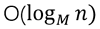

  - 最差情况：log(n)

- 命令描述

  判断指定的点、线或面是否包含在area中的某个多边形内。

- 返回值

  - 成功：返回包含指定点、线或面的多边形的名称和WKT信息。如果设置了WITHOUTWKT选项，仅返回多边形的名称。

  - 未查询到：返回nil。

  - 其它情况：返回相应的异常信息。

- 使用示例

  ```text
  127.0.0.1:6379> GIS.ADD hangzhou campus 'POLYGON ((30 10, 40 40, 20 40, 10 20, 30 10)
  )'
  (integer) 1
  127.0.0.1:6379> GIS.CONTAINS hangzhou 'POINT (30 11)'
  1) "0"
  2) 1) "campus"
     2) "POLYGON((30 10,40 40,20 40,10 20,30 10))"
  127.0.0.1:6379> GIS.CONTAINS hangzhou 'LINESTRING (30 10, 40 40)'
  1) "0"
  2) 1) "campus"
     2) "POLYGON((30 10,40 40,20 40,10 20,30 10))"
  127.0.0.1:6379> GIS.CONTAINS hangzhou 'POLYGON ((31 20, 29 20, 29 21, 31 31))'
  1) "0"
  2) 1) "campus"
     2) "POLYGON((30 10,40 40,20 40,10 20,30 10))"
  ```

**GIS.INTERSECTS**

- 语法

  GIS.INTERSECTS &lt;area> &lt;polygonWkt>

- 时间复杂度

  - 最理想情况： 

  - 最差情况：log(n)

- 命令描述

  判断指定的点、线或面，与area中的某个多边形的相交情况。

- 返回值

  - 成功：返回与指定点、线或面相交的多边形的名称和WKT信息。

  - 未查询到：返回nil。

  - 其它情况：返回相应的异常信息。

- 使用示例

  ```text
  127.0.0.1:6379> GIS.ADD hangzhou campus 'POLYGON ((30 10, 40 40, 20 40, 10 20, 30 10)
  )'
  (integer) 1
  127.0.0.1:6379> GIS.INTERSECTS hangzhou 'POINT (30 11)'
  1) "0"
  2) 1) "campus"
     2) "POLYGON((30 10,40 40,20 40,10 20,30 10))"
  127.0.0.1:6379> GIS.INTERSECTS hangzhou 'LINESTRING (30 10, 40 40)'
  1) "0"
  2) 1) "campus"
     2) "POLYGON((30 10,40 40,20 40,10 20,30 10))"
  127.0.0.1:6379> GIS.INTERSECTS hangzhou 'POLYGON ((30 10, 40 40, 20 40, 10 20, 30 10)
  )'
  1) "0"
  2) 1) "campus"
     2) "POLYGON((30 10,40 40,20 40,10 20,30 10))"
  127.0.0.1:6379>
  ```

**GIS.SEARCH**

- 语法

  ```text
  GIS.SEARCH [RADIUS longitude latitude distance m|km|ft|mi]
  [MEMBER field distance m|km|ft|mi]
  [GEOM geom]
  [COUNT count]
  [ASC|DESC]
  [WITHDIST]
  [WITHOUTWKT]
  ```

- 时间复杂度

  - 最理想情况： 

  - 最差情况：log(n)

- 命令描述

  查找给定经纬度及距离为半径范围内的点，支持下述可选参数：

  - RADIUS：按照参数传递的经度、纬度和半径搜索，取值顺序为经度、纬度、半径、半径单位，例如 `RADIUS 15 37 200 km` 。

  - MEMBER：从已经存在的多边形中获取经纬度并根据半径搜索，取值顺序为多边形名称、半径、半径单位，例如 `MEMBER Agrigento 100 km` 。

  - GEOM：按照WKT的格式设置搜索范围，可以是任意多边形，例如 `GIS.SEARCH Sicily "POINT (13.361389 38.115556)"` 。

  - COUNT：用于限定返回的个数，例如 `COUNT 3` 。

  - ASC|DESC：用于控制返回信息按照距离排序，例如ASC表示根据中心位置，由近到远排序。

  - WITHDIST：用于控制是否返回距离。

  - WITHOUTWKT：用于控制是否返回多边形的WKT信息。

- 返回值

  - 成功：返回查询到的多边形名称和WKT信息。

  - 未查询到：返回nil。

  - 其它情况：返回相应的异常信息。

- 使用示例

  ```text
  127.0.0.1:6379> GIS.ADD Sicily "Palermo" "POINT (13.361389 38.115556)" "Catania" "POI
  NT(15.087269 37.502669)"
  (integer) 2
  127.0.0.1:6379> GIS.SEARCH Sicily RADIUS 15 37 200 km WITHDIST
  1) "2"
  2) 1) "Palermo"
     2) "POINT(13.361389 38.115556)"
     3) "190.4424"
     4) "Catania"
     5) "POINT(15.087269 37.502669)"
     6) "56.4413"
  127.0.0.1:6379> GIS.SEARCH Sicily RADIUS 15 37 200 km WITHDIST WITHOUTWKT
  1) "2"
  2) 1) "Palermo"
     2) "190.4424"
     3) "Catania"
     4) "56.4413"
  127.0.0.1:6379> GIS.SEARCH Sicily RADIUS 15 37 200 km WITHDIST WITHOUTWKT ASC
  1) "2"
  2) 1) "Catania"
     2) "56.4413"
     3) "Palermo"
     4) "190.4424"
  127.0.0.1:6379> GIS.SEARCH Sicily RADIUS 15 37 200 km WITHDIST WITHOUTWKT ASC COUNT 11) "2"
  2) 1) "Catania"
     2) "56.4413"
  127.0.0.1:6379> GIS.ADD Sicily "Agrigento" "POINT (13.583333 37.316667)"
  (integer) 1
  127.0.0.1:6379> GIS.SEARCH Sicily MEMBER Agrigento 100 km
  1) "2"
  2) 1) "Palermo"
     2) "POINT(13.361389 38.115556)"
     3) "Agrigento"
     4) "POINT(13.583333 37.316667)"
  ```

**GIS.WITHIN**

- 语法

  ```text
  GIS.WITHIN <area> <polygonWkt> [WITHOUTWKT]
  ```

- 时间复杂度

  - 最理想情况： 

  - 最差情况：log(n)

- 命令描述在area中搜索指定的多边形内部的点、线或面。如果设置了WITHOUTWKT选项，仅返回多边形的名称。

- 返回值

  - 成功：成功则返回对应多边形的名称和WKT信息。

  - 未查找到：返回null。

  - 其它情况：返回相应的异常信息。

- 使用示例

  ```text
  127.0.0.1:6379> GIS.ADD hangzhou campus 'POINT (30 10)'
  (integer) 1
  127.0.0.1:6379> GIS.ADD hangzhou campus1 'LINESTRING (30 10, 40 40)'
  (integer) 1
  127.0.0.1:6379> GIS.WITHIN hangzhou 'POLYGON ((30 10, 40 40, 20 40, 10 20, 30 10))'
  1) "2"
  2) 1) "campus"
     2) "POINT(30 10)"
     3) "campus1"
     4) "LINESTRING(30 10,40 40)"
  ```

<a id="section-3-6"></a>

## 3.6. TairBloom命令

本文介绍TairBloom数据支持的命令。

**TairBloom简介**

TairBloom是一种可动态扩容的布隆过滤器。TairBloom首先是一种概率性数据结构（space-efficient probabilistic data structure），主要使用较低的内存消耗来判断一个元素是否存在；其次，TairBloom具有动态扩容的能力，可在扩容的同时维持误判率的稳定。

在传统的Redis数据结构中，可以使用Hash、Set、String的Bitset等实现类似功能，但这些实现方式不是内存占用量非常大，就是无法动态伸缩和保持误判率不变。因此，TairBloom非常适合需要高效判断大量数据是否存在且允许一定误判率的业务场景。业务可以直接使用TairBloom提供的Bloom Filter接口，无需二次封装，更无需在本地实现布隆过滤器的功能。

主要特性：

- 内存占用低。

- 可动态扩容。

- 可自定义的误判率（False Positive Rate）且在扩容时保持不变。

**使用前提**

请注意，本文介绍的命令只有在满足以下条件时才能生效。

- Redis实例为企业版性能增强型。

- 操作对象为性能增强型实例中的TairBloom数据。

**命令列表**

表 1. TairBloom命令

| 命令 | 语法 | 说明 |
| --- | --- | --- |
| BF.RESERVE | BF.RESERVE &lt;key&gt; &lt;error_rate&gt; &lt;capacity&gt; | 创建一个大小为capacity，错误率为error_rate的空的TairBloom。 |
| BF.ADD | BF.ADD &lt;key&gt; &lt;item&gt; | 在key指定的TairBloom中添加一个元素item。 |
| BF.MADD | BF.MADD &lt;key&gt; &lt;item&gt; \[item...\] | 在key指定的TairBloom中一次性添加多个元素。 |
| BF.EXISTS | BF.EXISTS &lt;key&gt; &lt;item&gt; | 检查一个元素是否存在于key指定的TairBloom中。 |
| BF.MEXISTS | BF.MEXISTS &lt;key&gt; &lt;item&gt; \[item...\] | 同时检查多个元素是否存在于key指定的TairBloom中。 |
| BF.INSERT | BF.INSERT &lt;key&gt; \[CAPACITY cap\] \[ERROR error\] \[NOCREATE\] ITEMS &lt;item...&gt; | 在key指定的TairBloom中一次性添加多个元素，添加时可以指定大小和错误率，且可以控制在TairBloom不存在的时候是否自动创建。 |
| BF.DEBUG | BF.DEBUG &lt;key&gt; | 可以查看key指定的TairBloom内部信息，如当前层数和每一层的元素个数、错误率等。 |
| DEL | DEL &lt;key&gt; \[key ...\] | 使用原生Redis的DEL命令可以删除一条或多条TairBloom数据。<br>说明已加入TairBloom数据中的元素无法单独删除，您可以使用DEL命令删除整条TairBloom数据。 |

**BF.RESERVE**

- 语法

  BF.RESERVE &lt;key> &lt;error_rate> &lt;capacity>

- 时间复杂度

  O(1)

- 命令描述

  创建一个大小为capacity，错误率为error_rate的空的TairBloom。

- 参数及选项说明

  <table>
    <tr>
      <th width="106">参数或选项</th>
      <th>说明</th>
    </tr>
    <tr>
      <td>key</td>
      <td>TairBloom的key，用于指定作为命令调用对象的TairBloom。</td>
    </tr>
    <tr>
      <td>error_rate</td>
      <td>期望的错误率（False Positive Rate），该值必须介于0和1之间。该值越小，TairBloom的内存占用量越大，CPU使用率越高。</td>
    </tr>
    <tr>
      <td>capacity</td>
      <td>TairBloom的初始容量，即期望添加到TairBloom中的元素的个数。当实际添加的元素个数超过该值时，TairBloom将进行自动的扩容，该过程会导致性能有所下降，下降的程度是随着元素个数的指数级增长而线性下降的，这是因为TairBloom的扩容是通过增加Bloom Filter的层数来完成的。每增加一层，在查询的时候就可能会遍历多层Bloom Filter来完成，每一层的容量都是上一层的两倍。因此，如果对性能非常的敏感，需要在使用前充分评估要添加到TairBloom的元素个数，避免发生扩容操作。</td>
    </tr>
  </table>

- 返回值

  - 成功：OK。

  - 其它情况返回相应的异常信息。

**BF.ADD**

- 语法

  BF.ADD &lt;key> &lt;item>

- 时间复杂度

  O(log N) ，其中N是TairBloom的层数。

- 命令描述

  在key指定的TairBloom中添加一个元素。

- 参数及选项说明

  <table>
    <tr>
      <th width="105">参数或选项</th>
      <th>说明</th>
    </tr>
    <tr>
      <td>key</td>
      <td>TairBloom的key，用于指定作为命令调用对象的TairBloom。</td>
    </tr>
    <tr>
      <td>item</td>
      <td>需要添加到TairBloom的元素。</td>
    </tr>
  </table>

- 返回值

  - 元素一定不存在：1。

  - 元素可能已经存在：0。

  - 其它情况返回相应的异常信息。

**BF.MADD**

- 语法

  BF.MADD &lt;key> &lt;item> [item...]

- 时间复杂度

  O(log N) ，其中N是TairBloom的层数。

- 命令描述

  在key指定的TairBloom中添加多个元素。

- 参数及选项说明

  <table>
    <tr>
      <th width="105">参数或选项</th>
      <th>说明</th>
    </tr>
    <tr>
      <td>key</td>
      <td>TairBloom的key，用于指定作为命令调用对象的TairBloom。</td>
    </tr>
    <tr>
      <td>item</td>
      <td>需要添加到TairBloom的元素，可设置多个。</td>
    </tr>
  </table>

- 返回值

  - 成功：返回一个数组，数组的每一个元素可能为1或0，当item一定不存在时数组元素值为1，当item可能已经存在时数组元素值为0。

  - 其它情况返回相应的异常信息。

**BF.EXISTS**

- 语法

  BF.EXISTS &lt;key> &lt;item>

- 时间复杂度

  O(log N) ，其中N是TairBloom的层数。

- 命令描述

  检查一个元素是否存在于key指定的TairBloom中。

- 参数及选项说明

  <table>
    <tr>
      <th width="105">参数或选项</th>
      <th>说明</th>
    </tr>
    <tr>
      <td>key</td>
      <td>TairBloom的key，用于指定作为命令调用对象的TairBloom。</td>
    </tr>
    <tr>
      <td>item</td>
      <td>需要查询的元素。</td>
    </tr>
  </table>

- 返回值

  - 元素一定不存在：0。

  - 元素可能存在：1。

  - 其它情况返回相应的异常信息。

**BF.MEXISTS**

- 语法

  BF.MEXISTS &lt;key> &lt;item> [item...]

- 时间复杂度

  O(log N) ，其中N是TairBloom的层数。

- 命令描述

  同时检查多个元素是否存在于key指定的TairBloom中。

- 参数及选项说明

  <table>
    <tr>
      <th width="105">参数或选项</th>
      <th>说明</th>
    </tr>
    <tr>
      <td>key</td>
      <td>TairBloom的key，用于指定作为命令调用对象的TairBloom。</td>
    </tr>
    <tr>
      <td>item</td>
      <td>需要查询的元素，可设置多个。</td>
    </tr>
  </table>

- 返回值

  - 成功：返回一个数组，数组的每一个元素可能为1或0，当item一定不存在时数组元素值为0，当item可能已经存在时数组元素值为1。

  - 其它情况返回相应的异常信息。

**BF.INSERT**

- 语法

  BF.INSERT &lt;key> [CAPACITY cap] [ERROR error] [NOCREATE] ITEMS &lt;item...>

- 时间复杂度

  O(log N) ，其中N是TairBloom的层数。

- 命令描述

  在key指定的TairBloom中一次性添加多个元素，添加时可以指定大小和错误率，且可以控制在TairBloom不存在的时候是否自动创建。

- 参数及选项说明

  <table>
    <tr>
      <th width="114">参数或选项</th>
      <th>说明</th>
    </tr>
    <tr>
      <td>key</td>
      <td>TairBloom的key，用于指定作为命令调用对象的TairBloom。</td>
    </tr>
    <tr>
      <td>CAPACITY</td>
      <td>指定TairBloom的容量，即期望添加到TairBloom中的元素的个数，当TairBloom已经存在时该值将被忽略。当实际添加的元素个数超过该值时，TairBloom将进行自动的扩容，该过程会导致性能有所下降，下降的程度是随着元素个数的指数级增长而线性下降的，这是因为TairBloom的扩容是通过增加Bloom Filter的层数来完成的。每增加一层，在查询的时候就可能会遍历多层Bloom Filter来完成，每一层的容量都是上一层的两倍。因此，如果对性能非常的敏感，需要在使用前充分评估要添加到TairBloom的元素个数，避免发生扩容操作。</td>
    </tr>
    <tr>
      <td>ERROR</td>
      <td>期望的错误率（False Positive Rate），当TairBloom已经存在时该值将被忽略。该值必须介于0和1之间。该值越小，TairBloom的内存占用量越大，CPU使用率越高。</td>
    </tr>
    <tr>
      <td>NOCREATE</td>
      <td>设置该选项后，当指定的TairBloom不存在的时候不要自动创建该TairBloom。该参数不能与CAPACITY和ERROR同时设置。</td>
    </tr>
    <tr>
      <td>ITEMS</td>
      <td>需要添加到TairBloom中的所有元素。</td>
    </tr>
  </table>

- 返回值

  - 成功：返回一个数组，数组的每一个元素可能为1或0，当item一定不存在时数组元素为1，当item可能已经存在时数组元素值为0。

  - 其它情况返回相应的异常信息。

**BF.DEBUG**

- 语法

  BF.DEBUG &lt;key>

- 时间复杂度

  O(log N) ，其中N是TairBloom的层数。

- 命令描述

  可以查看key指定的TairBloom内部信息，如当前层数和每一层的元素个数、错误率等。

- 参数及选项说明

  <table>
    <tr>
      <th width="105">参数或选项</th>
      <th>说明</th>
    </tr>
    <tr>
      <td>key</td>
      <td>TairBloom的key，用于指定作为命令调用对象的TairBloom。</td>
    </tr>
  </table>

- 返回值

  - 成功：返回一个数组，数组的每一个元素可能为1或0，当item一定不存在时数组元素为1，当item可能已经存在时数组元素值为0。

  - 其它情况返回相应的异常信息。

**内存占用测试结果**

| 容量（元素的个数） | false positive:0.01 | false positive:0.001 | false positive:0.0001 |
| --- | --- | --- | --- |
| 100000 | 0.12 MB | 0.25 MB | 0.25 MB |
| 1000000 | 2 MB | 2 MB | 4 MB |
| 10000000 | 16 MB | 32 MB | 32 MB |
| 100000000 | 128 MB | 256 MB | 256 MB |
| 1000000000 | 2 GB | 2 GB | 4 GB |

<a id="section-3-7"></a>

## 3.7. TairDoc命令

本文介绍TairDoc数据支持的命令。

**TairDoc简介**

TairDoc是一种文档数据结构，支持JSON数据的增删改查。

主要特性：

- 完整地支持JSON标准。

- 完全兼容RedisJSON。

- 支持JSONPointer和JSONPath两种语法。

- 文档作为二进制树存储，可以快速访问JSON数据的子元素。

- 支持JSON到XML或YAML格式的转换。

**使用前提**

请注意，本文介绍的命令只有在满足以下条件时才能生效。

- Redis实例为企业版性能增强型。

- 操作对象为性能增强型实例中的TairDoc数据。

**命令列表**

表 1. TairDoc命令

| 命令 | 语法 | 说明 |
| --- | --- | --- |
| JSON.SET | JSON.SET &lt;key&gt; &lt;path&gt; &lt;json&gt; \[NX or XX\] | 存储JSON的值在key的path中。对于不存在的key，path必须是root。对于已经存在的key，当path存在时，替换掉目前的JSON值。 |
| JSON.GET | JSON.GET &lt;key&gt; \[PATH\] \[FORMAT &lt;XML/YAML&gt;\] \[ROOTNAME &lt;root&gt;\] \[ARRNAME &lt;arr&gt;\] | 获取一个TairDoc在path中存储的JSON数据。 |
| JSON.DEL | JSON.DEL &lt;key&gt; \[path\] | 删除path对应的JSON数据。如果未指定path，则删除key。不存在的key和不存在的path将会被忽略。 |
| JSON.TYPE | JSON.TYPE &lt;key&gt; \[path\] | 获取path对应的值的类型。 |
| JSON.NUMINC RBY | JSON.NUMINCRBY &lt;key&gt; \[path\] &lt;value&gt; | 将path对应的值增加value。path必须存在且path对应的值和value必须是都是int或double类型的值。 |
| JSON.STRAPP END | JSON.STRAPPEND &lt;key&gt; \[path\] &lt;json-string&gt; | 将json-string中的字符串添加到path对应的字符串类型的值中。如果未设置path，默认为root。 |
| JSON.STRLEN | JSON.STRLEN &lt;key&gt; \[path\] | 获取path对应值的长度。如果未设置path，默认为root。 |
| JSON.ARRAPP END | JSON.ARRAPPEND &lt;key&gt; &lt;path&gt; &lt;json&gt; \[&lt;json&gt; ...\] | 将JSON插入到path对应的array最后，JSON可以是多个。 |
| JSON.ARRPOP | JSON.ARRPOP &lt;key&gt; &lt;path&gt; \[index\] | 移除并返回path对应的数组中index位置的元素。 |
| JSON.ARRINS ERT | JSON.ARRINSERT &lt;key&gt; &lt;path&gt; &lt;index&gt; &lt;json&gt; \[&lt;json&gt; ...\] | 将JSON插入到path对应的数组中，原有元素会往后移动。 |
| JSON.ARRLEN | JSON.ARRLEN &lt;key&gt; \[path\] | 获取path对应数组的长度。 |
| JSON.ARRTRI M | JSON.ARRTRIM &lt;key&gt; &lt;path&gt; &lt;start&gt; &lt;stop&gt; | 按照start和stop指定的范围修剪数组。 |
| DEL | DEL &lt;key&gt; \[key ...\] | 使用原生Redis的DEL命令可以删除一条或多条TairDoc数据。 |

**JSON.SET**

- 语法

  JSON.SET &lt;key> &lt;path> &lt;json> [NX | XX]

- 时间复杂度

  O(N)

- 命令描述

  存储JSON的值在key的path中。对于不存在的key，path必须是root。对于已经存在的key，当path存在时，替换掉目前的JSON值。

- 参数及选项说明

  <table>
    <tr>
      <th width="105">参数或选项</th>
      <th>说明</th>
    </tr>
    <tr>
      <td>key</td>
      <td>TairDoc的key，用于指定作为命令调用对象的TairDoc。</td>
    </tr>
    <tr>
      <td>path</td>
      <td>TairDoc的path。<br>• 如果key不存在，path必须为root。<br>• 如果key存在，当path存在时，替换当前的JSON值。</td>
    </tr>
    <tr>
      <td>json</td>
      <td>如果key存在，当path存在时，用JSON替换TairDoc中当前的JSON数据。</td>
    </tr>
    <tr>
      <td>NX</td>
      <td>当path不存在时写入。</td>
    </tr>
    <tr>
      <td>XX</td>
      <td>当path存在时写入。</td>
    </tr>
  </table>

- 返回值

  - 成功：OK。

  - 指定了NX或XX时失败：null。

  - 其它情况返回相应的异常信息。

- 使用示例

  ```text
  127.0.0.1:6379> JSON.SET doc . '{"foo": "bar", "baz" : 42}'
  OK
  127.0.0.1:6379> JSON.SET doc .foo '"flower"'
  OK
  127.0.0.1:6379> JSON.GET doc .foo
  "flower"
  127.0.0.1:6379> JSON.SET doc .not-exists 123 XX

  127.0.0.1:6379> JSON.SET doc .not-exists 123 NX
  OK
  127.0.0.1:6379> JSON.GET doc .not-exists
  123
  ```

**JSON.GET**

- 语法

  JSON.GET &lt;key> &lt;path> [FORMAT &lt;XML | YAML>] [ROOTNAME &lt;root>] [ARRNAME &lt;arr>]

- 时间复杂度

  O(N)

- 命令描述

  获取一个TairDoc在path中存储的JSON数据。

- 参数及选项说明

  | 参数或选项 | 说明 |
  | --- | --- |
  | key | TairDoc的key，用于指定作为命令调用对象的TairDoc。 |
  | path | TairDoc的path。 |
  | FORMAT | 指定返回的JSON格式，支持XML或YAML。 |
  | ROOTNAME | 指定XML语法ROOT元素的标签。 |
  | ARRNAME | 指定XML语法ARRAY元素的标签。 |

- 返回值

  - 成功：返回path中存储的JSON。

  - 其它情况返回相应的异常信息。

- 使用示例

  ```xml
  127.0.0.1:6379> JSON.SET doc . '{"foo": "bar", "baz" : 42}'
  OK
  127.0.0.1:6379> JSON.GET doc
  {"foo":"bar","baz":42}
  127.0.0.1:6379> JSON.GET doc .foo
  "bar"
  127.0.0.1:6379> JSON.GET doc .not-exists
  ERR pointer illegal or array index error or object type is not array or map

  127.0.0.1:6379> JSON.GET doc . format xml
  <?xml version="1.0" encoding="UTF-8"?><root><foo>bar</foo><baz>42</baz></root>
  127.0.0.1:6379> JSON.GET doc . format xml rootname ROOT arrname ARRAY
  <?xml version="1.0" encoding="UTF-8"?><ROOT><foo>bar</foo><baz>42</baz></ROOT>
  127.0.0.1:6379> JSON.GET doc . format yaml

  foo: bar
  baz: 42
  ```

**JSON.DEL**

- 语法

  JSON.DEL &lt;key> [path]

- 时间复杂度

  O(N)

- 命令描述

  删除path对应的JSON数据。如果未指定path，则删除key。不存在的key和不存在的path将会被忽略。

- 参数及选项说明

  | 参数或选项 | 说明 |
  | --- | --- |
  | key | TairDoc的key，用于指定作为命令调用对象的TairDoc。 |
  | path | TairDoc的path。 |

- 返回值

  - 成功：1。

  - 失败：0。

  - 其它情况返回相应的异常信息。

- 使用示例

  ```text
  127.0.0.1:6379> JSON.SET doc . '{"foo": "bar", "baz" : 42}'
  OK
  127.0.0.1:6379> JSON.DEL doc .foo
  1
  127.0.0.1:6379> JSON.DEL doc .not-exists
  ERR old item is null for remove or replace

  127.0.0.1:6379> JSON.DEL not-exists
  0
  127.0.0.1:6379> JSON.GET doc
  {"baz":42}
  127.0.0.1:6379> JSON.DEL doc
  1
  127.0.0.1:6379> JSON.GET doc

  127.0.0.1:6379>
  ```

**JSON.TYPE**

- 语法

  JSON.TYPE &lt;key> [path]

- 时间复杂度

  O(N)

- 命令描述

  获取path对应的值的类型。

- 参数及选项说明

  | 参数或选项 | 说明 |
  | --- | --- |
  | key | TairDoc的key，用于指定作为命令调用对象的TairDoc。 |
  | path | TairDoc的path。 |

- 返回值

  - 成功：返回查询到的类型，可能的结果包括"boolean"、"null"、 "number"、"string"、"array"、"object"、"raw"、"reference"、"const"。

  - key或者path不存在：null。

  - 其它情况返回相应的异常信息。

- 使用示例

  ```text
  127.0.0.1:6379> JSON.SET doc . '{"foo": "bar", "baz" : 42}'
  OK
  127.0.0.1:6379> JSON.TYPE doc
  object
  127.0.0.1:6379> JSON.TYPE doc .foo
  string
  127.0.0.1:6379> JSON.TYPE doc .baz
  number
  127.0.0.1:6379> JSON.TYPE doc .not-exists

  127.0.0.1:6379>
  ```

**JSON.NUMINCRBY**

- 语法

  JSON.NUMINCRBY &lt;key> [path] &lt;value>

- 时间复杂度

  O(N)

- 命令描述

  将path对应的值增加value。path必须存在且path对应的值和value必须是都是int或double类型的值。

- 参数及选项说明

  | 参数或选项 | 说明 |
  | --- | --- |
  | key | TairDoc的key，用于指定作为命令调用对象的TairDoc。 |
  | path | TairDoc的path。 |
  | value | 需要为path的值增加的数值。 |

- 返回值

  - 成功：返回操作完成后path对应的值。

  - 其它情况返回相应的异常信息。

- 使用示例

  ```text
  127.0.0.1:6379> JSON.SET doc . '{"foo": "bar", "baz" : 42}'
  OK
  127.0.0.1:6379> JSON.NUMINCRBY doc .baz 1
  43
  127.0.0.1:6379> JSON.NUMINCRBY doc .baz 1.5
  44.5
  127.0.0.1:6379> JSON.NUMINCRBY doc .foo 1
  ERR node not exists or not number type

  127.0.0.1:6379> JSON.NUMINCRBY doc .not-exists 1
  ERR node not exists or not number type

  127.0.0.1:6379>
  ```

**JSON.STRAPPEND**

- 语法

  JSON.STRAPPEND &lt;key> [path] &lt;json-string>

- 时间复杂度

  O(N)

- 命令描述

  将json-string中的字符串添加到path对应的字符串类型的值中。如果未设置path，默认为root。

- 参数及选项说明

  | 参数或选项 | 说明 |
  | --- | --- |
  | key | TairDoc的key，用于指定作为命令调用对象的TairDoc。 |
  | path | TairDoc的path。 |
  | json-string | 需要添加到path对应值的字符串。 |

- 返回值

  - 成功：返回path对应的字符串扩展后的长度。

  - key不存在：-1。

  - 其它情况返回相应的异常信息。

- 使用示例

  ```text
  127.0.0.1:6379> JSON.SET doc . '{"foo": "bar", "baz" : 42}'
  OK
  127.0.0.1:6379> JSON.STRAPPEND doc .foo rrrrr
  8
  127.0.0.1:6379> JSON.GET doc .foo
  "barrrrrr"
  127.0.0.1:6379> JSON.STRAPPEND doc .not-exists
  ERR node not exists or not string type

  127.0.0.1:6379> JSON.STRAPPEND not-exists abc
  -1
  ```

**JSON.STRLEN**

- 语法

  JSON.STRLEN &lt;key> [path]

- 时间复杂度

  O(N)

- 命令描述

  获取path对应值的长度。如果未设置path，默认为root。

- 参数及选项说明

  | 参数或选项 | 说明 |
  | --- | --- |
  | key | TairDoc的key，用于指定作为命令调用对象的TairDoc。 |
  | path | TairDoc的path。 |

- 返回值

  - 成功：返回path对应值的长度。

  - key不存在：-1。

  - 其它情况返回相应的异常信息。

- 使用示例

  ```text
  127.0.0.1:6379> JSON.SET doc . '{"foo": "bar", "baz" : 42}'
  OK
  127.0.0.1:6379> JSON.STRLEN doc .foo
  3
  127.0.0.1:6379> JSON.STRLEN doc .baz
  ERR node not exists or not string type

  127.0.0.1:6379> JSON.STRLEN not-exists
  -1
  ```

**JSON.ARRAPPEND**

- 语法

  JSON.ARRAPPEND &lt;key> &lt;path> &lt;json> [&lt;json> ...]

- 时间复杂度

  O(M\*N)，M是需要插入的元素（json）数量，N是数组元素数量。

- 命令描述

  将JSON插入到path对应的array最后，JSON可以是多个。

- 参数及选项说明

  | 参数或选项 | 说明 |
  | --- | --- |
  | key | TairDoc的key，用于指定作为命令调用对象的TairDoc。 |
  | path | TairDoc的path。 |
  | json | 需要插入的数据。 |

- 返回值

  - 成功：返回操作完成后array中元素数量。

  - key不存在：-1。

  - 其它情况返回相应的异常信息。

- 使用示例

  ```text
  127.0.0.1:6379> JSON.SET doc . '{"id": [1,2,3]}'
  OK
  127.0.0.1:6379> JSON.GET doc .id
  [1,2,3]
  127.0.0.1:6379> JSON.ARRAPPEND doc .id null false true
  6
  127.0.0.1:6379> JSON.GET doc .id
  [1,2,3,null,false,true]
  127.0.0.1:6379> JSON.GET doc .id.2
  3
  127.0.0.1:6379> JSON.ARRAPPEND not-exists .a 1
  -1
  ```

**JSON.ARRPOP**

- 语法

  JSON.ARRPOP &lt;key> &lt;path> [index]

- 时间复杂度

  O(M\*N)，M是key包含的子元素，N是数组元素数量。

- 命令描述

  移除并返回path对应的数组中index位置的元素。

- 参数及选项说明

  | 参数或选项 | 说明 |
  | --- | --- |
  | key | TairDoc的key，用于指定作为命令调用对象的TairDoc。 |
  | path | TairDoc的path。 |
  | index | 数组的索引，不传默认为最后一个元素，负数表示反向取值。 |

- 返回值

  - 成功：返回数组相应的节点。

  - 数组为空数组：‘ERR array index outflow’。

  - 其它情况返回相应的异常信息。

- 使用示例

  ```text
  127.0.0.1:6379> JSON.SET doc . '{"id": [1,2,3]}'
  OK
  127.0.0.1:6379> JSON.ARRPOP doc .id 1
  2
  127.0.0.1:6379> JSON.GET doc .id
  [1,3]
  127.0.0.1:6379> JSON.ARRPOP doc .id -1
  3
  127.0.0.1:6379> JSON.GET doc .id
  [1]
  127.0.0.1:6379> JSON.ARRPOP doc .id 10
  ERR array index outflow

  127.0.0.1:6379> JSON.ARRPOP doc .id
  1
  127.0.0.1:6379> JSON.ARRPOP doc .id
  ERR array index outflow

  127.0.0.1:6379>
  ```

**JSON.ARRINSERT**

- 语法

  JSON.ARRINSERT &lt;key> &lt;path> &lt;index> &lt;json> [&lt;json> ...]

- 时间复杂度

  O(M\*N)，M是要插入的元素（json）数量，N是数组元素数量。

- 命令描述

  将JSON插入到path对应的数组中，原有元素会往后移动。

- 参数及选项说明

  | 参数或选项 | 说明 |
  | --- | --- |
  | key | TairDoc的key，用于指定作为命令调用对象的TairDoc。 |
  | path | TairDoc的path。 |
  | index | 数组的索引，不传默认为最后一个元素，负数表示反向取值。 |
  | json | 需要插入的数据。 |

- 返回值

  - 成功：返回操作完成后数组中元素的个数。

  - 数组为空数组：‘ERR array index outflow’。

  - 其它情况返回相应的异常信息。

- 使用示例

  ```text
  127.0.0.1:6379> JSON.SET doc . '{"id": [2,3,5]}'
  OK
  127.0.0.1:6379> JSON.ARRINSERT doc .id 0 0 1
  5
  127.0.0.1:6379> JSON.GET doc .id
  [0,1,2,3,5]
  127.0.0.1:6379> JSON.ARRINSERT doc .id 4 4
  6
  127.0.0.1:6379> JSON.GET doc .id
  [0,1,2,3,4,5]
  127.0.0.1:6379>
  ```

**JSON.ARRLEN**

- 语法

  JSON.ARRLEN &lt;key> [path]

- 时间复杂度

  O(N)

- 命令描述

  获取path对应数组的长度。

- 参数及选项说明

  | 参数或选项 | 说明 |
  | --- | --- |
  | key | TairDoc的key，用于指定作为命令调用对象的TairDoc。 |
  | path | TairDoc的path。 |

- 返回值

  - 成功：数组的长度。

  - key不存在：-1。

  - 其它情况返回相应的异常信息。

- 使用示例

  ```text
  127.0.0.1:6379> JSON.SET doc . '{"id": [2,3,5]}'
  OK
  127.0.0.1:6379> JSON.ARRLEN doc .id
  3
  127.0.0.1:6379> JSON.ARRLEN not-exists
  -1
  ```

**JSON.ARRTRIM**

- 语法

  JSON.ARRTRIM &lt;key> &lt;path> &lt;start> &lt;stop>

- 时间复杂度

  O(N)

- 命令描述

  按照start和stop指定的范围修剪数组。

- 参数及选项说明

  <table>
    <tr>
      <th width="105">参数或选项</th>
      <th>说明</th>
    </tr>
    <tr>
      <td>key</td>
      <td>TairDoc的key，用于指定作为命令调用对象的TairDoc。</td>
    </tr>
    <tr>
      <td>path</td>
      <td>TairDoc的path。</td>
    </tr>
    <tr>
      <td>start</td>
      <td>修剪的开始位置，取值为从0开始的一个索引值，修剪后的数组包含该位置的元素。</td>
    </tr>
    <tr>
      <td>stop</td>
      <td>修剪的结束位置，取值为从0开始的一个索引值，修剪后的数组包含该位置的元素。</td>
    </tr>
  </table>

- 返回值

  - 成功：操作完成后数组的长度。

  - key不存在：-1。

  - 其它情况返回相应的异常信息。

- 使用示例

  ```text
  127.0.0.1:6379> JSON.SET doc . '{"id": [1,2,3,4,5,6]}'
  OK
  127.0.0.1:6379> JSON.ARRTRIM doc .id 3 4
  2
  127.0.0.1:6379> JSON.GET doc .id
  [4,5]
  127.0.0.1:6379> JSON.ARRTRIM doc .id 3 4
  ERR array index outflow

  127.0.0.1:6379> JSON.ARRTRIM doc .id -2 -5
  ERR array index outflow

  127.0.0.1:6379>
  ```

**JSONPointer和JSONPath**

TairDoc在支持JSONPointer的基础上支持了JSONPath的部分语法，示例如下：

| JSONPointer | JSONPath |
| --- | --- |
| <code>127.0.0.1:6379&gt; JSON.SET doc .</code><br><code>'{"foo": "bar", "baz" : [1,2,3]}'</code><br><code>OK</code><br><code>127.0.0.1:6379&gt; JSON.GET doc .foo</code><br><code>"bar"</code><br><code>127.0.0.1:6379&gt; JSON.GET doc .baz[0]</code><br><code>1</code> | <code>127.0.0.1:6379&gt; JSON.SET doc ""</code><br><code>'{"foo": "bar", "baz" : [1,2,3]}'</code><br><code>OK</code><br><code>127.0.0.1:6379&gt; JSON.GET doc /foo</code><br><code>"bar"</code><br><code>127.0.0.1:6379&gt; JSON.GET doc /baz/0</code><br><code>1</code> |

具体的兼容方式如下表所示。

<table>
  <tr>
    <th>兼容项</th>
    <th>JSONPath</th>
    <th>JSONPointer</th>
  </tr>
  <tr>
    <td>根元素</td>
    <td>.</td>
    <td>“”</td>
  </tr>
  <tr>
    <td>获取元素</td>
    <td>.a.b.c</td>
    <td>/a/b/c</td>
  </tr>
  <tr>
    <td>数组</td>
    <td>.a[2]</td>
    <td>/a/2</td>
  </tr>
  <tr>
    <td rowspan="2">整体获取</td>
    <td>.a["b.c"]</td>
    <td>/a/b.c</td>
  </tr>
  <tr>
    <td>.a['b.c']</td>
    <td>/a/b.c</td>
  </tr>
</table>

<a id="section-4"></a>

# 4.快速入门

<a id="section-4-1"></a>

## 4.1. 开始使用云数据库Tair

本章节介绍如何从创建实例到登录数据库的一系列操作，帮助您快速地了解Tair实例的操作流程。

实例操作步骤的关键流程如下所示。

- 登录云数据库Tair（兼容Redis）控制台

  介绍如何登录到云数据库 Tair（兼容 Redis）控制台。

- 创建实例

  阿里云数据库支持经典网络和专有网络两种网络类型，您可以创建不同网络下的Tair实例。

- 设置白名单

  为了数据库的安全稳定，在开始使用实例前，您需要将访问数据库的 IP 地址或者 IP 段加到目标实例的白名单中。

- 修改密码（可选）

  如果在创建实例时，没有设置实例的密码，用户需要在**实例信息**页面设置实例的密码。

- 连接实例

  您可以使用支持Redis协议的客户端连接实例，也可以使用Redis原生的工具redis-cli连接实例。

<a id="section-4-2"></a>

## 4.2. 登录云数据库Tair（兼容Redis）控制台

本章节介绍如何登录到云数据库 Tair（兼容 Redis）控制台。

**前提条件**

- 登录Apsara Uni-manager运营控制台前，确认您已从部署人员处获取Apsara Uni-manager运营控制台的服务域名地址。

- 推荐使用Chrome浏览器。

**操作步骤**

1. 在浏览器地址栏中，输入Apsara Uni-manager运营控制台的服务域名地址，按回车键。

2. 输入正确的用户名及密码。

   请向运营管理员获取登录控制台的用户名和密码。

   > **说明**
   >
   > 首次登录Apsara Uni-manager运营控制台时，需要修改登录用户名的密码，请按照提示完成密码修改。为提高安全性，密码长度必须为8~20位，且至少包含以下两种类型：
   >
   > - 英文大写或小写字母（A~Z、a~z）
   >
   > - 阿拉伯数字（0~9）
   >
   > - 特殊符号（感叹号（！）、at（@）、井号（#）、美元符号（$）、百分号（%）等）

3. 单击**登录**。

4. 如果账号已激活MFA多因素认证，请根据以下两种情况进行操作：

   - 管理员强制开启MFA后的首次登录：

     <ol type="a">

     <li>

     在绑定虚拟MFA设备页面中，按页面提示步骤绑定MFA设备。

     </li>

     <li>

     按照步骤2重新输入账号和密码，单击**登录**。

     </li>

     </ol>

     <ol type="i" start="100">

     <li>

     输入6位MFA码后单击**认证**。

     </li>

     </ol>

   - 您已开启并绑定MFA：

     输入6位MFA码后单击**认证**。

     > **说明**
     >
     > 绑定并开启MFA的操作请参见<strong>《Apsara Uni-manager运营控制台用户指南》</strong>中的章节<strong>《绑定并开启虚拟MFA设备》</strong>。

5. 在页面顶部的菜单栏中，选择**产品 > 数据库 > 云数据库 Tair（兼容 Redis）**。

<a id="section-4-3"></a>

## 4.3. 创建实例

本章节介绍如何通过控制台创建实例。

**操作步骤**

1. 登录云数据库Tair（兼容Redis）控制台。

2. 在左侧导航栏，单击**实例列表**。

3. 单击页面左上角**创建实例**。

4. 设置以下参数。

   表 1. 设置新实例参数

   **类别**

   **配置**

   **说明**

   选择实例所属组织。

   **组织**

   选择实例所属资源集。

   **基本配置**

   **资源集**

   > **重要**
   >
   > 选择项目后，只有属于该资源集的成员才能使用该实例。

   选择实例所属地域。

   **地域**

   **区域**

   选择实例所属可用区，若选择双可用区即可实现同城容灾。

   **可用区类型**

   - **社区版**：兼容开源Redis协议标准、高性能的数据库服务。

   - **企业版**：基于社区版开发的Redis产品，读写性能可达到社区版的3倍，同时集

   **版本类型**

   成多个自研的Redis模块集成，扩展了Redis的适用性。更多信息，请参见企业版性能增强型介绍。

   选择实例所属机器的芯片架构。

   **芯片架构**

   > **说明**
   >
   > 选择该配置时如提示未授权，请联系运营管理员对该账号执行授权。

   选择实例的引擎版本，支持Redis 4.0、5.0、6.0和7.0。

   **引擎版本**

   - **标准版**：采用主从架构，能提供高性能的缓存服务，同时保证数据的高可用。

   - **集群版**：可轻松突破Redis自身单线程瓶颈，满足大容量、高性能的业务需求。

   **规格配置**

   - **读写分离**：可提供高可用、高性能、高灵活的读写分离服务，解决热点数据集中及高并发读取的业务需求，最大化地节约用户运维成本。

   **架构类型**

   > **说明**
   >
   > 仅社区版支持**读写分离**架构。

   固定为**双副本**，即一主一从共两个节点，双机热备保障可用性。

   **节点类型**

   - **通用规格**：多实例共享同一服务器资源，可动态复用空闲的计算资源（如CPU），性价比更高。

   **规格类型**

   - **独享规格**：实例独占分配到的计算资源（如CPU），实现资源隔离，性能稳定强劲。

   选择实例的规格。

   **实例规格**

   不同的实例规格提供的最大连接数和最大内网带宽不同，更多信息，请参见<strong>《技术白皮书》</strong>中的<strong>《实例规格》</strong>章节。

   - 经典网络：经典网络中的云服务在网络上不进行隔离，只能依靠云服务自身的安全组或白名单策略来阻挡非法访问。

   - 专有网络VPC（Virtual Private Cloud）：专有网络帮助您在阿里云上构建出一个隔离的网络环境。您可以自定义专有网络里面的路由表、IP地址范围和网关。此外还可以通过专线或者VPN的方式将自建机房与阿里云专有网络内的云资源组合成一个虚拟机房，实现应用平滑上云。

   **网络**

   **网络类型**

   > **说明**
   >
   > 若选择专有网络，请先创建好VPC，如何创建VPC请参见<strong>《VPC用户指南》</strong>中的<strong>《创建专有网络》</strong>和<strong>《创建交换机》</strong>章节。

   设置实例的名称，便于后续业务识别。

   - 长度为2~128个字符。

   **实例名称**

   - 以大小写字母或中文开头，可包含字母数字、下划线（_）和短划线（-）。

   您可以选择**立即设置**或选择**创建后设置**。

   **设置密码**

   **配置密码**

   设置访问实例的密码，密码要求如下：

   - 长度为8~30个字符。

   **登录密码**

   - 必须同时包含大小写字母和数字，不支持特殊符号。

   再次输入访问实例的密码。

   **确认密码**

   默认为1，支持批量创建多个相同配置的实例。

   **实例设置**

   **创建数量**

5. 完成上述参数配置后，单击**提交**。

<a id="section-4-4"></a>

## 4.4. 设置白名单

为了数据库的安全稳定，在开始使用云数据库 Tair（兼容 Redis）实例前，您需要将访问数据库的IP地址或者IP段加到目标实例的白名单中。

**背景信息**

> **说明**
>
> 正确使用白名单可以让实例得到高级别的访问安全保护，建议您定期维护白名单。

**操作步骤**

1. 登录云数据库Tair（兼容Redis）控制台。

2. 在**实例列表**页，单击目标实例ID。

3. 在左侧导航栏，单击**白名单设置**。

4. 找到目标白名单分组，单击**修改**。

   > **说明**
   >
   > 您也可以单击**添加白名单分组**创建一个新的分组。分组名称长度为2~32个字符，由小写字母、数字或下划线组成，需以小写字母开头，以小写字母或数字结尾。

5. 在弹出的对话框中，根据要执行的操作，选择下述操作步骤：

   | 要执行的操作 | 操作步骤 |
   | --- | --- |
   | 手动修改白名单 | 手动填写IP地址或IP地址段。<br>图 1. 手动修改白名单<br>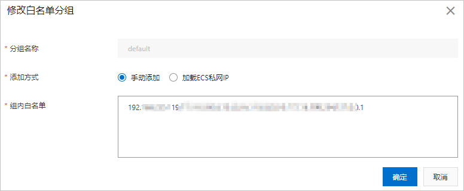<br>说明<br>• IP地址以英文逗号分隔，不可重复，最多1000个。支持格式为10.23.12.24（具体IP地址）、10.23.12.24/24（CIDR模式，即无类域间路由，/24表示地址中前缀的长度，范围为1~32）。<br>• 地址中的前缀长度设置为0（例如0.0.0.0/0、127.0.0.1/0）表示允许所有IP地址访问该实例，存在高安全风险，请谨慎设置。 |
   | 加载ECS实例的内网IP地址为白名单 | i. 单击<strong>加载ECS私网IP</strong>。ii. 根据业务需求选中对应的IP地址。<br>图 2. 加载ECS内网IP地址<br>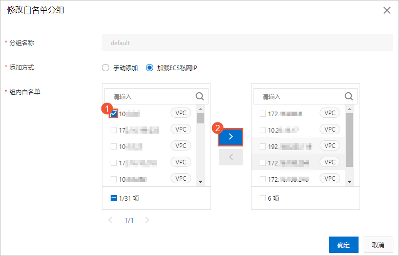<br>说明为便于定位目标IP地址，您可以将鼠标指针悬浮在对应的IP地址上，系统将展示该IP地址所属的ECS实例ID和名称。 |
   | 清除白名单分组 | 当某个白名单分组中的所有IP地址均需要移除且需要保留该分组时，您可以单击<strong>清除白名单</strong><strong>分组</strong>来完成该操作。 |

6. 单击**确定**。

<a id="section-4-5"></a>

## 4.5. 连接实例

<a id="section-4-5-1"></a>

### 4.5.1. 使用客户端程序连接

云数据库 Tair（兼容 Redis）与原生Redis完全兼容，连接数据库的方式也基本相同，您可以根据自身应用特点选用任何兼容Redis协议的客户端程序。本文列举一些常见的客户端程序的代码示例，帮助您快速连接。

**前提条件**

已将ECS实例的内网IP地址或本地主机的外网IP地址加入实例白名单，具体操作，请参见设置白名单。

**获取连接信息**

在使用客户端程序连接实例时，通常您需要获取以下信息并设置在代码中：

| 需获取的信息 | 获取方式 |
| --- | --- |
| 实例的连接地址 | 可在<strong>实例信息</strong>页面中的<strong>连接信息</strong>区域框中获取到。<br>说明Redis实例支持多种连接地址，推荐使用专有网络连接，可获得更高的安全性和更低的网络延迟。 |
| 端口号 | 端口号默认为6379。 |
| 实例的账号（部分客户端程序无需设置） | 实例默认会创建一个以实例ID命名的账号（例如r-bp10noxlhcoim2\*\*\*\*）。 |
| 账号的密码 | 在创建实例时已设置，如果忘记密码，可重置密码，具体操作，请参见修改密码。 |

**常见客户端程序**

关于实例支持的客户端列表，请参见Redis Clients。

- Jedis客户端

- PhpRedis客户端

- redis-py客户端

- C或C++客户端

- .net客户端

- node-redis客户端

- C#客户端StackExchange.Redis

**Jedis客户端**

1. 下载并安装Jedis客户端。具体操作，请参见Jedis使用说明。

2. 根据业务需求选择连接方式。

   - JedisPool连接池连接（推荐）

     <ol type="a">

     <li>

     打开Eclipse客户端，创建一个Project并配置pom文件，具体内容如下：

     ```xml
     <dependency>
     <groupId>redis.clients</groupId>
     <artifactId>jedis</artifactId>
     <version>2.7.2</version>
     <type>jar</type>
     <scope>compile</scope>
     </dependency>
     ```

     </li>

     <li>

     在Project中输入下述代码添加相关应用。

     ```java
     import org.apache.commons.pool2.PooledObject;
     import org.apache.commons.pool2.PooledObjectFactory;
     import org.apache.commons.pool2.impl.DefaultPooledObject;
     import org.apache.commons.pool2.impl.GenericObjectPoolConfig;
     import redis.clients.jedis.HostAndPort;
     import redis.clients.jedis.Jedis;
     import redis.clients.jedis.JedisPool;
     import redis.clients.jedis.JedisPoolConfig;
     ```

     </li>

     </ol>

     <ol type="i" start="100">

     <li>

     根据Jedis客户端版本，在Project中输入下述代码，然后根据注释提示修改代码。

     > **说明**
     >
     > 关于如何获取Redis实例的连接地址和密码，请参见获取连接信息。

     - Jedis 2.7.2版本

       ```text
       JedisPoolConfig config = new JedisPoolConfig();
       //最⼤空闲连接数，需⾃⾏评估，不超过Redis实例的最⼤连接数
       config.setMaxIdle(200);
       //最⼤连接数，需⾃⾏评估，不超过Redis实例的最⼤连接数
       config.setMaxTotal(300);
       config.setTestOnBorrow(false);
       config.setTestOnReturn(false);
       String host = "*.aliyuncs.com";
       String password = "密码";
       JedisPool pool = new JedisPool(config, host, 6379, 3000, password);
       Jedis jedis = null;
       try {
       jedis = pool.getResource();
       /// ... do stuff here ... for example
       jedis.set("foo", "bar");
       String foobar = jedis.get("foo");
       jedis.zadd("sose", 0, "car");
       jedis.zadd("sose", 0, "bike");
       Set<String> sose = jedis.zrange("sose", 0, -1);
       } finally {
       if (jedis != null) {
       jedis.close();
       }
       }
       /// ... when closing your application:
       pool.destroy();
       ```

     - Jedis 2.6或Jedis 2.5版本

       ```text
       JedisPoolConfig config = new JedisPoolConfig();
       //最⼤空闲连接数，需⾃⾏评估，不超过Redis实例的最⼤连接数
       config.setMaxIdle(200);
       //最⼤连接数，需⾃⾏评估，不超过Redis实例的最⼤连接数
       config.setMaxTotal(300);
       config.setTestOnBorrow(false);
       config.setTestOnReturn(false);
       String host = "*.aliyuncs.com";
       String password = "密码";
       JedisPool pool = new JedisPool(config, host, 6379, 3000, password);
       Jedis jedis = null;
       boolean broken = false;
       try {
            jedis = pool.getResource();
            /// ... do stuff here ... for example
            jedis.set("foo", "bar");
            String foobar = jedis.get("foo");
            jedis.zadd("sose", 0, "car");
            jedis.zadd("sose", 0, "bike");
            Set<String> sose = jedis.zrange("sose", 0, -1);
       } 
       catch(Exception e)
       {
            broken = true;
       } finally {
       if (broken) {
            pool.returnBrokenResource(jedis);
       } else if (jedis != null) {
            pool.returnResource(jedis);
        }
       }
       ```

     </li>

     </ol>

   - Jedis单连接（不推荐，单次超时后无法自动恢复）

     打开Eclipse客户端，创建一个Project，输入下述代码，然后根据注释提示修改代码。

     > **说明**
     >
     > 关于如何获取Redis实例的连接地址和密码，请参见获取连接信息。

     ```java
     import redis.clients.jedis.Jedis;
     public class jedistest {
     public static void main(String[] args) {
     try {
          String host = "xx.kvstore.aliyuncs.com";//控制台显示访问地址
          int port = 6379;
          Jedis jedis = new Jedis(host, port);
          //鉴权信息
          jedis.auth("password");//password
          String key = "redis";
          String value = "aliyun-redis";
          //select db默认为0
          jedis.select(1);
          //set⼀个key
          jedis.set(key, value);
          System.out.println("Set Key " + key + " Value: " + value);
          //get 设置进去的key
          String getvalue = jedis.get(key);
          System.out.println("Get Key " + key + " ReturnValue: " + getvalue);
          jedis.quit();
          jedis.close();
     } 
     catch (Exception e) {
      e.printStackTrace();
      }
     }
     }
     ```

3. 运行上述Project，在Eclipse的控制台输出如下运行结果则表示您已成功连接至云数据库Redis。

   ```text
   Set Key redis Value aliyun-redis
   Get Key redis ReturnValue aliyun-redis
   ```

**PhpRedis客户端**

1. 下载并安装PhpRedis客户端。具体操作，请参见PhpRedis使用说明。

2. 在PHP编辑器中输入下述代码，然后根据注释提示修改代码。

   > **说明**
   >
   > 关于如何获取Redis实例的连接地址、账号和密码，请参见获取连接信息。

   ```php
   <?php
    /* 这⾥替换为连接的实例连接地址和端⼝ */
    $host = "r-bp10noxlhcoim2****.redis.rds.aliyuncs.com";
    $port = 6379;
    /* 这⾥替换为实例ID和实例的密码 */
    $user = "test_username";
    $pwd = "test_password";
    $redis = new Redis();
    if ($redis->connect($host, $port) == false) {
            die($redis->getLastError());
      }
    if ($redis->auth($pwd) == false) {
            die($redis->getLastError());
     }
     /* 认证后就可以进⾏数据库操作，详情请参⻅https://github.com/phpRedis/phpredis */
    if ($redis->set("foo", "bar") == false) {
            die($redis->getLastError());
    }
    $value = $redis->get("foo");
    echo $value;
    ?>
   ```

3. 执行上述代码即可完成连接。

   更多信息，请参见官方文档 。

**redis-py客户端**

1. 下载并安装redis-py客户端。具体操作，请参见redis-py使用说明。

2. 在Python编辑器中输入下述代码，然后根据注释提示修改代码。

   > **说明**
   >
   > 关于如何获取Redis实例的连接地址和密码，请参见获取连接信息。

   ```python
   #!/usr/bin/env python
   #-*- coding: utf-8 -*-
   import redis
   #替换host的值为实例的连接地址，替换port的值为端⼝。
   host = 'localhost'
   port = 6379
   #这⾥替换为实例password
   pwd = 'test_password'
   r = redis.StrictRedis(host=host, port=port, password=pwd)
   #连接建立后就可以进⾏数据库操作，详情请参⻅https://github.com/andymccurdy/redis-py
   r.set('foo', 'bar');
   print r.get('foo')
   ```

3. 执行上述代码即可完成连接。

**C或C++客户端**

1. 执行下述命令，下载并编译安装Ｃ客户端。

   ```bash
   git clone https://github.com/redis/hiredis.git
   cd hiredis
   make
   sudo make install
   ```

2. 在C或C++编辑器中输入下述代码，然后根据注释提示修改代码。

   > **说明**
   >
   > 关于如何获取Redis实例的连接地址和密码，请参见获取连接信息。

   ```cpp
   #include <stdio.h>
   #include <stdlib.h>
   #include <string.h>
   #include <hiredis.h>
   int main(int argc, char **argv) {
   unsigned int j;
   redisContext *c;
   redisReply *reply;
   if (argc < 4) {
           printf("Usage: example xxx.kvstore.aliyuncs.com 6379 instance_id 
   password\n");
           exit(0);
   }
   const char *hostname = argv[1];
   const int port = atoi(argv[2]);
   const char *instance_id = argv[3];
   const char *password = argv[4];
   struct timeval timeout = { 1, 500000 }; // 1.5 seconds
   c = redisConnectWithTimeout(hostname, port, timeout);
   if (c == NULL || c->err) {
   if (c) {
           printf("Connection error: %s\n", c->errstr);
           redisFree(c);
   } else {
           printf("Connection error: can't allocate redis context\n");
   }
   exit(1);
   }
   /* AUTH */
   reply = redisCommand(c, "AUTH %s", password);
   printf("AUTH: %s\n", reply->str);
   freeReplyObject(reply);
   /* PING server */
   reply = redisCommand(c,"PING");
   printf("PING: %s\n", reply->str);
   freeReplyObject(reply);
   /* Set a key */
   reply = redisCommand(c,"SET %s %s", "foo", "hello world");
   printf("SET: %s\n", reply->str);
   freeReplyObject(reply);
   /* Set a key using binary safe API */
   reply = redisCommand(c,"SET %b %b", "bar", (size_t) 3, "hello", (size_t) 5);
   printf(SET (binary API): %s\n, reply>str);
   freeReplyObject(reply);
   /* Try a GET and two INCR */
   reply = redisCommand(c,"GET foo");
   printf("GET foo: %s\n", reply->str);
   freeReplyObject(reply);
   reply = redisCommand(c,"INCR counter");
   printf("INCR counter: %lld\n", reply->integer);
   freeReplyObject(reply);
   /* again ... */
   reply = redisCommand(c,"INCR counter");
   printf("INCR counter: %lld\n", reply->integer);
   freeReplyObject(reply);
   /* Create a list of numbers, from 0 to 9 */
   reply = redisCommand(c,"DEL mylist");
   freeReplyObject(reply);
   for (j = 0; j < 10; j++) {
           char buf[64];
           snprintf(buf,64,"%d",j);
           reply = redisCommand(c,"LPUSH mylist element-%s", buf);
           freeReplyObject(reply);
       }
   /* Let's check what we have inside the list */
   reply = redisCommand(c,"LRANGE mylist 0 -1");
   if (reply->type == REDIS_REPLY_ARRAY) {
           for (j = 0; j < reply->elements; j++) {
           printf("%u) %s\n", j, reply->element[j]->str);
   }
   }
   freeReplyObject(reply);
   /* Disconnects and frees the context */
   redisFree(c);
   return 0;
   }
   ```

3. 编译上述代码。

   ```text
   gcc -o example -g example.c -I /usr/local/include/hiredis -lhiredis
   ```

4. 测试运行，完成连接。

   ```text
    example xxx.kvstore.aliyuncs.com 6379 instance_id password
   ```

**.net客户端**

> **警告**
>
> 如果您的Redis实例为集群版，且需要执行切换或选择数据库的操作（即使用多数据库功能），您必须先将**cluster_compat_enable**参数设置为0（即关闭原生Redis Cluster语法兼容），然后重启客户端应用，否则将提示报错： `Multiple databases are not supported on this server; cannot switch to database` 。具体操作，请参见参数设置。

1. 执行下述命令，下载.net客户端。

   ```bash
    git clone https://github.com/ServiceStack/ServiceStack.Redis
   ```

2. 在.net 客户端中新建.net项目。

3. 添加客户端引用，引用文件在库文件的ServiceStack.Redis/lib/tests中。

4. 在新建的.net项目中输入如下代码，然后根据注释提示修改代码。更多信息，请参见接口说明 。

   > **说明**
   >
   > 关于如何获取Redis实例的连接地址和密码，请参见获取连接信息。

   ```csharp
   using System;
    using System.Collections.Generic;
    using System.Linq;
    using System.Text;
    using System.Threading.Tasks;
    using ServiceStack.Redis;
    namespace ServiceStack.Redis.Tests
    {
            class Program
    {
    public static void RedisClientTest()
    {
            string host = "127.0.0.1";/*访问host地址*/
            string password = "password";/*密码*/
            RedisClient redisClient = new RedisClient(host, 6379, password);
            string key = "test-aliyun";
            string value = "test-aliyun-value";
            redisClient.Set(key, value);
            string listKey = "test-aliyun-list";
            System.Console.WriteLine("set key " + key + " value " + value);
            string getValue = 
   System.Text.Encoding.Default.GetString(redisClient.Get(key));
            System.Console.WriteLine("get key " + getValue);
            System.Console.Read();
    }
    public static void RedisPoolClientTest()
    {
            string[] testReadWriteHosts = new[] {
            "redis://password@127.0.0.1:6379"/*redis://密码@访问地址:端⼝*/
    };
    RedisConfig.VerifyMasterConnections = false;//需要设置
    PooledRedisClientManager redisPoolManager = new PooledRedisClientManager(10/*连接池个
   数*/, 10/*连接池超时时间*/, testReadWriteHosts);
    for (int i = 0; i < 100; i++){
            IRedisClient redisClient = redisPoolManager.GetClient();//获取连接
            RedisNativeClient redisNativeClient = (RedisNativeClient)redisClient;
            redisNativeClient.Client = null;//ApsaraDB for Redis不⽀持client setname所以这
   ⾥需要显示的把client对象置为null
    try
    {
            string key = "test-aliyun1111";
            string value = "test-aliyun-value1111";
            redisClient.Set(key, value);
            string listKey = "test-aliyun-list";
            redisClient.AddItemToList(listKey, value);
            System.Console.WriteLine("set key " + key + " value " + value);
            string getValue = redisClient.GetValue(key);
            System.Console.WriteLine("get key " + getValue);
            redisClient.Dispose();//
    }catch (Exception e)
    {
            System.Console.WriteLine(e.Message);
    }
    }
            System.Console.Read();
    }
    static void Main(string[] args)
    {
            //单链接模式
            RedisClientTest();
            //连接池模式
            RedisPoolClientTest();
    }
    }
    }
   ```

**node-redis客户端**

1. 下载并安装node-redis。

   ```text
   npm install hiredis redis
   ```

2. 在node-redis客户端中输入下述代码，然后根据注释提示修改代码。

   > **说明**
   >
   > 关于如何获取Redis实例的连接地址和密码，请参见获取连接信息。

   ```text
    var redis = require("redis"),
    client = redis.createClient(<port>, <"host">, {detect_buffers: true});
    client.auth("password", redis.print)
   ```

   参数说明：

   - &lt;port>：Redis实例的服务端口，默认为6379。

   - <"host">：Redis实例的连接地址。

   配置示例：

   ```text
   var redis = require("redis"),
   client = redis.createClient(6379, "r-abcdefg.redis.rds.aliyuncs.com", 
   {detect_buffers: true});
   client.auth("password", redis.print)
   ```

3. 执行上述代码完成连接。

4. 使用数据库。

   ```javascript
   // 写入数据
    client.set("key", "OK");
    // 获取数据，返回String
    client.get("key", function (err, reply) {
    console.log(reply.toString()); // print `OK`
    });
    // 如果传入⼀个Buffer，返回也是⼀个Buffer
    client.get(new Buffer("key"), function (err, reply) {
    console.log(reply.toString()); // print `<Buffer 4f 4b>`
    });
    client.quit();
   ```

**C#客户端StackExchange.Redis**

> **警告**
>
> 如果您的Redis实例为集群版，且需要执行切换或选择数据库的操作（即使用多数据库功能），您必须先将**cluster_compat_enable**参数设置为0（即关闭原生Redis Cluster语法兼容），然后重启客户端应用，否则将提示报错： `RedisCommandException: Multiple databases are not supported on this server; cannot switch to database: 1` 。具体操作，请参见参数设置。

1. 下载并安装StackExchange.Redis。

2. 添加引用。

   ```text
   using StackExchange.Redis;
   ```

3. 初始化ConnectionMultiplexer。

   ConnectionMultiplexer是StackExchange.Redis的核心，它被整个应用程序共享和重用，应该设置为单例，它的初始化如下：

   > **说明**
   >
   > - 关于如何获取Redis实例的连接地址和密码，请参见获取连接信息。
   >
   > - ConfigurationOptions包含很多选项，例如keepAlive、connectRetry、name，详情请参见ConfigurationOptions。

   ```text
    // redis config
    private static ConfigurationOptions configurationOptions = 
   ConfigurationOptions.Parse("127.0.0.1:6379,password=xxx,connectTimeout=2000");
     //the lock for singleton
    private static readonly object Locker = new object();
     //singleton
    private static ConnectionMultiplexer redisConn;
    //singleton
    public static ConnectionMultiplexer getRedisConn()
    {
        if (redisConn == null)
        {
            lock (Locker)
            {
                if (redisConn == null || !redisConn.IsConnected)
                {
                    redisConn = ConnectionMultiplexer.Connect(configurationOptions);
                }
            }
        }
        return redisConn;
    }
   ```

4. 由于GetDatabase()返回的对象是轻量级的，每次用的时候从ConnectionMultiplexer对象中获取即可。

   ```text
    redisConn = getRedisConn();
    var db = redisConn.GetDatabase();
   ```

5. 通过客户端程序操作Redis数据库。

   > **说明**
   >
   > 下文列出常见数据接口的demo示例，和原生API略有不同。

   - String

     ```csharp
     //set get
     string strKey = "hello";
     string strValue = "world";
     bool setResult = db.StringSet(strKey, strValue);
     Console.WriteLine("set " + strKey + " " + strValue + ", result is " + setResult);
     //incr
     string counterKey = "counter";
     long counterValue = db.StringIncrement(counterKey);
     Console.WriteLine("incr " + counterKey + ", result is " + counterValue);
     //expire
     db.KeyExpire(strKey, new TimeSpan(0, 0, 5));
     Thread.Sleep(5 * 1000);
     Console.WriteLine("expire " + strKey + ", after 5 seconds, value is " + db.StringGet(strKey));
     //mset mget
     KeyValuePair<RedisKey, RedisValue> kv1 = new KeyValuePair<RedisKey, RedisValue>("key1", "value1");
     KeyValuePair<RedisKey, RedisValue> kv2 = new KeyValuePair<RedisKey, RedisValue>("key2", "value2");
     db.StringSet(new KeyValuePair<RedisKey, RedisValue>[] {kv1,kv2});            
     RedisValue[] values = db.StringGet(new RedisKey[] {kv1.Key, kv2.Key});
     Console.WriteLine("mget " + kv1.Key.ToString() + " " + kv2.Key.ToString() + ", result is " + values[0] + "&&" + values[1]);
     ```

   - Hash

     ```csharp
     string hashKey = "myhash";
     //hset
     db.HashSet(hashKey,"f1","v1");
     db.HashSet(hashKey,"f2", "v2");
     HashEntry[] values = db.HashGetAll(hashKey);
     //hgetall
     Console.Write("hgetall " + hashKey + ", result is");
     for (int i = 0; i < values.Length;i++) 
     {
       HashEntry hashEntry = values[i];
       Console.Write(" " + hashEntry.Name.ToString() + " " + 
     hashEntry.Value.ToString());
     }
     Console.WriteLine();
     ```

   - List

     ```csharp
     //list key
     string listKey = "myList";
     //rpush
     db.ListRightPush(listKey, "a");
     db.ListRightPush(listKey, "b");
     db.ListRightPush(listKey, "c");
     //lrange
     RedisValue[] values = db.ListRange(listKey, 0, -1);
     Console.Write("lrange " + listKey + " 0 -1, result is ");
     for (int i = 0; i < values.Length; i++)
     {
      Console.Write(values[i] + " ");
     }
     Console.WriteLine();
     ```

   - Set

     ```csharp
     //set key
     string setKey = "mySet";
     //sadd
     db.SetAdd(setKey, "a");
     db.SetAdd(setKey, "b");
     db.SetAdd(setKey, "c");
     //sismember
     bool isContains = db.SetContains(setKey, "a");
     Console.WriteLine("set " + setKey + " contains a is " + isContains );
     ```

   - Sorted Set

     ```csharp
     string sortedSetKey = "myZset";
     //sadd
     db.SortedSetAdd(sortedSetKey, "xiaoming", 85);
     db.SortedSetAdd(sortedSetKey, "xiaohong", 100);
     db.SortedSetAdd(sortedSetKey, "xiaofei", 62);
     db.SortedSetAdd(sortedSetKey, "xiaotang", 73);
     //zrevrangebyscore
     RedisValue[] names = db.SortedSetRangeByRank(sortedSetKey, 0, 2, Order.Ascending);
     Console.Write("zrevrangebyscore " + sortedSetKey + " 0 2, result is ");
     for (int i = 0; i < names.Length; i++)
     {
       Console.Write(names[i] + " ");
     }
     Console.WriteLine();
     ```

<a id="section-4-5-2"></a>

### 4.5.2. 使用redis-cli连接

redis-cli是原生Redis自带的命令行工具，您可以使用redis-cli连接云数据库Redis，并进行数据管理。

**前提条件**

- ECS实例与Redis实例同属于经典网络。

- 已将ECS实例的内网IP地址添加至Redis实例的白名单中。具体操作，请参见设置白名单。

- ECS实例的操作系统为Linux，且已安装原生Redis，安装方法，请参见Redis社区版官网。

**操作步骤**

1. 登录ECS设备的命令行，然后执行如下格式的命令连接至Redis实例：

   ```text
   src/redis-cli -h <hostname> -p <port>
   ```

   表 1. 参数说明

   | 参数 | 获取方式 |
   | --- | --- |
   | &lt;hostname&gt; | Redis实例的内网连接地址，可在<strong>实例信息</strong>页面中的<strong>连接信息</strong>区域框中获取。 |
   | &lt;port&gt; | Redis实例的端口号，默认为6379。 |

   命令示例

   ```text
   src/redis-cli -h r-bp1zxszhcgatnx****.redis.rds.aliyuncs.com -p 6379
   ```

2. 执行下述格式的命令完成密码验证：

   ```text
   AUTH <password>
   ```

   &lt;password>：账号的密码，在创建实例时已设置，如果忘记密码，可重置密码，具体操作，请参见修改密码。

   命令示例：

   ```text
   AUTH testaccount:Rp829dlwa
   ```

   验证成功后，返回如下结果：

   ```text
   OK
   ```

<a id="section-5"></a>

# 5.实例管理

<a id="section-5-1"></a>

## 5.1. 修改密码

如果您忘记密码、需要修改旧密码，或者在创建实例时没有设置密码，您可以重新设置实例的密码。

**操作步骤**

1. 登录云数据库Tair（兼容Redis）控制台。

2. 在**实例列表**页，单击目标实例ID。

3. 在**账号管理**页，单击右上角**修改密码**。

4. 在弹出的对话框中，输入旧密码和新密码。

   > **说明**
   >
   > - 如果您忘记旧密码，在该对话框中单击**忘记旧密码**，然后设置新密码。
   >
   > - 密码长度为8~32位。
   >
   > - 密码需包含大写字母、小写字母、数字和特殊字符中的至少三种，支持的特殊字符为 `!@#$%^&*()_+-=` 。

5. 单击**确定**。

<a id="section-5-2"></a>

## 5.2. 设置白名单

为了数据库的安全稳定，在开始使用Redis实例前，您需要将访问数据库的IP地址或者IP段加到目标实例的白名单中。

**背景信息**

> **说明**
>
> 正确使用白名单可以让Redis得到高级别的访问安全保护，建议您定期维护白名单。

**操作步骤**

1. 登录云数据库Tair（兼容Redis）控制台。

2. 在**实例列表**页，单击目标实例ID。

3. 在左侧导航栏，单击**白名单设置**。

4. 找到目标白名单分组，单击**修改**。

   > **说明**
   >
   > 您也可以单击**添加白名单分组**创建一个新的分组。分组名称长度为2~32个字符，由小写字母、数字或下划线组成，需以小写字母开头，以小写字母或数字结尾。

5. 在弹出的对话框中，根据要执行的操作，选择下述操作步骤：

   | 要执行的操作 | 操作步骤 |
   | --- | --- |
   | 手动修改白名单 | 手动填写IP地址或IP地址段。<br>图 1. 手动修改白名单<br><br>说明<br>• IP地址以英文逗号分隔，不可重复，最多1000个。支持格式为10.23.12.24（具体IP地址）、10.23.12.24/24（CIDR模式，即无类域间路由，/24表示地址中前缀的长度，范围为1~32）。<br>• 地址中的前缀长度设置为0（例如0.0.0.0/0、127.0.0.1/0）表示允许所有IP地址访问该实例，存在高安全风险，请谨慎设置。 |
   | 加载ECS实例的内网IP地址为白名单 | i. 单击<strong>加载ECS私网IP</strong>。ii. 根据业务需求选中对应的IP地址。<br>图 2. 加载ECS内网IP地址<br><br>说明为便于定位目标IP地址，您可以将鼠标指针悬浮在对应的IP地址上，系统将展示该IP地址所属的ECS实例ID和名称。 |
   | 清除白名单分组 | 当某个白名单分组中的所有IP地址均需要移除且需要保留该分组时，您可以单击<strong>清除白名单</strong><strong>分组</strong>来完成该操作。 |

6. 单击**确定**。

<a id="section-5-3"></a>

## 5.3. 变更配置

本文介绍如何变更Redis实例配置。

**注意事项**

变配操作完成后系统将进行数据迁移和切换操作，切换操作将出现秒级闪断，请您尽量在业务低峰执行本操作。

**操作步骤**

1. 登录云数据库Tair（兼容Redis）控制台。

2. 在**实例列表**页，选择目标实例，单击操作列中的**变更配置**。

3. 在跳转到的页面中，选择需要的配置。

   <table>
     <tr>
       <th width="89">配置</th>
       <th>说明</th>
     </tr>
     <tr>
       <td>架构类型</td>
       <td>选择实例的架构类型。<br>• <strong>标准版</strong>：采用主从架构，不仅能提供高性能的缓存服务，还支持数据高可靠。<br>• <strong>集群版</strong>：可轻松突破Redis自身单线程瓶颈，满足大容量、高性能的业务需求。<br>• <strong>读写分离</strong>：可提供高可用、高性能、高灵活的读写分离服务，解决热点数据集中及高并发读取的业务需求，最大化地节约用户运维成本。</td>
     </tr>
     <tr>
       <td>实例规格</td>
       <td>选择实例的规格。不同的实例规格提供的最大连接数和最大内网带宽不同。</td>
     </tr>
   </table>

4. 单击**提交**。

<a id="section-5-4"></a>

## 5.4. 设置可维护时间段

您可以修改默认的可维护时间段，使云数据库 Tair（兼容 Redis）实例在业务低峰期间进行维护。

**背景信息**

在阿里云平台上，为保云数据库 Tair（兼容 Redis）实例的稳定性，后端系统会不定期对实例、机器进行维护操作。

实例维护当天，为保障整个维护过程的稳定性，实例会在所设置的可运维时间前一段时间，进入实例维护中的状态，当实例处于该状态时，数据库本身正常的数据访问不会受到任何影响，但控制台上涉及该实例的变更类的功能均暂无法使用（如变更配置），查询类如性能监控等可以正常查阅。

> **说明**
>
> 在进入实例所设置的可运维时间后，实例在维护期间可能会发生闪断，建议您尽量选择业务低峰期为运维时间段。

**操作步骤**

1. 登录云数据库Tair（兼容Redis）控制台。

2. 在**实例列表**页，单击目标实例ID。

3. 在**配置信息**区域框中，单击**可维护时间段**右侧的**修改**。

4. 选择可维护时间段。

   > **说明**
   >
   > 时间段以北京时间为基准。

<a id="section-5-5"></a>

## 5.5. 升级小版本

云数据库 Tair（兼容 Redis）不断对内核进行深度优化，修复安全漏洞，提升服务稳定性。您可以在控制台上一键将内核升级至最新版本。

**背景信息**

> **说明**
>
> - 请在业务低峰期进行升级，并确保应用程序具备重连机制。
>
> - 系统会自动检测实例的内核版本，如果当前版本已经是最新版本，控制台**基本信息**页的**小版本升级**按钮将呈现为灰色状态。

**操作步骤**

1. 登录云数据库Tair（兼容Redis）控制台。

2. 在**实例列表**页，单击目标实例ID。

3. 在**实例信息**页，配置信息区域内，单击**版本**右侧**升级**中的**小版本升级**。

4. 在**小版本升级**对话框，单击**立即升级**。

   操作完成后，您可以在**基本信息**页中查看实例状态，实例的状态显示为小版本升级中。等状态变回使用中，即表示升级完成。

<a id="section-5-6"></a>

## 5.6. 设置SSL加密

为提高链路的安全性，您可以启用SSL（Secure Sockets Layer）加密，然后安装SSL CA证书到您的应用服务。SSL加密功能在传输层对网络连接进行加密，在提升通信数据安全性的同时，保证数据的完整性。

**前提条件**

- 实例为Redis 2.8版本（标准版或集群版）。

- 实例为Redis 4.0及以上版本（集群版）。

**背景信息**

> 开启SSL会增加实例的网络响应时间，建议必要时才开启该功能。
>
> **说明**

**操作步骤**

1. 登录云数据库Tair（兼容Redis）控制台。

2. 在**实例列表**页，单击目标实例ID。

3. 在左侧导航栏，单击**TLS(SSL)设置**。

4. 在**TLS(SSL)设置**页，单击**SSL证书信息**右侧的滑块。

   > **说明**

5. 

   > 如果提示版本不支持，请升级小版本。具体操作，请参见升级小版本。

6. 完成开通。

   > **说明**
   >
   > - 完成操作后，需等待一段时间后，系统才能显示操作结果。
   >
   > - 您还可通过右上方的**更新有效期**和**下载CA证书**按键执行相关的操作。

<a id="section-5-7"></a>

## 5.7. 开启透明数据加密TDE

云数据库 Tair（兼容 Redis）支持透明数据加密TDE（Transparent Data Encryption），可对RDB数据文件执行加密和解密。您可以通过控制台启用TDE功能，对RDB数据进行自动加密和解密，以满足提升数据安全性及合规需要。

**前提条件**

- 实例为企业版。

- 已部署密钥管理服务（KMS）。

**背景信息**

云数据库 Tair（兼容 Redis）的TDE功能可以将RDB数据文件在写入磁盘之前进行加密，从磁盘读入内存时进行解密，具有不额外占用存储空间、无需更改客户端应用程序等优势。

图 1. TDE加密


**影响**

由于开启TDE功能后无法关闭，在开启前，需要评估对业务的影响，具体如下：

- 暂不支持缓存分析操作。

- 暂不支持通过DTS或Redis-shake执行迁移或同步数据。

**注意事项**

- TDE的开启粒度为实例级别，不支持Key（键）或DB（库）粒度的控制。

- TDE加密对象为数据落盘文件（即RDB备份文件，如dump.rdb）。

- TDE所使用的密钥，由密钥管理服务KMS（Key Management Service）统一生成和管理，云数据库Redis不提供加密所需的密钥和证书。

**操作步骤**

1. 登录云数据库Tair（兼容Redis）控制台。

2. 在**实例列表**页，单击目标实例ID。

3. 在左侧导航栏，单击**TDE设置**。

4. 打开**TDE状态**右侧的开关。

5. 在弹出的对话框中，选择**使用自动生成密钥**或**使用自定义密钥**，然后单击**确定**。

   > **说明**
   >
   > - 如果您的阿里云账号首次为实例开启TDE功能，请根据页面弹出的提示完成授权（授权的角色为**AliyunRdsInstanceEncryptionDefaultRole**），授权完成后才可以使用相关密钥服务。
   >
   > - 关于自定义密钥的创建方法，请参见<strong>《密钥管理服务》用户手册</strong>的**创建密钥**章节。

   设置完成后，实例状态改为**TDE修改中**，当实例状态转变为**运行中**表示操作完成。

<a id="section-5-8"></a>

## 5.8. 清除数据

您可以在控制台清除Redis实例中的数据，可选的清除对象为所有数据或过期数据。

**操作步骤**

1. 登录云数据库Tair（兼容Redis）控制台。

2. 在**实例列表**页，单击目标实例ID。

3. 在**实例信息**页，单击页面右上角**清除数据**。

4. 在弹出的对话框中，选择待清除的对象：

   - **所有数据**：此操作将执行**FLUSHALL**命令清除该实例所有数据，清除后数据无法找回。

   - **过期数据**：此操作将执行**SCAN**命令批量清除该实例的所有过期数据，清除后数据无法找回。您可选择**立即执行**或在**可维护时间内执行**。更多信息，请参见设置可维护时间段。

   > **警告**
   >
   > 通过该功能清除的数据无法找回且即刻生效，同时会对线上业务造成影响，请谨慎执行。推荐在执行清除前对Redis实例的数据进行备份，具体操作，请参见手动备份。

5. 单击**确定**。

   > **说明**
   >
   > 如选择为清除**所有数据**，单击**确定**后，您还可以选择是否备份数据。

<a id="section-5-9"></a>

## 5.9. 释放实例

根据业务需求，您可以随时释放Tair实例，本文介绍如何释放Tair实例。

**操作步骤**

1. 登录云数据库Tair（兼容Redis）控制台。

2. 在**实例列表**页，选择目标实例**操作**列的**释放**。

   > **警告**
   >
   > 建议您在释放实例前先备份数据，谨慎进行后续步骤。

3. 在**释放实例**对话框中单击**释放**。

   释放后，实例会在回收站保留一段时间，您可在回收站中对实例进行解锁、重建操作，更多信息请参见实例回收站。

<a id="section-5-10"></a>

## 5.10. 实例回收站

实例回收站展示已释放的实例，支持恢复、立即销毁等操作。默认保留7天后自动删除。

**操作步骤**

1. 登录云数据库Tair（兼容Redis）控制台。

2. 在左侧导航栏，单击**回收站**。

3. 在回收站的实例列表中，执行**恢复**或**立即销毁**操作。

   - **恢复**：将原实例的所有数据和部分配置（端口号等）恢复到新创建的实例中，但您需要重新设置**IP白名单**、**账号密码**、**参数**等配置。

   - **立即销毁**：彻底删除实例及其数据备份。

     > **警告**
     >
     > 执行该操作后，实例的数据将被彻底删除且无法找回，请谨慎操作。

<a id="section-5-11"></a>

## 5.11. 账号管理

云数据库 Tair（兼容 Redis）支持在一个实例中创建20个账号，您可以根据使用情况给这些账号设置相应的权限，从而更加灵活地管理实例，最大限度地避免误操作。

**前提条件**

实例的引擎版本为Redis 4.0或以上。

> **说明**
>
> 非Redis4.0版本实例只有默认账号，默认账号在创建实例时同时创建，如果需要修改默认账号密码，请参见修改密码。

**背景信息**

账号管理支持创建账号、删除账号、重置密码、修改权限等功能。创建账号后，当连接上数据库时，即可在命令行中使用账号及相应权限对数据库进行操作。

**创建账号**

1. 登录云数据库Tair（兼容Redis）控制台。

2. 在**实例列表**页，单击目标实例ID。

3. 在**实例信息**页，单击左侧导航栏中**账号管理**。

   > **说明**
   >
   > 若发现Redis 4.0或以上版本的实例左侧导航栏没有账号管理，请尝试升级小版本。

4. 在**账号管理**页，单击右侧的**创建账号**。

5. 在弹出的对话框中，进行如下设置并单击**确定**。

   <table>
     <tr>
       <th width="89">设置</th>
       <th>说明</th>
     </tr>
     <tr>
       <td>账号</td>
       <td>账号需以字母开头，由小写字母、数字、下划线组成，长度不超过16个字符。</td>
     </tr>
     <tr>
       <td>权限设置</td>
       <td>设置该账号所拥有的权限，分为只读、读写和复制三种。拥有复制权限的账号在连接Redis实例时可以使用SYNC/PSYNC命令。<br>说明目前仅4.0以上的Redis标准版实例支持创建有复制权限的账号。</td>
     </tr>
     <tr>
       <td>密码</td>
       <td>设置该账号的密码。密码长度为8~32个字符，需至少包含大写字母、小写字母、数字和特殊字符中的三种。支持的特殊字符为：<code> !@#$%^&amp;*()+-=_ </code>。</td>
     </tr>
     <tr>
       <td>确认密码</td>
       <td>再次输入密码进行确认。</td>
     </tr>
     <tr>
       <td>备注说明</td>
       <td>填入账号的备注信息。</td>
     </tr>
   </table>

<a id="section-5-12"></a>

## 5.12. 重启实例

您可以在控制台的实例列表中重启Redis实例。

**操作步骤**

1. 登录云数据库Tair（兼容Redis）控制台。

2. 在目标实例的**操作**列，选择**重启实例**。

   > **警告**
   >
   > 重启过程中实例会发生秒级闪断，请您在业务低峰期重启，并确保应用程序具备重连机制。

3. 在弹出的对话框中，选择重启时间，勾选**我已了解重启风险**并单击**确认**。

   - 立即重启：单击确认后实例重启。

   - 可维护时间窗重启：在设置的可维护时间段重启。

<a id="section-5-13"></a>

## 5.13. 导出实例列表

您可以在控制台导出实例列表，在线下管理云上的实例资源。

**操作步骤**

1. 登录云数据库Tair（兼容Redis）控制台。

2. 在**实例列表**页，单击右上方的导出实例列表

   图标。

   

3. 在**导出资源列表**对话框勾选需要导出的信息，之后单击**确认**。

   > 单击**确认**后，浏览器开始下载.csv格式的实例列表，您可以用文本编辑工具查看该文
   >
   > **说明**
   >
   > 件。

<a id="section-5-14"></a>

## 5.14. 管理标签

在实例数量较多的情况下，您可以创建多个标签，为实例绑定不同的标签对其进行分类，后续可通过标签筛选实例。

**注意事项**

- 标签由一对键值组成，键在同账号同地域下唯一，值无此限制。

  > **说明**
  >
  > 一个键可以有0到多个值。

- 每个实例最多可以绑定20个标签。

- 单次绑定或者解绑的标签数量不能超过20个。

**新建标签**

1. 登录云数据库Tair（兼容Redis）控制台。

2. 选中要批量添加标签的实例，单击实例列表下方的**批量绑定标签**。

3. 在**标签键**和**标签值**下方的文本框中输入需要绑定的标签键和标签值。

   如果您需要绑定已有标签，也可以单击对应文本框，在下拉列表中选择已有标签键和标签值。

4. 单击**确定**。

**根据标签筛选实例**

1. 登录云数据库Tair（兼容Redis）控制台。

2. 在**实例列表**页面，单击**高级筛选**。

3. 在**标签筛选**右侧，下拉选择需要筛选的**标签键**和**标签值**。

   > **说明**
   >
   > - 新建标签或更新现有标签后，需要先刷新页面才能在标签列表中看到更新后的标签。
   >
   > - 如需清除筛选，单击已选中标签右侧的
   >
   >   图标。
   >
   >   

4. 单击**搜索**。

<a id="section-5-15"></a>

## 5.15. Lua脚本支持与限制

云数据库Tair（兼容Redis）实例支持Lua相关命令。

云数据库 Tair（兼容 Redis）实例支持Lua相关命令。

**Lua命令支持**

Lua脚本的使用进一步提升了Redis的性能。通过内嵌对Lua环境的支持，Redis解决了长久以来不能高效地处理CAS（check-and-set）命令的缺点， 并且可以通过组合使用多个命令， 轻松实现以前很难实现或者不能高效实现的模式。

> **说明**
>
> 如果发现无法执行Eval相关命令，例如提示 `ERR command eval not support for normal user` ，请尝试升级小版本。升级过程中会出现短暂的闪断和实例只读，建议在业务低峰期进行。

**Lua使用限制**

为了保证脚本里面的所有操作都在相同slot进行，云数据库Redis集群版本会对Lua脚本做如下限制：

- 所有key都应该由KEYS数组来传递，**redis.call/pcall**中调用的Redis命令，key的位置必须是KEYS array（不能使用Lua变量替换KEYS），否则直接返回错误信息：

  ```text
  -ERR bad lua script for redis cluster, all the keys that the script uses should be passed using the KEYS array\r\n
  ```

- 所有key必须在一个slot上，否则返回错误信息：

  ```text
  -ERR eval/evalsha command keys must be in same slot\r\n
  ```

- 调用必须要带有key，否则直接返回错误信息：

  ```text
  -ERR for redis cluster, eval/evalsha number of keys can't be negative or zero\r\n
  ```

- 不支持发布订阅命令，包括**PSUBSCRIBE**、**PUBSUB**、**PUBLISH**、**PUNSUBSCRIBE**、**SUBSCRIBE**和**UNSUBSCRIBE**。

- 不支持UNPACK函数。

> **说明**
>
> 如果用户能够在代码中确保所有操作都在相同slot，且希望打破Redis集群的Lua限制，可以在控制台将script_check_enable修改为0，则后端不会对脚本进行校验。

<a id="section-6"></a>

# 6.连接管理

<a id="section-6-1"></a>

## 6.1. 查看连接地址

您可以在控制台上查看Redis实例的内网和外网连接地址。

**背景信息**

> **说明**
>
> - Redis实例的VIP地址在服务维护或者变动时可能发生变化，建议在业务中使用连接地址访问Redis实例，确保连接的可用性。
>
> - 外网连接地址的申请方式参见申请外网连接地址。

**操作步骤**

1. 登录云数据库Tair（兼容Redis）控制台。

2. 在**实例列表**页，单击目标实例ID。

3. 在**连接信息**区域框，可查看到实例的私网连接地址和公网连接地址。

   > **说明**
   >
   > 实例默认提供私网连接地址，如需公网连接地址，请手动申请。具体操作，请参见申请公网连接地址。

<a id="section-6-2"></a>

## 6.2. 申请连接地址

本文介绍如何申请连接地址。

**操作步骤**

1. 登录云数据库Tair（兼容Redis）控制台。

2. 在**实例列表**页，单击目标实例ID。

3. 在**连接信息**区域框中，单击**申请连接地址**。

4. 在弹出的对话框中，输入自定义的连接地址和端口，然后单击**确定**。

   > **说明**
   >
   > - 自定义连接地址由字母，数字组成，小写字母开头，长度为8~64个字符。
   >
   > - 自定义端口范围为1024~65535，默认为6379。
   >
   > - 申请连接地址后需要将访问的IP地址添加到白名单才可以访问Redis实例，添加白名单请参见设置白名单。

5. 在**实例信息**页，查看**连接信息**的连接地址。

   > **说明**
   >
   > 如果不再需要公网连接地址，单击**公网访问**右侧的**释放连接连接**按钮释放该地址。

<a id="section-6-3"></a>

## 6.3. 修改连接地址

云数据库 Tair（兼容 Redis）支持修改实例的内网和外网连接地址。更换实例时，您可以将新实例的连接地址修改为原实例的连接地址，无需对应用程序进行其它修改。

**前提条件**

实例状态为运行中。

**操作步骤**

1. 登录云数据库Tair（兼容Redis）控制台。

2. 在**实例列表**页，单击目标实例ID。

3. 在**实例信息**页，单击**连接信息**右侧的**修改连接地址**。

4. 在**修改连接地址**对话框，配置以下信息。

   <table>
     <tr>
       <th width="90">配置</th>
       <th>说明</th>
     </tr>
     <tr>
       <td>连接类型</td>
       <td>选择<strong>私网地址</strong>和<strong>公网地址</strong>。</td>
     </tr>
     <tr>
       <td>连接地址</td>
       <td>设置连接地址前缀。<br>• 由小写字母、数字组成。<br>• 以小写字母开头。<br>• 长度为8~64个字符。</td>
     </tr>
     <tr>
       <td>端口</td>
       <td>设置端口，可设置范围为1024~65535。<br>说明公网地址的端口号修改生效大约需要10分钟，请生效后刷新页面查看最新端口号信息。</td>
     </tr>
   </table>

5. 在**修改连接地址**对话框，选择**连接类型**，修改**连接地址**的前缀和**端口**，之后单击**确定**。

   > **说明**
   >
   > - 自定义前缀需由小写英文字母和数字组成，以小写字母开头，长度为8~64字符。
   >
   > - 自定义端口范围为1024~65535，默认为6379。

<a id="section-7"></a>

# 7.性能监控

<a id="section-7-1"></a>

## 7.1. 查看监控数据

您可以查询过去一个月内指定时间段的Redis监控数据。

**操作步骤**

1. 登录云数据库Tair（兼容Redis）控制台。

2. 在**实例列表**页，单击目标实例ID。

3. 在左侧导航栏，单击**性能监控**。

4. 根据实例的架构类型，选择执行下述步骤：

   - 若实例为主备架构：您仅需关注主节点的监控指标即可。

   - 若实例为集群、读写分离架构：

     - 您可以在**实例全局**中查询集群、读写分离架构实例的整体性能。实例全局的监控指标为各子节点的聚合数据，不同监控指标的聚合方式不同（求平均值、求和等），例如实例全局的CPU使用率为所有子节点CPU使用率的平均值。

     - 您可以在**数据节点**中查询到各个数据节点的监控指标。

     同时，若实例带有Proxy节点，您也可以在**实例全局**或**代理节点**中查询Proxy的整体性能或各个Proxy节点的监控指标。

   > **说明**
   >
   > - 支持查询最近1个月的监控数据，且通常情况下最大查询范围不能超过3天。
   >
   > - 为避免对实例的运行产生影响，同时保障性能监控页面中趋势图的展示效果，在选择不同时间范围时，趋势图的数据展示粒度有所不同。
   >
   > - 对于读写分离架构实例，聚合监控指标暂不包含只读读节点的监控指标。

<a id="section-8"></a>

# 8.设置参数

云数据库 Tair（兼容 Redis）允许用户自定义部分实例参数。通过本文，您可以了解相关参数的说明以及在控制台修改各参数值的通用方法。

**注意事项**

- 为最大程度保障Redis实例的稳定运行，目前仅开放部分参数，如果某个参数未在本文中列出，即不支持设置该参数。

- 部分参数在提交修改后会自动重启实例（重启过程中实例会发生秒级闪断）。在控制台设置参数时，您需要关注目标参数的**重启生效**列。

**操作步骤**

1. 登录云数据库Tair（兼容Redis）控制台。

2. 在**实例列表**页，单击目标实例ID。

3. 在左侧导航栏，单击**参数设置**。

4. 修改参数。

   当前支持如下3种方式修改参数，关于参数和参数值的说明，请参见附录：参数说明。

   > **警告**
   >
   > 部分参数在提交修改后会自动重启实例（重启过程中实例会发生秒级闪断，请谨慎操作），详情请参见目标参数的**重启生效**列。

   - 修改单个参数：

     <ol type="a">

     <li>

     找到目标参数，单击其**操作**列的**修改**。

     </li>

     <li>

     单击**确定**。

     </li>

     </ol>

   - 批量修改：

     <ol type="a">

     <li>

     单击**批量修改**。

     </li>

     <li>

     在目标参数的**参数运行值**列，修改参数。

     </li>

     </ol>

     <ol type="i" start="100">

     <li>

     完成修改后，单击页面下方的**确认修改**。

     </li>

     </ol>

   - 从文件导入：

     若您希望将其他实例的参数配置应用至当前实例，您可以选择此方式。使用该功能前，您需要提前访问

     源实例的**参数设置**页面，单击页面右上方  图标，下载源实例的参数配置文件。

     > **说明**
     >
     > 请将参数配置文件导入至同版本、同架构的实例中，否则部分参数将无法生效。

     <ol type="a">

     <li>

     单击**从文件导入**。

     </li>

     <li>

     在**批量导入**面板，单击  图标，上传目标文件。

     </li>

     </ol>

     <ol type="i" start="100">

     <li>

     在**参数详情**区域，确认并勾选待修改的参数。

     > **说明**
     >
     > 您可以开启**只展示有变化参数**开关，快速过滤与当前**参数运行值**不同的参数。

     </li>

     <li value="500">

     单击**确认修改**。

     </li>

     </ol>

**附录：参数说明**

表 1. 参数说明

| 参数 | 说明 |
| --- | --- |
| #no_loose_check-whitelist-always | 开启VPC免密访问后默认不检查客户端IP是否在Redis白名单中，此时如果将该参数的值设置为yes，则白名单在VPC免密模式下依然生效。可选值：<br>• yes，表示开启。<br>• no，默认值，表示关闭。 |
| #no_loose_disabled-commands | 设置禁用命令，多个命令通过英文逗号（,）隔开，目前可禁用的命令有：<strong>FLUSHALL</strong>、<strong>FLUSHDB</strong>、<strong>KEYS</strong>、<strong>HGETALL</strong>、<strong>EVAL</strong>、<strong>EVALSHA</strong>、<strong>SCRIPT</strong>。 |
| #no_loose_sentinel-enabled | 开启或关闭哨兵（Sentinel）兼容模式，可选值：<br>• yes，表示开启。<br>• no，默认值，表示关闭。 |
| client-output-buffer-limit pubsub | 限制对发布订阅客户端的输出缓冲，参数值格式为<code> &lt;hard limit&gt; &lt;soft </code> <code>limit&gt; &lt;soft seconds&gt; </code>。<br>• hard limit：当某客户端的输出缓冲区占用内存达到或超过hard limit的限制时，断开该客户端的连接。hard limit值的单位为Byte。<br>• soft limit和soft seconds：当某客户端的输出缓冲区占用内存达到或超过soft limit的限制，且该状态持续时间大于等于soft seconds限定的秒数，断开该客户端的连接。soft limit值的单位为Byte，soft seconds值的单位为s。 |
| dynamic-hz | 开启或关闭动态hz，可选值：<br>• yes，默认值，表示开启。<br>• no，表示关闭。 |
| hash-max-ziplist-entries | 哈希对象同时满足以下两个条件时， 使用ziplist编码。<br>1. 哈希对象保存的所有键值对的键和值的字符串长度的字节数都小于hash-max-ziplist-value的值。<br>2. 哈希对象保存的键值对数量小于hash-max-ziplist-entries的值。 |
| hash-max-ziplist-value | 哈希对象同时满足以下两个条件时， 使用ziplist编码。<br>1. 哈希对象保存的所有键值对的键和值的字符串长度的字节数都小于hash-max-ziplist-value的值。<br>2. 哈希对象保存的键值对数量小于hash-max-ziplist-entries的值。 |
| hotkey-threshold | TopKey统计功能中热Key的QPS阈值，默认为5000，取值范围为\[100-65535\]。 |
| hz | 设置Redis后台任务执行频率，例如清除过期键任务。取值范围为1~500，默认值为10，即每秒执行10次。该值越大，CPU资源消耗越多，但在过期键较多的情况下清理频率也更高，同时Redis能够更精确地处理超时。建议取值不要超过100。 |
| lazyfree-lazy-eviction | 是否开启基于lazyfree的驱逐功能，可选值：<br>• yes，表示开启。<br>• no，默认值，表示不开启。 |
| lazyfree-lazy-expire | 是否开启基于lazyfree的过期key删除功能，可选值：<br>• yes，默认值，表示开启。<br>• no，表示不开启。 |
| lazyfree-lazy-server-del | <strong>DEL</strong>命令是否基于lazyfree异步删除数据，可选值：<br>• yes，默认值，表示开启。<br>• no，表示不开启。 |
| list-compress-depth | 列表中两端不被压缩的节点个数，取值范围0~65535。<br>• 0：默认值，表示都不压缩。<br>• 1：表示list两端各有1个节点不压缩，中间的节点压缩。<br>• 2：表示list两端各有2个节点不压缩，中间的节点压缩。<br>• 3：表示list两端各有3个节点不压缩，中间的节点压缩。<br>• 其后依此类推。 |

<table>
  <tr>
    <td>list-max-ziplist-size</td>
    <td>• 取正值表示按照数据项个数来限定每个quicklist节点上的ziplist长度。例如，当该参数配置为5时，每个quicklist节点的ziplist最多包含5个数据项。<br>• 取负值表示按照占用字节数来限定每个quicklist节点上的ziplist长度。此时，该值只能取-1到-5这五个值，每个值含义如下。<br>• -5：每个quicklist节点上的ziplist大小不能超过64Kb（注：1kb = 1024 bytes）。<br>• -4：每个quicklist节点上的ziplist大小不能超过32Kb。<br>• -3：每个quicklist节点上的ziplist大小不能超过16Kb。<br>• -2：每个quicklist节点上的ziplist大小不能超过8Kb（Redis默认值）。<br>• -1：每个quicklist节点上的ziplist大小不能超过4 Kb。</td>
  </tr>
  <tr>
    <td>maxmemory-policy</td>
    <td>设置缓存满后Redis删除内容的策略，您可以在如下八种策略中进行选择。LRU表示最近最少使用的。LFU表示最不常用的。LRU，LFU和volatile-ttl都是使用近似随机算法实现的。<br>• volatile-lru：只从设置失效（expire set）的key中选择最近最少使用的key进行删除。<br>• allkeys-lru：优先删除掉最近最少使用的key。<br>• volatile-lfu：只从设置失效（expire set）的key中选择最不常用的key进行删除。<br>• allkeys-lfu：优先删除掉最不常用的key。<br>• volatile-random：只从设置失效（expire set）的key中，随机选择一些key进行删除。<br>• allkeys-random：随机选择一些key进行删除。<br>• volatile-ttl：只从设置失效（expire set）的key中，选出存活时间（TTL）最短的key进行删除。<br>• noeviction：不删除任何key，只是在写操作时返回错误。</td>
  </tr>
  <tr>
    <td>notify-keyspace-events</td>
    <td>notify-keyspace-events的参数可以是以下字符的任意组合，它指定了服务器该发送哪些类型的通知。<br>• 字符：发送的通知。<br>• K：键空间通知，所有通知以__keyspace@&lt;db&gt;__为前缀。<br>• E：键事件通知，所有通知以__keyevent@&lt;db&gt;__为前缀。<br>• g：DEL、EXPIRE、RENAME等类型无关的通用命令的通知。<br>• l：列表命令的通知。<br>• s：集合命令的通知。<br>• h：哈希命令的通知。<br>• z：有序集合命令的通知。<br>• x：过期事件。每当有过期键被删除时发送。<br>• e：驱逐（evict）事件。每当有键因为maxmemory政策而被删除时发送。<br>• A：参数g$lshzxe的别名。</td>
  </tr>
  <tr>
    <td>set-max-intset-entries</td>
    <td>当Set集合内的数据符合以下条件时，会使用intset编码。<br>1. 当集合内所有数据都是字符对象。<br>2. 都是基数为10的整数，范围为64位有符号整数。</td>
  </tr>
  <tr>
    <td>slowlog-log-slower-than</td>
    <td>设置是否记录慢查询日志：<br>• 当取值为负时，不记录任何操作。<br>• 当取值为0时，记录所有操作。<br>• 当取值为正时，只有当操作执行时间大于设置值，操作才被记录。单位为微秒（ms），取值范围0~10000000，默认值10000。</td>
  </tr>
  <tr>
    <td>slowlog-max-len</td>
    <td>慢日志最多保存记录条数，取值范围100~10000，默认值1024。</td>
  </tr>
  <tr>
    <td>stream-node-max-bytes</td>
    <td>Stream中每个宏节点（Macro Node）能够占用的最大内存，取值范围：0~999,999,999,999,999。0表示无限制。</td>
  </tr>
  <tr>
    <td>stream-node-max-entries</td>
    <td>Stream中每个宏节点中可存储条目的最大数量，取值范围：0~999,999,999,999,999。0表示无限制。</td>
  </tr>
  <tr>
    <td>timeout</td>
    <td>在客户端连接空闲时长达到指定值时关闭连接。单位为秒（s），取值范围：0~100000。0表示不开启。</td>
  </tr>
  <tr>
    <td>zset-max-ziplist-entries</td>
    <td>排序集合对象同时满足以下两个条件时， 使用ziplist编码。<br>1. 排序集合对象保存的所有键值对的键和值的字符串长度的字节数都小于zset-max-ziplist-value的值。<br>2. 排序集合对象保存的键值对数量小于zset-max-ziplist-entries的值。</td>
  </tr>
  <tr>
    <td>zset-max-ziplist-value</td>
    <td>排序集合对象同时满足以下两个条件时， 使用ziplist编码。<br>1. 排序集合对象保存的所有键值对的键和值的字符串长度的字节数都小于zset-max-ziplist-value的值。<br>2. 排序集合对象保存的键值对数量小于zset-max-ziplist-entries的值。</td>
  </tr>
  <tr>
    <td>list-max-ziplist-entries</td>
    <td>链表对象同时满足以下两个条件时， 使用ziplist编码。<br>1. 链表对象保存的所有元素的字符串长度的字节数都小于list-max-ziplist-value的值。<br>2. 链表集合对象保存的元素数量小于list-max-ziplist-entries的值。</td>
  </tr>
  <tr>
    <td>list-max-ziplist-value</td>
    <td>链表对象同时满足以下两个条件时， 使用ziplist编码。<br>1. 链表对象保存的所有元素的字符串长度的字节数都小于list-max-ziplist-value的值。<br>2. 链表集合对象保存的元素数量小于list-max-ziplist-entries的值。</td>
  </tr>
  <tr>
    <td>cluster_compat_enable</td>
    <td>开启或关闭原生Redis cluster语法兼容，可选值：<br>• 0，表示关闭。<br>• 1，默认值，表示开启。</td>
  </tr>
  <tr>
    <td>script_check_enable</td>
    <td>检查Lua脚本涉及的key是否在相同slot，可选值：<br>• 0，表示不检查。<br>• 1，默认值，表示检查。</td>
  </tr>
</table>

> **说明**
>
> 用于调整Redis数据节点最大连接数的maxclients参数不支持自定义，默认值为10000。

<a id="section-9"></a>

# 9.备份与恢复

<a id="section-9-1"></a>

## 9.1. 自动备份

由于越来越多的应用将Redis作为持久化存储，所以需要常规的备份机制保证数据误操作之后，具备数据快速恢复的能力。阿里云采用在备节点上执行RDB快照备份，备份期间对您的实例访问不会产生性能影响，并且提供了控制台的快捷操作可以让您进行个性化的备份设置。

**操作步骤**

1. 登录云数据库Tair（兼容Redis）控制台。

2. 在**实例列表**页，单击目标实例ID。

3. 在左侧导航栏，单击**备份与恢复**。

4. 单击右上角**备份设置**。

5. 设置备份周期和备份时间段。

   - **保留天数**：备份文件的保留天数固定为7天，不可变更。

   - **备份周期**：可以设置为一星期中的某一天或者某几天，默认为每天备份一次。

   - **备份时间**：可以设置为任意时段，以小时为单位，建议设置为业务的低峰期。

6. 单击**确定**。

<a id="section-9-2"></a>

## 9.2. 手动备份

您可以在控制台上随时发起手动备份。

**操作步骤**

1. 登录云数据库Tair（兼容Redis）控制台。

2. 在**实例列表**页，单击目标实例ID。

3. 在左侧导航栏，单击**备份与恢复**。

4. 单击页面右上角的**手动创建备份**。

5. 单击**确定**。

   > **说明**
   >
   > 您可以在**备份数据**页签中，查看到已完成的备份数据（备份数据的保留时间固定为7天）。

<a id="section-9-3"></a>

## 9.3. 下载备份

如果您需要更长时间的数据存档，可以直接在控制台上复制链接将数据库备份文件自行下载到本地进行长时间存储。

**操作步骤**

1. 登录云数据库Tair（兼容Redis）控制台。

2. 在**实例列表**页，单击目标实例ID。

3. 在左侧导航栏，单击**备份与恢复**。

4. 找到目标备份文件，单击其**操作**列的**备份下载**。

   > **说明**
   >
   > 当实例为集群架构时，为保障数据一致性，您需要下载同一时间点中该实例每个数据分片的备份文件。

<a id="section-9-4"></a>

## 9.4. 数据恢复

云数据库 Tair（兼容 Redis）支持将指定备份集的数据恢复至当前实例。

**前提条件**

实例为主从或集群架构。

**操作步骤**

1. 登录云数据库Tair（兼容Redis）控制台。

2. 在**实例列表**页，单击目标实例ID。

3. 在左侧导航栏，单击**备份与恢复**。

4. 根据实例的架构，选择下述操作步骤：

   - 主从架构：找到目标备份集，单击其**操作**列的**数据恢复**。

   - 集群架构：选择同一时间点中，所有数据分片对应的备份集，然后单击右上角的**数据恢复**。

   > **警告**
   >
   > 由于数据恢复操作有较高的风险，请充分验证数据正确性之后，再进行数据恢复操作。

5. 在弹出的对话框中，阅读提示并单击**继续执行恢复操作**。

   您也可以执行克隆实例操作，将备份数据恢复到新创建的实例上，具体操作，请参见克隆实例。

<a id="section-9-5"></a>

## 9.5. 克隆实例

云数据库 Tair（兼容 Redis）支持从指定的备份集创建新实例，新实例中的数据将和该备份集中的数据一致，可用于数据恢复、快速部署业务或数据验证等场景。

**前提条件**

实例为主从或集群架构。

**操作步骤**

1. 登录云数据库Tair（兼容Redis）控制台。

2. 在**实例列表**页，单击目标实例ID。

3. 在左侧导航栏，单击**备份与恢复**。

4. 找到目标备份集，单击其**操作**列的**克隆实例**。

   > **说明**
   >
   > 实例为集群架构时，您需要选择同一时间点中，所有数据分片对应的备份集。

5. 在弹出的对话框中，单击**确定**。

6. 在跳转到的页面中，设置新实例的相关配置并单击**提交**。

   > **说明**
   >
   > 新实例的相关配置说明，请参见创建实例。

<a id="section-10"></a>

# 10.CloudDBA

<a id="section-10-1"></a>

## 10.1. 性能趋势

CloudDBA的性能趋势功能可以监控Redis实例在某个时间段的基础性能及其运行趋势，包括CPU使用率、使用内存量、QPS（每秒访问次数）、总连接数、响应时间、网络流量、Key命中信息等。

**操作步骤**

1. 登录云数据库Tair（兼容Redis）控制台。

2. 在**实例列表**页，单击目标实例ID。

3. 在左侧导航栏，单击**CloudDBA > 性能趋势**。

4. 性能趋势目前支持如下查看方式，您可以根据需求选择：

   > **说明**
   >
   > 如果实例为集群版，本页面还会展示节点列表信息（展示近1小时性能数据），单击节点ID可展示指定节点的详细数据。

   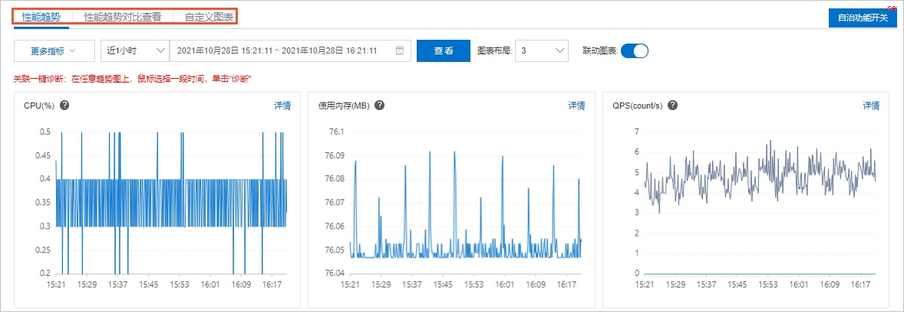

   - **性能趋势**

     单击**性能趋势**页签，设置时间段和更多指标，然后单击**查看**。

     > **说明**
     >
     > - **联动图表**默认开启，如果您将光标悬置于CPU图表上来查看Redis实例9点时的CPU性能指标，其他多个图表也会显示该实例在9点时的性能指标数据。
     >
     > - 单击图表右上方的<strong>含义？</strong>和**详情**，查看性能指标含义和性能趋势大图。

   - **性能趋势对比查看**

     单击**性能趋势对比查看**页签，设置任意两个时间段，配置更多指标，然后单击**查看**，对比两个时间段的性能趋势。

   - **自定义图表**

     以上两种查看方式显示了Redis实例的基础性能指标，如仅需展现其中部分基础指标，您可以自定义性能趋势图表。详情请参见自定义性能趋势图表。

<a id="section-10-2"></a>

## 10.2. Top Key统计

当Tair和Redis内存使用率升高或CPU使用率升高时，您可以使用**Top Key统计**功能快速找到大Key和热Key。本功能支持展示实例中实时和历史的大Key、热Key信息，包括元素数量多的Key、访问频次高的热Key，帮助您有效解决实例性能问题。

**大Key和热Key的统计排名机制**

为避免对数据库造成额外的资源占用，本功能仅会统计客户端操作（读、写）过的Key，并仅保留和展示每种Key类型的Top数量，而不会实时扫描数据库中的所有Key。同时，在实例重启后或HA切换后，原先统计的TopKey信息将被清空，统计将重新开始，因此**长时间未操作过的Key可能不会被纳入统计**。如需了解数据库中所有Key的内存占用、数量分布等信息，请使用离线全量Key分析功能。

| Key类型 | 统计机制 | 展示说明 |
| --- | --- | --- |
| 热Key | Key的QPS超过5000时，被记录为热Key。<br>可通过设置参数<code> hotkey-threshold </code>自定义QPS阈值。 | 在同一时间内，系统最多展示前50个热Key，支持实时展示其精确QPS。 |
| 大Key（元素数量多的Key） | Key的字符串长度（仅限String类型）或元素数量（如Hash中的field数、Set中的member数等）达到阈值（默认2000）及以上时，被统计为大Key。<br>说明仅支持兼容Redis 5.0及以上版本的实例。 | 最多展示每个数据类型排名前3的大Key，当Key的元素数量相同时优先展示先写入的Key。 |

本功能支持统计的数据结构如下：

- Redis原生数据结构：String、List、Hash、Set、Zset、Stream

- Tair自研数据结构：TairString、TairHash、TairGIS、TairBloom、TairDoc、TairCpc、TairZset、TairRoaring、TairTS、TairSearch

**操作步骤**

1. 登录云数据库Tair（兼容Redis）控制台。

2. 在**实例列表**页，单击目标实例ID。

3. 在左侧导航栏，单击**CloudDBA > Top Key统计**。

4. 根据业务需求，选择查询实时数据或历史数据。

   - 如果实例为集群架构或读写分离架构，您还可以在**当前节点**下拉框中选择要展示数据的节点。

   - 查询历史数据时，支持查询最近4天的大Key和热Key信息，且最大查询时间范围不能超过3小时。

   - 可通过设置参数 `hotkey-threshold` 自定义QPS阈值。

<a id="section-10-3"></a>

## 10.3. 自定义性能趋势图表

默认性能趋势显示了Redis实例的基础性能指标，您也可以在自定义性能趋势图表中，选择仅展示部分基础性能指标，以便有针对性地监控和分析实例的性能及运行趋势。本文档介绍了如何在监控大盘中自定义创建Redis实例的性能趋势图表。

**操作步骤**

1. 登录云数据库Tair（兼容Redis）控制台。

2. 在**实例列表**页，单击目标实例ID。

3. 在左侧导航栏，单击**CloudDBA > 性能趋势**。

4. 单击**自定义图表**页签。

5. 单击**新增监控大盘**，填写大盘名称并单击**确认**。

6. 单击<strong>+添加图表</strong>或**新增监控图表**。如下图所示，选中需要查看的指标，单击**确定**。

   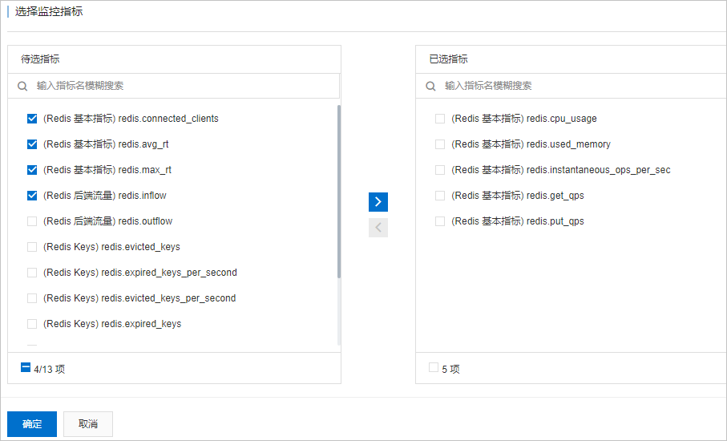

7. <strong>可选：</strong>通过查看、修改和删除操作，管理监控大盘。

   - 查看监控大盘

     选择目标监控大盘并设置时间段，然后单击**查看**。

   - 修改监控大盘

     单击如下所示图标，根据需求进行修改或删除图表。

     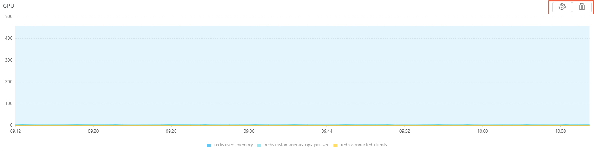

   - 删除监控大盘

     单击**操作大盘 > 删除监控大盘**。

<a id="section-10-4"></a>

## 10.4. 实时性能

在CloudDBA中可以实时查看Redis实例的性能，包括CPU使用率、内存使用信息、QPS（每秒访问次数）、网络流量、Server信息、Key信息、Client信息、连接信息等。

**操作步骤**

1. 登录云数据库Tair（兼容Redis）控制台。

2. 在**实例列表**页，单击目标实例ID。

3. 在左侧导航栏，单击**CloudDBA > 实时性能**。

4. 根据业务需求，选择实时性能的展示方式：

   页面上方实时显示实例性能指标，包括Server信息、Key信息、内存信息、Client信息、连接信息；页面下方以**实时图表**和**实时表格**的形式显示详细的性能指标。

   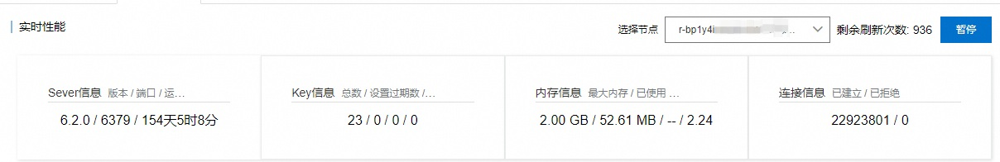

   > **说明**
   >
   > 为方便您实时查看性能的变化，性能指标的值每5秒自动刷新一次，剩余刷新次数可在右上角显示。您也可以单击**暂停**停止刷新。

   <table>
     <tr>
       <th width="89">展示方式</th>
       <th>介绍</th>
     </tr>
     <tr>
       <td>实时图表</td>
       <td>以曲线图的形式显示实例的实时性能指标，如Key信息、Key命中信息、Key命中率、CPU使用率、内存信息、QPS、网络流量。<br>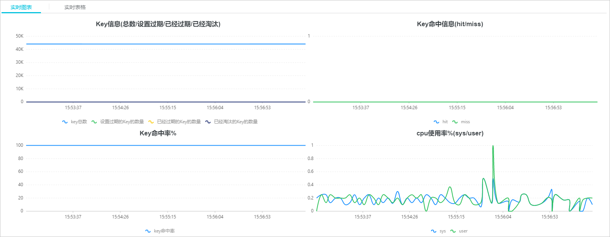</td>
     </tr>
     <tr>
       <td>实时表格</td>
       <td>以表格的形式显示实例的Key命中信息、Key命中率、QPS、Memory（内存信息）、CPU使用率、Network（网络流量）、Client信息、连接信息等性能。实时的性能值每5秒新增一行，最多显示999行。<br>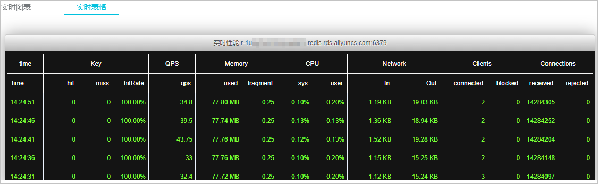</td>
     </tr>
   </table>

<a id="section-10-5"></a>

## 10.5. 实例会话

通过实例会话，您可以实时查看Redis实例与客户端间的会话信息，包括客户端信息，所执行的命令和已连接的时长等，还可以根据业务需求终止异常会话。

**操作步骤**

1. 登录云数据库Tair（兼容Redis）控制台。

2. 在**实例列表**页，单击目标实例ID。

3. 在左侧导航栏，单击**CloudDBA > 实例会话**。

4. 根据业务需求，选择下述步骤对实例会话进行管理：

   - 查看会话：页面默认展示了所有会话的详细信息，您可以将鼠标放置在对应的参数名称上查看其含义。

     > **说明**
     >
     > - 您可以在**搜索会话**文本框中输入关键字来过滤会话信息。
     >
     > - 如需刷新实例会话信息，可以单击左上角的**刷新**或者开启**自动刷新**（每30秒自动刷新一次）。

   - 终止会话：选择目标会话或按shif键可以选择多个目标会话，单击右上角的**kill选中会话**或者直接点击**kill全部会话**，可以终止选中或全部会话。

     > **警告**
     >
     > 请勿终止系统级的会话，否则可能引发一些不可预料的结果。

   - 查看会话统计：会话统计记录了实例会话的总客户端数，活跃客户端数，来源（客户端的地址）数量。

     > **说明**
     >
     > 在**按照来源统计**区域框的表格中，单击客户端地址右侧的编辑图标即可修改来源的别名。在总数栏中单击数值，可查看访问来源地址的详细信息。

<a id="section-10-6"></a>

## 10.6. 慢请求

慢请求问题会极大地影响Redis服务的稳定性。您可在CloudDBA中查看慢日志详细信息，来监控和分析慢请求问题。

**操作步骤**

1. 登录云数据库Tair（兼容Redis）控制台。

2. 在**实例列表**页，单击目标实例ID。

3. 在左侧导航栏，单击**CloudDBA > 慢请求**。

4. 查看实例的慢请求日志信息。

   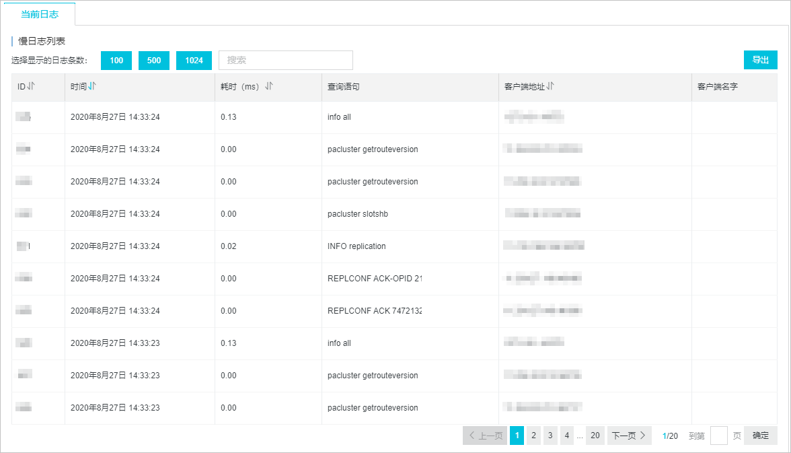

   > **说明**
   >
   > 您可以选择要展示的日志条数或在搜索文本框中输入关键字进行过滤。

<a id="section-10-7"></a>

## 10.7. 离线全量Key分析

通过离线全量Key分析功能来分析Redis的备份文件，可以快速发现实例中的BigKey（大Key），帮助您掌握Key在内存中的占用和分布、Key过期时间等信息，为您的优化操作提供数据支持，帮助您避免因Key倾斜引发的内存不足、性能下降等问题。

**操作步骤**

1. 登录云数据库Tair（兼容Redis）控制台。

2. 在**实例列表**页，单击目标实例ID。

3. 在左侧导航栏，单击**CloudDBA > 离线全量Key分析**。

   页面默认展示最近一天缓存分析结果列表，您可以根据需求选择其他时间段。

4. 在该页面，单击页面右侧的**立即分析**。

   

5. 在弹出的对话框中，设置分析的节点和方式。

   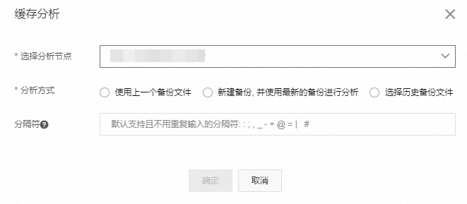

   <table>
     <tr>
       <th width="121">参数</th>
       <th>说明</th>
     </tr>
     <tr>
       <td>选择分析节点</td>
       <td>选择需要执行缓存分析的节点ID。<br>说明您可以选择分析整个实例，也可以只选中某个节点进行分析。当选择分析整个实例时，若该实例的节点数超过8个，系统仅对内存使用量前8的节点进行分析。</td>
     </tr>
     <tr>
       <td>分析方式</td>
       <td>您可以选择分析方式为<strong>使用上一个备份文件</strong>或<strong>新建备份，并使用最新的备份进行分</strong><strong>析</strong>。</td>
     </tr>
   </table>

6. 单击**确定**。

   系统执行分析并展示分析状态，您可以单击**刷新**以更新分析状态。

7. 找到已完成的分析任务，单击其**操作**列的**详情**展示详细的分析结果。

   - **基本信息**：展示实例基本属性和缓存分析方法等信息。

     

   - **相关节点**：展示实例内各节点的内存情况和Key统计信息。

     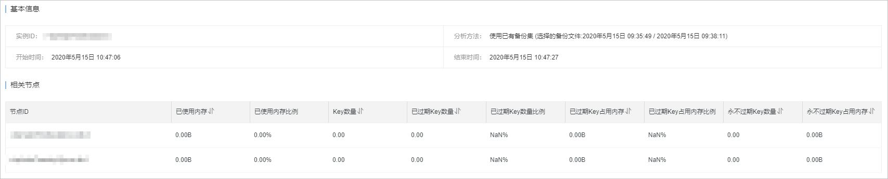

     > **说明**
     >
     > 当实例为集群，且选择的分析节点为整个实例时，**详情**页才会展示**相关节点**信息并提供节点选择的功能。

   - **详情**：展示实例或节点的Key内存占有情况、Key数量分布情况、Key中元素的内存占用和分布情况、Key过期时间分布、大Key排名等信息。

     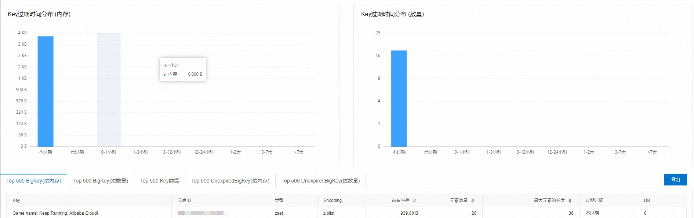

<a id="section-10-8"></a>

## 10.8. 诊断实例

云数据库 Tair（兼容 Redis）集成了DAS的诊断报告功能，可针对指定时间段的实例运行状况发起诊断，帮助您从性能水位、访问倾斜情况、慢日志等多方面评估实例的健康状况，快速定位实例的异常情况。

**操作步骤**

1. 登录云数据库Tair（兼容Redis）控制台。

2. 在**实例列表**页，单击目标实例ID。

3. 在左侧导航栏，单击**CloudDBA > 诊断报告**。

4. 单击**发起诊断**。

5. 在弹出的对话框中，选择诊断的时间范围并单击**确定**。

   > **说明**
   >
   > 诊断时间的选择范围不能超过一天，选择的时间范围越小，诊断报告中展示的性能指标的粒度更细。

6. 等待诊断分析完成后（可刷新该页面查看分析进度），单击**操作**列的**查看报告**。

   诊断报告将展示实例的ID、规格、类型及可用区等基本信息，同时提供实例关键性能指标的统计信息及其状态。此外，报告还将列出发生慢请求次数排名前十的数据节点及其对应的慢请求信息。

<a id="section-11"></a>

# 11.云监控

<a id="section-11-1"></a>

## 11.1. 监控大盘

展示各项监控指标数据。

**标准版/读写分离**

> **说明**
>
> 标准版和读写分离版共用一套指标。

| 监控项 | 单位 | Metric | Dimensions | 描述 |
| --- | --- | --- | --- | --- |
| 连接数使用率（标准版） | % | StandardConnectionU sage | userId、instanceId | 连接数使用率（标准版）。 |
| 流入带宽（标准版） | KB/s | StandardIntranetIn | userId、instanceId | 流入带宽（标准版）。 |
| 流入带宽使用率（标准版） | % | StandardIntranetInRat io | userId、instanceId | 流入带宽使用率（标准版）。 |
| 流出带宽（标准版） | KB/s | StandardIntranetOut | userId、instanceId | 流出带宽（标准版）。 |
| 流出带宽使用率（标准版） | % | StandardIntranetOutR atio | userId、instanceId | 流出带宽使用率（标准版）。 |
| 内存使用率（标准版） | % | StandardMemoryUsag e | userId、instanceId | 内存使用率（标准版）。 |
| QPS使用率（标准版） | % | StandardQPSUsage | userId、instanceId | QPS使用率（标准版）。 |
| CPU使用率（标准版） | % | StandardCpuUsage | userId、instanceId | CPU使用率（标准版）。 |
| 平均每秒访问次数（标准版） | Count/S | StandardUsedQPS | userId、instanceId | 平均每秒访问次数（标准版）。 |
| 总QPS（标准版） | Count/S | StandardTotalQps | userId、instanceId | 总QPS（标准版）。 |
| 当前总连接数（标准版） | Count | StandardTotalConnec tions | userId、instanceId | 当前总连接数（标准版）。 |

**集群版**

| 监控项 | 单位 | Metric | Dimensions | 描述 |
| --- | --- | --- | --- | --- |
| 连接数使用率（集群版） | % | ShardingConnec tionUsage | userId、instanceId | 连接数使用率（集群版）。 |
| 流入带宽（集群版） | KB/s | ShardingIntranet In | userId、instanceId | 流入带宽（集群版）。 |
| 流出带宽（集群版） | KB/s | ShardingIntranet Out | userId、instanceId | 流出带宽（集群版）。 |
| 流入带宽使用率（集群版） | % | ShardingIntranet InRatio | userId、instanceId | 流入带宽使用率（集群版）。 |
| 流出带宽使用率（集群版） | % | ShardingIntranet OutRatio | userId、instanceId | 流出带宽使用率（集群版）。 |
| 内存使用率（集群版） | % | ShardingMemor yUsage | userId、instanceId | 内存使用率（集群版）。 |
| QPS使用率（集群版） | % | ShardingQPSUsa ge | userId、instanceId | QPS使用率（集群版）。 |
| CPU使用率（集群版） | % | ShardingCpuUsa ge | userId、instanceId | CPU使用率（集群版）。 |
| 平均每秒访问次数（集群版） | Count/S | ShardingUsedQP S | userId、instanceId | 平均每秒访问次数（集群版）。 |
| 总QPS（集群版） | Count/S | ShardingTotalQp s | userId、instanceId | 总QPS（集群版）。 |
| 当前总连接数（集群版） | Count | ShardingTotalCo nnections | userId、instanceId | 当前总连接数（集群版）。 |

**集群版-节点**

| 监控项 | 单位 | Metric | Dimensions | 描述 |
| --- | --- | --- | --- | --- |
| 连接数使用率（节点） | % | NodeConnection Usage | userId、instanceId、nodeId | 连接数使用率。 |
| 流入带宽（节点） | KB/s | NodeIntranetIn | userId、instanceId、nodeId | 流入带宽。 |
| 流出带宽（节点） | KB/s | NodeIntranetOut | userId、instanceId、nodeId | 流出带宽。 |
| 流入带宽使用率（节点） | % | NodeIntranetInR atio | userId、instanceId、nodeId | 流入带宽使用率。 |
| 流出带宽使用率（节点） | % | NodeIntranetOut Ratio | userId、instanceId、nodeId | 流出带宽使用率。 |
| 内存使用率（节点） | % | NodeMemoryUs age | userId、instanceId、nodeId | 内存使用率。 |
| QPS使用率（节点） | % | NodeQPSUsage | userId、instanceId、nodeId | QPS使用率。 |
| CPU使用率（节点） | % | NodeCpuUsage | userId、instanceId、nodeId | CPU使用率。 |
| 平均每秒访问次数（节点） | Count | NodeUsedQPS | userId、instanceId、nodeId | 平均每秒访问次数。 |
| 总QPS（节点） | Count/S | NodeTotalQps | userId、instanceId、nodeId | 总QPS。 |
| 当前总连接数（节点） | count | NodeTotalConne ctions | userId、instanceId、nodeId | 当前总连接数。 |

<a id="section-11-2"></a>

## 11.2. 报警历史

当报警发生后，可以查看报警历史信息。支持导出并下载报警历史信息，便于在本地进行数据分析。

**操作步骤**

1. 登录云数据库Tair（兼容Redis）控制台。

2. 在**实例列表**页，单击目标实例ID。

3. 在左侧导航栏，单击**云监控**，选择**报警服务** > **报警历史**。

4. （可选）在**报警历史**页面，可通过**规则ID**、**规则名称**、**报警级别**和时间来筛选目标报警历史记录。

5. 在报警历史页面，执行以下操作。

   <table>
     <tr>
       <th width="122">操作任务</th>
       <th>操作步骤</th>
     </tr>
     <tr>
       <td>查看报警历史</td>
       <td>在<strong>报警历史</strong>列表中，可以直接查看目标报警历史的<strong>产品名称</strong>、<strong>故障实</strong><strong>例</strong>、<strong>发生时间</strong>、<strong>规则名称</strong>、<strong>状态</strong>、<strong>等级</strong>和<strong>通知对象</strong>。单击目标报警历史对应规格名称，可以查看报警规则详情。<br>说明报警历史默认支持查询最近2天的数据。</td>
     </tr>
     <tr>
       <td>导出报警历史</td>
       <td>i. 在<strong>报警历史</strong>页面，单击页面右上方的。<br>ii. 在<strong>导出任务</strong>对话框中，设置<strong>时间选择</strong>和<strong>任务名称</strong>后，单击<strong>确定</strong>。</td>
     </tr>
   </table>

<a id="section-11-3"></a>

## 11.3. 报警规则

<a id="section-11-3-1"></a>

### 11.3.1. 创建报警规则

创建报警规则，按照所设定的云产品监控指标阈值进行告警，及时通知相关用户。

**背景信息**

报警规则在生效时间内，根据默认的探测频率检测报警指标是否超出所设定的阈值，一旦检测到云产品监控指标超出阈值（出现异常），按照设定的报警联系人或其他报警信息处理平台进行告警。

> **说明**
>
> 最小报警探测频率为每分钟一次。

**操作步骤**

1. 登录云数据库Tair（兼容Redis）控制台。

2. 在**实例列表**页，单击目标实例ID。

3. 在左侧导航栏，单击**云监控**，选择**报警服务** > **报警规则**。

4. 单击列表上方的**创建报警规则**。

5. 在**创建报警规则**面板中，根据实际需要设置相应配置项。

   <table>
     <tr>
       <th width="137">配置项</th>
       <th>说明</th>
     </tr>
     <tr>
       <td>云产品选择</td>
       <td>默认，无需选择。</td>
     </tr>
     <tr>
       <td>资源范围</td>
       <td>报警规则关联资源的范围，支持以下几类。不同云产品可选择的范围类型存在一定差异。<br>• <strong>实例维度</strong>：选择当前组织资源集下的一个或多个目标实例。<br>• <strong>资源集维度</strong>：选择当前组织和地域下的目标资源集。<br>• <strong>应用分组维度</strong>：选择当前组织和地域下的应用分组。<br>• <strong>全部资源</strong>：默认不支持选择。</td>
     </tr>
     <tr>
       <td>资源选择</td>
       <td>根据<strong>资源范围</strong>的选择，选择具体的资源实例、资源集或应用分组。</td>
     </tr>
     <tr>
       <td>报警规则描述</td>
       <td>报警规则的主体。当监控数据满足报警条件时，触发报警规则。规则描述设置方法：<br>i. 单击<strong>创建报警规则</strong>。ii. 在<strong>创建报警规则</strong>面板，设置<strong>规则名称</strong>、<strong>指标维度</strong>、<strong>监控指标</strong>、<strong>阈值及报警级别</strong>等。<br>说明指标维度仅在资源范围选择<strong>实例维度</strong>时才会显示。<br>iii. 单击<strong>确认</strong>。</td>
     </tr>
     <tr>
       <td>通道沉默周期</td>
       <td>报警发生后未恢复正常，间隔多久重复发送一次报警通知。取值：<strong>5分钟</strong>、<strong>15分钟</strong>、<strong>30分</strong><strong>钟</strong>、<strong>1小时</strong>、<strong>3小时</strong>、<strong>6小时</strong>、<strong>12小时</strong>和<strong>24小时</strong>。当某监控指标超出报警阈值时触发报警，如果监控指标在通道沉默周期内持续超过报警阈值，在通道沉默周期内不会重复发送报警通知；如果监控指标在通道沉默周期后仍未恢复正常，则云监控将再次发送报警通知。例如，当<strong>通道沉默周期</strong>设置为<strong>12小时</strong>时，如果超出报警阈值的监控指标在首次触发报警后12小时仍未恢复正常，云监控将再次发送报警通知。</td>
     </tr>
     <tr>
       <td>生效时间</td>
       <td>报警规则的生效时间。报警规则只在生效时间内检查监控数据是否超出报警阈值。</td>
     </tr>
     <tr>
       <td>报警回调</td>
       <td>用于接收云监控通过POST请求推送报警消息的回调地址。<br>说明报警回调地址必须是云监控可访问的域名地址，仅支持HTTP协议，不支持填写IP。</td>
     </tr>
     <tr>
       <td>无数据处理方法</td>
       <td>无监控数据时报警的处理方式。<br>• 不做任何处理<br>• 发送无数据报警</td>
     </tr>
     <tr>
       <td>报警联系人</td>
       <td>选择报警信息发送的用户组或用户。默认的云账号报警联系人组是一个空账号，可用于测试报警规则的有效性。</td>
     </tr>
   </table>

6. 单击**确定**。

**规则描述配置项说明**

| 配置项 | 说明 |
| --- | --- |
| 规则名称 | 填写报警规则名称。 |
| 监控指标 | 从当前报警规则所选择的云产品的所有监控指标中，选择目标指标项。各云产品的监控指标详情可参见云产品监控指标说明。 |
| 指标维度 | 指除实例ID之外的其他维度。仅在资源范围选择<strong>实例维度</strong>时才会显示。 |
| 阈值及报警级别（单位：%） | • 报警级别分为<strong>紧急</strong>、<strong>警告</strong>和<strong>普通</strong>。<br>• 监控数据的聚合值类型可以选择<strong>平均值</strong>、<strong>最小值</strong>和<strong>最大值</strong>。<br>• 监控数据的周期可以选择<strong>连续</strong>、<strong>连续5个周期</strong>、<strong>连续10个周期</strong>、<strong>连续15个周期</strong>、<strong>连续30个周</strong><strong>期</strong>、<strong>连续60个周期</strong>。<br>• 实际监控数据与报警阈值之间的比较关系，支持 “<strong>&gt;</strong>”、“ <strong>&gt;=</strong>”、“<strong>&lt;</strong>”、“<strong>&lt;=</strong> ”、“<strong>=</strong>”、“<strong>!=</strong>”、“<strong>同比昨天同时间上涨</strong>”、“<strong>同比昨天同时间下降</strong>”、“<strong>环比上周期上涨”</strong>、<strong>“环比上周期</strong><strong>下降”</strong>、<strong>“比上周期增量”</strong>、<strong>“比上周期降量”</strong>的选择。还支持设置阈值和触发次数，当监控数据达到设置的阈值的触发次数时，产生报警。 |

**规则配置示例**

为云服务器ECS创建一个名为example的报警规则，用于监控目标ECS实例的CPU使用率，当CPU使用率峰值（最大值）在五个探测周期内有三次大于等于70%的情况时触发报警，且报警级别为紧急。

适用于此场景的规则描述配置如下图所示。

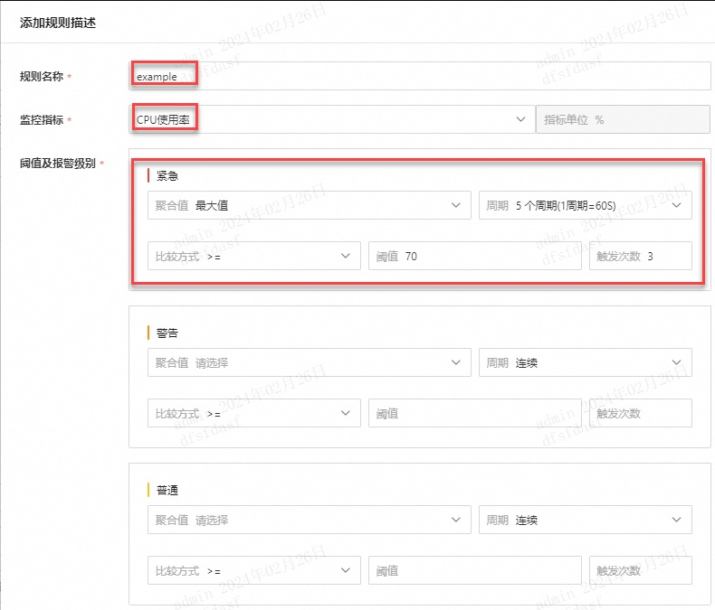

<a id="section-11-3-2"></a>

### 11.3.2. 管理报警规则

在报警规则列表中，可以对报警规则进行修改、禁用、启用、删除等操作。

**操作步骤**

1. 登录云数据库Tair（兼容Redis）控制台。

2. 在**实例列表**页，单击目标实例ID。

3. 在左侧导航栏，单击**云监控**，选择**报警服务** > **报警规则**。

4. 选择目标报警规则，执行相关操作。

   <table>
     <tr>
       <th width="154">操作任务</th>
       <th>操作步骤</th>
     </tr>
     <tr>
       <td>查看报警规则详情</td>
       <td>单击目标报警规则<strong>操作</strong>列的<strong>详情</strong>，在<strong>报警规则/报警历史/故障资源</strong>面板中可查看报警规则的详细信息。</td>
     </tr>
     <tr>
       <td>判断规则有效性</td>
       <td>单击目标报警规则<strong>有效性</strong>列的<strong>点击巡检</strong>，在有效性列可查看巡检结果。<br>说明<br>• 若巡检结果异常，可单击<strong>检测结果</strong>，在弹出的面板中查看<strong>告警规则执行异常</strong><strong>检测</strong>、<strong>告警规则加载检测</strong>、<strong>无效报警规则检测</strong>和<strong>告警规则回调检测</strong>结果。<br>• 单击<strong>重新检测</strong>，可重新检测规则有效性。</td>
     </tr>
     <tr>
       <td>查看规则执行记录</td>
       <td>单击目标报警规则<strong>规则执行记录</strong>列的<strong>查看规则执行记录</strong>，在<strong>报警规则执行记录</strong>面板中，可通过时间范围筛选执行记录。</td>
     </tr>
     <tr>
       <td>修改报警规则</td>
       <td>i. 单击目标报警规则<strong>操作</strong>列的<strong>编辑。</strong>ii. 在<strong>修改报警规则</strong>面板中，修改报警规则。相关配置参数说明请参见《创建报警规则》。iii. 修改完成后，单击<strong>确定</strong>。</td>
     </tr>
     <tr>
       <td>禁用报警规则</td>
       <td>当需要手动停止云产品的服务，进行维护或升级时，可以禁用报警规则，避免因人为变更而收到大量且无用的报警通知。<br>说明请先确认报警规则的<strong>状态</strong>为<strong>正常</strong>后，再进行禁用。<br>• 单个禁用<br>a. 单击目标报警规则<strong>操作</strong>列的图标，单击<strong>禁用。</strong><br>b. 在<strong>禁用报警规则</strong>对话框中，单击<strong>确定。</strong><br>• 批量禁用<br>a. 选中目标报警规则前的复选框，然后单击列表左下角的<strong>禁用</strong>。<br>b. 在<strong>禁用报警规则</strong>对话框，单击<strong>确定</strong>。</td>
     </tr>
     <tr>
       <td>启用报警规则</td>
       <td>完成云产品的维护或升级后，可以重新启用已被禁用的报警规则。<br>说明请先确认报警规则的<strong>状态</strong>为<strong>已禁用</strong>后，再进行禁用。<br>• 单个启用<br>a. 单击目标报警规则<strong>操作</strong>列的<strong>启用。</strong><br>b. 在<strong>启用报警规则</strong>对话框中，单击<strong>确定。</strong><br>• 批量启用<br>a. 选中目标报警规则前的复选框，然后单击列表左下角的<strong>启用</strong>。<br>b. 在<strong>启用报警规则</strong>对话框，单击<strong>确定</strong>。</td>
     </tr>
     <tr>
       <td>删除报警规则</td>
       <td>• 单个删除<br>a. 单击目标报警规则操作列的图标，单击<strong>删除</strong>。<br>b. 在<strong>删除报警规则</strong>对话框中，单击<strong>确定</strong>。<br>• 批量删除<br>a. 选中目标报警规则前的复选框，然后单击列表左下角的删除。<br>b. 在<strong>删除报警规则</strong>对话框中，单击<strong>确定</strong>。</td>
     </tr>
   </table>

<a id="section-12"></a>

# 12.报警设置

**背景信息**

监控报警是通过阿里云监控产品实现的。通过阿里云监控产品，您可以设置监控项，并在触发监控项的报警规则时，通知报警联系组中的所有联系人。您可以维护报警监控项对应的报警联系组，以便发生报警时，能及时通知到相关联系人。

**操作步骤**

1. 登录云数据库Redis控制台。

2. 在**实例列表**页，单击目标实例ID。

3. 在**实例信息**页，单击左侧导航栏中**报警设置**。

4. 在**报警设置**页，单击页面右侧**报警设置**，跳转到**云监控**控制台。

5. 在**云监控**页，您可以**新建报警规则**。

6. 设置完报警规则后，单击**确定**即可。

   > **说明**
   >
   > 设置完成后，您可以在云监控控制台的**报警规则**页面修改、禁用、删除报警规则，并查看报警历史记录。
